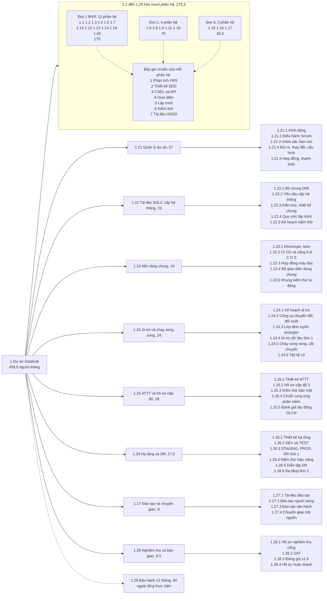
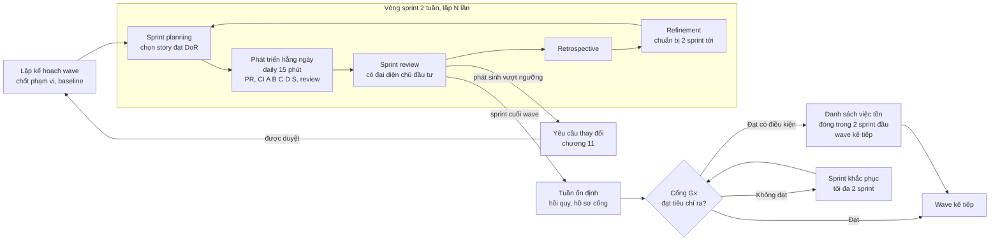
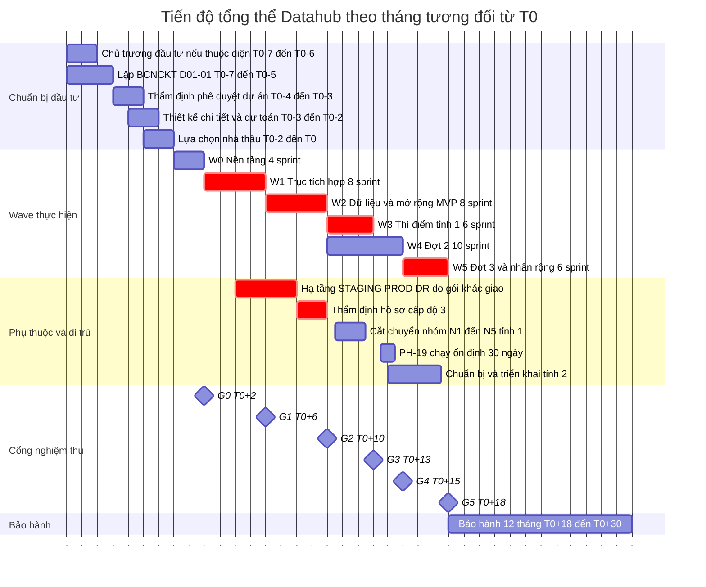
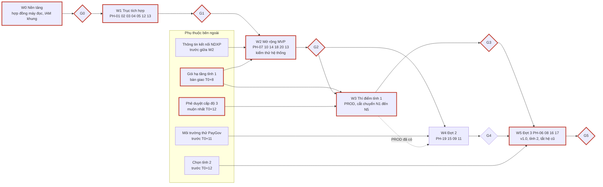
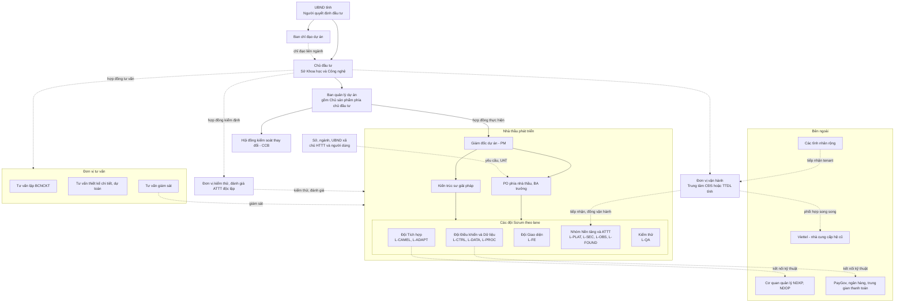
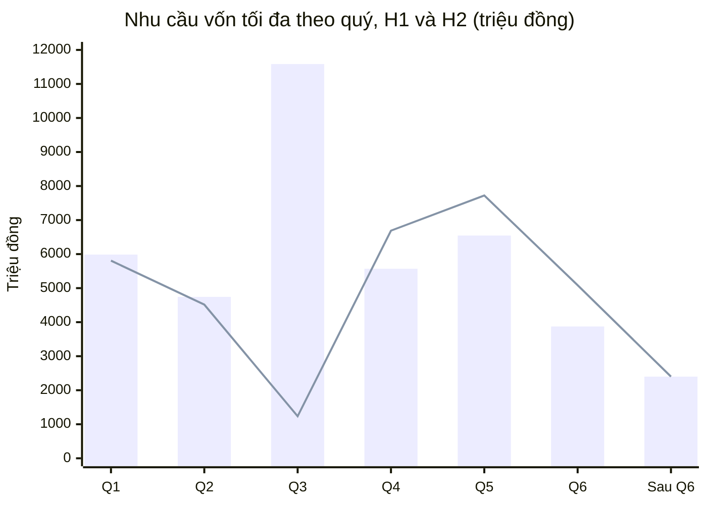
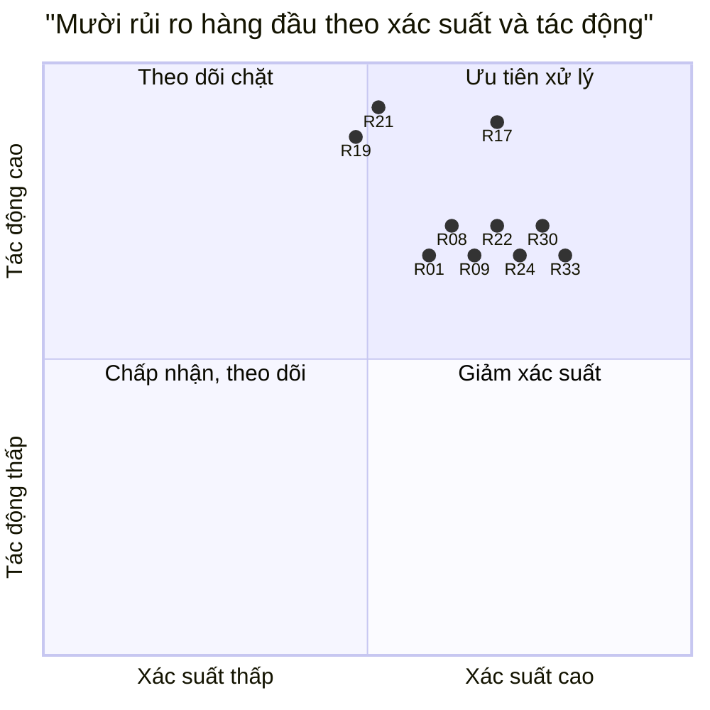
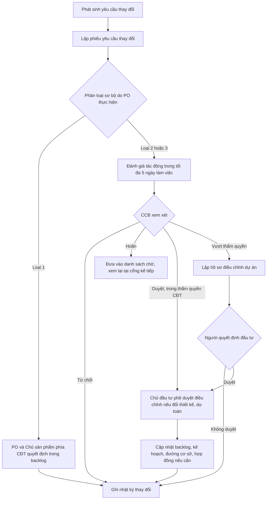
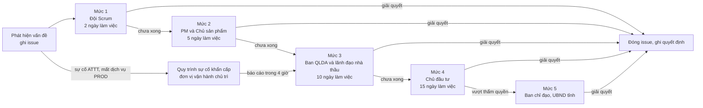

# D01-02 · Kế hoạch dự án

Kế hoạch này biến phương án được chọn ở D01-01 thành chương trình thực hiện có thể kiểm soát: phạm vi, WBS, mô hình thực hiện, tiến độ và cổng nghiệm thu, tổ chức và RACI, nhân sự, ngân sách, rủi ro, chất lượng, cấu hình, thay đổi, truyền thông và tiêu chí hoàn thành. Kế hoạch dùng cùng bộ giả định nền [D01-00](_gia-dinh-nen.md) với D01-01 và cùng các giả định GĐ-01 đến GĐ-07; phân đợt 20 phân hệ theo D02-01 §8.3. Mọi mốc ghi tương đối theo T0, ngày khởi động hợp đồng thực hiện.

Sổ rủi ro đầy đủ RSK-01 đến RSK-43 ở dạng bảng tính nằm ở [phụ lục](phu-luc/D01-02-so-rui-ro.csv); câu hỏi mở của kế hoạch mang mã `Q-D0102-nn` ở cuối từng chương.

## 1. Giới thiệu, mục tiêu và phạm vi dự án

**Tóm tắt cho hội đồng thẩm định.** Kế hoạch dự án này biến phương án được chọn trong Báo cáo nghiên cứu khả thi (D01-01) thành một chương trình thực hiện có thể kiểm soát được: 18 tháng thực hiện chia thành 6 wave (W0 đến W5), sprint 2 tuần, 6 cổng nghiệm thu (G0 đến G5) và 12 tháng bảo hành. Dự án xây mới 20 phân hệ của Datahub theo ba đợt (12 phân hệ MVP, 5 phân hệ đợt 2, 3 phân hệ đợt 3), di trú khỏi hệ LGSP cũ tại tỉnh thí điểm theo chiến lược chạy song song và thay thế dần (strangler), sau đó nhân rộng sang tỉnh thứ hai trước khi kết thúc giai đoạn thực hiện. Tổng nỗ lực tham chiếu của nhà thầu là khoảng 459 người-tháng; đỉnh tải thực tế khoảng 38 người toàn thời gian trong ba tháng W3 và W4 chồng lấn. Kho dữ liệu phân tích (lakehouse), các hệ thống thông tin nguồn của sở ngành và phần mua sắm hạ tầng vật lý hoặc thuê dịch vụ cloud nằm ngoài phạm vi phần mềm của dự án này. Mục tiêu dự án được đo bằng chín mục tiêu nghiệp vụ BO-01 đến BO-09 và 18 chỉ số KPI-01 đến KPI-18 định nghĩa tại D02-01; kế hoạch gắn mỗi chỉ số với cổng nghiệm thu đầu tiên có thể chứng minh nó.

### 1.1. Mục đích của kế hoạch

Kế hoạch dự án (project management plan) là văn bản điều hành giữa chủ đầu tư, nhà thầu thực hiện, tư vấn giám sát và đơn vị vận hành. Nó trả lời bốn câu hỏi mà Báo cáo nghiên cứu khả thi chỉ trả lời ở mức tổng thể: làm những việc gì (cấu trúc phân rã công việc ở chương 2), làm theo cách nào (mô hình thực hiện ở chương 3), làm xong lúc nào và ai xác nhận là xong (tiến độ, mốc và cổng nghiệm thu ở chương 4), và làm thế nào để biết sản phẩm đạt chất lượng (chương 9 và chương 13). Các chương còn lại của tài liệu xử lý tổ chức, nguồn lực, ngân sách, rủi ro, cấu hình, thay đổi và truyền thông.

Kế hoạch có ba nhóm người dùng chính. Hội đồng thẩm định và người quyết định đầu tư dùng nó để kiểm tra rằng tiến độ và nỗ lực khai trong D01-01 có cơ sở phân rã cụ thể. Ban quản lý dự án phía chủ đầu tư dùng nó làm khung để nghiệm thu từng phần và thanh toán theo mốc. Giám đốc dự án và các trưởng nhóm phía nhà thầu dùng nó làm đường cơ sở (baseline) để lập kế hoạch sprint, đo tiến độ và báo cáo sai lệch. Vì vậy kế hoạch được viết với hai tầng: tầng tóm tắt ở đầu mỗi chương cho người phê duyệt, và tầng chi tiết với con số, tiêu chí định lượng cho người điều hành.

Kế hoạch là tài liệu sống. Bản 1.0 được phê duyệt cùng thiết kế chi tiết và dự toán trước khi lựa chọn nhà thầu, trở thành đường cơ sở hợp đồng. Sau đó kế hoạch được cập nhật tại mỗi cổng nghiệm thu; mọi thay đổi về phạm vi, mốc hoặc nỗ lực vượt ngưỡng phải đi qua quy trình kiểm soát thay đổi ở chương 11 và được ghi nhận bằng một phiên bản mới của tài liệu.

### 1.2. Căn cứ lập kế hoạch

Kế hoạch này kế thừa toàn bộ căn cứ pháp lý, sự cần thiết đầu tư và phương án được chọn từ D01-01, nên không nhắc lại phần lập luận ở đó. Các căn cứ trực tiếp chi phối cách lập kế hoạch gồm bốn nhóm.

Nhóm thứ nhất là khung pháp lý về đầu tư hệ thống chuyển đổi số sử dụng ngân sách nhà nước. Văn bản áp dụng là Nghị định 224/2026/NĐ-CP ngày 24/6/2026 quy định chi tiết Luật Chuyển đổi số số 148/2025/QH15, có hiệu lực từ 01/7/2026; Điều 90 của nghị định này bãi bỏ Nghị định 45/2026/NĐ-CP (văn bản trước đó đã thay Nghị định 73/2019/NĐ-CP), và Điều 91 quy định dự án chưa được quyết định đầu tư trước 01/7/2026 phải áp dụng nghị định mới. Datahub vì vậy được lập, thẩm định và triển khai như một dự án đầu tư hệ thống chuyển đổi số theo Nghị định 224/2026/NĐ-CP, cùng Thông tư 39/2026/TT-BKHCN về chi phí và Thông tư 41/2026/TT-BKHCN về khảo sát, triển khai, giám sát, kiểm thử và nghiệm thu ([nguồn tham khảo](https://hethongphapluat.com/nghi-dinh-224-2026-nd-cp-huong-dan-luat-chuyen-doi-so/dieu-90), chưa đối chiếu Công báo). Các văn bản này quyết định trình tự chuẩn bị đầu tư theo thiết kế hai bước (Báo cáo nghiên cứu khả thi kèm thiết kế cơ sở, sau đó thiết kế chi tiết và dự toán), yêu cầu kiểm thử phần mềm nội bộ, yêu cầu vận hành thử trước nghiệm thu, thủ tục nghiệm thu, bàn giao và các trường hợp điều chỉnh dự án phải trình cấp có thẩm quyền. Chương 4 áp các bước đó vào lịch tham chiếu; những điều khoản chưa đọc được nguyên văn (đặc biệt điều về nghiệm thu, bàn giao và về phát triển linh hoạt) được ghi thành câu hỏi mở ở cuối chương này.

Nhóm thứ hai là các yêu cầu chuyên ngành mà sản phẩm phải đáp ứng và vì thế tạo ra công việc trong WBS: Luật Dữ liệu (CMP-LAW-01) và Nghị định 165/2025/NĐ-CP (CMP-LAW-02) về quản trị và chia sẻ dữ liệu; Nghị định 47/2020/NĐ-CP (CMP-LAW-03) và Công văn 631/THH-THHT (CMP-LAW-09) về chức năng LGSP; khung pháp lý bảo vệ dữ liệu cá nhân (CMP-LAW-04, CMP-LAW-05); Luật An ninh mạng 116/2025/QH15 (CMP-LAW-16), Nghị định 331/2026/NĐ-CP (CMP-LAW-06) và TCVN 14423:2026 (CMP-LAW-08) về bảo vệ an ninh mạng hệ thống thông tin theo cấp độ; Khung Kiến trúc Chính phủ điện tử phiên bản 3.0 (CMP-LAW-10).

Nhóm thứ ba là bộ giả định nền dùng chung của D01-01 và D01-02 (tệp `_gia-dinh-nen.md`), là nguồn duy nhất cho mốc, wave, đội ngũ, quy mô tham chiếu và phương án hạ tầng. Mọi con số trong tài liệu này trích từ đó; nơi nào cần một con số khác, bộ giả định nền được sửa trước rồi mới cập nhật kế hoạch.

Nhóm thứ tư là các quyết định kỹ thuật đã có của sản phẩm: bộ quyết định kiến trúc (D00-02), mô hình đơn vị triển khai lai, quy tắc sở hữu mã theo lane và cổng CI bắt buộc của repo. Các quyết định này không thuộc phạm vi điều chỉnh của kế hoạch, nhưng kế hoạch phải tôn trọng chúng khi phân rã công việc và lập lịch.

### 1.3. Mục tiêu dự án đo được

Mục tiêu của dự án là chín mục tiêu nghiệp vụ BO-01 đến BO-09 và 18 chỉ số KPI-01 đến KPI-18 đã được định nghĩa chính thức tại D02-01 §3, kèm giá trị nền, giá trị đích và thời điểm đo. Kế hoạch không đặt lại mục tiêu mà làm một việc khác: gắn mỗi mục tiêu với cổng nghiệm thu đầu tiên mà tại đó có thể có bằng chứng, để mỗi cổng không chỉ đếm số chức năng đã làm mà còn chứng minh một kết quả có ý nghĩa với chủ đầu tư. Bảng sau tóm tắt mối gắn kết đó; tên mục tiêu được rút gọn, giá trị đích lấy nguyên từ D02-01.

| Mục tiêu (D02-01) | Chỉ số và giá trị đích | Cổng có bằng chứng đầu tiên | Bằng chứng tại cổng |
|---|---|---|---|
| BO-01 Mọi trao đổi dữ liệu đi qua một điểm có kiểm soát | KPI-01 ≥ 90% HTTT kết nối qua Datahub; KPI-02 giảm ≥ 80% kết nối điểm–điểm (sau 12 tháng) | G3 (đo lần đầu), đo lại cuối bảo hành | Báo cáo cắt chuyển từng nhóm dịch vụ; sổ HTTT đã kết nạp trên PH-01 |
| BO-02 Dịch vụ công không gián đoạn vì nền tảng tích hợp | KPI-03 sẵn sàng data plane ≥ 99,9%/tháng; KPI-04 độ trễ thêm tại gateway p95 ≤ 50 ms | G2 (kiểm thử tải), G3 (vận hành thật) | Báo cáo kiểm thử hiệu năng D05-03; báo cáo sẵn sàng 30 ngày đầu PROD |
| BO-03 Rút ngắn thời gian đưa kết nối mới vào vận hành | KPI-05 ≤ 5 ngày làm việc; KPI-06 ≤ 2 ngày công cho một luồng chuẩn | G1 (KPI-06 trên TEST), G3 (KPI-05 trên PROD) | Nhật ký thời gian của các HTTT kết nạp trong W3 |
| BO-04 Tuân thủ pháp luật về dữ liệu và ATTT | KPI-07 = 100% lượt khai thác có nhật ký đủ; KPI-08 hồ sơ cấp độ 3 được phê duyệt; KPI-09 = 0 thông tin xác thực ngoài kho bí mật | G2 (KPI-07, KPI-09), G3 (KPI-08) | Báo cáo quét bí mật; quyết định phê duyệt cấp độ |
| BO-05 Danh mục dùng chung thống nhất, đồng bộ quốc gia | KPI-10 = 100% danh mục bắt buộc; KPI-11 đồng bộ ≤ 24 giờ | G2 (chức năng), G3 (dữ liệu tỉnh 1) | Báo cáo di trú danh mục; nhật ký đồng bộ |
| BO-06 Một nền tảng cho nhiều tỉnh | KPI-12 khởi tạo tenant ≤ 1 ngày làm việc | G2 (trên STAGING), G5 (tỉnh 2) | Biên bản khởi tạo tenant tỉnh 2 |
| BO-07 Thanh toán minh bạch, đối soát được | KPI-13 ≥ 99,5% giao dịch khớp tự động; KPI-14 phát hiện lệch ≤ 1 ngày làm việc | G4 | Báo cáo 30 ngày chạy ổn định của PH-19 |
| BO-08 Vận hành chủ động | KPI-15 MTTD ≤ 5 phút; KPI-16 MTTR sự cố mức 1 ≤ 1 giờ | G3 | Biên bản diễn tập sự cố; báo cáo cảnh báo PH-13 |
| BO-09 Một giao diện quản trị thống nhất | KPI-17 = 1 giao diện; KPI-18 điểm SUS ≥ 75 | G2 (KPI-17), UAT các đợt (KPI-18) | Biên bản UAT có khảo sát SUS |

Bảng cho thấy hai đặc điểm. Thứ nhất, phần lớn chỉ số có bằng chứng đầu tiên tại G2 hoặc G3, tức là trước khi kết thúc 13 tháng đầu, nên hội đồng có căn cứ định lượng ngay ở nghiệm thu MVP chứ không phải chờ đến G5. Thứ hai, những chỉ số có thời điểm đo "12 tháng" trong D02-01 (KPI-01, KPI-02, KPI-10) không thể đo xong trong giai đoạn thực hiện; kế hoạch đo chúng lần đầu tại G3 và đo lại ở cuối thời gian bảo hành (chương 13). Các chỉ số có dấu "chưa đo" trong D02-01 cần giá trị nền được đo trước G1 theo câu hỏi mở Q04 của D02-01.

### 1.4. Phạm vi dự án

#### 1.4.1. Trong phạm vi

Phạm vi được xác định theo sản phẩm bàn giao và theo hoạt động. Về sản phẩm, dự án xây dựng 20 phân hệ của Datahub, chia làm ba đợt. Đợt 1 (MVP) gồm 12 phân hệ là PH-01, PH-02, PH-03, PH-04, PH-05, PH-07, PH-10, PH-12, PH-13, PH-14, PH-18 và PH-20, đủ để thay thế các khối Bus, Hub, API Management, Danh mục dùng chung và kết nối quốc gia của hệ cũ. Đợt 2 gồm 4 phân hệ PH-19, PH-15, PH-09 và PH-11, trong đó PH-19 thay khối Payment của hệ cũ, còn ba phân hệ còn lại là cổng nhà phát triển, bảo vệ dữ liệu cá nhân và điều phối quy trình. Đợt 3 gồm 4 phân hệ PH-06, PH-08, PH-16 và PH-17, là dữ liệu chủ, chất lượng dữ liệu, báo cáo chỉ tiêu và trợ lý AI. Phân đợt này theo D02-01 §8.3. Toàn bộ 20 phân hệ được đóng gói thành bản phát hành v1.0 multi-tenant duy nhất.

Về hoạt động, phạm vi gồm sáu khối việc ngoài phát triển phân hệ. Khối thứ nhất là bộ tài liệu SDLC D00 đến D06 theo dàn ý của bộ tài liệu. Khối thứ hai là nền tảng kỹ thuật dùng chung: monorepo, cổng CI, hợp đồng máy đọc (OpenAPI, AsyncAPI, chính sách OPA), thư viện dùng chung và bộ giao diện. Khối thứ ba là di trú khỏi hệ LGSP cũ tại tỉnh thí điểm theo chiến lược strangler: dựng lớp định tuyến trước hệ cũ, chuyển từng nhóm dịch vụ sang Datahub, chạy song song, đối soát, rồi tắt hệ cũ trước G5. Khối thứ tư là an toàn thông tin, gồm thiết kế, kiểm thử bảo mật và lập hồ sơ đề xuất cấp độ 3 trình phê duyệt. Khối thứ năm là cài đặt, cấu hình phần mềm nền (Kubernetes trở lên) trên bốn môi trường DEV, TEST, STAGING, PROD và site DR của tỉnh thí điểm, cộng môi trường PROD của tỉnh thứ hai. Khối thứ sáu là đào tạo, chuyển giao và nghiệm thu, bàn giao.

Nhân rộng sang tỉnh thứ hai nằm trong phạm vi ở mức "dựng tenant và đưa vào vận hành tối thiểu", nghĩa là cài đặt bản v1.0, cấu hình tenant, kết nạp các HTTT đầu tiên do tỉnh 2 chọn, đào tạo quản trị viên tỉnh 2. Di trú hệ cũ của tỉnh 2 (nếu tỉnh 2 cũng đang chạy một LGSP cũ) không nằm trong phạm vi, vì chưa biết tỉnh 2 dùng nền tảng nào; điểm này được ghi thành câu hỏi mở.

#### 1.4.2. Ngoài phạm vi

Ranh giới phạm vi được vẽ rõ để tránh tranh chấp khi nghiệm thu. Bảng sau liệt kê những hạng mục người đọc có thể nghĩ là thuộc dự án nhưng thực tế không thuộc, kèm lý do và nơi xử lý.

| Hạng mục ngoài phạm vi | Lý do | Xử lý ở đâu |
|---|---|---|
| Kho dữ liệu phân tích, lakehouse, báo cáo phân tích đa nguồn | Datahub là LGSP thế hệ mới có lớp dữ liệu dùng chung, không phải nền tảng phân tích | Dự án riêng ở giai đoạn sau; kiến trúc để sẵn điểm xuất dữ liệu qua sự kiện |
| Cung cấp, lắp đặt thiết bị phần cứng tại TTDL tỉnh (phương án H1) hoặc cung cấp dịch vụ cloud chính phủ (phương án H2) | Thuộc gói thầu thiết bị hoặc hợp đồng thuê dịch vụ riêng trong cùng dự án (D01-01 §9.4, chương 7 mục 7.3), không thuộc WBS của gói EP | Gói EP đặt yêu cầu cấu hình (D03-09), nghiệm thu đầu vào và cài đặt từ tầng Kubernetes trở lên |
| Sửa đổi các HTTT nguồn và đích của sở ngành, cấp xã | Các HTTT này thuộc chủ quản khác | Dự án cung cấp adapter, hợp đồng API và hỗ trợ kỹ thuật kết nối |
| Nâng cấp NDXP, NDOP hoặc các CSDL quốc gia | Thuộc trách nhiệm cấp trung ương | Dự án chỉ xây PH-14 kết nối theo đặc tả hiện hành của các nền tảng đó |
| Phí giao dịch thanh toán, phí dịch vụ của trung gian thanh toán, thuê bao SMS | Chi phí vận hành, không phải chi phí đầu tư | Dự toán vận hành của đơn vị vận hành |
| Triển khai cho tỉnh thứ ba trở đi | Mỗi tỉnh là một quyết định đầu tư hoặc thuê dịch vụ riêng | Hợp đồng triển khai riêng dùng bản v1.0 |
| Vận hành thường xuyên sau thời gian bảo hành | Thuộc chi thường xuyên | Hợp đồng vận hành, hỗ trợ kỹ thuật hằng năm |
| Số hóa, làm sạch dữ liệu nghiệp vụ chuyên ngành của sở ngành | Không thuộc chức năng nền tảng | Dự án cung cấp công cụ chất lượng dữ liệu (PH-08) để sở ngành tự làm |
| Mô hình AI nền tảng và hạ tầng GPU | PH-17 là cổng quản trị truy cập AI, không phải nơi huấn luyện hay vận hành mô hình | Dịch vụ AI do tỉnh hoặc cấp trên cung cấp, kết nối qua PH-17 |

Hai hạng mục cần chủ đầu tư xác nhận sớm vì ảnh hưởng trực tiếp đến tiến độ. Hạng mục hạ tầng nằm ngoài WBS của gói EP có nghĩa là W2 và W3 phụ thuộc vào gói thầu thiết bị giao và nghiệm thu lắp đặt đúng hạn (trước T0+6); chương 4 coi đây là phụ thuộc bên ngoài trên đường găng. Hạng mục HTTT nguồn ngoài phạm vi có nghĩa là mỗi nhóm dịch vụ chỉ cắt chuyển được khi chủ quản HTTT liên quan phối hợp đổi điểm kết nối, nên kế hoạch cắt chuyển ở chương 4 xếp các nhóm dịch vụ cần ít thay đổi phía HTTT lên trước.

### 1.5. Giả định

Kế hoạch dựa trên các giả định sau. Mỗi giả định có hệ quả cụ thể nếu sai, và được theo dõi như rủi ro trong sổ rủi ro của tài liệu này.

1. Mọi mốc được tính tương đối từ T0, là ngày khởi động hợp đồng thực hiện; theo chỉ đạo của chủ đầu tư, tài liệu không gắn ngày lịch cụ thể. Nếu các bước chuẩn bị đầu tư kéo dài, T0 dịch theo, nhưng thời lượng tương đối giữa các wave giữ nguyên.
2. Tỉnh thí điểm có quy mô cỡ M: tối đa 200 HTTT kết nối, 1.000 API, 10 triệu giao dịch đồng bộ mỗi ngày, đỉnh 1.000 TPS tại cổng API. Tiêu chí kiểm thử hiệu năng ở các cổng lấy theo cỡ này.
3. Chủ đầu tư là Sở Khoa học và Công nghệ tỉnh thí điểm, người quyết định đầu tư là UBND tỉnh, đơn vị vận hành là Trung tâm Chuyển đổi số hoặc Trung tâm dữ liệu tỉnh. Các vai trò này cần được điền chính thức.
4. Hạ tầng DEV và TEST sẵn sàng trong 4 tuần đầu của W0; hạ tầng STAGING, PROD và DR của tỉnh thí điểm sẵn sàng chậm nhất tại T0+8 tháng, tức là hai tháng trước khi W3 bắt đầu.
5. Đội ngũ thực hiện theo bảng tham chiếu trong giả định nền, đỉnh tải thực tế khoảng 38 người toàn thời gian khi W3 và W4 chồng lấn, dùng AI agent viết mã có kiểm soát theo quy tắc ở chương 3.
6. Nhà cung cấp hệ LGSP cũ hợp tác trong việc cung cấp cấu trúc dữ liệu, xuất dữ liệu cấu hình và hỗ trợ trong thời gian chạy song song; hệ cũ còn được duy trì đến G5.
7. Đại diện chủ đầu tư tham gia sprint review 2 tuần một lần và có quyền quyết định ưu tiên trong phạm vi đã chốt.
8. Đặc tả kết nối NDXP, NDOP và trung gian thanh toán PayGov không thay đổi phá vỡ tương thích trong thời gian thực hiện.

### 1.6. Ràng buộc

Khác với giả định, ràng buộc là những điều kiện kế hoạch không được phép thay đổi. Ràng buộc về thời gian là giai đoạn thực hiện 18 tháng, kết thúc bằng G5 tại T0+18 tháng, vì kế hoạch vốn đầu tư được bố trí cho hai năm ngân sách liên tiếp kể từ T0 (Năm 1 và Năm 2 trong cửa sổ TCO). Ràng buộc về thủ tục là mọi sản phẩm chỉ được đưa vào vận hành chính thức sau khi nghiệm thu theo Nghị định 224/2026/NĐ-CP và sau khi hồ sơ đề xuất cấp độ 3 được phê duyệt. Ràng buộc kỹ thuật là sản phẩm dùng phần mềm nguồn mở, không phụ thuộc dịch vụ độc quyền của một nhà cung cấp cloud, dữ liệu lưu trong nước, thiết kế sẵn để nâng lên cấp độ 4. Ràng buộc về vận hành là hệ cũ không được tắt khi chưa có đối soát chứng minh rằng mọi dịch vụ của nó đã có tương đương trên Datahub, và dịch vụ thanh toán cũ chỉ được tắt sau khi PH-19 chạy ổn định 30 ngày liên tục.

### 1.7. Câu hỏi mở

- **Q-D0102-01:** Nghị định 224/2026/NĐ-CP (Điều 57 về nghiệm thu, bàn giao) và Thông tư 41/2026/TT-BKHCN quy định các bước nghiệm thu và thành phần hồ sơ cụ thể ra sao, và có cho phép nghiệm thu từng phần theo hạng mục hoặc theo đợt phát hành không? Kế hoạch đang giả định cho phép nghiệm thu từng phần theo wave; cần đối chiếu nguyên văn trước khi phát hành bản 1.0.
- **Q-D0102-02:** Dự án có thuộc diện phải lập, trình chủ trương đầu tư theo quy định hiện hành không? Điều này quyết định bước đầu tiên trong lịch chuẩn bị đầu tư (T0 − 7 đến T0 − 6 tháng).
- **Q-D0102-03:** Hạ tầng phần cứng (H1) hoặc dịch vụ cloud (H2) được mua sắm trong cùng dự án dưới dạng một gói thầu riêng, hay là một dự án khác? Câu trả lời quyết định ai chịu trách nhiệm khi hạ tầng giao chậm.
- **Q-D0102-04:** Tỉnh thứ hai là tỉnh nào, đã có LGSP đang chạy chưa, và việc triển khai cho tỉnh 2 được cấp vốn từ dự án này hay từ một thỏa thuận riêng giữa hai tỉnh?

## 2. Cấu trúc phân rã công việc (WBS)

**Tóm tắt cho hội đồng thẩm định.** Toàn bộ công việc của dự án được phân rã thành 28 phần tử cấp 1 trong giai đoạn thực hiện, cộng một phần tử bảo hành tính riêng. Hai mươi phần tử đầu (1.1 đến 1.20) là 20 phân hệ, mỗi phân hệ có đúng bảy gói công việc giống nhau từ phân tích đến hướng dẫn sử dụng; tám phần tử còn lại (1.21 đến 1.28) là quản lý dự án, tài liệu SDLC cấp hệ thống, nền tảng chung, di trú, an toàn thông tin, hạ tầng và DR, đào tạo, nghiệm thu. Tổng nỗ lực ước lượng là 458,5 người-tháng, khớp với mốc khoảng 459 người-tháng trong giả định nền (sai lệch 0,1%). Phát triển 20 phân hệ chiếm 275,5 người-tháng (60,1%), các phần tử xuyên suốt chiếm 183 người-tháng (39,9%). Bảo hành 12 tháng ước lượng 60 người-tháng, nằm ngoài tổng thực hiện.

### 2.1. Nguyên tắc phân rã

Cấu trúc phân rã công việc (work breakdown structure, WBS) là danh sách đầy đủ mọi sản phẩm mà dự án phải tạo ra, sắp theo cây. Nó tuân theo quy tắc 100%: tổng công việc của các phần tử con bằng đúng công việc của phần tử cha, không có việc nào nằm ngoài cây và không có việc nào được đếm hai lần. Vì vậy WBS là cơ sở chung cho ba việc khác của kế hoạch: ước lượng nỗ lực và chi phí (chương nguồn lực và ngân sách), lập lịch (chương 4) và nghiệm thu (chương 13). Một sản phẩm không có trong WBS thì không được lập kế hoạch, không có ngân sách và không được nghiệm thu.

WBS của Datahub được phân rã theo sản phẩm bàn giao chứ không theo phòng ban hay theo giai đoạn. Cách này phù hợp với mô hình thực hiện ở chương 3, trong đó mỗi phân hệ được phát triển lặp qua nhiều sprint và được nghiệm thu như một khối tại cổng của wave chứa nó. Cấp 1 có 28 phần tử, cấp 2 là gói công việc (work package), cấp 3 chỉ xuất hiện ở bảng kế hoạch sprint và backlog (D02-05), không ghi trong tài liệu này.

Mã WBS có dạng `1.x.y`, trong đó số 1 là toàn dự án. Hai mươi phân hệ được đặt ở 1.1 đến 1.20 sao cho số thứ tự trùng với mã phân hệ: phân hệ PH-07 có mã WBS 1.7, gói lập trình của nó là 1.7.5. Cách đánh số này phá vỡ thói quen đặt quản lý dự án ở 1.1, nhưng đổi lại người đọc không phải tra bảng chuyển đổi mỗi khi đối chiếu WBS với FRS, SDD, test case vốn đều đánh theo mã phân hệ. Tám phần tử xuyên suốt được đánh từ 1.21 đến 1.28, bảo hành là 1.29.

Đơn vị ước lượng là người-tháng (person-month), một người-tháng tương đương 22 ngày công. Ước lượng được làm theo hai chiều rồi đối chiếu. Chiều từ trên xuống lấy bảng đội ngũ tham chiếu trong giả định nền (FTE theo vai trò nhân với số tháng mỗi wave) để có tổng 458,5 người-tháng và tổng theo vai trò. Chiều từ dưới lên ước lượng từng phân hệ theo độ phức tạp tương đối và từng phần tử xuyên suốt theo sản phẩm bàn giao. Hai chiều được cân bằng sao cho tổng khớp và nỗ lực theo vai trò trong mỗi gói không vượt quá số người có mặt ở wave tương ứng.

### 2.2. Sơ đồ cây WBS cấp 1 và cấp 2

Sơ đồ dưới đây trình bày cây WBS ở cấp 1 và cấp 2. Để sơ đồ đọc được, 20 phân hệ được gom theo đợt và bảy gói công việc chuẩn của một phân hệ chỉ vẽ một lần ở nhánh mẫu; mọi phân hệ đều có đúng bảy gói đó.

Sơ đồ cho thấy hai khối lớn có tính chất khác nhau. Khối phân hệ bên trái lặp lại một khuôn mẫu cố định, nên mức độ tiến triển của nó đo được bằng tỷ lệ gói đã đạt tiêu chí hoàn thành. Khối xuyên suốt bên phải gồm những sản phẩm không thuộc về một phân hệ nào nhưng là điều kiện để các phân hệ được nghiệm thu, ví dụ không có hồ sơ cấp độ 3 được phê duyệt (1.25.2) thì không phân hệ MVP nào được vận hành chính thức. Đường nét đứt tới 1.29 nhắc rằng bảo hành có trong cây để quy tắc 100% áp dụng cho toàn vòng đời hợp đồng, nhưng nỗ lực của nó không cộng vào 458,5 người-tháng của giai đoạn thực hiện.

### 2.3. Bảy gói công việc chuẩn của một phân hệ

Mỗi phân hệ có bảy gói giống nhau. Việc chuẩn hóa gói giúp ba việc: người lập kế hoạch sprint biết trước thứ tự sản phẩm, tư vấn giám sát có cùng một danh mục kiểm tra cho mọi phân hệ, và chỉ số tiến độ của các phân hệ so sánh được với nhau. Bảng dưới đây định nghĩa mỗi gói, đầu ra và tiêu chí hoàn thành. Tiêu chí hoàn thành ở đây là mức gói; tiêu chí ở mức story, sprint và wave nằm ở chương 3.

| Mã gói | Tên gói | Đầu ra, sản phẩm bàn giao | Tiêu chí hoàn thành |
|---|---|---|---|
| 1.xx.1 | Phân tích, đặc tả chức năng | Tập FRS của phân hệ (D02-03), use case (D02-04), user story (D02-05), ánh xạ `LGC` sang `FR` trong D00-03 | 100% `FR` mức M có tiêu chí chấp nhận đo được; 100% mục `LGC` của phân hệ có kết luận; FRS được đại diện chủ đầu tư duyệt bản 1.0 |
| 1.xx.2 | Thiết kế chi tiết | Tập SDD của phân hệ (D03-02), ADR mới nếu có (D00-02) | Mọi `FR` mức M có thiết kế tương ứng; kiến trúc sư giải pháp ký duyệt; không còn câu hỏi mở chặn lập trình |
| 1.xx.3 | CSDL và hợp đồng API | Phần của phân hệ trong D03-03 và D03-04; tệp OpenAPI 3.1, AsyncAPI 3.0, chính sách OPA trong `contracts/`, có gắn phiên bản | Hợp đồng đã lint sạch, đã gắn thẻ phiên bản; lane tiêu thụ đã duyệt; script tạo schema chạy được trên TEST |
| 1.xx.4 | Giao diện | Phần của phân hệ trong D03-06 (màn hình, prototype); mã giao diện trong `apps/console/` | 100% màn hình mức M được duyệt prototype và đã hiện thực; đạt kiểm tra WCAG 2.2 mức AA tự động; không màu hay khoảng cách nằm ngoài design token |
| 1.xx.5 | Lập trình | Mã nguồn phân hệ, route Camel (nếu có), script migration, kiểm thử đơn vị | Mọi `FR` mức M đã hiện thực; cổng CI A, B, C, S xanh; độ phủ kiểm thử đơn vị đạt ngưỡng ở chương 9 |
| 1.xx.6 | Kiểm thử | Tập test case D05-02 của phân hệ, kết quả chạy, báo cáo lỗi | Mỗi `FR` mức M có ít nhất hai `TC` (một dương tính, một âm tính) đã chạy đạt; không còn lỗi mức nghiêm trọng hoặc cao đang mở |
| 1.xx.7 | Tài liệu hướng dẫn sử dụng | Phần của phân hệ trong D06-04 (HDSD) và ghi chú cho D06-03 (HDVH) | HDSD bao phủ 100% màn hình mức M; người dùng đại diện thử theo HDSD trong UAT không cần hỗ trợ ở ít nhất 80% tác vụ |

Phân bổ nỗ lực giữa bảy gói không giống nhau giữa các phân hệ. Phân hệ có giao diện nghiệp vụ dày (ví dụ PH-04 có trình thiết kế luồng, PH-19 có đối soát và dashboard) dùng hồ sơ phân bổ "nghiệp vụ": khoảng 10% phân tích, 9% thiết kế, 9% CSDL và API, 21% giao diện, 31% lập trình, 15% kiểm thử và 5% HDSD. Phân hệ chủ yếu là cấu hình và mở rộng sản phẩm nguồn mở (PH-03 APISIX, PH-10 Kafka, PH-12 Keycloak và OPA, PH-13 bộ giám sát, PH-14 kết nối quốc gia) dùng hồ sơ "nền tảng": thiết kế nặng hơn (13%), giao diện nhẹ hơn (10%), kiểm thử nặng hơn (17%) vì phải kiểm thử tích hợp với sản phẩm bên ngoài. Hai hồ sơ này được rút ra từ cơ cấu vai trò của đội ngũ tham chiếu, trong đó kỹ sư frontend và thiết kế giao diện chiếm khoảng 22% nỗ lực phát triển phân hệ.

### 2.4. Từ điển WBS: các phân hệ

Bảng sau là từ điển WBS cho 20 phân hệ, mỗi dòng là một phần tử cấp 1 và bảy cột số là nỗ lực của bảy gói cấp 2, tính bằng người-tháng. Cột wave chỉ wave mà phân hệ được phát triển và nghiệm thu; đầu ra và tiêu chí hoàn thành của từng gói theo bảng ở mục 2.3, còn tiêu chí nghiệm thu của cả phân hệ là tiêu chí của cổng kết thúc wave đó (chương 4).

| Mã WBS | Phân hệ | Wave | .1 FRS | .2 SDD | .3 CSDL, API | .4 Giao diện | .5 Lập trình | .6 Kiểm thử | .7 HDSD | Tổng |
|---|---|---|---|---|---|---|---|---|---|---|
| 1.1 | PH-01 Kết nạp và định danh HTTT | W1 | 1 | 1 | 1 | 2,5 | 4 | 2 | 0,5 | **12** |
| 1.2 | PH-02 Quản lý API và danh mục dịch vụ | W1 | 1,5 | 1,5 | 1,5 | 3 | 4 | 2 | 0,5 | **14** |
| 1.3 | PH-03 Cổng API | W1 | 1 | 1,5 | 1 | 1 | 4 | 2 | 0,5 | **11** |
| 1.4 | PH-04 Lõi tích hợp và trình thiết kế luồng | W1 | 3,5 | 3 | 3 | 7 | 11 | 5 | 1,5 | **34** |
| 1.5 | PH-05 Quản lý adapter và kết nối | W1 | 1,5 | 1,5 | 1,5 | 3 | 4,5 | 2 | 1 | **15** |
| 1.6 | PH-06 Dữ liệu chủ (MDM) | W4–W5 | 1,5 | 1,5 | 1,5 | 3 | 4,5 | 2 | 1 | **15** |
| 1.7 | PH-07 Danh mục dùng chung và ánh xạ | W2 | 2 | 1,5 | 1,5 | 4 | 5,5 | 2,5 | 1 | **18** |
| 1.8 | PH-08 Chất lượng dữ liệu | W4–W5 | 1 | 1 | 1 | 2 | 3 | 1,5 | 0,5 | **10** |
| 1.9 | PH-09 Bảo vệ dữ liệu cá nhân | W4 | 1 | 1 | 1 | 2,5 | 4 | 2 | 0,5 | **12** |
| 1.10 | PH-10 Truyền thông sự kiện | W2 | 1 | 1,5 | 1 | 1 | 4 | 2 | 0,5 | **11** |
| 1.11 | PH-11 Điều phối quy trình (BPM) | W4 | 1 | 1 | 1 | 2,5 | 3,5 | 1,5 | 0,5 | **11** |
| 1.12 | PH-12 Định danh, xác thực, ủy quyền | W1 | 1 | 1,5 | 1 | 1 | 5 | 2 | 0,5 | **12** |
| 1.13 | PH-13 Giám sát, ghi vết, cảnh báo | W1, W2 | 1,5 | 1,5 | 1,5 | 1,5 | 4,5 | 2 | 0,5 | **13** |
| 1.14 | PH-14 Kết nối quốc gia (NDXP, NDOP) | W2 | 1 | 1,5 | 1 | 1 | 5 | 2 | 0,5 | **12** |
| 1.15 | PH-15 Cổng nhà phát triển | W4 | 1 | 1 | 1 | 2 | 3 | 1,5 | 0,5 | **10** |
| 1.16 | PH-16 Quản trị kiến trúc và KPI | W5 | 1 | 1 | 1 | 2 | 2 | 1,5 | 0,5 | **9** |
| 1.17 | PH-17 Cổng AI và quản trị AI | W5 | 1 | 1 | 1 | 2,5 | 4 | 1,5 | 0,5 | **11,5** |
| 1.18 | PH-18 Vận hành và xử lý bản tin lỗi | W2 | 1 | 1 | 1 | 2 | 3 | 1,5 | 0,5 | **10** |
| 1.19 | PH-19 Thanh toán điện tử | W4 | 2 | 2 | 2 | 4,5 | 7 | 3,5 | 1 | **22** |
| 1.20 | PH-20 Quản trị tenant và phát hành sản phẩm | W2 | 1,5 | 1 | 1 | 2,5 | 4,5 | 2 | 0,5 | **13** |
| | **Cộng 20 phân hệ** | | **27** | **27,5** | **25,5** | **50,5** | **90** | **42** | **13** | **275,5** |

Ba phân hệ lớn nhất chiếm gần 27% nỗ lực phân hệ và đều có lý do cụ thể. PH-04 (34 người-tháng) là trung tâm thay thế khối Bus và công cụ thiết kế luồng của hệ cũ, gồm trình thiết kế luồng trực quan, khung route chín chặng, chạy thử và GitOps cho định nghĩa luồng; riêng 70 mục `LGC-BUS` và `LGC-TOOL` trong D00-03 đã đổ vào phân hệ này. PH-19 (22 người-tháng) phải tái hiện 23 mục `LGC-PAY` với yêu cầu đối soát chính xác tới từng đồng và dữ liệu lịch sử giao dịch. PH-07 (18 người-tháng) là phân hệ dữ liệu đầu tiên, phải hỗ trợ lịch sử sáp nhập đơn vị hành chính sau năm 2025 và tải danh mục cỡ M tới 5 triệu bản ghi. PH-16 nhỏ nhất (9 người-tháng) vì ở bản v1.0 chỉ cần sổ kiến trúc tối thiểu và một nhóm KPI, đúng phạm vi đợt 3.

Nỗ lực phân hệ theo đợt là 175 người-tháng cho 12 phân hệ MVP, 70 người-tháng cho 5 phân hệ đợt 2 và 30,5 người-tháng cho 3 phân hệ đợt 3. Tỷ lệ 64%, 25% và 11% này phản ánh đúng chủ trương đưa phần thay thế hệ cũ lên trước và để các phân hệ hoàn toàn mới (cổng nhà phát triển, quản trị KPI, AI) về cuối, nơi chúng có thể bị thu hẹp nếu dự án gặp rủi ro tiến độ mà không làm hỏng mục tiêu thay thế hệ cũ.

### 2.5. Từ điển WBS: các phần tử xuyên suốt

Bảng dưới đây là từ điển WBS cho tám phần tử xuyên suốt và phần tử bảo hành, chi tiết tới cấp 2. Mỗi dòng ghi đầu ra cụ thể, wave thực hiện, tiêu chí hoàn thành và nỗ lực.

| Mã WBS | Gói công việc | Đầu ra, sản phẩm bàn giao | Wave | Tiêu chí hoàn thành | Người-tháng |
|---|---|---|---|---|---|
| **1.21** | **Quản lý dự án** | | W0–W5 | | **57** |
| 1.21.1 | Khởi động và lập kế hoạch chi tiết | Biên bản họp khởi động, kế hoạch dự án cập nhật sau hợp đồng, lịch sprint toàn dự án | W0 | Kế hoạch được chủ đầu tư duyệt trong 15 ngày đầu sau T0 | 4 |
| 1.21.2 | Điều hành Scrum, phối hợp sprint và quản lý backlog | Kế hoạch và báo cáo 39 sprint, biên bản review, retro; backlog đợt 2 trong giai đoạn T0+13 đến T0+15 | W0–W5 | 100% sprint có biên bản review có chữ ký đại diện chủ đầu tư | 31 |
| 1.21.3 | Giám sát tiến độ, báo cáo, ban chỉ đạo | Báo cáo tuần, báo cáo tháng, báo cáo cổng, báo cáo ban chỉ đạo quý | W0–W5 | Báo cáo tháng nộp trước ngày làm việc thứ 5 của tháng kế tiếp | 10 |
| 1.21.4 | Quản lý rủi ro, thay đổi, cấu hình | Sổ rủi ro `RSK`, sổ yêu cầu thay đổi, đường cơ sở cấu hình tại mỗi cổng | W0–W5 | Sổ rủi ro rà soát mỗi sprint; mọi thay đổi phạm vi có quyết định ghi nhận | 6 |
| 1.21.5 | Quản lý hợp đồng, nhà thầu phụ, thanh toán theo mốc | Hồ sơ đề nghị thanh toán theo cổng, quản lý bảo lãnh | W0–W5 | Hồ sơ thanh toán đủ thành phần trong 10 ngày sau mỗi cổng | 6 |
| **1.22** | **Tài liệu SDLC cấp hệ thống** | | W0–W2 | | **23** |
| 1.22.1 | Bộ tài liệu chung | D00-01, D00-02 (sổ ADR), D00-03 (RTM) duy trì suốt dự án | W0–W5 | RTM phủ 100% `LGC` và `FR` mức M tại G5 | 5 |
| 1.22.2 | Yêu cầu cấp hệ thống | D02-01 BRD, D02-02 SRS, D02-06 DFD, D02-07 từ điển dữ liệu, D02-08 ma trận phân quyền | W0 | Bản 1.0 được duyệt trước G0 | 8 |
| 1.22.3 | Kiến trúc và thiết kế chung | D03-01 SAD, D03-05 design system, D03-10 thiết kế đa tenant | W0–W1 | SAD 1.0 trước G0; D03-05, D03-10 bản 1.0 trước giữa W1 | 6 |
| 1.22.4 | Quy ước lập trình và quy trình kỹ thuật | D04-01, D04-02 | W0 | Bản 1.0 trước G0; mọi quy tắc có kiểm tra tự động tương ứng trong CI nếu kiểm được bằng máy | 2 |
| 1.22.5 | Kế hoạch kiểm thử | D05-01 Master Test Plan, D05-03, D05-04, D05-05 (phần kế hoạch) | W0–W2 | D05-01 bản 1.0 trước G0; D05-03, D05-04, D05-05 trước khi bắt đầu loại kiểm thử tương ứng | 2 |
| **1.23** | **Nền tảng chung** | | W0–W1 | | **16** |
| 1.23.1 | Monorepo, lane, luật agent | Cấu trúc repo, `AGENTS.md`, bảng sở hữu lane, mẫu PR | W0 | Mọi lane có chủ sở hữu; PR ngoài lane bị chặn tự động | 2 |
| 1.23.2 | CI/CD và cổng A, B, C, D, S | Pipeline và chính sách bảo vệ nhánh | W0 | Năm cổng chạy trên mọi PR; cổng A và S xanh 10 ngày làm việc liên tục trước G0 | 4 |
| 1.23.3 | Hợp đồng máy đọc và thư viện dùng chung | Khung `contracts/`, thư viện lỗi RFC 9457, truy vết, phân trang | W0–W1 | Hợp đồng v0 cho mọi phân hệ W1 đã gắn thẻ trước G0 | 3 |
| 1.23.4 | Bộ giao diện dùng chung | Gói design token, thành phần Liquid Glass trên antd v6, khung console | W0–W1 | Mọi thành phần trong D03-05 có trang minh họa và kiểm thử | 3 |
| 1.23.5 | Khung kiểm thử tự động và dữ liệu thử | Khung E2E, kiểm thử hợp đồng, bộ sinh dữ liệu giả lập không chứa dữ liệu cá nhân thật | W0–W1 | Luồng mỏng đầu-cuối chạy tự động mỗi đêm | 4 |
| **1.24** | **Di trú và chạy song song** | | W2–W5 | | **24** |
| 1.24.1 | Kế hoạch chuyển đổi và di trú | D06-01, bảng ánh xạ CSDL cũ sang mới, danh sách nhóm dịch vụ cắt chuyển | W2 | D06-01 bản 1.0 được duyệt trước G2 | 3 |
| 1.24.2 | Công cụ chuyển đổi và đối soát | Bộ trích xuất, chuyển đổi, nạp; công cụ đối soát cũ và mới | W2–W3 | Chạy thử trên bản sao dữ liệu thật đã che, sai lệch đối soát bằng 0 | 6 |
| 1.24.3 | Lớp định tuyến strangler | Cấu hình định tuyến tại cổng API chia lưu lượng giữa hệ cũ và Datahub theo dịch vụ và tỷ lệ | W2–W3 | Chuyển và hoàn tác một dịch vụ trong ≤ 5 phút trên STAGING | 4 |
| 1.24.4 | Di trú dữ liệu và cấu hình tỉnh 1 | HTTT đã kết nạp, API, danh mục, luồng tích hợp, lịch sử giao dịch thanh toán | W3–W4 | 100% bản ghi đối soát khớp; biên bản di trú từng nhóm | 6 |
| 1.24.5 | Chạy song song và cắt chuyển | Biên bản cắt chuyển từng nhóm dịch vụ, báo cáo đối soát hằng ngày | W3–W4 | Mỗi nhóm đạt tiêu chí cắt chuyển ở chương 4 | 3 |
| 1.24.6 | Tắt hệ cũ và lưu trữ | Biên bản tắt hệ cũ, bản lưu trữ dữ liệu và nhật ký hệ cũ theo thời hạn lưu trữ | W5 | Hệ cũ tắt trước G5; dữ liệu lưu trữ đọc lại được | 2 |
| **1.25** | **ATTT và hồ sơ cấp độ** | | W0–W4 | | **18** |
| 1.25.1 | Thiết kế ATTT và mô hình mối đe dọa | D03-07, danh mục biện pháp `SEC` | W0–W1 | Bản 1.0 trước G1; mọi `SEC` có chủ sở hữu và cách kiểm chứng | 4 |
| 1.25.2 | Hồ sơ đề xuất cấp độ 3 | D03-08, hồ sơ trình thẩm định, quyết định phê duyệt | W2–W3 | Quyết định phê duyệt cấp độ 3 trước G3 | 4 |
| 1.25.3 | Kiểm thử bảo mật | Báo cáo kiểm thử xâm nhập, đánh giá theo OWASP ASVS, quét lỗ hổng định kỳ | W2, W4, W5 | Không còn lỗ hổng mức nghiêm trọng hoặc cao đang mở tại G2, G4, G5 | 6 |
| 1.25.4 | An toàn chuỗi cung ứng phần mềm | SBOM mỗi bản phát hành, ký image, báo cáo giấy phép nguồn mở | W1–W5 | 100% image triển khai có SBOM và chữ ký hợp lệ | 2 |
| 1.25.5 | Đánh giá tác động xử lý dữ liệu cá nhân | Hồ sơ đánh giá tác động cho các luồng có dữ liệu cá nhân | W2, W4 | Hồ sơ được chủ đầu tư phê duyệt trước khi luồng tương ứng vào PROD | 2 |
| **1.26** | **Hạ tầng và DR** | | W0–W5 | | **27,5** |
| 1.26.1 | Thiết kế hạ tầng, triển khai và DR | D03-09, cấu hình tham chiếu cỡ S, M, L | W0–W1 | Bản 1.0 trước G1, đủ để gói thầu hạ tầng dùng làm yêu cầu kỹ thuật | 2,5 |
| 1.26.2 | Môi trường DEV và TEST | Cụm DEV, TEST dựng bằng GitOps | W0 | Dựng lại từ đầu bằng mã trong ≤ 4 giờ | 4 |
| 1.26.3 | STAGING, PROD và DR tỉnh 1 | Cụm STAGING, PROD, site DR warm standby | W2–W3 | Ba môi trường cùng phiên bản; D06-02 cài đặt được kiểm chứng bằng chính lần dựng này | 9 |
| 1.26.4 | Kiểm thử hiệu năng hệ thống | Báo cáo kiểm thử tải, sức chịu, độ bền theo D05-03 | W2, W4 | Đạt ngưỡng cỡ M nêu tại G2 (chương 4) | 4 |
| 1.26.5 | Sao lưu, phục hồi và diễn tập DR | Biên bản diễn tập chuyển sang DR và quay về | W3, W5 | Đạt RPO 15 phút, RTO 1 giờ data plane và 4 giờ control plane trong diễn tập (NFR-00-014) | 3 |
| 1.26.6 | Hạ tầng và cài đặt tenant tỉnh 2 | Môi trường PROD tỉnh 2 (hoặc tenant trên cụm dùng chung) | W5 | Tenant khởi tạo đạt KPI-12 (≤ 1 ngày làm việc tính cả cấu hình, NFR-00-057); toàn bộ việc dựng môi trường tỉnh 2 ≤ 4 tuần | 5 |
| **1.27** | **Đào tạo và chuyển giao** | | W3–W5 | | **8** |
| 1.27.1 | Tài liệu đào tạo | D06-05, slide, bài thực hành | W3 | Bao phủ 100% vai trò trong D02-08 | 2 |
| 1.27.2 | Đào tạo người dùng | Khóa quản trị tenant, quản trị tích hợp, khai thác dịch vụ cho tỉnh 1 và tỉnh 2 | W3, W5 | ≥ 90% học viên đạt bài kiểm tra cuối khóa | 2 |
| 1.27.3 | Đào tạo vận hành và hướng dẫn vận hành | D06-02, D06-03, khóa vận hành cho đơn vị vận hành | W3–W5 | Đội vận hành tự thực hiện được diễn tập sự cố và DR không cần nhà thầu | 3 |
| 1.27.4 | Chuyển giao mã nguồn và công nghệ | Buổi chuyển giao kiến trúc, mã nguồn, quy trình build | W5 | Bên nhận tự build và triển khai lại bản v1.0 từ mã nguồn bàn giao | 1 |
| **1.28** | **Nghiệm thu và bàn giao** | | W0–W5 | | **9,5** |
| 1.28.1 | Hồ sơ nghiệm thu từng cổng | Hồ sơ G0 đến G5 theo danh mục ở chương 4 | W0–W5 | Đủ thành phần trước buổi nghiệm thu ≥ 5 ngày làm việc | 3 |
| 1.28.2 | Kiểm thử chấp nhận người dùng | Kịch bản UAT, biên bản UAT theo D05-05 | W2, W4, W5 | Biên bản UAT có chữ ký đại diện chủ đầu tư cho từng đợt | 3 |
| 1.28.3 | Đóng gói phát hành v1.0 | Gói phát hành, ghi chú phát hành, mã nguồn, SBOM | W5 | Đúng danh mục bàn giao ở chương 13 | 2 |
| 1.28.4 | Hồ sơ hoàn thành dự án | Báo cáo hoàn thành, hồ sơ phục vụ quyết toán | W5 | Hồ sơ được chủ đầu tư tiếp nhận | 1,5 |
| | **Cộng tám phần tử xuyên suốt** | | | | **183** |
| **1.29** | **Bảo hành 12 tháng** (ngoài tổng thực hiện) | Sửa lỗi, bản vá bảo mật, hỗ trợ vận hành, báo cáo bảo hành hằng tháng | Sau G5 | Điều kiện kết thúc bảo hành ở chương 13 | 60 |

Phần tử quản lý dự án chiếm 57 người-tháng, tức 12,4% tổng thực hiện; trong đó có 4 người-tháng PM và PO cho đội đợt 2 ở giai đoạn T0+13 đến T0+15, khi W3 đã kết thúc nhưng W4 còn chạy. 29 người-tháng là thời gian của Scrum Master, được xếp vào quản lý dự án vì vai trò này phục vụ điều phối giữa các nhóm và với chủ đầu tư chứ không viết mã. Nếu tính Scrum Master vào phát triển, quản lý dự án thuần chỉ còn 28 người-tháng (6,1%), một tỷ lệ thấp so với dự án nhà nước cùng quy mô; điều này có thể chấp nhận được vì Product Owner phía nhà thầu đã gánh phần lớn việc quản lý phạm vi qua backlog.

### 2.6. Đối chiếu tổng nỗ lực với giả định nền

Tổng nỗ lực thực hiện theo WBS là 275,5 người-tháng (phân hệ) cộng 183 người-tháng (xuyên suốt), bằng 458,5 người-tháng. Giả định nền tính ≈ 459 người-tháng từ bảng đội ngũ (15,5 × 2 + 26,5 × 4 + 28 × 4 + 18,5 × 3 + 19,5 × 5 + 17,5 × 3 + 4 = 458,5, trong đó 4 người-tháng là PM và PO thuộc đội W4 ở giai đoạn T0+13 đến T0+15). Sai lệch so với con số làm tròn là 0,5 người-tháng, tức 0,1%, nằm trong ngưỡng 5%; so với phép tính chính xác thì sai lệch bằng 0 vì WBS được cân bằng từ chính phép tính đó.

Bảng dưới đây đối chiếu nỗ lực theo wave. Cột "sức chứa" lấy từ bảng đội ngũ, cột "WBS" là nỗ lực các gói được lập lịch rơi vào wave đó.

| Wave | Thời lượng | FTE tham chiếu | Sức chứa (người-tháng) | Thành phần WBS chính |
|---|---|---|---|---|
| W0 | 2 tháng | 15,5 | 31 | 1.22.2, 1.22.4, 1.23, 1.26.2, phần đầu 1.21 và 1.12 |
| W1 | 4 tháng | 26,5 | 106 | 1.1 đến 1.5, 1.12, 1.13 phần cơ bản, 1.25.1, 1.26.1 |
| W2 | 4 tháng | 28 | 112 | 1.7, 1.10, 1.13 phần đầy đủ, 1.14, 1.18, 1.20, 1.24.1–1.24.3, 1.25.2–1.25.3, 1.26.3–1.26.4 |
| W3 | 3 tháng | 18,5 | 55,5 | 1.24.4–1.24.5, 1.26.3, 1.26.5, 1.27, hoàn thiện HDSD và sửa lỗi MVP |
| W4 | 5 tháng | 19,5 (cộng PM, PO ở 2 tháng cuối) | 101,5 | 1.9, 1.11, 1.15, 1.19; phân tích và thiết kế của 1.6, 1.8 (7,5 người-tháng); 1.25.5 phần đợt 2, 4 người-tháng của 1.21 |
| W5 | 3 tháng | 17,5 | 52,5 | Phần xây dựng, kiểm thử của 1.6, 1.8 (17,5 người-tháng), 1.16, 1.17, 1.24.6, 1.26.6, 1.27.4, 1.28.3–1.28.4 |
| **Cộng** | **18 tháng** | | **458,5** | |

Đối chiếu theo wave chỉ ra một điểm căng. Ở W1 và W2 cộng lại, sức chứa là 218 người-tháng trong khi 12 phân hệ MVP đã cần 175 người-tháng, cộng phần lớn của tài liệu hệ thống, nền tảng chung, thiết kế ATTT và hạ tầng; nếu không có phần dư thì nhu cầu vượt sức chứa khoảng 15 đến 20 người-tháng. Kế hoạch xử lý bằng hai cách: gói HDSD (1.xx.7) và phần sửa lỗi cuối của các phân hệ MVP được dời sang ba sprint đầu W3, nơi đội thí điểm có kỹ sư backend, tích hợp và QA; đồng thời các gói tài liệu hệ thống (1.22) được làm ở W0, khi đội phát triển chưa đủ người. Nếu hai cách này không đủ, phần tử đầu tiên bị co lại là phạm vi mức S của PH-13 và PH-18, theo quy trình thay đổi ở chương 11.

### 2.7. Câu hỏi mở

- **Q-D0102-05:** Đơn vị kiểm thử xâm nhập độc lập (nếu quy định hoặc chủ đầu tư yêu cầu) có được thuê ngoài bằng gói dịch vụ riêng không? Nếu có, 1.25.3 chỉ giữ phần phối hợp và khắc phục, nỗ lực có thể giảm khoảng 3 người-tháng.
- **Q-D0102-06:** Thời hạn lưu trữ dữ liệu và nhật ký của hệ cũ sau khi tắt là bao lâu? Câu trả lời quyết định quy mô của gói 1.24.6.

## 3. Mô hình thực hiện: Scrum lai trong khung wave và cổng nghiệm thu

**Tóm tắt cho hội đồng thẩm định.** Dự án dùng mô hình lai: bên trong, đội phát triển làm theo Scrum với sprint cố định 2 tuần, tổng cộng 42 sprint trong 18 tháng (39 sprint nếu tính W3 và W4 chạy song song là một dòng thời gian); bên ngoài, chủ đầu tư nhìn thấy 6 wave với phạm vi được chốt trước và 6 cổng nghiệm thu cố định G0 đến G5. Phạm vi của một wave bị đóng băng khi wave bắt đầu; mọi thay đổi vượt ngưỡng hoán đổi 10% điểm câu chuyện của wave phải đi qua quy trình kiểm soát thay đổi. Đại diện chủ đầu tư tham gia sprint review mỗi 2 tuần, nên lệch hướng được phát hiện sau tối đa 10 ngày làm việc thay vì đến cuối dự án. Mã nguồn được viết với sự trợ giúp của AI agent có kiểm soát: agent chỉ làm trong lane được giao, mọi thay đổi do một kỹ sư có tên chịu trách nhiệm review và merge, cổng CI bắt buộc phải xanh.

### 3.1. Vì sao chọn mô hình lai

Dự án phần mềm dùng ngân sách nhà nước chịu hai lực kéo ngược nhau. Lực thứ nhất đến từ thủ tục đầu tư: hợp đồng phải có phạm vi, giá trị và tiến độ xác định; thanh toán gắn với khối lượng được nghiệm thu; hồ sơ nghiệm thu phải chứng minh sản phẩm khớp với thiết kế chi tiết đã phê duyệt. Lực thứ hai đến từ bản chất của phần mềm tích hợp: yêu cầu chỉ thật sự rõ khi người dùng thấy sản phẩm chạy, các HTTT của sở ngành có hành vi khác với tài liệu, và đặc tả kết nối quốc gia có thể thay đổi trong lúc dự án đang làm.

Mô hình thác nước thuần túy đáp ứng tốt lực thứ nhất nhưng đẩy toàn bộ rủi ro về cuối: chủ đầu tư chỉ thấy phần mềm ở lần kiểm thử chấp nhận, khi việc sửa sai đã đắt nhất. Scrum thuần túy đáp ứng tốt lực thứ hai nhưng không cho chủ đầu tư một điểm cố định để nghiệm thu, thanh toán và chịu trách nhiệm giải trình. Mô hình lai giữ cả hai: khung ngoài là các wave có phạm vi được chốt và cổng nghiệm thu cố định, khớp với thủ tục nghiệm thu từng phần theo Nghị định 224/2026/NĐ-CP; khung trong là sprint lặp, cho phép chỉnh hướng trong phạm vi đã chốt mà không phải ký phụ lục hợp đồng cho mỗi điều chỉnh nhỏ.

Hệ quả thực tế của lựa chọn này là thiết kế chi tiết được phê duyệt trước T0 ở mức kiến trúc, danh mục chức năng và tiêu chí chấp nhận, không ở mức từng màn hình. Đặc tả mức chi tiết (FRS, SDD, thiết kế màn hình) được viết dần trong wave, ngay trước sprint hiện thực nó, và được đại diện chủ đầu tư duyệt từng phần. Cách làm này cần được thể hiện rõ trong thiết kế chi tiết và hợp đồng để không bị hiểu là thay đổi thiết kế; điểm này được ghi thành câu hỏi mở.

### 3.2. Cấu trúc ba tầng: wave, sprint, cổng

Cấu trúc thực hiện có ba tầng lồng nhau. Wave là đơn vị phạm vi và nghiệm thu, dài từ 2 đến 5 tháng, mỗi wave có một danh sách phân hệ, gói WBS và sản phẩm bàn giao được chốt. Sprint là đơn vị nhịp làm việc, dài đúng 2 tuần (10 ngày làm việc), bắt đầu thứ Hai và kết thúc thứ Sáu tuần sau. Cổng là điểm quyết định ở cuối mỗi wave, nơi hội đồng nghiệm thu so sản phẩm với tiêu chí ra đã định lượng trước và quyết định cho đi tiếp, cho đi tiếp có điều kiện hoặc không cho đi.

Bảng dưới đây cho thấy số sprint trong từng wave theo giả định nền và thời gian dự trữ còn lại sau khi trừ sprint. Một tháng có trung bình 4,35 tuần, nên một wave luôn dài hơn tổng sprint của nó một chút; phần dư này được dùng làm tuần ổn định và chuẩn bị hồ sơ cổng, không phải để làm thêm tính năng.

| Wave | Thời lượng | Số sprint | Tuần sprint | Tuần dự trữ trước cổng | Cổng |
|---|---|---|---|---|---|
| W0 | T0 → T0+2 | 4 | 8 | khoảng 0,7 | G0 |
| W1 | T0+2 → T0+6 | 8 | 16 | khoảng 1,4 | G1 |
| W2 | T0+6 → T0+10 | 8 | 16 | khoảng 1,4 | G2 |
| W3 | T0+10 → T0+13 | 6 | 12 | khoảng 1 | G3 |
| W4 | T0+10 → T0+15 | 10 | 20 | khoảng 1,7 | G4 |
| W5 | T0+15 → T0+18 | 6 | 12 | khoảng 1 | G5 |

Thời gian dự trữ không tính đến kỳ nghỉ Tết Nguyên đán và các ngày lễ dài. Vì tài liệu không gắn ngày lịch, chưa biết wave nào sẽ chứa Tết; wave đó sẽ mất khoảng 1 tuần và gần như hết dự trữ. Quy tắc xử lý là giữ nguyên độ dài sprint, bỏ một sprint nếu Tết rơi giữa sprint, và giảm phạm vi mức C của wave đó tương ứng ngay tại buổi lập kế hoạch wave, thay vì kéo dài wave.

Sơ đồ sau minh họa vòng sprint bên trong một wave và cách wave kết thúc tại cổng.

Sơ đồ thể hiện ba lối ra của cổng. Lối "đạt có điều kiện" là lối thường gặp nhất trong thực tế: những việc tồn không chặn giá trị chính của wave (ví dụ một lỗi mức trung bình hoặc một phần HDSD chưa hoàn chỉnh) được ghi vào biên bản cổng kèm hạn đóng trong hai sprint đầu của wave kế tiếp, và được kiểm tra lại tại cổng sau. Lối "không đạt" kích hoạt tối đa hai sprint khắc phục; nếu sau hai sprint vẫn không đạt thì đó là sai lệch tiến độ phải báo cáo ban chỉ đạo và xử lý theo quy trình thay đổi ở chương 11, vì nó sẽ đẩy lùi mọi wave phía sau trên đường găng.

### 3.3. Nghi thức Scrum

Các nghi thức (ceremony) được giữ đúng theo Scrum, với điều chỉnh để phù hợp với sự tham gia của chủ đầu tư và với số nhóm song song. Bảng sau ghi thời lượng, người tham gia và đầu ra bắt buộc của từng nghi thức trong một sprint 2 tuần.

| Nghi thức | Thời điểm, thời lượng | Người tham gia | Đầu ra bắt buộc |
|---|---|---|---|
| Lập kế hoạch sprint (sprint planning) | Sáng thứ Hai đầu sprint, tối đa 4 giờ | Nhóm Scrum, PO nhà thầu, Scrum Master; PO chủ đầu tư dự phần chọn mục tiêu | Mục tiêu sprint một câu; danh sách story đạt DoR; tổng điểm không vượt 110% vận tốc trung bình 3 sprint gần nhất |
| Họp hằng ngày (daily scrum) | Mỗi sáng, 15 phút | Nhóm Scrum | Danh sách vướng mắc, chủ xử lý; trạng thái bảng công việc cập nhật |
| Họp phối hợp liên nhóm (scrum of scrums) | Thứ Ba và thứ Năm, 30 phút | Scrum Master các nhóm, kiến trúc sư, trưởng lane | Phụ thuộc hợp đồng API, xung đột lane, rủi ro chặn |
| Rà soát sprint (sprint review) | Chiều thứ Năm tuần thứ hai, 2 giờ | Nhóm, PO hai phía, đại diện đơn vị vận hành, tư vấn giám sát nếu có | Trình diễn trên môi trường TEST bằng dữ liệu giả lập; biên bản review ghi story được chấp nhận, story bị trả, phát sinh |
| Cải tiến sprint (retrospective) | Sáng thứ Sáu tuần thứ hai, 1,5 giờ | Nhóm Scrum, Scrum Master | Tối đa 3 hành động cải tiến có chủ, được theo dõi ở sprint sau |
| Làm rõ backlog (refinement) | Giữa sprint, khoảng 10% sức chứa của nhóm | PO nhà thầu, BA, kiến trúc sư, đại diện nhóm | Story của 2 sprint kế tiếp đạt DoR |

Sprint review là nghi thức quan trọng nhất của mô hình lai, vì nó thay cho nhiều cuộc họp duyệt tài liệu trong mô hình thác nước. Biên bản sprint review có chữ ký của PO phía chủ đầu tư là bằng chứng rằng chủ đầu tư đã nhìn thấy và chấp nhận từng phần sản phẩm, nên đến cổng nghiệm thu, hội đồng không phải đánh giá lại từ đầu mà chỉ kiểm tra tiêu chí ra mức wave và những story bị trả. Nếu PO chủ đầu tư vắng hai sprint review liên tiếp, Giám đốc dự án phải báo cáo ban chỉ đạo, vì khi đó giả định số 7 ở chương 1 bị vi phạm.

Đội được tổ chức thành các nhóm Scrum từ 5 đến 9 người, mỗi nhóm sở hữu một hoặc vài lane mã nguồn. Ở W2 với 28 người, dự án có ba nhóm phát triển (nhóm trục tích hợp, nhóm dữ liệu và vận hành, nhóm giao diện và nền tảng) cộng nhóm hạ tầng, ATTT làm theo nhịp sprint nhưng dùng bảng Kanban cho việc vận hành. Trong ba tháng W3 và W4 chồng lấn, tổng số người lên khoảng 38 và chia thành hai dòng: đội thí điểm (cài đặt, di trú, cắt chuyển, vận hành) và đội đợt 2 (hai nhóm phát triển), mỗi dòng có Scrum Master riêng nhưng dùng chung PM, PO và lịch sprint review. Tất cả các nhóm dùng chung lịch sprint để sprint review và cổng rơi vào cùng ngày.

### 3.4. Vai trò Product Owner hai phía

Trong dự án nhà nước, người quyết định ưu tiên nghiệp vụ không thể là nhà thầu, nhưng người hiểu đủ sâu để viết story cho đội phát triển thường lại là nhà thầu. Vì vậy vai trò Product Owner được tách làm hai, với ranh giới quyền hạn rõ ràng như bảng sau.

| Khía cạnh | PO phía chủ đầu tư | PO phía nhà thầu (PO/BA trưởng) |
|---|---|---|
| Người đảm nhiệm | Cán bộ được chủ đầu tư cử, giả định từ Sở KH&CN hoặc Trung tâm Chuyển đổi số, dành tối thiểu 30% thời gian | PO/BA trưởng của nhà thầu, toàn thời gian theo bảng đội ngũ |
| Quyết định | Thứ tự ưu tiên giữa các mục tiêu nghiệp vụ; chấp nhận hoặc trả story tại review; đồng ý hoán đổi trong ngưỡng | Cách chia story; tiêu chí chấp nhận chi tiết; thứ tự story trong sprint |
| Không được quyết định | Thêm phạm vi ngoài wave đã chốt mà không qua quy trình thay đổi | Bỏ hoặc hạ mức ưu tiên một `FR` mức M; chấp nhận thay cho chủ đầu tư |
| Đầu ra | Chữ ký trên biên bản sprint review, biên bản UAT | Backlog D02-05 cập nhật, story đạt DoR, ghi chú phát hành sprint |
| Leo thang | Ban quản lý dự án, ban chỉ đạo | Giám đốc dự án nhà thầu |

Ma trận RACI đầy đủ cho các vai trò khác nằm ở chương tổ chức và RACI của tài liệu này; bảng trên chỉ định nghĩa ranh giới quyền hạn giữa hai PO vì ranh giới đó là điểm hay gây tranh chấp nhất khi nghiệm thu.

### 3.5. Đóng băng phạm vi trong wave

Phạm vi của wave được chốt tại buổi lập kế hoạch wave, tổ chức trong tuần dự trữ cuối wave trước (hoặc ngay sau T0 với W0). Đường cơ sở phạm vi wave gồm danh sách `FR` mức M và S được cam kết, danh sách story tương ứng ước lượng bằng điểm, và danh sách sản phẩm bàn giao của cổng. Sau khi chốt, phạm vi wave chịu ba quy tắc.

Quy tắc thứ nhất là hoán đổi trong ngưỡng. PO chủ đầu tư được thay một story chưa bắt đầu bằng một story khác có cùng hoặc nhỏ hơn số điểm, trong cùng wave, miễn là không bỏ `FR` mức M nào và tổng điểm hoán đổi lũy kế trong wave không vượt 10% tổng điểm đã chốt. Hoán đổi được ghi trong biên bản sprint review, không cần quy trình thay đổi chính thức.

Quy tắc thứ hai là mọi thay đổi khác đi qua quy trình kiểm soát thay đổi ở chương 11. Thuộc nhóm này là: thêm `FR` mới; bỏ hoặc hạ mức một `FR` mức M; dời một phân hệ sang wave khác; hoán đổi vượt 10%; thay đổi làm tăng nỗ lực của wave quá 5% hoặc làm dịch một mốc. Yêu cầu thay đổi được phân tích tác động trong tối đa 5 ngày làm việc và được quyết định bởi cấp có thẩm quyền theo chương 11; trong lúc chờ, đội tiếp tục làm phạm vi cũ.

Quy tắc thứ ba là phát hiện kỹ thuật không phải là thay đổi phạm vi. Nếu trong sprint đội phát hiện một `FR` cần thêm việc để đạt đúng tiêu chí chấp nhận đã ghi (ví dụ HTTT nguồn trả dữ liệu khác tài liệu), việc đó thuộc phạm vi hiện tại và được xử lý trong sức chứa của nhóm, có thể đẩy story mức C ra khỏi wave. Phân biệt giữa "làm cho đúng" và "làm thêm" do kiến trúc sư giải pháp và PO chủ đầu tư cùng quyết định; nếu hai người không thống nhất thì chuyển thành yêu cầu thay đổi.

### 3.6. Định nghĩa sẵn sàng và định nghĩa hoàn thành

Định nghĩa sẵn sàng (Definition of Ready, DoR) và định nghĩa hoàn thành (Definition of Done, DoD) được đặt ở ba mức. Mức càng cao thì tiêu chí càng bao trùm, và mức dưới là điều kiện cần của mức trên.

| Mức | Định nghĩa sẵn sàng (DoR) | Định nghĩa hoàn thành (DoD) |
|---|---|---|
| Story | Có mã `US` và truy vết tới ít nhất một `FR`; có tiêu chí chấp nhận dạng Cho trước, Khi, Thì; đã ước lượng điểm, tối đa 8 điểm; hợp đồng API hoặc sự kiện liên quan đã có bản nháp trong `contracts/`; màn hình liên quan có prototype được duyệt; phụ thuộc ngoài nhóm đã được xác nhận sẵn sàng | Mã đã merge vào nhánh chính qua PR có review; cổng CI A, B, C, S xanh (D xanh với màn hình mới); kiểm thử tự động cho mọi tiêu chí chấp nhận; quyền truy cập theo D02-08, mặc định từ chối; hợp đồng đã cập nhật phiên bản nếu thay đổi; không có bí mật trong mã; đã triển khai lên TEST bằng GitOps; PO nhà thầu đã thử và chấp nhận |
| Sprint | Mục tiêu sprint rõ; tổng điểm không vượt 110% vận tốc; mọi story đạt DoR; môi trường TEST hoạt động | Mọi story đạt DoD hoặc được trả về backlog công khai; bộ hồi quy tự động xanh trên TEST; biên bản sprint review có chữ ký PO chủ đầu tư; RTM cập nhật cho story đã xong; chỉ số chất lượng sprint (chương 9) đã ghi |
| Wave | Phạm vi wave đã chốt và ghi đường cơ sở; FRS và SDD của các phân hệ trong wave đã duyệt ít nhất phần cho 2 sprint đầu; nhân sự theo bảng đội ngũ đã có mặt; tiêu chí ra của cổng đã được hội đồng chấp nhận | Mọi `FR` mức M của wave đạt DoD story; tiêu chí ra của cổng (chương 4) đạt; tài liệu SDLC của wave ở bản 1.0; hồ sơ nghiệm thu cổng đủ thành phần; biên bản cổng được ký |

DoD mức story kế thừa trực tiếp danh mục kiểm tra mọi PR trong `AGENTS.md` và gói việc của repo, cộng thêm hai điều kiện riêng của dự án là truy vết `US` tới `FR` và chấp nhận của PO nhà thầu. Như vậy không có hai định nghĩa hoàn thành song song cho người viết mã và cho người quản lý dự án.

### 3.7. Quan hệ với lane, gói việc và wave kỹ thuật của repo

Cần nói rõ trước: các wave W0 đến W6 trong kế hoạch phát triển IP-04 của repo là kế hoạch kỹ thuật nội bộ của đội phát triển, sắp các gói việc theo phụ thuộc kỹ thuật và không ước lượng ngày; chúng không phải lịch dự án và không có giá trị nghiệm thu. Lịch dự án duy nhất là sáu wave W0 đến W5 và sáu cổng G0 đến G5 của tài liệu này. Repo của sản phẩm đã có một mô hình tổ chức công việc riêng, dùng ba khái niệm: lane là nhóm thư mục mã có một chủ sở hữu duy nhất (ví dụ L-CTRL sở hữu `apps/control/`, L-CAMEL sở hữu `camel/` và `routes/`); gói việc (WP) là một luồng PR được giao cho một agent hoặc một người, có DoD riêng; và wave kỹ thuật W0 đến W6 sắp các gói việc theo phụ thuộc kỹ thuật. Kế hoạch dự án dùng lại lane và gói việc nguyên vẹn, nhưng wave kỹ thuật của repo không trùng với wave hợp đồng của dự án.

Quan hệ giữa các khái niệm như sau. Một nhóm Scrum sở hữu một hoặc vài lane; một story thường tương ứng với một gói việc hoặc một phần của gói việc; một PR không bao giờ vượt ra ngoài lane của nó, trừ thay đổi trong `contracts/` đã được lane tiêu thụ duyệt. Wave kỹ thuật của repo được ánh xạ vào wave dự án như bảng sau.

| Wave kỹ thuật trong repo | Nội dung | Wave dự án chứa nó | Ghi chú |
|---|---|---|---|
| W0 Nền tảng | Monorepo, CI, hợp đồng, DEV, IAM khung | W0 | Trùng khớp |
| W1 Luồng mỏng, W2 Lõi tích hợp chuẩn | PH-01, 02, 03, 04, 05 tối thiểu rồi đầy đủ khung | W1 | Gộp hai wave kỹ thuật vào một wave dự án |
| W3 Dữ liệu dùng chung | PH-07 rồi PH-06, 09, 08 | PH-07 ở W2; PH-09 ở W4; PH-06, 08 ở W5 | Dự án tách PH-07 lên MVP |
| W4 Vận hành, quan sát, cổng, BPM | PH-18, 13, 15, 11 | PH-13, 18 ở W2; PH-11, 15 ở W4 | |
| W5 Quốc gia, KPI, AI | PH-14, 16, 17 | PH-14 ở W2; PH-16, 17 ở W5 | Dự án đưa kết nối quốc gia lên MVP |
| W6 Cứng hóa và đưa vào vận hành | STAGING, PROD, bảo mật, tải, go-live | Cuối W2 và W3 | |

Lệch lớn nhất là PH-14: repo xếp kết nối quốc gia gần cuối, còn dự án xếp nó vào MVP vì hệ cũ đang có kết nối NGSP và không thể cắt chuyển tỉnh thí điểm nếu thiếu nó. Gói việc của repo vẫn được dùng, chỉ thứ tự kéo lên sớm hơn; trưởng lane L-ADAPT và L-CAMEL phải lập lại thứ tự phụ thuộc trong lần lập kế hoạch W2.

### 3.8. Quy tắc kiểm soát AI agent viết mã

Đội phát triển dùng AI agent để viết mã, kiểm thử và tài liệu kỹ thuật. Đây là lựa chọn để tăng năng suất, nhưng trong dự án nhà nước nó phải được kiểm soát đủ chặt để chủ đầu tư có thể tin rằng mỗi dòng mã đều có một người chịu trách nhiệm. Các quy tắc sau là bắt buộc và là một phần của DoD.

1. **Trách nhiệm thuộc về người.** Agent không có tư cách người thực hiện trong hợp đồng. Mỗi PR do agent tạo phải có một kỹ sư có tên trong danh sách nhân sự làm người chịu trách nhiệm; người đó review toàn bộ thay đổi và là người bấm merge. Agent không có quyền merge, không có quyền ghi vào nhánh chính và không có quyền triển khai lên STAGING hay PROD.
2. **Làm trong lane, theo gói việc.** Agent chỉ được giao một gói việc trong một lane mỗi lần, được nạp sẵn `AGENTS.md`, đặc tả liên quan và DoD của gói. Hết DoD thì dừng; mở rộng sang việc khác cần một gói việc mới. PR sửa ngoài lane bị cổng CI chặn tự động.
3. **Hợp đồng trước mã.** Agent không được tự thay đổi hợp đồng API, sự kiện hay chính sách OPA để làm cho mã của mình chạy; thay đổi hợp đồng là PR riêng cần lane tiêu thụ duyệt.
4. **Cùng một cổng chất lượng.** Mã do agent viết chịu đúng các cổng CI A, B, C, D, S và các ngưỡng độ phủ, phân tích tĩnh như mã do người viết, không có ngoại lệ. Kiểm thử do agent viết phải được người review đánh giá là kiểm được hành vi thật, không chỉ để tăng độ phủ.
5. **Không đưa dữ liệu thật và bí mật cho agent.** Agent chỉ làm việc trên mã nguồn và dữ liệu giả lập; không được truy cập dữ liệu của tỉnh, nhật ký PROD, khóa hay mật khẩu thật. Quy tắc này áp dụng cả với môi trường mà agent chạy.
6. **Ghi vết sử dụng.** Mỗi PR do agent tạo được gắn nhãn, ghi tên và phiên bản công cụ agent. Cuối mỗi sprint, tỷ lệ PR do agent tạo và tỷ lệ PR bị trả lại được báo cáo cùng chỉ số chất lượng (chương 9).
7. **Học từ lỗi.** Khi người review phát hiện agent lặp lại một mẫu sai, quy tắc tương ứng phải được bổ sung vào `AGENTS.md` hoặc thành một kiểm tra tự động (ví dụ quy tắc ArchUnit) trong cùng sprint.
8. **Kiểm soát giấy phép.** Mã do agent sinh ra đi qua cùng bước quét giấy phép và SBOM như thư viện bên thứ ba; đoạn mã trùng khớp với mã nguồn có giấy phép không tương thích bị loại.

Quy tắc số 5 có hệ quả về hạ tầng: nếu dịch vụ agent chạy ngoài lãnh thổ Việt Nam, mã nguồn sẽ được gửi ra nước ngoài trong lúc làm việc. Mã nguồn không chứa dữ liệu cá nhân hay bí mật, nhưng chủ đầu tư cần quyết định có chấp nhận điều này hay yêu cầu dùng dịch vụ agent triển khai trong nước; điểm này được ghi thành câu hỏi mở.

### 3.9. Nghiệm thu từng phần theo wave

Mỗi cổng G0 đến G5 là một lần nghiệm thu từng phần (hoặc nghiệm thu hoàn thành ở G5), khớp với thủ tục nghiệm thu theo Nghị định 224/2026/NĐ-CP. Ba điều kiện làm cho việc khớp này khả thi. Thứ nhất, sản phẩm của mỗi wave là một khối có thể dùng hoặc kiểm chứng độc lập: G1 nghiệm thu trục tích hợp chạy được đầu-cuối, G2 nghiệm thu MVP đã qua kiểm thử hệ thống, G3 nghiệm thu MVP vận hành chính thức. Thứ hai, tiêu chí ra của mỗi cổng được viết định lượng và được hội đồng chấp nhận trước khi wave bắt đầu (DoR mức wave), nên hội đồng không phải đặt tiêu chí sau khi đã thấy sản phẩm. Thứ ba, bằng chứng nghiệm thu được tích lũy liên tục qua các biên bản sprint review, báo cáo CI và RTM, nên hồ sơ cổng chủ yếu là tổng hợp chứ không phải sản xuất mới. Các biên bản và báo cáo này cũng chính là nhật ký triển khai và hồ sơ kiểm thử phần mềm nội bộ mà Thông tư 41/2026/TT-BKHCN yêu cầu, nên dự án không phải duy trì hai bộ hồ sơ song song. Khi một thay đổi chạm tới mục tiêu, tổng mức đầu tư hoặc thời gian thực hiện dự án, nó không còn là thay đổi phạm vi thông thường mà là điều chỉnh dự án phải trình cấp có thẩm quyền theo Điều 66 khoản 18 Nghị định 224/2026/NĐ-CP; các thay đổi khác chủ đầu tư được tự phê duyệt, và chương 11 phân loại cụ thể.

Thanh toán theo mốc gắn với cổng là đề xuất của kế hoạch, tỷ lệ cụ thể do chương ngân sách và hợp đồng quyết định. Nguyên tắc đề xuất là tỷ lệ thanh toán mỗi cổng xấp xỉ tỷ lệ nỗ lực WBS đã hoàn thành trong wave đó, trừ một phần giữ lại đến G5 và một phần bảo lãnh bảo hành.

### 3.10. Câu hỏi mở

- **Q-D0102-07:** Thiết kế chi tiết được phê duyệt trước T0 có được phép ở mức danh mục chức năng và tiêu chí chấp nhận, với FRS, SDD chi tiết được duyệt dần theo wave, mà không bị coi là điều chỉnh thiết kế không? Tóm tắt pháp lý chưa xác minh được Nghị định 224/2026/NĐ-CP có quy định riêng về phát triển linh hoạt hay không; cần đối chiếu Điều 47, Điều 53 của nghị định và Thông tư 41/2026/TT-BKHCN.
- **Q-D0102-08:** Chủ đầu tư có chấp nhận dùng dịch vụ AI agent mà mã nguồn được xử lý ngoài lãnh thổ Việt Nam không, hay yêu cầu dịch vụ triển khai trong nước?
- **Q-D0102-09:** Chủ đầu tư cử ai làm PO phía chủ đầu tư, với thời lượng tham gia bao nhiêu, và người đó có thẩm quyền ký biên bản sprint review không?

## 4. Tiến độ, mốc và cổng nghiệm thu

**Tóm tắt cho hội đồng thẩm định.** Theo chỉ đạo của chủ đầu tư, mọi mốc được ghi tương đối theo T0 là ngày khởi động hợp đồng thực hiện; giai đoạn chuẩn bị đầu tư kéo dài 7 tháng (T0 − 7 đến T0), giai đoạn thực hiện 18 tháng (T0 đến T0+18), bảo hành 12 tháng (T0+18 đến T0+30). Kế hoạch có 24 mốc kiểm soát (M-01 đến M-24) và 6 cổng nghiệm thu, trong đó G2 tại T0+10 nghiệm thu MVP sau kiểm thử hệ thống, G3 tại T0+13 đưa MVP vào vận hành chính thức tại tỉnh thí điểm, G5 tại T0+18 nghiệm thu hoàn thành. Mỗi cổng có tiêu chí ra định lượng: 100% test case của yêu cầu mức M đạt, 0 lỗi nghiêm trọng hoặc cao đang mở, 100% yêu cầu mức M có ít nhất hai test case trong RTM, thông lượng cổng API ≥ 1.000 lượt/giây với độ trễ thêm p95 ≤ 50 ms. Đường găng đi qua hợp đồng máy đọc, trục tích hợp, kiểm thử hệ thống MVP, phê duyệt hồ sơ cấp độ 3 và cắt chuyển tỉnh thí điểm; hai phụ thuộc bên ngoài nguy hiểm nhất là bàn giao hạ tầng PROD trước T0+8 và quyết định phê duyệt cấp độ 3 trước T0+12. Tỉnh thí điểm được cắt chuyển theo 6 nhóm dịch vụ từ T0+10,5 đến T0+14,5; hệ cũ được tắt hoàn toàn tại T0+17; tỉnh thứ hai vận hành tại T0+17,5.

### 4.1. Biểu đồ tiến độ tổng thể

Biểu đồ dưới đây trình bày toàn bộ vòng đời từ chuẩn bị đầu tư đến hết bảo hành. Vì tài liệu không gắn ngày lịch, biểu đồ dùng một ngày giả định cho T0 chỉ để vẽ; nhãn ngày trên trục đã được ẩn, mỗi vạch trên trục là một tháng tương đối, và vị trí thời gian được đọc qua tên các mốc ghi dạng "T0+n".

Biểu đồ cho thấy ba đặc điểm của lịch. Thứ nhất, các thanh đánh dấu găng (màu đỏ khi hiển thị) nối liền từ W1 đến W5 qua hai phụ thuộc bên ngoài là bàn giao hạ tầng và thẩm định cấp độ 3; bất kỳ thanh nào trong chuỗi này trễ một tháng đều đẩy G3 và G5 trễ tương ứng. Thứ hai, W3 và W4 chạy song song trong 3 tháng bằng hai đội riêng: đội thí điểm lo cài đặt và cắt chuyển, đội đợt 2 tiếp tục phát triển; đây là cách duy nhất để giữ tổng thời gian 18 tháng. Thứ ba, giai đoạn bảo hành dài gần bằng giai đoạn thực hiện và bao trùm thời điểm đo các chỉ số "12 tháng" của D02-01.

### 4.2. Bảng mốc

Mốc (milestone) là điểm kiểm soát có sản phẩm cụ thể và có người xác nhận. Mốc khác cổng ở chỗ nó không nhất thiết kèm nghiệm thu chính thức; nhiều mốc là điểm theo dõi sớm, cho phép ban quản lý dự án phát hiện trễ trước khi trễ dồn tới cổng. Bảng sau liệt kê 24 mốc theo thứ tự thời gian.

| Mã | Mốc | Thời điểm | Sản phẩm, bằng chứng | Người xác nhận, nghiệm thu |
|---|---|---|---|---|
| M-01 | Chủ trương đầu tư được quyết định (nếu thuộc diện) | T0 − 6 | Văn bản quyết định chủ trương | HĐND hoặc UBND tỉnh tùy nhóm dự án, theo Luật Đầu tư công |
| M-02 | Dự án được phê duyệt | T0 − 3 | Quyết định phê duyệt dự án kèm D01-01 | Người quyết định đầu tư, giả định UBND tỉnh |
| M-03 | Thiết kế chi tiết và dự toán được phê duyệt | T0 − 2 | Quyết định phê duyệt; D01-02 bản 1.0 làm đường cơ sở | Chủ đầu tư |
| M-04 | Ký hợp đồng thực hiện, T0 | T0 | Hợp đồng, bảo lãnh thực hiện | Chủ đầu tư, nhà thầu |
| M-05 | Khởi động và kế hoạch chi tiết | T0+0,5 | Biên bản họp khởi động; kế hoạch sprint toàn dự án; danh sách PO, đầu mối | Ban quản lý dự án |
| M-06 | **G0 Nền tảng sẵn sàng** | T0+2 | Hồ sơ cổng G0 | Hội đồng nghiệm thu |
| M-07 | Luồng mỏng đầu-cuối chạy trên TEST | T0+3,5 | Trình diễn: HTTT giả lập kết nạp, gọi API qua cổng, route, adapter, có mã truy vết | PO chủ đầu tư tại sprint review |
| M-08 | **G1 Trục tích hợp** | T0+6 | Hồ sơ cổng G1 | Hội đồng nghiệm thu |
| M-09 | Hạ tầng STAGING, PROD, DR tỉnh 1 bàn giao; nộp hồ sơ cấp độ 3 | T0+8 | Biên bản bàn giao hạ tầng; hồ sơ D03-08 đã nộp | Đơn vị vận hành; cơ quan thẩm định ATTT tiếp nhận |
| M-10 | Kết quả kiểm thử hệ thống, hiệu năng và bảo mật MVP | T0+9,5 | Báo cáo D05-03, D05-04, báo cáo hồi quy | Tư vấn giám sát |
| M-11 | **G2 Nghiệm thu MVP** | T0+10 | Hồ sơ cổng G2, biên bản UAT MVP | Hội đồng nghiệm thu |
| M-12 | Quyết định phê duyệt cấp độ 3 | Mục tiêu T0+10, muộn nhất T0+12 | Quyết định phê duyệt hồ sơ đề xuất cấp độ | Cơ quan có thẩm quyền phê duyệt cấp độ |
| M-13 | PROD tỉnh 1 sẵn sàng; bắt đầu cắt chuyển nhóm N1 | T0+10,5 | Biên bản cài đặt PROD; biên bản cắt chuyển N1 | Đơn vị vận hành, PO chủ đầu tư |
| M-14 | Hoàn tất cắt chuyển nhóm N1 đến N5 | T0+12,5 | Biên bản cắt chuyển và đối soát từng nhóm | Đơn vị vận hành, chủ quản HTTT liên quan |
| M-15 | **G3 Vận hành chính thức MVP** | T0+13 | Hồ sơ cổng G3, quyết định đưa vào sử dụng | Hội đồng nghiệm thu; chủ đầu tư |
| M-16 | PH-19 vận hành, bắt đầu 30 ngày ổn định | T0+13,5 | Biên bản cắt chuyển nhóm N6 | Đơn vị vận hành, đại diện trung gian thanh toán |
| M-17 | Tắt dịch vụ thanh toán của hệ cũ | T0+14,5 | Báo cáo 30 ngày ổn định; biên bản tắt Payment cũ | Chủ đầu tư, đơn vị vận hành |
| M-18 | **G4 Nghiệm thu đợt 2** | T0+15 | Hồ sơ cổng G4, biên bản UAT đợt 2 | Hội đồng nghiệm thu |
| M-19 | Phát hành ứng viên v1.0-rc; hạ tầng tỉnh 2 sẵn sàng | T0+16 | Gói phát hành rc, ghi chú phát hành; biên bản bàn giao hạ tầng tỉnh 2 | Kiến trúc sư giải pháp; đơn vị vận hành tỉnh 2 |
| M-20 | Tắt toàn bộ hệ cũ tỉnh 1; phát hành v1.0 | T0+17 | Biên bản tắt hệ cũ, bản lưu trữ; gói v1.0 | Chủ đầu tư, đơn vị vận hành |
| M-21 | Tỉnh 2 đưa vào vận hành | T0+17,5 | Biên bản khởi tạo tenant, kết nạp HTTT đầu tiên | Chủ đầu tư tỉnh 2 hoặc đơn vị được ủy quyền |
| M-22 | **G5 Nghiệm thu hoàn thành dự án** | T0+18 | Hồ sơ cổng G5, hồ sơ bàn giao (chương 13) | Hội đồng nghiệm thu; người quyết định đầu tư |
| M-23 | Đo các chỉ số 12 tháng của D02-01 | T0+25 | Báo cáo KPI-01, KPI-02, KPI-10 sau 12 tháng kể từ G3 | Chủ đầu tư |
| M-24 | Kết thúc bảo hành | T0+30 | Biên bản kết thúc bảo hành (chương 13) | Chủ đầu tư |

Các mốc lẻ nửa tháng (T0+3,5, T0+10,5 …) rơi vào cuối một sprint, vì một tháng tương đối chứa khoảng 2,2 sprint. Khi T0 được xác định, Giám đốc dự án quy đổi mỗi mốc sang ngày kết thúc sprint gần nhất và ghi vào lịch sprint của M-05.

### 4.3. Cổng nghiệm thu G0 đến G5

#### 4.3.1. Bộ tiêu chí kiểm thử chung

Bốn cổng G1, G2, G4, G5 nghiệm thu phần mềm mới phát triển và dùng chung một bộ tiêu chí kiểm thử, áp cho phạm vi của wave tương ứng. Bộ tiêu chí được nêu một lần ở đây để bảng cổng phía sau không lặp lại. Bộ này lấy ngưỡng từ D02-02 và D05-01; nếu hai tài liệu đó thay đổi ngưỡng thì ngưỡng mới được áp dụng.

| Mã tiêu chí | Nội dung | Ngưỡng đạt |
|---|---|---|
| TCC-1 | Tỷ lệ test case đạt của các `FR` mức M trong phạm vi wave | 100% |
| TCC-2 | Tỷ lệ test case đạt của các `FR` mức S trong phạm vi wave | ≥ 95%, phần chưa đạt có kế hoạch khắc phục được chấp nhận |
| TCC-3 | Lỗi mức nghiêm trọng (critical) và cao (high) đang mở | 0 |
| TCC-4 | Lỗi mức trung bình đang mở | ≤ 10, mỗi lỗi có hạn đóng trong 2 sprint |
| TCC-5 | Độ phủ RTM: tỷ lệ `FR` mức M có ít nhất hai `TC` (một dương tính, một âm tính) đã chạy | 100% |
| TCC-6 | Tỷ lệ mục `LGC` thuộc phạm vi wave có kết luận và có `TC` kiểm chứng | 100% |
| TCC-7 | Độ phủ kiểm thử đơn vị (NFR-00-053) | ≥ 80% dòng mã nghiệp vụ backend; ≥ 70% mã giao diện |
| TCC-8 | Cổng CI A, B, C, S trên nhánh phát hành | Xanh 100% trong 10 ngày làm việc cuối wave |
| TCC-9 | Lỗ hổng phụ thuộc và bí mật (NFR-00-022, NFR-00-023) | 0 bí mật; 0 lỗ hổng CRITICAL; 0 HIGH chưa có ngoại lệ được duyệt |
| TCC-10 | Khả năng truy cập (NFR-00-040) cho màn hình mới của wave | 0 lỗi mức A, AA theo axe-core |

#### 4.3.2. Tiêu chí vào, tiêu chí ra và hồ sơ từng cổng

Bảng dưới đây ghi tiêu chí vào (điều kiện để được tổ chức nghiệm thu), tiêu chí ra (điều kiện để cổng được kết luận "đạt") và hồ sơ nghiệm thu cần có. Tiêu chí ra bổ sung cho bộ tiêu chí chung ở mục 4.3.1, không thay thế nó.

| Cổng | Tiêu chí vào | Tiêu chí ra định lượng | Hồ sơ nghiệm thu |
|---|---|---|---|
| **G0** Nền tảng sẵn sàng, T0+2 | 4 sprint W0 đã review; D02-01, D02-02, D03-01, D04-01, D05-01 có bản trình duyệt | D02-01, D02-02, D03-01, D04-01, D04-02, D05-01 bản 1.0 được duyệt; cổng CI A và S xanh 10 ngày làm việc liên tục; DEV và TEST dựng lại được từ mã trong ≤ 4 giờ; hợp đồng máy đọc v0 đã gắn thẻ cho 100% phân hệ W1; lấy được token từ IAM khung và gọi được một API có phân quyền; baseline phiên bản thành phần nền đã khóa trên cụm đích; kho đối tượng đã kiểm chứng khóa ghi một lần (WORM); backlog W1 đạt DoR cho ≥ 2 sprint | Biên bản 4 sprint review; tài liệu bản 1.0; báo cáo CI; biên bản kiểm chứng WORM; biên bản cổng |
| **G1** Trục tích hợp, T0+6 | 8 sprint W1 đã review; M-07 đạt; kiểm thử hồi quy cuối wave đã chạy | Bộ tiêu chí chung cho PH-01, 02, 03, 04, 05, 12 và PH-13 mức cơ bản; một luồng chuẩn chạy đầu-cuối trên TEST có mã truy vết xuyên cổng API, runtime tích hợp và adapter; KPI-06 đo trên TEST ≤ 2 ngày công cho một luồng chuẩn; kiểm thử tải sơ bộ đạt 300 lượt/giây với độ trễ thêm p95 ≤ 50 ms (NFR-00-001); D03-07, D03-09 bản 1.0 | Báo cáo kiểm thử W1; RTM trích phạm vi W1; FRS, SDD, hợp đồng API bản 1.0 của 7 phân hệ; biên bản cổng |
| **G2** Nghiệm thu MVP, T0+10 | 8 sprint W2 đã review; M-10 có báo cáo; UAT MVP đã chạy theo D05-05; hồ sơ cấp độ 3 đã nộp (M-09) | Bộ tiêu chí chung cho toàn bộ 12 phân hệ MVP; hiệu năng theo cỡ M trên STAGING: ≥ 1.000 lượt/giây duy trì 30 phút, lỗi do nền tảng < 0,1% (NFR-00-002), độ trễ thêm p95 ≤ 50 ms và p99 ≤ 100 ms (NFR-00-001), sự kiện đầu-cuối p95 ≤ 2 giây (NFR-00-006), chạy bền 24 giờ ở 60% tải đỉnh không suy giảm; kiểm thử bảo mật đạt ASVS mức 2 (NFR-00-024), 0 phát hiện kiểm thử xâm nhập mức nghiêm trọng hoặc cao đang mở; data plane phục vụ ≥ 24 giờ khi tắt control plane (NFR-00-012); KPI-12 khởi tạo tenant trên STAGING ≤ 1 ngày làm việc; UAT: 100% kịch bản mức M đạt, điểm SUS ≥ 75 (KPI-18); D06-01 bản 1.0 | Báo cáo kiểm thử hệ thống, hiệu năng, bảo mật; biên bản UAT; RTM phạm vi MVP; HDSD MVP bản dự thảo; biên bản cổng |
| **G3** Vận hành chính thức MVP, T0+13 | Quyết định phê duyệt cấp độ 3 (M-12); nhóm N1 đến N5 đã cắt chuyển (M-14); đào tạo người dùng và vận hành tỉnh 1 đã xong | 100% dịch vụ của bốn khối Bus, Hub, APIM, DMDC và kết nối quốc gia của tỉnh 1 chạy trên Datahub; đối soát cũ và mới sai lệch 0 trong 5 ngày làm việc liên tiếp cuối cùng của mỗi nhóm; độ sẵn sàng data plane ≥ 99,9% trong 30 ngày gần nhất (KPI-03); 0 sự cố mức 1 trong 14 ngày gần nhất; diễn tập DR đạt RPO ≤ 15 phút, RTO ≤ 1 giờ data plane và ≤ 4 giờ control plane (NFR-00-014); diễn tập sự cố đạt MTTD ≤ 5 phút, MTTR ≤ 1 giờ (KPI-15, KPI-16); đội vận hành tỉnh tự thực hiện được diễn tập; D06-02, D06-03, D06-04 phần MVP bản 1.0 | Quyết định phê duyệt cấp độ 3; biên bản cắt chuyển, đối soát; báo cáo vận hành 30 ngày; biên bản diễn tập DR và sự cố; biên bản đào tạo; quyết định đưa vào sử dụng; biên bản cổng |
| **G4** Nghiệm thu đợt 2, T0+15 | 10 sprint W4 đã review; M-17 đạt; UAT đợt 2 đã chạy | Bộ tiêu chí chung cho PH-19, 15, 09, 11; PH-19 chạy ổn định 30 ngày liên tục trên PROD với tỷ lệ giao dịch khớp tự động ≥ 99,5% (KPI-13), giao dịch lệch được phát hiện ≤ 1 ngày làm việc (KPI-14), 0 sai lệch tiền chưa giải thích; dịch vụ thanh toán cũ đã tắt; hồ sơ đánh giá tác động xử lý dữ liệu cá nhân của các luồng có PH-09 được phê duyệt; 0 giá trị trường Nhạy cảm trong log (NFR-00-029); kiểm thử bảo mật bổ sung cho 5 phân hệ đạt như G2 | Báo cáo kiểm thử đợt 2; báo cáo 30 ngày PH-19; biên bản tắt Payment cũ; hồ sơ đánh giá tác động DLCN; biên bản UAT; biên bản cổng |
| **G5** Nghiệm thu hoàn thành, T0+18 | 6 sprint W5 đã review; M-20 và M-21 đạt; UAT đợt 3 đã chạy | Bộ tiêu chí chung cho PH-06, 08, 16, 17 và hồi quy toàn bộ 20 phân hệ trên v1.0; RTM: 100% trong 183 mục `LGC` có kết luận, 100% mục Giữ nguyên, Nâng cấp, Thay thế có `TC` đạt, 3 mục Loại bỏ có chấp thuận; hệ cũ tỉnh 1 đã tắt, dữ liệu lưu trữ đọc lại được; tỉnh 2 đang vận hành, tenant khởi tạo đạt KPI-12; toàn bộ tài liệu D00 đến D06 bản 1.0; bên nhận tự build và triển khai lại v1.0 từ mã nguồn bàn giao; kiểm thử hiệu năng hồi quy trên v1.0 không suy giảm quá 10% so với G2 | Toàn bộ hồ sơ bàn giao ở chương 13; báo cáo hoàn thành dự án; biên bản nghiệm thu hoàn thành |

Hai cổng G0 và G3 có tính chất khác bốn cổng còn lại. G0 không nghiệm thu chức năng nghiệp vụ mà nghiệm thu "khả năng làm việc": tài liệu nền đã duyệt, công cụ và môi trường đã sẵn sàng, để từ W1 đội phát triển không phải dừng lại chờ quyết định. G3 không nghiệm thu thêm chức năng so với G2 mà nghiệm thu việc đưa vào vận hành: sản phẩm đã chạy thật với dữ liệu thật, đã được phê duyệt cấp độ ATTT và đơn vị vận hành tự chủ được. Tách hai loại nghiệm thu này ra giúp G2 có thể được tổ chức đúng hạn ngay cả khi quyết định phê duyệt cấp độ 3 còn đang chờ.

Thành phần hội đồng nghiệm thu, thời hạn tổ chức sau khi nhà thầu đề nghị và hình thức biên bản tuân theo Nghị định 224/2026/NĐ-CP. Kế hoạch đề xuất hồ sơ mỗi cổng được nộp ít nhất 5 ngày làm việc trước buổi nghiệm thu, và hội đồng ra kết luận một trong ba loại "đạt", "đạt có điều kiện" (kèm danh sách việc tồn và hạn đóng) hoặc "không đạt", như mô tả ở chương 3.

### 4.4. Đường găng và phụ thuộc giữa các wave

Đường găng (critical path) là chuỗi việc dài nhất không có thời gian dự trữ; trễ ở bất kỳ việc nào trên chuỗi này làm trễ G5. Sơ đồ sau trình bày các phụ thuộc chính giữa wave, cổng và các phụ thuộc bên ngoài, với đường găng được tô đậm.

Đường găng đi qua W0, W1, W2, W3, W5 và các cổng tương ứng, cộng hai phụ thuộc bên ngoài X1 (hạ tầng) và X2 (phê duyệt cấp độ 3). Nhánh W4 không nằm trên đường găng chính vì nó có khoảng 1 tháng dự trữ so với G5 (G4 tại T0+15, còn W5 chỉ cần PH-19 ổn định trước khi tắt hệ cũ tại T0+17), nhưng nó có một ràng buộc cứng riêng là 30 ngày ổn định của PH-19 trước khi tắt thanh toán cũ. Nếu PH-19 vào PROD trễ quá T0+15,5 thì việc tắt hệ cũ tại T0+17 bị đe dọa, và W4 trở thành găng.

Ba phụ thuộc bên ngoài được quản lý như rủi ro trong sổ rủi ro của tài liệu này. Hạ tầng tỉnh 1 (X1) cần có kế hoạch dự phòng: nếu tại T0+7 gói hạ tầng chưa có lịch bàn giao chắc chắn, chủ đầu tư quyết định thuê tạm tài nguyên cloud chính phủ cho STAGING để không làm trễ kiểm thử hiệu năng của G2. Phê duyệt cấp độ 3 (X2) được giảm thiểu bằng cách nộp hồ sơ sớm tại T0+8, ngay khi thiết kế ATTT và kiến trúc triển khai đã ổn định, thay vì chờ phần mềm xong; nếu đến T0+12 chưa có quyết định, các nhóm đã cắt chuyển tiếp tục ở chế độ vận hành thử, hệ cũ giữ vai trò dự phòng, và G3 dời theo. NDXP (X3) chỉ ảnh hưởng PH-14; nếu thông tin kết nối chậm, PH-14 được nghiệm thu tại G2 trên môi trường giả lập và kiểm chứng với NDXP thật trước khi cắt chuyển nhóm N5.

### 4.5. Kế hoạch cắt chuyển strangler tại tỉnh thí điểm

#### 4.5.1. Nguyên tắc

Chiến lược bóp nghẹt dần (strangler) nghĩa là hệ mới mọc lên quanh hệ cũ và lần lượt nhận từng phần chức năng, cho đến khi hệ cũ không còn việc gì và được tắt. Điểm then chốt là lớp định tuyến (gói 1.24.3): cổng API của Datahub được đặt trước điểm truy cập của hệ cũ, tiếp nhận mọi lượt gọi của HTTT và quyết định chuyển lượt gọi đó sang hệ cũ hay sang Datahub theo từng dịch vụ và theo tỷ lệ. Nhờ vậy HTTT của sở ngành chỉ phải đổi điểm kết nối một lần (sang cổng Datahub), còn việc chuyển dần từ cũ sang mới diễn ra phía sau mà không cần họ phối hợp lại. Lối hoàn tác luôn có sẵn: chuyển một dịch vụ trở lại hệ cũ mất ≤ 5 phút.

Mỗi nhóm dịch vụ đi qua năm bước giống nhau. Bước chuẩn bị di trú cấu hình và dữ liệu liên quan, đối soát tĩnh. Bước chạy bóng (shadow) gửi bản sao lưu lượng đọc sang Datahub và so kết quả với hệ cũ trong ít nhất 5 ngày làm việc, kết quả của Datahub chưa được trả cho người gọi. Bước chuyển lưu lượng tăng dần 10%, 50% rồi 100%, mỗi nấc giữ ít nhất 2 ngày làm việc; với dịch vụ có ghi dữ liệu thì chuyển theo từng HTTT thay vì theo tỷ lệ. Bước quan sát giữ 100% trên Datahub trong 14 ngày, hệ cũ vẫn chạy để hoàn tác. Bước khóa chuyển cấu hình của dịch vụ trên hệ cũ sang chỉ đọc và ghi biên bản cắt chuyển.

Một nhóm chỉ được chuyển sang nấc lưu lượng tiếp theo khi đạt đồng thời bốn điều kiện: sai lệch đối soát bằng 0; tỷ lệ lỗi trên Datahub không cao hơn hệ cũ; độ trễ p95 không cao hơn hệ cũ quá 50 ms; không có sự cố mức 1 đang mở. Hoàn tác ngay lập tức khi có một trong ba dấu hiệu: tỷ lệ lỗi do nền tảng vượt 1% trong 10 phút liên tục; bất kỳ sai lệch dữ liệu nào ở dịch vụ có ghi; sự cố mức 1. Quy trình chi tiết, danh sách dịch vụ của từng nhóm và kịch bản đối soát nằm ở D06-01.

#### 4.5.2. Các nhóm dịch vụ và thứ tự cắt chuyển

Thứ tự cắt chuyển đi từ rủi ro thấp đến rủi ro cao, và từ ít phụ thuộc phía HTTT đến nhiều phụ thuộc, để đội vận hành tích lũy kinh nghiệm trên những nhóm an toàn trước. Bảng sau liệt kê sáu nhóm.

| Nhóm | Phạm vi trên hệ cũ | Phân hệ Datahub tiếp nhận | Thời gian | Lý do xếp thứ tự | Điều kiện riêng |
|---|---|---|---|---|---|
| N1 | Tra cứu danh mục dùng chung (khối DMDC, chỉ đọc) | PH-07, PH-03 | T0+10,5 → T0+11 | Chỉ đọc, dễ đối soát, nhiều HTTT dùng nên kiểm chứng sớm lớp định tuyến | 100% danh mục bắt buộc đã di trú (KPI-10) |
| N2 | Dịch vụ API công bố qua APIM cũ, nhóm chỉ đọc | PH-02, PH-03, PH-12 | T0+11 → T0+11,5 | Dịch vụ không trạng thái, chuyển theo tỷ lệ được | Thông tin xác thực của HTTT đã chuyển sang kho bí mật (KPI-09) |
| N3 | Dịch vụ API có ghi dữ liệu và quản trị danh mục (ghi) | PH-02, PH-07, PH-01 | T0+11,5 → T0+12 | Có ghi, phải chuyển theo từng HTTT | Chủ quản từng HTTT xác nhận lịch chuyển |
| N4 | Luồng tích hợp trên Bus và trao đổi bất đồng bộ trên Hub | PH-04, PH-05, PH-10, PH-18 | T0+11,5 → T0+12,5 | Nhiều luồng, nhiều định dạng; Hub cần giai đoạn phát kép sang cả Pulsar và Kafka | 100% luồng đã chuyển và chạy thử trên STAGING; hàng đợi lỗi rỗng trước khi chuyển |
| N5 | Kết nối quốc gia qua NGSP, NDXP | PH-14 | T0+12 → T0+12,5 | Phụ thuộc cơ quan quản lý NDXP cấp thông tin kết nối | Thông tin xác thực quốc gia đã cấp cho Datahub; kiểm thử với môi trường quốc gia đạt |
| N6 | Thanh toán qua PayGov và các kênh | PH-19 | T0+13,5 → T0+14,5 | Rủi ro tài chính cao nhất, cần phân hệ đợt 2 | Chạy theo từng dịch vụ công có thu phí; đối soát tiền khớp 100% từng ngày; 30 ngày ổn định trước khi tắt Payment cũ |

Sau N5, hệ cũ không còn phục vụ dịch vụ MVP nào nhưng vẫn được giữ ở trạng thái chạy để hoàn tác cho đến G3 cộng 30 ngày, và Payment cũ chạy đến M-17. Việc tắt hoàn toàn hệ cũ (M-20, T0+17) gồm sao lưu và lưu trữ dữ liệu, nhật ký theo thời hạn quy định, thu hồi thông tin xác thực của hệ cũ ở mọi HTTT và với NDXP, và biên bản tắt có chữ ký đơn vị vận hành.

### 4.6. Kế hoạch nhân rộng sang tỉnh thứ hai

Nhân rộng sang tỉnh 2 là phép thử của mục tiêu BO-06: nếu một sản phẩm multi-tenant thật sự đóng gói được, thì việc đưa nó tới tỉnh mới phải là cấu hình chứ không phải phát triển. Kế hoạch giữ cho tỉnh 2 nằm hoàn toàn trong W5 và dùng bản v1.0 không sửa mã riêng cho tỉnh 2; mọi khác biệt được xử lý bằng cấu hình tenant (PH-20). Bảng sau liệt kê các bước.

| Bước | Thời điểm | Nội dung | Đầu ra |
|---|---|---|---|
| Chọn tỉnh và hình thức triển khai | Trước T0+12 | Chủ đầu tư và tỉnh 2 thống nhất phạm vi; chọn giữa tenant trên nền tảng dùng chung của tỉnh 1 hoặc cụm riêng tại tỉnh 2 (theo D03-10) | Văn bản thỏa thuận; danh sách 3 đến 5 HTTT đầu tiên |
| Khảo sát và chuẩn bị hạ tầng | T0+13 → T0+16 | Khảo sát HTTT của tỉnh 2; nếu dùng cụm riêng thì tỉnh 2 chuẩn bị Kubernetes theo D03-09 | Báo cáo khảo sát; biên bản bàn giao hạ tầng (M-19) |
| Cài đặt và khởi tạo tenant | T0+16 → T0+16,5 | Cài v1.0-rc (cụm riêng ≤ 3 ngày làm việc, NFR-00-056) hoặc khởi tạo tenant (≤ 1 ngày làm việc, KPI-12) | Biên bản cài đặt và khởi tạo |
| Kết nạp HTTT đầu tiên và đào tạo | T0+16,5 → T0+17,5 | Kết nạp 3 đến 5 HTTT theo quy trình PH-01; đào tạo quản trị viên tỉnh 2 | Biên bản kết nạp; biên bản đào tạo |
| Đưa vào vận hành | T0+17,5 | Chuyển sang v1.0 chính thức; bắt đầu giám sát chung | M-21 |

Phạm vi ở tỉnh 2 giới hạn ở việc chứng minh khả năng nhân rộng. Nếu tỉnh 2 cũng đang có một LGSP cũ, việc di trú hệ đó là hợp đồng riêng theo câu hỏi Q-D0102-04 ở chương 1. Mốc chọn tỉnh 2 trước T0+12 là phụ thuộc bên ngoài X5 trên sơ đồ ở mục 4.4; nếu trễ, bước khảo sát bị nén lại và rủi ro không kịp M-21 tăng lên.

### 4.7. Câu hỏi mở

- **Q-D0102-10:** Trong thời gian chờ quyết định phê duyệt cấp độ 3, Datahub có được nhận lưu lượng thật của tỉnh ở chế độ vận hành thử (hệ cũ vẫn chạy làm dự phòng) không? Nếu không, mọi bước chuyển lưu lượng của N1 đến N5 phải chờ M-12, và G3 trễ tương ứng với thời gian thẩm định.
- **Q-D0102-11:** Thời gian thẩm định hồ sơ đề xuất cấp độ 3 thực tế tại tỉnh thí điểm là bao lâu? Kế hoạch đang giả định 2 tháng (T0+8 đến T0+10), muộn nhất 4 tháng.
- **Q-D0102-12:** Nghị định 224/2026/NĐ-CP (Điều 65 khoản 7a) yêu cầu vận hành thử trước nghiệm thu, bàn giao đối với một số hạng mục; thời gian vận hành thử tối thiểu là bao lâu và hạng mục phần mềm nội bộ có thuộc diện này không? Kế hoạch đang coi giai đoạn quan sát 14 ngày của mỗi nhóm cắt chuyển cộng 30 ngày vận hành trước G3 là vận hành thử; nếu quy định yêu cầu dài hơn, G3 phải dời.

## 5. Tổ chức thực hiện và ma trận RACI

**Tóm tắt cho hội đồng thẩm định.** Dự án được tổ chức theo bốn tầng tách bạch: tầng quyết định đầu tư (UBND tỉnh, có Ban chỉ đạo giúp việc), tầng quản lý dự án (chủ đầu tư là Sở Khoa học và Công nghệ cùng Ban quản lý dự án), tầng thực hiện (nhà thầu phát triển tổ chức thành 3 đến 5 đội Scrum theo lane, cùng các đơn vị tư vấn) và tầng tiếp nhận (Trung tâm Chuyển đổi số hoặc Trung tâm dữ liệu tỉnh là đơn vị vận hành, các sở ngành là chủ hệ thống thông tin và người dùng). Kiểm thử xâm nhập và đánh giá an toàn thông tin do một đơn vị độc lập với nhà thầu thực hiện. Ma trận RACI ở mục 5.4 phân vai cho 40 hoạt động xuyên suốt từ phê duyệt dự án đến kết nạp tỉnh thứ hai; mỗi hoạt động có đúng một bên chịu trách nhiệm giải trình (A). Nhà thầu được dùng AI agent để viết mã, nhưng mọi dòng mã do agent sinh ra đều có một kỹ sư phụ trách lane đứng tên (R) và trưởng nhóm kỹ thuật chịu trách nhiệm giải trình (A); dữ liệu thật và bí mật tuyệt đối không được đưa vào công cụ AI.

### 5.1. Nguyên tắc tổ chức

Cách tổ chức của dự án xuất phát từ ba đặc điểm. Thứ nhất, đây là dự án đầu tư ứng dụng công nghệ thông tin dùng ngân sách nhà nước, nên mọi quyết định có hệ quả pháp lý (phê duyệt dự án, phê duyệt thiết kế, nghiệm thu, thanh toán, quyết toán) phải đi qua chủ thể có thẩm quyền theo CMP-LAW-14 (Nghị định 224/2026/NĐ-CP quy định chi tiết Luật Chuyển đổi số, có hiệu lực từ 01/7/2026, phần đầu tư hệ thống chuyển đổi số; điều khoản cụ thể cần đối chiếu Công báo). Thứ hai, dự án phát triển phần mềm theo mô hình lai: bên trong là sprint hai tuần theo Scrum, bên ngoài là sáu cổng nghiệm thu cố định G0 đến G5 để khớp thủ tục thanh toán theo giai đoạn. Hai nhịp này cần hai loại vai trò khác nhau: vai trò quản lý hành chính, hợp đồng phía chủ đầu tư, và vai trò sản phẩm, kỹ thuật làm việc hằng ngày với đội phát triển. Thứ ba, Datahub thay thế một hệ đang vận hành (LGSP do Viettel triển khai năm 2021) theo kiểu strangler, nên trong khoảng mười tháng từ W3 đến G5 có tới ba bên kỹ thuật cùng chạm vào môi trường sản xuất: nhà thầu mới, đơn vị vận hành tỉnh và nhà cung cấp hệ cũ.

Từ đó dự án áp dụng năm nguyên tắc. Nguyên tắc tách quyết định với thực hiện yêu cầu bên làm ra sản phẩm không tự nghiệm thu sản phẩm của mình, nên nghiệm thu cổng do chủ đầu tư hoặc Ban quản lý dự án chịu trách nhiệm giải trình, còn nhà thầu chỉ là bên thực hiện. Nguyên tắc độc lập kiểm định yêu cầu kiểm thử xâm nhập và đánh giá an toàn thông tin do một đơn vị không thuộc nhà thầu phát triển thực hiện, để kết quả có giá trị khi trình hồ sơ cấp độ 3. Nguyên tắc người vận hành tham gia sớm yêu cầu đơn vị vận hành có mặt từ W1 chứ không đợi đến ngày bàn giao, vì đơn vị này sẽ là bên chịu trách nhiệm môi trường sản xuất sau G3. Nguyên tắc một quyết định, một người chịu trách nhiệm giải trình được thể hiện bằng quy tắc mỗi hoạt động trong ma trận RACI có đúng một A. Cuối cùng, nguyên tắc sở hữu theo lane (kế thừa IP-04 của repo) quy định mỗi đội phát triển sở hữu một nhóm thư mục mã nguồn; điều này vừa giảm xung đột giữa các đội, vừa là cơ sở để giao việc có kiểm soát cho AI agent (mục 5.5).

### 5.2. Sơ đồ tổ chức dự án

Sơ đồ dưới đây thể hiện quan hệ chỉ đạo (mũi tên liền) và quan hệ phối hợp, tư vấn hoặc cung cấp dịch vụ (mũi tên đứt). Các đội của nhà thầu được vẽ theo cấu hình đông nhất ở W1 và W2; cấu hình đội theo từng wave được trình bày ở chương 6.

Sơ đồ cho thấy hai điểm quan trọng. Một là nhà thầu chỉ có một đầu mối pháp lý với chủ đầu tư là Giám đốc dự án (PM), mọi yêu cầu từ sở ngành đi vào đội phát triển qua PO phía nhà thầu chứ không giao thẳng cho kỹ sư; nhờ đó backlog luôn có một nơi sắp xếp ưu tiên duy nhất. Hai là đơn vị vận hành kết nối trực tiếp với nhóm Nền tảng và ATTT của nhà thầu và với Viettel, vì đây là ba bên cùng thao tác trên hạ tầng trong giai đoạn chạy song song. Hội đồng kiểm soát thay đổi (Change Control Board, CCB) được đặt dưới Ban quản lý dự án vì phần lớn thay đổi nằm trong thẩm quyền của Ban; thay đổi vượt thẩm quyền được Ban trình lên chủ đầu tư hoặc người quyết định đầu tư theo quy trình ở mục quản lý thay đổi của tài liệu này.

### 5.3. Trách nhiệm của từng bên

Các bên dưới đây được đối chiếu với danh sách bên liên quan SH-01 đến SH-12 của D02-01 (BRD); mã SH ghi trong ngoặc ở tiêu đề mỗi mục. Một số bên chỉ tồn tại trong tổ chức thực hiện dự án (Ban chỉ đạo, Ban quản lý dự án, các đơn vị tư vấn, đơn vị kiểm định độc lập, tỉnh nhân rộng) nên không có mã SH; ngược lại, người dân và doanh nghiệp (SH-10) là bên hưởng lợi gián tiếp, không có vai trò trong ma trận RACI.

#### 5.3.1. UBND tỉnh, người quyết định đầu tư (SH-01)

UBND tỉnh thí điểm (giả định, chờ chủ đầu tư xác nhận) là cơ quan quyết định đầu tư và đồng thời là chủ quản hệ thống thông tin Datahub theo nghĩa của CMP-LAW-06. Ở vai trò quyết định đầu tư, UBND tỉnh phê duyệt chủ trương đầu tư (nếu dự án thuộc diện phải có), phê duyệt dự án trên cơ sở Báo cáo nghiên cứu khả thi D01-01, phê duyệt điều chỉnh dự án khi thay đổi vượt tổng mức đầu tư hoặc mục tiêu, và phê duyệt quyết toán dự án hoàn thành. Ở vai trò chủ quản hệ thống thông tin, UBND tỉnh phê duyệt hồ sơ đề xuất cấp độ 3 sau khi có ý kiến thẩm định của đơn vị chuyên trách về an toàn thông tin, và ban hành quy chế khai thác, chia sẻ dữ liệu qua Datahub áp dụng cho các sở ngành. Trong thực hiện, UBND tỉnh không tham gia điều hành hằng ngày; vai trò chỉ đạo được thực hiện qua Ban chỉ đạo và qua báo cáo định kỳ của chủ đầu tư (chương 12).

#### 5.3.2. Ban chỉ đạo dự án

Ban chỉ đạo do UBND tỉnh thành lập, đề xuất do một lãnh đạo UBND tỉnh làm trưởng ban, thành viên gồm lãnh đạo Sở Khoa học và Công nghệ, Sở Tài chính, Văn phòng UBND tỉnh, Công an tỉnh và lãnh đạo hai đến ba sở ngành có nhiều hệ thống thông tin kết nối nhất. Lý do cần Ban chỉ đạo là Datahub chạm vào hệ thống của gần như mọi sở ngành, và các quyết định như thứ tự cắt chuyển nhóm dịch vụ, yêu cầu một sở nâng cấp hệ thống của mình để kết nối, hay ngày tắt hệ cũ đều vượt thẩm quyền điều phối của một sở. Ban chỉ đạo họp định kỳ hằng quý và họp bất thường khi có vấn đề leo thang đến mức 5 (mục 12.5). Ban chỉ đạo không thay chủ đầu tư ký các văn bản có giá trị pháp lý về hợp đồng và nghiệm thu.

#### 5.3.3. Chủ đầu tư, Sở Khoa học và Công nghệ (SH-02)

Sở Khoa học và Công nghệ (giả định) là chủ đầu tư, chịu trách nhiệm trước UBND tỉnh về toàn bộ vòng đời dự án từ chuẩn bị đầu tư đến quyết toán. Chủ đầu tư ký hợp đồng với đơn vị tư vấn, nhà thầu phát triển và đơn vị kiểm định độc lập; phê duyệt thiết kế chi tiết và dự toán theo phân cấp của CMP-LAW-14; chủ trì nghiệm thu các cổng có ý nghĩa thanh toán (G2 đến G5); quyết định tắt hệ cũ; và ký văn bản đề nghị kết nối với NDXP và PayGov. Chủ đầu tư có thể ủy quyền cho Ban quản lý dự án thực hiện phần lớn công việc điều hành, nhưng không ủy quyền việc nghiệm thu hoàn thành và việc chấm dứt hệ cũ, vì đó là các quyết định có hệ quả không đảo ngược được.

#### 5.3.4. Ban quản lý dự án

Ban quản lý dự án là cánh tay điều hành của chủ đầu tư, làm việc với nhà thầu hằng tuần. Ban có hai nhóm chức năng. Nhóm hành chính, hợp đồng theo dõi tiến độ giải ngân, kiểm tra khối lượng, chuẩn bị hồ sơ nghiệm thu, thanh toán và lập báo cáo cho cơ quan quản lý. Nhóm sản phẩm do **Chủ sản phẩm phía chủ đầu tư** đứng đầu: người này là đại diện duy nhất của chủ đầu tư được quyền quyết định thứ tự ưu tiên của product backlog, chấp nhận hoặc từ chối phần tăng trưởng (increment) ở sprint review, và chủ trì UAT. Việc có một chủ sản phẩm phía chủ đầu tư làm việc liên tục với PO phía nhà thầu là điều kiện để mô hình Scrum vận hành được trong khuôn khổ dự án nhà nước; nếu thiếu, mọi quyết định nhỏ đều phải chờ văn bản và sprint sẽ trượt. Ban cũng chủ trì CCB và chịu trách nhiệm giải trình về sổ rủi ro cấp dự án. Nhân sự của Ban được trình bày ở mục 6.5.

#### 5.3.5. Đơn vị tư vấn

Dự án có ba gói tư vấn với ba sản phẩm khác nhau. Tư vấn lập Báo cáo nghiên cứu khả thi lập D01-01 và D01-02 phiên bản trình duyệt trong giai đoạn chuẩn bị đầu tư (T0 − 7 đến T0 − 5 tháng). Tư vấn thiết kế chi tiết lập thiết kế chi tiết và dự toán (T0 − 3 đến T0 − 2 tháng), tức là bộ tài liệu nhóm 03 (D03-xx) ở mức đủ để lựa chọn nhà thầu; sau T0, đơn vị này được mời tham vấn khi có ADR làm thay đổi thiết kế đã duyệt. Tư vấn giám sát theo dõi khối lượng, chất lượng và tiến độ thi công phần mềm trong suốt 18 tháng, tham dự sprint review và mọi phiên nghiệm thu, xác nhận khối lượng hoàn thành làm cơ sở thanh toán. Dự án khuyến nghị tư vấn giám sát không là cùng một pháp nhân với tư vấn thiết kế chi tiết, để tránh trường hợp một đơn vị vừa thiết kế vừa giám sát việc thực hiện thiết kế của chính mình; khuyến nghị này cần được đối chiếu với quy định về điều kiện năng lực và tính độc lập trong CMP-LAW-14.

#### 5.3.6. Nhà thầu phát triển (SH-11)

Nhà thầu phát triển chịu trách nhiệm xây dựng, kiểm thử, triển khai và bảo hành Datahub theo hợp đồng. Bên trong nhà thầu, các vai trò then chốt được phân như sau.

**Giám đốc dự án (PM)** là đầu mối hợp đồng duy nhất, chịu trách nhiệm về tiến độ, nguồn lực, rủi ro phía nhà thầu và chất lượng báo cáo. PM chủ trì họp tiến độ tuần với Ban quản lý dự án, trình hồ sơ nghiệm thu cổng và là cấp leo thang thứ hai (mục 12.5).

**PO phía nhà thầu** (kiêm BA trưởng) quản lý product backlog hằng ngày: viết và làm mịn user story, giữ truy vết từ US đến FR và LGC, chuẩn bị nội dung sprint review. PO phía nhà thầu đề xuất thứ tự ưu tiên, còn Chủ sản phẩm phía chủ đầu tư quyết định. Cách chia này giữ được tốc độ của Scrum mà không làm mất quyền quyết định của chủ đầu tư đối với phạm vi.

**Kiến trúc sư giải pháp** sở hữu kiến trúc, phê duyệt ADR, xét duyệt hợp đồng API giữa các lane, và chịu trách nhiệm giải trình về quản lý cấu hình và phát hành. Kiến trúc sư cũng là người giữ tính nhất quán của mô hình multi-tenant, vì quyết định sai ở tầng này sẽ ảnh hưởng tới mọi tỉnh triển khai sau.

**Scrum Master** điều phối nghi thức Scrum, gỡ trở ngại và đo velocity. Ở W1 và W2 có hai Scrum Master, mỗi người phụ trách một đến hai đội.

**Trưởng nhóm kỹ thuật** là một kỹ sư cao cấp trong mỗi đội Scrum, được PM chỉ định bằng văn bản và tính trong định biên kỹ sư của đội (không phải vị trí bổ sung). Trưởng nhóm kỹ thuật duyệt thiết kế chi tiết trong lane, là người review cuối cùng trước khi merge vào nhánh chính của lane, và chịu trách nhiệm giải trình về mã do AI agent sinh ra trong lane (mục 5.5).

**Các đội theo lane** sở hữu thư mục mã nguồn theo bảng lane của AGENTS.md: đội Tích hợp sở hữu L-CAMEL và L-ADAPT; đội Điều khiển và Dữ liệu sở hữu L-CTRL, L-DATA, L-PROC; đội Giao diện sở hữu L-FE; nhóm Nền tảng và ATTT sở hữu L-FOUND, L-PLAT, L-SEC và L-OBS; kỹ sư kiểm thử sở hữu L-QA và được bố trí vào từng đội. Lane L-AI chỉ được kích hoạt ở W5 cho PH-17. Một đội không được sửa thư mục của lane khác, trừ thư mục `contracts/` theo thỏa thuận giữa hai lane.

#### 5.3.7. Đơn vị kiểm thử, đánh giá an toàn thông tin độc lập

Đơn vị này được chủ đầu tư thuê theo hợp đồng riêng, độc lập về pháp nhân với nhà thầu phát triển. Phạm vi gồm đánh giá thiết kế an toàn thông tin so với yêu cầu cấp độ 3 (CMP-LAW-06, CMP-LAW-07, CMP-LAW-08), kiểm thử xâm nhập hộp xám trước G2 và kiểm thử lại sau khắc phục, kiểm thử xâm nhập phân hệ thanh toán PH-19 trước G4, và có thể gồm kiểm thử hiệu năng độc lập trên STAGING theo quy mô tham chiếu cỡ M. Báo cáo của đơn vị này là thành phần của hồ sơ đề xuất cấp độ và của hồ sơ nghiệm thu G2, G4. Đơn vị kiểm định không sửa mã và không đề xuất cách sửa ở mức chi tiết; nhà thầu chịu trách nhiệm khắc phục.

#### 5.3.8. Đơn vị vận hành, Trung tâm Chuyển đổi số hoặc Trung tâm dữ liệu tỉnh (SH-03)

Đơn vị vận hành tiếp nhận và vận hành Datahub sau G3, đồng thời quản lý hạ tầng tại Trung tâm dữ liệu tỉnh (phương án H1) hoặc làm đầu mối với nhà cung cấp cloud chính phủ (phương án H2). Trong 18 tháng thực hiện, vai trò của đơn vị chuyển dần từ quan sát sang làm chủ theo kế hoạch chuyển giao ở mục 6.8: cung cấp hạ tầng DEV, TEST, STAGING từ W0; tham gia lập hồ sơ cấp độ; đồng vận hành STAGING từ W2; chịu trách nhiệm giải trình về môi trường PROD và phê duyệt mọi lần phát hành lên PROD từ khi cài đặt PROD ở W3. Đơn vị vận hành cũng là đầu mối kỹ thuật làm việc với Viettel trong giai đoạn chạy song song và là bên trực tiếp thực hiện tắt hệ cũ.

#### 5.3.9. Các sở, ngành và UBND cấp xã, chủ hệ thống thông tin và người dùng (SH-04, SH-05, SH-08)

Các sở ngành tham gia dự án ở hai tư cách. Với tư cách chủ hệ thống thông tin kết nối (SH-04) và chủ quản dữ liệu (SH-08), mỗi sở cử một đầu mối nghiệp vụ và một đầu mối kỹ thuật (thường là cán bộ phụ trách công nghệ thông tin của sở hoặc nhà cung cấp phần mềm của sở, tức SH-05) để cung cấp đặc tả dịch vụ hiện có, xác nhận ánh xạ dữ liệu khi di trú, tham gia kiểm thử kết nối và xác nhận cắt chuyển nhóm dịch vụ của mình. Với tư cách người dùng, cán bộ của sở dùng các chức năng như tra cứu danh mục dùng chung, theo dõi giao dịch thanh toán và tham gia UAT. Sau sắp xếp chính quyền hai cấp, UBND cấp xã cũng là bên khai thác một số dịch vụ (ví dụ danh mục đơn vị hành chính, tra cứu trạng thái hồ sơ), nhưng tham gia qua đầu mối do Sở Nội vụ hoặc Văn phòng UBND tỉnh chỉ định chứ không trực tiếp với nhà thầu.

#### 5.3.10. Cơ quan quản lý NDXP và NDOP (SH-06)

Cơ quan chủ quản và đơn vị vận hành nền tảng NDXP, NDOP theo phân công hiện hành (cần xác minh sau khi Bộ Thông tin và Truyền thông hợp nhất vào Bộ Khoa học và Công nghệ năm 2025, xem câu hỏi Q-D0102-50) là bên bên ngoài có ảnh hưởng trực tiếp tới tiến độ W2. Cơ quan này cấp tài khoản và chứng thư kết nối, cung cấp môi trường thử nghiệm, xác nhận kết quả kiểm thử kết nối và thông báo thay đổi đặc tả kỹ thuật. Dự án không có quan hệ hợp đồng với cơ quan này, nên mọi trao đổi đi qua văn bản hành chính do chủ đầu tư ký, còn trao đổi kỹ thuật hằng ngày do đơn vị vận hành và đội Tích hợp thực hiện trong phạm vi được văn bản cho phép.

#### 5.3.11. Nhà cung cấp PayGov, ngân hàng và trung gian thanh toán (SH-09)

Đơn vị vận hành nền tảng PayGov và các ngân hàng, tổ chức trung gian thanh toán được kết nối qua PayGov là bên cung cấp dịch vụ cho PH-19. Hệ cũ đã có kết nối với mã nhà cung cấp `PAYGOV`; Datahub phải đăng ký kết nối mới (hoặc chuyển kết nối), chạy kiểm thử tích hợp, kiểm thử đối soát và chạy song song ít nhất 30 ngày theo giả định nền trước khi tắt dịch vụ thanh toán cũ. Bên này kiểm soát lịch kiểm thử của họ, nên đội phát triển PH-19 ở W4 phải đặt lịch sớm và chương rủi ro theo dõi phụ thuộc này như một rủi ro có tác động lớn tới G4.

#### 5.3.12. Viettel, nhà cung cấp hệ cũ, trong giai đoạn song song (SH-12)

Từ W3 đến G5, hệ cũ và Datahub cùng chạy. Trong giai đoạn này, Viettel (hoặc đơn vị đang có hợp đồng duy trì hệ cũ) là bên nắm hiểu biết sâu nhất về cấu hình các route Camel, topic Pulsar, API trên API Management và cấu trúc dữ liệu Aita và Payment. Dự án cần Viettel thực hiện bốn việc: xuất dữ liệu và cấu hình theo định dạng thỏa thuận; giải thích các luồng tích hợp chưa có trong tài liệu; phối hợp chuyển hướng lưu lượng từng nhóm dịch vụ (đặt Datahub phía trước hệ cũ); và hỗ trợ khôi phục về hệ cũ khi một lần cắt chuyển phải quay lui. Các việc này cần một phụ lục hợp đồng duy trì hoặc một hợp đồng dịch vụ riêng giữa chủ đầu tư hoặc đơn vị vận hành với Viettel; nếu không có, rủi ro di trú tăng rõ rệt (câu hỏi Q-D0102-52).

#### 5.3.13. Các tỉnh nhân rộng

Tỉnh thứ hai được kết nạp làm tenant ở W5 như phép thử cho tính chất sản phẩm đóng gói của Datahub. Tỉnh này cử một đầu mối (thường là Trung tâm Chuyển đổi số của tỉnh đó) để chuẩn bị hạ tầng hoặc thỏa thuận dùng hạ tầng chung, cung cấp danh mục hệ thống thông tin cần kết nối ban đầu, cử cán bộ quản trị tenant tham gia đào tạo và xác nhận việc khởi tạo tenant. Quan hệ pháp lý giữa dự án của tỉnh thí điểm và tỉnh thứ hai (dùng chung bản quyền sản phẩm, chia sẻ chi phí vận hành nền tảng hay tự đầu tư) chưa được xác định và là câu hỏi mở Q-D0102-53. Từ tỉnh thứ ba trở đi, việc kết nạp nằm ngoài phạm vi dự án này.

### 5.4. Ma trận RACI

#### 5.4.1. Quy ước

Cột SN của ma trận gộp SH-04, SH-05 và SH-08; cột QG tương ứng SH-06; cột PG tương ứng SH-09; cột VT tương ứng SH-12. Ma trận RACI dùng bốn mức tham gia. **R** (Responsible, thực hiện) là bên trực tiếp làm công việc; một hoạt động có thể có nhiều R. **A** (Accountable, chịu trách nhiệm giải trình) là bên ra quyết định cuối cùng, ký hoặc phê duyệt kết quả và chịu trách nhiệm nếu kết quả sai; mỗi hoạt động có **đúng một A**, và A có thể đồng thời là R. **C** (Consulted, được tham vấn) là bên phải được hỏi ý kiến trước khi quyết định, ý kiến được ghi lại trong biên bản hoặc issue. **I** (Informed, được thông báo) là bên được thông báo kết quả sau khi quyết định. Ô trống nghĩa là bên đó không tham gia hoạt động.

Để bảng đọc được trên khổ giấy, các bên được viết tắt như sau: **UB** là UBND tỉnh; **BCĐ** là Ban chỉ đạo; **CĐT** là chủ đầu tư; **QLDA** là Ban quản lý dự án (gồm Chủ sản phẩm phía chủ đầu tư); **TVTK** là tư vấn lập BCNCKT và thiết kế chi tiết; **TVGS** là tư vấn giám sát; **NT-QL** là PM và PO phía nhà thầu; **NT-KT** là kiến trúc sư giải pháp và các trưởng nhóm kỹ thuật; **NT-Đ** là các đội lane (kỹ sư, kiểm thử, tài liệu); **KĐ** là đơn vị kiểm thử, đánh giá ATTT độc lập; **VH** là đơn vị vận hành; **SN** là sở ngành, chủ HTTT, người dùng; **QG** là cơ quan quản lý NDXP, NDOP; **PG** là PayGov, ngân hàng, trung gian thanh toán; **VT** là Viettel; **T2** là tỉnh nhân rộng.

#### 5.4.2. Ma trận

Bảng dưới đây phân vai cho 40 hoạt động, nhóm theo giai đoạn: chuẩn bị đầu tư, quản lý sản phẩm và kỹ thuật, nghiệm thu cổng, an toàn thông tin, chuyển đổi, kết nối quốc gia, quản lý dự án và chuyển giao. Cột "Ghi chú" nêu điều kiện đặc biệt khi có.

| # | Hoạt động | UB | BCĐ | CĐT | QLDA | TVTK | TVGS | NT-QL | NT-KT | NT-Đ | KĐ | VH | SN | QG | PG | VT | T2 | Ghi chú |
|---|---|---|---|---|---|---|---|---|---|---|---|---|---|---|---|---|---|---|
| 1 | Lập BCNCKT và kế hoạch dự án sơ bộ | I | C | A | R | R |  |  |  |  |  | C | C |  |  | C |  | Giai đoạn chuẩn bị đầu tư |
| 2 | Thẩm định, phê duyệt dự án | A | C | R | R | C |  |  |  |  |  | I | I |  |  |  |  | Cơ quan thẩm định theo phân cấp |
| 3 | Lập thiết kế chi tiết, dự toán | I |  | A | C | R |  |  |  |  |  | C | C |  |  |  |  |  |
| 4 | Phê duyệt thiết kế chi tiết, dự toán | I |  | A | R | C |  |  |  |  |  | I |  |  |  |  |  | Phân cấp theo CMP-LAW-14 |
| 5 | Lựa chọn nhà thầu phát triển, giám sát, kiểm định | I |  | A | R | C |  |  |  |  |  |  |  |  |  |  |  |  |
| 6 | Lập và cập nhật kế hoạch thực hiện chi tiết (baseline) |  | I | I | A | | C | R | C | C |  | C |  |  |  |  |  | Baseline tại G0 |
| 7 | Quản lý product backlog, quyết định ưu tiên |  |  | I | A |  | I | R | C | C |  | C | C |  |  |  |  | QLDA quyết, PO nhà thầu làm mịn |
| 8 | Lập kế hoạch sprint |  |  |  | I |  | I | A | R | R |  |  |  |  |  |  |  |  |
| 9 | Sprint review, chấp nhận phần tăng trưởng |  |  | I | A |  | C | R | R | R |  | C | C |  |  |  |  | Chủ sản phẩm phía CĐT chấp nhận |
| 10 | Phê duyệt ADR |  |  |  | I | C | C | I | A | R |  | C |  |  |  |  |  | ADR đổi phạm vi, chi phí phải qua CCB |
| 11 | Quản lý hợp đồng API giữa các lane |  |  |  |  |  |  | I | A | R |  |  |  |  |  |  |  |  |
| 12 | Nghiệm thu G0 Nền tảng sẵn sàng |  |  | I | A |  | R | R | R | C |  | C |  |  |  |  |  | Kiểm tra nội bộ có giám sát |
| 13 | Nghiệm thu G1 Trục tích hợp |  |  | I | A |  | R | R | R | C |  | C | I |  |  |  |  |  |
| 14 | Nghiệm thu G2 MVP |  | I | A | R |  | R | R | C | C | C | C | C |  |  |  |  | Gắn với thanh toán giai đoạn |
| 15 | Nghiệm thu G3 Vận hành chính thức MVP | I | I | A | R |  | R | R | C | C | C | R | C |  |  | I |  |  |
| 16 | Nghiệm thu G4 Đợt 2 |  | I | A | R |  | R | R | C | C | C | C | C |  | C |  |  |  |
| 17 | Nghiệm thu G5 Hoàn thành dự án | I | I | A | R |  | R | R | C | C | C | R | C |  |  |  | C |  |
| 18 | Lập hồ sơ đề xuất cấp độ 3 |  |  | I | C |  | C | C | R | R | C | A |  |  |  |  |  | Đơn vị vận hành đứng tên lập |
| 19 | Thẩm định, phê duyệt cấp độ 3 | A |  | R | C |  |  |  |  |  | C | R |  |  |  |  |  | Thẩm định bởi cơ quan chuyên trách ATTT (SH-07); KPI-08 |
| 20 | Kiểm thử xâm nhập, đánh giá ATTT độc lập |  |  | A | C |  | I | I | C | C | R | C |  |  |  |  |  | Trước G2 và trước G4 |
| 21 | Khắc phục lỗ hổng và kiểm thử lại |  |  | I | I |  | C | C | A | R | R | C |  |  |  |  |  |  |
| 22 | Kiểm thử hệ thống, tích hợp, hiệu năng |  |  |  | I |  | C | A | R | R | C | C |  |  |  |  |  | KĐ có thể làm hiệu năng độc lập |
| 23 | Kiểm thử chấp nhận người dùng (UAT) |  |  | I | A |  | C | R | C | C |  | R | R |  |  |  |  |  |
| 24 | Lập kế hoạch di trú dữ liệu |  |  | I | A |  | C | C | R | R |  | C | C |  |  | C |  |  |
| 25 | Thực hiện di trú và đối soát dữ liệu |  |  | I | A |  | C | I | C | R |  | R | R |  |  | R |  | SN xác nhận dữ liệu của mình |
| 26 | Quyết định cắt chuyển một nhóm dịch vụ (go/no-go) |  | I | I | A |  | C | R | C | C |  | R | C |  |  | C |  | QLDA theo ủy quyền của CĐT |
| 27 | Thực hiện cắt chuyển và quay lui khi cần |  |  |  | I |  | I | C | C | R |  | A | I |  |  | R |  |  |
| 28 | Quyết định tắt hệ cũ | I | C | A | R |  | C | C | C |  |  | R | C |  |  | C |  | Không đảo ngược, CĐT không ủy quyền |
| 29 | Đăng ký, kiểm thử, đưa vào dùng kết nối NDXP, NDOP |  |  | A | C |  | I | C | R | R |  | R | I | C |  |  |  | CĐT ký văn bản đề nghị |
| 30 | Đăng ký, kiểm thử, đưa vào dùng kết nối PayGov |  |  | A | C |  | I | C | R | R |  | R | I |  | C |  |  |  |
| 31 | Chạy song song và tắt dịch vụ thanh toán cũ |  |  | A | R |  | C | C | C | R |  | R | C |  | C | R |  | Sau 30 ngày PH-19 ổn định |
| 32 | Quản lý thay đổi (CCB) | I | I | C | A | C | C | R | C | I |  | C | C |  |  |  |  | Vượt tổng mức đầu tư trình UB |
| 33 | Quản lý rủi ro (sổ RSK) |  | I | I | A |  | C | R | R | C |  | C | C |  |  |  |  |  |
| 34 | Quản lý cấu hình và phát hành |  |  |  | I |  | C | C | A | R |  | C |  |  |  |  |  |  |
| 35 | Phê duyệt phát hành lên PROD |  |  |  | I |  | I | C | R | R |  | A |  |  |  |  |  | Từ khi có PROD ở W3 |
| 36 | Báo cáo cơ quan quản lý, báo cáo giám sát đầu tư | I | I | A | R |  | C | C |  |  |  | I |  |  |  |  |  |  |
| 37 | Đào tạo người dùng, quản trị, vận hành |  |  | I | A |  | I | R | C | R |  | R | R |  |  |  | C |  |
| 38 | Chuyển giao tri thức, tài liệu vận hành |  |  | I | C |  | C | C | R | R |  | A |  |  |  |  |  | VH xác nhận đủ năng lực tiếp nhận |
| 39 | Bảo hành 12 tháng |  |  | I | C |  |  | A | R | R |  | C | I |  |  |  |  | Theo hợp đồng |
| 40 | Kết nạp tenant tỉnh 2 (mục tiêu KPI-12) | I |  | A | C |  | C | R | R | R |  | R |  |  |  |  | R |  |

Có bốn điểm của bảng cần giải thích thêm. Thứ nhất, ở các cổng G0 và G1, Ban quản lý dự án là A vì đây là mốc kỹ thuật nội bộ không gắn với thanh toán, còn từ G2 trở đi chủ đầu tư là A vì kết quả nghiệm thu là căn cứ thanh toán; nếu hợp đồng quy định thanh toán cả ở G1 thì A của dòng 13 chuyển lên chủ đầu tư. Thứ hai, đơn vị vận hành là A của việc lập hồ sơ cấp độ (dòng 18), phê duyệt phát hành lên PROD (dòng 35) và chuyển giao tri thức (dòng 38), vì đây là các việc mà người chịu hậu quả lâu dài là người vận hành chứ không phải nhà thầu; đặt A ở nhà thầu sẽ tạo động lực "bàn giao cho xong". Thứ ba, quyết định cắt chuyển từng nhóm dịch vụ (dòng 26) được giao cho Ban quản lý dự án theo ủy quyền để không phải chờ văn bản của chủ đầu tư cho mỗi nhóm, trong khi quyết định tắt hệ cũ (dòng 28) giữ ở chủ đầu tư. Thứ tư, nhà thầu không có vai A ở bất kỳ hoạt động nghiệm thu nào, nhất quán với nguyên tắc tách quyết định với thực hiện ở mục 5.1. Các bên bên ngoài (QG, PG, VT, T2) chỉ có R hoặc C ở những việc họ phải làm, không có A, vì dự án không có thẩm quyền đối với họ; phần việc của họ được bảo đảm bằng văn bản hành chính hoặc hợp đồng dịch vụ.

### 5.5. AI agent viết mã

#### 5.5.1. Vai trò

Nhà thầu được phép dùng AI agent viết mã (coding agent) để tăng năng suất, với điều kiện tuân thủ toàn bộ quy tắc của mục này. AI agent không phải là một bên trong ma trận RACI và không phải là nhân sự; agent là công cụ do một kỹ sư điều khiển, giống như trình biên dịch hay công cụ sinh mã. Mỗi agent được giao làm việc trong đúng một lane, theo mẫu tên của IP-04 (ví dụ `agent-ctrl` cho L-CTRL, `agent-camel` cho L-CAMEL, `agent-fe` cho L-FE), và mỗi lần giao việc tương ứng với một gói công việc (work package, WP) hoặc một user story có mã truy vết FR, ADR hoặc WP. Việc phù hợp cho agent là mã có khuôn mẫu rõ (endpoint CRUD theo OpenAPI đã khóa, migration Liquibase, kiểm thử đơn vị, route Camel theo khung chín bước, màn hình theo mẫu bố cục PTN của D03-06), sinh dữ liệu kiểm thử giả lập và soạn nháp tài liệu kỹ thuật từ mã. Việc không giao cho agent là quyết định kiến trúc, viết chính sách OPA và cấu hình Keycloak cho môi trường STAGING và PROD, thay đổi cấu hình hạ tầng PROD, và bất kỳ thao tác nào trên dữ liệu thật.

#### 5.5.2. Giới hạn

Agent bị giới hạn ở năm mặt. Về phạm vi, agent chỉ được sửa thư mục của lane được giao; PR chạm thư mục ngoài lane bị cổng CI từ chối tự động, trừ thư mục `contracts/` khi có phê duyệt của lane tiêu thụ. Về quyền, agent chỉ làm việc trong môi trường DEV, không có thông tin xác thực vào TEST, STAGING, PROD, không có quyền merge và không có quyền đẩy thẳng vào nhánh chính. Về dữ liệu, agent chỉ thấy mã nguồn, tài liệu thiết kế và dữ liệu giả lập; agent không được kết nối tới cơ sở dữ liệu có dữ liệu thật hay kho bí mật. Về phạm vi công việc, agent dừng khi đạt Definition of Done của WP, không tự mở rộng sang WP khác (luật "không vibe coding" của AGENTS.md). Về công cụ, chỉ những công cụ AI có trong danh sách được chủ đầu tư chấp thuận (mục 5.5.4) mới được dùng.

#### 5.5.3. Trách nhiệm

Mã do agent sinh ra được đối xử như mã do kỹ sư viết, với một người chịu trách nhiệm cụ thể. Bảng dưới đây phân vai cho các việc liên quan đến agent, dùng quy ước RACI của mục 5.4.1.

| Việc | Kỹ sư phụ trách lane | Trưởng nhóm kỹ thuật | Kiến trúc sư giải pháp | Nhóm Nền tảng và ATTT | PM nhà thầu | QLDA |
|---|---|---|---|---|---|---|
| Giao việc cho agent, viết chỉ dẫn (prompt) theo WP | R | A | I |  |  |  |
| Đọc hiểu, chạy thử, sửa mã do agent sinh, mở PR | R | A |  |  |  |  |
| Review và merge PR có mã do agent sinh | C | A |  | C |  |  |
| Duy trì cổng CI chặn mã ngoài lane, secret, lỗ hổng |  | C | C | R |  |  |
| Cập nhật AGENTS.md và luật ArchUnit khi agent sai mẫu | R | A | C |  |  |  |
| Duy trì danh sách công cụ AI được chấp thuận |  | C | R | C | A | C |
| Lưu và cung cấp nhật ký prompt, PR cho kiểm tra |  | R |  | R | A | I |
| Xử lý sự cố lộ dữ liệu hoặc bí mật qua công cụ AI |  | R | C | R | A | I |

Theo bảng này, kỹ sư phụ trách lane là R cho mọi dòng mã do agent sinh trong lane của mình; kỹ sư không được mở PR chứa mã mà mình không giải thích được. Trưởng nhóm kỹ thuật là A: người này duyệt cuối trước khi merge và chịu trách nhiệm nếu mã lỗi lọt qua. PM nhà thầu là A cho chính sách công cụ và nhật ký, vì đây là nghĩa vụ hợp đồng của nhà thầu đối với chủ đầu tư. Ban quản lý dự án được tham vấn khi thay đổi danh sách công cụ và được quyền yêu cầu xem nhật ký bất kỳ lúc nào.

#### 5.5.4. Quy tắc kiểm soát

Bảy quy tắc sau được ghi vào hợp đồng hoặc phụ lục hợp đồng với nhà thầu, và được kiểm tra trong mỗi phiên giám sát.

1. **Không bí mật.** Không đưa mật khẩu, khóa API, chứng thư, chuỗi kết nối thật hay token vào chỉ dẫn, vào ngữ cảnh của agent hay vào mã. Kho mã chỉ chứa `.env.example` và tham chiếu kiểu `T-SECRET-REF`; bí mật nằm trong Vault/OpenBao. Cổng S (gitleaks và SAST) chạy trên mọi PR và chặn merge khi phát hiện.
2. **Cổng CI bắt buộc xanh.** Mọi PR, dù do người hay agent viết, phải qua cổng A (biên dịch, kiểm thử đơn vị, ArchUnit, kiểm tra ranh giới Modulith, kiểm thử route Camel), cổng B (lint và kiểm tra thay đổi phá vỡ hợp đồng OpenAPI), cổng C (lint, typecheck, kiểm thử thành phần giao diện) khi chạm L-FE, và cổng S. Không ai có quyền bỏ qua cổng; ngoại lệ phải là một ADR.
3. **Review con người.** Mỗi PR có ít nhất một người review không phải tác giả. PR chạm vào xác thực, phân quyền, mã hóa, xử lý dữ liệu cá nhân, thanh toán hoặc cách ly tenant cần hai người review, trong đó một người thuộc nhóm Nền tảng và ATTT.
4. **Nhật ký prompt và PR.** Mẫu PR có trường bắt buộc khai báo có dùng agent hay không, công cụ và phiên bản mô hình, và mã WP. Nhà thầu lưu nhật ký phiên làm việc của agent (chỉ dẫn và kết quả) trong suốt thời gian thực hiện và bảo hành, và cung cấp cho tư vấn giám sát hoặc chủ đầu tư khi được yêu cầu. Nhật ký này cũng là bằng chứng xuất xứ khi có tranh chấp sở hữu trí tuệ.
5. **Sở hữu trí tuệ.** Hợp đồng quy định mã nguồn do agent sinh ra trong phạm vi dự án thuộc quyền sở hữu của chủ đầu tư như mọi mã khác do nhà thầu bàn giao. Nhà thầu cam kết mã không vi phạm giấy phép của bên thứ ba; cổng S có bước quét thành phần phần mềm (SCA) và kiểm tra giấy phép, chặn các giấy phép không tương thích với việc phân phối sản phẩm cho nhiều tỉnh. Điều khoản sử dụng của công cụ AI phải không giành quyền đối với kết quả sinh ra.
6. **Bảo mật dữ liệu.** Không đưa dữ liệu thật (dữ liệu cá nhân, dữ liệu giao dịch thanh toán, nội dung bản tin nghiệp vụ, nhật ký PROD) hay tài liệu mật vào bất kỳ công cụ AI nào. Khi cần phân tích lỗi PROD, kỹ sư dùng bản tin đã ẩn danh bằng công cụ của PH-09 hoặc dữ liệu giả lập. Công cụ AI dùng cho dự án phải có cam kết không dùng dữ liệu đầu vào để huấn luyện và không lưu giữ quá thời hạn cần thiết. Việc mã nguồn của dự án có được gửi tới dịch vụ AI đặt ở nước ngoài hay không là quyết định của chủ đầu tư (câu hỏi Q-D0102-51); nếu câu trả lời là không, nhà thầu phải dùng mô hình triển khai trong nước hoặc tại hạ tầng của mình.
7. **Học từ lỗi.** Khi review phát hiện agent lặp lại một mẫu sai, kỹ sư phụ trách lane bổ sung luật vào AGENTS.md hoặc luật ArchUnit trong cùng sprint, để lỗi được chặn bằng máy thay vì bằng trí nhớ của người review.

Các quy tắc trên làm cho việc dùng agent không làm thay đổi cấu trúc trách nhiệm của dự án: chủ đầu tư vẫn nghiệm thu sản phẩm theo tiêu chí của cổng, không phân biệt mã do ai viết, và mọi sai sót đều truy được về một người cụ thể.

### Câu hỏi mở

- **Q-D0102-50.** Sau khi Bộ Thông tin và Truyền thông hợp nhất vào Bộ Khoa học và Công nghệ, cơ quan nào là chủ quản và đơn vị nào vận hành NDXP, NDOP; thủ tục đăng ký kết nối hiện hành gồm những bước nào và mất bao lâu?
- **Q-D0102-51.** Chủ đầu tư có cho phép gửi mã nguồn của dự án (không kèm dữ liệu thật) tới dịch vụ AI đặt ngoài lãnh thổ Việt Nam không, hay yêu cầu chỉ dùng mô hình triển khai trong nước?
- **Q-D0102-52.** Hợp đồng duy trì hệ LGSP cũ với Viettel còn hiệu lực đến khi nào, và có bao gồm nghĩa vụ xuất dữ liệu, hỗ trợ chuyển hướng lưu lượng và quay lui trong giai đoạn W3 đến G5 hay không?
- **Q-D0102-53.** Quan hệ pháp lý và tài chính giữa dự án của tỉnh thí điểm và tỉnh thứ hai khi kết nạp tenant ở W5 là gì (tỉnh 2 tự đầu tư, dùng chung theo thỏa thuận, hay do một đơn vị cấp trung ương điều phối)?
- **Q-D0102-54.** Trong cơ cấu sau năm 2025, cơ quan chuyên trách về an toàn thông tin nào (SH-07 của D02-01 ghi Bộ Công an hoặc Bộ Quốc phòng theo phân cấp) thẩm định hồ sơ đề xuất cấp độ 3 của Datahub, và UBND tỉnh có ủy quyền phê duyệt cấp độ cho Sở Khoa học và Công nghệ không?
- **Q-D0102-55.** Hợp đồng có thanh toán theo cổng G1 không? Nếu có, A của dòng 13 trong ma trận RACI chuyển từ Ban quản lý dự án lên chủ đầu tư.

## 6. Kế hoạch nhân sự

**Tóm tắt cho hội đồng thẩm định.** Nhà thầu bố trí đội ngũ theo bảng FTE của bộ giả định nền: 15,5 FTE ở W0, tăng lên 26,5 và 28 FTE ở W1 và W2, rồi chia thành hai đội chạy song song ở W3 (18,5 FTE, thí điểm và vận hành) và W4 (19,5 FTE, phát triển đợt 2), giảm còn 17,5 FTE ở W5 và 5 FTE trong 12 tháng bảo hành. Tổng nỗ lực giai đoạn thực hiện khoảng 455 người-tháng. Đỉnh tải thực tế là khoảng 38 FTE trong ba tháng chồng lấn W3 và W4 (T0+10 đến T0+13), không phải 28 FTE như khi đọc riêng từng cột. Phía chủ đầu tư cần bố trí khoảng 3,5 FTE cho Ban quản lý dự án, và đơn vị vận hành tỉnh cần một đội 6 người tham gia tăng dần từ W1 để đến G3 tự đảm nhận vận hành tầng 1 và tầng 2. Chuyển giao tri thức đi qua bốn bậc (quan sát, cùng làm, làm chính có hỗ trợ, độc lập) và được đo bằng các bài diễn tập vận hành chứ không bằng số giờ đào tạo.

### 6.1. Nguyên tắc lập kế hoạch nhân sự

Kế hoạch nhân sự dựa trên bốn nguyên tắc. Thứ nhất, đội ngũ được tổ chức theo lane sở hữu mã nguồn (chương 5), nên mỗi kỹ sư thuộc về một đội Scrum và một lane cụ thể trong suốt một wave; việc điều chuyển kỹ sư giữa các đội chỉ diễn ra ở ranh giới wave để không phá vỡ velocity. Thứ hai, quy mô đội thay đổi theo nội dung của từng wave chứ không giữ cố định: W0 cần ít người nhưng nhiều kinh nghiệm nền tảng, W1 và W2 cần đông kỹ sư phát triển, W3 cần kỹ sư nền tảng và dữ liệu, W4 cần kỹ sư backend cho PH-19. Thứ ba, mọi con số FTE trong chương lấy từ bộ giả định nền và tổng nỗ lực khớp với con số dùng ở chương chi phí; phần chi tiết hóa (phân đội, phân lane) chỉ chia nhỏ các con số đó, không cộng thêm. Thứ tư, nhân sự phía chủ đầu tư và phía vận hành tỉnh được lập kế hoạch ngang hàng với nhân sự nhà thầu, vì kinh nghiệm của các dự án chính phủ điện tử cho thấy tiến độ thường bị chặn bởi việc thiếu người ra quyết định và thiếu người tiếp nhận, hơn là thiếu kỹ sư.

Khái niệm FTE (full-time equivalent, tương đương toàn thời gian) dùng trong chương nghĩa là một người làm toàn thời gian cho dự án trong một tháng. Giá trị 0,5 nghĩa là một người dành một nửa thời gian, hoặc vai trò được chia giữa hai wave chạy cùng lúc.

### 6.2. Cơ cấu đội ngũ theo vai trò và theo wave

#### 6.2.1. Bảng định biên

Bảng dưới đây là định biên tham chiếu của nhà thầu, giữ nguyên từ bộ giả định nền §5. Cột W3 là đội thí điểm và vận hành tại tỉnh 1, cột W4 là đội phát triển đợt 2; hai cột này chạy cùng lúc từ T0+10 đến T0+13, và PM cùng PO dùng chung giữa hai cột nên ô của W4 ghi "(chung)".

| Vai trò | W0 | W1 | W2 | W3 | W4 | W5 | Bảo hành |
|---|---|---|---|---|---|---|---|
| Giám đốc dự án (PM) | 1 | 1 | 1 | 1 | (chung) | 1 | 0,25 |
| Product Owner / BA trưởng | 1 | 1 | 1 | 1 | (chung) | 1 | 0,25 |
| BA nghiệp vụ | 2 | 2 | 2 | 1 | 2 | 1 | 0 |
| Kiến trúc sư giải pháp | 1 | 1 | 1 | 0,5 | 0,5 | 0,5 | 0,25 |
| Scrum Master | 1 | 2 | 2 | 1 | 1 | 1 | 0 |
| Kỹ sư backend (Spring) | 2 | 5 | 5 | 2 | 5 | 3 | 1 |
| Kỹ sư tích hợp (Camel) | 1 | 4 | 3 | 2 | 1 | 1 | 1 |
| Kỹ sư frontend | 1 | 3 | 3 | 1 | 3 | 2 | 0,5 |
| UX/UI designer | 1 | 1 | 1 | 0 | 1 | 0,5 | 0 |
| Kỹ sư nền tảng / SRE | 2 | 2 | 2 | 3 | 1 | 2 | 1 |
| Kỹ sư ATTT | 1 | 1 | 1 | 1 | 0,5 | 0,5 | 0,25 |
| Kỹ sư dữ liệu / di trú | 0 | 0 | 1 | 2 | 1 | 1 | 0 |
| QA / kiểm thử (gồm tự động hóa, hiệu năng) | 1 | 3 | 4 | 2 | 3 | 2 | 0,5 |
| Biên soạn tài liệu & đào tạo | 0,5 | 0,5 | 1 | 1 | 0,5 | 1 | 0 |
| **Tổng FTE (≈)** | **15,5** | **26,5** | **28** | **18,5** | **19,5** | **17,5** | **5** |
| Số tháng của wave | 2 | 4 | 4 | 3 | 5 | 3 | 12 |
| **Người-tháng** | **31** | **106** | **112** | **55,5** | **97,5** | **52,5** | **60** |

Cộng sáu wave, tổng nỗ lực giai đoạn thực hiện là 454,5 người-tháng, làm tròn 455 người-tháng như giả định nền; bảo hành thêm 60 người-tháng. Cơ cấu này cho thấy dự án nặng về kỹ sư phát triển (backend, tích hợp, frontend chiếm khoảng 45% nỗ lực) và kiểm thử (khoảng 13%), phù hợp với một sản phẩm phần mềm đóng gói hơn là một dự án tích hợp hệ thống thuần túy.

#### 6.2.2. Biểu đồ tải nhân sự theo tháng

Vì W3 và W4 chồng lấn, tải nhân sự theo tháng khác với tải theo wave. Bảng dưới đây cộng các wave đang chạy trong từng tháng của giai đoạn thực hiện; cột cuối là thanh biểu đồ, mỗi ký tự tương ứng 2 FTE. Bảng được dùng thay cho biểu đồ Mermaid vì cú pháp biểu đồ cột của Mermaid chưa ổn định.

| Tháng | Wave đang chạy | FTE | Biểu đồ |
|---|---|---|---|
| T0+1 đến T0+2 | W0 | 15,5 | ████████ |
| T0+3 đến T0+6 | W1 | 26,5 | █████████████ |
| T0+7 đến T0+10 | W2 | 28 | ██████████████ |
| T0+11 đến T0+13 | W3 và W4 | 38 | ███████████████████ |
| T0+14 đến T0+15 | W4 | 19,5 | ██████████ |
| T0+16 đến T0+18 | W5 | 17,5 | █████████ |
| T0+19 đến T0+30 | Bảo hành | 5 | ██▌ |

Bảng tải có hai hệ quả cho việc lập kế hoạch. Một là đỉnh tải 38 FTE kéo dài ba tháng, nên nhà thầu phải có sẵn khoảng 10 người bổ sung so với W2 ngay từ T0+10, và chủ đầu tư phải bố trí đủ chỗ làm việc, tài khoản và quyền truy cập môi trường cho số người này (đội W3 làm việc chủ yếu tại tỉnh, đội W4 có thể làm tại văn phòng nhà thầu). Hai là sau T0+13, W4 không còn tính PM và PO vì cột W3 đã kết thúc; trên thực tế PM và PO vẫn làm việc toàn thời gian ở T0+14 và T0+15 để điều hành đợt 2 và chuẩn bị W5. Khoản hụt khoảng 4 người-tháng này được nêu trong ghi chú cuối chương để chương chi phí xử lý.

### 6.3. Phân bổ vào các đội Scrum theo lane

Định biên ở mục 6.2 được chia thành các đội Scrum, mỗi đội từ 4 đến 8 người để giữ được nhịp họp ngắn và trách nhiệm rõ. Các vai trò dùng chung (PM, PO, kiến trúc sư, BA, Scrum Master, biên soạn tài liệu) không thuộc riêng đội nào và được kê ở dòng "dùng chung". Bảng sau trình bày cấu hình đội ở từng wave cùng lane và phân hệ mà đội sở hữu.

| Wave | Đội | Lane sở hữu | Phân hệ chính | Thành phần (FTE) |
|---|---|---|---|---|
| W0 | Đội Nền tảng (một đội duy nhất) | L-FOUND, L-PLAT, L-SEC, khung L-CTRL, L-CAMEL, L-FE | Khung monorepo, hợp đồng máy đọc, DEV/TEST, IAM khung | Backend 2, Camel 1, frontend 1, UX 1, SRE 2, ATTT 1, QA 1 (9) |
| W0 | Dùng chung | | | PM 1, PO 1, BA 2, kiến trúc sư 1, Scrum Master 1, tài liệu 0,5 (6,5) |
| W1 | Đội A Tích hợp | L-CAMEL, L-ADAPT | PH-03, PH-04, PH-05 | Camel 4, backend 1, QA 1 (6) |
| W1 | Đội B Điều khiển | L-CTRL, phần ứng dụng của L-SEC | PH-01, PH-02, PH-12 | Backend 4, QA 1 (5) |
| W1 | Đội C Giao diện | L-FE | Console cho PH-01, 02, 04 | Frontend 3, UX 1, QA 1 (5) |
| W1 | Nhóm Nền tảng và ATTT | L-PLAT, L-SEC, L-OBS | Hạ tầng, PH-13 cơ bản, cổng CI | SRE 2, ATTT 1 (3) |
| W1 | Dùng chung | | | PM 1, PO 1, BA 2, kiến trúc sư 1, Scrum Master 2, tài liệu 0,5 (7,5) |
| W2 | Đội A Tích hợp và quốc gia | L-CAMEL, L-ADAPT | PH-04, PH-05, PH-10, PH-14 | Camel 3, backend 1, QA 1 (5) |
| W2 | Đội B Điều khiển và Dữ liệu | L-CTRL, L-DATA, L-PROC | PH-07, PH-18, PH-20 | Backend 4, dữ liệu 1, QA 1 (6) |
| W2 | Đội C Giao diện | L-FE | Console cho PH-07, 10, 14, 18, 20 | Frontend 3, UX 1, QA 1 (5) |
| W2 | Nhóm Nền tảng và ATTT | L-PLAT, L-SEC, L-OBS, L-QA hiệu năng | PH-13 đầy đủ, STAGING, kiểm thử hiệu năng | SRE 2, ATTT 1, QA hiệu năng 1 (4) |
| W2 | Dùng chung | | | PM 1, PO 1, BA 2, kiến trúc sư 1, Scrum Master 2, tài liệu 1 (8) |
| W3 | Đội Thí điểm và Cắt chuyển | L-CAMEL, L-DATA (di trú), L-QA | Di trú, chạy song song, cắt chuyển theo nhóm dịch vụ | Camel 2, backend 2, frontend 1, dữ liệu 2, QA 2 (9) |
| W3 | Nhóm Nền tảng PROD | L-PLAT, L-SEC, L-OBS | Cài đặt PROD, DR, hồ sơ cấp độ 3 | SRE 3, ATTT 1 (4) |
| W3 | Dùng chung | | | PM 1, PO 1, BA 1, kiến trúc sư 0,5, Scrum Master 1, tài liệu 1 (5,5) |
| W4 | Đội D Thanh toán | L-CTRL hoặc L-DATA (module thanh toán), L-CAMEL | PH-19 | Backend 3, Camel 1, frontend 1, QA 1,5 (6,5) |
| W4 | Đội E Cổng, quyền riêng tư và Quy trình | L-FE, L-DATA, L-PROC | PH-15, PH-09, PH-11; phân tích, thiết kế PH-06, PH-08 | Backend 2, dữ liệu 1, frontend 2, QA 1,5 (6,5) |
| W4 | Dùng chung riêng của W4 | | | UX 1, SRE 1, ATTT 0,5, BA 2, kiến trúc sư 0,5, Scrum Master 1, tài liệu 0,5 (6,5) |
| W5 | Đội F Đợt 3 | L-DATA, L-CTRL, L-AI | PH-06, PH-08, PH-16, PH-17 | Backend 2, frontend 2, UX 0,5, QA 1 (5,5) |
| W5 | Đội G Phát hành và Nhân rộng | L-PLAT, L-SEC, L-CAMEL, L-DATA | Phát hành v1.0, tenant tỉnh 2, tắt hệ cũ | Backend 1, Camel 1, SRE 2, ATTT 0,5, dữ liệu 1, QA 1 (6,5) |
| W5 | Dùng chung | | | PM 1, PO 1, BA 1, kiến trúc sư 0,5, Scrum Master 1, tài liệu 1 (5,5) |

Cách phân đội trên tuân theo ba quy tắc. Quy tắc thứ nhất là không đặt L-CAMEL và L-CTRL trong cùng một PR (theo IP-04), nên đội Tích hợp và đội Điều khiển luôn tách riêng ở W1, W2. Quy tắc thứ hai là ở W4, phân hệ thanh toán PH-19 có đội riêng vì đây là phân hệ có yêu cầu nghiệp vụ, đối soát và an toàn khác hẳn phần còn lại, và có phụ thuộc bên ngoài (PayGov) cần một đầu mối cố định; lane chứa mã PH-19 sẽ được kiến trúc sư chốt bằng ADR trong dải ADR-040 đến 049 trước khi W4 bắt đầu. Quy tắc thứ ba là kỹ sư kiểm thử được gắn vào từng đội thay vì gom thành một đội kiểm thử riêng, để kiểm thử diễn ra trong cùng sprint với phát triển; riêng kiểm thử hiệu năng ở W2 được gom vào nhóm Nền tảng vì cần môi trường STAGING và công cụ tạo tải chung. Mỗi đội có một trưởng nhóm kỹ thuật kiêm nhiệm theo mục 5.3.6.

### 6.4. Yêu cầu năng lực và chứng chỉ

Bảng dưới đây nêu yêu cầu tối thiểu cho từng vai trò của nhà thầu. Cột "Kinh nghiệm" là điều kiện bắt buộc dùng để đánh giá hồ sơ nhân sự chủ chốt; cột "Chứng chỉ ưu tiên" là điểm cộng, không phải điều kiện loại, trừ khi hồ sơ mời thầu quy định khác. Các con số ở bảng là đề xuất của kế hoạch này để đưa vào hồ sơ mời thầu.

| Vai trò | Kinh nghiệm tối thiểu | Năng lực bắt buộc | Chứng chỉ ưu tiên |
|---|---|---|---|
| Giám đốc dự án | 10 năm trong ngành, 5 năm quản lý dự án phần mềm; đã quản lý ít nhất 1 dự án CNTT dùng ngân sách nhà nước có quy mô tương đương | Quản lý dự án lai Scrum và cổng nghiệm thu; thủ tục nghiệm thu, thanh toán theo quy định quản lý đầu tư CNTT | PMP hoặc PRINCE2; PMI-ACP hoặc PSM |
| Product Owner / BA trưởng | 7 năm phân tích nghiệp vụ; đã làm ít nhất 1 dự án LGSP, NGSP/NDXP hoặc dịch vụ công trực tuyến | Viết user story có tiêu chí chấp nhận đo được; truy vết FR, LGC; hiểu CMP-LAW-03 và CMP-LAW-01 | PSPO hoặc CSPO; CBAP |
| BA nghiệp vụ | 3 năm phân tích nghiệp vụ khu vực công | Mô hình hóa quy trình BPMN; đặc tả API ở mức nghiệp vụ; nghiệp vụ thanh toán cho BA của W4 | IIBA ECBA hoặc CCBA |
| Kiến trúc sư giải pháp | 12 năm, trong đó 5 năm thiết kế hệ phân tán và tích hợp; đã thiết kế ít nhất 1 nền tảng tích hợp hoặc API cấp tổ chức lớn | Kiến trúc multi-tenant, hướng sự kiện, Kubernetes, bảo mật theo cấp độ; viết ADR | TOGAF; CKA |
| Scrum Master | 3 năm làm Scrum Master | Điều phối nhiều đội, đo velocity, gỡ trở ngại liên tổ chức | PSM I hoặc CSM |
| Kỹ sư backend | 4 năm Java, 2 năm Spring Boot; trưởng nhóm kỹ thuật 7 năm | Spring Boot, Spring Modulith, PostgreSQL, Kafka, kiểm thử tự động; dùng AI agent có kiểm soát | Oracle Certified Professional Java; Spring Professional |
| Kỹ sư tích hợp | 4 năm tích hợp hệ thống, trong đó 2 năm Apache Camel | Camel YAML DSL, Kamelet, Camel Quarkus và native image; SOAP, REST, FTP, JDBC; xử lý lỗi và DLQ | Red Hat Certified Developer (Camel/Fuse) hoặc tương đương |
| Kỹ sư frontend | 3 năm React, TypeScript | Ant Design, sinh mã từ OpenAPI, WCAG 2.2 AA, kiểm thử thành phần | Không bắt buộc |
| UX/UI designer | 4 năm thiết kế ứng dụng quản trị nghiệp vụ | Design system, token, kiểm thử khả dụng, khả năng truy cập | Chứng nhận UX (NN/g hoặc tương đương) |
| Kỹ sư nền tảng / SRE | 4 năm vận hành hệ thống sản xuất, 2 năm Kubernetes | Kubernetes, GitOps với Argo CD, CloudNativePG, Strimzi, Istio, Vault/OpenBao, quan sát LGTM, sao lưu và DR | CKA bắt buộc với ít nhất 1 người; CKS |
| Kỹ sư ATTT | 5 năm ATTT ứng dụng và hạ tầng; đã tham gia lập hồ sơ cấp độ 3 trở lên | Hồ sơ cấp độ theo Nghị định 331/2026/NĐ-CP (CMP-LAW-06) và TCVN 14423:2026 (CMP-LAW-08); OWASP ASVS; quản lý lỗ hổng | CISSP hoặc CISM; OSCP hoặc CEH; ISO 27001 Lead Implementer |
| Kỹ sư dữ liệu / di trú | 4 năm, đã thực hiện ít nhất 1 dự án di trú dữ liệu từ hệ đang chạy | SQL nâng cao, ETL, đối soát, xử lý tiếng Việt và mã đơn vị hành chính có lịch sử sáp nhập | Không bắt buộc |
| QA / kiểm thử | 3 năm; QA trưởng 6 năm | Kiểm thử API, E2E, hiệu năng (k6 hoặc Gatling), kiểm thử hợp đồng | ISTQB Foundation; ISTQB Advanced cho QA trưởng |
| Biên soạn tài liệu và đào tạo | 3 năm viết tài liệu kỹ thuật tiếng Việt | Viết HDSD, HDVH, giáo trình; Markdown và quy trình xuất .docx | Không bắt buộc |

Ngoài yêu cầu riêng từng vai trò, mọi kỹ sư phải hoàn thành ba khóa nội bộ trong W0 hoặc trong hai tuần đầu khi vào dự án (mục 6.7): quy tắc dùng AI agent và review mã (mục 5.5), lập trình an toàn theo OWASP ASVS, và bảo vệ dữ liệu cá nhân theo CMP-LAW-04, CMP-LAW-05. Ít nhất 30% số kỹ sư phát triển nên có kinh nghiệm dự án cơ quan nhà nước, vì đây là nhóm hiểu nhanh nhất thủ tục kết nối, văn bản và cách làm việc với sở ngành.

### 6.5. Nhân sự phía chủ đầu tư và phía vận hành tỉnh

#### 6.5.1. Ban quản lý dự án và các sở ngành

Mô hình Scrum chỉ chạy được khi phía chủ đầu tư có người ra quyết định sẵn sàng trong vòng một đến hai ngày. Bảng dưới đây là định biên đề xuất cho phía chủ đầu tư; đây là thời gian công tác của cán bộ nhà nước, không phải chi phí thuê ngoài, nhưng cần được ghi trong quyết định thành lập Ban quản lý dự án để cán bộ được giảm nhiệm vụ khác tương ứng.

| Vị trí | Số người | Thời gian dành cho dự án | Giai đoạn | Nhiệm vụ chính |
|---|---|---|---|---|
| Giám đốc Ban quản lý dự án (lãnh đạo Sở kiêm nhiệm) | 1 | 20% | T0 − 2 đến G5 | Chủ trì họp tiến độ tháng, CCB, ký hồ sơ trình chủ đầu tư |
| Chủ sản phẩm phía chủ đầu tư | 1 | 100% ở W1 đến W4; 50% ở W0, W5 | T0 đến G5 | Quyết định ưu tiên backlog, sprint review, chủ trì UAT |
| Cán bộ kỹ thuật theo dõi | 1 | 100% | T0 đến G5 | Theo dõi kỹ thuật, cổng CI, kiểm tra tài liệu, kiểm tra quy tắc AI agent |
| Cán bộ kế hoạch, hợp đồng, tài chính | 1 | 30% | T0 − 2 đến quyết toán | Hồ sơ thanh toán, giải ngân, báo cáo giám sát đầu tư |
| Thư ký dự án | 1 | 20% | T0 đến G5 | Biên bản, sổ quyết định, lưu trữ văn bản |
| Đầu mối nghiệp vụ của mỗi sở ngành trong nhóm cắt chuyển | 1 mỗi sở | 10% ở W1, W2; 20% ở tháng cắt chuyển của sở | W1 đến G3 hoặc G4 | Xác nhận đặc tả, ánh xạ dữ liệu, UAT, xác nhận cắt chuyển |
| Đầu mối kỹ thuật của mỗi sở ngành | 1 mỗi sở | 10% đến 30% tùy tháng | W2 đến cắt chuyển | Điều chỉnh HTTT của sở, kiểm thử kết nối |

Cộng lại, Ban quản lý dự án cần khoảng 3,5 FTE ở các wave cao điểm. Vị trí quan trọng nhất là Chủ sản phẩm phía chủ đầu tư: nếu người này kiêm nhiệm quá nhiều việc khác, sprint review sẽ không có người chấp nhận, backlog không được sắp xếp và đội nhà thầu sẽ tự quyết thay, dẫn đến rủi ro sản phẩm lệch nhu cầu và tranh chấp ở cổng nghiệm thu.

#### 6.5.2. Đội vận hành tỉnh

Đơn vị vận hành cần một đội nòng cốt sáu người để tiếp nhận Datahub. Bảng sau nêu vị trí, số người và mức tham gia tăng dần theo wave; mức tham gia này chính là lộ trình chuyển giao ở mục 6.8.

| Vị trí | Số người | W0, W1 | W2 | W3 | W4, W5 | Sau G5 |
|---|---|---|---|---|---|---|
| Trưởng nhóm vận hành Datahub | 1 | 20% | 50% | 100% | 100% | 100% |
| Kỹ sư hạ tầng, Kubernetes | 2 | 20% | 50% | 100% | 100% | 100% |
| Kỹ sư vận hành ứng dụng và tích hợp | 1 | 10% | 50% | 100% | 100% | 100% |
| Kỹ sư ATTT (có thể dùng chung với hệ khác của Trung tâm) | 1 | 10% | 30% | 50% | 50% | 50% |
| Cán bộ hỗ trợ người dùng (service desk tầng 1) | 1 | 0% | 20% | 100% | 100% | 100% |
| **Tổng FTE** | **6** | **0,8** | **2,5** | **5,5** | **5,5** | **5,5** |

Nếu đơn vị vận hành chưa có kỹ sư Kubernetes, cần tuyển hoặc điều động trước T0+2 để kịp tham gia từ W1; thời gian đào tạo một kỹ sư vận hành truyền thống lên mức tự vận hành cụm Kubernetes theo GitOps ước khoảng sáu tháng, đúng bằng khoảng cách từ W1 đến cài đặt PROD ở W3. Nếu tỉnh chọn phương án hạ tầng H2 (cloud chính phủ), số kỹ sư hạ tầng có thể giảm xuống 1 vì lớp hạ tầng do nhà cung cấp cloud vận hành; nếu chọn H3 (thuê dịch vụ trọn gói), đội vận hành tỉnh chỉ cần trưởng nhóm, kỹ sư vận hành ứng dụng và cán bộ hỗ trợ.

### 6.6. Kế hoạch tuyển dụng và bố trí

Kế hoạch bố trí nhân sự nhà thầu đi theo bốn mốc. Ở giai đoạn lựa chọn nhà thầu (T0 − 2 đến T0), nhà thầu nêu tên nhân sự chủ chốt trong hồ sơ dự thầu, gồm PM, PO, kiến trúc sư giải pháp, kỹ sư ATTT, một kỹ sư SRE có CKA và một trưởng nhóm tích hợp có kinh nghiệm Camel; đây là các vị trí mà việc thay người sau khi trúng thầu phải được chủ đầu tư chấp thuận. Tại T0, toàn bộ 15,5 FTE của W0 phải có mặt, vì W0 chỉ có bốn sprint và mọi trễ hạn ở W0 kéo theo toàn bộ lịch. Từ T0+1, nhà thầu bố trí thêm 11 FTE để có mặt đầy đủ ngày đầu W1 (T0+2), trong đó tháng đầu tiên mỗi người mới đi qua hai tuần làm quen (mục 6.7) và được ghép cặp với một thành viên W0. Từ T0+8, nhà thầu bố trí đội W4 (khoảng 10 người mới cộng với người chuyển từ đội W2) để kịp làm quen nghiệp vụ thanh toán và môi trường trước khi W4 bắt đầu ở T0+10; việc này rất quan trọng vì đỉnh tải 38 FTE rơi đúng vào giai đoạn chủ đầu tư bận nhất với cắt chuyển.

Việc giảm người diễn ra ở ba thời điểm: cuối W3 (T0+13), đội Thí điểm và Cắt chuyển giảm từ 18,5 xuống khoảng 6 FTE chuyển sang đội G của W5; cuối W4 (T0+15), đội D và E giảm còn đội F; cuối W5 (G5), đội giảm còn 5 FTE bảo hành. Người rời dự án phải hoàn thành bàn giao lane (tài liệu README của lane, danh sách việc dở, quyền truy cập được thu hồi) trước ngày rời, và trưởng nhóm kỹ thuật xác nhận bàn giao.

### 6.7. Đào tạo nội bộ cho đội nhà thầu

Đội nhà thầu được đào tạo nội bộ trong W0 và mỗi khi có người mới, theo năm học phần. Học phần **Nền tảng công nghệ** (khoảng 24 giờ) gồm Spring Boot 4 và Spring Modulith với kiểm tra ranh giới module, Camel Quarkus và native image, PostgreSQL với Row Level Security cho cách ly tenant, Kafka và Apicurio, Keycloak và OPA, GitOps với Argo CD. Học phần **Nghiệp vụ** (khoảng 12 giờ) giới thiệu vai trò LGSP theo CMP-LAW-03 và CMP-LAW-09, NDXP và NDOP, PayGov, và các khối của hệ cũ (Bus, Hub, API Management, Aita, Payment) qua tài liệu hệ cũ và qua buổi trình bày của đơn vị vận hành. Học phần **An toàn và dữ liệu** (khoảng 8 giờ) gồm lập trình an toàn theo OWASP ASVS, yêu cầu cấp độ 3, bảo vệ dữ liệu cá nhân và quy tắc không dùng dữ liệu thật. Học phần **Cách làm việc** (khoảng 6 giờ) gồm quy ước repo, lane, Definition of Done, cổng CI và quy trình review. Học phần **AI agent có kiểm soát** (khoảng 4 giờ) gồm các quy tắc của mục 5.5, cách viết chỉ dẫn theo WP và các lỗi thường gặp khi review mã do agent sinh.

Sau mỗi wave, mỗi đội dành một buổi retrospective mở rộng để rút kinh nghiệm kỹ thuật và cập nhật học phần tương ứng. Tài liệu đào tạo nội bộ được lưu trong wiki của dự án và trở thành một phần của gói chuyển giao cho đơn vị vận hành.

### 6.8. Chuyển giao tri thức cho đội vận hành tỉnh

#### 6.8.1. Vì sao cần chuyển giao theo lộ trình

Tài liệu hướng dẫn vận hành của hệ cũ (bộ HDVH năm 2021 của từng khối Bus, Tooling, Hub, API Management, Aita, Payment) được tổ chức theo từng khối và theo thao tác trên máy chủ: khởi động, tắt ứng dụng Tomcat, sửa trực tiếp bảng tham số cấu hình của ứng dụng, CSDL và máy chủ, theo dõi log trên từng máy. Datahub vận hành theo cách khác hẳn: hạ tầng và cấu hình được khai báo trong Git và áp lên cụm Kubernetes qua Argo CD, không ai sửa cấu hình trực tiếp trên máy; giám sát tập trung qua OpenTelemetry và LGTM; sự cố được xử lý theo runbook gắn với cảnh báo. Khoảng cách kỹ năng này chính là rủi ro kiến trúc RSK-A01 của D03-01 (đội vận hành chưa quen Kubernetes, Kafka) và không thể lấp bằng một khóa đào tạo cuối dự án, nên chuyển giao được trải đều trong 18 tháng và đo bằng năng lực thực tế.

#### 6.8.2. Bốn bậc chuyển giao

Lộ trình chuyển giao gồm bốn bậc, mỗi bậc có điều kiện vào và điều kiện ra cụ thể, được tóm tắt trong bảng sau.

| Bậc | Thời gian | Đội vận hành làm gì | Nhà thầu làm gì | Điều kiện hoàn thành bậc |
|---|---|---|---|---|
| 1. Quan sát | W0 đến W1 | Có tài khoản chỉ đọc vào DEV, TEST; dự sprint review; học học phần Nền tảng công nghệ cùng đội nhà thầu | Mời dự, giải thích kiến trúc, chia sẻ wiki | Đội vận hành mô tả lại được kiến trúc triển khai và luồng phát hành |
| 2. Cùng làm | W2 | Cùng nhóm Nền tảng dựng STAGING; cùng làm diễn tập sao lưu, khôi phục; trực cùng khi kiểm thử hiệu năng | Làm chính, hướng dẫn từng bước | Đội vận hành tự khôi phục được một CSDL từ bản sao lưu trên STAGING dưới sự quan sát |
| 3. Làm chính có hỗ trợ | W3 đến G3 | Cài đặt PROD theo runbook; phê duyệt phát hành lên PROD; trực sự cố tầng 1, tầng 2 theo lịch xoay vòng chung | Hỗ trợ tầng 3, xử lý lỗi mã nguồn, có mặt tại chỗ ở tháng cắt chuyển | Đội vận hành tự thực hiện năm bài diễn tập (mục 6.8.3) không cần nhà thầu can thiệp |
| 4. Độc lập | Sau G3 đến hết bảo hành | Tự vận hành tầng 1, tầng 2; tự kết nạp HTTT mới; quản trị tenant | Bảo hành tầng 3 theo SLA hợp đồng | Biên bản xác nhận đủ năng lực tiếp nhận ký trước G5 |

#### 6.8.3. Năm bài diễn tập bắt buộc

Điều kiện hoàn thành bậc 3 được đo bằng năm bài diễn tập trên STAGING hoặc PROD trong cửa sổ bảo trì, mỗi bài có kịch bản, thời gian chuẩn và biên bản: (1) phát hành một phiên bản mới qua GitOps và quay lui phiên bản; (2) khôi phục CSDL PostgreSQL về một thời điểm trước đó, đạt mục tiêu RPO và RTO do D02-02 và D03-09 quy định (giả định nền ghi 15 phút và 4 giờ cho cỡ M); (3) chuyển sang site DR và quay về; (4) xử lý một luồng tích hợp lỗi đầy DLQ, tìm nguyên nhân qua trace và phát lại bản tin trong thời gian không vượt mục tiêu MTTR của KPI-16 (1 giờ với sự cố mức 1); (5) thay chứng thư và xoay vòng bí mật của một HTTT thành viên. Đội vận hành phải tự hoàn thành cả năm bài trong thời gian chuẩn; nhà thầu chỉ quan sát và ghi nhận.

#### 6.8.4. Gói tài liệu chuyển giao

Gói chuyển giao gồm tài liệu hướng dẫn vận hành của Datahub (tham chiếu tài liệu vận hành của nhóm 06), bộ runbook gắn với từng cảnh báo, sơ đồ triển khai thực tế của tỉnh, danh mục cấu hình theo tenant, mã nguồn hạ tầng trong Git và tài liệu đào tạo nội bộ. Gói này không lặp lại cấu trúc HDVH theo khối của hệ cũ mà tổ chức theo dịch vụ và theo sự cố, để người trực không phải biết trước sự cố thuộc khối nào.

### 6.9. Nhân sự dự phòng

Rủi ro nhân sự lớn nhất của dự án là phụ thuộc vào một vài người nắm kiến thức then chốt, đặc biệt ở Camel Quarkus native, mô hình multi-tenant và nghiệp vụ thanh toán. Dự án áp dụng năm biện pháp. Thứ nhất, mỗi lane phải có ít nhất hai người đã từng merge mã vào lane đó (hệ số xe buýt, bus factor, tối thiểu là 2); Scrum Master theo dõi chỉ số này hằng sprint. Thứ hai, mỗi vị trí chủ chốt có một người thay thế được chỉ định: Scrum Master cao cấp nhất thay PM, một trưởng nhóm kỹ thuật thay kiến trúc sư, một BA nghiệp vụ thay PO. Thứ ba, hợp đồng quy định khi nhà thầu thay nhân sự chủ chốt thì người thay thế phải có năng lực tương đương theo mục 6.4, được chủ đầu tư chấp thuận và có ít nhất 10 ngày làm việc chồng lấn với người cũ. Thứ tư, nhà thầu cam kết có nguồn nhân sự dự phòng nội bộ tương đương khoảng 10% định biên để bù khi có người nghỉ dài ngày; khoản này không tính vào 455 người-tháng và không phát sinh chi phí cho chủ đầu tư. Thứ năm, kiến thức được ghi lại liên tục qua ADR, README từng lane và wiki, để người thay thế đọc được thay vì phải hỏi người đã rời.

AI agent không được xem là nhân sự dự phòng. Agent có thể giúp người mới đọc mã nhanh hơn, nhưng không thay được người chịu trách nhiệm về lane.

### 6.10. Giảm tải sau G5, bảo hành và vận hành 5 năm

Sau G5, đội nhà thầu giảm từ 17,5 xuống 5 FTE cho 12 tháng bảo hành (T0+18 đến T0+30). Đội bảo hành giữ đủ các năng lực cần để sửa lỗi ở mọi tầng: 1 kỹ sư backend, 1 kỹ sư tích hợp Camel, 0,5 frontend, 1 SRE, 0,5 QA, cộng phần thời gian của PM, PO, kiến trúc sư và kỹ sư ATTT (mỗi vị trí 0,25). Đội bảo hành không phát triển tính năng mới; mọi yêu cầu mới đi qua quy trình thay đổi và có thể trở thành hợp đồng riêng.

Bảng dưới đây tổng hợp nhân sự cho cửa sổ TCO 5 năm tính từ T0. Phần nhà thầu trong giai đoạn thực hiện và bảo hành lấy từ giả định nền; phần hỗ trợ kỹ thuật sau bảo hành và phần đội vận hành tỉnh là đề xuất của chương này, cần chương chi phí xác nhận.

| Giai đoạn | Thời gian | Nhà thầu (FTE bình quân) | Đội vận hành tỉnh (FTE) | Ghi chú |
|---|---|---|---|---|
| Thực hiện | T0 đến T0+18 | khoảng 25 (455 người-tháng / 18 tháng) | 0,8 đến 5,5 tăng dần | Theo mục 6.2 và 6.5.2 |
| Bảo hành | T0+18 đến T0+30 | 5 | 5,5 | Nhà thầu hỗ trợ tầng 3 |
| Vận hành, hỗ trợ kỹ thuật theo hợp đồng năm | T0+30 đến T0+60 | 2 đến 3 (đề xuất) | 5,5 | Nhà thầu: nâng cấp phiên bản thành phần nguồn mở, vá ATTT, hỗ trợ tầng 3 |

Mức 2 đến 3 FTE hỗ trợ kỹ thuật sau bảo hành được đề xuất dựa trên nhu cầu tối thiểu để theo kịp vòng đời phiên bản của khoảng hai mươi thành phần nguồn mở trong stack (mỗi năm cần nâng ít nhất một phiên bản chính của Spring Boot, Camel Quarkus, Kubernetes, Keycloak, PostgreSQL) và để vá lỗ hổng trong thời hạn mà cấp độ 3 yêu cầu. CMP-LAW-14 (Nghị định 224/2026/NĐ-CP) có cơ chế cho phép chỉ định doanh nghiệp đã phát triển phần mềm làm đơn vị quản trị, vận hành (theo bản tóm tắt pháp lý, cần đối chiếu điều khoản), nên hợp đồng hỗ trợ kỹ thuật sau bảo hành có thể giao tiếp cho nhà thầu phát triển mà không phải đấu thầu lại; điều này giúp giữ được người đã hiểu mã nguồn. Nếu Datahub được nhiều tỉnh dùng chung theo mô hình sản phẩm, chi phí hỗ trợ này có thể chia cho các tỉnh; đây là lý do chương chi phí nên tách khoản hỗ trợ sản phẩm (dùng chung) khỏi khoản vận hành tại tỉnh (riêng từng tỉnh).

### Câu hỏi mở

- **Q-D0102-56.** Đơn vị vận hành tỉnh thí điểm hiện có bao nhiêu kỹ sư có kinh nghiệm Kubernetes, và có thể điều động đủ 6 người theo mục 6.5.2 từ W1 không, hay cần tuyển mới?
- **Q-D0102-57.** Chủ đầu tư có bố trí được một cán bộ làm Chủ sản phẩm phía chủ đầu tư toàn thời gian ở W1 đến W4 không? Nếu không, chủ đầu tư có chấp nhận thuê chuyên gia tư vấn đóng vai trò này dưới sự ủy quyền của Ban quản lý dự án không?
- **Q-D0102-58.** Hồ sơ mời thầu có được phép đặt chứng chỉ (ví dụ CKA cho SRE, chứng chỉ ATTT cho kỹ sư ATTT) làm điều kiện bắt buộc với nhân sự chủ chốt không, hay chỉ được dùng làm tiêu chí chấm điểm?
- **Q-D0102-59.** Tỉnh thí điểm chọn phương án hạ tầng nào (H1, H2 hay H3)? Lựa chọn này làm thay đổi số kỹ sư hạ tầng của đội vận hành tỉnh từ 2 xuống 1 hoặc 0.

## 7. Ngân sách và kế hoạch giải ngân

**Tóm tắt cho hội đồng thẩm định.** Ngân sách của dự án bằng đúng tổng mức đầu tư ở D01-01 Chương 8: **40.702 triệu đồng trước thuế GTGT** theo phương án hạ tầng khuyến nghị H1 và 33.460 triệu đồng nếu toàn bộ hạ tầng thuê cloud chính phủ (H2), mọi đơn giá là giá trị tham khảo. Theo wave, W2 cần nhiều vốn nhất (16.658 triệu đồng, vì thiết bị được mua và lắp đặt trong wave này), tiếp theo là W4 và W1; bảo hành 12 tháng sau G5 là 2.400 triệu đồng. Hợp đồng chính (gói EP phần mềm và triển khai, 18.670 triệu đồng) được thanh toán theo sáu cổng G0 đến G5 với tỷ lệ 7%, 23%, 24%, 12%, 22%, 12%, sau khoản tạm ứng 15%. Dòng tiền theo quý đạt đỉnh ở Q3 (khoảng 11,6 tỷ đồng, do thanh toán thiết bị); nếu không tính thiết bị, nhu cầu vốn mỗi quý dao động từ 3,5 đến 6 tỷ đồng. Dự phòng 3.344 triệu đồng được gắn với các rủi ro cụ thể trong sổ rủi ro chương 8 và chỉ được giải phóng qua Hội đồng kiểm soát thay đổi.

### 7.1. Nguyên tắc lập ngân sách

Ngân sách dự án được lập từ cùng một mô hình chi phí với D01-01 Chương 8 (tham số ở D01-01 mục 8.1.3), nên mọi con số ở chương này khớp tuyệt đối với tổng mức đầu tư. Chương này không lập lại cách xác định chi phí mà trả lời ba câu hỏi của người điều hành dự án: tiền được dùng cho wave nào và hạng mục nào, khi nào phải có tiền để thanh toán, và kiểm soát chi tiêu thế nào để không vượt tổng mức đã duyệt.

Ba nguyên tắc chi phối cách lập. Thứ nhất, ngân sách được phân bổ theo nỗ lực WBS của từng wave (chương 2, tổng 458,5 người-tháng gồm 4 người-tháng bổ sung cho Giám đốc dự án và Product Owner ở T0+13 đến T0+15), không chia đều theo thời gian, để giá trị kế hoạch (PV) dùng cho EVM ở chương 12 có cùng gốc với ngân sách. Thứ hai, thanh toán cho nhà thầu gắn với cổng nghiệm thu chứ không gắn với thời gian trôi qua, đúng với mô hình lai Scrum và cổng ở chương 3 mục 3.7; nhờ vậy chủ đầu tư chỉ trả tiền cho phần tăng trưởng đã được chấp nhận. Thứ ba, dự phòng không được trộn vào ngân sách các wave mà giữ thành quỹ riêng, gắn với rủi ro cụ thể và chỉ được dùng khi có quyết định của Hội đồng kiểm soát thay đổi (CCB), để khoản dự phòng không bị tiêu dần một cách vô hình.

Các con số trong chương là triệu đồng, trước thuế GTGT, đơn giá tham khảo 40 triệu đồng/người-tháng cho nhân công nhà thầu. Khi chủ đầu tư điền đơn giá chính thức vào sheet "Tham số" của bảng tính, các bảng ở chương này được tính lại theo cùng tỷ lệ. Kịch bản cơ sở là H1 (PROD, STAGING, DR tại trung tâm dữ liệu tỉnh; DEV, TEST thuê cloud), các bảng có ghi thêm số liệu H2 ở những chỗ khác biệt đáng kể.

### 7.2. Ngân sách theo wave và hạng mục

Bảng dưới đây phân bổ tổng mức đầu tư H1 theo sáu wave và giai đoạn bảo hành. Nhân công nhà thầu lấy từ người-tháng của từng wave nhân đơn giá, cộng 330 triệu đồng chi phí đào tạo ngoài nhân công (tổ chức lớp, chứng chỉ cho đội vận hành tỉnh) chia đều cho W3 và W5. Các khoản theo thời gian (thuê cloud, quản lý dự án, tư vấn giám sát) được phân theo tháng; ba tháng chồng lấn W3 và W4 (T0+10 đến T0+13) được chia theo tỷ lệ nỗ lực của hai đội. Dự phòng được phân theo nỗ lực để thể hiện mức rủi ro tương đối của từng wave, nhưng vẫn quản lý như quỹ riêng theo mục 7.6.

| Hạng mục | W0 | W1 | W2 | W3 | W4 | W5 | Bảo hành | Cộng |
|---|---|---|---|---|---|---|---|---|
| Nhân công nhà thầu và đào tạo | 1.240 | 4.240 | 4.480 | 2.385 | 4.060 | 2.265 | | 18.670 |
| Bảo hành 12 tháng (60 người-tháng) | | | | | | | 2.400 | 2.400 |
| Thiết bị hạ tầng H1 | | | 10.403 | | | | | 10.403 |
| Thuê cloud trong thực hiện, G(DV) | 169 | 339 | 339 | 121 | 302 | 254 | | 1.524 |
| Quản lý dự án, G(QLDA) | 105 | 210 | 210 | 75 | 187 | 157 | | 944 |
| Tư vấn, G(TV) | 945 | 210 | 210 | 75 | 187 | 158 | | 1.785 |
| Chi phí khác, G(K) | 50 | 0 | 200 | 119 | 581 | 681 | | 1.631 |
| Dự phòng, G(DP) | 226 | 773 | 817 | 405 | 740 | 383 | | 3.344 |
| **Cộng H1** | **2.735** | **5.772** | **16.658** | **3.180** | **6.058** | **3.898** | **2.400** | **40.702** |
| Cộng H2 (tham khảo) | 2.633 | 5.471 | 6.698 | 3.703 | 7.443 | 5.113 | 2.400 | 33.460 |

Cột W0 có khoản tư vấn lớn bất thường (945 triệu đồng) vì gồm chi phí khảo sát, lập báo cáo nghiên cứu khả thi và lựa chọn nhà thầu phát sinh trước T0; theo giả định nền §3.3 các khoản này được tính vào Năm 1 và được ghi vào W0 để thuận tiện theo dõi. W2 là wave nặng nhất vì thiết bị H1 phải được giao và lắp đặt ngay đầu W2 (T0+6) để kịp dựng STAGING; nếu thiết bị thuộc dự án hạ tầng riêng (Q-D0101-52 tại D01-01), ngân sách W2 giảm còn khoảng 5,5 tỷ đồng và W2 trở thành wave có chi phí tương đương W1. Với H2, thiết bị biến mất nhưng tiền thuê cloud cho STAGING, PROD và DR làm W4 và W5 trở thành hai wave tốn kém nhất.

Chi phí khác tập trung ở W2, W4 và W5 vì đó là các đợt kiểm thử xâm nhập độc lập (trước G2 và trước G4), khoản hỗ trợ của nhà cung cấp hệ cũ cho trích xuất và cắt chuyển (W3, W4), kiểm thử phần mềm độc lập trước nghiệm thu hoàn thành, kiểm toán và thẩm tra quyết toán (W5). Bảng sau tóm tắt ngân sách theo cơ cấu của Thông tư 39/2026/TT-BKHCN để Ban quản lý dự án đối chiếu với quyết định phê duyệt dự án.

| Nhóm theo TT 39/2026 | H1 | Tỷ trọng H1 | H2 |
|---|---|---|---|
| G(TB): phần mềm nội bộ, triển khai, di trú, đào tạo, hồ sơ ATTT, bảo hành, thiết bị | 31.473 | 77,3% | 21.070 |
| G(QLDA) | 944 | 2,3% | 632 |
| G(TV) | 1.785 | 4,4% | 1.785 |
| G(K) | 1.631 | 4,0% | 1.610 |
| G(DP) | 3.344 | 8,2% | 2.342 |
| G(DV) | 1.524 | 3,7% | 6.020 |
| **Cộng** | **40.702** | **100%** | **33.460** |

### 7.3. Cấu trúc gói thầu và hình thức hợp đồng

Ngân sách được thực hiện qua hai gói thầu chính và các hợp đồng tư vấn, dịch vụ nhỏ. Cách chia này quyết định lịch thanh toán ở mục 7.4.

Gói thứ nhất là **gói EP phần mềm và triển khai**, giá trị 18.670 triệu đồng cho giai đoạn thực hiện cộng 2.400 triệu đồng bảo hành, gồm toàn bộ 458,5 người-tháng của WBS và 60 người-tháng bảo hành. Nghị định 224/2026/NĐ-CP cho phép một doanh nghiệp vừa thiết kế chi tiết vừa triển khai hạng mục phần mềm nội bộ, và Thông tư 39/2026 lấy tổng mức đầu tư đã duyệt làm căn cứ thanh quyết toán gói EP; hình thức hợp đồng đề xuất là trọn gói theo cổng, để rủi ro năng suất và trượt giá trong thời gian thực hiện thuộc về nhà thầu. Gói thứ hai là **gói mua sắm thiết bị H1** (10.403 triệu đồng gồm lắp đặt), giao và nghiệm thu lắp đặt trước T0+6; gói này phải được lựa chọn nhà thầu song song với gói EP, nếu không W2 sẽ trễ (RSK-24). Thuê cloud cho DEV, TEST là hợp đồng thuê dịch vụ công nghệ số ký từ T0. Tư vấn giám sát, kiểm thử độc lập và kiểm thử xâm nhập là các hợp đồng tư vấn riêng, độc lập với nhà thầu EP.

### 7.4. Giải ngân theo cổng nghiệm thu

#### 7.4.1. Tỷ lệ thanh toán từng cổng

Tỷ lệ thanh toán gói EP ở mỗi cổng xấp xỉ tỷ lệ nỗ lực WBS của wave kết thúc tại cổng đó, theo nguyên tắc đã nêu ở chương 3 mục 3.7. Khoản tạm ứng 15% giá trị hợp đồng được trả tại T0 để nhà thầu huy động đội 15,5 FTE của W0 và thu hồi đều ở bốn cổng G1 đến G4, mỗi cổng 25% khoản tạm ứng. Không đặt khoản giữ lại riêng; thay vào đó, hợp đồng yêu cầu bảo lãnh thực hiện hợp đồng có hiệu lực đến G5 và bảo lãnh bảo hành đến hết T0+30. Bảng sau cho số tiền từng cổng với giá trị tham khảo.

| Mốc | Thời điểm | Wave kết thúc | Tỷ lệ nỗ lực wave | Tỷ lệ thanh toán | Giá trị gộp | Thu hồi tạm ứng | Thanh toán thực |
|---|---|---|---|---|---|---|---|
| Tạm ứng | T0 | | | 15% | 2.801 | | 2.801 |
| G0 Nền tảng sẵn sàng | T0+2 | W0 | 6,8% | 7% | 1.307 | 0 | 1.307 |
| G1 Trục tích hợp | T0+6 | W1 | 23,1% | 23% | 4.294 | 700 | 3.594 |
| G2 Nghiệm thu MVP | T0+10 | W2 | 24,4% | 24% | 4.481 | 700 | 3.781 |
| G3 Vận hành chính thức MVP | T0+13 | W3 | 12,1% | 12% | 2.240 | 700 | 1.540 |
| G4 Nghiệm thu đợt 2 | T0+15 | W4 | 22,1% | 22% | 4.107 | 700 | 3.407 |
| G5 Nghiệm thu hoàn thành | T0+18 | W5 | 11,5% | 12% | 2.240 | 0 | 2.240 |
| **Cộng giai đoạn thực hiện** | | | **100%** | **100%** | | **2.801** | **18.670** |
| Bảo hành, bốn kỳ quý | T0+21, 24, 27, 30 | | | | | | 4 × 600 = 2.400 |

Cổng G5 được làm tròn lên 12% (nỗ lực W5 chỉ 11,5%) để giữ một khoản đủ lớn ở cuối, khuyến khích nhà thầu hoàn tất đóng gói phát hành v1.0, chuyển giao mã nguồn và tắt hệ cũ, là những việc dễ bị kéo dài. Đổi lại G0 làm tròn từ 6,8% lên 7%, G1 và G2 làm tròn xuống. Trong mỗi tỷ lệ cổng, 10% giá trị của wave chỉ được ghi nhận khi cổng được nghiệm thu, khớp với quy tắc tính giá trị thu được ở chương 12 mục 12.4.3; nói cách khác, nếu cổng chưa đạt thì phần giá trị gắn cổng chưa được thanh toán dù các story đã được chấp nhận.

Hai câu hỏi hợp đồng chưa được chốt ảnh hưởng đến bảng này. Một là hợp đồng có thanh toán theo cổng G1 hay gộp G1 vào G2 (Q-D0102-55 ở chương 5); nếu gộp, Q2 không có khoản thanh toán cho nhà thầu và nhà thầu phải ứng vốn khoảng 3,6 tỷ đồng trong bốn tháng, điều có thể làm tăng giá dự thầu. Hai là hợp đồng thanh toán theo cổng hay theo khối lượng tháng (Q-D0102-63 ở chương 12); chương này đề xuất theo cổng.

#### 7.4.2. Thanh toán các gói khác

Gói thiết bị được thanh toán một lần sau nghiệm thu lắp đặt (T0+6), có thể kèm tạm ứng theo thông lệ mua sắm hàng hóa nếu chủ đầu tư chấp nhận. Thuê cloud trả theo tháng. Tư vấn giám sát và quản lý dự án chi đều theo tháng. Chi phí khác trả theo sự kiện: thẩm định lúc phê duyệt, kiểm thử xâm nhập sau mỗi đợt (Q4 và Q5), hỗ trợ của nhà cung cấp hệ cũ theo hai đợt trích xuất và cắt chuyển (Q4 và Q5), kiểm thử độc lập, kiểm toán và thẩm tra quyết toán ở Q6.

### 7.5. Dòng tiền theo quý

Bảng dưới đây là kế hoạch giải ngân của tổng mức đầu tư H1 theo sáu quý tương đối kể từ T0 (Q1 là T0 đến T0+3, Q6 là T0+15 đến T0+18), cộng phần bảo hành sau Q6. Chi phí chuẩn bị đầu tư (lập báo cáo, lựa chọn nhà thầu) được ghi vào Q1 theo quy ước của giả định nền, dù thực tế phát sinh trước T0. Dự phòng được ghi thành một dòng riêng theo mức rủi ro dự kiến của từng quý; nếu không có rủi ro nào xảy ra, dòng này không được giải ngân.

| Hạng mục | Q1 | Q2 | Q3 | Q4 | Q5 | Q6 | Sau Q6 | Cộng |
|---|---|---|---|---|---|---|---|---|
| Gói EP (tạm ứng và thanh toán theo cổng) | 4.107 | 3.594 | 0 | 3.781 | 4.948 | 2.240 | 2.400 | 21.070 |
| Thiết bị H1 | 0 | 0 | 10.403 | 0 | 0 | 0 | 0 | 10.403 |
| Thuê cloud DEV, TEST | 254 | 254 | 254 | 254 | 254 | 254 | 0 | 1.524 |
| Quản lý dự án | 157 | 157 | 157 | 157 | 157 | 157 | 0 | 944 |
| Tư vấn | 998 | 158 | 158 | 158 | 158 | 158 | 0 | 1.785 |
| Chi phí khác | 50 | 0 | 0 | 450 | 450 | 681 | 0 | 1.631 |
| **Cộng giải ngân kế hoạch** | **5.566** | **4.163** | **10.972** | **4.800** | **5.967** | **3.490** | **2.400** | **37.358** |
| Dự phòng (chỉ giải ngân khi rủi ro xảy ra) | 419 | 580 | 613 | 770 | 579 | 383 | 0 | 3.344 |
| **Cộng tối đa H1** | **5.985** | **4.743** | **11.585** | **5.570** | **6.546** | **3.873** | **2.400** | **40.702** |
| Cộng tối đa H2 (tham khảo) | 5.808 | 4.517 | 1.235 | 6.689 | 7.723 | 5.087 | 2.400 | 33.460 |

Q3 là quý cần nhiều vốn nhất với H1 vì thanh toán thiết bị, trong khi không có cổng nào kết thúc trong quý này. Q4 và Q5 có hai đỉnh nhỏ do G2, G3 và G4 dồn vào khoảng T0+10 đến T0+15. Với H2, Q3 lại là quý nhẹ nhất và nhu cầu vốn dịch sang Q4 đến Q6 do tiền thuê cloud cho PROD và DR. Biểu đồ sau so sánh nhu cầu vốn tối đa theo quý của hai phương án.

Cột là H1, đường là H2. Vì các quý tương đối không gắn năm lịch, Ban quản lý dự án phải quy đổi bảng này sang kế hoạch vốn năm ngay khi T0 được xác định: nếu T0 rơi vào nửa cuối năm ngân sách, Q3 (thanh toán thiết bị) sẽ rơi vào năm ngân sách kế tiếp và kế hoạch vốn năm đầu chỉ cần khoảng 10,7 tỷ đồng cho Q1 và Q2. Sai lệch giữa kế hoạch vốn năm và tiến độ là RSK-42; biện pháp giảm thiểu chính là lập kế hoạch vốn theo bảng quý này cộng biên 10% cho khả năng cổng đến sớm hơn dự kiến.

Từ T0+10, ngoài giải ngân vốn đầu tư, tỉnh bắt đầu chi thường xuyên cho vận hành (đội vận hành tỉnh, SOC, điện và đường truyền), khoảng 524 triệu đồng ở Q4 và 785 triệu đồng mỗi quý ở Q5, Q6 với H1. Các khoản này không thuộc tổng mức đầu tư nhưng phải được bố trí trong dự toán chi thường xuyên năm tương ứng; D01-01 Chương 8 mục 8.7 trình bày chi phí vận hành đầy đủ.

### 7.6. Dự phòng gắn với rủi ro

Dự phòng 3.344 triệu đồng gồm hai phần theo D01-01 Chương 8 mục 8.5.4: dự phòng khối lượng phát sinh 2.508 triệu đồng (7%) và dự phòng trượt giá 836 triệu đồng (2,33%). Bảng sau gắn từng phần với rủi ro trong sổ rủi ro `so-rui-ro.csv` và chương 8, quy đổi giá trị kỳ vọng còn lại sau giảm thiểu theo đơn giá 40 triệu đồng/người-tháng.

| Phần dự phòng | Rủi ro gắn kèm | Giá trị kỳ vọng còn lại | Số tiền dự phòng | Wave chủ yếu |
|---|---|---|---|---|
| Nhà cung cấp hệ cũ không hợp tác | RSK-17 | 4,0 người-tháng | 160 | W2, W3 |
| Tài liệu hệ cũ không khớp hệ đang chạy | RSK-08 | 3,0 người-tháng | 120 | W3, W4 |
| Thiếu kỹ sư Camel, Quarkus native | RSK-30 | 3,0 người-tháng | 120 | W1, W2 |
| Hạ tầng PROD, DR bàn giao chậm | RSK-24 | 2,0 người-tháng và 75 triệu đồng | 155 | W2, W3 |
| Sở, ngành chậm chuyển đổi kết nối | RSK-09 | 2,0 người-tháng | 80 | W3, W4 |
| NDXP thay đổi đặc tả | RSK-22 | 1,5 người-tháng | 60 | W2 |
| Sai lệch khi chạy song song, cắt chuyển | RSK-19 | 0,9 người-tháng | 36 | W3 |
| Lệch đối soát PayGov khi cắt chuyển thanh toán | RSK-21 | 0,9 người-tháng | 36 | W4 |
| 33 rủi ro còn lại (dự trù gọn khoảng 0,3 người-tháng mỗi rủi ro) | RSK-02 đến RSK-43 trừ các mã trên | khoảng 10,7 người-tháng | 428 | Mọi wave |
| **Cộng dự phòng rủi ro theo chương 8** | | **khoảng 28 người-tháng và 75 triệu đồng** | **1.195** | |
| Dự phòng ngoài nhân công và chưa phân bổ | RSK-07, RSK-16, RSK-23, RSK-40 | | 1.313 | W1 đến W5 |
| Dự phòng trượt giá đến khi ký hợp đồng | RSK-40 | | 836 | Trước T0 |
| **Cộng G(DP)** | | | **3.344** | |

Hai rủi ro mức cao không có trong bảng vì tác động của chúng nằm ngoài vốn đầu tư: RSK-01 (thẩm định chậm) làm lùi T0, chi phí phát sinh là gia hạn duy trì hệ cũ từ chi thường xuyên; RSK-33 (năng lực vận hành Kubernetes của tỉnh) phát sinh khoảng 6 người-tháng thuê vận hành sau G3, cũng từ chi thường xuyên. Phần 1.313 triệu đồng chưa phân bổ là đệm cho những rủi ro ngoài nhân công, ví dụ thuê cloud tạm kéo dài khi thiết bị đến chậm, giá thiết bị tăng khi lựa chọn nhà thầu, hay một phân hệ như trình thiết kế luồng vượt ước tính (RSK-16). Phần trượt giá 836 triệu đồng được giải phóng hoặc dùng ngay tại thời điểm ký hợp đồng: nếu giá trúng thầu thấp hơn dự toán, phần dư được chuyển vào dự phòng chưa phân bổ chứ không tự động trả lại.

Quy tắc sử dụng dự phòng gồm bốn điểm. Thứ nhất, mọi lần dùng dự phòng phải gắn với một mã RSK đã xảy ra hoặc một yêu cầu thay đổi được CCB duyệt (chương 11). Thứ hai, Giám đốc Ban quản lý dự án được quyết định dùng dự phòng trong phạm vi 100 triệu đồng mỗi lần và 10% tổng dự phòng mỗi wave; vượt mức này phải trình chủ đầu tư. Thứ ba, tại mỗi cổng, phần dự phòng gắn với rủi ro đã đóng được chuyển vào dự phòng chưa phân bổ, không được dùng cho phạm vi mới ngoài quy trình thay đổi. Thứ tư, nếu dự phòng còn lại thấp hơn giá trị kỳ vọng còn lại của các rủi ro đang mở, CCB phải xem xét thu hẹp phạm vi các phân hệ đợt 3 (PH-06, PH-08, PH-16, PH-17 theo phân đợt của D02-01) trước khi đề nghị điều chỉnh tổng mức đầu tư, vì điều chỉnh tổng mức phải trình cấp quyết định đầu tư theo Nghị định 224/2026.

### 7.7. Quản lý và kiểm soát ngân sách

#### 7.7.1. Đường cơ sở chi phí và EVM

Đường cơ sở chi phí (cost baseline) của dự án là ngân sách theo wave ở mục 7.2, không gồm dự phòng, được chốt tại G0 sau khi ký hợp đồng và điều chỉnh theo giá trúng thầu. Dự án dùng EVM rút gọn đã mô tả ở chương 12 mục 12.4.3, với hai lớp đo. Lớp thứ nhất đo nỗ lực của nhà thầu bằng người-tháng (PV, EV, AC từ bảng chấm công), cho SPI và CPI; lớp này cảnh báo sớm nguy cơ trễ hoặc giảm chất lượng ngay cả khi hợp đồng trọn gói. Lớp thứ hai đo tiền của chủ đầu tư bằng triệu đồng: PV tiền là kế hoạch giải ngân lũy kế theo mục 7.5, giải ngân thực tế là số đã thanh toán, và chỉ số tiêu dự phòng là tỷ lệ dự phòng đã dùng so với tỷ lệ công việc đã hoàn thành.

Ví dụ tại cuối W1 (T0+6), PV tiền lũy kế của H1 là 9.729 triệu đồng (Q1 và Q2, không gồm dự phòng). Nếu G1 trễ hai tuần sang Q3, giải ngân thực tế đến hết Q2 chỉ còn 6.135 triệu đồng, tức 63% kế hoạch quý, rơi vào vùng đỏ theo bảng ngưỡng dưới đây; Ban quản lý dự án phải báo cáo cơ quan kế hoạch, tài chính của tỉnh để chuyển nguồn sang quý sau, và đồng thời kiểm tra SPI của nhà thầu để xác định nguyên nhân.

#### 7.7.2. Ngưỡng cảnh báo

Bảng sau là các chỉ số ngân sách bổ sung vào bảng chỉ số tổng hợp của chương 12 mục 12.4.4, với cùng quy ước xanh, vàng, đỏ. Chỉ số ở vùng đỏ hai kỳ liên tiếp kích hoạt leo thang theo chương 12 mục 12.5.

| Chỉ số | Cách đo | Xanh | Vàng | Đỏ |
|---|---|---|---|---|
| SPI, CPI (nỗ lực) | Theo chương 12 | ≥ 0,95 | 0,85 đến dưới 0,95 | < 0,85 |
| Tỷ lệ giải ngân so với kế hoạch quý | Giải ngân thực tế / kế hoạch mục 7.5 | ≥ 90% | 75% đến dưới 90% | < 75% |
| Chỉ số tiêu dự phòng | Tỷ lệ dự phòng đã dùng trừ tỷ lệ hoàn thành theo EV (điểm phần trăm) | ≤ 0 | 0 đến 10 | > 10 |
| Dự phòng còn lại so với rủi ro đang mở | Dự phòng còn lại / giá trị kỳ vọng còn lại của các RSK đang mở | ≥ 1,5 | 1,0 đến dưới 1,5 | < 1,0 |
| Dự báo chi phí hoàn thành (EAC) | Chi phí thực tế + phần còn lại theo kế hoạch + rủi ro đang mở, so với tổng mức đầu tư | ≤ 95% | 95% đến 100% | > 100% |
| Thời gian xử lý hồ sơ thanh toán | Từ khi cổng được nghiệm thu đến khi thanh toán | ≤ 20 ngày làm việc | 21 đến 30 | > 30 |

Chỉ số EAC vượt 100% là tín hiệu duy nhất cho thấy dự án có thể phải điều chỉnh tổng mức đầu tư; khi đó trình tự bắt buộc là dùng hết đòn bẩy phạm vi (mục 7.6) trước, sau đó mới lập hồ sơ điều chỉnh. Chỉ số thời gian xử lý hồ sơ thanh toán được đưa vào vì thanh toán chậm theo cổng là nguyên nhân thường gặp làm nhà thầu giảm nhân sự giữa dự án; ngưỡng 20 ngày làm việc gồm 10 ngày nhà thầu lập hồ sơ (WBS 1.21.5) và 10 ngày chủ đầu tư, kho bạc xử lý.

#### 7.7.3. Báo cáo ngân sách

Báo cáo tháng (chương 12) có một phần ngân sách gồm bảng giải ngân lũy kế so với kế hoạch, bảng sử dụng dự phòng theo mã RSK, các chỉ số ở mục 7.7.2 và dự báo EAC. Tại mỗi cổng, Ban quản lý dự án lập báo cáo chốt ngân sách wave, gồm chênh lệch giữa ngân sách wave và giá trị thanh toán, phần dự phòng được giải phóng hoặc chuyển, và kế hoạch vốn cập nhật cho các quý còn lại. Báo cáo tình hình giải ngân vốn đầu tư công gửi cơ quan tài chính, kế hoạch của tỉnh lấy số liệu từ cùng bảng này, để không có hai bộ số liệu giải ngân song song.

### 7.8. Câu hỏi mở

- **Q-D0102-71.** Chủ đầu tư chấp nhận tỷ lệ tạm ứng 15% và lịch thanh toán gói EP theo sáu cổng ở mục 7.4.1 không, hay quy định của tỉnh về tạm ứng vốn đầu tư công yêu cầu mức khác?
- **Q-D0102-72.** Thời điểm T0 dự kiến rơi vào nửa nào của năm ngân sách? Câu trả lời quyết định kế hoạch vốn năm đầu là khoảng 10,7 tỷ đồng (Q1, Q2) hay khoảng 21,7 tỷ đồng (Q1 đến Q3 gồm thiết bị).
- **Q-D0102-73.** Bảo hành 12 tháng được thanh toán theo bốn kỳ quý từ vốn đầu tư (mục 7.4.1), hay được gộp vào giá hợp đồng và chỉ bảo đảm bằng bảo lãnh bảo hành? Cách thứ hai làm G5 tăng thêm 2.400 triệu đồng.
- **Q-D0102-74.** Mức ủy quyền dùng dự phòng cho Giám đốc Ban quản lý dự án (100 triệu đồng mỗi lần, 10% mỗi wave) có phù hợp quy chế của chủ đầu tư không?

## 8. Kế hoạch quản lý rủi ro

**Tóm tắt cho hội đồng thẩm định.** Dự án quản lý rủi ro theo một sổ rủi ro duy nhất gồm 43 rủi ro (RSK-01 đến RSK-43), chia thành mười nhóm, mỗi rủi ro có chủ sở hữu, dấu hiệu sớm, biện pháp giảm thiểu và phương án dự phòng. Rủi ro được chấm theo thang xác suất và tác động 1 đến 5; mười rủi ro có điểm từ 15 trở lên được định lượng thêm bằng giá trị kỳ vọng theo người-tháng và triệu đồng. Ba rủi ro lớn nhất đều nằm ngoài kỹ thuật thuần túy: nhà cung cấp hệ cũ không hợp tác bàn giao dữ liệu và cấu hình (RSK-17), thủ tục phê duyệt kéo dài (RSK-01) và tài liệu hệ cũ không khớp hệ thống đang chạy (RSK-08). Giá trị kỳ vọng của mười rủi ro hàng đầu (không kể RSK-01 và RSK-33, vốn rơi ngoài nỗ lực của hợp đồng thực hiện) là khoảng 42 người-tháng trước giảm thiểu và khoảng 17 người-tháng sau giảm thiểu; cộng phần dự trù cho 33 rủi ro còn lại, kế hoạch đề xuất dự phòng rủi ro tối thiểu khoảng 28 người-tháng, tương đương 6% tổng nỗ lực 454,5 người-tháng. Sổ rủi ro được rà soát mỗi sprint và chốt lại tại mỗi cổng G0 đến G5.

### 8.1. Mục đích và phạm vi

Chương này quy định cách dự án nhận diện, đánh giá, ứng phó và theo dõi rủi ro trong suốt giai đoạn chuẩn bị đầu tư, 18 tháng thực hiện và 12 tháng bảo hành. Đây là nơi định nghĩa chính thức mã `RSK-nn` của toàn bộ bộ tài liệu. Báo cáo nghiên cứu khả thi D01-01 chỉ nêu các rủi ro cấp dự án và tham chiếu mã ở đây. Rủi ro kiến trúc đã được D03-01 §12 ghi với mã `RSK-A01` đến `RSK-A05`; khi một rủi ro dự án trùng chủ đề với rủi ro kiến trúc, sổ này dẫn chiếu mã RSK-A thay vì định nghĩa lại biện pháp kỹ thuật, và chỉ bổ sung các khía cạnh quản lý như nhân lực, kinh phí, thủ tục.

Phạm vi của sổ rủi ro bao gồm cả những rủi ro nằm ngoài quyền kiểm soát của nhà thầu, ví dụ thủ tục phê duyệt, thái độ của nhà cung cấp hệ cũ hoặc tiến độ của nền tảng quốc gia. Lý do là một kế hoạch chỉ quản lý rủi ro trong tầm tay nhà thầu sẽ bỏ sót đúng những nguyên nhân thường làm các dự án LGSP chậm nhất, vốn nằm ở phía cơ quan nhà nước và bên thứ ba. Với những rủi ro này, chủ sở hữu được giao cho đại diện chủ đầu tư hoặc đơn vị vận hành, còn nhà thầu có trách nhiệm phát hiện dấu hiệu sớm và báo cáo.

### 8.2. Phương pháp

#### 8.2.1. Nhận diện rủi ro

Danh sách ban đầu được lập từ bốn nguồn: các quyết định và hệ quả tiêu cực trong sổ ADR (D00-02), bảng rủi ro kiến trúc của D03-01, kết quả khảo sát hệ cũ (D00-03, D02-01) và kinh nghiệm thông thường của các dự án tích hợp, di trú ở khu vực công. Trong thực hiện, mọi thành viên dự án đều được quyền đề xuất rủi ro mới tại buổi rà soát sprint (sprint retrospective) hoặc trực tiếp vào công cụ quản lý công việc với nhãn `risk`. Scrum Master gom các đề xuất, Giám đốc dự án quyết định đưa vào sổ hay gộp với rủi ro đã có. Mã RSK đã cấp không bao giờ tái sử dụng; rủi ro không còn hiệu lực được đánh dấu "Đã đóng" kèm lý do, theo quy tắc mã truy vết của D00-01 §3.

Mỗi rủi ro được mô tả theo cấu trúc ba vế "nguyên nhân, sự kiện, hệ quả". Cấu trúc này buộc người viết tách điều kiện đang tồn tại (nguyên nhân) khỏi điều có thể xảy ra (sự kiện) và khỏi thiệt hại đối với mục tiêu dự án (hệ quả). Nhờ đó biện pháp giảm thiểu có thể nhắm vào nguyên nhân để hạ xác suất, còn phương án dự phòng nhắm vào hệ quả để hạ tác động.

#### 8.2.2. Thang đánh giá định tính

Xác suất (P) và tác động (I) được chấm theo thang 1 đến 5. Bảng dưới đây giải nghĩa từng mức để các người chấm khác nhau cho kết quả gần nhau. Với tác động, mức được lấy theo chiều nặng nhất trong bốn chiều: tiến độ, chi phí, phạm vi và chất lượng, an toàn thông tin.

| Mức | Xác suất (P) | Quy đổi định lượng | Tác động tiến độ | Tác động chi phí | Tác động phạm vi, chất lượng, ATTT |
|---|---|---|---|---|---|
| 1 | Rất thấp | 10% | Trễ dưới 1 sprint, không chạm cổng | Dưới 1 người-tháng | Ảnh hưởng không đáng kể, không ai ngoài đội nhận ra |
| 2 | Thấp | 30% | Trễ 1 đến 2 sprint trong wave | 1 đến 3 người-tháng | Một yêu cầu mức C bị bỏ hoặc lùi |
| 3 | Trung bình | 50% | Một cổng trễ dưới 1 tháng | 3 đến 8 người-tháng | Yêu cầu mức S bị lùi wave; lỗi chất lượng người dùng thấy được |
| 4 | Cao | 70% | Một cổng trễ 1 đến 2 tháng, hoặc mốc tắt hệ cũ bị đe dọa | 8 đến 20 người-tháng | Yêu cầu mức M bị lùi; KPI cam kết không đạt tại cổng |
| 5 | Rất cao | 90% | G5 trễ trên 2 tháng, phải điều chỉnh dự án | Trên 20 người-tháng hoặc vượt dự phòng | Sự cố lộ dữ liệu cá nhân, rò rỉ chéo tenant, gián đoạn dịch vụ công diện rộng |

Điểm rủi ro bằng P nhân I. Điểm từ 15 trở lên là mức **Cao**, từ 8 đến 14 là **Trung bình**, từ 6 trở xuống là **Thấp**. Có một ngoại lệ: rủi ro có I bằng 5 luôn được Ban quản lý dự án theo dõi trực tiếp bất kể điểm, vì một sự kiện như lộ dữ liệu cá nhân hay rò rỉ chéo tenant không thể bù lại bằng tiến độ hay kinh phí.

#### 8.2.3. Định lượng các rủi ro hàng đầu

Thang 1 đến 5 đủ để xếp thứ tự nhưng không đủ để tính dự phòng. Vì vậy các rủi ro mức Cao được định lượng thêm bằng giá trị kỳ vọng (expected monetary value, EMV): lấy xác suất quy đổi nhân với tác động ước tính bằng người-tháng, cộng chi phí ngoài nhân công bằng triệu đồng nếu có. Tác động được ước tính riêng cho từng rủi ro theo khối lượng làm thêm cụ thể, không suy ra máy móc từ mức I. Phép tính được làm hai lần, trước và sau giảm thiểu, để cho thấy giá trị của biện pháp giảm thiểu và để xác định khoản dự phòng cần giữ. Đơn giá dùng quy đổi là đơn giá bình quân tham khảo **40 triệu đồng/người-tháng (giá trị tham khảo)**; chương chi phí của D01-01 thay bằng đơn giá chính thức và các con số triệu đồng ở đây phải được nhân lại theo đó.

#### 8.2.4. Chiến lược ứng phó

Mỗi rủi ro được gán một trong bốn chiến lược ứng phó. **Tránh** (avoid) là thay đổi kế hoạch hoặc thiết kế để loại bỏ nguyên nhân, ví dụ giữ khác biệt giữa các tỉnh trong cấu hình thay vì trong nhánh mã (RSK-10). **Giảm** (mitigate) là hạ xác suất, tác động hoặc cả hai, và là chiến lược của phần lớn rủi ro. **Chuyển** (transfer) là chuyển hệ quả tài chính hoặc nghĩa vụ sang bên có năng lực xử lý tốt hơn, ví dụ bằng điều khoản bàn giao trong hợp đồng với nhà cung cấp hệ cũ (RSK-17) hoặc hợp đồng dịch vụ vận hành có cam kết mức dịch vụ (RSK-33). **Chấp nhận** (accept) áp dụng khi chi phí xử lý lớn hơn thiệt hại kỳ vọng; trong sổ này mọi trường hợp chấp nhận đều là "chấp nhận có kiểm soát", tức có dấu hiệu sớm được theo dõi và có phương án dự phòng sẵn.

Giảm thiểu là việc làm ngay, có chi phí nằm trong kế hoạch. Dự phòng là việc chỉ làm khi dấu hiệu sớm vượt ngưỡng hoặc rủi ro đã xảy ra, có chi phí lấy từ khoản dự phòng ở mục 8.5. Tách hai khái niệm này giúp ngân sách giảm thiểu không bị dùng cho xử lý sự cố, và ngược lại.

#### 8.2.5. Ngưỡng leo thang

Rủi ro được xử lý ở cấp thấp nhất có đủ thẩm quyền. Ngưỡng dưới đây quy định khi nào một rủi ro phải được đưa lên cấp cao hơn; các cấp leo thang và thời hạn phản hồi của từng cấp trình bày ở mục 12.5.

| Điều kiện | Cấp xử lý | Thời hạn báo cáo |
|---|---|---|
| Rủi ro mức Thấp, hoặc dấu hiệu sớm xuất hiện nhưng chưa vượt ngưỡng | Trưởng nhóm lane hoặc chủ sở hữu rủi ro | Cập nhật tại buổi rà soát sprint |
| Rủi ro mức Trung bình có dấu hiệu sớm vượt ngưỡng, hoặc ước tính tác động một sprint trở lên trên đường găng | Giám đốc dự án và Product Owner | Trong 2 ngày làm việc |
| Rủi ro mức Cao xảy ra hoặc sắp xảy ra; cần dùng dự phòng trên 2 người-tháng cho một sự kiện; một cổng có nguy cơ trễ trên 2 tuần | Ban quản lý dự án, đại diện chủ đầu tư | Trong 2 ngày làm việc, kèm đề xuất xử lý |
| Dự phòng rủi ro còn lại dưới 30%; một cổng có nguy cơ trễ trên 1 tháng; sự cố ATTT hoặc lộ dữ liệu cá nhân | Chủ đầu tư, Ban chỉ đạo | Ngay trong ngày với sự cố ATTT; 5 ngày làm việc với trường hợp khác |
| Ứng phó đòi hỏi thay đổi tổng mức đầu tư, mục tiêu hoặc thời gian thực hiện dự án | Người quyết định đầu tư, theo quy trình điều chỉnh dự án ở chương 11 | Theo Nghị định 224/2026/NĐ-CP và Luật Đầu tư công |

### 8.3. Vai trò và trách nhiệm

Quản lý rủi ro không phải việc riêng của Giám đốc dự án. Bảng dưới đây phân công theo các vai trò đã định nghĩa ở chương 5; mỗi rủi ro trong sổ có đúng một chủ sở hữu chịu trách nhiệm theo dõi dấu hiệu sớm và kích hoạt dự phòng.

| Vai trò | Trách nhiệm về rủi ro |
|---|---|
| Ban chỉ đạo | Quyết định xử lý rủi ro vượt thẩm quyền chủ đầu tư, đặc biệt các rủi ro liên quan nhiều sở, ngành (RSK-09) và sắp xếp tổ chức (RSK-06) |
| Chủ đầu tư và Ban quản lý dự án | Chịu trách nhiệm giải trình về sổ rủi ro cấp dự án; sở hữu rủi ro pháp lý, thủ tục, bên thứ ba phía nhà nước và tài chính; phê duyệt dùng dự phòng |
| Giám đốc dự án (nhà thầu) | Duy trì sổ rủi ro, chủ trì rà soát, báo cáo; sở hữu rủi ro nhân sự và tiến độ; đề xuất dùng dự phòng |
| Product Owner | Sở hữu rủi ro phạm vi và yêu cầu; dùng phạm vi mức C làm vùng đệm |
| Kiến trúc sư giải pháp | Sở hữu rủi ro kiến trúc, multi-tenant, công nghệ nguồn mở; liên kết với RSK-A của D03-01 |
| Trưởng nhóm tích hợp, nền tảng, dữ liệu, kiểm thử; kỹ sư ATTT | Sở hữu rủi ro kỹ thuật trong lane; theo dõi chỉ số dấu hiệu sớm tự động |
| Đơn vị vận hành | Sở hữu rủi ro năng lực vận hành và hệ cũ; tham gia diễn tập |
| Tư vấn giám sát | Đánh giá độc lập tính đầy đủ của sổ rủi ro tại mỗi cổng |

### 8.4. Chu kỳ rà soát

Sổ rủi ro được rà soát theo ba nhịp lồng nhau, mỗi nhịp có đầu ra cụ thể.

Ở **nhịp sprint** (2 tuần), trong buổi lập kế hoạch sprint, mỗi chủ sở hữu cập nhật trạng thái dấu hiệu sớm của các rủi ro thuộc wave hiện tại, và Giám đốc dự án cập nhật điểm. Các dấu hiệu sớm đo được bằng máy, như tỷ lệ kiểm thử bản native thất bại (RSK-11), tốc độ của lane tích hợp (RSK-30) hay kích thước yêu cầu gộp mã (RSK-28), được lấy tự động từ CI và công cụ quản lý công việc để không phụ thuộc vào trí nhớ. Biện pháp giảm thiểu được đưa vào backlog như các hạng mục công việc thông thường, có ước lượng và có tiêu chí hoàn thành, thay vì nằm ngoài sprint.

Ở **nhịp tháng**, báo cáo tháng gửi chủ đầu tư (chương 12) có một trang rủi ro gồm mười rủi ro hàng đầu, các thay đổi điểm, các rủi ro mới và số dư khoản dự phòng.

Ở **nhịp cổng**, trước mỗi cổng G0 đến G5, toàn bộ sổ được chấm lại, rủi ro của wave vừa kết thúc được đóng hoặc chuyển tiếp, và rủi ro của wave kế tiếp được làm mịn biện pháp. Biên bản cổng ghi phiên bản sổ rủi ro đã chốt, và sổ là một hạng mục của đường cơ sở tại cổng theo chương 10. Một số biện pháp giảm thiểu là điều kiện vào cổng, đáng chú ý là: G0 yêu cầu kết quả kiểm kê hệ cũ (RSK-08), thử native từng connector (RSK-11), kiểm chứng WORM (RSK-13) và rà soát vòng đời phiên bản (RSK-12); G2 yêu cầu bộ kiểm thử cách ly tenant xanh (RSK-36) và hồ sơ cấp độ đã nộp (RSK-26); G3 yêu cầu hai lần diễn tập DR đạt (RSK-34) và năng lực vận hành được đánh giá (RSK-33).

### 8.5. Dự phòng thời gian và chi phí

#### 8.5.1. Định lượng mười rủi ro hàng đầu

Bảng dưới đây định lượng mười rủi ro có điểm cao nhất. Cột tác động ghi khối lượng làm thêm nếu rủi ro xảy ra mà không có giảm thiểu, ước tính theo công việc cụ thể ghi ở cột cuối. Giá trị kỳ vọng bằng xác suất quy đổi nhân tác động. Hai rủi ro RSK-01 và RSK-33 được tách riêng vì tác động của chúng không nằm trong nỗ lực của hợp đồng thực hiện: RSK-01 làm lùi T0 trước khi nhà thầu được huy động, còn RSK-33 phát sinh chi phí vận hành sau G3 thuộc chi thường xuyên.

| Mã | P (quy đổi) | Tác động nếu xảy ra | Giá trị kỳ vọng trước giảm thiểu | P còn lại | Tác động còn lại | Giá trị kỳ vọng còn lại | Cơ sở ước tính tác động |
|---|---|---|---|---|---|---|---|
| RSK-17 | 70% | 14 người-tháng; trễ di trú 1,5 tháng | 9,8 người-tháng | 50% | 8 người-tháng | 4,0 người-tháng | Dựng lại cấu hình route, API, gói sử dụng từ nhật ký 90 ngày và quan sát lưu lượng; 2 kỹ sư tích hợp và 1 kỹ sư dữ liệu trong khoảng 4,5 tháng |
| RSK-08 | 70% | 10 người-tháng | 7,0 người-tháng | 50% | 6 người-tháng | 3,0 người-tháng | Bổ sung khoảng 5% chức năng chưa có trong ma trận LGC vào phạm vi W3, W4 |
| RSK-30 | 70% | 10 người-tháng | 7,0 người-tháng | 50% | 6 người-tháng | 3,0 người-tháng | Năng suất lane tích hợp đạt 70% trong W1, W2 (khoảng 7 người × 8 tháng × 30% thiếu hụt, làm tròn) |
| RSK-24 | 70% | 8 người-tháng và 300 triệu đồng thuê cloud tạm | 5,6 người-tháng và 210 triệu đồng | 50% | 4 người-tháng và 150 triệu đồng | 2,0 người-tháng và 75 triệu đồng | Đội thí điểm chờ hoặc làm trên PROD tạm 2 tháng, sau đó chuyển hạ tầng |
| RSK-09 | 70% | 6 người-tháng; song song kéo dài 2 tháng | 4,2 người-tháng | 50% | 4 người-tháng | 2,0 người-tháng | Giữ thêm 3 người của đội thí điểm trong 2 tháng để hỗ trợ các nhóm cắt chuyển muộn |
| RSK-22 | 70% | 6 người-tháng | 4,2 người-tháng | 50% | 3 người-tháng | 1,5 người-tháng | Sửa adapter PH-14 theo đặc tả mới và kiểm thử lại hồi quy |
| RSK-19 | 50% | 5 người-tháng; một nhóm dịch vụ trễ 1 tháng | 2,5 người-tháng | 30% | 3 người-tháng | 0,9 người-tháng | Quay lui, phân tích nguyên nhân, sửa và so sánh bóng lại một nhóm dịch vụ |
| RSK-21 | 50% | 4 người-tháng | 2,0 người-tháng | 30% | 3 người-tháng | 0,9 người-tháng | Tra soát giao dịch lệch, sửa và đối soát kép lại 30 ngày |
| **Cộng tám rủi ro trong hợp đồng** | | | **42,3 người-tháng và 210 triệu đồng** | | | **17,3 người-tháng và 75 triệu đồng** | |
| RSK-01 | 70% | T0 lùi 3 tháng | 2,1 tháng trễ T0 | 50% | 2 tháng | 1,0 tháng trễ T0 | Thêm một vòng giải trình thẩm định; tác động tiền là chi phí gia hạn bảo trì hệ cũ do chủ đầu tư điền |
| RSK-33 | 70% | 24 người-tháng dịch vụ vận hành thuê ngoài | 16,8 người-tháng | 50% | 12 người-tháng | 6,0 người-tháng | Thuê 2 kỹ sư vận hành trong 12 tháng sau G3; thuộc chi thường xuyên, không thuộc vốn đầu tư |

Kết quả cho thấy biện pháp giảm thiểu đưa giá trị kỳ vọng của tám rủi ro trong hợp đồng từ khoảng 42 người-tháng về khoảng 17 người-tháng. Quy đổi theo đơn giá tham khảo, đó là từ khoảng 1.902 triệu đồng về khoảng 767 triệu đồng. Phần lớn chênh lệch đến từ các việc rẻ làm sớm: kiểm kê hệ cũ ở W0, ký phụ lục bàn giao trước T0, tuyển và đào tạo kỹ sư Camel trước W1. Điều này cũng có nghĩa là nếu các biện pháp giảm thiểu không được làm đúng hạn, giá trị kỳ vọng gần như bằng toàn bộ khoản dự phòng 10% nỗ lực, và dự án sẽ không còn dư địa cho những rủi ro khác.

#### 8.5.2. Dự phòng chi phí

Khoản dự phòng rủi ro đề xuất gồm ba phần. Phần thứ nhất là giá trị kỳ vọng còn lại của tám rủi ro hàng đầu, khoảng 17,3 người-tháng và 75 triệu đồng. Phần thứ hai là dự trù cho 33 rủi ro còn lại, tính gọn bằng 0,3 người-tháng mỗi rủi ro, tức khoảng 10 người-tháng; cách tính gọn này chấp nhận được vì không rủi ro nào trong nhóm này có điểm còn lại trên 12. Tổng hai phần là khoảng **28 người-tháng và 75 triệu đồng, tương đương khoảng 1.195 triệu đồng theo đơn giá tham khảo**, bằng khoảng 6% tổng nỗ lực thực hiện. Phần thứ ba là dự phòng trượt giá theo giả định 4%/năm của giả định nền, do chương chi phí của D01-01 lập.

Khoản dự phòng rủi ro nằm trong chi phí dự phòng G(DP) của tổng mức đầu tư. Theo Thông tư 39/2026/TT-BKHCN, dự phòng tối đa 10% tổng mức đầu tư (7% trong dự toán), tính trên tổng các khoản chi phí không gồm chi phí thuê dịch vụ, và bao gồm cả trượt giá, khối lượng phát sinh và các khoản tạm tính (tóm tắt pháp lý của dự án, chưa đối chiếu Công báo). Như vậy 6% cho rủi ro cộng phần trượt giá phải nằm vừa trong trần 10%; nếu chương chi phí tính trượt giá vượt 4% thì phải thu hẹp phần rủi ro hoặc chấp nhận rủi ro còn lại cao hơn, và quyết định này thuộc chủ đầu tư. Việc dùng dự phòng theo ngưỡng ở mục 8.2.5: Giám đốc dự án đề xuất, Ban quản lý dự án phê duyệt từng lần dưới 2 người-tháng, chủ đầu tư phê duyệt lần lớn hơn, và mọi lần dùng được ghi vào nhật ký thay đổi của chương 11. Khoản dự phòng cho RSK-33 không nằm trong tổng mức đầu tư; chủ đầu tư cần dự trù trong kế hoạch chi thường xuyên của Năm 2 và Năm 3, đúng với lập luận của RSK-41.

#### 8.5.3. Dự phòng thời gian

Kế hoạch không có khoảng thời gian dự phòng nằm sau G5, vì thời gian thực hiện 18 tháng là ràng buộc gắn với hai năm ngân sách (chương 1 §1.6). Thay vào đó, dự phòng thời gian được bố trí ở bốn chỗ có chủ đích. Thứ nhất là phạm vi mức C và một phần mức S của mỗi wave, được Product Owner dùng làm vùng đệm: khi tiến độ trượt, Scrum giữ cố định ngày cổng và co phạm vi trước. Thứ hai là khoảng nổi của việc cắt chuyển: hệ cũ được phép chạy song song tới G5, nên một nhóm dịch vụ không cắt chuyển được ở W3 có thêm khoảng 5 tháng để cắt chuyển trước khi chạm mốc tắt hệ cũ (RSK-09, RSK-19, RSK-22). Thứ ba là điểm cắt chuyển thanh toán gắn với điều kiện 30 ngày ổn định chứ không gắn với ngày cố định, nên trễ ở PH-19 không kéo theo các phân hệ khác. Thứ tư là tiêu chí nghiệm thu nhân rộng ở G5 kiểm chứng được trên tenant thứ hai ở STAGING khi tỉnh thứ hai chưa sẵn sàng (RSK-39).

Với rủi ro xảy ra trước T0, kế hoạch dùng cách ghi mốc tương đối T0 cộng n tháng nên một lần T0 trượt không làm phải lập lại kế hoạch; tuy nhiên T0 trượt quá 2 tháng kích hoạt rà soát vòng đời phiên bản (RSK-12) và rà soát kế hoạch vốn năm (RSK-42).

### 8.6. Sổ rủi ro

Bảng tổng hợp dưới đây liệt kê toàn bộ 43 rủi ro theo mã để tra cứu nhanh; mô tả đầy đủ theo nhóm nằm ở các mục 8.6.1 đến 8.6.10. Cột "Điểm còn lại" là điểm dự kiến sau khi biện pháp giảm thiểu được thực hiện đúng hạn, dùng để theo dõi hiệu quả giảm thiểu qua các cổng. Cùng nội dung được xuất ở dạng bảng tính tại tệp `so-rui-ro.csv` đi kèm chương này để nhập vào công cụ quản lý công việc.

| Mã | Nhóm | Rủi ro | P | I | Điểm | Mức | Ứng phó | Chủ sở hữu | Wave | Điểm còn lại |
|---|---|---|---|---|---|---|---|---|---|---|
| RSK-01 | Pháp lý, thủ tục đầu tư | Chậm thẩm định, phê duyệt Báo cáo nghiên cứu khả thi và thiết kế chi tiết | 4 | 4 | 16 | Cao | Giảm | Đại diện chủ đầu tư | Trước T0, W0 | 12 |
| RSK-02 | Pháp lý, thủ tục đầu tư | Hướng dẫn thi hành Nghị định 224/2026/NĐ-CP chưa đầy đủ hoặc tiếp tục thay đổi | 4 | 3 | 12 | Trung bình | Giảm | Đại diện chủ đầu tư | Trước T0 | 6 |
| RSK-03 | Pháp lý, thủ tục đầu tư | Lựa chọn nhà thầu kéo dài hoặc không chọn được nhà thầu đủ năng lực | 3 | 4 | 12 | Trung bình | Giảm | Đại diện chủ đầu tư | Trước T0 | 8 |
| RSK-04 | Pháp lý, thủ tục đầu tư | Thay đổi pháp luật về dữ liệu và bảo vệ dữ liệu cá nhân trong thời gian thực hiện | 3 | 3 | 9 | Trung bình | Giảm | Product Owner | W2, W4 | 6 |
| RSK-05 | Pháp lý, thủ tục đầu tư | Khung Kiến trúc tổng thể quốc gia số ban hành khác dự thảo hoặc phát sinh trùng lặp với nền tảng dùng chung quốc gia | 3 | 4 | 12 | Trung bình | Giảm | Kiến trúc sư giải pháp | W0, W2, W5 | 9 |
| RSK-06 | Pháp lý, thủ tục đầu tư | Sắp xếp tổ chức hành chính làm đổi chủ đầu tư, đơn vị vận hành hoặc đầu mối các sở, ngành | 3 | 4 | 12 | Trung bình | Chấp nhận có kiểm soát | Đại diện chủ đầu tư | Mọi wave | 9 |
| RSK-07 | Phạm vi | Phình phạm vi trong quá trình làm rõ yêu cầu của 20 phân hệ | 4 | 3 | 12 | Trung bình | Giảm | Product Owner | W1, W2, W4 | 9 |
| RSK-08 | Phạm vi | Tài liệu hệ cũ không phản ánh đúng hệ thống đang chạy | 4 | 4 | 16 | Cao | Giảm | Product Owner | W0, W1, W3 | 9 |
| RSK-09 | Phạm vi | Các sở, ngành chậm chuyển đổi kết nối và chậm phối hợp kiểm thử | 4 | 4 | 16 | Cao | Giảm | Đại diện chủ đầu tư | W3, W4, W5 | 12 |
| RSK-10 | Phạm vi | Yêu cầu tùy biến riêng theo tỉnh phá vỡ mô hình một bản mã nguồn | 3 | 4 | 12 | Trung bình | Tránh | Kiến trúc sư giải pháp | W4, W5, sau G5 | 8 |
| RSK-11 | Kỹ thuật | Biên dịch GraalVM native lỗi với một số connector Camel | 4 | 3 | 12 | Trung bình | Giảm | Trưởng nhóm tích hợp | W0, W1, W2 | 6 |
| RSK-12 | Kỹ thuật | Phiên bản nền hết vòng đời hỗ trợ hoặc chưa được khóa trước khi lập trình | 4 | 3 | 12 | Trung bình | Giảm | Kiến trúc sư giải pháp | W0 | 6 |
| RSK-13 | Kỹ thuật | Lưu trữ đối tượng không đáp ứng yêu cầu ghi một lần, không sửa xóa cho nhật ký kiểm toán | 3 | 4 | 12 | Trung bình | Giảm | Trưởng nhóm nền tảng | W0, W2 | 6 |
| RSK-14 | Kỹ thuật | Thành phần nguồn mở đổi giấy phép hoặc ngừng bảo trì | 3 | 3 | 9 | Trung bình | Giảm | Kiến trúc sư giải pháp | Mọi wave, vận hành | 6 |
| RSK-15 | Kỹ thuật | Hiệu năng không đạt chỉ tiêu của cỡ M trên chuỗi xử lý nhiều lớp | 3 | 4 | 12 | Trung bình | Giảm | Kiến trúc sư giải pháp | W1, W2 | 6 |
| RSK-16 | Kỹ thuật | Trình thiết kế luồng tích hợp vượt ước tính nỗ lực | 3 | 3 | 9 | Trung bình | Giảm | Trưởng nhóm tích hợp | W1, W2 | 6 |
| RSK-17 | Dữ liệu và di trú | Nhà cung cấp hệ cũ không hợp tác trích xuất dữ liệu và cấu hình | 4 | 5 | 20 | Cao | Giảm và chuyển | Đại diện chủ đầu tư | W0, W2, W3, W4 | 12 |
| RSK-18 | Dữ liệu và di trú | Dữ liệu danh mục dùng chung của hệ cũ không sạch | 4 | 3 | 12 | Trung bình | Giảm | Trưởng nhóm dữ liệu và di trú | W2, W3 | 6 |
| RSK-19 | Dữ liệu và di trú | Sai lệch hành vi hoặc gián đoạn dịch vụ khi chạy song song và cắt chuyển | 3 | 5 | 15 | Cao | Giảm | Giám đốc dự án | W3, W4 | 8 |
| RSK-20 | Dữ liệu và di trú | Di trú lịch sử giao dịch và cấu hình đăng ký nhận không đầy đủ | 3 | 3 | 9 | Trung bình | Giảm | Trưởng nhóm dữ liệu và di trú | W3, W4 | 6 |
| RSK-21 | Dữ liệu và di trú | Lệch đối soát với PayGov khi cắt chuyển thanh toán | 3 | 5 | 15 | Cao | Giảm | Product Owner | W4 | 8 |
| RSK-22 | Nhà cung cấp, bên thứ ba | NDXP thay đổi đặc tả hoặc chậm cấp môi trường kết nối thử | 4 | 4 | 16 | Cao | Giảm | Trưởng nhóm tích hợp | W2, W3, W5 | 9 |
| RSK-23 | Nhà cung cấp, bên thứ ba | Cloud chính phủ chưa đạt tiêu chí kỹ thuật và an toàn thông tin | 3 | 4 | 12 | Trung bình | Tránh | Trưởng nhóm nền tảng | Trước T0, W0, W3 | 6 |
| RSK-24 | Nhà cung cấp, bên thứ ba | Hạ tầng PROD và DR bàn giao chậm so với lịch thí điểm | 4 | 4 | 16 | Cao | Giảm | Đại diện chủ đầu tư | W2, W3 | 9 |
| RSK-25 | Nhà cung cấp, bên thứ ba | Phụ thuộc dịch vụ AI bên ngoài cho việc viết mã | 2 | 3 | 6 | Thấp | Chấp nhận có kiểm soát | Giám đốc dự án | W0 đến W5 | 4 |
| RSK-26 | An toàn thông tin | Hồ sơ đề xuất cấp độ 3 được phê duyệt chậm hoặc kiểm thử an toàn phát hiện lỗi nghiêm trọng | 3 | 4 | 12 | Trung bình | Giảm | Kỹ sư ATTT | W2, W3 | 8 |
| RSK-27 | An toàn thông tin | Lộ dữ liệu cá nhân trong quá trình di trú và trên môi trường thử | 2 | 5 | 10 | Trung bình | Tránh | Kỹ sư ATTT | W2, W3, W4 | 5 |
| RSK-28 | An toàn thông tin | AI agent sinh mã kém chất lượng, chứa lỗ hổng hoặc làm rò rỉ mã nguồn và bí mật | 3 | 4 | 12 | Trung bình | Giảm | Kiến trúc sư giải pháp | W0 đến W5 | 6 |
| RSK-29 | An toàn thông tin | Lỗ hổng nghiêm trọng trong chuỗi cung ứng phần mềm | 3 | 3 | 9 | Trung bình | Giảm | Kỹ sư ATTT | Mọi wave, vận hành | 6 |
| RSK-30 | Nhân sự | Thiếu kỹ sư tích hợp có kinh nghiệm Camel và Quarkus native | 4 | 4 | 16 | Cao | Giảm | Giám đốc dự án | W1, W2, W3 | 9 |
| RSK-31 | Nhân sự | Biến động nhân sự chủ chốt | 3 | 4 | 12 | Trung bình | Giảm | Giám đốc dự án | Mọi wave | 9 |
| RSK-32 | Nhân sự | Cán bộ phía chủ đầu tư kiêm nhiệm, không đủ thời gian cho dự án | 4 | 3 | 12 | Trung bình | Giảm | Đại diện chủ đầu tư | Mọi wave | 9 |
| RSK-33 | Vận hành | Năng lực vận hành Kubernetes tại tỉnh chưa đáp ứng | 4 | 4 | 16 | Cao | Giảm và chuyển | Đơn vị vận hành | W3, W5, bảo hành | 9 |
| RSK-34 | Vận hành | Khôi phục sau thảm họa không đạt RPO và RTO | 3 | 4 | 12 | Trung bình | Giảm | Trưởng nhóm nền tảng | W3, bảo hành | 8 |
| RSK-35 | Vận hành | Hệ cũ suy giảm hoặc hết hỗ trợ trước khi được tắt | 3 | 4 | 12 | Trung bình | Giảm | Đơn vị vận hành | W1 đến W5 | 8 |
| RSK-36 | Multi-tenant | Rò rỉ dữ liệu chéo tenant | 2 | 5 | 10 | Trung bình | Tránh | Kiến trúc sư giải pháp | W1, W2, W5 | 5 |
| RSK-37 | Multi-tenant | Nâng cấp đồng loạt gây sự cố ở nhiều tỉnh hoặc phiên bản giữa các tenant lệch nhau | 3 | 4 | 12 | Trung bình | Giảm | Trưởng nhóm nền tảng | W5, vận hành | 8 |
| RSK-38 | Multi-tenant | Mô hình cách ly tenant đã chọn phải đổi sau khi lập trình | 2 | 4 | 8 | Trung bình | Tránh | Kiến trúc sư giải pháp | W0, W1 | 3 |
| RSK-39 | Multi-tenant | Tỉnh thứ hai chưa sẵn sàng hoặc chưa có cơ chế pháp lý cho việc nhân rộng | 4 | 3 | 12 | Trung bình | Giảm | Đại diện chủ đầu tư | W5 | 9 |
| RSK-40 | Tài chính | Biến động đơn giá nhân công, giá hạ tầng và định mức | 3 | 3 | 9 | Trung bình | Chấp nhận có kiểm soát | Đại diện chủ đầu tư | Trước T0, mọi wave | 6 |
| RSK-41 | Tài chính | Không bố trí được kinh phí vận hành sau khi kết thúc dự án | 3 | 4 | 12 | Trung bình | Giảm | Đại diện chủ đầu tư | W5, bảo hành, vận hành | 8 |
| RSK-42 | Tài chính | Kế hoạch vốn năm lệch tiến độ và thanh toán theo cổng bị chậm | 3 | 3 | 9 | Trung bình | Giảm | Đại diện chủ đầu tư | W1 đến W5 | 6 |
| RSK-43 | Kỹ thuật | Giao diện phong cách Liquid Glass chậm trên máy trạm cấu hình thấp của cơ quan nhà nước | 3 | 2 | 6 | Thấp | Giảm | Trưởng nhóm frontend | W1, W2 | 4 |

#### 8.6.1. Nhóm pháp lý, thủ tục đầu tư

**RSK-01. Chậm thẩm định, phê duyệt Báo cáo nghiên cứu khả thi và thiết kế chi tiết.** *P = 4, I = 4, điểm 16 (cao); ứng phó: giảm; chủ sở hữu: Đại diện chủ đầu tư; wave: Trước T0, W0; điểm còn lại sau giảm thiểu: 12.*

Văn bản quản lý đầu tư ứng dụng CNTT thay đổi liên tiếp trong năm 2026 nên cơ quan thẩm định và chủ đầu tư đều chưa có tiền lệ áp dụng khung mới cho một sản phẩm multi-tenant xây trên mã nguồn mở. Hồ sơ có thể bị yêu cầu giải trình, bổ sung nhiều vòng, khiến bước phê duyệt dự án và phê duyệt thiết kế chi tiết vượt các mốc T0 − 3 tháng và T0 − 2 tháng của lịch chuẩn bị đầu tư. Hệ quả là T0 lùi, toàn bộ lịch 18 tháng trượt theo và một số phiên bản nền đã ghim hết vòng đời hỗ trợ trước khi lập trình bắt đầu. Dấu hiệu sớm là văn bản góp ý thẩm định vòng đầu có trên 20 ý kiến, hoặc quá 15 ngày làm việc kể từ ngày nộp hồ sơ mà chưa có lịch họp hội đồng.

Giảm thiểu: Chủ đầu tư tổ chức một buổi thẩm định sơ bộ không chính thức trước khi nộp, dùng phần tóm tắt cho hội đồng thẩm định ở đầu mỗi chương để giảm số vòng hỏi đáp, và lập bảng đối chiếu từng nội dung bắt buộc của Điều 45 Nghị định 224/2026/NĐ-CP và khoản 2 Điều 47 Luật Đầu tư công với mục tương ứng trong D01-01. Toàn bộ kế hoạch ghi mốc theo dạng T0 cộng số tháng để việc trượt T0 không làm phải viết lại kế hoạch. Dự phòng: Nếu T0 trượt quá 2 tháng, Giám đốc dự án lập lại lịch tham chiếu, rà soát lại vòng đời phiên bản theo RSK-12 và trình chủ đầu tư xác nhận lịch mới trước khi ký hợp đồng.

**RSK-02. Hướng dẫn thi hành Nghị định 224/2026/NĐ-CP chưa đầy đủ hoặc tiếp tục thay đổi.** *P = 4, I = 3, điểm 12 (trung bình); ứng phó: giảm; chủ sở hữu: Đại diện chủ đầu tư; wave: Trước T0; điểm còn lại sau giảm thiểu: 6.*

Khung pháp lý về đầu tư cho chuyển đổi số đổi hai lần trong năm 2026: Nghị định 45/2026/NĐ-CP thay Nghị định 73/2019/NĐ-CP, rồi chính nó bị Nghị định 224/2026/NĐ-CP hướng dẫn Luật Chuyển đổi số thay thế từ 01/7/2026, kèm Thông tư 39/2026/TT-BKHCN về chi phí và Thông tư 41/2026/TT-BKHCN về triển khai, giám sát, kiểm thử, nghiệm thu. Một số điều khoản như ngưỡng thiết kế một bước, nội dung nghiệm thu và tình trạng hướng dẫn xác định chi phí phần mềm nội bộ chưa được đối chiếu với Công báo, và cơ quan thẩm định chưa có tiền lệ áp dụng. Hồ sơ lập theo một cách hiểu có thể không khớp hướng dẫn ban hành sau, dẫn tới phải lập lại dự toán, đổi tên các bước hoặc đổi cấu trúc thuyết minh. Dấu hiệu sớm là cơ quan thẩm định yêu cầu áp dụng mẫu biểu chưa có trong hồ sơ, hoặc có dự thảo thông tư hướng dẫn được đăng lấy ý kiến trong giai đoạn chuẩn bị đầu tư từ T0 − 7 đến T0 − 2 tháng.

Giảm thiểu: Đơn vị tư vấn theo dõi cổng văn bản của Chính phủ và của Bộ Khoa học và Công nghệ mỗi hai tuần, giữ dự toán ở dạng bảng tính có tham số để đổi định mức mà không phải tính lại thủ công, và ghi rõ trong hồ sơ những điểm áp dụng theo nguyên tắc chuyển tiếp. Dự phòng: Nếu mẫu biểu mới được ban hành sau khi nộp hồ sơ, đơn vị tư vấn chuyển đổi hồ sơ sang mẫu mới trong vòng 10 ngày làm việc bằng nguồn nhân lực lập Báo cáo nghiên cứu khả thi.

**RSK-03. Lựa chọn nhà thầu kéo dài hoặc không chọn được nhà thầu đủ năng lực.** *P = 3, I = 4, điểm 12 (trung bình); ứng phó: giảm; chủ sở hữu: Đại diện chủ đầu tư; wave: Trước T0; điểm còn lại sau giảm thiểu: 8.*

Gói thầu đòi hỏi đồng thời năng lực Camel Quarkus, Kubernetes, Kafka và kinh nghiệm di trú hệ thống tích hợp đang vận hành, trong khi số nhà thầu trong nước đáp ứng đủ là ít. Quá trình lựa chọn có thể phải gia hạn, xử lý kiến nghị hoặc tổ chức lại. Hệ quả là T0 lùi từ 1 đến 3 tháng, hoặc nhà thầu trúng thầu thiếu nhân sự đúng chuyên môn và rủi ro RSK-30 tăng theo. Dấu hiệu sớm là số nhà thầu mua hoặc tải hồ sơ mời thầu dưới 3, hoặc có trên 10 câu hỏi làm rõ về tiêu chí nhân sự chủ chốt.

Giảm thiểu: Chủ đầu tư khảo sát thị trường trước khi phát hành hồ sơ, đặt tiêu chí nhân sự theo năng lực chứng minh được thay vì theo chứng chỉ của một hãng, cho phép liên danh, và công bố sớm bộ tài liệu D02 đến D03 để nhà thầu ước lượng đúng khối lượng. Dự phòng: Nếu phải tổ chức lại việc lựa chọn nhà thầu, chủ đầu tư dùng thời gian chờ để hoàn tất khảo sát hiện trạng hệ cũ và thỏa thuận bàn giao với nhà cung cấp hệ cũ theo RSK-17, nhằm thu hồi một phần thời gian đã mất.

**RSK-04. Thay đổi pháp luật về dữ liệu và bảo vệ dữ liệu cá nhân trong thời gian thực hiện.** *P = 3, I = 3, điểm 9 (trung bình); ứng phó: giảm; chủ sở hữu: Product Owner; wave: W2, W4; điểm còn lại sau giảm thiểu: 6.*

Luật Dữ liệu (CMP-LAW-01), Luật Bảo vệ dữ liệu cá nhân (CMP-LAW-05) và các nghị định hướng dẫn còn đang được hoàn thiện, một số văn bản trong D00-01 vẫn ở trạng thái cần xác minh. Trong 18 tháng thực hiện có thể xuất hiện quy định mới về phân loại dữ liệu, đánh giá tác động xử lý dữ liệu cá nhân hoặc điều kiện chia sẻ dữ liệu. Hệ quả là yêu cầu của PH-09, PH-06 và PH-07 phải sửa sau khi đã đặc tả, phát sinh khối lượng làm lại. Dấu hiệu sớm là có dự thảo nghị định hoặc thông tư liên quan được đăng lấy ý kiến, hoặc cơ quan chuyên trách của tỉnh nhận văn bản hướng dẫn mới.

Giảm thiểu: Các quy tắc phụ thuộc pháp luật như thời hạn lưu trữ, mức phân loại, điều kiện che giấu dữ liệu được thiết kế thành cấu hình và chính sách OPA thay vì viết cứng trong mã. Product Owner rà soát danh mục CMP-LAW tại mỗi cổng và ghi kết quả vào biên bản cổng. Dự phòng: Nếu có quy định mới làm đổi yêu cầu đã duyệt, thay đổi được xử lý theo quy trình ở chương 11 và ưu tiên đưa vào W4, nơi PH-09 được phát triển.

**RSK-05. Khung Kiến trúc tổng thể quốc gia số ban hành khác dự thảo hoặc phát sinh trùng lặp với nền tảng dùng chung quốc gia.** *P = 3, I = 4, điểm 12 (trung bình); ứng phó: giảm; chủ sở hữu: Kiến trúc sư giải pháp; wave: W0, W2, W5; điểm còn lại sau giảm thiểu: 9.*

Khung Kiến trúc tổng thể quốc gia số (CMP-LAW-11) còn là dự thảo, đặc tả của NDOP và từ điển dữ liệu dùng chung quốc gia chưa công bố chi tiết. Bản chính thức có thể đặt thêm yêu cầu thẩm định tuân thủ kiến trúc hoặc quy định một năng lực phải dùng nền tảng quốc gia thay vì tự xây. Hệ quả là một phần PH-14, PH-16 và PH-17 phải thiết kế lại, hoặc hội đồng thẩm định đặt câu hỏi về trùng lặp đầu tư. Dấu hiệu sớm là bản chính thức của khung kiến trúc được ban hành, hoặc cơ quan trung ương công bố nền tảng dùng chung mới có chức năng trùng với một phân hệ của Datahub.

Giảm thiểu: Kiến trúc sư duy trì bảng thuyết minh cho từng phân hệ về lý do tự xây hay dùng chung quốc gia, giữ các phân hệ chịu ảnh hưởng nhiều nhất ở Đợt 3 để có thời gian chờ văn bản, và thiết kế lớp ánh xạ dữ liệu bằng cấu hình ngoài. Dự phòng: Nếu một năng lực bị yêu cầu chuyển sang dùng nền tảng quốc gia, phân hệ tương ứng được thu hẹp thành adapter kết nối và phần nỗ lực dôi ra được chuyển cho hạng mục khác qua quy trình thay đổi.

**RSK-06. Sắp xếp tổ chức hành chính làm đổi chủ đầu tư, đơn vị vận hành hoặc đầu mối các sở, ngành.** *P = 3, I = 4, điểm 12 (trung bình); ứng phó: chấp nhận có kiểm soát; chủ sở hữu: Đại diện chủ đầu tư; wave: Mọi wave; điểm còn lại sau giảm thiểu: 9.*

Mô hình chính quyền hai cấp và việc hợp nhất các cơ quan chuyên môn vẫn đang được ổn định, tỉnh thí điểm có thể tiếp tục điều chỉnh chức năng giữa các sở và trung tâm. Trong thời gian dự án có thể xảy ra việc đổi chủ đầu tư, đổi đơn vị vận hành hoặc đổi cơ quan chủ quản của một số hệ thống thông tin. Hệ quả là người ra quyết định thay đổi, các thỏa thuận kết nối phải ký lại và danh mục đơn vị hành chính, danh sách hệ thống kết nối phải cập nhật. Dấu hiệu sớm là có đề án sắp xếp tổ chức của tỉnh được trình, hoặc đầu mối của một sở vắng mặt hai kỳ họp liên tiếp.

Giảm thiểu: Mọi quyết định của dự án được ghi nhận bằng biên bản và lưu trong kho tài liệu dự án để người kế nhiệm tiếp nhận được. Danh mục đơn vị hành chính trong PH-07 hỗ trợ lịch sử hiệu lực, và mã tenant tách khỏi tên tổ chức. Dự phòng: Nếu chủ đầu tư thay đổi, Giám đốc dự án tổ chức phiên bàn giao trong 10 ngày làm việc gồm trạng thái các cổng, sổ rủi ro và nhật ký thay đổi, sau đó xác nhận lại thành phần Hội đồng kiểm soát thay đổi.

#### 8.6.2. Nhóm phạm vi

**RSK-07. Phình phạm vi trong quá trình làm rõ yêu cầu của 20 phân hệ.** *P = 4, I = 3, điểm 12 (trung bình); ứng phó: giảm; chủ sở hữu: Product Owner; wave: W1, W2, W4; điểm còn lại sau giảm thiểu: 9.*

Phạm vi gồm 20 phân hệ và cam kết phủ đủ nghiệp vụ hệ cũ, trong khi nhiều bên liên quan cùng đưa yêu cầu. Trong các buổi làm mịn backlog có thể liên tục xuất hiện yêu cầu mới được trình bày như một phần hiển nhiên của phân hệ. Hệ quả là khối lượng của wave vượt năng lực đội, các yêu cầu mức M bị dồn về cuối wave và cổng nghiệm thu bị đe dọa. Dấu hiệu sớm là tổng điểm backlog của wave tăng quá 10% so với đường cơ sở tại cổng trước, hoặc tỷ lệ story thêm mới trong sprint vượt 15%.

Giảm thiểu: Đường cơ sở phạm vi được chốt tại mỗi cổng theo chương 10, mọi yêu cầu mới phải đi qua phân loại thay đổi ở chương 11, và Product Owner áp dụng nguyên tắc đổi chỗ tương đương điểm. Các yêu cầu mức C được dùng làm vùng đệm phạm vi. Dự phòng: Nếu tổng điểm vẫn vượt, Hội đồng kiểm soát thay đổi quyết định lùi các yêu cầu mức S và C sang wave sau, không lùi ngày cổng.

**RSK-08. Tài liệu hệ cũ không phản ánh đúng hệ thống đang chạy.** *P = 4, I = 4, điểm 16 (cao); ứng phó: giảm; chủ sở hữu: Product Owner; wave: W0, W1, W3; điểm còn lại sau giảm thiểu: 9.*

Bộ tài liệu hệ cũ được lập từ năm 2021, trong khi hệ thống đã qua nhiều năm vận hành và chỉnh sửa. Khi khảo sát chi tiết có thể phát hiện các route, API, danh mục hoặc quy tắc đối soát đang chạy thật nhưng không có trong tài liệu, hoặc ngược lại. Hệ quả là ma trận truy vết LGC thiếu dòng, yêu cầu bị phát hiện muộn ở giai đoạn chạy song song và việc cắt chuyển một số nhóm dịch vụ phải hoãn. Dấu hiệu sớm là kết quả đối chiếu nhật ký truy cập của hệ cũ với danh sách chức năng LGC cho thấy trên 5% lưu lượng đi qua đường dẫn không có trong tài liệu.

Giảm thiểu: Ngay trong W0, đội dự án kiểm kê hệ cũ bằng dữ liệu thật gồm cấu hình route đang triển khai, danh sách API và gói sử dụng trên API Management, thống kê lưu lượng 90 ngày. Kết quả kiểm kê là đầu vào bắt buộc của cổng G0 và được cập nhật vào D00-03. Dự phòng: Nếu phát hiện chức năng chưa có trong phạm vi sau G1, chức năng đó được đánh giá theo quy trình thay đổi và trong lúc chờ vẫn tiếp tục chạy trên hệ cũ nhờ mô hình strangler.

**RSK-09. Các sở, ngành chậm chuyển đổi kết nối và chậm phối hợp kiểm thử.** *P = 4, I = 4, điểm 16 (cao); ứng phó: giảm; chủ sở hữu: Đại diện chủ đầu tư; wave: W3, W4, W5; điểm còn lại sau giảm thiểu: 12.*

Việc cắt chuyển phụ thuộc vào các đơn vị chủ quản hệ thống thông tin, vốn có nhà thầu riêng, lịch riêng và không chịu ràng buộc của hợp đồng Datahub. Một số đơn vị có thể không kịp đổi địa chỉ kết nối, đổi cơ chế xác thực hoặc không bố trí người kiểm thử. Hệ quả là các nhóm dịch vụ không cắt chuyển được theo lịch W3, hệ cũ phải chạy song song lâu hơn và mốc tắt hệ cũ tại G5 bị đe dọa. Dấu hiệu sớm là sau 4 tuần kể từ khi phát hành kế hoạch cắt chuyển vẫn còn trên 20% hệ thống thuộc nhóm đầu chưa xác nhận lịch.

Giảm thiểu: Thiết kế giữ nguyên địa chỉ và hợp đồng giao tiếp phía hệ thống kết nối ở mức tối đa bằng lớp tương thích tại cổng API, để phần lớn hệ thống không phải sửa mã. Chủ đầu tư ban hành văn bản của UBND tỉnh giao trách nhiệm và thời hạn cho từng sở, ngành, và kế hoạch cắt chuyển chia theo nhóm với nhóm đầu là các đơn vị sẵn sàng nhất. Dự phòng: Nếu một nhóm không sẵn sàng, nhóm đó được chuyển sang đợt cắt chuyển sau trong khoảng từ G3 đến G5, và danh sách tồn được báo cáo Ban chỉ đạo hằng tháng.

**RSK-10. Yêu cầu tùy biến riêng theo tỉnh phá vỡ mô hình một bản mã nguồn.** *P = 3, I = 4, điểm 12 (trung bình); ứng phó: tránh; chủ sở hữu: Kiến trúc sư giải pháp; wave: W4, W5, sau G5; điểm còn lại sau giảm thiểu: 8.*

Tỉnh thứ hai và các tỉnh sau có quy trình, danh mục và hệ thống kết nối khác tỉnh thí điểm. Các tỉnh có thể yêu cầu sửa mã riêng thay vì cấu hình. Nếu chấp nhận, sản phẩm tách thành nhiều nhánh mã theo tỉnh, chi phí bảo trì tăng theo số tỉnh và lợi ích của mô hình multi-tenant không còn. Dấu hiệu sớm là xuất hiện yêu cầu thay đổi có ghi chú chỉ áp dụng cho một tỉnh mà không biểu diễn được bằng cấu hình tenant hoặc bật tắt tính năng.

Giảm thiểu: Nguyên tắc sản phẩm được ghi vào hợp đồng và vào chương 10: khác biệt giữa các tỉnh chỉ nằm ở cấu hình tenant, lớp phủ Kustomize, luồng tích hợp và adapter riêng, không nằm ở nhánh mã. Mỗi yêu cầu đặc thù được Kiến trúc sư đánh giá để tổng quát hóa thành tham số trước khi nhận. Dự phòng: Nếu một yêu cầu không thể tổng quát hóa, yêu cầu đó được hiện thực thành phần mở rộng ngoài lõi như luồng Camel hoặc adapter riêng của tenant, có chủ sở hữu và chi phí riêng.

#### 8.6.3. Nhóm kỹ thuật

**RSK-11. Biên dịch GraalVM native lỗi với một số connector Camel.** *P = 4, I = 3, điểm 12 (trung bình); ứng phó: giảm; chủ sở hữu: Trưởng nhóm tích hợp; wave: W0, W1, W2; điểm còn lại sau giảm thiểu: 6.* Liên quan RSK-A02 (D03-01 §12).

ADR-002 chọn Camel Quarkus biên dịch native cho môi trường PROD, nhưng bản GraalVM khớp với Camel Quarkus chưa được khóa và môi trường DEV, CI hiện chạy chế độ JVM; đây cũng là rủi ro kiến trúc RSK-A02 của D03-01. Một số connector mà hệ cũ đang dùng như SOAP, trình điều khiển cơ sở dữ liệu thương mại, FTP hoặc hàng đợi có thể lỗi khi biên dịch native hoặc chỉ lỗi lúc chạy do cơ chế reflection. Hệ quả là luồng chạy đúng ở DEV nhưng hỏng ở TEST và PROD, đội tích hợp mất thời gian xử lý từng connector. Dấu hiệu sớm là tỷ lệ kiểm thử luồng trên bản native thất bại cao hơn bản JVM, hoặc thời gian biên dịch native trên CI vượt 15 phút cho một đơn vị triển khai.

Giảm thiểu: Trong W0, đội tích hợp lập danh sách connector lấy từ kết quả kiểm kê hệ cũ và chạy thử từng connector trên bản native, kết quả là điều kiện của cổng G0. Pipeline chạy kiểm thử luồng trên bản native ở môi trường TEST cho mọi thay đổi trong thư mục luồng, và chỉ dùng các thành phần được Camel Quarkus hỗ trợ native chính thức. Dự phòng: Nếu một connector không chạy được ở chế độ native, đơn vị triển khai chứa connector đó được phát hành trong nhóm `dh-runtime` chế độ JVM như biện pháp của RSK-A02, có ghi nhận ngoại lệ trong sổ ADR, chấp nhận tốn thêm bộ nhớ.

**RSK-12. Phiên bản nền hết vòng đời hỗ trợ hoặc chưa được khóa trước khi lập trình.** *P = 4, I = 3, điểm 12 (trung bình); ứng phó: giảm; chủ sở hữu: Kiến trúc sư giải pháp; wave: W0; điểm còn lại sau giảm thiểu: 6.*

Bảng ghim phiên bản của repo cho thấy dòng Apache Camel LTS đang ghim có thời hạn hỗ trợ ngắn hơn giai đoạn thực hiện 18 tháng, đồng thời phiên bản CloudNativePG, Strimzi và GraalVM trên cụm đích đều chưa khóa. Khi dự án khởi động, đội có thể phải nâng dòng LTS của Camel và chọn lại phiên bản PostgreSQL, Kafka. Hệ quả là mã khung đã có phải kiểm thử lại, và nếu bỏ sót thì hệ thống vào PROD với thành phần không còn bản vá, không qua được hồ sơ cấp độ. Dấu hiệu sớm là lần rà soát vòng đời phiên bản tại W0 cho thấy có thành phần còn dưới 12 tháng hỗ trợ tính đến G3.

Giảm thiểu: Việc rà soát vòng đời phiên bản theo chính sách vòng đời của D03-01 là hạng mục bắt buộc của W0 và của mỗi cổng. Bảng ghim phiên bản là một hạng mục cấu hình được kiểm soát theo chương 10, và công cụ tự động đề xuất nâng phiên bản được bật cho kho mã. Dự phòng: Nếu một thành phần hết hỗ trợ giữa dự án, việc nâng cấp được lập thành hạng mục kỹ thuật ưu tiên trong sprint ổn định gần nhất, dùng dự phòng rủi ro.

**RSK-13. Lưu trữ đối tượng không đáp ứng yêu cầu ghi một lần, không sửa xóa cho nhật ký kiểm toán.** *P = 3, I = 4, điểm 12 (trung bình); ứng phó: giảm; chủ sở hữu: Trưởng nhóm nền tảng; wave: W0, W2; điểm còn lại sau giảm thiểu: 6.*

MinIO bản cộng đồng đã ngừng bảo trì năm 2026 nên ADR-008 chọn Garage cho tệp nghiệp vụ, còn bằng chứng kiểm toán cần ghi một lần (WORM) dùng Ceph RGW có khóa đối tượng (object lock) ở chế độ compliance, chung hệ với sao lưu bất biến nhưng tách bucket (ADR-031, ADR-035); khả năng này chưa được kiểm chứng trên cụm đích. Phép thử có thể cho thấy sản phẩm được chọn không bảo đảm tính bất biến. Hệ quả là nhật ký kiểm toán không đủ giá trị chứng cứ, hồ sơ cấp độ 3 thiếu một biện pháp bắt buộc và phải đổi sản phẩm lưu trữ muộn. Dấu hiệu sớm là phép thử trong W0 cho thấy tài khoản quản trị vẫn xóa hoặc ghi đè được đối tượng trong thời hạn lưu giữ.

Giảm thiểu: Phép kiểm chứng WORM và đo hiệu năng trên cụm đích là điều kiện của cổng G0. Ứng dụng chỉ dùng giao diện S3 chuẩn để đổi được sản phẩm lưu trữ mà không sửa mã. Dự phòng: Nếu sản phẩm được chọn không đạt, đội nền tảng chuyển sang phương án kế tiếp đã nêu trong ADR-008, hoặc dùng dịch vụ lưu trữ đối tượng có khóa đối tượng của cloud chính phủ khi triển khai theo phương án H2.

**RSK-14. Thành phần nguồn mở đổi giấy phép hoặc ngừng bảo trì.** *P = 3, I = 3, điểm 9 (trung bình); ứng phó: giảm; chủ sở hữu: Kiến trúc sư giải pháp; wave: Mọi wave, vận hành; điểm còn lại sau giảm thiểu: 6.*

Sản phẩm dựa trên hơn 20 thành phần nguồn mở và đã có tiền lệ: MinIO bị lưu trữ kho mã, HashiCorp Vault chuyển sang giấy phép BUSL (lý do ADR-012 chọn OpenBao làm mặc định). Trong vòng đời 5 năm, một thành phần khác có thể đổi giấy phép hoặc ngừng phát hành bản vá. Hệ quả là phải thay thành phần ngoài kế hoạch, hoặc chấp nhận vận hành thành phần không còn được vá. Dấu hiệu sớm là dự án nguồn mở thông báo đổi giấy phép, giảm tần suất phát hành, hoặc gỡ tính năng khỏi bản cộng đồng.

Giảm thiểu: Chính sách vòng đời phiên bản của D03-01 được áp dụng cho mọi thành phần, trong đó ưu tiên dự án thuộc quỹ trung lập. Mỗi thành phần được truy cập qua giao diện chuẩn như S3, OIDC, giao thức Kafka, API tương thích Vault, và sổ ADR ghi sẵn phương án thay thế, ví dụ OpenBao thay cho Vault. Dự phòng: Nếu một thành phần ngừng bảo trì, Kiến trúc sư lập ADR thay thế trong vòng một sprint và việc thay thế được xếp lịch theo mức độ phơi nhiễm an toàn thông tin.

**RSK-15. Hiệu năng không đạt chỉ tiêu của cỡ M trên chuỗi xử lý nhiều lớp.** *P = 3, I = 4, điểm 12 (trung bình); ứng phó: giảm; chủ sở hữu: Kiến trúc sư giải pháp; wave: W1, W2; điểm còn lại sau giảm thiểu: 6.*

Một yêu cầu đồng bộ đi qua cổng API, tường lửa ứng dụng web, điểm quyết định chính sách, lưới dịch vụ và lõi tích hợp trước khi tới hệ thống đích, mỗi lớp cộng thêm độ trễ. Kiểm thử hiệu năng ở W2 có thể cho thấy hệ thống không đạt 1.000 giao dịch mỗi giây tại đỉnh hoặc vượt ngưỡng độ trễ. Hệ quả là phải tối ưu hoặc đổi cấu hình kiến trúc sát cổng G2, đe dọa nghiệm thu MVP. Dấu hiệu sớm là phép đo trên lát cắt mỏng đầu cuối ở cuối W1 cho thấy độ trễ cộng thêm của nền tảng vượt một nửa ngân sách độ trễ.

Giảm thiểu: Kiểm thử hiệu năng được chạy từ W1 trên lát cắt mỏng thay vì chờ W2, có ngân sách độ trễ phân bổ cho từng lớp và có bảng theo dõi xu hướng sau mỗi sprint. Dự phòng: Nếu không đạt, các phương án theo thứ tự là lưu đệm quyết định chính sách tại cổng, tắt kiểm tra tường lửa ứng dụng web cho luồng nội bộ đã xác thực hai chiều, và tăng số bản sao theo chiều ngang trong giới hạn hạ tầng đã dự toán.

**RSK-16. Trình thiết kế luồng tích hợp vượt ước tính nỗ lực.** *P = 3, I = 3, điểm 9 (trung bình); ứng phó: giảm; chủ sở hữu: Trưởng nhóm tích hợp; wave: W1, W2; điểm còn lại sau giảm thiểu: 6.*

Trình thiết kế luồng của PH-04 phải đọc ghi Camel YAML không mất thông tin, hỗ trợ ánh xạ dữ liệu và chạy thử luồng, là phần giao diện phức tạp nhất của sản phẩm. Nỗ lực thực tế có thể vượt ước tính và kéo theo kỹ sư frontend của các phân hệ khác. Hệ quả là các màn hình quản trị khác của W1 và W2 bị chậm. Dấu hiệu sớm là tốc độ hoàn thành story của trình thiết kế thấp hơn 70% kế hoạch trong hai sprint liên tiếp.

Giảm thiểu: Phạm vi MVP của trình thiết kế được giới hạn ở các mẫu tích hợp mà hệ cũ đang dùng theo kết quả kiểm kê. Luồng luôn có thể được soạn trực tiếp bằng YAML và đưa qua GitOps, nên trình thiết kế không nằm trên đường tới hạn của việc di trú. Dự phòng: Nếu vẫn chậm, các tính năng nâng cao của trình thiết kế được lùi sang W4 qua quy trình thay đổi, và việc di trú luồng ở W3 dùng YAML do kỹ sư tích hợp soạn.

**RSK-43. Giao diện phong cách Liquid Glass chậm trên máy trạm cấu hình thấp của cơ quan nhà nước.** *P = 3, I = 2, điểm 6 (thấp); ứng phó: giảm; chủ sở hữu: Trưởng nhóm frontend; wave: W1, W2; điểm còn lại sau giảm thiểu: 4.* Liên quan RSK-A05 (D03-01 §12).

Đây là rủi ro kiến trúc RSK-A05 của D03-01. Hiệu ứng nền mờ và khúc xạ của phong cách Liquid Glass tốn tài nguyên đồ họa, trong khi nhiều máy trạm của cán bộ vận hành là máy cũ. Giao diện có thể giật, chậm phản hồi khi mở trình thiết kế luồng hoặc bảng dữ liệu lớn. Hệ quả là người dùng nội bộ không hài lòng và KPI-18 không đạt. Dấu hiệu sớm là kiểm thử trên máy cấu hình tham chiếu thấp cho thấy tốc độ khung hình dưới 30 hình mỗi giây hoặc thời gian tương tác vượt ngân sách của D03-05.

Giảm thiểu: Lớp hiệu ứng chỉ dùng cho điều hướng và lớp nổi, giới hạn số lớp làm mờ, có chế độ giảm trong suốt và tự chuyển nền đặc khi máy yếu theo D03-05. Dự phòng: Nếu vẫn chậm, chế độ nền đặc được đặt làm mặc định cho tenant và hiệu ứng chỉ bật theo lựa chọn của người dùng.

#### 8.6.4. Nhóm dữ liệu và di trú

**RSK-17. Nhà cung cấp hệ cũ không hợp tác trích xuất dữ liệu và cấu hình.** *P = 4, I = 5, điểm 20 (cao); ứng phó: giảm và chuyển; chủ sở hữu: Đại diện chủ đầu tư; wave: W0, W2, W3, W4; điểm còn lại sau giảm thiểu: 12.*

Hệ cũ do một nhà cung cấp khác xây dựng và có thể vẫn đang bảo trì, trong khi nhà cung cấp này không có lợi ích trong việc bị thay thế và hợp đồng cũ có thể không quy định nghĩa vụ bàn giao. Nhà cung cấp có thể chậm hoặc từ chối cung cấp mã nguồn route, cấu hình API và gói sử dụng, lược đồ cơ sở dữ liệu, dữ liệu danh mục và giao dịch thanh toán, tài khoản quản trị. Hệ quả là đội dự án phải dựng lại cấu hình bằng cách quan sát lưu lượng, việc di trú chậm nhiều tuần, và hệ cũ không tắt được đúng hạn. Dấu hiệu sớm là yêu cầu cung cấp thông tin đầu tiên của chủ đầu tư không được đáp ứng đầy đủ trong 15 ngày làm việc, hoặc hợp đồng bảo trì hệ cũ không có điều khoản bàn giao.

Giảm thiểu: Chủ đầu tư rà soát hợp đồng hệ cũ và quyền sở hữu dữ liệu, cấu hình ngay trong giai đoạn chuẩn bị đầu tư, ký phụ lục hoặc hợp đồng hỗ trợ chuyển giao có danh mục bàn giao và thời hạn cụ thể trước T0. Đơn vị vận hành tự nắm tài khoản quản trị cơ sở dữ liệu và máy chủ của hệ cũ vì đây là tài sản của tỉnh. Dự phòng: Nếu nhà cung cấp không hợp tác, đội di trú trích xuất trực tiếp từ cơ sở dữ liệu và máy chủ mà tỉnh quản lý, dựng lại danh sách route và API từ nhật ký truy cập 90 ngày, và đặt Datahub phía trước hệ cũ để ghi nhận hành vi thực. Phần nỗ lực phát sinh lấy từ dự phòng rủi ro.

**RSK-18. Dữ liệu danh mục dùng chung của hệ cũ không sạch.** *P = 4, I = 3, điểm 12 (trung bình); ứng phó: giảm; chủ sở hữu: Trưởng nhóm dữ liệu và di trú; wave: W2, W3; điểm còn lại sau giảm thiểu: 6.*

Danh mục Aita được nhập qua nhiều năm bằng tay và bằng tệp Excel, lại trải qua đợt sắp xếp đơn vị hành chính năm 2025. Khi phân tích dữ liệu có thể phát hiện mã trùng, mã thiếu, đơn vị hành chính cũ chưa đóng hiệu lực và ánh xạ giữa các hệ thống không nhất quán. Hệ quả là dữ liệu nạp vào PH-07 gây sai kết quả tra cứu ở các hệ thống kết nối, hoặc việc làm sạch kéo dài quá W2. Dấu hiệu sớm là báo cáo phân tích dữ liệu lần đầu cho thấy tỷ lệ bản ghi vi phạm quy tắc toàn vẹn vượt 2%.

Giảm thiểu: Đội dữ liệu chạy phân tích dữ liệu trên bản sao danh mục ngay khi có quyền truy cập, công bố báo cáo chất lượng cho chủ quản từng danh mục, và di trú theo nguyên tắc giữ nguyên mã đang dùng, đánh dấu bản ghi nghi vấn thay vì tự sửa. Việc di trú được diễn tập ít nhất hai lần trên môi trường STAGING. Dự phòng: Nếu chủ quản dữ liệu không kịp làm sạch, danh mục được di trú nguyên trạng kèm cờ chất lượng và việc làm sạch tiếp tục sau cắt chuyển bằng chức năng của PH-07 và PH-08.

**RSK-19. Sai lệch hành vi hoặc gián đoạn dịch vụ khi chạy song song và cắt chuyển.** *P = 3, I = 5, điểm 15 (cao); ứng phó: giảm; chủ sở hữu: Giám đốc dự án; wave: W3, W4; điểm còn lại sau giảm thiểu: 8.*

Trong giai đoạn strangler, cùng một dịch vụ tồn tại trên cả hai hệ thống và lưu lượng được chuyển dần. Hệ mới có thể xử lý khác hệ cũ ở những chi tiết như định dạng lỗi, thứ tự bản tin, thử lại, hoặc ngữ nghĩa đăng ký nhận khi chuyển từ Pulsar sang Kafka. Hệ quả là bản tin bị trùng hoặc mất, hệ thống của sở, ngành lỗi nghiệp vụ, và dịch vụ công trực tuyến của tỉnh bị gián đoạn. Dấu hiệu sớm là tỷ lệ khác biệt giữa phản hồi của hai hệ thống trong chế độ so sánh bóng vượt 0,1%, hoặc số bản tin vào hàng đợi lỗi tăng sau mỗi đợt chuyển lưu lượng.

Giảm thiểu: Mỗi nhóm dịch vụ đi qua ba bước là so sánh bóng không ảnh hưởng người dùng, chuyển một phần lưu lượng, rồi chuyển toàn bộ. Mỗi bước có tiêu chí đạt bằng số liệu và có thao tác quay lui trong 15 phút bằng cấu hình định tuyến. Việc cắt chuyển thực hiện ngoài giờ hành chính và tránh các kỳ cao điểm nộp hồ sơ. Dự phòng: Nếu sự cố xảy ra, lưu lượng được chuyển về hệ cũ ngay, bản tin trong hàng đợi lỗi được phát lại bằng PH-18, và nhóm dịch vụ đó chỉ được cắt chuyển lại sau khi có phân tích nguyên nhân.

**RSK-20. Di trú lịch sử giao dịch và cấu hình đăng ký nhận không đầy đủ.** *P = 3, I = 3, điểm 9 (trung bình); ứng phó: giảm; chủ sở hữu: Trưởng nhóm dữ liệu và di trú; wave: W3, W4; điểm còn lại sau giảm thiểu: 6.*

Hệ cũ lưu lịch sử giao dịch, nhật ký yêu cầu, cấu hình bên phát và bên nhận theo cấu trúc riêng của Pulsar và của API Management. Phép ánh xạ sang mô hình mới có thể bỏ sót trường, làm mất quan hệ giữa ứng dụng, gói sử dụng và đăng ký. Hệ quả là sau cắt chuyển một số hệ thống mất quyền gọi API hoặc không nhận sự kiện, và số liệu thống kê lịch sử không liên tục. Dấu hiệu sớm là phép đối chiếu số lượng bản ghi và tổng kiểm giữa nguồn và đích sau lần diễn tập đầu lệch quá 0,5%.

Giảm thiểu: Đặc tả ánh xạ dữ liệu cũ sang mới được lập cho từng thực thể và được chủ đầu tư duyệt. Mỗi lần di trú có báo cáo đối chiếu tự động về số lượng, tổng kiểm và mẫu ngẫu nhiên. Dự phòng: Nếu phát hiện thiếu sau cắt chuyển, dữ liệu được nạp bổ sung từ bản sao lưu hệ cũ, vốn được giữ ở chế độ chỉ đọc ít nhất 12 tháng sau G5.

**RSK-21. Lệch đối soát với PayGov khi cắt chuyển thanh toán.** *P = 3, I = 5, điểm 15 (cao); ứng phó: giảm; chủ sở hữu: Product Owner; wave: W4; điểm còn lại sau giảm thiểu: 8.* Liên quan RSK-A04 (D03-01 §12).

Đây là phần thanh toán của rủi ro kiến trúc RSK-A04. PH-19 thay khối Payment của hệ cũ trong khi giao dịch vẫn phát sinh liên tục, và hệ cũ lưu số tiền bằng kiểu số nguyên 32 bit có giới hạn khoảng 2,1 tỷ đồng. Tại thời điểm cắt chuyển có thể tồn tại giao dịch đang treo, giao dịch được ghi nhận ở một hệ thống nhưng nhận kết quả ở hệ thống kia, hoặc chuyển đổi số tiền sai. Hệ quả là số liệu đối soát với PayGov lệch, người dân bị trừ tiền nhưng hồ sơ chưa ghi nhận, và phát sinh trách nhiệm tài chính. Dấu hiệu sớm là phiên đối soát thử trong giai đoạn chạy song song có giao dịch lệch chưa giải thích được, hoặc số giao dịch treo quá 24 giờ tăng.

Giảm thiểu: Thanh toán được cắt chuyển riêng, sau các dịch vụ khác, theo trình tự chạy song song chỉ đọc và đối soát kép ít nhất 30 ngày rồi mới chuyển ghi. Mọi giao dịch có khóa chống lặp, số tiền dùng kiểu T-MONEY, và thời điểm cắt chuyển chọn vào khung giờ ít giao dịch với một điểm cắt rõ theo mã giao dịch. Dự phòng: Nếu có lệch sau cắt chuyển, giao dịch lệch được xử lý theo quy trình tra soát với PayGov trong ngày làm việc kế tiếp, và nếu tỷ lệ lệch vượt ngưỡng đã thỏa thuận thì việc ghi được chuyển về hệ cũ, vốn chỉ tắt sau khi PH-19 ổn định 30 ngày.

#### 8.6.5. Nhóm nhà cung cấp, bên thứ ba

**RSK-22. NDXP thay đổi đặc tả hoặc chậm cấp môi trường kết nối thử.** *P = 4, I = 4, điểm 16 (cao); ứng phó: giảm; chủ sở hữu: Trưởng nhóm tích hợp; wave: W2, W3, W5; điểm còn lại sau giảm thiểu: 9.* Liên quan RSK-A04 (D03-01 §12).

Đây là phần NDXP của rủi ro kiến trúc RSK-A04. Nền tảng quốc gia do cơ quan trung ương quản lý, có lịch nâng cấp riêng và thủ tục đăng ký kết nối mất nhiều thời gian, còn đặc tả NDOP chưa được công bố. Đặc tả hoặc cơ chế xác thực của NDXP có thể thay đổi trong lúc PH-14 đang phát triển, hoặc môi trường thử không được cấp kịp. Hệ quả là các dịch vụ khai thác cơ sở dữ liệu quốc gia không kiểm thử được trước G2 và không cắt chuyển được ở W3. Dấu hiệu sớm là hồ sơ đăng ký kết nối thử chưa được phản hồi sau 30 ngày, hoặc có thông báo nâng cấp phiên bản từ cơ quan quản lý NDXP.

Giảm thiểu: Chủ đầu tư khởi động thủ tục đăng ký kết nối ngay từ W0 vì thủ tục này không phụ thuộc tiến độ kỹ thuật. PH-14 tách phần giao thức thành adapter thay được, dùng bộ giả lập theo đặc tả hiện hành và theo các bản tin thật ghi lại từ hệ cũ để phát triển và kiểm thử hồi quy. Dự phòng: Nếu môi trường thử không có kịp, các dịch vụ quốc gia tiếp tục đi qua phụ lục kết nối của hệ cũ, và việc cắt chuyển nhóm này được dời sang giai đoạn từ G3 đến G5.

**RSK-23. Cloud chính phủ chưa đạt tiêu chí kỹ thuật và an toàn thông tin.** *P = 3, I = 4, điểm 12 (trung bình); ứng phó: tránh; chủ sở hữu: Trưởng nhóm nền tảng; wave: Trước T0, W0, W3; điểm còn lại sau giảm thiểu: 6.*

Nếu tỉnh chọn phương án H2, năng lực của nhà cung cấp cloud chính phủ quyết định khả năng triển khai. Nhà cung cấp có thể không có dịch vụ Kubernetes đáp ứng phiên bản yêu cầu, không có vùng thứ hai cho DR, không có lưu trữ có khóa đối tượng, hoặc hồ sơ cấp độ của hạ tầng chưa tương ứng cấp độ 3. Hệ quả là hồ sơ cấp độ của Datahub bị vướng, hoặc phải tự vận hành Kubernetes trên máy ảo với chi phí cao hơn dự toán. Dấu hiệu sớm là nhà cung cấp không trả lời đủ bảng tiêu chí kỹ thuật, hoặc không cung cấp được bằng chứng về cấp độ an toàn của hạ tầng.

Giảm thiểu: D01-01 nêu bảng tiêu chí bắt buộc đối với cloud và chủ đầu tư dùng bảng này để đánh giá nhà cung cấp trước khi chốt phương án hạ tầng. Sản phẩm không dùng dịch vụ độc quyền của một nhà cung cấp, nên cùng một bộ cấu hình triển khai được trên phương án H1. Dự phòng: Nếu không có nhà cung cấp cloud nào đạt, dự án chuyển sang H1 hoặc mô hình lai với PROD đặt tại trung tâm dữ liệu tỉnh và DR đặt trên cloud.

**RSK-24. Hạ tầng PROD và DR bàn giao chậm so với lịch thí điểm.** *P = 4, I = 4, điểm 16 (cao); ứng phó: giảm; chủ sở hữu: Đại diện chủ đầu tư; wave: W2, W3; điểm còn lại sau giảm thiểu: 9.*

Hạ tầng PROD và DR thường thuộc một gói mua sắm hoặc thuê dịch vụ khác với gói phần mềm, có thủ tục và nhà thầu riêng. Thiết bị, đường truyền hoặc tài nguyên cloud có thể chưa sẵn sàng vào đầu W3. Hệ quả là việc cài đặt PROD, kiểm thử an toàn trên môi trường thật và diễn tập DR bị dồn lại, đội thí điểm chờ việc và G3 có nguy cơ lùi. Dấu hiệu sớm là tại cổng G1 chưa có hợp đồng hoặc quyết định cấp phát tài nguyên cho PROD, hoặc tại T0 cộng 8 tháng chưa có môi trường STAGING tương đương PROD.

Giảm thiểu: Chủ đầu tư lập lịch tích hợp giữa gói hạ tầng và gói phần mềm, lấy mốc sẵn sàng STAGING tại T0 cộng 6 tháng và PROD tại T0 cộng 9 tháng làm mốc ràng buộc của gói hạ tầng. Toàn bộ hạ tầng được mô tả bằng mã cấu hình để dựng một môi trường mới trong vài ngày thay vì vài tuần. Dự phòng: Nếu PROD chậm, đội thí điểm dùng tài nguyên cloud thuê ngắn hạn để dựng PROD tạm cho bước so sánh bóng, rồi chuyển về hạ tầng chính thức bằng cùng bộ cấu hình GitOps.

**RSK-25. Phụ thuộc dịch vụ AI bên ngoài cho việc viết mã.** *P = 2, I = 3, điểm 6 (thấp); ứng phó: chấp nhận có kiểm soát; chủ sở hữu: Giám đốc dự án; wave: W0 đến W5; điểm còn lại sau giảm thiểu: 4.*

Đội phát triển dùng AI agent để viết mã, và các dịch vụ này do bên ngoài cung cấp với chính sách, giá và điều kiện sử dụng có thể thay đổi. Dịch vụ có thể gián đoạn, tăng giá, hoặc chủ đầu tư ban hành quy định hạn chế đưa mã nguồn của dự án nhà nước lên dịch vụ bên ngoài. Hệ quả là năng suất giảm so với giả định khi lập kế hoạch nhân lực. Dấu hiệu sớm là có thông báo đổi điều khoản từ nhà cung cấp dịch vụ, hoặc có văn bản của cơ quan quản lý về sử dụng AI trong cơ quan nhà nước.

Giảm thiểu: Kế hoạch nhân lực không giả định năng suất chỉ đạt được khi có AI, quy trình làm việc theo lane vẫn vận hành được với kỹ sư viết mã trực tiếp, và hợp đồng không ràng buộc vào một nhà cung cấp dịch vụ AI. Dự phòng: Nếu dịch vụ không dùng được quá hai sprint, Giám đốc dự án điều chỉnh mục tiêu sprint theo tốc độ thực tế và đề xuất bổ sung nhân lực từ dự phòng.

#### 8.6.6. Nhóm an toàn thông tin

**RSK-26. Hồ sơ đề xuất cấp độ 3 được phê duyệt chậm hoặc kiểm thử an toàn phát hiện lỗi nghiêm trọng.** *P = 3, I = 4, điểm 12 (trung bình); ứng phó: giảm; chủ sở hữu: Kỹ sư ATTT; wave: W2, W3; điểm còn lại sau giảm thiểu: 8.*

G3 yêu cầu hồ sơ đề xuất cấp độ 3 được phê duyệt, mà việc thẩm định hồ sơ và kiểm tra, đánh giá an toàn do cơ quan và đơn vị độc lập thực hiện theo lịch của họ. Việc thẩm định có thể kéo dài, hoặc kiểm thử xâm nhập phát hiện lỗ hổng mức nghiêm trọng phải sửa và kiểm tra lại. Hệ quả là hệ thống chưa được phép vận hành chính thức dù đã sẵn sàng về chức năng. Dấu hiệu sớm là tại G2 hồ sơ cấp độ chưa nộp, hoặc lần quét an toàn nội bộ còn lỗi mức cao chưa đóng.

Giảm thiểu: Hồ sơ cấp độ được lập song song với thiết kế từ W1 và nộp thẩm định ngay sau G2. Cổng kiểm tra an toàn tự động chặn lỗi nghiêm trọng ở mọi yêu cầu gộp mã, và một đợt kiểm thử xâm nhập nội bộ được thực hiện trong W2 trước khi thuê đơn vị độc lập. Dự phòng: Nếu phê duyệt chậm, hệ thống tiếp tục ở chế độ chạy song song với hệ cũ là hệ chính thức, và mốc G3 được xử lý theo quy trình thay đổi cấp độ tương ứng.

**RSK-27. Lộ dữ liệu cá nhân trong quá trình di trú và trên môi trường thử.** *P = 2, I = 5, điểm 10 (trung bình); ứng phó: tránh; chủ sở hữu: Kỹ sư ATTT; wave: W2, W3, W4; điểm còn lại sau giảm thiểu: 5.*

Di trú cần bản sao dữ liệu thật của hệ cũ, trong đó có dữ liệu cá nhân của người dân trong giao dịch thanh toán và nhật ký. Bản sao có thể bị đưa vào môi trường DEV, TEST, máy cá nhân hoặc công cụ AI. Hệ quả là sự cố lộ dữ liệu cá nhân, kéo theo trách nhiệm pháp lý của chủ đầu tư và nhà thầu theo CMP-LAW-04 và CMP-LAW-05. Dấu hiệu sớm là phát hiện tệp trích xuất dữ liệu nằm ngoài vùng lưu trữ được chỉ định, hoặc công cụ quét phát hiện mẫu dữ liệu cá nhân trong kho mã hay nhật ký của môi trường thử.

Giảm thiểu: Dữ liệu thật chỉ được xử lý trong vùng di trú đặt tại hạ tầng của tỉnh, có kiểm soát truy cập và ghi vết. Môi trường DEV và TEST chỉ dùng dữ liệu tổng hợp hoặc dữ liệu đã che giấu, và quy định cấm đưa dữ liệu thật vào công cụ AI được ghi trong cam kết bảo mật của từng thành viên. Dự phòng: Nếu xảy ra lộ dữ liệu, quy trình ứng cứu sự cố của D03-07 được kích hoạt, chủ đầu tư thông báo cơ quan có thẩm quyền theo thời hạn luật định và việc di trú tạm dừng tới khi có kết luận.

**RSK-28. AI agent sinh mã kém chất lượng, chứa lỗ hổng hoặc làm rò rỉ mã nguồn và bí mật.** *P = 3, I = 4, điểm 12 (trung bình); ứng phó: giảm; chủ sở hữu: Kiến trúc sư giải pháp; wave: W0 đến W5; điểm còn lại sau giảm thiểu: 6.*

AI agent tạo ra lượng mã lớn trong thời gian ngắn, nhanh hơn khả năng đọc kỹ của người rà soát. Mã có thể đúng cú pháp nhưng sai nghiệp vụ, vi phạm ranh giới module, dùng thư viện không tồn tại hoặc có lỗ hổng, và bí mật có thể lọt vào ngữ cảnh gửi cho dịch vụ AI. Hệ quả là nợ kỹ thuật tích tụ, lỗi lọt tới kiểm thử hệ thống, và có nguy cơ lộ thông tin cấu hình. Dấu hiệu sớm là tỷ lệ lỗi phát hiện ở kiểm thử hệ thống trên mỗi nghìn dòng mã tăng qua các sprint, kích thước trung bình của yêu cầu gộp mã vượt 600 dòng, hoặc cổng quét bí mật phát hiện vi phạm.

Giảm thiểu: Agent chỉ được sửa trong lane được giao và mỗi yêu cầu gộp mã phải gắn với một mã yêu cầu. Kỹ sư chịu trách nhiệm rà soát và gộp, các cổng CI về biên dịch, kiểm thử, ranh giới module, hợp đồng và an toàn phải đạt. Bí mật không nằm trong kho mã mà chỉ có tham chiếu, và phụ thuộc mới phải qua danh sách cho phép. Dự phòng: Nếu chất lượng của một lane giảm rõ, Giám đốc dự án tạm dừng dùng agent ở lane đó, tổ chức rà soát mã có trọng tâm và bổ sung kiểm thử trước khi mở lại.

**RSK-29. Lỗ hổng nghiêm trọng trong chuỗi cung ứng phần mềm.** *P = 3, I = 3, điểm 9 (trung bình); ứng phó: giảm; chủ sở hữu: Kỹ sư ATTT; wave: Mọi wave, vận hành; điểm còn lại sau giảm thiểu: 6.*

Sản phẩm kéo theo hàng trăm thư viện và ảnh container từ nguồn công cộng. Một lỗ hổng nghiêm trọng mới có thể được công bố ở thành phần đang dùng, hoặc một gói bị cài mã độc. Hệ quả là phải vá khẩn trên mọi môi trường và mọi tenant, hoặc hệ thống bị khai thác trước khi vá. Dấu hiệu sớm là công cụ quét báo lỗ hổng mức nghiêm trọng mới trên ảnh đang chạy, hoặc có cảnh báo từ cơ quan giám sát an toàn thông tin.

Giảm thiểu: Mỗi bản phát hành có danh mục thành phần phần mềm (SBOM) và ảnh được ký số theo chương 10, kho ảnh nội bộ quét định kỳ cả ảnh đã triển khai, và phụ thuộc được ghim phiên bản kèm mã băm. Dự phòng: Nếu có lỗ hổng nghiêm trọng, quy trình phát hành khẩn của chương 10 được dùng để đưa bản vá tới mọi tenant trong thời hạn cam kết của hợp đồng hỗ trợ.

#### 8.6.7. Nhóm nhân sự

**RSK-30. Thiếu kỹ sư tích hợp có kinh nghiệm Camel và Quarkus native.** *P = 4, I = 4, điểm 16 (cao); ứng phó: giảm; chủ sở hữu: Giám đốc dự án; wave: W1, W2, W3; điểm còn lại sau giảm thiểu: 9.*

Kế hoạch cần 4 kỹ sư tích hợp ở W1 và 3 ở W2, trong khi thị trường trong nước có ít người thành thạo Camel 4, YAML DSL và biên dịch native. Nhà thầu có thể không tuyển đủ hoặc bố trí người chưa có kinh nghiệm. Hệ quả là PH-04, PH-05 và PH-14, vốn nằm trên đường tới hạn của G1 và của việc di trú route, bị chậm. Dấu hiệu sớm là tại T0 chưa đủ 2 kỹ sư tích hợp đã có sản phẩm Camel vận hành thật, hoặc tốc độ của lane tích hợp dưới 70% kế hoạch sau sprint thứ ba.

Giảm thiểu: Hồ sơ mời thầu yêu cầu chứng minh năng lực Camel của nhân sự chủ chốt. Nhà thầu tổ chức đào tạo chuyển đổi cho kỹ sư Spring trong W0, xây khung route chuẩn và thư viện Kamelet để người mới làm theo mẫu, và dùng AI agent cho phần lặp lại dưới sự rà soát của trưởng nhóm. Dự phòng: Nếu vẫn thiếu, nhà thầu thuê chuyên gia Camel ngắn hạn cho giai đoạn W1, và Hội đồng kiểm soát thay đổi xem xét lùi các adapter ít dùng sang W4.

**RSK-31. Biến động nhân sự chủ chốt.** *P = 3, I = 4, điểm 12 (trung bình); ứng phó: giảm; chủ sở hữu: Giám đốc dự án; wave: Mọi wave; điểm còn lại sau giảm thiểu: 9.*

Dự án kéo dài 18 tháng và dựa vào một số ít người nắm toàn cục như Giám đốc dự án, Kiến trúc sư giải pháp, trưởng nhóm tích hợp và trưởng nhóm nền tảng. Một hoặc nhiều người trong số này có thể rời dự án. Hệ quả là quyết định kiến trúc mất người bảo vệ, tốc độ giảm trong một đến hai tháng và chất lượng rà soát mã giảm. Dấu hiệu sớm là một vai trò chủ chốt không có người thay thế được chỉ định, hoặc một người là người duy nhất gộp mã cho một lane trong ba sprint liên tiếp.

Giảm thiểu: Mỗi vai trò chủ chốt có người dự bị cùng tham gia rà soát. Quyết định được ghi thành ADR và tài liệu trong kho thay vì nằm trong trao đổi miệng, và hợp đồng quy định việc thay nhân sự chủ chốt phải được chủ đầu tư chấp thuận kèm thời gian bàn giao tối thiểu 20 ngày làm việc. Dự phòng: Nếu một nhân sự chủ chốt rời đi, người dự bị tiếp nhận ngay và nhà thầu bổ sung người có năng lực tương đương trong 30 ngày.

**RSK-32. Cán bộ phía chủ đầu tư kiêm nhiệm, không đủ thời gian cho dự án.** *P = 4, I = 3, điểm 12 (trung bình); ứng phó: giảm; chủ sở hữu: Đại diện chủ đầu tư; wave: Mọi wave; điểm còn lại sau giảm thiểu: 9.*

Cán bộ của chủ đầu tư và đơn vị vận hành thường kiêm nhiệm nhiều việc, trong khi Scrum đòi hỏi phía nghiệp vụ tham gia đều mỗi sprint. Phía chủ đầu tư có thể không kịp trả lời câu hỏi, duyệt backlog, dự buổi trình diễn hoặc kiểm thử chấp nhận. Hệ quả là đội phát triển làm theo giả định, phát hiện sai muộn và kiểm thử chấp nhận bị dồn về sát cổng. Dấu hiệu sớm là câu hỏi mở tồn quá 10 ngày làm việc, hoặc đại diện chủ đầu tư vắng hai buổi trình diễn sprint liên tiếp.

Giảm thiểu: Quyết định thành lập ban quản lý dự án chỉ định người đại diện nghiệp vụ có thẩm quyền quyết định và tỷ lệ thời gian dành cho dự án. Lịch các buổi làm việc được cố định từ đầu wave, và câu hỏi mở có thời hạn trả lời kèm phương án mặc định sẽ áp dụng nếu quá hạn. Dự phòng: Nếu tình trạng kéo dài, vấn đề được leo thang lên Ban chỉ đạo để bổ sung người hoặc ủy quyền quyết định cho Product Owner trong phạm vi xác định.

#### 8.6.8. Nhóm vận hành

**RSK-33. Năng lực vận hành Kubernetes tại tỉnh chưa đáp ứng.** *P = 4, I = 4, điểm 16 (cao); ứng phó: giảm và chuyển; chủ sở hữu: Đơn vị vận hành; wave: W3, W5, bảo hành; điểm còn lại sau giảm thiểu: 9.* Liên quan RSK-A01 (D03-01 §12).

Rủi ro này trùng chủ đề RSK-A01 của D03-01 nhưng ở cấp dự án bao gồm cả nhân lực và kinh phí. Hệ cũ chạy trên máy chủ theo mô hình truyền thống, còn Datahub chạy trên Kubernetes với GitOps, lưới dịch vụ, Kafka và PostgreSQL do operator quản lý. Đơn vị vận hành của tỉnh có thể chưa có người đủ kỹ năng và không tuyển được trong khung lương hiện hành. Hệ quả là sau bàn giao, sự cố không được xử lý trong thời gian cam kết, bản vá không được áp dụng, và mục tiêu sẵn sàng 99,9% không đạt. Dấu hiệu sớm là tại G2 đơn vị vận hành chưa cử được ít nhất 3 cán bộ tham gia cùng đội nền tảng, hoặc kết quả diễn tập xử lý sự cố ở W3 không đạt.

Giảm thiểu: Cán bộ vận hành tham gia cùng đội nền tảng từ W2 theo hình thức làm việc cặp đôi thay vì chỉ học lớp. Sản phẩm kèm sổ tay xử lý sự cố, bảng theo dõi và cảnh báo cài sẵn, và việc nâng cấp được tự động hóa qua kênh phát hành của PH-20. D01-01 đánh giá phương án H3 và hợp đồng hỗ trợ vận hành theo năm như một cách chuyển giao rủi ro. Dự phòng: Nếu năng lực chưa đạt tại G3, chủ đầu tư ký dịch vụ vận hành có cam kết mức dịch vụ với nhà thầu hoặc bên thứ ba cho tới khi đơn vị vận hành đủ năng lực.

**RSK-34. Khôi phục sau thảm họa không đạt RPO và RTO.** *P = 3, I = 4, điểm 12 (trung bình); ứng phó: giảm; chủ sở hữu: Trưởng nhóm nền tảng; wave: W3, bảo hành; điểm còn lại sau giảm thiểu: 8.*

Mục tiêu của cỡ M là RPO 15 phút, RTO 1 giờ cho data plane và 4 giờ cho control plane (NFR-00-014) với DR dạng dự phòng ấm, liên quan đồng thời PostgreSQL, Kafka, lưu trữ đối tượng và kho bí mật. Diễn tập có thể cho thấy thời gian khôi phục vượt mục tiêu hoặc dữ liệu giữa các kho không nhất quán sau khi chuyển site. Hệ quả là không đạt tiêu chí của G3, hoặc nghiêm trọng hơn là mất dữ liệu khi có sự cố thật. Dấu hiệu sớm là lần diễn tập đầu trên STAGING vượt RTO trên 50%, hoặc độ trễ sao chép giữa hai site thường xuyên vượt 5 phút.

Giảm thiểu: Diễn tập DR được thực hiện ít nhất hai lần trước G3 và mỗi 6 tháng trong vận hành, theo kịch bản có đo thời gian. Việc khôi phục được tự động hóa bằng cấu hình GitOps của site thứ hai. Dự phòng: Nếu không đạt, chủ đầu tư quyết định giữa tăng tài nguyên DR hoặc chấp nhận tạm thời mục tiêu thấp hơn có thời hạn, ghi trong biên bản cổng.

**RSK-35. Hệ cũ suy giảm hoặc hết hỗ trợ trước khi được tắt.** *P = 3, I = 4, điểm 12 (trung bình); ứng phó: giảm; chủ sở hữu: Đơn vị vận hành; wave: W1 đến W5; điểm còn lại sau giảm thiểu: 8.*

Hệ cũ phải tiếp tục phục vụ cho tới G5, tức ít nhất 18 tháng kể từ T0, trong khi các thành phần của hệ cũ đã cũ và hợp đồng bảo trì có thể hết hạn. Hệ cũ có thể gặp sự cố lớn hoặc không còn ai hỗ trợ trong giai đoạn chạy song song. Hệ quả là dự án bị ép cắt chuyển sớm khi chưa sẵn sàng, hoặc dịch vụ gián đoạn mà không quay lui được. Dấu hiệu sớm là hợp đồng bảo trì hệ cũ hết hạn trước G5 mà chưa có kế hoạch gia hạn, hoặc số sự cố của hệ cũ tăng theo quý.

Giảm thiểu: Chủ đầu tư bố trí kinh phí và gia hạn bảo trì hệ cũ tới hết G5 cộng 3 tháng, đóng băng thay đổi chức năng trên hệ cũ từ G2, và sao lưu đầy đủ cấu hình hệ cũ ngay từ W0. Dự phòng: Nếu hệ cũ hỏng nặng, các nhóm dịch vụ đã qua bước so sánh bóng được cắt chuyển khẩn theo thứ tự ưu tiên dịch vụ công, các nhóm còn lại chạy tạm trên bản khôi phục của hệ cũ.

#### 8.6.9. Nhóm multi-tenant

**RSK-36. Rò rỉ dữ liệu chéo tenant.** *P = 2, I = 5, điểm 10 (trung bình); ứng phó: tránh; chủ sở hữu: Kiến trúc sư giải pháp; wave: W1, W2, W5; điểm còn lại sau giảm thiểu: 5.* Liên quan RSK-A03 (D03-01 §12).

Rủi ro bao trùm RSK-A03 của D03-01. Theo ADR-003 và D03-10, chế độ mặc định SHARED cho nhiều tỉnh dùng chung một bản mã và có thể dùng chung cụm, cơ sở dữ liệu, bộ đệm, cụm Kafka và hệ thống nhật ký. Một lỗi ở chính sách RLS, một khóa bộ đệm thiếu mã tenant, một topic đặt sai tiền tố hoặc một truy vấn nhật ký thiếu bộ lọc có thể làm dữ liệu của tỉnh này hiển thị cho tỉnh khác. Hệ quả là sự cố an toàn thông tin nghiêm trọng, mất lòng tin vào mô hình sản phẩm và có thể phải chuyển mọi tỉnh sang cụm riêng. Dấu hiệu sớm là kiểm thử cách ly tự động phát hiện truy vấn không mang ngữ cảnh tenant, hoặc rà soát mã thấy bảng nghiệp vụ thiếu cột tenant_id hay thiếu chính sách RLS.

Giảm thiểu: Cách ly được thực thi ở nhiều lớp gồm RLS bắt buộc trên mọi bảng nghiệp vụ, tiền tố tenant trong khóa bộ đệm và tên topic, chính sách OPA và nhãn tenant trong nhật ký. Bộ kiểm thử cách ly tenant chạy trong CI với hai tenant giả lập và là điều kiện của G2, kiểm thử xâm nhập có kịch bản vượt ranh giới tenant. Tỉnh có yêu cầu cao được đặt ở chế độ DEDICATED_DB hoặc DEDICATED_CLUSTER của D03-10. Dự phòng: Nếu phát hiện rò rỉ, tenant bị ảnh hưởng được cô lập, quy trình ứng cứu sự cố được kích hoạt, và các tenant dùng chung được tách sang lược đồ hoặc cụm riêng cho tới khi lỗi được khắc phục và kiểm chứng.

**RSK-37. Nâng cấp đồng loạt gây sự cố ở nhiều tỉnh hoặc phiên bản giữa các tenant lệch nhau.** *P = 3, I = 4, điểm 12 (trung bình); ứng phó: giảm; chủ sở hữu: Trưởng nhóm nền tảng; wave: W5, vận hành; điểm còn lại sau giảm thiểu: 8.*

Khi nhiều tỉnh dùng một sản phẩm, một bản phát hành lỗi được đẩy đồng loạt sẽ ảnh hưởng mọi tỉnh cùng lúc. Ngược lại, nếu mỗi tỉnh tự chọn thời điểm nâng cấp thì số phiên bản phải hỗ trợ tăng lên. Hệ quả là sự cố diện rộng, hoặc chi phí hỗ trợ nhiều phiên bản vượt khả năng của đội sản phẩm. Dấu hiệu sớm là có tenant chậm hơn bản ổn định hiện hành quá hai bản phụ, hoặc tỷ lệ quay lui sau phát hành vượt 10%.

Giảm thiểu: Chương 10 quy định kênh phát hành, nâng cấp theo vòng với thời gian theo dõi giữa các vòng, thay đổi lược đồ cơ sở dữ liệu theo kiểu mở rộng rồi thu hẹp để quay lui được, và chính sách chỉ hỗ trợ hai bản phụ gần nhất. Dự phòng: Nếu bản phát hành lỗi, việc triển khai dừng ở vòng hiện tại, các tenant đã nâng cấp được quay lui bằng GitOps, và bản vá đi theo đường phát hành khẩn.

**RSK-38. Mô hình cách ly tenant đã chọn phải đổi sau khi lập trình.** *P = 2, I = 4, điểm 8 (trung bình); ứng phó: tránh; chủ sở hữu: Kiến trúc sư giải pháp; wave: W0, W1; điểm còn lại sau giảm thiểu: 3.*

ADR-003 và D03-10 đã chọn RLS trên PostgreSQL dùng chung làm chế độ mặc định (SHARED), kèm hai chế độ DEDICATED_DB và DEDICATED_CLUSTER. Yêu cầu của tỉnh thứ hai, kết quả kiểm thử hiệu năng hoặc ý kiến thẩm định hồ sơ cấp độ có thể đòi đổi chế độ mặc định sau khi các phân hệ W1 đã viết xong lớp truy cập dữ liệu. Hệ quả là phải sửa lớp dữ liệu, cấu hình Kafka, bộ đệm và quy trình khởi tạo tenant ở nhiều phân hệ. Dấu hiệu sớm là kiểm thử hiệu năng cuối W1 cho thấy chi phí của RLS vượt 10% độ trễ truy vấn, hoặc đơn vị thẩm định cấp độ đặt câu hỏi về cách ly logic.

Giảm thiểu: Ngữ cảnh tenant được truyền qua một thư viện dùng chung để không phân hệ nào tự xử lý, và việc nâng một tenant lên DEDICATED_DB hoặc DEDICATED_CLUSTER chỉ là cấu hình triển khai theo D03-10. Kiểm thử hiệu năng có RLS bật được chạy từ W1. Dự phòng: Nếu mô hình phải đổi sau G1, thay đổi được xử lý như thay đổi kiến trúc cấp Hội đồng kiểm soát thay đổi và thực hiện tập trung trong thư viện dùng chung.

**RSK-39. Tỉnh thứ hai chưa sẵn sàng hoặc chưa có cơ chế pháp lý cho việc nhân rộng.** *P = 4, I = 3, điểm 12 (trung bình); ứng phó: giảm; chủ sở hữu: Đại diện chủ đầu tư; wave: W5; điểm còn lại sau giảm thiểu: 9.*

Dự án do tỉnh thí điểm đầu tư, còn việc tỉnh thứ hai sử dụng sản phẩm cần cơ sở về quyền sở hữu, chia sẻ chi phí, hạ tầng và thủ tục đầu tư của chính tỉnh đó. Tại W5, tỉnh thứ hai có thể chưa có quyết định, chưa có hạ tầng hoặc chưa thống nhất mô hình sử dụng. Hệ quả là hạng mục nhân rộng của G5 không nghiệm thu được trên môi trường thật. Dấu hiệu sớm là tại G3 chưa có văn bản thỏa thuận giữa hai tỉnh, hoặc chưa xác định tỉnh thứ hai.

Giảm thiểu: Chủ đầu tư xác định tỉnh thứ hai và ký văn bản thỏa thuận trước G2. D01-01 đề xuất mô hình sở hữu và chia sẻ sản phẩm. Tiêu chí nghiệm thu nhân rộng tại G5 được viết theo khả năng khởi tạo tenant mới trong thời gian quy định, kiểm chứng được cả khi tỉnh thứ hai chưa vận hành thật. Dự phòng: Nếu tỉnh thứ hai chưa sẵn sàng, việc nhân rộng được nghiệm thu bằng một tenant thứ hai trên môi trường STAGING với dữ liệu mẫu của tỉnh đó, và việc triển khai thật chuyển sang giai đoạn sau dự án.

#### 8.6.10. Nhóm tài chính

**RSK-40. Biến động đơn giá nhân công, giá hạ tầng và định mức.** *P = 3, I = 3, điểm 9 (trung bình); ứng phó: chấp nhận có kiểm soát; chủ sở hữu: Đại diện chủ đầu tư; wave: Trước T0, mọi wave; điểm còn lại sau giảm thiểu: 6.*

Dự toán lập ở khoảng T0 − 3 tháng cho công việc kéo dài tới T0 + 18 tháng, trong khi mức lương cơ sở, định mức và giá dịch vụ cloud, phần cứng đều có thể thay đổi. Chi phí thực tế có thể vượt dự toán được duyệt. Hệ quả là phải dùng dự phòng trượt giá hoặc điều chỉnh dự toán. Dấu hiệu sớm là có văn bản điều chỉnh mức lương cơ sở hoặc định mức, hoặc báo giá hạ tầng cập nhật lệch trên 10% so với kịch bản trung vị.

Giảm thiểu: Dự toán dùng tham số và khoảng giá theo giả định nền, dự phòng trượt giá được tính theo quy định, và hợp đồng nêu rõ điều kiện điều chỉnh giá. Dự phòng: Nếu chi phí vượt cả dự phòng, chủ đầu tư ưu tiên thu hẹp các hạng mục Đợt 3 qua quy trình thay đổi trước khi xem xét điều chỉnh dự án.

**RSK-41. Không bố trí được kinh phí vận hành sau khi kết thúc dự án.** *P = 3, I = 4, điểm 12 (trung bình); ứng phó: giảm; chủ sở hữu: Đại diện chủ đầu tư; wave: W5, bảo hành, vận hành; điểm còn lại sau giảm thiểu: 8.*

Chi phí vận hành, hỗ trợ kỹ thuật và hạ tầng sau bảo hành thuộc chi thường xuyên, phải lập dự toán hằng năm và tách khỏi vốn đầu tư của dự án. Kinh phí của Năm 3 đến Năm 5 trong cửa sổ TCO có thể không được bố trí hoặc bị cắt giảm. Hệ quả là hệ thống không được vá, không có người hỗ trợ và lợi ích đầu tư suy giảm nhanh. Dấu hiệu sớm là dự toán chi thường xuyên năm kế tiếp của đơn vị vận hành không có dòng cho Datahub tại thời điểm lập dự toán.

Giảm thiểu: D01-01 trình bày chi phí vòng đời 5 năm để người quyết định đầu tư thấy trước nghĩa vụ chi thường xuyên. Chủ đầu tư đưa kinh phí vận hành vào kế hoạch tài chính trung hạn, và mô hình multi-tenant cho phép chia sẻ chi phí đội sản phẩm giữa các tỉnh. Dự phòng: Nếu kinh phí bị cắt, đơn vị vận hành thu hẹp về gói hỗ trợ tối thiểu gồm bản vá an toàn và xử lý sự cố mức nghiêm trọng.

**RSK-42. Kế hoạch vốn năm lệch tiến độ và thanh toán theo cổng bị chậm.** *P = 3, I = 3, điểm 9 (trung bình); ứng phó: giảm; chủ sở hữu: Đại diện chủ đầu tư; wave: W1 đến W5; điểm còn lại sau giảm thiểu: 6.*

Dự án 18 tháng vắt qua hai năm ngân sách liên tiếp, còn thanh toán gắn với các cổng G0 đến G5. Vốn kế hoạch năm có thể không khớp giá trị nghiệm thu trong năm, hoặc thủ tục thanh toán sau cổng kéo dài. Hệ quả là nhà thầu thiếu dòng tiền, giảm nhân lực bố trí và tiến độ bị ảnh hưởng. Dấu hiệu sớm là hồ sơ thanh toán của một cổng chưa được giải quyết sau 30 ngày kể từ biên bản nghiệm thu.

Giảm thiểu: Kế hoạch vốn theo năm được lập từ lịch cổng của giả định nền. Mỗi cổng có danh mục hồ sơ nghiệm thu và thanh toán xác định trước, và việc kiểm toán cấu hình của chương 10 tạo sẵn bằng chứng nghiệm thu. Dự phòng: Nếu thanh toán chậm quá 60 ngày, vấn đề được đưa lên Ban chỉ đạo, và hai bên thỏa thuận điều chỉnh tiến độ theo quy định của hợp đồng.

### 8.7. Ma trận nhiệt và mười rủi ro hàng đầu

Ma trận nhiệt 5 × 5 dưới đây đặt mỗi rủi ro vào ô theo xác suất và tác động ban đầu (trước giảm thiểu); trong ngoặc là mức và điểm của ô. Ma trận cho thấy sổ rủi ro dồn ở cột xác suất 3 và 4 với tác động 4, tức phần lớn rủi ro là những điều "khá có thể xảy ra và gây trễ một cổng", không phải những thảm họa hiếm. Ô có tác động 5 chỉ chứa bốn rủi ro, nhưng đó là những rủi ro mà dự án chọn tránh hoặc giảm triệt để vì thiệt hại không bù được.

| Tác động \ Xác suất | 1 Rất thấp | 2 Thấp | 3 Trung bình | 4 Cao | 5 Rất cao |
|---|---|---|---|---|---|
| 5 Rất nghiêm trọng | · (thấp, 5) | RSK-27, RSK-36 (trung bình, 10) | RSK-19, RSK-21 (cao, 15) | RSK-17 (cao, 20) | · (cao, 25) |
| 4 Nghiêm trọng | · (thấp, 4) | RSK-38 (trung bình, 8) | RSK-03, RSK-05, RSK-06, RSK-10, RSK-13, RSK-15, RSK-23, RSK-26, RSK-28, RSK-31, RSK-34, RSK-35, RSK-37, RSK-41 (trung bình, 12) | RSK-01, RSK-08, RSK-09, RSK-22, RSK-24, RSK-30, RSK-33 (cao, 16) | · (cao, 20) |
| 3 Đáng kể | · (thấp, 3) | RSK-25 (thấp, 6) | RSK-04, RSK-14, RSK-16, RSK-20, RSK-29, RSK-40, RSK-42 (trung bình, 9) | RSK-02, RSK-07, RSK-11, RSK-12, RSK-18, RSK-32, RSK-39 (trung bình, 12) | · (cao, 15) |
| 2 Nhỏ | · (thấp, 2) | · (thấp, 4) | RSK-43 (thấp, 6) | · (trung bình, 8) | · (trung bình, 10) |
| 1 Không đáng kể | · (thấp, 1) | · (thấp, 2) | · (thấp, 3) | · (thấp, 4) | · (thấp, 5) |

Biểu đồ phần tư dưới đây biểu diễn mười rủi ro hàng đầu, mỗi điểm mang mã rút gọn (R17 là RSK-17). Trục hoành là xác suất, trục tung là tác động; các điểm trùng ô được tách nhẹ để đọc được, nên khoảng cách nhỏ giữa chúng không mang ý nghĩa.

Mười rủi ro hàng đầu là: RSK-17 nhà cung cấp hệ cũ không hợp tác trích xuất dữ liệu và cấu hình; RSK-01 chậm thẩm định, phê duyệt; RSK-08 tài liệu hệ cũ không khớp hệ thống đang chạy; RSK-09 các sở, ngành chậm chuyển đổi kết nối; RSK-22 NDXP đổi đặc tả hoặc chậm cấp môi trường thử; RSK-24 hạ tầng PROD và DR bàn giao chậm; RSK-30 thiếu kỹ sư Camel; RSK-33 năng lực vận hành Kubernetes tại tỉnh; RSK-19 sai lệch hoặc gián đoạn khi chạy song song và cắt chuyển; RSK-21 lệch đối soát PayGov. Bảy trong mười rủi ro này có chủ sở hữu phía chủ đầu tư hoặc phụ thuộc bên thứ ba, điều cho thấy thành công của dự án phụ thuộc nhiều vào việc chủ đầu tư làm đúng hạn các việc chuẩn bị (ký phụ lục bàn giao với nhà cung cấp hệ cũ, đăng ký kết nối NDXP, ban hành văn bản giao việc cho sở, ngành, mua sắm hạ tầng) hơn là vào năng lực lập trình của nhà thầu.

### 8.8. Báo cáo và công cụ

Sổ rủi ro được giữ trong công cụ quản lý công việc của dự án dưới dạng một loại hạng mục riêng, có các trường tương ứng với các cột của tệp `so-rui-ro.csv`. Tệp CSV là bản xuất tại mỗi cổng và được lưu cùng đường cơ sở theo chương 10, để hội đồng nghiệm thu đối chiếu được sổ rủi ro ở thời điểm cổng mà không cần truy cập công cụ. Trang rủi ro của báo cáo tháng gồm ma trận nhiệt hiện tại, mười rủi ro hàng đầu với xu hướng điểm so với tháng trước, các rủi ro đã xảy ra trong tháng cùng chi phí dự phòng đã dùng, và số dư dự phòng. Mọi lần dùng dự phòng được ghi đồng thời vào nhật ký thay đổi (chương 11) để kiểm toán viên lần được từ một khoản chi tới rủi ro gây ra nó.

### 8.9. Câu hỏi mở

- **Q-D0102-80:** Hợp đồng hiện hành giữa tỉnh và nhà cung cấp hệ cũ có điều khoản về quyền sở hữu mã nguồn route, cấu hình và dữ liệu, cũng như nghĩa vụ bàn giao khi chấm dứt hay không? Câu trả lời quyết định chiến lược "chuyển" của RSK-17 có khả thi hay không.
- **Q-D0102-81:** Đơn giá bình quân người-tháng chính thức là bao nhiêu? Các con số triệu đồng của mục 8.5 đang dùng đơn giá tham khảo 40 triệu đồng/người-tháng.
- **Q-D0102-82:** Gói hạ tầng PROD và DR thuộc dự án này hay một dự án, gói thuê dịch vụ riêng? Nếu riêng, ai là chủ sở hữu RSK-24 và mốc ràng buộc giữa hai gói được ghi vào văn bản nào?
- **Q-D0102-83:** Chủ đầu tư có chấp nhận cơ chế chỉ định doanh nghiệp đã phát triển phần mềm làm quản trị, vận hành theo Nghị định 224/2026/NĐ-CP như phương án chuyển giao rủi ro của RSK-33 hay không?

## 9. Quản lý chất lượng

**Tóm tắt cho hội đồng thẩm định.** Chất lượng của Datahub được bảo đảm bằng ba lớp kiểm soát nối tiếp nhau. Lớp thứ nhất là máy: năm cổng CI (A, B, C, D, S) chạy trên mọi thay đổi mã và chặn merge khi không đạt, áp dụng như nhau cho mã do người hay do AI agent viết. Lớp thứ hai là người: mọi thay đổi được ít nhất một kỹ sư khác review, thay đổi về hợp đồng API, bảo mật và cấu trúc dữ liệu cần hai người duyệt. Lớp thứ ba là độc lập: tư vấn giám sát và đơn vị kiểm thử, đánh giá an toàn thông tin độc lập kiểm tra tại sprint review và tại sáu cổng nghiệm thu. Kế hoạch theo dõi tám chỉ số chất lượng mỗi sprint với ngưỡng định lượng, trong đó độ phủ kiểm thử đơn vị ≥ 80% mã nghiệp vụ backend, tỷ lệ lỗi lọt qua sprint ≤ 10% và thời gian sửa lỗi nghiêm trọng ≤ 2 ngày làm việc. Ba sprint liên tiếp vượt ngưỡng ở cùng một chỉ số buộc nhóm dừng nhận việc mới để khắc phục.

### 9.1. Mục tiêu và cách tiếp cận

Quản lý chất lượng trong dự án này có một mục tiêu cụ thể: đến mỗi cổng nghiệm thu, sản phẩm đạt tiêu chí ra ở chương 4 ngay lần đầu, không phải qua sprint khắc phục. Để đạt mục tiêu đó, chất lượng phải được xây vào từng thay đổi nhỏ chứ không thể kiểm ra ở cuối wave; một lỗi phát hiện ở cổng CI tốn vài phút để sửa, cùng lỗi đó phát hiện ở kiểm thử hệ thống tốn vài ngày, và phát hiện sau cắt chuyển tại tỉnh thí điểm có thể làm gián đoạn dịch vụ công.

Cách tiếp cận vì thế được tổ chức theo nguyên tắc "dịch trái" (shift-left): kiểm soát càng sớm càng tốt, càng tự động càng tốt, và chỉ dành công sức của người cho những gì máy không kiểm được (tính đúng đắn của nghiệp vụ, thiết kế, trải nghiệm người dùng). Nguyên tắc thứ hai là đo được: mọi yêu cầu chất lượng đều có ngưỡng số, có công cụ đo và có người chịu trách nhiệm theo dõi. Nguyên tắc thứ ba là tách người làm và người kiểm: người viết mã không tự duyệt mã của mình, nhóm phát triển không tự nghiệm thu sản phẩm của mình, và ở cổng có bên thứ ba độc lập.

Kế hoạch chất lượng ở chương này là phần quản lý; chiến lược kiểm thử chi tiết nằm ở Master Test Plan (D05-01), quy ước mã nguồn ở D04-01 và quy trình kỹ thuật (Git, CI/CD, review, phát hành) ở D04-02. Chương này chỉ đặt khung, ngưỡng và trách nhiệm để các tài liệu đó cụ thể hóa.

### 9.2. Tiêu chuẩn chất lượng áp dụng

Bảng dưới đây liệt kê các tiêu chuẩn mà sản phẩm và quy trình phải tuân theo, cùng nơi chúng được cụ thể hóa thành yêu cầu đo được. Bảng giúp tư vấn giám sát biết phải đối chiếu tiêu chuẩn nào với tài liệu nào.

| Tiêu chuẩn | Phạm vi áp dụng | Cụ thể hóa tại |
|---|---|---|
| ISO/IEC 25010 (mô hình chất lượng sản phẩm phần mềm) | Khung phân loại yêu cầu phi chức năng: hiệu năng, độ tin cậy, bảo mật, khả năng bảo trì, khả năng sử dụng | D02-02, nhóm NFR-00 |
| ISO/IEC/IEEE 29148 (STD-01) | Cấu trúc và chất lượng đặc tả yêu cầu | D02-02, D02-03 |
| ISO/IEC/IEEE 29119-3 (STD-02) | Cấu trúc tài liệu kiểm thử | D05-01 đến D05-05 |
| OWASP ASVS 5.0 mức 2 (STD-03) | Yêu cầu kiểm chứng an toàn cho ứng dụng web và API | D02-02 NFR-00-024, D05-04 |
| WCAG 2.2 mức AA (STD-04) | Khả năng truy cập giao diện | D02-02 NFR-00-040 đến NFR-00-043 |
| OpenAPI 3.1, AsyncAPI 3.0, RFC 9457 (STD-05) | Hợp đồng API, sự kiện và định dạng lỗi | D03-04, `contracts/` |
| TCVN 14423:2026 (CMP-LAW-08) và Nghị định 331/2026/NĐ-CP (CMP-LAW-06) về bảo vệ an ninh mạng hệ thống thông tin theo cấp độ | Yêu cầu ATTT cấp độ 3 | D03-07, D03-08 |
| Thông tư 41/2026/TT-BKHCN | Yêu cầu kiểm thử phần mềm nội bộ, nhật ký triển khai, giám sát | D05-01, hồ sơ cổng |

Ngoài tiêu chuẩn bên ngoài, dự án có bộ quy tắc nội bộ được máy kiểm tra: quy tắc sở hữu lane, quy tắc ranh giới module (chỉ dùng `api/` và `events/` của module khác), quy tắc mặc định từ chối truy cập cho mọi endpoint mới, quy tắc không có bí mật trong mã, quy tắc dùng design token cho giao diện. Các quy tắc này được ghi trong `AGENTS.md` và D04-01; điều quan trọng về mặt quản lý là mỗi quy tắc kiểm được bằng máy đều phải có một kiểm tra tự động trong CI, để việc tuân thủ không phụ thuộc vào trí nhớ của người review.

### 9.3. Cổng CI

Cổng CI (quality gate) là bộ kiểm tra tự động chạy trên mọi yêu cầu merge (pull request). Repo đã định nghĩa năm cổng, và kế hoạch dùng nguyên năm cổng này làm lớp kiểm soát chất lượng đầu tiên. Bảng sau mô tả nội dung, phạm vi kích hoạt và tác dụng chặn của từng cổng.

| Cổng | Nội dung kiểm tra | Kích hoạt khi | Tác dụng |
|---|---|---|---|
| **A** | Biên dịch; kiểm thử đơn vị; kiểm tra ranh giới module bằng `ApplicationModules.verify()` và ArchUnit; kiểm thử route Camel; đo độ phủ so với ngưỡng | Mọi PR có mã Java hoặc route | Chặn merge |
| **B** | Kiểm tra cú pháp hợp đồng OpenAPI, AsyncAPI; phát hiện thay đổi phá vỡ tương thích so với phiên bản đã gắn thẻ | PR chạm `contracts/` | Chặn merge với thay đổi phá vỡ chưa tăng phiên bản chính |
| **C** | Kiểm tra cú pháp và kiểu TypeScript; kiểm thử đơn vị thành phần giao diện; lint design token | PR chạm `apps/console/`, `packages/` | Chặn merge |
| **D** | Kiểm tra khả năng truy cập tự động bằng axe-core cho màn hình mới hoặc đã đổi | PR có màn hình mới hoặc sửa màn hình | Cảnh báo trên DEV và TEST; chặn từ khi đưa lên STAGING |
| **S** | Quét bí mật (gitleaks); phân tích tĩnh bảo mật (Semgrep); quét lỗ hổng image và phụ thuộc (Trivy); sinh SBOM | Mọi PR và mọi bản build image | Chặn merge khi có bí mật hoặc lỗ hổng CRITICAL; HIGH cần ngoại lệ được duyệt |

Ba quy tắc quản lý đi kèm năm cổng. Thứ nhất, không ai, kể cả trưởng nhóm, được tắt hoặc bỏ qua một cổng để merge gấp; nếu một cổng cho kết quả sai (ví dụ cảnh báo giả của Semgrep), cách xử lý là sửa cấu hình cổng qua một PR riêng có review của kỹ sư ATTT. Thứ hai, ngoại lệ lỗ hổng mức HIGH chỉ được cấp bởi kỹ sư ATTT, có thời hạn tối đa 30 ngày và được liệt kê trong báo cáo cổng nghiệm thu. Thứ ba, thời gian chạy của cổng A, B, C, S trên một PR thông thường được giữ dưới 15 phút; nếu vượt, nhóm nền tảng phải tối ưu trong sprint kế tiếp, vì cổng quá chậm sẽ khiến người ta tìm cách đi vòng.

Ngoài các cổng chạy theo PR, bộ kiểm thử dài hơn chạy theo lịch: bộ hồi quy E2E và kiểm thử chấp nhận tự động chạy mỗi đêm trên TEST; kiểm thử hiệu năng rút gọn chạy mỗi tuần trên STAGING từ W2; quét lỗ hổng toàn bộ image đang chạy trên mọi môi trường chạy mỗi ngày.

### 9.4. Review

Review mã nguồn (code review) là lớp kiểm soát do người thực hiện, tập trung vào những gì máy không kiểm được: mã có làm đúng nghiệp vụ trong tiêu chí chấp nhận không, thiết kế có hợp lý không, có rủi ro bảo mật về logic (ví dụ kiểm tra quyền sai đối tượng) không, kiểm thử có kiểm hành vi thật hay chỉ để tăng độ phủ.

Số người duyệt phụ thuộc mức rủi ro của thay đổi. Thay đổi thông thường cần một người duyệt là kỹ sư khác trong cùng lane. Bốn loại thay đổi cần hai người duyệt (nguyên tắc bốn mắt): thay đổi hợp đồng trong `contracts/` (người thứ hai là đại diện lane tiêu thụ); thay đổi liên quan xác thực, phân quyền, mã hóa, quản lý bí mật (người thứ hai là kỹ sư ATTT); script migration làm thay đổi cấu trúc dữ liệu đã có trên STAGING hoặc PROD (người thứ hai là kiến trúc sư hoặc kỹ sư dữ liệu); thay đổi cấu hình triển khai PROD (người thứ hai là kỹ sư nền tảng). Với PR do AI agent tạo, kỹ sư chịu trách nhiệm theo chương 3 không được tính là người duyệt thứ hai; tức là PR do agent tạo luôn có ít nhất một người đọc độc lập ngoài người giao việc cho agent.

Thời hạn review được đặt để review không trở thành nút thắt: PR nhỏ (dưới 400 dòng thay đổi) được review trong 1 ngày làm việc; PR lớn hơn bị yêu cầu tách, trừ mã sinh tự động. Ngoài review mã, ba loại review tài liệu được tổ chức theo lịch: review FRS và SDD của phân hệ bởi kiến trúc sư và PO chủ đầu tư trước sprint hiện thực; review kiến trúc mỗi quý theo tiêu chí tách đơn vị triển khai của repo; review bảo mật thiết kế (threat modeling) khi một phân hệ có luồng dữ liệu cá nhân hoặc kết nối ra ngoài tỉnh.

### 9.5. Kiểm thử theo tầng

Kiểm thử được tổ chức theo tầng, mỗi tầng có mục đích, môi trường và người chịu trách nhiệm riêng. Tầng dưới nhiều, nhanh, rẻ; tầng trên ít, chậm, đắt, nên chỉ kiểm những gì tầng dưới không kiểm được. Chi tiết chiến lược, môi trường, dữ liệu thử và tiêu chí của từng tầng nằm ở các tài liệu nhóm D05; bảng sau chỉ xác định tầng, tài liệu chi phối và thời điểm.

| Tầng | Mục đích | Tài liệu chi phối | Môi trường | Thời điểm |
|---|---|---|---|---|
| Kiểm thử đơn vị và lát cắt (unit, slice) | Hành vi của một lớp, một module, một route | D04-01, D05-01 | Máy kỹ sư, CI | Mọi PR (cổng A, C) |
| Kiểm thử hợp đồng (contract) | Bên cung cấp và bên tiêu thụ API, sự kiện khớp với hợp đồng đã gắn thẻ | D03-04, D05-01 | CI | Mọi PR chạm hợp đồng hoặc mã tiêu thụ |
| Kiểm thử tích hợp và E2E | Luồng nghiệp vụ xuyên nhiều phân hệ và thành phần nguồn mở | D05-01, D05-02 | TEST | Mỗi đêm; đầy đủ ở tuần ổn định cuối wave |
| Kiểm thử chức năng theo test case | Mỗi `FR` có `TC` dương tính và âm tính theo quy tắc truy vết D00-01 §3.2 | D05-02 (20 tập) | TEST | Trong sprint hiện thực `FR`; hồi quy cuối wave |
| Kiểm thử hiệu năng | Thông lượng, độ trễ, độ bền, khả năng mở rộng theo cỡ M | D05-03 | STAGING | Rút gọn hằng tuần từ W2; đầy đủ trước G2, G4, G5 |
| Kiểm thử bảo mật | ASVS mức 2, kiểm thử xâm nhập, cách ly tenant | D05-04 | STAGING | Liên tục qua cổng S; đầy đủ trước G2, G4, G5 |
| Kiểm thử khả năng truy cập | WCAG 2.2 mức AA, tự động và thủ công với trình đọc màn hình | D05-01, D03-06 | TEST, STAGING | Cổng D; thủ công trước mỗi UAT |
| Kiểm thử chấp nhận người dùng (UAT) | Người dùng đại diện xác nhận sản phẩm đáp ứng nghiệp vụ | D05-05 | STAGING | Trước G2, G4, G5 |
| Kiểm thử chuyển đổi và đối soát | Kết quả của Datahub trùng với hệ cũ khi chạy song song | D06-01 | STAGING, PROD | Mỗi nhóm cắt chuyển ở W3, W4 |
| Kiểm thử phục hồi | Sao lưu, phục hồi, chuyển sang DR, hỗn loạn có kiểm soát | D03-09, D05-01 | STAGING, PROD, DR | Trước G3; lặp lại trước G5 |

Hai tầng có đặc thù riêng của sản phẩm multi-tenant cần nhấn mạnh. Kiểm thử bảo mật phải gồm kịch bản cách ly tenant: người dùng và HTTT của tenant A không đọc, ghi hay thấy được dữ liệu, sự kiện, nhật ký của tenant B qua bất kỳ API, màn hình hay topic nào; kịch bản này chạy tự động mỗi đêm từ khi PH-20 có mã, vì rò rỉ chéo tenant (RSK-36) là rủi ro có tác động lớn nhất với mô hình sản phẩm. Kiểm thử hiệu năng phải đo cả tình huống "hàng xóm ồn ào", trong đó một tenant tạo tải đỉnh mà các tenant khác không bị suy giảm vượt ngưỡng.

### 9.6. Chỉ số chất lượng theo sprint

Tám chỉ số dưới đây được đo tự động hoặc bán tự động mỗi sprint, ghi vào báo cáo sprint và trình bày tại sprint review. Mục đích của chúng là phát hiện xu hướng xấu sớm, trước khi xu hướng đó trở thành lỗi không đạt ở cổng. Bảng ghi định nghĩa, ngưỡng và nguồn dữ liệu.

| Mã | Chỉ số | Định nghĩa | Ngưỡng | Nguồn đo |
|---|---|---|---|---|
| QM-01 | Độ phủ kiểm thử đơn vị | Tỷ lệ dòng mã được kiểm thử đơn vị thực thi, đo trên nhánh chính cuối sprint | ≥ 80% mã nghiệp vụ backend; ≥ 70% mã giao diện (NFR-00-053); mã mới trong sprint không làm giảm độ phủ | Báo cáo độ phủ của cổng A, C |
| QM-02 | Mật độ lỗi | Số lỗi được xác nhận phát hiện trong sprint trên 10 điểm story hoàn thành | ≤ 1,5 lỗi trên 10 điểm; không quá 0,3 lỗi mức nghiêm trọng hoặc cao trên 10 điểm | Hệ thống quản lý công việc |
| QM-03 | Tỷ lệ lỗi lọt qua sprint | Số lỗi của story đã "hoàn thành" bị phát hiện sau sprint đó (ở hồi quy, UAT, STAGING) chia cho tổng lỗi của các story đó | ≤ 10% | Hệ thống quản lý công việc, nhãn sprint gốc |
| QM-04 | Tỷ lệ lỗi lọt ra PROD | Số lỗi phát hiện trên PROD chia cho tổng lỗi của cùng bản phát hành | ≤ 2%; 0 lỗi mức nghiêm trọng | Hệ thống quản lý sự cố, từ W3 |
| QM-05 | Thời gian sửa lỗi | Thời gian từ khi lỗi được xác nhận đến khi bản sửa được merge, theo mức | Nghiêm trọng ≤ 2 ngày làm việc; cao ≤ 5 ngày làm việc; trung bình ≤ 1 sprint | Hệ thống quản lý công việc |
| QM-06 | Tỷ lệ kiểm thử chập chờn | Tỷ lệ kiểm thử tự động cho kết quả khác nhau khi chạy lại trên cùng mã | ≤ 2%; kiểm thử chập chờn bị cách ly và sửa trong 1 sprint | Lịch sử chạy CI |
| QM-07 | Tỷ lệ PR bị trả lại | Tỷ lệ PR phải sửa lại sau review lần đầu, tách theo PR do người và do AI agent tạo | Theo dõi xu hướng; báo động khi tỷ lệ của PR do agent cao hơn PR do người quá 1,5 lần trong 2 sprint | Hệ thống quản lý mã nguồn |
| QM-08 | Độ phủ truy vết | Tỷ lệ `FR` mức M đã hoàn thành có đủ `TC` dương tính và âm tính đã chạy đạt trong RTM | 100% cho `FR` đã đánh dấu hoàn thành | D00-03, báo cáo kiểm thử |

Ngưỡng được dùng như tín hiệu điều khiển chứ không phải để chấm điểm cá nhân. Khi một chỉ số vượt ngưỡng một sprint, retro của nhóm phải có hành động khắc phục. Khi cùng một chỉ số vượt ngưỡng ba sprint liên tiếp, nhóm đó dừng nhận story mới trong sprint kế tiếp và dành toàn bộ sức chứa để khắc phục nguyên nhân gốc, Giám đốc dự án báo cáo việc này trong báo cáo tháng. Quy tắc dừng này có chi phí ngắn hạn, nhưng nó ngăn nợ kỹ thuật dồn tới tuần ổn định cuối wave, nơi không còn thời gian để xử lý.

Chỉ số QM-07 có vai trò riêng trong việc kiểm soát AI agent. Nó cho biết agent có đang sinh mã đạt chất lượng tương đương người hay không, và là dấu hiệu sớm của RSK-28 trong sổ rủi ro. Nếu ngưỡng báo động bị vượt, trưởng lane phải rà soát lại chỉ dẫn và quy tắc cung cấp cho agent theo quy tắc số 7 ở chương 3, và có thể thu hẹp loại việc giao cho agent trong lane đó.

### 9.7. Kiểm toán chất lượng tại cổng

Trước mỗi cổng nghiệm thu, một cuộc kiểm toán chất lượng (quality audit) được tổ chức trong tuần ổn định cuối wave. Kiểm toán khác kiểm thử ở chỗ nó không tìm lỗi trong sản phẩm mà kiểm tra xem quy trình chất lượng có thật sự được tuân thủ và bằng chứng có đáng tin không. Người chủ trì là trưởng nhóm QA của nhà thầu, có tư vấn giám sát tham dự; với G2, G4 và G5, đơn vị kiểm thử, đánh giá ATTT độc lập tham dự phần bảo mật.

Nội dung kiểm toán gồm năm việc. Thứ nhất, lấy mẫu ngẫu nhiên tối thiểu 10% số PR đã merge trong wave (không ít hơn 30 PR) và kiểm tra mỗi PR có đủ mã truy vết, đủ số người duyệt theo mức rủi ro, cổng CI xanh tại thời điểm merge, không có ngoại lệ chưa được duyệt. Thứ hai, lấy mẫu 10% số `FR` mức M của wave và truy ngược từ `FR` qua story, PR, test case tới kết quả chạy, để xác nhận RTM phản ánh đúng thực tế. Thứ ba, đối chiếu chỉ số chất lượng sprint của cả wave với ngưỡng và kiểm tra các hành động khắc phục đã đóng. Thứ tư, kiểm tra danh sách ngoại lệ lỗ hổng HIGH còn hiệu lực. Thứ năm, xác nhận tài liệu SDLC của wave đã ở bản 1.0 và khớp với sản phẩm đang chạy.

Kết quả kiểm toán là một báo cáo nằm trong hồ sơ cổng, gồm danh sách phát hiện chia ba mức: không phù hợp nghiêm trọng (làm mất giá trị bằng chứng, ví dụ test case được đánh dấu đạt nhưng không có kết quả chạy), không phù hợp nhỏ và khuyến nghị. Một phát hiện không phù hợp nghiêm trọng chưa khắc phục là đủ để hội đồng kết luận cổng "không đạt" dù các tiêu chí kiểm thử đều xanh, vì khi đó chính các con số kiểm thử không còn đáng tin.

### 9.8. Giám sát độc lập

Dự án có hai bên kiểm soát độc lập với nhà thầu, với vai trò được phân định trong ma trận RACI ở chương 5. Tư vấn giám sát theo dõi khối lượng, chất lượng và tiến độ suốt 18 tháng: tham dự sprint review, có quyền truy cập chỉ đọc vào hệ thống quản lý công việc, kho mã, kết quả CI và môi trường TEST, STAGING; lập báo cáo giám sát tháng; tham dự kiểm toán chất lượng và mọi phiên nghiệm thu; xác nhận khối lượng hoàn thành làm cơ sở thanh toán. Đơn vị kiểm thử, đánh giá ATTT độc lập thực hiện kiểm thử xâm nhập và đánh giá theo ASVS trước G2, G4 và G5, cùng phần kiểm tra kỹ thuật phục vụ hồ sơ đề xuất cấp độ 3.

Để giám sát độc lập có thực chất, kế hoạch đặt ba điều kiện. Thứ nhất, bên giám sát lấy dữ liệu trực tiếp từ hệ thống (kho mã, CI, hệ thống quản lý công việc) chứ không chỉ từ báo cáo do nhà thầu soạn. Thứ hai, bên giám sát có quyền tự chọn mẫu khi kiểm toán, không chỉ xem mẫu do nhà thầu chọn. Thứ ba, các phát hiện của bên giám sát được ghi vào sổ theo dõi riêng, nhà thầu phải phản hồi trong 5 ngày làm việc, và phát hiện chưa đóng được nêu trong báo cáo cổng. Chi phí cho hai bên này nằm ở chương ngân sách dưới khoản chi phí tư vấn và chi phí khác, không nằm trong 459 người-tháng của nhà thầu.

### 9.9. Câu hỏi mở

- **Q-D0102-13:** Thông tư 41/2026/TT-BKHCN (Điều 10 về kiểm thử phần mềm nội bộ) có yêu cầu kiểm thử phải do đơn vị độc lập với nhà thầu phát triển thực hiện, hay nhà thầu tự kiểm thử dưới sự giám sát là đủ? Câu trả lời quyết định phạm vi gói kiểm thử độc lập và có thể làm giảm hoặc tăng nỗ lực QA của nhà thầu.
- **Q-D0102-14:** Tư vấn giám sát có được cấp quyền truy cập chỉ đọc vào kho mã và hệ thống CI của nhà thầu ngay từ W0 không, hay chỉ nhận báo cáo? Kế hoạch đang giả định có quyền truy cập trực tiếp.

## 10. Kế hoạch quản lý cấu hình

**Tóm tắt cho hội đồng thẩm định.** Quản lý cấu hình bảo đảm rằng tại mọi thời điểm dự án biết chính xác phiên bản nào của mã nguồn, hợp đồng giao tiếp, tài liệu, cấu hình triển khai và dữ liệu danh mục đang chạy ở môi trường nào, cho tenant nào, và ai đã phê duyệt thay đổi. Toàn bộ hạng mục cấu hình nằm trong kho Git có kiểm soát, triển khai bằng GitOps (ADR-009), nên mọi thay đổi trên PROD đều có yêu cầu gộp mã, người duyệt và lịch sử. Sản phẩm đánh phiên bản theo SemVer, phát hành từ nhánh chính theo mô hình trunk-based kèm nhánh phát hành cho từng bản phụ. Tại mỗi cổng G0 đến G5, dự án chốt một đường cơ sở (baseline) có gắn thẻ; trước nghiệm thu G2, G4 và G5, tư vấn giám sát kiểm toán cấu hình chức năng và vật lý (FCA/PCA) để bảo đảm thứ được nghiệm thu đúng là thứ được bàn giao. Vì Datahub là sản phẩm cho nhiều tỉnh, chương này cũng quy định kênh phát hành, nâng cấp theo vòng và quay lui cho các tenant.

### 10.1. Mục đích và phạm vi

Quản lý cấu hình (configuration management) là kỷ luật nhận diện các thành phần cấu thành sản phẩm, kiểm soát thay đổi trên chúng, ghi nhận trạng thái và kiểm tra rằng sản phẩm thực tế khớp với mô tả. Với Datahub, kỷ luật này quan trọng hơn ở dự án thông thường vì ba lý do. Thứ nhất, sản phẩm chạy ở năm môi trường (DEV, TEST, STAGING, PROD, DR) và cho nhiều tenant, nên số tổ hợp "phiên bản × môi trường × tenant" lớn. Thứ hai, hồ sơ cấp độ 3 đòi hỏi kiểm soát thay đổi có bằng chứng. Thứ ba, đội phát triển dùng AI agent viết mã, nên lượng thay đổi mỗi ngày lớn và chỉ quản được khi mọi thay đổi đều đi qua cùng một cửa kiểm soát.

Chương này quy định quản lý cấu hình cho giai đoạn thực hiện và bảo hành. Quy trình kỹ thuật chi tiết như quy ước tên nhánh, mẫu thông điệp commit, cấu hình pipeline thuộc D04-02; ở đây chỉ nêu nguyên tắc và các điểm kiểm soát mà chủ đầu tư cần nắm. Quản lý thay đổi phạm vi (thay đổi yêu cầu) thuộc chương 11; chương này chỉ quản lý thay đổi trên hạng mục cấu hình đã được duyệt.

### 10.2. Hạng mục cấu hình

Hạng mục cấu hình (configuration item, CI) là đơn vị nhỏ nhất được định danh, đánh phiên bản và kiểm soát thay đổi độc lập. Bảng dưới đây liệt kê các loại hạng mục, nơi lưu và người sở hữu. Nguyên tắc chung là mọi hạng mục ở dạng văn bản đều nằm trong Git, còn hạng mục nhị phân (ảnh container, gói phát hành) nằm trong kho artifact và được Git tham chiếu bằng mã băm (digest).

| Loại hạng mục | Nội dung | Nơi lưu | Chủ sở hữu |
|---|---|---|---|
| Mã nguồn | Monorepo gồm `apps/`, `camel/`, `routes/`, `libs/`, `packages/` theo cấu trúc của IP-02 | Kho Git sản phẩm | Trưởng nhóm lane theo thư mục |
| Hợp đồng máy đọc | OpenAPI 3.1, AsyncAPI 3.0, gói chính sách OPA, Camel catalog (tập component được phép, phiên bản khóa), lược đồ sự kiện trong Apicurio | `contracts/` trong monorepo | Kiến trúc sư giải pháp |
| Tài liệu | Bộ tài liệu D00 đến D06 dạng Markdown, kèm sơ đồ Mermaid và tệp dữ liệu (CSV, JSON) | Kho Git tài liệu | Người lập từng tài liệu; PO duyệt |
| Quyết định kiến trúc | Sổ ADR (D00-02) và từng tệp ADR | Kho Git tài liệu | Kiến trúc sư giải pháp |
| Cấu hình triển khai | Kustomize base và overlay theo môi trường và theo tenant; Helm values cho thành phần bên thứ ba; Argo CD Application | Kho Git GitOps | Trưởng nhóm nền tảng |
| Ảnh container và SBOM | Ảnh của từng đơn vị triển khai, ký số, kèm SBOM và báo cáo quét | Kho artifact nội bộ | Trưởng nhóm nền tảng |
| Bảng ghim phiên bản | Phiên bản của mọi thành phần nền (JDK, Camel, Quarkus, GraalVM, PostgreSQL, CloudNativePG, Strimzi, Keycloak…) | D04-02, một nơi duy nhất | Kiến trúc sư giải pháp |
| Cấu hình tenant | Chế độ cách ly, hạn mức, bật tắt tính năng, realm, tiền tố topic theo D03-10 | Kho Git GitOps, thư mục theo mã tenant | Quản trị nền tảng (PH-20) |
| Luồng tích hợp | Camel YAML DSL của từng tenant (ADR-010) | `routes/` hoặc kho luồng của tenant, triển khai qua GitOps | Kỹ sư tích hợp; quản trị tenant duyệt |
| Dữ liệu danh mục chuẩn | Danh mục nền (đơn vị hành chính có lịch sử hiệu lực, danh mục quốc gia) dùng khi khởi tạo tenant | Kho Git dữ liệu, có phiên bản | Trưởng nhóm dữ liệu |
| Kịch bản kiểm thử | Bộ kiểm thử tự động, dữ liệu kiểm thử tổng hợp, kịch bản hiệu năng | Monorepo | Trưởng nhóm kiểm thử |
| Bí mật | Chỉ có **tham chiếu** (đường dẫn trong OpenBao); giá trị bí mật không bao giờ vào Git | OpenBao (ADR-012) | Kỹ sư ATTT |
| Kế hoạch và sổ quản lý | D01-02, sổ rủi ro, nhật ký thay đổi | Kho Git tài liệu, xuất CSV tại cổng | Giám đốc dự án |

Có hai điểm cần giải thích. Hợp đồng máy đọc được tách thành loại riêng vì chúng là ranh giới giữa các lane và giữa Datahub với hệ thống bên ngoài: theo IP-04, một lane chỉ được phụ thuộc vào hợp đồng đã gắn thẻ phiên bản, không phụ thuộc vào mã của lane khác. Bí mật được liệt kê dù không lưu trong Git, để làm rõ rằng hạng mục cấu hình là tham chiếu; quét bí mật (gitleaks) trong cổng CI S chặn mọi yêu cầu gộp mã vi phạm.

### 10.3. Định danh và phiên bản

**Sản phẩm** được đánh phiên bản theo SemVer `MAJOR.MINOR.PATCH`. Số MAJOR tăng khi có thay đổi không tương thích ngược với hợp đồng công bố hoặc cần di trú dữ liệu không quay lui được; số MINOR tăng khi thêm chức năng tương thích; số PATCH tăng khi sửa lỗi hoặc vá an toàn. Trong giai đoạn thực hiện, sản phẩm đi từ `0.x` (W0 đến W2) lên `1.0.0` tại G5 như giả định nền quy định ("đóng gói phát hành v1.0"); bản MVP nghiệm thu tại G2 mang số `0.y.0` và bản vận hành chính thức tại G3 mang số `0.z.0`. Mỗi bản phát hành có ghi chú phát hành liệt kê mã FR, mã lỗi đã sửa, thay đổi hợp đồng và bước nâng cấp.

**Hợp đồng** có phiên bản riêng, độc lập với sản phẩm. Đường dẫn API mang phiên bản chính (`/v1/`), tên topic mang hậu tố phiên bản lược đồ (ví dụ `t68.rdm.category.published.v1` theo D03-01). Thay đổi không tương thích phải tạo phiên bản chính mới chạy song song với bản cũ ít nhất một bản phụ của sản phẩm, và cổng CI B chặn thay đổi phá vỡ hợp đồng khi chưa tăng phiên bản.

**Tài liệu** theo quy ước của D00-01 §8: `0.x` là dự thảo, `1.0` là bản được duyệt qua cổng, tăng số phụ khi sửa nội dung, tăng số chính khi đổi phạm vi.

**Ảnh container** được định danh bằng mã băm, không dùng thẻ trôi như `latest`; cấu hình triển khai luôn tham chiếu mã băm để bản chạy trên PROD không đổi ngầm.

### 10.4. Đường cơ sở tại các cổng

Đường cơ sở là tập phiên bản của mọi hạng mục cấu hình đã được duyệt tại một thời điểm, và chỉ được thay đổi qua kiểm soát thay đổi. Dự án chốt đường cơ sở tại mỗi cổng bằng thẻ Git có ký số (ví dụ `baseline/G2`) trên mọi kho, kèm một bản kê hạng mục (manifest) liệt kê phiên bản từng hạng mục và mã băm từng ảnh. Bảng dưới đây cho biết mỗi cổng chốt những gì.

| Cổng | Đường cơ sở | Hạng mục chính được chốt |
|---|---|---|
| G0 | Đường cơ sở nền tảng | Kế hoạch D01-02 bản 1.x, D02-01, D02-02, D03-01, D03-10, ADR khởi đầu, bảng ghim phiên bản đã rà soát vòng đời, hợp đồng W1 phiên bản 0.1, khung monorepo, cấu hình DEV và TEST |
| G1 | Đường cơ sở trục tích hợp | Mã và hợp đồng PH-01, 02, 03, 04, 05, 12; FRS và SDD tương ứng; cấu hình STAGING |
| G2 | Đường cơ sở sản phẩm MVP | Bản phát hành MVP với 12 phân hệ; toàn bộ hợp đồng MVP phiên bản 1; kết quả kiểm thử hệ thống, hiệu năng, ATTT; hồ sơ cấp độ 3 đã nộp |
| G3 | Đường cơ sở vận hành | Bản đang chạy trên PROD và DR của tỉnh thí điểm; cấu hình tenant thí điểm; tài liệu D06; trạng thái cắt chuyển từng nhóm dịch vụ |
| G4 | Đường cơ sở đợt 2 | Bản có PH-19, 15, 09, 11; hợp đồng đợt 2; biên bản đối soát thanh toán |
| G5 | Đường cơ sở hoàn thành | Bản `1.0.0`, toàn bộ tài liệu bản 1.0, cấu hình tenant thứ hai, sổ rủi ro và nhật ký thay đổi chốt |

Đường cơ sở tại cổng là căn cứ để lập hồ sơ nghiệm thu và để thanh toán theo cổng, nên nó gắn trực tiếp với RSK-42. Đường cơ sở G0 cũng là đường cơ sở phạm vi mà quy trình thay đổi của chương 11 dùng để so sánh.

### 10.5. Chiến lược nhánh và phát hành

Dự án dùng mô hình phát triển trên nhánh chính (trunk-based development). Mọi thay đổi đi vào nhánh `main` qua yêu cầu gộp mã nhỏ, sống không quá vài ngày, đã qua các cổng CI A, B, C, S theo IP-02; tính năng chưa xong được ẩn sau cờ tính năng thay vì giữ trên nhánh dài. Mô hình này hợp với cách làm việc theo lane và với AI agent, vì nhánh ngắn giảm xung đột và làm cho mỗi thay đổi đủ nhỏ để kỹ sư rà soát thật sự.

Khi chuẩn bị một bản phụ, dự án cắt nhánh phát hành `release/x.y` từ `main`. Trên nhánh phát hành chỉ được đưa vào bản sửa lỗi, và mọi bản sửa đều được làm trên `main` trước rồi chọn lọc (cherry-pick) sang, để không có lỗi nào được sửa ở bản phát hành mà quay lại ở bản sau. Bản phát hành được gắn thẻ `vX.Y.Z` có ký số. Bản vá khẩn cấp (hotfix) đi theo cùng con đường nhưng được phép rút gọn thời gian theo dõi ở STAGING, với điều kiện có phê duyệt của Giám đốc dự án và đại diện đơn vị vận hành, và phải bổ sung kiểm thử hồi quy trong 2 ngày làm việc.

Cấu hình triển khai được thăng cấp qua các môi trường bằng yêu cầu gộp mã trên kho GitOps: DEV và TEST nhận tự động từ `main`; STAGING nhận bản trên nhánh phát hành sau khi Trưởng nhóm kiểm thử duyệt; PROD và DR chỉ nhận bản đã qua STAGING, với phê duyệt của đơn vị vận hành. Argo CD tự phát hiện và đưa về đúng trạng thái khai báo mọi sai lệch do thao tác tay trên cụm, nên Git luôn là nguồn sự thật.

```mermaid
flowchart LR
    DEV["Yêu cầu gộp mã nhỏ"] --> CI{"Cổng CI A, B, C, S"}
    CI -- "Không đạt" --> DEV
    CI -- "Đạt, kỹ sư duyệt" --> MAIN["Nhánh main"]
    MAIN --> AUTO["Tự động triển khai DEV, TEST"]
    MAIN --> REL["Cắt nhánh release x.y"]
    REL --> BUILD["Dựng ảnh, ký số, sinh SBOM"]
    BUILD --> STG["STAGING, kiểm thử hồi quy và hiệu năng"]
    STG -- "QA duyệt" --> TAG["Gắn thẻ vX.Y.Z"]
    TAG --> C1["Vòng 1: tenant nội bộ và STAGING các tỉnh"]
    C1 -- "Theo dõi đạt" --> C2["Vòng 2: tenant thí điểm PROD"]
    C2 -- "Theo dõi đạt" --> C3["Vòng 3: các tenant còn lại"]
    C2 -- "Sự cố" --> RB["Quay lui bằng revert GitOps"]
    C3 -- "Sự cố" --> RB
```

Sơ đồ cho thấy một bản phát hành đi qua hai lớp kiểm soát. Lớp thứ nhất là chất lượng mã, gồm cổng CI và rà soát của kỹ sư trước khi vào `main`. Lớp thứ hai là độ an toàn khi triển khai, gồm STAGING và nâng cấp theo vòng. Quay lui luôn là thao tác hoàn tác (revert) trên kho GitOps, thực hiện được trong vài phút, với điều kiện thay đổi lược đồ cơ sở dữ liệu tuân thủ quy tắc ở mục 10.8.

### 10.6. Kiểm soát thay đổi cấu hình

Mọi thay đổi trên hạng mục cấu hình đã nằm trong đường cơ sở được phân thành ba mức. **Thay đổi thường** là thay đổi trong phạm vi một story đã được duyệt vào sprint; nó được kiểm soát bằng yêu cầu gộp mã, cổng CI và một kỹ sư rà soát thuộc lane sở hữu, không cần thủ tục thêm. **Thay đổi có ảnh hưởng chéo** là thay đổi hợp đồng máy đọc, bảng ghim phiên bản, thư viện dùng chung, ADR hoặc cấu hình PROD; ngoài rà soát thông thường, nó cần Kiến trúc sư giải pháp duyệt (với hợp đồng, ADR, bảng ghim) hoặc đơn vị vận hành duyệt (với cấu hình PROD), và được ghi vào ghi chú phát hành. **Thay đổi đường cơ sở** là thay đổi làm khác phạm vi, tài liệu đã duyệt bản 1.0 hoặc tiêu chí nghiệm thu; nó phải có phiếu yêu cầu thay đổi theo chương 11 trước khi bất kỳ yêu cầu gộp mã nào được tạo.

Quy tắc chủ sở hữu thư mục (CODEOWNERS) được cấu hình trên kho để công cụ tự yêu cầu đúng người duyệt, và nhánh `main` cùng các nhánh phát hành được bảo vệ: không ai, kể cả quản trị kho, được đẩy trực tiếp. AI agent chỉ được mở yêu cầu gộp mã trong lane được giao, không có quyền gộp, đúng với chương 5 §5.5.

### 10.7. Báo cáo trạng thái và kiểm toán cấu hình

**Báo cáo trạng thái cấu hình** được sinh tự động từ Git và Argo CD, gồm: phiên bản đang chạy theo từng môi trường và từng tenant, độ lệch giữa trạng thái khai báo và trạng thái thực, danh sách thay đổi kể từ đường cơ sở gần nhất, và các thành phần có lỗ hổng mở theo SBOM. Báo cáo này được đính kèm báo cáo tháng (chương 12) và là đầu vào của hồ sơ cấp độ 3.

**Kiểm toán cấu hình chức năng** (functional configuration audit, FCA) kiểm tra rằng bản phát hành đáp ứng đúng yêu cầu đã duyệt: mỗi FR mức M trong phạm vi cổng có test case đạt, ma trận truy vết D00-03 không có dòng trống, và các sai lệch đã được ghi nhận qua quy trình thay đổi. **Kiểm toán cấu hình vật lý** (physical configuration audit, PCA) kiểm tra rằng thứ được bàn giao khớp với mô tả: mã băm ảnh đang chạy trên PROD trùng với bản kê của đường cơ sở, SBOM khớp với ảnh, tài liệu bản 1.0 khớp với phiên bản phần mềm, và mã nguồn bàn giao dựng lại được ra đúng ảnh đó. FCA và PCA do tư vấn giám sát thực hiện trước các cổng nghiệm thu G2, G4 và G5, với sự tham gia của nhà thầu; G3 chỉ thực hiện PCA trên PROD vì chức năng đã được kiểm toán tại G2. Kết quả kiểm toán là một thành phần của hồ sơ nghiệm thu theo Nghị định 224/2026/NĐ-CP và Thông tư 41/2026/TT-BKHCN.

### 10.8. Phát hành cho nhiều tenant

Vì Datahub là một sản phẩm phục vụ nhiều tỉnh, việc phát hành phải cân bằng giữa hai rủi ro ngược chiều mà RSK-37 đã nêu: đẩy đồng loạt thì một lỗi ảnh hưởng mọi tỉnh, còn để mỗi tỉnh tự chọn thì số phiên bản phải hỗ trợ tăng vọt. Kế hoạch giải quyết bằng bốn quy tắc.

Quy tắc thứ nhất là **kênh phát hành**. Sản phẩm có hai kênh: kênh ổn định (stable) nhận bản phụ sau khi đã chạy ít nhất 2 tuần ở tenant thí điểm, và kênh xem trước (preview) dành cho STAGING của các tỉnh muốn thử sớm. Mỗi tenant đăng ký một kênh trong cấu hình tenant do PH-20 quản lý.

Quy tắc thứ hai là **nâng cấp theo vòng**. Một bản phát hành đi qua ba vòng như sơ đồ ở mục 10.5, giữa các vòng có thời gian theo dõi tối thiểu 48 giờ với bản phụ và 24 giờ với bản vá, và chỉ sang vòng kế tiếp khi chỉ số tỷ lệ lỗi, độ trễ và hàng đợi lỗi của vòng trước nằm trong ngưỡng. Với tenant chế độ DEDICATED_CLUSTER do tỉnh tự vận hành, vòng nâng cấp do đơn vị vận hành của tỉnh đó kích hoạt, nhưng vẫn dùng cùng gói phát hành.

Quy tắc thứ ba là **quay lui được**. Thay đổi lược đồ cơ sở dữ liệu theo kiểu mở rộng rồi thu hẹp (expand and contract): bản N thêm cột hoặc bảng mới và vẫn đọc ghi được cấu trúc cũ, chỉ bản N+1 mới gỡ cấu trúc cũ. Nhờ đó quay lui từ bản N về bản N−1 không cần khôi phục dữ liệu. Thay đổi không tuân thủ quy tắc này bị coi là thay đổi MAJOR.

Quy tắc thứ tư là **chính sách hỗ trợ phiên bản**. Đội sản phẩm chỉ hỗ trợ hai bản phụ gần nhất trên kênh ổn định; tenant chậm hơn phải nâng cấp trong thời hạn quy định của hợp đồng hỗ trợ. Bản vá an toàn mức nghiêm trọng được đưa tới mọi tenant đang được hỗ trợ theo đường phát hành khẩn, phục vụ RSK-29.

Khác biệt giữa các tỉnh chỉ được biểu diễn bằng cấu hình tenant, overlay Kustomize theo tenant, luồng tích hợp và adapter riêng, không bao giờ bằng nhánh mã riêng. Đây là biện pháp "tránh" của RSK-10 và là điều kiện để mô hình sản phẩm multi-tenant giữ được chi phí bảo trì không tăng theo số tỉnh.

### 10.9. Công cụ

Bảng dưới đây liệt kê công cụ phục vụ quản lý cấu hình. Tất cả là phần mềm nguồn mở hoặc có bản tự triển khai, đặt tại hạ tầng do tỉnh kiểm soát, phù hợp yêu cầu dữ liệu lưu trong nước.

| Chức năng | Công cụ | Ghi chú |
|---|---|---|
| Quản lý mã nguồn, yêu cầu gộp mã, CI | GitLab tự triển khai (hoặc Gitea kèm CI tương đương) | Bảo vệ nhánh, CODEOWNERS, ký commit và thẻ |
| Kho artifact và ảnh container | Harbor | Quét lỗ hổng, giữ ảnh theo chính sách, chỉ cho phép ảnh đã ký |
| Ký số và SBOM | Cosign, Syft; Trivy để quét | Xác minh chữ ký khi triển khai bằng chính sách admission |
| GitOps | Argo CD, Kustomize, Helm (ADR-009) | Phát hiện lệch, quay lui bằng revert |
| Sổ hợp đồng sự kiện | Apicurio Registry (ADR-004) | Kiểm tra tương thích lược đồ |
| Di trú lược đồ | Liquibase | Áp dụng quy tắc mở rộng rồi thu hẹp |
| Quản lý công việc, sổ rủi ro, phiếu thay đổi | Công cụ quản lý công việc của kho Git | Liên kết phiếu với yêu cầu gộp mã |
| Tài liệu | Markdown, Mermaid, Pandoc xuất .docx | Theo quy ước xuất bản của D00-01 |

### 10.10. Câu hỏi mở

- **Q-D0102-84:** Kho Git và kho artifact đặt tại hạ tầng của tỉnh thí điểm hay của nhà thầu trong giai đoạn thực hiện? Nếu đặt tại nhà thầu, cần quy định thời điểm và cách chuyển giao kho về tỉnh trước G5.
- **Q-D0102-85:** Khi có tỉnh thứ hai trở đi, ai là chủ sở hữu kho mã sản phẩm và ai có quyền quyết định phát hành: tỉnh thí điểm, một đơn vị dùng chung, hay nhà thầu theo hợp đồng vận hành?

## 11. Quản lý thay đổi phạm vi

**Tóm tắt cho hội đồng thẩm định.** Dự án dùng Scrum nên yêu cầu được làm mịn liên tục, nhưng tổng phạm vi, tổng mức đầu tư, tiến độ và mục tiêu là cam kết với người quyết định đầu tư. Chương này phân thay đổi thành ba loại. Loại 1 là thay đổi trong một wave không làm đổi tổng phạm vi, do Product Owner và Chủ sản phẩm phía chủ đầu tư quyết định trong backlog. Loại 2 là thay đổi chuyển phạm vi giữa các wave hoặc dùng dự phòng, do Hội đồng kiểm soát thay đổi (CCB) quyết định trong thẩm quyền của chủ đầu tư. Loại 3 là thay đổi làm đổi mục tiêu, địa điểm, vượt tổng mức đầu tư hoặc kéo dài thời gian thực hiện; loại này phải trình người quyết định đầu tư điều chỉnh dự án theo Nghị định 224/2026/NĐ-CP, còn các điều chỉnh khác chủ đầu tư được tự tổ chức lập, thẩm định, phê duyệt. Mọi thay đổi đều có phiếu, đánh giá tác động theo cùng một bộ tiêu chí và được ghi vào nhật ký thay đổi dùng làm bằng chứng nghiệm thu và quyết toán.

### 11.1. Mục đích và nguyên tắc

Quản lý thay đổi phạm vi giải quyết một mâu thuẫn có sẵn giữa phương pháp phát triển linh hoạt và quy định quản lý đầu tư. Scrum coi thay đổi yêu cầu là bình thường và khuyến khích sắp xếp lại backlog sau mỗi sprint. Trong khi đó, dự án dùng ngân sách nhà nước được phê duyệt với một tổng mức đầu tư, mục tiêu, quy mô và thời gian cụ thể, và hồ sơ nghiệm thu phải chứng minh sản phẩm khớp với thiết kế đã duyệt. Nếu không có quy trình rõ, hoặc đội phát triển sẽ từ chối mọi thay đổi để giữ đúng hồ sơ, hoặc phạm vi sẽ trôi dần cho tới khi không còn khớp với hồ sơ phê duyệt.

Chương này áp dụng bốn nguyên tắc. Thứ nhất, **đổi chỗ tương đương**: trong một wave, thêm một yêu cầu thì phải bớt hoặc lùi yêu cầu có khối lượng tương đương, để tổng phạm vi không đổi. Thứ hai, **quyết định ở cấp thấp nhất có đủ thẩm quyền**, để thay đổi nhỏ không phải chờ văn bản. Thứ ba, **một bộ tiêu chí đánh giá tác động cho mọi thay đổi**, để thay đổi nhỏ và lớn được so sánh trên cùng thước đo. Thứ tư, **mọi thay đổi để lại dấu vết** trong nhật ký, liên kết với phiếu, yêu cầu gộp mã và đường cơ sở theo chương 10.

### 11.2. Phân loại thay đổi

Bảng dưới đây định nghĩa ba loại thay đổi. Phân loại dựa trên hệ quả của thay đổi đối với cam kết đã phê duyệt, không dựa trên kích thước kỹ thuật; một thay đổi kỹ thuật nhỏ vẫn là loại 3 nếu nó làm đổi mục tiêu dự án.

| Loại | Định nghĩa | Ví dụ | Người quyết định |
|---|---|---|---|
| 1. Trong wave | Thay đổi, bổ sung, làm rõ yêu cầu trong một wave, không đổi tổng khối lượng của wave quá 10% điểm backlog, không đổi ngày cổng, không đổi yêu cầu mức M đã cam kết tại cổng | Đổi bố cục màn hình UI-07-05; thêm một trường lọc; đổi thứ tự hai story mức S | Product Owner cùng Chủ sản phẩm phía chủ đầu tư |
| 2. Giữa các wave hoặc dùng dự phòng | Chuyển yêu cầu giữa các wave; lùi yêu cầu mức M; thay đổi làm khối lượng một wave tăng trên 10%; dùng dự phòng rủi ro; thay đổi ADR hoặc hợp đồng công bố; đổi thứ tự cắt chuyển nhóm dịch vụ; thay đổi trong phạm vi tổng mức đầu tư và thời gian đã duyệt | Lùi tính năng nâng cao của trình thiết kế luồng sang W4 (RSK-16); thêm adapter do kiểm kê hệ cũ phát hiện (RSK-08); đổi thiết kế chi tiết mà không đổi tổng mức đầu tư | CCB; chủ đầu tư phê duyệt điều chỉnh thiết kế, dự toán khi cần |
| 3. Điều chỉnh dự án | Thay đổi mục tiêu, địa điểm, vượt tổng mức đầu tư hoặc kéo dài thời gian thực hiện | Bổ sung phân hệ kho phân tích (đang ngoài phạm vi); kéo G5 quá T0+18 tháng; tăng chi phí vượt cả dự phòng | Người quyết định đầu tư, theo Nghị định 224/2026/NĐ-CP |

Ranh giới giữa loại 2 và loại 3 dựa trên quy định điều chỉnh dự án của Nghị định 224/2026/NĐ-CP: dự án phải trình cấp có thẩm quyền khi thay đổi mục tiêu, địa điểm, vượt vốn hoặc tổng mức đầu tư, kéo dài thời gian, còn các trường hợp thay đổi khác chủ đầu tư được tự tổ chức lập, thẩm định, phê duyệt điều chỉnh (theo tóm tắt pháp lý của dự án; số điều khoản cần đối chiếu Công báo, xem Q-D0102-86). Như vậy phần lớn thay đổi về thiết kế chi tiết, phân bổ khối lượng giữa các hạng mục hoặc dùng dự phòng trong tổng mức đầu tư nằm trong thẩm quyền chủ đầu tư, điều tạo dư địa đáng kể cho phương pháp linh hoạt.

Một thay đổi loại 1 lặp lại nhiều lần có thể cộng dồn thành loại 2. Vì vậy Product Owner theo dõi tổng điểm thay đổi của wave so với đường cơ sở tại cổng trước; khi tổng vượt 10% (đúng dấu hiệu sớm của RSK-07), các thay đổi tiếp theo trong wave phải qua CCB.

### 11.3. Hội đồng kiểm soát thay đổi

CCB được đặt dưới Ban quản lý dự án như chương 5 đã nêu. Thành phần thường trực gồm đại diện Ban quản lý dự án làm chủ tịch, Chủ sản phẩm phía chủ đầu tư, Giám đốc dự án và Product Owner phía nhà thầu, Kiến trúc sư giải pháp, đại diện đơn vị vận hành, và tư vấn giám sát với vai trò tư vấn không biểu quyết. Khi thay đổi chạm tới an toàn thông tin, dữ liệu cá nhân hoặc thanh toán, kỹ sư ATTT và trưởng nhóm liên quan được mời dự.

CCB họp định kỳ mỗi sprint, ngay sau buổi trình diễn sprint (sprint review), vì đây là lúc phát sinh nhiều yêu cầu mới nhất và phía chủ đầu tư đã có mặt. Với thay đổi khẩn như vá lỗ hổng nghiêm trọng hoặc thay đổi do nền tảng quốc gia đổi đặc tả, chủ tịch CCB được triệu tập họp bất thường hoặc lấy ý kiến bằng văn bản điện tử trong 2 ngày làm việc. Quyết định của CCB được ghi biên bản, có chữ ký số của chủ tịch, và lưu trong kho tài liệu dự án.

### 11.4. Quy trình

Quy trình dưới đây áp dụng cho thay đổi loại 2 và loại 3; thay đổi loại 1 đi theo nhánh rút gọn trong backlog nhưng vẫn được ghi nhận.

Sơ đồ cho thấy ba điểm thiết kế. Thứ nhất, đánh giá tác động có thời hạn cố định 5 ngày làm việc để thay đổi không bị treo; nếu cần lâu hơn, CCB quyết định cho phép làm một spike có giới hạn thời gian. Thứ hai, "hoãn" là một kết quả hợp lệ, phù hợp với nhiều yêu cầu tốt nhưng không cấp bách, và danh sách chờ được xem lại tại mỗi cổng. Thứ ba, mọi nhánh đều kết thúc ở nhật ký thay đổi, kể cả nhánh từ chối, vì yêu cầu bị từ chối cũng là thông tin cần cho nghiệm thu và cho tỉnh nhân rộng sau này. Trong lúc chờ quyết định về một thay đổi liên quan chức năng hệ cũ, chức năng đó tiếp tục chạy trên hệ cũ nhờ mô hình strangler, nên việc chờ không làm gián đoạn dịch vụ.

### 11.5. Mẫu phiếu yêu cầu thay đổi

Phiếu yêu cầu thay đổi được lập trong công cụ quản lý công việc với loại hạng mục riêng; bản xuất có các trường sau.

| Trường | Nội dung |
|---|---|
| Mã phiếu | `CR-nnn`, cấp tuần tự, không tái sử dụng |
| Người đề xuất, đơn vị, ngày | Theo định dạng dd/mm/yyyy |
| Mô tả thay đổi | Hiện trạng, đề xuất, lý do |
| Nguồn gốc | Yêu cầu nghiệp vụ mới; phát hiện khi khảo sát; thay đổi pháp luật; thay đổi bên thứ ba; rủi ro xảy ra (ghi mã RSK); lỗi thiết kế |
| Đối tượng bị ảnh hưởng | Mã REQ, FR, UC, API, ADR, phân hệ PH, wave, hạng mục WBS |
| Phân loại đề xuất | Loại 1, 2 hoặc 3 |
| Đánh giá tác động | Theo các tiêu chí ở mục 11.6, có số liệu |
| Phương án | Tối thiểu hai phương án, trong đó có phương án "không thay đổi" |
| Khuyến nghị | Của Product Owner và Kiến trúc sư |
| Quyết định | Duyệt, từ chối, hoãn; người quyết định; ngày; số biên bản |
| Thực hiện | Sprint, yêu cầu gộp mã, phiên bản phát hành, tài liệu được cập nhật |

### 11.6. Tiêu chí đánh giá tác động

Mọi phiếu loại 2 và loại 3 được đánh giá trên tám tiêu chí sau. Mỗi tiêu chí ghi số liệu cụ thể chứ không chỉ "có" hoặc "không", để CCB so sánh được các phiếu với nhau.

1. **Phạm vi:** số điểm backlog thêm và bớt, yêu cầu mức M bị ảnh hưởng, chức năng LGC liên quan.
2. **Tiến độ:** số sprint ảnh hưởng, cổng có bị dời không, có nằm trên đường găng không.
3. **Nỗ lực và chi phí:** người-tháng và triệu đồng, nguồn chi (đổi chỗ tương đương, dự phòng rủi ro, hoặc vượt tổng mức đầu tư).
4. **Mục tiêu và chỉ số:** BO và KPI của D02-01 bị ảnh hưởng.
5. **Kiến trúc và hợp đồng:** ADR, hợp đồng công bố, mô hình tenant bị ảnh hưởng; có tạo khác biệt riêng cho một tỉnh không (kiểm tra theo RSK-10).
6. **An toàn thông tin và dữ liệu cá nhân:** biện pháp SEC bị ảnh hưởng, có làm thay đổi hồ sơ cấp độ 3 đã nộp không.
7. **Pháp lý và thủ tục:** có chạm vào ranh giới điều chỉnh dự án không, có cần điều chỉnh thiết kế, dự toán hoặc hợp đồng không.
8. **Rủi ro:** rủi ro mới phát sinh hoặc rủi ro trong sổ bị thay đổi điểm.

### 11.7. Ngưỡng thẩm quyền

Bảng dưới đây quy định ai được duyệt thay đổi theo độ lớn của tác động. Ngưỡng tính trên từng phiếu; nhiều phiếu nhỏ cùng nguồn gốc được cộng dồn để tránh chia nhỏ né thẩm quyền.

| Tác động | Người duyệt |
|---|---|
| Không đổi tổng khối lượng wave quá 10%, không đổi ngày cổng | Product Owner cùng Chủ sản phẩm phía chủ đầu tư |
| Chuyển yêu cầu giữa các wave, hoặc dùng dự phòng dưới 2 người-tháng, hoặc thay đổi ADR, hợp đồng công bố | CCB |
| Dùng dự phòng từ 2 người-tháng trở lên, hoặc dời một cổng trong khoảng T0+18 tháng, hoặc cần điều chỉnh thiết kế chi tiết, dự toán, hợp đồng | Chủ đầu tư, trên cơ sở đề xuất của CCB |
| Đổi mục tiêu, địa điểm, vượt tổng mức đầu tư, kéo dài thời gian thực hiện | Người quyết định đầu tư, sau khi chủ đầu tư lập hồ sơ điều chỉnh dự án |

Thay đổi hợp đồng với nhà thầu luôn cần chữ ký của chủ đầu tư và phải tuân thủ điều kiện điều chỉnh hợp đồng của Luật Đấu thầu và hợp đồng đã ký; CCB không thay chủ đầu tư ký phụ lục hợp đồng.

### 11.8. Quan hệ với Scrum

Product backlog là nơi duy nhất chứa công việc của đội. Thay đổi loại 1 đi thẳng vào backlog với nhãn `change` và liên kết tới phiếu nếu có. Thay đổi loại 2 và 3 chỉ được đưa vào sprint khi phiếu đã được duyệt; trước đó, nếu cần, đội chỉ làm spike đánh giá tác động với khối lượng giới hạn. Mục tiêu sprint đã cam kết không bị thay đổi giữa sprint, trừ thay đổi khẩn về an toàn thông tin được chủ tịch CCB chấp thuận; khi đó Scrum Master ghi nhận phần việc bị đẩy ra.

Đường cơ sở phạm vi của mỗi wave là tập yêu cầu mức M và S được chốt tại cổng trước theo chương 10. Tại buổi trình diễn sprint, Chủ sản phẩm phía chủ đầu tư chấp nhận hay từ chối phần tăng trưởng theo tiêu chí hoàn thành; yêu cầu mới nêu ra ở buổi này được Product Owner phân loại ngay. Định nghĩa hoàn thành (Definition of Done) của dự án bao gồm việc cập nhật tài liệu và ma trận truy vết, để thay đổi được duyệt không chỉ nằm trong mã mà còn nằm trong hồ sơ nghiệm thu.

### 11.9. Nhật ký thay đổi

Nhật ký thay đổi là danh sách tuần tự mọi phiếu CR với trạng thái, quyết định, người quyết định, tác động thực tế sau khi thực hiện và liên kết tới phiên bản phát hành. Nhật ký được xuất tại mỗi cổng cùng đường cơ sở, và mọi lần dùng dự phòng rủi ro ở chương 8 đều có một dòng tương ứng ghi mã RSK. Tại G5, nhật ký là căn cứ để giải trình chênh lệch giữa hồ sơ thiết kế được duyệt và sản phẩm được nghiệm thu, cũng như để quyết toán. Nhật ký cũng phục vụ các tỉnh nhân rộng: yêu cầu bị từ chối hoặc hoãn ở tỉnh thí điểm là danh sách ứng viên tự nhiên cho các bản phát hành sau.

### 11.10. Câu hỏi mở

- **Q-D0102-86:** Số điều, khoản chính xác của Nghị định 224/2026/NĐ-CP về điều chỉnh dự án (tóm tắt pháp lý ghi Điều 66 khoản 18, chưa đối chiếu Công báo) và việc điều khoản này áp dụng cho dự án đầu tư hệ thống chuyển đổi số dùng vốn đầu tư công hay chỉ cho nhiệm vụ chi thường xuyên.
- **Q-D0102-87:** "Kéo dài thời gian" có tính cả việc dời một cổng trung gian trong khoảng T0+18 tháng không, hay chỉ tính thời gian thực hiện dự án? Chương này đang hiểu là chỉ tính thời gian thực hiện dự án.
- **Q-D0102-88:** Nghị định 224/2026/NĐ-CP có quy định riêng cho phát triển phần mềm theo phương pháp linh hoạt không? Nếu có, quy trình loại 1 và loại 2 cần đối chiếu lại.

## 12. Truyền thông và báo cáo

**Tóm tắt cho hội đồng thẩm định.** Dự án dùng một nguồn dữ liệu duy nhất cho tiến độ là hệ thống quản lý công việc (issue tracker) gắn với kho mã Git, và mọi báo cáo định kỳ được sinh từ nguồn này để tránh số liệu lệch nhau giữa các bên. Chế độ báo cáo gồm năm nhịp: tuần, sprint (hai tuần), tháng, quý và cổng nghiệm thu, cộng các báo cáo theo quy định gửi cơ quan quản lý. Tiến độ được đo bằng ba nhóm chỉ số: burn-up phạm vi, velocity của từng đội và EVM rút gọn với hai chỉ số SPI và CPI; ngưỡng cảnh báo là 0,95 và ngưỡng leo thang là 0,85. Vấn đề được leo thang qua năm mức, từ đội Scrum (giải quyết trong 2 ngày làm việc) đến Ban chỉ đạo dự án, với thời hạn xử lý cụ thể cho từng mức. Quyết định chính thức luôn được ghi bằng biên bản hoặc văn bản hành chính; trao đổi trên kênh trò chuyện không có giá trị quyết định.

### 12.1. Nguyên tắc truyền thông

Truyền thông trong dự án tuân theo năm nguyên tắc. **Một nguồn sự thật**: trạng thái của mọi user story, lỗi, rủi ro, câu hỏi mở và việc cần làm sau họp nằm trong issue tracker; báo cáo, bảng điều khiển và biên bản chỉ trích dẫn từ đó. **Tự động trước, thủ công sau**: các chỉ số như velocity, burn-up, tỷ lệ cổng CI xanh được sinh tự động; người lập báo cáo chỉ viết phần nhận định và đề xuất. **Đúng người, đúng mức chi tiết**: Ban chỉ đạo nhận một trang tóm tắt, Ban quản lý dự án nhận báo cáo đầy đủ, đội kỹ thuật làm việc trực tiếp trên bảng công việc. **Quyết định phải có dấu vết**: mọi quyết định ảnh hưởng tới phạm vi, chi phí, tiến độ hoặc kiến trúc được ghi vào biên bản, sổ quyết định hoặc ADR; một thỏa thuận qua điện thoại hay tin nhắn chỉ có hiệu lực sau khi được ghi lại. **Không dữ liệu thật trên kênh làm việc**: issue, wiki, kênh trò chuyện và báo cáo không chứa dữ liệu cá nhân, dữ liệu giao dịch thật, bí mật hay địa chỉ hạ tầng PROD, theo quy ước D00-01 §8.

### 12.2. Ma trận truyền thông

Ma trận dưới đây xác định ai nhận thông tin gì, bao lâu một lần, qua kênh nào và do ai gửi. Các bên dùng tên gọi như ở chương 5; các báo cáo được định nghĩa chi tiết ở mục 12.3.

| Bên nhận | Nội dung | Tần suất | Kênh | Người gửi |
|---|---|---|---|---|
| UBND tỉnh | Báo cáo tình hình thực hiện dự án; tờ trình các quyết định thuộc thẩm quyền | Quý; khi cần quyết định | Văn bản hành chính qua hệ thống quản lý văn bản điều hành | Chủ đầu tư |
| Ban chỉ đạo | Báo cáo một trang: tiến độ theo cổng, SPI, CPI, năm rủi ro lớn nhất, vấn đề cần chỉ đạo | Quý; họp bất thường khi leo thang mức 5 | Họp trực tiếp kèm văn bản | Chủ đầu tư, Ban quản lý dự án chuẩn bị |
| Chủ đầu tư | Báo cáo tháng; hồ sơ nghiệm thu cổng; đề xuất thay đổi vượt thẩm quyền Ban | Tháng; theo cổng | Văn bản và họp tiến độ tháng | Ban quản lý dự án |
| Ban quản lý dự án | Báo cáo tuần, báo cáo sprint, sổ rủi ro, sổ thay đổi | Tuần; hai tuần | Họp tiến độ tuần, issue tracker, thư điện tử công vụ | PM nhà thầu |
| Chủ sản phẩm phía chủ đầu tư | Backlog đã làm mịn, kết quả sprint, câu hỏi nghiệp vụ cần quyết | Liên tục; hai tuần | Issue tracker, sprint review | PO phía nhà thầu |
| Tư vấn giám sát | Kế hoạch và kết quả sprint, báo cáo kiểm thử, khối lượng hoàn thành | Hai tuần; tháng | Issue tracker (quyền đọc), sprint review, báo cáo tháng | PM nhà thầu |
| Đơn vị vận hành | Kế hoạch phát hành, ghi chú phát hành, runbook mới, lịch cắt chuyển | Mỗi lần phát hành; tuần trong W3 | Wiki, issue tracker, họp cắt chuyển | Kiến trúc sư, trưởng nhóm Nền tảng |
| Sở ngành (đầu mối) | Lịch kết nối, lịch UAT, lịch cắt chuyển nhóm dịch vụ của sở, thay đổi ảnh hưởng HTTT của sở | Tháng; trước mỗi mốc ít nhất 10 ngày làm việc | Văn bản thông báo của chủ đầu tư; thư điện tử công vụ | Ban quản lý dự án |
| Người dùng cuối, cán bộ khai thác | Thông báo cắt chuyển, thay đổi giao diện, lịch đào tạo, hướng dẫn sử dụng | Trước mỗi cắt chuyển 5 ngày làm việc; khi phát hành | Thông báo trên Console, thư điện tử, trang hướng dẫn | Đơn vị vận hành |
| Cơ quan quản lý NDXP, NDOP | Đề nghị kết nối, kết quả kiểm thử, thông báo sự cố ảnh hưởng kết nối | Theo sự kiện | Văn bản hành chính; kênh kỹ thuật do cơ quan này quy định | Chủ đầu tư; đơn vị vận hành cho kênh kỹ thuật |
| PayGov, ngân hàng | Đề nghị kết nối, lịch kiểm thử, kết quả đối soát, sự cố thanh toán | Theo sự kiện; ngày trong 30 ngày chạy song song | Văn bản; kênh hỗ trợ kỹ thuật của PayGov | Chủ đầu tư; đơn vị vận hành |
| Viettel | Lịch cắt chuyển, yêu cầu xuất dữ liệu, yêu cầu hỗ trợ quay lui | Tuần trong W3 đến G5 | Văn bản; họp phối hợp cắt chuyển | Đơn vị vận hành |
| Tỉnh nhân rộng | Kế hoạch kết nạp tenant, yêu cầu chuẩn bị, lịch đào tạo | Tháng trong W5 | Văn bản; họp trực tuyến | Chủ đầu tư; PM nhà thầu |
| Đội nhà thầu | Mục tiêu sprint, trở ngại, quyết định kỹ thuật, ADR mới | Ngày; hai tuần | Họp đứng hằng ngày, kênh trò chuyện của dự án, wiki | Scrum Master, kiến trúc sư |
| Đơn vị kiểm định độc lập | Phạm vi kiểm thử, môi trường, tài khoản thử, kết quả khắc phục | Theo đợt kiểm thử | Văn bản; kênh bảo mật riêng cho báo cáo lỗ hổng | Ban quản lý dự án; kỹ sư ATTT nhà thầu |

Hai dòng cần lưu ý. Báo cáo lỗ hổng của đơn vị kiểm định độc lập không được đăng trên issue tracker chung trước khi được khắc phục; báo cáo này đi qua một kênh có kiểm soát truy cập chỉ gồm kỹ sư ATTT, kiến trúc sư, PM nhà thầu và cán bộ kỹ thuật của Ban, để tránh lộ lỗ hổng chưa vá. Thông báo cho sở ngành về cắt chuyển phải đi bằng văn bản của chủ đầu tư chứ không chỉ bằng thư điện tử, vì cắt chuyển có thể làm gián đoạn dịch vụ của sở và cần có căn cứ hành chính.

### 12.3. Chế độ báo cáo

#### 12.3.1. Báo cáo định kỳ trong dự án

Bảng sau liệt kê các báo cáo định kỳ nội bộ dự án theo năm nhịp. Mẫu báo cáo được thống nhất tại G0 và lưu trong wiki; số liệu trong mỗi báo cáo được lấy tự động từ issue tracker và hệ thống CI tại thời điểm chốt.

| Báo cáo | Người lập | Người nhận | Thời điểm chốt và hạn gửi | Nội dung chính |
|---|---|---|---|---|
| Báo cáo tuần | PM nhà thầu | Ban quản lý dự án, tư vấn giám sát | Chốt 17 giờ thứ Năm, gửi trước họp tiến độ tuần | Việc xong và việc dở theo đội; trở ngại; rủi ro mới hoặc đổi mức; câu hỏi nghiệp vụ chờ trả lời quá 3 ngày làm việc |
| Báo cáo sprint | Scrum Master, PO phía nhà thầu | Chủ sản phẩm phía chủ đầu tư, tư vấn giám sát, đơn vị vận hành | Ngày sprint review | Mục tiêu sprint và kết quả; story được chấp nhận và bị từ chối; velocity; lỗi tồn đọng theo mức; tỷ lệ cổng CI xanh; kết quả retrospective |
| Báo cáo tháng | PM nhà thầu lập, Ban quản lý dự án bổ sung nhận định | Chủ đầu tư | Ngày làm việc thứ 5 của tháng sau | Bảng chỉ số mục 12.4; tiến độ so với baseline; khối lượng hoàn thành; sổ rủi ro; sổ thay đổi; tình hình giải ngân; kế hoạch tháng tới |
| Báo cáo quý | Ban quản lý dự án | Chủ đầu tư, Ban chỉ đạo, UBND tỉnh | Ngày làm việc thứ 10 của quý sau | Tóm tắt một trang; tiến độ theo cổng; vấn đề cần chỉ đạo; dự báo hoàn thành |
| Báo cáo cổng | PM nhà thầu, tư vấn giám sát xác nhận | Hội đồng nghiệm thu cổng | Ít nhất 5 ngày làm việc trước phiên nghiệm thu | Đối chiếu với tiêu chí DoD của cổng; bằng chứng kiểm thử; danh sách lỗi tồn đọng và kế hoạch xử lý; tài liệu bàn giao |
| Báo cáo cắt chuyển | Đơn vị vận hành | Ban quản lý dự án, sở ngành liên quan | Trong 2 ngày làm việc sau mỗi lần cắt chuyển | Nhóm dịch vụ đã chuyển; số giao dịch qua hệ mới và hệ cũ; lỗi phát sinh; quyết định giữ hay quay lui |

#### 12.3.2. Báo cáo theo quy định cho cơ quan quản lý

Ngoài báo cáo nội bộ, chủ đầu tư phải thực hiện các báo cáo theo quy định của nhà nước. Danh sách dưới đây nêu loại báo cáo và bên lập; tên văn bản, biểu mẫu và hạn nộp phải được Ban quản lý dự án đối chiếu với văn bản hiện hành trước khi lập báo cáo đầu tiên, vì nhiều quy định đã thay đổi sau sắp xếp bộ máy năm 2025.

| Loại báo cáo | Người lập | Nơi nhận | Căn cứ |
|---|---|---|---|
| Báo cáo giám sát, đánh giá đầu tư (định kỳ và theo giai đoạn) | Chủ đầu tư, Ban quản lý dự án | Người quyết định đầu tư và cơ quan quản lý đầu tư theo phân cấp | Quy định hiện hành về giám sát, đánh giá đầu tư (chưa xác minh văn bản) |
| Báo cáo tình hình giải ngân vốn đầu tư công | Ban quản lý dự án | Cơ quan tài chính, kế hoạch của tỉnh | Quy định về quản lý vốn đầu tư công (chưa xác minh văn bản) |
| Báo cáo về triển khai dự án ứng dụng CNTT dùng ngân sách | Chủ đầu tư | Theo quy định của CMP-LAW-14 | CMP-LAW-14 (Nghị định 224/2026/NĐ-CP, chưa xác minh điều khoản) |
| Báo cáo sự cố an toàn thông tin | Đơn vị vận hành | Cơ quan điều phối ứng cứu sự cố theo quy định | Quy định về điều phối, ứng cứu sự cố an toàn thông tin mạng (chưa xác minh văn bản hiện hành) |
| Báo cáo kết quả kết nối, chia sẻ dữ liệu qua nền tảng LGSP | Đơn vị vận hành | Cơ quan quản lý NDXP và cơ quan quản lý chuyển đổi số | CMP-LAW-03, CMP-LAW-01 |
| Báo cáo đánh giá tác động xử lý dữ liệu cá nhân (khi có thay đổi phạm vi xử lý) | Chủ đầu tư, đơn vị vận hành | Cơ quan chuyên trách bảo vệ dữ liệu cá nhân | CMP-LAW-04, CMP-LAW-05 |
| Báo cáo quyết toán dự án hoàn thành | Chủ đầu tư | Cơ quan thẩm tra quyết toán, người quyết định đầu tư | Quy định về quyết toán dự án hoàn thành (chưa xác minh văn bản) |

Ban quản lý dự án lập một lịch báo cáo theo quy định ngay tại G0, gán người lập và nhắc hạn trong issue tracker như mọi việc khác, để báo cáo hành chính không bị bỏ sót khi đội tập trung vào kỹ thuật.

### 12.4. Bảng chỉ số tiến độ

#### 12.4.1. Burn-up phạm vi

Biểu đồ burn-up có hai đường: đường phạm vi (tổng điểm story của phạm vi đã cam kết đến cổng kế tiếp) và đường hoàn thành (tổng điểm story đã được Chủ sản phẩm phía chủ đầu tư chấp nhận). Burn-up được ưu tiên hơn burn-down vì nó tách bạch hai nguyên nhân trễ: đội làm chậm (đường hoàn thành dốc thấp) và phạm vi phình ra (đường phạm vi đi lên). Mỗi lần đường phạm vi tăng phải tương ứng với một yêu cầu thay đổi đã được CCB chấp thuận hoặc một việc làm mịn backlog đã được ghi lại; tăng không có lý do là dấu hiệu phạm vi trôi. Burn-up được vẽ cho từng wave và cho toàn dự án, sinh tự động từ issue tracker.

#### 12.4.2. Velocity

Velocity là số điểm story được chấp nhận trong một sprint, đo riêng cho từng đội. Dự án dùng velocity trung bình trượt ba sprint gần nhất để dự báo, không dùng velocity của một sprint đơn lẻ. Velocity chỉ dùng để lập kế hoạch nội bộ đội, không dùng để so sánh giữa các đội hay đánh giá năng suất cá nhân, vì thang điểm story của mỗi đội khác nhau. Khi velocity trung bình của một đội giảm quá 20% so với ba sprint trước đó, Scrum Master phải nêu nguyên nhân trong báo cáo sprint. Ở ranh giới wave, khi đội được tổ chức lại (mục 6.3), velocity được hiệu chỉnh lại từ đầu trong hai sprint.

#### 12.4.3. EVM rút gọn

Phương pháp giá trị thu được (Earned Value Management, EVM) được dùng ở dạng rút gọn để chủ đầu tư thấy tiến độ và hiệu quả nỗ lực bằng một con số so sánh được qua thời gian. Ba đại lượng gốc được đo bằng người-tháng để khớp với cách lập dự toán.

- **Giá trị kế hoạch (Planned Value, PV)** là nỗ lực theo kế hoạch tính đến thời điểm đo, lấy từ bảng định biên mục 6.2. Ví dụ, PV tại cuối W1 (T0+6) là 31 + 106 = 137 người-tháng.
- **Giá trị thu được (Earned Value, EV)** là phần của PV ứng với công việc đã hoàn thành và được chấp nhận. Mỗi wave có tổng giá trị bằng người-tháng kế hoạch của wave đó, được chia cho các story theo tỷ lệ điểm story. Story chỉ được tính khi đã được chấp nhận ở sprint review (quy tắc 0/100, không tính phần làm dở). Riêng 10% giá trị của mỗi wave được gắn với việc đạt cổng, chỉ ghi nhận khi cổng được nghiệm thu, để buộc đội hoàn thành các việc cuối như kiểm thử tích hợp và tài liệu.
- **Chi phí thực tế (Actual Cost, AC)** là số người-tháng nhà thầu thực tế đã bỏ ra, lấy từ bảng chấm công của nhà thầu.

Từ đó tính hai chỉ số: **SPI = EV / PV** (chỉ số hiệu quả tiến độ, lớn hơn 1 là nhanh hơn kế hoạch) và **CPI = EV / AC** (chỉ số hiệu quả nỗ lực, lớn hơn 1 là tốn ít công hơn kế hoạch). Với hợp đồng trọn gói, CPI thấp không làm tăng chi phí của chủ đầu tư, nhưng là tín hiệu sớm rằng nhà thầu đang bù trễ bằng cách tăng người và có thể sẽ cắt giảm chất lượng hoặc đề nghị điều chỉnh hợp đồng; vì vậy chủ đầu tư vẫn theo dõi CPI.

Ví dụ minh họa tại cuối W1: PV là 137 người-tháng; các story đã được chấp nhận cộng với giá trị cổng G0 tương đương 123 người-tháng (EV), trong khi cổng G1 chưa được nghiệm thu; nhà thầu báo cáo đã dùng 140 người-tháng (AC). Khi đó SPI = 123 / 137 ≈ 0,90 và CPI = 123 / 140 ≈ 0,88. Cả hai chỉ số đều ở vùng vàng, nên báo cáo tháng phải nêu nguyên nhân và kế hoạch đưa SPI về trên 0,95 trong hai sprint.

#### 12.4.4. Ngưỡng và bảng chỉ số tổng hợp

Bảng chỉ số trong báo cáo tháng gồm các chỉ số sau, mỗi chỉ số có ngưỡng xanh, vàng, đỏ. Chỉ số ở vùng đỏ hai kỳ liên tiếp kích hoạt leo thang theo mục 12.5.

| Chỉ số | Cách đo | Xanh | Vàng | Đỏ |
|---|---|---|---|---|
| SPI | EV / PV lũy kế | ≥ 0,95 | 0,85 đến dưới 0,95 | < 0,85 |
| CPI | EV / AC lũy kế | ≥ 0,95 | 0,85 đến dưới 0,95 | < 0,85 |
| Độ lệch phạm vi | Phần trăm điểm story tăng thêm so với baseline wave, không kèm thay đổi được CCB duyệt | ≤ 5% | 5% đến 10% | > 10% |
| Tỷ lệ story bị từ chối ở sprint review | Điểm bị từ chối / điểm đem ra review | ≤ 10% | 10% đến 20% | > 20% |
| Lỗi nghiêm trọng tồn đọng | Số lỗi mức nghiêm trọng và cao chưa đóng quá 10 ngày làm việc | 0 | 1 đến 3 | > 3 |
| Tỷ lệ cổng CI xanh trên nhánh chính | Phần trăm lần chạy thành công trong sprint | ≥ 95% | 85% đến dưới 95% | < 85% |
| Truy vết | Phần trăm FR mức M của wave đã có ít nhất hai test case và có kết quả | ≥ 95% tại cổng | 85% đến dưới 95% | < 85% |
| Câu hỏi nghiệp vụ quá hạn | Số câu hỏi chờ phía chủ đầu tư trả lời quá 5 ngày làm việc | 0 đến 2 | 3 đến 5 | > 5 |
| Rủi ro mức cao đang mở | Số rủi ro trong sổ RSK ở mức cao không có biện pháp đang thực hiện | 0 | 1 | ≥ 2 |
| Hệ số xe buýt của lane | Số lane có dưới hai người từng merge mã | 0 | 1 | ≥ 2 |

Chỉ số "câu hỏi nghiệp vụ quá hạn" đo trách nhiệm của phía chủ đầu tư chứ không phải của nhà thầu. Việc đưa chỉ số này vào bảng chung giúp Ban chỉ đạo thấy được khi trễ tiến độ có nguyên nhân từ việc chậm ra quyết định, thay vì quy toàn bộ cho nhà thầu.

#### 12.4.5. Chỉ số mục tiêu nghiệp vụ trong báo cáo

Các chỉ số ở mục 12.4.4 đo tiến độ dự án; chúng không thay cho các chỉ số mục tiêu nghiệp vụ KPI-01 đến KPI-18 được định nghĩa chính thức tại D02-01. Từ khi có môi trường PROD ở W3, báo cáo tháng có thêm một phần theo dõi các KPI đo được trong giai đoạn thực hiện: độ sẵn sàng data plane (KPI-03), thời gian phát hiện và khôi phục sự cố (KPI-15, KPI-16) và, từ W4, tỷ lệ giao dịch đối soát tự động khớp (KPI-13). Báo cáo cổng nêu thêm các KPI gắn với cổng: hồ sơ cấp độ 3 được phê duyệt (KPI-08) trước G3, điểm hài lòng người dùng nội bộ sau UAT (KPI-18) tại G2 và G4, và thời gian khởi tạo tenant tỉnh 2 (KPI-12) tại G5. Số liệu KPI lấy từ PH-13 và PH-16 khi có, không nhập tay.

### 12.5. Cơ chế leo thang vấn đề

#### 12.5.1. Các mức leo thang

Một vấn đề là bất kỳ trở ngại nào mà người phát hiện không tự giải quyết được trong phạm vi quyền hạn của mình. Mọi vấn đề được ghi thành một issue có nhãn "vấn đề", có người sở hữu và mức hiện tại. Vấn đề được leo thang lên mức kế tiếp khi hết thời hạn xử lý của mức hiện tại mà chưa giải quyết, hoặc ngay lập tức khi rõ ràng vượt thẩm quyền của mức hiện tại. Bảng sau định nghĩa năm mức.

| Mức | Cấp xử lý | Ví dụ vấn đề | Thời hạn xử lý |
|---|---|---|---|
| 1 | Đội Scrum: Scrum Master, trưởng nhóm kỹ thuật, PO phía nhà thầu | Phụ thuộc giữa hai đội, story chưa rõ, môi trường DEV lỗi | 2 ngày làm việc |
| 2 | PM nhà thầu cùng Chủ sản phẩm phía chủ đầu tư; kiến trúc sư khi là vấn đề kỹ thuật | Câu hỏi nghiệp vụ cần quyết định của chủ đầu tư, xung đột ưu tiên, SPI vàng hai kỳ | 5 ngày làm việc |
| 3 | Ban quản lý dự án cùng lãnh đạo nhà thầu, có tư vấn giám sát tham dự | SPI hoặc CPI đỏ, phụ thuộc bên ngoài (NDXP, PayGov, Viettel) chặn quá 10 ngày làm việc, yêu cầu thay đổi trong thẩm quyền Ban | 10 ngày làm việc |
| 4 | Chủ đầu tư | Thay đổi vượt thẩm quyền Ban, tranh chấp hợp đồng, nguy cơ trễ cổng quá một sprint, sở ngành không phối hợp | 15 ngày làm việc |
| 5 | Ban chỉ đạo, UBND tỉnh | Điều chỉnh tổng mức đầu tư hoặc mục tiêu, phối hợp liên ngành không giải quyết được ở cấp sở, trễ G3 hoặc G5 | Phiên họp gần nhất, tối đa 30 ngày |

Sơ đồ sau thể hiện đường leo thang và lối tắt dành cho sự cố khẩn cấp.

Sơ đồ cho thấy hai đường riêng biệt. Đường thường đi qua các mức theo thời hạn, mỗi mức có thể đóng vấn đề và ghi quyết định. Đường khẩn cấp dành cho sự cố an toàn thông tin và sự cố làm gián đoạn dịch vụ trên PROD (từ W3 trở đi): sự cố được xử lý ngay theo quy trình ứng cứu sự cố do đơn vị vận hành chủ trì, không chờ đi qua mức 1 và 2, và được báo cáo lên mức 3 trong vòng 4 giờ để Ban quản lý dự án quyết định các bước tiếp theo như dừng cắt chuyển hay thông báo cho sở ngành.

#### 12.5.2. Quy tắc leo thang

Ba quy tắc đi kèm cơ chế trên. Thứ nhất, người leo thang phải nêu vấn đề, tác động (tới cổng nào, bao nhiêu ngày), các phương án đã cân nhắc và đề xuất; một vấn đề leo thang không kèm đề xuất bị trả lại mức dưới. Thứ hai, leo thang là việc bình thường của quản lý dự án, không phải là phàn nàn; chỉ số "câu hỏi nghiệp vụ quá hạn" và các vấn đề ở mức 2 trở lên được báo cáo công khai trong báo cáo tháng để các bên thấy trở ngại nằm ở đâu. Thứ ba, khi vấn đề có thể trở thành rủi ro tái diễn, người xử lý ghi thêm một mục vào sổ rủi ro để được theo dõi theo quy trình quản lý rủi ro của tài liệu này.

### 12.6. Quản lý họp và biên bản

#### 12.6.1. Lịch họp

Bảng sau liệt kê các cuộc họp định kỳ của dự án. Mục tiêu là đủ để ra quyết định đúng hạn nhưng không lấy quá nhiều thời gian của kỹ sư; tổng thời gian họp của một kỹ sư không vượt khoảng 10% thời gian sprint, theo khuyến nghị thông thường của Scrum.

| Cuộc họp | Chủ trì | Thành phần | Tần suất, thời lượng | Đầu ra |
|---|---|---|---|---|
| Họp khởi động dự án | Chủ đầu tư | Mọi bên trong chương 5 có hợp đồng | Một lần tại T0, nửa ngày | Biên bản khởi động; lịch họp; kênh làm việc; danh sách đầu mối |
| Họp đứng hằng ngày (daily scrum) | Scrum Master | Đội Scrum | Hằng ngày, 15 phút | Trở ngại ghi vào issue |
| Lập kế hoạch sprint | Scrum Master | Đội, PO phía nhà thầu | Đầu sprint, tối đa 2 giờ | Sprint backlog |
| Sprint review | PO phía nhà thầu | Đội, Chủ sản phẩm phía chủ đầu tư, tư vấn giám sát, đơn vị vận hành, đầu mối sở ngành khi liên quan | Cuối sprint, 1 đến 2 giờ | Biên bản chấp nhận story; báo cáo sprint |
| Retrospective | Scrum Master | Đội | Cuối sprint, 1 giờ | Hành động cải tiến ghi vào issue |
| Họp tiến độ tuần | Ban quản lý dự án | PM nhà thầu, PO, kiến trúc sư, tư vấn giám sát, đơn vị vận hành | Hằng tuần, 1 giờ | Biên bản; cập nhật sổ rủi ro, sổ vấn đề |
| Họp CCB | Giám đốc Ban quản lý dự án | Thành viên CCB theo mục quản lý thay đổi | Hai tuần một lần hoặc khi có yêu cầu khẩn | Quyết định chấp thuận, từ chối hoặc hoãn từng yêu cầu thay đổi |
| Họp kiến trúc | Kiến trúc sư | Trưởng nhóm kỹ thuật các đội, nhóm Nền tảng, đơn vị vận hành | Hai tuần một lần | ADR mới hoặc cập nhật |
| Họp tiến độ tháng | Chủ đầu tư | Ban quản lý dự án, PM nhà thầu, tư vấn giám sát | Hằng tháng, 2 giờ | Kết luận của chủ đầu tư |
| Họp phối hợp cắt chuyển | Đơn vị vận hành | Đội Thí điểm, Viettel, đầu mối sở ngành liên quan | Hằng tuần trong W3 đến G5; trước và sau mỗi lần cắt chuyển | Quyết định go/no-go đề xuất; biên bản cắt chuyển |
| Họp Ban chỉ đạo | Trưởng Ban chỉ đạo | Thành viên Ban chỉ đạo, chủ đầu tư | Hằng quý, 2 giờ | Kết luận chỉ đạo |
| Phiên nghiệm thu cổng | Bên A của cổng theo ma trận RACI | Hội đồng nghiệm thu cổng | Tại mỗi cổng G0 đến G5 | Biên bản nghiệm thu |

#### 12.6.2. Quy tắc biên bản

Mọi cuộc họp có từ hai bên trở lên (không tính họp nội bộ đội Scrum) đều có biên bản. Biên bản được lập theo mẫu thống nhất, gồm thành phần, nội dung đã thảo luận, các quyết định (mỗi quyết định có người quyết và căn cứ), các việc cần làm (mỗi việc có người sở hữu và hạn) và các vấn đề chưa thống nhất. Thư ký gửi dự thảo biên bản trong 1 ngày làm việc; các bên có 2 ngày làm việc để góp ý; quá hạn không có góp ý thì biên bản được coi là đã thống nhất. Biên bản nghiệm thu cổng, biên bản CCB và biên bản họp Ban chỉ đạo là văn bản có chữ ký và được lưu theo chế độ lưu trữ hồ sơ dự án; các biên bản khác được lưu trong wiki.

Các quyết định trong biên bản được chép vào **sổ quyết định** của dự án (một trang trong wiki, mỗi quyết định một dòng có số thứ tự, ngày, nội dung, người quyết và liên kết tới biên bản gốc). Các việc cần làm được tạo thành issue ngay trong cuộc họp để không phải chép lại. Nhờ đó, khi có người mới vào dự án hoặc khi cần đối chiếu ở cổng nghiệm thu, mọi quyết định đều tra được nguồn gốc.

### 12.7. Kênh làm việc chung

Dự án dùng năm kênh làm việc, mỗi kênh có mục đích riêng. Bảng sau nêu từng kênh, nơi đặt và quy tắc dùng.

| Kênh | Công cụ tham khảo | Nơi đặt | Mục đích | Quy tắc |
|---|---|---|---|---|
| Kho mã nguồn Git | GitLab hoặc Gitea tự cài | Hạ tầng của chủ đầu tư hoặc của nhà thầu có bản sao định kỳ về hạ tầng chủ đầu tư | Mã nguồn, hợp đồng API, cấu hình hạ tầng, tài liệu Markdown | Nhánh chính được bảo vệ; mọi thay đổi qua PR và cổng CI; quyền theo lane |
| Hệ thống quản lý công việc | Issue tracker tích hợp với Git | Cùng nơi với kho mã | Backlog, sprint, lỗi, rủi ro, vấn đề, câu hỏi mở, việc sau họp | Mỗi issue có người sở hữu và nhãn wave, lane, phân hệ; tư vấn giám sát và Ban có quyền đọc |
| Wiki dự án | Wiki của Git hoặc trang tài liệu sinh từ Markdown | Cùng nơi với kho mã | Hướng dẫn làm việc, biên bản thường, sổ quyết định, runbook, tài liệu đào tạo | Nội dung có người sở hữu; không chứa dữ liệu thật và bí mật |
| Kênh trò chuyện của dự án | Phần mềm trò chuyện tự cài (ví dụ Mattermost) | Hạ tầng trong nước | Trao đổi nhanh trong đội và giữa các bên | Không có giá trị quyết định; kết luận phải chuyển thành issue hoặc biên bản |
| Văn bản hành chính và thư điện tử công vụ | Hệ thống quản lý văn bản điều hành của tỉnh; thư điện tử công vụ | Hạ tầng của tỉnh | Văn bản chính thức, tờ trình, thông báo cho sở ngành và bên ngoài | Mọi quyết định có hệ quả pháp lý đều đi qua kênh này |

Có ba lưu ý về kênh. Thứ nhất, kho mã nguồn là tài sản của chủ đầu tư; nếu kho đặt tại hạ tầng của nhà thầu trong giai đoạn phát triển thì hợp đồng phải quy định bản sao đầy đủ (gồm lịch sử commit, issue và wiki) được đồng bộ về hạ tầng chủ đầu tư ít nhất hằng tuần và bàn giao toàn bộ tại G5. Thứ hai, dự án tránh dùng các ứng dụng trò chuyện đại chúng và dịch vụ lưu trữ đám mây cá nhân để trao đổi tài liệu thiết kế, sơ đồ hạ tầng hay báo cáo lỗ hổng, vì không kiểm soát được nơi lưu và quyền truy cập. Thứ ba, quyền truy cập vào mọi kênh được cấp qua Keycloak của môi trường DEV hoặc hệ thống định danh của tỉnh khi có thể, và được thu hồi trong ngày khi một người rời dự án, theo quy trình bàn giao ở mục 6.6.

### Câu hỏi mở

- **Q-D0102-60.** Tỉnh thí điểm có hạ tầng sẵn để đặt kho mã Git, issue tracker và wiki cho dự án từ T0 không, hay nhà thầu đặt trên hạ tầng của mình và đồng bộ bản sao về tỉnh?
- **Q-D0102-61.** Văn bản hiện hành quy định chế độ báo cáo giám sát, đánh giá đầu tư và báo cáo về dự án ứng dụng CNTT dùng ngân sách (biểu mẫu, hạn nộp, nơi nhận) sau khi CMP-LAW-14 (Nghị định 224/2026/NĐ-CP, hiệu lực 01/7/2026) là văn bản nào?
- **Q-D0102-62.** Cơ quan nào hiện là đầu mối tiếp nhận báo cáo sự cố an toàn thông tin của hệ thống cấp độ 3 cấp tỉnh, và thời hạn báo cáo ban đầu là bao lâu?
- **Q-D0102-63.** Hợp đồng với nhà thầu có thanh toán theo cổng hay theo khối lượng tháng? Cách thanh toán quyết định EV được đo theo tỷ lệ điểm story như mục 12.4.3 hay theo khối lượng được tư vấn giám sát xác nhận.

## 13. Tiêu chí hoàn thành dự án và bàn giao

**Tóm tắt cho hội đồng thẩm định.** Dự án được coi là hoàn thành tại G5 (T0+18) khi đạt đồng thời mười điều kiện của định nghĩa hoàn thành cấp dự án, trong đó có: 20 phân hệ chạy trên bản phát hành v1.0, 100% trong 183 chức năng hệ cũ có kết luận và bằng chứng trong RTM, hệ cũ tại tỉnh thí điểm đã tắt, tỉnh thứ hai đang vận hành, hồ sơ cấp độ 3 đã được phê duyệt và bên nhận tự build lại được sản phẩm từ mã nguồn bàn giao. Sản phẩm bàn giao gồm bảy nhóm: phần mềm, mã nguồn, hợp đồng máy đọc, bộ tài liệu D00 đến D06, hồ sơ an toàn thông tin, bằng chứng kiểm thử và hồ sơ quản lý dự án. Sau G5 là 12 tháng bảo hành; bảo hành chỉ kết thúc khi không còn lỗi mức nghiêm trọng hoặc cao đang mở, độ sẵn sàng data plane đạt ≥ 99,9% trong ít nhất 10 trên 12 tháng và các chỉ số "12 tháng" của D02-01 đã được đo.

### 13.1. Định nghĩa hoàn thành cấp dự án

Định nghĩa hoàn thành (Definition of Done) cấp dự án là tầng cao nhất trong ba tầng đã nêu ở chương 3 (story, sprint, wave). Nó trả lời câu hỏi mà hội đồng nghiệm thu hoàn thành phải trả lời: dự án đã giao đủ giá trị đã cam kết khi phê duyệt chưa, và chủ đầu tư có thể tự vận hành, tự phát triển tiếp sản phẩm mà không phụ thuộc vào nhà thầu không. Vì vậy định nghĩa này không chỉ đếm chức năng mà còn kiểm tra khả năng tự chủ của bên nhận. Dự án hoàn thành khi mười điều kiện sau cùng đúng; mỗi điều kiện có bằng chứng tương ứng trong hồ sơ G5.

1. **Đủ phạm vi.** Cả 20 phân hệ đã qua cổng của wave chứa nó (G1, G2, G4 hoặc G5) và chạy trên cùng bản phát hành v1.0; mọi việc tồn của các cổng "đạt có điều kiện" trước đó đã đóng.
2. **Thay thế hệ cũ.** RTM (D00-03) cho thấy 100% trong 183 mục `LGC` có kết luận; mọi mục Giữ nguyên, Nâng cấp, Thay thế có `FR` tương ứng và test case đạt; ba mục Loại bỏ có văn bản chấp thuận của chủ đầu tư, đúng tiêu chí 1 tại D02-01 §11.
3. **Hệ cũ đã tắt.** Hệ LGSP cũ tại tỉnh thí điểm đã ngừng phục vụ, dữ liệu và nhật ký đã được lưu trữ theo thời hạn quy định và đọc lại được, mọi thông tin xác thực của hệ cũ đã thu hồi (M-20).
4. **Vận hành chính thức.** MVP và đợt 2 đang vận hành tại tỉnh thí điểm; độ sẵn sàng data plane đạt ≥ 99,9% trong mỗi tháng kể từ G3 (KPI-03), không có sự cố mức 1 kéo dài quá mục tiêu MTTR 1 giờ (KPI-16).
5. **Nhân rộng.** Tỉnh thứ hai đang vận hành trên bản v1.0 không có mã riêng cho tỉnh; tenant được khởi tạo đạt KPI-12 (M-21), tương ứng tiêu chí 5 tại D02-01 §11.
6. **An toàn thông tin.** Quyết định phê duyệt cấp độ 3 còn hiệu lực; lần kiểm thử bảo mật trước G5 không còn phát hiện mức nghiêm trọng hoặc cao đang mở; SBOM và chữ ký hợp lệ cho 100% image của v1.0.
7. **Chất lượng.** Bộ tiêu chí kiểm thử chung TCC-1 đến TCC-10 (chương 4) đạt trên hồi quy toàn bộ v1.0; kiểm thử hiệu năng hồi quy không suy giảm quá 10% so với kết quả G2.
8. **Tài liệu.** Toàn bộ tài liệu D00 đến D06 ở bản 1.0 (đã duyệt), khớp với v1.0 đang chạy; HDSD và HDVH đã được người dùng và đội vận hành dùng thử.
9. **Tự chủ của bên nhận.** Đội vận hành tỉnh tự thực hiện được nâng cấp phiên bản, diễn tập DR và xử lý sự cố mẫu không cần nhà thầu; bên nhận tự build, ký và triển khai lại v1.0 từ mã nguồn bàn giao trên một môi trường sạch.
10. **Hồ sơ.** Hồ sơ nghiệm thu hoàn thành và hồ sơ phục vụ quyết toán được chủ đầu tư tiếp nhận; danh sách bàn giao ở mục 13.2 đã được hai bên ký xác nhận từng dòng.

Điều kiện 9 là điều kiện khó đạt nhất và cũng quan trọng nhất về dài hạn. Một sản phẩm nguồn mở chỉ thật sự thuộc về chủ đầu tư khi chủ đầu tư, hoặc một đơn vị do chủ đầu tư chọn, có thể build lại nó; nếu chỉ nhà thầu ban đầu làm được việc này thì mô hình "một bản mã nguồn cho nhiều tỉnh" trở thành phụ thuộc nhà cung cấp dưới một hình thức khác. Vì vậy kiểm tra build lại được thực hiện trực tiếp trong buổi nghiệm thu G5 hoặc trong tuần trước đó, có tư vấn giám sát chứng kiến, chứ không chỉ dựa trên tài liệu hướng dẫn.

### 13.2. Danh mục sản phẩm bàn giao

Bảng dưới đây liệt kê bảy nhóm sản phẩm bàn giao tại G5, hình thức bàn giao và tiêu chí chấp nhận. Một phần các sản phẩm đã được bàn giao từng phần ở các cổng trước; tại G5 chúng được bàn giao lại ở phiên bản cuối cùng, khớp với v1.0.

| Nhóm | Sản phẩm | Hình thức | Tiêu chí chấp nhận |
|---|---|---|---|
| Phần mềm | Bản phát hành v1.0 của 20 phân hệ: image container đã ký, Helm chart và cấu hình Kustomize, gói cài đặt cho hồ sơ on-prem và hồ sơ nền tảng dùng chung; ghi chú phát hành | Kho image và kho cấu hình do chủ đầu tư quản lý | Cài mới thành công trên môi trường sạch theo D06-02; SBOM và chữ ký hợp lệ cho mọi image |
| Mã nguồn | Toàn bộ kho mã (monorepo) gồm lịch sử commit, nhánh phát hành, thẻ phiên bản; script build, pipeline CI; quy tắc kiểm tra (ArchUnit, OPA, lint) | Bản sao kho Git chuyển sang hệ thống do chủ đầu tư quản lý | Build lại cho ra image có cùng hành vi và qua cùng bộ kiểm thử; không có bí mật trong lịch sử (quét gitleaks toàn lịch sử); danh mục giấy phép nguồn mở tương thích |
| Hợp đồng máy đọc | Tệp OpenAPI 3.1, AsyncAPI 3.0, JSON Schema của mô hình dữ liệu chung, chính sách OPA, bộ kiểm thử hợp đồng | Thư mục `contracts/` trong kho mã, có thẻ phiên bản | Khớp 100% với hành vi của v1.0 (kiểm thử hợp đồng xanh); hợp đồng công bố cho HTTT có mặt trên cổng nhà phát triển PH-15 |
| Tài liệu SDLC | D00-01 đến D00-03; D01-01, D01-02; D02-01 đến D02-08; D03-01 đến D03-10; D04-01, D04-02; D05-01 đến D05-05; D06-01 đến D06-05 | Markdown trong kho tài liệu và bản .docx sinh tự động theo mẫu hồ sơ | Bản 1.0, có bảng ghi nhận thay đổi; không còn câu hỏi mở chặn vận hành |
| Hồ sơ ATTT | D03-07, D03-08 và quyết định phê duyệt cấp độ 3; báo cáo kiểm thử xâm nhập và đánh giá ASVS các lần trước G2, G4, G5; danh mục biện pháp `SEC` và bằng chứng kiểm chứng; hồ sơ đánh giá tác động xử lý dữ liệu cá nhân | Bộ hồ sơ có chữ ký, kèm bản điện tử | Đầy đủ theo yêu cầu của hồ sơ cấp độ; mọi phát hiện đã đóng hoặc có ngoại lệ được duyệt |
| Bằng chứng kiểm thử | Test case D05-02 của 20 phân hệ và kết quả chạy trên v1.0; báo cáo hiệu năng D05-03; biên bản UAT các đợt; báo cáo đối soát di trú và cắt chuyển; biên bản diễn tập DR và sự cố; RTM xuất .xlsx | Bản điện tử, kết quả CI lưu trữ | RTM 100% như điều kiện 2 ở mục 13.1; mọi kết quả truy được về lần chạy CI cụ thể |
| Hồ sơ quản lý dự án | Biên bản 39 sprint review; biên bản các cổng G0 đến G5; sổ rủi ro, sổ thay đổi, báo cáo tháng; nhật ký sử dụng AI agent; biên bản đào tạo và chuyển giao | Bản điện tử có chữ ký | Đủ theo danh mục hồ sơ cổng ở chương 4 |

Quyền sở hữu là một phần không tách rời của bàn giao. Mã nguồn tùy biến do dự án phát triển, tài liệu và dữ liệu hình thành trong dự án thuộc về chủ đầu tư; các thành phần nguồn mở giữ giấy phép gốc của chúng. Hợp đồng thực hiện phải ghi rõ chủ đầu tư có quyền dùng, sửa và cấp phép lại sản phẩm cho các tỉnh khác, vì đó là điều kiện để mô hình nhân rộng sang tỉnh thứ ba trở đi có thể diễn ra mà không phải mua lại quyền từ nhà thầu. Điểm này được ghi thành câu hỏi mở vì cần đối chiếu với quy định hiện hành về quyền tài sản đối với phần mềm hình thành từ ngân sách.

### 13.3. Bảo hành và điều kiện kết thúc bảo hành

Bảo hành kéo dài 12 tháng kể từ G5 (T0+18 đến T0+30), với đội ngũ khoảng 5 FTE theo giả định nền (gói 1.29, 60 người-tháng). Trong thời gian này nhà thầu sửa mọi lỗi của phần mềm đã bàn giao, phát hành bản vá bảo mật cho các thành phần nằm trong v1.0, hỗ trợ đội vận hành xử lý sự cố và nâng cấp bản vá của thành phần nguồn mở trong cùng phiên bản chính. Bảo hành không bao gồm tính năng mới, triển khai cho tỉnh mới và vận hành thường xuyên thay đơn vị vận hành.

Cam kết thời gian xử lý trong bảo hành được đặt theo mức sự cố, khớp với các chỉ số vận hành của D02-01. Bảng sau là mức đề xuất để đưa vào hợp đồng; thời gian tính từ khi đơn vị vận hành báo qua kênh hỗ trợ.

| Mức | Ví dụ | Phản hồi | Khôi phục dịch vụ | Sửa dứt điểm |
|---|---|---|---|---|
| 1 Nghiêm trọng | Data plane ngừng, rò rỉ dữ liệu chéo tenant, sai lệch tiền thanh toán | ≤ 15 phút, 24/7 | ≤ 1 giờ (KPI-16) | ≤ 3 ngày làm việc |
| 2 Cao | Một phân hệ control plane ngừng, một nhóm luồng tích hợp lỗi | ≤ 1 giờ trong giờ hành chính mở rộng | ≤ 4 giờ | ≤ 5 ngày làm việc |
| 3 Trung bình | Chức năng lỗi có cách làm thay thế | ≤ 1 ngày làm việc | Không áp dụng | Trong bản vá kế tiếp, tối đa 30 ngày |
| 4 Thấp | Lỗi hiển thị, tài liệu | ≤ 2 ngày làm việc | Không áp dụng | Trong bản vá kế tiếp |

Bảo hành chỉ được kết thúc và bảo lãnh bảo hành chỉ được giải tỏa khi đạt đồng thời năm điều kiện sau. Thứ nhất, không còn lỗi mức 1 hoặc mức 2 đang mở, và lỗi mức 3 còn mở không quá 5 lỗi, mỗi lỗi có phương án được chủ đầu tư chấp nhận. Thứ hai, độ sẵn sàng data plane đạt ≥ 99,9% trong ít nhất 10 trên 12 tháng bảo hành, và không tháng nào dưới 99,5%; nếu không đạt, thời gian bảo hành được kéo dài thêm số tháng không đạt. Thứ ba, các chỉ số có thời điểm đo "12 tháng" của D02-01 (KPI-01, KPI-02, KPI-10) đã được đo và báo cáo tại M-23, dù đạt hay không đạt, để chủ đầu tư có số liệu đánh giá hiệu quả đầu tư. Thứ tư, nhà thầu đã bàn giao bản vá cuối cùng kèm mã nguồn, tài liệu cập nhật và SBOM, và đội vận hành đã tự áp dụng bản vá đó. Thứ năm, ít nhất một lần diễn tập DR trong thời gian bảo hành do đội vận hành tự thực hiện đạt RPO 15 phút, RTO 1 giờ data plane và 4 giờ control plane (NFR-00-014).

Khi bảo hành kết thúc, việc hỗ trợ kỹ thuật chuyển sang hợp đồng vận hành, hỗ trợ hằng năm theo chi thường xuyên, với nhân sự tham chiếu 2 đến 3 FTE từ T0+30 như giả định nền. Nghị định 224/2026/NĐ-CP cho phép chỉ định chính doanh nghiệp đã phát triển phần mềm làm quản trị, vận hành (theo tóm tắt pháp lý, chưa đối chiếu Công báo); kế hoạch không giả định chủ đầu tư sẽ dùng cơ chế này, nhưng điều kiện 9 ở mục 13.1 bảo đảm chủ đầu tư có lựa chọn khác.

### 13.4. Câu hỏi mở

- **Q-D0102-15:** Quy định hiện hành về quyền tài sản đối với phần mềm hình thành từ ngân sách nhà nước có cho phép chủ đầu tư cấp phép lại mã nguồn Datahub cho tỉnh khác (hoặc công bố như phần mềm dùng chung) không, và hợp đồng thực hiện cần điều khoản nào để bảo đảm điều đó?
- **Q-D0102-16:** Thời hạn bảo hành 12 tháng và tỷ lệ bảo lãnh bảo hành có phù hợp với quy định áp dụng cho gói thầu EP có hạng mục phần mềm nội bộ theo Nghị định 224/2026/NĐ-CP và Luật Đấu thầu không?
