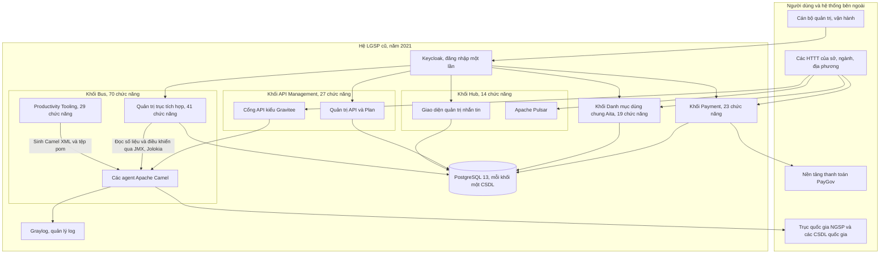

## 2. Hiện trạng và sự cần thiết đầu tư

> **Tóm tắt cho hội đồng thẩm định.** Tỉnh thí điểm đang vận hành một hệ LGSP do Viettel xây dựng năm 2021, gồm năm khối (Bus, Hub, API Management, Danh mục dùng chung Aita, Payment) với 183 chức năng đã được kiểm kê tại D00-03. Hệ thống này được thiết kế trên Java 8, Spring Boot 2, Angular 7, CentOS 6 và PostgreSQL 13, toàn bộ các thành phần nền này đã hết hoặc sắp hết vòng đời hỗ trợ của nhà phát hành tính đến thời điểm lập báo cáo. Cam kết chất lượng trong hồ sơ thiết kế của hệ cũ là độ sẵn sàng 90% mỗi năm và thời gian phản hồi không quá 5 giây với 10 người dùng đồng thời, thấp hơn nhiều so với yêu cầu của một nền tảng dùng chung cấp tỉnh sau sắp xếp đơn vị hành chính. Hệ cũ không có lớp dữ liệu chủ, không có quản lý chất lượng dữ liệu, không có cơ chế bảo vệ dữ liệu cá nhân, không có đối soát thanh toán và không hỗ trợ nhiều tỉnh trên một bản sản phẩm, trong khi các yêu cầu này đã trở thành bắt buộc theo CMP-LAW-01, CMP-LAW-02 và CMP-LAW-03. Báo cáo xác định 14 điểm nghẽn có mã từ ĐN-01 đến ĐN-14 và kết luận rằng việc đầu tư một nền tảng thế hệ mới là cần thiết về cả bốn phương diện pháp lý, nghiệp vụ, kỹ thuật và kinh tế. Số liệu vận hành thực tế của hệ cũ (lượng giao dịch, số HTTT đang kết nối, số sự cố) chưa có trong hồ sơ và cần chủ đầu tư cung cấp; trong khi chờ, báo cáo dùng quy mô tham chiếu cỡ M của bộ giả định nền.

### 2.1. Hiện trạng chung về hạ tầng, ứng dụng và dữ liệu chia sẻ cấp tỉnh

#### 2.1.1. Bối cảnh tổ chức sau sắp xếp đơn vị hành chính

Từ ngày 01/07/2025, chính quyền địa phương được tổ chức theo mô hình hai cấp gồm cấp tỉnh và cấp xã, và số đơn vị hành chính cấp tỉnh của cả nước còn 34. Thay đổi này tác động trực tiếp tới nền tảng tích hợp, chia sẻ dữ liệu cấp tỉnh theo ba hướng. Thứ nhất, quy mô mỗi tỉnh lớn hơn trước vì phần lớn các tỉnh mới được hình thành từ hai hoặc ba tỉnh cũ, kéo theo số HTTT phải kết nối, số cơ quan khai thác dữ liệu và lượng giao dịch đều tăng. Thứ hai, cấp huyện không còn, nên các HTTT trước đây do cấp huyện vận hành phải được chuyển giao lên cấp tỉnh hoặc xuống cấp xã, và mọi danh mục, mọi luồng tích hợp có tham chiếu tới đơn vị hành chính cấp huyện đều phải được chuyển đổi mà vẫn giữ được lịch sử. Thứ ba, một tỉnh mới có thể thừa hưởng cùng lúc nhiều hệ LGSP của các tỉnh cũ, được xây dựng bởi các nhà cung cấp khác nhau, và phải hợp nhất về một nền tảng duy nhất để bảo đảm nguyên tắc mỗi địa phương có một đầu mối tích hợp, chia sẻ dữ liệu.

Về cơ quan quản lý nhà nước, chức năng quản lý chuyển đổi số đã chuyển về Bộ Khoa học và Công nghệ sau khi hợp nhất với Bộ Thông tin và Truyền thông, và ở địa phương là Sở Khoa học và Công nghệ. Các văn bản thiết kế của hệ cũ được lập năm 2021 vẫn ghi theo cơ cấu tổ chức trước đây, do đó khi đối chiếu phải được hiểu theo cơ cấu mới (xem D00-01 §7).

#### 2.1.2. Hiện trạng hạ tầng kỹ thuật

Hạ tầng phục vụ nền tảng tích hợp của tỉnh thí điểm đặt tại trung tâm dữ liệu của tỉnh. Theo hồ sơ cài đặt của hệ cũ, mỗi khối chức năng được yêu cầu một máy chủ riêng, trên đó cài chung cả máy chủ ứng dụng và hệ quản trị cơ sở dữ liệu, với cấu hình tối thiểu là bộ xử lý Intel Xeon E5-2670 v3 tốc độ 2,30 GHz, bộ nhớ trong 32 GB, một ổ SSD 120 GB cùng hai ổ SATA 1 TB và hai cổng mạng 1 Gbps. Đây là mô hình máy chủ đơn lẻ, cài đặt thủ công trực tiếp trên hệ điều hành, không dùng công nghệ container và không có lớp điều phối tài nguyên. Hệ quả là năng lực xử lý của từng khối bị giới hạn bởi một máy chủ, việc tăng năng lực đòi hỏi mua thêm phần cứng và cài đặt lại bằng tay, và một máy chủ hỏng đồng nghĩa với việc cả ứng dụng lẫn cơ sở dữ liệu của khối đó ngừng hoạt động.

Hồ sơ hệ cũ không mô tả phân vùng mạng, tường lửa ứng dụng web, hệ thống sao lưu tập trung hay địa điểm dự phòng thảm họa. Phần "Kiến trúc sao lưu và phục hồi dữ liệu" trong các tài liệu thiết kế tổng thể chỉ liệt kê tên các chủ đề cần giải quyết (dự phòng, phân tải, sao lưu, nâng cấp nóng, giám sát) mà không có nội dung giải pháp. Vì vậy, hiện trạng thực tế của hạ tầng mạng, lưu trữ, sao lưu và năng lực còn trống của trung tâm dữ liệu tỉnh phải được khảo sát bổ sung trong giai đoạn thiết kế chi tiết (câu hỏi mở Q-D0101-21).

#### 2.1.3. Hiện trạng ứng dụng và kết nối

Các HTTT của tỉnh kết nối với nhau và với các hệ thống của bộ, ngành theo ba cách cùng tồn tại. Cách thứ nhất là kết nối qua hệ LGSP hiện có, bao gồm các luồng tích hợp chạy trên khối Bus, các kênh nhắn tin trên khối Hub và các API được bọc qua khối API Management. Cách thứ hai là kết nối lên nền tảng quốc gia thông qua cổng trung gian của trục quốc gia: phụ lục kết nối NGSP của hệ cũ ghi nhận bảy nhóm dịch vụ đã được tích hợp là lý lịch tư pháp, hộ tịch, bảo hiểm xã hội, cấp mã số đơn vị có quan hệ với ngân sách, đăng ký doanh nghiệp, danh mục dùng chung quốc gia và văn bản quy phạm pháp luật, với hơn 30 mã dịch vụ (service-code). Cách thứ ba là kết nối trực tiếp điểm tới điểm giữa hai HTTT mà không qua nền tảng dùng chung; số lượng kết nối loại này không được ghi nhận trong hồ sơ hệ cũ và cần chủ đầu tư thống kê (Q-D0101-22).

Sự tồn tại của kết nối điểm tới điểm là dấu hiệu nền tảng dùng chung chưa đủ thuận tiện hoặc chưa đủ tin cậy để các đơn vị lựa chọn. Mỗi kết nối như vậy có cơ chế xác thực riêng, không được ghi nhật ký tập trung, không có hạn mức và không ai có bức tranh tổng thể về việc dữ liệu nào đang được chia sẻ cho ai. Đây cũng là tình trạng mà CMP-LAW-03 yêu cầu chấm dứt khi quy định việc chia sẻ dữ liệu giữa các cơ quan nhà nước phải thực hiện qua dịch vụ chia sẻ dữ liệu được công bố và quản lý.

#### 2.1.4. Hiện trạng dữ liệu dùng chung

Về dữ liệu dùng chung, tỉnh hiện chỉ có một thành phần là khối Danh mục dùng chung (Aita) của hệ cũ. Khối này cho phép khai báo danh mục, khai báo thuộc tính động cho từng danh mục, nhập và xuất dữ liệu bằng tệp Excel, CSV hoặc qua API. Tuy nhiên, danh mục trong hệ cũ không có phiên bản, không có ngày hiệu lực, không có cơ chế duyệt trước khi phát hành và không được đồng bộ tự động với danh mục dùng chung quốc gia. Khi đơn vị hành chính thay đổi hàng loạt như trong năm 2025, mỗi HTTT phải tự cập nhật bảng mã của mình, dẫn đến tình trạng cùng một xã mang các mã khác nhau ở các hệ thống khác nhau trong một thời gian dài.

Tỉnh chưa có dữ liệu chủ (master data) theo nghĩa của CMP-LAW-03, tức là chưa có một bản ghi thống nhất, được hợp nhất từ nhiều nguồn, cho các thực thể cốt lõi như công dân, tổ chức, cán bộ công chức hay thủ tục hành chính. Tỉnh cũng chưa có công cụ đo chất lượng dữ liệu được chia sẻ, chưa có danh mục dữ liệu để biết tỉnh đang có những tập dữ liệu nào, do cơ quan nào làm chủ quản và được phân loại ở mức nào. Thiếu các năng lực này, tỉnh không thể thực hiện đầy đủ nghĩa vụ kiểm tra, đánh giá chất lượng dữ liệu định kỳ và nghĩa vụ phân loại, công bố dữ liệu theo CMP-LAW-01 và CMP-LAW-02.

### 2.2. Hiện trạng hệ LGSP đang vận hành

#### 2.2.1. Nguồn thông tin và giới hạn của việc khảo sát

Phần mô tả dưới đây được lập từ hồ sơ kỹ thuật của hệ cũ do chủ đầu tư cung cấp, gồm tài liệu thiết kế tổng thể, phân tích yêu cầu, thiết kế chi tiết, thiết kế cơ sở dữ liệu, hướng dẫn sử dụng, hướng dẫn vận hành và hướng dẫn cài đặt của từng khối, cùng phụ lục kết nối NGSP. Các tài liệu được lập trong năm 2021; tài liệu thiết kế tổng thể khối Bus ghi phiên bản 1.0, ngày 01/04/2021. Sản phẩm được nhà cung cấp đặt tên là Nền tảng tích hợp Viettel (Viettel Integration Platform).

Việc khảo sát có ba giới hạn cần hội đồng lưu ý. Một là, hồ sơ là hồ sơ thiết kế và hướng dẫn, không phải số liệu đo đạc; báo cáo chưa có nhật ký vận hành, số liệu giao dịch hay biên bản sự cố. Hai là, sáu tài liệu hướng dẫn cài đặt (Bus, Tooling, Hub, API, Aita, Payment) có nội dung giống nhau gần như hoàn toàn, chỉ khác tên khối và tên tệp triển khai, và còn sót các chi tiết của một sản phẩm khác; các tài liệu này không có hướng dẫn cài đặt Apache Pulsar, cổng API hay Keycloak. Ba là, các tài liệu hướng dẫn vận hành dẫn chiếu tới các phụ lục PL1, PL2, PL5 và tới "tài liệu chuẩn" nội bộ của đơn vị vận hành thuộc nhà cung cấp, nhưng các phụ lục này không có trong hồ sơ. Vì ba lý do đó, mọi nhận định về phiên bản và mô hình triển khai trong mục này phản ánh hồ sơ thiết kế, và phải được kiểm kê lại trên hệ thống thực trước khi lập kế hoạch di trú chi tiết (Q-D0101-23).

#### 2.2.2. Kiến trúc tổng thể của hệ cũ

Sơ đồ dưới đây thể hiện các khối của hệ cũ, quan hệ giữa chúng và với các hệ thống bên ngoài, theo đúng mô tả trong hồ sơ thiết kế.

Sơ đồ cho thấy hệ cũ là một tập hợp năm ứng dụng tương đối độc lập, dùng chung dịch vụ đăng nhập một lần Keycloak và cùng loại hệ quản trị cơ sở dữ liệu, nhưng mỗi khối có cơ sở dữ liệu, giao diện và quy trình triển khai riêng. Các khối không chia sẻ một mô hình dữ liệu chung về "HTTT thành viên": khối API Management gọi bên khai thác là ứng dụng (application), khối Hub gọi là publisher và subscriber, khối Payment gọi là đối tác (partner). Một HTTT muốn dùng cả ba năng lực phải được khai báo ba lần ở ba nơi. Dữ liệu vận hành cũng phân tán: số liệu của các luồng tích hợp được đọc trực tiếp từ từng agent qua giao thức JMX, nhật ký nằm ở Graylog, số liệu thanh toán nằm trong cơ sở dữ liệu của khối Payment, và không có một màn hình tổng hợp cho toàn hệ thống.

#### 2.2.3. Năm khối chức năng

**Khối Bus (trục tích hợp)** là thành phần thực hiện tích hợp ứng dụng với ứng dụng. Lõi xử lý là Apache Camel, tổ chức theo đơn vị gọi là agent: mỗi agent là một tiến trình Camel chạy trên một máy chủ xác định bằng địa chỉ và cổng, bên trong chứa nhiều tuyến xử lý (route). Khối Bus có hai giao diện. Giao diện quản trị (nhà cung cấp gọi là vEnterprise Integration Administration) hiển thị danh sách agent, biểu đồ route, số lần chạy, thời gian xử lý từng điểm cuối, dung lượng bộ nhớ, và cho phép dừng, khởi động, tạm ngưng agent hoặc route. Toàn bộ số liệu và thao tác điều khiển này đi qua giao diện Jolokia của từng agent, tức là giao diện quản trị gọi thẳng tới một địa chỉ HTTP trên máy chủ chạy agent. Giao diện thứ hai là công cụ thiết kế luồng (Productivity Tooling), một studio kéo thả trên nền web, sinh ra mã Camel dạng XML, tự cập nhật tệp khai báo thư viện (pom) theo luồng và cho phép nhập thành phần từ tệp JAR. Theo kiểm kê tại D00-03, phần quản trị có 41 chức năng và công cụ thiết kế có 29 chức năng.

**Khối Hub (trung tâm tích hợp)** cung cấp cơ chế trao đổi bản tin theo mô hình phát hành và đăng ký nhận trên nền Apache Pulsar. Giao diện quản trị cho phép khai báo dự án tích hợp, topic, bên phát (publisher), bên nhận (subscriber), quan hệ phát hành và quan hệ đăng ký nhận kèm địa chỉ nhận, số tiến trình xử lý và số lần thử lại. Bảng điều khiển hiển thị số lượng các đối tượng này cùng mức dùng bộ nhớ và bộ xử lý của máy chủ. Hồ sơ yêu cầu người vận hành khối này phải là kỹ sư có hiểu biết về Apache Pulsar. Khối Hub có 14 chức năng được kiểm kê.

**Khối API Management** quản lý tập trung các API theo mô hình ba thành phần là cổng API (gateway), dịch vụ quản trị và giao diện quản trị. Hồ sơ ghi rõ khối này dùng mã nguồn mở của Gravitee. Chức năng chính gồm bọc một API có sẵn, nhập đặc tả từ Swagger, khai báo gói sử dụng (Plan) với kiểu xác thực, hạn mức tốc độ và hạn ngạch, quản lý vòng đời của Plan, quản lý ứng dụng khai thác và việc đăng ký sử dụng. Khối này có 27 chức năng được kiểm kê.

**Khối Danh mục dùng chung (Aita)** lưu trữ và cung cấp các bảng mã dùng chung. Dữ liệu được tổ chức theo mô hình thực thể, thuộc tính, giá trị: mỗi danh mục có một tập thuộc tính do người dùng tự khai báo, mỗi bản ghi lưu giá trị theo từng thuộc tính với độ dài tối đa 2.000 ký tự. Chức năng gồm hiển thị dạng cây, thêm, sửa, xóa, nhập và xuất bằng Excel, CSV, API, và một API truy vấn tùy chọn. Khối này có 19 chức năng được kiểm kê.

**Khối Payment (thanh toán)** là lớp trung gian giữa các HTTT của tỉnh và kênh thanh toán, trong đó nhà cung cấp mặc định và duy nhất được cấu hình sẵn là PayGov. Chức năng gồm quản lý nhà cung cấp dịch vụ thanh toán (thêm, kiểm tra kết nối, kích hoạt, dừng), quản lý đối tác, nhóm dịch vụ và dịch vụ, tiếp nhận kết quả thanh toán, lưu giao dịch, tra cứu nhật ký giao dịch và một bảng điều khiển thống kê. Hồ sơ không mô tả nghiệp vụ đối soát, hoàn tiền, xử lý giao dịch treo hay cơ chế xác thực bản tin trả kết quả từ kênh thanh toán. Khối này có 23 chức năng được kiểm kê.

Bảng dưới đây tổng hợp số chức năng theo khối và theo kết luận xử lý, trích từ D00-03 §5. Bảng dùng để định lượng khối lượng phải kế thừa và để chứng minh rằng phương án đầu tư không làm mất chức năng đang dùng.

| Nhóm kiểm kê | Thuộc khối | Tổng | Giữ nguyên | Nâng cấp | Thay thế | Loại bỏ | Khác |
|---|---|---|---|---|---|---|---|
| BUS | Bus | 41 | 11 | 15 | 15 | 0 | 0 |
| TOOL | Bus (công cụ thiết kế) | 29 | 17 | 9 | 1 | 2 | 0 |
| HUB | Hub | 14 | 7 | 5 | 2 | 0 | 0 |
| APIM | API Management | 27 | 14 | 10 | 3 | 0 | 0 |
| DMDC | Danh mục dùng chung | 19 | 7 | 12 | 0 | 0 | 0 |
| PAY | Payment | 23 | 16 | 7 | 0 | 0 | 0 |
| NGSP | Kết nối quốc gia (xuyên khối) | 8 | 7 | 1 | 0 | 0 | 0 |
| IAM | Định danh (xuyên khối) | 8 | 3 | 2 | 2 | 1 | 0 |
| NFR | Phi chức năng, vận hành | 14 | 3 | 8 | 2 | 0 | 1 |
| **Tổng** | | **183** | **85** | **69** | **25** | **3** | **1** |

Năm khối nghiệp vụ chiếm 153 trên 183 mục; 30 mục còn lại là các năng lực xuyên khối. Trong 183 mục, có 85 mục được giữ nguyên hành vi, 69 mục được nâng cấp, 25 mục được thay bằng cơ chế khác do thay đổi công nghệ, và chỉ 3 mục được đề xuất loại bỏ vì lý do an toàn thông tin (người dùng tự sửa tệp pom, nhập thành phần từ tệp JAR, đăng nhập bằng tài khoản mạng xã hội). Tỷ lệ 94 mục phải nâng cấp hoặc thay thế trên 183 mục, tương đương 51%, cho thấy hơn một nửa chức năng của hệ cũ không còn đáp ứng nếu giữ nguyên trạng.

#### 2.2.4. Công nghệ và phiên bản

Bảng sau liệt kê các công nghệ nền của hệ cũ theo đúng những gì hồ sơ ghi nhận, kèm tình trạng vòng đời tại thời điểm lập báo cáo (tháng 11/2026). Các mốc kết thúc hỗ trợ được ghi theo công bố của nhà phát hành mà đơn vị tư vấn nắm được; do chưa đối chiếu lại trực tuyến ở thời điểm biên soạn, cột này mang nhãn "chưa xác minh trực tuyến" và phải được kiểm tra trước khi phát hành bản 1.0.

| Thành phần | Phiên bản ghi trong hồ sơ | Nguồn trong hồ sơ | Tình trạng vòng đời (chưa xác minh trực tuyến) |
|---|---|---|---|
| Java | Java 8, bản 8u291 | Phân tích yêu cầu; hướng dẫn cài đặt | Phát hành tháng 4/2021. Oracle đã kết thúc hỗ trợ chính cho Java 8 từ năm 2022; các khung phần mềm hiện hành (Spring Boot 3 trở lên) yêu cầu tối thiểu Java 17 |
| Spring Boot | Spring Boot 2, Spring Boot Reactive | Thiết kế tổng thể | Dòng 2.x đã kết thúc hỗ trợ cộng đồng từ cuối năm 2023 |
| Spring Cloud | Zuul Proxy | Thiết kế tổng thể | Zuul đã ở chế độ bảo trì từ cuối năm 2018 và bị loại khỏi Spring Cloud từ bản 2020.0 |
| Giao diện | Angular 7 | Thiết kế tổng thể; phân tích yêu cầu | Phát hành tháng 10/2018, kết thúc hỗ trợ dài hạn từ tháng 4/2020, tức là trước cả thời điểm hệ cũ được triển khai |
| Hệ điều hành | Linux CentOS 6.x (6.9 trở lên) | Hướng dẫn cài đặt | Kết thúc vòng đời ngày 30/11/2020, trước thời điểm triển khai |
| Máy chủ ứng dụng | Apache Tomcat 8.5.31 (hướng dẫn cài đặt); 9.0.46 (hướng dẫn vận hành) | Hướng dẫn cài đặt; hướng dẫn vận hành | Dòng 8.5 kết thúc vòng đời ngày 31/03/2024. Bản 9.0.46 phát hành tháng 5/2021 và đã có nhiều bản vá bảo mật sau đó |
| Cơ sở dữ liệu | PostgreSQL 13 | Hướng dẫn cài đặt | Kết thúc vòng đời tháng 11/2025 |
| Lõi tích hợp | Apache Camel, không ghi phiên bản | Thiết kế chi tiết Bus | Với Java 8, phiên bản cao nhất dùng được là dòng Camel 3.14, đã kết thúc hỗ trợ từ cuối năm 2023 |
| Nhắn tin | Apache Pulsar, không ghi phiên bản | Thiết kế chi tiết Hub | Các dòng phát hành năm 2021 (2.7, 2.8) đã kết thúc hỗ trợ |
| Quản lý API | Mã nguồn mở Gravitee, không ghi phiên bản | Thiết kế tổng thể | Dòng 3.x của năm 2021 đã kết thúc hỗ trợ |
| Định danh | Keycloak, không ghi phiên bản; đường dẫn lấy token có tiền tố `/auth/realms` | Hướng dẫn lấy token | Tiền tố `/auth` là đặc trưng của bản Keycloak chạy trên WildFly (bản 16 trở về trước), đã kết thúc hỗ trợ từ năm 2022 |
| Quản lý log, số liệu | Graylog, Metricbeat, Tracer, Jolokia | Thiết kế tổng thể; thiết kế chi tiết | Không ghi phiên bản; mô hình thu số liệu qua JMX không còn là hướng phát triển của Camel |
| Đăng nhập màn quản trị Bus | SAML của midPoint | Thiết kế tổng thể | Tồn tại song song với Keycloak, tạo hai cơ chế đăng nhập |

Điểm đáng chú ý nhất của bảng là ba thành phần (Angular 7, CentOS 6, Zuul) đã hết vòng đời ngay tại thời điểm hệ cũ được đưa vào sử dụng năm 2021, và tới năm 2026 thì không còn thành phần nền nào trong danh sách còn được nhà phát hành hỗ trợ ở phiên bản ghi trong hồ sơ. Ngoài ra, hồ sơ có hai điểm không nhất quán: hướng dẫn cài đặt ghi Tomcat 8.5.31 trong khi hướng dẫn vận hành ghi Tomcat 9.0.46, và phân tích yêu cầu ghi máy chủ tối thiểu 8 GB bộ nhớ với cổng mạng 10 Gbps trong khi hướng dẫn cài đặt ghi 32 GB với cổng mạng 1 Gbps. Sự thiếu nhất quán này tự nó là một rủi ro vận hành, vì đội tiếp nhận không thể dựa vào hồ sơ để dựng lại hệ thống.

#### 2.2.5. Mô hình triển khai và vận hành

Theo hướng dẫn cài đặt và hướng dẫn vận hành, mỗi khối được đóng gói thành tệp WAR và triển khai trên một máy chủ Tomcat. Phần giao diện và phần xử lý của một khối chạy chung trên một tiến trình Tomcat ở cổng 8080, vì vậy dừng thành phần này sẽ làm dừng luôn thành phần kia. Cơ sở dữ liệu PostgreSQL được cài trên cùng máy chủ hoặc trên một máy chủ cơ sở dữ liệu; biểu mẫu hồ sơ có chỗ ghi cặp máy chủ chính và máy chủ chờ nhưng để trống. Với sáu bộ hướng dẫn cài đặt, hồ sơ hàm ý tối thiểu sáu máy chủ ứng dụng, chưa kể các máy chủ cho Apache Pulsar, cổng API, Keycloak và Graylog vốn không có hướng dẫn cài đặt. Số máy chủ thực tế cần chủ đầu tư xác nhận (Q-D0101-23).

Quy trình vận hành được mô tả hoàn toàn bằng thao tác tay. Người vận hành đăng nhập máy chủ qua SSH, chạy lệnh khởi động hoặc dừng Tomcat, và trong trường hợp không dừng được thì tìm mã tiến trình rồi buộc dừng. Mọi thay đổi cấu hình, kể cả đổi thông tin kết nối cơ sở dữ liệu hay đổi cổng, đều yêu cầu dừng và khởi động lại ứng dụng. Việc nâng cấp được thực hiện bằng cách đổi tên tệp WAR cũ có kèm ngày tháng để làm bản sao lưu, chép tệp mới vào thư mục, dừng Tomcat, triển khai lại rồi khởi động. Quy trình này không có bước kiểm thử tự động, không có cơ chế quay lui ngoài việc chép lại tệp cũ, và luôn gây gián đoạn dịch vụ trong thời gian thực hiện.

Về giám sát, các mục "hướng dẫn giám sát hệ thống", "bảng mã lỗi hệ thống", "các sự cố và cách khắc phục", "hướng dẫn tối ưu" và "hướng dẫn bảo dưỡng" trong tài liệu hướng dẫn vận hành chỉ có khung biểu mẫu, không có nội dung. Phần duy nhất được điền là danh sách kiểm tra định kỳ hằng ngày với các ngưỡng tài nguyên máy chủ (tải bộ xử lý dưới 75%, bộ nhớ dưới 90%, ổ cứng dưới 90%). Nói cách khác, hồ sơ không trang bị cho đội vận hành của tỉnh kiến thức để chẩn đoán và xử lý sự cố ở tầng ứng dụng.

Về cam kết chất lượng, tài liệu phân tích yêu cầu của các khối ghi cùng một bộ chỉ tiêu: độ sẵn sàng 90% mỗi năm; thời gian xử lý không quá 5 giây với 10 người dùng đồng thời và 1.000 bản ghi trong cơ sở dữ liệu, tỷ lệ giao dịch thành công từ 95%; tổng số người dùng hoạt động là 1 và tối đa 100 người dùng đồng thời; tệp nhật ký được sao lưu mỗi tháng một lần; hỗ trợ bảo trì trong 2 tháng sau triển khai. Mức sẵn sàng 90% mỗi năm cho phép hệ thống ngừng hoạt động tới 36,5 ngày trong một năm. Các chỉ tiêu này phù hợp với một sản phẩm thử nghiệm quy mô nhỏ, không phù hợp với một nền tảng mà mọi dịch vụ công trực tuyến của tỉnh phụ thuộc vào.

### 2.3. Đánh giá hệ cũ theo bảy tiêu chí

#### 2.3.1. Vòng đời công nghệ

Như đã phân tích ở mục 2.2.4, toàn bộ nền công nghệ của hệ cũ đã ở ngoài vòng đời hỗ trợ. Hệ quả thực tế có ba lớp. Lớp thứ nhất là an toàn: các lỗ hổng mới được công bố ở Java 8, Spring Boot 2, Tomcat, Angular 7 hay CentOS 6 sẽ không có bản vá chính thức, và tỉnh không thể chứng minh với cơ quan thẩm định an toàn thông tin rằng hệ thống đang được cập nhật bản vá định kỳ theo yêu cầu của CMP-LAW-06 và CMP-LAW-08. Lớp thứ hai là khả năng nâng cấp: do các thành phần phụ thuộc lẫn nhau theo chuỗi, không thể nâng riêng một thành phần. Muốn lên Spring Boot hiện hành phải lên Java 17 trở lên, kéo theo phải thay Zuul, thay phiên bản Camel (với thay đổi lớn về cấu trúc gói và cách khai báo), thay Angular qua nhiều phiên bản chính và thay cả mô hình thu số liệu qua JMX. Khối lượng này tương đương viết lại phần lớn mã nguồn. Lớp thứ ba là nhân lực: các kỹ sư thành thạo những phiên bản đã lỗi thời ngày càng khó tìm, và nhà cung cấp cũng không có động lực duy trì đội ngũ cho một nền tảng họ không còn phát triển.

#### 2.3.2. Khả năng mở rộng

Hệ cũ mở rộng theo chiều dọc, tức là bằng cách tăng cấu hình máy chủ. Mỗi agent của khối Bus gắn cứng với một địa chỉ máy chủ và một cổng được lưu trong cơ sở dữ liệu quản trị; muốn chạy thêm bản sao của một agent phải cài tay trên máy chủ khác và khai báo thêm. Phần giao diện và phần xử lý chạy chung một tiến trình nên không thể tăng riêng năng lực xử lý. Không có cơ chế tự động tăng giảm số bản sao theo tải. Chỉ tiêu thiết kế 10 người dùng đồng thời và 1.000 bản ghi cho thấy hệ cũ chưa từng được kiểm thử ở tải lớn.

Trong khi đó, quy mô tham chiếu cỡ M của một tỉnh sau sắp xếp theo bộ giả định nền là tới 200 HTTT kết nối, 1.000 API công bố, 10 triệu giao dịch đồng bộ mỗi ngày, đỉnh 1.000 giao dịch mỗi giây tại cổng API và 5 triệu bản ghi danh mục dùng chung. Khoảng cách giữa chỉ tiêu thiết kế của hệ cũ và quy mô này là nhiều bậc độ lớn, và không thể thu hẹp bằng việc bổ sung máy chủ vì kiến trúc không cho phép chia tải theo chiều ngang một cách có kiểm soát. Lượng giao dịch thực tế mà hệ cũ đang phục vụ cần chủ đầu tư cung cấp để xác nhận nhận định này (Q-D0101-24).

#### 2.3.3. An toàn thông tin

Việc rà soát hồ sơ phát hiện một số điểm yếu có tính hệ thống, không phải lỗi đơn lẻ.

Điểm thứ nhất là quản lý bí mật. Các tài liệu hướng dẫn cài đặt của cả sáu khối ghi mật khẩu tài khoản cơ sở dữ liệu ở dạng văn bản rõ và dùng chung một mật khẩu cho mọi khối. Phụ lục kết nối NGSP ghi khóa và mã bí mật của ứng dụng (Consumer Key, Consumer Secret) ở dạng văn bản rõ. Hệ cũ dựa vào một thư viện riêng của nhà cung cấp để mã hóa thông tin kết nối trong tệp cấu hình, không có kho bí mật tập trung, không có cơ chế xoay vòng khóa. Bất kỳ ai tiếp cận được bộ hồ sơ đều có thể đã nắm được các thông tin xác thực này, vì vậy toàn bộ khóa và mật khẩu phải được cấp lại khi cắt chuyển.

Điểm thứ hai là bảo vệ kênh truyền. Phụ lục kết nối NGSP ghi địa chỉ lấy token và địa chỉ bộ chuyển tiếp dùng giao thức HTTP không mã hóa trên địa chỉ IP công cộng, và các lệnh mẫu tắt việc kiểm tra chứng thư máy chủ. Hướng dẫn lấy token Keycloak cũng dùng địa chỉ HTTP. Giao diện quản trị khối Bus gọi tới giao diện Jolokia của các agent qua HTTP, trong đó có các lệnh tạm ngưng và khởi động luồng; nếu giao diện này không được bảo vệ ở tầng mạng thì bất kỳ máy nào trong cùng vùng mạng đều có thể dừng luồng tích hợp.

Điểm thứ ba là cơ chế xác thực và phân quyền. Hướng dẫn tích hợp dùng kiểu cấp quyền bằng tên đăng nhập và mật khẩu (grant `password`), tức là ứng dụng phía HTTT giữ mật khẩu của người dùng; kiểu cấp quyền này đã bị loại khỏi khuyến nghị thực hành hiện hành của OAuth. Màn quản trị khối Bus dùng một cơ chế đăng nhập khác (SAML của midPoint) so với các khối còn lại. Hệ cũ không có lớp chính sách phân quyền theo thuộc tính dữ liệu, nên không thể thể hiện quy tắc dạng "cơ quan A chỉ được khai thác trường X của tập dữ liệu Y cho mục đích Z".

Điểm thứ tư là kiểm soát phần mềm đưa vào hệ thống. Công cụ thiết kế luồng cho phép người dùng tự sửa tệp khai báo thư viện và nạp thành phần từ tệp JAR tải lên. Đây là đường đưa mã tùy ý vào môi trường chạy mà không qua kiểm duyệt, trái với yêu cầu kiểm soát phần mềm của hệ thống cấp độ 3.

Điểm thứ năm là hồ sơ cấp độ. Bộ hồ sơ hệ cũ không có hồ sơ đề xuất cấp độ an toàn hệ thống thông tin, không có ma trận ánh xạ biện pháp theo CMP-LAW-08. Tình trạng phê duyệt cấp độ của hệ cũ cần chủ đầu tư xác nhận (Q-D0101-25).

#### 2.3.4. Khả năng quan sát

Khả năng quan sát (observability) là khả năng trả lời câu hỏi "chuyện gì đang xảy ra với một giao dịch cụ thể" mà không phải đăng nhập vào từng máy chủ. Hệ cũ có ba nguồn dữ liệu vận hành rời nhau: số liệu của agent đọc qua Jolokia theo từng lần mở màn hình và không được lưu thành chuỗi thời gian; tệp nhật ký dạng văn bản mỗi giao dịch một dòng, các trường cách nhau bằng dấu gạch đứng, được gom về Graylog; và số liệu tài nguyên máy chủ từ Metricbeat. Hồ sơ yêu cầu các khối ghi một mã giao dịch để liên kết nhật ký giữa các khối, nhưng không có cơ chế truy vết phân tán theo chuẩn, không có sơ đồ đường đi của một giao dịch qua cổng API, luồng tích hợp và hệ thống đích.

Hệ cũ cũng không có cảnh báo chủ động. Danh sách kiểm tra định kỳ là việc người vận hành tự xem các ngưỡng tài nguyên mỗi ngày một lần. Không có khái niệm mục tiêu mức dịch vụ, không có cảnh báo khi tỷ lệ lỗi của một API tăng, không có hàng đợi bản tin lỗi để xử lý lại. Khi một HTTT báo "không gọi được dịch vụ", người vận hành phải lần lượt kiểm tra cổng API, agent, Pulsar và hệ thống đích bằng tay. Thời gian chẩn đoán vì vậy phụ thuộc hoàn toàn vào kinh nghiệm cá nhân, và hệ thống không thể cung cấp số liệu thống kê khai thác dữ liệu theo từng cơ quan để phục vụ báo cáo quản lý.

#### 2.3.5. Khả năng đáp ứng yêu cầu mới

Từ khi hệ cũ được thiết kế năm 2021, khung pháp lý và tổ chức đã thay đổi căn bản. Bảng dưới đây đối chiếu từng nhóm yêu cầu mới với năng lực của hệ cũ. Bảng dùng để chỉ ra rằng khoảng trống không nằm ở một vài chức năng thiếu mà ở cả các lớp năng lực chưa từng có.

| Yêu cầu mới | Căn cứ | Năng lực của hệ cũ | Khoảng trống |
|---|---|---|---|
| Quản trị, phân loại, chia sẻ dữ liệu theo Luật Dữ liệu | CMP-LAW-01, CMP-LAW-02 | Không có danh mục dữ liệu, không có phân loại, không có mã hóa theo mức dữ liệu | Thiếu toàn bộ lớp quản trị dữ liệu |
| Dữ liệu chủ, danh mục dùng chung, đánh giá chất lượng dữ liệu định kỳ | CMP-LAW-03 | Chỉ có danh mục dùng chung dạng bảng mã, không phiên bản, không đồng bộ quốc gia | Thiếu dữ liệu chủ, chất lượng dữ liệu; danh mục phải làm lại mô hình |
| Bảo vệ dữ liệu cá nhân | CMP-LAW-04, CMP-LAW-05 | Không có che, ẩn danh hóa, ghi nhận mục đích xử lý, nhật ký truy cập dữ liệu cá nhân | Thiếu toàn bộ |
| Kết nối NDXP và NDOP theo mô hình mới của Trung tâm dữ liệu quốc gia | CMP-LAW-10, CMP-LAW-11, CMP-LAW-12 | Kết nối NGSP qua cổng trung gian, mỗi dịch vụ một mã service-code, khóa ghi cứng | Phải xây lại lớp kết nối quốc gia, bổ sung kết nối NDOP |
| Chính quyền hai cấp, 34 tỉnh | Bối cảnh tại D00-01 §7 | Danh mục không có lịch sử, không có ngày hiệu lực; không có khái niệm hợp nhất nhiều tỉnh | Không xử lý được sáp nhập đơn vị hành chính có lịch sử |
| Một sản phẩm phục vụ nhiều tỉnh (multi-tenant) | Định hướng nền tảng dùng chung, Q2 của dàn ý | Mỗi triển khai là một bản cài riêng; không có cách ly dữ liệu theo tỉnh | Thiếu toàn bộ; không thể bổ sung mà không sửa mọi bảng dữ liệu |
| Thanh toán đầy đủ: đối soát, hoàn tiền, nhiều kênh | Yêu cầu nghiệp vụ, Q3 của dàn ý | Chỉ PayGov; không đối soát, không hoàn tiền; số tiền lưu bằng kiểu số nguyên 10 chữ số | Phải viết mới nghiệp vụ; phải đổi kiểu dữ liệu số tiền |
| Chức năng, tính năng kỹ thuật của LGSP | CMP-LAW-09 | Có trục tích hợp, quản lý API, nhắn tin; thiếu giám sát tập trung, cổng nhà phát triển, quản lý quy trình | Đáp ứng một phần |
| An toàn hệ thống thông tin cấp độ 3 | CMP-LAW-06, CMP-LAW-07, CMP-LAW-08 | Xem mục 2.3.3 | Không đủ điều kiện kỹ thuật để lập hồ sơ cấp độ 3 |

Riêng về thanh toán, cơ sở dữ liệu của khối Payment lưu số tiền bằng kiểu số nguyên giới hạn ở khoảng 2,1 tỷ đồng (xem D00-01 §5, kiểu `T-MONEY`). Một giao dịch nộp thuế, phí hoặc tiền sử dụng đất vượt ngưỡng này sẽ không lưu được đúng giá trị. Kết hợp với việc không có đối soát, tỉnh hiện không có công cụ để phát hiện chênh lệch giữa số tiền người dân đã nộp và số tiền hệ thống nghiệp vụ ghi nhận.

Về multi-tenant, khoảng trống mang tính kiến trúc. Không bảng dữ liệu nào của hệ cũ có trường xác định tỉnh sở hữu, không khối nào có khái niệm cấu hình theo tỉnh, và mỗi lần triển khai cho một tỉnh là một lần cài đặt thủ công theo quy trình ở mục 2.2.5. Một tỉnh mới hình thành từ ba tỉnh cũ, nếu cả ba đều đang dùng hệ cũ, sẽ có ba bản cài không thể gộp lại bằng cấu hình.

#### 2.3.6. Phụ thuộc nhà cung cấp

Mức độ phụ thuộc nhà cung cấp của hệ cũ được đánh giá qua bốn dấu hiệu rút từ hồ sơ. Dấu hiệu thứ nhất là thành phần độc quyền: hệ cũ dùng thư viện mã hóa riêng của nhà cung cấp cho thông tin kết nối và tuân theo các tiêu chuẩn nội bộ của nhà cung cấp về thời gian phản hồi và cấu hình máy chủ ứng dụng, là những tài liệu tỉnh không có. Dấu hiệu thứ hai là tri thức vận hành: tài liệu hướng dẫn vận hành nhiều lần ghi rằng đơn vị vận hành của nhà cung cấp "đã có tài liệu chuẩn" cho hệ điều hành, cơ sở dữ liệu và thiết bị mạng thay vì trình bày nội dung, và để trống các phần xử lý sự cố. Dấu hiệu thứ ba là hồ sơ cài đặt không đủ để dựng lại hệ thống, như đã nêu ở mục 2.2.1. Dấu hiệu thứ tư là cam kết hỗ trợ chỉ 2 tháng sau triển khai theo tài liệu phân tích yêu cầu.

Hồ sơ không cho biết tỉnh có được bàn giao mã nguồn đầy đủ kèm quyền sửa đổi hay không, cũng không cho biết điều khoản và chi phí của hợp đồng hỗ trợ hiện tại (Q-D0101-26). Dù câu trả lời thế nào, bốn dấu hiệu trên cho thấy trong thực tế tỉnh không thể tự vận hành, tự sửa lỗi và tự nâng cấp hệ cũ mà không có nhà cung cấp ban đầu. Điều này làm yếu vị thế của tỉnh trong mọi lần đàm phán gia hạn và khiến nguyên tắc cạnh tranh trong lựa chọn nhà thầu khó thực hiện ở các lần nâng cấp sau.

#### 2.3.7. Chi phí vận hành

Hồ sơ không có số liệu chi phí vận hành hằng năm của hệ cũ; số liệu này cần chủ đầu tư cung cấp để đưa vào so sánh phương án ở Chương 8 (Q-D0101-27). Tuy vậy, cấu trúc chi phí có thể suy ra từ mô hình triển khai và vận hành, và có bốn yếu tố khiến chi phí trên một đơn vị giá trị ở mức cao.

Yếu tố thứ nhất là sử dụng tài nguyên kém hiệu quả: mỗi khối chiếm trọn một máy chủ 32 GB bộ nhớ bất kể tải thực tế, không chia sẻ tài nguyên giữa các khối và không co giãn theo giờ cao điểm hay thấp điểm. Yếu tố thứ hai là chi phí nhân công vận hành thủ công: mọi thao tác triển khai, đổi cấu hình, kiểm tra định kỳ đều do người thực hiện qua dòng lệnh trên từng máy chủ. Yếu tố thứ ba là chi phí gián đoạn: mỗi lần đổi cấu hình hay nâng cấp đều phải dừng dịch vụ, và mức sẵn sàng cam kết 90% mỗi năm cho phép thời gian ngừng dài. Yếu tố thứ tư là chi phí cơ hội do kết nạp chậm: một HTTT mới phải được khai báo riêng ở từng khối, luồng tích hợp phải được dựng và triển khai bằng tay, nên thời gian từ lúc có yêu cầu tới lúc dùng được dịch vụ kéo dài; thời gian trung bình thực tế cần chủ đầu tư cung cấp (Q-D0101-28).

Ngoài chi phí trực tiếp, việc duy trì một hệ thống hết vòng đời còn làm phát sinh chi phí rủi ro không nhìn thấy trong dự toán, gồm chi phí khắc phục khi xảy ra sự cố an toàn thông tin và chi phí chuyển đổi ngày càng tăng do dữ liệu và luồng tích hợp tiếp tục tích lũy trên nền cũ.

### 2.4. Bảng tổng hợp điểm nghẽn

Từ các đánh giá trên, báo cáo tổng hợp 14 điểm nghẽn. Mỗi điểm nghẽn mang một mã `ĐN-nn` dùng trong phạm vi D01-01 để Chương 3 đối chiếu với mục tiêu và các chương giải pháp đối chiếu với phân hệ. Cột "Mức độ" phản ánh mức ảnh hưởng tới khả năng tiếp tục vận hành hợp pháp và an toàn: mức Cao nghĩa là không thể tiếp tục chấp nhận, mức Trung bình nghĩa là làm giảm hiệu quả đáng kể.

| Mã | Điểm nghẽn | Bằng chứng từ hồ sơ hệ cũ | Tiêu chí | Mức độ | Phân hệ Datahub giải quyết |
|---|---|---|---|---|---|
| ĐN-01 | Toàn bộ nền công nghệ hết vòng đời hỗ trợ | Java 8, Spring Boot 2, Zuul, Angular 7, CentOS 6, Tomcat 8.5, PostgreSQL 13 (mục 2.2.4; LGC-NFR-014) | Vòng đời | Cao | Toàn bộ, theo stack tại D01-00 §2 |
| ĐN-02 | Kiến trúc máy chủ đơn lẻ, không co giãn, một điểm hỏng | Một máy chủ cho mỗi khối; agent gắn cứng địa chỉ và cổng; giao diện và xử lý chung tiến trình | Mở rộng | Cao | PH-03, PH-04, PH-05, PH-10, PH-20 |
| ĐN-03 | Cam kết chất lượng dịch vụ thấp, không có dự phòng thảm họa | Sẵn sàng 90% mỗi năm; 5 giây với 10 người dùng; phần sao lưu, phục hồi không có nội dung (LGC-NFR-001, 002, 005) | Mở rộng, vận hành | Cao | PH-13, PH-20; D03-09 |
| ĐN-04 | Bí mật ở dạng rõ, không có kho bí mật, kênh truyền không mã hóa | Mật khẩu CSDL và khóa NGSP trong tài liệu; địa chỉ HTTP; thư viện mã hóa riêng (LGC-NFR-007, LGC-NGSP-008) | ATTT | Cao | PH-12, PH-05, PH-14 |
| ĐN-05 | Xác thực, phân quyền lỗi thời và không thống nhất | Grant `password`; hai cơ chế đăng nhập; không có chính sách theo thuộc tính (LGC-IAM-006, 008) | ATTT | Cao | PH-12 |
| ĐN-06 | Cho phép nạp mã tùy ý vào môi trường chạy | Người dùng sửa tệp pom, nhập JAR (LGC-TOOL-022, 027); điều khiển agent qua Jolokia HTTP | ATTT | Cao | PH-04, PH-05 |
| ĐN-07 | Không quan sát được giao dịch đầu cuối, không cảnh báo chủ động | Số liệu qua JMX theo từng agent; nhật ký văn bản; phần giám sát, sự cố trong hướng dẫn vận hành để trống (LGC-NFR-004) | Quan sát | Cao | PH-13, PH-18 |
| ĐN-08 | Vận hành và triển khai thủ công, mỗi thay đổi đều gây gián đoạn | Chép tệp WAR, khởi động lại Tomcat, buộc dừng tiến trình | Vận hành, chi phí | Trung bình | PH-20 (GitOps), PH-04 |
| ĐN-09 | Thiếu lớp dữ liệu dùng chung: dữ liệu chủ, chất lượng dữ liệu, bảo vệ dữ liệu cá nhân | Không có khối tương ứng trong hệ cũ | Yêu cầu mới | Cao | PH-06, PH-08, PH-09 |
| ĐN-10 | Danh mục dùng chung không phiên bản, không lịch sử, không đồng bộ quốc gia | Mô hình thực thể, thuộc tính, giá trị; không có ngày hiệu lực (khối DMDC) | Yêu cầu mới | Cao | PH-07 |
| ĐN-11 | Kết nối quốc gia theo mô hình cũ, ghi cứng, chưa có NDOP | Phụ lục kết nối NGSP; mã service-code; khóa ghi trong tài liệu | Yêu cầu mới | Cao | PH-14 |
| ĐN-12 | Thanh toán thiếu đối soát, hoàn tiền; giới hạn số tiền | Chỉ PayGov; kiểu số nguyên 10 chữ số; không mô tả bảo mật bản tin trả kết quả | Yêu cầu mới | Cao | PH-19 |
| ĐN-13 | Không hỗ trợ nhiều tỉnh; ba mô hình định danh HTTT rời nhau | Không có trường tỉnh trong dữ liệu; application, publisher, partner khai báo riêng | Yêu cầu mới, mở rộng | Cao | PH-01, PH-20 |
| ĐN-14 | Phụ thuộc nhà cung cấp, hồ sơ không đủ để tự vận hành | Thư viện và tiêu chuẩn nội bộ; hướng dẫn vận hành dẫn chiếu tài liệu không được bàn giao; hỗ trợ 2 tháng (LGC-NFR-011) | Phụ thuộc, chi phí | Trung bình | Toàn bộ; D06-02, D06-03, D06-04 |

Trong 14 điểm nghẽn, 12 điểm ở mức Cao. Sáu điểm (ĐN-01, ĐN-02, ĐN-05, ĐN-09, ĐN-13 và một phần ĐN-07) có nguyên nhân từ kiến trúc, tức là không thể khắc phục bằng cách bổ sung chức năng hay vá lỗi trên nền hiện có. Nhận định này là cơ sở để Chương phân tích phương án đánh giá phương án PA1 (nâng cấp hệ cũ) so với PA2 và PA3.

### 2.5. Sự cần thiết đầu tư

#### 2.5.1. Sự cần thiết về pháp lý

Lập luận pháp lý dựa trên ba nghĩa vụ mà tỉnh phải thực hiện và hệ cũ không cho phép thực hiện. Nghĩa vụ thứ nhất là quản trị và chia sẻ dữ liệu theo CMP-LAW-01 và CMP-LAW-02: tỉnh phải phân loại dữ liệu, bảo đảm chất lượng, kết nối và chia sẻ với cơ sở dữ liệu tổng hợp quốc gia và các cơ quan khác, đồng thời áp dụng biện pháp bảo vệ tương ứng với loại dữ liệu. Hệ cũ không có danh mục dữ liệu, không có khái niệm loại dữ liệu và không có biện pháp bảo vệ phân biệt theo loại. Nghĩa vụ thứ hai theo CMP-LAW-03 là chia sẻ dữ liệu qua dịch vụ được công bố, không yêu cầu người dân cung cấp lại thông tin cơ quan nhà nước đã có, quản lý dữ liệu chủ và danh mục dùng chung, đánh giá chất lượng dữ liệu định kỳ. Hệ cũ chỉ đáp ứng phần hạ tầng kết nối, không đáp ứng phần quản trị dữ liệu. Nghĩa vụ thứ ba là bảo đảm an toàn hệ thống thông tin theo cấp độ theo CMP-LAW-06, CMP-LAW-07 và CMP-LAW-08, và bảo vệ dữ liệu cá nhân theo CMP-LAW-04 và CMP-LAW-05. Một nền tảng trung chuyển dữ liệu công dân của toàn tỉnh được dự kiến xếp cấp độ 3; các điểm nghẽn ĐN-01, ĐN-04, ĐN-05 và ĐN-06 khiến hệ cũ không đủ điều kiện kỹ thuật để được phê duyệt hồ sơ ở cấp độ này.

Ngoài ra, định hướng kiến trúc ở cấp quốc gia đã thay đổi. CMP-LAW-10 và dự thảo tại CMP-LAW-11 xác định nền tảng tích hợp, chia sẻ dữ liệu cấp tỉnh phải kết nối với các nền tảng của Trung tâm dữ liệu quốc gia và tuân theo từ điển dữ liệu dùng chung. Phân tích tác động trong hồ sơ dự án (tài liệu `docs/06-impact` của kho mã) chỉ ra sáu nhóm năng lực phải bổ sung, trong đó có kết nối NDOP, ẩn danh hóa dữ liệu và bộ chỉ số thu thập tự động. Không nhóm nào trong số này có thể gắn vào hệ cũ mà không dựng thêm một nền tảng mới bên cạnh.

Về trình tự, thủ tục, việc đầu tư được thực hiện theo quy định hiện hành về quản lý đầu tư ứng dụng công nghệ thông tin sử dụng ngân sách nhà nước, hiện là [Nghị định 224/2026/NĐ-CP](https://hethongphapluat.com/nghi-dinh-224-2026-nd-cp-huong-dan-luat-chuyen-doi-so/dieu-45) quy định chi tiết Luật Chuyển đổi số số 148/2025/QH15, có hiệu lực từ 01/7/2026 và thay thế Nghị định 45/2026/NĐ-CP (CMP-LAW-14, nội dung mã cần cập nhật); theo quy định chuyển tiếp, dự án chưa có quyết định đầu tư trước 01/7/2026 như Datahub áp dụng Nghị định 224/2026/NĐ-CP; căn cứ chi tiết được trình bày ở Chương căn cứ pháp lý của báo cáo này.

#### 2.5.2. Sự cần thiết về nghiệp vụ

Về nghiệp vụ, nhu cầu đầu tư xuất phát từ bốn thay đổi trong cách chính quyền tỉnh hoạt động. Thay đổi thứ nhất là mô hình hai cấp: khi cấp huyện không còn, thủ tục hành chính được giải quyết ở cấp xã và cấp tỉnh, và cán bộ cấp xã cần tra cứu trực tuyến dữ liệu dân cư, hộ tịch, đất đai, bảo hiểm, doanh nghiệp ngay khi tiếp nhận hồ sơ. Lượng lời gọi dữ liệu vì thế tăng và phân bố tới nhiều điểm hơn, đòi hỏi nền tảng trung chuyển có độ sẵn sàng cao trong suốt giờ hành chính. Mức 90% mỗi năm của hệ cũ không bảo đảm được điều này.

Thay đổi thứ hai là yêu cầu cắt giảm giấy tờ. Muốn bỏ được yêu cầu người dân nộp bản sao giấy tờ, cơ quan tiếp nhận phải lấy được dữ liệu tương ứng qua nền tảng một cách tin cậy, và dữ liệu đó phải có chất lượng đủ để dùng thay giấy tờ. Điều này cần cả kết nối ổn định (PH-03, PH-04, PH-14) lẫn dữ liệu chủ và đo chất lượng dữ liệu (PH-06, PH-08).

Thay đổi thứ ba là hợp nhất danh mục sau sáp nhập. Danh mục đơn vị hành chính, cơ quan, đơn vị sự nghiệp của tỉnh mới phải được quản lý ở một nơi, có lịch sử thay đổi và có bảng ánh xạ từ mã cũ sang mã mới, để các HTTT chuyển đổi dần mà dữ liệu lịch sử vẫn tra cứu được. Khối Aita không có các khả năng này.

Thay đổi thứ tư là thanh toán trực tuyến trở thành một phần mặc định của dịch vụ công. Khi tỷ lệ thanh toán trực tuyến tăng, việc không có đối soát tự động chuyển từ một thiếu sót thành rủi ro tài chính: chênh lệch không được phát hiện, khiếu nại của người dân không có căn cứ đối chiếu, và bộ phận kế toán phải đối chiếu thủ công.

#### 2.5.3. Sự cần thiết về kỹ thuật

Lập luận kỹ thuật trả lời câu hỏi vì sao không tiếp tục duy trì hoặc nâng cấp từng phần. Thứ nhất, nền công nghệ hết vòng đời là rủi ro tăng dần theo thời gian chứ không đứng yên: mỗi tháng trôi qua có thêm lỗ hổng không có bản vá. Thứ hai, chuỗi phụ thuộc giữa Java, Spring Boot, Camel, Angular và mô hình giám sát qua JMX khiến việc nâng phiên bản từng phần không khả thi, như phân tích ở mục 2.3.1; khối lượng nâng cấp nền tương đương viết lại. Thứ ba, các năng lực còn thiếu ở ĐN-09 và ĐN-13 đòi hỏi thay đổi mô hình dữ liệu của mọi khối, nên việc bổ sung trên nền cũ sẽ vừa tốn công viết lại vừa giữ lại các hạn chế kiến trúc ở ĐN-02 và ĐN-07.

Thứ tư, điều kiện để làm mới đã chín muồi. Các công nghệ nguồn mở tương ứng với từng khối của hệ cũ hiện đều có phiên bản đang được hỗ trợ dài hạn và có mô hình triển khai trên Kubernetes: Camel Quarkus thay cho Camel chạy trong Tomcat, Kafka thay cho Pulsar, APISIX thay cho cổng API cũ, Keycloak bản hiện hành kết hợp OPA thay cho Keycloak bản cũ, OpenTelemetry thay cho JMX (xem ADR-002, ADR-004, ADR-005, ADR-006). Kho mã của dự án đã có phần hiện thực ban đầu cho lõi tích hợp và trình thiết kế luồng, làm giảm rủi ro kỹ thuật của phương án xây mới. Thứ năm, chiến lược thay thế dần (strangler) cho phép hệ mới đứng trước hệ cũ và chuyển từng nhóm dịch vụ, nên việc làm mới không đồng nghĩa với việc chấp nhận một lần cắt chuyển toàn bộ nhiều rủi ro.

#### 2.5.4. Sự cần thiết về kinh tế

Lập luận kinh tế gồm ba ý, với số liệu chi phí cụ thể được trình bày ở Chương 8 và phần lợi ích ở Chương 10. Ý thứ nhất là chi phí của việc trì hoãn. Hệ cũ vẫn phải được trả chi phí vận hành hằng năm trong khi giá trị sử dụng giảm dần; mọi khoản đầu tư vá víu trên nền cũ sẽ mất giá trị khi nền đó buộc phải thay. Đồng thời, mỗi năm trì hoãn có thêm HTTT kết nối, thêm luồng tích hợp và thêm dữ liệu trên nền cũ, làm chi phí di trú sau này tăng.

Ý thứ hai là hiệu quả theo quy mô. Sau sắp xếp còn 34 tỉnh, phần lớn có cùng nhu cầu và cùng nghĩa vụ pháp lý. Nếu mỗi tỉnh tự đầu tư một nền tảng riêng thì chi phí phát triển bị lặp lại 34 lần. Một sản phẩm đóng gói đa tỉnh cho phép chi phí phát triển được trả một lần; tỉnh thứ hai trở đi chỉ chịu chi phí triển khai, hạ tầng, di trú và đào tạo. Theo cơ cấu nỗ lực trong bộ giả định nền, phần thí điểm và triển khai tại một tỉnh (wave W3) chiếm khoảng 55,5 trên 455 người-tháng, tức là khoảng 12% tổng nỗ lực; phân tích chi tiết nằm ở mục 10.2.5.

Ý thứ ba là giảm chi phí tích hợp cho toàn tỉnh. Mỗi kết nối điểm tới điểm được thay bằng một kết nối qua nền tảng sẽ tiết kiệm chi phí xây dựng và duy trì ở cả hai đầu. Việc tái sử dụng danh mục dùng chung và dữ liệu chủ làm giảm chi phí mà từng HTTT phải bỏ ra để tự duy trì bảng mã. Các lợi ích này tăng theo số HTTT kết nối, và số HTTT của mỗi tỉnh đã tăng sau sáp nhập.

#### 2.5.5. Sự phù hợp với Kế hoạch chuyển đổi số của địa phương

Điều 45 của Nghị định 224/2026/NĐ-CP yêu cầu báo cáo nghiên cứu khả thi của dự án đầu tư hệ thống chuyển đổi số thuyết minh rõ sự phù hợp với Kế hoạch chuyển đổi số 5 năm hoặc hằng năm của địa phương. Datahub phù hợp với kế hoạch này ở ba điểm. Thứ nhất, nền tảng tích hợp, chia sẻ dữ liệu cấp tỉnh là thành phần hạ tầng số dùng chung mà mọi kế hoạch chuyển đổi số cấp tỉnh đều phải có, vì nó là điều kiện để các HTTT của sở, ngành và cấp xã liên thông với nhau và với các nền tảng quốc gia. Thứ hai, các mục tiêu BO-01, BO-04 và BO-05 trực tiếp phục vụ nhóm chỉ tiêu về kết nối, chia sẻ dữ liệu và dữ liệu dùng chung thường có trong kế hoạch chuyển đổi số của địa phương, còn BO-07 phục vụ chỉ tiêu thanh toán trực tuyến dịch vụ công. Thứ ba, việc thay thế hệ cũ hết vòng đời và lập hồ sơ cấp độ 3 đáp ứng nhóm nhiệm vụ bảo đảm an toàn, an ninh mạng của kế hoạch.

Tuy vậy, báo cáo chưa có văn bản Kế hoạch chuyển đổi số 5 năm và hằng năm của tỉnh thí điểm, nên chưa trích được tên nhiệm vụ, chỉ tiêu và số thứ tự cụ thể mà Datahub thực hiện. Trước khi trình thẩm định, chủ đầu tư cần cung cấp văn bản kế hoạch và xác nhận dự án đã có tên trong danh mục nhiệm vụ của kế hoạch, hoặc đề xuất bổ sung vào kế hoạch hằng năm gần nhất (Q-D0101-29). Trình tự đưa dự án vào kế hoạch và vào kế hoạch đầu tư công trung hạn được trình bày ở chương căn cứ pháp lý.

### 2.6. Hậu quả nếu không đầu tư

Nếu dự án không được đầu tư, tỉnh sẽ tiếp tục vận hành hệ cũ trong tình trạng hiện tại, và các hậu quả sau được dự báo theo thứ tự mức độ nghiêm trọng.

Hậu quả thứ nhất là rủi ro an toàn thông tin và pháp lý tăng dần. Nền tảng đang trung chuyển dữ liệu cá nhân của công dân (hộ tịch, lý lịch tư pháp, bảo hiểm xã hội) chạy trên các thành phần không còn bản vá, với thông tin xác thực đã xuất hiện ở dạng rõ trong tài liệu. Một sự cố lộ lọt dữ liệu sẽ kéo theo trách nhiệm theo CMP-LAW-04, CMP-LAW-05 và CMP-LAW-16, ảnh hưởng tới người dân và tới uy tín của chính quyền tỉnh. Tỉnh cũng không hoàn thành được việc phê duyệt hồ sơ cấp độ cho hệ thống.

Hậu quả thứ hai là không hoàn thành nghĩa vụ về dữ liệu. Không có dữ liệu chủ, chất lượng dữ liệu và phân loại dữ liệu, tỉnh không có công cụ để thực hiện các yêu cầu của CMP-LAW-01, CMP-LAW-02 và CMP-LAW-03, và sẽ gặp khó khi cơ quan trung ương đánh giá mức độ kết nối, chia sẻ dữ liệu thông qua bộ chỉ số thu thập tự động theo định hướng tại CMP-LAW-11.

Hậu quả thứ ba là gián đoạn dịch vụ công. Với mô hình máy chủ đơn lẻ và quy trình vận hành thủ công, khi lượng giao dịch tăng theo mô hình hai cấp, xác suất quá tải và thời gian khắc phục đều tăng. Mỗi lần nền tảng ngừng, cán bộ một cửa ở cấp xã không tra cứu được dữ liệu và phải quay lại yêu cầu người dân nộp giấy tờ.

Hậu quả thứ tư là phân mảnh trở lại. Khi nền tảng dùng chung không đáp ứng, các sở, ngành sẽ tự xây kết nối điểm tới điểm cho nhu cầu cấp bách của mình. Số kết nối không được quản lý tăng lên, làm tăng chi phí của toàn tỉnh và đi ngược yêu cầu chia sẻ qua dịch vụ được công bố.

Hậu quả thứ năm là thất thoát cơ hội về quy mô. Nếu từng tỉnh tự giải quyết riêng, cả nước sẽ có nhiều nền tảng khác nhau làm cùng một việc, mỗi nền tảng lại gắn với một nhà cung cấp, và khoản tiết kiệm từ việc dùng chung một sản phẩm sẽ không đạt được.

Hậu quả thứ sáu là chi phí chuyển đổi sau này cao hơn. Thời điểm buộc phải thay thế rồi sẽ tới, khi một thành phần hết vòng đời gây sự cố không khắc phục được hoặc khi một yêu cầu pháp lý có thời hạn bắt buộc. Thay thế trong tình thế bị động thường không kịp thực hiện theo lộ trình chuyển dần, phải cắt chuyển một lần với rủi ro cao hơn và chi phí cao hơn so với đầu tư chủ động theo kế hoạch tại D01-02.

### 2.7. Câu hỏi mở

> **Câu hỏi mở Q-D0101-21:** Hiện trạng hạ tầng trung tâm dữ liệu tỉnh thí điểm (năng lực tính toán và lưu trữ còn trống, phân vùng mạng, hệ thống sao lưu, địa điểm dự phòng) như thế nào? Thông tin này quyết định lựa chọn giữa phương án hạ tầng H1, H2 và H3.

> **Câu hỏi mở Q-D0101-22:** Tỉnh hiện có bao nhiêu kết nối điểm tới điểm giữa các HTTT không đi qua LGSP, và giữa những hệ thống nào?

> **Câu hỏi mở Q-D0101-23:** Phiên bản thực tế đang chạy của Apache Camel, Apache Pulsar, Gravitee, Keycloak, Graylog, hệ điều hành và Tomcat là gì; hệ cũ đang chạy trên bao nhiêu máy chủ, có cụm dự phòng hay không? Hồ sơ có mâu thuẫn về phiên bản Tomcat và cấu hình máy chủ tối thiểu.

> **Câu hỏi mở Q-D0101-24:** Số liệu vận hành 12 tháng gần nhất của hệ cũ: số HTTT đang kết nối, số API, số luồng tích hợp, số topic, lượng giao dịch mỗi ngày và giờ cao điểm, số giao dịch thanh toán mỗi tháng, số bản ghi danh mục. Trong khi chờ, báo cáo dùng quy mô cỡ M.

> **Câu hỏi mở Q-D0101-25:** Hệ cũ đã được phê duyệt hồ sơ đề xuất cấp độ an toàn hệ thống thông tin chưa, ở cấp độ nào, vào thời điểm nào?

> **Câu hỏi mở Q-D0101-26:** Tỉnh có được bàn giao mã nguồn đầy đủ của hệ cũ kèm quyền sửa đổi không? Hợp đồng hỗ trợ, bảo trì hiện tại có thời hạn và phạm vi thế nào?

> **Câu hỏi mở Q-D0101-27:** Chi phí vận hành, bảo trì hằng năm của hệ cũ (thuê hạ tầng, hỗ trợ kỹ thuật, nhân sự vận hành) trong ba năm gần nhất là bao nhiêu?

> **Câu hỏi mở Q-D0101-28:** Thời gian trung bình thực tế để kết nạp một HTTT mới và để đưa một luồng tích hợp mới vào vận hành trên hệ cũ là bao lâu; số sự cố gây gián đoạn và tổng thời gian ngừng dịch vụ trong 12 tháng gần nhất?

> **Câu hỏi mở Q-D0101-29:** Tỉnh thí điểm đã ban hành Kế hoạch chuyển đổi số 5 năm và kế hoạch năm hiện hành chưa; Datahub (hoặc nhiệm vụ nâng cấp nền tảng tích hợp, chia sẻ dữ liệu cấp tỉnh) đã có trong danh mục nhiệm vụ của kế hoạch chưa, ở mục nào?

### 2.8. Ghi chú cho người tổng hợp

1. Mã điểm nghẽn `ĐN-nn` là mã cục bộ của D01-01, chưa có trong D00-01 §3. Đề xuất bổ sung một dòng vào bảng mã hoặc ghi rõ ở phần quy ước của D01-01 rằng mã này không thuộc hệ truy vết chính thức.
2. Số câu hỏi mở của ba chương do cùng một người viết được đánh theo dải để tránh trùng với chương khác: Chương 2 dùng 21 đến 29, Chương 3 dùng 31 đến 36, Chương 10 dùng 91 đến 95. Người tổng hợp đánh số lại nếu cần.
3. Căn cứ pháp lý áp dụng là Nghị định 224/2026/NĐ-CP (quy định chi tiết Luật Chuyển đổi số 148/2025/QH15, hiệu lực 01/7/2026, bãi bỏ Nghị định 45/2026/NĐ-CP theo Điều 90). D00-01 §7 vẫn ghi CMP-LAW-14 là Nghị định 45/2026/NĐ-CP; đề xuất sửa nội dung CMP-LAW-14 thành Nghị định 224/2026/NĐ-CP và cấp mã mới cho Luật Chuyển đổi số 148/2025/QH15. Mục 2.5.5 được thêm theo Điều 45 khoản 1 của Nghị định 224/2026/NĐ-CP (nguồn hethongphapluat.com, chưa đối chiếu Công báo).
4. Các mốc kết thúc vòng đời ở mục 2.2.4 chưa được đối chiếu trực tuyến do môi trường biên soạn không truy cập được nguồn ngoài. Cần xác minh trước khi phát hành, đặc biệt các mốc: Spring Boot 2.7 (cuối năm 2023), Camel 3.14 (cuối năm 2023), Tomcat 8.5 (31/03/2024), PostgreSQL 13 (tháng 11/2025), CentOS 6 (30/11/2020), Angular 7 (tháng 4/2020).
5. Phát hiện cần xử lý ngoài phạm vi báo cáo: bộ hồ sơ hệ cũ chứa mật khẩu cơ sở dữ liệu và khóa kết nối NGSP ở dạng rõ. Báo cáo không chép lại các giá trị này. Đề xuất đưa việc cấp lại toàn bộ khóa và mật khẩu thành một hạng mục bắt buộc của kế hoạch cắt chuyển (D06-01) và ghi một rủi ro tương ứng trong sổ rủi ro tại D01-02.
6. Nhận định "Keycloak bản 16 trở về trước" là suy luận từ tiền tố `/auth` trong đường dẫn lấy token, không phải dữ kiện ghi trực tiếp trong hồ sơ; tương tự, nhận định "Camel tối đa dòng 3.14" suy từ ràng buộc Java 8. Cả hai phụ thuộc Q-D0101-23.
7. Bảng kiểm kê trích số từ D00-03 §5 (tổng 183). Khi đếm trực tiếp các dòng `LGC-TOOL` và `LGC-IAM` trong toàn bộ tệp D00-03 sẽ thấy 31 và 9 vì các dòng đề xuất loại bỏ được nhắc lại ở §5.1; số đúng là 29 và 8.
