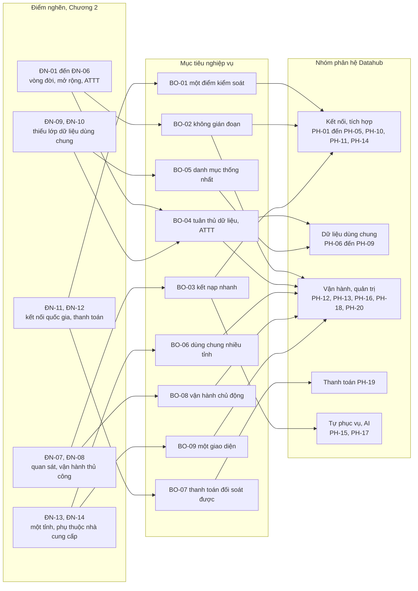

## 3. Mục tiêu, quy mô, địa điểm và phạm vi đầu tư

> **Tóm tắt cho hội đồng thẩm định.** Dự án đầu tư một nền tảng tích hợp, chia sẻ dữ liệu cấp tỉnh thế hệ mới (Datahub) để thay thế hệ LGSP đang vận hành, bổ sung lớp dữ liệu dùng chung và đóng gói thành sản phẩm dùng được cho nhiều tỉnh. Mục tiêu cụ thể được lượng hóa bằng 9 mục tiêu nghiệp vụ (BO-01 đến BO-09) và 18 chỉ số (KPI-01 đến KPI-18), trong đó các đích chính là độ sẵn sàng tầng xử lý dữ liệu từ mức cam kết 90% mỗi năm lên ít nhất 99,9% mỗi tháng, thời gian kết nạp một HTTT từ khoảng 2 đến 4 tuần xuống không quá 5 ngày làm việc, và thời gian khởi tạo một tỉnh mới trên nền tảng không quá 1 ngày làm việc. Quy mô đầu tư gồm 20 phân hệ phát hành theo ba đợt trong 18 tháng, thiết kế cho tỉnh cỡ M (tối đa 200 HTTT, 10 triệu giao dịch đồng bộ mỗi ngày) và mở rộng được lên cỡ L mà không thay kiến trúc. Hệ thống được đặt tại trung tâm dữ liệu của tỉnh thí điểm hoặc trên nền tảng điện toán đám mây Chính phủ, có địa điểm dự phòng thứ hai. Phạm vi không bao gồm kho dữ liệu phân tích, các HTTT nghiệp vụ của sở, ngành và việc mua sắm hạ tầng phần cứng.

### 3.1. Mục tiêu tổng quát

Mục tiêu tổng quát của dự án là xây dựng một nền tảng tích hợp, chia sẻ dữ liệu cấp tỉnh hiện đại, an toàn và dùng chung được cho nhiều tỉnh, làm đầu mối duy nhất cho mọi trao đổi dữ liệu giữa các HTTT trong tỉnh và giữa tỉnh với các nền tảng, cơ sở dữ liệu quốc gia, đồng thời cung cấp lớp dữ liệu dùng chung gồm danh mục dùng chung, dữ liệu chủ, chất lượng dữ liệu và bảo vệ dữ liệu cá nhân. Nền tảng thay thế hệ LGSP hiện có theo lộ trình chuyển đổi dần, không làm gián đoạn dịch vụ công đang vận hành.

Mục tiêu này có ba vế, và mỗi vế trả lời một nhóm điểm nghẽn đã nêu ở mục 2.4. Vế thứ nhất, "đầu mối duy nhất, hiện đại, an toàn", trả lời các điểm nghẽn về vòng đời công nghệ, khả năng mở rộng, an toàn thông tin và quan sát (ĐN-01 đến ĐN-08). Vế thứ hai, "lớp dữ liệu dùng chung", trả lời các yêu cầu mới mà hệ cũ không có khả năng đáp ứng (ĐN-09 đến ĐN-12). Vế thứ ba, "dùng chung được cho nhiều tỉnh", trả lời bài toán phụ thuộc nhà cung cấp và đầu tư lặp lại giữa các tỉnh (ĐN-13, ĐN-14). Cụm từ "theo lộ trình chuyển đổi dần" là một ràng buộc chứ không phải một mong muốn: hệ cũ phải tiếp tục phục vụ trong suốt thời gian chuyển đổi, và mọi phương án được đề xuất ở các chương sau đều phải thỏa ràng buộc này.

Mục tiêu tổng quát phù hợp với định hướng quản trị, chia sẻ dữ liệu theo CMP-LAW-01, CMP-LAW-02 và CMP-LAW-03, với yêu cầu chức năng của nền tảng tích hợp cấp tỉnh tại CMP-LAW-09 và với định hướng kiến trúc tại CMP-LAW-10 và CMP-LAW-11. Theo phân loại của Nghị định 224/2026/NĐ-CP, đây là một dự án đầu tư hệ thống chuyển đổi số; sự phù hợp của mục tiêu với Kế hoạch chuyển đổi số 5 năm và hằng năm của tỉnh được thuyết minh tại mục 2.5.5. Việc chứng minh sự phù hợp chi tiết với các văn bản pháp luật thuộc chương căn cứ pháp lý của báo cáo.

### 3.2. Mục tiêu cụ thể và chỉ số đo

#### 3.2.1. Cách đặt mục tiêu

Mục tiêu cụ thể của dự án được phát biểu dưới dạng mục tiêu nghiệp vụ (business objective, mã `BO`), mỗi mục tiêu có một hoặc hai chỉ số đo (key performance indicator, mã `KPI`) với giá trị nền, giá trị đích và thời điểm đo. Cách đặt này có hai lợi ích cho công tác thẩm định và quản lý dự án. Thứ nhất, hội đồng có thể đánh giá dự án có đạt mục tiêu hay không bằng số đo, không phụ thuộc vào đánh giá chủ quan. Thứ hai, mỗi chỉ số được gắn với một cổng nghiệm thu (acceptance gate) trong kế hoạch dự án (D01-02), nên việc theo dõi tiến độ và việc nghiệm thu dùng chung một thước đo.

Các mục tiêu và chỉ số dưới đây trích nguyên mã và giá trị từ tài liệu yêu cầu nghiệp vụ. Định nghĩa chính thức, công thức tính và phương pháp đo nằm tại D02-01 §3; báo cáo này không định nghĩa lại để tránh hai nguồn sự thật. Giá trị nền có dấu sao (*) là giá trị chưa đo được trên hệ cũ do hồ sơ hệ cũ không có số liệu vận hành, và chủ đầu tư cần cung cấp số liệu thực tế trước cổng G1 (xem câu hỏi mở Q-D0101-28 ở Chương 2).

#### 3.2.2. Bảng mục tiêu và chỉ số

Bảng sau tổng hợp 9 mục tiêu nghiệp vụ và 18 chỉ số đo. Cột cuối cho biết điểm nghẽn ở Chương 2 mà mục tiêu đó xử lý, để hội đồng thấy mỗi mục tiêu đều xuất phát từ một vấn đề có bằng chứng.

| Mã BO | Mục tiêu nghiệp vụ | Mã KPI | Chỉ số đo | Giá trị nền | Giá trị đích | Thời điểm đo | Điểm nghẽn xử lý |
|---|---|---|---|---|---|---|---|
| BO-01 | Mọi trao đổi dữ liệu giữa các HTTT của tỉnh và với quốc gia đi qua một điểm có kiểm soát | KPI-01 | Tỷ lệ HTTT kết nối qua Datahub trên tổng số HTTT có trao đổi dữ liệu | Chưa đo* | ≥ 90% | 12 tháng sau vận hành | ĐN-11, ĐN-13 |
| | | KPI-02 | Số kết nối điểm tới điểm còn tồn tại ngoài nền tảng | Chưa đo* | Giảm ≥ 80% | 12 tháng sau vận hành | |
| BO-02 | Dịch vụ công trực tuyến không gián đoạn vì nền tảng tích hợp | KPI-03 | Độ sẵn sàng tầng xử lý dữ liệu (data plane) theo tháng | 90%/năm (cam kết cũ) | ≥ 99,9%/tháng | Từ nghiệm thu | ĐN-02, ĐN-03 |
| | | KPI-04 | Độ trễ thêm do nền tảng tại cổng API, phân vị 95 | Không đo | ≤ 50 ms | Từ nghiệm thu | |
| BO-03 | Rút ngắn thời gian đưa một kết nối mới vào vận hành | KPI-05 | Thời gian từ khi nộp hồ sơ kết nạp tới khi HTTT gọi được API ở môi trường thật | Ước 2–4 tuần* | ≤ 5 ngày làm việc | 6 tháng sau vận hành | ĐN-08, ĐN-13 |
| | | KPI-06 | Thời gian xây dựng một luồng tích hợp chuẩn | Ước 5–10 ngày công | ≤ 2 ngày công | 6 tháng sau vận hành | |
| BO-04 | Tuân thủ pháp luật về dữ liệu và an toàn thông tin | KPI-07 | Tỷ lệ lượt khai thác dữ liệu có nhật ký đủ thông tin cho thanh tra | Không có | 100% | Từ nghiệm thu | ĐN-01, ĐN-04, ĐN-05, ĐN-06, ĐN-09 |
| | | KPI-08 | Kết quả đánh giá an toàn thông tin cấp độ 3 | Chưa có hồ sơ* | Được phê duyệt | Trước vận hành chính thức | |
| | | KPI-09 | Số thông tin xác thực đối ngoại lưu ngoài kho bí mật | > 0 | 0 | Từ nghiệm thu | |
| BO-05 | Danh mục dùng chung thống nhất, đồng bộ với quốc gia | KPI-10 | Tỷ lệ danh mục dùng chung được quản lý tập trung và có phiên bản | Chưa đo* | 100% danh mục bắt buộc | 12 tháng sau vận hành | ĐN-10 |
| | | KPI-11 | Độ trễ đồng bộ danh mục quốc gia sau khi ban hành | Thủ công | ≤ 24 giờ | 6 tháng sau vận hành | |
| BO-06 | Một nền tảng dùng chung cho nhiều tỉnh, giảm chi phí triển khai lặp | KPI-12 | Thời gian khởi tạo một tenant tỉnh mới tới khi sẵn sàng kết nối | Nhiều tuần | ≤ 1 ngày làm việc | Từ nghiệm thu | ĐN-13, ĐN-14 |
| BO-07 | Thanh toán trực tuyến minh bạch, đối soát được | KPI-13 | Tỷ lệ giao dịch đối soát tự động khớp với kênh thanh toán | Không đối soát | ≥ 99,5% | 6 tháng sau vận hành | ĐN-12 |
| | | KPI-14 | Thời gian phát hiện giao dịch lệch | Không có | ≤ 1 ngày làm việc | 6 tháng sau vận hành | |
| BO-08 | Vận hành chủ động thay vì xử lý khi người dân phản ánh | KPI-15 | Thời gian phát hiện sự cố (MTTD) | Không đo | ≤ 5 phút | Từ nghiệm thu | ĐN-07, ĐN-08 |
| | | KPI-16 | Thời gian khôi phục dịch vụ với sự cố mức 1 (MTTR) | Không đo | ≤ 1 giờ | Từ nghiệm thu | |
| BO-09 | Người vận hành dùng một giao diện thống nhất | KPI-17 | Số giao diện quản trị riêng biệt phải dùng | 5 | 1 | Từ nghiệm thu | ĐN-13 |
| | | KPI-18 | Điểm hài lòng của người dùng nội bộ theo thang SUS | Chưa đo | ≥ 75 | Sau kiểm thử chấp nhận | |

Định nghĩa chính thức của toàn bộ BO và KPI trong bảng tại D02-01.

Ba chỉ số cần được hội đồng lưu ý vì chúng mang ý nghĩa quyết định đối với hiệu quả đầu tư. KPI-03 thể hiện bước thay đổi về chất lượng dịch vụ: mức 90% mỗi năm của hệ cũ cho phép ngừng tới 36,5 ngày, còn mức 99,9% mỗi tháng chỉ cho phép ngừng khoảng 43 phút trong một tháng, tương đương khoảng 8,8 giờ trong một năm. Chỉ tiêu này được đặc tả kỹ thuật tại NFR-00-010 của D02-02 và được kiểm chứng bằng kiểm tra tổng hợp mỗi phút. KPI-05 và KPI-06 là cơ sở định lượng cho lợi ích giảm chi phí tích hợp ở Chương 10, vì thời gian kết nạp và thời gian dựng luồng quyết định trực tiếp số ngày công mà tỉnh và các nhà thầu của sở phải bỏ ra. KPI-12 là chỉ số chứng minh tính sản phẩm của Datahub: nếu khởi tạo một tỉnh mới mất không quá một ngày làm việc thì chi phí nhân rộng cho tỉnh thứ hai trở đi chủ yếu còn là hạ tầng, di trú và đào tạo, như phân tích ở mục 10.2.5.

#### 3.2.3. Quan hệ giữa điểm nghẽn, mục tiêu và phân hệ

Sơ đồ sau thể hiện chuỗi lập luận từ điểm nghẽn ở Chương 2, qua mục tiêu nghiệp vụ, tới nhóm phân hệ chịu trách nhiệm hiện thực. Mục đích của sơ đồ là để hội đồng kiểm tra rằng không có mục tiêu nào thiếu phân hệ hiện thực và không có phân hệ nào được đầu tư mà không phục vụ một mục tiêu.

Khi đối chiếu sơ đồ, đơn vị tư vấn nhận thấy hai khoảng trống giữa điểm nghẽn và bộ mục tiêu hiện có tại D02-01. Khoảng trống thứ nhất là ĐN-09 (thiếu dữ liệu chủ và chất lượng dữ liệu) hiện chỉ được đo gián tiếp qua BO-04 và BO-05, trong khi hai phân hệ PH-06 và PH-08 chưa có chỉ số riêng về tỷ lệ bản ghi được hợp nhất hay điểm chất lượng dữ liệu. Khoảng trống thứ hai là mức độ tự chủ công nghệ (ĐN-14) chưa có chỉ số đo, ví dụ tỷ lệ thành phần có mã nguồn và tài liệu được bàn giao, hay năng lực tự triển khai một bản phát hành của đội vận hành tỉnh. Báo cáo không tự đặt mã chỉ số mới mà đề xuất bổ sung ở mục 3.7 để D02-01 cân nhắc.

#### 3.2.4. Mục tiêu về tiến độ và chất lượng sản phẩm

Ngoài mục tiêu nghiệp vụ, dự án có các mục tiêu về tiến độ và chất lượng sản phẩm, được dùng làm điều kiện của các cổng nghiệm thu trong D01-02. Về tiến độ, MVP gồm 12 phân hệ được nghiệm thu tại cổng G2 ở mốc T0+10 tháng; MVP vận hành chính thức tại tỉnh thí điểm ở cổng G3, mốc T0+13 tháng; đợt 2 được nghiệm thu ở cổng G4, mốc T0+15 tháng; và toàn bộ dự án được nghiệm thu ở cổng G5, mốc T0+18 tháng, khi hệ cũ được tắt và nền tảng đã được khởi tạo cho tỉnh thứ hai. Về chất lượng, mọi chức năng của hệ cũ có kết luận giữ nguyên, nâng cấp hoặc thay thế trong D00-03 (179 trên 183 mục) đều phải có yêu cầu chức năng tương ứng đã kiểm thử đạt; hồ sơ đề xuất cấp độ 3 phải được phê duyệt trước khi vận hành chính thức; và các chỉ tiêu phi chức năng cấp hệ thống tại D02-02 (nhóm NFR-00) phải đạt trong đợt kiểm thử chấp nhận.

### 3.3. Quy mô đầu tư

#### 3.3.1. Quy mô chức năng

Datahub gồm 20 phân hệ, tổ chức thành năm miền năng lực là kết nối và chia sẻ, tích hợp, dữ liệu dùng chung, vận hành và quản trị, và thanh toán. Danh sách đầy đủ, công nghệ đặc thù của từng phân hệ và kiến trúc tổng thể được mô tả tại D03-01; ở đây chỉ trình bày cách các phân hệ được phân đợt, vì phân đợt quyết định quy mô của từng giai đoạn đầu tư và thời điểm phát sinh lợi ích.

Việc phân đợt theo nguyên tắc: đợt đầu (MVP) phải đủ để thay thế bốn khối Bus, Hub, API Management và Danh mục dùng chung của hệ cũ, kết nối được với nền tảng quốc gia và phục vụ nhiều tỉnh ngay từ đầu; các đợt sau bổ sung những năng lực mà hệ cũ không có hoặc có ở mức thấp. Nguyên tắc này bảo đảm rằng tỉnh thí điểm bắt đầu chuyển đổi được ngay sau cổng G2, không phải chờ toàn bộ 20 phân hệ.

| Đợt | Phân hệ | Số phân hệ | Thay thế khối hệ cũ hoặc năng lực mới | Cổng, mốc |
|---|---|---|---|---|
| MVP (đợt 1) | PH-01, PH-02, PH-03, PH-04, PH-05, PH-07, PH-10, PH-12, PH-13, PH-14, PH-18, PH-20 | 12 | Thay khối Bus, Hub, API Management, Danh mục dùng chung và kết nối NGSP; bổ sung giám sát xuyên suốt và quản trị tenant | G2, T0+10; vận hành chính thức G3, T0+13 |
| Đợt 2 | PH-06, PH-08, PH-09, PH-11, PH-19 | 5 | Thay khối Payment; bổ sung dữ liệu chủ, chất lượng dữ liệu, bảo vệ dữ liệu cá nhân, điều phối quy trình | G4, T0+15 |
| Đợt 3 | PH-15, PH-16, PH-17 | 3 | Bổ sung cổng nhà phát triển, quản trị kiến trúc và chỉ số, cổng AI | G5, T0+18 |

Trong MVP, yêu cầu tối thiểu về che dữ liệu cá nhân trong nhật ký và kiểm soát truy cập theo vai trò vẫn được hiện thực ở PH-03, PH-12 và PH-13, để tỉnh không phải chờ PH-09 ở đợt 2 mới đáp ứng các yêu cầu cơ bản về bảo vệ dữ liệu cá nhân. Khối Payment của hệ cũ tiếp tục chạy song song cho tới khi PH-19 vận hành ổn định 30 ngày.

Về khối lượng kế thừa, Datahub phải bảo toàn 179 chức năng của hệ cũ (85 giữ nguyên hành vi, 69 nâng cấp, 25 thay bằng cơ chế khác), loại bỏ 3 chức năng vì lý do an toàn thông tin theo chấp thuận của chủ đầu tư, và xử lý riêng 1 mục phi chức năng, theo kiểm kê tại D00-03 §5. Đây là phần "giữ nguyên giá trị đã đầu tư"; phần còn lại của quy mô chức năng là năng lực mới.

#### 3.3.2. Quy mô phục vụ

Nền tảng được thiết kế theo ba cỡ tham chiếu, để một bản sản phẩm triển khai được cho các tỉnh có quy mô khác nhau mà không phải thiết kế lại. Bảng dưới đây trích các chỉ tiêu chính từ bộ giả định nền; cấu hình hạ tầng tương ứng với từng cỡ được tính ở chương giải pháp hạ tầng và tại D03-09.

| Chỉ tiêu | Cỡ S | Cỡ M (tỉnh thí điểm, giả định) | Cỡ L |
|---|---|---|---|
| Số HTTT kết nối | ≤ 80 | ≤ 200 | ≤ 400 |
| Số API, dịch vụ công bố | ≤ 400 | ≤ 1.000 | ≤ 2.500 |
| Giao dịch đồng bộ mỗi ngày | 2 triệu | 10 triệu | 30 triệu |
| Lượt gọi mỗi giây ở đỉnh tại cổng API | 300 | 1.000 | 3.000 |
| Sự kiện mỗi ngày | 5 triệu | 25 triệu | 80 triệu |
| Bản ghi danh mục dùng chung | 2 triệu | 5 triệu | 15 triệu |
| Giao dịch thanh toán mỗi tháng | 100 nghìn | 400 nghìn | 1,2 triệu |
| Sẵn sàng tầng xử lý dữ liệu | 99,9% | 99,9% | 99,95% |
| RPO / RTO | 15 phút / 4 giờ | 15 phút / 4 giờ | 5 phút / 2 giờ |

Tỉnh thí điểm được giả định ở cỡ M. Giả định này chưa dựa trên số liệu vận hành thực của hệ cũ, vì hồ sơ hệ cũ không có số liệu giao dịch. Nếu số liệu thực tế do chủ đầu tư cung cấp cho thấy tỉnh thuộc cỡ S hoặc cỡ L, phần chi phí hạ tầng ở Chương 8 sẽ thay đổi theo bảng cấu hình tương ứng, còn phần phần mềm không thay đổi vì cùng một bản sản phẩm phục vụ cả ba cỡ. Cách thiết kế theo cỡ cũng giải quyết trực tiếp tình trạng của hệ cũ, nơi cam kết hiệu năng chỉ là 10 người dùng đồng thời với 1.000 bản ghi.

#### 3.3.3. Quy mô thời gian và nguồn lực

Giai đoạn thực hiện kéo dài 18 tháng kể từ T0, chia thành sáu wave từ W0 đến W5 với chu kỳ phát triển (sprint) hai tuần, tiếp theo là 12 tháng bảo hành từ T0+18 đến T0+30. Đội thực hiện lúc đông nhất khoảng 28 người (wave W2), tổng nỗ lực tham chiếu khoảng 455 người-tháng; con số chính xác và cơ cấu chi phí được tính tại Chương 8, kế hoạch chi tiết tại D01-02. Môi trường triển khai gồm năm môi trường DEV, TEST, STAGING, PROD và DR.

#### 3.3.4. Quy mô mở rộng sang nhiều tỉnh

Datahub được thiết kế là sản phẩm đa tenant: mỗi tỉnh là một tenant độc lập về dữ liệu và quản trị, có thể dùng chung cụm hạ tầng với tỉnh khác hoặc chạy trên cơ sở dữ liệu riêng, cụm riêng, theo ba chế độ cách ly được đặc tả tại D03-10. Trong phạm vi dự án, quy mô cam kết là một tỉnh thí điểm vận hành chính thức và một tỉnh thứ hai được khởi tạo, kết nối HTTT đầu tiên trước cổng G5. Việc triển khai cho các tỉnh tiếp theo là các dự án hoặc hợp đồng dịch vụ riêng, không thuộc tổng mức đầu tư của dự án này, nhưng hiệu quả của khả năng nhân rộng được phân tích ở Chương 10 vì đó là một trong những lý do chính để chọn mô hình sản phẩm.

### 3.4. Đối tượng hưởng lợi

Đối tượng hưởng lợi của dự án được xác định theo danh sách bên liên quan (mã `SH`) tại D02-01 §4. Bảng sau nhóm các bên liên quan theo cách họ hưởng lợi, để làm cơ sở cho phần đánh giá hiệu quả xã hội ở Chương 10.

| Nhóm hưởng lợi | Bên liên quan | Lợi ích chính |
|---|---|---|
| Hưởng lợi trực tiếp, cơ quan quản lý | SH-01 Lãnh đạo UBND tỉnh; SH-02 Sở Khoa học và Công nghệ | Có công cụ quản lý tập trung mọi kết nối, có số liệu báo cáo chỉ tiêu chuyển đổi số, đáp ứng nghĩa vụ pháp lý về dữ liệu |
| Hưởng lợi trực tiếp, đơn vị vận hành | SH-03 Trung tâm dữ liệu hoặc Trung tâm Chuyển đổi số tỉnh | Một giao diện quản trị thay cho năm, giám sát chủ động, triển khai tự động, ít thao tác thủ công |
| Hưởng lợi trực tiếp, đơn vị khai thác | SH-04 Các sở, ngành, UBND cấp xã; SH-05 Nhà thầu phát triển HTTT của các sở | Kết nạp nhanh, đặc tả chuẩn, môi trường thử, tự phục vụ; dùng lại danh mục và dữ liệu chủ thay vì tự duy trì |
| Hưởng lợi trực tiếp, chủ quản dữ liệu | SH-08 Cơ quan chủ quản từng loại dữ liệu | Kiểm soát được ai dùng dữ liệu của mình, vì mục đích gì, có nhật ký để đối chiếu |
| Bên ràng buộc, cùng hưởng lợi | SH-06 Cơ quan quản lý NDXP và các cơ sở dữ liệu quốc gia; SH-07 Cơ quan chuyên trách an toàn thông tin; SH-09 Cổng thanh toán và đơn vị cung cấp dịch vụ thanh toán | Tỉnh kết nối đúng chuẩn, có nhật ký, có hồ sơ cấp độ, đối soát khớp |
| Hưởng lợi gián tiếp | SH-10 Người dân và doanh nghiệp | Không phải nộp lại giấy tờ cơ quan nhà nước đã có, dịch vụ công ít gián đoạn, dữ liệu cá nhân được bảo vệ, thanh toán minh bạch |
| Bên cung cấp, chuyển giao | SH-11 Đơn vị cung cấp sản phẩm Datahub; SH-12 Đơn vị vận hành hệ LGSP cũ | Sản phẩm nhân rộng được; chuyển giao an toàn, không mất dữ liệu |

Ngoài tỉnh thí điểm, các tỉnh khác cũng là đối tượng hưởng lợi tiềm năng, vì sản phẩm được thiết kế để triển khai lại với chi phí biên thấp. Lợi ích này không được tính vào hiệu quả của dự án ở mức cam kết, mà chỉ được trình bày như một kịch bản tại mục 10.2.5.

### 3.5. Địa điểm đầu tư

Địa điểm thực hiện và đặt hệ thống của dự án là tỉnh thí điểm **[ĐIỀN: tên tỉnh thí điểm]**, nơi hệ LGSP cũ đang vận hành. Hệ thống sản xuất (PROD) được đặt tại một trong hai vị trí, tùy phương án hạ tầng được chọn ở chương phân tích phương án.

Vị trí thứ nhất là trung tâm dữ liệu của tỉnh thí điểm (phương án H1). Ưu điểm của vị trí này là tỉnh trực tiếp kiểm soát hạ tầng và dữ liệu, thuận lợi khi lập hồ sơ cấp độ và khi kết nối với các HTTT đang đặt cùng trung tâm. Điều kiện để chọn vị trí này là trung tâm dữ liệu còn đủ năng lực tính toán, lưu trữ và có thể dựng cụm Kubernetes đáp ứng yêu cầu tối thiểu tại D03-09; hiện trạng năng lực còn trống chưa được khảo sát (câu hỏi mở Q-D0101-21 ở Chương 2).

Vị trí thứ hai là nền tảng điện toán đám mây Chính phủ (phương án H2), dùng hạ tầng ảo hóa hoặc dịch vụ Kubernetes được quản lý. Ưu điểm là không phải đầu tư phần cứng ban đầu, co giãn theo nhu cầu và thuận lợi cho việc nhân rộng sang tỉnh khác. Điều kiện là nhà cung cấp đám mây bảo đảm lưu trữ dữ liệu trong lãnh thổ Việt Nam, đáp ứng yêu cầu an toàn thông tin cấp độ 3 và không ràng buộc dự án vào dịch vụ độc quyền của mình.

Trong cả hai trường hợp, hệ thống có một địa điểm dự phòng (DR) ở trạng thái sẵn sàng ấm (warm standby), đặt ở một trung tâm dữ liệu thứ hai hoặc một vùng đám mây thứ hai, đủ để đạt mục tiêu RPO và RTO nêu ở mục 3.3.2. Các môi trường DEV và TEST có thể đặt tại hạ tầng của nhà thầu trong giai đoạn W0 đến W2 với điều kiện không chứa dữ liệu thật; môi trường STAGING phải đặt cùng điều kiện an toàn với PROD vì được dùng cho diễn tập di trú bằng dữ liệu đã che. Phương án thứ ba H3 (thuê dịch vụ trọn gói cho nhiều tỉnh) được đánh giá ở chương phân tích phương án; nếu được chọn, địa điểm vật lý là trung tâm dữ liệu của bên cung cấp dịch vụ và phải thỏa cùng các điều kiện nêu trên.

Địa điểm thực hiện công việc phát triển phần mềm là trụ sở của nhà thầu. Các công việc khảo sát, cài đặt, di trú, kiểm thử chấp nhận và đào tạo được thực hiện tại tỉnh thí điểm. Tỉnh thứ hai, nơi được khởi tạo tenant ở wave W5, là **[ĐIỀN: tên tỉnh thứ hai]**.

### 3.6. Phạm vi đầu tư

#### 3.6.1. Phạm vi trong dự án

Phạm vi của dự án gồm năm nhóm hạng mục. Nhóm thứ nhất là phần mềm nền tảng gồm 20 phân hệ ở mục 3.3.1, được đóng gói thành sản phẩm có phiên bản phát hành v1.0 tại cổng G5, kèm mã nguồn và bản quyền sử dụng không giới hạn số tỉnh cho bên được chuyển giao theo điều khoản hợp đồng. Nhóm thứ hai là triển khai tại tỉnh thí điểm, gồm cài đặt các môi trường, cấu hình an toàn thông tin, lập hồ sơ đề xuất cấp độ 3, chạy song song với hệ cũ và cắt chuyển theo nhóm dịch vụ. Nhóm thứ ba là di trú, gồm công cụ và thực hiện di trú cấu hình, luồng tích hợp, danh mục, giao dịch thanh toán lịch sử và thông tin kết nối từ hệ cũ, kèm việc cấp lại toàn bộ khóa và mật khẩu. Nhóm thứ tư là bộ tài liệu theo vòng đời phát triển phần mềm, gồm tài liệu yêu cầu, thiết kế, kiểm thử, hướng dẫn sử dụng, hướng dẫn vận hành và hướng dẫn cài đặt. Nhóm thứ năm là đào tạo, chuyển giao công nghệ cho đội vận hành tỉnh và khởi tạo tenant cho tỉnh thứ hai.

#### 3.6.2. Phạm vi ngoài dự án

Các nội dung sau không thuộc dự án. Việc xác định rõ phạm vi ngoài dự án giúp hội đồng đánh giá tổng mức đầu tư đúng với những gì được giao, và giúp chủ đầu tư biết các nội dung nào phải được bố trí bằng dự án khác.

| Nội dung ngoài phạm vi | Lý do | Cách xử lý |
|---|---|---|
| Kho dữ liệu phân tích dạng lakehouse, kho dữ liệu chuyên đề | Thuộc giai đoạn sau theo định hướng của chủ đầu tư; tách để giới hạn rủi ro và quy mô dự án | Kiến trúc chừa điểm mở rộng qua sự kiện thay đổi dữ liệu trên PH-10 |
| Xây dựng lại các HTTT nghiệp vụ của sở, ngành | Datahub chỉ kết nối, không thay thế hệ nghiệp vụ | Bộ điều hợp PH-05 cho các hệ chưa có API chuẩn |
| Cổng dịch vụ công và hệ thống giải quyết thủ tục hành chính | Là hệ thống riêng | Datahub cung cấp kết nối và thanh toán cho hệ này |
| Mua sắm phần cứng máy chủ, thiết bị mạng, đường truyền | Thuộc dự án hạ tầng của tỉnh hoặc dịch vụ thuê đám mây | Yêu cầu tối thiểu nêu tại D03-09; chi phí thuê hạ tầng nếu có được tính ở Chương 8 theo phương án hạ tầng được chọn |
| Chỉnh sửa phía các HTTT của sở để chuyển sang kết nối qua Datahub | Thuộc trách nhiệm của chủ quản từng HTTT | Datahub cung cấp đặc tả, môi trường thử và giữ tương thích với giao diện cũ trong thời gian chuyển đổi |
| Ba chức năng hệ cũ được loại bỏ (LGC-TOOL-022, LGC-TOOL-027, LGC-IAM-007) | Rủi ro an toàn thông tin, theo D00-03 §5.1; chủ đầu tư đã chấp thuận | Ghi vào biên bản nghiệm thu |
| Triển khai cho tỉnh thứ ba trở đi | Thuộc dự án hoặc hợp đồng dịch vụ riêng | Sản phẩm v1.0 và quy trình khởi tạo tenant sẵn sàng để dùng lại |

Nội dung "chỉnh sửa phía các HTTT của sở" cần được chủ đầu tư lưu ý đặc biệt. Nếu các sở không bố trí kinh phí và nhà thầu để chuyển kết nối, chỉ số KPI-01 và KPI-02 khó đạt dù nền tảng đã sẵn sàng. Báo cáo đề xuất UBND tỉnh giao nhiệm vụ này cho các sở bằng một văn bản chỉ đạo song song với quyết định đầu tư; rủi ro tương ứng được theo dõi trong sổ rủi ro tại D01-02.

### 3.7. Câu hỏi mở

> **Câu hỏi mở Q-D0101-31:** Tên tỉnh thí điểm và tỉnh thứ hai được khởi tạo tenant ở wave W5 là gì? Tỉnh thứ hai đã có văn bản đồng thuận tham gia hay chưa?

> **Câu hỏi mở Q-D0101-32:** Tỉnh thí điểm có số liệu nào về số HTTT có trao đổi dữ liệu, số kết nối điểm tới điểm, số danh mục dùng chung đang quản lý và lượng giao dịch hằng ngày để xác nhận giả định cỡ M và đo giá trị nền của KPI-01, KPI-02, KPI-10?

> **Câu hỏi mở Q-D0101-33:** Chủ đầu tư ưu tiên đặt hệ thống sản xuất tại trung tâm dữ liệu tỉnh (H1) hay trên nền tảng điện toán đám mây Chính phủ (H2), và đã có địa điểm cho site dự phòng hay chưa?

> **Câu hỏi mở Q-D0101-34:** Điều khoản về quyền sở hữu mã nguồn và quyền triển khai sản phẩm cho tỉnh khác sẽ được quy định thế nào trong hợp đồng, để bảo đảm mục tiêu BO-06 và khả năng nhân rộng?

> **Câu hỏi mở Q-D0101-35:** UBND tỉnh có ban hành văn bản giao các sở, ngành bố trí nguồn lực chỉnh sửa HTTT của mình để chuyển kết nối sang Datahub trong khoảng T0+10 đến T0+18 tháng hay không?

### 3.8. Ghi chú cho người tổng hợp

1. Mâu thuẫn phân đợt: `_gia-dinh-nen.md` §2 xếp đợt 2 là PH-06, PH-08, PH-09, PH-11, PH-19 và đợt 3 là PH-15, PH-16, PH-17; trong khi D02-01 §8.3 xếp đợt 2 là PH-19, PH-15, PH-09, PH-11 và đợt 3 là PH-06, PH-08, PH-16, PH-17. Chương này theo bộ giả định nền. Cần thống nhất một phương án và sửa tài liệu còn lại.
2. Mâu thuẫn RTO: bộ giả định nền ghi RTO 4 giờ cho cỡ M, trong khi D02-02 NFR-00-014 ghi RTO không quá 1 giờ cho tầng xử lý dữ liệu và không quá 4 giờ cho tầng điều khiển. Chương này trích bảng của bộ giả định nền; đề xuất sửa bộ giả định nền thành "1 giờ (data plane) / 4 giờ (control plane)" cho khớp NFR.
3. Đề xuất bổ sung chỉ số vào D02-01 (không tự đặt mã): một chỉ số về dữ liệu chủ và chất lượng dữ liệu cho PH-06, PH-08 (ví dụ tỷ lệ bản ghi công dân, tổ chức được hợp nhất; điểm chất lượng trung bình của tập dữ liệu chia sẻ), và một chỉ số về tự chủ công nghệ (ví dụ đội vận hành tỉnh tự thực hiện được một lần nâng cấp phiên bản trên STAGING mà không cần nhà thầu). Đồng thời D02-01 nên bổ sung chỉ số về số thành phần giấy tờ được thay bằng dữ liệu, để Chương 10 có KPI chính thức cho lợi ích cải cách hành chính.
4. Mã `ĐN-nn` dùng trong bảng mục tiêu là mã cục bộ của D01-01 (xem ghi chú ở Chương 2).
5. Bộ giả định nền gọi tên dự án là "Datahub" trong khi tên phân hệ PH-19 trong D02-01 là "Thanh toán", trong bộ giả định nền là "Thanh toán điện tử"; chênh lệch nhỏ, nên thống nhất.
