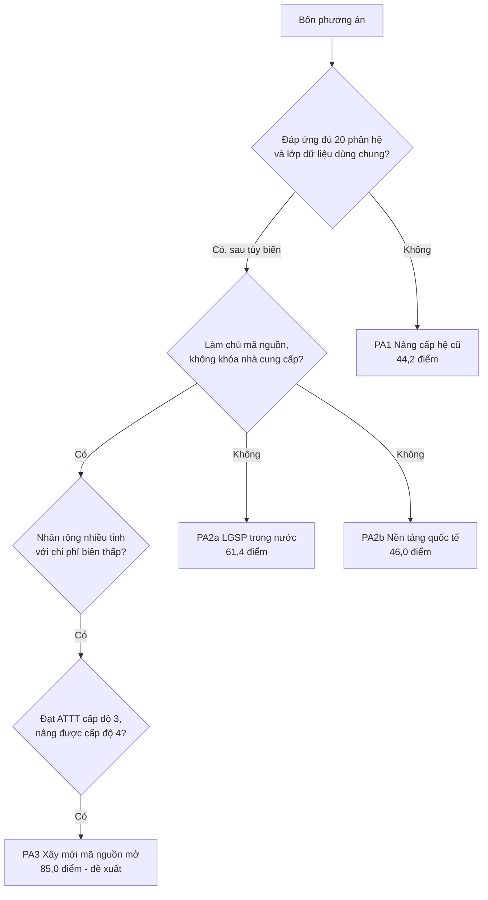
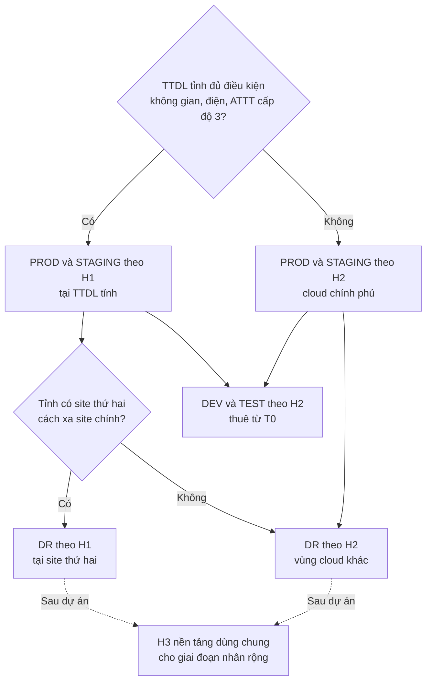
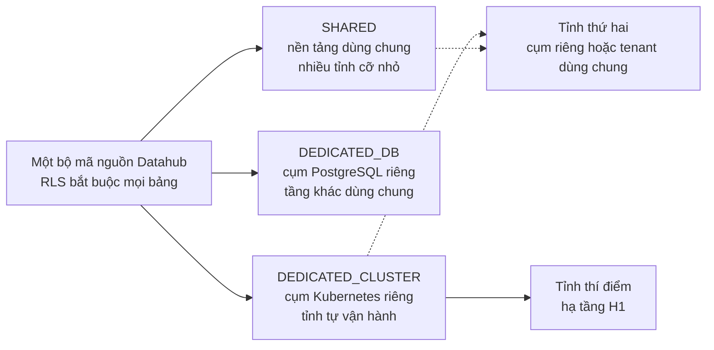
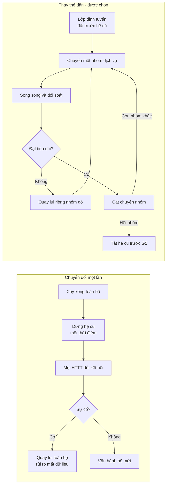

## 4. Phân tích, lựa chọn phương án đầu tư

> **Tóm tắt cho hội đồng thẩm định.** Báo cáo so sánh ba phương án đầu tư: nâng cấp hệ LGSP cũ (PA1), mua hoặc thuê nền tảng thương mại có sẵn rồi tùy biến (PA2, xét hai biến thể là sản phẩm LGSP trong nước và nền tảng tích hợp thương mại quốc tế), và xây mới Datahub trên nền mã nguồn mở theo mô hình sản phẩm đa tenant (PA3). Trên mười tiêu chí có trọng số, PA3 đạt 85,0/100 điểm, PA2 bản trong nước đạt 61,4, PA2 bản quốc tế đạt 46,0 và PA1 đạt 44,2; thứ hạng này giữ nguyên trong hai kịch bản trọng số thay thế ưu tiên tốc độ và ưu tiên chi phí. Báo cáo đề xuất chọn **PA3**, chấp nhận nhược điểm là thời gian đưa vào sử dụng dài hơn PA2 và rủi ro xây dựng cao hơn, đổi lại quyền làm chủ mã nguồn, khả năng nhân rộng cho nhiều tỉnh và không bị khóa nhà cung cấp. Với hạ tầng, báo cáo khuyến nghị đặt môi trường vận hành chính thức tại trung tâm dữ liệu tỉnh (H1), thuê cloud chính phủ (H2) cho môi trường phát triển, kiểm thử và làm phương án thay thế cho site dự phòng, còn dịch vụ trọn gói (H3) là hướng đi cho các tỉnh nhân rộng sau. Mô hình tenant khớp với D03-10 (mặc định dùng chung có RLS, tỉnh tự vận hành dùng cụm riêng), và chiến lược di trú là thay thế dần (strangler) thay vì chuyển đổi một lần.

### 4.1. Phương pháp phân tích

Chương này trả lời câu hỏi mà người quyết định đầu tư phải trả lời trước mọi câu hỏi kỹ thuật khác: với hiện trạng đã nêu ở Chương 2 và mục tiêu đã nêu ở Chương 3, cách nào đạt mục tiêu với tổng chi phí và rủi ro chấp nhận được. Nghị định 224/2026/NĐ-CP quy định chi tiết Luật Chuyển đổi số (văn bản thay thế Nghị định 45/2026/NĐ-CP từ 01/7/2026) yêu cầu báo cáo nghiên cứu khả thi dự án đầu tư hệ thống chuyển đổi số thuyết minh thiết kế cơ sở, trong đó có phân tích, lựa chọn phương án công nghệ (điểm a khoản 2 Điều 46); chương căn cứ pháp lý (Chương 1) trình bày đầy đủ căn cứ, chương này áp dụng yêu cầu đó vào bài toán Datahub. Chương 4 là phần lựa chọn phương án, còn Chương 5 và Chương 6 cùng nhau tạo thành thiết kế cơ sở.

Việc phân tích được chia thành bốn quyết định độc lập nhưng có thứ tự. Quyết định thứ nhất là phương án đầu tư phần mềm (PA1, PA2 hay PA3), vì nó quyết định gần như mọi thứ còn lại. Quyết định thứ hai là phương án hạ tầng (H1, H2, H3), được đánh giá riêng và áp cho phương án phần mềm đã chọn. Quyết định thứ ba là mô hình tenant, tức là cách nhiều tỉnh cùng dùng một sản phẩm. Quyết định thứ tư là chiến lược chuyển đổi khỏi hệ cũ. Tách bốn quyết định như vậy giúp hội đồng thẩm định thấy rằng, ví dụ, việc chọn xây mới không bắt buộc tỉnh phải mua máy chủ, và việc chọn hạ tầng cloud không làm thay đổi kết luận về phương án phần mềm.

Phương pháp đánh giá là phân tích đa tiêu chí có trọng số (weighted multi-criteria analysis). Mỗi phương án được chấm điểm từ 1 (kém nhất) đến 5 (tốt nhất) trên từng tiêu chí, điểm được nhân với trọng số và quy về thang 100. Điểm số không phải là phép đo khách quan tuyệt đối, mà là cách làm minh bạch lập luận: mỗi điểm đều có câu giải thích ở mục 4.4, và hội đồng có thể đổi trọng số để kiểm tra kết luận có đứng vững hay không. Mục 4.5 làm sẵn phép kiểm tra độ nhạy đó với hai bộ trọng số thay thế.

Về chi phí, chương này chỉ xếp hạng định tính chi phí vòng đời, vì tổng mức đầu tư và chi phí sở hữu năm năm (TCO) được tính ở Chương 8 trên cùng bộ giả định nền. Lý do tách như vậy là để tránh hai bộ số tiền song song trong cùng một báo cáo; Chương 8 dùng bảng cấu hình hạ tầng ở Chương 6 và khối lượng công việc ở D01-02 làm đầu vào.

### 4.2. Mô tả các phương án đầu tư

#### 4.2.1. PA1: Nâng cấp, mở rộng hệ LGSP cũ

PA1 giữ nguyên kiến trúc năm khối của hệ cũ (Bus trên Apache Camel, Hub trên Apache Pulsar, quản lý API kiểu Gravitee, danh mục dùng chung Aita và Payment trung gian PayGov), nâng phiên bản các thành phần nền đã hết vòng đời và bổ sung những chức năng còn thiếu như dữ liệu chủ, chất lượng dữ liệu, bảo vệ dữ liệu cá nhân, đối soát thanh toán và kết nối NDXP theo đặc tả mới. Về hình thức, đây là phương án có vẻ ít tốn kém nhất vì tận dụng được tài sản đã đầu tư năm 2021.

Thực chất kỹ thuật của PA1 lại khác với vẻ ngoài. Chương 2 (mục 2.2.4 và 2.3.1) đã chỉ ra rằng toàn bộ nền công nghệ của hệ cũ (Java 8, Spring Boot 2, Zuul, Angular 7, CentOS 6, Tomcat 8.5, PostgreSQL 13) đã ra ngoài vòng đời hỗ trợ, và các thành phần phụ thuộc lẫn nhau theo chuỗi. Muốn lên Spring Boot hiện hành thì phải lên Java 17 trở lên; lên Java mới thì phải thay Zuul và nâng Camel qua hai phiên bản chính có thay đổi lớn về cấu trúc gói; giao diện Angular 7 phải nâng qua nhiều phiên bản chính. Khối lượng "nâng cấp" vì vậy tương đương viết lại phần lớn mã nguồn, nhưng vẫn bị ràng buộc bởi mô hình dữ liệu và kiến trúc cũ: không có trường tỉnh trong dữ liệu, ba mô hình định danh HTTT rời nhau, giao diện và xử lý chạy chung một tiến trình, agent gắn cứng địa chỉ máy chủ (ĐN-02, ĐN-13).

PA1 còn phụ thuộc một điều kiện chưa được xác nhận: tỉnh có quyền sở hữu và có đủ mã nguồn của hệ cũ hay không, bao gồm thư viện mã hóa riêng của nhà cung cấp mà Chương 2 đã nêu (ĐN-14). Nếu không có mã nguồn đầy đủ, PA1 chỉ có thể thực hiện bởi chính nhà cung cấp cũ, tức là chuyển thành một hợp đồng chỉ định thầu trên thực tế. Điểm này được ghi thành câu hỏi mở Q-D0101-41.

**Ưu điểm.** Người dùng đã quen giao diện và quy trình; một phần cấu hình luồng, danh mục và khai báo HTTT có thể giữ lại; nếu nhà cung cấp cũ thực hiện thì thời gian khởi động ngắn vì họ đã hiểu hệ thống.

**Nhược điểm.** Chi phí nâng cấp gần bằng xây mới nhưng kết quả vẫn mang các giới hạn kiến trúc cũ; không giải quyết được yêu cầu nhiều tỉnh trên một sản phẩm; tiếp tục phụ thuộc nhà cung cấp cũ; rủi ro an toàn thông tin cao trong suốt thời gian nâng cấp vì hệ đang chạy vẫn ở nền hết hỗ trợ; khó chứng minh với cơ quan thẩm định cấp độ an toàn thông tin rằng kiến trúc đáp ứng cấp độ 3 khi không có cách ly control plane và data plane.

#### 4.2.2. PA2: Mua hoặc thuê nền tảng thương mại và tùy biến

PA2 mua bản quyền hoặc thuê dịch vụ một nền tảng tích hợp đã có trên thị trường, sau đó tùy biến và bổ sung phần còn thiếu. Báo cáo xét hai biến thể vì chúng khác nhau đáng kể về rủi ro và chi phí. Mô tả dưới đây là mô tả loại sản phẩm, không đánh giá một nhãn hiệu cụ thể nào; khi lập hồ sơ mời thầu (nếu chọn PA2), việc so sánh sản phẩm cụ thể phải thực hiện theo quy trình lựa chọn nhà thầu.

**PA2a: Sản phẩm LGSP của nhà cung cấp trong nước.** Thị trường trong nước đã có một số sản phẩm nền tảng tích hợp, chia sẻ dữ liệu cấp bộ, cấp tỉnh được xây dựng theo yêu cầu chức năng, kỹ thuật của Công văn 631/THH-THHT (CMP-LAW-09) và đã kết nối với NDXP ở nhiều địa phương. Ưu điểm lớn nhất của loại sản phẩm này là đã chạy thực tế, quen thuộc với quy trình hành chính Việt Nam, đáp ứng tốt yêu cầu kết nối quốc gia và có đội hỗ trợ trong nước. Hạn chế thường gặp là sản phẩm được thiết kế cho một bộ, một tỉnh (không phải đa tenant), lớp dữ liệu dùng chung chỉ có danh mục mà chưa có dữ liệu chủ, chất lượng dữ liệu và bảo vệ dữ liệu cá nhân ở mức Luật Dữ liệu yêu cầu, và mã nguồn thuộc nhà cung cấp nên tỉnh chỉ có quyền sử dụng. Về hình thức, nhiều sản phẩm loại này được cung cấp dưới dạng thuê dịch vụ, khi đó chi phí ban đầu thấp nhưng tỉnh gắn với nhà cung cấp trong suốt thời gian thuê.

**PA2b: Nền tảng tích hợp thương mại quốc tế.** Đây là nhóm sản phẩm tích hợp doanh nghiệp (iPaaS, API management, event streaming thương mại) của các hãng phần mềm quốc tế. Ưu điểm là bộ chức năng tích hợp, quản lý API và giám sát rất đầy đủ, có hệ sinh thái bộ kết nối lớn và độ chín sản phẩm cao. Hạn chế là chi phí bản quyền thường tính theo nhân xử lý, theo số lượt gọi hoặc theo môi trường, tăng tuyến tính khi nhân rộng nhiều tỉnh; phần nghiệp vụ đặc thù Việt Nam (kết nối NDXP, PayGov, VNeID, danh mục dùng chung theo chuẩn quốc gia, quy trình kết nạp HTTT) đều phải tùy biến; nhiều sản phẩm có phiên bản tốt nhất ở dạng dịch vụ đám mây của hãng, đặt dữ liệu ngoài lãnh thổ hoặc ngoài cloud chính phủ, không phù hợp với yêu cầu lưu trữ dữ liệu trong nước (CMP-LAW-16); đội ngũ kỹ sư thành thạo sản phẩm hiếm và đắt.

**Ưu điểm chung của PA2.** Có sản phẩm chạy được sớm; rủi ro xây dựng phần lõi thấp; có đơn vị chịu trách nhiệm sản phẩm.

**Nhược điểm chung của PA2.** Không làm chủ mã nguồn; chi phí bản quyền hoặc thuê định kỳ kéo dài suốt vòng đời; phải tùy biến nhiều cho lớp dữ liệu dùng chung và cho nghiệp vụ Việt Nam, mà phần tùy biến trên sản phẩm đóng thường khó nâng cấp theo phiên bản mới của sản phẩm; khả năng nhân rộng cho nhiều tỉnh phụ thuộc chính sách cấp phép của nhà cung cấp.

#### 4.2.3. PA3 (đề xuất): Xây mới Datahub trên nền mã nguồn mở, sản phẩm đa tenant

PA3 xây mới Datahub gồm 20 phân hệ theo kiến trúc đã thiết kế ở D03-01, trên các thành phần mã nguồn mở có giấy phép phù hợp (Mục 5.3), đóng gói thành một sản phẩm duy nhất triển khai được cho nhiều tỉnh (mỗi tỉnh là một tenant), và chuyển đổi khỏi hệ cũ theo chiến lược thay thế dần. Đây không phải là viết từ đầu mọi thứ: phần nặng nhất về kỹ thuật (cổng API, động cơ tích hợp, hệ thống sự kiện, định danh, quy trình, giám sát) là các dự án mã nguồn mở trưởng thành được nhiều tổ chức lớn dùng trong vận hành thật; phần xây mới là lớp nghiệp vụ, lớp quản trị và lớp kết nối với các nền tảng quốc gia, tức đúng phần mà PA2 cũng phải tùy biến.

PA3 kế thừa tri thức nghiệp vụ của hệ cũ một cách có hệ thống: 183 chức năng của hệ cũ đã được kiểm kê thành các mục `LGC` trong D00-03, mỗi mục có kết luận giữ nguyên, nâng cấp, thay thế hay loại bỏ, và tiêu chí bàn giao là 100% mục có kết luận. Vì vậy người dùng không mất chức năng đang dùng, chỉ được cung cấp lại trên nền mới.

**Ưu điểm.** Đáp ứng đầy đủ 20 phân hệ, gồm lớp dữ liệu dùng chung mà hệ cũ và phần lớn sản phẩm thương mại không có; tỉnh (hoặc cơ quan được giao làm chủ sản phẩm) làm chủ mã nguồn; không có chi phí bản quyền phần mềm nền; một bản mã nguồn cho mọi tỉnh nên chi phí phát triển được phân bổ khi nhân rộng; kiến trúc thiết kế từ đầu cho an toàn thông tin cấp độ 3 và sẵn sàng nâng cấp độ 4; chạy được cả trên hạ tầng tại chỗ và cloud chính phủ vì chỉ dùng chuẩn mở.

**Nhược điểm.** Thời gian đến khi đưa vào vận hành chính thức dài hơn PA2 (MVP nghiệm thu ở T0+10 tháng, vận hành chính thức MVP ở T0+13 tháng theo bộ giả định nền); rủi ro xây dựng cao hơn vì phải phát triển nhiều; đòi hỏi đội phát triển có năng lực về Kubernetes, Kafka, Camel và kiến trúc đa tenant; đội vận hành của trung tâm dữ liệu tỉnh phải được đào tạo công nghệ mới (rủi ro RSK-A01 tại D03-01).

### 4.3. Tiêu chí và trọng số đánh giá

Mười tiêu chí dưới đây được chọn từ ba nguồn: mục tiêu nghiệp vụ BO-01 đến BO-09 tại D02-01, các điểm nghẽn ĐN-01 đến ĐN-14 tại Chương 2, và các yêu cầu đối với thiết kế cơ sở tại khoản 1 Điều 46 Nghị định 224/2026/NĐ-CP (tuân thủ khung kiến trúc, tiêu chuẩn, quy định kết nối và chia sẻ dữ liệu). Trọng số phản ánh mức độ mà tiêu chí quyết định sự thành công lâu dài của nền tảng, không chỉ của dự án 18 tháng.

| Mã | Tiêu chí | Trọng số | Câu hỏi đánh giá | Nguồn |
|---|---|---|---|---|
| TC-1 | Đáp ứng chức năng | 15 | Phương án có cung cấp đủ 20 phân hệ, kể cả lớp dữ liệu dùng chung và thanh toán có đối soát? | D02-01, ĐN-09 đến ĐN-12 |
| TC-2 | Tuân thủ kiến trúc và pháp lý | 12 | Có phù hợp Khung Kiến trúc CPĐT 3.0, Luật Dữ liệu, yêu cầu LGSP và kết nối NDXP? | CMP-LAW-01, 03, 09, 10 |
| TC-3 | An toàn thông tin | 12 | Có đạt cấp độ 3 và nâng được lên cấp độ 4 mà không phải thay kiến trúc? | CMP-LAW-06 đến 08, BO-04 |
| TC-4 | Chi phí vòng đời (định tính) | 12 | Tổng chi phí 5 năm, gồm bản quyền, phát triển, hạ tầng, vận hành, khi tính cả nhân rộng | Chương 8 |
| TC-5 | Rủi ro thực hiện | 10 | Xác suất trễ hạn, vượt chi phí, không đạt chất lượng | D01-02 sổ rủi ro |
| TC-6 | Làm chủ mã nguồn, tự chủ công nghệ | 10 | Tỉnh có quyền và năng lực sửa, mở rộng, chuyển giao sản phẩm? | ĐN-14 |
| TC-7 | Nhân rộng nhiều tỉnh | 10 | Có triển khai cho tỉnh khác với chi phí biên thấp? | BO-06, KPI-12 |
| TC-8 | Thời gian đưa vào sử dụng | 7 | Bao lâu đến khi dịch vụ thật chạy trên nền mới? | Bộ giả định nền §3 |
| TC-9 | Khóa nhà cung cấp | 7 | Chi phí và độ khó khi đổi nhà cung cấp phát triển, vận hành, hạ tầng | NT-09 tại D03-01 |
| TC-10 | Nhân lực | 5 | Có đủ nhân lực trong nước để phát triển và vận hành? | RSK-A01 |
| | **Tổng** | **100** | | |

Ba tiêu chí đầu chiếm 39% trọng số vì chúng là điều kiện cần: một phương án không đáp ứng chức năng, không tuân thủ hoặc không đạt cấp độ an toàn thông tin thì dù rẻ cũng không dùng được. Chi phí vòng đời nhận 12% chứ không cao hơn, vì Chương 8 sẽ cho thấy chênh lệch chi phí giữa các phương án nằm chủ yếu ở bản quyền định kỳ và ở chi phí nhân rộng, tức là đã được phản ánh một phần qua TC-6, TC-7 và TC-9. Thời gian đưa vào sử dụng có trọng số vừa phải (7%) vì hệ cũ vẫn chạy song song trong suốt quá trình chuyển đổi, nên chậm hơn vài tháng không làm gián đoạn dịch vụ công.

### 4.4. Bảng điểm và giải thích

Bảng dưới đây trình bày điểm từng phương án trên từng tiêu chí và điểm tổng có trọng số quy về thang 100 (điểm tổng = tổng của điểm nhân trọng số, chia 5). Phần giải thích ngay sau bảng nêu lý do cho các điểm có chênh lệch lớn giữa các phương án.

| Tiêu chí | Trọng số | PA1 | PA2a trong nước | PA2b quốc tế | PA3 |
|---|---|---|---|---|---|
| TC-1 Đáp ứng chức năng | 15 | 2 | 3 | 4 | 5 |
| TC-2 Tuân thủ kiến trúc, pháp lý | 12 | 2 | 4 | 2 | 5 |
| TC-3 An toàn thông tin | 12 | 2 | 3 | 3 | 4 |
| TC-4 Chi phí vòng đời | 12 | 3 | 3 | 1 | 4 |
| TC-5 Rủi ro thực hiện | 10 | 2 | 4 | 3 | 3 |
| TC-6 Làm chủ mã nguồn | 10 | 2 | 1 | 1 | 5 |
| TC-7 Nhân rộng nhiều tỉnh | 10 | 1 | 3 | 2 | 5 |
| TC-8 Thời gian đưa vào sử dụng | 7 | 4 | 5 | 3 | 2 |
| TC-9 Khóa nhà cung cấp | 7 | 2 | 1 | 1 | 5 |
| TC-10 Nhân lực | 5 | 3 | 4 | 2 | 3 |
| **Điểm tổng (thang 100)** | **100** | **44,2** | **61,4** | **46,0** | **85,0** |

**TC-1 Đáp ứng chức năng.** PA3 đạt 5 vì phạm vi 20 phân hệ được thiết kế đúng theo yêu cầu (D02-01, D02-02). PA2b đạt 4 vì sản phẩm quốc tế mạnh về tích hợp, quản lý API và giám sát, nhưng thiếu phần nghiệp vụ Việt Nam. PA2a đạt 3 vì sản phẩm trong nước mạnh về kết nối quốc gia nhưng thường thiếu dữ liệu chủ, chất lượng dữ liệu, bảo vệ dữ liệu cá nhân và đa tenant. PA1 đạt 2 vì hệ cũ thiếu toàn bộ lớp dữ liệu dùng chung và đối soát thanh toán (ĐN-09, ĐN-12), phần bổ sung phải xây trên nền kiến trúc cũ.

**TC-2 Tuân thủ kiến trúc và pháp lý.** PA3 đạt 5 vì kiến trúc được ánh xạ trực tiếp vào Khung Kiến trúc CPĐT 3.0 (mục 5.7) và mọi yêu cầu pháp lý có mã truy vết tại D00-03. PA2a đạt 4 vì sản phẩm đã được xây theo Công văn 631 và đã kết nối NDXP, nhưng phần đáp ứng Luật Dữ liệu và Nghị định 165/2025/NĐ-CP (CMP-LAW-01, CMP-LAW-02) còn phụ thuộc lộ trình của nhà cung cấp. PA2b đạt 2 vì phải tùy biến toàn bộ phần tuân thủ quốc gia và có nguy cơ vướng yêu cầu lưu trữ dữ liệu trong nước. PA1 đạt 2 vì kết nối quốc gia đang theo mô hình NGSP cũ, ghi cứng, chưa có NDOP (ĐN-11).

**TC-3 An toàn thông tin.** Không phương án nào đạt 5 vì cấp độ 3 chỉ được xác nhận khi hồ sơ được phê duyệt. PA3 đạt 4 vì kiến trúc có sẵn zero-trust nội bộ, tách control plane và data plane, kho bí mật, nhật ký kiểm toán chỉ-thêm và đã chừa điểm nâng cấp độ 4 (D03-01 §9). PA2a và PA2b đạt 3 vì an toàn của sản phẩm đóng phụ thuộc nhà cung cấp, tỉnh khó tự kiểm chứng mã nguồn và chuỗi cung ứng. PA1 đạt 2 vì nền hết hỗ trợ không có bản vá, bí mật ở dạng rõ và kênh truyền không mã hóa (ĐN-04 đến ĐN-06).

**TC-4 Chi phí vòng đời.** Thứ hạng định tính; số tiền ở Chương 8. PA3 đạt 4: chi phí ban đầu cao nhất trong bốn phương án vì phải phát triển nhiều (khoảng 455 người-tháng theo bộ giả định nền), nhưng không có bản quyền phần mềm nền, và từ tỉnh thứ hai trở đi chi phí biên chỉ gồm hạ tầng và triển khai. PA1 và PA2a đạt 3: PA1 có chi phí nâng cấp gần bằng xây mới nhưng không đem lại khả năng nhân rộng; PA2a có chi phí ban đầu thấp hơn nhưng phí bản quyền hoặc thuê dịch vụ lặp lại mỗi năm và mỗi tỉnh, cộng chi phí tùy biến lớp dữ liệu dùng chung. PA2b đạt 1 vì bản quyền quốc tế tính theo nhân xử lý hoặc lượt gọi, cộng chi phí tùy biến và chi phí chuyên gia, là mức cao nhất trong vòng đời năm năm.

**TC-5 Rủi ro thực hiện.** PA2a đạt 4 vì lõi sản phẩm đã chạy thực tế, rủi ro chủ yếu nằm ở phần tùy biến. PA3 đạt 3: rủi ro xây dựng cao hơn PA2a nhưng được giảm bằng ba biện pháp, gồm phát hành theo đợt với MVP 12 phân hệ, di trú thay thế dần có thể quay lui từng nhóm dịch vụ, và kiến trúc dựa trên các thành phần mã nguồn mở đã trưởng thành thay vì tự viết lõi. PA2b đạt 3 vì sản phẩm chín nhưng khối lượng tùy biến lớn và nhân lực hiếm. PA1 đạt 2 vì phải nâng cấp đồng thời nhiều thành phần phụ thuộc chuỗi trên một hệ đang chạy, và chưa rõ quyền mã nguồn.

**TC-6 Làm chủ mã nguồn.** PA3 đạt 5 vì toàn bộ mã nguồn thuộc chủ đầu tư theo hợp đồng, xây trên thành phần có giấy phép mở. PA1 đạt 2 vì quyền mã nguồn của hệ cũ chưa được xác nhận (Q-D0101-41) và có thư viện độc quyền. PA2a và PA2b đạt 1 vì mã nguồn thuộc nhà cung cấp.

**TC-7 Nhân rộng nhiều tỉnh.** PA3 đạt 5 vì đa tenant từ gốc (NT-02 tại D03-01), mục tiêu khởi tạo một tenant tỉnh mới không quá 1 ngày làm việc (KPI-12) và triển khai một cụm tỉnh độc lập không quá 3 ngày làm việc khi đã có hạ tầng (NFR-00-056). PA2a đạt 3 vì nhân rộng được bằng cách mua hoặc thuê thêm bản cho mỗi tỉnh. PA2b đạt 2 vì nhân rộng kéo theo bản quyền tăng tuyến tính. PA1 đạt 1 vì hệ cũ không có khái niệm tỉnh trong dữ liệu (ĐN-13).

**TC-8 Thời gian đưa vào sử dụng.** PA2a đạt 5 vì có thể đưa lõi vào chạy trong vài tháng. PA1 đạt 4 vì người dùng tiếp tục dùng hệ đang có trong lúc nâng cấp. PA2b đạt 3 vì sản phẩm sẵn có nhưng thời gian tùy biến dài. PA3 đạt 2 vì MVP vận hành chính thức ở T0+13 tháng và toàn bộ 20 phân hệ ở T0+18 tháng.

**TC-9 Khóa nhà cung cấp.** PA3 đạt 5 vì chỉ dùng chuẩn mở (S3, OIDC, OpenAPI, Kafka, Kubernetes) và tài liệu SDLC đầy đủ cho phép đổi nhà thầu phát triển, đổi đơn vị vận hành hoặc đổi hạ tầng. PA1, PA2a, PA2b đều bị khóa ở mức độ khác nhau.

**TC-10 Nhân lực.** PA2a đạt 4 vì nhà cung cấp trong nước có sẵn đội. PA1 và PA3 đạt 3: PA1 cần kỹ sư biết công nghệ cũ ngày càng hiếm; PA3 cần kỹ sư Kubernetes, Kafka, Camel, Spring vốn phổ biến trên thị trường nhưng đội vận hành tỉnh cần đào tạo. PA2b đạt 2 vì chuyên gia sản phẩm quốc tế hiếm và đắt.

Biểu đồ dưới đây tóm tắt logic sàng lọc phía sau bảng điểm: các phương án lần lượt được kiểm tra qua bốn câu hỏi có tính quyết định, và chỉ PA3 vượt qua cả bốn.

Sơ đồ đơn giản hóa bảng điểm thành các câu hỏi có hoặc không, nên không thay thế bảng điểm. Ý nghĩa của nó là cho thấy PA2a, phương án mạnh thứ hai, bị loại chủ yếu ở câu hỏi làm chủ mã nguồn và khóa nhà cung cấp, chứ không phải ở chức năng hay rủi ro. Nếu chủ đầu tư coi việc làm chủ mã nguồn là không quan trọng, PA2a trở thành ứng viên đáng cân nhắc; mục 4.5 kiểm tra xem kết luận có đổi khi giảm trọng số các tiêu chí này hay không.

### 4.5. Kiểm tra độ nhạy và kết luận

Để kiểm tra kết luận có phụ thuộc vào cách đặt trọng số hay không, báo cáo tính lại điểm với hai bộ trọng số thay thế. Bộ thứ nhất, "ưu tiên nhanh và ít rủi ro", tăng trọng số thời gian đưa vào sử dụng lên 15, rủi ro lên 15, chi phí lên 15, và giảm làm chủ mã nguồn, nhân rộng xuống 5 mỗi tiêu chí. Bộ thứ hai, "ưu tiên chi phí", đặt chi phí vòng đời ở 25 và giảm tương ứng các tiêu chí khác. Bảng sau cho thấy kết quả.

| Bộ trọng số | PA1 | PA2a | PA2b | PA3 | Khoảng cách PA3 với phương án thứ hai |
|---|---|---|---|---|---|
| Cơ sở (mục 4.3) | 44,2 | 61,4 | 46,0 | 85,0 | 23,6 |
| Ưu tiên nhanh và ít rủi ro | 49,0 | 66,8 | 47,2 | 78,0 | 11,2 |
| Ưu tiên chi phí | 47,2 | 62,6 | 42,6 | 82,8 | 20,2 |

PA3 giữ vị trí thứ nhất ở cả ba bộ trọng số. Khoảng cách thu hẹp nhất ở bộ "ưu tiên nhanh và ít rủi ro" (11,2 điểm), đúng như dự đoán vì đó là hai tiêu chí PA2a mạnh nhất. Để PA2a vượt PA3, người đánh giá phải đồng thời giảm mạnh trọng số làm chủ mã nguồn, nhân rộng và khóa nhà cung cấp, tức là từ bỏ mục tiêu sản phẩm dùng chung cho nhiều tỉnh (BO-06), một mục tiêu cốt lõi của dự án.

**Kết luận.** Báo cáo đề xuất chọn **PA3: xây mới Datahub trên nền mã nguồn mở theo mô hình sản phẩm đa tenant, di trú theo chiến lược thay thế dần**. Hai nhược điểm của PA3 được xử lý trong thiết kế dự án như sau. Nhược điểm thời gian được giảm bằng cách phát hành MVP 12 phân hệ trước, thay thế ngay các khối Bus, Hub, API Management, danh mục dùng chung và kết nối quốc gia, trong khi hệ cũ vẫn phục vụ phần chưa chuyển. Nhược điểm rủi ro xây dựng được giảm bằng các cổng nghiệm thu G0 đến G5, bằng việc dùng thành phần mã nguồn mở trưởng thành cho mọi phần lõi, và bằng sổ rủi ro tại D01-02 (dẫn chiếu RSK-A01 đến RSK-A05 của D03-01).

### 4.6. Phương án hạ tầng

#### 4.6.1. Ba phương án hạ tầng

Phương án hạ tầng được đánh giá riêng vì PA3 chỉ dùng chuẩn mở (NT-09 tại D03-01) và chạy được trên mọi cụm Kubernetes đạt yêu cầu. Ba phương án là:

- **H1, Kubernetes tại chỗ (on-premises) ở trung tâm dữ liệu tỉnh.** Tỉnh đầu tư máy chủ, lưu trữ, thiết bị mạng đặt tại trung tâm dữ liệu của tỉnh; đơn vị vận hành của tỉnh quản trị từ tầng phần cứng đến tầng Kubernetes, nhà thầu cài đặt Datahub từ tầng Kubernetes trở lên.
- **H2, cloud chính phủ.** Tỉnh thuê máy ảo, lưu trữ khối, lưu trữ đối tượng và (nếu có) dịch vụ Kubernetes quản lý trên một nền tảng điện toán đám mây đáp ứng tiêu chí dành cho cơ quan nhà nước. Datahub chạy trên cụm Kubernetes chuẩn dựng trên các tài nguyên thuê đó.
- **H3, thuê dịch vụ trọn gói.** Một đơn vị cung cấp vận hành nền tảng Datahub dùng chung cho nhiều tỉnh (hồ sơ "nền tảng dùng chung" tại D03-01 §10); tỉnh thuê dịch vụ theo cam kết mức dịch vụ, không quản trị hạ tầng.

#### 4.6.2. So sánh

Bảng dưới đây so sánh ba phương án hạ tầng trên các tiêu chí quan trọng nhất với tỉnh thí điểm. Đánh giá chi phí là định tính; Chương 8 quy đổi bảng cấu hình ở Chương 6 thành số tiền cho cả H1 và H2.

| Tiêu chí | H1 tại chỗ | H2 cloud chính phủ | H3 thuê trọn gói |
|---|---|---|---|
| Kiểm soát dữ liệu, vị trí dữ liệu | Cao nhất: dữ liệu ở TTDL tỉnh | Cao: dữ liệu ở cloud trong nước đạt tiêu chí | Trung bình: dữ liệu ở hạ tầng của đơn vị cung cấp, chung với tỉnh khác (cách ly logic) |
| Hình thức chi | Chủ yếu chi đầu tư (thiết bị), kèm chi thường xuyên (điện, bảo trì, nhân sự) | Chủ yếu chi thường xuyên (thuê theo tháng) | Chi thường xuyên (phí dịch vụ) |
| Thời gian sẵn sàng | Dài: mua sắm thiết bị, lắp đặt, thường vài tháng | Nhanh: vài tuần sau khi ký hợp đồng thuê | Nhanh nhất khi nền tảng dùng chung đã tồn tại; hiện chưa tồn tại |
| Năng lực vận hành tỉnh phải có | Cao: phần cứng, ảo hóa, Kubernetes, CSDL | Trung bình: Kubernetes trở lên | Thấp: chỉ quản trị nghiệp vụ trong tenant |
| Co giãn | Theo bước mua thiết bị | Linh hoạt theo tháng | Theo hợp đồng dịch vụ |
| Dự phòng thảm họa | Cần site thứ hai của tỉnh | Dùng vùng thứ hai của nhà cung cấp cloud | Do đơn vị cung cấp đảm nhiệm |
| Hồ sơ cấp độ ATTT | Tỉnh lập cho toàn bộ hệ thống | Phân định trách nhiệm với nhà cung cấp cloud | Đơn vị cung cấp lập, tỉnh xác nhận phần của mình |
| Phù hợp với tỉnh thí điểm | Phù hợp nếu TTDL tỉnh đủ điều kiện | Phù hợp, đặc biệt cho DR và môi trường phụ | Chưa khả thi trong dự án này vì chưa có nền tảng dùng chung vận hành |

#### 4.6.3. Khuyến nghị

Báo cáo khuyến nghị một tổ hợp phương án thay vì một phương án thuần, vì mỗi môi trường có yêu cầu khác nhau về vị trí dữ liệu, thời điểm cần có và vòng đời.

1. **Môi trường vận hành chính thức (PROD) và tiền vận hành (STAGING) theo H1**, đặt tại trung tâm dữ liệu tỉnh, nếu trung tâm dữ liệu đáp ứng điều kiện về không gian, nguồn điện, làm mát và an toàn thông tin cấp độ 3 cho phần hạ tầng (Q-D0101-42). Lý do là dữ liệu dùng chung của tỉnh (danh mục, dữ liệu chủ, giao dịch thanh toán, nhật ký khai thác dữ liệu cá nhân) có vị trí lưu trữ rõ ràng thuộc tỉnh, và chi phí thiết bị được khấu hao trong vòng đời năm năm.
2. **Môi trường phát triển (DEV) và kiểm thử (TEST) theo H2**, thuê từ T0 trong suốt thời gian thực hiện và bảo hành. Lý do là hai môi trường này phải có ngay ở wave W0 (T0 đến T0+2), trước khi việc mua sắm thiết bị H1 hoàn tất, và chúng không chứa dữ liệu thật.
3. **Site dự phòng thảm họa (DR) theo H1 tại site thứ hai của tỉnh nếu có; nếu không thì theo H2** ở một vùng cloud chính phủ khác với vị trí PROD. Kịch bản cơ sở cho Chương 8 là DR theo H1; kịch bản thay thế là DR theo H2. Chương 6 cung cấp cấu hình cho cả hai.
4. **H3 là hướng phát triển cho giai đoạn nhân rộng**, khi có cơ quan được giao vận hành nền tảng dùng chung cho các tỉnh quy mô nhỏ. Kiến trúc đa tenant của Datahub đã hỗ trợ sẵn (D03-10, chế độ `SHARED`), nên quyết định này không phải đưa ra ngay trong dự án.

Trường hợp trung tâm dữ liệu tỉnh không đủ điều kiện, toàn bộ PROD, STAGING và DR chuyển sang H2 mà không phải thay đổi phần mềm; Chương 6 có bảng quy đổi sang tài nguyên cloud.

Sơ đồ cho thấy hai câu hỏi về điều kiện của tỉnh quyết định phương án hạ tầng, còn DEV và TEST luôn thuê cloud trong mọi nhánh. Đường nét đứt tới H3 thể hiện đây là bước sau dự án, không phải nhánh quyết định hiện tại.

### 4.7. Mô hình tenant

Datahub là sản phẩm phục vụ nhiều tỉnh, và mỗi tỉnh là một tenant (D00-01, D03-10). Câu hỏi đặt ra là các tỉnh dùng chung tài nguyên đến mức nào. Ba mô hình điển hình được xét:

| Mô hình | Mô tả | Ưu điểm | Nhược điểm |
|---|---|---|---|
| Dùng chung, cách ly bằng RLS | Mọi tenant dùng chung cụm CSDL, Kafka, kho đối tượng; mỗi dòng dữ liệu có `tenant_id`, PostgreSQL Row-Level Security lọc ở tầng CSDL | Chi phí thấp nhất; một lần nâng cấp cho mọi tỉnh; RLS chặn rò rỉ kể cả khi mã ứng dụng có lỗi | Cần kỷ luật đặt biến phiên; ảnh hưởng "hàng xóm ồn ào" phải chặn bằng hạn mức |
| Schema hoặc CSDL riêng | Mỗi tenant một schema hoặc một cụm CSDL riêng; các tầng khác dùng chung | Cách ly dữ liệu mạnh hơn | Số đối tượng bùng nổ (20 phân hệ nhân 34 tỉnh); vận hành nhiều cụm CSDL |
| Cụm riêng | Mỗi tỉnh một cụm Kubernetes đầy đủ | Cách ly vật lý hoàn toàn; tỉnh tự vận hành | Chi phí hạ tầng và vận hành cao nhất cho mỗi tỉnh |

D03-10 và ADR-003 đã chốt mô hình kết hợp, và chương này khuyến nghị giữ nguyên quyết định đó. Mã nguồn luôn chạy ở chế độ đa tenant với RLS bắt buộc trên mọi bảng nghiệp vụ, còn hồ sơ triển khai chọn một trong ba chế độ cách ly của D03-10: `SHARED` (mặc định trên nền tảng dùng chung), `DEDICATED_DB` (cụm PostgreSQL riêng cho tỉnh có yêu cầu riêng hoặc chuẩn bị lên cấp độ 4) và `DEDICATED_CLUSTER` (cụm Kubernetes riêng cho tỉnh tự vận hành tại chỗ). Điểm quan trọng là cả ba chế độ dùng chung một bộ mã, nên tỉnh có thể chuyển chế độ khi điều kiện thay đổi mà không phải chờ một phiên bản phần mềm khác.

Áp vào phương án hạ tầng đã khuyến nghị, **tỉnh thí điểm chạy ở chế độ `DEDICATED_CLUSTER`**: cụm PROD tại trung tâm dữ liệu tỉnh chứa tenant của tỉnh thí điểm (và tenant `PLATFORM` để quản trị). RLS vẫn bật đầy đủ như ở nền tảng dùng chung; việc này có hai tác dụng. Thứ nhất, nó là lớp phòng thủ chiều sâu, vì lỗi cấu hình ở tầng ứng dụng vẫn không làm lộ dữ liệu. Thứ hai, nó bảo đảm cụm của tỉnh có thể tiếp nhận thêm tenant sau sắp xếp đơn vị hành chính (sáp nhập theo D03-10 §5.4) hoặc chuyển sang nền tảng dùng chung mà không cần di trú dữ liệu.

Tỉnh thứ hai (nhân rộng ở W5) có thể được triển khai theo một trong hai cách: một cụm riêng theo cỡ quy mô của tỉnh đó (Chương 6 có cấu hình S, M, L), hoặc một tenant `SHARED` trên cụm của tỉnh thí điểm nếu hai tỉnh thỏa thuận dùng chung và hạ tầng được mở rộng tương ứng. Lựa chọn này phụ thuộc thỏa thuận giữa hai tỉnh và được ghi thành câu hỏi mở Q-D0101-43.

Sơ đồ nhấn mạnh rằng ba chế độ là ba hồ sơ triển khai của cùng một sản phẩm. Tỉnh thí điểm đi theo nhánh cụm riêng; tỉnh thứ hai có hai lựa chọn được thể hiện bằng nét đứt vì còn chờ quyết định.

### 4.8. Chiến lược chuyển đổi khỏi hệ cũ

#### 4.8.1. Hai chiến lược

Có hai cách chuyển đổi điển hình từ một nền tảng tích hợp đang vận hành sang nền tảng mới.

**Chuyển đổi một lần (big-bang).** Xây xong toàn bộ nền tảng mới, chuẩn bị dữ liệu và cấu hình, chọn một thời điểm (thường cuối tuần) dừng hệ cũ, chuyển dữ liệu, đổi toàn bộ địa chỉ kết nối của các HTTT sang hệ mới và khởi động. Ưu điểm là chỉ vận hành một hệ thống sau thời điểm chuyển, không phải duy trì cơ chế song song. Nhược điểm là toàn bộ rủi ro dồn vào một thời điểm: mọi HTTT phải đổi kết nối cùng lúc, mọi luồng tích hợp phải chạy đúng ngay lần đầu, và nếu có sự cố lớn thì quay lui toàn bộ rất khó vì dữ liệu phát sinh sau thời điểm chuyển đã nằm ở hệ mới.

**Thay thế dần (strangler).** Đặt một lớp định tuyến trước hệ cũ, rồi chuyển lần lượt từng nhóm dịch vụ sang nền tảng mới. Tại mỗi thời điểm, lớp định tuyến quyết định một lượt gọi đi vào hệ cũ hay hệ mới. Mỗi nhóm dịch vụ trải qua các bước chạy song song, đối soát kết quả, cắt chuyển và giám sát; nếu có sự cố, chỉ nhóm đó quay lui về hệ cũ. Khi nhóm cuối cùng đã chuyển và chạy ổn định, hệ cũ được tắt. Nhược điểm là phải vận hành hai hệ thống trong một thời gian và phải xây công cụ định tuyến, đối soát.

#### 4.8.2. Lựa chọn

Báo cáo chọn **thay thế dần** vì bốn lý do gắn với đặc điểm của LGSP. Thứ nhất, LGSP là trục trung gian của nhiều dịch vụ công trực tuyến; một sự cố ở thời điểm chuyển đổi một lần sẽ làm gián đoạn đồng thời mọi dịch vụ đi qua trục, trái với BO-02 (không gián đoạn dịch vụ công vì nền tảng tích hợp). Thứ hai, tỉnh thí điểm có tới hàng trăm HTTT kết nối (cỡ M: tới 200), thuộc nhiều chủ quản khác nhau; không thể yêu cầu tất cả đổi kết nối trong cùng một cuối tuần. Thứ ba, phạm vi phát hành theo đợt (MVP, đợt 2, đợt 3) vốn đã không cho phép chuyển một lần, vì khối Payment chỉ được thay khi PH-19 sẵn sàng ở đợt 2. Thứ tư, hệ cũ không có tài liệu đủ để dựng lại (Chương 2, ĐN-14), nên hiểu biết về hành vi thực tế của từng luồng phải được kiểm chứng bằng chạy song song và đối soát chứ không chỉ bằng đọc tài liệu.

Chi phí của lựa chọn này là thời gian vận hành song song (tối đa đến G5 theo bộ giả định nền) và khối lượng xây dựng lớp định tuyến, công cụ đối soát. Cả hai đã được tính trong kế hoạch: lớp định tuyến chính là cổng API APISIX (PH-03) sẵn có trong MVP, còn công cụ di trú và đối soát thuộc PH-18. Cơ chế kỹ thuật chi tiết của chiến lược thay thế dần được trình bày ở mục 5.9.

Sơ đồ đặt hai chiến lược cạnh nhau để làm rõ khác biệt then chốt: ở chuyển đổi một lần, nhánh sự cố dẫn tới quay lui toàn bộ; ở thay thế dần, nhánh sự cố chỉ quay lui một nhóm dịch vụ rồi thử lại, các nhóm đã chuyển thành công không bị ảnh hưởng.

### Câu hỏi mở

- **Q-D0101-41.** Tỉnh có quyền sở hữu và đang lưu giữ đầy đủ mã nguồn hệ LGSP cũ (kể cả thư viện mã hóa riêng của nhà cung cấp) hay không? Câu trả lời ảnh hưởng đến tính khả thi của PA1 và đến việc dịch ngược hành vi luồng cũ khi di trú.
- **Q-D0101-42.** Trung tâm dữ liệu tỉnh hiện có đáp ứng điều kiện đặt hệ thống cấp độ 3 (không gian tủ rack, công suất điện dự phòng, làm mát, kiểm soát ra vào) cho cấu hình ở Chương 6 hay không, và tỉnh có site thứ hai đủ điều kiện làm site DR hay không?
- **Q-D0101-43.** Tỉnh thứ hai được nhân rộng ở W5 sẽ có cụm riêng hay là tenant dùng chung trên cụm của tỉnh thí điểm? Nếu dùng chung thì cần thỏa thuận giữa hai tỉnh về vận hành và chi phí.
- **Q-D0101-44.** Chủ đầu tư có muốn bổ sung một khảo sát thị trường chính thức về các sản phẩm LGSP trong nước (PA2a) để có số liệu giá tham chiếu cho Chương 8 hay không?

### Ghi chú cho người tổng hợp

- Căn cứ quản lý đầu tư dùng trong chương là Nghị định 224/2026/NĐ-CP (theo đính chính của điều phối ngày 21/11/2026 và tóm tắt pháp lý phần F; nguồn hethongphapluat.com, chưa đối chiếu Công báo). Hướng dẫn biên soạn §5 vẫn ghi CMP-LAW-14 là Nghị định 45/2026/NĐ-CP; đề xuất đổi CMP-LAW-14 thành Nghị định 224/2026/NĐ-CP và cập nhật D00-01 §7.
- Mã câu hỏi mở dùng dải Q-D0101-41 trở đi để không trùng với Chương 2 (Q-D0101-21 đến 28); người tổng hợp đánh số lại nếu cần.
- Mã tiêu chí TC-1 đến TC-10 là mã cục bộ của chương này, không phải mã truy vết toàn bộ tài liệu.
- Bộ giả định nền xếp PH-06, PH-08 vào đợt 2 và PH-15 vào đợt 3, trong khi D03-01 §4.1 xếp PH-06, PH-08 vào đợt 3 và PH-15 vào đợt 2. Chương này không phụ thuộc vào phân đợt chi tiết nhưng hai nguồn cần được thống nhất.
