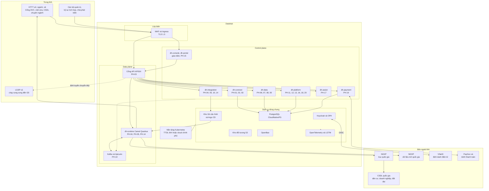
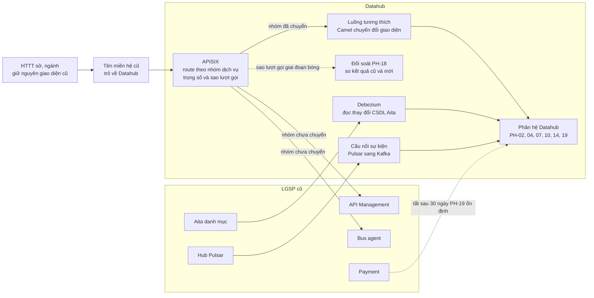
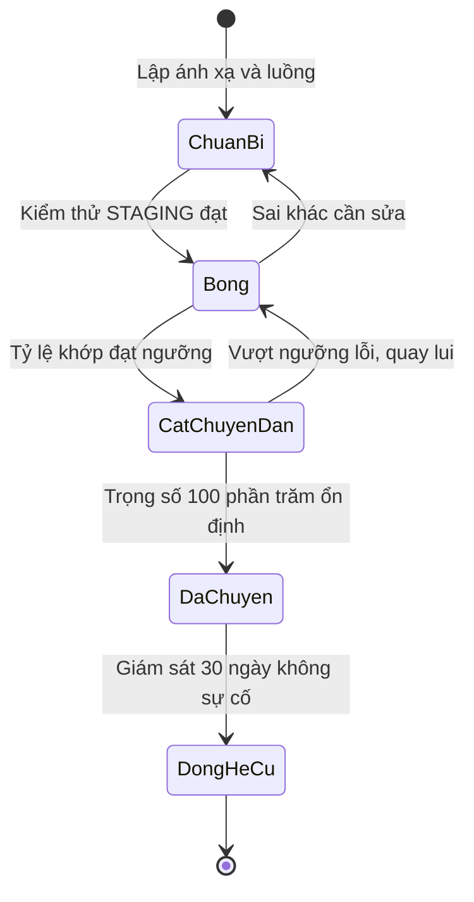

## 5. Giải pháp công nghệ và thiết kế cơ sở

> **Tóm tắt cho hội đồng thẩm định.** Chương 5 cùng Chương 6 tạo thành thiết kế cơ sở của dự án theo Điều 46 Nghị định 224/2026/NĐ-CP; bảng ở mục 5.1 chỉ rõ từng nội dung của khoản 2 Điều 46 được trình bày ở đâu. Datahub gồm 20 phân hệ, đóng gói thành sáu đơn vị triển khai Spring Boot, một đơn vị triển khai tích hợp Camel Quarkus và các thành phần mã nguồn mở bên thứ ba, chia thành control plane (quản trị) và data plane (đường đi của dữ liệu) để sự cố quản trị không làm gián đoạn trao đổi dữ liệu. Toàn bộ công nghệ nền là mã nguồn mở có giấy phép phù hợp, không phát sinh chi phí bản quyền, chạy được cả tại trung tâm dữ liệu tỉnh và trên cloud chính phủ. Chỉ tiêu chính cho tỉnh cỡ M là 1.000 lượt gọi mỗi giây ở đỉnh, độ trễ tăng thêm tại cổng API p95 không quá 50 ms, sẵn sàng data plane 99,9% mỗi tháng, RPO 15 phút; nền tảng kết nối NDXP, NDOP, VNeID, PayGov và hỗ trợ IPv6 song song IPv4. Chuyển đổi khỏi hệ cũ theo chiến lược thay thế dần qua cổng API, từng nhóm dịch vụ chạy song song, đối soát rồi mới cắt chuyển.

### 5.1. Phạm vi thiết kế cơ sở và cách đọc

Khoản 2 Điều 46 Nghị định 224/2026/NĐ-CP liệt kê nội dung bắt buộc của thiết kế cơ sở. Báo cáo này không lập một tập thiết kế cơ sở tách rời mà trình bày các nội dung đó trong Chương 5 (giải pháp công nghệ, phần mềm) và Chương 6 (giải pháp hạ tầng), riêng yêu cầu an ninh mạng chi tiết nằm ở Chương 7. Cách làm này giúp hội đồng thẩm định đọc thiết kế cơ sở liền mạch với phân tích phương án ở Chương 4 và tổng mức đầu tư ở Chương 8. Bảng dưới đây là chỉ mục để hội đồng kiểm tra độ đầy đủ.

| Nội dung theo khoản 2 Điều 46 | Vị trí trong báo cáo |
|---|---|
| a) Thuyết minh: mô tả yêu cầu | Mục 5.2 |
| a) Danh mục tiêu chuẩn, quy chuẩn kỹ thuật áp dụng | Mục 5.6 |
| a) Phân tích, lựa chọn phương án công nghệ | Chương 4 (phương án đầu tư), mục 5.5 (công nghệ chi tiết) |
| a) Giải pháp kết nối, liên thông | Mục 5.8 |
| a) Giải pháp IPv6 | Mục 5.9 (phần mềm), mục 6.6 (mạng) |
| a) Giải pháp bảo đảm an ninh mạng | Mục 5.10 (yêu cầu), Chương 7 (chi tiết) |
| a) Mô hình tổng thể, mô hình lô-gic, mô hình vật lý | Mục 5.3 (tổng thể), 5.4 (lô-gic), 6.2 và 6.3 (vật lý) |
| a) Tính toán quy mô thiết bị và phần mềm thương mại | Mục 6.4, 6.5; tệp `_ha-tang-sizing.csv` |
| b) Sơ đồ sơ bộ: hiện trạng hạ tầng, lắp đặt, kết nối | Mục 6.1, 6.3, 6.6 |
| c) Chỉ tiêu kỹ thuật lắp đặt, cài đặt, kiểm tra; thống kê khối lượng | Mục 6.10, 6.11 |
| d) Yêu cầu kỹ thuật phần mềm nội bộ | Mục 5.13 |
| đ) Hạng mục kết nối, chia sẻ cơ sở dữ liệu | Mục 5.8.3 |
| e) Khối lượng sơ bộ đào tạo, tập huấn | Mục 6.12 |
| g) Yêu cầu bảo đảm an ninh mạng | Mục 5.10, Chương 7 |

Thiết kế cơ sở ở đây là bản tóm lược có định lượng của bộ tài liệu thiết kế đã có trong dự án: thiết kế kiến trúc tổng thể D03-01, đặc tả yêu cầu cấp hệ thống D02-02, thiết kế đa tenant D03-10 và sổ quyết định kiến trúc D00-02. Khi có khác biệt, các tài liệu đó là nguồn chi tiết; chương này không đặt quyết định mới trái với chúng. Các thông số chủ yếu, chức năng và tính năng chính được nêu đủ để xác định tổng mức đầu tư như điểm c và d khoản 1 Điều 46 yêu cầu; chi tiết thiết kế từng phân hệ thuộc bước thiết kế chi tiết (D03-02 đến D03-04).

### 5.2. Mô tả yêu cầu

#### 5.2.1. Yêu cầu nghiệp vụ

Datahub là nền tảng tích hợp, chia sẻ dữ liệu cấp tỉnh thế hệ mới, đóng ba vai trò mà Chương 2 và D02-01 đã xác lập. Vai trò thứ nhất là trung gian bắt buộc cho mọi trao đổi dữ liệu giữa các hệ thống thông tin của tỉnh, thay thế các kết nối điểm tới điểm (BO-01). Vai trò thứ hai là cổng duy nhất kết nối ra các nền tảng và cơ sở dữ liệu quốc gia, gồm Nền tảng tích hợp, chia sẻ dữ liệu quốc gia (NDXP), Nền tảng dữ liệu mở quốc gia (NDOP), định danh điện tử VNeID và nền tảng thanh toán PayGov. Vai trò thứ ba là nơi quản trị dữ liệu dùng chung của tỉnh: danh mục dùng chung, dữ liệu chủ về công dân, tổ chức, địa chỉ, chất lượng dữ liệu và bảo vệ dữ liệu cá nhân.

Ngoài ba vai trò của một LGSP, Datahub có hai yêu cầu của một sản phẩm. Thứ nhất, một bộ mã nguồn phục vụ nhiều tỉnh, mỗi tỉnh là một tenant với dữ liệu, cấu hình và người dùng cách ly (BO-06). Thứ hai, quá trình chuyển đổi khỏi hệ LGSP cũ không được làm gián đoạn dịch vụ công trực tuyến đang chạy qua trục (BO-02).

#### 5.2.2. Yêu cầu chức năng theo nhóm phân hệ

Hai mươi phân hệ được nhóm thành sáu nhóm chức năng. Bảng dưới đây mô tả ngắn từng nhóm; danh sách đầy đủ, nhiệm vụ và ranh giới từng phân hệ ở D02-02 và D03-01 §4, yêu cầu chức năng chi tiết ở 20 tập FRS (D02-03).

| Nhóm | Phân hệ | Chức năng chính | Thay thế khối hệ cũ |
|---|---|---|---|
| Kết nối và công bố dịch vụ | PH-01 Kết nạp HTTT, PH-02 Danh mục dịch vụ, PH-03 Cổng API, PH-15 Cổng nhà phát triển | Hồ sơ HTTT thành viên, quy trình kết nạp, cấp định danh ứng dụng; đăng ký, công bố, vòng đời API; thực thi xác thực, hạn mức, ghi nhật ký; tài liệu, thử API, sandbox | API Management |
| Tích hợp và sự kiện | PH-04 Lõi tích hợp và trình thiết kế luồng, PH-05 Bộ điều hợp, PH-10 Sự kiện, PH-11 Quy trình liên thông | Thiết kế, duyệt, phát hành, chạy luồng Camel; bộ kết nối REST, SOAP, tệp, CDC; topic, schema, publisher, subscriber; quy trình BPMN có người duyệt | Bus, Productivity Tooling, Hub |
| Dữ liệu dùng chung | PH-06 Dữ liệu chủ, PH-07 Danh mục dùng chung, PH-08 Chất lượng dữ liệu, PH-09 Quyền riêng tư | Bản ghi vàng; danh mục có phiên bản, hiệu lực, đồng bộ quốc gia; quy tắc và đo chất lượng; phân loại dữ liệu, mục đích khai thác, che dữ liệu, sự đồng ý | Aita (một phần); phần còn lại là mới |
| Kết nối quốc gia và thanh toán | PH-14 Kết nối quốc gia, PH-19 Thanh toán | Adapter NDXP, NDOP, CSDL quốc gia; nhà cung cấp, giao dịch, đối soát, hoàn tiền qua PayGov và kênh khác | Phụ lục NGSP, Payment |
| Định danh, giám sát, vận hành | PH-12 Định danh và phân quyền, PH-13 Giám sát và kiểm toán, PH-18 Vận hành và xử lý lỗi | Người dùng, vai trò, chính sách, MFA; bảng điều khiển, cảnh báo, truy vết, nhật ký kiểm toán WORM; hàng đợi lỗi, xử lý lại, tham số, công cụ di trú | Keycloak, Graylog của hệ cũ |
| Quản trị sản phẩm | PH-16 Báo cáo chỉ tiêu, PH-17 Trợ lý AI, PH-20 Quản trị tenant | KPI chuyển đổi số về chia sẻ dữ liệu; tìm dịch vụ, gợi ý ánh xạ, giải thích sự cố; khởi tạo tỉnh, hạn mức, sáp nhập | Mới |

Hệ cũ có 183 chức năng đã được kiểm kê thành các mục `LGC` tại D00-03, mỗi mục được ánh xạ tới phân hệ và yêu cầu chức năng của Datahub với kết luận giữ nguyên, nâng cấp, thay thế hoặc loại bỏ. Nhờ ánh xạ này, yêu cầu "không mất chức năng đang dùng" được kiểm chứng bằng số liệu: tiêu chí bàn giao là 100% mục có kết luận và có bằng chứng kiểm thử.

#### 5.2.3. Yêu cầu phi chức năng

Yêu cầu phi chức năng cấp hệ thống được định nghĩa chính thức ở D02-02 với mã `NFR-00-nnn`. Mục 5.11 trình bày các chỉ tiêu quan trọng nhất theo cỡ quy mô S, M, L, vì đây là đầu vào trực tiếp cho tính toán quy mô hạ tầng ở Chương 6.

### 5.3. Mô hình tổng thể

Mô hình tổng thể thể hiện Datahub trong môi trường của nó: các tác nhân bên ngoài, các lớp bên trong và các luồng chính. Sơ đồ dưới đây được vẽ theo lớp, từ trên xuống: người dùng và hệ thống bên ngoài, lớp biên, data plane, control plane, lớp dịch vụ dùng chung, lớp nền tảng.

Sơ đồ cần được đọc theo ba điểm. Thứ nhất, mọi lượt gọi từ bên ngoài, kể cả từ giao diện quản trị, đều đi qua lớp biên và cổng API APISIX, nhờ đó xác thực, hạn mức và nhật ký được áp dụng thống nhất (D03-01 §5). Thứ hai, đường đi của dữ liệu giữa hai HTTT hoặc giữa HTTT và nền tảng quốc gia chỉ gồm các thành phần data plane (cổng API, `dh-runtime`, Kafka); control plane không nằm trên đường đi này, nên khi control plane ngừng, data plane vẫn phục vụ ít nhất 24 giờ với cấu hình đã nạp (NFR-00-012, ADR-013). Thứ ba, hệ LGSP cũ xuất hiện trong mô hình như một đích định tuyến của cổng API trong giai đoạn chuyển đổi; khi một nhóm dịch vụ chưa được chuyển, cổng API chuyển tiếp lượt gọi tới hệ cũ (mục 5.14).

### 5.4. Mô hình lô-gic

#### 5.4.1. Phân tách control plane và data plane

Mô hình lô-gic của Datahub dựa trên nguyên tắc tách control plane và data plane (NT-01 tại D03-01, ADR-013). Control plane là phần con người làm việc: giao diện, CSDL quản trị, quy trình duyệt, báo cáo. Data plane là phần máy làm việc: nhận lượt gọi, kiểm tra quyền, chuyển đổi, định tuyến, phát và nhận sự kiện. Hai phần có yêu cầu rất khác nhau. Data plane cần độ trễ thấp, co giãn nhanh theo lưu lượng và sẵn sàng cao (99,9%); control plane cần tính đúng đắn của dữ liệu quản trị, chịu được độ sẵn sàng thấp hơn (99,5%, NFR-00-011) và thay đổi chức năng thường xuyên hơn. Tách hai phần cho phép tối ưu riêng từng phần, và quan trọng hơn là cô lập sự cố: một lỗi ở màn hình quản trị hay ở quy trình duyệt không thể làm dừng việc tra cứu dữ liệu dân cư của Cổng dịch vụ công.

Cấu hình đi từ control plane xuống data plane theo hai kênh có kiểm soát. Kênh thứ nhất là API quản trị của APISIX: khi một API được công bố ở PH-02, `dh-connect` khai báo route, consumer và plugin xuống APISIX, và APISIX giữ cấu hình trong bộ nhớ. Kênh thứ hai là GitOps: khi một luồng tích hợp được duyệt ở PH-04, `dh-integration` ghi tệp Camel YAML DSL (ADR-010) vào kho Git cấu hình, Argo CD (ADR-009) đồng bộ xuống `dh-runtime`. Không có kênh nào cho giao diện ra lệnh trực tiếp tới runtime, điều này khắc phục điểm nghẽn ĐN-06 của hệ cũ (cho phép nạp mã tùy ý và điều khiển agent qua HTTP).

#### 5.4.2. Đơn vị triển khai

Hai mươi phân hệ không được triển khai thành hai mươi dịch vụ riêng. D03-01 §4.2 gom chúng thành các đơn vị triển khai (deployment unit, DU) theo năm tiêu chí: cùng miền nghiệp vụ, cùng hồ sơ tải, cùng yêu cầu bảo mật, tần suất thay đổi tương đồng và số đơn vị phải phù hợp với đội vận hành của trung tâm dữ liệu tỉnh (thường 3 đến 5 người). Bên trong mỗi DU Spring Boot, mỗi phân hệ là một module Spring Modulith với ranh giới được kiểm tra tự động (ADR-001), nên có thể tách ra thành DU riêng khi cần mà không đổi hợp đồng API.

| Đơn vị triển khai | Phân hệ | Mặt | Công nghệ | Đặc điểm tải |
|---|---|---|---|---|
| `apisix` | PH-03 | Data | Apache APISIX, Coraza WAF | Tỷ lệ thuận với lượt gọi, co giãn theo CPU |
| `dh-runtime` | PH-04, PH-05, PH-14 (phần chạy) | Data | Camel Quarkus native | Co giãn theo CPU và độ trễ tiêu thụ Kafka (KEDA) |
| `kafka` | PH-10 (phần chạy) | Data | Kafka (Strimzi, KRaft), Apicurio | Tỷ lệ với số sự kiện, cần lưu trữ SSD |
| `dh-connect` | PH-01, PH-02, PH-03 (đồng bộ cấu hình), PH-15 (phần máy chủ) | Control | Spring Boot 4 | Thấp, theo người dùng quản trị |
| `dh-integration` | PH-04, PH-05, PH-10, PH-14 (phần quản trị) | Control | Spring Boot 4 | Thấp, đỉnh khi phát hành luồng |
| `dh-data` | PH-06, PH-07, PH-08, PH-09 | Control | Spring Boot 4 | Trung bình, đỉnh khi nhập danh mục, chạy lô đối sánh |
| `dh-platform` | PH-11, PH-12, PH-13, PH-16, PH-18, PH-20 | Control | Spring Boot 4, Flowable nhúng | Thấp đến trung bình |
| `dh-payment` | PH-19 | Control và Data | Spring Boot 4 | Đỉnh cuối tháng, đầu năm học; cần mạng ra kênh thanh toán |
| `dh-assist` | PH-17 | Control | Spring Boot 4, pgvector | Tùy chọn bật tắt theo tỉnh |
| `dh-console`, `dh-portal` | Giao diện mọi phân hệ, PH-15 | Control | React 19, Ant Design 6, Liquid Glass | Tệp tĩnh, tải thấp |

Bảng cho thấy chỉ ba đơn vị (`apisix`, `dh-runtime`, `kafka`) quyết định quy mô hạ tầng theo lưu lượng; các DU control plane có tải gần như cố định theo số người dùng quản trị. Đó là lý do bảng cấu hình ở Chương 6 tách nhóm máy "worker tích hợp" và "worker biên" khỏi nhóm "worker ứng dụng".

#### 5.4.3. Đường đi của một lượt gọi

Để làm rõ mô hình lô-gic, mục này mô tả đường đi của một lượt gọi điển hình: Cổng dịch vụ công của tỉnh tra cứu thông tin công dân từ CSDL quốc gia về dân cư qua NDXP. Cổng dịch vụ công gửi yêu cầu HTTPS kèm token truy cập do realm Keycloak của tỉnh cấp. Lớp biên chấm dứt TLS và kiểm tra WAF. APISIX xác minh chữ ký token, đối chiếu tenant, kiểm tra HTTT đã đăng ký sử dụng dịch vụ, áp hạn mức, hỏi OPA quyết định cho phép dựa trên vai trò, tenant, phân loại dữ liệu và mục đích khai thác, rồi chuyển tới luồng tương ứng trong `dh-runtime`. Luồng Camel chuyển đổi yêu cầu sang định dạng của NDXP, lấy khóa ký từ OpenBao, gọi NDXP, nhận kết quả, che các trường nhạy cảm mà mục đích khai thác không cho phép xem, trả kết quả. Suốt đường đi, mã truy vết `traceparent` được truyền, và siêu dữ liệu lượt gọi (ai gọi, gọi gì, mục đích, kết quả, kích thước, thời gian) được ghi vào nhật ký khai thác phục vụ thanh tra (KPI-07). Nội dung bản tin không được lưu, trừ khi lỗi và phải đưa vào hàng đợi xử lý lại tối đa 7 ngày, có mã hóa (D03-01 §8.3).

### 5.5. Phương án công nghệ

#### 5.5.1. Nguyên tắc lựa chọn

Phương án công nghệ được lựa chọn theo năm nguyên tắc. Nguyên tắc thứ nhất là chỉ dùng thành phần mã nguồn mở có giấy phép được tổ chức mã nguồn mở công nhận, hoặc giao thức chuẩn mở, để không phát sinh chi phí bản quyền và không bị khóa nhà cung cấp (NT-09 tại D03-01). Nguyên tắc thứ hai là chọn dự án mã nguồn mở trưởng thành, có cộng đồng hoặc tổ chức bảo trợ ổn định và có lựa chọn hỗ trợ thương mại nếu chủ đầu tư cần. Nguyên tắc thứ ba là chỉ dùng phiên bản còn trong vòng đời hỗ trợ tại thời điểm khóa và rà soát vòng đời trước mỗi lần nâng cấp lớn hoặc nộp hồ sơ cấp độ, nhằm không lặp lại tình trạng nền công nghệ hết hỗ trợ của hệ cũ (ĐN-01). Nguyên tắc thứ tư là chạy được như nhau trên Kubernetes tại chỗ và trên cloud chính phủ, không dùng dịch vụ đặc thù của một nhà cung cấp cloud. Nguyên tắc thứ năm là mỗi lựa chọn quan trọng có một bản ghi quyết định kiến trúc (ADR) nêu các phương án đã cân nhắc và lý do, để hội đồng thẩm định kiểm tra được tính hợp lý.

#### 5.5.2. Bảng công nghệ chốt

Bảng dưới đây liệt kê công nghệ đã chốt theo tầng, giấy phép và ADR tương ứng trong sổ D00-02. Số phiên bản cụ thể được ghim ở D04-02; ở đây chỉ ghi dòng phiên bản chính.

| Tầng | Công nghệ | Dòng phiên bản | Giấy phép | ADR |
|---|---|---|---|---|
| Giao diện | React, TypeScript, Vite, Ant Design, XYFlow | React 19, antd 6 | MIT | ADR-020 (đang viết) |
| Biên | Ingress NGINX hoặc Envoy Gateway; WAF Coraza với OWASP CRS | — | Apache 2.0 | Chờ ADR dải 030–039 |
| Cổng API | Apache APISIX | 3.x | Apache 2.0 | ADR-005 |
| Backend ứng dụng | Java (Temurin), Spring Boot, Spring Modulith, Liquibase | Java 21, Boot 4, Modulith 2 | GPLv2 kèm ngoại lệ Classpath (JDK); Apache 2.0 | ADR-001 |
| Tích hợp | Apache Camel Quarkus native, Camel YAML DSL, Kamelet | Camel 4 dòng LTS | Apache 2.0 | ADR-002, ADR-010 |
| Quy trình | Flowable nhúng | 7.x | Apache 2.0 | ADR-007 |
| Sự kiện | Apache Kafka (Strimzi, KRaft), Apicurio Registry, Debezium | Kafka 4 | Apache 2.0 | ADR-004 |
| CSDL quan hệ | PostgreSQL, CloudNativePG, pgvector | PostgreSQL 18 | PostgreSQL License; Apache 2.0 | ADR-003 |
| Kho đối tượng | Garage; SeaweedFS hoặc Ceph RGW cho WORM | — | AGPLv3 (Garage); Apache 2.0 (SeaweedFS); LGPL (Ceph) | ADR-008 |
| Bộ nhớ đệm | Valkey | 8 | BSD-3-Clause | Chưa có ADR riêng |
| Định danh, ủy quyền | Keycloak, Open Policy Agent | Keycloak 26 | Apache 2.0 | ADR-006 |
| Bí mật | OpenBao (ưu tiên) hoặc Vault; External Secrets Operator | — | MPL 2.0 (OpenBao); BUSL 1.1 (Vault) | ADR-012 |
| Mạng nội bộ | Cilium, Istio ambient mesh | — | Apache 2.0 | ADR-013 |
| Triển khai | Kubernetes, Argo CD, Kustomize, Helm, Harbor, Trivy, KEDA | K8s ≥ 1.31 | Apache 2.0 | ADR-009 |
| Quan sát | OpenTelemetry, Prometheus hoặc Mimir, Loki, Tempo, Grafana | — | Apache 2.0; AGPLv3 (Grafana, Loki, Tempo, Mimir) | ADR-011 |
| Lưu trữ nhật ký, thống kê | OpenSearch (tìm kiếm nhật ký); ClickHouse (thống kê lưu lượng, đề xuất) | OpenSearch 2.x | Apache 2.0 | Quyết định ở SDD PH-02, PH-13 |

Bảng có ba điểm hội đồng thẩm định nên lưu ý. Điểm thứ nhất là các thành phần giấy phép AGPLv3 (Garage, Grafana, Loki, Tempo, Mimir): Datahub dùng chúng nguyên bản như dịch vụ độc lập qua giao thức chuẩn, không sửa mã nguồn và không nhúng vào sản phẩm, nên nghĩa vụ công bố mã nguồn của AGPL không phát sinh; nếu sau này cần sửa mã các thành phần này thì phần sửa phải được công bố, và việc này phải được ghi thành ADR. Điểm thứ hai là Vault từ năm 2023 chuyển sang giấy phép BUSL 1.1, không phải giấy phép mã nguồn mở theo định nghĩa của tổ chức mã nguồn mở, vì vậy ADR-012 ưu tiên OpenBao là nhánh mã nguồn mở tương thích. Điểm thứ ba là Garage chưa hỗ trợ đầy đủ khóa đối tượng (object lock) theo chuẩn S3, nên ADR-008 quy định dùng SeaweedFS, Ceph RGW hoặc kho WORM của hạ tầng tỉnh cho bằng chứng kiểm toán cần lưu bất biến; Chương 6 tính dung lượng cho cả hai kho.

#### 5.5.3. Lý do lựa chọn các công nghệ chủ chốt

Phần này giải thích ngắn lý do của sáu lựa chọn có ảnh hưởng lớn nhất tới chi phí và rủi ro; lập luận đầy đủ ở từng ADR.

**Apache Camel cho lõi tích hợp (ADR-002, ADR-010).** Hệ cũ đã dùng Camel cho khối Bus, nên đội vận hành và các luồng hiện có dễ chuyển hơn so với một động cơ tích hợp khác. Camel có hơn 300 bộ kết nối, hỗ trợ đầy đủ các mẫu tích hợp doanh nghiệp, và bản Quarkus native khởi động trong khoảng vài chục mili giây với bộ nhớ thấp hơn nhiều so với chạy trên JVM, cho phép co giãn theo đỉnh tải giờ hành chính. Định dạng YAML DSL thay cho XML của hệ cũ giúp luồng được lưu, so sánh và duyệt trong Git như mã nguồn.

**Kafka thay Apache Pulsar (ADR-004).** Pulsar của khối Hub cũ có kiến trúc nhiều thành phần (broker, BookKeeper, ZooKeeper) khó vận hành với đội nhỏ. Kafka bản 4 chạy chế độ KRaft không cần ZooKeeper, có hệ sinh thái lớn nhất (Debezium cho bắt thay đổi dữ liệu, Apicurio cho schema, Strimzi cho vận hành trên Kubernetes) và nguồn nhân lực phổ biến hơn.

**APISIX cho cổng API (ADR-005).** APISIX giữ cấu hình trong bộ nhớ, có độ trễ tăng thêm rất thấp, hỗ trợ cập nhật cấu hình không khởi động lại và có sẵn các plugin xác thực OIDC, hạn mức, chuyển đổi, gọi OPA. Thuộc tính quan trọng nhất với Datahub là khả năng định tuyến theo trọng số và theo điều kiện, là cơ chế kỹ thuật của chiến lược thay thế dần (mục 5.14).

**PostgreSQL với RLS cho đa tenant (ADR-003).** RLS chặn rò rỉ dữ liệu chéo tỉnh ở tầng CSDL, kể cả khi mã ứng dụng quên điều kiện lọc. CloudNativePG cung cấp sẵn nhân bản đồng bộ, khôi phục về thời điểm (PITR) và cụm bản sao ở site DR.

**Keycloak và OPA (ADR-006).** Keycloak hỗ trợ OIDC, SAML 2.0, MFA, liên kết danh tính với VNeID và LDAP của tỉnh, với mỗi tenant một realm. OPA tách chính sách ủy quyền ra khỏi mã, viết bằng Rego, lưu trong Git và kiểm thử tự động.

**Spring Boot 4 và Spring Modulith (ADR-001).** Backend dùng một khung phần mềm phổ biến nhất trong cộng đồng Java, với Modulith cho phép giữ số đơn vị triển khai nhỏ (phù hợp đội vận hành tỉnh) mà vẫn có ranh giới module chặt chẽ như kiến trúc vi dịch vụ.

#### 5.5.4. Phần mềm thương mại

Phương án công nghệ không có phần mềm thương mại bắt buộc. Có ba nhóm chi phí phần mềm tùy chọn mà Chương 8 tính như kịch bản riêng: hỗ trợ thương mại cho một số thành phần mã nguồn mở (bản phân phối Kubernetes có hỗ trợ, hỗ trợ PostgreSQL, Kafka, Keycloak), hệ điều hành có hỗ trợ của nhà phát hành, và nền tảng ảo hóa nếu trung tâm dữ liệu tỉnh dùng sản phẩm thương mại sẵn có. Bảng tổng hợp ở mục 6.8 liệt kê các nhóm này để làm đầu vào cho Chương 8.

### 5.6. Danh mục tiêu chuẩn, quy chuẩn kỹ thuật áp dụng

Thiết kế cơ sở phải tuân thủ tiêu chuẩn, quy chuẩn và quy định quản lý, kết nối, chia sẻ dữ liệu (điểm b khoản 1 Điều 46). Bảng dưới đây liệt kê các tiêu chuẩn áp dụng, nhóm theo mục đích. Văn bản nhà nước về danh mục tiêu chuẩn kỹ thuật ứng dụng công nghệ thông tin trong cơ quan nhà nước được dẫn theo mã CMP-LAW-13 (Thông tư 39/2017/TT-BTTTT), là văn bản cần xác minh văn bản thay thế; nếu có văn bản mới, danh mục dưới đây được rà soát lại ở bước thiết kế chi tiết.

| Nhóm | Tiêu chuẩn | Áp dụng trong Datahub |
|---|---|---|
| Kết nối, trao đổi dữ liệu | HTTP/1.1, HTTP/2; REST; OpenAPI 3.1; JSON (RFC 8259); XML 1.0; SOAP 1.1/1.2, WSDL | Mọi API công bố; SOAP qua bộ điều hợp cho hệ cũ và một số dịch vụ quốc gia |
| Sự kiện | AsyncAPI 3.0; CloudEvents 1.0; Avro, JSON Schema | Đặc tả và định dạng sự kiện Kafka, webhook |
| Định dạng lỗi | RFC 9457 Problem Details | Mọi phản hồi lỗi của API |
| Kết nối CSDL quốc gia | Yêu cầu kỹ thuật kết nối theo CMP-LAW-12 (Thông tư 13/2017/TT-BTTTT, cần xác minh); đặc tả kết nối do NDXP công bố | PH-14 |
| Yêu cầu chức năng LGSP | Công văn 631/THH-THHT (CMP-LAW-09) | Đối chiếu chức năng PH-01 đến PH-05, PH-10, PH-13, PH-14 |
| Xác thực, ủy quyền | OAuth 2.0 (RFC 6749), OpenID Connect 1.0, SAML 2.0, JWT (RFC 7519), PKCE (RFC 7636) | PH-12, cổng API, liên kết VNeID |
| Mã hóa, chữ ký | TLS 1.3 (RFC 8446), TLS 1.2 với bộ mã an toàn; X.509 v3; mTLS; HMAC-SHA256; AES-256-GCM | Kênh truyền, webhook, mã hóa trường nhạy cảm |
| Mạng | IPv4, IPv6 (RFC 8200), DNS, NTP | Mục 5.9, 6.6 |
| Bộ ký tự, thời gian | UTF-8 (Unicode, TCVN 6909:2001); ISO 8601 | Mọi dữ liệu văn bản, mốc thời gian |
| Quy trình | BPMN 2.0 | PH-11 |
| Lưu trữ đối tượng | Giao diện S3 | Kho đối tượng, sao lưu |
| Quan sát | OpenTelemetry (OTLP), W3C Trace Context, định dạng chỉ số Prometheus | PH-13 |
| An toàn ứng dụng | OWASP ASVS 5.0 mức 2; OWASP Top 10 | Kiểm thử bảo mật mọi ứng dụng web và API (NFR-00-024) |
| An toàn hệ thống theo cấp độ | CMP-LAW-06 (Nghị định 85/2016/NĐ-CP), CMP-LAW-07 (Thông tư 12/2022/TT-BTTTT), CMP-LAW-08 (TCVN 11930:2017) | Chương 7, D03-07, D03-08 |
| Khả năng truy cập | WCAG 2.2 mức AA | Giao diện quản trị và cổng nhà phát triển (NFR-00-040) |
| Đặc tả, kiểm thử | ISO/IEC/IEEE 29148; ISO/IEC/IEEE 29119-3 | Bộ tài liệu yêu cầu và kiểm thử |
| Container, triển khai | Đặc tả ảnh OCI; Kubernetes API; SBOM định dạng SPDX hoặc CycloneDX | Đóng gói, triển khai, chuỗi cung ứng |

Danh mục này có hai lớp. Lớp thứ nhất là tiêu chuẩn bắt buộc theo văn bản nhà nước (kết nối CSDL quốc gia, yêu cầu LGSP, an toàn hệ thống theo cấp độ); Datahub phải chứng minh tuân thủ bằng bằng chứng kiểm thử tại D00-03. Lớp thứ hai là tiêu chuẩn kỹ thuật quốc tế được chọn để bảo đảm khả năng tương tác và không khóa nhà cung cấp; chúng là ràng buộc thiết kế được kiểm tra trong cổng CI (ví dụ hợp đồng OpenAPI phải hợp lệ trước khi mã được hợp nhất).

### 5.7. Sự phù hợp với khung kiến trúc

Điểm a khoản 1 Điều 46 yêu cầu thiết kế cơ sở tuân thủ Khung kiến trúc tổng thể quốc gia số hoặc khung kiến trúc của cơ quan, tổ chức. Tại thời điểm lập báo cáo, Khung Kiến trúc Chính phủ điện tử Việt Nam phiên bản 3.0 (CMP-LAW-10) là khung đã ban hành; Khung Kiến trúc tổng thể quốc gia số (CMP-LAW-11) đang ở dạng dự thảo. Datahub được thiết kế phù hợp với khung 3.0 và có sẵn các năng lực mà dự thảo khung tổng thể quốc gia số nhấn mạnh (nền tảng dữ liệu, chỉ số đo, AI có quản trị), để khi khung mới ban hành chỉ cần đối chiếu lại chứ không phải thiết kế lại. Kiến trúc chuyển đổi số của tỉnh thí điểm (nếu đã ban hành) cũng là căn cứ đối chiếu; báo cáo ghi điểm này thành câu hỏi mở Q-D0101-45.

Bảng dưới đây ánh xạ các thành phần Datahub vào các lớp và nền tảng dùng chung của khung kiến trúc. Ánh xạ ở mức lớp vì tên gọi chi tiết các thành phần trong khung cần được Chương 1 đối chiếu nguyên văn.

| Lớp hoặc thành phần của khung | Thành phần Datahub đáp ứng | Ghi chú |
|---|---|---|
| Nền tảng tích hợp, chia sẻ dữ liệu cấp tỉnh (LGSP) | Toàn bộ Datahub, trọng tâm PH-01 đến PH-05, PH-10, PH-14 | Vai trò trung gian bắt buộc, kết nối lên NDXP |
| Lớp dữ liệu và CSDL dùng chung | PH-06, PH-07, PH-08, PH-09 | Danh mục dùng chung, dữ liệu chủ, chất lượng, quyền riêng tư |
| Nền tảng định danh, xác thực | PH-12, liên kết VNeID | Một điểm đăng nhập, MFA, mỗi tỉnh một realm |
| Nền tảng thanh toán | PH-19, kết nối PayGov | Đối soát, hoàn tiền |
| Lớp an toàn thông tin | PH-12, PH-13, kiến trúc zero-trust, Chương 7 | Cấp độ 3, sẵn sàng cấp độ 4 |
| Quản trị, giám sát | PH-13, PH-16, PH-18 | Giám sát xuyên suốt, chỉ số chia sẻ dữ liệu |
| Hạ tầng (TTDL tỉnh, cloud chính phủ, mạng truyền số liệu chuyên dùng) | Chương 6 | Kubernetes chuẩn, chạy trên H1 hoặc H2 |

Hai nguyên tắc của khung kiến trúc được Datahub thực hiện bằng cơ chế kỹ thuật kiểm chứng được. Nguyên tắc chia sẻ dữ liệu qua nền tảng thay vì kết nối điểm tới điểm được thực hiện bằng việc mọi dịch vụ chỉ được khai thác qua cổng API với đăng ký sử dụng và nhật ký; KPI-01 đo tỷ lệ HTTT kết nối qua Datahub. Nguyên tắc dùng chuẩn mở, tái sử dụng được thực hiện bằng hợp đồng OpenAPI, AsyncAPI cho mọi dịch vụ và bằng mô hình sản phẩm dùng chung nhiều tỉnh.

### 5.8. Giải pháp kết nối, liên thông và chia sẻ dữ liệu

#### 5.8.1. Kết nối với các nền tảng quốc gia

Datahub kết nối với năm nhóm hệ thống bên ngoài tỉnh. Bảng dưới đây nêu phương thức kết nối, chuẩn và phân hệ phụ trách. Mọi kết nối ra ngoài đều đi qua bộ điều hợp riêng của PH-14 hoặc PH-19, để khi đặc tả phía quốc gia thay đổi chỉ phải sửa bộ điều hợp, không ảnh hưởng HTTT của tỉnh (biện pháp cho RSK-A04 tại D03-01).

| Hệ thống | Mục đích | Phương thức | Chuẩn, bảo mật | Phân hệ |
|---|---|---|---|---|
| NDXP | Khai thác CSDL quốc gia, dữ liệu bộ ngành; cung cấp dữ liệu của tỉnh lên quốc gia | REST, SOAP qua NDXP | Theo đặc tả NDXP; token ứng dụng; chữ ký số; kênh mạng truyền số liệu chuyên dùng hoặc Internet có TLS | PH-14 |
| NDOP | Công bố dữ liệu mở của tỉnh | API của NDOP, tệp theo lô | Theo đặc tả NDOP | PH-14, PH-07 |
| CSDL quốc gia (dân cư, đăng ký doanh nghiệp, đất đai, bảo hiểm và các CSDL khác) | Tra cứu, xác thực, đồng bộ | Qua NDXP; trực tiếp nếu cơ quan chủ quản yêu cầu | CMP-LAW-12 | PH-14 |
| VNeID | Định danh, xác thực người dùng là công dân hoặc cán bộ | OIDC | Liên kết danh tính trong Keycloak | PH-12 |
| PayGov và kênh thanh toán | Tạo giao dịch, nhận kết quả, đối soát, hoàn tiền | REST, webhook có chữ ký, tệp đối soát SFTP hoặc S3 | HMAC hoặc chữ ký số, chống phát lại | PH-19 |

#### 5.8.2. Kết nối với hệ thống thông tin của tỉnh

Các HTTT của sở, ngành, cấp xã kết nối với Datahub theo bốn kiểu, chọn theo khả năng của từng hệ thống. Kiểu thứ nhất là gọi và cung cấp API REST qua cổng API, áp dụng cho hệ có khả năng tích hợp hiện đại. Kiểu thứ hai là phát và nhận sự kiện qua Kafka hoặc qua webhook đẩy có chữ ký HMAC-SHA256, áp dụng khi cần thông báo thay đổi mà không phụ thuộc trực tiếp. Kiểu thứ ba là bộ điều hợp PH-05 cho hệ chưa có API chuẩn (SOAP, tệp, đọc thay đổi CSDL bằng CDC), giúp tỉnh không phải sửa ngay các hệ cũ. Kiểu thứ tư, chỉ trong giai đoạn chuyển đổi, là giữ nguyên địa chỉ và giao diện của hệ LGSP cũ cho HTTT chưa chuyển, với cổng API làm lớp tương thích (mục 5.14). Quy trình kết nạp một HTTT mới do PH-01 điều phối, mục tiêu không quá 5 ngày làm việc từ khi nộp hồ sơ tới khi gọi được API ở môi trường thật (KPI-05).

#### 5.8.3. Hạng mục kết nối, chia sẻ cơ sở dữ liệu

Điểm đ khoản 2 Điều 46 yêu cầu thiết kế cơ sở nêu hạng mục kết nối, chia sẻ của cơ sở dữ liệu theo khoản 1 Điều 21 Nghị định 194/2025/NĐ-CP. Datahub chủ yếu là nền tảng trung gian, phần lớn dữ liệu chỉ đi qua và không được lưu (D03-01 §8.3). Tuy vậy Datahub làm chủ một số cơ sở dữ liệu dùng chung, và chính các cơ sở dữ liệu này phải được thiết kế để kết nối, chia sẻ. Bảng dưới đây liệt kê các hạng mục đó. Nội dung nguyên văn khoản 1 Điều 21 Nghị định 194/2025/NĐ-CP chưa được đối chiếu khi lập chương này; Chương 1 xác nhận và người tổng hợp điều chỉnh tên cột nếu điều khoản yêu cầu trường thông tin khác (Q-D0101-46).

| Cơ sở dữ liệu do Datahub làm chủ | Dữ liệu chính | Đối tượng được chia sẻ | Phương thức chia sẻ | Danh mục, chuẩn dùng chung |
|---|---|---|---|---|
| CSDL danh mục dùng chung của tỉnh (PH-07) | Danh mục có phiên bản và hiệu lực: đơn vị hành chính, cơ quan, danh mục chuyên ngành địa phương | Mọi HTTT của tỉnh; NDOP với danh mục công khai | API tra cứu, sự kiện khi phát hành phiên bản mới, tệp xuất | Đồng bộ với danh mục quốc gia tương ứng (KPI-10) |
| CSDL dữ liệu chủ (PH-06) | Bản ghi vàng về công dân, tổ chức, địa chỉ ở phạm vi tỉnh, liên kết với khóa CSDL quốc gia | HTTT được cấp quyền theo mục đích khai thác | API có kiểm soát mục đích, sự kiện thay đổi | Mã định danh theo CSDL quốc gia |
| CSDL danh mục dịch vụ chia sẻ (PH-02) | API và dịch vụ dữ liệu được công bố, điều kiện sử dụng | HTTT của tỉnh, nhà phát triển; hệ thống quản lý dịch vụ chia sẻ dữ liệu cấp quốc gia nếu có yêu cầu đồng bộ | Cổng nhà phát triển, API danh mục | OpenAPI 3.1 |
| CSDL giao dịch thanh toán (PH-19) | Giao dịch, đối soát, hoàn tiền | Cổng dịch vụ công, cơ quan tài chính của tỉnh | API, tệp đối soát, sự kiện | Định dạng của kênh thanh toán |
| Nhật ký khai thác dữ liệu (PH-13) | Siêu dữ liệu từng lượt khai thác: chủ thể, dữ liệu, mục đích, thời điểm | Cơ quan thanh tra, kiểm tra; chủ thể dữ liệu theo quy định bảo vệ dữ liệu cá nhân | Báo cáo, API chỉ-đọc có kiểm toán | Định dạng nhật ký thống nhất D03-04 |

Mỗi cơ sở dữ liệu trên có chủ sở hữu dữ liệu là cơ quan được tỉnh giao (dự kiến là đơn vị chủ trì quản lý dữ liệu của tỉnh), có phân loại dữ liệu ở mức trường (công khai, nội bộ, hạn chế, nhạy cảm theo D03-01 §8.2) và có chính sách khai thác gắn với mục đích (PH-09). Đây là điều kiện để việc chia sẻ đáp ứng Luật Dữ liệu (CMP-LAW-01) và quy định bảo vệ dữ liệu cá nhân (CMP-LAW-04, CMP-LAW-05).

### 5.9. Giải pháp IPv6

Datahub hỗ trợ IPv6 song song với IPv4 (dual-stack) ở mọi tầng có giao tiếp mạng, đáp ứng nội dung về IPv6 của điểm a khoản 2 Điều 46. Yêu cầu ở tầng phần mềm gồm bốn điểm. Thứ nhất, cổng API và lớp biên lắng nghe trên cả địa chỉ IPv4 và IPv6, và mọi chức năng (xác thực, hạn mức theo địa chỉ, danh sách cho phép, nhật ký) xử lý đúng địa chỉ IPv6. Thứ hai, cụm Kubernetes được cấu hình dual-stack cho pod và service; Cilium hỗ trợ IPv6 đầy đủ, kể cả chính sách mạng. Thứ ba, các trường lưu địa chỉ IP trong CSDL và trong nhật ký dùng kiểu dữ liệu chứa được IPv6 (kiểu `inet` của PostgreSQL), không dùng chuỗi có độ dài cố định cho IPv4. Thứ tư, bộ điều hợp kết nối tới HTTT và nền tảng quốc gia ưu tiên IPv6 khi phía đối tác hỗ trợ, quay về IPv4 khi không.

Yêu cầu IPv6 được đưa vào kế hoạch kiểm thử hệ thống: một bộ kịch bản kiểm thử chức năng chạy hoàn toàn qua IPv6 trên môi trường STAGING. Phần mạng (địa chỉ, định tuyến, tường lửa, đường truyền) ở mục 6.6.

### 5.10. Yêu cầu bảo đảm an ninh mạng

Thiết kế an toàn thông tin và an ninh mạng chi tiết của Datahub được trình bày ở Chương 7, dựa trên D03-07 (thiết kế an toàn thông tin) và D03-08 (hồ sơ đề xuất cấp độ). Mục này chỉ nêu các yêu cầu mà giải pháp công nghệ ở Chương 5 và hạ tầng ở Chương 6 phải thỏa, để hội đồng thấy chúng đã được tính vào thiết kế và vào quy mô.

1. Hệ thống được thiết kế đạt cấp độ 3 theo CMP-LAW-06 đến CMP-LAW-08, và có sẵn các điểm nâng cấp lên cấp độ 4 mà không phải thay kiến trúc: CSDL riêng theo tenant, mô-đun bảo mật phần cứng (HSM) cho khóa ký, hai trung tâm dữ liệu hoạt động song song, mạng quản trị tách riêng (D03-01 §9).
2. Mạng được phân vùng theo chức năng và mức tin cậy, với tường lửa giữa các vùng và chính sách mạng từ chối mặc định bên trong cụm; Chương 6 mục 6.6 thể hiện các vùng và Chương 7 quy định chính sách.
3. Mọi giao tiếp được mã hóa: TLS 1.3 ở biên, mTLS giữa mọi dịch vụ nội bộ qua Istio ambient (NFR-00-020); mọi dữ liệu lưu trữ được mã hóa, trường nhạy cảm được mã hóa ở tầng ứng dụng (NFR-00-021).
4. Định danh và ủy quyền tập trung, MFA bắt buộc cho vai trò quản trị, token ngắn hạn, chính sách ủy quyền theo vai trò, tenant, phân loại dữ liệu và mục đích.
5. Không có bí mật ngoài kho bí mật OpenBao (NFR-00-022, ADR-012).
6. Chuỗi cung ứng phần mềm được kiểm soát: ảnh container ký số, có SBOM, quét lỗ hổng chặn mức nghiêm trọng, chỉ dùng ảnh từ kho Harbor nội bộ (NFR-00-023).
7. Nhật ký kiểm toán chỉ-thêm, có chuỗi băm liên kết, sao vào kho WORM; lưu trực tuyến tối thiểu 12 tháng (NFR-00-027).
8. Hạ tầng phải cung cấp các năng lực an ninh mạng ngoài phạm vi phần mềm: tường lửa thế hệ mới ở biên, chống tấn công từ chối dịch vụ, giám sát an toàn thông tin tập trung của tỉnh (SOC) nhận nhật ký từ Datahub. Danh mục thiết bị ở mục 6.8 nêu các hạng mục này ở mức dung lượng; cấu hình và chính sách do Chương 7 quy định.

### 5.11. Yêu cầu phi chức năng chính theo cỡ quy mô

Bảng dưới đây trình bày chỉ tiêu phi chức năng quan trọng nhất cho ba cỡ tham chiếu S, M, L. Chỉ tiêu tải lấy từ bộ giả định nền §4; chỉ tiêu chất lượng lấy từ D02-02 với mã `NFR-00-nnn`. Đây là chỉ tiêu dùng để tính quy mô hạ tầng ở Chương 6 và để nghiệm thu ở cổng G2 (kiểm thử hiệu năng với cỡ M).

| Chỉ tiêu | Cỡ S | Cỡ M | Cỡ L | Nguồn |
|---|---|---|---|---|
| Số HTTT kết nối | ≤ 80 | ≤ 200 | ≤ 400 | Giả định nền |
| Số API, dịch vụ công bố | ≤ 400 | ≤ 1.000 | ≤ 2.500 | Giả định nền |
| Giao dịch đồng bộ mỗi ngày | 2 triệu | 10 triệu | 30 triệu | Giả định nền |
| Lượt gọi mỗi giây ở đỉnh tại cổng API | 300 | 1.000 | 3.000 | Giả định nền, NFR-00-002 |
| Sự kiện Kafka mỗi ngày | 5 triệu | 25 triệu | 80 triệu | Giả định nền |
| Bản ghi danh mục dùng chung | 2 triệu | 5 triệu | 15 triệu | Giả định nền |
| Giao dịch thanh toán mỗi tháng | 100 nghìn | 400 nghìn | 1,2 triệu | Giả định nền |
| Độ trễ tăng thêm tại cổng API | p95 ≤ 50 ms, p99 ≤ 100 ms | như S | như S | NFR-00-001 |
| Độ trễ do runtime của luồng chuẩn | p95 ≤ 30 ms | như S | như S | NFR-00-007 |
| Độ trễ đầu cuối của sự kiện | p95 ≤ 2 giây | như S | như S | NFR-00-006 |
| Sẵn sàng data plane | 99,9%/tháng | 99,9%/tháng | 99,95%/tháng | NFR-00-010, giả định nền |
| Sẵn sàng control plane | 99,5%/tháng | 99,5%/tháng | 99,5%/tháng | NFR-00-011 |
| Data plane chạy khi control plane ngừng | ≥ 24 giờ | ≥ 24 giờ | ≥ 24 giờ | NFR-00-012 |
| Một nút máy chủ hỏng | Không mất dịch vụ, tự phục hồi ≤ 5 phút | như S | như S | NFR-00-015 |
| RPO | 15 phút | 15 phút | 5 phút | NFR-00-014, giả định nền |
| RTO data plane / control plane | 1 giờ / 4 giờ | 1 giờ / 4 giờ | 1 giờ / 2 giờ | NFR-00-014, giả định nền |
| Nhật ký vận hành trực tuyến | 90 ngày | 90 ngày | 90 ngày | NFR-00-028 |
| Nhật ký kiểm toán | Trực tuyến ≥ 12 tháng, lưu trữ 24 tháng | như S | như S | NFR-00-027, giả định nền |
| Siêu dữ liệu lượt gọi truy vấn được | 12 tháng | 12 tháng | 12 tháng | NFR-00-062 |
| Mở rộng tuyến tính | Gấp đôi tài nguyên data plane cho ≥ 1,8 lần thông lượng | như S | như S | NFR-00-061 |

Có hai điểm khác nhau giữa các nguồn mà bảng đã xử lý theo hướng chặt hơn. Bộ giả định nền ghi RTO 4 giờ cho cỡ S và M, trong khi D02-02 (NFR-00-014) và D03-01 §10 ghi RTO 1 giờ cho data plane và 4 giờ cho control plane; thiết kế hạ tầng ở Chương 6 đáp ứng mức chặt hơn (1 giờ cho data plane). Bộ giả định nền ghi nhật ký "nóng 90 ngày, lưu trữ 24 tháng", trong khi NFR-00-027 yêu cầu nhật ký kiểm toán trực tuyến tối thiểu 12 tháng và NFR-00-062 yêu cầu siêu dữ liệu lượt gọi truy vấn được trong 12 tháng; Chương 6 tính dung lượng cho cả ba loại (nhật ký vận hành 90 ngày, siêu dữ liệu và kiểm toán 12 tháng trực tuyến, lưu trữ 24 tháng). Ngoài ra, NFR-00-062 đặt quy mô 5 triệu bản ghi mỗi ngày mỗi tenant, thấp hơn 10 triệu giao dịch mỗi ngày của cỡ M; Chương 6 tính theo 10 triệu.

### 5.12. Đa tenant

Mô hình đa tenant đã được quyết định ở D03-10 và ADR-003; Chương 4 mục 4.7 trình bày lý do và chế độ áp dụng cho tỉnh thí điểm. Ở mức thiết kế cơ sở, cần nêu ba điểm để hội đồng thấy đa tenant được thực thi bằng hạ tầng chứ không chỉ bằng mã ứng dụng. Thứ nhất, tenant của mỗi yêu cầu chỉ được xác định từ token đã xác thực do realm Keycloak của tỉnh phát hành, không đọc từ tham số do người gọi gửi. Thứ hai, mỗi tầng có cơ chế cách ly riêng: RLS bắt buộc trong PostgreSQL, tiền tố và ACL trong Kafka, bucket riêng trong kho đối tượng, đường dẫn riêng trong OpenBao, tổ chức riêng trong Grafana, điều kiện tenant trong mọi chính sách OPA. Thứ ba, có hạn mức theo tenant cho lượt gọi, thông lượng sự kiện, dung lượng lưu trữ và số người dùng, để một tỉnh không ảnh hưởng tỉnh khác trên nền tảng dùng chung. Khởi tạo một tenant mới trên nền tảng dùng chung là quy trình tự động, mục tiêu không quá 1 giờ và không quá 1 ngày làm việc tính cả cấu hình (NFR-00-057, KPI-12); khả năng chứa ít nhất 34 tenant trên một nền tảng dùng chung là yêu cầu NFR-00-060.

### 5.13. Yêu cầu kỹ thuật đối với phần mềm nội bộ

#### 5.13.1. Phạm vi phần mềm nội bộ

Phần mềm nội bộ của dự án là toàn bộ mã nguồn do dự án xây dựng: 20 phân hệ trong sáu DU Spring Boot và DU tích hợp Camel Quarkus, hai ứng dụng giao diện, thư viện dùng chung `@datahub/ui`, bộ luồng tích hợp và bộ điều hợp mẫu, chính sách OPA, manifest triển khai Kustomize, công cụ di trú và đối soát. Các thành phần mã nguồn mở bên thứ ba ở mục 5.5.2 không phải phần mềm nội bộ; dự án chỉ cấu hình và tích hợp chúng. Phân biệt này quan trọng vì yêu cầu kỹ thuật và kiểm thử dưới đây áp dụng cho phần mềm nội bộ, và chi phí phát triển ở Chương 8 chỉ tính cho phần này.

Mô tả yêu cầu kỹ thuật dưới đây là phần tương ứng với điểm d khoản 2 Điều 46 và Điều 48 Nghị định 224/2026/NĐ-CP. Nội dung chi tiết của Điều 48 chưa được đối chiếu nguyên văn khi lập chương; các yêu cầu được trình bày theo các nhóm thông thường của đặc tả phần mềm và người tổng hợp đối chiếu lại (Q-D0101-47).

#### 5.13.2. Yêu cầu chức năng và quy mô

Yêu cầu chức năng được đặc tả đầy đủ ở D02-02 (cấp hệ thống) và 20 tập D02-03 (cấp phân hệ), có mã truy vết `FR-{PH}-{nnn}`; use case và user story ở D02-04, D02-05. Quy mô phần mềm dùng cho tính chi phí ở Chương 8 được ước lượng từ các tài liệu này theo phương pháp mà văn bản hướng dẫn xác định chi phí hiện hành quy định; khối lượng tham chiếu của bộ giả định nền là khoảng 455 người-tháng cho giai đoạn thực hiện.

#### 5.13.3. Yêu cầu kiến trúc và mã nguồn

Phần mềm nội bộ phải tuân thủ các ràng buộc sau, được kiểm tra tự động trong quy trình tích hợp liên tục:

- Ranh giới module Spring Modulith đạt kiểm tra tự động (NFR-00-054); phân hệ chỉ giao tiếp qua `api`, `events` hoặc REST, không đọc chéo CSDL của nhau.
- Hợp đồng trước, mã sau: mọi API có đặc tả OpenAPI 3.1, mọi sự kiện có đặc tả AsyncAPI 3.0 và schema đăng ký ở Apicurio, trước khi viết mã; giao diện chỉ gọi API qua kiểu dữ liệu sinh từ đặc tả.
- Mọi bảng nghiệp vụ có `tenant_id` và chính sách RLS trong cùng thay đổi cấu trúc; mọi API có ít nhất một ca kiểm thử rò rỉ chéo tenant (D03-10 §6).
- Không có bí mật trong mã, cấu hình, ảnh container (NFR-00-022); không có lỗ hổng phụ thuộc mức CRITICAL khi phát hành (NFR-00-023).
- Độ phủ kiểm thử đơn vị tối thiểu 80% cho mã nghiệp vụ backend, 70% cho giao diện (NFR-00-053).
- Tương thích ngược API trong cùng phiên bản chính, phiên bản cũ được duy trì tối thiểu 6 tháng (NFR-00-055).
- Giao diện đạt WCAG 2.2 mức AA, dùng thống nhất thư viện thành phần (NFR-00-040, NFR-00-045).

#### 5.13.4. Yêu cầu kiểm thử

Phần mềm nội bộ phải được kiểm thử trước nghiệm thu theo quy định về kiểm thử của văn bản hướng dẫn triển khai, giám sát, kiểm thử, nghiệm thu hiện hành (Chương 1 viện dẫn). Kế hoạch kiểm thử tổng thể ở D05-01 gồm sáu cấp: kiểm thử đơn vị, kiểm thử tích hợp (có ca rò rỉ chéo tenant bắt buộc), kiểm thử hợp đồng API, kiểm thử hệ thống, kiểm thử hiệu năng theo chỉ tiêu cỡ M ở mục 5.11 và kiểm thử bảo mật theo OWASP ASVS 5.0 mức 2. Kiểm thử chấp nhận người dùng thực hiện theo từng đợt với đại diện chủ đầu tư. Kiểm thử hiệu năng chạy trên môi trường STAGING ở khoảng một nửa quy mô PROD và được khẳng định bằng một lần kiểm thử ở quy mô đầy đủ trên PROD trước khi vận hành chính thức (mục 6.3).

#### 5.13.5. Yêu cầu tài liệu, bàn giao

Phần mềm nội bộ được bàn giao kèm mã nguồn đầy đủ, kịch bản build tái lập được, SBOM của từng ảnh phát hành, bộ tài liệu theo vòng đời phát triển (D00 đến D06) và hướng dẫn cài đặt, vận hành. Tiêu chí chuyển giao là bên nhận tự build và triển khai lại bản v1.0 từ mã nguồn bàn giao (WBS 1.27.4 tại D01-02). Phương pháp phát triển là lai giữa Scrum (sprint 2 tuần) và cổng nghiệm thu cố định G0 đến G5, mô tả ở D01-02.

### 5.14. Giải pháp di trú theo chiến lược thay thế dần

#### 5.14.1. Cơ chế kỹ thuật

Chương 4 đã chọn chiến lược thay thế dần (strangler). Mục này mô tả cơ chế kỹ thuật thực hiện. Ý tưởng cốt lõi là đặt cổng API của Datahub làm điểm vào duy nhất trước cả hệ cũ lẫn hệ mới, rồi chuyển dần quyền phục vụ của từng nhóm dịch vụ từ hệ cũ sang hệ mới bằng cấu hình định tuyến, không yêu cầu HTTT phải đổi gì ngoài lần đổi địa chỉ đầu tiên.

Cơ chế gồm năm thành phần. **Thành phần thứ nhất là lớp định tuyến**: APISIX được cấu hình route cho mọi điểm cuối của hệ cũ (API Management kiểu Gravitee, các agent Bus, Hub), lúc đầu chỉ chuyển tiếp nguyên trạng tới hệ cũ. HTTT được đổi địa chỉ một lần, từ hệ cũ sang Datahub, hoặc tỉnh đổi bản ghi DNS của tên miền hệ cũ để trỏ về Datahub, khi đó HTTT không phải đổi gì. **Thành phần thứ hai là lớp tương thích**: với dịch vụ mà giao diện của Datahub khác hệ cũ, một luồng Camel chuyển đổi yêu cầu và phản hồi để HTTT cũ tiếp tục gọi theo giao diện cũ. **Thành phần thứ ba là đồng bộ dữ liệu hai chiều trong giai đoạn chuyển tiếp**: danh mục dùng chung của Aita được đọc thay đổi bằng Debezium từ CSDL PostgreSQL của hệ cũ để giữ Datahub đồng bộ cho tới khi danh mục được cắt chuyển; sự kiện từ Pulsar của Hub được cầu nối sang Kafka để subscriber đã chuyển vẫn nhận được sự kiện do publisher chưa chuyển phát ra. **Thành phần thứ tư là chạy song song và đối soát**: trong giai đoạn bóng (shadow), APISIX sao một phần lượt gọi sang Datahub, kết quả của Datahub được so sánh với hệ cũ nhưng không trả cho người gọi; công cụ đối soát của PH-18 báo cáo tỷ lệ khớp. **Thành phần thứ năm là cắt chuyển theo trọng số và quay lui**: khi tỷ lệ khớp đạt ngưỡng, trọng số định tuyến chuyển dần (ví dụ 10%, 50%, 100%) sang Datahub; nếu chỉ số lỗi hoặc độ trễ vượt ngưỡng, trọng số được trả về hệ cũ trong vài giây bằng một thay đổi cấu hình.

Sơ đồ thể hiện trạng thái giữa chừng của quá trình chuyển đổi: một số nhóm dịch vụ đã chuyển sang Datahub qua luồng tương thích, một số vẫn được chuyển tiếp tới hệ cũ, dữ liệu danh mục và sự kiện được đồng bộ từ hệ cũ sang để hai bên nhất quán. Mũi tên nét đứt từ Payment thể hiện điều kiện tắt riêng của khối thanh toán theo bộ giả định nền.

#### 5.14.2. Vòng đời chuyển đổi của một nhóm dịch vụ

Đơn vị chuyển đổi là nhóm dịch vụ, tức là tập dịch vụ có cùng chủ quản hoặc cùng phụ thuộc dữ liệu, được chuyển cùng nhau. Danh sách nhóm và thứ tự chuyển được lập ở giai đoạn khảo sát dựa trên lưu lượng thực tế và mức độ rủi ro; nguyên tắc chung là chuyển nhóm có lưu lượng thấp và ít phụ thuộc trước để kiểm chứng quy trình, nhóm có lưu lượng cao và nhạy cảm (dân cư, dịch vụ công trực tuyến) sau, thanh toán cuối cùng ở đợt 2. Mỗi nhóm đi qua các trạng thái dưới đây, và chỉ chuyển trạng thái khi đạt tiêu chí định lượng.

Sơ đồ trạng thái có ba nhánh quay lui rõ ràng: từ giai đoạn bóng về chuẩn bị khi đối soát phát hiện sai khác, từ cắt chuyển dần về giai đoạn bóng khi chỉ số lỗi vượt ngưỡng, và trong suốt quá trình hệ cũ vẫn chạy nên quay lui không làm mất dữ liệu. Bảng dưới đây nêu tiêu chí chuyển trạng thái đề xuất; giá trị chính thức được chốt trong kế hoạch di trú ở bước thiết kế chi tiết.

| Chuyển trạng thái | Tiêu chí đề xuất |
|---|---|
| Chuẩn bị sang Bóng | Luồng tương thích qua kiểm thử hợp đồng với giao diện cũ; ánh xạ dữ liệu được đầu mối nghiệp vụ xác nhận |
| Bóng sang Cắt chuyển dần | Tối thiểu 7 ngày làm việc ở giai đoạn bóng; tỷ lệ phản hồi khớp ≥ 99,9% sau khi loại trừ khác biệt đã được chấp nhận |
| Cắt chuyển dần sang Đã chuyển | Mỗi bậc trọng số giữ tối thiểu 2 ngày làm việc; tỷ lệ lỗi do nền tảng < 0,1%; độ trễ trong chỉ tiêu mục 5.11 |
| Đã chuyển sang Đóng hệ cũ | 30 ngày không có sự cố mức nghiêm trọng liên quan nhóm dịch vụ; HTTT đã được cấp lại thông tin xác thực mới |

Thời gian gián đoạn mỗi lần cắt chuyển một nhóm được giới hạn ở mức không quá 15 phút (đề xuất của D01-02), và trên thực tế thường bằng không vì cắt chuyển chỉ là thay đổi trọng số định tuyến. Toàn bộ khóa và mật khẩu kết nối của hệ cũ được cấp lại khi chuyển, không sao chép sang Datahub, để khắc phục điểm nghẽn ĐN-04 (bí mật ở dạng rõ).

### Câu hỏi mở

- **Q-D0101-45.** Tỉnh thí điểm đã ban hành kiến trúc chuyển đổi số (kiến trúc chính quyền số) cấp tỉnh hay chưa? Nếu có, cần bản hiện hành để đối chiếu ở mục 5.7.
- **Q-D0101-46.** Nội dung khoản 1 Điều 21 Nghị định 194/2025/NĐ-CP quy định những trường thông tin nào cho hạng mục kết nối, chia sẻ cơ sở dữ liệu? Bảng ở mục 5.8.3 cần được đối chiếu để bảo đảm đủ trường.
- **Q-D0101-47.** Điều 48 Nghị định 224/2026/NĐ-CP quy định nội dung mô tả yêu cầu kỹ thuật phần mềm nội bộ theo cấu trúc nào? Mục 5.13 cần được sắp xếp lại theo cấu trúc đó nếu khác.
- **Q-D0101-48.** Tỉnh có chấp nhận phương án đổi bản ghi DNS của tên miền hệ cũ để trỏ về Datahub (HTTT không phải đổi địa chỉ) không? Nếu tên miền và chứng thư số của hệ cũ do nhà cung cấp cũ quản lý, cần thủ tục bàn giao.
- **Q-D0101-49.** Đơn vị vận hành hệ cũ có đồng ý cho Datahub đọc thay đổi CSDL PostgreSQL của khối Aita (cần quyền nhân bản lô-gic) và kết nối vào Pulsar của khối Hub trong giai đoạn chuyển tiếp không?

### Ghi chú cho người tổng hợp

- **Căn cứ pháp lý.** Chương dùng Nghị định 224/2026/NĐ-CP (Điều 46 thiết kế cơ sở, Điều 48 phần mềm nội bộ) theo đính chính của điều phối và phần F của tóm tắt pháp lý (nguồn hethongphapluat.com, chưa đối chiếu Công báo). Đề xuất cập nhật CMP-LAW-14 thành Nghị định 224/2026/NĐ-CP và cấp mã mới cho Nghị định 194/2025/NĐ-CP (dẫn ở mục 5.8.3) và cho Luật Chuyển đổi số số 148/2025/QH15.
- **Khác biệt về RTO.** Bộ giả định nền §4 ghi RTO 4 giờ cho cỡ S và M; D02-02 (NFR-00-014) và D03-01 §10 ghi RTO 1 giờ cho data plane. WBS 1.26.5 tại D01-02 dùng "RTO 4 giờ". Chương 5 và 6 thiết kế theo mức chặt hơn; đề xuất sửa bộ giả định nền thành "RTO 1 giờ data plane, 4 giờ control plane" cho S và M.
- **Khác biệt về lưu nhật ký.** Bộ giả định nền ghi "nóng 90 ngày, lưu trữ 24 tháng"; NFR-00-027 và NFR-00-062 yêu cầu 12 tháng trực tuyến cho kiểm toán và siêu dữ liệu lượt gọi. Đề xuất ghi rõ ba loại nhật ký trong bộ giả định nền.
- **Khác biệt về phân đợt.** Bộ giả định nền xếp PH-06, PH-08 vào đợt 2 và PH-15 vào đợt 3; D03-01 §4.1 xếp PH-06, PH-08 vào đợt 3 và PH-15 vào đợt 2. Chương này không nêu đợt của từng phân hệ.
- **Tên phân hệ.** Chương dùng tên phân hệ theo D03-01 §4.1 (ví dụ PH-16 Báo cáo chỉ tiêu, PH-17 Trợ lý AI), khác một chút so với bộ giả định nền §2 (PH-16 Quản trị kiến trúc và KPI, PH-17 Cổng AI và quản trị AI). Đề xuất thống nhất theo D03-01.
- **Lưu trữ nhật ký.** Bộ giả định nền gán OpenSearch cho PH-13; D03-01 §6 để OpenSearch là tùy chọn và đề xuất ClickHouse cho thống kê lưu lượng. Chương 6 dành dung lượng trên nhóm máy quan sát đủ cho OpenSearch 90 ngày và một kho thống kê nén 12 tháng; quyết định chọn sản phẩm thuộc SDD PH-13.
- Repo `docs/02-architecture` ghi mục tiêu ≥ 5.000 TPS và RTO ≤ 30 phút; bộ tài liệu Datahub dùng chỉ tiêu theo cỡ ở bảng 5.11. Không trích dẫn số của repo vào D01-01.
