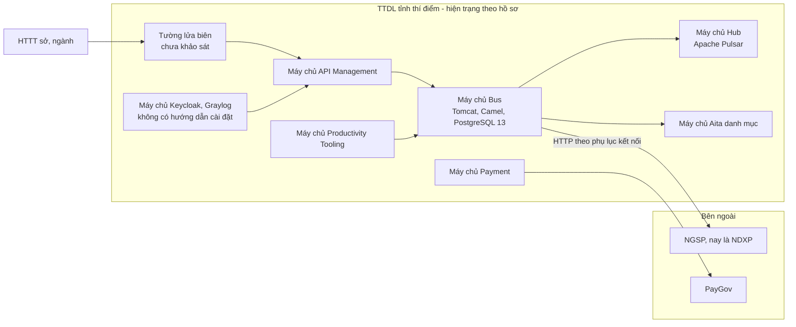
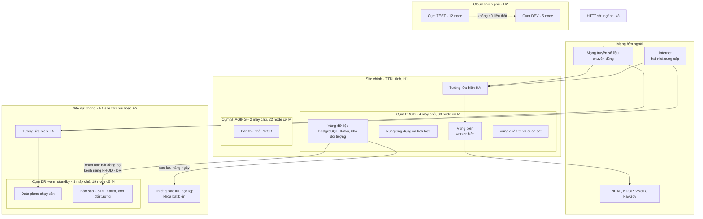
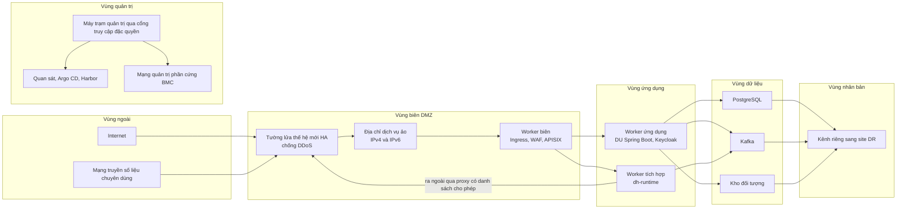
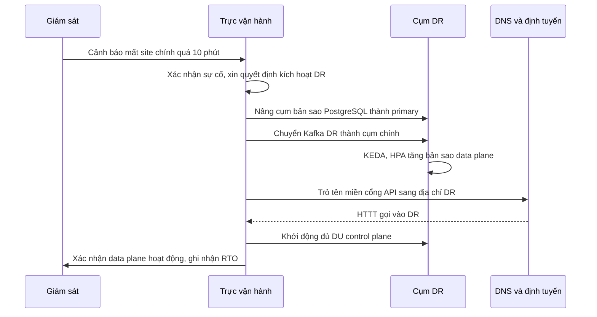

## 6. Giải pháp hạ tầng kỹ thuật

> **Tóm tắt cho hội đồng thẩm định.** Chương này là phần hạ tầng của thiết kế cơ sở: hiện trạng, mô hình vật lý, năm môi trường, cấu hình tham chiếu cho ba cỡ tỉnh, mạng và kết nối, sao lưu và dự phòng thảm họa, danh mục thiết bị, chỉ tiêu lắp đặt, kiểm tra, khối lượng và đào tạo. Với tỉnh thí điểm cỡ M, tổng nhu cầu của cả năm môi trường là **88 node Kubernetes, 866 vCPU, 2.528 GB RAM, 29,5 TB SSD và 66 TB HDD**, trong đó PROD chiếm 360 vCPU, 1.024 GB RAM, 13,2 TB SSD, 32 TB HDD; site DR 204 vCPU, 608 GB RAM, 7,5 TB SSD, 24 TB HDD; ba môi trường phụ (STAGING, TEST, DEV) 302 vCPU, 896 GB RAM, 8,8 TB SSD, 10 TB HDD. Theo phương án hạ tầng khuyến nghị ở Chương 4, nhu cầu này quy ra 9 máy chủ vật lý hai bộ xử lý (4 cho PROD, 3 cho DR, 2 cho STAGING) cộng thuê cloud chính phủ cho DEV và TEST; nếu toàn bộ đặt trên cloud chính phủ thì dùng bảng quy đổi ở mục 6.7. Con số được tính từ tài nguyên yêu cầu của từng thành phần phần mềm ở tải đỉnh cỡ M, cộng dự phòng một nút hỏng; tệp `_ha-tang-sizing.csv` chứa đủ số liệu theo từng vai trò để Chương 8 tính chi phí.

### 6.1. Hiện trạng hạ tầng

Hệ LGSP cũ đặt tại trung tâm dữ liệu tỉnh thí điểm. Theo hồ sơ cài đặt (Chương 2 mục 2.1.2 và 2.2.5), mỗi khối chức năng được cài trên một máy chủ riêng cấu hình tối thiểu Intel Xeon E5-2670 v3, 32 GB RAM, một ổ SSD 120 GB và hai ổ SATA 1 TB, hai cổng mạng 1 Gbps, hệ điều hành CentOS 6, Tomcat và PostgreSQL 13 cài chung trên máy. Hồ sơ hàm ý tối thiểu sáu máy chủ ứng dụng, chưa kể các máy chủ cho Pulsar, cổng API, Keycloak và Graylog; số máy thực tế, vị trí tủ rack, đường truyền và năng lực còn trống của trung tâm dữ liệu chưa được khảo sát (Q-D0101-21, Q-D0101-23 tại Chương 2). Sơ đồ sơ bộ dưới đây dựng lại hiện trạng từ hồ sơ để làm căn cứ cho phương án chuyển đổi; nó sẽ được thay bằng sơ đồ khảo sát thực tế ở bước thiết kế chi tiết.

Sơ đồ cho thấy ba đặc điểm hạ tầng mà giải pháp mới phải khắc phục: mỗi khối là một điểm hỏng đơn lẻ, không có site dự phòng, và kết nối quốc gia theo phụ lục cũ đi qua giao thức không mã hóa. Khi chuyển đổi, các máy chủ này tiếp tục chạy đến khi nhóm dịch vụ cuối cùng được cắt chuyển (tối đa đến G5), sau đó được thu hồi; báo cáo không tính tái sử dụng chúng cho Datahub vì cấu hình (bộ xử lý thế hệ 2014, 32 GB RAM, cổng 1 Gbps) không đáp ứng yêu cầu của nút Kubernetes ở mục 6.5.

### 6.2. Mô hình triển khai vật lý

Mô hình vật lý theo phương án khuyến nghị ở Chương 4 mục 4.6.3 gồm ba địa điểm: site chính tại trung tâm dữ liệu tỉnh chứa PROD và STAGING; site dự phòng chứa DR (trung tâm dữ liệu thứ hai của tỉnh, hoặc một vùng cloud chính phủ nếu tỉnh không có site thứ hai); và cloud chính phủ chứa DEV, TEST. Sơ đồ dưới đây thể hiện các địa điểm, các cụm Kubernetes và các đường kết nối chính.

Sơ đồ có ba điểm cần lưu ý. Thứ nhất, PROD và STAGING là hai cụm Kubernetes riêng trên hai nhóm máy chủ riêng, không chia sẻ máy chủ, để thử nghiệm trên STAGING không thể ảnh hưởng PROD; hai cụm chỉ dùng chung tủ rack và thiết bị mạng với phân tách VLAN và vùng tường lửa. Thứ hai, site DR có đường vào riêng từ Internet và mạng truyền số liệu chuyên dùng, nên khi site chính mất hoàn toàn, lưu lượng chuyển sang DR bằng thay đổi DNS hoặc định tuyến mà không phụ thuộc thiết bị nào ở site chính. Thứ ba, DEV và TEST nằm ngoài trung tâm dữ liệu tỉnh và không bao giờ chứa dữ liệu thật; STAGING đặt cùng điều kiện an toàn với PROD vì được dùng diễn tập di trú bằng dữ liệu đã che (Chương 3 mục 3.5).

### 6.3. Các môi trường

Datahub dùng năm môi trường theo bộ giả định nền §4. Bảng dưới đây nêu mục đích, vị trí, quy mô so với PROD và thời điểm cần có. Thời điểm cần có là thông tin quan trọng cho Chương 8 vì nó quyết định số tháng thuê hoặc thời điểm mua sắm.

| Môi trường | Mục đích | Vị trí khuyến nghị | Quy mô so với PROD | Cần có từ | Dữ liệu |
|---|---|---|---|---|---|
| DEV | Phát triển, chạy thử của đội nhà thầu, nhánh tính năng | H2 (hoặc hạ tầng nhà thầu ở W0 đến W2) | Cố định, nhỏ (5 node) | T0 | Giả lập |
| TEST | Kiểm thử tích hợp, hợp đồng API, kiểm thử tự động mỗi sprint, giả lập NDXP và PayGov | H2 | Cố định (12 node) | T0+1 | Giả lập |
| STAGING | Kiểm thử hệ thống, hiệu năng, ATTT, UAT, diễn tập di trú và nâng cấp | H1 site chính | Khoảng 50% PROD | T0+6 (đầu W2) | Đã che |
| PROD | Vận hành chính thức | H1 site chính | 100% | T0+9 (cài đặt trước W3 ở T0+10) | Thật |
| DR | Dự phòng thảm họa, ấm (warm standby) | H1 site thứ hai hoặc H2 vùng khác | Khoảng 50–60% PROD | T0+11 (trước cắt chuyển nhóm dịch vụ lớn đầu tiên) | Bản sao thật |

Môi trường phụ (DEV, TEST, STAGING) có cấu hình cố định đối với DEV, TEST vì tải của chúng phụ thuộc đội phát triển chứ không phụ thuộc quy mô tỉnh; STAGING thay đổi theo cỡ vì phải tái hiện cấu trúc PROD đủ để kiểm thử hiệu năng có ý nghĩa. Kiểm thử hiệu năng chạy trên STAGING ở khoảng một nửa quy mô và được ngoại suy dựa trên chỉ tiêu mở rộng tuyến tính (NFR-00-061); trước vận hành chính thức có một lần kiểm thử ở quy mô đầy đủ trên PROD khi PROD chưa nhận lưu lượng thật. Sau giai đoạn bảo hành, DEV và TEST có thể thu gọn về một cụm duy nhất phục vụ bảo trì; Chương 8 nên tính kịch bản này từ Năm 3.

### 6.4. Phương pháp tính quy mô

#### 6.4.1. Nguyên tắc

Quy mô hạ tầng được tính từ dưới lên, theo bốn bước. Bước thứ nhất là xác định tài nguyên yêu cầu (request) của từng thành phần phần mềm ở tải đỉnh của từng cỡ, dựa trên chỉ tiêu tải ở mục 5.11 và đặc tính đã biết của từng sản phẩm (ví dụ một bản sao APISIX 2 vCPU xử lý khoảng vài nghìn lượt gọi mỗi giây với cấu hình plugin điển hình; để có biên an toàn, báo cáo tính 170 lượt mỗi giây mỗi vCPU tính cả WAF và gọi OPA). Bước thứ hai là gom thành phần vào các nhóm node theo vai trò, vì mỗi nhóm có yêu cầu khác nhau về mạng, lưu trữ và vùng an ninh. Bước thứ ba là tính số node cho mỗi nhóm sao cho mức dùng khi đủ node không vượt khoảng 75–85%, và khi mất một node vẫn đủ chỗ chạy toàn bộ bản sao; số node tối thiểu của mỗi nhóm trong PROD là 3 để trải đều ba miền lỗi (failure domain). Bước thứ tư là tính dung lượng lưu trữ từ khối lượng dữ liệu theo ngày và thời gian lưu giữ.

Cách tính này cho kết quả thận trọng ở hai điểm, được chủ động chấp nhận. Một là dự trữ co giãn: nhóm worker tích hợp được cộng thêm 30% vCPU của các luồng Camel để KEDA tăng bản sao khi độ trễ tiêu thụ Kafka tăng đột biến. Hai là ánh xạ vCPU của node ảo sang luồng xử lý vật lý theo tỷ lệ 1:1 cho PROD và DR (không bán vượt), tỷ lệ 2:1 cho môi trường phụ.

#### 6.4.2. Tài nguyên yêu cầu theo thành phần, cỡ M

Bảng dưới đây là ví dụ của bước thứ nhất cho cỡ M, nhóm theo vai trò node. Số bản sao nhân với vCPU và RAM của mỗi bản sao cho tài nguyên yêu cầu của nhóm; các cỡ S và L được tính tương tự với số bản sao khác (có trong bản tính lưu kèm hồ sơ).

| Nhóm node | Thành phần, số bản sao × (vCPU, GB RAM) | Tổng yêu cầu | Cấu hình node | Số node | Mức dùng CPU / RAM |
|---|---|---|---|---|---|
| Worker biên | APISIX và Coraza WAF 6 × (2; 2) | 12 vCPU; 12 GB | 8 vCPU; 16 GB | 3 | 57% / 29% |
| Worker ứng dụng | `dh-connect` 3 × (2; 4), `dh-platform` 3 × (2; 4), `dh-data` 3 × (2; 4), `dh-integration` 2 × (2; 4), `dh-payment` 2 × (2; 4), `dh-assist` 2 × (2; 4), Keycloak 3 × (2; 4), OPA 3 × (0,5; 0,5), OpenBao 3 × (1; 2), Valkey 6 × (1; 4), Apicurio 2 × (1; 2), giao diện 4 × (1; 2) | 52,5 vCPU; 115,5 GB | 16 vCPU; 32 GB | 5 | 70% / 77% |
| Worker tích hợp | `dh-runtime` đồng bộ 9 × (2; 2), bất đồng bộ 6 × (2; 2), kết nối quốc gia 3 × (2; 2), runtime bộ điều hợp 4 × (1; 2), Kafka Connect và Debezium 3 × (2; 4), dự trữ KEDA 11 vCPU, 11 GB | 57 vCPU; 67 GB | 16 vCPU; 32 GB | 5 | 76% / 45% |
| Quan sát và quản trị | OpenSearch 3 × (4; 16), Prometheus hoặc Mimir 2 × (2; 8), Loki 3 × (2; 4), Tempo 2 × (1; 4), Grafana 3 × (0,5; 1), OTel Collector 3 × (1; 2), Argo CD 1 × (4; 8), Harbor và Trivy 1 × (4; 8), các operator 1 × (3; 6) | 39,5 vCPU; 115 GB | 16 vCPU; 64 GB | 4 | 66% / 46% |

Mức dùng khi đủ node được giữ ở 57–77%, nghĩa là khi một máy chủ vật lý hỏng và các node trên đó mất đi, các node còn lại vẫn chứa được toàn bộ bản sao với mức dùng khoảng 85–95%, đáp ứng yêu cầu "một nút hỏng không mất dịch vụ" (NFR-00-015). Nhóm worker biên có RAM dùng thấp vì APISIX nặng về CPU; cấu hình 8 vCPU, 16 GB là cấu hình nhỏ nhất hợp lý cho node Kubernetes trong vùng biên.

PostgreSQL, Kafka và kho đối tượng chạy trên nhóm node dữ liệu riêng (có taint để chỉ thành phần dữ liệu được đặt lên), vì chúng cần ổ SSD cục bộ hiệu năng cao và không được chia sẻ CPU với ứng dụng. Cỡ M dùng 3 node PostgreSQL 16 vCPU, 64 GB (một primary, hai standby đồng bộ), 3 broker Kafka 8 vCPU, 32 GB, và 4 node kho đối tượng.

#### 6.4.3. Dung lượng lưu trữ

Bảng dưới đây trình bày căn cứ tính dung lượng cho cỡ M. Các hệ số kích thước bản tin là giả định thiết kế, sẽ được hiệu chỉnh bằng số liệu thực tế của hệ cũ (Q-D0101-24 tại Chương 2).

| Loại dữ liệu | Căn cứ tính (cỡ M) | Dung lượng cần | Đặt tại |
|---|---|---|---|
| Kafka | 25 triệu sự kiện × 2 KB + 10 triệu bản ghi giao dịch × 1 KB = 60 GB/ngày; lưu 7 ngày; nhân bản 3 | 1,26 TB, tức 47% của 3 × 0,9 TB khả dụng | SSD node Kafka |
| PostgreSQL | Danh mục 5 triệu bản ghi nhiều phiên bản, dữ liệu chủ, giao dịch thanh toán 5 năm (400 nghìn mỗi tháng), cấu hình, quy trình, kiểm toán quản trị 12 tháng, chỉ mục | Khoảng 0,5 TB ở Năm 5, tức 50% của 1 TB mỗi node | SSD node PostgreSQL |
| Nhật ký giao dịch tìm kiếm nhanh | 10 triệu × 1,5 KB = 15 GB/ngày; 90 ngày; 1 bản sao; ngưỡng đầy 85% | Khoảng 3,5 TB | SSD node quan sát |
| Siêu dữ liệu lượt gọi truy vấn 12 tháng | 10 triệu × khoảng 60 byte sau nén × 365 ngày; 2 bản sao | Khoảng 0,45 TB | SSD node quan sát |
| Chỉ số giám sát | 90 ngày | Khoảng 0,3 TB | SSD node quan sát |
| Lưu trữ nhật ký kiểm toán 24 tháng (WORM) | 10 triệu × 0,4 KB = 4 GB/ngày × 730 ngày | 2,9 TB khả dụng | Kho đối tượng có khóa bất biến |
| Sao lưu CSDL | 4 bản toàn phần hằng tuần nén, WAL 30 ngày | Khoảng 1,4 TB khả dụng | Kho đối tượng Garage |
| Bản tin lớn lưu tạm (claim check), hàng đợi lỗi | 2% giao dịch × 500 KB × 7 ngày | 0,7 TB khả dụng | Garage |
| Nhật ký vận hành 90 ngày (NFR-00-028) | Khoảng 20 GB/ngày trước nén, nén khoảng 5 lần | 0,36 TB khả dụng | Garage (Loki) |
| Truy vết, ảnh container, tệp nghiệp vụ | Truy vết lấy mẫu 14 ngày, kho ảnh, tệp nhập danh mục và đối soát | Khoảng 0,9 TB khả dụng | Garage |

Tổng dung lượng khả dụng cần trên kho đối tượng cỡ M là khoảng 6,3 TB; với hệ số nhân bản 3 của Garage và kho WORM, dung lượng thô cần khoảng 19 TB, tức 59% của 32 TB HDD thô bố trí cho 4 node kho đối tượng PROD, phần còn lại dành cho tăng trưởng trong vòng đời năm năm. Nhóm node quan sát cỡ M có 4,8 TB SSD, mức dùng dự kiến khoảng 88% nếu chạy đồng thời kho tìm kiếm nhật ký 90 ngày và kho siêu dữ liệu 12 tháng; đây là điểm cần theo dõi, và quyết định ở SDD PH-13 về việc chọn một kho chính (OpenSearch hay ClickHouse) có thể giảm đáng kể mức này. Nếu SDD giữ cả hai, cần bổ sung khoảng 1 TB SSD cho mỗi node quan sát từ Năm 2.

#### 6.4.4. Băng thông

Băng thông đỉnh ra vào site chính cỡ M được ước tính theo ba thành phần: lượt gọi đồng bộ 1.000 mỗi giây × 8 KB (yêu cầu cộng phản hồi) là 64 Mbps; sự kiện đẩy ra ngoài khoảng 1.000 mỗi giây ở đỉnh (25 triệu mỗi ngày, hệ số đỉnh 3,5) × 2 KB là 16 Mbps; bản tin lớn và tệp 2% lượt gọi × 500 KB là 80 Mbps. Tổng khoảng 160 Mbps, nhân hệ số dự phòng 1,5 cho mã hóa và đột biến, ra khoảng 250 Mbps; đường truyền khuyến nghị ở mục 6.6.4 được làm tròn lên mức gói cước phổ biến. Cỡ S và L được tính tương tự, lần lượt khoảng 46 Mbps và 484 Mbps trước hệ số dự phòng.

### 6.5. Bảng cấu hình tham chiếu cỡ S, M, L

Mục này là đầu vào chính cho Chương 8. Mỗi dòng là một vai trò node trong một môi trường; số liệu chi tiết cùng cấu trúc nằm trong tệp `_ha-tang-sizing.csv` (cột: cỡ, môi trường, vai trò, số node, vCPU mỗi node, RAM GB mỗi node, SSD TB mỗi node, HDD TB mỗi node). Cách đọc ô: "3 × (8; 16; 0,1)" là 3 node, mỗi node 8 vCPU, 16 GB RAM, 0,1 TB SSD; HDD ghi thêm khi có.

#### 6.5.1. PROD

| Vai trò | Cỡ S | Cỡ M | Cỡ L |
|---|---|---|---|
| Control plane Kubernetes | 3 × (4; 8; 0,1) | 3 × (8; 16; 0,1) | 3 × (8; 32; 0,1) |
| Worker biên | 3 × (4; 8; 0,1) | 3 × (8; 16; 0,1) | 6 × (8; 16; 0,1) |
| Worker ứng dụng | 4 × (16; 32; 0,1) | 5 × (16; 32; 0,1) | 7 × (16; 64; 0,1) |
| Worker tích hợp | 3 × (16; 32; 0,1) | 5 × (16; 32; 0,1) | 10 × (16; 32; 0,1) |
| Node PostgreSQL | 3 × (8; 32; 0,5) | 3 × (16; 64; 1) | 3 × (32; 128; 2) |
| Broker Kafka | 3 × (4; 16; 0,3) | 3 × (8; 32; 1) | 5 × (16; 64; 1,5) |
| Node kho đối tượng | 3 × (4; 8; 0,2; HDD 3) | 4 × (4; 16; 0,2; HDD 8) | 6 × (8; 32; 0,3; HDD 12) |
| Node quan sát và quản trị | 4 × (8; 32; 0,4) | 4 × (16; 64; 1,2) | 6 × (16; 64; 2,1) |
| **Tổng PROD** | **26 node; 216 vCPU; 568 GB; 5,9 TB SSD; 9 TB HDD** | **30 node; 360 vCPU; 1.024 GB; 13,2 TB SSD; 32 TB HDD** | **46 node; 664 vCPU; 2.240 GB; 30,5 TB SSD; 72 TB HDD** |

Từ S lên L, thành phần tăng mạnh nhất là worker tích hợp (từ 3 lên 10 node) và worker biên (từ 3 lên 6), phản ánh đúng việc lưu lượng tăng 10 lần; các DU control plane chỉ tăng nhẹ. Node PostgreSQL ở cỡ L được tăng cấu hình theo chiều dọc (32 vCPU, 128 GB) thay vì tăng số node, vì CSDL quản trị của Datahub có tải ghi thấp và lợi ích của bản sao đọc thêm không lớn.

#### 6.5.2. DR

Site DR ở trạng thái ấm: data plane (worker biên, worker tích hợp) và các DU thiết yếu chạy sẵn với số bản sao tối thiểu, CSDL, Kafka, kho đối tượng nhận bản sao liên tục. Quy mô tính toán ở khoảng 50% (S, M) và 70% (L) tài nguyên yêu cầu của PROD cho nhóm ứng dụng, tích hợp và biên; khi chuyển sang DR, KEDA và HPA tăng bản sao trong giới hạn tài nguyên có sẵn, và các lượt gọi thuộc nhóm ưu tiên thấp bị hạn mức chặt hơn. Nhóm dữ liệu giữ nguyên cấu hình node của PROD (bớt một node PostgreSQL) để chịu được toàn bộ tải ghi.

| Vai trò | Cỡ S | Cỡ M | Cỡ L |
|---|---|---|---|
| Control plane Kubernetes | 3 × (4; 8; 0,1) | 3 × (8; 16; 0,1) | 3 × (8; 32; 0,1) |
| Worker biên | 2 × (4; 8; 0,1) | 2 × (8; 16; 0,1) | 3 × (8; 16; 0,1) |
| Worker ứng dụng | 2 × (16; 32; 0,1) | 2 × (16; 32; 0,1) | 4 × (16; 64; 0,1) |
| Worker tích hợp | 2 × (16; 32; 0,1) | 2 × (16; 32; 0,1) | 7 × (16; 32; 0,1) |
| Node PostgreSQL | 2 × (8; 32; 0,5) | 2 × (16; 64; 1) | 2 × (32; 128; 2) |
| Broker Kafka | 3 × (4; 16; 0,3) | 3 × (8; 32; 1) | 3 × (16; 64; 1,5) |
| Node kho đối tượng | 3 × (4; 8; 0,2; HDD 3) | 3 × (4; 16; 0,2; HDD 8) | 4 × (8; 32; 0,3; HDD 12) |
| Node quan sát và quản trị | 2 × (8; 32; 0,2) | 2 × (16; 64; 0,5) | 3 × (16; 64; 1) |
| **Tổng DR** | **19 node; 140 vCPU; 368 GB; 3,8 TB SSD; 9 TB HDD** | **19 node; 204 vCPU; 608 GB; 7,5 TB SSD; 24 TB HDD** | **29 node; 416 vCPU; 1.392 GB; 14,4 TB SSD; 48 TB HDD** |

Ở cỡ M, DR có 4 worker ứng dụng và tích hợp (64 vCPU) so với 10 ở PROD; với mức dùng thực tế của PROD khoảng 70–76% ở đỉnh, DR phục vụ được khoảng 60% lưu lượng đỉnh cỡ M mà không cần tăng tài nguyên, đủ cho lưu lượng giờ thường và cho nhóm dịch vụ thiết yếu ở giờ cao điểm. Nếu chủ đầu tư yêu cầu DR chịu 100% tải đỉnh, nhóm worker DR phải bằng PROD (thêm khoảng 96 vCPU, 192 GB cho cỡ M); báo cáo không khuyến nghị vì chi phí tăng khoảng một phần ba cho một tình huống hiếm (Q-D0101-50).

#### 6.5.3. Môi trường phụ

STAGING tái hiện đủ các vai trò của PROD ở quy mô nhỏ hơn; TEST và DEV có cấu hình cố định cho mọi cỡ, gộp dịch vụ dữ liệu vào node "dữ liệu gộp".

| Môi trường | Cỡ S | Cỡ M | Cỡ L |
|---|---|---|---|
| STAGING | 20 node; 130 vCPU; 352 GB; 3 TB SSD; 3 TB HDD | 22 node; 182 vCPU; 480 GB; 4,8 TB SSD; 6 TB HDD | 25 node; 280 vCPU; 896 GB; 8,2 TB SSD; 12 TB HDD |
| TEST | 12 node; 84 vCPU; 280 GB; 2,8 TB SSD; 3 TB HDD | như S | như S |
| DEV | 5 node; 36 vCPU; 136 GB; 1,2 TB SSD; 1 TB HDD | như S | như S |
| **Tổng môi trường phụ** | **37 node; 250 vCPU; 768 GB; 7 TB SSD; 7 TB HDD** | **39 node; 302 vCPU; 896 GB; 8,8 TB SSD; 10 TB HDD** | **42 node; 400 vCPU; 1.312 GB; 12,2 TB SSD; 16 TB HDD** |

Chi tiết vai trò của từng môi trường phụ có trong tệp CSV. TEST gồm 3 node control plane (4; 8), 3 worker ứng dụng (8; 32), 2 worker tích hợp (8; 16), 3 node dữ liệu gộp (8; 32; 0,5 SSD; 1 HDD) và 1 node quan sát (8; 32; 0,5); DEV gồm 1 node control plane, 3 worker và 1 node dữ liệu gộp.

#### 6.5.4. Tổng hợp

| Nhóm | Cỡ S | Cỡ M | Cỡ L |
|---|---|---|---|
| PROD | 26 node; 216 vCPU; 568 GB; 5,9 TB SSD; 9 TB HDD | 30 node; 360 vCPU; 1.024 GB; 13,2 TB SSD; 32 TB HDD | 46 node; 664 vCPU; 2.240 GB; 30,5 TB SSD; 72 TB HDD |
| DR | 19 node; 140 vCPU; 368 GB; 3,8 TB SSD; 9 TB HDD | 19 node; 204 vCPU; 608 GB; 7,5 TB SSD; 24 TB HDD | 29 node; 416 vCPU; 1.392 GB; 14,4 TB SSD; 48 TB HDD |
| Môi trường phụ | 37 node; 250 vCPU; 768 GB; 7 TB SSD; 7 TB HDD | 39 node; 302 vCPU; 896 GB; 8,8 TB SSD; 10 TB HDD | 42 node; 400 vCPU; 1.312 GB; 12,2 TB SSD; 16 TB HDD |
| **Tổng cộng** | **82 node; 606 vCPU; 1.704 GB; 16,7 TB SSD; 25 TB HDD** | **88 node; 866 vCPU; 2.528 GB; 29,5 TB SSD; 66 TB HDD** | **117 node; 1.480 vCPU; 4.944 GB; 57,1 TB SSD; 136 TB HDD** |

Từ S lên M, tổng vCPU tăng 43% trong khi lưu lượng tăng 5 lần, và từ M lên L tăng 71% cho lưu lượng gấp 3 lần. Nguyên nhân là phần cố định (control plane Kubernetes, quan sát, môi trường phụ, số bản sao tối thiểu cho sẵn sàng cao) chiếm tỷ trọng lớn ở cỡ nhỏ. Hệ quả cho chiến lược nhân rộng là các tỉnh cỡ S có chi phí hạ tầng trên mỗi giao dịch cao nhất, và chính họ được lợi nhiều nhất từ nền tảng dùng chung ở chế độ `SHARED` (Chương 4 mục 4.7).

### 6.6. Mạng, phân vùng và kết nối

#### 6.6.1. Phân vùng mạng

Mạng của mỗi site được chia thành các vùng theo chức năng và mức tin cậy, mỗi vùng là một VLAN hoặc dải mạng riêng, giữa các vùng có tường lửa với chính sách từ chối mặc định. Bên trong cụm Kubernetes, ranh giới vùng được thực thi thêm bằng nhóm node có taint, namespace và chính sách mạng Cilium, cùng mTLS của Istio ambient. Chính sách cụ thể giữa các vùng do Chương 7 quy định; sơ đồ dưới đây là sơ đồ kết nối sơ bộ.

Sơ đồ thể hiện bốn quy tắc kết nối chính. Thứ nhất, chỉ vùng biên nhận kết nối từ bên ngoài, và chỉ ở cổng 443. Thứ hai, vùng dữ liệu không bao giờ nhận kết nối trực tiếp từ vùng biên hay từ bên ngoài. Thứ ba, kết nối ra ngoài của `dh-runtime` (tới NDXP, HTTT, kênh thanh toán) đi qua proxy ra có danh sách đích cho phép, để một luồng bị cấu hình sai không thể gửi dữ liệu tới địa chỉ tùy ý. Thứ tư, quản trị chỉ thực hiện từ vùng quản trị qua cổng truy cập đặc quyền, mạng quản trị phần cứng (BMC) tách riêng; đây cũng là điểm nâng cấp lên cấp độ 4 (mạng quản trị riêng).

#### 6.6.2. Mạng trong site

Mỗi máy chủ vật lý ở PROD và DR có hai cổng 25 GbE nối tới hai thiết bị chuyển mạch đầu tủ (top-of-rack) khác nhau, gộp liên kết để chịu được hỏng một cổng hoặc một thiết bị chuyển mạch; lưu lượng ứng dụng, lưu lượng lưu trữ và nhân bản được tách VLAN. Cỡ S có thể dùng 10 GbE. Mỗi máy chủ có thêm một cổng 1 GbE cho mạng BMC. Cân bằng tải vào cụm dùng địa chỉ dịch vụ ảo do Kubernetes quản lý (ví dụ MetalLB hoặc tính năng tương đương của Cilium) trước các worker biên, nên không bắt buộc thiết bị cân bằng tải phần cứng; nếu trung tâm dữ liệu tỉnh đã có thiết bị cân bằng tải dùng chung thì có thể dùng thay.

#### 6.6.3. IPv6

Mạng được thiết kế dual-stack. Mỗi vùng được cấp một dải IPv4 riêng và một tiền tố IPv6 /64 riêng từ khối địa chỉ IPv6 của tỉnh; địa chỉ dịch vụ công bố (tên miền cổng API, cổng nhà phát triển) có cả bản ghi A và AAAA. Tường lửa, thiết bị chuyển mạch, cân bằng tải và cụm Kubernetes (Cilium dual-stack) phải hỗ trợ IPv6 đầy đủ, kể cả chính sách lọc tương đương IPv4; đây là yêu cầu kỹ thuật bắt buộc trong danh mục thiết bị ở mục 6.8. Phía phần mềm, yêu cầu IPv6 ở mục 5.9. Nếu tỉnh chưa được cấp khối địa chỉ IPv6 hoặc nhà cung cấp đường truyền chưa hỗ trợ, phần bên trong vẫn chạy dual-stack và việc công bố ra ngoài qua IPv6 được bật khi đường truyền sẵn sàng (Q-D0101-51).

#### 6.6.4. Kết nối diện rộng

Bảng dưới đây nêu đường truyền khuyến nghị cho từng cỡ, dựa trên ước tính ở mục 6.4.4 và yêu cầu nhân bản sang DR.

| Đường truyền | Cỡ S | Cỡ M | Cỡ L | Ghi chú |
|---|---|---|---|---|
| Internet tại site chính | 2 × 100 Mbps | 2 × 300 Mbps | 2 × 1 Gbps | Hai nhà cung cấp khác nhau; cho HTTT ngoài mạng chuyên dùng, kênh thanh toán, VNeID |
| Mạng truyền số liệu chuyên dùng tại site chính | 100 Mbps | 200 Mbps | 500 Mbps | Kết nối NDXP, CSDL quốc gia, HTTT các cơ quan trên mạng chuyên dùng |
| Internet và mạng chuyên dùng tại site DR | Như site chính | Như site chính | Như site chính | Có thể ở trạng thái chờ với cam kết nâng băng thông khi kích hoạt |
| Kênh riêng site chính tới site DR | 200 Mbps | 500 Mbps | 1 Gbps | Nhân bản CSDL, Kafka, kho đối tượng |

Kênh riêng sang DR được tính theo hai yêu cầu. Yêu cầu thường xuyên ở cỡ M là khoảng 50 Mbps ở đỉnh (WAL PostgreSQL khoảng 20 GB mỗi ngày, Kafka 60 GB mỗi ngày qua MirrorMaker 2, đồng bộ kho đối tượng khoảng 10 GB mỗi ngày). Yêu cầu bất thường là đồng bộ lại sau khi kênh bị gián đoạn hoặc sau diễn tập: với 500 Mbps, 1 TB dữ liệu được đồng bộ lại trong khoảng 4,5 giờ, phù hợp cửa sổ khôi phục. Độ trễ kênh không ảnh hưởng hiệu năng ứng dụng vì nhân bản sang DR là bất đồng bộ.

### 6.7. Quy đổi sang máy chủ vật lý và cloud chính phủ

#### 6.7.1. Quy đổi sang máy chủ vật lý (H1)

Các node trong bảng cấu hình là máy ảo chạy trên nền ảo hóa của trung tâm dữ liệu tỉnh. Quy đổi sang máy chủ vật lý dùng cấu hình máy chủ hai bộ xử lý phổ biến: cỡ S dùng 2 × 24 nhân (96 luồng), 384 GB RAM; cỡ M dùng 2 × 32 nhân (128 luồng), 512 GB RAM; cỡ L dùng 2 × 32 nhân, 768 GB RAM. Mỗi máy chủ dành 8 luồng và 40 GB RAM cho nền ảo hóa. Số máy chủ bằng số cần cho tài nguyên cộng một máy dự phòng (N+1), tối thiểu 3 cho PROD và DR. Node kho đối tượng là máy ảo gắn ổ HDD trực tiếp của máy chủ chứa nó, mỗi node trên một máy chủ khác nhau, nên không cần máy chủ lưu trữ riêng.

| Nhóm | Cỡ S | Cỡ M | Cỡ L |
|---|---|---|---|
| Máy chủ PROD | 4 máy; mỗi máy 4 × 1,92 TB NVMe, 2 × 2 TB HDD (3 máy) | 4 máy; mỗi máy 4 × 3,84 TB NVMe, 2 × 4 TB HDD | 7 máy; mỗi máy 4 × 3,84 TB NVMe, 3 × 4 TB HDD (6 máy) |
| Máy chủ DR | 3 máy; mỗi máy 4 × 1,92 TB NVMe, 2 × 2 TB HDD | 3 máy; mỗi máy 4 × 1,92 TB NVMe, 2 × 4 TB HDD | 5 máy; mỗi máy 4 × 1,92 TB NVMe, 3 × 4 TB HDD (4 máy) |
| Máy chủ STAGING | 2 máy; mỗi máy 4 × 1,92 TB NVMe, 2 × 2 TB HDD | 2 máy; mỗi máy 4 × 1,92 TB NVMe, 2 × 2 TB HDD | 2 máy; mỗi máy 4 × 3,84 TB NVMe, 2 × 4 TB HDD |
| DEV và TEST (nếu đặt tại chỗ thay vì thuê) | 2 máy | 2 máy | 2 máy |
| Mức dùng CPU PROD khi đủ máy | 61% | 75% | 79% |

Tất cả máy chủ có thêm 2 ổ SSD 480 GB gương cho hệ điều hành nền ảo hóa, 2 cổng 25 GbE (10 GbE cho S), 1 cổng BMC, nguồn kép. Ổ NVMe cấu hình RAID 10 ở mức máy chủ: ví dụ máy PROD cỡ M có 7,68 TB khả dụng, bốn máy là 30,7 TB, so với 13,2 TB SSD cần cho PROD cỡ M, tức 43% ở năm đầu; phần dư dành cho tăng trưởng dữ liệu và cho khả năng chuyển node khi một máy hỏng. Với cỡ M, mất một máy chủ PROD thì ba máy còn lại vẫn có 360 luồng khả dụng, đúng bằng tổng vCPU của PROD; do các node chỉ dùng khoảng 70–76% tài nguyên, toàn bộ bản sao vẫn được xếp lại. Ở trạng thái vận hành theo phương án khuyến nghị, tỉnh cỡ M cần 9 máy chủ (4 PROD, 3 DR, 2 STAGING), tổng 576 nhân vật lý, 4.608 GB RAM.

#### 6.7.2. Quy đổi sang cloud chính phủ (H2)

Khi đặt trên cloud chính phủ, mỗi node quy đổi thành một máy ảo cùng vCPU và RAM, SSD quy thành lưu trữ khối SSD, còn HDD của node kho đối tượng quy thành dịch vụ lưu trữ đối tượng tương thích S3 của nhà cung cấp (nếu có) với dung lượng khả dụng bằng dung lượng thô chia 3, vì nhà cung cấp đã tự nhân bản. Nếu cloud cung cấp dịch vụ Kubernetes được quản lý, có thể bỏ các node control plane khỏi danh sách thuê. Bảng dưới đây là bảng quy đổi cho cỡ M; cỡ S và L quy đổi tương tự từ tệp CSV.

| Môi trường cỡ M | Máy ảo | vCPU | RAM GB | Lưu trữ khối SSD TB | Lưu trữ đối tượng S3 TB | Lưu trữ khối HDD TB |
|---|---|---|---|---|---|---|
| PROD | 26 (bỏ 4 node kho đối tượng) | 344 | 960 | 12,4 | 11 | — |
| DR | 16 | 192 | 560 | 6,9 | 8 | — |
| STAGING | 19 | 176 | 456 | 4,5 | 2 | — |
| TEST | 12 | 84 | 280 | 2,8 | — | 3 |
| DEV | 5 | 36 | 136 | 1,2 | — | 1 |
| **Tổng H2 toàn phần** | **78** | **832** | **2.392** | **27,8** | **21** | **4** |
| Trong đó thuê theo phương án khuyến nghị (DEV, TEST) | 17 | 120 | 416 | 4 | — | 4 |

Ngoài tài nguyên tính toán và lưu trữ, thuê cloud cần tính thêm địa chỉ IP công cộng (IPv4 và IPv6), băng thông Internet theo mục 6.6.4, dịch vụ cân bằng tải và tường lửa của nhà cung cấp, kết nối tới mạng truyền số liệu chuyên dùng. Nếu DR đặt ở cloud trong khi PROD tại chỗ, kênh riêng sang DR được thay bằng kết nối riêng tới cloud của nhà cung cấp với băng thông như mục 6.6.4. Kubernetes trên cloud chính phủ phải là bản chuẩn đạt kiểm tra tương thích của cộng đồng (conformance), để giữ nguyên tắc không phụ thuộc dịch vụ độc quyền (NT-09).

### 6.8. Danh mục thiết bị, dịch vụ hạ tầng cần đầu tư

Bảng dưới đây là danh mục hạ tầng cho tỉnh thí điểm cỡ M theo phương án khuyến nghị (kịch bản cơ sở: PROD, STAGING, DR theo H1; DEV, TEST thuê H2), kèm số lượng cho cỡ S và L để dùng khi nhân rộng. Chương 3 mục 3.6.2 xếp việc mua sắm phần cứng ngoài phạm vi phần mềm của dự án; danh mục này vẫn cần có vì thiết kế cơ sở phải xác định quy mô thiết bị (điểm a khoản 2 Điều 46) và Chương 8 cần nó cho tổng mức đầu tư hoặc cho dự án hạ tầng riêng (Q-D0101-52).

| STT | Hạng mục | Yêu cầu kỹ thuật chính | Cỡ S | Cỡ M | Cỡ L |
|---|---|---|---|---|---|
| 1 | Máy chủ PROD | Như mục 6.7.1, hỗ trợ ảo hóa phần cứng, nguồn kép, bảo hành 5 năm | 4 | 4 | 7 |
| 2 | Máy chủ DR | Như mục 6.7.1 | 3 | 3 | 5 |
| 3 | Máy chủ STAGING | Như mục 6.7.1 | 2 | 2 | 2 |
| 4 | Thiết bị chuyển mạch đầu tủ | 48 cổng 25 GbE (10 GbE cho S), 4 cổng uplink 100 GbE, hỗ trợ IPv6, gộp liên kết đa thiết bị | 2 + 2 | 2 + 2 | 4 + 2 |
| 5 | Thiết bị chuyển mạch quản trị | 48 cổng 1 GbE cho BMC | 1 + 1 | 1 + 1 | 2 + 1 |
| 6 | Tường lửa biên thế hệ mới, cặp sẵn sàng cao | Thông lượng khi bật phòng chống xâm nhập ≥ 1 Gbps (S), ≥ 2 Gbps (M), ≥ 5 Gbps (L); hỗ trợ IPv6; chống DDoS; cấu hình chi tiết theo Chương 7 | 2 + 2 | 2 + 2 | 2 + 2 |
| 7 | Thiết bị sao lưu độc lập tại site DR | Lưu trữ hỗ trợ khóa bất biến hoặc thư viện băng từ; dung lượng khả dụng | 10 TB | 20 TB | 40 TB |
| 8 | Tủ rack 42U, thanh nguồn có đo lường, bộ chuyển KVM | Tại site chính và site DR | 1 + 1 | 2 + 1 | 3 + 2 |
| 9 | Đường truyền Internet | Theo mục 6.6.4, hai nhà cung cấp, mỗi site | Thuê | Thuê | Thuê |
| 10 | Mạng truyền số liệu chuyên dùng | Theo mục 6.6.4, mỗi site | Thuê | Thuê | Thuê |
| 11 | Kênh riêng site chính tới DR | Theo mục 6.6.4 | Thuê | Thuê | Thuê |
| 12 | Cloud chính phủ cho DEV, TEST | 120 vCPU, 416 GB RAM, 4 TB SSD, 4 TB HDD, từ T0 | Thuê | Thuê | Thuê |
| 13 | Chứng thư số | Chứng thư TLS cho tên miền công bố; chứng thư số chuyên dùng cho ký số giao dịch với NDXP, PayGov | Theo nhu cầu | Theo nhu cầu | Theo nhu cầu |
| 14 | Nền ảo hóa | Xem mục 6.9 | Theo số máy chủ | Theo số máy chủ | Theo số máy chủ |
| 15 | Mô-đun bảo mật phần cứng (HSM) | Chỉ khi nâng cấp độ 4 hoặc khi Chương 7 yêu cầu cho khóa ký | Tùy chọn | Tùy chọn | Tùy chọn |

Trong cột số lượng, "a + b" là số thiết bị ở site chính và site DR. Ước tính công suất điện để tỉnh kiểm tra năng lực trung tâm dữ liệu (Q-D0101-42 tại Chương 4): với cỡ M, site chính có 6 máy chủ, mỗi máy khoảng 0,8–1 kW khi tải cao, cộng thiết bị mạng khoảng 0,6 kW, tổng khoảng 6–7 kW và 2 tủ rack; site DR khoảng 3,5–4 kW và 1 tủ rack.

### 6.9. Phần mềm nền

Phần mềm nền là phần mềm nằm giữa phần cứng và Datahub. Báo cáo mô tả yêu cầu theo chức năng, không chỉ định sản phẩm thương mại, để hồ sơ mời thầu bảo đảm cạnh tranh và để tỉnh dùng lại được nền đã có.

| Lớp | Yêu cầu | Phương án mã nguồn mở tham chiếu | Phương án có hỗ trợ thương mại |
|---|---|---|---|
| Nền ảo hóa | Hỗ trợ máy ảo Linux, gắn ổ trực tiếp cho máy ảo, sao lưu máy ảo, quản lý tập trung nhiều máy chủ, IPv6 | Nền ảo hóa dựa trên KVM | Sản phẩm ảo hóa tỉnh đã có, hoặc bản KVM có hỗ trợ |
| Hệ điều hành máy chủ và node | Linux bản hỗ trợ dài hạn còn ít nhất 5 năm vòng đời tại thời điểm cài đặt | Bản phân phối Linux cộng đồng hỗ trợ dài hạn | Bản phân phối Linux doanh nghiệp có hỗ trợ |
| Kubernetes | Bản đạt kiểm tra tương thích của cộng đồng, phiên bản ≥ 1.31, dual-stack, cài bằng công cụ khai báo | Kubernetes thượng nguồn cài bằng công cụ chuẩn, hoặc bản phân phối mã nguồn mở | Bản phân phối Kubernetes có hỗ trợ |
| Lưu trữ cho container | Ổ cục bộ cho CSDL, Kafka (CloudNativePG và Strimzi khuyến nghị ổ cục bộ); trình điều khiển CSI | Trình cấp phát ổ cục bộ | Không cần |
| Sao lưu | Sao lưu CSDL liên tục, sao lưu tài nguyên Kubernetes, sao chép sang thiết bị độc lập | Công cụ sao lưu tích hợp của CloudNativePG, Velero | Phần mềm sao lưu tỉnh đã có |
| Giám sát phần cứng | Thu thập trạng thái máy chủ qua BMC vào hệ thống quan sát | Bộ thu thập chỉ số phần cứng mã nguồn mở | Phần mềm quản lý của hãng máy chủ |

Chương 8 tính chi phí phần mềm nền theo hai kịch bản: kịch bản cơ sở toàn mã nguồn mở (bản quyền bằng 0, chỉ tính nhân công vận hành), kịch bản có hỗ trợ thương mại cho hệ điều hành, Kubernetes và nền ảo hóa. Số đơn vị tính bản quyền thường là số bộ xử lý vật lý (cỡ M: 18 bộ xử lý trên 9 máy chủ) hoặc số node (cỡ M: 71 node trên H1, chưa tính DEV, TEST).

### 6.10. Sao lưu và dự phòng thảm họa

#### 6.10.1. Mục tiêu và nguyên tắc

Mục tiêu khôi phục theo NFR-00-014 và bộ giả định nền đã cập nhật là RPO 15 phút, RTO 1 giờ cho data plane và 4 giờ cho control plane (cỡ S, M); cỡ L có RPO 5 phút. Giải pháp tuân theo nguyên tắc 3-2-1: ba bản dữ liệu, trên hai loại phương tiện, một bản ở địa điểm khác; ngoài ra có một bản bất biến để chống mã độc tống tiền. Mọi cơ chế sao lưu đều phải được kiểm chứng bằng khôi phục thật theo lịch, vì bản sao lưu chưa từng được khôi phục thì không được coi là bản sao lưu.

#### 6.10.2. Cơ chế theo thành phần

| Thành phần | Trong site chính | Sang site DR | Bản độc lập | RPO đạt được |
|---|---|---|---|---|
| PostgreSQL | Một primary, hai standby đồng bộ; mất một node không mất dữ liệu | Cụm bản sao CloudNativePG nhận WAL liên tục, bất đồng bộ | Sao lưu toàn phần hằng ngày và WAL vào kho đối tượng, sao tiếp sang thiết bị độc lập | Vài giây đến dưới 1 phút |
| Kafka | Nhân bản 3, tối thiểu 2 bản đồng bộ | MirrorMaker 2 sao topic và vị trí tiêu thụ | Không cần (sự kiện có nguồn gốc ở CSDL hoặc HTTT) | Dưới 1 phút |
| Kho đối tượng | Nhân bản 3 giữa các node | Đồng bộ bucket định kỳ 15 phút | Bản WORM của nhật ký kiểm toán | ≤ 15 phút |
| Cấu hình, luồng, chính sách | Kho Git | Kho Git sao sang DR; Argo CD ở DR đồng bộ cùng nguồn | Bản sao kho Git hằng ngày | Bằng 0 (Git là nguồn sự thật) |
| Bí mật | OpenBao HA 3 node | Bản sao hiệu năng hoặc ảnh chụp mã hóa sang DR | Ảnh chụp mã hóa hằng ngày, khóa mở do người giữ khóa quản lý | ≤ 15 phút |
| Tài nguyên Kubernetes | Khai báo trong Git | Như trên | Velero hằng ngày | Bằng 0 |

#### 6.10.3. Quy trình chuyển sang DR

Quy trình được thiết kế để data plane hoạt động trở lại trong 1 giờ: data plane ở DR đã chạy sẵn, các bước nâng CSDL và Kafka là thao tác có kịch bản tự động, và bản ghi DNS của tên miền công bố có thời gian sống ngắn (khuyến nghị 60 giây). Control plane được khởi động sau, trong giới hạn 4 giờ. Quyết định kích hoạt DR thuộc người có thẩm quyền do tỉnh chỉ định vì kích hoạt nhầm có chi phí (phải đồng bộ ngược khi quay về); thời gian chờ quyết định được giới hạn trong kịch bản ứng phó. Diễn tập chuyển sang DR và quay về thực hiện hằng quý (NFR-00-014), trong giai đoạn dự án ở W3 và W5 (WBS 1.26.5 tại D01-02).

### 6.11. Chỉ tiêu kỹ thuật lắp đặt, cài đặt, kiểm tra và thống kê khối lượng

#### 6.11.1. Chỉ tiêu kiểm tra

Bảng dưới đây nêu chỉ tiêu kỹ thuật phải đạt khi lắp đặt, cài đặt và kiểm tra hạ tầng, trước khi bàn giao từng môi trường cho việc cài Datahub. Các chỉ tiêu này đưa vào hồ sơ thiết kế chi tiết và biên bản nghiệm thu lắp đặt.

| Hạng mục | Chỉ tiêu | Phương pháp kiểm tra |
|---|---|---|
| Máy chủ | Chạy thử tải liên tục 72 giờ không lỗi phần cứng; firmware đồng bộ phiên bản | Công cụ chạy tải, nhật ký BMC |
| Ổ lưu trữ | NVMe đạt tối thiểu 80% hiệu năng đọc ghi ngẫu nhiên công bố của nhà sản xuất sau RAID | Công cụ đo hiệu năng ổ đĩa |
| Mạng trong site | Thông lượng giữa hai máy chủ ≥ 90% tốc độ cổng; rút một cáp hoặc tắt một thiết bị chuyển mạch không mất kết nối quá 1 giây | Công cụ đo thông lượng; kiểm thử ngắt |
| IPv6 | Mọi vùng có địa chỉ IPv6; dịch vụ công bố truy cập được qua IPv6 từ bên ngoài khi đường truyền hỗ trợ | Kiểm tra kết nối và phân giải AAAA |
| Đường truyền | Đạt băng thông cam kết ở mục 6.6.4; độ trễ kênh sang DR ổn định | Đo trong 24 giờ |
| Kubernetes | Đạt bộ kiểm tra tương thích của cộng đồng; dual-stack; chính sách mạng từ chối mặc định hoạt động | Công cụ kiểm tra tương thích; kiểm thử chính sách |
| Cấu hình an toàn nền | Đạt mức cơ sở cấu hình an toàn cho hệ điều hành và Kubernetes do Chương 7 quy định | Công cụ đánh giá cấu hình an toàn |
| PostgreSQL | Tắt primary, standby được nâng trong ≤ 30 giây, không mất giao dịch đã xác nhận | Kiểm thử hỗn loạn |
| Kafka | Tắt một broker, không mất sự kiện đã xác nhận, nhà sản xuất và người tiêu thụ tự phục hồi | Kiểm thử hỗn loạn |
| Một máy chủ hỏng | Tắt một máy chủ PROD, mọi bản sao được xếp lại, dịch vụ phục hồi ≤ 5 phút (NFR-00-015) | Kiểm thử hỗn loạn |
| Sao lưu và khôi phục | Khôi phục CSDL về một thời điểm chỉ định trên môi trường riêng, đối chiếu dữ liệu đúng | Diễn tập khôi phục |
| DR | Diễn tập chuyển sang DR đạt RPO ≤ 15 phút, RTO data plane ≤ 1 giờ, control plane ≤ 4 giờ | Diễn tập theo mục 6.10.3 |
| Hiệu năng | PROD đạt chỉ tiêu cỡ M ở mục 5.11 trong kiểm thử tải trước vận hành chính thức | Kiểm thử tải |

#### 6.11.2. Thống kê khối lượng lắp đặt, cài đặt

Bảng dưới đây thống kê khối lượng chính cho tỉnh thí điểm cỡ M theo phương án khuyến nghị, làm căn cứ ước tính chi phí lắp đặt, cài đặt ở Chương 8 và khối lượng công việc ở WBS của D01-02 (phần tử 1.26).

| Hạng mục | Đơn vị | Khối lượng | Ghi chú |
|---|---|---|---|
| Lắp đặt máy chủ vào tủ rack, đấu nối | máy | 9 | 6 site chính, 3 site DR |
| Lắp đặt, cấu hình thiết bị chuyển mạch | thiết bị | 6 | 4 đầu tủ, 2 quản trị |
| Lắp đặt, cấu hình tường lửa biên | cặp | 2 | Một cặp mỗi site |
| Lắp đặt thiết bị sao lưu độc lập | thiết bị | 1 | Site DR |
| Cài đặt, cấu hình nền ảo hóa | máy chủ | 9 | |
| Tạo, cài hệ điều hành node | node | 71 | PROD 30, DR 19, STAGING 22 |
| Dựng cụm Kubernetes | cụm | 5 | PROD, DR, STAGING tại H1; DEV, TEST trên H2 (17 node) |
| Cài đặt bộ thành phần nền (CloudNativePG, Strimzi, Garage, kho WORM, Keycloak, OPA, OpenBao, Istio, Cilium, Argo CD, Harbor, quan sát) | cụm × bộ | 5 × khoảng 25 thành phần | Cài bằng GitOps, dùng chung khai báo |
| Cài đặt Datahub và khởi tạo tenant | cụm, tenant | 5 cụm; 2 tenant ở tỉnh thí điểm (tỉnh và `PLATFORM`) | Cộng tenant tỉnh 2 ở W5 |
| Cấu hình nhân bản PROD sang DR | luồng nhân bản | 4 | PostgreSQL, Kafka, kho đối tượng, OpenBao |
| Kiểm thử theo mục 6.11.1 | bộ kiểm tra | 13 hạng mục cho PROD; 9 cho DR; 7 cho STAGING | |
| Diễn tập DR trong dự án | lần | 2 | W3, W5 |

### 6.12. Khối lượng sơ bộ đào tạo, tập huấn

Điểm e khoản 2 Điều 46 yêu cầu thiết kế cơ sở nêu khối lượng sơ bộ đào tạo, tập huấn. Bảng dưới đây nêu đối tượng, số học viên, số lớp và thời lượng cho tỉnh thí điểm cỡ M và tỉnh thứ hai. Số học viên đầu mối HTTT lấy theo quy mô cỡ M (khoảng 200 HTTT, mỗi HTTT một đầu mối). Nội dung chương trình và lộ trình chuyển giao cho đội vận hành ở D01-02 (WBS 1.27, chương nhân sự mục 6.8); đào tạo nội bộ cho đội nhà thầu không tính vào đây.

| Đối tượng | Nội dung chính | Học viên | Số lớp | Ngày mỗi lớp | Người-ngày |
|---|---|---|---|---|---|
| Đội vận hành hạ tầng và nền tảng của tỉnh | Kubernetes, GitOps, PostgreSQL, Kafka, kho đối tượng, quan sát, sao lưu, DR, xử lý sự cố theo runbook | 6 | 1 | 15 | 90 |
| Quản trị tenant, quản trị nghiệp vụ nền tảng | PH-01, 02, 12, 13, 18, 20; kết nạp HTTT, công bố dịch vụ, phân quyền, giám sát | 10 | 1 | 5 | 50 |
| Kỹ sư tích hợp của tỉnh và đơn vị phát triển HTTT | Thiết kế luồng, bộ điều hợp, sự kiện, quy trình, kiểm thử luồng | 30 | 2 | 5 | 150 |
| Cán bộ an toàn thông tin | Kiến trúc an toàn, giám sát, ứng phó sự cố của Datahub | 4 | 1 | 3 | 12 |
| Cán bộ nghiệp vụ dữ liệu | Danh mục dùng chung, dữ liệu chủ, chất lượng dữ liệu, quyền riêng tư | 40 | 2 | 2 | 80 |
| Cán bộ thanh toán, đối soát | PH-19: nhà cung cấp, giao dịch, đối soát, hoàn tiền | 15 | 1 | 2 | 30 |
| Đầu mối kỹ thuật HTTT thành viên | Quy trình kết nạp, cổng nhà phát triển, chuyển kết nối từ hệ cũ | 200 | 5 | 1 | 200 |
| Lãnh đạo, quản lý | Giới thiệu nền tảng, chỉ số, trách nhiệm các bên | 20 | 1 | 0,5 | 10 |
| Tỉnh thứ hai: quản trị tenant | Như dòng quản trị tenant, rút gọn | 8 | 1 | 3 | 24 |
| Tỉnh thứ hai: vận hành | Vận hành cụm hoặc tenant theo phương án tỉnh 2 | 4 | 1 | 5 | 20 |
| Tỉnh thứ hai: đầu mối HTTT | Kết nạp và kết nối | 40 | 1 | 1 | 40 |
| **Tổng** | | **377** | **17** | **53,5 ngày lớp** | **706** |

Đào tạo được tổ chức tại tỉnh trên môi trường thực hành riêng (một tenant thực hành trên STAGING hoặc TEST), mỗi khóa có bài kiểm tra cuối khóa với tiêu chí ít nhất 90% học viên đạt (WBS 1.27.2). Lớp cho đầu mối HTTT có thể tổ chức trực tuyến để giảm chi phí đi lại cho cấp xã.

### Câu hỏi mở

- **Q-D0101-50.** Chủ đầu tư chấp nhận site DR phục vụ khoảng 60% lưu lượng đỉnh cỡ M (kịch bản cơ sở) hay yêu cầu DR chịu 100% tải đỉnh (tăng khoảng 96 vCPU, 192 GB RAM cho cỡ M)?
- **Q-D0101-51.** Tỉnh đã được cấp khối địa chỉ IPv6 và nhà cung cấp Internet, mạng truyền số liệu chuyên dùng tại trung tâm dữ liệu tỉnh đã hỗ trợ IPv6 hay chưa?
- **Q-D0101-52.** Thiết bị hạ tầng ở mục 6.8 được mua sắm trong dự án này hay trong một dự án hạ tầng riêng của tỉnh? Chương 3 mục 3.6.2 đang xếp ngoài phạm vi; Chương 8 cần biết để đưa vào tổng mức đầu tư hay chỉ nêu như chi phí liên quan.
- **Q-D0101-53.** Trung tâm dữ liệu tỉnh đang dùng nền ảo hóa, hệ điều hành và phần mềm sao lưu nào, có tận dụng được cho Datahub không?
- **Q-D0101-54.** Số liệu kích thước bản tin trung bình, tỷ lệ bản tin lớn và lượng nhật ký thực tế của hệ cũ là bao nhiêu? Các hệ số ở mục 6.4.3 và 6.4.4 sẽ được hiệu chỉnh theo số liệu này.

### Ghi chú cho người tổng hợp

- **Đầu vào cho Chương 8.** Tệp `_ha-tang-sizing.csv` đã có trên đĩa, 96 dòng (3 cỡ × 5 môi trường × vai trò); tổng theo cỡ khớp bảng 6.5.4. Kịch bản cơ sở cho Chương 8: PROD, STAGING, DR theo H1 (9 máy chủ cỡ M, mục 6.7.1 và 6.8); DEV, TEST thuê H2 từ T0 (120 vCPU, 416 GB, 4 TB SSD, 4 TB HDD); kịch bản thay thế: toàn bộ H2 theo bảng 6.7.2, hoặc DR theo H2. Thời điểm cần có của từng môi trường ở mục 6.3.
- **RTO.** Đã dùng giả định nền cập nhật (RTO 1 giờ data plane, 4 giờ control plane). WBS 1.26.5 tại D01-02 vẫn ghi "RTO 4 giờ"; cần sửa cho khớp.
- **Mâu thuẫn phạm vi phần cứng.** Chương 3 mục 3.6.2 và D01-02 chương 1 xếp mua sắm phần cứng ngoài phạm vi; Chương 4 và Chương 6 khuyến nghị H1 cho PROD, STAGING, DR. Cần thống nhất cách đưa chi phí hạ tầng vào tổng mức đầu tư (Q-D0101-52). Chương 3 mục 3.5 cho phép DEV, TEST đặt tại hạ tầng nhà thầu ở W0 đến W2; Chương 6 khuyến nghị thuê H2 từ T0 nhưng chấp nhận phương án đó cho W0 đến W2.
- **Kho WORM.** ADR-008 quy định bằng chứng kiểm toán cần WORM dùng SeaweedFS, Ceph RGW hoặc kho WORM của tỉnh vì Garage chưa có khóa đối tượng đầy đủ. Chương 6 bố trí kho WORM chung nhóm node kho đối tượng; D03-09 cần chốt sản phẩm. Đề xuất cấp ADR trong dải 030–039 cho kho WORM và cho thiết kế DR.
- **Dung lượng node quan sát cỡ M** ở mức khoảng 88% nếu giữ cả OpenSearch 90 ngày và kho siêu dữ liệu 12 tháng; cần quyết định ở SDD PH-13.
- Các câu hỏi Q-D0101-50 đến 54 có phần trùng với Q-D0101-21, 23, 24 (Chương 2) và Q-D0101-33 (Chương 3); người tổng hợp có thể gộp.
