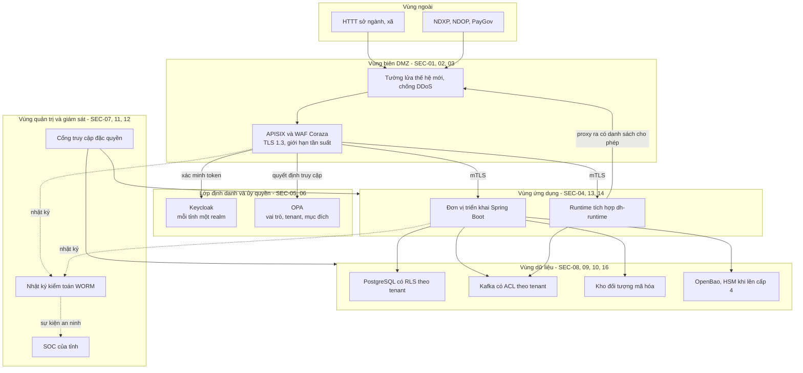

## 7. Phương án bảo đảm an toàn thông tin và an ninh mạng

**Tóm tắt cho hội đồng thẩm định.** Báo cáo đề xuất xác định Datahub ở **cấp độ 3** và thiết kế sẵn các điểm nâng cấp để lên **cấp độ 4** khi nền tảng phục vụ nhiều tỉnh. Cơ sở pháp lý hiện hành là Luật An ninh mạng số 116/2025/QH15 (hiệu lực 01/7/2026), trong đó Điều 8 chia hệ thống thông tin thành 5 cấp độ theo mức tổn hại và giao Chính phủ quy định chi tiết. Văn bản quy định chi tiết tiêu chí cấp độ cho hệ thống thông tin dân sự chưa xác minh được số hiệu, nên hồ sơ đề xuất cấp độ (D03-08) được lập theo cấu trúc có thể chuyển đổi giữa khung cũ (Nghị định 85/2016/NĐ-CP, TCVN 11930:2017) và khung mới. Phương án gồm 20 nhóm biện pháp (SEC-01 đến SEC-20) bao trùm quản lý và kỹ thuật, trong đó cách ly dữ liệu giữa các tỉnh được thực thi ở tầng hạ tầng chứ không chỉ ở mã ứng dụng, dữ liệu lưu hoàn toàn trong nước, nhật ký kiểm toán không sửa được và được gửi về trung tâm giám sát an toàn thông tin (SOC) của tỉnh. Kiểm thử xâm nhập độc lập là điều kiện của cổng G2 và G4; quyết định phê duyệt cấp độ là điều kiện của cổng G3.

### 7.1. Cơ sở pháp lý về cấp độ sau Luật An ninh mạng 2025

Từ ngày 01/7/2026, Luật An ninh mạng số 116/2025/QH15 có hiệu lực và chấm dứt hiệu lực của Luật An toàn thông tin mạng số 86/2015/QH13 và Luật An ninh mạng số 24/2018/QH14 ([nguồn](https://hethongphapluat.com/law-no-116-2025-qh15-dated-december-10-2025-on-cybersecurity.html)). Ba quy định của luật mới chi phối trực tiếp chương này.

Thứ nhất, **Điều 8** phân hệ thống thông tin thành 5 cấp độ theo mức tổn hại khi xảy ra sự cố. Theo bản đọc được, cấp độ 3 tương ứng với hệ thống mà sự cố có thể gây tổn hại đặc biệt nghiêm trọng tới quyền và lợi ích hợp pháp của tổ chức, cá nhân, tổn hại nghiêm trọng tới lợi ích công cộng, hoặc tổn hại tới trật tự xã hội, an ninh quốc gia; cấp độ 4 tương ứng với tổn hại đặc biệt nghiêm trọng tới lợi ích công cộng, trật tự, an toàn xã hội hoặc tổn hại nghiêm trọng tới an ninh quốc gia; cấp độ 5 dành cho hệ thống mà sự cố gây tổn hại đặc biệt nghiêm trọng tới an ninh quốc gia. Khoản 2 Điều 8 giao Chính phủ quy định tiêu chí chi tiết, thẩm quyền, trình tự và biện pháp cho từng cấp độ.

Thứ hai, **Điều 10 và Điều 11** quy định nghĩa vụ của chủ quản hệ thống. Chủ quản hệ thống cấp độ 3 và 4 (không thuộc danh mục hệ thống quan trọng về an ninh quốc gia) phải thực hiện các nhiệm vụ cốt lõi (phân loại hệ thống, quản lý rủi ro) và các biện pháp cụ thể như thẩm định, giám sát, ứng phó sự cố. Hệ thống phải được kiểm tra trước khi đưa vào vận hành, chủ quản tự kiểm tra hằng năm và báo cáo bằng văn bản cho lực lượng chuyên trách trước tháng 10 hằng năm.

Thứ ba, **điều khoản chuyển tiếp** cho phép hệ thống đã được xác định cấp độ theo luật năm 2015 giữ nguyên cấp độ, nhưng phải đáp ứng điều kiện bảo vệ theo quy định mới trong 12 tháng kể từ ngày luật có hiệu lực. Điều này liên quan đến hệ LGSP cũ của tỉnh: nếu hệ cũ đã có quyết định cấp độ, cấp độ đó không tự chuyển sang Datahub vì Datahub là hệ thống mới, phải lập hồ sơ riêng.

Về văn bản dưới luật, báo cáo xác minh được hai nghị định quy định chi tiết Luật An ninh mạng. Nghị định 333/2026/NĐ-CP ngày 19/8/2026 quy định thẩm định an ninh mạng, đánh giá điều kiện, kiểm tra, giám sát và ứng phó sự cố, với Bộ Công an là cơ quan thẩm định đối với hệ thống quan trọng về an ninh quốc gia; phần nội dung đọc được không nêu tiêu chí cấp độ 3, 4 ([nguồn](https://english.luatvietnam.vn/decree-no-333-2026-nd-cp-dated-august-19-2026-of-the-government-detailing-a-number-of-articles-and-measures-for-implementation-of-the-law-on-cyberse-445089-doc1.html)). Nghị định 343/2026/NĐ-CP ngày 03/9/2026 áp dụng cho hệ thống thuộc phạm vi Bộ Quốc phòng; nghị định này cho thấy mô hình thẩm định theo luật mới: cấp độ 3 do lực lượng chuyên trách thẩm định trong 7 ngày làm việc rồi chủ quản phê duyệt, cấp độ 4 thẩm định trong 10 ngày làm việc và trình cấp bộ phê duyệt ([nguồn](https://thuvienphapluat.vn/van-ban/EN/Cong-nghe-thong-tin/Decree-343-2026-ND-CP-elaborating-on-Law-Cybersecurity/730583/tieng-anh.aspx)). Datahub không thuộc phạm vi Bộ Quốc phòng, nên quy định này chỉ dùng để dự báo; cơ quan thẩm định, thời hạn và mẫu hồ sơ áp dụng cho Datahub **chưa xác minh** (Q-D0101-71).

Từ tình trạng trên, báo cáo chọn cách tiếp cận sau. Hồ sơ đề xuất cấp độ và thiết kế an toàn thông tin được xây dựng theo cấu trúc nhóm yêu cầu quản lý và kỹ thuật của TCVN 11930:2017 (CMP-LAW-08), vì đây là bộ yêu cầu chi tiết nhất đã có và tương thích với các hệ thống khác của tỉnh. Mỗi biện pháp SEC được gắn với mục đích bảo vệ (bảo mật, toàn vẹn, sẵn sàng, truy vết) chứ không chỉ gắn với điều khoản, để khi văn bản mới ban hành, việc ánh xạ lại chỉ là thay cột tham chiếu. Kế hoạch dự án đặt mốc nộp hồ sơ ở T0+8, nên còn đủ thời gian cập nhật theo văn bản mới nếu văn bản được ban hành trước đó.

### 7.2. Xác định cấp độ

#### 7.2.1. Đề xuất cấp độ 3 cho tỉnh thí điểm

Datahub là trung gian bắt buộc cho trao đổi dữ liệu giữa các hệ thống thông tin của tỉnh và với nền tảng quốc gia. Ba đặc điểm khiến hệ thống ở mức cấp độ 3 thay vì cấp độ 2. Một là phạm vi phục vụ: với tỉnh cỡ M, nền tảng kết nối tới 200 hệ thống thông tin và khoảng 10 triệu giao dịch mỗi ngày, trong đó có luồng hồ sơ dịch vụ công trực tuyến; sự cố kéo dài làm ngừng dịch vụ công trên toàn tỉnh, tức tổn hại nghiêm trọng tới lợi ích công cộng. Hai là dữ liệu: nền tảng xử lý dữ liệu cá nhân của người dân ở quy mô toàn tỉnh, gồm cả dữ liệu thuộc loại nhạy cảm theo Nghị định 356/2025/NĐ-CP (số định danh, thông tin tài khoản và lịch sử giao dịch thanh toán qua PH-19); lộ lọt có thể gây tổn hại đặc biệt nghiêm trọng tới quyền của cá nhân. Ba là vị trí kết nối: nền tảng giữ chứng thư và tài khoản kết nối NDXP, NDOP, PayGov; bị chiếm quyền có thể trở thành điểm tấn công vào nền tảng quốc gia.

Datahub không xử lý thông tin bí mật nhà nước (chính sách chặn dữ liệu mật CMP-23 ở docs/01-legal), không điều khiển hạ tầng trọng yếu, nên với một tỉnh đơn lẻ, mức tổn hại chưa tới ngưỡng "tổn hại đặc biệt nghiêm trọng tới lợi ích công cộng" của cấp độ 4.

#### 7.2.2. Vì sao thiết kế sẵn cấp độ 4

Khi Datahub được vận hành như nền tảng dùng chung cho nhiều tỉnh (phương án H3, chế độ tenant `SHARED`), một sự cố của cụm dùng chung làm ngừng dịch vụ công của nhiều tỉnh cùng lúc. Khi đó mức tổn hại có thể được cơ quan thẩm định đánh giá ở cấp độ 4. Nếu kiến trúc không chuẩn bị trước, việc nâng cấp độ sẽ đòi thay đổi kiến trúc lớn đúng vào giai đoạn nhân rộng. Vì vậy dự án áp dụng nguyên tắc "cấp độ 3 triển khai, cấp độ 4 thiết kế": mọi biện pháp cấp độ 3 được triển khai và nghiệm thu; các biện pháp bổ sung cho cấp độ 4 có điểm cắm sẵn trong kiến trúc (cột "Bổ sung cấp độ 4" ở mục 7.4) và chỉ phát sinh chi phí thiết bị, vận hành khi kích hoạt. D03-01 §9 liệt kê bốn điểm nâng cấp chính: CSDL riêng theo tenant, mô-đun bảo mật phần cứng (HSM) cho khóa ký, hai trung tâm dữ liệu hoạt động song song, mạng quản trị tách riêng.

### 7.3. Phương án theo nhóm yêu cầu

Mục này trình bày phương án theo hai nhóm lớn của TCVN 11930:2017: yêu cầu quản lý và yêu cầu kỹ thuật. Mỗi tiểu mục nêu cách Datahub đáp ứng, còn biện pháp cụ thể có mã SEC ở bảng mục 7.4. Định nghĩa chính thức của từng biện pháp nằm ở D03-07.

#### 7.3.1. Yêu cầu quản lý

**Chính sách an toàn thông tin.** Chủ quản hệ thống ban hành quy chế bảo đảm an toàn thông tin riêng cho Datahub, gồm phân loại dữ liệu bốn mức (Công khai, Nội bộ, Hạn chế, Nhạy cảm theo D03-01 §8.2), quy tắc cấp quyền, quy tắc sử dụng tài khoản đặc quyền, quy trình xử lý sự cố. Quy chế được soạn trong W2 cùng hồ sơ cấp độ và ban hành trước G3. Điểm khác so với quy chế của hệ thống đơn tỉnh là quy chế phải phân định rõ trách nhiệm giữa quản trị nền tảng (tenant `PLATFORM`) và quản trị từng tỉnh, vì người quản trị nền tảng về kỹ thuật có thể chạm vào dữ liệu của mọi tỉnh.

**Tổ chức và nhân sự.** Đơn vị vận hành bố trí đầu mối an toàn thông tin cho Datahub (vị trí kỹ sư ATTT trong đội vận hành sáu người, D01-02 §6.5.2). Phía nhà thầu có kỹ sư ATTT từ W0 đến hết bảo hành. Người được cấp quyền quản trị phải ký cam kết bảo mật và được đào tạo trước khi nhận quyền.

**Quản lý thiết kế, xây dựng.** An toàn thông tin được đưa vào từng sprint, không để đến cuối dự án: mỗi phân hệ có mô hình hóa mối đe dọa (threat modeling) khi thiết kế, cổng CI S chặn mã có lỗ hổng hoặc lộ bí mật, và mỗi wave có kiểm thử bảo mật trước cổng nghiệm thu (D01-02 §9.3). Mã do AI agent sinh ra chịu cùng cổng kiểm soát như mã do người viết.

**Quản lý vận hành.** Thay đổi trên PROD chỉ đi qua GitOps (Argo CD) với yêu cầu thay đổi được phê duyệt; không có thao tác tay trên cụm ngoài quy trình khẩn cấp có ghi vết. Bản vá lỗ hổng mức nghiêm trọng được áp dụng trong thời hạn quy định tại D03-07.

**Kiểm tra, đánh giá và xử lý sự cố.** Hệ thống được kiểm tra trước khi đưa vào vận hành (điều kiện G3), tự kiểm tra hằng năm và báo cáo trước tháng 10 theo Điều 11 Luật An ninh mạng 2025. Quy trình ứng phó sự cố phân bốn mức, khớp với cam kết thời gian xử lý trong bảo hành (D01-02 §13.3), có diễn tập sự cố trước G3.

#### 7.3.2. Yêu cầu kỹ thuật

**Bảo đảm an toàn mạng.** Mạng được chia thành sáu vùng (vùng ngoài, biên DMZ, ứng dụng, dữ liệu, quản trị, nhân bản) với tường lửa từ chối mặc định giữa các vùng (Chương 6 mục 6.6.1). Bên trong cụm Kubernetes, ranh giới được thực thi thêm bằng chính sách mạng Cilium và mTLS của Istio ambient, theo nguyên tắc không tin cậy mặc định (zero-trust): hai dịch vụ cạnh nhau cũng phải xác thực lẫn nhau. Kết nối ra ngoài của runtime tích hợp đi qua proxy có danh sách đích cho phép.

**Bảo đảm an toàn máy chủ.** Node Kubernetes dùng hệ điều hành tối giản, cấu hình theo chuẩn cứng hóa (CIS Benchmark), không cho đăng nhập trực tiếp ngoài máy trạm quản trị qua cổng truy cập đặc quyền. Container chạy không đặc quyền, hệ thống tệp chỉ đọc khi có thể.

**Bảo đảm an toàn ứng dụng.** Mọi API công bố đi qua cổng APISIX với tường lửa ứng dụng web Coraza (bộ luật OWASP CRS), giới hạn tần suất theo client và theo tenant. Ứng dụng web và API đạt OWASP ASVS 5.0 mức 2 (NFR-00-024). Xác thực tập trung qua Keycloak, MFA bắt buộc cho vai trò quản trị, token ngắn hạn; ủy quyền qua OPA theo vai trò, tenant, phân loại dữ liệu và mục đích.

**Bảo đảm an toàn dữ liệu.** Dữ liệu được mã hóa khi truyền (TLS 1.3 ở biên, mTLS nội bộ) và khi lưu (toàn bộ volume, kho đối tượng, Kafka); trường mức Nhạy cảm được mã hóa ở tầng ứng dụng qua OpenBao transit (NFR-00-020, NFR-00-021). Không có bí mật trong mã nguồn, cấu hình hay ảnh container (NFR-00-022). Sao lưu hằng ngày kèm nhân bản liên tục sang site DR, RPO không quá 15 phút (NFR-00-014), và bản sao lưu được mã hóa, lưu ở chế độ không xóa được trong thời hạn giữ.

### 7.4. Bảng biện pháp chính

Bảng dưới đây liệt kê 20 biện pháp chính, mã SEC là mã đề xuất; định nghĩa chính thức, tiêu chí kiểm chứng và ánh xạ điều khoản nằm tại D03-07. Cột "Cấp độ 3" mô tả mức triển khai trong dự án; cột "Bổ sung cấp độ 4" mô tả phần được thiết kế sẵn và chỉ kích hoạt khi nâng cấp độ.

| Mã | Biện pháp | Nhóm | Cấp độ 3 (triển khai trong dự án) | Bổ sung cấp độ 4 (thiết kế sẵn) |
|---|---|---|---|---|
| SEC-01 | Phân vùng mạng, tường lửa từ chối mặc định | Mạng | Sáu vùng, tường lửa thế hệ mới HA ở biên, Cilium trong cụm | Tách vật lý mạng quản trị, thiết bị tường lửa riêng giữa vùng ứng dụng và dữ liệu |
| SEC-02 | Chống tấn công từ chối dịch vụ | Mạng | Lọc ở thiết bị biên, giới hạn tần suất tại APISIX | Dịch vụ chống DDoS từ nhà mạng hoặc trung tâm giám sát quốc gia |
| SEC-03 | Tường lửa ứng dụng web | Ứng dụng | Coraza với OWASP CRS ở chế độ chặn | Bộ luật riêng theo từng API nhạy cảm, kiểm thử luật định kỳ |
| SEC-04 | Mã hóa đường truyền, mTLS nội bộ | Dữ liệu | TLS 1.3 ở biên, mTLS Istio ambient giữa mọi dịch vụ | mTLS bắt buộc cho mọi HTTT kết nối, không chỉ HTTT nhạy cảm |
| SEC-05 | Định danh, xác thực tập trung, MFA | Ứng dụng | Keycloak mỗi tenant một realm; MFA cho quản trị | MFA bằng khóa phần cứng (WebAuthn) cho mọi vai trò đặc quyền |
| SEC-06 | Ủy quyền theo chính sách | Ứng dụng | OPA tại cổng và từng đơn vị triển khai; điều kiện tenant bắt buộc | Phê duyệt hai người cho thay đổi chính sách |
| SEC-07 | Quản lý truy cập đặc quyền | Máy chủ | Cổng truy cập đặc quyền, ghi phiên quản trị | Quyền đặc quyền cấp theo phiên, hết hạn tự động |
| SEC-08 | Quản lý bí mật và khóa | Dữ liệu | OpenBao, thông tin xác thực CSDL động, khóa ký trong OpenBao | HSM cho khóa ký và khóa gốc mã hóa |
| SEC-09 | Mã hóa khi lưu và mã hóa trường nhạy cảm | Dữ liệu | Mã hóa volume, kho đối tượng, Kafka; envelope encryption trường Nhạy cảm | Khóa riêng theo tenant ở HSM |
| SEC-10 | Cách ly đa tenant | Dữ liệu | RLS bắt buộc, ACL Kafka, realm, bucket, đường dẫn bí mật theo tenant (D03-10 §4) | Chế độ `DEDICATED_DB` hoặc `DEDICATED_CLUSTER` cho tỉnh cấp độ 4 |
| SEC-11 | Nhật ký kiểm toán không sửa được | Giám sát | Chỉ-thêm, chuỗi băm, kho WORM; trực tuyến 12 tháng (NFR-00-027) | Đẩy thời gian thực sang kho độc lập của đơn vị giám sát |
| SEC-12 | Giám sát an toàn, gửi SOC | Giám sát | Gửi nhật ký an ninh về SOC tỉnh; cảnh báo theo luật phát hiện | Giám sát 24/7 có người trực, kết nối hệ thống giám sát quốc gia |
| SEC-13 | Chuỗi cung ứng phần mềm | Máy chủ, ứng dụng | Ảnh ký bằng cosign, SBOM, Trivy chặn CRITICAL, chỉ dùng Harbor nội bộ | Kiểm chứng chữ ký bắt buộc ở admission, tái tạo bản dựng (reproducible build) |
| SEC-14 | Cứng hóa máy chủ và container | Máy chủ | Chuẩn CIS, container không đặc quyền, tệp chỉ đọc | Quét tuân thủ liên tục, chặn triển khai lệch chuẩn |
| SEC-15 | Quản lý lỗ hổng, bản vá | Vận hành | Quét định kỳ, thời hạn vá theo mức | Thời hạn vá rút ngắn, kiểm thử xâm nhập sau mỗi phiên bản chính |
| SEC-16 | Sao lưu, dự phòng thảm họa | Dữ liệu | Sao lưu hằng ngày, nhân bản sang DR, RPO 15 phút, diễn tập hằng quý | Hai trung tâm hoạt động song song |
| SEC-17 | Bảo vệ dữ liệu cá nhân | Dữ liệu | Che dữ liệu trong log và giao diện, xem đầy đủ phải nêu lý do (PH-09 ở đợt 2) | Đánh giá tác động định kỳ theo từng tenant |
| SEC-18 | Chặn dữ liệu bí mật nhà nước | Dữ liệu | Nhãn phân loại mật, chính sách chặn tại OPA | Không thay đổi |
| SEC-19 | Kiểm thử an toàn | Kiểm tra | ASVS mức 2, kiểm thử xâm nhập độc lập trước G2 và G4 | Kiểm thử xâm nhập định kỳ 6 tháng, diễn tập tấn công (red team) |
| SEC-20 | Quy chế, đào tạo, ứng phó sự cố | Quản lý | Quy chế ATTT, đào tạo, quy trình sự cố bốn mức, diễn tập trước G3 | Đội ứng phó sự cố trực 24/7 |

Bảng cho thấy phần lớn chi phí bổ sung của cấp độ 4 nằm ở thiết bị (HSM, tường lửa bổ sung, site thứ hai hoạt động song song) và nhân lực giám sát 24/7, không nằm ở phần mềm. Đây là kết quả của việc chọn kiến trúc đa tenant với ba chế độ cách ly ngay từ đầu.

### 7.5. Sơ đồ phân vùng và lớp bảo vệ

Sơ đồ dưới đây ghép phân vùng mạng của Chương 6 với các lớp bảo vệ. Một lượt gọi từ hệ thống thông tin bên ngoài phải đi qua lần lượt lớp biên, lớp định danh và ủy quyền, rồi mới tới ứng dụng và dữ liệu; mọi lớp đều ghi nhật ký về lớp giám sát.

Hai điểm trong sơ đồ cần lưu ý. Thứ nhất, không có mũi tên nào từ vùng ngoài hay vùng biên đi thẳng vào vùng dữ liệu; mọi truy cập dữ liệu phải qua ứng dụng đã xác thực. Thứ hai, quản trị viên chỉ chạm vào vùng ứng dụng và dữ liệu qua cổng truy cập đặc quyền, và mọi phiên đều được ghi lại, nên kể cả người có quyền cao nhất cũng để lại dấu vết.

### 7.6. An ninh đa tenant

Rủi ro đặc trưng của mô hình sản phẩm đa tenant là lộ dữ liệu của tỉnh này cho tỉnh khác (RSK-36, RSK-A03). Datahub xử lý rủi ro này bằng nguyên tắc cách ly ở tầng hạ tầng, được đặc tả đầy đủ tại D03-10 §4. Tenant của mỗi yêu cầu chỉ được xác định từ token đã xác thực, không từ tham số do client gửi. Ở CSDL, mọi bảng nghiệp vụ có cột `tenant_id` với RLS bắt buộc và vai trò kết nối không có quyền vượt RLS; đơn vị triển khai tự từ chối khởi động nếu phát hiện cấu hình sai. Ở Kafka, topic mang tiền tố tenant và ACL theo tiền tố; consumer kiểm tra tenant trong header khớp với tên topic. Kho đối tượng, kho bí mật, nhật ký kiểm toán và giao diện giám sát đều tách theo tenant.

Về khóa mã hóa, mỗi tenant có khóa mã hóa trường nhạy cảm riêng trong OpenBao, nên khóa bị lộ của một tỉnh không giải mã được dữ liệu tỉnh khác. Khi lên cấp độ 4, khóa gốc của từng tenant chuyển vào HSM. Tenant quản trị nền tảng (`PLATFORM`) chỉ truy cập dữ liệu tỉnh qua cơ chế liên tenant có lý do và kiểm toán.

Kiểm thử rò rỉ chéo tenant chạy tự động trong CI ở mọi bản dựng và là tiêu chí bắt buộc của cổng G2; kiểm thử xâm nhập độc lập có kịch bản riêng về vượt ranh giới tenant.

### 7.7. Bảo vệ dữ liệu cá nhân

Luật Bảo vệ dữ liệu cá nhân số 91/2025/QH15 và Nghị định 356/2025/NĐ-CP (cùng hiệu lực 01/01/2026, nghị định thay Nghị định 13/2023/NĐ-CP) đặt ba yêu cầu có tác động trực tiếp. Một là hồ sơ đánh giá tác động xử lý dữ liệu cá nhân chuyển từ hậu kiểm sang tiền kiểm: cơ quan chuyên trách của Bộ Công an đánh giá hồ sơ trong 15 ngày và hồ sơ phải có sơ đồ luồng dữ liệu, biện pháp bảo vệ, phân định vai trò bên kiểm soát và bên xử lý ([nguồn tóm tắt](https://www.ey.com/vi_vn/technical/tax/tax-and-law-updates/nghi-dinh-so-356-2025-nd-cp-quy-dinh-chi-tiet-mot-so-dieu-va-bien-phap-thi-hanh-luat-bao-ve-du-lieu-ca-nhan)). Hai là phạm vi dữ liệu nhạy cảm được mở rộng, gồm ảnh căn cước, thông tin tài khoản định danh điện tử, tài khoản ngân hàng và lịch sử giao dịch tài chính. Ba là yêu cầu có người hoặc bộ phận phụ trách bảo vệ dữ liệu cá nhân đạt tiêu chuẩn năng lực.

Datahub đáp ứng theo cách sau. Về vai trò pháp lý, với dữ liệu đi qua (bản tin giữa các hệ thống), Datahub là bên xử lý thay cho cơ quan chủ quản dữ liệu và mặc định không lưu nội dung, chỉ lưu siêu dữ liệu (D03-01 §8.3); với dữ liệu lưu lại (dữ liệu chủ, giao dịch thanh toán), chủ đầu tư là bên kiểm soát. Phân định này được ghi trong hồ sơ đánh giá tác động. Về kỹ thuật, trường dữ liệu được gắn mức phân loại; trường mức Nhạy cảm được mã hóa ở tầng ứng dụng, không xuất hiện trong log (NFR-00-029), được che mặc định khi hiển thị, và việc xem đầy đủ phải nêu lý do và được ghi kiểm toán. Phân hệ PH-09 (đợt 2) bổ sung quản lý mục đích xử lý, sự đồng ý và nhật ký khai thác phục vụ thanh tra. Về hồ sơ, hồ sơ đánh giá tác động cho các luồng có dữ liệu nhạy cảm được lập trong W4 và được phê duyệt trước G4 (D01-02 §4.3.2); luồng thanh toán của PH-19 cần hồ sơ trước khi cắt chuyển. Báo cáo kiến nghị đơn vị vận hành chỉ định người phụ trách bảo vệ dữ liệu cá nhân cho Datahub, có thể kiêm nhiệm với kỹ sư ATTT nếu đạt tiêu chuẩn.

### 7.8. Lưu trữ dữ liệu trong nước

Luật An ninh mạng 2025 yêu cầu dữ liệu cá nhân và dữ liệu quan hệ người dùng thu thập, xử lý tại Việt Nam phải được lưu tại Việt Nam theo quy định của Chính phủ. Datahub đáp ứng ở mức thiết kế: mọi môi trường chứa dữ liệu thật (PROD, STAGING khi dùng dữ liệu đã che, DR) đặt tại Trung tâm dữ liệu tỉnh hoặc cloud chính phủ trong nước; không thành phần nào gửi dữ liệu ra dịch vụ nước ngoài (không dùng dịch vụ quản lý của nhà cung cấp cloud quốc tế, không gửi telemetry ra ngoài). Cổng AI (PH-17, đợt 3) chỉ được định tuyến tới mô hình đặt trong nước hoặc đã được chủ quản phê duyệt, và không gửi trường mức Nhạy cảm. Môi trường DEV, TEST trên cloud chỉ dùng dữ liệu giả lập.

### 7.9. Giám sát an toàn thông tin và SOC

Datahub tự giám sát vận hành qua PH-13 (OpenTelemetry, bộ LGTM, OpenSearch), nhưng giám sát an toàn thông tin được thiết kế để kết nối với SOC của tỉnh thay vì dựng SOC riêng. Lý do là SOC của tỉnh đã giám sát các hệ thống khác, có người trực và có quy trình phối hợp với lực lượng chuyên trách; dựng SOC riêng cho một nền tảng sẽ tốn kém và phân tán. Datahub gửi về SOC các nguồn sau: nhật ký WAF và cổng API, sự kiện xác thực và từ chối ủy quyền, sự kiện vượt ranh giới tenant, nhật ký phiên quản trị đặc quyền, cảnh báo từ quét lỗ hổng và kiểm tra cấu hình. Định dạng gửi theo chuẩn mở (syslog hoặc OTLP) để tương thích với nền tảng SOC hiện có. Nếu tỉnh chưa có SOC hoặc SOC chưa đủ năng lực, chủ đầu tư thuê dịch vụ giám sát an toàn thông tin của doanh nghiệp đủ điều kiện, được tính như một khoản thuê dịch vụ ở Chương 8 (Q-D0101-72).

### 7.10. Kiểm thử xâm nhập và đánh giá độc lập

Dự án có hai đợt kiểm thử xâm nhập độc lập do đơn vị độc lập về pháp nhân với nhà thầu phát triển thực hiện (D01-02 §5.3.7). Đợt thứ nhất trước G2, kiểm thử hộp xám toàn bộ 12 phân hệ MVP, có kịch bản riêng về vượt ranh giới tenant và về chiếm quyền tài khoản kết nối quốc gia; kiểm thử lại sau khắc phục, và G2 chỉ đạt khi không còn phát hiện mức nghiêm trọng hoặc cao đang mở. Đợt thứ hai trước G4, tập trung vào phân hệ thanh toán PH-19 và bảo vệ dữ liệu cá nhân PH-09. Báo cáo của đơn vị độc lập là thành phần của hồ sơ đề xuất cấp độ và là căn cứ cho việc kiểm tra trước khi đưa vào vận hành theo Điều 11 Luật An ninh mạng 2025. Sau dự án, báo cáo kiến nghị kiểm thử xâm nhập hằng năm, gắn với lần tự kiểm tra trước tháng 10.

### 7.11. Hồ sơ đề xuất cấp độ

Hồ sơ đề xuất cấp độ được lập thành tài liệu D03-08. Hồ sơ gồm thuyết minh xác định cấp độ (dựa trên mục 7.2), mô tả phạm vi và ranh giới hệ thống, sơ đồ mạng và phân vùng, phương án bảo đảm an toàn đáp ứng yêu cầu của cấp độ (bảng SEC ở D03-07 ánh xạ vào yêu cầu), quy chế an toàn thông tin, và báo cáo kiểm thử độc lập. Do văn bản quy định chi tiết chưa xác minh, D03-08 được lập theo mẫu của khung cũ nhưng có phụ lục ánh xạ sang cấu trúc yêu cầu của Luật An ninh mạng 2025, để chỉ phải đổi mẫu khi văn bản mới được ban hành. Lịch hồ sơ theo kế hoạch dự án: nộp tại T0+8 (M-09), mục tiêu có quyết định tại T0+10, muộn nhất T0+12 (M-12); quyết định phê duyệt là điều kiện vào của cổng G3. Phân hệ thanh toán và các phân hệ đợt 2 nằm trong ranh giới hệ thống đã khai báo, nên không cần hồ sơ mới nhưng phải cập nhật phương án khi đưa vào vận hành.

### 7.12. Chi phí bảo đảm an toàn thông tin

Chi phí an toàn thông tin được tính trong tổng mức đầu tư và TCO tại Chương 8, không tách thành dự án riêng. Các khoản chính gồm: thiết bị an ninh mạng ở biên (tường lửa thế hệ mới HA, chống DDoS) trong danh mục thiết bị Chương 6 mục 6.8; nhân lực kỹ sư ATTT của nhà thầu trong giai đoạn thực hiện và bảo hành (theo bộ giả định nền); đánh giá thiết kế và kiểm thử xâm nhập độc lập hai đợt; lập hồ sơ đề xuất cấp độ và hồ sơ đánh giá tác động xử lý dữ liệu cá nhân; chứng thư số cho kết nối quốc gia và ký bản tin; đào tạo an toàn thông tin cho đội vận hành. Chi phí vận hành hằng năm gồm kiểm thử xâm nhập định kỳ, giám sát SOC (nếu thuê dịch vụ) và gia hạn chứng thư. Các khoản chỉ phát sinh khi nâng lên cấp độ 4 (HSM, tường lửa bổ sung, site thứ hai hoạt động song song, giám sát 24/7) được Chương 8 trình bày như kịch bản riêng, không cộng vào tổng mức đầu tư của dự án thí điểm.

### 7.13. Câu hỏi mở

- **Q-D0101-71.** Văn bản nào quy định chi tiết khoản 2 Điều 8 Luật An ninh mạng 2025 (tiêu chí, thẩm quyền, trình tự xác định cấp độ) cho hệ thống thông tin của cơ quan nhà nước dân sự? Nghị định 85/2016/NĐ-CP và Thông tư 12/2022/TT-BTTTT còn được áp dụng trong thời gian chuyển tiếp hay không? Cơ quan nào thẩm định hồ sơ cấp độ 3 của Datahub và trong thời hạn bao lâu?
- **Q-D0101-72.** Tỉnh thí điểm đã có SOC đang vận hành chưa, và SOC có tiếp nhận nhật ký theo syslog hoặc OTLP không? Nếu chưa, chủ đầu tư chọn thuê dịch vụ giám sát hay đầu tư SOC trong dự án khác?
- **Q-D0101-73.** TCVN 11930:2017 có bị thay thế bởi tiêu chuẩn hoặc quy chuẩn mới về an ninh mạng sau năm 2025 không (Bộ Công an đã ban hành một số quy chuẩn chuyên ngành, ví dụ QCVN 12:2026/BCA cho hệ thống lưu trữ tài liệu điện tử)?
- **Q-D0101-74.** Hệ LGSP cũ của tỉnh đã có quyết định phê duyệt cấp độ chưa, ở cấp mấy? Thông tin này dùng để đối chiếu trong hồ sơ D03-08 và xác định nghĩa vụ chuyển tiếp của hệ cũ trong thời gian chạy song song.

### 7.14. Ghi chú cho người tổng hợp

- Mã SEC-01 đến SEC-20 là mã đề xuất; D03-07 là nơi định nghĩa chính thức. Nếu D03-07 dùng cách đánh số khác, người tổng hợp thay bảng ở mục 7.4.
- Chương 5 mục 5.6 và 5.10 còn ghi "đạt cấp độ 3 theo CMP-LAW-06 đến CMP-LAW-08". Đề xuất sửa thành "theo Luật An ninh mạng 116/2025/QH15 và văn bản quy định chi tiết; hồ sơ lập theo cấu trúc TCVN 11930:2017 trong khi chờ văn bản mới" để thống nhất với chương này.
- Đề xuất mã CMP-LAW mới cho Luật An ninh mạng 116/2025/QH15, Nghị định 333/2026/NĐ-CP, Nghị định 356/2025/NĐ-CP như đã nêu ở Chương 1 mục 1.9.
- Dải câu hỏi mở của chương là Q-D0101-71 đến 74.
