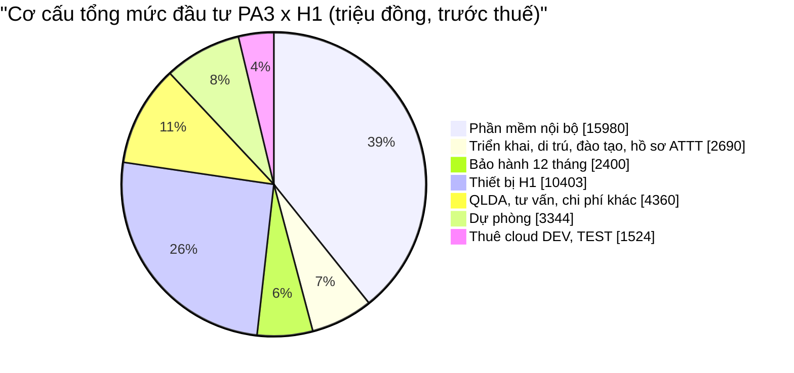
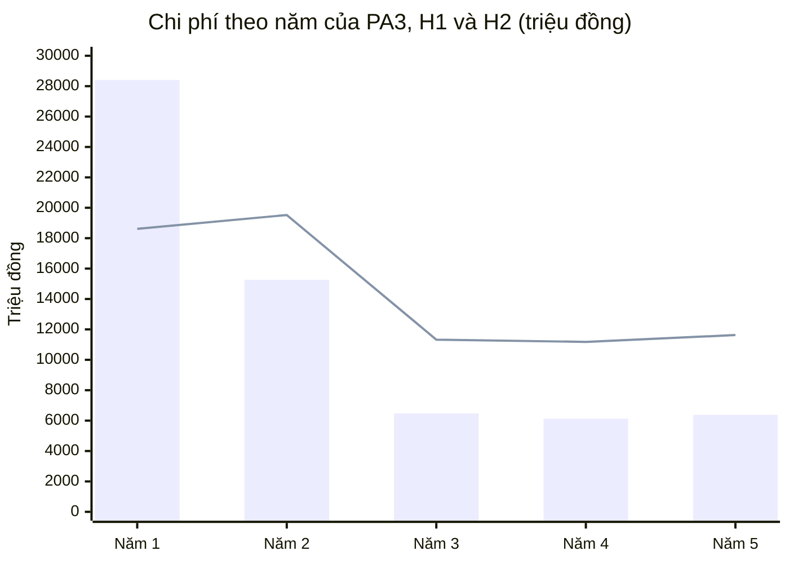

## 8. Tổng mức đầu tư, chi phí vận hành và TCO 5 năm

> **Tóm tắt cho hội đồng thẩm định.** Với phương án đề xuất PA3 (xây mới Datahub trên nền mã nguồn mở) cho tỉnh thí điểm cỡ M, tổng mức đầu tư sơ bộ là **40.702 triệu đồng trước thuế GTGT** (khoảng 42.236 triệu đồng gồm thuế GTGT ước tính) theo phương án hạ tầng khuyến nghị H1 (PROD, STAGING, DR đặt tại trung tâm dữ liệu tỉnh, DEV và TEST thuê cloud), và **33.460 triệu đồng trước thuế** (khoảng 34.401 triệu đồng gồm thuế) nếu toàn bộ hạ tầng thuê cloud chính phủ (H2). Chi phí sở hữu năm năm kể từ T0 (TCO, gồm đầu tư, bảo hành, vận hành và hỗ trợ kỹ thuật) là **62.651 triệu đồng với H1** và **72.271 triệu đồng với H2**: H2 rẻ hơn khoảng 7,2 tỷ đồng ở bước đầu tư nhưng đắt hơn khoảng 9,6 tỷ đồng sau năm năm, nên báo cáo giữ khuyến nghị H1 của Chương 4. Chi phí phần mềm nội bộ được ước tính theo hai cách độc lập (người-tháng và điểm trường hợp sử dụng), hai kết quả chênh nhau 7,7%. Chi phí biên để đưa tỉnh thứ hai cỡ M lên nền tảng dùng chung khoảng 6.417 triệu đồng một lần và 900 triệu đồng mỗi năm, nên TCO năm năm bình quân mỗi tỉnh giảm từ 62,7 tỷ đồng (một tỉnh) xuống khoảng 36,4 tỷ đồng (hai tỉnh) và 20,7 tỷ đồng (năm tỉnh). Mọi đơn giá trong chương là **giá trị tham khảo** để thẩm định sơ bộ; chủ đầu tư thay bằng đơn giá chính thức và báo giá trước khi phê duyệt.

### 8.1. Phương pháp xác định chi phí

#### 8.1.1. Căn cứ và cơ cấu tổng mức đầu tư

Tổng mức đầu tư của dự án đầu tư hệ thống chuyển đổi số được xác định theo Điều 49 Nghị định 224/2026/NĐ-CP quy định chi tiết Luật Chuyển đổi số (khoản 5 Điều 45 của Nghị định dẫn chiếu Điều 49 cho nội dung tổng mức đầu tư trong báo cáo nghiên cứu khả thi) và Thông tư 39/2026/TT-BKHCN về lập và quản lý chi phí trong đầu tư, mua sắm, thuê dịch vụ cho chuyển đổi số sử dụng ngân sách nhà nước ([nguồn](https://dauthaumuasam.vn/thong-tu-so-39-2026-tt-bkhcn-cua-bo-khoa-hoc-va-cong-nghe-quy-dinh-lap-va-quan-ly-chi-phi-trong-hoat-dong-dau-tu-mua-sam-thue-dich-vu-cho-chuyen-doi-so-su-dung-ngan-sach-nha-nuoc/)). Thông tư 39/2026 cấu trúc tổng mức đầu tư thành năm nhóm: G = G(TB/DV) + G(QLDA) + G(TV) + G(K) + G(DP). Nhóm G(TB) là chi phí thiết bị theo nghĩa rộng, gồm mua sắm thiết bị, phần mềm nội bộ, tạo lập cơ sở dữ liệu, lắp đặt, cài đặt, đào tạo, triển khai. Nhóm G(DV) là chi phí thuê dịch vụ công nghệ số (thuê phần mềm, thuê hạ tầng số, thuê quản trị, vận hành). Nhóm G(QLDA) gồm quản lý dự án và giám sát, đánh giá đầu tư. Nhóm G(TV) là tư vấn (khảo sát, lập báo cáo, thiết kế, lựa chọn nhà thầu, giám sát). Nhóm G(K) là chi phí khác (thẩm định, bảo hiểm, kiểm thử, vận hành thử, kiểm toán). Nhóm G(DP) là dự phòng, tối đa 10% khi lập tổng mức đầu tư, tính trên tổng các khoản chi phí không gồm G(DV).

Chương này giữ đúng năm nhóm đó để hội đồng thẩm định đối chiếu được trực tiếp với biểu mẫu tổng mức đầu tư. Hai điểm chưa xác minh được ở thời điểm lập báo cáo và cần kiểm tra trước khi trình. Thứ nhất, nguyên văn Điều 49 Nghị định 224/2026 và các định mức tỷ lệ của Thông tư 39/2026 (đặc biệt định mức chi phí quản lý dự án, tư vấn) mới được đọc qua bản trích đăng trên trang tổng hợp văn bản, chưa đối chiếu Công báo; vì vậy các tỷ lệ phần trăm trong chương là giá trị tham khảo, không phải định mức trích từ Thông tư (Q-D0101-81). Thứ hai, Quyết định 671/QĐ-BTTTT ngày 26/4/2024 hướng dẫn xác định chi phí phần mềm nội bộ bằng điểm trường hợp sử dụng có căn cứ ban hành là các văn bản nay đã hết hiệu lực; chưa xác định được Bộ Khoa học và Công nghệ đã ban hành hướng dẫn thay thế hay Thông tư 39/2026 có phụ lục phương pháp tương đương hay chưa (Q-D0101-82). Do đó chương dùng phương pháp điểm trường hợp sử dụng như một phương pháp chuyên gia để đối chiếu, còn phương pháp người-tháng gắn với cấu trúc phân rã công việc (WBS) của D01-02 là cơ sở lập tổng mức đầu tư.

#### 8.1.2. Phạm vi, đơn vị và các quy ước

Đơn vị tiền là triệu đồng, làm tròn đến 1 triệu đồng; giá trước thuế GTGT trừ khi ghi khác. Thuế GTGT được ước tính riêng ở 10% cho thiết bị, thuê dịch vụ, tư vấn và chi phí khác; phần mềm nội bộ và dịch vụ phần mềm được giả định không chịu thuế GTGT theo pháp luật thuế hiện hành, điều này cần cơ quan tài chính xác nhận (Q-D0101-83). Mọi mốc thời gian ghi tương đối với T0 (ngày khởi động hợp đồng thực hiện), cửa sổ TCO là Năm 1 đến Năm 5 kể từ T0 theo giả định nền §3.3, chi phí chuẩn bị đầu tư cộng vào Năm 1. Trượt giá 4%/năm được áp cho chi phí vận hành từ Năm 3. Mô hình tính theo từng tháng từ T0 đến T0+59 rồi cộng theo năm; bảng tính đi kèm `tco-datahub.xlsx` (cùng thư mục) chứa toàn bộ tham số dưới dạng ô có thể sửa, các sheet còn lại tính bằng công thức sống, nên khi chủ đầu tư điền đơn giá chính thức thì toàn bộ bảng trong chương được tính lại.

Phạm vi chi phí bao trùm toàn bộ những gì dự án cần để Datahub chạy chính thức tại tỉnh thí điểm: phát triển 20 phân hệ, hạ tầng cho năm môi trường theo Chương 6, di trú khỏi hệ LGSP cũ, hồ sơ cấp độ an toàn thông tin, đào tạo, bảo hành 12 tháng, cùng các chi phí tư vấn, quản lý dự án, chi phí khác và dự phòng. Chương 3 mục 3.6.2 đang xếp mua sắm phần cứng ngoài phạm vi phần mềm; chương này vẫn tính thiết bị H1 vào tổng mức đầu tư để hội đồng thấy chi phí đầy đủ, đồng thời nêu con số tổng mức nếu thiết bị được mua bằng dự án hạ tầng riêng (mục 8.6.3, Q-D0101-52 tại Chương 6).

#### 8.1.3. Đơn giá tham khảo

Bảng sau tập hợp các đơn giá chính. Mỗi đơn giá là một ô tham số trong sheet "Tham số" của bảng tính, kèm khoảng thấp – cao dùng cho phân tích độ nhạy và cho kịch bản giá.

| Tham số | Giá trị tham khảo | Khoảng thấp – cao | Ghi chú |
|---|---|---|---|
| Đơn giá bình quân nhân công nhà thầu | 40 triệu đồng/người-tháng | 32 – 48 | [ĐIỀN] theo định mức chính thức; đã gồm chi phí chung, thu nhập chịu thuế tính trước |
| Đơn giá chuyên gia tư vấn | 35 triệu đồng/người-tháng | 28 – 42 | Lập báo cáo, giám sát, kiểm thử độc lập |
| Chi phí nhân sự vận hành của tỉnh | 25 triệu đồng/FTE-tháng | 20 – 30 | Lương, phụ cấp, bảo hiểm, đào tạo duy trì |
| Mức lương lao động bình quân theo giờ H (phương pháp điểm trường hợp sử dụng) | 110.000 đồng/giờ | 88.000 – 132.000 | [ĐIỀN]; chi phí lao động trực tiếp |
| Máy chủ hai bộ xử lý 2 × 32 nhân, 512 GB (PROD) | 800 triệu đồng/máy | 650 – 1.000 | Bảo hành 5 năm, cấu hình theo mục 6.7.1 |
| Thuê vCPU cloud chính phủ | 0,20 triệu đồng/vCPU-tháng | 0,15 – 0,25 | Không bán vượt cho PROD, DR |
| Thuê RAM cloud | 0,08 triệu đồng/GB-tháng | 0,06 – 0,10 | |
| Thuê lưu trữ khối SSD | 4 triệu đồng/TB-tháng | 3 – 5 | |
| Thuê lưu trữ đối tượng S3 | 0,8 triệu đồng/TB-tháng | 0,6 – 1,0 | Dung lượng khả dụng |
| Giá điện | 2.800 đồng/kWh | | PUE 1,6, tải trung bình 70% công suất đỉnh |

Đơn giá nhân công 40 triệu đồng/người-tháng là con số quan trọng nhất của chương vì gần một nửa tổng mức đầu tư phụ thuộc trực tiếp vào nó. Báo cáo đề xuất mức này vì ba lý do. Thứ nhất, theo cách tính của Quyết định 671/QĐ-BTTTT, giá trị phần mềm bằng chi phí lao động trực tiếp cộng chi phí chung 65% và thu nhập chịu thuế tính trước 6%, tức hệ số khoảng 1,75 trên chi phí lao động trực tiếp; một kỹ sư có chi phí lao động trực tiếp khoảng 23 triệu đồng/tháng (lương, phụ cấp, bảo hiểm của kỹ sư phần mềm có kinh nghiệm tại Việt Nam) cho ra khoảng 40 triệu đồng/người-tháng. Thứ hai, cơ cấu đội ngũ ở giả định nền §5 nghiêng về kỹ sư có kinh nghiệm (kiến trúc sư, kỹ sư tích hợp Camel và Quarkus native, SRE, ATTT chiếm khoảng một phần ba nỗ lực), nên mức bình quân không thể thấp như dự án nhập liệu hay phát triển ứng dụng đơn giản. Thứ ba, Chương 8 của D01-02 (quản lý rủi ro) đã dùng 40 triệu đồng/người-tháng để quy đổi giá trị kỳ vọng rủi ro; giữ cùng đơn giá giúp khoản dự phòng rủi ro ở D01-02 chuyển thẳng vào G(DP) mà không phải quy đổi lại.

### 8.2. Chi phí phần mềm nội bộ

#### 8.2.1. Cách thứ nhất: người-tháng theo WBS

Cách thứ nhất lấy khối lượng công việc từ WBS ở D01-02 chương 2 và bảng định biên ở giả định nền §5. Tổng nỗ lực nhà thầu giai đoạn thực hiện là **458,5 người-tháng**, gồm 454,5 người-tháng theo bảng định biên sáu wave và 4 người-tháng bổ sung cho Giám đốc dự án và Product Owner ở T0+13 đến T0+15 (giả định nền §5 đã cập nhật, làm tròn ≈ 459). Bảo hành 12 tháng thêm 60 người-tháng, tính riêng. Con số này khớp giả định nền với sai lệch 0,1%, dưới ngưỡng 5%, nên chương không đề xuất sửa khối lượng.

Không phải toàn bộ 458,5 người-tháng là "phần mềm nội bộ" theo nghĩa của Thông tư 39/2026. Bảng sau ánh xạ các phần tử WBS sang hạng mục chi phí, để phần phát triển phần mềm được so sánh đúng với phương pháp điểm trường hợp sử dụng ở mục 8.2.2, còn phần triển khai, di trú, đào tạo, hồ sơ an toàn thông tin được thể hiện thành các dòng riêng trong G(TB).

| Hạng mục G(TB) | Phần tử WBS (D01-02 §2.4, §2.5) | Người-tháng | Chi phí (triệu đồng, giá trị tham khảo) |
|---|---|---|---|
| Phần mềm nội bộ | 1.1–1.20 (20 phân hệ), 1.21 (quản lý dự án của nhà thầu, gồm 4 người-tháng bổ sung), 1.22, 1.23, 1.25.1, 1.25.3, 1.25.4, 1.26.1, 1.26.4, 1.28 | 399,5 | 15.980 |
| Cài đặt, triển khai trên hạ tầng | 1.26.2, 1.26.3, 1.26.5, 1.26.6 | 21 | 840 |
| Chuyển đổi, di trú dữ liệu, chạy song song | 1.24 | 24 | 960 |
| Đào tạo, chuyển giao (phần nhà thầu) | 1.27 | 8 | 320 |
| Hồ sơ đề xuất cấp độ, đánh giá tác động DLCN | 1.25.2, 1.25.5 | 6 | 240 |
| **Cộng giai đoạn thực hiện** | | **458,5** | **18.340** |
| Bảo hành 12 tháng | 1.29 | 60 | 2.400 |

Phần quản lý dự án của nhà thầu (1.21) được xếp vào phần mềm nội bộ vì đây là chi phí của nhà thầu nằm trong giá gói thầu, khác với G(QLDA) là chi phí của chủ đầu tư. Bảo hành được tính thành dòng riêng trong G(TB) và trả theo quý trong 12 tháng bảo hành thay vì ẩn trong đơn giá, vì 60 người-tháng là khối lượng đáng kể (khoảng 13% nỗ lực thực hiện) và D01-02 chương 2 đã đề nghị tính riêng; cách làm này cũng giúp chủ đầu tư so sánh với phương án chuyển phần bảo hành sang hợp đồng hỗ trợ kỹ thuật từ chi thường xuyên (Q-D0101-84).

#### 8.2.2. Cách thứ hai: điểm trường hợp sử dụng

Cách thứ hai ước lượng giá trị phần mềm theo phương pháp điểm trường hợp sử dụng (use case point) của Quyết định 671/QĐ-BTTTT, dùng như phương pháp chuyên gia vì tình trạng hiệu lực chưa rõ (mục 8.1.1). Công thức là G = 1,4 × E × P × H, trong đó E = 10/6 × AUCP là giá trị nỗ lực thực tế, AUCP = UUCP × TCF × EF là điểm trường hợp sử dụng đã điều chỉnh, UUCP là tổng điểm tác nhân (UAW) và điểm trường hợp sử dụng (UUCW), P là thời gian lao động cho một điểm (giờ/điểm), H là mức lương lao động bình quân theo giờ. Giá trị phần mềm trước thuế bằng G cộng chi phí chung C = 65% G và thu nhập chịu thuế tính trước TL = 6% (G + C).

Vì D02-02 (SRS) hiện chỉ đặc tả các yêu cầu chức năng dùng chung FR-00, danh sách trường hợp sử dụng của từng phân hệ chưa có. Báo cáo ước lượng số trường hợp sử dụng của mỗi phân hệ từ phạm vi chức năng ở D03-01 và từ nỗ lực WBS, phân theo ba mức độ phức tạp: đơn giản (không quá 3 giao dịch, trọng số 5), trung bình (4 đến 7 giao dịch, trọng số 10) và phức tạp (trên 7 giao dịch, trọng số 15). Hệ số theo mức độ cần thiết (bắt buộc, mong muốn, tùy chọn) của Quyết định 671 được đặt bằng 1,0 cho mọi trường hợp sử dụng trong lần ước lượng này; khi có danh sách chính thức, hệ số này được điền theo phân loại MoSCoW ở FRS. Bảng sau cho kết quả.

| Phân hệ | Đơn giản | Trung bình | Phức tạp | Điểm UUCW | | Phân hệ | Đơn giản | Trung bình | Phức tạp | Điểm UUCW |
|---|---|---|---|---|---|---|---|---|---|---|
| PH-01 | 3 | 4 | 2 | 85 | | PH-11 | 2 | 3 | 2 | 70 |
| PH-02 | 3 | 4 | 3 | 100 | | PH-12 | 2 | 4 | 2 | 80 |
| PH-03 | 2 | 3 | 2 | 70 | | PH-13 | 3 | 4 | 2 | 85 |
| PH-04 | 4 | 8 | 6 | 190 | | PH-14 | 2 | 3 | 2 | 70 |
| PH-05 | 3 | 5 | 2 | 95 | | PH-15 | 3 | 3 | 1 | 60 |
| PH-06 | 2 | 4 | 2 | 80 | | PH-16 | 2 | 3 | 1 | 55 |
| PH-07 | 3 | 5 | 3 | 110 | | PH-17 | 2 | 3 | 2 | 70 |
| PH-08 | 2 | 3 | 1 | 55 | | PH-18 | 3 | 3 | 1 | 60 |
| PH-09 | 2 | 4 | 2 | 80 | | PH-19 | 3 | 6 | 4 | 135 |
| PH-10 | 2 | 3 | 2 | 70 | | PH-20 | 3 | 4 | 2 | 85 |

Tổng cộng có 174 trường hợp sử dụng với UUCW = 1.705 điểm. Phân hệ có điểm cao nhất là PH-04 (190 điểm, do trình thiết kế luồng, chạy thử, quản lý phiên bản luồng đều là giao dịch nhiều bước) và PH-19 (135 điểm, do đối soát và hoàn tiền có nhiều nhánh nghiệp vụ). Điểm tác nhân UAW = 38, gồm 8 tác nhân người dùng qua giao diện (quản trị tenant, quản trị tích hợp, cán bộ vận hành, cán bộ sở ngành, nhà phát triển, kiểm toán viên, người phụ trách bảo vệ dữ liệu cá nhân, quản trị hệ thống; trọng số 3), 4 tác nhân hệ thống qua giao thức (NDXP, NDOP, PayGov, VNeID; trọng số 2) và 6 tác nhân hệ thống qua API đơn giản (HTTT sở ngành, nhà cung cấp thanh toán, ngân hàng, dịch vụ mô hình ngôn ngữ, cổng thư điện tử và tin nhắn, hệ LGSP cũ; trọng số 1).

Hệ số kỹ thuật TCF = 0,6 + 0,01 × 59,5 = 1,195, cao vì Datahub là hệ phân tán (giá trị 5), yêu cầu xử lý đồng thời lớn, an toàn thông tin cấp độ 3, cho bên thứ ba truy cập và phải tái sử dụng cho nhiều tỉnh (đều ở giá trị 5). Hệ số môi trường EF = 1,4 − 0,03 × 16 = 0,92, phản ánh đội có kinh nghiệm hướng đối tượng và động lực tốt nhưng yêu cầu chưa ổn định (giá trị 2) và ngôn ngữ, khung công nghệ khó (Camel Quarkus native, giá trị 3). Từ đó AUCP = 1.743 × 1,195 × 0,92 = 1.916,3 điểm và E = 3.193,8. Với P = 20 giờ/điểm (mức ứng với đội có độ ổn định kinh nghiệm cao theo cách nội suy của Quyết định 671, cần đối chiếu) và H = 110.000 đồng/giờ (giá trị tham khảo), bảng sau là kết quả.

| Thành phần | Công thức | Giá trị (triệu đồng, giá trị tham khảo) |
|---|---|---|
| Giá trị phần mềm G | 1,4 × 3.193,8 × 20 × 0,11 | 9.837 |
| Chi phí chung C | 65% × G | 6.394 |
| Thu nhập chịu thuế tính trước TL | 6% × (G + C) | 974 |
| **Giá trị phần mềm nội bộ trước thuế** | G + C + TL | **17.205** |
| Đối chiếu: cách người-tháng (399,5 người-tháng × 40) | | 15.980 |
| Chênh lệch | | +7,7% |

#### 8.2.3. Đối chiếu hai cách và lựa chọn cơ sở

Hai cách cho kết quả chênh nhau 1.225 triệu đồng, tức 7,7%, nằm trong biên sai số thông thường của ước lượng ở bước nghiên cứu khả thi (khoảng ±20%). Phần chênh có hai nguyên nhân có thể giải thích. Một là phương pháp điểm trường hợp sử dụng quy ra khoảng 89.400 giờ, tương đương 508 người-tháng 176 giờ, cao hơn 399,5 người-tháng của WBS; khoảng cách này phản ánh việc hệ số 1,4 và năng suất 20 giờ/điểm của phương pháp được hiệu chỉnh cho cách làm truyền thống, trong khi WBS đã tính đến việc dùng AI agent viết mã có kiểm soát (giả định nền §5) và việc dùng lại thành phần nguồn mở trưởng thành. Hai là số trường hợp sử dụng là ước lượng sơ bộ; sai 15 đến 20 trường hợp sử dụng đã đủ đổi dấu chênh lệch.

Báo cáo chọn **cách người-tháng làm cơ sở** cho tổng mức đầu tư vì ba lý do: nó gắn trực tiếp với WBS, bảng định biên và tiến độ ở D01-02 nên kiểm soát được bằng EVM trong thực hiện; nó không phụ thuộc vào một văn bản chưa rõ hiệu lực; và nó cho con số thận trọng thấp hơn, phù hợp với nguyên tắc tổng mức đầu tư là trần chi phí. Phương pháp điểm trường hợp sử dụng được giữ trong hồ sơ làm phép kiểm tra chéo; nếu cơ quan thẩm định yêu cầu dùng phương pháp này làm cơ sở thì G(TB) phần mềm nội bộ tăng 1.225 triệu đồng và dự phòng tăng tương ứng khoảng 114 triệu đồng.

### 8.3. Chi phí hạ tầng

#### 8.3.1. Phương án H1: mua sắm thiết bị tại trung tâm dữ liệu tỉnh

Theo kịch bản cơ sở của Chương 4 mục 4.6.3 và Chương 6 mục 6.8, tỉnh thí điểm cỡ M cần 9 máy chủ vật lý (4 PROD, 3 DR, 2 STAGING), thiết bị mạng, tường lửa và thiết bị sao lưu độc lập, còn DEV và TEST thuê cloud chính phủ từ T0. Bảng dưới đây lượng giá danh mục thiết bị theo đơn giá trung vị, kèm tổng ở hai đầu khoảng giá.

| Thiết bị | Số lượng | Đơn giá trung vị | Thành tiền |
|---|---|---|---|
| Máy chủ PROD (2 × 32 nhân, 512 GB, 4 × 3,84 TB NVMe, 2 × 4 TB HDD, bảo hành 5 năm) | 4 | 800 | 3.200 |
| Máy chủ DR (4 × 1,92 TB NVMe, 2 × 4 TB HDD) | 3 | 750 | 2.250 |
| Máy chủ STAGING (4 × 1,92 TB NVMe, 2 × 2 TB HDD) | 2 | 720 | 1.440 |
| Chuyển mạch đầu tủ 48 × 25 GbE, 4 × 100 GbE | 4 | 250 | 1.000 |
| Chuyển mạch quản trị 48 × 1 GbE | 2 | 35 | 70 |
| Tường lửa thế hệ mới ≥ 2 Gbps khi bật IPS (hai cặp sẵn sàng cao) | 4 | 350 | 1.400 |
| Thiết bị sao lưu độc lập 20 TB có khóa bất biến | 1 | 500 | 500 |
| Tủ rack 42U, PDU đo lường, KVM | 3 | 80 | 240 |
| **Cộng thiết bị** | | | **10.100** |
| Lắp đặt, cấu hình, vận chuyển (3%) | | | 303 |
| **Cộng thiết bị H1** | | | **10.403** (khoảng 8.096 – 13.575) |

Nền ảo hóa, hệ điều hành và Kubernetes dùng bản mã nguồn mở theo Chương 6 mục 6.9 nên chi phí bản quyền bằng 0. Máy chủ được mua kèm bảo hành 5 năm của hãng, nên trong cửa sổ TCO không phát sinh chi phí bảo trì phần cứng; nếu chỉ mua bảo hành 3 năm thì giá máy chủ giảm khoảng 8% nhưng Năm 4 và Năm 5 phải thêm khoảng 8% giá trị thiết bị mỗi năm cho gia hạn bảo hành. Theo dõi kế toán, thiết bị được khấu hao đều 5 năm, khoảng 2.081 triệu đồng mỗi năm; TCO trong chương tính theo dòng tiền (ghi chi phí khi thanh toán) nên khấu hao chỉ để tham khảo cho báo cáo tài sản. Chi phí vận hành riêng của H1 gồm điện khoảng 282 triệu đồng/năm (khoảng 7,2 kW tải trung bình của hai site, PUE 1,6) và đường truyền khoảng 55 triệu đồng/tháng (Internet hai nhà cung cấp tại hai site, kênh riêng 500 Mbps sang DR theo Chương 6 mục 6.6.4; mạng truyền số liệu chuyên dùng giả định không thu phí). DEV và TEST thuê cloud (120 vCPU, 416 GB RAM, 4 TB SSD, 4 TB HDD) khoảng 84,7 triệu đồng/tháng.

#### 8.3.2. Phương án H2: thuê cloud chính phủ

Với H2, mọi môi trường thuê theo bảng quy đổi ở Chương 6 mục 6.7.2 (78 máy ảo, 832 vCPU, 2.392 GB RAM, 27,8 TB SSD, 21 TB lưu trữ đối tượng). Chi phí thuê theo tháng được tính từ đơn giá ở mục 8.1.3, cộng phí mạng, địa chỉ IP, tường lửa và cân bằng tải của nhà cung cấp. Bảng sau cho chi phí theo môi trường ở mức giá trung vị và hai đầu khoảng.

| Môi trường | Tài nguyên | Triệu đồng/tháng (trung vị) | Khoảng thấp – cao | Thời điểm bắt đầu thuê |
|---|---|---|---|---|
| PROD | 344 vCPU, 960 GB, 12,4 TB SSD, 11 TB S3 | 229,0 | 168,0 – 295,0 | T0+9 |
| DR | 192 vCPU, 560 GB, 6,9 TB SSD, 8 TB S3 | 142,2 | 102,9 – 186,5 | T0+9 |
| STAGING | 176 vCPU, 456 GB, 4,5 TB SSD, 2 TB S3 | 96,3 | 71,5 – 122,1 | T0+6 |
| DEV và TEST | 120 vCPU, 416 GB, 4 TB SSD, 4 TB HDD | 84,7 | 62,8 – 107,6 | T0 |
| **Cộng khi đủ môi trường** | | **552,2** | **405,2 – 711,2** | |

Một năm thuê đủ môi trường khoảng 6.626 triệu đồng, gần bằng hai phần ba giá trị toàn bộ thiết bị H1. Đây là lý do H2 có tổng mức đầu tư thấp hơn nhưng TCO năm năm cao hơn: thuê cloud phù hợp với tải biến động, trong khi tải của Datahub là tải nền ổn định chạy 24/7. Giá cloud chính phủ có thể giảm 15% đến 30% nếu ký cam kết nhiều năm; phân tích độ nhạy ở mục 8.9 cho thấy kể cả khi giá giảm 25%, TCO của H2 vẫn cao hơn H1 khoảng 4 tỷ đồng. Đường truyền ngoài phần do cloud cung cấp (kết nối mạng chuyên dùng, kênh tới các sở) khoảng 25 triệu đồng/tháng. H2 giảm đội vận hành tỉnh từ 5,5 xuống 4,5 FTE (bớt một kỹ sư hạ tầng, D01-02 §6.5.2).

Trong tổng mức đầu tư, phần thuê cloud trong 18 tháng thực hiện được ghi vào G(DV) (1.524 triệu đồng với H1 cho DEV và TEST; 6.020 triệu đồng với H2 cho mọi môi trường). Phần thuê từ T0+18 trở đi là chi phí vận hành, chi từ chi thường xuyên theo hình thức thuê dịch vụ công nghệ số nhiều năm mà Nghị định 224/2026 cho phép.

### 8.4. Phần mềm thương mại

Kịch bản cơ sở không có chi phí bản quyền phần mềm thương mại, vì toàn bộ stack (Spring Boot, Camel Quarkus, Kafka, PostgreSQL, Keycloak, OPA, OpenBao, APISIX, Istio, Argo CD, LGTM, nền ảo hóa KVM, Linux bản cộng đồng) là mã nguồn mở với giấy phép cho phép dùng trong cơ quan nhà nước, theo nguyên tắc NT-09 tại D03-01. Chi phí nhỏ có tính thương mại (chứng thư TLS và chứng thư số chuyên dùng, phần mềm phòng chống mã độc trên máy chủ theo yêu cầu cấp độ 3) được tính trong chi phí vận hành an toàn thông tin.

Chủ đầu tư có thể chọn kịch bản **hỗ trợ thương mại tùy chọn**, mua gói hỗ trợ của hãng cho các thành phần có rủi ro vận hành cao nhất: bản phân phối Kubernetes và hệ điều hành doanh nghiệp, Kafka, PostgreSQL, Keycloak. Đơn vị tính thường là bộ xử lý vật lý (18 bộ xử lý trên 9 máy chủ) hoặc số node (71 node trên H1). Giá trị tham khảo là khoảng **1.500 triệu đồng/năm** (khoảng 900 – 2.500 tùy hãng và mức cam kết), bắt đầu từ khi PROD vận hành (T0+10). Kịch bản này làm TCO năm năm tăng khoảng 6.620 triệu đồng (H1 lên 69.271, H2 lên 78.890 triệu đồng). Báo cáo không khuyến nghị đưa vào kịch bản cơ sở, vì đội hỗ trợ kỹ thuật của nhà thầu (mục 8.7) đã đảm nhận việc nâng phiên bản và vá lỗi; nhưng khuyến nghị cân nhắc riêng cho PostgreSQL và Kafka nếu đội vận hành tỉnh chưa đạt bậc chuyển giao "độc lập" tại G5 (D01-02 §6.8). Con số chính xác cần báo giá của nhà cung cấp (Q-D0101-85).

### 8.5. Quản lý dự án, tư vấn, chi phí khác và dự phòng

#### 8.5.1. Quản lý dự án

Chi phí quản lý dự án G(QLDA) gồm chi phí hoạt động của Ban quản lý dự án (khoảng 3,5 FTE suốt giai đoạn thực hiện theo giả định nền §5) và chi phí giám sát, đánh giá đầu tư. Báo cáo tính theo tỷ lệ tham khảo 3% của G(TB), ra **944 triệu đồng** với H1 và 632 triệu đồng với H2. Phép kiểm tra từ dưới lên cho kết quả tương đương: 3,5 FTE × 18 tháng × khoảng 12 triệu đồng chi phí tăng thêm mỗi người-tháng (phụ cấp, công tác phí, hội họp, văn phòng phẩm, không gồm lương ngạch bậc đã chi từ ngân sách thường xuyên) là 756 triệu đồng, cộng giám sát, đánh giá đầu tư khoảng 150 triệu đồng. Tỷ lệ chính thức lấy theo định mức của Thông tư 39/2026 khi đối chiếu (Q-D0101-81).

#### 8.5.2. Tư vấn

Chi phí tư vấn G(TV) tính theo người-tháng chuyên gia, vì khối lượng tư vấn của dự án phần mềm phụ thuộc vào độ phức tạp hơn là vào giá trị thiết bị. Gói thầu chính được giả định là gói thiết kế và cung cấp hàng hóa (EP), trong đó nhà thầu vừa lập thiết kế chi tiết vừa triển khai, như Nghị định 224/2026 cho phép với hạng mục phần mềm nội bộ; vì vậy không có dòng chi phí thiết kế chi tiết riêng (nỗ lực FRS, SDD đã nằm trong WBS của nhà thầu). Nếu cơ quan thẩm định yêu cầu tách thiết kế chi tiết thành gói riêng, cần thêm khoảng 20 người-tháng tư vấn, tức 700 triệu đồng (Q-D0101-86).

| Khoản tư vấn | Khối lượng | Thành tiền (giá trị tham khảo) | Thời điểm |
|---|---|---|---|
| Khảo sát, lập BCNCKT và thiết kế cơ sở | 18 người-tháng | 630 | T0 − 7 đến T0 − 5 |
| Lập HSMT, đánh giá HSDT hai gói (EP phần mềm, mua sắm thiết bị) | 6 người-tháng | 210 | T0 − 2 đến T0 |
| Tư vấn giám sát triển khai 18 tháng | 27 người-tháng (1,5 FTE) | 945 | T0 đến T0+18 |
| **Cộng G(TV)** | 51 người-tháng | **1.785** | |

#### 8.5.3. Chi phí khác

Chi phí khác G(K) gồm các khoản Thông tư 39/2026 liệt kê (thẩm định, bảo hiểm, kiểm thử, vận hành thử, kiểm toán) và hai khoản đặc thù của dự án thay thế hệ đang chạy. Kiểm thử phần mềm độc lập là yêu cầu của Thông tư 41/2026/TT-BKHCN (phần mềm nội bộ phải được kiểm thử) và được tách khỏi kiểm thử của nhà thầu để bảo đảm khách quan. Kiểm thử xâm nhập và đánh giá an toàn thông tin độc lập thực hiện hai đợt, trước G2 (trước khi MVP vào PROD) và trước G4 (sau khi thêm phân hệ thanh toán và bảo vệ dữ liệu cá nhân). Khoản hỗ trợ của nhà cung cấp hệ cũ chi trả cho việc trích xuất dữ liệu, cấu hình và phối hợp cắt chuyển, gắn trực tiếp với RSK-17 (rủi ro lớn nhất trong sổ rủi ro); có ngân sách sẵn giúp đàm phán phụ lục bàn giao trước T0.

| Khoản chi phí khác | Thành tiền H1 (giá trị tham khảo) | Ghi chú |
|---|---|---|
| Thẩm định dự án, thiết kế; lệ phí | 50 | |
| Kiểm thử phần mềm độc lập trước nghiệm thu | 420 | 12 người-tháng chuyên gia |
| Kiểm thử xâm nhập, đánh giá ATTT độc lập | 400 | Hai đợt, mỗi đợt 200 |
| Hỗ trợ của nhà cung cấp hệ cũ | 500 | Trích xuất, phối hợp cắt chuyển (RSK-17) |
| Bảo hiểm thiết bị, kiểm toán độc lập, thẩm tra quyết toán, hội nghị nghiệm thu | 261 | H2: 240 (không có bảo hiểm thiết bị) |
| **Cộng G(K)** | **1.631** | H2: 1.610 |

Chi phí chạy song song hệ cũ (gia hạn hợp đồng vận hành hệ LGSP cũ đến G5) không cộng vào tổng mức đầu tư vì đây là chi thường xuyên tỉnh đang chi; điểm quan trọng là PA3 cho phép chấm dứt khoản này từ T0+18, trong khi PA1 phải duy trì nó suốt vòng đời. Hồ sơ đề xuất cấp độ do nhà thầu lập (đã tính trong G(TB)); việc thẩm định hồ sơ của cơ quan chuyên trách không thu phí theo hiểu biết hiện tại.

#### 8.5.4. Dự phòng

Dự phòng G(DP) được tính bằng 9,33% tổng G(TB), G(QLDA), G(TV), G(K), dưới mức trần 10% của Thông tư 39/2026, gồm hai phần. Phần dự phòng khối lượng phát sinh là 7%, tức **2.508 triệu đồng** với H1; khoản này bao trùm khoản dự phòng rủi ro mà D01-02 chương 8 đã định lượng (khoảng 28 người-tháng và 75 triệu đồng, tức 1.195 triệu đồng ở đơn giá 40 triệu đồng/người-tháng) với phần dư khoảng 1.313 triệu đồng cho rủi ro ngoài nhân công như hạ tầng PROD bàn giao chậm (RSK-24) hay giá thiết bị biến động (RSK-40). Phần dự phòng trượt giá là 4%/năm trong 7 tháng từ khi lập báo cáo (T0 − 7) đến khi ký hợp đồng, tức 2,33%, **836 triệu đồng**; sau khi ký, hợp đồng trọn gói chuyển rủi ro trượt giá sang nhà thầu. Cộng hai phần là **3.344 triệu đồng** với H1 (8,2% tổng mức đầu tư) và 2.342 triệu đồng với H2. Trong TCO, dự phòng được giả định dùng hết (cách tính thận trọng).

### 8.6. Tổng mức đầu tư

#### 8.6.1. Bảng tổng mức đầu tư

Bảng dưới đây là tổng mức đầu tư sơ bộ của PA3 cho tỉnh thí điểm cỡ M theo hai phương án hạ tầng, trình bày theo cơ cấu của Thông tư 39/2026. Cột H1 là kịch bản cơ sở khuyến nghị (PROD, STAGING, DR tại chỗ; DEV, TEST thuê cloud); cột H2 là toàn bộ thuê cloud chính phủ.

| Mã | Khoản mục | H1 (triệu đồng) | H2 (triệu đồng) |
|---|---|---|---|
| **G(TB)** | **Chi phí thiết bị (theo nghĩa của TT 39/2026)** | **31.473** | **21.070** |
| TB-1 | Phần mềm nội bộ (399,5 người-tháng) | 15.980 | 15.980 |
| TB-2 | Cài đặt, triển khai phần mềm trên hạ tầng | 840 | 840 |
| TB-3 | Chuyển đổi, di trú dữ liệu và chạy song song | 960 | 960 |
| TB-4 | Đào tạo, chuyển giao (nhà thầu 320, tổ chức lớp 150, chứng chỉ đội vận hành 180) | 650 | 650 |
| TB-5 | Hồ sơ đề xuất cấp độ, đánh giá tác động DLCN | 240 | 240 |
| TB-6 | Bảo hành 12 tháng sau G5 (60 người-tháng) | 2.400 | 2.400 |
| TB-7 | Thiết bị hạ tầng H1 gồm lắp đặt | 10.403 | 0 |
| **G(QLDA)** | **Quản lý dự án** | **944** | **632** |
| **G(TV)** | **Tư vấn** | **1.785** | **1.785** |
| **G(K)** | **Chi phí khác** | **1.631** | **1.610** |
| | Cộng trước dự phòng | 35.833 | 25.097 |
| **G(DP)** | **Dự phòng (7% khối lượng + 2,33% trượt giá)** | **3.344** | **2.342** |
| **G(DV)** | **Thuê dịch vụ công nghệ số trong 18 tháng thực hiện** | **1.524** | **6.020** |
| | **Tổng mức đầu tư trước thuế GTGT** | **40.702** | **33.460** |
| | Thuế GTGT ước tính (10% trên thiết bị, G(DV), G(TV), G(K)) | 1.534 | 942 |
| | **Tổng mức đầu tư gồm thuế GTGT (ước tính)** | **42.236** | **34.401** |

Ở mức khoảng 40 đến 42 tỷ đồng, dự án nằm dưới ngưỡng dự án nhóm B theo hiểu biết hiện tại về Luật Đầu tư công (nhóm C dưới 60 tỷ đồng cho lĩnh vực này), nhưng ngưỡng sau sửa đổi năm 2025 và ngưỡng thiết kế một bước của Nghị định 224/2026 chưa được xác minh (tóm tắt pháp lý phần C, Q-D0101-87). Cơ cấu tổng mức đầu tư H1 được thể hiện ở biểu đồ sau.

Biểu đồ cho thấy nhân công nhà thầu (phần mềm, triển khai, di trú, đào tạo, hồ sơ, bảo hành) chiếm khoảng 52% tổng mức đầu tư và thiết bị chiếm khoảng 26%. Vì vậy hai biến số chi phối tổng mức là đơn giá nhân công và việc có đưa thiết bị vào dự án hay không.

#### 8.6.2. Vì sao H2 có tổng mức thấp hơn

H2 thấp hơn H1 khoảng 7.242 triệu đồng ở tổng mức đầu tư vì không phải mua 10.403 triệu đồng thiết bị; đổi lại G(DV) tăng 4.496 triệu đồng do thuê PROD, DR và STAGING từ T0+6 và T0+9. Chênh lệch này đảo chiều ngay trong Năm 3, khi tiền thuê cloud của H2 mỗi năm (khoảng 6,9 tỷ đồng) cao hơn tiền thuê DEV, TEST của H1 khoảng 5,8 tỷ đồng, trong khi điện, đường truyền và nhân sự hạ tầng tăng thêm của H1 chỉ khoảng 1 tỷ đồng mỗi năm. Hội đồng thẩm định cần thấy rõ rằng tổng mức đầu tư thấp hơn không có nghĩa là phương án rẻ hơn; tiêu chí đúng là TCO ở mục 8.8.

#### 8.6.3. Nếu thiết bị thuộc dự án hạ tầng riêng

Nếu tỉnh quyết định mua thiết bị H1 bằng một dự án hạ tầng riêng (Q-D0101-52), tổng mức đầu tư của dự án Datahub giảm còn khoảng **28.964 triệu đồng trước thuế** (bỏ 10.403 triệu đồng thiết bị, kéo theo G(QLDA) giảm 312, G(K) giảm 21 và dự phòng giảm khoảng 1.002 triệu đồng). Khi đó dự án hạ tầng phải hoàn thành bàn giao STAGING trước T0+6 và PROD, DR trước T0+10, và rủi ro RSK-24 (hạ tầng bàn giao chậm) trở thành rủi ro liên dự án, phải có cơ chế điều phối giữa hai chủ đầu tư.

### 8.7. Chi phí vận hành hằng năm

Chi phí vận hành bắt đầu khi PROD vào vận hành (T0+10) và kéo dài suốt vòng đời. Bảng sau trình bày chi phí vận hành của một năm đầy đủ sau bảo hành (Năm 4, đã gồm trượt giá 4%/năm từ Năm 3) cho hai phương án hạ tầng. Năm 4 được chọn vì là năm đầu tiên không còn khoản bảo hành và đã có đủ các hạng mục vận hành thường xuyên.

| Hạng mục vận hành | Cơ sở tính | H1, Năm 4 | H2, Năm 4 |
|---|---|---|---|
| Nhân sự vận hành tỉnh | 5,5 FTE (H1) hoặc 4,5 FTE (H2) × 25 triệu đồng/tháng | 1.785 | 1.460 |
| Hỗ trợ kỹ thuật, bảo trì phần mềm của nhà thầu | 2,5 FTE × 40 triệu đồng/tháng, từ T0+30 | 1.298 | 1.298 |
| Hạ tầng, thuê cloud | H1: DEV, TEST; H2: mọi môi trường | 1.099 | 7.167 |
| Điện, đường truyền | H1: điện 282 + đường truyền 660/năm; H2: đường truyền 300/năm | 1.018 | 324 |
| SOC thuê ngoài 24/7 | 400/năm | 433 | 433 |
| Đánh giá ATTT định kỳ, kiểm thử xâm nhập | 250/năm từ Năm 3 | 270 | 270 |
| Phần mềm phòng chống mã độc, chứng thư số, khác | 150/năm | 162 | 162 |
| Đào tạo duy trì | 60/năm từ Năm 3 | 65 | 65 |
| **Cộng** | | **6.130** | **11.179** |

Khoản hỗ trợ kỹ thuật của nhà thầu tương đương khoảng **7,5% giá trị phần mềm nội bộ mỗi năm** (1.200 triệu đồng trước trượt giá trên 15.980 triệu đồng), thấp hơn một chút so với khoảng 8% đến 15% thường dùng để lập kế hoạch bảo trì phần mềm. Báo cáo chọn cách tính theo FTE thay vì theo phần trăm vì nhu cầu bảo trì của Datahub do nhịp nâng phiên bản khoảng hai mươi thành phần nguồn mở quyết định (D01-02 §6.10), không tỷ lệ với giá trị phần mềm. Nghị định 224/2026 cho phép chỉ định chính doanh nghiệp đã phát triển phần mềm làm quản trị, vận hành, nên hợp đồng này có thể ký tiếp với nhà thầu phát triển. Khi Datahub được nhiều tỉnh dùng, khoản hỗ trợ sản phẩm được chia cho các tỉnh (mục 8.10), còn nhân sự vận hành, SOC và hạ tầng là chi phí riêng của từng tỉnh.

Tần suất đánh giá an toàn thông tin định kỳ với hệ thống cấp độ 3 được giả định là hằng năm; quy định cụ thể phụ thuộc vào văn bản hướng dẫn Luật An ninh mạng 116/2025 đang được xác minh (tóm tắt pháp lý phần E mục 5), nếu là hai năm một lần thì chi phí vận hành giảm khoảng 135 triệu đồng/năm.

### 8.8. TCO năm năm

#### 8.8.1. TCO của PA3 với H1 và H2

TCO được tính theo dòng tiền từng tháng, gồm toàn bộ tổng mức đầu tư (kể cả dự phòng) và chi phí vận hành đến hết Năm 5. Thanh toán hợp đồng nhà thầu theo cổng nghiệm thu như D01-02 chương 7; bảo hành trả theo quý trong T0+18 đến T0+30. Bảng sau cho TCO theo nhóm chi phí và theo năm.

| Nhóm chi phí | H1 Năm 1 | Năm 2 | Năm 3 | Năm 4 | Năm 5 | H1 cộng | H2 cộng |
|---|---|---|---|---|---|---|---|
| Hợp đồng EP (nhân công, đào tạo) | 11.482 | 7.188 | 0 | 0 | 0 | 18.670 | 18.670 |
| Thiết bị | 10.403 | 0 | 0 | 0 | 0 | 10.403 | 0 |
| Thuê cloud | 1.016 | 1.016 | 1.057 | 1.099 | 1.143 | 5.331 | 30.844 |
| QLDA, tư vấn, chi phí khác | 2.599 | 1.761 | 0 | 0 | 0 | 4.360 | 4.027 |
| Dự phòng | 2.382 | 962 | 0 | 0 | 0 | 3.344 | 2.342 |
| Bảo hành | 0 | 1.200 | 1.200 | 0 | 0 | 2.400 | 2.400 |
| Nhân sự vận hành tỉnh | 275 | 1.650 | 1.716 | 1.785 | 1.856 | 7.282 | 5.958 |
| SOC và ATTT | 92 | 550 | 894 | 930 | 967 | 3.434 | 3.434 |
| Điện, đường truyền | 157 | 942 | 979 | 1.018 | 1.059 | 4.155 | 1.324 |
| Hỗ trợ kỹ thuật nhà thầu | 0 | 0 | 624 | 1.298 | 1.350 | 3.272 | 3.272 |
| **Cộng H1** | **28.407** | **15.268** | **6.470** | **6.130** | **6.375** | **62.651** | |
| **Cộng H2** | 18.616 | 19.523 | 11.325 | 11.179 | 11.627 | | **72.271** |

Sau năm năm, H1 rẻ hơn H2 khoảng **9.620 triệu đồng** (13%). Đường lũy kế của hai phương án cắt nhau trong Năm 3: đến hết Năm 2, H1 đã chi 43.675 triệu đồng còn H2 chi 38.139 triệu đồng; đến hết Năm 3, H1 là 50.145 còn H2 là 49.464 triệu đồng, gần bằng nhau; từ Năm 4, mỗi năm H2 đắt hơn khoảng 5 tỷ đồng. Biểu đồ sau so sánh chi phí từng năm.

Cột là H1, đường là H2. Hình dạng hai chuỗi thể hiện đúng bản chất hai phương án: H1 dồn chi phí vào Năm 1 (thiết bị), H2 trải đều và cao hơn từ Năm 3. Với nguồn vốn, điều này cũng có nghĩa là H1 cần vốn đầu tư phát triển lớn hơn nhưng chi thường xuyên hằng năm sau dự án nhỏ hơn khoảng 5 tỷ đồng, giảm mức độ của RSK-41 (không bố trí được kinh phí vận hành).

#### 8.8.2. Kịch bản giá thấp và cao

Giữ nguyên khối lượng và đơn giá nhân công, chỉ thay giá thiết bị, cloud, đường truyền và dịch vụ an toàn thông tin về hai đầu khoảng, TCO năm năm của H1 nằm trong khoảng **56.445 – 70.116 triệu đồng** (tổng mức đầu tư 37.704 – 44.694) và của H2 trong khoảng **62.372 – 83.049 triệu đồng** (tổng mức 31.865 – 35.175). Ở mọi kịch bản giá, H1 vẫn có TCO thấp hơn H2.

### 8.9. Phân tích độ nhạy

Phân tích độ nhạy thay đổi từng biến một quanh kịch bản cơ sở. Đơn giá nhân công thay đổi ±20% (áp cho nhân công nhà thầu, tư vấn và hỗ trợ kỹ thuật); khối lượng thay đổi ±15% (áp cho người-tháng thực hiện và bảo hành); giá cloud thay đổi ±25% (áp cho tài nguyên tính toán và lưu trữ thuê). Bảng sau cho tổng mức đầu tư và TCO năm năm ở mỗi trường hợp.

| Biến | Thay đổi | Tổng mức H1 | TCO H1 | Tổng mức H2 | TCO H2 |
|---|---|---|---|---|---|
| Cơ sở | | 40.702 | 62.651 | 33.460 | 72.271 |
| Đơn giá nhân công | −20% | 35.548 | 56.843 | 28.307 | 66.463 |
| Đơn giá nhân công | +20% | 45.855 | 68.459 | 38.613 | 78.078 |
| Khối lượng | −15% | 37.198 | 59.148 | 29.956 | 68.767 |
| Khối lượng | +15% | 44.205 | 66.154 | 36.963 | 75.774 |
| Giá cloud | −25% | 40.343 | 61.397 | 32.105 | 65.384 |
| Giá cloud | +25% | 41.060 | 63.905 | 34.815 | 79.157 |

Đơn giá nhân công là biến nhạy nhất với tổng mức đầu tư (±5,2 tỷ đồng, khoảng ±12,7%), tiếp theo là khối lượng (±3,5 tỷ đồng). Với TCO của H2, giá cloud lại là biến nhạy nhất (±6,9 tỷ đồng), vì gần 43% TCO của H2 là tiền thuê cloud. Kết luận chọn H1 giữ nguyên trong mọi trường hợp đơn biến; chỉ khi giá cloud giảm khoảng 40% so với trung vị (tức khoảng 0,12 triệu đồng/vCPU-tháng) thì TCO hai phương án mới bằng nhau. Nếu tổng mức đầu tư vượt trần được duyệt do đơn giá hoặc khối lượng tăng, đòn bẩy điều chỉnh đầu tiên là thu hẹp các phân hệ đợt 3 (PH-06, PH-08, PH-16, PH-17 theo phân đợt của D02-01), như D01-02 chương 2 đã nêu.

### 8.10. So sánh TCO giữa các phương án đầu tư

Chương 4 xếp hạng định tính chi phí vòng đời (tiêu chí TC-4); mục này quy đổi thành số tiền. Vì chưa có báo giá thị trường cho PA1 và PA2 (Q-D0101-44), số liệu là ước lượng có lập luận, độ bất định khoảng ±20% đến ±40%. Để so sánh công bằng, cả bốn phương án dùng cùng hạ tầng H1, cùng chi phí QLDA, tư vấn, chi phí khác, nhân sự vận hành và an toàn thông tin; chỉ khác ở bốn yếu tố: khối lượng phát triển hoặc tùy biến, đơn giá nhân công, bản quyền hoặc phí thuê định kỳ, và mức hỗ trợ kỹ thuật sau bảo hành. Giả định của từng phương án như sau.

- **PA1** nâng cấp hệ LGSP cũ cần khoảng 380 người-tháng (320 – 450) vì phải dịch ngược hành vi các luồng, nâng nền Camel, Pulsar và cổng API và bổ sung lớp dữ liệu dùng chung, với đơn giá cao hơn 10% (44 triệu đồng/người-tháng) do thực tế chỉ nhà cung cấp cũ hoặc đối tác của họ làm được; phí hỗ trợ các thành phần độc quyền của hệ cũ khoảng 1.200 triệu đồng/năm (800 – 1.800); hỗ trợ kỹ thuật sau bảo hành 3 FTE.
- **PA2a** dùng sản phẩm LGSP trong nước cần khoảng 190 người-tháng tùy biến (150 – 240) cho dữ liệu chủ, chất lượng dữ liệu, bảo vệ dữ liệu cá nhân và di trú; phí bản quyền hoặc thuê khoảng 3.000 triệu đồng/năm cho tỉnh cỡ M (2.000 – 4.500).
- **PA2b** dùng nền tảng tích hợp quốc tế cần khoảng 260 người-tháng tùy biến (200 – 320) ở đơn giá chuyên gia 55 triệu đồng/người-tháng; thuê bao bản quyền theo nhân xử lý khoảng 5.500 triệu đồng/năm (3.500 – 8.000).

Bảng sau là kết quả TCO năm năm cho một tỉnh và cho hai tỉnh. Cột hai tỉnh cộng thêm chi phí đưa tỉnh thứ hai cỡ M vào vận hành: PA3 dùng chế độ dùng chung (mục 8.11), còn PA1, PA2a, PA2b phải dựng cụm riêng vì không phải sản phẩm đa tenant, cộng bản quyền cho tỉnh thứ hai.

| Phương án | TCO 5 năm, một tỉnh | Khoảng | TCO 5 năm, hai tỉnh (ước lượng) | Ghi chú |
|---|---|---|---|---|
| PA1 Nâng cấp hệ cũ | 68.481 | 61.030 – 76.734 | khoảng 99.200 | Không đa tenant; phụ thuộc nhà cung cấp cũ |
| PA2a LGSP trong nước | 61.840 | 55.339 – 72.466 | khoảng 100.200 | Phí thuê lặp lại mỗi năm, mỗi tỉnh |
| PA2b Nền tảng quốc tế | 83.536 | 68.866 – 101.238 | khoảng 132.500 | Bản quyền theo nhân xử lý |
| **PA3 Xây mới Datahub** | **62.651** | 56.445 – 70.116 | **72.812** | Chi phí biên tỉnh 2 thấp |

Kết quả cần được đọc thẳng thắn. Với một tỉnh, PA3 và PA2a có TCO gần như bằng nhau (chênh khoảng 1,3%, nhỏ hơn nhiều so với độ bất định), PA1 đắt hơn khoảng 9% và PA2b đắt hơn khoảng 33%. Lợi thế chi phí của PA3 chỉ hiện rõ khi tính nhân rộng: với hai tỉnh, PA3 rẻ hơn PA1 và PA2a khoảng 27 tỷ đồng, vì tỉnh thứ hai chỉ cần mở rộng hạ tầng và triển khai, không phải trả bản quyền và không phải dựng cụm riêng. Ngoài ra, các phương án PA2 không làm chủ mã nguồn và có rủi ro tăng giá thuê khi gia hạn, điều mà bảng TCO năm năm không phản ánh hết. Vì vậy chi phí không phải lý do duy nhất chọn PA3 khi chỉ xét tỉnh thí điểm, nhưng là lý do mạnh khi xét mục tiêu sản phẩm cho nhiều tỉnh (BO-06, KPI-12 tại D02-01). Điểm TC-4 ở Chương 4 (PA3 đạt 4, PA2a đạt 3) vẫn phù hợp với số liệu này vì tiêu chí đã tính cả nhân rộng.

### 8.11. Nhân rộng: chi phí biên của tỉnh thứ 2 đến n

Chi phí biên là chi phí tăng thêm để đưa một tỉnh mới cỡ M vào vận hành trên Datahub, khi sản phẩm đã có. Phần phát triển phần mềm không phát sinh lại; tỉnh mới chỉ chịu chi phí hạ tầng, triển khai, di trú từ hệ LGSP của tỉnh đó, đào tạo và vận hành. Bảng sau so sánh ba cách đưa tỉnh mới lên, tương ứng ba mô hình tenant ở Chương 4 mục 4.7 và D03-10.

| Thành phần (tỉnh cỡ M) | Dùng chung trên cụm sẵn có (SHARED) | Cụm riêng H1 | Cụm riêng H2 |
|---|---|---|---|
| Hạ tầng một lần | 4.017 (thêm 3 máy chủ PROD, 2 máy chủ DR) | 10.403 (đủ 9 máy chủ và thiết bị) | 0 |
| Triển khai, di trú, kết nạp HTTT, đào tạo, cập nhật hồ sơ cấp độ | 1.800 (45 người-tháng) | 2.200 (55 người-tháng) | 2.200 |
| Giám sát, kiểm thử ATTT, hỗ trợ của nhà cung cấp hệ cũ tỉnh đó | 600 | 600 | 600 |
| **Cộng một lần** | **6.417** | **13.203** | **2.800** |
| Vận hành hằng năm của tỉnh | 900 (2 FTE vận hành, SOC và đường truyền tăng thêm) | 2.992 | 7.660 |
| **Chi phí 5 năm (một lần + 4 năm vận hành)** | **10.161** | **25.648** | **34.665** |

Chi phí biên **tỉnh thứ hai** theo chế độ dùng chung là khoảng **6.417 triệu đồng một lần và 900 triệu đồng mỗi năm**, chưa tính phần chia khoản hỗ trợ kỹ thuật sản phẩm (1.200 triệu đồng/năm chia đều cho các tỉnh dùng). Khối lượng 45 người-tháng gồm khởi tạo tenant và cấu hình (3), di trú từ hệ cũ của tỉnh đó với công cụ đã có (18), kết nạp HTTT các sở (10), đào tạo (4), quản lý (5), UAT (3) và cập nhật hồ sơ cấp độ (2); phần tử WBS 1.26.6 của dự án đã có 5 người-tháng cho tỉnh 2, nên nếu tỉnh 2 được thực hiện ngay ở W5 thì chi phí biên giảm tương ứng khoảng 200 triệu đồng. Bảng sau cho TCO năm năm bình quân mỗi tỉnh khi số tỉnh tăng, với giả định các tỉnh sau đều cỡ M và dùng chung.

| Số tỉnh | TCO 5 năm toàn bộ | Bình quân mỗi tỉnh |
|---|---|---|
| 1 | 62.651 | 62.651 |
| 2 | 72.812 | 36.406 |
| 3 | 82.973 | 27.658 |
| 5 | 103.295 | 20.659 |
| 10 | 154.100 | 15.410 |

Từ tỉnh thứ ba, bình quân mỗi tỉnh đã thấp hơn một nửa chi phí của một tỉnh đơn lẻ. Giới hạn thực tế của chế độ dùng chung là năng lực của cụm và yêu cầu cách ly: tỉnh cỡ L hoặc tỉnh muốn tự vận hành nên dùng cụm riêng (25,6 tỷ đồng năm năm với H1), vẫn rẻ hơn nhiều so với xây mới. Cơ chế pháp lý để tỉnh thứ hai dùng mã nguồn và hạ tầng do tỉnh thí điểm đầu tư, và cách chia chi phí giữa các tỉnh, chưa được xác lập (RSK-39, Q-D0101-43); đây là điều kiện để các con số trên thành hiện thực.

### Câu hỏi mở

- **Q-D0101-81.** Định mức tỷ lệ chi phí quản lý dự án, tư vấn và chi phí khác theo Thông tư 39/2026/TT-BKHCN là bao nhiêu với dự án khoảng 40 tỷ đồng? Chương đang dùng tỷ lệ tham khảo 3% cho G(QLDA) và người-tháng cho G(TV).
- **Q-D0101-82.** Quyết định 671/QĐ-BTTTT còn được áp dụng sau 01/7/2026 không, hay Bộ Khoa học và Công nghệ đã ban hành phương pháp thay thế (kể cả phụ lục của Thông tư 39/2026)? Câu trả lời quyết định phương pháp nào là cơ sở pháp lý cho chi phí phần mềm nội bộ.
- **Q-D0101-83.** Dịch vụ phát triển phần mềm nội bộ của gói EP có thuộc đối tượng không chịu thuế GTGT không? Nếu chịu thuế 10%, tổng mức đầu tư gồm thuế tăng khoảng 2,1 tỷ đồng.
- **Q-D0101-84.** Chủ đầu tư muốn giữ bảo hành 12 tháng (2.400 triệu đồng) trong tổng mức đầu tư, hay chuyển một phần sang hợp đồng hỗ trợ kỹ thuật chi thường xuyên?
- **Q-D0101-85.** Chủ đầu tư có muốn lấy báo giá gói hỗ trợ thương mại cho PostgreSQL, Kafka, Kubernetes để quyết định kịch bản hỗ trợ thương mại không?
- **Q-D0101-86.** Cơ quan thẩm định có chấp nhận gói EP (nhà thầu vừa thiết kế chi tiết vừa triển khai) không, hay yêu cầu tách gói thiết kế chi tiết (thêm khoảng 700 triệu đồng)?
- **Q-D0101-87.** Ngưỡng phân nhóm dự án và ngưỡng thiết kế một bước theo Luật Đầu tư công sửa đổi và Nghị định 224/2026 là bao nhiêu, và dự án khoảng 40 tỷ đồng thuộc nhóm nào?
- **Q-D0101-88.** Giá điện, đường truyền và chỗ đặt thiết bị tại trung tâm dữ liệu tỉnh có được tính cho dự án không, hay trung tâm dữ liệu cấp miễn phí?

### Ghi chú cho người tổng hợp

- **Khối lượng.** Mô hình dùng 458,5 người-tháng (454,5 theo bảng định biên cộng 4 cho PM, PO ở T0+13 đến T0+15), khớp giả định nền đã cập nhật (≈ 459); sai lệch 0,1%, không cần sửa. Bảo hành 60 người-tháng tính riêng.
- **Đơn giá.** Giữ 40 triệu đồng/người-tháng (giá trị tham khảo) như D01-02 chương 8 để giá trị kỳ vọng rủi ro chuyển thẳng vào G(DP). Đề xuất bổ sung vào giả định nền §6: đơn giá tham khảo 40 triệu đồng/người-tháng, 35 triệu đồng cho tư vấn, 25 triệu đồng/FTE-tháng cho nhân sự vận hành tỉnh.
- **Văn bản mới cần mã CMP-LAW:** Nghị định 224/2026/NĐ-CP (đang dùng tạm CMP-LAW-14), Thông tư 39/2026/TT-BKHCN, Thông tư 41/2026/TT-BKHCN, Quyết định 671/QĐ-BTTTT (chưa rõ hiệu lực).
- **Phạm vi thiết bị.** Chương 3 mục 3.6.2 và D01-02 chương 1 xếp phần cứng ngoài phạm vi, còn chương này tính thiết bị vào tổng mức H1 và nêu con số 28.964 triệu đồng nếu tách. Cần chốt cùng Q-D0101-52.
- **Phân đợt.** Chương dùng phân đợt của D02-01 (đợt 2: PH-19, 15, 09, 11; đợt 3: PH-06, 08, 16, 17), khác giả định nền §2; tổng chi phí không đổi, nhưng ngân sách theo wave ở D01-02 chương 7 dùng nỗ lực theo wave của bảng định biên nên không bị ảnh hưởng.
- **Số liệu khớp D01-02 chương 7:** tổng mức H1 40.702, H2 33.460; hợp đồng EP 18.670 (gồm 330 đào tạo ngoài nhân công) cộng bảo hành 2.400; dự phòng 3.344. Bảng tính `tco-datahub.xlsx` là nguồn số liệu chung.
