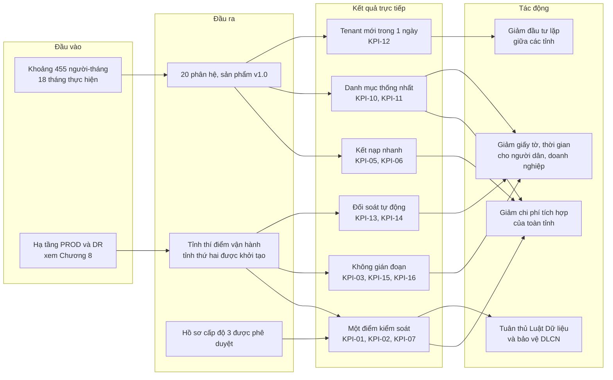

## 10. Hiệu quả kinh tế - xã hội

> **Tóm tắt cho hội đồng thẩm định.** Datahub là dự án hạ tầng số dùng chung của khu vực công, không thu phí người dùng, nên hiệu quả được đánh giá bằng chi phí tránh được, thời gian tiết kiệm được và giá trị xã hội, không đánh giá bằng khả năng thu hồi vốn. Với tỉnh cỡ M và các giả định ghi rõ trong chương, nền tảng giảm khoảng 65% công sức xây dựng một kết nối mới so với kết nối điểm tới điểm, rút thời gian kết nạp một HTTT từ 2 đến 4 tuần xuống không quá 5 ngày làm việc, và giảm khoảng 88% công sức cập nhật danh mục dùng chung cho mỗi đợt thay đổi lớn như sắp xếp đơn vị hành chính. Lợi ích lớn nhất về kinh tế nằm ở mô hình sản phẩm đa tỉnh: nếu năm tỉnh dùng chung một sản phẩm thay vì mỗi tỉnh tự đầu tư một nền tảng tương đương, tổng nỗ lực phát triển và triển khai giảm khoảng 73% đến 76%, và tỷ lệ này tăng lên khoảng 91% nếu nhân rộng cho cả 34 tỉnh. Các con số trong chương là tỷ lệ và người-tháng; quy đổi ra tiền và so sánh với tổng chi phí sở hữu được trình bày tại Chương 8. Số liệu nền thực tế của tỉnh thí điểm (số hồ sơ thủ tục hành chính, số kết nối điểm tới điểm, chi phí vận hành hệ cũ) cần chủ đầu tư cung cấp để thay các giá trị giả định.

### 10.1. Phương pháp đánh giá

#### 10.1.1. Nguyên tắc

Chương này đánh giá hiệu quả theo bốn nguyên tắc. Nguyên tắc thứ nhất là so sánh với kịch bản không đầu tư đã mô tả ở mục 2.6, tức là tỉnh tiếp tục vận hành hệ LGSP cũ và các kết nối điểm tới điểm tiếp tục phát sinh. Nguyên tắc thứ hai là chỉ lượng hóa những lợi ích có cơ chế tác động rõ ràng và gắn được với một chỉ số đo tại D02-01; lợi ích không lượng hóa được thì trình bày định tính, không gán số. Nguyên tắc thứ ba là tách bạch phần lợi ích do Datahub tạo ra với phần lợi ích do các hệ thống khác cùng tạo ra: ví dụ việc giảm giấy tờ cho người dân cần cả Datahub, hệ thống giải quyết thủ tục hành chính và cơ sở dữ liệu quốc gia, nên chương không tính toàn bộ giá trị đó cho dự án. Nguyên tắc thứ tư là mọi giá trị giả định đều được ghi nhãn **[GĐ]** và có câu hỏi mở tương ứng để chủ đầu tư thay bằng số liệu thật trước khi trình thẩm định.

Lợi ích được đo bằng ngày công hoặc người-tháng thay vì tiền vì hai lý do. Một là đơn giá người-tháng là tham số do chủ đầu tư điền theo hướng dẫn định mức hiện hành và được thống nhất tại Chương 8; nếu chương này tự quy đổi ra tiền sẽ tạo ra hai bộ đơn giá. Hai là ngày công là đơn vị mà các sở, nhà thầu và đơn vị vận hành có thể tự kiểm chứng. Quy ước quy đổi: một người-tháng bằng 22 ngày công.

#### 10.1.2. Chuỗi kết quả

Sơ đồ dưới đây thể hiện chuỗi kết quả (logic model) từ đầu tư tới tác động. Mỗi mắt xích ở cột "kết quả trực tiếp" gắn với một chỉ số KPI, nên hiệu quả trong chương này được theo dõi bằng chính các chỉ số dùng để nghiệm thu dự án.

Sơ đồ cũng cho thấy một điều kiện quan trọng: tác động chỉ xuất hiện khi các sở thực sự chuyển kết nối sang nền tảng. Nếu nền tảng sẵn sàng nhưng các HTTT vẫn giữ kết nối điểm tới điểm, chuỗi bị đứt ở mắt xích R2. Điều kiện này được nêu lại ở mục 10.8.

#### 10.1.3. Bảng tham số giả định

Bảng sau tập hợp các tham số dùng trong mục 10.2. Các tham số lấy từ bộ giả định nền hoặc từ D02-01 được ghi nguồn; các tham số còn lại là giả định của đơn vị tư vấn dựa trên kinh nghiệm triển khai nền tảng tích hợp cấp tỉnh, được chọn ở mức thận trọng.

| Mã tham số | Tham số | Giá trị dùng | Nguồn |
|---|---|---|---|
| TS-01 | Số HTTT kết nối của tỉnh cỡ M | 200 | Bộ giả định nền §4 |
| TS-02 | Số đối tác trao đổi dữ liệu bình quân của một HTTT | 4 | [GĐ] |
| TS-03 | Công sức xây dựng một kết nối điểm tới điểm, tính cả hai đầu | 10 ngày công | [GĐ] |
| TS-04 | Công sức dựng một luồng tích hợp chuẩn trên nền tảng | 2 ngày công | KPI-06 (đích) |
| TS-05 | Công sức kết nạp lần đầu một HTTT vào nền tảng, phía HTTT | 5 ngày công | [GĐ] |
| TS-06 | Tỷ lệ kết nối mới có ít nhất một HTTT chưa kết nạp | 30% | [GĐ] |
| TS-07 | Công sức duy trì một kết nối điểm tới điểm mỗi năm | 2 ngày công | [GĐ] |
| TS-08 | Công sức duy trì một kết nối qua nền tảng mỗi năm | 0,5 ngày công | [GĐ] |
| TS-09 | Thời gian dựng một luồng trên hệ cũ | 5–10 ngày công | D02-01, nền KPI-06 |
| TS-10 | Số luồng tích hợp mới mỗi năm | 60 | [GĐ] |
| TS-11 | Số HTTT kết nạp mới mỗi năm | 20 (10% của TS-01) | [GĐ] |
| TS-12 | Số HTTT dùng danh mục đơn vị hành chính, cơ quan | 100 (50% của TS-01) | [GĐ] |
| TS-13 | Công sức một HTTT tự cập nhật và ánh xạ danh mục cho một đợt thay đổi lớn | 5 ngày công | [GĐ] |
| TS-14 | Tổng nỗ lực xây dựng sản phẩm và thí điểm | 455 người-tháng | Bộ giả định nền §5 |
| TS-15 | Nỗ lực triển khai cho một tỉnh cỡ M từ tỉnh thứ hai trở đi | 20–40 người-tháng | [GĐ], xem mục 10.2.5 |

### 10.2. Hiệu quả định lượng

#### 10.2.1. Giảm chi phí tích hợp điểm tới điểm

Khi không có nền tảng dùng chung, mỗi cặp HTTT cần trao đổi dữ liệu phải tự xây một kết nối riêng: thống nhất định dạng, cấp thông tin xác thực, viết mã ở cả hai đầu, kiểm thử và duy trì. Với nền tảng, mỗi HTTT chỉ kết nối một lần với Datahub theo chuẩn chung, và mỗi nhu cầu trao đổi mới chỉ còn là một luồng được cấu hình trên nền tảng. Đây là cơ chế giảm chi phí cơ bản của mọi trục tích hợp, và nó càng có giá trị khi số HTTT càng lớn.

Với tỉnh cỡ M có 200 HTTT và mỗi HTTT trao đổi với bình quân 4 đối tác, tỉnh có khoảng 200 × 4 / 2 = 400 quan hệ trao đổi dữ liệu. Nếu toàn bộ được xây theo kiểu điểm tới điểm, công sức xây dựng là 400 × 10 = 4.000 ngày công, tương đương khoảng 182 người-tháng. Nếu toàn bộ đi qua nền tảng, công sức gồm kết nạp 200 HTTT một lần (200 × 5 = 1.000 ngày công) và dựng 400 luồng (400 × 2 = 800 ngày công), tổng cộng 1.800 ngày công, tương đương khoảng 82 người-tháng. Mức giảm là 55% cho toàn bộ mạng kết nối.

Trên thực tế, tỉnh không xây lại toàn bộ mạng kết nối từ đầu, nên con số có ý nghĩa hơn cho quyết định là chi phí biên của một kết nối mới. Một kết nối điểm tới điểm mới tốn 10 ngày công. Một kết nối mới qua Datahub tốn 2 ngày công nếu cả hai HTTT đã được kết nạp, và thêm 5 ngày công nếu có một HTTT chưa kết nạp; với tỷ lệ 30% kết nối mới có HTTT chưa kết nạp, chi phí bình quân là 2 + 0,3 × 5 = 3,5 ngày công, giảm 65% so với điểm tới điểm.

Lợi ích tiếp diễn hằng năm đến từ chi phí duy trì. Mỗi kết nối điểm tới điểm phải được duy trì riêng (đổi khóa, cập nhật khi một đầu thay đổi phiên bản, xử lý sự cố mà không có nhật ký tập trung), trong khi kết nối qua nền tảng được duy trì tập trung với kho bí mật, giám sát và cảnh báo chung. Nếu số kết nối điểm tới điểm hiện có là P và dự án đạt KPI-02 (giảm ít nhất 80%), công sức duy trì tiết kiệm mỗi năm là 0,8 × P × (2 − 0,5) = 1,2 × P ngày công. Ví dụ với P = 100, khoản tiết kiệm là 120 ngày công mỗi năm, khoảng 5,5 người-tháng. Giá trị P thực tế chưa có trong hồ sơ và cần chủ đầu tư thống kê (Q-D0101-22 tại Chương 2).

#### 10.2.2. Rút ngắn thời gian kết nạp HTTT và xây dựng luồng

Lợi ích này có hai thành phần: thời gian chờ của cơ quan có nhu cầu và công sức kỹ thuật của đơn vị vận hành, nhà thầu.

Về thời gian chờ, KPI-05 đặt đích rút thời gian từ khi nộp hồ sơ kết nạp tới khi HTTT gọi được API ở môi trường thật từ khoảng 2 đến 4 tuần (10 đến 20 ngày làm việc) xuống không quá 5 ngày làm việc, tức là mỗi lần kết nạp rút ngắn từ 5 đến 15 ngày làm việc. Với 20 HTTT kết nạp mới mỗi năm, tổng thời gian chờ giảm từ 100 đến 300 ngày làm việc mỗi năm. Thời gian chờ không phải là chi phí ngân sách trực tiếp, nhưng là độ trễ trước khi một dịch vụ công mới hoặc một HTTT mới phát huy tác dụng; với dịch vụ công trực tuyến, mỗi ngày chậm là một ngày người dân tiếp tục phải nộp giấy tờ. Cơ chế rút ngắn đến từ việc hồ sơ kết nạp được duyệt trên hệ thống thay cho công văn giấy (PH-01), thông tin xác thực được cấp tự động qua kho bí mật thay cho gửi qua thư điện tử, và một HTTT chỉ khai báo một lần thay cho ba lần ở ba khối API Management, Hub và Payment như trên hệ cũ.

Về công sức xây dựng luồng, KPI-06 đặt đích dựng một luồng tích hợp chuẩn trong không quá 2 ngày công, so với 5 đến 10 ngày công trên hệ cũ. Với 60 luồng mới mỗi năm, công sức tiết kiệm là từ 60 × 3 = 180 đến 60 × 8 = 480 ngày công mỗi năm, tương đương khoảng 8 đến 22 người-tháng mỗi năm. Cơ chế tiết kiệm là trình thiết kế luồng với mẫu dựng sẵn, bộ điều hợp dùng chung (PH-05) và quy trình triển khai tự động không phải dừng dịch vụ (PH-20), thay cho việc viết tệp cấu hình Camel bằng tay rồi chép tệp WAR và khởi động lại máy chủ như mô tả ở mục 2.2.5.

#### 10.2.3. Tái sử dụng danh mục dùng chung và dữ liệu chủ

Hiện nay mỗi HTTT tự duy trì bản sao danh mục của mình, nên mỗi lần danh mục thay đổi thì từng HTTT phải tự cập nhật. Đợt sắp xếp đơn vị hành chính năm 2025 là ví dụ điển hình: mọi HTTT có dùng mã đơn vị hành chính đều phải cập nhật bảng mã, xây bảng ánh xạ mã cũ sang mã mới và kiểm tra dữ liệu lịch sử.

Với 100 HTTT dùng danh mục đơn vị hành chính và cơ quan, mỗi HTTT tốn khoảng 5 ngày công cho một đợt thay đổi lớn, tổng công sức của toàn tỉnh là 500 ngày công cho mỗi đợt. Khi danh mục được quản lý tập trung có phiên bản, có ngày hiệu lực và bảng ánh xạ trên PH-07, công sức gồm khoảng 10 ngày công của cơ quan chủ quản danh mục để cập nhật và duyệt phiên bản mới, cộng 0,5 ngày công mỗi HTTT để kiểm tra việc nhận đồng bộ qua API hoặc sự kiện, tổng cộng 10 + 100 × 0,5 = 60 ngày công. Mức giảm khoảng 88% cho mỗi đợt thay đổi lớn. Với các thay đổi nhỏ và thường xuyên hơn của danh mục quốc gia, lợi ích chủ yếu là thời gian: KPI-11 đặt đích đồng bộ trong không quá 24 giờ sau khi quốc gia ban hành, thay cho việc cập nhật thủ công không xác định thời hạn.

Lợi ích lớn hơn nhưng khó lượng hóa là chất lượng dữ liệu. Khi cùng một xã mang các mã khác nhau ở các HTTT khác nhau, dữ liệu chia sẻ giữa các hệ bị sai lệch, báo cáo tổng hợp không khớp và hồ sơ thủ tục bị trả lại. Từ đợt 2, dữ liệu chủ (PH-06) và chất lượng dữ liệu (PH-08) mở rộng cơ chế này sang các thực thể công dân, tổ chức, địa chỉ: mỗi HTTT dùng chung một bản ghi đã được hợp nhất thay vì tự đối chiếu. Báo cáo không lượng hóa phần này vì D02-01 chưa có chỉ số cho dữ liệu chủ và chất lượng dữ liệu (xem ghi chú ở mục 3.8).

#### 10.2.4. Giảm giấy tờ cho người dân và doanh nghiệp

Khi cơ quan tiếp nhận hồ sơ thủ tục hành chính lấy được dữ liệu qua nền tảng (ví dụ thông tin hộ tịch, lý lịch tư pháp, bảo hiểm xã hội, đăng ký doanh nghiệp, là các nhóm dịch vụ đã có trong phụ lục kết nối NGSP của hệ cũ), người dân không phải nộp bản sao giấy tờ tương ứng. Lợi ích xã hội có thể ước tính theo công thức sau:

> Giá trị tiết kiệm mỗi năm = H × r × g × c

trong đó H là số hồ sơ thủ tục hành chính tỉnh tiếp nhận mỗi năm, r là tỷ lệ hồ sơ có ít nhất một thành phần giấy tờ được thay bằng dữ liệu khai thác qua nền tảng, g là số giấy tờ bình quân được thay trong một hồ sơ đó, và c là chi phí xã hội để có một giấy tờ (phí sao y, chứng thực, chi phí đi lại và thời gian của người dân).

Để minh họa thứ bậc độ lớn, với H = 1.000.000 hồ sơ mỗi năm, r = 20%, g = 1,5 và c = 30.000 đồng (cả bốn giá trị đều là **[GĐ]**), giá trị tiết kiệm cho xã hội là khoảng 9.000 triệu đồng mỗi năm. Con số này không được cộng vào phân tích chi phí của Chương 8, vì ba lý do: nó là lợi ích của người dân và doanh nghiệp chứ không phải khoản giảm chi ngân sách; nó do nhiều hệ thống cùng tạo ra, trong đó Datahub là điều kiện cần nhưng không đủ; và giá trị H, r của tỉnh thí điểm chưa có số liệu thực (Q-D0101-91). Chỉ số đo chính thức cho lợi ích này hiện chưa có trong D02-01 và được đề xuất bổ sung (mục 3.8).

Ngoài chi phí, người dân hưởng lợi từ việc giảm số lần đi lại và thời gian giải quyết. Với chính quyền hai cấp, cán bộ một cửa cấp xã tra cứu được dữ liệu ngay tại chỗ nếu nền tảng sẵn sàng trong giờ hành chính; vì vậy lợi ích này phụ thuộc trực tiếp vào KPI-03 ở mục 10.2.6.

#### 10.2.5. Chi phí nhân rộng biên cho tỉnh thứ hai trở đi

Đây là lợi ích kinh tế lớn nhất của dự án và là lý do chính để chọn mô hình sản phẩm đa tenant. Cơ chế rất đơn giản: phần lớn nỗ lực của dự án là xây dựng sản phẩm (phân tích, thiết kế, phát triển, kiểm thử 20 phân hệ), và phần này chỉ phải trả một lần. Tỉnh thứ hai trở đi chỉ phải chịu chi phí triển khai, gồm cài đặt hoặc khởi tạo tenant, cấu hình, di trú từ hệ cũ của tỉnh đó, lập hồ sơ cấp độ, đào tạo và hỗ trợ vận hành ban đầu, cộng với chi phí hạ tầng riêng nếu tỉnh chọn cụm riêng.

Căn cứ để ước tính nỗ lực triển khai biên là cơ cấu nỗ lực trong bộ giả định nền. Wave W3 (thí điểm tại tỉnh 1, gồm cài đặt PROD, di trú, chạy song song và cắt chuyển) chiếm 18,5 × 3 = 55,5 người-tháng, khoảng 12% của 455 người-tháng. Nỗ lực của W3 bao gồm cả phần học hỏi lần đầu và hoàn thiện quy trình di trú; với tỉnh tiếp theo, quy trình đã được đóng gói và việc khởi tạo tenant đạt đích KPI-12 (không quá 1 ngày làm việc), nên nỗ lực triển khai biên được giả định từ 20 người-tháng (tenant dùng chung, hệ cũ đơn giản) đến 40 người-tháng (cụm riêng, di trú hệ cũ phức tạp) cho một tỉnh cỡ M.

Kịch bản so sánh là mỗi tỉnh tự đầu tư một nền tảng có phạm vi tương đương. Kịch bản này được giả định tốn ít nhất 455 người-tháng cho mỗi tỉnh, tức là bằng nỗ lực của dự án này; đây là giả định thận trọng vì một tỉnh tự đầu tư riêng không có lợi thế của sản phẩm đã có sẵn. Bảng sau so sánh tổng nỗ lực theo số tỉnh tham gia.

| Số tỉnh n | Mỗi tỉnh tự đầu tư, n × 455 (người-tháng) | Dùng chung sản phẩm, 455 + (n − 1) × 20…40 (người-tháng) | Mức giảm |
|---|---|---|---|
| 1 | 455 | 455 | 0% |
| 2 | 910 | 475 – 495 | 46% – 48% |
| 5 | 2.275 | 535 – 615 | 73% – 76% |
| 10 | 4.550 | 635 – 815 | 82% – 86% |
| 34 | 15.470 | 1.115 – 1.775 | 89% – 93% |

Bảng cho thấy lợi ích của mô hình sản phẩm xuất hiện ngay từ tỉnh thứ hai và tăng nhanh theo số tỉnh. Với phạm vi cam kết của dự án (một tỉnh thí điểm và một tỉnh thứ hai được khởi tạo), tổng nỗ lực tiết kiệm so với hai tỉnh tự đầu tư riêng là khoảng 415 đến 435 người-tháng. Lợi ích này kèm theo ba lưu ý mà hội đồng cần cân nhắc. Thứ nhất, bảng chỉ tính nỗ lực phát triển và triển khai; chi phí hạ tầng của mỗi tỉnh vẫn phát sinh riêng, trừ khi tỉnh dùng chế độ tenant dùng chung trên một cụm, và chi phí hạ tầng theo cỡ S, M, L được tính tại Chương 8. Thứ hai, sau khi phát hành v1.0, sản phẩm cần chi phí bảo trì và phát triển phiên bản mới; nếu nhiều tỉnh dùng chung thì chi phí này được chia sẻ, nhưng cần một cơ chế chia sẻ chi phí và một đơn vị làm chủ sản phẩm (Q-D0101-93). Thứ ba, lợi ích chỉ hiện thực hóa khi quyền sử dụng và quyền triển khai sản phẩm cho tỉnh khác được bảo đảm trong hợp đồng (Q-D0101-34 tại Chương 3).

Ngoài nỗ lực ban đầu, mô hình dùng chung còn tạo lợi ích tiếp diễn: một bản vá an toàn thông tin hay một thay đổi do văn bản pháp luật mới chỉ phải phát triển một lần rồi phát hành cho mọi tỉnh qua cùng một quy trình, thay vì mỗi tỉnh tự xử lý trên một nền tảng khác nhau.

#### 10.2.6. Giảm thời gian gián đoạn và chi phí đối soát

Về độ sẵn sàng, cam kết 90% mỗi năm của hệ cũ cho phép ngừng tới khoảng 876 giờ trong một năm, còn đích 99,9% mỗi tháng của KPI-03 chỉ cho phép ngừng khoảng 43 phút mỗi tháng, tương đương khoảng 8,8 giờ mỗi năm. Hệ cũ thực tế có thể vận hành tốt hơn mức cam kết, nhưng hồ sơ không có số liệu đo (Q-D0101-28 tại Chương 2). Giá trị kinh tế của thời gian gián đoạn tránh được bằng số lượt tra cứu, thanh toán bị gián đoạn nhân với chi phí xử lý lại của cán bộ và người dân; báo cáo chưa lượng hóa vì thiếu số liệu giao dịch thực. Các chỉ số MTTD không quá 5 phút (KPI-15) và MTTR với sự cố mức 1 không quá 1 giờ (KPI-16) củng cố lợi ích này về phía vận hành.

Về đối soát thanh toán, với quy mô cỡ M khoảng 400 nghìn giao dịch thanh toán mỗi tháng, đích KPI-13 (ít nhất 99,5% giao dịch đối soát tự động khớp) nghĩa là chỉ còn tối đa khoảng 2.000 giao dịch mỗi tháng cần xem xét thủ công, so với tình trạng hiện tại không có đối soát tự động. Lợi ích gồm giảm công sức kế toán, phát hiện giao dịch lệch trong không quá 1 ngày làm việc (KPI-14) và có căn cứ giải quyết khiếu nại của người dân. Công sức đối soát hiện tại của tỉnh cần chủ đầu tư cung cấp để lượng hóa (Q-D0101-92).

Về hạ tầng, cần nói rõ rằng Datahub không làm giảm số lượng máy chủ so với hệ cũ. Kiến trúc mới có cụm Kubernetes nhiều nút, có bản sao dự phòng và địa điểm DR, nên tài nguyên hạ tầng lớn hơn mô hình một máy chủ cho mỗi khối của hệ cũ. Khoản tăng này là chi phí của việc nâng mức sẵn sàng từ 90% lên 99,9% và đạt RPO 15 phút; nó được tính đầy đủ tại Chương 8 và không được trình bày như một khoản tiết kiệm.

#### 10.2.7. Tổng hợp hiệu quả định lượng

Bảng sau tổng hợp các lợi ích định lượng ở mục 10.2.1 đến 10.2.6. Cột "Đưa vào Chương 8" cho biết lợi ích nào được dùng trong so sánh chi phí, lợi ích nào chỉ là giá trị xã hội tham khảo.

| Lợi ích | Giá trị ước tính (cỡ M) | Chỉ số theo dõi | Đưa vào Chương 8 |
|---|---|---|---|
| Giảm công sức một kết nối mới | 65% (10 xuống 3,5 ngày công) | KPI-05, KPI-06 | Có, quy đổi theo đơn giá |
| Giảm công sức duy trì kết nối điểm tới điểm | 1,2 × P ngày công/năm (120 ngày công với P = 100) | KPI-02 | Có, khi có giá trị P |
| Giảm công sức dựng luồng | 180 – 480 ngày công/năm | KPI-06 | Có |
| Rút thời gian chờ kết nạp | 100 – 300 ngày làm việc/năm | KPI-05 | Không, định tính có số |
| Giảm công sức cập nhật danh mục mỗi đợt lớn | 88% (500 xuống 60 ngày công) | KPI-10, KPI-11 | Có, theo số đợt dự kiến |
| Giảm giấy tờ cho người dân | Minh họa khoảng 9.000 triệu đồng/năm | Đề xuất bổ sung tại D02-01 | Không, giá trị xã hội |
| Nhân rộng tỉnh thứ hai | Tiết kiệm 415 – 435 người-tháng so với tự đầu tư | KPI-12 | Có, ở kịch bản nhân rộng |
| Nhân rộng năm tỉnh | Giảm 73% – 76% tổng nỗ lực | KPI-12 | Có, ở kịch bản nhân rộng |
| Giảm gián đoạn dịch vụ | Từ tối đa 876 giờ/năm xuống khoảng 8,8 giờ/năm (theo cam kết) | KPI-03, KPI-15, KPI-16 | Không, định tính có số |
| Đối soát tự động | Tối đa khoảng 2.000 giao dịch/tháng cần xem thủ công | KPI-13, KPI-14 | Có, khi có số liệu nền |

### 10.3. Hiệu quả định tính

Ngoài các lợi ích lượng hóa được, dự án tạo ra một số hiệu quả quan trọng nhưng không đo được bằng ngày công. Hiệu quả thứ nhất là minh bạch trong chia sẻ dữ liệu. Mọi lượt khai thác dữ liệu đi qua nền tảng đều có nhật ký ghi rõ ai khai thác, dữ liệu gì, vì mục đích gì và vào lúc nào (KPI-07), nên chủ quản dữ liệu (SH-08) kiểm soát được việc sử dụng dữ liệu của mình và cơ quan thanh tra có căn cứ kiểm tra. Trên hệ cũ, phần duyệt cho phép khai thác nằm ngoài hệ thống ở dạng công văn giấy và không truy vết được.

Hiệu quả thứ hai là giảm rủi ro an toàn thông tin và rủi ro pháp lý. Thay nền công nghệ hết vòng đời, đưa toàn bộ thông tin xác thực vào kho bí mật (KPI-09), mã hóa đường truyền và có hồ sơ cấp độ 3 được phê duyệt (KPI-08) làm giảm xác suất xảy ra sự cố lộ lọt dữ liệu cá nhân của công dân. Giá trị của một sự cố tránh được là rất lớn, gồm chi phí khắc phục, trách nhiệm pháp lý và uy tín của chính quyền, nhưng không thể ước tính tin cậy nên không được lượng hóa.

Hiệu quả thứ ba là nâng năng lực quản lý của cơ quan chủ quản. Khi có danh mục dịch vụ, danh mục HTTT kết nối và số liệu vận hành tập trung, Sở Khoa học và Công nghệ có bức tranh đầy đủ về việc dữ liệu nào đang được chia sẻ cho ai, phục vụ báo cáo chỉ tiêu chuyển đổi số và lập kế hoạch đầu tư các năm sau dựa trên số liệu thay vì ước đoán.

Hiệu quả thứ tư là cải thiện điều kiện làm việc của đội vận hành. Một giao diện quản trị thay cho năm giao diện (KPI-17), cảnh báo chủ động thay cho kiểm tra thủ công hằng ngày, và triển khai không gián đoạn thay cho thao tác dừng máy chủ làm giảm áp lực và rủi ro thao tác sai của đội vận hành tỉnh.

### 10.4. Đóng góp cho cải cách hành chính

Datahub đóng góp cho cải cách hành chính ở ba điểm. Điểm thứ nhất là hiện thực hóa nguyên tắc không yêu cầu người dân cung cấp lại thông tin mà cơ quan nhà nước đã có, theo CMP-LAW-03 và CMP-LAW-01: nền tảng là kênh kỹ thuật để cơ quan tiếp nhận lấy dữ liệu từ cơ quan đang quản lý dữ liệu đó, có kiểm soát và có nhật ký, như phân tích ở mục 10.2.4. Điểm thứ hai là hỗ trợ vận hành chính quyền hai cấp: khi cấp huyện không còn, cán bộ cấp xã cần tra cứu dữ liệu chuyên ngành trực tuyến, và nền tảng có độ sẵn sàng cao bảo đảm việc tra cứu không phụ thuộc vào việc liên hệ qua cấp trung gian. Điểm thứ ba là hỗ trợ quy trình liên thông nhiều cơ quan: từ đợt 2, phân hệ điều phối quy trình (PH-11) cho phép một hồ sơ đi qua nhiều cơ quan theo quy trình được định nghĩa và theo dõi được trạng thái, thay cho việc chuyển hồ sơ thủ công giữa các hệ thống.

Thanh toán trực tuyến có đối soát tự động (PH-19) cũng là một phần của cải cách hành chính, vì nó cho phép người dân hoàn thành trọn vẹn thủ tục trực tuyến, kể cả nghĩa vụ tài chính, với căn cứ đối chiếu rõ ràng khi có khiếu nại.

### 10.5. Đóng góp cho chuyển đổi số

Đối với chương trình chuyển đổi số của tỉnh, Datahub là thành phần hạ tầng số dùng chung mà các HTTT khác dựa vào, và sự phù hợp của dự án với Kế hoạch chuyển đổi số của địa phương đã được thuyết minh tại mục 2.5.5. Về kết nối với cấp quốc gia, phân hệ kết nối quốc gia (PH-14) bảo đảm tỉnh kết nối được với NDXP và NDOP theo định hướng kiến trúc tại CMP-LAW-10 và CMP-LAW-11, và phân hệ quản trị kiến trúc, chỉ số (PH-16) ở đợt 3 chuẩn bị cho việc thu thập chỉ số tự động mà cơ quan trung ương dùng để đánh giá mức độ kết nối, chia sẻ dữ liệu của địa phương. Về dữ liệu, lớp dữ liệu dùng chung (PH-06 đến PH-09) đặt nền móng cho các bước tiếp theo như kho dữ liệu phân tích, vốn nằm ngoài phạm vi dự án này nhưng được kiến trúc chừa sẵn điểm mở rộng. Về trí tuệ nhân tạo, cổng AI (PH-17) ở đợt 3 tạo một điểm kiểm soát chung cho việc các HTTT sử dụng mô hình AI, có ghi vết và chính sách, trước khi việc sử dụng AI lan rộng một cách phân tán.

### 10.6. Đóng góp cho tự chủ công nghệ

Datahub được xây dựng hoàn toàn trên công nghệ nguồn mở có cộng đồng lớn và đang được hỗ trợ dài hạn, không phụ thuộc dịch vụ độc quyền của một nhà cung cấp hạ tầng nào, và triển khai được trên cả trung tâm dữ liệu của tỉnh lẫn đám mây Chính phủ. Điều này giải quyết trực tiếp điểm nghẽn ĐN-14 của hệ cũ, nơi tỉnh phụ thuộc vào thư viện và tài liệu nội bộ của nhà cung cấp, và hồ sơ bàn giao không đủ để tự vận hành.

Tự chủ công nghệ được bảo đảm bằng bốn điều kiện cụ thể. Thứ nhất, mã nguồn, cấu hình triển khai và bộ tài liệu theo vòng đời phát triển được bàn giao đầy đủ. Thứ hai, quy trình triển khai được tự động hóa và mô tả dưới dạng mã (GitOps), nên một đội kỹ thuật khác có thể tiếp nhận mà không cần kiến thức ngầm của nhà thầu ban đầu. Thứ ba, đội vận hành tỉnh được đào tạo và tham gia từ wave W3, không chỉ nhận bàn giao vào cuối dự án. Thứ tư, không có chi phí bản quyền phần mềm, nên tỉnh có thể chọn đơn vị hỗ trợ kỹ thuật theo cơ chế cạnh tranh ở giai đoạn vận hành. Ở tầm rộng hơn, một sản phẩm nguồn mở dùng chung cho nhiều tỉnh góp phần hình thành năng lực trong nước về nền tảng tích hợp dữ liệu khu vực công, phù hợp với định hướng phát triển công nghiệp công nghệ số.

### 10.7. Hiệu quả về quốc phòng, an ninh và khả năng thu hồi vốn

Về an ninh, dự án góp phần bảo đảm an ninh mạng và an ninh dữ liệu thông qua việc lưu trữ toàn bộ dữ liệu trong lãnh thổ Việt Nam, đạt cấp độ 3 và có thiết kế để nâng lên cấp độ 4, kiểm soát tập trung mọi luồng dữ liệu đi ra khỏi tỉnh, và có nhật ký phục vụ điều tra khi có sự cố. Dự án không có hạng mục trực tiếp phục vụ quốc phòng.

Về khả năng thu hồi vốn, dự án cung cấp hạ tầng số dùng chung cho cơ quan nhà nước và không thu phí người dùng, nên không đặt mục tiêu thu hồi vốn. Trong giai đoạn nhân rộng, nếu cơ quan có thẩm quyền quyết định cung cấp nền tảng cho các tỉnh khác theo hình thức thuê dịch vụ (phương án H3), phần chi phí phát triển có thể được bù đắp một phần qua giá dịch vụ; khả năng này phụ thuộc vào cơ chế tài chính do cấp có thẩm quyền quyết định và không được tính vào hiệu quả của dự án.

### 10.8. Điều kiện để hiện thực hóa hiệu quả và cách theo dõi

Các hiệu quả nêu trên chỉ đạt được khi có đủ ba điều kiện. Điều kiện thứ nhất là các sở, ngành chuyển kết nối sang nền tảng; như đã nêu ở mục 3.6.2, phần chỉnh sửa phía các HTTT không thuộc dự án, nên cần văn bản chỉ đạo của UBND tỉnh (Q-D0101-35 tại Chương 3). Điều kiện thứ hai là có số liệu nền để so sánh; nếu giá trị nền của các KPI có dấu sao không được đo trước cổng G1, tỉnh sẽ không chứng minh được mức cải thiện. Điều kiện thứ ba là quyền triển khai sản phẩm cho tỉnh khác được bảo đảm và có đơn vị làm chủ sản phẩm sau dự án, để lợi ích nhân rộng ở mục 10.2.5 trở thành hiện thực.

Việc theo dõi hiệu quả dùng chính bộ KPI của D02-01, được thu thập tự động bởi PH-13 và PH-16 và báo cáo theo các mốc đo đã ghi ở mục 3.2.2: từ nghiệm thu, sau 6 tháng và sau 12 tháng vận hành. Báo cáo đề xuất chủ đầu tư tổ chức một lần đánh giá hiệu quả sau 12 tháng vận hành chính thức, so sánh giá trị thực đo với các giá trị trong chương này và cập nhật kịch bản nhân rộng.

### 10.9. Câu hỏi mở

> **Câu hỏi mở Q-D0101-91:** Số hồ sơ thủ tục hành chính tỉnh thí điểm tiếp nhận mỗi năm và tỷ lệ hồ sơ có thành phần giấy tờ có thể thay bằng dữ liệu khai thác qua nền tảng (theo danh mục thủ tục đã được rà soát cắt giảm giấy tờ) là bao nhiêu?

> **Câu hỏi mở Q-D0101-92:** Hiện nay việc đối soát giao dịch thanh toán trực tuyến dịch vụ công của tỉnh được thực hiện thế nào, bao nhiêu người tham gia, mất bao nhiêu ngày công mỗi tháng?

> **Câu hỏi mở Q-D0101-93:** Sau khi dự án kết thúc, cơ quan nào sẽ làm chủ sản phẩm Datahub, và chi phí bảo trì, phát triển phiên bản mới được chia sẻ giữa các tỉnh theo cơ chế nào?

> **Câu hỏi mở Q-D0101-94:** Chủ đầu tư có chấp nhận các tham số giả định TS-02, TS-03, TS-05 đến TS-08, TS-10 đến TS-13 và TS-15 ở mục 10.1.3, hay có số liệu từ các dự án tích hợp trước đây của tỉnh để thay thế?

> **Câu hỏi mở Q-D0101-95:** Ngoài tỉnh thứ hai, đã có tỉnh nào bày tỏ nhu cầu sử dụng sản phẩm, để làm cơ sở chọn kịch bản nhân rộng (2, 5 hay 10 tỉnh) trình bày cùng Chương 8?

### 10.10. Ghi chú cho người tổng hợp

1. Mã tham số `TS-nn` là mã cục bộ của Chương 10, không thuộc hệ truy vết chính thức; Chương 8 có thể dùng lại khi quy đổi ra tiền để hai chương nhất quán.
2. Chương 8 nên dùng bảng ở mục 10.2.7 làm đầu vào cho phần lợi ích tránh được, và dùng bảng ở mục 10.2.5 cho kịch bản nhân rộng; nếu Chương 8 tính lại tổng nỗ lực khác 455 người-tháng thì các con số ở mục 10.2.5 phải tính lại theo cùng công thức.
3. Giả định "mỗi tỉnh tự đầu tư tốn ít nhất 455 người-tháng" là trung tâm của lập luận nhân rộng; nếu Chương 8 có số liệu giá các sản phẩm LGSP thương mại (PA2) thì nên thêm một dòng so sánh với kịch bản mỗi tỉnh mua sản phẩm thương mại.
4. Lợi ích giảm giấy tờ chưa có KPI chính thức tại D02-01; đã đề xuất bổ sung ở mục 3.8.
