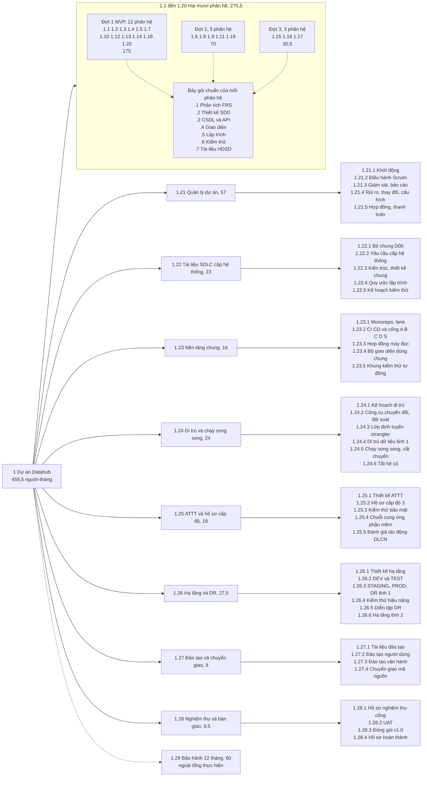

## 2. Cấu trúc phân rã công việc (WBS)

**Tóm tắt cho hội đồng thẩm định.** Toàn bộ công việc của dự án được phân rã thành 28 phần tử cấp 1 trong giai đoạn thực hiện, cộng một phần tử bảo hành tính riêng. Hai mươi phần tử đầu (1.1 đến 1.20) là 20 phân hệ, mỗi phân hệ có đúng bảy gói công việc giống nhau từ phân tích đến hướng dẫn sử dụng; tám phần tử còn lại (1.21 đến 1.28) là quản lý dự án, tài liệu SDLC cấp hệ thống, nền tảng chung, di trú, an toàn thông tin, hạ tầng và DR, đào tạo, nghiệm thu. Tổng nỗ lực ước lượng là 458,5 người-tháng, khớp với mốc khoảng 459 người-tháng trong giả định nền (sai lệch 0,1%). Phát triển 20 phân hệ chiếm 275,5 người-tháng (60,1%), các phần tử xuyên suốt chiếm 183 người-tháng (39,9%). Bảo hành 12 tháng ước lượng 60 người-tháng, nằm ngoài tổng thực hiện.

### 2.1. Nguyên tắc phân rã

Cấu trúc phân rã công việc (work breakdown structure, WBS) là danh sách đầy đủ mọi sản phẩm mà dự án phải tạo ra, sắp theo cây. Nó tuân theo quy tắc 100%: tổng công việc của các phần tử con bằng đúng công việc của phần tử cha, không có việc nào nằm ngoài cây và không có việc nào được đếm hai lần. Vì vậy WBS là cơ sở chung cho ba việc khác của kế hoạch: ước lượng nỗ lực và chi phí (chương nguồn lực và ngân sách), lập lịch (chương 4) và nghiệm thu (chương 13). Một sản phẩm không có trong WBS thì không được lập kế hoạch, không có ngân sách và không được nghiệm thu.

WBS của Datahub được phân rã theo sản phẩm bàn giao chứ không theo phòng ban hay theo giai đoạn. Cách này phù hợp với mô hình thực hiện ở chương 3, trong đó mỗi phân hệ được phát triển lặp qua nhiều sprint và được nghiệm thu như một khối tại cổng của wave chứa nó. Cấp 1 có 28 phần tử, cấp 2 là gói công việc (work package), cấp 3 chỉ xuất hiện ở bảng kế hoạch sprint và backlog (D02-05), không ghi trong tài liệu này.

Mã WBS có dạng `1.x.y`, trong đó số 1 là toàn dự án. Hai mươi phân hệ được đặt ở 1.1 đến 1.20 sao cho số thứ tự trùng với mã phân hệ: phân hệ PH-07 có mã WBS 1.7, gói lập trình của nó là 1.7.5. Cách đánh số này phá vỡ thói quen đặt quản lý dự án ở 1.1, nhưng đổi lại người đọc không phải tra bảng chuyển đổi mỗi khi đối chiếu WBS với FRS, SDD, test case vốn đều đánh theo mã phân hệ. Tám phần tử xuyên suốt được đánh từ 1.21 đến 1.28, bảo hành là 1.29.

Đơn vị ước lượng là người-tháng (person-month), một người-tháng tương đương 22 ngày công. Ước lượng được làm theo hai chiều rồi đối chiếu. Chiều từ trên xuống lấy bảng đội ngũ tham chiếu trong giả định nền (FTE theo vai trò nhân với số tháng mỗi wave) để có tổng 458,5 người-tháng và tổng theo vai trò. Chiều từ dưới lên ước lượng từng phân hệ theo độ phức tạp tương đối và từng phần tử xuyên suốt theo sản phẩm bàn giao. Hai chiều được cân bằng sao cho tổng khớp và nỗ lực theo vai trò trong mỗi gói không vượt quá số người có mặt ở wave tương ứng.

### 2.2. Sơ đồ cây WBS cấp 1 và cấp 2

Sơ đồ dưới đây trình bày cây WBS ở cấp 1 và cấp 2. Để sơ đồ đọc được, 20 phân hệ được gom theo đợt và bảy gói công việc chuẩn của một phân hệ chỉ vẽ một lần ở nhánh mẫu; mọi phân hệ đều có đúng bảy gói đó.

Sơ đồ cho thấy hai khối lớn có tính chất khác nhau. Khối phân hệ bên trái lặp lại một khuôn mẫu cố định, nên mức độ tiến triển của nó đo được bằng tỷ lệ gói đã đạt tiêu chí hoàn thành. Khối xuyên suốt bên phải gồm những sản phẩm không thuộc về một phân hệ nào nhưng là điều kiện để các phân hệ được nghiệm thu, ví dụ không có hồ sơ cấp độ 3 được phê duyệt (1.25.2) thì không phân hệ MVP nào được vận hành chính thức. Đường nét đứt tới 1.29 nhắc rằng bảo hành có trong cây để quy tắc 100% áp dụng cho toàn vòng đời hợp đồng, nhưng nỗ lực của nó không cộng vào 458,5 người-tháng của giai đoạn thực hiện.

### 2.3. Bảy gói công việc chuẩn của một phân hệ

Mỗi phân hệ có bảy gói giống nhau. Việc chuẩn hóa gói giúp ba việc: người lập kế hoạch sprint biết trước thứ tự sản phẩm, tư vấn giám sát có cùng một danh mục kiểm tra cho mọi phân hệ, và chỉ số tiến độ của các phân hệ so sánh được với nhau. Bảng dưới đây định nghĩa mỗi gói, đầu ra và tiêu chí hoàn thành. Tiêu chí hoàn thành ở đây là mức gói; tiêu chí ở mức story, sprint và wave nằm ở chương 3.

| Mã gói | Tên gói | Đầu ra, sản phẩm bàn giao | Tiêu chí hoàn thành |
|---|---|---|---|
| 1.xx.1 | Phân tích, đặc tả chức năng | Tập FRS của phân hệ (D02-03), use case (D02-04), user story (D02-05), ánh xạ `LGC` sang `FR` trong D00-03 | 100% `FR` mức M có tiêu chí chấp nhận đo được; 100% mục `LGC` của phân hệ có kết luận; FRS được đại diện chủ đầu tư duyệt bản 1.0 |
| 1.xx.2 | Thiết kế chi tiết | Tập SDD của phân hệ (D03-02), ADR mới nếu có (D00-02) | Mọi `FR` mức M có thiết kế tương ứng; kiến trúc sư giải pháp ký duyệt; không còn câu hỏi mở chặn lập trình |
| 1.xx.3 | CSDL và hợp đồng API | Phần của phân hệ trong D03-03 và D03-04; tệp OpenAPI 3.1, AsyncAPI 3.0, chính sách OPA trong `contracts/`, có gắn phiên bản | Hợp đồng đã lint sạch, đã gắn thẻ phiên bản; lane tiêu thụ đã duyệt; script tạo schema chạy được trên TEST |
| 1.xx.4 | Giao diện | Phần của phân hệ trong D03-06 (màn hình, prototype); mã giao diện trong `apps/console/` | 100% màn hình mức M được duyệt prototype và đã hiện thực; đạt kiểm tra WCAG 2.2 mức AA tự động; không màu hay khoảng cách nằm ngoài design token |
| 1.xx.5 | Lập trình | Mã nguồn phân hệ, route Camel (nếu có), script migration, kiểm thử đơn vị | Mọi `FR` mức M đã hiện thực; cổng CI A, B, C, S xanh; độ phủ kiểm thử đơn vị đạt ngưỡng ở chương 9 |
| 1.xx.6 | Kiểm thử | Tập test case D05-02 của phân hệ, kết quả chạy, báo cáo lỗi | Mỗi `FR` mức M có ít nhất hai `TC` (một dương tính, một âm tính) đã chạy đạt; không còn lỗi mức nghiêm trọng hoặc cao đang mở |
| 1.xx.7 | Tài liệu hướng dẫn sử dụng | Phần của phân hệ trong D06-04 (HDSD) và ghi chú cho D06-03 (HDVH) | HDSD bao phủ 100% màn hình mức M; người dùng đại diện thử theo HDSD trong UAT không cần hỗ trợ ở ít nhất 80% tác vụ |

Phân bổ nỗ lực giữa bảy gói không giống nhau giữa các phân hệ. Phân hệ có giao diện nghiệp vụ dày (ví dụ PH-04 có trình thiết kế luồng, PH-19 có đối soát và dashboard) dùng hồ sơ phân bổ "nghiệp vụ": khoảng 10% phân tích, 9% thiết kế, 9% CSDL và API, 21% giao diện, 31% lập trình, 15% kiểm thử và 5% HDSD. Phân hệ chủ yếu là cấu hình và mở rộng sản phẩm nguồn mở (PH-03 APISIX, PH-10 Kafka, PH-12 Keycloak và OPA, PH-13 bộ giám sát, PH-14 kết nối quốc gia) dùng hồ sơ "nền tảng": thiết kế nặng hơn (13%), giao diện nhẹ hơn (10%), kiểm thử nặng hơn (17%) vì phải kiểm thử tích hợp với sản phẩm bên ngoài. Hai hồ sơ này được rút ra từ cơ cấu vai trò của đội ngũ tham chiếu, trong đó kỹ sư frontend và thiết kế giao diện chiếm khoảng 22% nỗ lực phát triển phân hệ.

### 2.4. Từ điển WBS: các phân hệ

Bảng sau là từ điển WBS cho 20 phân hệ, mỗi dòng là một phần tử cấp 1 và bảy cột số là nỗ lực của bảy gói cấp 2, tính bằng người-tháng. Cột wave chỉ wave mà phân hệ được phát triển và nghiệm thu; đầu ra và tiêu chí hoàn thành của từng gói theo bảng ở mục 2.3, còn tiêu chí nghiệm thu của cả phân hệ là tiêu chí của cổng kết thúc wave đó (chương 4).

| Mã WBS | Phân hệ | Wave | .1 FRS | .2 SDD | .3 CSDL, API | .4 Giao diện | .5 Lập trình | .6 Kiểm thử | .7 HDSD | Tổng |
|---|---|---|---|---|---|---|---|---|---|---|
| 1.1 | PH-01 Kết nạp và định danh HTTT | W1 | 1 | 1 | 1 | 2,5 | 4 | 2 | 0,5 | **12** |
| 1.2 | PH-02 Quản lý API và danh mục dịch vụ | W1 | 1,5 | 1,5 | 1,5 | 3 | 4 | 2 | 0,5 | **14** |
| 1.3 | PH-03 Cổng API | W1 | 1 | 1,5 | 1 | 1 | 4 | 2 | 0,5 | **11** |
| 1.4 | PH-04 Lõi tích hợp và trình thiết kế luồng | W1 | 3,5 | 3 | 3 | 7 | 11 | 5 | 1,5 | **34** |
| 1.5 | PH-05 Quản lý adapter và kết nối | W1 | 1,5 | 1,5 | 1,5 | 3 | 4,5 | 2 | 1 | **15** |
| 1.6 | PH-06 Dữ liệu chủ (MDM) | W4 | 1,5 | 1,5 | 1,5 | 3 | 4,5 | 2 | 1 | **15** |
| 1.7 | PH-07 Danh mục dùng chung và ánh xạ | W2 | 2 | 1,5 | 1,5 | 4 | 5,5 | 2,5 | 1 | **18** |
| 1.8 | PH-08 Chất lượng dữ liệu | W4 | 1 | 1 | 1 | 2 | 3 | 1,5 | 0,5 | **10** |
| 1.9 | PH-09 Bảo vệ dữ liệu cá nhân | W4 | 1 | 1 | 1 | 2,5 | 4 | 2 | 0,5 | **12** |
| 1.10 | PH-10 Truyền thông sự kiện | W2 | 1 | 1,5 | 1 | 1 | 4 | 2 | 0,5 | **11** |
| 1.11 | PH-11 Điều phối quy trình (BPM) | W4 | 1 | 1 | 1 | 2,5 | 3,5 | 1,5 | 0,5 | **11** |
| 1.12 | PH-12 Định danh, xác thực, ủy quyền | W1 | 1 | 1,5 | 1 | 1 | 5 | 2 | 0,5 | **12** |
| 1.13 | PH-13 Giám sát, ghi vết, cảnh báo | W1, W2 | 1,5 | 1,5 | 1,5 | 1,5 | 4,5 | 2 | 0,5 | **13** |
| 1.14 | PH-14 Kết nối quốc gia (NDXP, NDOP) | W2 | 1 | 1,5 | 1 | 1 | 5 | 2 | 0,5 | **12** |
| 1.15 | PH-15 Cổng nhà phát triển | W5 | 1 | 1 | 1 | 2 | 3 | 1,5 | 0,5 | **10** |
| 1.16 | PH-16 Quản trị kiến trúc và KPI | W5 | 1 | 1 | 1 | 2 | 2 | 1,5 | 0,5 | **9** |
| 1.17 | PH-17 Cổng AI và quản trị AI | W5 | 1 | 1 | 1 | 2,5 | 4 | 1,5 | 0,5 | **11,5** |
| 1.18 | PH-18 Vận hành và xử lý bản tin lỗi | W2 | 1 | 1 | 1 | 2 | 3 | 1,5 | 0,5 | **10** |
| 1.19 | PH-19 Thanh toán điện tử | W4 | 2 | 2 | 2 | 4,5 | 7 | 3,5 | 1 | **22** |
| 1.20 | PH-20 Quản trị tenant và phát hành sản phẩm | W2 | 1,5 | 1 | 1 | 2,5 | 4,5 | 2 | 0,5 | **13** |
| | **Cộng 20 phân hệ** | | **27** | **27,5** | **25,5** | **50,5** | **90** | **42** | **13** | **275,5** |

Ba phân hệ lớn nhất chiếm gần 27% nỗ lực phân hệ và đều có lý do cụ thể. PH-04 (34 người-tháng) là trung tâm thay thế khối Bus và công cụ thiết kế luồng của hệ cũ, gồm trình thiết kế luồng trực quan, khung route chín chặng, chạy thử và GitOps cho định nghĩa luồng; riêng 70 mục `LGC-BUS` và `LGC-TOOL` trong D00-03 đã đổ vào phân hệ này. PH-19 (22 người-tháng) phải tái hiện 23 mục `LGC-PAY` với yêu cầu đối soát chính xác tới từng đồng và dữ liệu lịch sử giao dịch. PH-07 (18 người-tháng) là phân hệ dữ liệu đầu tiên, phải hỗ trợ lịch sử sáp nhập đơn vị hành chính sau năm 2025 và tải danh mục cỡ M tới 5 triệu bản ghi. PH-16 nhỏ nhất (9 người-tháng) vì ở bản v1.0 chỉ cần sổ kiến trúc tối thiểu và một nhóm KPI, đúng phạm vi đợt 3.

Nỗ lực phân hệ theo đợt là 175 người-tháng cho 12 phân hệ MVP, 70 người-tháng cho 5 phân hệ đợt 2 và 30,5 người-tháng cho 3 phân hệ đợt 3. Tỷ lệ 64%, 25% và 11% này phản ánh đúng chủ trương đưa phần thay thế hệ cũ lên trước và để các phân hệ hoàn toàn mới (cổng nhà phát triển, quản trị KPI, AI) về cuối, nơi chúng có thể bị thu hẹp nếu dự án gặp rủi ro tiến độ mà không làm hỏng mục tiêu thay thế hệ cũ.

### 2.5. Từ điển WBS: các phần tử xuyên suốt

Bảng dưới đây là từ điển WBS cho tám phần tử xuyên suốt và phần tử bảo hành, chi tiết tới cấp 2. Mỗi dòng ghi đầu ra cụ thể, wave thực hiện, tiêu chí hoàn thành và nỗ lực.

| Mã WBS | Gói công việc | Đầu ra, sản phẩm bàn giao | Wave | Tiêu chí hoàn thành | Người-tháng |
|---|---|---|---|---|---|
| **1.21** | **Quản lý dự án** | | W0–W5 | | **57** |
| 1.21.1 | Khởi động và lập kế hoạch chi tiết | Biên bản họp khởi động, kế hoạch dự án cập nhật sau hợp đồng, lịch sprint toàn dự án | W0 | Kế hoạch được chủ đầu tư duyệt trong 15 ngày đầu sau T0 | 4 |
| 1.21.2 | Điều hành Scrum, phối hợp sprint và quản lý backlog | Kế hoạch và báo cáo 39 sprint, biên bản review, retro; backlog đợt 2 trong giai đoạn T0+13 đến T0+15 | W0–W5 | 100% sprint có biên bản review có chữ ký đại diện chủ đầu tư | 31 |
| 1.21.3 | Giám sát tiến độ, báo cáo, ban chỉ đạo | Báo cáo tuần, báo cáo tháng, báo cáo cổng, báo cáo ban chỉ đạo quý | W0–W5 | Báo cáo tháng nộp trước ngày làm việc thứ 5 của tháng kế tiếp | 10 |
| 1.21.4 | Quản lý rủi ro, thay đổi, cấu hình | Sổ rủi ro `RSK`, sổ yêu cầu thay đổi, đường cơ sở cấu hình tại mỗi cổng | W0–W5 | Sổ rủi ro rà soát mỗi sprint; mọi thay đổi phạm vi có quyết định ghi nhận | 6 |
| 1.21.5 | Quản lý hợp đồng, nhà thầu phụ, thanh toán theo mốc | Hồ sơ đề nghị thanh toán theo cổng, quản lý bảo lãnh | W0–W5 | Hồ sơ thanh toán đủ thành phần trong 10 ngày sau mỗi cổng | 6 |
| **1.22** | **Tài liệu SDLC cấp hệ thống** | | W0–W2 | | **23** |
| 1.22.1 | Bộ tài liệu chung | D00-01, D00-02 (sổ ADR), D00-03 (RTM) duy trì suốt dự án | W0–W5 | RTM phủ 100% `LGC` và `FR` mức M tại G5 | 5 |
| 1.22.2 | Yêu cầu cấp hệ thống | D02-01 BRD, D02-02 SRS, D02-06 DFD, D02-07 từ điển dữ liệu, D02-08 ma trận phân quyền | W0 | Bản 1.0 được duyệt trước G0 | 8 |
| 1.22.3 | Kiến trúc và thiết kế chung | D03-01 SAD, D03-05 design system, D03-10 thiết kế đa tenant | W0–W1 | SAD 1.0 trước G0; D03-05, D03-10 bản 1.0 trước giữa W1 | 6 |
| 1.22.4 | Quy ước lập trình và quy trình kỹ thuật | D04-01, D04-02 | W0 | Bản 1.0 trước G0; mọi quy tắc có kiểm tra tự động tương ứng trong CI nếu kiểm được bằng máy | 2 |
| 1.22.5 | Kế hoạch kiểm thử | D05-01 Master Test Plan, D05-03, D05-04, D05-05 (phần kế hoạch) | W0–W2 | D05-01 bản 1.0 trước G0; D05-03, D05-04, D05-05 trước khi bắt đầu loại kiểm thử tương ứng | 2 |
| **1.23** | **Nền tảng chung** | | W0–W1 | | **16** |
| 1.23.1 | Monorepo, lane, luật agent | Cấu trúc repo, `AGENTS.md`, bảng sở hữu lane, mẫu PR | W0 | Mọi lane có chủ sở hữu; PR ngoài lane bị chặn tự động | 2 |
| 1.23.2 | CI/CD và cổng A, B, C, D, S | Pipeline và chính sách bảo vệ nhánh | W0 | Năm cổng chạy trên mọi PR; cổng A và S xanh 10 ngày làm việc liên tục trước G0 | 4 |
| 1.23.3 | Hợp đồng máy đọc và thư viện dùng chung | Khung `contracts/`, thư viện lỗi RFC 9457, truy vết, phân trang | W0–W1 | Hợp đồng v0 cho mọi phân hệ W1 đã gắn thẻ trước G0 | 3 |
| 1.23.4 | Bộ giao diện dùng chung | Gói design token, thành phần Liquid Glass trên antd v6, khung console | W0–W1 | Mọi thành phần trong D03-05 có trang minh họa và kiểm thử | 3 |
| 1.23.5 | Khung kiểm thử tự động và dữ liệu thử | Khung E2E, kiểm thử hợp đồng, bộ sinh dữ liệu giả lập không chứa dữ liệu cá nhân thật | W0–W1 | Luồng mỏng đầu-cuối chạy tự động mỗi đêm | 4 |
| **1.24** | **Di trú và chạy song song** | | W2–W5 | | **24** |
| 1.24.1 | Kế hoạch chuyển đổi và di trú | D06-01, bảng ánh xạ CSDL cũ sang mới, danh sách nhóm dịch vụ cắt chuyển | W2 | D06-01 bản 1.0 được duyệt trước G2 | 3 |
| 1.24.2 | Công cụ chuyển đổi và đối soát | Bộ trích xuất, chuyển đổi, nạp; công cụ đối soát cũ và mới | W2–W3 | Chạy thử trên bản sao dữ liệu thật đã che, sai lệch đối soát bằng 0 | 6 |
| 1.24.3 | Lớp định tuyến strangler | Cấu hình định tuyến tại cổng API chia lưu lượng giữa hệ cũ và Datahub theo dịch vụ và tỷ lệ | W2–W3 | Chuyển và hoàn tác một dịch vụ trong ≤ 5 phút trên STAGING | 4 |
| 1.24.4 | Di trú dữ liệu và cấu hình tỉnh 1 | HTTT đã kết nạp, API, danh mục, luồng tích hợp, lịch sử giao dịch thanh toán | W3–W4 | 100% bản ghi đối soát khớp; biên bản di trú từng nhóm | 6 |
| 1.24.5 | Chạy song song và cắt chuyển | Biên bản cắt chuyển từng nhóm dịch vụ, báo cáo đối soát hằng ngày | W3–W4 | Mỗi nhóm đạt tiêu chí cắt chuyển ở chương 4 | 3 |
| 1.24.6 | Tắt hệ cũ và lưu trữ | Biên bản tắt hệ cũ, bản lưu trữ dữ liệu và nhật ký hệ cũ theo thời hạn lưu trữ | W5 | Hệ cũ tắt trước G5; dữ liệu lưu trữ đọc lại được | 2 |
| **1.25** | **ATTT và hồ sơ cấp độ** | | W0–W4 | | **18** |
| 1.25.1 | Thiết kế ATTT và mô hình mối đe dọa | D03-07, danh mục biện pháp `SEC` | W0–W1 | Bản 1.0 trước G1; mọi `SEC` có chủ sở hữu và cách kiểm chứng | 4 |
| 1.25.2 | Hồ sơ đề xuất cấp độ 3 | D03-08, hồ sơ trình thẩm định, quyết định phê duyệt | W2–W3 | Quyết định phê duyệt cấp độ 3 trước G3 | 4 |
| 1.25.3 | Kiểm thử bảo mật | Báo cáo kiểm thử xâm nhập, đánh giá theo OWASP ASVS, quét lỗ hổng định kỳ | W2, W4, W5 | Không còn lỗ hổng mức nghiêm trọng hoặc cao đang mở tại G2, G4, G5 | 6 |
| 1.25.4 | An toàn chuỗi cung ứng phần mềm | SBOM mỗi bản phát hành, ký image, báo cáo giấy phép nguồn mở | W1–W5 | 100% image triển khai có SBOM và chữ ký hợp lệ | 2 |
| 1.25.5 | Đánh giá tác động xử lý dữ liệu cá nhân | Hồ sơ đánh giá tác động cho các luồng có dữ liệu cá nhân | W2, W4 | Hồ sơ được chủ đầu tư phê duyệt trước khi luồng tương ứng vào PROD | 2 |
| **1.26** | **Hạ tầng và DR** | | W0–W5 | | **27,5** |
| 1.26.1 | Thiết kế hạ tầng, triển khai và DR | D03-09, cấu hình tham chiếu cỡ S, M, L | W0–W1 | Bản 1.0 trước G1, đủ để gói thầu hạ tầng dùng làm yêu cầu kỹ thuật | 2,5 |
| 1.26.2 | Môi trường DEV và TEST | Cụm DEV, TEST dựng bằng GitOps | W0 | Dựng lại từ đầu bằng mã trong ≤ 4 giờ | 4 |
| 1.26.3 | STAGING, PROD và DR tỉnh 1 | Cụm STAGING, PROD, site DR warm standby | W2–W3 | Ba môi trường cùng phiên bản; D06-02 cài đặt được kiểm chứng bằng chính lần dựng này | 9 |
| 1.26.4 | Kiểm thử hiệu năng hệ thống | Báo cáo kiểm thử tải, sức chịu, độ bền theo D05-03 | W2, W4 | Đạt ngưỡng cỡ M nêu tại G2 (chương 4) | 4 |
| 1.26.5 | Sao lưu, phục hồi và diễn tập DR | Biên bản diễn tập chuyển sang DR và quay về | W3, W5 | Đạt RPO 15 phút, RTO 1 giờ data plane và 4 giờ control plane trong diễn tập (NFR-00-014) | 3 |
| 1.26.6 | Hạ tầng và cài đặt tenant tỉnh 2 | Môi trường PROD tỉnh 2 (hoặc tenant trên cụm dùng chung) | W5 | Tenant khởi tạo đạt KPI-12 (≤ 1 ngày làm việc tính cả cấu hình, NFR-00-057); toàn bộ việc dựng môi trường tỉnh 2 ≤ 4 tuần | 5 |
| **1.27** | **Đào tạo và chuyển giao** | | W3–W5 | | **8** |
| 1.27.1 | Tài liệu đào tạo | D06-05, slide, bài thực hành | W3 | Bao phủ 100% vai trò trong D02-08 | 2 |
| 1.27.2 | Đào tạo người dùng | Khóa quản trị tenant, quản trị tích hợp, khai thác dịch vụ cho tỉnh 1 và tỉnh 2 | W3, W5 | ≥ 90% học viên đạt bài kiểm tra cuối khóa | 2 |
| 1.27.3 | Đào tạo vận hành và hướng dẫn vận hành | D06-02, D06-03, khóa vận hành cho đơn vị vận hành | W3–W5 | Đội vận hành tự thực hiện được diễn tập sự cố và DR không cần nhà thầu | 3 |
| 1.27.4 | Chuyển giao mã nguồn và công nghệ | Buổi chuyển giao kiến trúc, mã nguồn, quy trình build | W5 | Bên nhận tự build và triển khai lại bản v1.0 từ mã nguồn bàn giao | 1 |
| **1.28** | **Nghiệm thu và bàn giao** | | W0–W5 | | **9,5** |
| 1.28.1 | Hồ sơ nghiệm thu từng cổng | Hồ sơ G0 đến G5 theo danh mục ở chương 4 | W0–W5 | Đủ thành phần trước buổi nghiệm thu ≥ 5 ngày làm việc | 3 |
| 1.28.2 | Kiểm thử chấp nhận người dùng | Kịch bản UAT, biên bản UAT theo D05-05 | W2, W4, W5 | Biên bản UAT có chữ ký đại diện chủ đầu tư cho từng đợt | 3 |
| 1.28.3 | Đóng gói phát hành v1.0 | Gói phát hành, ghi chú phát hành, mã nguồn, SBOM | W5 | Đúng danh mục bàn giao ở chương 13 | 2 |
| 1.28.4 | Hồ sơ hoàn thành dự án | Báo cáo hoàn thành, hồ sơ phục vụ quyết toán | W5 | Hồ sơ được chủ đầu tư tiếp nhận | 1,5 |
| | **Cộng tám phần tử xuyên suốt** | | | | **183** |
| **1.29** | **Bảo hành 12 tháng** (ngoài tổng thực hiện) | Sửa lỗi, bản vá bảo mật, hỗ trợ vận hành, báo cáo bảo hành hằng tháng | Sau G5 | Điều kiện kết thúc bảo hành ở chương 13 | 60 |

Phần tử quản lý dự án chiếm 57 người-tháng, tức 12,4% tổng thực hiện; trong đó có 4 người-tháng PM và PO cho đội đợt 2 ở giai đoạn T0+13 đến T0+15, khi W3 đã kết thúc nhưng W4 còn chạy. 29 người-tháng là thời gian của Scrum Master, được xếp vào quản lý dự án vì vai trò này phục vụ điều phối giữa các nhóm và với chủ đầu tư chứ không viết mã. Nếu tính Scrum Master vào phát triển, quản lý dự án thuần chỉ còn 28 người-tháng (6,1%), một tỷ lệ thấp so với dự án nhà nước cùng quy mô; điều này có thể chấp nhận được vì Product Owner phía nhà thầu đã gánh phần lớn việc quản lý phạm vi qua backlog.

### 2.6. Đối chiếu tổng nỗ lực với giả định nền

Tổng nỗ lực thực hiện theo WBS là 275,5 người-tháng (phân hệ) cộng 183 người-tháng (xuyên suốt), bằng 458,5 người-tháng. Giả định nền tính ≈ 459 người-tháng từ bảng đội ngũ (15,5 × 2 + 26,5 × 4 + 28 × 4 + 18,5 × 3 + 19,5 × 5 + 17,5 × 3 + 4 = 458,5, trong đó 4 người-tháng là PM và PO thuộc đội W4 ở giai đoạn T0+13 đến T0+15). Sai lệch so với con số làm tròn là 0,5 người-tháng, tức 0,1%, nằm trong ngưỡng 5%; so với phép tính chính xác thì sai lệch bằng 0 vì WBS được cân bằng từ chính phép tính đó.

Bảng dưới đây đối chiếu nỗ lực theo wave. Cột "sức chứa" lấy từ bảng đội ngũ, cột "WBS" là nỗ lực các gói được lập lịch rơi vào wave đó.

| Wave | Thời lượng | FTE tham chiếu | Sức chứa (người-tháng) | Thành phần WBS chính |
|---|---|---|---|---|
| W0 | 2 tháng | 15,5 | 31 | 1.22.2, 1.22.4, 1.23, 1.26.2, phần đầu 1.21 và 1.12 |
| W1 | 4 tháng | 26,5 | 106 | 1.1 đến 1.5, 1.12, 1.13 phần cơ bản, 1.25.1, 1.26.1 |
| W2 | 4 tháng | 28 | 112 | 1.7, 1.10, 1.13 phần đầy đủ, 1.14, 1.18, 1.20, 1.24.1–1.24.3, 1.25.2–1.25.3, 1.26.3–1.26.4 |
| W3 | 3 tháng | 18,5 | 55,5 | 1.24.4–1.24.5, 1.26.3, 1.26.5, 1.27, hoàn thiện HDSD và sửa lỗi MVP |
| W4 | 5 tháng | 19,5 (cộng PM, PO ở 2 tháng cuối) | 101,5 | 1.6, 1.8, 1.9, 1.11, 1.19, 1.25.5 phần đợt 2, 4 người-tháng của 1.21 |
| W5 | 3 tháng | 17,5 | 52,5 | 1.15, 1.16, 1.17, 1.24.6, 1.26.6, 1.27.4, 1.28.3–1.28.4 |
| **Cộng** | **18 tháng** | | **458,5** | |

Đối chiếu theo wave chỉ ra một điểm căng. Ở W1 và W2 cộng lại, sức chứa là 218 người-tháng trong khi 12 phân hệ MVP đã cần 175 người-tháng, cộng phần lớn của tài liệu hệ thống, nền tảng chung, thiết kế ATTT và hạ tầng; nếu không có phần dư thì nhu cầu vượt sức chứa khoảng 15 đến 20 người-tháng. Kế hoạch xử lý bằng hai cách: gói HDSD (1.xx.7) và phần sửa lỗi cuối của các phân hệ MVP được dời sang ba sprint đầu W3, nơi đội thí điểm có kỹ sư backend, tích hợp và QA; đồng thời các gói tài liệu hệ thống (1.22) được làm ở W0, khi đội phát triển chưa đủ người. Nếu hai cách này không đủ, phần tử đầu tiên bị co lại là phạm vi mức S của PH-13 và PH-18, theo quy trình thay đổi ở chương 11.

### 2.7. Câu hỏi mở

- **Q-D0102-05:** Đơn vị kiểm thử xâm nhập độc lập (nếu quy định hoặc chủ đầu tư yêu cầu) có được thuê ngoài bằng gói dịch vụ riêng không? Nếu có, 1.25.3 chỉ giữ phần phối hợp và khắc phục, nỗ lực có thể giảm khoảng 3 người-tháng.
- **Q-D0102-06:** Thời hạn lưu trữ dữ liệu và nhật ký của hệ cũ sau khi tắt là bao lâu? Câu trả lời quyết định quy mô của gói 1.24.6.

### 2.8. Ghi chú cho người tổng hợp

- WBS đánh số phân hệ ở 1.1 đến 1.20 để trùng mã PH; các phần tử xuyên suốt ở 1.21 đến 1.28. Nếu chương nguồn lực, ngân sách hoặc chương RACI dùng cách đánh số khác, cần thống nhất theo bảng ở chương này.
- Bảo hành (1.29) ước lượng 60 người-tháng từ cột "Bảo hành" của bảng đội ngũ (5 FTE × 12 tháng), không cộng vào 459 người-tháng. Chương ngân sách cần tính riêng phần này.
- Đối chiếu ở mục 2.6 cho thấy W1 và W2 căng khoảng 15 đến 20 người-tháng. Đề xuất cân nhắc tăng 1 kỹ sư backend ở W1 trong `_gia-dinh-nen.md` §5, hoặc chấp nhận cách dời việc sang W3 như đã mô tả.
