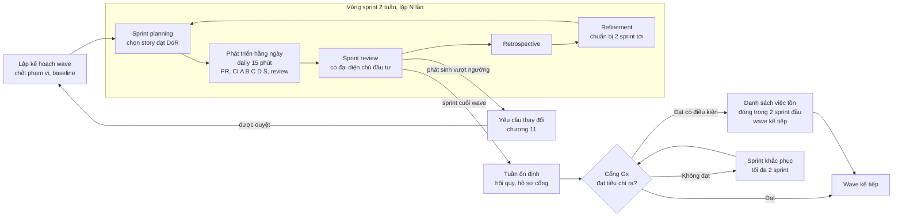

## 3. Mô hình thực hiện: Scrum lai trong khung wave và cổng nghiệm thu

**Tóm tắt cho hội đồng thẩm định.** Dự án dùng mô hình lai: bên trong, đội phát triển làm theo Scrum với sprint cố định 2 tuần, tổng cộng 42 sprint trong 18 tháng (39 sprint nếu tính W3 và W4 chạy song song là một dòng thời gian); bên ngoài, chủ đầu tư nhìn thấy 6 wave với phạm vi được chốt trước và 6 cổng nghiệm thu cố định G0 đến G5. Phạm vi của một wave bị đóng băng khi wave bắt đầu; mọi thay đổi vượt ngưỡng hoán đổi 10% điểm câu chuyện của wave phải đi qua quy trình kiểm soát thay đổi. Đại diện chủ đầu tư tham gia sprint review mỗi 2 tuần, nên lệch hướng được phát hiện sau tối đa 10 ngày làm việc thay vì đến cuối dự án. Mã nguồn được viết với sự trợ giúp của AI agent có kiểm soát: agent chỉ làm trong lane được giao, mọi thay đổi do một kỹ sư có tên chịu trách nhiệm review và merge, cổng CI bắt buộc phải xanh.

### 3.1. Vì sao chọn mô hình lai

Dự án phần mềm dùng ngân sách nhà nước chịu hai lực kéo ngược nhau. Lực thứ nhất đến từ thủ tục đầu tư: hợp đồng phải có phạm vi, giá trị và tiến độ xác định; thanh toán gắn với khối lượng được nghiệm thu; hồ sơ nghiệm thu phải chứng minh sản phẩm khớp với thiết kế chi tiết đã phê duyệt. Lực thứ hai đến từ bản chất của phần mềm tích hợp: yêu cầu chỉ thật sự rõ khi người dùng thấy sản phẩm chạy, các HTTT của sở ngành có hành vi khác với tài liệu, và đặc tả kết nối quốc gia có thể thay đổi trong lúc dự án đang làm.

Mô hình thác nước thuần túy đáp ứng tốt lực thứ nhất nhưng đẩy toàn bộ rủi ro về cuối: chủ đầu tư chỉ thấy phần mềm ở lần kiểm thử chấp nhận, khi việc sửa sai đã đắt nhất. Scrum thuần túy đáp ứng tốt lực thứ hai nhưng không cho chủ đầu tư một điểm cố định để nghiệm thu, thanh toán và chịu trách nhiệm giải trình. Mô hình lai giữ cả hai: khung ngoài là các wave có phạm vi được chốt và cổng nghiệm thu cố định, khớp với thủ tục nghiệm thu từng phần theo Nghị định 224/2026/NĐ-CP; khung trong là sprint lặp, cho phép chỉnh hướng trong phạm vi đã chốt mà không phải ký phụ lục hợp đồng cho mỗi điều chỉnh nhỏ.

Hệ quả thực tế của lựa chọn này là thiết kế chi tiết được phê duyệt trước T0 ở mức kiến trúc, danh mục chức năng và tiêu chí chấp nhận, không ở mức từng màn hình. Đặc tả mức chi tiết (FRS, SDD, thiết kế màn hình) được viết dần trong wave, ngay trước sprint hiện thực nó, và được đại diện chủ đầu tư duyệt từng phần. Cách làm này cần được thể hiện rõ trong thiết kế chi tiết và hợp đồng để không bị hiểu là thay đổi thiết kế; điểm này được ghi thành câu hỏi mở.

### 3.2. Cấu trúc ba tầng: wave, sprint, cổng

Cấu trúc thực hiện có ba tầng lồng nhau. Wave là đơn vị phạm vi và nghiệm thu, dài từ 2 đến 5 tháng, mỗi wave có một danh sách phân hệ, gói WBS và sản phẩm bàn giao được chốt. Sprint là đơn vị nhịp làm việc, dài đúng 2 tuần (10 ngày làm việc), bắt đầu thứ Hai và kết thúc thứ Sáu tuần sau. Cổng là điểm quyết định ở cuối mỗi wave, nơi hội đồng nghiệm thu so sản phẩm với tiêu chí ra đã định lượng trước và quyết định cho đi tiếp, cho đi tiếp có điều kiện hoặc không cho đi.

Bảng dưới đây cho thấy số sprint trong từng wave theo giả định nền và thời gian dự trữ còn lại sau khi trừ sprint. Một tháng có trung bình 4,35 tuần, nên một wave luôn dài hơn tổng sprint của nó một chút; phần dư này được dùng làm tuần ổn định và chuẩn bị hồ sơ cổng, không phải để làm thêm tính năng.

| Wave | Thời lượng | Số sprint | Tuần sprint | Tuần dự trữ trước cổng | Cổng |
|---|---|---|---|---|---|
| W0 | T0 → T0+2 | 4 | 8 | khoảng 0,7 | G0 |
| W1 | T0+2 → T0+6 | 8 | 16 | khoảng 1,4 | G1 |
| W2 | T0+6 → T0+10 | 8 | 16 | khoảng 1,4 | G2 |
| W3 | T0+10 → T0+13 | 6 | 12 | khoảng 1 | G3 |
| W4 | T0+10 → T0+15 | 10 | 20 | khoảng 1,7 | G4 |
| W5 | T0+15 → T0+18 | 6 | 12 | khoảng 1 | G5 |

Thời gian dự trữ không tính đến kỳ nghỉ Tết Nguyên đán và các ngày lễ dài. Vì tài liệu không gắn ngày lịch, chưa biết wave nào sẽ chứa Tết; wave đó sẽ mất khoảng 1 tuần và gần như hết dự trữ. Quy tắc xử lý là giữ nguyên độ dài sprint, bỏ một sprint nếu Tết rơi giữa sprint, và giảm phạm vi mức C của wave đó tương ứng ngay tại buổi lập kế hoạch wave, thay vì kéo dài wave.

Sơ đồ sau minh họa vòng sprint bên trong một wave và cách wave kết thúc tại cổng.

Sơ đồ thể hiện ba lối ra của cổng. Lối "đạt có điều kiện" là lối thường gặp nhất trong thực tế: những việc tồn không chặn giá trị chính của wave (ví dụ một lỗi mức trung bình hoặc một phần HDSD chưa hoàn chỉnh) được ghi vào biên bản cổng kèm hạn đóng trong hai sprint đầu của wave kế tiếp, và được kiểm tra lại tại cổng sau. Lối "không đạt" kích hoạt tối đa hai sprint khắc phục; nếu sau hai sprint vẫn không đạt thì đó là sai lệch tiến độ phải báo cáo ban chỉ đạo và xử lý theo quy trình thay đổi ở chương 11, vì nó sẽ đẩy lùi mọi wave phía sau trên đường găng.

### 3.3. Nghi thức Scrum

Các nghi thức (ceremony) được giữ đúng theo Scrum, với điều chỉnh để phù hợp với sự tham gia của chủ đầu tư và với số nhóm song song. Bảng sau ghi thời lượng, người tham gia và đầu ra bắt buộc của từng nghi thức trong một sprint 2 tuần.

| Nghi thức | Thời điểm, thời lượng | Người tham gia | Đầu ra bắt buộc |
|---|---|---|---|
| Lập kế hoạch sprint (sprint planning) | Sáng thứ Hai đầu sprint, tối đa 4 giờ | Nhóm Scrum, PO nhà thầu, Scrum Master; PO chủ đầu tư dự phần chọn mục tiêu | Mục tiêu sprint một câu; danh sách story đạt DoR; tổng điểm không vượt 110% vận tốc trung bình 3 sprint gần nhất |
| Họp hằng ngày (daily scrum) | Mỗi sáng, 15 phút | Nhóm Scrum | Danh sách vướng mắc, chủ xử lý; trạng thái bảng công việc cập nhật |
| Họp phối hợp liên nhóm (scrum of scrums) | Thứ Ba và thứ Năm, 30 phút | Scrum Master các nhóm, kiến trúc sư, trưởng lane | Phụ thuộc hợp đồng API, xung đột lane, rủi ro chặn |
| Rà soát sprint (sprint review) | Chiều thứ Năm tuần thứ hai, 2 giờ | Nhóm, PO hai phía, đại diện đơn vị vận hành, tư vấn giám sát nếu có | Trình diễn trên môi trường TEST bằng dữ liệu giả lập; biên bản review ghi story được chấp nhận, story bị trả, phát sinh |
| Cải tiến sprint (retrospective) | Sáng thứ Sáu tuần thứ hai, 1,5 giờ | Nhóm Scrum, Scrum Master | Tối đa 3 hành động cải tiến có chủ, được theo dõi ở sprint sau |
| Làm rõ backlog (refinement) | Giữa sprint, khoảng 10% sức chứa của nhóm | PO nhà thầu, BA, kiến trúc sư, đại diện nhóm | Story của 2 sprint kế tiếp đạt DoR |

Sprint review là nghi thức quan trọng nhất của mô hình lai, vì nó thay cho nhiều cuộc họp duyệt tài liệu trong mô hình thác nước. Biên bản sprint review có chữ ký của PO phía chủ đầu tư là bằng chứng rằng chủ đầu tư đã nhìn thấy và chấp nhận từng phần sản phẩm, nên đến cổng nghiệm thu, hội đồng không phải đánh giá lại từ đầu mà chỉ kiểm tra tiêu chí ra mức wave và những story bị trả. Nếu PO chủ đầu tư vắng hai sprint review liên tiếp, Giám đốc dự án phải báo cáo ban chỉ đạo, vì khi đó giả định số 7 ở chương 1 bị vi phạm.

Đội được tổ chức thành các nhóm Scrum từ 5 đến 9 người, mỗi nhóm sở hữu một hoặc vài lane mã nguồn. Ở W2 với 28 người, dự án có ba nhóm phát triển (nhóm trục tích hợp, nhóm dữ liệu và vận hành, nhóm giao diện và nền tảng) cộng nhóm hạ tầng, ATTT làm theo nhịp sprint nhưng dùng bảng Kanban cho việc vận hành. Trong ba tháng W3 và W4 chồng lấn, tổng số người lên khoảng 38 và chia thành hai dòng: đội thí điểm (cài đặt, di trú, cắt chuyển, vận hành) và đội đợt 2 (hai nhóm phát triển), mỗi dòng có Scrum Master riêng nhưng dùng chung PM, PO và lịch sprint review. Tất cả các nhóm dùng chung lịch sprint để sprint review và cổng rơi vào cùng ngày.

### 3.4. Vai trò Product Owner hai phía

Trong dự án nhà nước, người quyết định ưu tiên nghiệp vụ không thể là nhà thầu, nhưng người hiểu đủ sâu để viết story cho đội phát triển thường lại là nhà thầu. Vì vậy vai trò Product Owner được tách làm hai, với ranh giới quyền hạn rõ ràng như bảng sau.

| Khía cạnh | PO phía chủ đầu tư | PO phía nhà thầu (PO/BA trưởng) |
|---|---|---|
| Người đảm nhiệm | Cán bộ được chủ đầu tư cử, giả định từ Sở KH&CN hoặc Trung tâm Chuyển đổi số, dành tối thiểu 30% thời gian | PO/BA trưởng của nhà thầu, toàn thời gian theo bảng đội ngũ |
| Quyết định | Thứ tự ưu tiên giữa các mục tiêu nghiệp vụ; chấp nhận hoặc trả story tại review; đồng ý hoán đổi trong ngưỡng | Cách chia story; tiêu chí chấp nhận chi tiết; thứ tự story trong sprint |
| Không được quyết định | Thêm phạm vi ngoài wave đã chốt mà không qua quy trình thay đổi | Bỏ hoặc hạ mức ưu tiên một `FR` mức M; chấp nhận thay cho chủ đầu tư |
| Đầu ra | Chữ ký trên biên bản sprint review, biên bản UAT | Backlog D02-05 cập nhật, story đạt DoR, ghi chú phát hành sprint |
| Leo thang | Ban quản lý dự án, ban chỉ đạo | Giám đốc dự án nhà thầu |

Ma trận RACI đầy đủ cho các vai trò khác nằm ở chương tổ chức và RACI của tài liệu này; bảng trên chỉ định nghĩa ranh giới quyền hạn giữa hai PO vì ranh giới đó là điểm hay gây tranh chấp nhất khi nghiệm thu.

### 3.5. Đóng băng phạm vi trong wave

Phạm vi của wave được chốt tại buổi lập kế hoạch wave, tổ chức trong tuần dự trữ cuối wave trước (hoặc ngay sau T0 với W0). Đường cơ sở phạm vi wave gồm danh sách `FR` mức M và S được cam kết, danh sách story tương ứng ước lượng bằng điểm, và danh sách sản phẩm bàn giao của cổng. Sau khi chốt, phạm vi wave chịu ba quy tắc.

Quy tắc thứ nhất là hoán đổi trong ngưỡng. PO chủ đầu tư được thay một story chưa bắt đầu bằng một story khác có cùng hoặc nhỏ hơn số điểm, trong cùng wave, miễn là không bỏ `FR` mức M nào và tổng điểm hoán đổi lũy kế trong wave không vượt 10% tổng điểm đã chốt. Hoán đổi được ghi trong biên bản sprint review, không cần quy trình thay đổi chính thức.

Quy tắc thứ hai là mọi thay đổi khác đi qua quy trình kiểm soát thay đổi ở chương 11. Thuộc nhóm này là: thêm `FR` mới; bỏ hoặc hạ mức một `FR` mức M; dời một phân hệ sang wave khác; hoán đổi vượt 10%; thay đổi làm tăng nỗ lực của wave quá 5% hoặc làm dịch một mốc. Yêu cầu thay đổi được phân tích tác động trong tối đa 5 ngày làm việc và được quyết định bởi cấp có thẩm quyền theo chương 11; trong lúc chờ, đội tiếp tục làm phạm vi cũ.

Quy tắc thứ ba là phát hiện kỹ thuật không phải là thay đổi phạm vi. Nếu trong sprint đội phát hiện một `FR` cần thêm việc để đạt đúng tiêu chí chấp nhận đã ghi (ví dụ HTTT nguồn trả dữ liệu khác tài liệu), việc đó thuộc phạm vi hiện tại và được xử lý trong sức chứa của nhóm, có thể đẩy story mức C ra khỏi wave. Phân biệt giữa "làm cho đúng" và "làm thêm" do kiến trúc sư giải pháp và PO chủ đầu tư cùng quyết định; nếu hai người không thống nhất thì chuyển thành yêu cầu thay đổi.

### 3.6. Định nghĩa sẵn sàng và định nghĩa hoàn thành

Định nghĩa sẵn sàng (Definition of Ready, DoR) và định nghĩa hoàn thành (Definition of Done, DoD) được đặt ở ba mức. Mức càng cao thì tiêu chí càng bao trùm, và mức dưới là điều kiện cần của mức trên.

| Mức | Định nghĩa sẵn sàng (DoR) | Định nghĩa hoàn thành (DoD) |
|---|---|---|
| Story | Có mã `US` và truy vết tới ít nhất một `FR`; có tiêu chí chấp nhận dạng Cho trước, Khi, Thì; đã ước lượng điểm, tối đa 8 điểm; hợp đồng API hoặc sự kiện liên quan đã có bản nháp trong `contracts/`; màn hình liên quan có prototype được duyệt; phụ thuộc ngoài nhóm đã được xác nhận sẵn sàng | Mã đã merge vào nhánh chính qua PR có review; cổng CI A, B, C, S xanh (D xanh với màn hình mới); kiểm thử tự động cho mọi tiêu chí chấp nhận; quyền truy cập theo D02-08, mặc định từ chối; hợp đồng đã cập nhật phiên bản nếu thay đổi; không có bí mật trong mã; đã triển khai lên TEST bằng GitOps; PO nhà thầu đã thử và chấp nhận |
| Sprint | Mục tiêu sprint rõ; tổng điểm không vượt 110% vận tốc; mọi story đạt DoR; môi trường TEST hoạt động | Mọi story đạt DoD hoặc được trả về backlog công khai; bộ hồi quy tự động xanh trên TEST; biên bản sprint review có chữ ký PO chủ đầu tư; RTM cập nhật cho story đã xong; chỉ số chất lượng sprint (chương 9) đã ghi |
| Wave | Phạm vi wave đã chốt và ghi đường cơ sở; FRS và SDD của các phân hệ trong wave đã duyệt ít nhất phần cho 2 sprint đầu; nhân sự theo bảng đội ngũ đã có mặt; tiêu chí ra của cổng đã được hội đồng chấp nhận | Mọi `FR` mức M của wave đạt DoD story; tiêu chí ra của cổng (chương 4) đạt; tài liệu SDLC của wave ở bản 1.0; hồ sơ nghiệm thu cổng đủ thành phần; biên bản cổng được ký |

DoD mức story kế thừa trực tiếp danh mục kiểm tra mọi PR trong `AGENTS.md` và gói việc của repo, cộng thêm hai điều kiện riêng của dự án là truy vết `US` tới `FR` và chấp nhận của PO nhà thầu. Như vậy không có hai định nghĩa hoàn thành song song cho người viết mã và cho người quản lý dự án.

### 3.7. Quan hệ với lane, gói việc và wave kỹ thuật của repo

Cần nói rõ trước: các wave W0 đến W6 trong kế hoạch phát triển IP-04 của repo là kế hoạch kỹ thuật nội bộ của đội phát triển, sắp các gói việc theo phụ thuộc kỹ thuật và không ước lượng ngày; chúng không phải lịch dự án và không có giá trị nghiệm thu. Lịch dự án duy nhất là sáu wave W0 đến W5 và sáu cổng G0 đến G5 của tài liệu này. Repo của sản phẩm đã có một mô hình tổ chức công việc riêng, dùng ba khái niệm: lane là nhóm thư mục mã có một chủ sở hữu duy nhất (ví dụ L-CTRL sở hữu `apps/control/`, L-CAMEL sở hữu `camel/` và `routes/`); gói việc (WP) là một luồng PR được giao cho một agent hoặc một người, có DoD riêng; và wave kỹ thuật W0 đến W6 sắp các gói việc theo phụ thuộc kỹ thuật. Kế hoạch dự án dùng lại lane và gói việc nguyên vẹn, nhưng wave kỹ thuật của repo không trùng với wave hợp đồng của dự án.

Quan hệ giữa các khái niệm như sau. Một nhóm Scrum sở hữu một hoặc vài lane; một story thường tương ứng với một gói việc hoặc một phần của gói việc; một PR không bao giờ vượt ra ngoài lane của nó, trừ thay đổi trong `contracts/` đã được lane tiêu thụ duyệt. Wave kỹ thuật của repo được ánh xạ vào wave dự án như bảng sau.

| Wave kỹ thuật trong repo | Nội dung | Wave dự án chứa nó | Ghi chú |
|---|---|---|---|
| W0 Nền tảng | Monorepo, CI, hợp đồng, DEV, IAM khung | W0 | Trùng khớp |
| W1 Luồng mỏng, W2 Lõi tích hợp chuẩn | PH-01, 02, 03, 04, 05 tối thiểu rồi đầy đủ khung | W1 | Gộp hai wave kỹ thuật vào một wave dự án |
| W3 Dữ liệu dùng chung | PH-07 rồi PH-06, 09, 08 | PH-07 ở W2; PH-06, 08, 09 ở W4 | Dự án tách PH-07 lên MVP |
| W4 Vận hành, quan sát, cổng, BPM | PH-18, 13, 15, 11 | PH-13, 18 ở W2; PH-11 ở W4; PH-15 ở W5 | |
| W5 Quốc gia, KPI, AI | PH-14, 16, 17 | PH-14 ở W2; PH-16, 17 ở W5 | Dự án đưa kết nối quốc gia lên MVP |
| W6 Cứng hóa và đưa vào vận hành | STAGING, PROD, bảo mật, tải, go-live | Cuối W2 và W3 | |

Lệch lớn nhất là PH-14: repo xếp kết nối quốc gia gần cuối, còn dự án xếp nó vào MVP vì hệ cũ đang có kết nối NGSP và không thể cắt chuyển tỉnh thí điểm nếu thiếu nó. Gói việc của repo vẫn được dùng, chỉ thứ tự kéo lên sớm hơn; trưởng lane L-ADAPT và L-CAMEL phải lập lại thứ tự phụ thuộc trong lần lập kế hoạch W2.

### 3.8. Quy tắc kiểm soát AI agent viết mã

Đội phát triển dùng AI agent để viết mã, kiểm thử và tài liệu kỹ thuật. Đây là lựa chọn để tăng năng suất, nhưng trong dự án nhà nước nó phải được kiểm soát đủ chặt để chủ đầu tư có thể tin rằng mỗi dòng mã đều có một người chịu trách nhiệm. Các quy tắc sau là bắt buộc và là một phần của DoD.

1. **Trách nhiệm thuộc về người.** Agent không có tư cách người thực hiện trong hợp đồng. Mỗi PR do agent tạo phải có một kỹ sư có tên trong danh sách nhân sự làm người chịu trách nhiệm; người đó review toàn bộ thay đổi và là người bấm merge. Agent không có quyền merge, không có quyền ghi vào nhánh chính và không có quyền triển khai lên STAGING hay PROD.
2. **Làm trong lane, theo gói việc.** Agent chỉ được giao một gói việc trong một lane mỗi lần, được nạp sẵn `AGENTS.md`, đặc tả liên quan và DoD của gói. Hết DoD thì dừng; mở rộng sang việc khác cần một gói việc mới. PR sửa ngoài lane bị cổng CI chặn tự động.
3. **Hợp đồng trước mã.** Agent không được tự thay đổi hợp đồng API, sự kiện hay chính sách OPA để làm cho mã của mình chạy; thay đổi hợp đồng là PR riêng cần lane tiêu thụ duyệt.
4. **Cùng một cổng chất lượng.** Mã do agent viết chịu đúng các cổng CI A, B, C, D, S và các ngưỡng độ phủ, phân tích tĩnh như mã do người viết, không có ngoại lệ. Kiểm thử do agent viết phải được người review đánh giá là kiểm được hành vi thật, không chỉ để tăng độ phủ.
5. **Không đưa dữ liệu thật và bí mật cho agent.** Agent chỉ làm việc trên mã nguồn và dữ liệu giả lập; không được truy cập dữ liệu của tỉnh, nhật ký PROD, khóa hay mật khẩu thật. Quy tắc này áp dụng cả với môi trường mà agent chạy.
6. **Ghi vết sử dụng.** Mỗi PR do agent tạo được gắn nhãn, ghi tên và phiên bản công cụ agent. Cuối mỗi sprint, tỷ lệ PR do agent tạo và tỷ lệ PR bị trả lại được báo cáo cùng chỉ số chất lượng (chương 9).
7. **Học từ lỗi.** Khi người review phát hiện agent lặp lại một mẫu sai, quy tắc tương ứng phải được bổ sung vào `AGENTS.md` hoặc thành một kiểm tra tự động (ví dụ quy tắc ArchUnit) trong cùng sprint.
8. **Kiểm soát giấy phép.** Mã do agent sinh ra đi qua cùng bước quét giấy phép và SBOM như thư viện bên thứ ba; đoạn mã trùng khớp với mã nguồn có giấy phép không tương thích bị loại.

Quy tắc số 5 có hệ quả về hạ tầng: nếu dịch vụ agent chạy ngoài lãnh thổ Việt Nam, mã nguồn sẽ được gửi ra nước ngoài trong lúc làm việc. Mã nguồn không chứa dữ liệu cá nhân hay bí mật, nhưng chủ đầu tư cần quyết định có chấp nhận điều này hay yêu cầu dùng dịch vụ agent triển khai trong nước; điểm này được ghi thành câu hỏi mở.

### 3.9. Nghiệm thu từng phần theo wave

Mỗi cổng G0 đến G5 là một lần nghiệm thu từng phần (hoặc nghiệm thu hoàn thành ở G5), khớp với thủ tục nghiệm thu theo Nghị định 224/2026/NĐ-CP. Ba điều kiện làm cho việc khớp này khả thi. Thứ nhất, sản phẩm của mỗi wave là một khối có thể dùng hoặc kiểm chứng độc lập: G1 nghiệm thu trục tích hợp chạy được đầu-cuối, G2 nghiệm thu MVP đã qua kiểm thử hệ thống, G3 nghiệm thu MVP vận hành chính thức. Thứ hai, tiêu chí ra của mỗi cổng được viết định lượng và được hội đồng chấp nhận trước khi wave bắt đầu (DoR mức wave), nên hội đồng không phải đặt tiêu chí sau khi đã thấy sản phẩm. Thứ ba, bằng chứng nghiệm thu được tích lũy liên tục qua các biên bản sprint review, báo cáo CI và RTM, nên hồ sơ cổng chủ yếu là tổng hợp chứ không phải sản xuất mới. Các biên bản và báo cáo này cũng chính là nhật ký triển khai và hồ sơ kiểm thử phần mềm nội bộ mà Thông tư 41/2026/TT-BKHCN yêu cầu, nên dự án không phải duy trì hai bộ hồ sơ song song. Khi một thay đổi chạm tới mục tiêu, tổng mức đầu tư hoặc thời gian thực hiện dự án, nó không còn là thay đổi phạm vi thông thường mà là điều chỉnh dự án phải trình cấp có thẩm quyền theo Điều 66 khoản 18 Nghị định 224/2026/NĐ-CP; các thay đổi khác chủ đầu tư được tự phê duyệt, và chương 11 phân loại cụ thể.

Thanh toán theo mốc gắn với cổng là đề xuất của kế hoạch, tỷ lệ cụ thể do chương ngân sách và hợp đồng quyết định. Nguyên tắc đề xuất là tỷ lệ thanh toán mỗi cổng xấp xỉ tỷ lệ nỗ lực WBS đã hoàn thành trong wave đó, trừ một phần giữ lại đến G5 và một phần bảo lãnh bảo hành.

### 3.10. Câu hỏi mở

- **Q-D0102-08:** Thiết kế chi tiết được phê duyệt trước T0 có được phép ở mức danh mục chức năng và tiêu chí chấp nhận, với FRS, SDD chi tiết được duyệt dần theo wave, mà không bị coi là điều chỉnh thiết kế không? Tóm tắt pháp lý chưa xác minh được Nghị định 224/2026/NĐ-CP có quy định riêng về phát triển linh hoạt hay không; cần đối chiếu Điều 47, Điều 53 của nghị định và Thông tư 41/2026/TT-BKHCN.
- **Q-D0102-09:** Chủ đầu tư có chấp nhận dùng dịch vụ AI agent mà mã nguồn được xử lý ngoài lãnh thổ Việt Nam không, hay yêu cầu dịch vụ triển khai trong nước?
- **Q-D0102-10:** Chủ đầu tư cử ai làm PO phía chủ đầu tư, với thời lượng tham gia bao nhiêu, và người đó có thẩm quyền ký biên bản sprint review không?

### 3.11. Ghi chú cho người tổng hợp

- Tổng số sprint theo giả định nền là 42 (4 + 8 + 8 + 6 + 10 + 6), nhưng W3 và W4 chạy song song nên dòng thời gian thực có 39 sprint. Gói 1.21.2 ở chương 2 dùng con số 39 cho số lần họp review chung.
- Repo xếp PH-14 ở wave kỹ thuật W5, dự án xếp ở W2. Cần nhóm repo xác nhận việc kéo gói việc PH-14 lên sớm không vướng phụ thuộc kỹ thuật chưa có.
- Cổng CI của repo gồm A, B, C, D, S (không chỉ A, S, C); chương này và chương 9 dùng đủ năm cổng.
