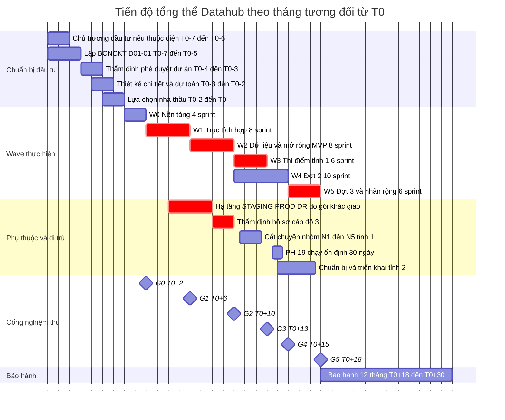
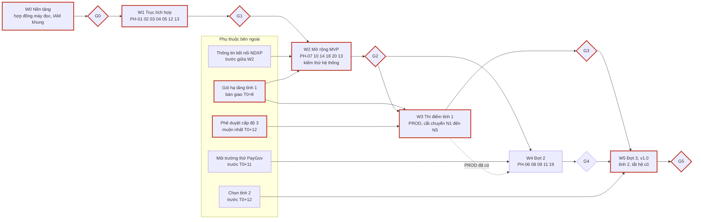

## 4. Tiến độ, mốc và cổng nghiệm thu

**Tóm tắt cho hội đồng thẩm định.** Theo chỉ đạo của chủ đầu tư, mọi mốc được ghi tương đối theo T0 là ngày khởi động hợp đồng thực hiện; giai đoạn chuẩn bị đầu tư kéo dài 7 tháng (T0 − 7 đến T0), giai đoạn thực hiện 18 tháng (T0 đến T0+18), bảo hành 12 tháng (T0+18 đến T0+30). Kế hoạch có 24 mốc kiểm soát (M-01 đến M-24) và 6 cổng nghiệm thu, trong đó G2 tại T0+10 nghiệm thu MVP sau kiểm thử hệ thống, G3 tại T0+13 đưa MVP vào vận hành chính thức tại tỉnh thí điểm, G5 tại T0+18 nghiệm thu hoàn thành. Mỗi cổng có tiêu chí ra định lượng: 100% test case của yêu cầu mức M đạt, 0 lỗi nghiêm trọng hoặc cao đang mở, 100% yêu cầu mức M có ít nhất hai test case trong RTM, thông lượng cổng API ≥ 1.000 lượt/giây với độ trễ thêm p95 ≤ 50 ms. Đường găng đi qua hợp đồng máy đọc, trục tích hợp, kiểm thử hệ thống MVP, phê duyệt hồ sơ cấp độ 3 và cắt chuyển tỉnh thí điểm; hai phụ thuộc bên ngoài nguy hiểm nhất là bàn giao hạ tầng PROD trước T0+8 và quyết định phê duyệt cấp độ 3 trước T0+12. Tỉnh thí điểm được cắt chuyển theo 6 nhóm dịch vụ từ T0+10,5 đến T0+14,5; hệ cũ được tắt hoàn toàn tại T0+17; tỉnh thứ hai vận hành tại T0+17,5.

### 4.1. Biểu đồ tiến độ tổng thể

Biểu đồ dưới đây trình bày toàn bộ vòng đời từ chuẩn bị đầu tư đến hết bảo hành. Vì tài liệu không gắn ngày lịch, biểu đồ dùng một ngày giả định cho T0 chỉ để vẽ; nhãn ngày trên trục đã được ẩn, mỗi vạch trên trục là một tháng tương đối, và vị trí thời gian được đọc qua tên các mốc ghi dạng "T0+n".

Biểu đồ cho thấy ba đặc điểm của lịch. Thứ nhất, các thanh đánh dấu găng (màu đỏ khi hiển thị) nối liền từ W1 đến W5 qua hai phụ thuộc bên ngoài là bàn giao hạ tầng và thẩm định cấp độ 3; bất kỳ thanh nào trong chuỗi này trễ một tháng đều đẩy G3 và G5 trễ tương ứng. Thứ hai, W3 và W4 chạy song song trong 3 tháng bằng hai đội riêng: đội thí điểm lo cài đặt và cắt chuyển, đội đợt 2 tiếp tục phát triển; đây là cách duy nhất để giữ tổng thời gian 18 tháng. Thứ ba, giai đoạn bảo hành dài gần bằng giai đoạn thực hiện và bao trùm thời điểm đo các chỉ số "12 tháng" của D02-01.

### 4.2. Bảng mốc

Mốc (milestone) là điểm kiểm soát có sản phẩm cụ thể và có người xác nhận. Mốc khác cổng ở chỗ nó không nhất thiết kèm nghiệm thu chính thức; nhiều mốc là điểm theo dõi sớm, cho phép ban quản lý dự án phát hiện trễ trước khi trễ dồn tới cổng. Bảng sau liệt kê 24 mốc theo thứ tự thời gian.

| Mã | Mốc | Thời điểm | Sản phẩm, bằng chứng | Người xác nhận, nghiệm thu |
|---|---|---|---|---|
| M-01 | Chủ trương đầu tư được quyết định (nếu thuộc diện) | T0 − 6 | Văn bản quyết định chủ trương | HĐND hoặc UBND tỉnh tùy nhóm dự án, theo Luật Đầu tư công |
| M-02 | Dự án được phê duyệt | T0 − 3 | Quyết định phê duyệt dự án kèm D01-01 | Người quyết định đầu tư, giả định UBND tỉnh |
| M-03 | Thiết kế chi tiết và dự toán được phê duyệt | T0 − 2 | Quyết định phê duyệt; D01-02 bản 1.0 làm đường cơ sở | Chủ đầu tư |
| M-04 | Ký hợp đồng thực hiện, T0 | T0 | Hợp đồng, bảo lãnh thực hiện | Chủ đầu tư, nhà thầu |
| M-05 | Khởi động và kế hoạch chi tiết | T0+0,5 | Biên bản họp khởi động; kế hoạch sprint toàn dự án; danh sách PO, đầu mối | Ban quản lý dự án |
| M-06 | **G0 Nền tảng sẵn sàng** | T0+2 | Hồ sơ cổng G0 | Hội đồng nghiệm thu |
| M-07 | Luồng mỏng đầu-cuối chạy trên TEST | T0+3,5 | Trình diễn: HTTT giả lập kết nạp, gọi API qua cổng, route, adapter, có mã truy vết | PO chủ đầu tư tại sprint review |
| M-08 | **G1 Trục tích hợp** | T0+6 | Hồ sơ cổng G1 | Hội đồng nghiệm thu |
| M-09 | Hạ tầng STAGING, PROD, DR tỉnh 1 bàn giao; nộp hồ sơ cấp độ 3 | T0+8 | Biên bản bàn giao hạ tầng; hồ sơ D03-08 đã nộp | Đơn vị vận hành; cơ quan thẩm định ATTT tiếp nhận |
| M-10 | Kết quả kiểm thử hệ thống, hiệu năng và bảo mật MVP | T0+9,5 | Báo cáo D05-03, D05-04, báo cáo hồi quy | Tư vấn giám sát |
| M-11 | **G2 Nghiệm thu MVP** | T0+10 | Hồ sơ cổng G2, biên bản UAT MVP | Hội đồng nghiệm thu |
| M-12 | Quyết định phê duyệt cấp độ 3 | Mục tiêu T0+10, muộn nhất T0+12 | Quyết định phê duyệt hồ sơ đề xuất cấp độ | Cơ quan có thẩm quyền phê duyệt cấp độ |
| M-13 | PROD tỉnh 1 sẵn sàng; bắt đầu cắt chuyển nhóm N1 | T0+10,5 | Biên bản cài đặt PROD; biên bản cắt chuyển N1 | Đơn vị vận hành, PO chủ đầu tư |
| M-14 | Hoàn tất cắt chuyển nhóm N1 đến N5 | T0+12,5 | Biên bản cắt chuyển và đối soát từng nhóm | Đơn vị vận hành, chủ quản HTTT liên quan |
| M-15 | **G3 Vận hành chính thức MVP** | T0+13 | Hồ sơ cổng G3, quyết định đưa vào sử dụng | Hội đồng nghiệm thu; chủ đầu tư |
| M-16 | PH-19 vận hành, bắt đầu 30 ngày ổn định | T0+13,5 | Biên bản cắt chuyển nhóm N6 | Đơn vị vận hành, đại diện trung gian thanh toán |
| M-17 | Tắt dịch vụ thanh toán của hệ cũ | T0+14,5 | Báo cáo 30 ngày ổn định; biên bản tắt Payment cũ | Chủ đầu tư, đơn vị vận hành |
| M-18 | **G4 Nghiệm thu đợt 2** | T0+15 | Hồ sơ cổng G4, biên bản UAT đợt 2 | Hội đồng nghiệm thu |
| M-19 | Phát hành ứng viên v1.0-rc; hạ tầng tỉnh 2 sẵn sàng | T0+16 | Gói phát hành rc, ghi chú phát hành; biên bản bàn giao hạ tầng tỉnh 2 | Kiến trúc sư giải pháp; đơn vị vận hành tỉnh 2 |
| M-20 | Tắt toàn bộ hệ cũ tỉnh 1; phát hành v1.0 | T0+17 | Biên bản tắt hệ cũ, bản lưu trữ; gói v1.0 | Chủ đầu tư, đơn vị vận hành |
| M-21 | Tỉnh 2 đưa vào vận hành | T0+17,5 | Biên bản khởi tạo tenant, kết nạp HTTT đầu tiên | Chủ đầu tư tỉnh 2 hoặc đơn vị được ủy quyền |
| M-22 | **G5 Nghiệm thu hoàn thành dự án** | T0+18 | Hồ sơ cổng G5, hồ sơ bàn giao (chương 13) | Hội đồng nghiệm thu; người quyết định đầu tư |
| M-23 | Đo các chỉ số 12 tháng của D02-01 | T0+25 | Báo cáo KPI-01, KPI-02, KPI-10 sau 12 tháng kể từ G3 | Chủ đầu tư |
| M-24 | Kết thúc bảo hành | T0+30 | Biên bản kết thúc bảo hành (chương 13) | Chủ đầu tư |

Các mốc lẻ nửa tháng (T0+3,5, T0+10,5 …) rơi vào cuối một sprint, vì một tháng tương đối chứa khoảng 2,2 sprint. Khi T0 được xác định, Giám đốc dự án quy đổi mỗi mốc sang ngày kết thúc sprint gần nhất và ghi vào lịch sprint của M-05.

### 4.3. Cổng nghiệm thu G0 đến G5

#### 4.3.1. Bộ tiêu chí kiểm thử chung

Bốn cổng G1, G2, G4, G5 nghiệm thu phần mềm mới phát triển và dùng chung một bộ tiêu chí kiểm thử, áp cho phạm vi của wave tương ứng. Bộ tiêu chí được nêu một lần ở đây để bảng cổng phía sau không lặp lại. Bộ này lấy ngưỡng từ D02-02 và D05-01; nếu hai tài liệu đó thay đổi ngưỡng thì ngưỡng mới được áp dụng.

| Mã tiêu chí | Nội dung | Ngưỡng đạt |
|---|---|---|
| TCC-1 | Tỷ lệ test case đạt của các `FR` mức M trong phạm vi wave | 100% |
| TCC-2 | Tỷ lệ test case đạt của các `FR` mức S trong phạm vi wave | ≥ 95%, phần chưa đạt có kế hoạch khắc phục được chấp nhận |
| TCC-3 | Lỗi mức nghiêm trọng (critical) và cao (high) đang mở | 0 |
| TCC-4 | Lỗi mức trung bình đang mở | ≤ 10, mỗi lỗi có hạn đóng trong 2 sprint |
| TCC-5 | Độ phủ RTM: tỷ lệ `FR` mức M có ít nhất hai `TC` (một dương tính, một âm tính) đã chạy | 100% |
| TCC-6 | Tỷ lệ mục `LGC` thuộc phạm vi wave có kết luận và có `TC` kiểm chứng | 100% |
| TCC-7 | Độ phủ kiểm thử đơn vị (NFR-00-053) | ≥ 80% dòng mã nghiệp vụ backend; ≥ 70% mã giao diện |
| TCC-8 | Cổng CI A, B, C, S trên nhánh phát hành | Xanh 100% trong 10 ngày làm việc cuối wave |
| TCC-9 | Lỗ hổng phụ thuộc và bí mật (NFR-00-022, NFR-00-023) | 0 bí mật; 0 lỗ hổng CRITICAL; 0 HIGH chưa có ngoại lệ được duyệt |
| TCC-10 | Khả năng truy cập (NFR-00-040) cho màn hình mới của wave | 0 lỗi mức A, AA theo axe-core |

#### 4.3.2. Tiêu chí vào, tiêu chí ra và hồ sơ từng cổng

Bảng dưới đây ghi tiêu chí vào (điều kiện để được tổ chức nghiệm thu), tiêu chí ra (điều kiện để cổng được kết luận "đạt") và hồ sơ nghiệm thu cần có. Tiêu chí ra bổ sung cho bộ tiêu chí chung ở mục 4.3.1, không thay thế nó.

| Cổng | Tiêu chí vào | Tiêu chí ra định lượng | Hồ sơ nghiệm thu |
|---|---|---|---|
| **G0** Nền tảng sẵn sàng, T0+2 | 4 sprint W0 đã review; D02-01, D02-02, D03-01, D04-01, D05-01 có bản trình duyệt | D02-01, D02-02, D03-01, D04-01, D04-02, D05-01 bản 1.0 được duyệt; cổng CI A và S xanh 10 ngày làm việc liên tục; DEV và TEST dựng lại được từ mã trong ≤ 4 giờ; hợp đồng máy đọc v0 đã gắn thẻ cho 100% phân hệ W1; lấy được token từ IAM khung và gọi được một API có phân quyền; baseline phiên bản thành phần nền đã khóa trên cụm đích; kho đối tượng đã kiểm chứng khóa ghi một lần (WORM); backlog W1 đạt DoR cho ≥ 2 sprint | Biên bản 4 sprint review; tài liệu bản 1.0; báo cáo CI; biên bản kiểm chứng WORM; biên bản cổng |
| **G1** Trục tích hợp, T0+6 | 8 sprint W1 đã review; M-07 đạt; kiểm thử hồi quy cuối wave đã chạy | Bộ tiêu chí chung cho PH-01, 02, 03, 04, 05, 12 và PH-13 mức cơ bản; một luồng chuẩn chạy đầu-cuối trên TEST có mã truy vết xuyên cổng API, runtime tích hợp và adapter; KPI-06 đo trên TEST ≤ 2 ngày công cho một luồng chuẩn; kiểm thử tải sơ bộ đạt 300 lượt/giây với độ trễ thêm p95 ≤ 50 ms (NFR-00-001); D03-07, D03-09 bản 1.0 | Báo cáo kiểm thử W1; RTM trích phạm vi W1; FRS, SDD, hợp đồng API bản 1.0 của 7 phân hệ; biên bản cổng |
| **G2** Nghiệm thu MVP, T0+10 | 8 sprint W2 đã review; M-10 có báo cáo; UAT MVP đã chạy theo D05-05; hồ sơ cấp độ 3 đã nộp (M-09) | Bộ tiêu chí chung cho toàn bộ 12 phân hệ MVP; hiệu năng theo cỡ M trên STAGING: ≥ 1.000 lượt/giây duy trì 30 phút, lỗi do nền tảng < 0,1% (NFR-00-002), độ trễ thêm p95 ≤ 50 ms và p99 ≤ 100 ms (NFR-00-001), sự kiện đầu-cuối p95 ≤ 2 giây (NFR-00-006), chạy bền 24 giờ ở 60% tải đỉnh không suy giảm; kiểm thử bảo mật đạt ASVS mức 2 (NFR-00-024), 0 phát hiện kiểm thử xâm nhập mức nghiêm trọng hoặc cao đang mở; data plane phục vụ ≥ 24 giờ khi tắt control plane (NFR-00-012); KPI-12 khởi tạo tenant trên STAGING ≤ 1 ngày làm việc; UAT: 100% kịch bản mức M đạt, điểm SUS ≥ 75 (KPI-18); D06-01 bản 1.0 | Báo cáo kiểm thử hệ thống, hiệu năng, bảo mật; biên bản UAT; RTM phạm vi MVP; HDSD MVP bản dự thảo; biên bản cổng |
| **G3** Vận hành chính thức MVP, T0+13 | Quyết định phê duyệt cấp độ 3 (M-12); nhóm N1 đến N5 đã cắt chuyển (M-14); đào tạo người dùng và vận hành tỉnh 1 đã xong | 100% dịch vụ của bốn khối Bus, Hub, APIM, DMDC và kết nối quốc gia của tỉnh 1 chạy trên Datahub; đối soát cũ và mới sai lệch 0 trong 5 ngày làm việc liên tiếp cuối cùng của mỗi nhóm; độ sẵn sàng data plane ≥ 99,9% trong 30 ngày gần nhất (KPI-03); 0 sự cố mức 1 trong 14 ngày gần nhất; diễn tập DR đạt RPO ≤ 15 phút, RTO ≤ 1 giờ data plane và ≤ 4 giờ control plane (NFR-00-014); diễn tập sự cố đạt MTTD ≤ 5 phút, MTTR ≤ 1 giờ (KPI-15, KPI-16); đội vận hành tỉnh tự thực hiện được diễn tập; D06-02, D06-03, D06-04 phần MVP bản 1.0 | Quyết định phê duyệt cấp độ 3; biên bản cắt chuyển, đối soát; báo cáo vận hành 30 ngày; biên bản diễn tập DR và sự cố; biên bản đào tạo; quyết định đưa vào sử dụng; biên bản cổng |
| **G4** Nghiệm thu đợt 2, T0+15 | 10 sprint W4 đã review; M-17 đạt; UAT đợt 2 đã chạy | Bộ tiêu chí chung cho PH-06, 08, 09, 11, 19; PH-19 chạy ổn định 30 ngày liên tục trên PROD với tỷ lệ giao dịch khớp tự động ≥ 99,5% (KPI-13), giao dịch lệch được phát hiện ≤ 1 ngày làm việc (KPI-14), 0 sai lệch tiền chưa giải thích; dịch vụ thanh toán cũ đã tắt; hồ sơ đánh giá tác động xử lý dữ liệu cá nhân của các luồng có PH-09 được phê duyệt; 0 giá trị trường Nhạy cảm trong log (NFR-00-029); kiểm thử bảo mật bổ sung cho 5 phân hệ đạt như G2 | Báo cáo kiểm thử đợt 2; báo cáo 30 ngày PH-19; biên bản tắt Payment cũ; hồ sơ đánh giá tác động DLCN; biên bản UAT; biên bản cổng |
| **G5** Nghiệm thu hoàn thành, T0+18 | 6 sprint W5 đã review; M-20 và M-21 đạt; UAT đợt 3 đã chạy | Bộ tiêu chí chung cho PH-15, 16, 17 và hồi quy toàn bộ 20 phân hệ trên v1.0; RTM: 100% trong 183 mục `LGC` có kết luận, 100% mục Giữ nguyên, Nâng cấp, Thay thế có `TC` đạt, 3 mục Loại bỏ có chấp thuận; hệ cũ tỉnh 1 đã tắt, dữ liệu lưu trữ đọc lại được; tỉnh 2 đang vận hành, tenant khởi tạo đạt KPI-12; toàn bộ tài liệu D00 đến D06 bản 1.0; bên nhận tự build và triển khai lại v1.0 từ mã nguồn bàn giao; kiểm thử hiệu năng hồi quy trên v1.0 không suy giảm quá 10% so với G2 | Toàn bộ hồ sơ bàn giao ở chương 13; báo cáo hoàn thành dự án; biên bản nghiệm thu hoàn thành |

Hai cổng G0 và G3 có tính chất khác bốn cổng còn lại. G0 không nghiệm thu chức năng nghiệp vụ mà nghiệm thu "khả năng làm việc": tài liệu nền đã duyệt, công cụ và môi trường đã sẵn sàng, để từ W1 đội phát triển không phải dừng lại chờ quyết định. G3 không nghiệm thu thêm chức năng so với G2 mà nghiệm thu việc đưa vào vận hành: sản phẩm đã chạy thật với dữ liệu thật, đã được phê duyệt cấp độ ATTT và đơn vị vận hành tự chủ được. Tách hai loại nghiệm thu này ra giúp G2 có thể được tổ chức đúng hạn ngay cả khi quyết định phê duyệt cấp độ 3 còn đang chờ.

Thành phần hội đồng nghiệm thu, thời hạn tổ chức sau khi nhà thầu đề nghị và hình thức biên bản tuân theo Nghị định 224/2026/NĐ-CP. Kế hoạch đề xuất hồ sơ mỗi cổng được nộp ít nhất 5 ngày làm việc trước buổi nghiệm thu, và hội đồng ra kết luận một trong ba loại "đạt", "đạt có điều kiện" (kèm danh sách việc tồn và hạn đóng) hoặc "không đạt", như mô tả ở chương 3.

### 4.4. Đường găng và phụ thuộc giữa các wave

Đường găng (critical path) là chuỗi việc dài nhất không có thời gian dự trữ; trễ ở bất kỳ việc nào trên chuỗi này làm trễ G5. Sơ đồ sau trình bày các phụ thuộc chính giữa wave, cổng và các phụ thuộc bên ngoài, với đường găng được tô đậm.

Đường găng đi qua W0, W1, W2, W3, W5 và các cổng tương ứng, cộng hai phụ thuộc bên ngoài X1 (hạ tầng) và X2 (phê duyệt cấp độ 3). Nhánh W4 không nằm trên đường găng chính vì nó có khoảng 1 tháng dự trữ so với G5 (G4 tại T0+15, còn W5 chỉ cần PH-19 ổn định trước khi tắt hệ cũ tại T0+17), nhưng nó có một ràng buộc cứng riêng là 30 ngày ổn định của PH-19 trước khi tắt thanh toán cũ. Nếu PH-19 vào PROD trễ quá T0+15,5 thì việc tắt hệ cũ tại T0+17 bị đe dọa, và W4 trở thành găng.

Ba phụ thuộc bên ngoài được quản lý như rủi ro trong sổ rủi ro của tài liệu này. Hạ tầng tỉnh 1 (X1) cần có kế hoạch dự phòng: nếu tại T0+7 gói hạ tầng chưa có lịch bàn giao chắc chắn, chủ đầu tư quyết định thuê tạm tài nguyên cloud chính phủ cho STAGING để không làm trễ kiểm thử hiệu năng của G2. Phê duyệt cấp độ 3 (X2) được giảm thiểu bằng cách nộp hồ sơ sớm tại T0+8, ngay khi thiết kế ATTT và kiến trúc triển khai đã ổn định, thay vì chờ phần mềm xong; nếu đến T0+12 chưa có quyết định, các nhóm đã cắt chuyển tiếp tục ở chế độ vận hành thử, hệ cũ giữ vai trò dự phòng, và G3 dời theo. NDXP (X3) chỉ ảnh hưởng PH-14; nếu thông tin kết nối chậm, PH-14 được nghiệm thu tại G2 trên môi trường giả lập và kiểm chứng với NDXP thật trước khi cắt chuyển nhóm N5.

### 4.5. Kế hoạch cắt chuyển strangler tại tỉnh thí điểm

#### 4.5.1. Nguyên tắc

Chiến lược bóp nghẹt dần (strangler) nghĩa là hệ mới mọc lên quanh hệ cũ và lần lượt nhận từng phần chức năng, cho đến khi hệ cũ không còn việc gì và được tắt. Điểm then chốt là lớp định tuyến (gói 1.24.3): cổng API của Datahub được đặt trước điểm truy cập của hệ cũ, tiếp nhận mọi lượt gọi của HTTT và quyết định chuyển lượt gọi đó sang hệ cũ hay sang Datahub theo từng dịch vụ và theo tỷ lệ. Nhờ vậy HTTT của sở ngành chỉ phải đổi điểm kết nối một lần (sang cổng Datahub), còn việc chuyển dần từ cũ sang mới diễn ra phía sau mà không cần họ phối hợp lại. Lối hoàn tác luôn có sẵn: chuyển một dịch vụ trở lại hệ cũ mất ≤ 5 phút.

Mỗi nhóm dịch vụ đi qua năm bước giống nhau. Bước chuẩn bị di trú cấu hình và dữ liệu liên quan, đối soát tĩnh. Bước chạy bóng (shadow) gửi bản sao lưu lượng đọc sang Datahub và so kết quả với hệ cũ trong ít nhất 5 ngày làm việc, kết quả của Datahub chưa được trả cho người gọi. Bước chuyển lưu lượng tăng dần 10%, 50% rồi 100%, mỗi nấc giữ ít nhất 2 ngày làm việc; với dịch vụ có ghi dữ liệu thì chuyển theo từng HTTT thay vì theo tỷ lệ. Bước quan sát giữ 100% trên Datahub trong 14 ngày, hệ cũ vẫn chạy để hoàn tác. Bước khóa chuyển cấu hình của dịch vụ trên hệ cũ sang chỉ đọc và ghi biên bản cắt chuyển.

Một nhóm chỉ được chuyển sang nấc lưu lượng tiếp theo khi đạt đồng thời bốn điều kiện: sai lệch đối soát bằng 0; tỷ lệ lỗi trên Datahub không cao hơn hệ cũ; độ trễ p95 không cao hơn hệ cũ quá 50 ms; không có sự cố mức 1 đang mở. Hoàn tác ngay lập tức khi có một trong ba dấu hiệu: tỷ lệ lỗi do nền tảng vượt 1% trong 10 phút liên tục; bất kỳ sai lệch dữ liệu nào ở dịch vụ có ghi; sự cố mức 1. Quy trình chi tiết, danh sách dịch vụ của từng nhóm và kịch bản đối soát nằm ở D06-01.

#### 4.5.2. Các nhóm dịch vụ và thứ tự cắt chuyển

Thứ tự cắt chuyển đi từ rủi ro thấp đến rủi ro cao, và từ ít phụ thuộc phía HTTT đến nhiều phụ thuộc, để đội vận hành tích lũy kinh nghiệm trên những nhóm an toàn trước. Bảng sau liệt kê sáu nhóm.

| Nhóm | Phạm vi trên hệ cũ | Phân hệ Datahub tiếp nhận | Thời gian | Lý do xếp thứ tự | Điều kiện riêng |
|---|---|---|---|---|---|
| N1 | Tra cứu danh mục dùng chung (khối DMDC, chỉ đọc) | PH-07, PH-03 | T0+10,5 → T0+11 | Chỉ đọc, dễ đối soát, nhiều HTTT dùng nên kiểm chứng sớm lớp định tuyến | 100% danh mục bắt buộc đã di trú (KPI-10) |
| N2 | Dịch vụ API công bố qua APIM cũ, nhóm chỉ đọc | PH-02, PH-03, PH-12 | T0+11 → T0+11,5 | Dịch vụ không trạng thái, chuyển theo tỷ lệ được | Thông tin xác thực của HTTT đã chuyển sang kho bí mật (KPI-09) |
| N3 | Dịch vụ API có ghi dữ liệu và quản trị danh mục (ghi) | PH-02, PH-07, PH-01 | T0+11,5 → T0+12 | Có ghi, phải chuyển theo từng HTTT | Chủ quản từng HTTT xác nhận lịch chuyển |
| N4 | Luồng tích hợp trên Bus và trao đổi bất đồng bộ trên Hub | PH-04, PH-05, PH-10, PH-18 | T0+11,5 → T0+12,5 | Nhiều luồng, nhiều định dạng; Hub cần giai đoạn phát kép sang cả Pulsar và Kafka | 100% luồng đã chuyển và chạy thử trên STAGING; hàng đợi lỗi rỗng trước khi chuyển |
| N5 | Kết nối quốc gia qua NGSP, NDXP | PH-14 | T0+12 → T0+12,5 | Phụ thuộc cơ quan quản lý NDXP cấp thông tin kết nối | Thông tin xác thực quốc gia đã cấp cho Datahub; kiểm thử với môi trường quốc gia đạt |
| N6 | Thanh toán qua PayGov và các kênh | PH-19 | T0+13,5 → T0+14,5 | Rủi ro tài chính cao nhất, cần phân hệ đợt 2 | Chạy theo từng dịch vụ công có thu phí; đối soát tiền khớp 100% từng ngày; 30 ngày ổn định trước khi tắt Payment cũ |

Sau N5, hệ cũ không còn phục vụ dịch vụ MVP nào nhưng vẫn được giữ ở trạng thái chạy để hoàn tác cho đến G3 cộng 30 ngày, và Payment cũ chạy đến M-17. Việc tắt hoàn toàn hệ cũ (M-20, T0+17) gồm sao lưu và lưu trữ dữ liệu, nhật ký theo thời hạn quy định, thu hồi thông tin xác thực của hệ cũ ở mọi HTTT và với NDXP, và biên bản tắt có chữ ký đơn vị vận hành.

### 4.6. Kế hoạch nhân rộng sang tỉnh thứ hai

Nhân rộng sang tỉnh 2 là phép thử của mục tiêu BO-06: nếu một sản phẩm multi-tenant thật sự đóng gói được, thì việc đưa nó tới tỉnh mới phải là cấu hình chứ không phải phát triển. Kế hoạch giữ cho tỉnh 2 nằm hoàn toàn trong W5 và dùng bản v1.0 không sửa mã riêng cho tỉnh 2; mọi khác biệt được xử lý bằng cấu hình tenant (PH-20). Bảng sau liệt kê các bước.

| Bước | Thời điểm | Nội dung | Đầu ra |
|---|---|---|---|
| Chọn tỉnh và hình thức triển khai | Trước T0+12 | Chủ đầu tư và tỉnh 2 thống nhất phạm vi; chọn giữa tenant trên nền tảng dùng chung của tỉnh 1 hoặc cụm riêng tại tỉnh 2 (theo D03-10) | Văn bản thỏa thuận; danh sách 3 đến 5 HTTT đầu tiên |
| Khảo sát và chuẩn bị hạ tầng | T0+13 → T0+16 | Khảo sát HTTT của tỉnh 2; nếu dùng cụm riêng thì tỉnh 2 chuẩn bị Kubernetes theo D03-09 | Báo cáo khảo sát; biên bản bàn giao hạ tầng (M-19) |
| Cài đặt và khởi tạo tenant | T0+16 → T0+16,5 | Cài v1.0-rc (cụm riêng ≤ 3 ngày làm việc, NFR-00-056) hoặc khởi tạo tenant (≤ 1 ngày làm việc, KPI-12) | Biên bản cài đặt và khởi tạo |
| Kết nạp HTTT đầu tiên và đào tạo | T0+16,5 → T0+17,5 | Kết nạp 3 đến 5 HTTT theo quy trình PH-01; đào tạo quản trị viên tỉnh 2 | Biên bản kết nạp; biên bản đào tạo |
| Đưa vào vận hành | T0+17,5 | Chuyển sang v1.0 chính thức; bắt đầu giám sát chung | M-21 |

Phạm vi ở tỉnh 2 giới hạn ở việc chứng minh khả năng nhân rộng. Nếu tỉnh 2 cũng đang có một LGSP cũ, việc di trú hệ đó là hợp đồng riêng theo câu hỏi Q-D0102-04 ở chương 1. Mốc chọn tỉnh 2 trước T0+12 là phụ thuộc bên ngoài X5 trên sơ đồ ở mục 4.4; nếu trễ, bước khảo sát bị nén lại và rủi ro không kịp M-21 tăng lên.

### 4.7. Câu hỏi mở

- **Q-D0102-11:** Trong thời gian chờ quyết định phê duyệt cấp độ 3, Datahub có được nhận lưu lượng thật của tỉnh ở chế độ vận hành thử (hệ cũ vẫn chạy làm dự phòng) không? Nếu không, mọi bước chuyển lưu lượng của N1 đến N5 phải chờ M-12, và G3 trễ tương ứng với thời gian thẩm định.
- **Q-D0102-12:** Thời gian thẩm định hồ sơ đề xuất cấp độ 3 thực tế tại tỉnh thí điểm là bao lâu? Kế hoạch đang giả định 2 tháng (T0+8 đến T0+10), muộn nhất 4 tháng.
- **Q-D0102-13:** Nghị định 224/2026/NĐ-CP (Điều 65 khoản 7a) yêu cầu vận hành thử trước nghiệm thu, bàn giao đối với một số hạng mục; thời gian vận hành thử tối thiểu là bao lâu và hạng mục phần mềm nội bộ có thuộc diện này không? Kế hoạch đang coi giai đoạn quan sát 14 ngày của mỗi nhóm cắt chuyển cộng 30 ngày vận hành trước G3 là vận hành thử; nếu quy định yêu cầu dài hơn, G3 phải dời.

### 4.8. Ghi chú cho người tổng hợp

- Giả định nền chưa có mốc bàn giao hạ tầng PROD tỉnh 1 (đề xuất T0+8) và mốc chọn tỉnh 2 (đề xuất trước T0+12); đề xuất bổ sung vào §3.
- Thứ tự cắt chuyển nhóm N1 đến N6 cần khớp với BP-09 của D02-01 và với D06-01 khi D06-01 được viết.
