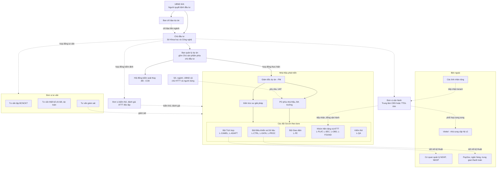

## 5. Tổ chức thực hiện và ma trận RACI

**Tóm tắt cho hội đồng thẩm định.** Dự án được tổ chức theo bốn tầng tách bạch: tầng quyết định đầu tư (UBND tỉnh, có Ban chỉ đạo giúp việc), tầng quản lý dự án (chủ đầu tư là Sở Khoa học và Công nghệ cùng Ban quản lý dự án), tầng thực hiện (nhà thầu phát triển tổ chức thành 3 đến 5 đội Scrum theo lane, cùng các đơn vị tư vấn) và tầng tiếp nhận (Trung tâm Chuyển đổi số hoặc Trung tâm dữ liệu tỉnh là đơn vị vận hành, các sở ngành là chủ hệ thống thông tin và người dùng). Kiểm thử xâm nhập và đánh giá an toàn thông tin do một đơn vị độc lập với nhà thầu thực hiện. Ma trận RACI ở mục 5.4 phân vai cho 40 hoạt động xuyên suốt từ phê duyệt dự án đến kết nạp tỉnh thứ hai; mỗi hoạt động có đúng một bên chịu trách nhiệm giải trình (A). Nhà thầu được dùng AI agent để viết mã, nhưng mọi dòng mã do agent sinh ra đều có một kỹ sư phụ trách lane đứng tên (R) và trưởng nhóm kỹ thuật chịu trách nhiệm giải trình (A); dữ liệu thật và bí mật tuyệt đối không được đưa vào công cụ AI.

### 5.1. Nguyên tắc tổ chức

Cách tổ chức của dự án xuất phát từ ba đặc điểm. Thứ nhất, đây là dự án đầu tư ứng dụng công nghệ thông tin dùng ngân sách nhà nước, nên mọi quyết định có hệ quả pháp lý (phê duyệt dự án, phê duyệt thiết kế, nghiệm thu, thanh toán, quyết toán) phải đi qua chủ thể có thẩm quyền theo CMP-LAW-14 (Nghị định 224/2026/NĐ-CP quy định chi tiết Luật Chuyển đổi số, có hiệu lực từ 01/7/2026, phần đầu tư hệ thống chuyển đổi số; điều khoản cụ thể cần đối chiếu Công báo). Thứ hai, dự án phát triển phần mềm theo mô hình lai: bên trong là sprint hai tuần theo Scrum, bên ngoài là sáu cổng nghiệm thu cố định G0 đến G5 để khớp thủ tục thanh toán theo giai đoạn. Hai nhịp này cần hai loại vai trò khác nhau: vai trò quản lý hành chính, hợp đồng phía chủ đầu tư, và vai trò sản phẩm, kỹ thuật làm việc hằng ngày với đội phát triển. Thứ ba, Datahub thay thế một hệ đang vận hành (LGSP do Viettel triển khai năm 2021) theo kiểu strangler, nên trong khoảng mười tháng từ W3 đến G5 có tới ba bên kỹ thuật cùng chạm vào môi trường sản xuất: nhà thầu mới, đơn vị vận hành tỉnh và nhà cung cấp hệ cũ.

Từ đó dự án áp dụng năm nguyên tắc. Nguyên tắc tách quyết định với thực hiện yêu cầu bên làm ra sản phẩm không tự nghiệm thu sản phẩm của mình, nên nghiệm thu cổng do chủ đầu tư hoặc Ban quản lý dự án chịu trách nhiệm giải trình, còn nhà thầu chỉ là bên thực hiện. Nguyên tắc độc lập kiểm định yêu cầu kiểm thử xâm nhập và đánh giá an toàn thông tin do một đơn vị không thuộc nhà thầu phát triển thực hiện, để kết quả có giá trị khi trình hồ sơ cấp độ 3. Nguyên tắc người vận hành tham gia sớm yêu cầu đơn vị vận hành có mặt từ W1 chứ không đợi đến ngày bàn giao, vì đơn vị này sẽ là bên chịu trách nhiệm môi trường sản xuất sau G3. Nguyên tắc một quyết định, một người chịu trách nhiệm giải trình được thể hiện bằng quy tắc mỗi hoạt động trong ma trận RACI có đúng một A. Cuối cùng, nguyên tắc sở hữu theo lane (kế thừa IP-04 của repo) quy định mỗi đội phát triển sở hữu một nhóm thư mục mã nguồn; điều này vừa giảm xung đột giữa các đội, vừa là cơ sở để giao việc có kiểm soát cho AI agent (mục 5.5).

### 5.2. Sơ đồ tổ chức dự án

Sơ đồ dưới đây thể hiện quan hệ chỉ đạo (mũi tên liền) và quan hệ phối hợp, tư vấn hoặc cung cấp dịch vụ (mũi tên đứt). Các đội của nhà thầu được vẽ theo cấu hình đông nhất ở W1 và W2; cấu hình đội theo từng wave được trình bày ở chương 6.

Sơ đồ cho thấy hai điểm quan trọng. Một là nhà thầu chỉ có một đầu mối pháp lý với chủ đầu tư là Giám đốc dự án (PM), mọi yêu cầu từ sở ngành đi vào đội phát triển qua PO phía nhà thầu chứ không giao thẳng cho kỹ sư; nhờ đó backlog luôn có một nơi sắp xếp ưu tiên duy nhất. Hai là đơn vị vận hành kết nối trực tiếp với nhóm Nền tảng và ATTT của nhà thầu và với Viettel, vì đây là ba bên cùng thao tác trên hạ tầng trong giai đoạn chạy song song. Hội đồng kiểm soát thay đổi (Change Control Board, CCB) được đặt dưới Ban quản lý dự án vì phần lớn thay đổi nằm trong thẩm quyền của Ban; thay đổi vượt thẩm quyền được Ban trình lên chủ đầu tư hoặc người quyết định đầu tư theo quy trình ở mục quản lý thay đổi của tài liệu này.

### 5.3. Trách nhiệm của từng bên

Các bên dưới đây được đối chiếu với danh sách bên liên quan SH-01 đến SH-12 của D02-01 (BRD); mã SH ghi trong ngoặc ở tiêu đề mỗi mục. Một số bên chỉ tồn tại trong tổ chức thực hiện dự án (Ban chỉ đạo, Ban quản lý dự án, các đơn vị tư vấn, đơn vị kiểm định độc lập, tỉnh nhân rộng) nên không có mã SH; ngược lại, người dân và doanh nghiệp (SH-10) là bên hưởng lợi gián tiếp, không có vai trò trong ma trận RACI.

#### 5.3.1. UBND tỉnh, người quyết định đầu tư (SH-01)

UBND tỉnh thí điểm (giả định, chờ chủ đầu tư xác nhận) là cơ quan quyết định đầu tư và đồng thời là chủ quản hệ thống thông tin Datahub theo nghĩa của CMP-LAW-06. Ở vai trò quyết định đầu tư, UBND tỉnh phê duyệt chủ trương đầu tư (nếu dự án thuộc diện phải có), phê duyệt dự án trên cơ sở Báo cáo nghiên cứu khả thi D01-01, phê duyệt điều chỉnh dự án khi thay đổi vượt tổng mức đầu tư hoặc mục tiêu, và phê duyệt quyết toán dự án hoàn thành. Ở vai trò chủ quản hệ thống thông tin, UBND tỉnh phê duyệt hồ sơ đề xuất cấp độ 3 sau khi có ý kiến thẩm định của đơn vị chuyên trách về an toàn thông tin, và ban hành quy chế khai thác, chia sẻ dữ liệu qua Datahub áp dụng cho các sở ngành. Trong thực hiện, UBND tỉnh không tham gia điều hành hằng ngày; vai trò chỉ đạo được thực hiện qua Ban chỉ đạo và qua báo cáo định kỳ của chủ đầu tư (chương 12).

#### 5.3.2. Ban chỉ đạo dự án

Ban chỉ đạo do UBND tỉnh thành lập, đề xuất do một lãnh đạo UBND tỉnh làm trưởng ban, thành viên gồm lãnh đạo Sở Khoa học và Công nghệ, Sở Tài chính, Văn phòng UBND tỉnh, Công an tỉnh và lãnh đạo hai đến ba sở ngành có nhiều hệ thống thông tin kết nối nhất. Lý do cần Ban chỉ đạo là Datahub chạm vào hệ thống của gần như mọi sở ngành, và các quyết định như thứ tự cắt chuyển nhóm dịch vụ, yêu cầu một sở nâng cấp hệ thống của mình để kết nối, hay ngày tắt hệ cũ đều vượt thẩm quyền điều phối của một sở. Ban chỉ đạo họp định kỳ hằng quý và họp bất thường khi có vấn đề leo thang đến mức 5 (mục 12.5). Ban chỉ đạo không thay chủ đầu tư ký các văn bản có giá trị pháp lý về hợp đồng và nghiệm thu.

#### 5.3.3. Chủ đầu tư, Sở Khoa học và Công nghệ (SH-02)

Sở Khoa học và Công nghệ (giả định) là chủ đầu tư, chịu trách nhiệm trước UBND tỉnh về toàn bộ vòng đời dự án từ chuẩn bị đầu tư đến quyết toán. Chủ đầu tư ký hợp đồng với đơn vị tư vấn, nhà thầu phát triển và đơn vị kiểm định độc lập; phê duyệt thiết kế chi tiết và dự toán theo phân cấp của CMP-LAW-14; chủ trì nghiệm thu các cổng có ý nghĩa thanh toán (G2 đến G5); quyết định tắt hệ cũ; và ký văn bản đề nghị kết nối với NDXP và PayGov. Chủ đầu tư có thể ủy quyền cho Ban quản lý dự án thực hiện phần lớn công việc điều hành, nhưng không ủy quyền việc nghiệm thu hoàn thành và việc chấm dứt hệ cũ, vì đó là các quyết định có hệ quả không đảo ngược được.

#### 5.3.4. Ban quản lý dự án

Ban quản lý dự án là cánh tay điều hành của chủ đầu tư, làm việc với nhà thầu hằng tuần. Ban có hai nhóm chức năng. Nhóm hành chính, hợp đồng theo dõi tiến độ giải ngân, kiểm tra khối lượng, chuẩn bị hồ sơ nghiệm thu, thanh toán và lập báo cáo cho cơ quan quản lý. Nhóm sản phẩm do **Chủ sản phẩm phía chủ đầu tư** đứng đầu: người này là đại diện duy nhất của chủ đầu tư được quyền quyết định thứ tự ưu tiên của product backlog, chấp nhận hoặc từ chối phần tăng trưởng (increment) ở sprint review, và chủ trì UAT. Việc có một chủ sản phẩm phía chủ đầu tư làm việc liên tục với PO phía nhà thầu là điều kiện để mô hình Scrum vận hành được trong khuôn khổ dự án nhà nước; nếu thiếu, mọi quyết định nhỏ đều phải chờ văn bản và sprint sẽ trượt. Ban cũng chủ trì CCB và chịu trách nhiệm giải trình về sổ rủi ro cấp dự án. Nhân sự của Ban được trình bày ở mục 6.5.

#### 5.3.5. Đơn vị tư vấn

Dự án có ba gói tư vấn với ba sản phẩm khác nhau. Tư vấn lập Báo cáo nghiên cứu khả thi lập D01-01 và D01-02 phiên bản trình duyệt trong giai đoạn chuẩn bị đầu tư (T0 − 7 đến T0 − 5 tháng). Tư vấn thiết kế chi tiết lập thiết kế chi tiết và dự toán (T0 − 3 đến T0 − 2 tháng), tức là bộ tài liệu nhóm 03 (D03-xx) ở mức đủ để lựa chọn nhà thầu; sau T0, đơn vị này được mời tham vấn khi có ADR làm thay đổi thiết kế đã duyệt. Tư vấn giám sát theo dõi khối lượng, chất lượng và tiến độ thi công phần mềm trong suốt 18 tháng, tham dự sprint review và mọi phiên nghiệm thu, xác nhận khối lượng hoàn thành làm cơ sở thanh toán. Dự án khuyến nghị tư vấn giám sát không là cùng một pháp nhân với tư vấn thiết kế chi tiết, để tránh trường hợp một đơn vị vừa thiết kế vừa giám sát việc thực hiện thiết kế của chính mình; người tổng hợp đối chiếu khuyến nghị này với quy định về điều kiện năng lực và tính độc lập trong CMP-LAW-14.

#### 5.3.6. Nhà thầu phát triển (SH-11)

Nhà thầu phát triển chịu trách nhiệm xây dựng, kiểm thử, triển khai và bảo hành Datahub theo hợp đồng. Bên trong nhà thầu, các vai trò then chốt được phân như sau.

**Giám đốc dự án (PM)** là đầu mối hợp đồng duy nhất, chịu trách nhiệm về tiến độ, nguồn lực, rủi ro phía nhà thầu và chất lượng báo cáo. PM chủ trì họp tiến độ tuần với Ban quản lý dự án, trình hồ sơ nghiệm thu cổng và là cấp leo thang thứ hai (mục 12.5).

**PO phía nhà thầu** (kiêm BA trưởng) quản lý product backlog hằng ngày: viết và làm mịn user story, giữ truy vết từ US đến FR và LGC, chuẩn bị nội dung sprint review. PO phía nhà thầu đề xuất thứ tự ưu tiên, còn Chủ sản phẩm phía chủ đầu tư quyết định. Cách chia này giữ được tốc độ của Scrum mà không làm mất quyền quyết định của chủ đầu tư đối với phạm vi.

**Kiến trúc sư giải pháp** sở hữu kiến trúc, phê duyệt ADR, xét duyệt hợp đồng API giữa các lane, và chịu trách nhiệm giải trình về quản lý cấu hình và phát hành. Kiến trúc sư cũng là người giữ tính nhất quán của mô hình multi-tenant, vì quyết định sai ở tầng này sẽ ảnh hưởng tới mọi tỉnh triển khai sau.

**Scrum Master** điều phối nghi thức Scrum, gỡ trở ngại và đo velocity. Ở W1 và W2 có hai Scrum Master, mỗi người phụ trách một đến hai đội.

**Trưởng nhóm kỹ thuật** là một kỹ sư cao cấp trong mỗi đội Scrum, được PM chỉ định bằng văn bản và tính trong định biên kỹ sư của đội (không phải vị trí bổ sung). Trưởng nhóm kỹ thuật duyệt thiết kế chi tiết trong lane, là người review cuối cùng trước khi merge vào nhánh chính của lane, và chịu trách nhiệm giải trình về mã do AI agent sinh ra trong lane (mục 5.5).

**Các đội theo lane** sở hữu thư mục mã nguồn theo bảng lane của AGENTS.md: đội Tích hợp sở hữu L-CAMEL và L-ADAPT; đội Điều khiển và Dữ liệu sở hữu L-CTRL, L-DATA, L-PROC; đội Giao diện sở hữu L-FE; nhóm Nền tảng và ATTT sở hữu L-FOUND, L-PLAT, L-SEC và L-OBS; kỹ sư kiểm thử sở hữu L-QA và được bố trí vào từng đội. Lane L-AI chỉ được kích hoạt ở W5 cho PH-17. Một đội không được sửa thư mục của lane khác, trừ thư mục `contracts/` theo thỏa thuận giữa hai lane.

#### 5.3.7. Đơn vị kiểm thử, đánh giá an toàn thông tin độc lập

Đơn vị này được chủ đầu tư thuê theo hợp đồng riêng, độc lập về pháp nhân với nhà thầu phát triển. Phạm vi gồm đánh giá thiết kế an toàn thông tin so với yêu cầu cấp độ 3 (CMP-LAW-06, CMP-LAW-07, CMP-LAW-08), kiểm thử xâm nhập hộp xám trước G2 và kiểm thử lại sau khắc phục, kiểm thử xâm nhập phân hệ thanh toán PH-19 trước G4, và có thể gồm kiểm thử hiệu năng độc lập trên STAGING theo quy mô tham chiếu cỡ M. Báo cáo của đơn vị này là thành phần của hồ sơ đề xuất cấp độ và của hồ sơ nghiệm thu G2, G4. Đơn vị kiểm định không sửa mã và không đề xuất cách sửa ở mức chi tiết; nhà thầu chịu trách nhiệm khắc phục.

#### 5.3.8. Đơn vị vận hành, Trung tâm Chuyển đổi số hoặc Trung tâm dữ liệu tỉnh (SH-03)

Đơn vị vận hành tiếp nhận và vận hành Datahub sau G3, đồng thời quản lý hạ tầng tại Trung tâm dữ liệu tỉnh (phương án H1) hoặc làm đầu mối với nhà cung cấp cloud chính phủ (phương án H2). Trong 18 tháng thực hiện, vai trò của đơn vị chuyển dần từ quan sát sang làm chủ theo kế hoạch chuyển giao ở mục 6.8: cung cấp hạ tầng DEV, TEST, STAGING từ W0; tham gia lập hồ sơ cấp độ; đồng vận hành STAGING từ W2; chịu trách nhiệm giải trình về môi trường PROD và phê duyệt mọi lần phát hành lên PROD từ khi cài đặt PROD ở W3. Đơn vị vận hành cũng là đầu mối kỹ thuật làm việc với Viettel trong giai đoạn chạy song song và là bên trực tiếp thực hiện tắt hệ cũ.

#### 5.3.9. Các sở, ngành và UBND cấp xã, chủ hệ thống thông tin và người dùng (SH-04, SH-05, SH-08)

Các sở ngành tham gia dự án ở hai tư cách. Với tư cách chủ hệ thống thông tin kết nối (SH-04) và chủ quản dữ liệu (SH-08), mỗi sở cử một đầu mối nghiệp vụ và một đầu mối kỹ thuật (thường là cán bộ phụ trách công nghệ thông tin của sở hoặc nhà cung cấp phần mềm của sở, tức SH-05) để cung cấp đặc tả dịch vụ hiện có, xác nhận ánh xạ dữ liệu khi di trú, tham gia kiểm thử kết nối và xác nhận cắt chuyển nhóm dịch vụ của mình. Với tư cách người dùng, cán bộ của sở dùng các chức năng như tra cứu danh mục dùng chung, theo dõi giao dịch thanh toán và tham gia UAT. Sau sắp xếp chính quyền hai cấp, UBND cấp xã cũng là bên khai thác một số dịch vụ (ví dụ danh mục đơn vị hành chính, tra cứu trạng thái hồ sơ), nhưng tham gia qua đầu mối do Sở Nội vụ hoặc Văn phòng UBND tỉnh chỉ định chứ không trực tiếp với nhà thầu.

#### 5.3.10. Cơ quan quản lý NDXP và NDOP (SH-06)

Cơ quan chủ quản và đơn vị vận hành nền tảng NDXP, NDOP theo phân công hiện hành (cần xác minh sau khi Bộ Thông tin và Truyền thông hợp nhất vào Bộ Khoa học và Công nghệ năm 2025, xem câu hỏi Q-D0102-50) là bên bên ngoài có ảnh hưởng trực tiếp tới tiến độ W2. Cơ quan này cấp tài khoản và chứng thư kết nối, cung cấp môi trường thử nghiệm, xác nhận kết quả kiểm thử kết nối và thông báo thay đổi đặc tả kỹ thuật. Dự án không có quan hệ hợp đồng với cơ quan này, nên mọi trao đổi đi qua văn bản hành chính do chủ đầu tư ký, còn trao đổi kỹ thuật hằng ngày do đơn vị vận hành và đội Tích hợp thực hiện trong phạm vi được văn bản cho phép.

#### 5.3.11. Nhà cung cấp PayGov, ngân hàng và trung gian thanh toán (SH-09)

Đơn vị vận hành nền tảng PayGov và các ngân hàng, tổ chức trung gian thanh toán được kết nối qua PayGov là bên cung cấp dịch vụ cho PH-19. Hệ cũ đã có kết nối với mã nhà cung cấp `PAYGOV`; Datahub phải đăng ký kết nối mới (hoặc chuyển kết nối), chạy kiểm thử tích hợp, kiểm thử đối soát và chạy song song ít nhất 30 ngày theo giả định nền trước khi tắt dịch vụ thanh toán cũ. Bên này kiểm soát lịch kiểm thử của họ, nên đội phát triển PH-19 ở W4 phải đặt lịch sớm và chương rủi ro theo dõi phụ thuộc này như một rủi ro có tác động lớn tới G4.

#### 5.3.12. Viettel, nhà cung cấp hệ cũ, trong giai đoạn song song (SH-12)

Từ W3 đến G5, hệ cũ và Datahub cùng chạy. Trong giai đoạn này, Viettel (hoặc đơn vị đang có hợp đồng duy trì hệ cũ) là bên nắm hiểu biết sâu nhất về cấu hình các route Camel, topic Pulsar, API trên API Management và cấu trúc dữ liệu Aita và Payment. Dự án cần Viettel thực hiện bốn việc: xuất dữ liệu và cấu hình theo định dạng thỏa thuận; giải thích các luồng tích hợp chưa có trong tài liệu; phối hợp chuyển hướng lưu lượng từng nhóm dịch vụ (đặt Datahub phía trước hệ cũ); và hỗ trợ khôi phục về hệ cũ khi một lần cắt chuyển phải quay lui. Các việc này cần một phụ lục hợp đồng duy trì hoặc một hợp đồng dịch vụ riêng giữa chủ đầu tư hoặc đơn vị vận hành với Viettel; nếu không có, rủi ro di trú tăng rõ rệt (câu hỏi Q-D0102-52).

#### 5.3.13. Các tỉnh nhân rộng

Tỉnh thứ hai được kết nạp làm tenant ở W5 như phép thử cho tính chất sản phẩm đóng gói của Datahub. Tỉnh này cử một đầu mối (thường là Trung tâm Chuyển đổi số của tỉnh đó) để chuẩn bị hạ tầng hoặc thỏa thuận dùng hạ tầng chung, cung cấp danh mục hệ thống thông tin cần kết nối ban đầu, cử cán bộ quản trị tenant tham gia đào tạo và xác nhận việc khởi tạo tenant. Quan hệ pháp lý giữa dự án của tỉnh thí điểm và tỉnh thứ hai (dùng chung bản quyền sản phẩm, chia sẻ chi phí vận hành nền tảng hay tự đầu tư) chưa được xác định và là câu hỏi mở Q-D0102-53. Từ tỉnh thứ ba trở đi, việc kết nạp nằm ngoài phạm vi dự án này.

### 5.4. Ma trận RACI

#### 5.4.1. Quy ước

Cột SN của ma trận gộp SH-04, SH-05 và SH-08; cột QG tương ứng SH-06; cột PG tương ứng SH-09; cột VT tương ứng SH-12. Ma trận RACI dùng bốn mức tham gia. **R** (Responsible, thực hiện) là bên trực tiếp làm công việc; một hoạt động có thể có nhiều R. **A** (Accountable, chịu trách nhiệm giải trình) là bên ra quyết định cuối cùng, ký hoặc phê duyệt kết quả và chịu trách nhiệm nếu kết quả sai; mỗi hoạt động có **đúng một A**, và A có thể đồng thời là R. **C** (Consulted, được tham vấn) là bên phải được hỏi ý kiến trước khi quyết định, ý kiến được ghi lại trong biên bản hoặc issue. **I** (Informed, được thông báo) là bên được thông báo kết quả sau khi quyết định. Ô trống nghĩa là bên đó không tham gia hoạt động.

Để bảng đọc được trên khổ giấy, các bên được viết tắt như sau: **UB** là UBND tỉnh; **BCĐ** là Ban chỉ đạo; **CĐT** là chủ đầu tư; **QLDA** là Ban quản lý dự án (gồm Chủ sản phẩm phía chủ đầu tư); **TVTK** là tư vấn lập BCNCKT và thiết kế chi tiết; **TVGS** là tư vấn giám sát; **NT-QL** là PM và PO phía nhà thầu; **NT-KT** là kiến trúc sư giải pháp và các trưởng nhóm kỹ thuật; **NT-Đ** là các đội lane (kỹ sư, kiểm thử, tài liệu); **KĐ** là đơn vị kiểm thử, đánh giá ATTT độc lập; **VH** là đơn vị vận hành; **SN** là sở ngành, chủ HTTT, người dùng; **QG** là cơ quan quản lý NDXP, NDOP; **PG** là PayGov, ngân hàng, trung gian thanh toán; **VT** là Viettel; **T2** là tỉnh nhân rộng.

#### 5.4.2. Ma trận

Bảng dưới đây phân vai cho 40 hoạt động, nhóm theo giai đoạn: chuẩn bị đầu tư, quản lý sản phẩm và kỹ thuật, nghiệm thu cổng, an toàn thông tin, chuyển đổi, kết nối quốc gia, quản lý dự án và chuyển giao. Cột "Ghi chú" nêu điều kiện đặc biệt khi có.

| # | Hoạt động | UB | BCĐ | CĐT | QLDA | TVTK | TVGS | NT-QL | NT-KT | NT-Đ | KĐ | VH | SN | QG | PG | VT | T2 | Ghi chú |
|---|---|---|---|---|---|---|---|---|---|---|---|---|---|---|---|---|---|---|
| 1 | Lập BCNCKT và kế hoạch dự án sơ bộ | I | C | A | R | R |  |  |  |  |  | C | C |  |  | C |  | Giai đoạn chuẩn bị đầu tư |
| 2 | Thẩm định, phê duyệt dự án | A | C | R | R | C |  |  |  |  |  | I | I |  |  |  |  | Cơ quan thẩm định theo phân cấp |
| 3 | Lập thiết kế chi tiết, dự toán | I |  | A | C | R |  |  |  |  |  | C | C |  |  |  |  |  |
| 4 | Phê duyệt thiết kế chi tiết, dự toán | I |  | A | R | C |  |  |  |  |  | I |  |  |  |  |  | Phân cấp theo CMP-LAW-14 |
| 5 | Lựa chọn nhà thầu phát triển, giám sát, kiểm định | I |  | A | R | C |  |  |  |  |  |  |  |  |  |  |  |  |
| 6 | Lập và cập nhật kế hoạch thực hiện chi tiết (baseline) |  | I | I | A | | C | R | C | C |  | C |  |  |  |  |  | Baseline tại G0 |
| 7 | Quản lý product backlog, quyết định ưu tiên |  |  | I | A |  | I | R | C | C |  | C | C |  |  |  |  | QLDA quyết, PO nhà thầu làm mịn |
| 8 | Lập kế hoạch sprint |  |  |  | I |  | I | A | R | R |  |  |  |  |  |  |  |  |
| 9 | Sprint review, chấp nhận phần tăng trưởng |  |  | I | A |  | C | R | R | R |  | C | C |  |  |  |  | Chủ sản phẩm phía CĐT chấp nhận |
| 10 | Phê duyệt ADR |  |  |  | I | C | C | I | A | R |  | C |  |  |  |  |  | ADR đổi phạm vi, chi phí phải qua CCB |
| 11 | Quản lý hợp đồng API giữa các lane |  |  |  |  |  |  | I | A | R |  |  |  |  |  |  |  |  |
| 12 | Nghiệm thu G0 Nền tảng sẵn sàng |  |  | I | A |  | R | R | R | C |  | C |  |  |  |  |  | Kiểm tra nội bộ có giám sát |
| 13 | Nghiệm thu G1 Trục tích hợp |  |  | I | A |  | R | R | R | C |  | C | I |  |  |  |  |  |
| 14 | Nghiệm thu G2 MVP |  | I | A | R |  | R | R | C | C | C | C | C |  |  |  |  | Gắn với thanh toán giai đoạn |
| 15 | Nghiệm thu G3 Vận hành chính thức MVP | I | I | A | R |  | R | R | C | C | C | R | C |  |  | I |  |  |
| 16 | Nghiệm thu G4 Đợt 2 |  | I | A | R |  | R | R | C | C | C | C | C |  | C |  |  |  |
| 17 | Nghiệm thu G5 Hoàn thành dự án | I | I | A | R |  | R | R | C | C | C | R | C |  |  |  | C |  |
| 18 | Lập hồ sơ đề xuất cấp độ 3 |  |  | I | C |  | C | C | R | R | C | A |  |  |  |  |  | Đơn vị vận hành đứng tên lập |
| 19 | Thẩm định, phê duyệt cấp độ 3 | A |  | R | C |  |  |  |  |  | C | R |  |  |  |  |  | Thẩm định bởi cơ quan chuyên trách ATTT (SH-07); KPI-08 |
| 20 | Kiểm thử xâm nhập, đánh giá ATTT độc lập |  |  | A | C |  | I | I | C | C | R | C |  |  |  |  |  | Trước G2 và trước G4 |
| 21 | Khắc phục lỗ hổng và kiểm thử lại |  |  | I | I |  | C | C | A | R | R | C |  |  |  |  |  |  |
| 22 | Kiểm thử hệ thống, tích hợp, hiệu năng |  |  |  | I |  | C | A | R | R | C | C |  |  |  |  |  | KĐ có thể làm hiệu năng độc lập |
| 23 | Kiểm thử chấp nhận người dùng (UAT) |  |  | I | A |  | C | R | C | C |  | R | R |  |  |  |  |  |
| 24 | Lập kế hoạch di trú dữ liệu |  |  | I | A |  | C | C | R | R |  | C | C |  |  | C |  |  |
| 25 | Thực hiện di trú và đối soát dữ liệu |  |  | I | A |  | C | I | C | R |  | R | R |  |  | R |  | SN xác nhận dữ liệu của mình |
| 26 | Quyết định cắt chuyển một nhóm dịch vụ (go/no-go) |  | I | I | A |  | C | R | C | C |  | R | C |  |  | C |  | QLDA theo ủy quyền của CĐT |
| 27 | Thực hiện cắt chuyển và quay lui khi cần |  |  |  | I |  | I | C | C | R |  | A | I |  |  | R |  |  |
| 28 | Quyết định tắt hệ cũ | I | C | A | R |  | C | C | C |  |  | R | C |  |  | C |  | Không đảo ngược, CĐT không ủy quyền |
| 29 | Đăng ký, kiểm thử, đưa vào dùng kết nối NDXP, NDOP |  |  | A | C |  | I | C | R | R |  | R | I | C |  |  |  | CĐT ký văn bản đề nghị |
| 30 | Đăng ký, kiểm thử, đưa vào dùng kết nối PayGov |  |  | A | C |  | I | C | R | R |  | R | I |  | C |  |  |  |
| 31 | Chạy song song và tắt dịch vụ thanh toán cũ |  |  | A | R |  | C | C | C | R |  | R | C |  | C | R |  | Sau 30 ngày PH-19 ổn định |
| 32 | Quản lý thay đổi (CCB) | I | I | C | A | C | C | R | C | I |  | C | C |  |  |  |  | Vượt tổng mức đầu tư trình UB |
| 33 | Quản lý rủi ro (sổ RSK) |  | I | I | A |  | C | R | R | C |  | C | C |  |  |  |  |  |
| 34 | Quản lý cấu hình và phát hành |  |  |  | I |  | C | C | A | R |  | C |  |  |  |  |  |  |
| 35 | Phê duyệt phát hành lên PROD |  |  |  | I |  | I | C | R | R |  | A |  |  |  |  |  | Từ khi có PROD ở W3 |
| 36 | Báo cáo cơ quan quản lý, báo cáo giám sát đầu tư | I | I | A | R |  | C | C |  |  |  | I |  |  |  |  |  |  |
| 37 | Đào tạo người dùng, quản trị, vận hành |  |  | I | A |  | I | R | C | R |  | R | R |  |  |  | C |  |
| 38 | Chuyển giao tri thức, tài liệu vận hành |  |  | I | C |  | C | C | R | R |  | A |  |  |  |  |  | VH xác nhận đủ năng lực tiếp nhận |
| 39 | Bảo hành 12 tháng |  |  | I | C |  |  | A | R | R |  | C | I |  |  |  |  | Theo hợp đồng |
| 40 | Kết nạp tenant tỉnh 2 (mục tiêu KPI-12) | I |  | A | C |  | C | R | R | R |  | R |  |  |  |  | R |  |

Có bốn điểm của bảng cần giải thích thêm. Thứ nhất, ở các cổng G0 và G1, Ban quản lý dự án là A vì đây là mốc kỹ thuật nội bộ không gắn với thanh toán, còn từ G2 trở đi chủ đầu tư là A vì kết quả nghiệm thu là căn cứ thanh toán; nếu hợp đồng quy định thanh toán cả ở G1 thì A của dòng 13 chuyển lên chủ đầu tư. Thứ hai, đơn vị vận hành là A của việc lập hồ sơ cấp độ (dòng 18), phê duyệt phát hành lên PROD (dòng 35) và chuyển giao tri thức (dòng 38), vì đây là các việc mà người chịu hậu quả lâu dài là người vận hành chứ không phải nhà thầu; đặt A ở nhà thầu sẽ tạo động lực "bàn giao cho xong". Thứ ba, quyết định cắt chuyển từng nhóm dịch vụ (dòng 26) được giao cho Ban quản lý dự án theo ủy quyền để không phải chờ văn bản của chủ đầu tư cho mỗi nhóm, trong khi quyết định tắt hệ cũ (dòng 28) giữ ở chủ đầu tư. Thứ tư, nhà thầu không có vai A ở bất kỳ hoạt động nghiệm thu nào, nhất quán với nguyên tắc tách quyết định với thực hiện ở mục 5.1. Các bên bên ngoài (QG, PG, VT, T2) chỉ có R hoặc C ở những việc họ phải làm, không có A, vì dự án không có thẩm quyền đối với họ; phần việc của họ được bảo đảm bằng văn bản hành chính hoặc hợp đồng dịch vụ.

### 5.5. AI agent viết mã

#### 5.5.1. Vai trò

Nhà thầu được phép dùng AI agent viết mã (coding agent) để tăng năng suất, với điều kiện tuân thủ toàn bộ quy tắc của mục này. AI agent không phải là một bên trong ma trận RACI và không phải là nhân sự; agent là công cụ do một kỹ sư điều khiển, giống như trình biên dịch hay công cụ sinh mã. Mỗi agent được giao làm việc trong đúng một lane, theo mẫu tên của IP-04 (ví dụ `agent-ctrl` cho L-CTRL, `agent-camel` cho L-CAMEL, `agent-fe` cho L-FE), và mỗi lần giao việc tương ứng với một gói công việc (work package, WP) hoặc một user story có mã truy vết FR, ADR hoặc WP. Việc phù hợp cho agent là mã có khuôn mẫu rõ (endpoint CRUD theo OpenAPI đã khóa, migration Liquibase, kiểm thử đơn vị, route Camel theo khung chín bước, màn hình theo mẫu bố cục PTN của D03-06), sinh dữ liệu kiểm thử giả lập và soạn nháp tài liệu kỹ thuật từ mã. Việc không giao cho agent là quyết định kiến trúc, viết chính sách OPA và cấu hình Keycloak cho môi trường STAGING và PROD, thay đổi cấu hình hạ tầng PROD, và bất kỳ thao tác nào trên dữ liệu thật.

#### 5.5.2. Giới hạn

Agent bị giới hạn ở năm mặt. Về phạm vi, agent chỉ được sửa thư mục của lane được giao; PR chạm thư mục ngoài lane bị cổng CI từ chối tự động, trừ thư mục `contracts/` khi có phê duyệt của lane tiêu thụ. Về quyền, agent chỉ làm việc trong môi trường DEV, không có thông tin xác thực vào TEST, STAGING, PROD, không có quyền merge và không có quyền đẩy thẳng vào nhánh chính. Về dữ liệu, agent chỉ thấy mã nguồn, tài liệu thiết kế và dữ liệu giả lập; agent không được kết nối tới cơ sở dữ liệu có dữ liệu thật hay kho bí mật. Về phạm vi công việc, agent dừng khi đạt Definition of Done của WP, không tự mở rộng sang WP khác (luật "không vibe coding" của AGENTS.md). Về công cụ, chỉ những công cụ AI có trong danh sách được chủ đầu tư chấp thuận (mục 5.5.4) mới được dùng.

#### 5.5.3. Trách nhiệm

Mã do agent sinh ra được đối xử như mã do kỹ sư viết, với một người chịu trách nhiệm cụ thể. Bảng dưới đây phân vai cho các việc liên quan đến agent, dùng quy ước RACI của mục 5.4.1.

| Việc | Kỹ sư phụ trách lane | Trưởng nhóm kỹ thuật | Kiến trúc sư giải pháp | Nhóm Nền tảng và ATTT | PM nhà thầu | QLDA |
|---|---|---|---|---|---|---|
| Giao việc cho agent, viết chỉ dẫn (prompt) theo WP | R | A | I |  |  |  |
| Đọc hiểu, chạy thử, sửa mã do agent sinh, mở PR | R | A |  |  |  |  |
| Review và merge PR có mã do agent sinh | C | A |  | C |  |  |
| Duy trì cổng CI chặn mã ngoài lane, secret, lỗ hổng |  | C | C | R |  |  |
| Cập nhật AGENTS.md và luật ArchUnit khi agent sai mẫu | R | A | C |  |  |  |
| Duy trì danh sách công cụ AI được chấp thuận |  | C | R | C | A | C |
| Lưu và cung cấp nhật ký prompt, PR cho kiểm tra |  | R |  | R | A | I |
| Xử lý sự cố lộ dữ liệu hoặc bí mật qua công cụ AI |  | R | C | R | A | I |

Theo bảng này, kỹ sư phụ trách lane là R cho mọi dòng mã do agent sinh trong lane của mình; kỹ sư không được mở PR chứa mã mà mình không giải thích được. Trưởng nhóm kỹ thuật là A: người này duyệt cuối trước khi merge và chịu trách nhiệm nếu mã lỗi lọt qua. PM nhà thầu là A cho chính sách công cụ và nhật ký, vì đây là nghĩa vụ hợp đồng của nhà thầu đối với chủ đầu tư. Ban quản lý dự án được tham vấn khi thay đổi danh sách công cụ và được quyền yêu cầu xem nhật ký bất kỳ lúc nào.

#### 5.5.4. Quy tắc kiểm soát

Bảy quy tắc sau được ghi vào hợp đồng hoặc phụ lục hợp đồng với nhà thầu, và được kiểm tra trong mỗi phiên giám sát.

1. **Không bí mật.** Không đưa mật khẩu, khóa API, chứng thư, chuỗi kết nối thật hay token vào chỉ dẫn, vào ngữ cảnh của agent hay vào mã. Kho mã chỉ chứa `.env.example` và tham chiếu kiểu `T-SECRET-REF`; bí mật nằm trong Vault/OpenBao. Cổng S (gitleaks và SAST) chạy trên mọi PR và chặn merge khi phát hiện.
2. **Cổng CI bắt buộc xanh.** Mọi PR, dù do người hay agent viết, phải qua cổng A (biên dịch, kiểm thử đơn vị, ArchUnit, kiểm tra ranh giới Modulith, kiểm thử route Camel), cổng B (lint và kiểm tra thay đổi phá vỡ hợp đồng OpenAPI), cổng C (lint, typecheck, kiểm thử thành phần giao diện) khi chạm L-FE, và cổng S. Không ai có quyền bỏ qua cổng; ngoại lệ phải là một ADR.
3. **Review con người.** Mỗi PR có ít nhất một người review không phải tác giả. PR chạm vào xác thực, phân quyền, mã hóa, xử lý dữ liệu cá nhân, thanh toán hoặc cách ly tenant cần hai người review, trong đó một người thuộc nhóm Nền tảng và ATTT.
4. **Nhật ký prompt và PR.** Mẫu PR có trường bắt buộc khai báo có dùng agent hay không, công cụ và phiên bản mô hình, và mã WP. Nhà thầu lưu nhật ký phiên làm việc của agent (chỉ dẫn và kết quả) trong suốt thời gian thực hiện và bảo hành, và cung cấp cho tư vấn giám sát hoặc chủ đầu tư khi được yêu cầu. Nhật ký này cũng là bằng chứng xuất xứ khi có tranh chấp sở hữu trí tuệ.
5. **Sở hữu trí tuệ.** Hợp đồng quy định mã nguồn do agent sinh ra trong phạm vi dự án thuộc quyền sở hữu của chủ đầu tư như mọi mã khác do nhà thầu bàn giao. Nhà thầu cam kết mã không vi phạm giấy phép của bên thứ ba; cổng S có bước quét thành phần phần mềm (SCA) và kiểm tra giấy phép, chặn các giấy phép không tương thích với việc phân phối sản phẩm cho nhiều tỉnh. Điều khoản sử dụng của công cụ AI phải không giành quyền đối với kết quả sinh ra.
6. **Bảo mật dữ liệu.** Không đưa dữ liệu thật (dữ liệu cá nhân, dữ liệu giao dịch thanh toán, nội dung bản tin nghiệp vụ, nhật ký PROD) hay tài liệu mật vào bất kỳ công cụ AI nào. Khi cần phân tích lỗi PROD, kỹ sư dùng bản tin đã ẩn danh bằng công cụ của PH-09 hoặc dữ liệu giả lập. Công cụ AI dùng cho dự án phải có cam kết không dùng dữ liệu đầu vào để huấn luyện và không lưu giữ quá thời hạn cần thiết. Việc mã nguồn của dự án có được gửi tới dịch vụ AI đặt ở nước ngoài hay không là quyết định của chủ đầu tư (câu hỏi Q-D0102-51); nếu câu trả lời là không, nhà thầu phải dùng mô hình triển khai trong nước hoặc tại hạ tầng của mình.
7. **Học từ lỗi.** Khi review phát hiện agent lặp lại một mẫu sai, kỹ sư phụ trách lane bổ sung luật vào AGENTS.md hoặc luật ArchUnit trong cùng sprint, để lỗi được chặn bằng máy thay vì bằng trí nhớ của người review.

Các quy tắc trên làm cho việc dùng agent không làm thay đổi cấu trúc trách nhiệm của dự án: chủ đầu tư vẫn nghiệm thu sản phẩm theo tiêu chí của cổng, không phân biệt mã do ai viết, và mọi sai sót đều truy được về một người cụ thể.

### Câu hỏi mở

- **Q-D0102-50.** Sau khi Bộ Thông tin và Truyền thông hợp nhất vào Bộ Khoa học và Công nghệ, cơ quan nào là chủ quản và đơn vị nào vận hành NDXP, NDOP; thủ tục đăng ký kết nối hiện hành gồm những bước nào và mất bao lâu?
- **Q-D0102-51.** Chủ đầu tư có cho phép gửi mã nguồn của dự án (không kèm dữ liệu thật) tới dịch vụ AI đặt ngoài lãnh thổ Việt Nam không, hay yêu cầu chỉ dùng mô hình triển khai trong nước?
- **Q-D0102-52.** Hợp đồng duy trì hệ LGSP cũ với Viettel còn hiệu lực đến khi nào, và có bao gồm nghĩa vụ xuất dữ liệu, hỗ trợ chuyển hướng lưu lượng và quay lui trong giai đoạn W3 đến G5 hay không?
- **Q-D0102-53.** Quan hệ pháp lý và tài chính giữa dự án của tỉnh thí điểm và tỉnh thứ hai khi kết nạp tenant ở W5 là gì (tỉnh 2 tự đầu tư, dùng chung theo thỏa thuận, hay do một đơn vị cấp trung ương điều phối)?
- **Q-D0102-54.** Trong cơ cấu sau năm 2025, cơ quan chuyên trách về an toàn thông tin nào (SH-07 của D02-01 ghi Bộ Công an hoặc Bộ Quốc phòng theo phân cấp) thẩm định hồ sơ đề xuất cấp độ 3 của Datahub, và UBND tỉnh có ủy quyền phê duyệt cấp độ cho Sở Khoa học và Công nghệ không?
- **Q-D0102-55.** Hợp đồng có thanh toán theo cổng G1 không? Nếu có, A của dòng 13 trong ma trận RACI chuyển từ Ban quản lý dự án lên chủ đầu tư.

### Ghi chú cho người tổng hợp

- Chương dùng mã CMP-LAW-14 để chỉ Nghị định 224/2026/NĐ-CP (quy định chi tiết Luật Chuyển đổi số, hiệu lực 01/7/2026, đã bãi bỏ NĐ 45/2026/NĐ-CP theo Điều 90) ở mục 5.1, 5.3.3, 5.3.5 và dòng 4 ma trận RACI. **D00-01 §7 hiện vẫn ghi CMP-LAW-14 là NĐ 45/2026, cần sửa thành NĐ 224/2026.**
- NĐ 224/2026 cho phép thiết kế một bước (thiết kế chi tiết trong BCNCKT, Điều 47) hoặc hai bước (thiết kế cơ sở, Điều 46). Ma trận RACI giữ dòng 3 và dòng 4 về thiết kế chi tiết theo giả định nền §3.1 (thiết kế chi tiết sau phê duyệt dự án, tức hai bước); nếu chọn một bước thì gộp dòng 3, 4 vào dòng 1, 2. Theo bản tóm tắt pháp lý, NĐ 224 cũng cho phép một doanh nghiệp vừa thiết kế vừa triển khai phần mềm nội bộ; khuyến nghị ở mục 5.3.5 chỉ nói về việc tách tư vấn giám sát khỏi tư vấn thiết kế, không mâu thuẫn với cơ chế này, nhưng người tổng hợp nên kiểm tra lại.
- **Bên liên quan chưa có mã SH.** D02-01 không có mã SH cho Ban chỉ đạo, Ban quản lý dự án, các đơn vị tư vấn, đơn vị kiểm thử và đánh giá ATTT độc lập và tỉnh nhân rộng. Các bên này là bên của tổ chức dự án nên có thể không cần mã SH; nếu D02-01 muốn truy vết đầy đủ thì đề xuất bổ sung SH-13 trở đi. Ngoài ra D02-01 ghi SH-03 là "Trung tâm dữ liệu / Trung tâm CNTT tỉnh" còn giả định nền ghi "Trung tâm Chuyển đổi số / Trung tâm dữ liệu tỉnh"; nên thống nhất tên gọi.
- Chương này đưa thêm vai trò **Chủ sản phẩm phía chủ đầu tư** (thuộc Ban quản lý dự án) và **Trưởng nhóm kỹ thuật** (kiêm nhiệm trong định biên kỹ sư của đội). Hai vai trò này không có trong bảng FTE của `_gia-dinh-nen.md` §5 vì một vai trò thuộc phía chủ đầu tư và một vai trò là kiêm nhiệm; đề nghị ghi chú bổ sung vào §5 của giả định nền để các chương khác dùng thống nhất.
- Repo (IP-04) dùng wave W0 đến W6 với nội dung khác bảng wave W0 đến W5 của giả định nền (ví dụ PH-14 ở W5 trong repo nhưng ở W2 trong giả định nền). Chương này chỉ dùng wave theo giả định nền và dùng repo để lấy tên lane; người tổng hợp nên thêm một câu trong D01-02 nói rõ IP-04 là kế hoạch kỹ thuật nội bộ của repo, không phải lịch dự án.
- Ma trận RACI dùng tên các mục "quản lý thay đổi" và "quản lý rủi ro" của D01-02 mà không ghi số chương vì chưa biết số chương cuối cùng; người tổng hợp thay bằng tham chiếu số khi ghép.
