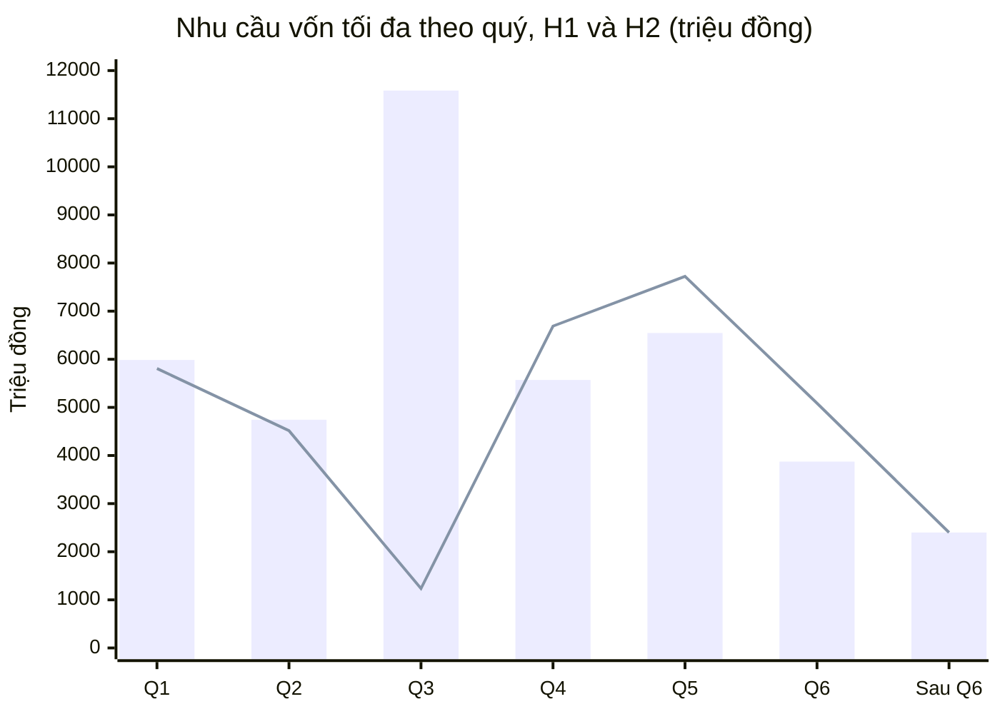

## 7. Ngân sách và kế hoạch giải ngân

**Tóm tắt cho hội đồng thẩm định.** Ngân sách của dự án bằng đúng tổng mức đầu tư ở D01-01 Chương 8: **40.702 triệu đồng trước thuế GTGT** theo phương án hạ tầng khuyến nghị H1 và 33.460 triệu đồng nếu toàn bộ hạ tầng thuê cloud chính phủ (H2), mọi đơn giá là giá trị tham khảo. Theo wave, W2 cần nhiều vốn nhất (16.658 triệu đồng, vì thiết bị được mua và lắp đặt trong wave này), tiếp theo là W4 và W1; bảo hành 12 tháng sau G5 là 2.400 triệu đồng. Hợp đồng chính (gói EP phần mềm và triển khai, 18.670 triệu đồng) được thanh toán theo sáu cổng G0 đến G5 với tỷ lệ 7%, 23%, 24%, 12%, 22%, 12%, sau khoản tạm ứng 15%. Dòng tiền theo quý đạt đỉnh ở Q3 (khoảng 11,6 tỷ đồng, do thanh toán thiết bị); nếu không tính thiết bị, nhu cầu vốn mỗi quý dao động từ 3,5 đến 6 tỷ đồng. Dự phòng 3.344 triệu đồng được gắn với các rủi ro cụ thể trong sổ rủi ro chương 8 và chỉ được giải phóng qua Hội đồng kiểm soát thay đổi.

### 7.1. Nguyên tắc lập ngân sách

Ngân sách dự án được lập từ cùng một mô hình chi phí với D01-01 Chương 8 và bảng tính `tco-datahub.xlsx` (thư mục `_parts/D01-01/`), nên mọi con số ở chương này khớp tuyệt đối với tổng mức đầu tư. Chương này không lập lại cách xác định chi phí mà trả lời ba câu hỏi của người điều hành dự án: tiền được dùng cho wave nào và hạng mục nào, khi nào phải có tiền để thanh toán, và kiểm soát chi tiêu thế nào để không vượt tổng mức đã duyệt.

Ba nguyên tắc chi phối cách lập. Thứ nhất, ngân sách được phân bổ theo nỗ lực WBS của từng wave (chương 2, tổng 458,5 người-tháng gồm 4 người-tháng bổ sung cho Giám đốc dự án và Product Owner ở T0+13 đến T0+15), không chia đều theo thời gian, để giá trị kế hoạch (PV) dùng cho EVM ở chương 12 có cùng gốc với ngân sách. Thứ hai, thanh toán cho nhà thầu gắn với cổng nghiệm thu chứ không gắn với thời gian trôi qua, đúng với mô hình lai Scrum và cổng ở chương 3 mục 3.7; nhờ vậy chủ đầu tư chỉ trả tiền cho phần tăng trưởng đã được chấp nhận. Thứ ba, dự phòng không được trộn vào ngân sách các wave mà giữ thành quỹ riêng, gắn với rủi ro cụ thể và chỉ được dùng khi có quyết định của Hội đồng kiểm soát thay đổi (CCB), để khoản dự phòng không bị tiêu dần một cách vô hình.

Các con số trong chương là triệu đồng, trước thuế GTGT, đơn giá tham khảo 40 triệu đồng/người-tháng cho nhân công nhà thầu. Khi chủ đầu tư điền đơn giá chính thức vào sheet "Tham số" của bảng tính, các bảng ở chương này được tính lại theo cùng tỷ lệ. Kịch bản cơ sở là H1 (PROD, STAGING, DR tại trung tâm dữ liệu tỉnh; DEV, TEST thuê cloud), các bảng có ghi thêm số liệu H2 ở những chỗ khác biệt đáng kể.

### 7.2. Ngân sách theo wave và hạng mục

Bảng dưới đây phân bổ tổng mức đầu tư H1 theo sáu wave và giai đoạn bảo hành. Nhân công nhà thầu lấy từ người-tháng của từng wave nhân đơn giá, cộng 330 triệu đồng chi phí đào tạo ngoài nhân công (tổ chức lớp, chứng chỉ cho đội vận hành tỉnh) chia đều cho W3 và W5. Các khoản theo thời gian (thuê cloud, quản lý dự án, tư vấn giám sát) được phân theo tháng; ba tháng chồng lấn W3 và W4 (T0+10 đến T0+13) được chia theo tỷ lệ nỗ lực của hai đội. Dự phòng được phân theo nỗ lực để thể hiện mức rủi ro tương đối của từng wave, nhưng vẫn quản lý như quỹ riêng theo mục 7.6.

| Hạng mục | W0 | W1 | W2 | W3 | W4 | W5 | Bảo hành | Cộng |
|---|---|---|---|---|---|---|---|---|
| Nhân công nhà thầu và đào tạo | 1.240 | 4.240 | 4.480 | 2.385 | 4.060 | 2.265 | | 18.670 |
| Bảo hành 12 tháng (60 người-tháng) | | | | | | | 2.400 | 2.400 |
| Thiết bị hạ tầng H1 | | | 10.403 | | | | | 10.403 |
| Thuê cloud trong thực hiện, G(DV) | 169 | 339 | 339 | 121 | 302 | 254 | | 1.524 |
| Quản lý dự án, G(QLDA) | 105 | 210 | 210 | 75 | 187 | 157 | | 944 |
| Tư vấn, G(TV) | 945 | 210 | 210 | 75 | 187 | 158 | | 1.785 |
| Chi phí khác, G(K) | 50 | 0 | 200 | 119 | 581 | 681 | | 1.631 |
| Dự phòng, G(DP) | 226 | 773 | 817 | 405 | 740 | 383 | | 3.344 |
| **Cộng H1** | **2.735** | **5.772** | **16.658** | **3.180** | **6.058** | **3.898** | **2.400** | **40.702** |
| Cộng H2 (tham khảo) | 2.633 | 5.471 | 6.698 | 3.703 | 7.443 | 5.113 | 2.400 | 33.460 |

Cột W0 có khoản tư vấn lớn bất thường (945 triệu đồng) vì gồm chi phí khảo sát, lập báo cáo nghiên cứu khả thi và lựa chọn nhà thầu phát sinh trước T0; theo giả định nền §3.3 các khoản này được tính vào Năm 1 và được ghi vào W0 để thuận tiện theo dõi. W2 là wave nặng nhất vì thiết bị H1 phải được giao và lắp đặt ngay đầu W2 (T0+6) để kịp dựng STAGING; nếu thiết bị thuộc dự án hạ tầng riêng (Q-D0101-52 tại D01-01), ngân sách W2 giảm còn khoảng 5,5 tỷ đồng và W2 trở thành wave có chi phí tương đương W1. Với H2, thiết bị biến mất nhưng tiền thuê cloud cho STAGING, PROD và DR làm W4 và W5 trở thành hai wave tốn kém nhất.

Chi phí khác tập trung ở W2, W4 và W5 vì đó là các đợt kiểm thử xâm nhập độc lập (trước G2 và trước G4), khoản hỗ trợ của nhà cung cấp hệ cũ cho trích xuất và cắt chuyển (W3, W4), kiểm thử phần mềm độc lập trước nghiệm thu hoàn thành, kiểm toán và thẩm tra quyết toán (W5). Bảng sau tóm tắt ngân sách theo cơ cấu của Thông tư 39/2026/TT-BKHCN để Ban quản lý dự án đối chiếu với quyết định phê duyệt dự án.

| Nhóm theo TT 39/2026 | H1 | Tỷ trọng H1 | H2 |
|---|---|---|---|
| G(TB): phần mềm nội bộ, triển khai, di trú, đào tạo, hồ sơ ATTT, bảo hành, thiết bị | 31.473 | 77,3% | 21.070 |
| G(QLDA) | 944 | 2,3% | 632 |
| G(TV) | 1.785 | 4,4% | 1.785 |
| G(K) | 1.631 | 4,0% | 1.610 |
| G(DP) | 3.344 | 8,2% | 2.342 |
| G(DV) | 1.524 | 3,7% | 6.020 |
| **Cộng** | **40.702** | **100%** | **33.460** |

### 7.3. Cấu trúc gói thầu và hình thức hợp đồng

Ngân sách được thực hiện qua hai gói thầu chính và các hợp đồng tư vấn, dịch vụ nhỏ. Cách chia này quyết định lịch thanh toán ở mục 7.4.

Gói thứ nhất là **gói EP phần mềm và triển khai**, giá trị 18.670 triệu đồng cho giai đoạn thực hiện cộng 2.400 triệu đồng bảo hành, gồm toàn bộ 458,5 người-tháng của WBS và 60 người-tháng bảo hành. Nghị định 224/2026/NĐ-CP cho phép một doanh nghiệp vừa thiết kế chi tiết vừa triển khai hạng mục phần mềm nội bộ, và Thông tư 39/2026 lấy tổng mức đầu tư đã duyệt làm căn cứ thanh quyết toán gói EP; hình thức hợp đồng đề xuất là trọn gói theo cổng, để rủi ro năng suất và trượt giá trong thời gian thực hiện thuộc về nhà thầu. Gói thứ hai là **gói mua sắm thiết bị H1** (10.403 triệu đồng gồm lắp đặt), giao và nghiệm thu lắp đặt trước T0+6; gói này phải được lựa chọn nhà thầu song song với gói EP, nếu không W2 sẽ trễ (RSK-24). Thuê cloud cho DEV, TEST là hợp đồng thuê dịch vụ công nghệ số ký từ T0. Tư vấn giám sát, kiểm thử độc lập và kiểm thử xâm nhập là các hợp đồng tư vấn riêng, độc lập với nhà thầu EP.

### 7.4. Giải ngân theo cổng nghiệm thu

#### 7.4.1. Tỷ lệ thanh toán từng cổng

Tỷ lệ thanh toán gói EP ở mỗi cổng xấp xỉ tỷ lệ nỗ lực WBS của wave kết thúc tại cổng đó, theo nguyên tắc đã nêu ở chương 3 mục 3.7. Khoản tạm ứng 15% giá trị hợp đồng được trả tại T0 để nhà thầu huy động đội 15,5 FTE của W0 và thu hồi đều ở bốn cổng G1 đến G4, mỗi cổng 25% khoản tạm ứng. Không đặt khoản giữ lại riêng; thay vào đó, hợp đồng yêu cầu bảo lãnh thực hiện hợp đồng có hiệu lực đến G5 và bảo lãnh bảo hành đến hết T0+30. Bảng sau cho số tiền từng cổng với giá trị tham khảo.

| Mốc | Thời điểm | Wave kết thúc | Tỷ lệ nỗ lực wave | Tỷ lệ thanh toán | Giá trị gộp | Thu hồi tạm ứng | Thanh toán thực |
|---|---|---|---|---|---|---|---|
| Tạm ứng | T0 | | | 15% | 2.801 | | 2.801 |
| G0 Nền tảng sẵn sàng | T0+2 | W0 | 6,8% | 7% | 1.307 | 0 | 1.307 |
| G1 Trục tích hợp | T0+6 | W1 | 23,1% | 23% | 4.294 | 700 | 3.594 |
| G2 Nghiệm thu MVP | T0+10 | W2 | 24,4% | 24% | 4.481 | 700 | 3.781 |
| G3 Vận hành chính thức MVP | T0+13 | W3 | 12,1% | 12% | 2.240 | 700 | 1.540 |
| G4 Nghiệm thu đợt 2 | T0+15 | W4 | 22,1% | 22% | 4.107 | 700 | 3.407 |
| G5 Nghiệm thu hoàn thành | T0+18 | W5 | 11,5% | 12% | 2.240 | 0 | 2.240 |
| **Cộng giai đoạn thực hiện** | | | **100%** | **100%** | | **2.801** | **18.670** |
| Bảo hành, bốn kỳ quý | T0+21, 24, 27, 30 | | | | | | 4 × 600 = 2.400 |

Cổng G5 được làm tròn lên 12% (nỗ lực W5 chỉ 11,5%) để giữ một khoản đủ lớn ở cuối, khuyến khích nhà thầu hoàn tất đóng gói phát hành v1.0, chuyển giao mã nguồn và tắt hệ cũ, là những việc dễ bị kéo dài. Đổi lại G0 làm tròn từ 6,8% lên 7%, G1 và G2 làm tròn xuống. Trong mỗi tỷ lệ cổng, 10% giá trị của wave chỉ được ghi nhận khi cổng được nghiệm thu, khớp với quy tắc tính giá trị thu được ở chương 12 mục 12.4.3; nói cách khác, nếu cổng chưa đạt thì phần giá trị gắn cổng chưa được thanh toán dù các story đã được chấp nhận.

Hai câu hỏi hợp đồng chưa được chốt ảnh hưởng đến bảng này. Một là hợp đồng có thanh toán theo cổng G1 hay gộp G1 vào G2 (Q-D0102-55 ở chương 5); nếu gộp, Q2 không có khoản thanh toán cho nhà thầu và nhà thầu phải ứng vốn khoảng 3,6 tỷ đồng trong bốn tháng, điều có thể làm tăng giá dự thầu. Hai là hợp đồng thanh toán theo cổng hay theo khối lượng tháng (Q-D0102-63 ở chương 12); chương này đề xuất theo cổng.

#### 7.4.2. Thanh toán các gói khác

Gói thiết bị được thanh toán một lần sau nghiệm thu lắp đặt (T0+6), có thể kèm tạm ứng theo thông lệ mua sắm hàng hóa nếu chủ đầu tư chấp nhận. Thuê cloud trả theo tháng. Tư vấn giám sát và quản lý dự án chi đều theo tháng. Chi phí khác trả theo sự kiện: thẩm định lúc phê duyệt, kiểm thử xâm nhập sau mỗi đợt (Q4 và Q5), hỗ trợ của nhà cung cấp hệ cũ theo hai đợt trích xuất và cắt chuyển (Q4 và Q5), kiểm thử độc lập, kiểm toán và thẩm tra quyết toán ở Q6.

### 7.5. Dòng tiền theo quý

Bảng dưới đây là kế hoạch giải ngân của tổng mức đầu tư H1 theo sáu quý tương đối kể từ T0 (Q1 là T0 đến T0+3, Q6 là T0+15 đến T0+18), cộng phần bảo hành sau Q6. Chi phí chuẩn bị đầu tư (lập báo cáo, lựa chọn nhà thầu) được ghi vào Q1 theo quy ước của giả định nền, dù thực tế phát sinh trước T0. Dự phòng được ghi thành một dòng riêng theo mức rủi ro dự kiến của từng quý; nếu không có rủi ro nào xảy ra, dòng này không được giải ngân.

| Hạng mục | Q1 | Q2 | Q3 | Q4 | Q5 | Q6 | Sau Q6 | Cộng |
|---|---|---|---|---|---|---|---|---|
| Gói EP (tạm ứng và thanh toán theo cổng) | 4.107 | 3.594 | 0 | 3.781 | 4.948 | 2.240 | 2.400 | 21.070 |
| Thiết bị H1 | 0 | 0 | 10.403 | 0 | 0 | 0 | 0 | 10.403 |
| Thuê cloud DEV, TEST | 254 | 254 | 254 | 254 | 254 | 254 | 0 | 1.524 |
| Quản lý dự án | 157 | 157 | 157 | 157 | 157 | 157 | 0 | 944 |
| Tư vấn | 998 | 158 | 158 | 158 | 158 | 158 | 0 | 1.785 |
| Chi phí khác | 50 | 0 | 0 | 450 | 450 | 681 | 0 | 1.631 |
| **Cộng giải ngân kế hoạch** | **5.566** | **4.163** | **10.972** | **4.800** | **5.967** | **3.490** | **2.400** | **37.358** |
| Dự phòng (chỉ giải ngân khi rủi ro xảy ra) | 419 | 580 | 613 | 770 | 579 | 383 | 0 | 3.344 |
| **Cộng tối đa H1** | **5.985** | **4.743** | **11.585** | **5.570** | **6.546** | **3.873** | **2.400** | **40.702** |
| Cộng tối đa H2 (tham khảo) | 5.808 | 4.517 | 1.235 | 6.689 | 7.723 | 5.087 | 2.400 | 33.460 |

Q3 là quý cần nhiều vốn nhất với H1 vì thanh toán thiết bị, trong khi không có cổng nào kết thúc trong quý này. Q4 và Q5 có hai đỉnh nhỏ do G2, G3 và G4 dồn vào khoảng T0+10 đến T0+15. Với H2, Q3 lại là quý nhẹ nhất và nhu cầu vốn dịch sang Q4 đến Q6 do tiền thuê cloud cho PROD và DR. Biểu đồ sau so sánh nhu cầu vốn tối đa theo quý của hai phương án.

Cột là H1, đường là H2. Vì các quý tương đối không gắn năm lịch, Ban quản lý dự án phải quy đổi bảng này sang kế hoạch vốn năm ngay khi T0 được xác định: nếu T0 rơi vào nửa cuối năm ngân sách, Q3 (thanh toán thiết bị) sẽ rơi vào năm ngân sách kế tiếp và kế hoạch vốn năm đầu chỉ cần khoảng 10,7 tỷ đồng cho Q1 và Q2. Sai lệch giữa kế hoạch vốn năm và tiến độ là RSK-42; biện pháp giảm thiểu chính là lập kế hoạch vốn theo bảng quý này cộng biên 10% cho khả năng cổng đến sớm hơn dự kiến.

Từ T0+10, ngoài giải ngân vốn đầu tư, tỉnh bắt đầu chi thường xuyên cho vận hành (đội vận hành tỉnh, SOC, điện và đường truyền), khoảng 524 triệu đồng ở Q4 và 785 triệu đồng mỗi quý ở Q5, Q6 với H1. Các khoản này không thuộc tổng mức đầu tư nhưng phải được bố trí trong dự toán chi thường xuyên năm tương ứng; D01-01 Chương 8 mục 8.7 trình bày chi phí vận hành đầy đủ.

### 7.6. Dự phòng gắn với rủi ro

Dự phòng 3.344 triệu đồng gồm hai phần theo D01-01 Chương 8 mục 8.5.4: dự phòng khối lượng phát sinh 2.508 triệu đồng (7%) và dự phòng trượt giá 836 triệu đồng (2,33%). Bảng sau gắn từng phần với rủi ro trong sổ rủi ro `so-rui-ro.csv` và chương 8, quy đổi giá trị kỳ vọng còn lại sau giảm thiểu theo đơn giá 40 triệu đồng/người-tháng.

| Phần dự phòng | Rủi ro gắn kèm | Giá trị kỳ vọng còn lại | Số tiền dự phòng | Wave chủ yếu |
|---|---|---|---|---|
| Nhà cung cấp hệ cũ không hợp tác | RSK-17 | 4,0 người-tháng | 160 | W2, W3 |
| Tài liệu hệ cũ không khớp hệ đang chạy | RSK-08 | 3,0 người-tháng | 120 | W3, W4 |
| Thiếu kỹ sư Camel, Quarkus native | RSK-30 | 3,0 người-tháng | 120 | W1, W2 |
| Hạ tầng PROD, DR bàn giao chậm | RSK-24 | 2,0 người-tháng và 75 triệu đồng | 155 | W2, W3 |
| Sở, ngành chậm chuyển đổi kết nối | RSK-09 | 2,0 người-tháng | 80 | W3, W4 |
| NDXP thay đổi đặc tả | RSK-22 | 1,5 người-tháng | 60 | W2 |
| Sai lệch khi chạy song song, cắt chuyển | RSK-19 | 0,9 người-tháng | 36 | W3 |
| Lệch đối soát PayGov khi cắt chuyển thanh toán | RSK-21 | 0,9 người-tháng | 36 | W4 |
| 33 rủi ro còn lại (dự trù gọn khoảng 0,3 người-tháng mỗi rủi ro) | RSK-02 đến RSK-43 trừ các mã trên | khoảng 10,7 người-tháng | 428 | Mọi wave |
| **Cộng dự phòng rủi ro theo chương 8** | | **khoảng 28 người-tháng và 75 triệu đồng** | **1.195** | |
| Dự phòng ngoài nhân công và chưa phân bổ | RSK-07, RSK-16, RSK-23, RSK-40 | | 1.313 | W1 đến W5 |
| Dự phòng trượt giá đến khi ký hợp đồng | RSK-40 | | 836 | Trước T0 |
| **Cộng G(DP)** | | | **3.344** | |

Hai rủi ro mức cao không có trong bảng vì tác động của chúng nằm ngoài vốn đầu tư: RSK-01 (thẩm định chậm) làm lùi T0, chi phí phát sinh là gia hạn duy trì hệ cũ từ chi thường xuyên; RSK-33 (năng lực vận hành Kubernetes của tỉnh) phát sinh khoảng 6 người-tháng thuê vận hành sau G3, cũng từ chi thường xuyên. Phần 1.313 triệu đồng chưa phân bổ là đệm cho những rủi ro ngoài nhân công, ví dụ thuê cloud tạm kéo dài khi thiết bị đến chậm, giá thiết bị tăng khi lựa chọn nhà thầu, hay một phân hệ như trình thiết kế luồng vượt ước tính (RSK-16). Phần trượt giá 836 triệu đồng được giải phóng hoặc dùng ngay tại thời điểm ký hợp đồng: nếu giá trúng thầu thấp hơn dự toán, phần dư được chuyển vào dự phòng chưa phân bổ chứ không tự động trả lại.

Quy tắc sử dụng dự phòng gồm bốn điểm. Thứ nhất, mọi lần dùng dự phòng phải gắn với một mã RSK đã xảy ra hoặc một yêu cầu thay đổi được CCB duyệt (chương 11). Thứ hai, Giám đốc Ban quản lý dự án được quyết định dùng dự phòng trong phạm vi 100 triệu đồng mỗi lần và 10% tổng dự phòng mỗi wave; vượt mức này phải trình chủ đầu tư. Thứ ba, tại mỗi cổng, phần dự phòng gắn với rủi ro đã đóng được chuyển vào dự phòng chưa phân bổ, không được dùng cho phạm vi mới ngoài quy trình thay đổi. Thứ tư, nếu dự phòng còn lại thấp hơn giá trị kỳ vọng còn lại của các rủi ro đang mở, CCB phải xem xét thu hẹp phạm vi các phân hệ đợt 3 (PH-06, PH-08, PH-16, PH-17 theo phân đợt của D02-01) trước khi đề nghị điều chỉnh tổng mức đầu tư, vì điều chỉnh tổng mức phải trình cấp quyết định đầu tư theo Nghị định 224/2026.

### 7.7. Quản lý và kiểm soát ngân sách

#### 7.7.1. Đường cơ sở chi phí và EVM

Đường cơ sở chi phí (cost baseline) của dự án là ngân sách theo wave ở mục 7.2, không gồm dự phòng, được chốt tại G0 sau khi ký hợp đồng và điều chỉnh theo giá trúng thầu. Dự án dùng EVM rút gọn đã mô tả ở chương 12 mục 12.4.3, với hai lớp đo. Lớp thứ nhất đo nỗ lực của nhà thầu bằng người-tháng (PV, EV, AC từ bảng chấm công), cho SPI và CPI; lớp này cảnh báo sớm nguy cơ trễ hoặc giảm chất lượng ngay cả khi hợp đồng trọn gói. Lớp thứ hai đo tiền của chủ đầu tư bằng triệu đồng: PV tiền là kế hoạch giải ngân lũy kế theo mục 7.5, giải ngân thực tế là số đã thanh toán, và chỉ số tiêu dự phòng là tỷ lệ dự phòng đã dùng so với tỷ lệ công việc đã hoàn thành.

Ví dụ tại cuối W1 (T0+6), PV tiền lũy kế của H1 là 9.729 triệu đồng (Q1 và Q2, không gồm dự phòng). Nếu G1 trễ hai tuần sang Q3, giải ngân thực tế đến hết Q2 chỉ còn 6.135 triệu đồng, tức 63% kế hoạch quý, rơi vào vùng đỏ theo bảng ngưỡng dưới đây; Ban quản lý dự án phải báo cáo cơ quan kế hoạch, tài chính của tỉnh để chuyển nguồn sang quý sau, và đồng thời kiểm tra SPI của nhà thầu để xác định nguyên nhân.

#### 7.7.2. Ngưỡng cảnh báo

Bảng sau là các chỉ số ngân sách bổ sung vào bảng chỉ số tổng hợp của chương 12 mục 12.4.4, với cùng quy ước xanh, vàng, đỏ. Chỉ số ở vùng đỏ hai kỳ liên tiếp kích hoạt leo thang theo chương 12 mục 12.5.

| Chỉ số | Cách đo | Xanh | Vàng | Đỏ |
|---|---|---|---|---|
| SPI, CPI (nỗ lực) | Theo chương 12 | ≥ 0,95 | 0,85 đến dưới 0,95 | < 0,85 |
| Tỷ lệ giải ngân so với kế hoạch quý | Giải ngân thực tế / kế hoạch mục 7.5 | ≥ 90% | 75% đến dưới 90% | < 75% |
| Chỉ số tiêu dự phòng | Tỷ lệ dự phòng đã dùng trừ tỷ lệ hoàn thành theo EV (điểm phần trăm) | ≤ 0 | 0 đến 10 | > 10 |
| Dự phòng còn lại so với rủi ro đang mở | Dự phòng còn lại / giá trị kỳ vọng còn lại của các RSK đang mở | ≥ 1,5 | 1,0 đến dưới 1,5 | < 1,0 |
| Dự báo chi phí hoàn thành (EAC) | Chi phí thực tế + phần còn lại theo kế hoạch + rủi ro đang mở, so với tổng mức đầu tư | ≤ 95% | 95% đến 100% | > 100% |
| Thời gian xử lý hồ sơ thanh toán | Từ khi cổng được nghiệm thu đến khi thanh toán | ≤ 20 ngày làm việc | 21 đến 30 | > 30 |

Chỉ số EAC vượt 100% là tín hiệu duy nhất cho thấy dự án có thể phải điều chỉnh tổng mức đầu tư; khi đó trình tự bắt buộc là dùng hết đòn bẩy phạm vi (mục 7.6) trước, sau đó mới lập hồ sơ điều chỉnh. Chỉ số thời gian xử lý hồ sơ thanh toán được đưa vào vì thanh toán chậm theo cổng là nguyên nhân thường gặp làm nhà thầu giảm nhân sự giữa dự án; ngưỡng 20 ngày làm việc gồm 10 ngày nhà thầu lập hồ sơ (WBS 1.21.5) và 10 ngày chủ đầu tư, kho bạc xử lý.

#### 7.7.3. Báo cáo ngân sách

Báo cáo tháng (chương 12) có một phần ngân sách gồm bảng giải ngân lũy kế so với kế hoạch, bảng sử dụng dự phòng theo mã RSK, các chỉ số ở mục 7.7.2 và dự báo EAC. Tại mỗi cổng, Ban quản lý dự án lập báo cáo chốt ngân sách wave, gồm chênh lệch giữa ngân sách wave và giá trị thanh toán, phần dự phòng được giải phóng hoặc chuyển, và kế hoạch vốn cập nhật cho các quý còn lại. Báo cáo tình hình giải ngân vốn đầu tư công gửi cơ quan tài chính, kế hoạch của tỉnh lấy số liệu từ cùng bảng này, để không có hai bộ số liệu giải ngân song song.

### 7.8. Câu hỏi mở

- **Q-D0102-71.** Chủ đầu tư chấp nhận tỷ lệ tạm ứng 15% và lịch thanh toán gói EP theo sáu cổng ở mục 7.4.1 không, hay quy định của tỉnh về tạm ứng vốn đầu tư công yêu cầu mức khác?
- **Q-D0102-72.** Thời điểm T0 dự kiến rơi vào nửa nào của năm ngân sách? Câu trả lời quyết định kế hoạch vốn năm đầu là khoảng 10,7 tỷ đồng (Q1, Q2) hay khoảng 21,7 tỷ đồng (Q1 đến Q3 gồm thiết bị).
- **Q-D0102-73.** Bảo hành 12 tháng được thanh toán theo bốn kỳ quý từ vốn đầu tư (mục 7.4.1), hay được gộp vào giá hợp đồng và chỉ bảo đảm bằng bảo lãnh bảo hành? Cách thứ hai làm G5 tăng thêm 2.400 triệu đồng.
- **Q-D0102-74.** Mức ủy quyền dùng dự phòng cho Giám đốc Ban quản lý dự án (100 triệu đồng mỗi lần, 10% mỗi wave) có phù hợp quy chế của chủ đầu tư không?

### 7.9. Ghi chú cho người tổng hợp

- Mọi con số của chương khớp D01-01 Chương 8 và bảng tính `_parts/D01-01/tco-datahub.xlsx`: tổng mức H1 40.702, H2 33.460 triệu đồng; gói EP 18.670 cộng bảo hành 2.400; dự phòng 3.344 (2.508 khối lượng, 836 trượt giá). Nếu đơn giá hoặc khối lượng thay đổi, sửa ở sheet "Tham số" rồi cập nhật cả hai chương.
- Nỗ lực dùng 458,5 người-tháng (W4 là 101,5 người-tháng gồm 4 người-tháng PM, PO), khớp giả định nền đã cập nhật; ví dụ PV tại cuối W1 ở chương 12 (137 người-tháng) không thay đổi.
- Chương 12 mục 12.4.3 nêu "10% giá trị mỗi wave gắn với cổng"; chương này giữ nguyên quy tắc đó trong tỷ lệ thanh toán, không đặt khoản giữ lại riêng.
- Các câu hỏi Q-D0102-55 (chương 5) và Q-D0102-63 (chương 12) có liên quan trực tiếp đến lịch thanh toán; người tổng hợp có thể gộp với Q-D0102-71.
