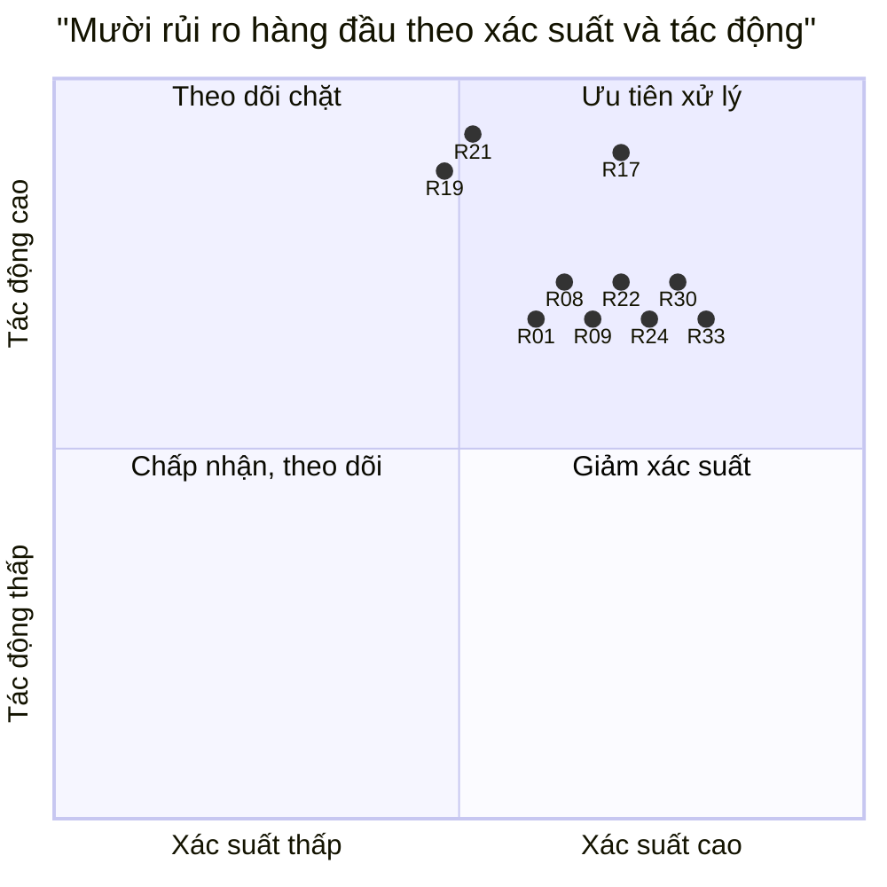

## 8. Kế hoạch quản lý rủi ro

**Tóm tắt cho hội đồng thẩm định.** Dự án quản lý rủi ro theo một sổ rủi ro duy nhất gồm 43 rủi ro (RSK-01 đến RSK-43), chia thành mười nhóm, mỗi rủi ro có chủ sở hữu, dấu hiệu sớm, biện pháp giảm thiểu và phương án dự phòng. Rủi ro được chấm theo thang xác suất và tác động 1 đến 5; mười rủi ro có điểm từ 15 trở lên được định lượng thêm bằng giá trị kỳ vọng theo người-tháng và triệu đồng. Ba rủi ro lớn nhất đều nằm ngoài kỹ thuật thuần túy: nhà cung cấp hệ cũ không hợp tác bàn giao dữ liệu và cấu hình (RSK-17), thủ tục phê duyệt kéo dài (RSK-01) và tài liệu hệ cũ không khớp hệ thống đang chạy (RSK-08). Giá trị kỳ vọng của mười rủi ro hàng đầu (không kể RSK-01 và RSK-33, vốn rơi ngoài nỗ lực của hợp đồng thực hiện) là khoảng 42 người-tháng trước giảm thiểu và khoảng 17 người-tháng sau giảm thiểu; cộng phần dự trù cho 33 rủi ro còn lại, kế hoạch đề xuất dự phòng rủi ro tối thiểu khoảng 28 người-tháng, tương đương 6% tổng nỗ lực 454,5 người-tháng. Sổ rủi ro được rà soát mỗi sprint và chốt lại tại mỗi cổng G0 đến G5.

### 8.1. Mục đích và phạm vi

Chương này quy định cách dự án nhận diện, đánh giá, ứng phó và theo dõi rủi ro trong suốt giai đoạn chuẩn bị đầu tư, 18 tháng thực hiện và 12 tháng bảo hành. Đây là nơi định nghĩa chính thức mã `RSK-nn` của toàn bộ bộ tài liệu. Báo cáo nghiên cứu khả thi D01-01 chỉ nêu các rủi ro cấp dự án và tham chiếu mã ở đây. Rủi ro kiến trúc đã được D03-01 §12 ghi với mã `RSK-A01` đến `RSK-A05`; khi một rủi ro dự án trùng chủ đề với rủi ro kiến trúc, sổ này dẫn chiếu mã RSK-A thay vì định nghĩa lại biện pháp kỹ thuật, và chỉ bổ sung các khía cạnh quản lý như nhân lực, kinh phí, thủ tục.

Phạm vi của sổ rủi ro bao gồm cả những rủi ro nằm ngoài quyền kiểm soát của nhà thầu, ví dụ thủ tục phê duyệt, thái độ của nhà cung cấp hệ cũ hoặc tiến độ của nền tảng quốc gia. Lý do là một kế hoạch chỉ quản lý rủi ro trong tầm tay nhà thầu sẽ bỏ sót đúng những nguyên nhân thường làm các dự án LGSP chậm nhất, vốn nằm ở phía cơ quan nhà nước và bên thứ ba. Với những rủi ro này, chủ sở hữu được giao cho đại diện chủ đầu tư hoặc đơn vị vận hành, còn nhà thầu có trách nhiệm phát hiện dấu hiệu sớm và báo cáo.

### 8.2. Phương pháp

#### 8.2.1. Nhận diện rủi ro

Danh sách ban đầu được lập từ bốn nguồn: các quyết định và hệ quả tiêu cực trong sổ ADR (D00-02), bảng rủi ro kiến trúc của D03-01, kết quả khảo sát hệ cũ (D00-03, D02-01) và kinh nghiệm thông thường của các dự án tích hợp, di trú ở khu vực công. Trong thực hiện, mọi thành viên dự án đều được quyền đề xuất rủi ro mới tại buổi rà soát sprint (sprint retrospective) hoặc trực tiếp vào công cụ quản lý công việc với nhãn `risk`. Scrum Master gom các đề xuất, Giám đốc dự án quyết định đưa vào sổ hay gộp với rủi ro đã có. Mã RSK đã cấp không bao giờ tái sử dụng; rủi ro không còn hiệu lực được đánh dấu "Đã đóng" kèm lý do, theo quy tắc mã truy vết của D00-01 §3.

Mỗi rủi ro được mô tả theo cấu trúc ba vế "nguyên nhân, sự kiện, hệ quả". Cấu trúc này buộc người viết tách điều kiện đang tồn tại (nguyên nhân) khỏi điều có thể xảy ra (sự kiện) và khỏi thiệt hại đối với mục tiêu dự án (hệ quả). Nhờ đó biện pháp giảm thiểu có thể nhắm vào nguyên nhân để hạ xác suất, còn phương án dự phòng nhắm vào hệ quả để hạ tác động.

#### 8.2.2. Thang đánh giá định tính

Xác suất (P) và tác động (I) được chấm theo thang 1 đến 5. Bảng dưới đây giải nghĩa từng mức để các người chấm khác nhau cho kết quả gần nhau. Với tác động, mức được lấy theo chiều nặng nhất trong bốn chiều: tiến độ, chi phí, phạm vi và chất lượng, an toàn thông tin.

| Mức | Xác suất (P) | Quy đổi định lượng | Tác động tiến độ | Tác động chi phí | Tác động phạm vi, chất lượng, ATTT |
|---|---|---|---|---|---|
| 1 | Rất thấp | 10% | Trễ dưới 1 sprint, không chạm cổng | Dưới 1 người-tháng | Ảnh hưởng không đáng kể, không ai ngoài đội nhận ra |
| 2 | Thấp | 30% | Trễ 1 đến 2 sprint trong wave | 1 đến 3 người-tháng | Một yêu cầu mức C bị bỏ hoặc lùi |
| 3 | Trung bình | 50% | Một cổng trễ dưới 1 tháng | 3 đến 8 người-tháng | Yêu cầu mức S bị lùi wave; lỗi chất lượng người dùng thấy được |
| 4 | Cao | 70% | Một cổng trễ 1 đến 2 tháng, hoặc mốc tắt hệ cũ bị đe dọa | 8 đến 20 người-tháng | Yêu cầu mức M bị lùi; KPI cam kết không đạt tại cổng |
| 5 | Rất cao | 90% | G5 trễ trên 2 tháng, phải điều chỉnh dự án | Trên 20 người-tháng hoặc vượt dự phòng | Sự cố lộ dữ liệu cá nhân, rò rỉ chéo tenant, gián đoạn dịch vụ công diện rộng |

Điểm rủi ro bằng P nhân I. Điểm từ 15 trở lên là mức **Cao**, từ 8 đến 14 là **Trung bình**, từ 6 trở xuống là **Thấp**. Có một ngoại lệ: rủi ro có I bằng 5 luôn được Ban quản lý dự án theo dõi trực tiếp bất kể điểm, vì một sự kiện như lộ dữ liệu cá nhân hay rò rỉ chéo tenant không thể bù lại bằng tiến độ hay kinh phí.

#### 8.2.3. Định lượng các rủi ro hàng đầu

Thang 1 đến 5 đủ để xếp thứ tự nhưng không đủ để tính dự phòng. Vì vậy các rủi ro mức Cao được định lượng thêm bằng giá trị kỳ vọng (expected monetary value, EMV): lấy xác suất quy đổi nhân với tác động ước tính bằng người-tháng, cộng chi phí ngoài nhân công bằng triệu đồng nếu có. Tác động được ước tính riêng cho từng rủi ro theo khối lượng làm thêm cụ thể, không suy ra máy móc từ mức I. Phép tính được làm hai lần, trước và sau giảm thiểu, để cho thấy giá trị của biện pháp giảm thiểu và để xác định khoản dự phòng cần giữ. Đơn giá dùng quy đổi là đơn giá bình quân tham khảo **40 triệu đồng/người-tháng (giá trị tham khảo)**; chương chi phí của D01-01 thay bằng đơn giá chính thức và các con số triệu đồng ở đây phải được nhân lại theo đó.

#### 8.2.4. Chiến lược ứng phó

Mỗi rủi ro được gán một trong bốn chiến lược ứng phó. **Tránh** (avoid) là thay đổi kế hoạch hoặc thiết kế để loại bỏ nguyên nhân, ví dụ giữ khác biệt giữa các tỉnh trong cấu hình thay vì trong nhánh mã (RSK-10). **Giảm** (mitigate) là hạ xác suất, tác động hoặc cả hai, và là chiến lược của phần lớn rủi ro. **Chuyển** (transfer) là chuyển hệ quả tài chính hoặc nghĩa vụ sang bên có năng lực xử lý tốt hơn, ví dụ bằng điều khoản bàn giao trong hợp đồng với nhà cung cấp hệ cũ (RSK-17) hoặc hợp đồng dịch vụ vận hành có cam kết mức dịch vụ (RSK-33). **Chấp nhận** (accept) áp dụng khi chi phí xử lý lớn hơn thiệt hại kỳ vọng; trong sổ này mọi trường hợp chấp nhận đều là "chấp nhận có kiểm soát", tức có dấu hiệu sớm được theo dõi và có phương án dự phòng sẵn.

Giảm thiểu là việc làm ngay, có chi phí nằm trong kế hoạch. Dự phòng là việc chỉ làm khi dấu hiệu sớm vượt ngưỡng hoặc rủi ro đã xảy ra, có chi phí lấy từ khoản dự phòng ở mục 8.5. Tách hai khái niệm này giúp ngân sách giảm thiểu không bị dùng cho xử lý sự cố, và ngược lại.

#### 8.2.5. Ngưỡng leo thang

Rủi ro được xử lý ở cấp thấp nhất có đủ thẩm quyền. Ngưỡng dưới đây quy định khi nào một rủi ro phải được đưa lên cấp cao hơn; các cấp leo thang và thời hạn phản hồi của từng cấp trình bày ở mục 12.5.

| Điều kiện | Cấp xử lý | Thời hạn báo cáo |
|---|---|---|
| Rủi ro mức Thấp, hoặc dấu hiệu sớm xuất hiện nhưng chưa vượt ngưỡng | Trưởng nhóm lane hoặc chủ sở hữu rủi ro | Cập nhật tại buổi rà soát sprint |
| Rủi ro mức Trung bình có dấu hiệu sớm vượt ngưỡng, hoặc ước tính tác động một sprint trở lên trên đường găng | Giám đốc dự án và Product Owner | Trong 2 ngày làm việc |
| Rủi ro mức Cao xảy ra hoặc sắp xảy ra; cần dùng dự phòng trên 2 người-tháng cho một sự kiện; một cổng có nguy cơ trễ trên 2 tuần | Ban quản lý dự án, đại diện chủ đầu tư | Trong 2 ngày làm việc, kèm đề xuất xử lý |
| Dự phòng rủi ro còn lại dưới 30%; một cổng có nguy cơ trễ trên 1 tháng; sự cố ATTT hoặc lộ dữ liệu cá nhân | Chủ đầu tư, Ban chỉ đạo | Ngay trong ngày với sự cố ATTT; 5 ngày làm việc với trường hợp khác |
| Ứng phó đòi hỏi thay đổi tổng mức đầu tư, mục tiêu hoặc thời gian thực hiện dự án | Người quyết định đầu tư, theo quy trình điều chỉnh dự án ở chương 11 | Theo Nghị định 224/2026/NĐ-CP và Luật Đầu tư công |

### 8.3. Vai trò và trách nhiệm

Quản lý rủi ro không phải việc riêng của Giám đốc dự án. Bảng dưới đây phân công theo các vai trò đã định nghĩa ở chương 5; mỗi rủi ro trong sổ có đúng một chủ sở hữu chịu trách nhiệm theo dõi dấu hiệu sớm và kích hoạt dự phòng.

| Vai trò | Trách nhiệm về rủi ro |
|---|---|
| Ban chỉ đạo | Quyết định xử lý rủi ro vượt thẩm quyền chủ đầu tư, đặc biệt các rủi ro liên quan nhiều sở, ngành (RSK-09) và sắp xếp tổ chức (RSK-06) |
| Chủ đầu tư và Ban quản lý dự án | Chịu trách nhiệm giải trình về sổ rủi ro cấp dự án; sở hữu rủi ro pháp lý, thủ tục, bên thứ ba phía nhà nước và tài chính; phê duyệt dùng dự phòng |
| Giám đốc dự án (nhà thầu) | Duy trì sổ rủi ro, chủ trì rà soát, báo cáo; sở hữu rủi ro nhân sự và tiến độ; đề xuất dùng dự phòng |
| Product Owner | Sở hữu rủi ro phạm vi và yêu cầu; dùng phạm vi mức C làm vùng đệm |
| Kiến trúc sư giải pháp | Sở hữu rủi ro kiến trúc, multi-tenant, công nghệ nguồn mở; liên kết với RSK-A của D03-01 |
| Trưởng nhóm tích hợp, nền tảng, dữ liệu, kiểm thử; kỹ sư ATTT | Sở hữu rủi ro kỹ thuật trong lane; theo dõi chỉ số dấu hiệu sớm tự động |
| Đơn vị vận hành | Sở hữu rủi ro năng lực vận hành và hệ cũ; tham gia diễn tập |
| Tư vấn giám sát | Đánh giá độc lập tính đầy đủ của sổ rủi ro tại mỗi cổng |

### 8.4. Chu kỳ rà soát

Sổ rủi ro được rà soát theo ba nhịp lồng nhau, mỗi nhịp có đầu ra cụ thể.

Ở **nhịp sprint** (2 tuần), trong buổi lập kế hoạch sprint, mỗi chủ sở hữu cập nhật trạng thái dấu hiệu sớm của các rủi ro thuộc wave hiện tại, và Giám đốc dự án cập nhật điểm. Các dấu hiệu sớm đo được bằng máy, như tỷ lệ kiểm thử bản native thất bại (RSK-11), tốc độ của lane tích hợp (RSK-30) hay kích thước yêu cầu gộp mã (RSK-28), được lấy tự động từ CI và công cụ quản lý công việc để không phụ thuộc vào trí nhớ. Biện pháp giảm thiểu được đưa vào backlog như các hạng mục công việc thông thường, có ước lượng và có tiêu chí hoàn thành, thay vì nằm ngoài sprint.

Ở **nhịp tháng**, báo cáo tháng gửi chủ đầu tư (chương 12) có một trang rủi ro gồm mười rủi ro hàng đầu, các thay đổi điểm, các rủi ro mới và số dư khoản dự phòng.

Ở **nhịp cổng**, trước mỗi cổng G0 đến G5, toàn bộ sổ được chấm lại, rủi ro của wave vừa kết thúc được đóng hoặc chuyển tiếp, và rủi ro của wave kế tiếp được làm mịn biện pháp. Biên bản cổng ghi phiên bản sổ rủi ro đã chốt, và sổ là một hạng mục của đường cơ sở tại cổng theo chương 10. Một số biện pháp giảm thiểu là điều kiện vào cổng, đáng chú ý là: G0 yêu cầu kết quả kiểm kê hệ cũ (RSK-08), thử native từng connector (RSK-11), kiểm chứng WORM (RSK-13) và rà soát vòng đời phiên bản (RSK-12); G2 yêu cầu bộ kiểm thử cách ly tenant xanh (RSK-36) và hồ sơ cấp độ đã nộp (RSK-26); G3 yêu cầu hai lần diễn tập DR đạt (RSK-34) và năng lực vận hành được đánh giá (RSK-33).

### 8.5. Dự phòng thời gian và chi phí

#### 8.5.1. Định lượng mười rủi ro hàng đầu

Bảng dưới đây định lượng mười rủi ro có điểm cao nhất. Cột tác động ghi khối lượng làm thêm nếu rủi ro xảy ra mà không có giảm thiểu, ước tính theo công việc cụ thể ghi ở cột cuối. Giá trị kỳ vọng bằng xác suất quy đổi nhân tác động. Hai rủi ro RSK-01 và RSK-33 được tách riêng vì tác động của chúng không nằm trong nỗ lực của hợp đồng thực hiện: RSK-01 làm lùi T0 trước khi nhà thầu được huy động, còn RSK-33 phát sinh chi phí vận hành sau G3 thuộc chi thường xuyên.

| Mã | P (quy đổi) | Tác động nếu xảy ra | Giá trị kỳ vọng trước giảm thiểu | P còn lại | Tác động còn lại | Giá trị kỳ vọng còn lại | Cơ sở ước tính tác động |
|---|---|---|---|---|---|---|---|
| RSK-17 | 70% | 14 người-tháng; trễ di trú 1,5 tháng | 9,8 người-tháng | 50% | 8 người-tháng | 4,0 người-tháng | Dựng lại cấu hình route, API, gói sử dụng từ nhật ký 90 ngày và quan sát lưu lượng; 2 kỹ sư tích hợp và 1 kỹ sư dữ liệu trong khoảng 4,5 tháng |
| RSK-08 | 70% | 10 người-tháng | 7,0 người-tháng | 50% | 6 người-tháng | 3,0 người-tháng | Bổ sung khoảng 5% chức năng chưa có trong ma trận LGC vào phạm vi W3, W4 |
| RSK-30 | 70% | 10 người-tháng | 7,0 người-tháng | 50% | 6 người-tháng | 3,0 người-tháng | Năng suất lane tích hợp đạt 70% trong W1, W2 (khoảng 7 người × 8 tháng × 30% thiếu hụt, làm tròn) |
| RSK-24 | 70% | 8 người-tháng và 300 triệu đồng thuê cloud tạm | 5,6 người-tháng và 210 triệu đồng | 50% | 4 người-tháng và 150 triệu đồng | 2,0 người-tháng và 75 triệu đồng | Đội thí điểm chờ hoặc làm trên PROD tạm 2 tháng, sau đó chuyển hạ tầng |
| RSK-09 | 70% | 6 người-tháng; song song kéo dài 2 tháng | 4,2 người-tháng | 50% | 4 người-tháng | 2,0 người-tháng | Giữ thêm 3 người của đội thí điểm trong 2 tháng để hỗ trợ các nhóm cắt chuyển muộn |
| RSK-22 | 70% | 6 người-tháng | 4,2 người-tháng | 50% | 3 người-tháng | 1,5 người-tháng | Sửa adapter PH-14 theo đặc tả mới và kiểm thử lại hồi quy |
| RSK-19 | 50% | 5 người-tháng; một nhóm dịch vụ trễ 1 tháng | 2,5 người-tháng | 30% | 3 người-tháng | 0,9 người-tháng | Quay lui, phân tích nguyên nhân, sửa và so sánh bóng lại một nhóm dịch vụ |
| RSK-21 | 50% | 4 người-tháng | 2,0 người-tháng | 30% | 3 người-tháng | 0,9 người-tháng | Tra soát giao dịch lệch, sửa và đối soát kép lại 30 ngày |
| **Cộng tám rủi ro trong hợp đồng** | | | **42,3 người-tháng và 210 triệu đồng** | | | **17,3 người-tháng và 75 triệu đồng** | |
| RSK-01 | 70% | T0 lùi 3 tháng | 2,1 tháng trễ T0 | 50% | 2 tháng | 1,0 tháng trễ T0 | Thêm một vòng giải trình thẩm định; tác động tiền là chi phí gia hạn bảo trì hệ cũ do chủ đầu tư điền |
| RSK-33 | 70% | 24 người-tháng dịch vụ vận hành thuê ngoài | 16,8 người-tháng | 50% | 12 người-tháng | 6,0 người-tháng | Thuê 2 kỹ sư vận hành trong 12 tháng sau G3; thuộc chi thường xuyên, không thuộc vốn đầu tư |

Kết quả cho thấy biện pháp giảm thiểu đưa giá trị kỳ vọng của tám rủi ro trong hợp đồng từ khoảng 42 người-tháng về khoảng 17 người-tháng. Quy đổi theo đơn giá tham khảo, đó là từ khoảng 1.902 triệu đồng về khoảng 767 triệu đồng. Phần lớn chênh lệch đến từ các việc rẻ làm sớm: kiểm kê hệ cũ ở W0, ký phụ lục bàn giao trước T0, tuyển và đào tạo kỹ sư Camel trước W1. Điều này cũng có nghĩa là nếu các biện pháp giảm thiểu không được làm đúng hạn, giá trị kỳ vọng gần như bằng toàn bộ khoản dự phòng 10% nỗ lực, và dự án sẽ không còn dư địa cho những rủi ro khác.

#### 8.5.2. Dự phòng chi phí

Khoản dự phòng rủi ro đề xuất gồm ba phần. Phần thứ nhất là giá trị kỳ vọng còn lại của tám rủi ro hàng đầu, khoảng 17,3 người-tháng và 75 triệu đồng. Phần thứ hai là dự trù cho 33 rủi ro còn lại, tính gọn bằng 0,3 người-tháng mỗi rủi ro, tức khoảng 10 người-tháng; cách tính gọn này chấp nhận được vì không rủi ro nào trong nhóm này có điểm còn lại trên 12. Tổng hai phần là khoảng **28 người-tháng và 75 triệu đồng, tương đương khoảng 1.195 triệu đồng theo đơn giá tham khảo**, bằng khoảng 6% tổng nỗ lực thực hiện. Phần thứ ba là dự phòng trượt giá theo giả định 4%/năm của giả định nền, do chương chi phí của D01-01 lập.

Khoản dự phòng rủi ro nằm trong chi phí dự phòng G(DP) của tổng mức đầu tư. Theo Thông tư 39/2026/TT-BKHCN, dự phòng tối đa 10% tổng mức đầu tư (7% trong dự toán), tính trên tổng các khoản chi phí không gồm chi phí thuê dịch vụ, và bao gồm cả trượt giá, khối lượng phát sinh và các khoản tạm tính (tóm tắt pháp lý của dự án, chưa đối chiếu Công báo). Như vậy 6% cho rủi ro cộng phần trượt giá phải nằm vừa trong trần 10%; nếu chương chi phí tính trượt giá vượt 4% thì phải thu hẹp phần rủi ro hoặc chấp nhận rủi ro còn lại cao hơn, và quyết định này thuộc chủ đầu tư. Việc dùng dự phòng theo ngưỡng ở mục 8.2.5: Giám đốc dự án đề xuất, Ban quản lý dự án phê duyệt từng lần dưới 2 người-tháng, chủ đầu tư phê duyệt lần lớn hơn, và mọi lần dùng được ghi vào nhật ký thay đổi của chương 11. Khoản dự phòng cho RSK-33 không nằm trong tổng mức đầu tư; chủ đầu tư cần dự trù trong kế hoạch chi thường xuyên của Năm 2 và Năm 3, đúng với lập luận của RSK-41.

#### 8.5.3. Dự phòng thời gian

Kế hoạch không có khoảng thời gian dự phòng nằm sau G5, vì thời gian thực hiện 18 tháng là ràng buộc gắn với hai năm ngân sách (chương 1 §1.6). Thay vào đó, dự phòng thời gian được bố trí ở bốn chỗ có chủ đích. Thứ nhất là phạm vi mức C và một phần mức S của mỗi wave, được Product Owner dùng làm vùng đệm: khi tiến độ trượt, Scrum giữ cố định ngày cổng và co phạm vi trước. Thứ hai là khoảng nổi của việc cắt chuyển: hệ cũ được phép chạy song song tới G5, nên một nhóm dịch vụ không cắt chuyển được ở W3 có thêm khoảng 5 tháng để cắt chuyển trước khi chạm mốc tắt hệ cũ (RSK-09, RSK-19, RSK-22). Thứ ba là điểm cắt chuyển thanh toán gắn với điều kiện 30 ngày ổn định chứ không gắn với ngày cố định, nên trễ ở PH-19 không kéo theo các phân hệ khác. Thứ tư là tiêu chí nghiệm thu nhân rộng ở G5 kiểm chứng được trên tenant thứ hai ở STAGING khi tỉnh thứ hai chưa sẵn sàng (RSK-39).

Với rủi ro xảy ra trước T0, kế hoạch dùng cách ghi mốc tương đối T0 cộng n tháng nên một lần T0 trượt không làm phải lập lại kế hoạch; tuy nhiên T0 trượt quá 2 tháng kích hoạt rà soát vòng đời phiên bản (RSK-12) và rà soát kế hoạch vốn năm (RSK-42).

### 8.6. Sổ rủi ro

Bảng tổng hợp dưới đây liệt kê toàn bộ 43 rủi ro theo mã để tra cứu nhanh; mô tả đầy đủ theo nhóm nằm ở các mục 8.6.1 đến 8.6.10. Cột "Điểm còn lại" là điểm dự kiến sau khi biện pháp giảm thiểu được thực hiện đúng hạn, dùng để theo dõi hiệu quả giảm thiểu qua các cổng. Cùng nội dung được xuất ở dạng bảng tính tại tệp `so-rui-ro.csv` đi kèm chương này để nhập vào công cụ quản lý công việc.

| Mã | Nhóm | Rủi ro | P | I | Điểm | Mức | Ứng phó | Chủ sở hữu | Wave | Điểm còn lại |
|---|---|---|---|---|---|---|---|---|---|---|
| RSK-01 | Pháp lý, thủ tục đầu tư | Chậm thẩm định, phê duyệt Báo cáo nghiên cứu khả thi và thiết kế chi tiết | 4 | 4 | 16 | Cao | Giảm | Đại diện chủ đầu tư | Trước T0, W0 | 12 |
| RSK-02 | Pháp lý, thủ tục đầu tư | Hướng dẫn thi hành Nghị định 224/2026/NĐ-CP chưa đầy đủ hoặc tiếp tục thay đổi | 4 | 3 | 12 | Trung bình | Giảm | Đại diện chủ đầu tư | Trước T0 | 6 |
| RSK-03 | Pháp lý, thủ tục đầu tư | Lựa chọn nhà thầu kéo dài hoặc không chọn được nhà thầu đủ năng lực | 3 | 4 | 12 | Trung bình | Giảm | Đại diện chủ đầu tư | Trước T0 | 8 |
| RSK-04 | Pháp lý, thủ tục đầu tư | Thay đổi pháp luật về dữ liệu và bảo vệ dữ liệu cá nhân trong thời gian thực hiện | 3 | 3 | 9 | Trung bình | Giảm | Product Owner | W2, W4 | 6 |
| RSK-05 | Pháp lý, thủ tục đầu tư | Khung Kiến trúc tổng thể quốc gia số ban hành khác dự thảo hoặc phát sinh trùng lặp với nền tảng dùng chung quốc gia | 3 | 4 | 12 | Trung bình | Giảm | Kiến trúc sư giải pháp | W0, W2, W5 | 9 |
| RSK-06 | Pháp lý, thủ tục đầu tư | Sắp xếp tổ chức hành chính làm đổi chủ đầu tư, đơn vị vận hành hoặc đầu mối các sở, ngành | 3 | 4 | 12 | Trung bình | Chấp nhận có kiểm soát | Đại diện chủ đầu tư | Mọi wave | 9 |
| RSK-07 | Phạm vi | Phình phạm vi trong quá trình làm rõ yêu cầu của 20 phân hệ | 4 | 3 | 12 | Trung bình | Giảm | Product Owner | W1, W2, W4 | 9 |
| RSK-08 | Phạm vi | Tài liệu hệ cũ không phản ánh đúng hệ thống đang chạy | 4 | 4 | 16 | Cao | Giảm | Product Owner | W0, W1, W3 | 9 |
| RSK-09 | Phạm vi | Các sở, ngành chậm chuyển đổi kết nối và chậm phối hợp kiểm thử | 4 | 4 | 16 | Cao | Giảm | Đại diện chủ đầu tư | W3, W4, W5 | 12 |
| RSK-10 | Phạm vi | Yêu cầu tùy biến riêng theo tỉnh phá vỡ mô hình một bản mã nguồn | 3 | 4 | 12 | Trung bình | Tránh | Kiến trúc sư giải pháp | W4, W5, sau G5 | 8 |
| RSK-11 | Kỹ thuật | Biên dịch GraalVM native lỗi với một số connector Camel | 4 | 3 | 12 | Trung bình | Giảm | Trưởng nhóm tích hợp | W0, W1, W2 | 6 |
| RSK-12 | Kỹ thuật | Phiên bản nền hết vòng đời hỗ trợ hoặc chưa được khóa trước khi lập trình | 4 | 3 | 12 | Trung bình | Giảm | Kiến trúc sư giải pháp | W0 | 6 |
| RSK-13 | Kỹ thuật | Lưu trữ đối tượng không đáp ứng yêu cầu ghi một lần, không sửa xóa cho nhật ký kiểm toán | 3 | 4 | 12 | Trung bình | Giảm | Trưởng nhóm nền tảng | W0, W2 | 6 |
| RSK-14 | Kỹ thuật | Thành phần nguồn mở đổi giấy phép hoặc ngừng bảo trì | 3 | 3 | 9 | Trung bình | Giảm | Kiến trúc sư giải pháp | Mọi wave, vận hành | 6 |
| RSK-15 | Kỹ thuật | Hiệu năng không đạt chỉ tiêu của cỡ M trên chuỗi xử lý nhiều lớp | 3 | 4 | 12 | Trung bình | Giảm | Kiến trúc sư giải pháp | W1, W2 | 6 |
| RSK-16 | Kỹ thuật | Trình thiết kế luồng tích hợp vượt ước tính nỗ lực | 3 | 3 | 9 | Trung bình | Giảm | Trưởng nhóm tích hợp | W1, W2 | 6 |
| RSK-17 | Dữ liệu và di trú | Nhà cung cấp hệ cũ không hợp tác trích xuất dữ liệu và cấu hình | 4 | 5 | 20 | Cao | Giảm và chuyển | Đại diện chủ đầu tư | W0, W2, W3, W4 | 12 |
| RSK-18 | Dữ liệu và di trú | Dữ liệu danh mục dùng chung của hệ cũ không sạch | 4 | 3 | 12 | Trung bình | Giảm | Trưởng nhóm dữ liệu và di trú | W2, W3 | 6 |
| RSK-19 | Dữ liệu và di trú | Sai lệch hành vi hoặc gián đoạn dịch vụ khi chạy song song và cắt chuyển | 3 | 5 | 15 | Cao | Giảm | Giám đốc dự án | W3, W4 | 8 |
| RSK-20 | Dữ liệu và di trú | Di trú lịch sử giao dịch và cấu hình đăng ký nhận không đầy đủ | 3 | 3 | 9 | Trung bình | Giảm | Trưởng nhóm dữ liệu và di trú | W3, W4 | 6 |
| RSK-21 | Dữ liệu và di trú | Lệch đối soát với PayGov khi cắt chuyển thanh toán | 3 | 5 | 15 | Cao | Giảm | Product Owner | W4 | 8 |
| RSK-22 | Nhà cung cấp, bên thứ ba | NDXP thay đổi đặc tả hoặc chậm cấp môi trường kết nối thử | 4 | 4 | 16 | Cao | Giảm | Trưởng nhóm tích hợp | W2, W3, W5 | 9 |
| RSK-23 | Nhà cung cấp, bên thứ ba | Cloud chính phủ chưa đạt tiêu chí kỹ thuật và an toàn thông tin | 3 | 4 | 12 | Trung bình | Tránh | Trưởng nhóm nền tảng | Trước T0, W0, W3 | 6 |
| RSK-24 | Nhà cung cấp, bên thứ ba | Hạ tầng PROD và DR bàn giao chậm so với lịch thí điểm | 4 | 4 | 16 | Cao | Giảm | Đại diện chủ đầu tư | W2, W3 | 9 |
| RSK-25 | Nhà cung cấp, bên thứ ba | Phụ thuộc dịch vụ AI bên ngoài cho việc viết mã | 2 | 3 | 6 | Thấp | Chấp nhận có kiểm soát | Giám đốc dự án | W0 đến W5 | 4 |
| RSK-26 | An toàn thông tin | Hồ sơ đề xuất cấp độ 3 được phê duyệt chậm hoặc kiểm thử an toàn phát hiện lỗi nghiêm trọng | 3 | 4 | 12 | Trung bình | Giảm | Kỹ sư ATTT | W2, W3 | 8 |
| RSK-27 | An toàn thông tin | Lộ dữ liệu cá nhân trong quá trình di trú và trên môi trường thử | 2 | 5 | 10 | Trung bình | Tránh | Kỹ sư ATTT | W2, W3, W4 | 5 |
| RSK-28 | An toàn thông tin | AI agent sinh mã kém chất lượng, chứa lỗ hổng hoặc làm rò rỉ mã nguồn và bí mật | 3 | 4 | 12 | Trung bình | Giảm | Kiến trúc sư giải pháp | W0 đến W5 | 6 |
| RSK-29 | An toàn thông tin | Lỗ hổng nghiêm trọng trong chuỗi cung ứng phần mềm | 3 | 3 | 9 | Trung bình | Giảm | Kỹ sư ATTT | Mọi wave, vận hành | 6 |
| RSK-30 | Nhân sự | Thiếu kỹ sư tích hợp có kinh nghiệm Camel và Quarkus native | 4 | 4 | 16 | Cao | Giảm | Giám đốc dự án | W1, W2, W3 | 9 |
| RSK-31 | Nhân sự | Biến động nhân sự chủ chốt | 3 | 4 | 12 | Trung bình | Giảm | Giám đốc dự án | Mọi wave | 9 |
| RSK-32 | Nhân sự | Cán bộ phía chủ đầu tư kiêm nhiệm, không đủ thời gian cho dự án | 4 | 3 | 12 | Trung bình | Giảm | Đại diện chủ đầu tư | Mọi wave | 9 |
| RSK-33 | Vận hành | Năng lực vận hành Kubernetes tại tỉnh chưa đáp ứng | 4 | 4 | 16 | Cao | Giảm và chuyển | Đơn vị vận hành | W3, W5, bảo hành | 9 |
| RSK-34 | Vận hành | Khôi phục sau thảm họa không đạt RPO và RTO | 3 | 4 | 12 | Trung bình | Giảm | Trưởng nhóm nền tảng | W3, bảo hành | 8 |
| RSK-35 | Vận hành | Hệ cũ suy giảm hoặc hết hỗ trợ trước khi được tắt | 3 | 4 | 12 | Trung bình | Giảm | Đơn vị vận hành | W1 đến W5 | 8 |
| RSK-36 | Multi-tenant | Rò rỉ dữ liệu chéo tenant | 2 | 5 | 10 | Trung bình | Tránh | Kiến trúc sư giải pháp | W1, W2, W5 | 5 |
| RSK-37 | Multi-tenant | Nâng cấp đồng loạt gây sự cố ở nhiều tỉnh hoặc phiên bản giữa các tenant lệch nhau | 3 | 4 | 12 | Trung bình | Giảm | Trưởng nhóm nền tảng | W5, vận hành | 8 |
| RSK-38 | Multi-tenant | Mô hình cách ly tenant đã chọn phải đổi sau khi lập trình | 2 | 4 | 8 | Trung bình | Tránh | Kiến trúc sư giải pháp | W0, W1 | 3 |
| RSK-39 | Multi-tenant | Tỉnh thứ hai chưa sẵn sàng hoặc chưa có cơ chế pháp lý cho việc nhân rộng | 4 | 3 | 12 | Trung bình | Giảm | Đại diện chủ đầu tư | W5 | 9 |
| RSK-40 | Tài chính | Biến động đơn giá nhân công, giá hạ tầng và định mức | 3 | 3 | 9 | Trung bình | Chấp nhận có kiểm soát | Đại diện chủ đầu tư | Trước T0, mọi wave | 6 |
| RSK-41 | Tài chính | Không bố trí được kinh phí vận hành sau khi kết thúc dự án | 3 | 4 | 12 | Trung bình | Giảm | Đại diện chủ đầu tư | W5, bảo hành, vận hành | 8 |
| RSK-42 | Tài chính | Kế hoạch vốn năm lệch tiến độ và thanh toán theo cổng bị chậm | 3 | 3 | 9 | Trung bình | Giảm | Đại diện chủ đầu tư | W1 đến W5 | 6 |
| RSK-43 | Kỹ thuật | Giao diện phong cách Liquid Glass chậm trên máy trạm cấu hình thấp của cơ quan nhà nước | 3 | 2 | 6 | Thấp | Giảm | Trưởng nhóm frontend | W1, W2 | 4 |

#### 8.6.1. Nhóm pháp lý, thủ tục đầu tư

**RSK-01. Chậm thẩm định, phê duyệt Báo cáo nghiên cứu khả thi và thiết kế chi tiết.** *P = 4, I = 4, điểm 16 (cao); ứng phó: giảm; chủ sở hữu: Đại diện chủ đầu tư; wave: Trước T0, W0; điểm còn lại sau giảm thiểu: 12.*

Văn bản quản lý đầu tư ứng dụng CNTT thay đổi liên tiếp trong năm 2026 nên cơ quan thẩm định và chủ đầu tư đều chưa có tiền lệ áp dụng khung mới cho một sản phẩm multi-tenant xây trên mã nguồn mở. Hồ sơ có thể bị yêu cầu giải trình, bổ sung nhiều vòng, khiến bước phê duyệt dự án và phê duyệt thiết kế chi tiết vượt các mốc T0 − 3 tháng và T0 − 2 tháng của lịch chuẩn bị đầu tư. Hệ quả là T0 lùi, toàn bộ lịch 18 tháng trượt theo và một số phiên bản nền đã ghim hết vòng đời hỗ trợ trước khi lập trình bắt đầu. Dấu hiệu sớm là văn bản góp ý thẩm định vòng đầu có trên 20 ý kiến, hoặc quá 15 ngày làm việc kể từ ngày nộp hồ sơ mà chưa có lịch họp hội đồng.

Giảm thiểu: Chủ đầu tư tổ chức một buổi thẩm định sơ bộ không chính thức trước khi nộp, dùng phần tóm tắt cho hội đồng thẩm định ở đầu mỗi chương để giảm số vòng hỏi đáp, và lập bảng đối chiếu từng nội dung bắt buộc của Điều 45 Nghị định 224/2026/NĐ-CP và khoản 2 Điều 47 Luật Đầu tư công với mục tương ứng trong D01-01. Toàn bộ kế hoạch ghi mốc theo dạng T0 cộng số tháng để việc trượt T0 không làm phải viết lại kế hoạch. Dự phòng: Nếu T0 trượt quá 2 tháng, Giám đốc dự án lập lại lịch tham chiếu, rà soát lại vòng đời phiên bản theo RSK-12 và trình chủ đầu tư xác nhận lịch mới trước khi ký hợp đồng.

**RSK-02. Hướng dẫn thi hành Nghị định 224/2026/NĐ-CP chưa đầy đủ hoặc tiếp tục thay đổi.** *P = 4, I = 3, điểm 12 (trung bình); ứng phó: giảm; chủ sở hữu: Đại diện chủ đầu tư; wave: Trước T0; điểm còn lại sau giảm thiểu: 6.*

Khung pháp lý về đầu tư cho chuyển đổi số đổi hai lần trong năm 2026: Nghị định 45/2026/NĐ-CP thay Nghị định 73/2019/NĐ-CP, rồi chính nó bị Nghị định 224/2026/NĐ-CP hướng dẫn Luật Chuyển đổi số thay thế từ 01/7/2026, kèm Thông tư 39/2026/TT-BKHCN về chi phí và Thông tư 41/2026/TT-BKHCN về triển khai, giám sát, kiểm thử, nghiệm thu. Một số điều khoản như ngưỡng thiết kế một bước, nội dung nghiệm thu và tình trạng hướng dẫn xác định chi phí phần mềm nội bộ chưa được đối chiếu với Công báo, và cơ quan thẩm định chưa có tiền lệ áp dụng. Hồ sơ lập theo một cách hiểu có thể không khớp hướng dẫn ban hành sau, dẫn tới phải lập lại dự toán, đổi tên các bước hoặc đổi cấu trúc thuyết minh. Dấu hiệu sớm là cơ quan thẩm định yêu cầu áp dụng mẫu biểu chưa có trong hồ sơ, hoặc có dự thảo thông tư hướng dẫn được đăng lấy ý kiến trong giai đoạn chuẩn bị đầu tư từ T0 − 7 đến T0 − 2 tháng.

Giảm thiểu: Đơn vị tư vấn theo dõi cổng văn bản của Chính phủ và của Bộ Khoa học và Công nghệ mỗi hai tuần, giữ dự toán ở dạng bảng tính có tham số để đổi định mức mà không phải tính lại thủ công, và ghi rõ trong hồ sơ những điểm áp dụng theo nguyên tắc chuyển tiếp. Dự phòng: Nếu mẫu biểu mới được ban hành sau khi nộp hồ sơ, đơn vị tư vấn chuyển đổi hồ sơ sang mẫu mới trong vòng 10 ngày làm việc bằng nguồn nhân lực lập Báo cáo nghiên cứu khả thi.

**RSK-03. Lựa chọn nhà thầu kéo dài hoặc không chọn được nhà thầu đủ năng lực.** *P = 3, I = 4, điểm 12 (trung bình); ứng phó: giảm; chủ sở hữu: Đại diện chủ đầu tư; wave: Trước T0; điểm còn lại sau giảm thiểu: 8.*

Gói thầu đòi hỏi đồng thời năng lực Camel Quarkus, Kubernetes, Kafka và kinh nghiệm di trú hệ thống tích hợp đang vận hành, trong khi số nhà thầu trong nước đáp ứng đủ là ít. Quá trình lựa chọn có thể phải gia hạn, xử lý kiến nghị hoặc tổ chức lại. Hệ quả là T0 lùi từ 1 đến 3 tháng, hoặc nhà thầu trúng thầu thiếu nhân sự đúng chuyên môn và rủi ro RSK-30 tăng theo. Dấu hiệu sớm là số nhà thầu mua hoặc tải hồ sơ mời thầu dưới 3, hoặc có trên 10 câu hỏi làm rõ về tiêu chí nhân sự chủ chốt.

Giảm thiểu: Chủ đầu tư khảo sát thị trường trước khi phát hành hồ sơ, đặt tiêu chí nhân sự theo năng lực chứng minh được thay vì theo chứng chỉ của một hãng, cho phép liên danh, và công bố sớm bộ tài liệu D02 đến D03 để nhà thầu ước lượng đúng khối lượng. Dự phòng: Nếu phải tổ chức lại việc lựa chọn nhà thầu, chủ đầu tư dùng thời gian chờ để hoàn tất khảo sát hiện trạng hệ cũ và thỏa thuận bàn giao với nhà cung cấp hệ cũ theo RSK-17, nhằm thu hồi một phần thời gian đã mất.

**RSK-04. Thay đổi pháp luật về dữ liệu và bảo vệ dữ liệu cá nhân trong thời gian thực hiện.** *P = 3, I = 3, điểm 9 (trung bình); ứng phó: giảm; chủ sở hữu: Product Owner; wave: W2, W4; điểm còn lại sau giảm thiểu: 6.*

Luật Dữ liệu (CMP-LAW-01), Luật Bảo vệ dữ liệu cá nhân (CMP-LAW-05) và các nghị định hướng dẫn còn đang được hoàn thiện, một số văn bản trong D00-01 vẫn ở trạng thái cần xác minh. Trong 18 tháng thực hiện có thể xuất hiện quy định mới về phân loại dữ liệu, đánh giá tác động xử lý dữ liệu cá nhân hoặc điều kiện chia sẻ dữ liệu. Hệ quả là yêu cầu của PH-09, PH-06 và PH-07 phải sửa sau khi đã đặc tả, phát sinh khối lượng làm lại. Dấu hiệu sớm là có dự thảo nghị định hoặc thông tư liên quan được đăng lấy ý kiến, hoặc cơ quan chuyên trách của tỉnh nhận văn bản hướng dẫn mới.

Giảm thiểu: Các quy tắc phụ thuộc pháp luật như thời hạn lưu trữ, mức phân loại, điều kiện che giấu dữ liệu được thiết kế thành cấu hình và chính sách OPA thay vì viết cứng trong mã. Product Owner rà soát danh mục CMP-LAW tại mỗi cổng và ghi kết quả vào biên bản cổng. Dự phòng: Nếu có quy định mới làm đổi yêu cầu đã duyệt, thay đổi được xử lý theo quy trình ở chương 11 và ưu tiên đưa vào W4, nơi PH-09 được phát triển.

**RSK-05. Khung Kiến trúc tổng thể quốc gia số ban hành khác dự thảo hoặc phát sinh trùng lặp với nền tảng dùng chung quốc gia.** *P = 3, I = 4, điểm 12 (trung bình); ứng phó: giảm; chủ sở hữu: Kiến trúc sư giải pháp; wave: W0, W2, W5; điểm còn lại sau giảm thiểu: 9.*

Khung Kiến trúc tổng thể quốc gia số (CMP-LAW-11) còn là dự thảo, đặc tả của NDOP và từ điển dữ liệu dùng chung quốc gia chưa công bố chi tiết. Bản chính thức có thể đặt thêm yêu cầu thẩm định tuân thủ kiến trúc hoặc quy định một năng lực phải dùng nền tảng quốc gia thay vì tự xây. Hệ quả là một phần PH-14, PH-16 và PH-17 phải thiết kế lại, hoặc hội đồng thẩm định đặt câu hỏi về trùng lặp đầu tư. Dấu hiệu sớm là bản chính thức của khung kiến trúc được ban hành, hoặc cơ quan trung ương công bố nền tảng dùng chung mới có chức năng trùng với một phân hệ của Datahub.

Giảm thiểu: Kiến trúc sư duy trì bảng thuyết minh cho từng phân hệ về lý do tự xây hay dùng chung quốc gia, giữ các phân hệ chịu ảnh hưởng nhiều nhất ở Đợt 3 để có thời gian chờ văn bản, và thiết kế lớp ánh xạ dữ liệu bằng cấu hình ngoài. Dự phòng: Nếu một năng lực bị yêu cầu chuyển sang dùng nền tảng quốc gia, phân hệ tương ứng được thu hẹp thành adapter kết nối và phần nỗ lực dôi ra được chuyển cho hạng mục khác qua quy trình thay đổi.

**RSK-06. Sắp xếp tổ chức hành chính làm đổi chủ đầu tư, đơn vị vận hành hoặc đầu mối các sở, ngành.** *P = 3, I = 4, điểm 12 (trung bình); ứng phó: chấp nhận có kiểm soát; chủ sở hữu: Đại diện chủ đầu tư; wave: Mọi wave; điểm còn lại sau giảm thiểu: 9.*

Mô hình chính quyền hai cấp và việc hợp nhất các cơ quan chuyên môn vẫn đang được ổn định, tỉnh thí điểm có thể tiếp tục điều chỉnh chức năng giữa các sở và trung tâm. Trong thời gian dự án có thể xảy ra việc đổi chủ đầu tư, đổi đơn vị vận hành hoặc đổi cơ quan chủ quản của một số hệ thống thông tin. Hệ quả là người ra quyết định thay đổi, các thỏa thuận kết nối phải ký lại và danh mục đơn vị hành chính, danh sách hệ thống kết nối phải cập nhật. Dấu hiệu sớm là có đề án sắp xếp tổ chức của tỉnh được trình, hoặc đầu mối của một sở vắng mặt hai kỳ họp liên tiếp.

Giảm thiểu: Mọi quyết định của dự án được ghi nhận bằng biên bản và lưu trong kho tài liệu dự án để người kế nhiệm tiếp nhận được. Danh mục đơn vị hành chính trong PH-07 hỗ trợ lịch sử hiệu lực, và mã tenant tách khỏi tên tổ chức. Dự phòng: Nếu chủ đầu tư thay đổi, Giám đốc dự án tổ chức phiên bàn giao trong 10 ngày làm việc gồm trạng thái các cổng, sổ rủi ro và nhật ký thay đổi, sau đó xác nhận lại thành phần Hội đồng kiểm soát thay đổi.

#### 8.6.2. Nhóm phạm vi

**RSK-07. Phình phạm vi trong quá trình làm rõ yêu cầu của 20 phân hệ.** *P = 4, I = 3, điểm 12 (trung bình); ứng phó: giảm; chủ sở hữu: Product Owner; wave: W1, W2, W4; điểm còn lại sau giảm thiểu: 9.*

Phạm vi gồm 20 phân hệ và cam kết phủ đủ nghiệp vụ hệ cũ, trong khi nhiều bên liên quan cùng đưa yêu cầu. Trong các buổi làm mịn backlog có thể liên tục xuất hiện yêu cầu mới được trình bày như một phần hiển nhiên của phân hệ. Hệ quả là khối lượng của wave vượt năng lực đội, các yêu cầu mức M bị dồn về cuối wave và cổng nghiệm thu bị đe dọa. Dấu hiệu sớm là tổng điểm backlog của wave tăng quá 10% so với đường cơ sở tại cổng trước, hoặc tỷ lệ story thêm mới trong sprint vượt 15%.

Giảm thiểu: Đường cơ sở phạm vi được chốt tại mỗi cổng theo chương 10, mọi yêu cầu mới phải đi qua phân loại thay đổi ở chương 11, và Product Owner áp dụng nguyên tắc đổi chỗ tương đương điểm. Các yêu cầu mức C được dùng làm vùng đệm phạm vi. Dự phòng: Nếu tổng điểm vẫn vượt, Hội đồng kiểm soát thay đổi quyết định lùi các yêu cầu mức S và C sang wave sau, không lùi ngày cổng.

**RSK-08. Tài liệu hệ cũ không phản ánh đúng hệ thống đang chạy.** *P = 4, I = 4, điểm 16 (cao); ứng phó: giảm; chủ sở hữu: Product Owner; wave: W0, W1, W3; điểm còn lại sau giảm thiểu: 9.*

Bộ tài liệu hệ cũ được lập từ năm 2021, trong khi hệ thống đã qua nhiều năm vận hành và chỉnh sửa. Khi khảo sát chi tiết có thể phát hiện các route, API, danh mục hoặc quy tắc đối soát đang chạy thật nhưng không có trong tài liệu, hoặc ngược lại. Hệ quả là ma trận truy vết LGC thiếu dòng, yêu cầu bị phát hiện muộn ở giai đoạn chạy song song và việc cắt chuyển một số nhóm dịch vụ phải hoãn. Dấu hiệu sớm là kết quả đối chiếu nhật ký truy cập của hệ cũ với danh sách chức năng LGC cho thấy trên 5% lưu lượng đi qua đường dẫn không có trong tài liệu.

Giảm thiểu: Ngay trong W0, đội dự án kiểm kê hệ cũ bằng dữ liệu thật gồm cấu hình route đang triển khai, danh sách API và gói sử dụng trên API Management, thống kê lưu lượng 90 ngày. Kết quả kiểm kê là đầu vào bắt buộc của cổng G0 và được cập nhật vào D00-03. Dự phòng: Nếu phát hiện chức năng chưa có trong phạm vi sau G1, chức năng đó được đánh giá theo quy trình thay đổi và trong lúc chờ vẫn tiếp tục chạy trên hệ cũ nhờ mô hình strangler.

**RSK-09. Các sở, ngành chậm chuyển đổi kết nối và chậm phối hợp kiểm thử.** *P = 4, I = 4, điểm 16 (cao); ứng phó: giảm; chủ sở hữu: Đại diện chủ đầu tư; wave: W3, W4, W5; điểm còn lại sau giảm thiểu: 12.*

Việc cắt chuyển phụ thuộc vào các đơn vị chủ quản hệ thống thông tin, vốn có nhà thầu riêng, lịch riêng và không chịu ràng buộc của hợp đồng Datahub. Một số đơn vị có thể không kịp đổi địa chỉ kết nối, đổi cơ chế xác thực hoặc không bố trí người kiểm thử. Hệ quả là các nhóm dịch vụ không cắt chuyển được theo lịch W3, hệ cũ phải chạy song song lâu hơn và mốc tắt hệ cũ tại G5 bị đe dọa. Dấu hiệu sớm là sau 4 tuần kể từ khi phát hành kế hoạch cắt chuyển vẫn còn trên 20% hệ thống thuộc nhóm đầu chưa xác nhận lịch.

Giảm thiểu: Thiết kế giữ nguyên địa chỉ và hợp đồng giao tiếp phía hệ thống kết nối ở mức tối đa bằng lớp tương thích tại cổng API, để phần lớn hệ thống không phải sửa mã. Chủ đầu tư ban hành văn bản của UBND tỉnh giao trách nhiệm và thời hạn cho từng sở, ngành, và kế hoạch cắt chuyển chia theo nhóm với nhóm đầu là các đơn vị sẵn sàng nhất. Dự phòng: Nếu một nhóm không sẵn sàng, nhóm đó được chuyển sang đợt cắt chuyển sau trong khoảng từ G3 đến G5, và danh sách tồn được báo cáo Ban chỉ đạo hằng tháng.

**RSK-10. Yêu cầu tùy biến riêng theo tỉnh phá vỡ mô hình một bản mã nguồn.** *P = 3, I = 4, điểm 12 (trung bình); ứng phó: tránh; chủ sở hữu: Kiến trúc sư giải pháp; wave: W4, W5, sau G5; điểm còn lại sau giảm thiểu: 8.*

Tỉnh thứ hai và các tỉnh sau có quy trình, danh mục và hệ thống kết nối khác tỉnh thí điểm. Các tỉnh có thể yêu cầu sửa mã riêng thay vì cấu hình. Nếu chấp nhận, sản phẩm tách thành nhiều nhánh mã theo tỉnh, chi phí bảo trì tăng theo số tỉnh và lợi ích của mô hình multi-tenant không còn. Dấu hiệu sớm là xuất hiện yêu cầu thay đổi có ghi chú chỉ áp dụng cho một tỉnh mà không biểu diễn được bằng cấu hình tenant hoặc bật tắt tính năng.

Giảm thiểu: Nguyên tắc sản phẩm được ghi vào hợp đồng và vào chương 10: khác biệt giữa các tỉnh chỉ nằm ở cấu hình tenant, lớp phủ Kustomize, luồng tích hợp và adapter riêng, không nằm ở nhánh mã. Mỗi yêu cầu đặc thù được Kiến trúc sư đánh giá để tổng quát hóa thành tham số trước khi nhận. Dự phòng: Nếu một yêu cầu không thể tổng quát hóa, yêu cầu đó được hiện thực thành phần mở rộng ngoài lõi như luồng Camel hoặc adapter riêng của tenant, có chủ sở hữu và chi phí riêng.

#### 8.6.3. Nhóm kỹ thuật

**RSK-11. Biên dịch GraalVM native lỗi với một số connector Camel.** *P = 4, I = 3, điểm 12 (trung bình); ứng phó: giảm; chủ sở hữu: Trưởng nhóm tích hợp; wave: W0, W1, W2; điểm còn lại sau giảm thiểu: 6.* Liên quan RSK-A02 (D03-01 §12).

ADR-002 chọn Camel Quarkus biên dịch native cho môi trường PROD, nhưng bản GraalVM khớp với Camel Quarkus chưa được khóa và môi trường DEV, CI hiện chạy chế độ JVM; đây cũng là rủi ro kiến trúc RSK-A02 của D03-01. Một số connector mà hệ cũ đang dùng như SOAP, trình điều khiển cơ sở dữ liệu thương mại, FTP hoặc hàng đợi có thể lỗi khi biên dịch native hoặc chỉ lỗi lúc chạy do cơ chế reflection. Hệ quả là luồng chạy đúng ở DEV nhưng hỏng ở TEST và PROD, đội tích hợp mất thời gian xử lý từng connector. Dấu hiệu sớm là tỷ lệ kiểm thử luồng trên bản native thất bại cao hơn bản JVM, hoặc thời gian biên dịch native trên CI vượt 15 phút cho một đơn vị triển khai.

Giảm thiểu: Trong W0, đội tích hợp lập danh sách connector lấy từ kết quả kiểm kê hệ cũ và chạy thử từng connector trên bản native, kết quả là điều kiện của cổng G0. Pipeline chạy kiểm thử luồng trên bản native ở môi trường TEST cho mọi thay đổi trong thư mục luồng, và chỉ dùng các thành phần được Camel Quarkus hỗ trợ native chính thức. Dự phòng: Nếu một connector không chạy được ở chế độ native, đơn vị triển khai chứa connector đó được phát hành trong nhóm `dh-runtime` chế độ JVM như biện pháp của RSK-A02, có ghi nhận ngoại lệ trong sổ ADR, chấp nhận tốn thêm bộ nhớ.

**RSK-12. Phiên bản nền hết vòng đời hỗ trợ hoặc chưa được khóa trước khi lập trình.** *P = 4, I = 3, điểm 12 (trung bình); ứng phó: giảm; chủ sở hữu: Kiến trúc sư giải pháp; wave: W0; điểm còn lại sau giảm thiểu: 6.*

Bảng ghim phiên bản của repo cho thấy dòng Apache Camel LTS đang ghim có thời hạn hỗ trợ ngắn hơn giai đoạn thực hiện 18 tháng, đồng thời phiên bản CloudNativePG, Strimzi và GraalVM trên cụm đích đều chưa khóa. Khi dự án khởi động, đội có thể phải nâng dòng LTS của Camel và chọn lại phiên bản PostgreSQL, Kafka. Hệ quả là mã khung đã có phải kiểm thử lại, và nếu bỏ sót thì hệ thống vào PROD với thành phần không còn bản vá, không qua được hồ sơ cấp độ. Dấu hiệu sớm là lần rà soát vòng đời phiên bản tại W0 cho thấy có thành phần còn dưới 12 tháng hỗ trợ tính đến G3.

Giảm thiểu: Việc rà soát vòng đời phiên bản theo chính sách vòng đời của D03-01 là hạng mục bắt buộc của W0 và của mỗi cổng. Bảng ghim phiên bản là một hạng mục cấu hình được kiểm soát theo chương 10, và công cụ tự động đề xuất nâng phiên bản được bật cho kho mã. Dự phòng: Nếu một thành phần hết hỗ trợ giữa dự án, việc nâng cấp được lập thành hạng mục kỹ thuật ưu tiên trong sprint ổn định gần nhất, dùng dự phòng rủi ro.

**RSK-13. Lưu trữ đối tượng không đáp ứng yêu cầu ghi một lần, không sửa xóa cho nhật ký kiểm toán.** *P = 3, I = 4, điểm 12 (trung bình); ứng phó: giảm; chủ sở hữu: Trưởng nhóm nền tảng; wave: W0, W2; điểm còn lại sau giảm thiểu: 6.*

MinIO bản cộng đồng đã ngừng bảo trì năm 2026 nên ADR-008 chọn Garage cho tệp nghiệp vụ, còn bằng chứng kiểm toán cần ghi một lần (WORM) phải dùng SeaweedFS, Ceph RGW có khóa đối tượng (object lock) hoặc kho WORM do hạ tầng tỉnh cung cấp; khả năng này chưa được kiểm chứng trên cụm đích. Phép thử có thể cho thấy sản phẩm được chọn không bảo đảm tính bất biến. Hệ quả là nhật ký kiểm toán không đủ giá trị chứng cứ, hồ sơ cấp độ 3 thiếu một biện pháp bắt buộc và phải đổi sản phẩm lưu trữ muộn. Dấu hiệu sớm là phép thử trong W0 cho thấy tài khoản quản trị vẫn xóa hoặc ghi đè được đối tượng trong thời hạn lưu giữ.

Giảm thiểu: Phép kiểm chứng WORM và đo hiệu năng trên cụm đích là điều kiện của cổng G0. Ứng dụng chỉ dùng giao diện S3 chuẩn để đổi được sản phẩm lưu trữ mà không sửa mã. Dự phòng: Nếu sản phẩm được chọn không đạt, đội nền tảng chuyển sang phương án kế tiếp đã nêu trong ADR-008, hoặc dùng dịch vụ lưu trữ đối tượng có khóa đối tượng của cloud chính phủ khi triển khai theo phương án H2.

**RSK-14. Thành phần nguồn mở đổi giấy phép hoặc ngừng bảo trì.** *P = 3, I = 3, điểm 9 (trung bình); ứng phó: giảm; chủ sở hữu: Kiến trúc sư giải pháp; wave: Mọi wave, vận hành; điểm còn lại sau giảm thiểu: 6.*

Sản phẩm dựa trên hơn 20 thành phần nguồn mở và đã có tiền lệ: MinIO bị lưu trữ kho mã, HashiCorp Vault chuyển sang giấy phép BUSL (lý do ADR-012 chọn OpenBao làm mặc định). Trong vòng đời 5 năm, một thành phần khác có thể đổi giấy phép hoặc ngừng phát hành bản vá. Hệ quả là phải thay thành phần ngoài kế hoạch, hoặc chấp nhận vận hành thành phần không còn được vá. Dấu hiệu sớm là dự án nguồn mở thông báo đổi giấy phép, giảm tần suất phát hành, hoặc gỡ tính năng khỏi bản cộng đồng.

Giảm thiểu: Chính sách vòng đời phiên bản của D03-01 được áp dụng cho mọi thành phần, trong đó ưu tiên dự án thuộc quỹ trung lập. Mỗi thành phần được truy cập qua giao diện chuẩn như S3, OIDC, giao thức Kafka, API tương thích Vault, và sổ ADR ghi sẵn phương án thay thế, ví dụ OpenBao thay cho Vault. Dự phòng: Nếu một thành phần ngừng bảo trì, Kiến trúc sư lập ADR thay thế trong vòng một sprint và việc thay thế được xếp lịch theo mức độ phơi nhiễm an toàn thông tin.

**RSK-15. Hiệu năng không đạt chỉ tiêu của cỡ M trên chuỗi xử lý nhiều lớp.** *P = 3, I = 4, điểm 12 (trung bình); ứng phó: giảm; chủ sở hữu: Kiến trúc sư giải pháp; wave: W1, W2; điểm còn lại sau giảm thiểu: 6.*

Một yêu cầu đồng bộ đi qua cổng API, tường lửa ứng dụng web, điểm quyết định chính sách, lưới dịch vụ và lõi tích hợp trước khi tới hệ thống đích, mỗi lớp cộng thêm độ trễ. Kiểm thử hiệu năng ở W2 có thể cho thấy hệ thống không đạt 1.000 giao dịch mỗi giây tại đỉnh hoặc vượt ngưỡng độ trễ. Hệ quả là phải tối ưu hoặc đổi cấu hình kiến trúc sát cổng G2, đe dọa nghiệm thu MVP. Dấu hiệu sớm là phép đo trên lát cắt mỏng đầu cuối ở cuối W1 cho thấy độ trễ cộng thêm của nền tảng vượt một nửa ngân sách độ trễ.

Giảm thiểu: Kiểm thử hiệu năng được chạy từ W1 trên lát cắt mỏng thay vì chờ W2, có ngân sách độ trễ phân bổ cho từng lớp và có bảng theo dõi xu hướng sau mỗi sprint. Dự phòng: Nếu không đạt, các phương án theo thứ tự là lưu đệm quyết định chính sách tại cổng, tắt kiểm tra tường lửa ứng dụng web cho luồng nội bộ đã xác thực hai chiều, và tăng số bản sao theo chiều ngang trong giới hạn hạ tầng đã dự toán.

**RSK-16. Trình thiết kế luồng tích hợp vượt ước tính nỗ lực.** *P = 3, I = 3, điểm 9 (trung bình); ứng phó: giảm; chủ sở hữu: Trưởng nhóm tích hợp; wave: W1, W2; điểm còn lại sau giảm thiểu: 6.*

Trình thiết kế luồng của PH-04 phải đọc ghi Camel YAML không mất thông tin, hỗ trợ ánh xạ dữ liệu và chạy thử luồng, là phần giao diện phức tạp nhất của sản phẩm. Nỗ lực thực tế có thể vượt ước tính và kéo theo kỹ sư frontend của các phân hệ khác. Hệ quả là các màn hình quản trị khác của W1 và W2 bị chậm. Dấu hiệu sớm là tốc độ hoàn thành story của trình thiết kế thấp hơn 70% kế hoạch trong hai sprint liên tiếp.

Giảm thiểu: Phạm vi MVP của trình thiết kế được giới hạn ở các mẫu tích hợp mà hệ cũ đang dùng theo kết quả kiểm kê. Luồng luôn có thể được soạn trực tiếp bằng YAML và đưa qua GitOps, nên trình thiết kế không nằm trên đường tới hạn của việc di trú. Dự phòng: Nếu vẫn chậm, các tính năng nâng cao của trình thiết kế được lùi sang W4 qua quy trình thay đổi, và việc di trú luồng ở W3 dùng YAML do kỹ sư tích hợp soạn.

**RSK-43. Giao diện phong cách Liquid Glass chậm trên máy trạm cấu hình thấp của cơ quan nhà nước.** *P = 3, I = 2, điểm 6 (thấp); ứng phó: giảm; chủ sở hữu: Trưởng nhóm frontend; wave: W1, W2; điểm còn lại sau giảm thiểu: 4.* Liên quan RSK-A05 (D03-01 §12).

Đây là rủi ro kiến trúc RSK-A05 của D03-01. Hiệu ứng nền mờ và khúc xạ của phong cách Liquid Glass tốn tài nguyên đồ họa, trong khi nhiều máy trạm của cán bộ vận hành là máy cũ. Giao diện có thể giật, chậm phản hồi khi mở trình thiết kế luồng hoặc bảng dữ liệu lớn. Hệ quả là người dùng nội bộ không hài lòng và KPI-18 không đạt. Dấu hiệu sớm là kiểm thử trên máy cấu hình tham chiếu thấp cho thấy tốc độ khung hình dưới 30 hình mỗi giây hoặc thời gian tương tác vượt ngân sách của D03-05.

Giảm thiểu: Lớp hiệu ứng chỉ dùng cho điều hướng và lớp nổi, giới hạn số lớp làm mờ, có chế độ giảm trong suốt và tự chuyển nền đặc khi máy yếu theo D03-05. Dự phòng: Nếu vẫn chậm, chế độ nền đặc được đặt làm mặc định cho tenant và hiệu ứng chỉ bật theo lựa chọn của người dùng.

#### 8.6.4. Nhóm dữ liệu và di trú

**RSK-17. Nhà cung cấp hệ cũ không hợp tác trích xuất dữ liệu và cấu hình.** *P = 4, I = 5, điểm 20 (cao); ứng phó: giảm và chuyển; chủ sở hữu: Đại diện chủ đầu tư; wave: W0, W2, W3, W4; điểm còn lại sau giảm thiểu: 12.*

Hệ cũ do một nhà cung cấp khác xây dựng và có thể vẫn đang bảo trì, trong khi nhà cung cấp này không có lợi ích trong việc bị thay thế và hợp đồng cũ có thể không quy định nghĩa vụ bàn giao. Nhà cung cấp có thể chậm hoặc từ chối cung cấp mã nguồn route, cấu hình API và gói sử dụng, lược đồ cơ sở dữ liệu, dữ liệu danh mục và giao dịch thanh toán, tài khoản quản trị. Hệ quả là đội dự án phải dựng lại cấu hình bằng cách quan sát lưu lượng, việc di trú chậm nhiều tuần, và hệ cũ không tắt được đúng hạn. Dấu hiệu sớm là yêu cầu cung cấp thông tin đầu tiên của chủ đầu tư không được đáp ứng đầy đủ trong 15 ngày làm việc, hoặc hợp đồng bảo trì hệ cũ không có điều khoản bàn giao.

Giảm thiểu: Chủ đầu tư rà soát hợp đồng hệ cũ và quyền sở hữu dữ liệu, cấu hình ngay trong giai đoạn chuẩn bị đầu tư, ký phụ lục hoặc hợp đồng hỗ trợ chuyển giao có danh mục bàn giao và thời hạn cụ thể trước T0. Đơn vị vận hành tự nắm tài khoản quản trị cơ sở dữ liệu và máy chủ của hệ cũ vì đây là tài sản của tỉnh. Dự phòng: Nếu nhà cung cấp không hợp tác, đội di trú trích xuất trực tiếp từ cơ sở dữ liệu và máy chủ mà tỉnh quản lý, dựng lại danh sách route và API từ nhật ký truy cập 90 ngày, và đặt Datahub phía trước hệ cũ để ghi nhận hành vi thực. Phần nỗ lực phát sinh lấy từ dự phòng rủi ro.

**RSK-18. Dữ liệu danh mục dùng chung của hệ cũ không sạch.** *P = 4, I = 3, điểm 12 (trung bình); ứng phó: giảm; chủ sở hữu: Trưởng nhóm dữ liệu và di trú; wave: W2, W3; điểm còn lại sau giảm thiểu: 6.*

Danh mục Aita được nhập qua nhiều năm bằng tay và bằng tệp Excel, lại trải qua đợt sắp xếp đơn vị hành chính năm 2025. Khi phân tích dữ liệu có thể phát hiện mã trùng, mã thiếu, đơn vị hành chính cũ chưa đóng hiệu lực và ánh xạ giữa các hệ thống không nhất quán. Hệ quả là dữ liệu nạp vào PH-07 gây sai kết quả tra cứu ở các hệ thống kết nối, hoặc việc làm sạch kéo dài quá W2. Dấu hiệu sớm là báo cáo phân tích dữ liệu lần đầu cho thấy tỷ lệ bản ghi vi phạm quy tắc toàn vẹn vượt 2%.

Giảm thiểu: Đội dữ liệu chạy phân tích dữ liệu trên bản sao danh mục ngay khi có quyền truy cập, công bố báo cáo chất lượng cho chủ quản từng danh mục, và di trú theo nguyên tắc giữ nguyên mã đang dùng, đánh dấu bản ghi nghi vấn thay vì tự sửa. Việc di trú được diễn tập ít nhất hai lần trên môi trường STAGING. Dự phòng: Nếu chủ quản dữ liệu không kịp làm sạch, danh mục được di trú nguyên trạng kèm cờ chất lượng và việc làm sạch tiếp tục sau cắt chuyển bằng chức năng của PH-07 và PH-08.

**RSK-19. Sai lệch hành vi hoặc gián đoạn dịch vụ khi chạy song song và cắt chuyển.** *P = 3, I = 5, điểm 15 (cao); ứng phó: giảm; chủ sở hữu: Giám đốc dự án; wave: W3, W4; điểm còn lại sau giảm thiểu: 8.*

Trong giai đoạn strangler, cùng một dịch vụ tồn tại trên cả hai hệ thống và lưu lượng được chuyển dần. Hệ mới có thể xử lý khác hệ cũ ở những chi tiết như định dạng lỗi, thứ tự bản tin, thử lại, hoặc ngữ nghĩa đăng ký nhận khi chuyển từ Pulsar sang Kafka. Hệ quả là bản tin bị trùng hoặc mất, hệ thống của sở, ngành lỗi nghiệp vụ, và dịch vụ công trực tuyến của tỉnh bị gián đoạn. Dấu hiệu sớm là tỷ lệ khác biệt giữa phản hồi của hai hệ thống trong chế độ so sánh bóng vượt 0,1%, hoặc số bản tin vào hàng đợi lỗi tăng sau mỗi đợt chuyển lưu lượng.

Giảm thiểu: Mỗi nhóm dịch vụ đi qua ba bước là so sánh bóng không ảnh hưởng người dùng, chuyển một phần lưu lượng, rồi chuyển toàn bộ. Mỗi bước có tiêu chí đạt bằng số liệu và có thao tác quay lui trong 15 phút bằng cấu hình định tuyến. Việc cắt chuyển thực hiện ngoài giờ hành chính và tránh các kỳ cao điểm nộp hồ sơ. Dự phòng: Nếu sự cố xảy ra, lưu lượng được chuyển về hệ cũ ngay, bản tin trong hàng đợi lỗi được phát lại bằng PH-18, và nhóm dịch vụ đó chỉ được cắt chuyển lại sau khi có phân tích nguyên nhân.

**RSK-20. Di trú lịch sử giao dịch và cấu hình đăng ký nhận không đầy đủ.** *P = 3, I = 3, điểm 9 (trung bình); ứng phó: giảm; chủ sở hữu: Trưởng nhóm dữ liệu và di trú; wave: W3, W4; điểm còn lại sau giảm thiểu: 6.*

Hệ cũ lưu lịch sử giao dịch, nhật ký yêu cầu, cấu hình bên phát và bên nhận theo cấu trúc riêng của Pulsar và của API Management. Phép ánh xạ sang mô hình mới có thể bỏ sót trường, làm mất quan hệ giữa ứng dụng, gói sử dụng và đăng ký. Hệ quả là sau cắt chuyển một số hệ thống mất quyền gọi API hoặc không nhận sự kiện, và số liệu thống kê lịch sử không liên tục. Dấu hiệu sớm là phép đối chiếu số lượng bản ghi và tổng kiểm giữa nguồn và đích sau lần diễn tập đầu lệch quá 0,5%.

Giảm thiểu: Đặc tả ánh xạ dữ liệu cũ sang mới được lập cho từng thực thể và được chủ đầu tư duyệt. Mỗi lần di trú có báo cáo đối chiếu tự động về số lượng, tổng kiểm và mẫu ngẫu nhiên. Dự phòng: Nếu phát hiện thiếu sau cắt chuyển, dữ liệu được nạp bổ sung từ bản sao lưu hệ cũ, vốn được giữ ở chế độ chỉ đọc ít nhất 12 tháng sau G5.

**RSK-21. Lệch đối soát với PayGov khi cắt chuyển thanh toán.** *P = 3, I = 5, điểm 15 (cao); ứng phó: giảm; chủ sở hữu: Product Owner; wave: W4; điểm còn lại sau giảm thiểu: 8.* Liên quan RSK-A04 (D03-01 §12).

Đây là phần thanh toán của rủi ro kiến trúc RSK-A04. PH-19 thay khối Payment của hệ cũ trong khi giao dịch vẫn phát sinh liên tục, và hệ cũ lưu số tiền bằng kiểu số nguyên 32 bit có giới hạn khoảng 2,1 tỷ đồng. Tại thời điểm cắt chuyển có thể tồn tại giao dịch đang treo, giao dịch được ghi nhận ở một hệ thống nhưng nhận kết quả ở hệ thống kia, hoặc chuyển đổi số tiền sai. Hệ quả là số liệu đối soát với PayGov lệch, người dân bị trừ tiền nhưng hồ sơ chưa ghi nhận, và phát sinh trách nhiệm tài chính. Dấu hiệu sớm là phiên đối soát thử trong giai đoạn chạy song song có giao dịch lệch chưa giải thích được, hoặc số giao dịch treo quá 24 giờ tăng.

Giảm thiểu: Thanh toán được cắt chuyển riêng, sau các dịch vụ khác, theo trình tự chạy song song chỉ đọc và đối soát kép ít nhất 30 ngày rồi mới chuyển ghi. Mọi giao dịch có khóa chống lặp, số tiền dùng kiểu T-MONEY, và thời điểm cắt chuyển chọn vào khung giờ ít giao dịch với một điểm cắt rõ theo mã giao dịch. Dự phòng: Nếu có lệch sau cắt chuyển, giao dịch lệch được xử lý theo quy trình tra soát với PayGov trong ngày làm việc kế tiếp, và nếu tỷ lệ lệch vượt ngưỡng đã thỏa thuận thì việc ghi được chuyển về hệ cũ, vốn chỉ tắt sau khi PH-19 ổn định 30 ngày.

#### 8.6.5. Nhóm nhà cung cấp, bên thứ ba

**RSK-22. NDXP thay đổi đặc tả hoặc chậm cấp môi trường kết nối thử.** *P = 4, I = 4, điểm 16 (cao); ứng phó: giảm; chủ sở hữu: Trưởng nhóm tích hợp; wave: W2, W3, W5; điểm còn lại sau giảm thiểu: 9.* Liên quan RSK-A04 (D03-01 §12).

Đây là phần NDXP của rủi ro kiến trúc RSK-A04. Nền tảng quốc gia do cơ quan trung ương quản lý, có lịch nâng cấp riêng và thủ tục đăng ký kết nối mất nhiều thời gian, còn đặc tả NDOP chưa được công bố. Đặc tả hoặc cơ chế xác thực của NDXP có thể thay đổi trong lúc PH-14 đang phát triển, hoặc môi trường thử không được cấp kịp. Hệ quả là các dịch vụ khai thác cơ sở dữ liệu quốc gia không kiểm thử được trước G2 và không cắt chuyển được ở W3. Dấu hiệu sớm là hồ sơ đăng ký kết nối thử chưa được phản hồi sau 30 ngày, hoặc có thông báo nâng cấp phiên bản từ cơ quan quản lý NDXP.

Giảm thiểu: Chủ đầu tư khởi động thủ tục đăng ký kết nối ngay từ W0 vì thủ tục này không phụ thuộc tiến độ kỹ thuật. PH-14 tách phần giao thức thành adapter thay được, dùng bộ giả lập theo đặc tả hiện hành và theo các bản tin thật ghi lại từ hệ cũ để phát triển và kiểm thử hồi quy. Dự phòng: Nếu môi trường thử không có kịp, các dịch vụ quốc gia tiếp tục đi qua phụ lục kết nối của hệ cũ, và việc cắt chuyển nhóm này được dời sang giai đoạn từ G3 đến G5.

**RSK-23. Cloud chính phủ chưa đạt tiêu chí kỹ thuật và an toàn thông tin.** *P = 3, I = 4, điểm 12 (trung bình); ứng phó: tránh; chủ sở hữu: Trưởng nhóm nền tảng; wave: Trước T0, W0, W3; điểm còn lại sau giảm thiểu: 6.*

Nếu tỉnh chọn phương án H2, năng lực của nhà cung cấp cloud chính phủ quyết định khả năng triển khai. Nhà cung cấp có thể không có dịch vụ Kubernetes đáp ứng phiên bản yêu cầu, không có vùng thứ hai cho DR, không có lưu trữ có khóa đối tượng, hoặc hồ sơ cấp độ của hạ tầng chưa tương ứng cấp độ 3. Hệ quả là hồ sơ cấp độ của Datahub bị vướng, hoặc phải tự vận hành Kubernetes trên máy ảo với chi phí cao hơn dự toán. Dấu hiệu sớm là nhà cung cấp không trả lời đủ bảng tiêu chí kỹ thuật, hoặc không cung cấp được bằng chứng về cấp độ an toàn của hạ tầng.

Giảm thiểu: D01-01 nêu bảng tiêu chí bắt buộc đối với cloud và chủ đầu tư dùng bảng này để đánh giá nhà cung cấp trước khi chốt phương án hạ tầng. Sản phẩm không dùng dịch vụ độc quyền của một nhà cung cấp, nên cùng một bộ cấu hình triển khai được trên phương án H1. Dự phòng: Nếu không có nhà cung cấp cloud nào đạt, dự án chuyển sang H1 hoặc mô hình lai với PROD đặt tại trung tâm dữ liệu tỉnh và DR đặt trên cloud.

**RSK-24. Hạ tầng PROD và DR bàn giao chậm so với lịch thí điểm.** *P = 4, I = 4, điểm 16 (cao); ứng phó: giảm; chủ sở hữu: Đại diện chủ đầu tư; wave: W2, W3; điểm còn lại sau giảm thiểu: 9.*

Hạ tầng PROD và DR thường thuộc một gói mua sắm hoặc thuê dịch vụ khác với gói phần mềm, có thủ tục và nhà thầu riêng. Thiết bị, đường truyền hoặc tài nguyên cloud có thể chưa sẵn sàng vào đầu W3. Hệ quả là việc cài đặt PROD, kiểm thử an toàn trên môi trường thật và diễn tập DR bị dồn lại, đội thí điểm chờ việc và G3 có nguy cơ lùi. Dấu hiệu sớm là tại cổng G1 chưa có hợp đồng hoặc quyết định cấp phát tài nguyên cho PROD, hoặc tại T0 cộng 8 tháng chưa có môi trường STAGING tương đương PROD.

Giảm thiểu: Chủ đầu tư lập lịch tích hợp giữa gói hạ tầng và gói phần mềm, lấy mốc sẵn sàng STAGING tại T0 cộng 6 tháng và PROD tại T0 cộng 9 tháng làm mốc ràng buộc của gói hạ tầng. Toàn bộ hạ tầng được mô tả bằng mã cấu hình để dựng một môi trường mới trong vài ngày thay vì vài tuần. Dự phòng: Nếu PROD chậm, đội thí điểm dùng tài nguyên cloud thuê ngắn hạn để dựng PROD tạm cho bước so sánh bóng, rồi chuyển về hạ tầng chính thức bằng cùng bộ cấu hình GitOps.

**RSK-25. Phụ thuộc dịch vụ AI bên ngoài cho việc viết mã.** *P = 2, I = 3, điểm 6 (thấp); ứng phó: chấp nhận có kiểm soát; chủ sở hữu: Giám đốc dự án; wave: W0 đến W5; điểm còn lại sau giảm thiểu: 4.*

Đội phát triển dùng AI agent để viết mã, và các dịch vụ này do bên ngoài cung cấp với chính sách, giá và điều kiện sử dụng có thể thay đổi. Dịch vụ có thể gián đoạn, tăng giá, hoặc chủ đầu tư ban hành quy định hạn chế đưa mã nguồn của dự án nhà nước lên dịch vụ bên ngoài. Hệ quả là năng suất giảm so với giả định khi lập kế hoạch nhân lực. Dấu hiệu sớm là có thông báo đổi điều khoản từ nhà cung cấp dịch vụ, hoặc có văn bản của cơ quan quản lý về sử dụng AI trong cơ quan nhà nước.

Giảm thiểu: Kế hoạch nhân lực không giả định năng suất chỉ đạt được khi có AI, quy trình làm việc theo lane vẫn vận hành được với kỹ sư viết mã trực tiếp, và hợp đồng không ràng buộc vào một nhà cung cấp dịch vụ AI. Dự phòng: Nếu dịch vụ không dùng được quá hai sprint, Giám đốc dự án điều chỉnh mục tiêu sprint theo tốc độ thực tế và đề xuất bổ sung nhân lực từ dự phòng.

#### 8.6.6. Nhóm an toàn thông tin

**RSK-26. Hồ sơ đề xuất cấp độ 3 được phê duyệt chậm hoặc kiểm thử an toàn phát hiện lỗi nghiêm trọng.** *P = 3, I = 4, điểm 12 (trung bình); ứng phó: giảm; chủ sở hữu: Kỹ sư ATTT; wave: W2, W3; điểm còn lại sau giảm thiểu: 8.*

G3 yêu cầu hồ sơ đề xuất cấp độ 3 được phê duyệt, mà việc thẩm định hồ sơ và kiểm tra, đánh giá an toàn do cơ quan và đơn vị độc lập thực hiện theo lịch của họ. Việc thẩm định có thể kéo dài, hoặc kiểm thử xâm nhập phát hiện lỗ hổng mức nghiêm trọng phải sửa và kiểm tra lại. Hệ quả là hệ thống chưa được phép vận hành chính thức dù đã sẵn sàng về chức năng. Dấu hiệu sớm là tại G2 hồ sơ cấp độ chưa nộp, hoặc lần quét an toàn nội bộ còn lỗi mức cao chưa đóng.

Giảm thiểu: Hồ sơ cấp độ được lập song song với thiết kế từ W1 và nộp thẩm định ngay sau G2. Cổng kiểm tra an toàn tự động chặn lỗi nghiêm trọng ở mọi yêu cầu gộp mã, và một đợt kiểm thử xâm nhập nội bộ được thực hiện trong W2 trước khi thuê đơn vị độc lập. Dự phòng: Nếu phê duyệt chậm, hệ thống tiếp tục ở chế độ chạy song song với hệ cũ là hệ chính thức, và mốc G3 được xử lý theo quy trình thay đổi cấp độ tương ứng.

**RSK-27. Lộ dữ liệu cá nhân trong quá trình di trú và trên môi trường thử.** *P = 2, I = 5, điểm 10 (trung bình); ứng phó: tránh; chủ sở hữu: Kỹ sư ATTT; wave: W2, W3, W4; điểm còn lại sau giảm thiểu: 5.*

Di trú cần bản sao dữ liệu thật của hệ cũ, trong đó có dữ liệu cá nhân của người dân trong giao dịch thanh toán và nhật ký. Bản sao có thể bị đưa vào môi trường DEV, TEST, máy cá nhân hoặc công cụ AI. Hệ quả là sự cố lộ dữ liệu cá nhân, kéo theo trách nhiệm pháp lý của chủ đầu tư và nhà thầu theo CMP-LAW-04 và CMP-LAW-05. Dấu hiệu sớm là phát hiện tệp trích xuất dữ liệu nằm ngoài vùng lưu trữ được chỉ định, hoặc công cụ quét phát hiện mẫu dữ liệu cá nhân trong kho mã hay nhật ký của môi trường thử.

Giảm thiểu: Dữ liệu thật chỉ được xử lý trong vùng di trú đặt tại hạ tầng của tỉnh, có kiểm soát truy cập và ghi vết. Môi trường DEV và TEST chỉ dùng dữ liệu tổng hợp hoặc dữ liệu đã che giấu, và quy định cấm đưa dữ liệu thật vào công cụ AI được ghi trong cam kết bảo mật của từng thành viên. Dự phòng: Nếu xảy ra lộ dữ liệu, quy trình ứng cứu sự cố của D03-07 được kích hoạt, chủ đầu tư thông báo cơ quan có thẩm quyền theo thời hạn luật định và việc di trú tạm dừng tới khi có kết luận.

**RSK-28. AI agent sinh mã kém chất lượng, chứa lỗ hổng hoặc làm rò rỉ mã nguồn và bí mật.** *P = 3, I = 4, điểm 12 (trung bình); ứng phó: giảm; chủ sở hữu: Kiến trúc sư giải pháp; wave: W0 đến W5; điểm còn lại sau giảm thiểu: 6.*

AI agent tạo ra lượng mã lớn trong thời gian ngắn, nhanh hơn khả năng đọc kỹ của người rà soát. Mã có thể đúng cú pháp nhưng sai nghiệp vụ, vi phạm ranh giới module, dùng thư viện không tồn tại hoặc có lỗ hổng, và bí mật có thể lọt vào ngữ cảnh gửi cho dịch vụ AI. Hệ quả là nợ kỹ thuật tích tụ, lỗi lọt tới kiểm thử hệ thống, và có nguy cơ lộ thông tin cấu hình. Dấu hiệu sớm là tỷ lệ lỗi phát hiện ở kiểm thử hệ thống trên mỗi nghìn dòng mã tăng qua các sprint, kích thước trung bình của yêu cầu gộp mã vượt 600 dòng, hoặc cổng quét bí mật phát hiện vi phạm.

Giảm thiểu: Agent chỉ được sửa trong lane được giao và mỗi yêu cầu gộp mã phải gắn với một mã yêu cầu. Kỹ sư chịu trách nhiệm rà soát và gộp, các cổng CI về biên dịch, kiểm thử, ranh giới module, hợp đồng và an toàn phải đạt. Bí mật không nằm trong kho mã mà chỉ có tham chiếu, và phụ thuộc mới phải qua danh sách cho phép. Dự phòng: Nếu chất lượng của một lane giảm rõ, Giám đốc dự án tạm dừng dùng agent ở lane đó, tổ chức rà soát mã có trọng tâm và bổ sung kiểm thử trước khi mở lại.

**RSK-29. Lỗ hổng nghiêm trọng trong chuỗi cung ứng phần mềm.** *P = 3, I = 3, điểm 9 (trung bình); ứng phó: giảm; chủ sở hữu: Kỹ sư ATTT; wave: Mọi wave, vận hành; điểm còn lại sau giảm thiểu: 6.*

Sản phẩm kéo theo hàng trăm thư viện và ảnh container từ nguồn công cộng. Một lỗ hổng nghiêm trọng mới có thể được công bố ở thành phần đang dùng, hoặc một gói bị cài mã độc. Hệ quả là phải vá khẩn trên mọi môi trường và mọi tenant, hoặc hệ thống bị khai thác trước khi vá. Dấu hiệu sớm là công cụ quét báo lỗ hổng mức nghiêm trọng mới trên ảnh đang chạy, hoặc có cảnh báo từ cơ quan giám sát an toàn thông tin.

Giảm thiểu: Mỗi bản phát hành có danh mục thành phần phần mềm (SBOM) và ảnh được ký số theo chương 10, kho ảnh nội bộ quét định kỳ cả ảnh đã triển khai, và phụ thuộc được ghim phiên bản kèm mã băm. Dự phòng: Nếu có lỗ hổng nghiêm trọng, quy trình phát hành khẩn của chương 10 được dùng để đưa bản vá tới mọi tenant trong thời hạn cam kết của hợp đồng hỗ trợ.

#### 8.6.7. Nhóm nhân sự

**RSK-30. Thiếu kỹ sư tích hợp có kinh nghiệm Camel và Quarkus native.** *P = 4, I = 4, điểm 16 (cao); ứng phó: giảm; chủ sở hữu: Giám đốc dự án; wave: W1, W2, W3; điểm còn lại sau giảm thiểu: 9.*

Kế hoạch cần 4 kỹ sư tích hợp ở W1 và 3 ở W2, trong khi thị trường trong nước có ít người thành thạo Camel 4, YAML DSL và biên dịch native. Nhà thầu có thể không tuyển đủ hoặc bố trí người chưa có kinh nghiệm. Hệ quả là PH-04, PH-05 và PH-14, vốn nằm trên đường tới hạn của G1 và của việc di trú route, bị chậm. Dấu hiệu sớm là tại T0 chưa đủ 2 kỹ sư tích hợp đã có sản phẩm Camel vận hành thật, hoặc tốc độ của lane tích hợp dưới 70% kế hoạch sau sprint thứ ba.

Giảm thiểu: Hồ sơ mời thầu yêu cầu chứng minh năng lực Camel của nhân sự chủ chốt. Nhà thầu tổ chức đào tạo chuyển đổi cho kỹ sư Spring trong W0, xây khung route chuẩn và thư viện Kamelet để người mới làm theo mẫu, và dùng AI agent cho phần lặp lại dưới sự rà soát của trưởng nhóm. Dự phòng: Nếu vẫn thiếu, nhà thầu thuê chuyên gia Camel ngắn hạn cho giai đoạn W1, và Hội đồng kiểm soát thay đổi xem xét lùi các adapter ít dùng sang W4.

**RSK-31. Biến động nhân sự chủ chốt.** *P = 3, I = 4, điểm 12 (trung bình); ứng phó: giảm; chủ sở hữu: Giám đốc dự án; wave: Mọi wave; điểm còn lại sau giảm thiểu: 9.*

Dự án kéo dài 18 tháng và dựa vào một số ít người nắm toàn cục như Giám đốc dự án, Kiến trúc sư giải pháp, trưởng nhóm tích hợp và trưởng nhóm nền tảng. Một hoặc nhiều người trong số này có thể rời dự án. Hệ quả là quyết định kiến trúc mất người bảo vệ, tốc độ giảm trong một đến hai tháng và chất lượng rà soát mã giảm. Dấu hiệu sớm là một vai trò chủ chốt không có người thay thế được chỉ định, hoặc một người là người duy nhất gộp mã cho một lane trong ba sprint liên tiếp.

Giảm thiểu: Mỗi vai trò chủ chốt có người dự bị cùng tham gia rà soát. Quyết định được ghi thành ADR và tài liệu trong kho thay vì nằm trong trao đổi miệng, và hợp đồng quy định việc thay nhân sự chủ chốt phải được chủ đầu tư chấp thuận kèm thời gian bàn giao tối thiểu 20 ngày làm việc. Dự phòng: Nếu một nhân sự chủ chốt rời đi, người dự bị tiếp nhận ngay và nhà thầu bổ sung người có năng lực tương đương trong 30 ngày.

**RSK-32. Cán bộ phía chủ đầu tư kiêm nhiệm, không đủ thời gian cho dự án.** *P = 4, I = 3, điểm 12 (trung bình); ứng phó: giảm; chủ sở hữu: Đại diện chủ đầu tư; wave: Mọi wave; điểm còn lại sau giảm thiểu: 9.*

Cán bộ của chủ đầu tư và đơn vị vận hành thường kiêm nhiệm nhiều việc, trong khi Scrum đòi hỏi phía nghiệp vụ tham gia đều mỗi sprint. Phía chủ đầu tư có thể không kịp trả lời câu hỏi, duyệt backlog, dự buổi trình diễn hoặc kiểm thử chấp nhận. Hệ quả là đội phát triển làm theo giả định, phát hiện sai muộn và kiểm thử chấp nhận bị dồn về sát cổng. Dấu hiệu sớm là câu hỏi mở tồn quá 10 ngày làm việc, hoặc đại diện chủ đầu tư vắng hai buổi trình diễn sprint liên tiếp.

Giảm thiểu: Quyết định thành lập ban quản lý dự án chỉ định người đại diện nghiệp vụ có thẩm quyền quyết định và tỷ lệ thời gian dành cho dự án. Lịch các buổi làm việc được cố định từ đầu wave, và câu hỏi mở có thời hạn trả lời kèm phương án mặc định sẽ áp dụng nếu quá hạn. Dự phòng: Nếu tình trạng kéo dài, vấn đề được leo thang lên Ban chỉ đạo để bổ sung người hoặc ủy quyền quyết định cho Product Owner trong phạm vi xác định.

#### 8.6.8. Nhóm vận hành

**RSK-33. Năng lực vận hành Kubernetes tại tỉnh chưa đáp ứng.** *P = 4, I = 4, điểm 16 (cao); ứng phó: giảm và chuyển; chủ sở hữu: Đơn vị vận hành; wave: W3, W5, bảo hành; điểm còn lại sau giảm thiểu: 9.* Liên quan RSK-A01 (D03-01 §12).

Rủi ro này trùng chủ đề RSK-A01 của D03-01 nhưng ở cấp dự án bao gồm cả nhân lực và kinh phí. Hệ cũ chạy trên máy chủ theo mô hình truyền thống, còn Datahub chạy trên Kubernetes với GitOps, lưới dịch vụ, Kafka và PostgreSQL do operator quản lý. Đơn vị vận hành của tỉnh có thể chưa có người đủ kỹ năng và không tuyển được trong khung lương hiện hành. Hệ quả là sau bàn giao, sự cố không được xử lý trong thời gian cam kết, bản vá không được áp dụng, và mục tiêu sẵn sàng 99,9% không đạt. Dấu hiệu sớm là tại G2 đơn vị vận hành chưa cử được ít nhất 3 cán bộ tham gia cùng đội nền tảng, hoặc kết quả diễn tập xử lý sự cố ở W3 không đạt.

Giảm thiểu: Cán bộ vận hành tham gia cùng đội nền tảng từ W2 theo hình thức làm việc cặp đôi thay vì chỉ học lớp. Sản phẩm kèm sổ tay xử lý sự cố, bảng theo dõi và cảnh báo cài sẵn, và việc nâng cấp được tự động hóa qua kênh phát hành của PH-20. D01-01 đánh giá phương án H3 và hợp đồng hỗ trợ vận hành theo năm như một cách chuyển giao rủi ro. Dự phòng: Nếu năng lực chưa đạt tại G3, chủ đầu tư ký dịch vụ vận hành có cam kết mức dịch vụ với nhà thầu hoặc bên thứ ba cho tới khi đơn vị vận hành đủ năng lực.

**RSK-34. Khôi phục sau thảm họa không đạt RPO và RTO.** *P = 3, I = 4, điểm 12 (trung bình); ứng phó: giảm; chủ sở hữu: Trưởng nhóm nền tảng; wave: W3, bảo hành; điểm còn lại sau giảm thiểu: 8.*

Mục tiêu của cỡ M là RPO 15 phút và RTO 4 giờ với DR dạng dự phòng ấm, liên quan đồng thời PostgreSQL, Kafka, lưu trữ đối tượng và kho bí mật. Diễn tập có thể cho thấy thời gian khôi phục vượt mục tiêu hoặc dữ liệu giữa các kho không nhất quán sau khi chuyển site. Hệ quả là không đạt tiêu chí của G3, hoặc nghiêm trọng hơn là mất dữ liệu khi có sự cố thật. Dấu hiệu sớm là lần diễn tập đầu trên STAGING vượt RTO trên 50%, hoặc độ trễ sao chép giữa hai site thường xuyên vượt 5 phút.

Giảm thiểu: Diễn tập DR được thực hiện ít nhất hai lần trước G3 và mỗi 6 tháng trong vận hành, theo kịch bản có đo thời gian. Việc khôi phục được tự động hóa bằng cấu hình GitOps của site thứ hai. Dự phòng: Nếu không đạt, chủ đầu tư quyết định giữa tăng tài nguyên DR hoặc chấp nhận tạm thời mục tiêu thấp hơn có thời hạn, ghi trong biên bản cổng.

**RSK-35. Hệ cũ suy giảm hoặc hết hỗ trợ trước khi được tắt.** *P = 3, I = 4, điểm 12 (trung bình); ứng phó: giảm; chủ sở hữu: Đơn vị vận hành; wave: W1 đến W5; điểm còn lại sau giảm thiểu: 8.*

Hệ cũ phải tiếp tục phục vụ cho tới G5, tức ít nhất 18 tháng kể từ T0, trong khi các thành phần của hệ cũ đã cũ và hợp đồng bảo trì có thể hết hạn. Hệ cũ có thể gặp sự cố lớn hoặc không còn ai hỗ trợ trong giai đoạn chạy song song. Hệ quả là dự án bị ép cắt chuyển sớm khi chưa sẵn sàng, hoặc dịch vụ gián đoạn mà không quay lui được. Dấu hiệu sớm là hợp đồng bảo trì hệ cũ hết hạn trước G5 mà chưa có kế hoạch gia hạn, hoặc số sự cố của hệ cũ tăng theo quý.

Giảm thiểu: Chủ đầu tư bố trí kinh phí và gia hạn bảo trì hệ cũ tới hết G5 cộng 3 tháng, đóng băng thay đổi chức năng trên hệ cũ từ G2, và sao lưu đầy đủ cấu hình hệ cũ ngay từ W0. Dự phòng: Nếu hệ cũ hỏng nặng, các nhóm dịch vụ đã qua bước so sánh bóng được cắt chuyển khẩn theo thứ tự ưu tiên dịch vụ công, các nhóm còn lại chạy tạm trên bản khôi phục của hệ cũ.

#### 8.6.9. Nhóm multi-tenant

**RSK-36. Rò rỉ dữ liệu chéo tenant.** *P = 2, I = 5, điểm 10 (trung bình); ứng phó: tránh; chủ sở hữu: Kiến trúc sư giải pháp; wave: W1, W2, W5; điểm còn lại sau giảm thiểu: 5.* Liên quan RSK-A03 (D03-01 §12).

Rủi ro bao trùm RSK-A03 của D03-01. Theo ADR-003 và D03-10, chế độ mặc định SHARED cho nhiều tỉnh dùng chung một bản mã và có thể dùng chung cụm, cơ sở dữ liệu, bộ đệm, cụm Kafka và hệ thống nhật ký. Một lỗi ở chính sách RLS, một khóa bộ đệm thiếu mã tenant, một topic đặt sai tiền tố hoặc một truy vấn nhật ký thiếu bộ lọc có thể làm dữ liệu của tỉnh này hiển thị cho tỉnh khác. Hệ quả là sự cố an toàn thông tin nghiêm trọng, mất lòng tin vào mô hình sản phẩm và có thể phải chuyển mọi tỉnh sang cụm riêng. Dấu hiệu sớm là kiểm thử cách ly tự động phát hiện truy vấn không mang ngữ cảnh tenant, hoặc rà soát mã thấy bảng nghiệp vụ thiếu cột tenant_id hay thiếu chính sách RLS.

Giảm thiểu: Cách ly được thực thi ở nhiều lớp gồm RLS bắt buộc trên mọi bảng nghiệp vụ, tiền tố tenant trong khóa bộ đệm và tên topic, chính sách OPA và nhãn tenant trong nhật ký. Bộ kiểm thử cách ly tenant chạy trong CI với hai tenant giả lập và là điều kiện của G2, kiểm thử xâm nhập có kịch bản vượt ranh giới tenant. Tỉnh có yêu cầu cao được đặt ở chế độ DEDICATED_DB hoặc DEDICATED_CLUSTER của D03-10. Dự phòng: Nếu phát hiện rò rỉ, tenant bị ảnh hưởng được cô lập, quy trình ứng cứu sự cố được kích hoạt, và các tenant dùng chung được tách sang lược đồ hoặc cụm riêng cho tới khi lỗi được khắc phục và kiểm chứng.

**RSK-37. Nâng cấp đồng loạt gây sự cố ở nhiều tỉnh hoặc phiên bản giữa các tenant lệch nhau.** *P = 3, I = 4, điểm 12 (trung bình); ứng phó: giảm; chủ sở hữu: Trưởng nhóm nền tảng; wave: W5, vận hành; điểm còn lại sau giảm thiểu: 8.*

Khi nhiều tỉnh dùng một sản phẩm, một bản phát hành lỗi được đẩy đồng loạt sẽ ảnh hưởng mọi tỉnh cùng lúc. Ngược lại, nếu mỗi tỉnh tự chọn thời điểm nâng cấp thì số phiên bản phải hỗ trợ tăng lên. Hệ quả là sự cố diện rộng, hoặc chi phí hỗ trợ nhiều phiên bản vượt khả năng của đội sản phẩm. Dấu hiệu sớm là có tenant chậm hơn bản ổn định hiện hành quá hai bản phụ, hoặc tỷ lệ quay lui sau phát hành vượt 10%.

Giảm thiểu: Chương 10 quy định kênh phát hành, nâng cấp theo vòng với thời gian theo dõi giữa các vòng, thay đổi lược đồ cơ sở dữ liệu theo kiểu mở rộng rồi thu hẹp để quay lui được, và chính sách chỉ hỗ trợ hai bản phụ gần nhất. Dự phòng: Nếu bản phát hành lỗi, việc triển khai dừng ở vòng hiện tại, các tenant đã nâng cấp được quay lui bằng GitOps, và bản vá đi theo đường phát hành khẩn.

**RSK-38. Mô hình cách ly tenant đã chọn phải đổi sau khi lập trình.** *P = 2, I = 4, điểm 8 (trung bình); ứng phó: tránh; chủ sở hữu: Kiến trúc sư giải pháp; wave: W0, W1; điểm còn lại sau giảm thiểu: 3.*

ADR-003 và D03-10 đã chọn RLS trên PostgreSQL dùng chung làm chế độ mặc định (SHARED), kèm hai chế độ DEDICATED_DB và DEDICATED_CLUSTER. Yêu cầu của tỉnh thứ hai, kết quả kiểm thử hiệu năng hoặc ý kiến thẩm định hồ sơ cấp độ có thể đòi đổi chế độ mặc định sau khi các phân hệ W1 đã viết xong lớp truy cập dữ liệu. Hệ quả là phải sửa lớp dữ liệu, cấu hình Kafka, bộ đệm và quy trình khởi tạo tenant ở nhiều phân hệ. Dấu hiệu sớm là kiểm thử hiệu năng cuối W1 cho thấy chi phí của RLS vượt 10% độ trễ truy vấn, hoặc đơn vị thẩm định cấp độ đặt câu hỏi về cách ly logic.

Giảm thiểu: Ngữ cảnh tenant được truyền qua một thư viện dùng chung để không phân hệ nào tự xử lý, và việc nâng một tenant lên DEDICATED_DB hoặc DEDICATED_CLUSTER chỉ là cấu hình triển khai theo D03-10. Kiểm thử hiệu năng có RLS bật được chạy từ W1. Dự phòng: Nếu mô hình phải đổi sau G1, thay đổi được xử lý như thay đổi kiến trúc cấp Hội đồng kiểm soát thay đổi và thực hiện tập trung trong thư viện dùng chung.

**RSK-39. Tỉnh thứ hai chưa sẵn sàng hoặc chưa có cơ chế pháp lý cho việc nhân rộng.** *P = 4, I = 3, điểm 12 (trung bình); ứng phó: giảm; chủ sở hữu: Đại diện chủ đầu tư; wave: W5; điểm còn lại sau giảm thiểu: 9.*

Dự án do tỉnh thí điểm đầu tư, còn việc tỉnh thứ hai sử dụng sản phẩm cần cơ sở về quyền sở hữu, chia sẻ chi phí, hạ tầng và thủ tục đầu tư của chính tỉnh đó. Tại W5, tỉnh thứ hai có thể chưa có quyết định, chưa có hạ tầng hoặc chưa thống nhất mô hình sử dụng. Hệ quả là hạng mục nhân rộng của G5 không nghiệm thu được trên môi trường thật. Dấu hiệu sớm là tại G3 chưa có văn bản thỏa thuận giữa hai tỉnh, hoặc chưa xác định tỉnh thứ hai.

Giảm thiểu: Chủ đầu tư xác định tỉnh thứ hai và ký văn bản thỏa thuận trước G2. D01-01 đề xuất mô hình sở hữu và chia sẻ sản phẩm. Tiêu chí nghiệm thu nhân rộng tại G5 được viết theo khả năng khởi tạo tenant mới trong thời gian quy định, kiểm chứng được cả khi tỉnh thứ hai chưa vận hành thật. Dự phòng: Nếu tỉnh thứ hai chưa sẵn sàng, việc nhân rộng được nghiệm thu bằng một tenant thứ hai trên môi trường STAGING với dữ liệu mẫu của tỉnh đó, và việc triển khai thật chuyển sang giai đoạn sau dự án.

#### 8.6.10. Nhóm tài chính

**RSK-40. Biến động đơn giá nhân công, giá hạ tầng và định mức.** *P = 3, I = 3, điểm 9 (trung bình); ứng phó: chấp nhận có kiểm soát; chủ sở hữu: Đại diện chủ đầu tư; wave: Trước T0, mọi wave; điểm còn lại sau giảm thiểu: 6.*

Dự toán lập ở khoảng T0 − 3 tháng cho công việc kéo dài tới T0 + 18 tháng, trong khi mức lương cơ sở, định mức và giá dịch vụ cloud, phần cứng đều có thể thay đổi. Chi phí thực tế có thể vượt dự toán được duyệt. Hệ quả là phải dùng dự phòng trượt giá hoặc điều chỉnh dự toán. Dấu hiệu sớm là có văn bản điều chỉnh mức lương cơ sở hoặc định mức, hoặc báo giá hạ tầng cập nhật lệch trên 10% so với kịch bản trung vị.

Giảm thiểu: Dự toán dùng tham số và khoảng giá theo giả định nền, dự phòng trượt giá được tính theo quy định, và hợp đồng nêu rõ điều kiện điều chỉnh giá. Dự phòng: Nếu chi phí vượt cả dự phòng, chủ đầu tư ưu tiên thu hẹp các hạng mục Đợt 3 qua quy trình thay đổi trước khi xem xét điều chỉnh dự án.

**RSK-41. Không bố trí được kinh phí vận hành sau khi kết thúc dự án.** *P = 3, I = 4, điểm 12 (trung bình); ứng phó: giảm; chủ sở hữu: Đại diện chủ đầu tư; wave: W5, bảo hành, vận hành; điểm còn lại sau giảm thiểu: 8.*

Chi phí vận hành, hỗ trợ kỹ thuật và hạ tầng sau bảo hành thuộc chi thường xuyên, phải lập dự toán hằng năm và tách khỏi vốn đầu tư của dự án. Kinh phí của Năm 3 đến Năm 5 trong cửa sổ TCO có thể không được bố trí hoặc bị cắt giảm. Hệ quả là hệ thống không được vá, không có người hỗ trợ và lợi ích đầu tư suy giảm nhanh. Dấu hiệu sớm là dự toán chi thường xuyên năm kế tiếp của đơn vị vận hành không có dòng cho Datahub tại thời điểm lập dự toán.

Giảm thiểu: D01-01 trình bày chi phí vòng đời 5 năm để người quyết định đầu tư thấy trước nghĩa vụ chi thường xuyên. Chủ đầu tư đưa kinh phí vận hành vào kế hoạch tài chính trung hạn, và mô hình multi-tenant cho phép chia sẻ chi phí đội sản phẩm giữa các tỉnh. Dự phòng: Nếu kinh phí bị cắt, đơn vị vận hành thu hẹp về gói hỗ trợ tối thiểu gồm bản vá an toàn và xử lý sự cố mức nghiêm trọng.

**RSK-42. Kế hoạch vốn năm lệch tiến độ và thanh toán theo cổng bị chậm.** *P = 3, I = 3, điểm 9 (trung bình); ứng phó: giảm; chủ sở hữu: Đại diện chủ đầu tư; wave: W1 đến W5; điểm còn lại sau giảm thiểu: 6.*

Dự án 18 tháng vắt qua hai năm ngân sách liên tiếp, còn thanh toán gắn với các cổng G0 đến G5. Vốn kế hoạch năm có thể không khớp giá trị nghiệm thu trong năm, hoặc thủ tục thanh toán sau cổng kéo dài. Hệ quả là nhà thầu thiếu dòng tiền, giảm nhân lực bố trí và tiến độ bị ảnh hưởng. Dấu hiệu sớm là hồ sơ thanh toán của một cổng chưa được giải quyết sau 30 ngày kể từ biên bản nghiệm thu.

Giảm thiểu: Kế hoạch vốn theo năm được lập từ lịch cổng của giả định nền. Mỗi cổng có danh mục hồ sơ nghiệm thu và thanh toán xác định trước, và việc kiểm toán cấu hình của chương 10 tạo sẵn bằng chứng nghiệm thu. Dự phòng: Nếu thanh toán chậm quá 60 ngày, vấn đề được đưa lên Ban chỉ đạo, và hai bên thỏa thuận điều chỉnh tiến độ theo quy định của hợp đồng.

### 8.7. Ma trận nhiệt và mười rủi ro hàng đầu

Ma trận nhiệt 5 × 5 dưới đây đặt mỗi rủi ro vào ô theo xác suất và tác động ban đầu (trước giảm thiểu); trong ngoặc là mức và điểm của ô. Ma trận cho thấy sổ rủi ro dồn ở cột xác suất 3 và 4 với tác động 4, tức phần lớn rủi ro là những điều "khá có thể xảy ra và gây trễ một cổng", không phải những thảm họa hiếm. Ô có tác động 5 chỉ chứa bốn rủi ro, nhưng đó là những rủi ro mà dự án chọn tránh hoặc giảm triệt để vì thiệt hại không bù được.

| Tác động \ Xác suất | 1 Rất thấp | 2 Thấp | 3 Trung bình | 4 Cao | 5 Rất cao |
|---|---|---|---|---|---|
| 5 Rất nghiêm trọng | · (thấp, 5) | RSK-27, RSK-36 (trung bình, 10) | RSK-19, RSK-21 (cao, 15) | RSK-17 (cao, 20) | · (cao, 25) |
| 4 Nghiêm trọng | · (thấp, 4) | RSK-38 (trung bình, 8) | RSK-03, RSK-05, RSK-06, RSK-10, RSK-13, RSK-15, RSK-23, RSK-26, RSK-28, RSK-31, RSK-34, RSK-35, RSK-37, RSK-41 (trung bình, 12) | RSK-01, RSK-08, RSK-09, RSK-22, RSK-24, RSK-30, RSK-33 (cao, 16) | · (cao, 20) |
| 3 Đáng kể | · (thấp, 3) | RSK-25 (thấp, 6) | RSK-04, RSK-14, RSK-16, RSK-20, RSK-29, RSK-40, RSK-42 (trung bình, 9) | RSK-02, RSK-07, RSK-11, RSK-12, RSK-18, RSK-32, RSK-39 (trung bình, 12) | · (cao, 15) |
| 2 Nhỏ | · (thấp, 2) | · (thấp, 4) | RSK-43 (thấp, 6) | · (trung bình, 8) | · (trung bình, 10) |
| 1 Không đáng kể | · (thấp, 1) | · (thấp, 2) | · (thấp, 3) | · (thấp, 4) | · (thấp, 5) |

Biểu đồ phần tư dưới đây biểu diễn mười rủi ro hàng đầu, mỗi điểm mang mã rút gọn (R17 là RSK-17). Trục hoành là xác suất, trục tung là tác động; các điểm trùng ô được tách nhẹ để đọc được, nên khoảng cách nhỏ giữa chúng không mang ý nghĩa.

Mười rủi ro hàng đầu là: RSK-17 nhà cung cấp hệ cũ không hợp tác trích xuất dữ liệu và cấu hình; RSK-01 chậm thẩm định, phê duyệt; RSK-08 tài liệu hệ cũ không khớp hệ thống đang chạy; RSK-09 các sở, ngành chậm chuyển đổi kết nối; RSK-22 NDXP đổi đặc tả hoặc chậm cấp môi trường thử; RSK-24 hạ tầng PROD và DR bàn giao chậm; RSK-30 thiếu kỹ sư Camel; RSK-33 năng lực vận hành Kubernetes tại tỉnh; RSK-19 sai lệch hoặc gián đoạn khi chạy song song và cắt chuyển; RSK-21 lệch đối soát PayGov. Bảy trong mười rủi ro này có chủ sở hữu phía chủ đầu tư hoặc phụ thuộc bên thứ ba, điều cho thấy thành công của dự án phụ thuộc nhiều vào việc chủ đầu tư làm đúng hạn các việc chuẩn bị (ký phụ lục bàn giao với nhà cung cấp hệ cũ, đăng ký kết nối NDXP, ban hành văn bản giao việc cho sở, ngành, mua sắm hạ tầng) hơn là vào năng lực lập trình của nhà thầu.

### 8.8. Báo cáo và công cụ

Sổ rủi ro được giữ trong công cụ quản lý công việc của dự án dưới dạng một loại hạng mục riêng, có các trường tương ứng với các cột của tệp `so-rui-ro.csv`. Tệp CSV là bản xuất tại mỗi cổng và được lưu cùng đường cơ sở theo chương 10, để hội đồng nghiệm thu đối chiếu được sổ rủi ro ở thời điểm cổng mà không cần truy cập công cụ. Trang rủi ro của báo cáo tháng gồm ma trận nhiệt hiện tại, mười rủi ro hàng đầu với xu hướng điểm so với tháng trước, các rủi ro đã xảy ra trong tháng cùng chi phí dự phòng đã dùng, và số dư dự phòng. Mọi lần dùng dự phòng được ghi đồng thời vào nhật ký thay đổi (chương 11) để kiểm toán viên lần được từ một khoản chi tới rủi ro gây ra nó.

### 8.9. Câu hỏi mở

- **Q-D0102-80:** Hợp đồng hiện hành giữa tỉnh và nhà cung cấp hệ cũ có điều khoản về quyền sở hữu mã nguồn route, cấu hình và dữ liệu, cũng như nghĩa vụ bàn giao khi chấm dứt hay không? Câu trả lời quyết định chiến lược "chuyển" của RSK-17 có khả thi hay không.
- **Q-D0102-81:** Đơn giá bình quân người-tháng chính thức là bao nhiêu? Các con số triệu đồng của mục 8.5 đang dùng đơn giá tham khảo 40 triệu đồng/người-tháng.
- **Q-D0102-82:** Gói hạ tầng PROD và DR thuộc dự án này hay một dự án, gói thuê dịch vụ riêng? Nếu riêng, ai là chủ sở hữu RSK-24 và mốc ràng buộc giữa hai gói được ghi vào văn bản nào?
- **Q-D0102-83:** Chủ đầu tư có chấp nhận cơ chế chỉ định doanh nghiệp đã phát triển phần mềm làm quản trị, vận hành theo Nghị định 224/2026/NĐ-CP như phương án chuyển giao rủi ro của RSK-33 hay không?

### 8.10. Ghi chú cho người tổng hợp

- Căn cứ pháp lý về đầu tư được viết theo Nghị định 224/2026/NĐ-CP và Thông tư 39/2026/TT-BKHCN (tỷ lệ dự phòng tối đa 10%), theo tóm tắt pháp lý; cả hai chưa có mã CMP-LAW trong D00-01, đề xuất cấp mã mới hoặc cập nhật CMP-LAW-14 (hiện ghi Nghị định 45/2026/NĐ-CP, đã hết hiệu lực từ 01/7/2026).
- Tác động của RSK-38 được hạ (P từ 3 xuống 2) vì ADR-003 và D03-10 đã chọn RLS làm mặc định; RSK-43 được thêm để dẫn chiếu RSK-A05. Các RSK-A01 đến RSK-A05 của D03-01 đều đã có rủi ro dự án tương ứng: RSK-33, RSK-11, RSK-36, RSK-21 và RSK-22, RSK-43.
- D02-02 (NFR-00-014) đặt RTO data plane 1 giờ, trong khi giả định nền §4 ghi RTO 4 giờ cho cỡ M; RSK-34 đang dùng 4 giờ theo giả định nền. Cần thống nhất.
- Chương 1 của D01-02 dùng BO-07 là "vận hành ổn định" với KPI-09, KPI-10, trong khi D02-01 định nghĩa BO-07 là thanh toán và KPI-09 là thông tin xác thực ngoài kho bí mật. Chương này chỉ dẫn KPI-18 theo D02-01.
- Mục 8.6 dài vì là nơi định nghĩa chính thức 43 mã RSK. Nếu bản ghép quá dài, có thể chuyển mục 8.6.1 đến 8.6.10 thành phụ lục của D01-02 và giữ bảng tổng hợp trong thân chương; tệp CSV chứa đủ cùng nội dung.
- Mục 8.5.1 đề xuất dự phòng rủi ro khoảng 28 người-tháng (6% nỗ lực). Đối chiếu WBS (chương 2 §2.6) cho thấy W1 và W2 đã căng 15 đến 20 người-tháng không có dự phòng; chương chi phí cần quyết định khoản dự phòng này có cộng vào 455 người-tháng hay nằm trong G(DP).
