## 10. Kế hoạch quản lý cấu hình

**Tóm tắt cho hội đồng thẩm định.** Quản lý cấu hình bảo đảm rằng tại mọi thời điểm dự án biết chính xác phiên bản nào của mã nguồn, hợp đồng giao tiếp, tài liệu, cấu hình triển khai và dữ liệu danh mục đang chạy ở môi trường nào, cho tenant nào, và ai đã phê duyệt thay đổi. Toàn bộ hạng mục cấu hình nằm trong kho Git có kiểm soát, triển khai bằng GitOps (ADR-009), nên mọi thay đổi trên PROD đều có yêu cầu gộp mã, người duyệt và lịch sử. Sản phẩm đánh phiên bản theo SemVer, phát hành từ nhánh chính theo mô hình trunk-based kèm nhánh phát hành cho từng bản phụ. Tại mỗi cổng G0 đến G5, dự án chốt một đường cơ sở (baseline) có gắn thẻ; trước nghiệm thu G2, G4 và G5, tư vấn giám sát kiểm toán cấu hình chức năng và vật lý (FCA/PCA) để bảo đảm thứ được nghiệm thu đúng là thứ được bàn giao. Vì Datahub là sản phẩm cho nhiều tỉnh, chương này cũng quy định kênh phát hành, nâng cấp theo vòng và quay lui cho các tenant.

### 10.1. Mục đích và phạm vi

Quản lý cấu hình (configuration management) là kỷ luật nhận diện các thành phần cấu thành sản phẩm, kiểm soát thay đổi trên chúng, ghi nhận trạng thái và kiểm tra rằng sản phẩm thực tế khớp với mô tả. Với Datahub, kỷ luật này quan trọng hơn ở dự án thông thường vì ba lý do. Thứ nhất, sản phẩm chạy ở năm môi trường (DEV, TEST, STAGING, PROD, DR) và cho nhiều tenant, nên số tổ hợp "phiên bản × môi trường × tenant" lớn. Thứ hai, hồ sơ cấp độ 3 đòi hỏi kiểm soát thay đổi có bằng chứng. Thứ ba, đội phát triển dùng AI agent viết mã, nên lượng thay đổi mỗi ngày lớn và chỉ quản được khi mọi thay đổi đều đi qua cùng một cửa kiểm soát.

Chương này quy định quản lý cấu hình cho giai đoạn thực hiện và bảo hành. Quy trình kỹ thuật chi tiết như quy ước tên nhánh, mẫu thông điệp commit, cấu hình pipeline thuộc D04-02; ở đây chỉ nêu nguyên tắc và các điểm kiểm soát mà chủ đầu tư cần nắm. Quản lý thay đổi phạm vi (thay đổi yêu cầu) thuộc chương 11; chương này chỉ quản lý thay đổi trên hạng mục cấu hình đã được duyệt.

### 10.2. Hạng mục cấu hình

Hạng mục cấu hình (configuration item, CI) là đơn vị nhỏ nhất được định danh, đánh phiên bản và kiểm soát thay đổi độc lập. Bảng dưới đây liệt kê các loại hạng mục, nơi lưu và người sở hữu. Nguyên tắc chung là mọi hạng mục ở dạng văn bản đều nằm trong Git, còn hạng mục nhị phân (ảnh container, gói phát hành) nằm trong kho artifact và được Git tham chiếu bằng mã băm (digest).

| Loại hạng mục | Nội dung | Nơi lưu | Chủ sở hữu |
|---|---|---|---|
| Mã nguồn | Monorepo gồm `apps/`, `camel/`, `routes/`, `libs/`, `packages/` theo cấu trúc của IP-02 | Kho Git sản phẩm | Trưởng nhóm lane theo thư mục |
| Hợp đồng máy đọc | OpenAPI 3.1, AsyncAPI 3.0, gói chính sách OPA, Camel catalog (tập component được phép, phiên bản khóa), lược đồ sự kiện trong Apicurio | `contracts/` trong monorepo | Kiến trúc sư giải pháp |
| Tài liệu | Bộ tài liệu D00 đến D06 dạng Markdown, kèm sơ đồ Mermaid và tệp dữ liệu (CSV, JSON) | Kho Git tài liệu | Người lập từng tài liệu; PO duyệt |
| Quyết định kiến trúc | Sổ ADR (D00-02) và từng tệp ADR | Kho Git tài liệu | Kiến trúc sư giải pháp |
| Cấu hình triển khai | Kustomize base và overlay theo môi trường và theo tenant; Helm values cho thành phần bên thứ ba; Argo CD Application | Kho Git GitOps | Trưởng nhóm nền tảng |
| Ảnh container và SBOM | Ảnh của từng đơn vị triển khai, ký số, kèm SBOM và báo cáo quét | Kho artifact nội bộ | Trưởng nhóm nền tảng |
| Bảng ghim phiên bản | Phiên bản của mọi thành phần nền (JDK, Camel, Quarkus, GraalVM, PostgreSQL, CloudNativePG, Strimzi, Keycloak…) | D04-02, một nơi duy nhất | Kiến trúc sư giải pháp |
| Cấu hình tenant | Chế độ cách ly, hạn mức, bật tắt tính năng, realm, tiền tố topic theo D03-10 | Kho Git GitOps, thư mục theo mã tenant | Quản trị nền tảng (PH-20) |
| Luồng tích hợp | Camel YAML DSL của từng tenant (ADR-010) | `routes/` hoặc kho luồng của tenant, triển khai qua GitOps | Kỹ sư tích hợp; quản trị tenant duyệt |
| Dữ liệu danh mục chuẩn | Danh mục nền (đơn vị hành chính có lịch sử hiệu lực, danh mục quốc gia) dùng khi khởi tạo tenant | Kho Git dữ liệu, có phiên bản | Trưởng nhóm dữ liệu |
| Kịch bản kiểm thử | Bộ kiểm thử tự động, dữ liệu kiểm thử tổng hợp, kịch bản hiệu năng | Monorepo | Trưởng nhóm kiểm thử |
| Bí mật | Chỉ có **tham chiếu** (đường dẫn trong OpenBao); giá trị bí mật không bao giờ vào Git | OpenBao (ADR-012) | Kỹ sư ATTT |
| Kế hoạch và sổ quản lý | D01-02, sổ rủi ro, nhật ký thay đổi | Kho Git tài liệu, xuất CSV tại cổng | Giám đốc dự án |

Có hai điểm cần giải thích. Hợp đồng máy đọc được tách thành loại riêng vì chúng là ranh giới giữa các lane và giữa Datahub với hệ thống bên ngoài: theo IP-04, một lane chỉ được phụ thuộc vào hợp đồng đã gắn thẻ phiên bản, không phụ thuộc vào mã của lane khác. Bí mật được liệt kê dù không lưu trong Git, để làm rõ rằng hạng mục cấu hình là tham chiếu; quét bí mật (gitleaks) trong cổng CI S chặn mọi yêu cầu gộp mã vi phạm.

### 10.3. Định danh và phiên bản

**Sản phẩm** được đánh phiên bản theo SemVer `MAJOR.MINOR.PATCH`. Số MAJOR tăng khi có thay đổi không tương thích ngược với hợp đồng công bố hoặc cần di trú dữ liệu không quay lui được; số MINOR tăng khi thêm chức năng tương thích; số PATCH tăng khi sửa lỗi hoặc vá an toàn. Trong giai đoạn thực hiện, sản phẩm đi từ `0.x` (W0 đến W2) lên `1.0.0` tại G5 như giả định nền quy định ("đóng gói phát hành v1.0"); bản MVP nghiệm thu tại G2 mang số `0.y.0` và bản vận hành chính thức tại G3 mang số `0.z.0`. Mỗi bản phát hành có ghi chú phát hành liệt kê mã FR, mã lỗi đã sửa, thay đổi hợp đồng và bước nâng cấp.

**Hợp đồng** có phiên bản riêng, độc lập với sản phẩm. Đường dẫn API mang phiên bản chính (`/v1/`), tên topic mang hậu tố phiên bản lược đồ (ví dụ `t68.rdm.category.published.v1` theo D03-01). Thay đổi không tương thích phải tạo phiên bản chính mới chạy song song với bản cũ ít nhất một bản phụ của sản phẩm, và cổng CI B chặn thay đổi phá vỡ hợp đồng khi chưa tăng phiên bản.

**Tài liệu** theo quy ước của D00-01 §8: `0.x` là dự thảo, `1.0` là bản được duyệt qua cổng, tăng số phụ khi sửa nội dung, tăng số chính khi đổi phạm vi.

**Ảnh container** được định danh bằng mã băm, không dùng thẻ trôi như `latest`; cấu hình triển khai luôn tham chiếu mã băm để bản chạy trên PROD không đổi ngầm.

### 10.4. Đường cơ sở tại các cổng

Đường cơ sở là tập phiên bản của mọi hạng mục cấu hình đã được duyệt tại một thời điểm, và chỉ được thay đổi qua kiểm soát thay đổi. Dự án chốt đường cơ sở tại mỗi cổng bằng thẻ Git có ký số (ví dụ `baseline/G2`) trên mọi kho, kèm một bản kê hạng mục (manifest) liệt kê phiên bản từng hạng mục và mã băm từng ảnh. Bảng dưới đây cho biết mỗi cổng chốt những gì.

| Cổng | Đường cơ sở | Hạng mục chính được chốt |
|---|---|---|
| G0 | Đường cơ sở nền tảng | Kế hoạch D01-02 bản 1.x, D02-01, D02-02, D03-01, D03-10, ADR khởi đầu, bảng ghim phiên bản đã rà soát vòng đời, hợp đồng W1 phiên bản 0.1, khung monorepo, cấu hình DEV và TEST |
| G1 | Đường cơ sở trục tích hợp | Mã và hợp đồng PH-01, 02, 03, 04, 05, 12; FRS và SDD tương ứng; cấu hình STAGING |
| G2 | Đường cơ sở sản phẩm MVP | Bản phát hành MVP với 12 phân hệ; toàn bộ hợp đồng MVP phiên bản 1; kết quả kiểm thử hệ thống, hiệu năng, ATTT; hồ sơ cấp độ 3 đã nộp |
| G3 | Đường cơ sở vận hành | Bản đang chạy trên PROD và DR của tỉnh thí điểm; cấu hình tenant thí điểm; tài liệu D06; trạng thái cắt chuyển từng nhóm dịch vụ |
| G4 | Đường cơ sở đợt 2 | Bản có PH-06, 08, 09, 11, 19; hợp đồng đợt 2; biên bản đối soát thanh toán |
| G5 | Đường cơ sở hoàn thành | Bản `1.0.0`, toàn bộ tài liệu bản 1.0, cấu hình tenant thứ hai, sổ rủi ro và nhật ký thay đổi chốt |

Đường cơ sở tại cổng là căn cứ để lập hồ sơ nghiệm thu và để thanh toán theo cổng, nên nó gắn trực tiếp với RSK-42. Đường cơ sở G0 cũng là đường cơ sở phạm vi mà quy trình thay đổi của chương 11 dùng để so sánh.

### 10.5. Chiến lược nhánh và phát hành

Dự án dùng mô hình phát triển trên nhánh chính (trunk-based development). Mọi thay đổi đi vào nhánh `main` qua yêu cầu gộp mã nhỏ, sống không quá vài ngày, đã qua các cổng CI A, B, C, S theo IP-02; tính năng chưa xong được ẩn sau cờ tính năng thay vì giữ trên nhánh dài. Mô hình này hợp với cách làm việc theo lane và với AI agent, vì nhánh ngắn giảm xung đột và làm cho mỗi thay đổi đủ nhỏ để kỹ sư rà soát thật sự.

Khi chuẩn bị một bản phụ, dự án cắt nhánh phát hành `release/x.y` từ `main`. Trên nhánh phát hành chỉ được đưa vào bản sửa lỗi, và mọi bản sửa đều được làm trên `main` trước rồi chọn lọc (cherry-pick) sang, để không có lỗi nào được sửa ở bản phát hành mà quay lại ở bản sau. Bản phát hành được gắn thẻ `vX.Y.Z` có ký số. Bản vá khẩn cấp (hotfix) đi theo cùng con đường nhưng được phép rút gọn thời gian theo dõi ở STAGING, với điều kiện có phê duyệt của Giám đốc dự án và đại diện đơn vị vận hành, và phải bổ sung kiểm thử hồi quy trong 2 ngày làm việc.

Cấu hình triển khai được thăng cấp qua các môi trường bằng yêu cầu gộp mã trên kho GitOps: DEV và TEST nhận tự động từ `main`; STAGING nhận bản trên nhánh phát hành sau khi Trưởng nhóm kiểm thử duyệt; PROD và DR chỉ nhận bản đã qua STAGING, với phê duyệt của đơn vị vận hành. Argo CD tự phát hiện và đưa về đúng trạng thái khai báo mọi sai lệch do thao tác tay trên cụm, nên Git luôn là nguồn sự thật.

```mermaid
flowchart LR
    DEV["Yêu cầu gộp mã nhỏ"] --> CI{"Cổng CI A, B, C, S"}
    CI -- "Không đạt" --> DEV
    CI -- "Đạt, kỹ sư duyệt" --> MAIN["Nhánh main"]
    MAIN --> AUTO["Tự động triển khai DEV, TEST"]
    MAIN --> REL["Cắt nhánh release x.y"]
    REL --> BUILD["Dựng ảnh, ký số, sinh SBOM"]
    BUILD --> STG["STAGING, kiểm thử hồi quy và hiệu năng"]
    STG -- "QA duyệt" --> TAG["Gắn thẻ vX.Y.Z"]
    TAG --> C1["Vòng 1: tenant nội bộ và STAGING các tỉnh"]
    C1 -- "Theo dõi đạt" --> C2["Vòng 2: tenant thí điểm PROD"]
    C2 -- "Theo dõi đạt" --> C3["Vòng 3: các tenant còn lại"]
    C2 -- "Sự cố" --> RB["Quay lui bằng revert GitOps"]
    C3 -- "Sự cố" --> RB
```

Sơ đồ cho thấy một bản phát hành đi qua hai lớp kiểm soát. Lớp thứ nhất là chất lượng mã, gồm cổng CI và rà soát của kỹ sư trước khi vào `main`. Lớp thứ hai là độ an toàn khi triển khai, gồm STAGING và nâng cấp theo vòng. Quay lui luôn là thao tác hoàn tác (revert) trên kho GitOps, thực hiện được trong vài phút, với điều kiện thay đổi lược đồ cơ sở dữ liệu tuân thủ quy tắc ở mục 10.8.

### 10.6. Kiểm soát thay đổi cấu hình

Mọi thay đổi trên hạng mục cấu hình đã nằm trong đường cơ sở được phân thành ba mức. **Thay đổi thường** là thay đổi trong phạm vi một story đã được duyệt vào sprint; nó được kiểm soát bằng yêu cầu gộp mã, cổng CI và một kỹ sư rà soát thuộc lane sở hữu, không cần thủ tục thêm. **Thay đổi có ảnh hưởng chéo** là thay đổi hợp đồng máy đọc, bảng ghim phiên bản, thư viện dùng chung, ADR hoặc cấu hình PROD; ngoài rà soát thông thường, nó cần Kiến trúc sư giải pháp duyệt (với hợp đồng, ADR, bảng ghim) hoặc đơn vị vận hành duyệt (với cấu hình PROD), và được ghi vào ghi chú phát hành. **Thay đổi đường cơ sở** là thay đổi làm khác phạm vi, tài liệu đã duyệt bản 1.0 hoặc tiêu chí nghiệm thu; nó phải có phiếu yêu cầu thay đổi theo chương 11 trước khi bất kỳ yêu cầu gộp mã nào được tạo.

Quy tắc chủ sở hữu thư mục (CODEOWNERS) được cấu hình trên kho để công cụ tự yêu cầu đúng người duyệt, và nhánh `main` cùng các nhánh phát hành được bảo vệ: không ai, kể cả quản trị kho, được đẩy trực tiếp. AI agent chỉ được mở yêu cầu gộp mã trong lane được giao, không có quyền gộp, đúng với chương 5 §5.5.

### 10.7. Báo cáo trạng thái và kiểm toán cấu hình

**Báo cáo trạng thái cấu hình** được sinh tự động từ Git và Argo CD, gồm: phiên bản đang chạy theo từng môi trường và từng tenant, độ lệch giữa trạng thái khai báo và trạng thái thực, danh sách thay đổi kể từ đường cơ sở gần nhất, và các thành phần có lỗ hổng mở theo SBOM. Báo cáo này được đính kèm báo cáo tháng (chương 12) và là đầu vào của hồ sơ cấp độ 3.

**Kiểm toán cấu hình chức năng** (functional configuration audit, FCA) kiểm tra rằng bản phát hành đáp ứng đúng yêu cầu đã duyệt: mỗi FR mức M trong phạm vi cổng có test case đạt, ma trận truy vết D00-03 không có dòng trống, và các sai lệch đã được ghi nhận qua quy trình thay đổi. **Kiểm toán cấu hình vật lý** (physical configuration audit, PCA) kiểm tra rằng thứ được bàn giao khớp với mô tả: mã băm ảnh đang chạy trên PROD trùng với bản kê của đường cơ sở, SBOM khớp với ảnh, tài liệu bản 1.0 khớp với phiên bản phần mềm, và mã nguồn bàn giao dựng lại được ra đúng ảnh đó. FCA và PCA do tư vấn giám sát thực hiện trước các cổng nghiệm thu G2, G4 và G5, với sự tham gia của nhà thầu; G3 chỉ thực hiện PCA trên PROD vì chức năng đã được kiểm toán tại G2. Kết quả kiểm toán là một thành phần của hồ sơ nghiệm thu theo Nghị định 224/2026/NĐ-CP và Thông tư 41/2026/TT-BKHCN.

### 10.8. Phát hành cho nhiều tenant

Vì Datahub là một sản phẩm phục vụ nhiều tỉnh, việc phát hành phải cân bằng giữa hai rủi ro ngược chiều mà RSK-37 đã nêu: đẩy đồng loạt thì một lỗi ảnh hưởng mọi tỉnh, còn để mỗi tỉnh tự chọn thì số phiên bản phải hỗ trợ tăng vọt. Kế hoạch giải quyết bằng bốn quy tắc.

Quy tắc thứ nhất là **kênh phát hành**. Sản phẩm có hai kênh: kênh ổn định (stable) nhận bản phụ sau khi đã chạy ít nhất 2 tuần ở tenant thí điểm, và kênh xem trước (preview) dành cho STAGING của các tỉnh muốn thử sớm. Mỗi tenant đăng ký một kênh trong cấu hình tenant do PH-20 quản lý.

Quy tắc thứ hai là **nâng cấp theo vòng**. Một bản phát hành đi qua ba vòng như sơ đồ ở mục 10.5, giữa các vòng có thời gian theo dõi tối thiểu 48 giờ với bản phụ và 24 giờ với bản vá, và chỉ sang vòng kế tiếp khi chỉ số tỷ lệ lỗi, độ trễ và hàng đợi lỗi của vòng trước nằm trong ngưỡng. Với tenant chế độ DEDICATED_CLUSTER do tỉnh tự vận hành, vòng nâng cấp do đơn vị vận hành của tỉnh đó kích hoạt, nhưng vẫn dùng cùng gói phát hành.

Quy tắc thứ ba là **quay lui được**. Thay đổi lược đồ cơ sở dữ liệu theo kiểu mở rộng rồi thu hẹp (expand and contract): bản N thêm cột hoặc bảng mới và vẫn đọc ghi được cấu trúc cũ, chỉ bản N+1 mới gỡ cấu trúc cũ. Nhờ đó quay lui từ bản N về bản N−1 không cần khôi phục dữ liệu. Thay đổi không tuân thủ quy tắc này bị coi là thay đổi MAJOR.

Quy tắc thứ tư là **chính sách hỗ trợ phiên bản**. Đội sản phẩm chỉ hỗ trợ hai bản phụ gần nhất trên kênh ổn định; tenant chậm hơn phải nâng cấp trong thời hạn quy định của hợp đồng hỗ trợ. Bản vá an toàn mức nghiêm trọng được đưa tới mọi tenant đang được hỗ trợ theo đường phát hành khẩn, phục vụ RSK-29.

Khác biệt giữa các tỉnh chỉ được biểu diễn bằng cấu hình tenant, overlay Kustomize theo tenant, luồng tích hợp và adapter riêng, không bao giờ bằng nhánh mã riêng. Đây là biện pháp "tránh" của RSK-10 và là điều kiện để mô hình sản phẩm multi-tenant giữ được chi phí bảo trì không tăng theo số tỉnh.

### 10.9. Công cụ

Bảng dưới đây liệt kê công cụ phục vụ quản lý cấu hình. Tất cả là phần mềm nguồn mở hoặc có bản tự triển khai, đặt tại hạ tầng do tỉnh kiểm soát, phù hợp yêu cầu dữ liệu lưu trong nước.

| Chức năng | Công cụ | Ghi chú |
|---|---|---|
| Quản lý mã nguồn, yêu cầu gộp mã, CI | GitLab tự triển khai (hoặc Gitea kèm CI tương đương) | Bảo vệ nhánh, CODEOWNERS, ký commit và thẻ |
| Kho artifact và ảnh container | Harbor | Quét lỗ hổng, giữ ảnh theo chính sách, chỉ cho phép ảnh đã ký |
| Ký số và SBOM | Cosign, Syft; Trivy để quét | Xác minh chữ ký khi triển khai bằng chính sách admission |
| GitOps | Argo CD, Kustomize, Helm (ADR-009) | Phát hiện lệch, quay lui bằng revert |
| Sổ hợp đồng sự kiện | Apicurio Registry (ADR-004) | Kiểm tra tương thích lược đồ |
| Di trú lược đồ | Liquibase | Áp dụng quy tắc mở rộng rồi thu hẹp |
| Quản lý công việc, sổ rủi ro, phiếu thay đổi | Công cụ quản lý công việc của kho Git | Liên kết phiếu với yêu cầu gộp mã |
| Tài liệu | Markdown, Mermaid, Pandoc xuất .docx | Theo quy ước xuất bản của D00-01 |

### 10.10. Câu hỏi mở

- **Q-D0102-84:** Kho Git và kho artifact đặt tại hạ tầng của tỉnh thí điểm hay của nhà thầu trong giai đoạn thực hiện? Nếu đặt tại nhà thầu, cần quy định thời điểm và cách chuyển giao kho về tỉnh trước G5.
- **Q-D0102-85:** Khi có tỉnh thứ hai trở đi, ai là chủ sở hữu kho mã sản phẩm và ai có quyền quyết định phát hành: tỉnh thí điểm, một đơn vị dùng chung, hay nhà thầu theo hợp đồng vận hành?

### 10.11. Ghi chú cho người tổng hợp

- Chương này viện dẫn Nghị định 224/2026/NĐ-CP và Thông tư 41/2026/TT-BKHCN cho thành phần hồ sơ nghiệm thu; hai văn bản chưa có mã CMP-LAW.
- Đánh số phiên bản sản phẩm `0.x` cho tới G5 rồi `1.0.0` là đề xuất của chương này để khớp cụm từ "đóng gói phát hành v1.0" của giả định nền; nếu chủ đầu tư muốn bản vận hành chính thức tại G3 mang số 1.0 thì cần sửa giả định nền §3.2.
