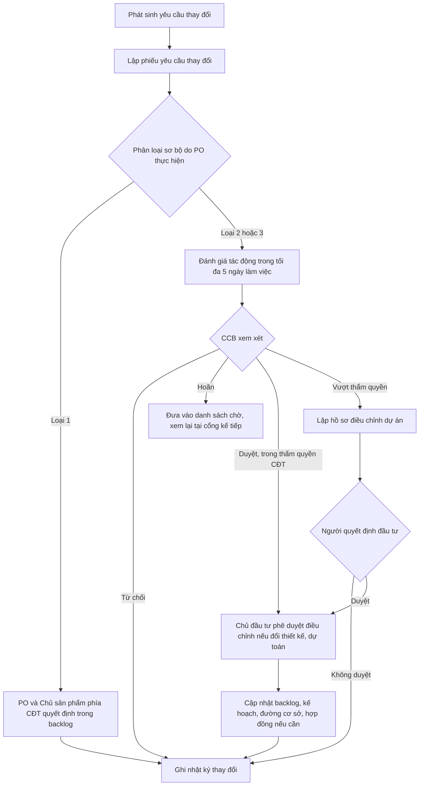

## 11. Quản lý thay đổi phạm vi

**Tóm tắt cho hội đồng thẩm định.** Dự án dùng Scrum nên yêu cầu được làm mịn liên tục, nhưng tổng phạm vi, tổng mức đầu tư, tiến độ và mục tiêu là cam kết với người quyết định đầu tư. Chương này phân thay đổi thành ba loại. Loại 1 là thay đổi trong một wave không làm đổi tổng phạm vi, do Product Owner và Chủ sản phẩm phía chủ đầu tư quyết định trong backlog. Loại 2 là thay đổi chuyển phạm vi giữa các wave hoặc dùng dự phòng, do Hội đồng kiểm soát thay đổi (CCB) quyết định trong thẩm quyền của chủ đầu tư. Loại 3 là thay đổi làm đổi mục tiêu, địa điểm, vượt tổng mức đầu tư hoặc kéo dài thời gian thực hiện; loại này phải trình người quyết định đầu tư điều chỉnh dự án theo Nghị định 224/2026/NĐ-CP, còn các điều chỉnh khác chủ đầu tư được tự tổ chức lập, thẩm định, phê duyệt. Mọi thay đổi đều có phiếu, đánh giá tác động theo cùng một bộ tiêu chí và được ghi vào nhật ký thay đổi dùng làm bằng chứng nghiệm thu và quyết toán.

### 11.1. Mục đích và nguyên tắc

Quản lý thay đổi phạm vi giải quyết một mâu thuẫn có sẵn giữa phương pháp phát triển linh hoạt và quy định quản lý đầu tư. Scrum coi thay đổi yêu cầu là bình thường và khuyến khích sắp xếp lại backlog sau mỗi sprint. Trong khi đó, dự án dùng ngân sách nhà nước được phê duyệt với một tổng mức đầu tư, mục tiêu, quy mô và thời gian cụ thể, và hồ sơ nghiệm thu phải chứng minh sản phẩm khớp với thiết kế đã duyệt. Nếu không có quy trình rõ, hoặc đội phát triển sẽ từ chối mọi thay đổi để giữ đúng hồ sơ, hoặc phạm vi sẽ trôi dần cho tới khi không còn khớp với hồ sơ phê duyệt.

Chương này áp dụng bốn nguyên tắc. Thứ nhất, **đổi chỗ tương đương**: trong một wave, thêm một yêu cầu thì phải bớt hoặc lùi yêu cầu có khối lượng tương đương, để tổng phạm vi không đổi. Thứ hai, **quyết định ở cấp thấp nhất có đủ thẩm quyền**, để thay đổi nhỏ không phải chờ văn bản. Thứ ba, **một bộ tiêu chí đánh giá tác động cho mọi thay đổi**, để thay đổi nhỏ và lớn được so sánh trên cùng thước đo. Thứ tư, **mọi thay đổi để lại dấu vết** trong nhật ký, liên kết với phiếu, yêu cầu gộp mã và đường cơ sở theo chương 10.

### 11.2. Phân loại thay đổi

Bảng dưới đây định nghĩa ba loại thay đổi. Phân loại dựa trên hệ quả của thay đổi đối với cam kết đã phê duyệt, không dựa trên kích thước kỹ thuật; một thay đổi kỹ thuật nhỏ vẫn là loại 3 nếu nó làm đổi mục tiêu dự án.

| Loại | Định nghĩa | Ví dụ | Người quyết định |
|---|---|---|---|
| 1. Trong wave | Thay đổi, bổ sung, làm rõ yêu cầu trong một wave, không đổi tổng khối lượng của wave quá 10% điểm backlog, không đổi ngày cổng, không đổi yêu cầu mức M đã cam kết tại cổng | Đổi bố cục màn hình UI-07-05; thêm một trường lọc; đổi thứ tự hai story mức S | Product Owner cùng Chủ sản phẩm phía chủ đầu tư |
| 2. Giữa các wave hoặc dùng dự phòng | Chuyển yêu cầu giữa các wave; lùi yêu cầu mức M; thay đổi làm khối lượng một wave tăng trên 10%; dùng dự phòng rủi ro; thay đổi ADR hoặc hợp đồng công bố; đổi thứ tự cắt chuyển nhóm dịch vụ; thay đổi trong phạm vi tổng mức đầu tư và thời gian đã duyệt | Lùi tính năng nâng cao của trình thiết kế luồng sang W4 (RSK-16); thêm adapter do kiểm kê hệ cũ phát hiện (RSK-08); đổi thiết kế chi tiết mà không đổi tổng mức đầu tư | CCB; chủ đầu tư phê duyệt điều chỉnh thiết kế, dự toán khi cần |
| 3. Điều chỉnh dự án | Thay đổi mục tiêu, địa điểm, vượt tổng mức đầu tư hoặc kéo dài thời gian thực hiện | Bổ sung phân hệ kho phân tích (đang ngoài phạm vi); kéo G5 quá T0+18 tháng; tăng chi phí vượt cả dự phòng | Người quyết định đầu tư, theo Nghị định 224/2026/NĐ-CP |

Ranh giới giữa loại 2 và loại 3 dựa trên quy định điều chỉnh dự án của Nghị định 224/2026/NĐ-CP: dự án phải trình cấp có thẩm quyền khi thay đổi mục tiêu, địa điểm, vượt vốn hoặc tổng mức đầu tư, kéo dài thời gian, còn các trường hợp thay đổi khác chủ đầu tư được tự tổ chức lập, thẩm định, phê duyệt điều chỉnh (theo tóm tắt pháp lý của dự án; số điều khoản cần đối chiếu Công báo, xem Q-D0102-86). Như vậy phần lớn thay đổi về thiết kế chi tiết, phân bổ khối lượng giữa các hạng mục hoặc dùng dự phòng trong tổng mức đầu tư nằm trong thẩm quyền chủ đầu tư, điều tạo dư địa đáng kể cho phương pháp linh hoạt.

Một thay đổi loại 1 lặp lại nhiều lần có thể cộng dồn thành loại 2. Vì vậy Product Owner theo dõi tổng điểm thay đổi của wave so với đường cơ sở tại cổng trước; khi tổng vượt 10% (đúng dấu hiệu sớm của RSK-07), các thay đổi tiếp theo trong wave phải qua CCB.

### 11.3. Hội đồng kiểm soát thay đổi

CCB được đặt dưới Ban quản lý dự án như chương 5 đã nêu. Thành phần thường trực gồm đại diện Ban quản lý dự án làm chủ tịch, Chủ sản phẩm phía chủ đầu tư, Giám đốc dự án và Product Owner phía nhà thầu, Kiến trúc sư giải pháp, đại diện đơn vị vận hành, và tư vấn giám sát với vai trò tư vấn không biểu quyết. Khi thay đổi chạm tới an toàn thông tin, dữ liệu cá nhân hoặc thanh toán, kỹ sư ATTT và trưởng nhóm liên quan được mời dự.

CCB họp định kỳ mỗi sprint, ngay sau buổi trình diễn sprint (sprint review), vì đây là lúc phát sinh nhiều yêu cầu mới nhất và phía chủ đầu tư đã có mặt. Với thay đổi khẩn như vá lỗ hổng nghiêm trọng hoặc thay đổi do nền tảng quốc gia đổi đặc tả, chủ tịch CCB được triệu tập họp bất thường hoặc lấy ý kiến bằng văn bản điện tử trong 2 ngày làm việc. Quyết định của CCB được ghi biên bản, có chữ ký số của chủ tịch, và lưu trong kho tài liệu dự án.

### 11.4. Quy trình

Quy trình dưới đây áp dụng cho thay đổi loại 2 và loại 3; thay đổi loại 1 đi theo nhánh rút gọn trong backlog nhưng vẫn được ghi nhận.

Sơ đồ cho thấy ba điểm thiết kế. Thứ nhất, đánh giá tác động có thời hạn cố định 5 ngày làm việc để thay đổi không bị treo; nếu cần lâu hơn, CCB quyết định cho phép làm một spike có giới hạn thời gian. Thứ hai, "hoãn" là một kết quả hợp lệ, phù hợp với nhiều yêu cầu tốt nhưng không cấp bách, và danh sách chờ được xem lại tại mỗi cổng. Thứ ba, mọi nhánh đều kết thúc ở nhật ký thay đổi, kể cả nhánh từ chối, vì yêu cầu bị từ chối cũng là thông tin cần cho nghiệm thu và cho tỉnh nhân rộng sau này. Trong lúc chờ quyết định về một thay đổi liên quan chức năng hệ cũ, chức năng đó tiếp tục chạy trên hệ cũ nhờ mô hình strangler, nên việc chờ không làm gián đoạn dịch vụ.

### 11.5. Mẫu phiếu yêu cầu thay đổi

Phiếu yêu cầu thay đổi được lập trong công cụ quản lý công việc với loại hạng mục riêng; bản xuất có các trường sau.

| Trường | Nội dung |
|---|---|
| Mã phiếu | `CR-nnn`, cấp tuần tự, không tái sử dụng |
| Người đề xuất, đơn vị, ngày | Theo định dạng dd/mm/yyyy |
| Mô tả thay đổi | Hiện trạng, đề xuất, lý do |
| Nguồn gốc | Yêu cầu nghiệp vụ mới; phát hiện khi khảo sát; thay đổi pháp luật; thay đổi bên thứ ba; rủi ro xảy ra (ghi mã RSK); lỗi thiết kế |
| Đối tượng bị ảnh hưởng | Mã REQ, FR, UC, API, ADR, phân hệ PH, wave, hạng mục WBS |
| Phân loại đề xuất | Loại 1, 2 hoặc 3 |
| Đánh giá tác động | Theo các tiêu chí ở mục 11.6, có số liệu |
| Phương án | Tối thiểu hai phương án, trong đó có phương án "không thay đổi" |
| Khuyến nghị | Của Product Owner và Kiến trúc sư |
| Quyết định | Duyệt, từ chối, hoãn; người quyết định; ngày; số biên bản |
| Thực hiện | Sprint, yêu cầu gộp mã, phiên bản phát hành, tài liệu được cập nhật |

### 11.6. Tiêu chí đánh giá tác động

Mọi phiếu loại 2 và loại 3 được đánh giá trên tám tiêu chí sau. Mỗi tiêu chí ghi số liệu cụ thể chứ không chỉ "có" hoặc "không", để CCB so sánh được các phiếu với nhau.

1. **Phạm vi:** số điểm backlog thêm và bớt, yêu cầu mức M bị ảnh hưởng, chức năng LGC liên quan.
2. **Tiến độ:** số sprint ảnh hưởng, cổng có bị dời không, có nằm trên đường găng không.
3. **Nỗ lực và chi phí:** người-tháng và triệu đồng, nguồn chi (đổi chỗ tương đương, dự phòng rủi ro, hoặc vượt tổng mức đầu tư).
4. **Mục tiêu và chỉ số:** BO và KPI của D02-01 bị ảnh hưởng.
5. **Kiến trúc và hợp đồng:** ADR, hợp đồng công bố, mô hình tenant bị ảnh hưởng; có tạo khác biệt riêng cho một tỉnh không (kiểm tra theo RSK-10).
6. **An toàn thông tin và dữ liệu cá nhân:** biện pháp SEC bị ảnh hưởng, có làm thay đổi hồ sơ cấp độ 3 đã nộp không.
7. **Pháp lý và thủ tục:** có chạm vào ranh giới điều chỉnh dự án không, có cần điều chỉnh thiết kế, dự toán hoặc hợp đồng không.
8. **Rủi ro:** rủi ro mới phát sinh hoặc rủi ro trong sổ bị thay đổi điểm.

### 11.7. Ngưỡng thẩm quyền

Bảng dưới đây quy định ai được duyệt thay đổi theo độ lớn của tác động. Ngưỡng tính trên từng phiếu; nhiều phiếu nhỏ cùng nguồn gốc được cộng dồn để tránh chia nhỏ né thẩm quyền.

| Tác động | Người duyệt |
|---|---|
| Không đổi tổng khối lượng wave quá 10%, không đổi ngày cổng | Product Owner cùng Chủ sản phẩm phía chủ đầu tư |
| Chuyển yêu cầu giữa các wave, hoặc dùng dự phòng dưới 2 người-tháng, hoặc thay đổi ADR, hợp đồng công bố | CCB |
| Dùng dự phòng từ 2 người-tháng trở lên, hoặc dời một cổng trong khoảng T0+18 tháng, hoặc cần điều chỉnh thiết kế chi tiết, dự toán, hợp đồng | Chủ đầu tư, trên cơ sở đề xuất của CCB |
| Đổi mục tiêu, địa điểm, vượt tổng mức đầu tư, kéo dài thời gian thực hiện | Người quyết định đầu tư, sau khi chủ đầu tư lập hồ sơ điều chỉnh dự án |

Thay đổi hợp đồng với nhà thầu luôn cần chữ ký của chủ đầu tư và phải tuân thủ điều kiện điều chỉnh hợp đồng của Luật Đấu thầu và hợp đồng đã ký; CCB không thay chủ đầu tư ký phụ lục hợp đồng.

### 11.8. Quan hệ với Scrum

Product backlog là nơi duy nhất chứa công việc của đội. Thay đổi loại 1 đi thẳng vào backlog với nhãn `change` và liên kết tới phiếu nếu có. Thay đổi loại 2 và 3 chỉ được đưa vào sprint khi phiếu đã được duyệt; trước đó, nếu cần, đội chỉ làm spike đánh giá tác động với khối lượng giới hạn. Mục tiêu sprint đã cam kết không bị thay đổi giữa sprint, trừ thay đổi khẩn về an toàn thông tin được chủ tịch CCB chấp thuận; khi đó Scrum Master ghi nhận phần việc bị đẩy ra.

Đường cơ sở phạm vi của mỗi wave là tập yêu cầu mức M và S được chốt tại cổng trước theo chương 10. Tại buổi trình diễn sprint, Chủ sản phẩm phía chủ đầu tư chấp nhận hay từ chối phần tăng trưởng theo tiêu chí hoàn thành; yêu cầu mới nêu ra ở buổi này được Product Owner phân loại ngay. Định nghĩa hoàn thành (Definition of Done) của dự án bao gồm việc cập nhật tài liệu và ma trận truy vết, để thay đổi được duyệt không chỉ nằm trong mã mà còn nằm trong hồ sơ nghiệm thu.

### 11.9. Nhật ký thay đổi

Nhật ký thay đổi là danh sách tuần tự mọi phiếu CR với trạng thái, quyết định, người quyết định, tác động thực tế sau khi thực hiện và liên kết tới phiên bản phát hành. Nhật ký được xuất tại mỗi cổng cùng đường cơ sở, và mọi lần dùng dự phòng rủi ro ở chương 8 đều có một dòng tương ứng ghi mã RSK. Tại G5, nhật ký là căn cứ để giải trình chênh lệch giữa hồ sơ thiết kế được duyệt và sản phẩm được nghiệm thu, cũng như để quyết toán. Nhật ký cũng phục vụ các tỉnh nhân rộng: yêu cầu bị từ chối hoặc hoãn ở tỉnh thí điểm là danh sách ứng viên tự nhiên cho các bản phát hành sau.

### 11.10. Câu hỏi mở

- **Q-D0102-86:** Số điều, khoản chính xác của Nghị định 224/2026/NĐ-CP về điều chỉnh dự án (tóm tắt pháp lý ghi Điều 66 khoản 18, chưa đối chiếu Công báo) và việc điều khoản này áp dụng cho dự án đầu tư hệ thống chuyển đổi số dùng vốn đầu tư công hay chỉ cho nhiệm vụ chi thường xuyên.
- **Q-D0102-87:** "Kéo dài thời gian" có tính cả việc dời một cổng trung gian trong khoảng T0+18 tháng không, hay chỉ tính thời gian thực hiện dự án? Chương này đang hiểu là chỉ tính thời gian thực hiện dự án.
- **Q-D0102-88:** Nghị định 224/2026/NĐ-CP có quy định riêng cho phát triển phần mềm theo phương pháp linh hoạt không? Nếu có, quy trình loại 1 và loại 2 cần đối chiếu lại.

### 11.11. Ghi chú cho người tổng hợp

- Chương này căn cứ Nghị định 224/2026/NĐ-CP theo đính chính pháp lý ngày 21/11/2026; văn bản chưa có mã CMP-LAW trong D00-01.
- Ngưỡng 10% khối lượng wave và 2 người-tháng dự phòng là đề xuất của nhà lập kế hoạch, cần chủ đầu tư xác nhận khi phê duyệt D01-02.
