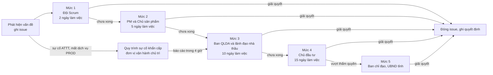

## 12. Truyền thông và báo cáo

**Tóm tắt cho hội đồng thẩm định.** Dự án dùng một nguồn dữ liệu duy nhất cho tiến độ là hệ thống quản lý công việc (issue tracker) gắn với kho mã Git, và mọi báo cáo định kỳ được sinh từ nguồn này để tránh số liệu lệch nhau giữa các bên. Chế độ báo cáo gồm năm nhịp: tuần, sprint (hai tuần), tháng, quý và cổng nghiệm thu, cộng các báo cáo theo quy định gửi cơ quan quản lý. Tiến độ được đo bằng ba nhóm chỉ số: burn-up phạm vi, velocity của từng đội và EVM rút gọn với hai chỉ số SPI và CPI; ngưỡng cảnh báo là 0,95 và ngưỡng leo thang là 0,85. Vấn đề được leo thang qua năm mức, từ đội Scrum (giải quyết trong 2 ngày làm việc) đến Ban chỉ đạo dự án, với thời hạn xử lý cụ thể cho từng mức. Quyết định chính thức luôn được ghi bằng biên bản hoặc văn bản hành chính; trao đổi trên kênh trò chuyện không có giá trị quyết định.

### 12.1. Nguyên tắc truyền thông

Truyền thông trong dự án tuân theo năm nguyên tắc. **Một nguồn sự thật**: trạng thái của mọi user story, lỗi, rủi ro, câu hỏi mở và việc cần làm sau họp nằm trong issue tracker; báo cáo, bảng điều khiển và biên bản chỉ trích dẫn từ đó. **Tự động trước, thủ công sau**: các chỉ số như velocity, burn-up, tỷ lệ cổng CI xanh được sinh tự động; người lập báo cáo chỉ viết phần nhận định và đề xuất. **Đúng người, đúng mức chi tiết**: Ban chỉ đạo nhận một trang tóm tắt, Ban quản lý dự án nhận báo cáo đầy đủ, đội kỹ thuật làm việc trực tiếp trên bảng công việc. **Quyết định phải có dấu vết**: mọi quyết định ảnh hưởng tới phạm vi, chi phí, tiến độ hoặc kiến trúc được ghi vào biên bản, sổ quyết định hoặc ADR; một thỏa thuận qua điện thoại hay tin nhắn chỉ có hiệu lực sau khi được ghi lại. **Không dữ liệu thật trên kênh làm việc**: issue, wiki, kênh trò chuyện và báo cáo không chứa dữ liệu cá nhân, dữ liệu giao dịch thật, bí mật hay địa chỉ hạ tầng PROD, theo quy ước D00-01 §8.

### 12.2. Ma trận truyền thông

Ma trận dưới đây xác định ai nhận thông tin gì, bao lâu một lần, qua kênh nào và do ai gửi. Các bên dùng tên gọi như ở chương 5; các báo cáo được định nghĩa chi tiết ở mục 12.3.

| Bên nhận | Nội dung | Tần suất | Kênh | Người gửi |
|---|---|---|---|---|
| UBND tỉnh | Báo cáo tình hình thực hiện dự án; tờ trình các quyết định thuộc thẩm quyền | Quý; khi cần quyết định | Văn bản hành chính qua hệ thống quản lý văn bản điều hành | Chủ đầu tư |
| Ban chỉ đạo | Báo cáo một trang: tiến độ theo cổng, SPI, CPI, năm rủi ro lớn nhất, vấn đề cần chỉ đạo | Quý; họp bất thường khi leo thang mức 5 | Họp trực tiếp kèm văn bản | Chủ đầu tư, Ban quản lý dự án chuẩn bị |
| Chủ đầu tư | Báo cáo tháng; hồ sơ nghiệm thu cổng; đề xuất thay đổi vượt thẩm quyền Ban | Tháng; theo cổng | Văn bản và họp tiến độ tháng | Ban quản lý dự án |
| Ban quản lý dự án | Báo cáo tuần, báo cáo sprint, sổ rủi ro, sổ thay đổi | Tuần; hai tuần | Họp tiến độ tuần, issue tracker, thư điện tử công vụ | PM nhà thầu |
| Chủ sản phẩm phía chủ đầu tư | Backlog đã làm mịn, kết quả sprint, câu hỏi nghiệp vụ cần quyết | Liên tục; hai tuần | Issue tracker, sprint review | PO phía nhà thầu |
| Tư vấn giám sát | Kế hoạch và kết quả sprint, báo cáo kiểm thử, khối lượng hoàn thành | Hai tuần; tháng | Issue tracker (quyền đọc), sprint review, báo cáo tháng | PM nhà thầu |
| Đơn vị vận hành | Kế hoạch phát hành, ghi chú phát hành, runbook mới, lịch cắt chuyển | Mỗi lần phát hành; tuần trong W3 | Wiki, issue tracker, họp cắt chuyển | Kiến trúc sư, trưởng nhóm Nền tảng |
| Sở ngành (đầu mối) | Lịch kết nối, lịch UAT, lịch cắt chuyển nhóm dịch vụ của sở, thay đổi ảnh hưởng HTTT của sở | Tháng; trước mỗi mốc ít nhất 10 ngày làm việc | Văn bản thông báo của chủ đầu tư; thư điện tử công vụ | Ban quản lý dự án |
| Người dùng cuối, cán bộ khai thác | Thông báo cắt chuyển, thay đổi giao diện, lịch đào tạo, hướng dẫn sử dụng | Trước mỗi cắt chuyển 5 ngày làm việc; khi phát hành | Thông báo trên Console, thư điện tử, trang hướng dẫn | Đơn vị vận hành |
| Cơ quan quản lý NDXP, NDOP | Đề nghị kết nối, kết quả kiểm thử, thông báo sự cố ảnh hưởng kết nối | Theo sự kiện | Văn bản hành chính; kênh kỹ thuật do cơ quan này quy định | Chủ đầu tư; đơn vị vận hành cho kênh kỹ thuật |
| PayGov, ngân hàng | Đề nghị kết nối, lịch kiểm thử, kết quả đối soát, sự cố thanh toán | Theo sự kiện; ngày trong 30 ngày chạy song song | Văn bản; kênh hỗ trợ kỹ thuật của PayGov | Chủ đầu tư; đơn vị vận hành |
| Viettel | Lịch cắt chuyển, yêu cầu xuất dữ liệu, yêu cầu hỗ trợ quay lui | Tuần trong W3 đến G5 | Văn bản; họp phối hợp cắt chuyển | Đơn vị vận hành |
| Tỉnh nhân rộng | Kế hoạch kết nạp tenant, yêu cầu chuẩn bị, lịch đào tạo | Tháng trong W5 | Văn bản; họp trực tuyến | Chủ đầu tư; PM nhà thầu |
| Đội nhà thầu | Mục tiêu sprint, trở ngại, quyết định kỹ thuật, ADR mới | Ngày; hai tuần | Họp đứng hằng ngày, kênh trò chuyện của dự án, wiki | Scrum Master, kiến trúc sư |
| Đơn vị kiểm định độc lập | Phạm vi kiểm thử, môi trường, tài khoản thử, kết quả khắc phục | Theo đợt kiểm thử | Văn bản; kênh bảo mật riêng cho báo cáo lỗ hổng | Ban quản lý dự án; kỹ sư ATTT nhà thầu |

Hai dòng cần lưu ý. Báo cáo lỗ hổng của đơn vị kiểm định độc lập không được đăng trên issue tracker chung trước khi được khắc phục; báo cáo này đi qua một kênh có kiểm soát truy cập chỉ gồm kỹ sư ATTT, kiến trúc sư, PM nhà thầu và cán bộ kỹ thuật của Ban, để tránh lộ lỗ hổng chưa vá. Thông báo cho sở ngành về cắt chuyển phải đi bằng văn bản của chủ đầu tư chứ không chỉ bằng thư điện tử, vì cắt chuyển có thể làm gián đoạn dịch vụ của sở và cần có căn cứ hành chính.

### 12.3. Chế độ báo cáo

#### 12.3.1. Báo cáo định kỳ trong dự án

Bảng sau liệt kê các báo cáo định kỳ nội bộ dự án theo năm nhịp. Mẫu báo cáo được thống nhất tại G0 và lưu trong wiki; số liệu trong mỗi báo cáo được lấy tự động từ issue tracker và hệ thống CI tại thời điểm chốt.

| Báo cáo | Người lập | Người nhận | Thời điểm chốt và hạn gửi | Nội dung chính |
|---|---|---|---|---|
| Báo cáo tuần | PM nhà thầu | Ban quản lý dự án, tư vấn giám sát | Chốt 17 giờ thứ Năm, gửi trước họp tiến độ tuần | Việc xong và việc dở theo đội; trở ngại; rủi ro mới hoặc đổi mức; câu hỏi nghiệp vụ chờ trả lời quá 3 ngày làm việc |
| Báo cáo sprint | Scrum Master, PO phía nhà thầu | Chủ sản phẩm phía chủ đầu tư, tư vấn giám sát, đơn vị vận hành | Ngày sprint review | Mục tiêu sprint và kết quả; story được chấp nhận và bị từ chối; velocity; lỗi tồn đọng theo mức; tỷ lệ cổng CI xanh; kết quả retrospective |
| Báo cáo tháng | PM nhà thầu lập, Ban quản lý dự án bổ sung nhận định | Chủ đầu tư | Ngày làm việc thứ 5 của tháng sau | Bảng chỉ số mục 12.4; tiến độ so với baseline; khối lượng hoàn thành; sổ rủi ro; sổ thay đổi; tình hình giải ngân; kế hoạch tháng tới |
| Báo cáo quý | Ban quản lý dự án | Chủ đầu tư, Ban chỉ đạo, UBND tỉnh | Ngày làm việc thứ 10 của quý sau | Tóm tắt một trang; tiến độ theo cổng; vấn đề cần chỉ đạo; dự báo hoàn thành |
| Báo cáo cổng | PM nhà thầu, tư vấn giám sát xác nhận | Hội đồng nghiệm thu cổng | Ít nhất 5 ngày làm việc trước phiên nghiệm thu | Đối chiếu với tiêu chí DoD của cổng; bằng chứng kiểm thử; danh sách lỗi tồn đọng và kế hoạch xử lý; tài liệu bàn giao |
| Báo cáo cắt chuyển | Đơn vị vận hành | Ban quản lý dự án, sở ngành liên quan | Trong 2 ngày làm việc sau mỗi lần cắt chuyển | Nhóm dịch vụ đã chuyển; số giao dịch qua hệ mới và hệ cũ; lỗi phát sinh; quyết định giữ hay quay lui |

#### 12.3.2. Báo cáo theo quy định cho cơ quan quản lý

Ngoài báo cáo nội bộ, chủ đầu tư phải thực hiện các báo cáo theo quy định của nhà nước. Danh sách dưới đây nêu loại báo cáo và bên lập; tên văn bản, biểu mẫu và hạn nộp được người tổng hợp đối chiếu với văn bản hiện hành trước khi phát hành, vì nhiều quy định đã thay đổi sau sắp xếp bộ máy năm 2025.

| Loại báo cáo | Người lập | Nơi nhận | Căn cứ |
|---|---|---|---|
| Báo cáo giám sát, đánh giá đầu tư (định kỳ và theo giai đoạn) | Chủ đầu tư, Ban quản lý dự án | Người quyết định đầu tư và cơ quan quản lý đầu tư theo phân cấp | Quy định hiện hành về giám sát, đánh giá đầu tư (chưa xác minh văn bản) |
| Báo cáo tình hình giải ngân vốn đầu tư công | Ban quản lý dự án | Cơ quan tài chính, kế hoạch của tỉnh | Quy định về quản lý vốn đầu tư công (chưa xác minh văn bản) |
| Báo cáo về triển khai dự án ứng dụng CNTT dùng ngân sách | Chủ đầu tư | Theo quy định của CMP-LAW-14 | CMP-LAW-14 (Nghị định 224/2026/NĐ-CP, chưa xác minh điều khoản) |
| Báo cáo sự cố an toàn thông tin | Đơn vị vận hành | Cơ quan điều phối ứng cứu sự cố theo quy định | Quy định về điều phối, ứng cứu sự cố an toàn thông tin mạng (chưa xác minh văn bản hiện hành) |
| Báo cáo kết quả kết nối, chia sẻ dữ liệu qua nền tảng LGSP | Đơn vị vận hành | Cơ quan quản lý NDXP và cơ quan quản lý chuyển đổi số | CMP-LAW-03, CMP-LAW-01 |
| Báo cáo đánh giá tác động xử lý dữ liệu cá nhân (khi có thay đổi phạm vi xử lý) | Chủ đầu tư, đơn vị vận hành | Cơ quan chuyên trách bảo vệ dữ liệu cá nhân | CMP-LAW-04, CMP-LAW-05 |
| Báo cáo quyết toán dự án hoàn thành | Chủ đầu tư | Cơ quan thẩm tra quyết toán, người quyết định đầu tư | Quy định về quyết toán dự án hoàn thành (chưa xác minh văn bản) |

Ban quản lý dự án lập một lịch báo cáo theo quy định ngay tại G0, gán người lập và nhắc hạn trong issue tracker như mọi việc khác, để báo cáo hành chính không bị bỏ sót khi đội tập trung vào kỹ thuật.

### 12.4. Bảng chỉ số tiến độ

#### 12.4.1. Burn-up phạm vi

Biểu đồ burn-up có hai đường: đường phạm vi (tổng điểm story của phạm vi đã cam kết đến cổng kế tiếp) và đường hoàn thành (tổng điểm story đã được Chủ sản phẩm phía chủ đầu tư chấp nhận). Burn-up được ưu tiên hơn burn-down vì nó tách bạch hai nguyên nhân trễ: đội làm chậm (đường hoàn thành dốc thấp) và phạm vi phình ra (đường phạm vi đi lên). Mỗi lần đường phạm vi tăng phải tương ứng với một yêu cầu thay đổi đã được CCB chấp thuận hoặc một việc làm mịn backlog đã được ghi lại; tăng không có lý do là dấu hiệu phạm vi trôi. Burn-up được vẽ cho từng wave và cho toàn dự án, sinh tự động từ issue tracker.

#### 12.4.2. Velocity

Velocity là số điểm story được chấp nhận trong một sprint, đo riêng cho từng đội. Dự án dùng velocity trung bình trượt ba sprint gần nhất để dự báo, không dùng velocity của một sprint đơn lẻ. Velocity chỉ dùng để lập kế hoạch nội bộ đội, không dùng để so sánh giữa các đội hay đánh giá năng suất cá nhân, vì thang điểm story của mỗi đội khác nhau. Khi velocity trung bình của một đội giảm quá 20% so với ba sprint trước đó, Scrum Master phải nêu nguyên nhân trong báo cáo sprint. Ở ranh giới wave, khi đội được tổ chức lại (mục 6.3), velocity được hiệu chỉnh lại từ đầu trong hai sprint.

#### 12.4.3. EVM rút gọn

Phương pháp giá trị thu được (Earned Value Management, EVM) được dùng ở dạng rút gọn để chủ đầu tư thấy tiến độ và hiệu quả nỗ lực bằng một con số so sánh được qua thời gian. Ba đại lượng gốc được đo bằng người-tháng để khớp với cách lập dự toán.

- **Giá trị kế hoạch (Planned Value, PV)** là nỗ lực theo kế hoạch tính đến thời điểm đo, lấy từ bảng định biên mục 6.2. Ví dụ, PV tại cuối W1 (T0+6) là 31 + 106 = 137 người-tháng.
- **Giá trị thu được (Earned Value, EV)** là phần của PV ứng với công việc đã hoàn thành và được chấp nhận. Mỗi wave có tổng giá trị bằng người-tháng kế hoạch của wave đó, được chia cho các story theo tỷ lệ điểm story. Story chỉ được tính khi đã được chấp nhận ở sprint review (quy tắc 0/100, không tính phần làm dở). Riêng 10% giá trị của mỗi wave được gắn với việc đạt cổng, chỉ ghi nhận khi cổng được nghiệm thu, để buộc đội hoàn thành các việc cuối như kiểm thử tích hợp và tài liệu.
- **Chi phí thực tế (Actual Cost, AC)** là số người-tháng nhà thầu thực tế đã bỏ ra, lấy từ bảng chấm công của nhà thầu.

Từ đó tính hai chỉ số: **SPI = EV / PV** (chỉ số hiệu quả tiến độ, lớn hơn 1 là nhanh hơn kế hoạch) và **CPI = EV / AC** (chỉ số hiệu quả nỗ lực, lớn hơn 1 là tốn ít công hơn kế hoạch). Với hợp đồng trọn gói, CPI thấp không làm tăng chi phí của chủ đầu tư, nhưng là tín hiệu sớm rằng nhà thầu đang bù trễ bằng cách tăng người và có thể sẽ cắt giảm chất lượng hoặc đề nghị điều chỉnh hợp đồng; vì vậy chủ đầu tư vẫn theo dõi CPI.

Ví dụ minh họa tại cuối W1: PV là 137 người-tháng; các story đã được chấp nhận cộng với giá trị cổng G0 tương đương 123 người-tháng (EV), trong khi cổng G1 chưa được nghiệm thu; nhà thầu báo cáo đã dùng 140 người-tháng (AC). Khi đó SPI = 123 / 137 ≈ 0,90 và CPI = 123 / 140 ≈ 0,88. Cả hai chỉ số đều ở vùng vàng, nên báo cáo tháng phải nêu nguyên nhân và kế hoạch đưa SPI về trên 0,95 trong hai sprint.

#### 12.4.4. Ngưỡng và bảng chỉ số tổng hợp

Bảng chỉ số trong báo cáo tháng gồm các chỉ số sau, mỗi chỉ số có ngưỡng xanh, vàng, đỏ. Chỉ số ở vùng đỏ hai kỳ liên tiếp kích hoạt leo thang theo mục 12.5.

| Chỉ số | Cách đo | Xanh | Vàng | Đỏ |
|---|---|---|---|---|
| SPI | EV / PV lũy kế | ≥ 0,95 | 0,85 đến dưới 0,95 | < 0,85 |
| CPI | EV / AC lũy kế | ≥ 0,95 | 0,85 đến dưới 0,95 | < 0,85 |
| Độ lệch phạm vi | Phần trăm điểm story tăng thêm so với baseline wave, không kèm thay đổi được CCB duyệt | ≤ 5% | 5% đến 10% | > 10% |
| Tỷ lệ story bị từ chối ở sprint review | Điểm bị từ chối / điểm đem ra review | ≤ 10% | 10% đến 20% | > 20% |
| Lỗi nghiêm trọng tồn đọng | Số lỗi mức nghiêm trọng và cao chưa đóng quá 10 ngày làm việc | 0 | 1 đến 3 | > 3 |
| Tỷ lệ cổng CI xanh trên nhánh chính | Phần trăm lần chạy thành công trong sprint | ≥ 95% | 85% đến dưới 95% | < 85% |
| Truy vết | Phần trăm FR mức M của wave đã có ít nhất hai test case và có kết quả | ≥ 95% tại cổng | 85% đến dưới 95% | < 85% |
| Câu hỏi nghiệp vụ quá hạn | Số câu hỏi chờ phía chủ đầu tư trả lời quá 5 ngày làm việc | 0 đến 2 | 3 đến 5 | > 5 |
| Rủi ro mức cao đang mở | Số rủi ro trong sổ RSK ở mức cao không có biện pháp đang thực hiện | 0 | 1 | ≥ 2 |
| Hệ số xe buýt của lane | Số lane có dưới hai người từng merge mã | 0 | 1 | ≥ 2 |

Chỉ số "câu hỏi nghiệp vụ quá hạn" đo trách nhiệm của phía chủ đầu tư chứ không phải của nhà thầu. Việc đưa chỉ số này vào bảng chung giúp Ban chỉ đạo thấy được khi trễ tiến độ có nguyên nhân từ việc chậm ra quyết định, thay vì quy toàn bộ cho nhà thầu.

#### 12.4.5. Chỉ số mục tiêu nghiệp vụ trong báo cáo

Các chỉ số ở mục 12.4.4 đo tiến độ dự án; chúng không thay cho các chỉ số mục tiêu nghiệp vụ KPI-01 đến KPI-18 được định nghĩa chính thức tại D02-01. Từ khi có môi trường PROD ở W3, báo cáo tháng có thêm một phần theo dõi các KPI đo được trong giai đoạn thực hiện: độ sẵn sàng data plane (KPI-03), thời gian phát hiện và khôi phục sự cố (KPI-15, KPI-16) và, từ W4, tỷ lệ giao dịch đối soát tự động khớp (KPI-13). Báo cáo cổng nêu thêm các KPI gắn với cổng: hồ sơ cấp độ 3 được phê duyệt (KPI-08) trước G3, điểm hài lòng người dùng nội bộ sau UAT (KPI-18) tại G2 và G4, và thời gian khởi tạo tenant tỉnh 2 (KPI-12) tại G5. Số liệu KPI lấy từ PH-13 và PH-16 khi có, không nhập tay.

### 12.5. Cơ chế leo thang vấn đề

#### 12.5.1. Các mức leo thang

Một vấn đề là bất kỳ trở ngại nào mà người phát hiện không tự giải quyết được trong phạm vi quyền hạn của mình. Mọi vấn đề được ghi thành một issue có nhãn "vấn đề", có người sở hữu và mức hiện tại. Vấn đề được leo thang lên mức kế tiếp khi hết thời hạn xử lý của mức hiện tại mà chưa giải quyết, hoặc ngay lập tức khi rõ ràng vượt thẩm quyền của mức hiện tại. Bảng sau định nghĩa năm mức.

| Mức | Cấp xử lý | Ví dụ vấn đề | Thời hạn xử lý |
|---|---|---|---|
| 1 | Đội Scrum: Scrum Master, trưởng nhóm kỹ thuật, PO phía nhà thầu | Phụ thuộc giữa hai đội, story chưa rõ, môi trường DEV lỗi | 2 ngày làm việc |
| 2 | PM nhà thầu cùng Chủ sản phẩm phía chủ đầu tư; kiến trúc sư khi là vấn đề kỹ thuật | Câu hỏi nghiệp vụ cần quyết định của chủ đầu tư, xung đột ưu tiên, SPI vàng hai kỳ | 5 ngày làm việc |
| 3 | Ban quản lý dự án cùng lãnh đạo nhà thầu, có tư vấn giám sát tham dự | SPI hoặc CPI đỏ, phụ thuộc bên ngoài (NDXP, PayGov, Viettel) chặn quá 10 ngày làm việc, yêu cầu thay đổi trong thẩm quyền Ban | 10 ngày làm việc |
| 4 | Chủ đầu tư | Thay đổi vượt thẩm quyền Ban, tranh chấp hợp đồng, nguy cơ trễ cổng quá một sprint, sở ngành không phối hợp | 15 ngày làm việc |
| 5 | Ban chỉ đạo, UBND tỉnh | Điều chỉnh tổng mức đầu tư hoặc mục tiêu, phối hợp liên ngành không giải quyết được ở cấp sở, trễ G3 hoặc G5 | Phiên họp gần nhất, tối đa 30 ngày |

Sơ đồ sau thể hiện đường leo thang và lối tắt dành cho sự cố khẩn cấp.

Sơ đồ cho thấy hai đường riêng biệt. Đường thường đi qua các mức theo thời hạn, mỗi mức có thể đóng vấn đề và ghi quyết định. Đường khẩn cấp dành cho sự cố an toàn thông tin và sự cố làm gián đoạn dịch vụ trên PROD (từ W3 trở đi): sự cố được xử lý ngay theo quy trình ứng cứu sự cố do đơn vị vận hành chủ trì, không chờ đi qua mức 1 và 2, và được báo cáo lên mức 3 trong vòng 4 giờ để Ban quản lý dự án quyết định các bước tiếp theo như dừng cắt chuyển hay thông báo cho sở ngành.

#### 12.5.2. Quy tắc leo thang

Ba quy tắc đi kèm cơ chế trên. Thứ nhất, người leo thang phải nêu vấn đề, tác động (tới cổng nào, bao nhiêu ngày), các phương án đã cân nhắc và đề xuất; một vấn đề leo thang không kèm đề xuất bị trả lại mức dưới. Thứ hai, leo thang là việc bình thường của quản lý dự án, không phải là phàn nàn; chỉ số "câu hỏi nghiệp vụ quá hạn" và các vấn đề ở mức 2 trở lên được báo cáo công khai trong báo cáo tháng để các bên thấy trở ngại nằm ở đâu. Thứ ba, khi vấn đề có thể trở thành rủi ro tái diễn, người xử lý ghi thêm một mục vào sổ rủi ro để được theo dõi theo quy trình quản lý rủi ro của tài liệu này.

### 12.6. Quản lý họp và biên bản

#### 12.6.1. Lịch họp

Bảng sau liệt kê các cuộc họp định kỳ của dự án. Mục tiêu là đủ để ra quyết định đúng hạn nhưng không lấy quá nhiều thời gian của kỹ sư; tổng thời gian họp của một kỹ sư không vượt khoảng 10% thời gian sprint, theo khuyến nghị thông thường của Scrum.

| Cuộc họp | Chủ trì | Thành phần | Tần suất, thời lượng | Đầu ra |
|---|---|---|---|---|
| Họp khởi động dự án | Chủ đầu tư | Mọi bên trong chương 5 có hợp đồng | Một lần tại T0, nửa ngày | Biên bản khởi động; lịch họp; kênh làm việc; danh sách đầu mối |
| Họp đứng hằng ngày (daily scrum) | Scrum Master | Đội Scrum | Hằng ngày, 15 phút | Trở ngại ghi vào issue |
| Lập kế hoạch sprint | Scrum Master | Đội, PO phía nhà thầu | Đầu sprint, tối đa 2 giờ | Sprint backlog |
| Sprint review | PO phía nhà thầu | Đội, Chủ sản phẩm phía chủ đầu tư, tư vấn giám sát, đơn vị vận hành, đầu mối sở ngành khi liên quan | Cuối sprint, 1 đến 2 giờ | Biên bản chấp nhận story; báo cáo sprint |
| Retrospective | Scrum Master | Đội | Cuối sprint, 1 giờ | Hành động cải tiến ghi vào issue |
| Họp tiến độ tuần | Ban quản lý dự án | PM nhà thầu, PO, kiến trúc sư, tư vấn giám sát, đơn vị vận hành | Hằng tuần, 1 giờ | Biên bản; cập nhật sổ rủi ro, sổ vấn đề |
| Họp CCB | Giám đốc Ban quản lý dự án | Thành viên CCB theo mục quản lý thay đổi | Hai tuần một lần hoặc khi có yêu cầu khẩn | Quyết định chấp thuận, từ chối hoặc hoãn từng yêu cầu thay đổi |
| Họp kiến trúc | Kiến trúc sư | Trưởng nhóm kỹ thuật các đội, nhóm Nền tảng, đơn vị vận hành | Hai tuần một lần | ADR mới hoặc cập nhật |
| Họp tiến độ tháng | Chủ đầu tư | Ban quản lý dự án, PM nhà thầu, tư vấn giám sát | Hằng tháng, 2 giờ | Kết luận của chủ đầu tư |
| Họp phối hợp cắt chuyển | Đơn vị vận hành | Đội Thí điểm, Viettel, đầu mối sở ngành liên quan | Hằng tuần trong W3 đến G5; trước và sau mỗi lần cắt chuyển | Quyết định go/no-go đề xuất; biên bản cắt chuyển |
| Họp Ban chỉ đạo | Trưởng Ban chỉ đạo | Thành viên Ban chỉ đạo, chủ đầu tư | Hằng quý, 2 giờ | Kết luận chỉ đạo |
| Phiên nghiệm thu cổng | Bên A của cổng theo ma trận RACI | Hội đồng nghiệm thu cổng | Tại mỗi cổng G0 đến G5 | Biên bản nghiệm thu |

#### 12.6.2. Quy tắc biên bản

Mọi cuộc họp có từ hai bên trở lên (không tính họp nội bộ đội Scrum) đều có biên bản. Biên bản được lập theo mẫu thống nhất, gồm thành phần, nội dung đã thảo luận, các quyết định (mỗi quyết định có người quyết và căn cứ), các việc cần làm (mỗi việc có người sở hữu và hạn) và các vấn đề chưa thống nhất. Thư ký gửi dự thảo biên bản trong 1 ngày làm việc; các bên có 2 ngày làm việc để góp ý; quá hạn không có góp ý thì biên bản được coi là đã thống nhất. Biên bản nghiệm thu cổng, biên bản CCB và biên bản họp Ban chỉ đạo là văn bản có chữ ký và được lưu theo chế độ lưu trữ hồ sơ dự án; các biên bản khác được lưu trong wiki.

Các quyết định trong biên bản được chép vào **sổ quyết định** của dự án (một trang trong wiki, mỗi quyết định một dòng có số thứ tự, ngày, nội dung, người quyết và liên kết tới biên bản gốc). Các việc cần làm được tạo thành issue ngay trong cuộc họp để không phải chép lại. Nhờ đó, khi có người mới vào dự án hoặc khi cần đối chiếu ở cổng nghiệm thu, mọi quyết định đều tra được nguồn gốc.

### 12.7. Kênh làm việc chung

Dự án dùng năm kênh làm việc, mỗi kênh có mục đích riêng. Bảng sau nêu từng kênh, nơi đặt và quy tắc dùng.

| Kênh | Công cụ tham khảo | Nơi đặt | Mục đích | Quy tắc |
|---|---|---|---|---|
| Kho mã nguồn Git | GitLab hoặc Gitea tự cài | Hạ tầng của chủ đầu tư hoặc của nhà thầu có bản sao định kỳ về hạ tầng chủ đầu tư | Mã nguồn, hợp đồng API, cấu hình hạ tầng, tài liệu Markdown | Nhánh chính được bảo vệ; mọi thay đổi qua PR và cổng CI; quyền theo lane |
| Hệ thống quản lý công việc | Issue tracker tích hợp với Git | Cùng nơi với kho mã | Backlog, sprint, lỗi, rủi ro, vấn đề, câu hỏi mở, việc sau họp | Mỗi issue có người sở hữu và nhãn wave, lane, phân hệ; tư vấn giám sát và Ban có quyền đọc |
| Wiki dự án | Wiki của Git hoặc trang tài liệu sinh từ Markdown | Cùng nơi với kho mã | Hướng dẫn làm việc, biên bản thường, sổ quyết định, runbook, tài liệu đào tạo | Nội dung có người sở hữu; không chứa dữ liệu thật và bí mật |
| Kênh trò chuyện của dự án | Phần mềm trò chuyện tự cài (ví dụ Mattermost) | Hạ tầng trong nước | Trao đổi nhanh trong đội và giữa các bên | Không có giá trị quyết định; kết luận phải chuyển thành issue hoặc biên bản |
| Văn bản hành chính và thư điện tử công vụ | Hệ thống quản lý văn bản điều hành của tỉnh; thư điện tử công vụ | Hạ tầng của tỉnh | Văn bản chính thức, tờ trình, thông báo cho sở ngành và bên ngoài | Mọi quyết định có hệ quả pháp lý đều đi qua kênh này |

Có ba lưu ý về kênh. Thứ nhất, kho mã nguồn là tài sản của chủ đầu tư; nếu kho đặt tại hạ tầng của nhà thầu trong giai đoạn phát triển thì hợp đồng phải quy định bản sao đầy đủ (gồm lịch sử commit, issue và wiki) được đồng bộ về hạ tầng chủ đầu tư ít nhất hằng tuần và bàn giao toàn bộ tại G5. Thứ hai, dự án tránh dùng các ứng dụng trò chuyện đại chúng và dịch vụ lưu trữ đám mây cá nhân để trao đổi tài liệu thiết kế, sơ đồ hạ tầng hay báo cáo lỗ hổng, vì không kiểm soát được nơi lưu và quyền truy cập. Thứ ba, quyền truy cập vào mọi kênh được cấp qua Keycloak của môi trường DEV hoặc hệ thống định danh của tỉnh khi có thể, và được thu hồi trong ngày khi một người rời dự án, theo quy trình bàn giao ở mục 6.6.

### Câu hỏi mở

- **Q-D0102-60.** Tỉnh thí điểm có hạ tầng sẵn để đặt kho mã Git, issue tracker và wiki cho dự án từ T0 không, hay nhà thầu đặt trên hạ tầng của mình và đồng bộ bản sao về tỉnh?
- **Q-D0102-61.** Văn bản hiện hành quy định chế độ báo cáo giám sát, đánh giá đầu tư và báo cáo về dự án ứng dụng CNTT dùng ngân sách (biểu mẫu, hạn nộp, nơi nhận) sau khi CMP-LAW-14 (Nghị định 224/2026/NĐ-CP, hiệu lực 01/7/2026) là văn bản nào?
- **Q-D0102-62.** Cơ quan nào hiện là đầu mối tiếp nhận báo cáo sự cố an toàn thông tin của hệ thống cấp độ 3 cấp tỉnh, và thời hạn báo cáo ban đầu là bao lâu?
- **Q-D0102-63.** Hợp đồng với nhà thầu có thanh toán theo cổng hay theo khối lượng tháng? Cách thanh toán quyết định EV được đo theo tỷ lệ điểm story như mục 12.4.3 hay theo khối lượng được tư vấn giám sát xác nhận.

### Ghi chú cho người tổng hợp

- Chương này tham chiếu "quy trình quản lý rủi ro", "mục quản lý thay đổi" (thành phần CCB) và "tiêu chí DoD của cổng" của D01-02 mà không ghi số chương; khi ghép, thay bằng số mục cụ thể và kiểm tra thành phần CCB ở chương quản lý thay đổi khớp với dòng "Họp CCB" ở mục 12.6.1.
- Ví dụ EVM ở mục 12.4.3 dùng PV tính từ bảng FTE của giả định nền (31 + 106 = 137 người-tháng tại T0+6); EV và AC là số minh họa, không phải dự báo.
- Các ngưỡng xanh, vàng, đỏ ở mục 12.4.4 và thời hạn leo thang ở mục 12.5.1 là đề xuất của chương. Nếu chương quản lý chất lượng hoặc chương quản lý rủi ro đặt ngưỡng khác cho cùng chỉ số (ví dụ lỗi tồn đọng, rủi ro mức cao), cần thống nhất về một nơi.
- Chương dùng mã CMP-LAW-14 để chỉ Nghị định 224/2026/NĐ-CP (đã bãi bỏ NĐ 45/2026); D00-01 §7 cần cập nhật tên văn bản của mã này.
- Mục 12.4.5 dẫn chiếu KPI-03, KPI-08, KPI-12, KPI-13, KPI-15, KPI-16, KPI-18 của D02-01 và không đặt KPI mới; các chỉ số tiến độ ở mục 12.4.4 là chỉ số quản lý dự án, không mang mã KPI để tránh nhầm với chỉ số mục tiêu nghiệp vụ.
