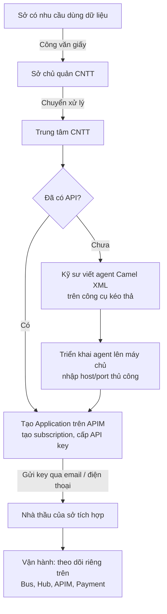
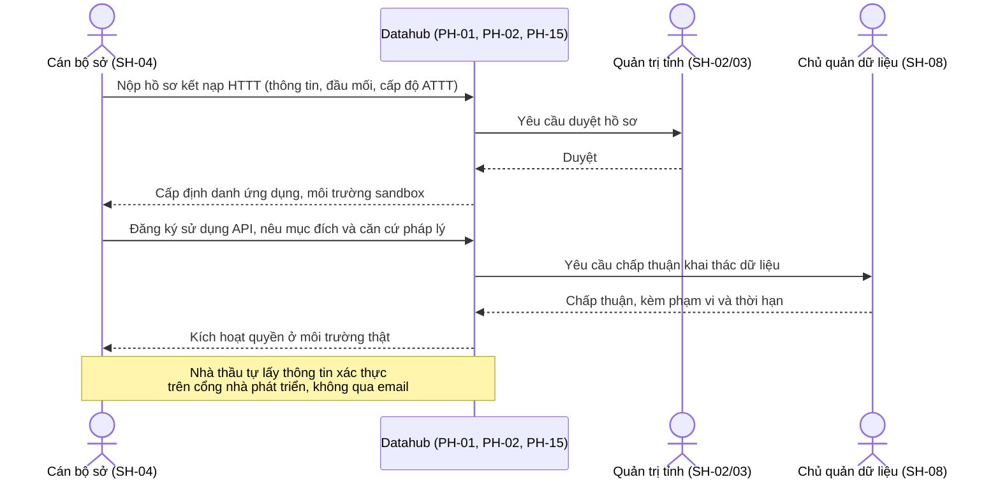
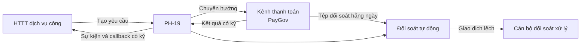

# D02-01 · Tài liệu yêu cầu nghiệp vụ (BRD)

## 1. Mục đích và phạm vi tài liệu

Tài liệu này mô tả **vì sao** cần xây dựng Datahub và **hệ thống phải đạt được điều gì về mặt nghiệp vụ**. Nó không mô tả cách hiện thực. Các tài liệu phía sau dùng BRD làm gốc: SRS (D02-02) chuyển mỗi yêu cầu nghiệp vụ `REQ` thành yêu cầu phần mềm đo được, FRS từng phân hệ (D02-03) chi tiết hóa thành `FR`, còn ma trận truy vết (D00-03) chứng minh mọi `REQ` đều được hiện thực và kiểm thử.

BRD trả lời năm câu hỏi theo thứ tự: bối cảnh hiện tại là gì (mục 2 và 5); tỉnh muốn đạt mục tiêu gì và đo bằng gì (mục 3); ai liên quan (mục 4); trạng thái tương lai trông như thế nào (mục 6 và 7); và cái gì nằm trong hoặc ngoài phạm vi, theo thứ tự ưu tiên nào (mục 8 đến 11). Thuật ngữ và mã truy vết dùng theo D00-01.

## 2. Bối cảnh và lý do đầu tư

### 2.1. Vai trò của nền tảng tích hợp cấp tỉnh

Nền tảng tích hợp, chia sẻ dữ liệu cấp tỉnh (LGSP) là hạ tầng bắt buộc trong Kiến trúc Chính phủ điện tử / Chính phủ số cấp tỉnh. Chức năng cốt lõi của nó là làm **điểm kết nối duy nhất** giữa các hệ thống thông tin (HTTT) của tỉnh với nhau, và giữa tỉnh với Nền tảng tích hợp, chia sẻ dữ liệu quốc gia (NDXP, trước đây gọi là NGSP). Thay vì mỗi cặp hệ thống tự nối điểm–điểm, mọi trao đổi đi qua LGSP. Nhờ đó, tỉnh kiểm soát được ai đang dùng dữ liệu gì, ghi được nhật ký phục vụ thanh tra, và giảm chi phí khi một hệ thống thay đổi.

### 2.2. Hệ LGSP hiện tại

Hệ LGSP đang vận hành được xây dựng năm 2021 trên nền Java 8, Angular và PostgreSQL, gồm năm khối gần như độc lập về giao diện và dữ liệu:

- **Bus** quản trị các chương trình tích hợp Apache Camel (gọi là agent), đọc số liệu qua JMX/Jolokia, và có công cụ kéo thả sinh mã Camel XML.
- **Hub** là trung tâm publish/subscribe dựa trên Apache Pulsar, quản lý dự án tích hợp, topic, publisher và subscriber.
- **API Management** quản lý API, gói sử dụng (plan), ứng dụng, đăng ký sử dụng và gateway theo mô hình tương tự Gravitee.
- **Danh mục dùng chung** (Aita) lưu danh mục theo mô hình thực thể – thuộc tính – giá trị, nhập xuất Excel/CSV và cung cấp API.
- **Payment** là lớp trung gian giữa HTTT của tỉnh và Cổng thanh toán quốc gia (PayGov).

Kiểm kê chi tiết 183 chức năng của hệ này nằm tại D00-03.

### 2.3. Vì sao cần hệ mới thay vì nâng cấp

Có bốn nhóm lý do, xếp theo mức độ ảnh hưởng.

**Thứ nhất, khung pháp lý đã thay đổi căn bản sau năm 2021.** Luật Dữ liệu 2024 và các nghị định hướng dẫn đặt ra yêu cầu về phân loại dữ liệu, quản trị dữ liệu dùng chung, nhật ký khai thác và trách nhiệm của chủ quản dữ liệu. Quy định về bảo vệ dữ liệu cá nhân yêu cầu kiểm soát mục đích sử dụng và che dữ liệu nhạy cảm. Hệ cũ không có khái niệm phân loại dữ liệu, không có kiểm soát theo mục đích, và nhật ký chỉ ở dạng văn bản một dòng. Bảng đối chiếu pháp lý nằm ở D00-01 §7.

**Thứ hai, tổ chức hành chính đã thay đổi.** Từ năm 2025, chính quyền địa phương chuyển sang mô hình hai cấp và nhiều tỉnh sáp nhập. Danh mục đơn vị hành chính phải giữ được lịch sử sáp nhập; một tỉnh mới có thể phải vận hành dữ liệu của nhiều tỉnh cũ trong giai đoạn chuyển tiếp. Đây là lý do Datahub được thiết kế **đa tenant** ngay từ đầu (quyết định Q2).

**Thứ ba, hệ cũ có những hạn chế kỹ thuật không sửa được bằng nâng cấp từng phần.** Năm khối có năm giao diện và năm mô hình dữ liệu riêng, người vận hành phải học năm hệ. Thông tin xác thực tới hệ thống quốc gia nằm dạng văn bản trong tài liệu. Công cụ thiết kế cho phép nạp file JAR tùy ý vào runtime, vi phạm yêu cầu kiểm soát phần mềm ở cấp độ 3. Java 8 và Angular phiên bản cũ đã hết hỗ trợ bảo mật. Mục tiêu sẵn sàng 90%/năm tương đương 36 ngày gián đoạn, không phù hợp với hạ tầng mà dịch vụ công trực tuyến phụ thuộc.

**Thứ tư, nhu cầu nghiệp vụ đã vượt phạm vi của LGSP thế hệ đầu.** Tỉnh cần quản lý dữ liệu chủ (công dân, tổ chức, địa chỉ) dùng chung, kiểm soát chất lượng dữ liệu, điều phối quy trình liên thông nhiều cơ quan, và báo cáo chỉ tiêu chuyển đổi số. Các năng lực này không có ở hệ cũ.

### 2.4. Định vị Datahub

Datahub là **LGSP thế hệ mới có lớp dữ liệu dùng chung**, đóng gói thành sản phẩm triển khai cho nhiều tỉnh. Phạm vi chưa bao gồm kho dữ liệu phân tích dạng lakehouse (quyết định Q1). Datahub thay thế dần hệ cũ theo mô hình chạy song song và chuyển dần từng luồng (strangler), không cắt chuyển một lần (quyết định Q12).

## 3. Mục tiêu nghiệp vụ và chỉ số đo

Bảng dưới đây liệt kê mục tiêu nghiệp vụ (`BO`) và chỉ số đo (`KPI`) tương ứng. Giá trị nền là số liệu của hệ cũ hoặc ước lượng khi hệ cũ không đo. Giá trị mục tiêu là cam kết tại thời điểm nghiệm thu hoặc sau 12 tháng vận hành, như ghi ở cột cuối. Các giá trị có dấu `*` cần chủ đầu tư xác nhận số liệu nền thực tế trước cổng G1.

| Mã | Mục tiêu nghiệp vụ | Mã KPI | Chỉ số đo | Nền | Mục tiêu | Thời điểm đo |
|---|---|---|---|---|---|---|
| BO-01 | Mọi trao đổi dữ liệu giữa các HTTT của tỉnh và với quốc gia đi qua một điểm có kiểm soát | KPI-01 | Tỷ lệ HTTT của tỉnh đang kết nối qua Datahub trên tổng số HTTT có trao đổi dữ liệu | Chưa đo* | ≥ 90% | 12 tháng |
| | | KPI-02 | Số kết nối điểm–điểm còn tồn tại ngoài nền tảng | Chưa đo* | Giảm ≥ 80% | 12 tháng |
| BO-02 | Bảo đảm dịch vụ công trực tuyến không gián đoạn vì nền tảng tích hợp | KPI-03 | Độ sẵn sàng của data plane theo tháng | 90%/năm (cam kết cũ) | ≥ 99,9%/tháng | Từ nghiệm thu |
| | | KPI-04 | Độ trễ thêm do nền tảng tại gateway, p95 | Không đo | ≤ 50 ms | Từ nghiệm thu |
| BO-03 | Rút ngắn thời gian đưa một kết nối mới vào vận hành | KPI-05 | Thời gian từ khi nộp hồ sơ kết nạp tới khi HTTT gọi được API ở môi trường thật | Chưa đo*, ước 2–4 tuần | ≤ 5 ngày làm việc | 6 tháng |
| | | KPI-06 | Thời gian xây dựng một luồng tích hợp chuẩn (lấy dữ liệu, chuyển đổi, gửi) | Ước 5–10 ngày công | ≤ 2 ngày công | 6 tháng |
| BO-04 | Tuân thủ pháp luật về dữ liệu và an toàn thông tin | KPI-07 | Tỷ lệ lượt khai thác dữ liệu có nhật ký đủ thông tin cho thanh tra (ai, dữ liệu gì, mục đích, khi nào) | Không có | 100% | Từ nghiệm thu |
| | | KPI-08 | Kết quả đánh giá ATTT theo cấp độ 3 | Chưa có hồ sơ* | Được phê duyệt | Trước vận hành chính thức |
| | | KPI-09 | Số thông tin xác thực đối ngoại lưu ngoài kho bí mật | > 0 (tài liệu cũ) | 0 | Từ nghiệm thu |
| BO-05 | Danh mục dùng chung thống nhất, đồng bộ với quốc gia | KPI-10 | Tỷ lệ danh mục dùng chung của tỉnh được quản lý tập trung và có phiên bản | Chưa đo* | 100% danh mục bắt buộc | 12 tháng |
| | | KPI-11 | Độ trễ đồng bộ danh mục quốc gia sau khi quốc gia ban hành | Thủ công | ≤ 24 giờ | 6 tháng |
| BO-06 | Một nền tảng dùng chung cho nhiều tỉnh, giảm chi phí triển khai lặp | KPI-12 | Thời gian khởi tạo một tenant tỉnh mới tới khi sẵn sàng kết nối | Triển khai riêng, nhiều tuần | ≤ 1 ngày làm việc | Từ nghiệm thu |
| BO-07 | Thanh toán trực tuyến cho dịch vụ công minh bạch, đối soát được | KPI-13 | Tỷ lệ giao dịch đối soát tự động khớp với kênh thanh toán | Không đối soát | ≥ 99,5% | 6 tháng |
| | | KPI-14 | Thời gian phát hiện giao dịch lệch | Không có | ≤ 1 ngày làm việc | 6 tháng |
| BO-08 | Vận hành chủ động thay vì xử lý khi người dân phản ánh | KPI-15 | Thời gian phát hiện sự cố (MTTD) | Không đo | ≤ 5 phút | Từ nghiệm thu |
| | | KPI-16 | Thời gian khôi phục dịch vụ (MTTR) với sự cố mức 1 | Không đo | ≤ 1 giờ | Từ nghiệm thu |
| BO-09 | Người vận hành dùng một giao diện thống nhất | KPI-17 | Số giao diện quản trị riêng biệt người vận hành phải dùng | 5 | 1 | Từ nghiệm thu |
| | | KPI-18 | Điểm hài lòng của người dùng nội bộ (thang SUS) | Chưa đo | ≥ 75 | Sau UAT |

## 4. Các bên liên quan

Bảng dưới đây xác định các bên liên quan (`SH`), lợi ích của họ và mức ảnh hưởng tới quyết định. Vai trò người dùng chi tiết và quyền hạn được đặc tả tại D02-08.

| Mã | Bên liên quan | Lợi ích và kỳ vọng | Mức ảnh hưởng | Cách tham gia |
|---|---|---|---|---|
| SH-01 | Lãnh đạo UBND tỉnh | Hoàn thành chỉ tiêu chuyển đổi số, không gián đoạn dịch vụ công, tuân thủ pháp luật | Quyết định | Phê duyệt chủ trương, nghiệm thu |
| SH-02 | Sở KH&CN (đơn vị chủ quản CNTT của tỉnh sau hợp nhất) | Quản lý tập trung kết nối, báo cáo được, kiểm soát chi phí | Quyết định | Chủ đầu tư, phê duyệt yêu cầu |
| SH-03 | Trung tâm dữ liệu / Trung tâm CNTT tỉnh | Vận hành ổn định, ít thao tác thủ công, giám sát chủ động | Cao | Vận hành hệ thống, tham gia UAT |
| SH-04 | Các sở, ngành, UBND cấp xã có HTTT kết nối | Kết nối nhanh, tài liệu rõ, ít phải liên hệ trực tiếp | Trung bình | Nộp hồ sơ kết nạp, dùng cổng nhà phát triển |
| SH-05 | Đơn vị phát triển HTTT (nhà thầu của các sở) | Đặc tả API chuẩn, môi trường thử nghiệm, hỗ trợ tự phục vụ | Trung bình | Dùng cổng nhà phát triển, sandbox |
| SH-06 | Cơ quan quản lý NDXP và các CSDL quốc gia | Tỉnh kết nối đúng chuẩn, an toàn, có nhật ký | Cao (ràng buộc) | Cấp thông tin kết nối, kiểm tra tuân thủ |
| SH-07 | Cơ quan chuyên trách ATTT (Bộ Công an, Bộ Quốc phòng theo phân cấp) | Hồ sơ cấp độ đầy đủ, biện pháp được triển khai | Cao (ràng buộc) | Thẩm định hồ sơ cấp độ |
| SH-08 | Chủ quản dữ liệu (cơ quan sở hữu từng loại dữ liệu) | Kiểm soát ai được dùng dữ liệu của mình và vì mục đích gì | Cao | Phê duyệt yêu cầu khai thác dữ liệu |
| SH-09 | Cổng thanh toán quốc gia và đơn vị cung cấp dịch vụ thanh toán | Tích hợp đúng đặc tả, đối soát khớp | Trung bình | Cung cấp đặc tả, phối hợp đối soát |
| SH-10 | Người dân và doanh nghiệp | Dịch vụ công nhanh, không phải nộp lại giấy tờ đã có, dữ liệu cá nhân được bảo vệ | Gián tiếp | Hưởng lợi qua dịch vụ công |
| SH-11 | Đơn vị cung cấp sản phẩm Datahub | Sản phẩm triển khai được cho nhiều tỉnh với chi phí thấp | Cao | Phát triển, triển khai, bảo hành |
| SH-12 | Đơn vị vận hành hệ LGSP cũ | Chuyển giao an toàn, không mất dữ liệu | Trung bình | Phối hợp di trú và chạy song song |

## 5. Hiện trạng (AS-IS)

### 5.1. Quy trình hiện tại

Sơ đồ dưới đây mô tả cách một HTTT của sở được đưa vào sử dụng dữ liệu qua hệ LGSP cũ. Quy trình này lấy từ HDSD các khối và từ thực tế thường gặp khi triển khai LGSP thế hệ đầu.

Quy trình hiện tại có ba điểm yếu chính. Thứ nhất, phần duyệt nằm ngoài hệ thống (công văn giấy) nên không truy vết được ai cho phép sử dụng dữ liệu và vì mục đích gì. Thứ hai, thông tin xác thực được trao tay qua kênh không an toàn. Thứ ba, sau khi kết nối, việc giám sát bị chia nhỏ trên bốn giao diện khác nhau, nên khi có sự cố người vận hành phải đối chiếu thủ công.

### 5.2. Vấn đề theo khối

Bảng dưới đây tổng hợp các vấn đề quan sát được trong tài liệu và thiết kế của hệ cũ, nhóm theo khối. Cột cuối chỉ ra mục tiêu nghiệp vụ bị ảnh hưởng.

| Khối | Vấn đề | Hệ quả nghiệp vụ | BO |
|---|---|---|---|
| Bus | Agent gắn với máy chủ cố định (host, port); điều khiển Start/Stop không có lý do, không duyệt | Khó mở rộng khi tải tăng; thao tác vận hành không truy vết được | BO-02, BO-04 |
| Bus | Số liệu đọc qua JMX/Jolokia, chỉ có số đếm thành công/thất bại theo giây | Không truy được một giao dịch cụ thể qua nhiều hệ thống | BO-08 |
| Tooling | Cho nạp JAR, sửa pom; mã sinh ra ở dạng XML | Rủi ro chuỗi cung ứng; khó kiểm soát phiên bản | BO-04 |
| Hub | Pulsar tách biệt khỏi APIM; publisher/subscriber không gắn với hồ sơ HTTT | Không biết HTTT nào đang nhận sự kiện nào; không có kiểm soát schema | BO-01, BO-04 |
| APIM | Application tạo trực tiếp, không qua hồ sơ kết nạp; bảo mật chủ yếu bằng API key | Không có chủ thể chịu trách nhiệm; khóa dễ lộ | BO-03, BO-04 |
| DMDC | Mô hình EAV giá trị dạng chuỗi tối đa 2.000 ký tự, không có kiểu dữ liệu; không có phiên bản; không đồng bộ tự động với quốc gia | Danh mục sai lệch giữa các hệ; không biết hệ nào dùng phiên bản nào | BO-05 |
| Payment | Số tiền kiểu `int(10)`; ngày thanh toán kiểu chuỗi; không có đối soát, hoàn tiền | Giao dịch lớn bị tràn số; không phát hiện được giao dịch lệch | BO-07 |
| NGSP | Consumer Key/Secret dạng văn bản trong phụ lục; gọi token qua HTTP | Lộ thông tin xác thực với hệ thống quốc gia | BO-04 |
| Chung | Năm giao diện, năm mô hình người dùng; uptime cam kết 90% | Chi phí đào tạo cao; gián đoạn dài | BO-02, BO-09 |
| Chung | Một bản cài đặt cho một tỉnh | Mỗi tỉnh triển khai lại từ đầu | BO-06 |

## 6. Trạng thái tương lai (TO-BE)

### 6.1. Bức tranh năng lực

Datahub tổ chức năng lực thành năm miền nghiệp vụ. Mỗi miền gồm một số phân hệ (PH). Danh sách 20 phân hệ và phạm vi chi tiết nằm ở D02-02 và D03-01. Bảng dưới đây giải thích mỗi miền giải quyết bài toán nghiệp vụ nào.

| Miền | Phân hệ | Bài toán nghiệp vụ được giải quyết |
|---|---|---|
| Kết nối và chia sẻ | PH-01 Kết nạp HTTT, PH-02 Danh mục dịch vụ, PH-03 Cổng API, PH-15 Cổng nhà phát triển | Đưa một HTTT vào nền tảng qua hồ sơ có duyệt, công bố và tìm kiếm dịch vụ, kiểm soát truy cập, tự phục vụ cho nhà thầu |
| Tích hợp | PH-04 Lõi tích hợp và trình thiết kế luồng, PH-05 Bộ điều hợp, PH-10 Sự kiện, PH-11 Quy trình liên thông, PH-14 Kết nối quốc gia | Xây luồng chuyển đổi và định tuyến, kết nối hệ thống cũ, trao đổi bất đồng bộ, điều phối quy trình nhiều cơ quan, kết nối NDXP |
| Dữ liệu dùng chung | PH-06 Dữ liệu chủ, PH-07 Danh mục dùng chung, PH-08 Chất lượng dữ liệu, PH-09 Quyền riêng tư | Một bản ghi đúng cho công dân, tổ chức, địa chỉ; danh mục thống nhất có phiên bản; đo và cải thiện chất lượng; bảo vệ dữ liệu cá nhân |
| Vận hành và quản trị | PH-12 Định danh và phân quyền, PH-13 Giám sát và kiểm toán, PH-16 Báo cáo chỉ tiêu, PH-17 Trợ lý AI, PH-18 Vận hành và xử lý lỗi, PH-20 Quản trị tenant | Một điểm đăng nhập, giám sát xuyên suốt, nhật ký thanh tra, báo cáo chỉ tiêu, xử lý bản tin lỗi, quản lý nhiều tỉnh |
| Thanh toán | PH-19 Thanh toán | Trung gian thanh toán đa kênh, đối soát, hoàn tiền, báo cáo |

### 6.2. Quy trình nghiệp vụ tương lai

Phần này mô tả các quy trình nghiệp vụ TO-BE (`BP`) ở mức tổng quan. Mỗi quy trình được đặc tả chi tiết thành use case ở D02-04.

**BP-01 · Kết nạp HTTT và cấp quyền sử dụng dịch vụ.** Quy trình thay cho chuỗi công văn và thao tác thủ công ở mục 5.1. Toàn bộ các bước duyệt diễn ra trên hệ thống, có nhật ký, và thông tin xác thực không bao giờ được trao tay.

Điểm khác biệt quan trọng so với hiện tại là việc khai thác dữ liệu luôn gắn với **mục đích** và **căn cứ pháp lý**, do chủ quản dữ liệu chấp thuận. Đây là điều kiện để đạt KPI-07.

**BP-02 · Xây dựng và phát hành luồng tích hợp.** Kỹ sư tích hợp tạo luồng trên trình thiết kế bằng cách kéo thả hoặc từ khuôn mẫu, chạy thử với dữ liệu mẫu trong sandbox, gửi duyệt. Người duyệt xem khác biệt giữa hai phiên bản và phê duyệt. Luồng được phát hành qua GitOps lên môi trường thật, có thể quay lui về phiên bản trước. Mọi thao tác kích hoạt hoặc tạm dừng đều yêu cầu lý do và được ghi kiểm toán.

**BP-03 · Phát hành và đồng bộ danh mục dùng chung.** Cán bộ quản lý danh mục soạn bản nháp (nhập tay, nhập Excel/CSV hoặc nhận từ quốc gia), hệ thống kiểm tra hợp lệ và báo lỗi theo dòng, người duyệt phê duyệt, danh mục được phát hành thành phiên bản mới và phát sự kiện thay đổi tới các HTTT đã đăng ký. Danh mục quốc gia được đồng bộ định kỳ, có đối chiếu khác biệt trước khi áp dụng.

**BP-04 · Trao đổi dữ liệu qua sự kiện.** Hệ thống nguồn đăng ký làm publisher trên một topic có schema được duyệt. Hệ thống nhận đăng ký subscription, chọn nhận đẩy về địa chỉ của mình hoặc tự kéo. Nền tảng bảo đảm giao nhận ít nhất một lần, chuyển bản tin lỗi vào hàng đợi lỗi (DLQ) để vận hành xử lý.

**BP-05 · Thanh toán dịch vụ công và đối soát.** HTTT dịch vụ công tạo yêu cầu thanh toán qua Datahub, người dân thanh toán qua kênh đã chọn (mặc định PayGov), Datahub nhận kết quả có xác minh chữ ký, cập nhật trạng thái và báo lại HTTT. Hằng ngày, Datahub đối soát với tệp của kênh thanh toán, đánh dấu giao dịch lệch để xử lý.

**BP-06 · Kết nối và khai thác dữ liệu quốc gia.** Các nghiệp vụ tư pháp, hộ tịch, bảo hiểm xã hội, đăng ký doanh nghiệp, danh mục quốc gia và văn bản pháp luật được cung cấp lại cho HTTT của tỉnh dưới dạng API của Datahub. HTTT của tỉnh không giữ thông tin xác thực với hệ thống quốc gia. Datahub ghi nhật ký mọi lượt khai thác.

**BP-07 · Giám sát, xử lý sự cố và báo cáo.** Người vận hành theo dõi một bảng điều khiển duy nhất, nhận cảnh báo khi vượt ngưỡng, truy một giao dịch theo mã truy vết qua mọi thành phần, xử lý lại bản tin lỗi. Định kỳ, hệ thống sinh báo cáo chỉ tiêu cho lãnh đạo.

**BP-08 · Khởi tạo tenant tỉnh mới.** Quản trị nền tảng khai báo tenant (mã tỉnh, tên, đầu mối), hệ thống tự tạo không gian dữ liệu, realm định danh, cấu hình mặc định và danh mục nền; quản trị tỉnh nhận tài khoản và bắt đầu kết nạp HTTT. Với tỉnh hình thành do sáp nhập, tenant mới có thể kế thừa dữ liệu của các tenant cũ.

**BP-09 · Chuyển đổi từ hệ cũ.** Từng luồng của hệ cũ được di chuyển sang Datahub, chạy song song và đối chiếu kết quả, sau đó chuyển lưu lượng dần và tắt luồng cũ. Kế hoạch chi tiết nằm ở D06-01.

## 7. Yêu cầu nghiệp vụ cấp cao

Bảng dưới đây là danh sách yêu cầu nghiệp vụ (`REQ`). Mỗi `REQ` phục vụ ít nhất một `BO` và được chi tiết hóa thành `FR` ở phân hệ đích. Cột LGC chỉ ra nhóm chức năng hệ cũ được bao phủ, bảo đảm không bỏ sót nghiệp vụ. Mức ưu tiên dùng thang Bắt buộc (M), Nên có (S), Có thể (C) định nghĩa ở D00-01 §4.

| Mã | Yêu cầu nghiệp vụ | BO | PH đích | LGC bao phủ | Mức |
|---|---|---|---|---|---|
| REQ-01 | Hệ thống phải quản lý hồ sơ HTTT thành viên (thông tin, đầu mối, cấp độ ATTT, trạng thái) và quy trình kết nạp có duyệt | BO-01, BO-03 | PH-01 | APIM-019, APIM-020, HUB-010, HUB-011 | M |
| REQ-02 | Hệ thống phải cho phép công bố, phân loại, tìm kiếm và quản lý vòng đời dịch vụ API theo đặc tả OpenAPI | BO-01, BO-03 | PH-02 | APIM-001…010, APIM-016…018, APIM-021, BUS-028 | M |
| REQ-03 | Hệ thống phải kiểm soát mọi lượt gọi API: xác thực, phân quyền, giới hạn tần suất, hạn mức, chặn đường dẫn, ghi nhật ký | BO-02, BO-04 | PH-03 | APIM-011…015, APIM-022 | M |
| REQ-04 | Hệ thống phải cho phép xây dựng, chạy thử, duyệt, phát hành, quay lui, kích hoạt và tạm dừng luồng tích hợp bằng giao diện trực quan | BO-03 | PH-04 | BUS-001…026, BUS-032…039, TOOL-001…029 | M |
| REQ-05 | Hệ thống phải kết nối được các loại nguồn phổ biến (CSDL, tệp, FTP, SOAP, REST, message broker) qua bộ điều hợp được quản lý | BO-01 | PH-05 | BUS-040, TOOL-008…011 | M |
| REQ-06 | Hệ thống phải quản lý dữ liệu chủ dùng chung (công dân, tổ chức, địa chỉ) với khả năng đối sánh và hợp nhất bản ghi | BO-05 | PH-06 | — (năng lực mới) | S |
| REQ-07 | Hệ thống phải quản lý danh mục dùng chung có thuộc tính động, phân cấp, phiên bản, nhập xuất Excel/CSV/API, đồng bộ danh mục quốc gia | BO-05 | PH-07 | DMDC-001…019, NGSP-006 | M |
| REQ-08 | Hệ thống phải đo và báo cáo chất lượng dữ liệu theo quy tắc khai báo được | BO-05 | PH-08 | — (năng lực mới) | S |
| REQ-09 | Hệ thống phải phân loại dữ liệu, kiểm soát khai thác theo mục đích và căn cứ pháp lý, che dữ liệu cá nhân nhạy cảm | BO-04 | PH-09 | TOOL-012, NGSP-003 | M |
| REQ-10 | Hệ thống phải hỗ trợ trao đổi dữ liệu bất đồng bộ: dự án tích hợp, topic có schema, publisher, subscriber, sơ đồ kết nối | BO-01 | PH-10 | HUB-001…014, BUS-039 | M |
| REQ-11 | Hệ thống phải điều phối quy trình liên thông nhiều cơ quan có bước người duyệt và bước tự động | BO-03 | PH-11 | — (năng lực mới) | S |
| REQ-12 | Hệ thống phải cung cấp đăng nhập một lần, xác thực đa yếu tố cho quản trị, phân quyền theo vai trò và theo tenant | BO-04, BO-09 | PH-12 | IAM-001…008 | M |
| REQ-13 | Hệ thống phải giám sát xuyên suốt (số liệu, nhật ký, truy vết), cảnh báo, và lưu nhật ký kiểm toán không sửa được | BO-04, BO-08 | PH-13 | BUS-007, BUS-014…019, BUS-027, BUS-029, BUS-030, APIM-023…027, HUB-005, HUB-006 | M |
| REQ-14 | Hệ thống phải kết nối NDXP và cung cấp lại các dịch vụ quốc gia cho HTTT của tỉnh mà không lộ thông tin xác thực | BO-01, BO-04 | PH-14 | NGSP-001…008 | M |
| REQ-15 | Hệ thống phải có cổng tự phục vụ cho nhà phát triển: tài liệu API, thử API, sandbox, lấy thông tin xác thực | BO-03 | PH-15 | APIM-006, APIM-007, APIM-017 | S |
| REQ-16 | Hệ thống phải tổng hợp và báo cáo chỉ tiêu chuyển đổi số liên quan tới chia sẻ dữ liệu | BO-01 | PH-16 | — (năng lực mới) | C |
| REQ-17 | Hệ thống có thể hỗ trợ người dùng bằng trợ lý AI trong việc tìm dịch vụ, gợi ý ánh xạ dữ liệu, giải thích sự cố | BO-03, BO-08 | PH-17 | — (năng lực mới) | C |
| REQ-18 | Hệ thống phải hỗ trợ vận hành: hàng đợi lỗi, xử lý lại, cấu hình tham số, sao lưu và khôi phục | BO-02, BO-08 | PH-18 | BUS-031, BUS-037 | M |
| REQ-19 | Hệ thống phải làm trung gian thanh toán đa kênh: quản lý nhà cung cấp, dịch vụ, giao dịch, đối soát, hoàn tiền, báo cáo | BO-07 | PH-19 | PAY-001…023 | M (đợt 2) |
| REQ-20 | Hệ thống phải phục vụ nhiều tỉnh trên cùng nền tảng, cách ly dữ liệu giữa các tỉnh, khởi tạo tỉnh mới tự động, hỗ trợ sáp nhập | BO-06 | PH-20 | — (năng lực mới) | M |
| REQ-21 | Hệ thống phải có giao diện quản trị thống nhất, đạt WCAG 2.2 mức AA, hiển thị tiếng Việt chuẩn | BO-09 | Tất cả | NFR-009, NFR-010 | M |
| REQ-22 | Hệ thống phải cho phép chuyển đổi dần từ hệ cũ: di trú dữ liệu, chạy song song, đối chiếu kết quả | BO-01 | PH-18, PH-04 | Toàn bộ | M |

Các yêu cầu phi chức năng cấp nghiệp vụ (sẵn sàng, hiệu năng, an toàn thông tin, khả năng triển khai on-prem và cloud) được nêu dưới dạng mục tiêu ở mục 3 và được đặc tả đo được tại D02-02.

## 8. Phạm vi

### 8.1. Trong phạm vi

Phạm vi dự án gồm 20 phân hệ ở mục 6.1; bộ tài liệu SDLC theo danh mục ở `README.md`; công cụ di trú dữ liệu và luồng từ hệ cũ; triển khai trên Kubernetes tại Trung tâm dữ liệu tỉnh và trên nền tảng điện toán đám mây Chính phủ (quyết định Q6); đào tạo và chuyển giao.

### 8.2. Ngoài phạm vi

Các nội dung sau không thuộc dự án. Mỗi mục có lý do để hội đồng thẩm định đánh giá.

| Nội dung | Lý do |
|---|---|
| Kho dữ liệu phân tích dạng lakehouse, kho dữ liệu chuyên đề | Thuộc giai đoạn sau theo quyết định Q1. Kiến trúc chừa điểm mở rộng (sự kiện thay đổi dữ liệu) |
| Xây dựng lại các HTTT nghiệp vụ của sở, ngành | Datahub chỉ kết nối, không thay thế hệ nghiệp vụ |
| Cổng dịch vụ công và hệ thống thông tin giải quyết TTHC | Là hệ thống riêng; Datahub cung cấp kết nối và thanh toán cho hệ này |
| Mua sắm phần cứng, đường truyền | Thuộc dự án hạ tầng của tỉnh; Datahub nêu yêu cầu tối thiểu tại D03-09 |
| Ba chức năng hệ cũ loại bỏ (LGC-TOOL-022, LGC-TOOL-027, LGC-IAM-007) | Lý do nêu tại D00-03 §5.1; chủ đầu tư đã chấp thuận ngày 21/11/2026 |

### 8.3. Phân đợt và MVP

Phạm vi được phát hành theo ba đợt. MVP là tập phân hệ tối thiểu để thay thế được các khối Bus, Hub, APIM và DMDC của hệ cũ, đồng thời phục vụ nhiều tỉnh ngay từ đầu.

| Đợt | Phân hệ | Ý nghĩa nghiệp vụ |
|---|---|---|
| MVP | PH-01, 02, 03, 04, 05, 07, 10, 12, 13, 14, 18, 20 | Thay thế được bốn khối Bus, Hub, APIM, DMDC và kết nối quốc gia; đủ để bắt đầu chuyển đổi theo BP-09 |
| Đợt 2 | PH-19, PH-15, PH-09, PH-11 | Thay thế khối Payment; tự phục vụ nhà phát triển; kiểm soát dữ liệu cá nhân đầy đủ; quy trình liên thông |
| Đợt 3 | PH-06, PH-08, PH-16, PH-17 | Năng lực dữ liệu dùng chung nâng cao và hỗ trợ ra quyết định |

Trong MVP, yêu cầu tối thiểu về che dữ liệu cá nhân trong nhật ký và kiểm soát truy cập theo vai trò vẫn được hiện thực ở PH-03, PH-12 và PH-13, để không chờ PH-09 ở đợt 2. Khối Payment của hệ cũ tiếp tục chạy song song cho tới khi PH-19 phát hành.

## 9. Phân tích khoảng trống

Bảng dưới đây so sánh hệ cũ, thiết kế đang có trong repo DATAHUB, và yêu cầu của Datahub. Mục đích là chỉ rõ phần việc thực sự phải làm thêm so với các thiết kế đã có.

| Năng lực | Hệ LGSP cũ | Thiết kế hiện có trong repo | Datahub cần | Hành động |
|---|---|---|---|---|
| Thanh toán | Có, một kênh, không đối soát | Không có | Đa kênh, đối soát, hoàn tiền | Thêm PH-19 |
| Danh mục: nhập xuất Excel/CSV, thuộc tính động, API truy vấn | Có | Thiếu | Có, kèm phiên bản và kiểm tra hợp lệ | Bổ sung FR ở PH-07 |
| Dự án tích hợp, publisher/subscriber, sơ đồ kết nối | Có trên Pulsar | Có topic Kafka, thiếu khái niệm dự án và sơ đồ | Có | Bổ sung FR ở PH-10 |
| Danh mục dịch vụ quốc gia cụ thể | Có 7 nhóm | Có khung kết nối, thiếu danh mục cụ thể | Có | Bổ sung adapter ở PH-14 |
| Đa tenant | Không | Có cột tenant, chưa có phân hệ quản trị | Đầy đủ | Thêm PH-20 |
| Màn hình giám sát agent, route, endpoint | Có | Một phần | Có, trên OpenTelemetry | Thiết kế lại ở PH-04, PH-13 |
| HDSD, HDVH, hướng dẫn cài đặt | Có | Không | Có | D06-02, D06-03, D06-04 |
| Phong cách giao diện | Angular mặc định | shadcn (ADR-016 của repo) | Liquid Glass trên antd v6 | ADR-020 thay thế |

## 10. Giả định, ràng buộc và phụ thuộc

**Giả định.** Tỉnh có hoặc sẽ có cụm Kubernetes đáp ứng yêu cầu tối thiểu tại D03-09, hoặc được cấp tài nguyên trên nền tảng điện toán đám mây Chính phủ. Các HTTT của sở có khả năng gọi API REST qua HTTPS; hệ nào không có thì dùng bộ điều hợp của PH-05. Cơ quan quản lý NDXP cấp thông tin kết nối và đặc tả dịch vụ hiện hành.

**Ràng buộc.** Backend chung dùng Java Spring Boot; CSDL chung dùng PostgreSQL; giao diện dùng React và Ant Design v6 (yêu cầu của chủ đầu tư). Dữ liệu lưu trữ trong lãnh thổ Việt Nam. Hệ thống đạt ATTT cấp độ 3 và có thiết kế để nâng lên cấp độ 4 (quyết định Q5). Hệ cũ phải tiếp tục phục vụ trong suốt thời gian chuyển đổi.

**Phụ thuộc.** Đặc tả và môi trường thử của PayGov cho PH-19. Danh mục dịch vụ hiện hành của NDXP cho PH-14. Kết quả thẩm định hồ sơ cấp độ ATTT trước khi vận hành chính thức. Dữ liệu và quyền truy cập hệ cũ để di trú.

## 11. Tiêu chí thành công và nghiệm thu nghiệp vụ

Dự án được coi là thành công về mặt nghiệp vụ khi đạt đồng thời các điều kiện sau:

1. Mọi chức năng hệ cũ có kết luận Giữ nguyên, Nâng cấp hoặc Thay thế trong D00-03 đều có `FR` tương ứng đã được kiểm thử đạt. Ba chức năng loại bỏ đã được chủ đầu tư chấp thuận (21/11/2026) và được ghi vào biên bản nghiệm thu.
2. Các KPI có thời điểm đo "Từ nghiệm thu" ở mục 3 đạt mục tiêu trong đợt kiểm thử chấp nhận (D05-05).
3. Ít nhất một tỉnh đã chuyển toàn bộ luồng của bốn khối Bus, Hub, APIM, DMDC sang Datahub và tắt hệ cũ tương ứng mà không có sự cố mức 1 kéo dài quá mục tiêu MTTR.
4. Hồ sơ đề xuất cấp độ 3 được phê duyệt.
5. Một tenant thứ hai được khởi tạo và kết nối HTTT đầu tiên trong thời gian đạt KPI-12.

## 12. Câu hỏi mở

> **Câu hỏi mở Q04:** Cần số liệu nền thực tế cho các KPI có dấu `*` ở mục 3: số HTTT đang trao đổi dữ liệu, số kết nối điểm–điểm, thời gian kết nối hiện nay. Đề nghị Trung tâm CNTT tỉnh thí điểm cung cấp trước cổng G1.

> **Câu hỏi mở Q05:** Cần xác nhận đơn vị chủ quản CNTT của tỉnh sau sắp xếp bộ máy (Sở KH&CN hay đơn vị khác) để ghi đúng SH-02 và luồng phê duyệt ở BP-01.

> **Câu hỏi mở Q06:** Cần xác nhận tỉnh thí điểm và danh sách HTTT ưu tiên chuyển đổi đầu tiên để lập kế hoạch BP-09.
