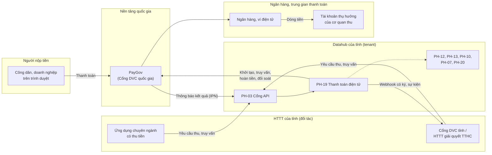
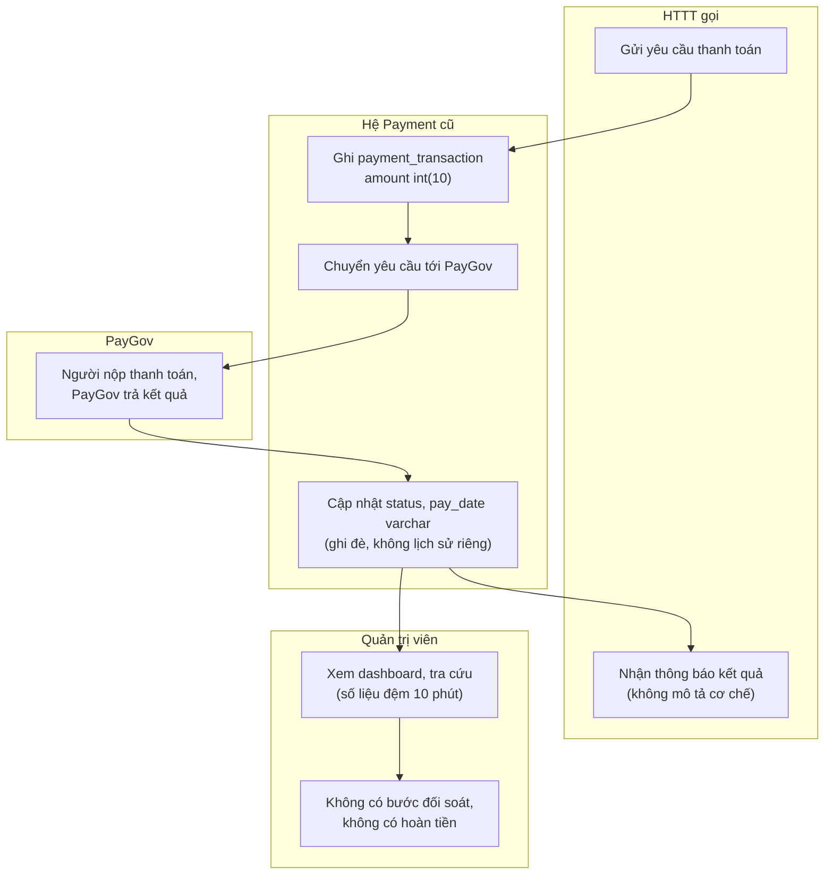
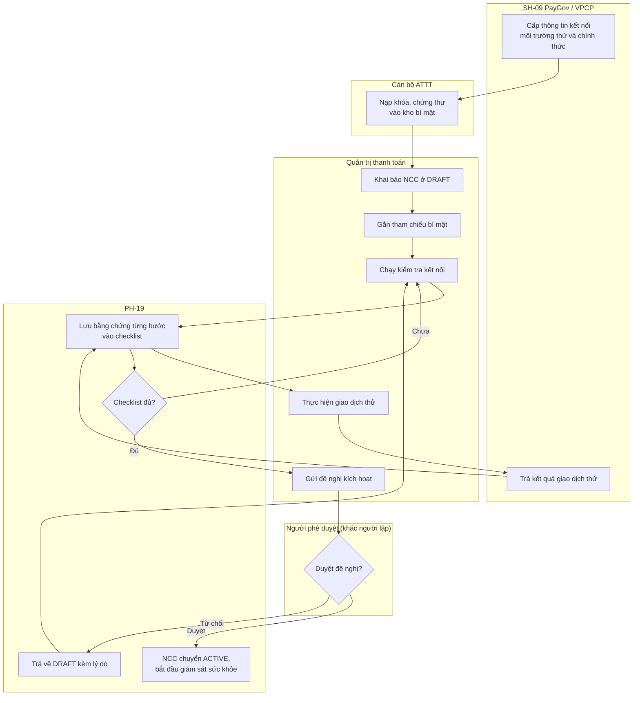
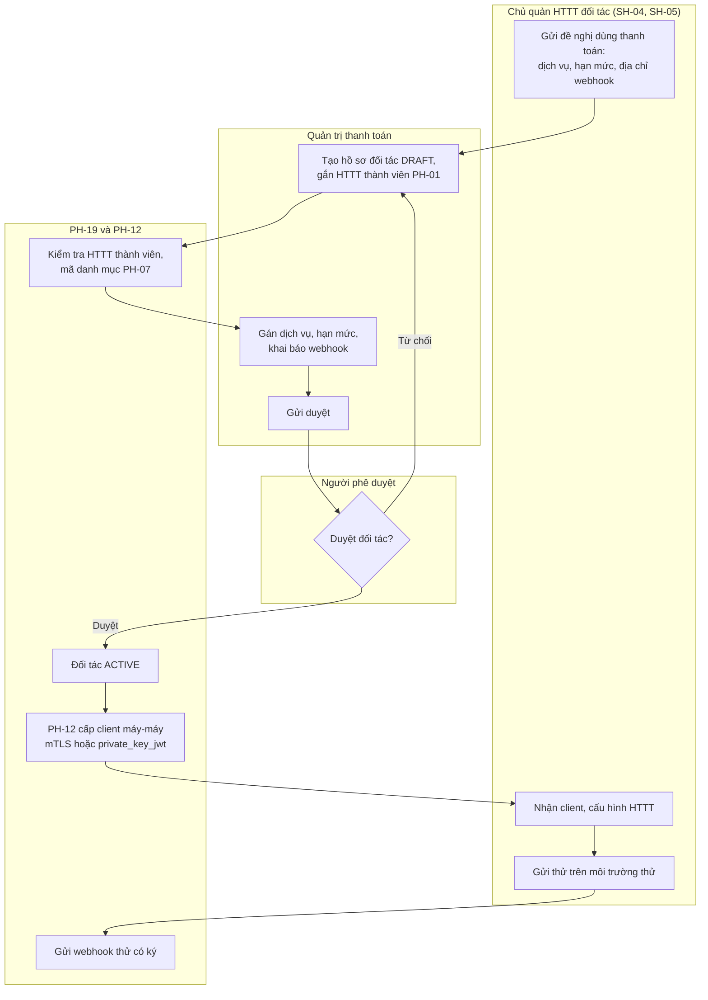
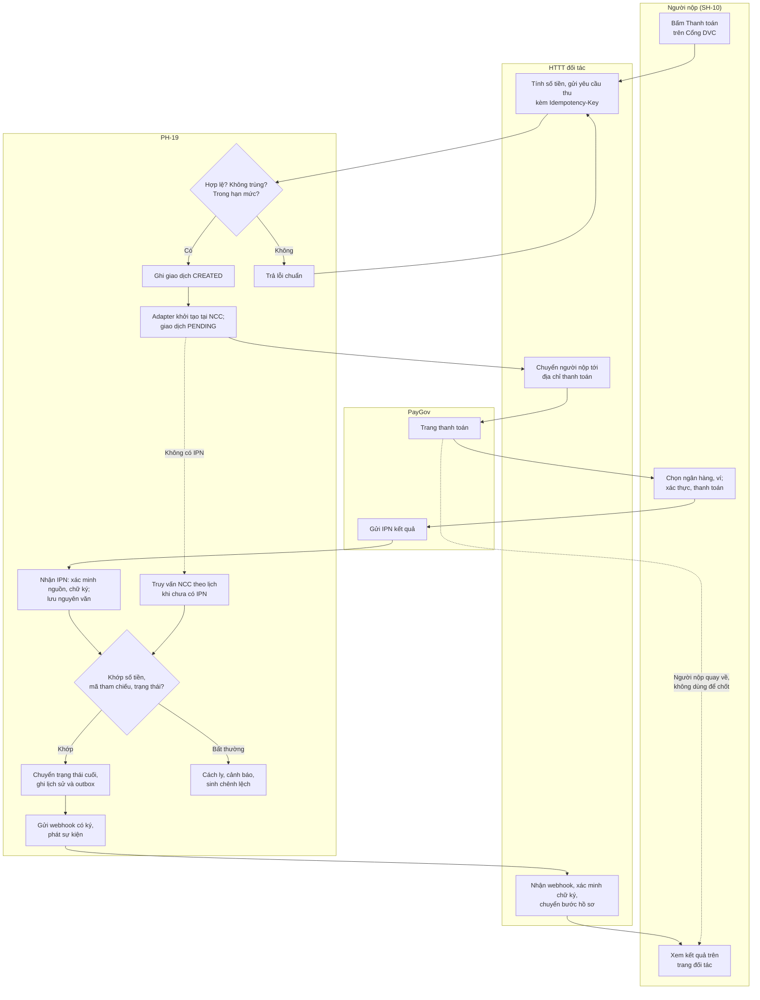
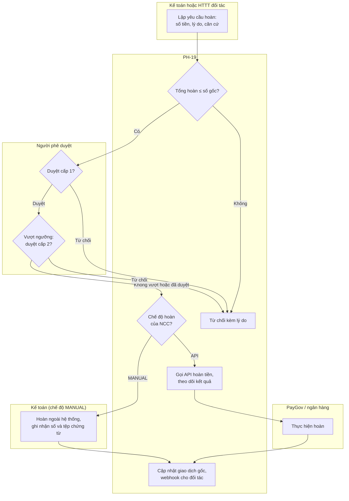
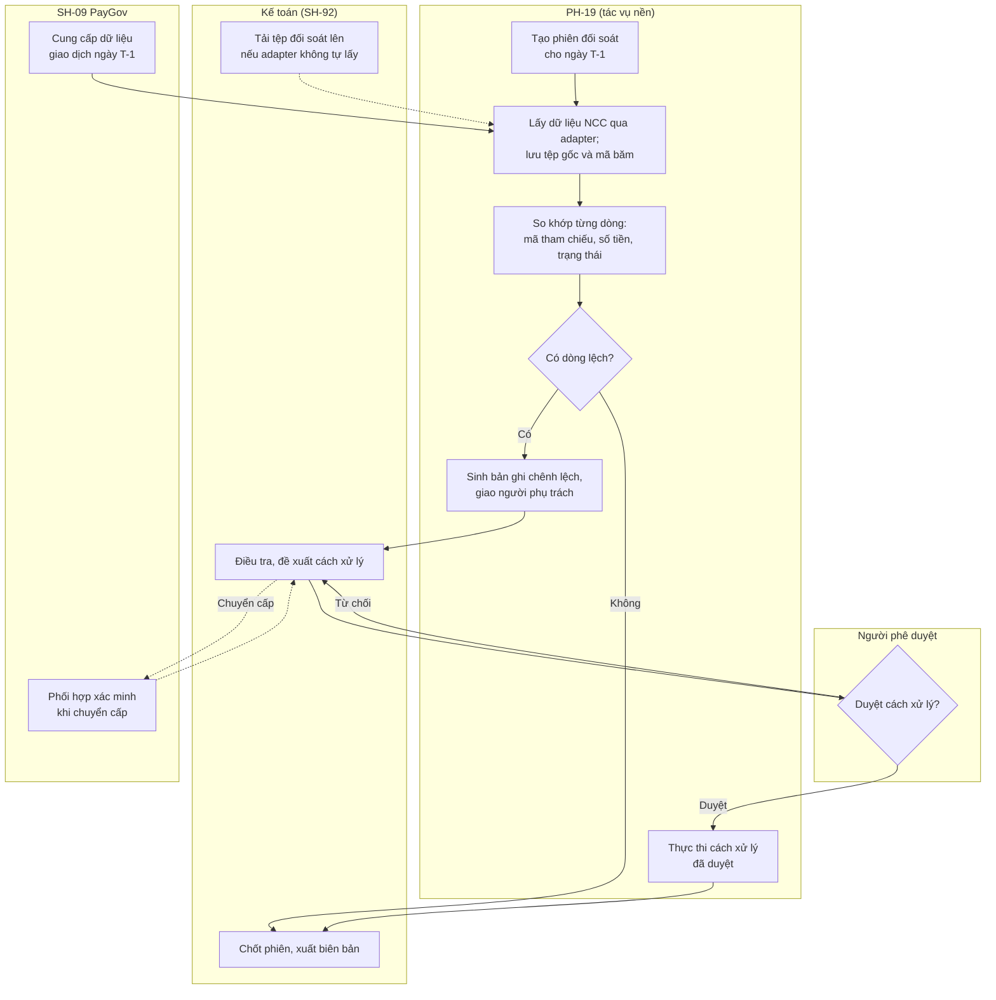
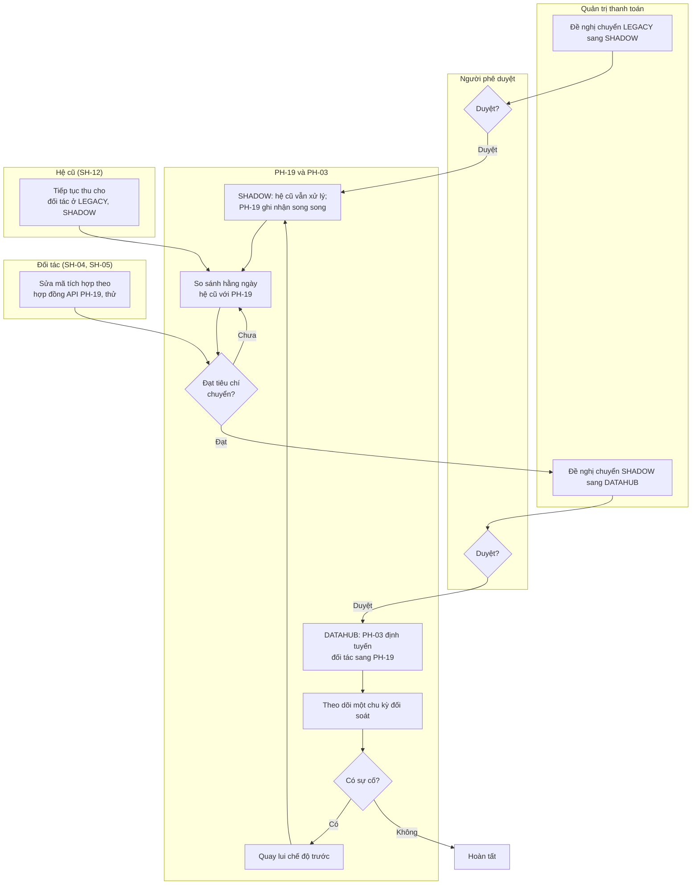
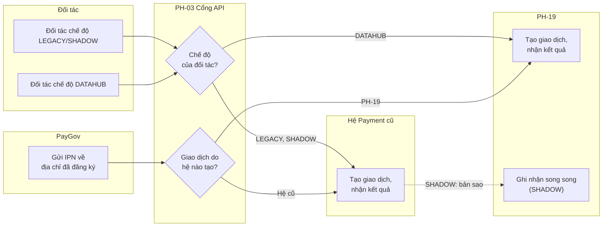

# D02-01-PH19 · Yêu cầu nghiệp vụ phân hệ PH-19 Thanh toán điện tử

## 1. Mục đích, phạm vi và vị trí trong BRD tổng

### 1.1. Mục đích của tài liệu

Tài liệu này là phần yêu cầu nghiệp vụ (BRD) dành riêng cho phân hệ PH-19 Thanh toán điện tử của Datahub. Nó trả lời ba câu hỏi mà hội đồng thẩm định và chủ đầu tư cần trả lời trước khi phê duyệt đầu tư cho phân hệ: vì sao tỉnh cần một lớp thanh toán dùng chung đặt trong nền tảng tích hợp, lớp đó phải đạt được những kết quả nghiệp vụ nào, và việc thu phí, lệ phí trực tuyến của tỉnh sẽ diễn ra thế nào sau khi có phân hệ. Tài liệu không đặc tả chức năng chi tiết; phần đó nằm ở FRS D02-03-PH19, nơi duy nhất định nghĩa nội dung các yêu cầu chức năng `FR-19-nnn`.

Tài liệu được viết cho hai tầng người đọc. Các mục 1 đến 6 dành cho hội đồng thẩm định, lãnh đạo Sở Khoa học và Công nghệ, Sở Tài chính và Văn phòng UBND tỉnh: các mục này nêu bối cảnh pháp lý, hiện trạng, mục tiêu đo được và yêu cầu nghiệp vụ cấp cao. Các mục 7 đến 11 dành cho đội phân tích, thiết kế và kiểm thử: chúng mô tả quy trình TO-BE ở mức có thể dựng use case, mô hình vận hành đa tenant, rủi ro và ma trận truy vết xuống FR.

### 1.2. Phạm vi nghiệp vụ

PH-19 là **lớp trung gian thanh toán của tỉnh** đặt bên trong Datahub. Các hệ thống thông tin (HTTT) của tỉnh có thu tiền — Cổng dịch vụ công tỉnh, HTTT giải quyết thủ tục hành chính (TTHC), các ứng dụng chuyên ngành — gọi chung là **đối tác**, gửi yêu cầu thu phí, lệ phí và các nghĩa vụ tài chính khác vào PH-19 qua một giao diện thống nhất. PH-19 chuyển yêu cầu tới **nhà cung cấp thanh toán** (NCC), trong đó kênh đầu tiên và mặc định là Nền tảng thanh toán trực tuyến của Cổng Dịch vụ công quốc gia (PayGov). PH-19 nhận kết quả, lưu toàn bộ lịch sử làm chứng cứ điện tử, báo kết quả lại cho đối tác, rồi đối soát với NCC vào ngày làm việc kế tiếp và tổ chức xử lý mọi chênh lệch.

Điểm cần nhấn mạnh ngay từ đầu, vì nó quyết định ranh giới trách nhiệm pháp lý của phân hệ: **PH-19 không giữ tiền và không phải là tổ chức cung ứng dịch vụ trung gian thanh toán**. Tiền đi thẳng từ tài khoản hoặc ví của người nộp, qua PayGov và các ngân hàng, trung gian thanh toán kết nối với PayGov, tới tài khoản thụ hưởng của cơ quan thu. PH-19 chỉ giữ thông tin về yêu cầu thu, kết quả thanh toán, việc đối soát và các quyết định xử lý, tức là giữ chứng cứ điện tử của giao dịch chứ không giữ dòng tiền.

Bảng dưới đây tóm tắt ranh giới phạm vi ở mức nghiệp vụ. Bảng ranh giới đầy đủ, chi tiết tới từng nhóm chức năng, nằm ở khung truy vết D02-03-PH19-00 mục 1.2 và không được nhắc lại ở đây để giữ một sự thật ở một nơi.

| Thuộc phạm vi PH-19 | Ngoài phạm vi PH-19 (ai làm) |
|---|---|
| Quản lý vòng đời NCC thanh toán: khai báo, kiểm tra kết nối, giao dịch thử, kích hoạt có phê duyệt, tạm dừng, ngừng hẳn | Đàm phán, ký thỏa thuận kết nối với Văn phòng Chính phủ (chủ đầu tư); kết nối trực tiếp từng ngân hàng (đi qua PayGov) |
| Danh mục dịch vụ thanh toán, nhóm dịch vụ, đối tác được phép thu, hạn mức | Tính mức phí, lệ phí của từng TTHC (HTTT đối tác tính và gửi số tiền); giữ bảng danh mục ngân hàng, lĩnh vực, loại phí (PH-07) |
| Tạo giao dịch, nhận kết quả, truy vấn trạng thái, chống ghi trùng, hết hạn, hủy | Giao diện chọn ngân hàng, nhập thông tin thẻ (do PayGov cung cấp); phát hành biên lai thu phí, lệ phí điện tử có giá trị pháp lý |
| Hoàn tiền có phê duyệt bốn mắt | Quyết định hành chính về việc hoàn phí (cơ quan thu quyết định) |
| Đối soát hằng ngày với NCC, xử lý chênh lệch, biên bản | Hạch toán kế toán, quyết toán ngân sách, đối soát giữa ngân hàng và Kho bạc |
| Tra cứu, nhật ký, dashboard, báo cáo vận hành | Kho phân tích dài hạn (PH-16 và lớp dữ liệu dùng chung tiêu thụ sự kiện) |
| Thông báo kết quả cho HTTT đối tác qua webhook có ký và sự kiện | Gửi tin nhắn, thư điện tử cho người nộp (đối tác thực hiện) |
| Vận hành đa tenant, chuyển đổi từ hệ Payment cũ theo kiểu strangler | Khởi tạo tenant (PH-20); di trú người dùng (PH-12) |

### 1.3. Vị trí trong BRD tổng của Datahub

Tài liệu này là **phụ lục chi tiết hóa miền thanh toán** của BRD tổng [D02-01](../D02-01-brd.md). BRD tổng đã xác lập ở cấp hệ thống ba điểm neo cho thanh toán: mục tiêu **BO-07** "Thanh toán trực tuyến cho dịch vụ công minh bạch, đối soát được" với hai chỉ số **KPI-13** và **KPI-14**; quy trình **BP-05** "Thanh toán dịch vụ công và đối soát"; và yêu cầu nghiệp vụ cấp cao **REQ-19** "Hệ thống phải làm trung gian thanh toán đa kênh: quản lý nhà cung cấp, dịch vụ, giao dịch, đối soát, hoàn tiền, báo cáo". Ba điểm neo đó đủ để thẩm định chủ trương nhưng chưa đủ để viết FR và kiểm thử, vì mỗi điểm gộp nhiều nghiệp vụ có chủ thể, rủi ro và tiêu chí nghiệm thu khác nhau. Tài liệu này tách chúng thành các mã con. Lý do tách thành một tập riêng là PH-19 là phân hệ viết mới hoàn toàn (quyết định Q3 trong dàn ý đã duyệt), có căn cứ pháp lý và nhóm bên liên quan khác hẳn các miền tích hợp dữ liệu, đặc biệt là Sở Tài chính và kế toán cơ quan thu, và có lịch triển khai riêng ở đợt 2.

Quan hệ giữa mã của BRD tổng và mã của tài liệu này được tóm tắt trong bảng sau. Mọi mã có hậu tố "(đề xuất)" là **mã con** do khung truy vết D02-03-PH19-00 cấp tạm ở dải 91–99; mỗi lần xuất hiện, tài liệu luôn ghi kèm mã cha chính thức để người đọc không phải tra ngược. Khi luồng lõi chính thức hóa các mã con, việc đổi số là thay thế cơ học một-một.

| Mã chính thức (BRD tổng) | Mã con trong tài liệu này (đề xuất) | Quan hệ |
|---|---|---|
| REQ-19 | REQ-91…99 | Chín REQ con tinh chỉnh REQ-19 theo từng nhóm nghiệp vụ. REQ-98 còn tinh chỉnh REQ-20 (đa tenant) cho phạm vi thanh toán; REQ-99 tinh chỉnh REQ-22 (chuyển đổi dần từ hệ cũ) |
| BP-05 | BP-91…96 | Sáu quy trình con. BP-96 đồng thời là trường hợp riêng của BP-09 "Chuyển đổi từ hệ cũ" áp cho khối Payment |
| BO-07 | BO-91…96 | Sáu mục tiêu con. BO-94 còn đóng góp vào BO-08 (vận hành chủ động); BO-96 đóng góp vào mục tiêu chuyển đổi của REQ-22 |
| KPI-13, KPI-14 | KPI-91…99 | KPI-13 và KPI-14 được **tái dùng nguyên văn**, không định nghĩa lại; KPI-9x là chỉ số vận hành chi tiết hơn, phục vụ nghiệm thu PH-19 |
| SH-02, 03, 04, 05, 07, 09, 10, 11, 12 | SH-92, SH-93, SH-97 | Dùng bên liên quan chính thức; chỉ thêm ba bên mà BRD tổng chưa có (mục 4) |

Mã `CMP-LAW` mới mà tài liệu này cần được đề xuất ở dải 91–97 vì cùng lý do (mục 2.1 và mục 12). Phần bối cảnh chung của dự án, hiện trạng năm khối hệ cũ, bức tranh năng lực 20 phân hệ và phân đợt đã được trình bày ở BRD tổng (các mục 2, 5, 6.1, 8.3) và không được chép lại ở đây.

Về thời điểm, PH-19 được xếp ở **đợt 2** (BRD tổng mục 8.3). Trong suốt giai đoạn chuyển đổi, hệ Payment cũ vẫn tiếp tục thu tiền; Datahub đứng phía trước và nhận dần từng đối tác theo mô hình strangler mô tả ở mục 8.3 của tài liệu này. Nếu tỉnh triển khai đầu tiên buộc phải tắt hệ cũ sớm, PH-19 phải được kéo lên MVP; đây là một giả định có điều kiện, được ghi ở mục 10. Về kiến trúc, SAD D03-01 §4.2 đã quyết định PH-19 chạy ở đơn vị triển khai riêng `dh-payment` vì yêu cầu bảo mật cao hơn, hồ sơ tải cao điểm khác và cần đường ra (egress) tới kênh thanh toán; tài liệu này chỉ dẫn quyết định đó, không bàn lại.

PH-19 phụ thuộc cứng vào sáu phân hệ thuộc MVP đợt 1: PH-03 Cổng API (định tuyến, xác thực biên, giới hạn tần suất, danh sách IP được phép gọi về), PH-12 Định danh và ủy quyền, PH-13 Giám sát và ghi vết, PH-10 Truyền thông sự kiện, PH-07 Danh mục dùng chung và PH-20 Quản trị tenant. Vì vậy PH-19 không thể đưa vào vận hành trước khi các phân hệ này đạt nghiệm thu. Bảng phụ thuộc chi tiết nằm ở khung truy vết mục 1.5.

## 2. Căn cứ pháp lý và bối cảnh

### 2.1. Căn cứ pháp lý

Phân hệ thanh toán chịu sự chi phối của ba nhóm văn bản: nhóm quy định về dịch vụ công trực tuyến và thực hiện TTHC trên môi trường điện tử (quy định *phải* cho phép nộp phí, lệ phí trực tuyến), nhóm quy định về thanh toán và giao dịch điện tử (quy định *giá trị pháp lý* của chứng cứ và *ai được* làm trung gian thanh toán), và nhóm quy định về an toàn thông tin, dữ liệu cá nhân, lưu trữ (quy định *cách giữ* dữ liệu giao dịch). Bảng dưới đây liệt kê các văn bản được truy vết. Các văn bản đã có mã trong D00-01 §7 được giữ nguyên mã; văn bản chưa có mã được đề xuất mã mới ở dải 91–97. Cột "Trạng thái kiểm tra" theo cùng quy ước với D00-01: mọi văn bản ở trạng thái "Cần đối chiếu" phải được kiểm tra số hiệu, ngày ban hành, hiệu lực và điều khoản cụ thể trước khi tài liệu được phát hành bản 1.0.

| Mã | Văn bản | Nội dung chi phối PH-19 | REQ chịu tác động | Trạng thái kiểm tra |
|---|---|---|---|---|
| CMP-LAW-91 (đề xuất) | Nghị định 45/2020/NĐ-CP về thực hiện TTHC trên môi trường điện tử | Tổ chức, cá nhân được thực hiện nghĩa vụ tài chính trong TTHC bằng phương thức thanh toán trực tuyến; kết quả thanh toán là một phần hồ sơ điện tử | REQ-93, REQ-94 | Cần đối chiếu điều khoản cụ thể |
| CMP-LAW-92 (đề xuất) | Nghị định 42/2022/NĐ-CP quy định về việc cung cấp thông tin và dịch vụ công trực tuyến của CQNN trên môi trường mạng | Phân loại dịch vụ công trực tuyến toàn trình và một phần; dịch vụ toàn trình có phí, lệ phí đòi hỏi việc thanh toán cũng được thực hiện trực tuyến | REQ-93 | Cần đối chiếu điều khoản cụ thể |
| CMP-LAW-93 (đề xuất) | Nghị định 61/2018/NĐ-CP về cơ chế một cửa, một cửa liên thông, được sửa đổi, bổ sung bởi Nghị định 107/2021/NĐ-CP | Vai trò của Cổng DVC quốc gia và HTTT giải quyết TTHC cấp tỉnh; thanh toán trực tuyến phí, lệ phí qua Cổng DVC quốc gia | REQ-93, REQ-97 | Cần đối chiếu điều khoản cụ thể |
| CMP-LAW-94 (đề xuất) | Nghị định 52/2024/NĐ-CP về thanh toán không dùng tiền mặt | Định nghĩa dịch vụ trung gian thanh toán và điều kiện cung ứng; cơ sở để khẳng định PH-19 không làm trung gian thanh toán và không giữ tiền | REQ-93, REQ-96 | Cần đối chiếu điều khoản cụ thể |
| CMP-LAW-95 (đề xuất) | Luật Giao dịch điện tử số 20/2023/QH15 | Giá trị pháp lý của thông điệp dữ liệu, chữ ký điện tử, chứng cứ; yêu cầu về lưu trữ thông điệp dữ liệu bảo đảm tính toàn vẹn | REQ-94, REQ-98 | Cần đối chiếu điều khoản cụ thể |
| CMP-LAW-96 (đề xuất) | Văn bản của Bộ Tài chính về hình thức, thời hạn thu, nộp phí, lệ phí (Thông tư 74/2022/TT-BTC hoặc văn bản thay thế) và quy định về biên lai thu phí, lệ phí điện tử (Nghị định 123/2020/NĐ-CP và văn bản sửa đổi) | Thu phí, lệ phí qua phương thức điện tử; trách nhiệm lập biên lai của tổ chức thu; liên quan tới câu hỏi ai phát hành biên lai (OQ-19-14) | REQ-93, REQ-95, REQ-96 | Cần đối chiếu số hiệu và hiệu lực |
| CMP-LAW-97 (đề xuất) | Luật Kế toán số 88/2015/QH13 và Luật Lưu trữ năm 2024 | Thời hạn lưu trữ chứng từ, tài liệu liên quan tới thu ngân sách; căn cứ để chốt thời gian lưu giao dịch, biên bản đối soát | REQ-98 | Cần đối chiếu số hiệu và thời hạn áp dụng cho chứng cứ của PH-19 |
| CMP-LAW-03 | Nghị định 47/2020/NĐ-CP về quản lý, kết nối, chia sẻ dữ liệu số của CQNN | Datahub đóng vai trò LGSP; kết nối giữa HTTT của tỉnh với nền tảng quốc gia đi qua nền tảng tích hợp cấp tỉnh | REQ-93 | Theo D00-01 |
| CMP-LAW-04, CMP-LAW-05 | Nghị định 13/2023/NĐ-CP và Luật Bảo vệ dữ liệu cá nhân năm 2025 | Họ tên, số định danh, số điện thoại của người nộp là dữ liệu cá nhân; phải tối thiểu hóa, che khi hiển thị, ghi nhận mục đích xử lý | REQ-97, REQ-98 | Theo D00-01 |
| CMP-LAW-06, CMP-LAW-07, CMP-LAW-08 | Nghị định 85/2016/NĐ-CP, Thông tư 12/2022/TT-BTTTT, TCVN 11930:2017 | Phân hệ xử lý giao dịch tài chính của nhiều cơ quan, đề xuất cấp độ 3 và sẵn sàng cấp độ 4 | REQ-98 | Theo D00-01 |
| CMP-LAW-15 | Nghị định 30/2020/NĐ-CP về công tác văn thư | Thể thức biên bản đối soát, báo cáo xuất bản ở dạng văn bản | REQ-95 | Theo D00-01 |
| CMP-LAW-16 | Luật An ninh mạng và văn bản hướng dẫn | Lưu trữ dữ liệu giao dịch trong nước, nhật ký | REQ-98 | Theo D00-01 |

Hai điểm pháp lý dưới đây chưa có câu trả lời chắc chắn và có thể làm thay đổi thiết kế, nên được nêu thành câu hỏi mở ở mục 10. Thứ nhất, chưa xác định được văn bản nào quy định cụ thể thủ tục kết nối của một tỉnh với PayGov, và liệu tỉnh có được kết nối qua một nền tảng trung gian như Datahub thay vì từng HTTT kết nối trực tiếp hay không. Thứ hai, thời hạn lưu trữ bắt buộc đối với chứng cứ điện tử về thanh toán phí, lệ phí (khác với thời hạn lưu chứng từ kế toán của cơ quan thu) chưa được xác định.

### 2.2. Bối cảnh PayGov

PayGov là tên thường gọi của Nền tảng thanh toán trực tuyến tích hợp trên Cổng Dịch vụ công quốc gia, do Văn phòng Chính phủ chủ quản và vận hành. Về mặt nghiệp vụ, PayGov làm một việc: đứng giữa các HTTT giải quyết TTHC của bộ, ngành, địa phương và mạng lưới ngân hàng, trung gian thanh toán, để người nộp chọn kênh thanh toán quen thuộc (thẻ nội địa, tài khoản ngân hàng, ví điện tử, mã QR) mà cơ quan thu không phải ký kết, tích hợp riêng với từng ngân hàng. Tiền được chuyển tới tài khoản thụ hưởng mà cơ quan thu đã đăng ký; PayGov trả kết quả về cho HTTT đã tạo yêu cầu.

Tài liệu hệ cũ dùng mã nhà cung cấp `PAYGOV` và mã hóa cứng giá trị này trong các câu truy vấn dashboard, nhưng **không kèm đặc tả kỹ thuật kết nối của PayGov**. SAD D03-01 đã ghi nhận rủi ro tương ứng là RSK-A04 (đặc tả NDXP, PayGov thay đổi). Vì vậy, trong toàn bộ bộ tài liệu PH-19, mọi chi tiết về tên trường, tham số, thuật toán ký, cách gọi lại kết quả (callback, IPN), cách lấy dữ liệu đối soát và khả năng hoàn tiền qua API của PayGov đều là **Giả định – cần đối chiếu Tài liệu kỹ thuật kết nối Nền tảng thanh toán của Cổng DVCQG do VPCP cấp**, và được gom thành nhóm câu hỏi mở OQ-19-01…08 của khung truy vết. Để việc thay đổi đặc tả không làm lung lay lõi nghiệp vụ, mọi trao đổi với PayGov được cô lập trong một adapter đóng vai trò lớp chống nhiễm (Anti-Corruption Layer, ADR-040). Ở tầng nghiệp vụ, tài liệu này chỉ dựa vào năm năng lực mà bất kỳ cổng thanh toán nào cũng phải có: khởi tạo một yêu cầu thanh toán và nhận về địa chỉ để chuyển người nộp tới; chuyển người nộp quay về sau khi thanh toán; gửi thông báo kết quả từ máy chủ tới máy chủ; trả lời truy vấn trạng thái một giao dịch; và cung cấp dữ liệu giao dịch theo ngày để đối soát. Năng lực thứ sáu — hoàn tiền qua API — được coi là *có thể không có*, và nghiệp vụ hoàn tiền được thiết kế để vẫn chạy được ở chế độ thủ công (mục 7.4).

### 2.3. Mô hình thu phí, lệ phí trực tuyến trên Cổng DVC

Để hội đồng thẩm định thấy rõ PH-19 đứng ở đâu, đoạn này mô tả chuỗi nghiệp vụ thu phí, lệ phí trực tuyến điển hình của một TTHC có thu tiền. Người nộp (công dân, doanh nghiệp) nộp hồ sơ trên Cổng DVC của tỉnh hoặc Cổng DVC quốc gia. Tại thời điểm phải nộp tiền — có thể ngay khi nộp hồ sơ, hoặc sau khi cán bộ thẩm định xác định nghĩa vụ tài chính — HTTT giải quyết TTHC tính số tiền theo biểu phí, lệ phí của thủ tục và tạo một yêu cầu thanh toán. Người nộp được chuyển sang trang của PayGov, chọn ngân hàng hoặc ví, xác thực và thanh toán. PayGov báo kết quả về HTTT đã tạo yêu cầu; HTTT ghi nhận hồ sơ đã nộp tiền, chuyển bước xử lý và lập biên lai. Cuối ngày, kế toán của cơ quan thu cần biết chính xác những khoản nào đã vào tài khoản thụ hưởng để hạch toán.

Trong mô hình không có PH-19, mỗi HTTT có thu tiền phải tự tích hợp với PayGov: tự giữ khóa ký, tự xác minh kết quả, tự xử lý trường hợp người nộp đóng trình duyệt giữa chừng, tự đối soát. Với một tỉnh có nhiều HTTT chuyên ngành, điều đó có nghĩa là nhiều bản tích hợp khác nhau với chất lượng không đồng đều, nhiều nơi giữ khóa bí mật, và không ai có bức tranh tổng hợp về số thu trực tuyến của tỉnh. PH-19 thay mô hình "mỗi HTTT tự nối PayGov" bằng mô hình "mọi HTTT nối PH-19, PH-19 nối PayGov". Sơ đồ ngữ cảnh dưới đây thể hiện mô hình này.

Sơ đồ cho thấy hai dòng tách biệt. Dòng thông tin (mũi tên giữa đối tác, Datahub và PayGov) đi qua PH-03 và PH-19; mọi yêu cầu thu và mọi thông báo kết quả đều được PH-19 ghi nhận. Dòng tiền (từ người nộp qua PayGov, ngân hàng tới tài khoản thụ hưởng) không đi qua Datahub. Người nộp chỉ tương tác với PayGov để thanh toán và với trang của đối tác để xem kết quả; họ không đăng nhập PH-19. Các phân hệ nền của Datahub cung cấp định danh, nhật ký, sự kiện, danh mục và cấu hình tenant cho PH-19 nhưng không nằm trên đường đi của giao dịch, trừ PH-03.

## 3. Hiện trạng AS-IS: hệ Payment cũ

### 3.1. Tổng quan hệ cũ

BRD tổng mục 5.2 đã tóm tắt vấn đề của khối Payment trong một dòng (số tiền `int(10)`, ngày thanh toán kiểu chuỗi, không đối soát, không hoàn tiền). Mục này đi sâu hơn để làm căn cứ cho từng REQ con. Hệ Payment cũ được Viettel xây dựng năm 2021 cho tỉnh Đắk Nông, là một khối của nền tảng LGSP cũ. Tài liệu hệ cũ gồm phân tích yêu cầu (PTYC v1.2), thiết kế tổng thể (TKTT v1.2), thiết kế chi tiết (TKCT v1.7), thiết kế CSDL, hướng dẫn sử dụng (HDSD) và hướng dẫn vận hành (HDVH). Sau đợt sắp xếp đơn vị hành chính năm 2025, địa bàn tỉnh Đắk Nông cũ thuộc một tỉnh mới sau hợp nhất (cần đối chiếu nghị quyết sắp xếp); hệ quả nghiệp vụ của việc này được nêu ở mục 9.

Về chức năng, hệ cũ được kiểm kê thành 23 chức năng `LGC-PAY-001…023` tại D00-03 mục 4.6, cộng ba hành vi được khung truy vết đề xuất bổ sung `LGC-PAY-024…026` (đề xuất). Có thể chia các chức năng đó thành năm nhóm. Nhóm quản lý nhà cung cấp gồm thêm, xem, sửa, xóa, tìm, kích hoạt, dừng nhà cung cấp và thông báo lỗi kết nối (LGC-PAY-001…009). Nhóm giao dịch gồm nhận kết quả thanh toán, lưu dữ liệu quá trình thanh toán và thông báo kết quả cho HTTT gọi (LGC-PAY-010…012, LGC-PAY-024 đề xuất). Nhóm tra cứu gồm bảng giao dịch, tìm kiếm nâng cao theo trạng thái, lĩnh vực, thời gian, từ khóa, và chi tiết giao dịch (LGC-PAY-014…019). Nhóm giám sát gồm dashboard tổng quan và dashboard kênh thanh toán (LGC-PAY-013, 020, 026 đề xuất). Nhóm danh mục và nhật ký gồm quản lý đối tác, nhóm dịch vụ, dịch vụ và nhật ký giao dịch (LGC-PAY-021, 022).

Về dữ liệu, hệ cũ có năm bảng: `payment_partner` (đối tác), `payment_provider` (nhà cung cấp), `payment_service_group` (nhóm dịch vụ, hệ cũ gọi là "lĩnh vực giao dịch"), `payment_service` (dịch vụ) và `payment_transaction` (giao dịch). Về hạ tầng, hai ứng dụng chạy chung một tiến trình Tomcat trên một máy chủ ứng dụng, một máy chủ PostgreSQL; mọi thay đổi cấu hình đều đòi hỏi khởi động lại Tomcat, và việc dừng ứng dụng này kéo theo dừng ứng dụng kia (HDVH).

### 3.2. Quy trình AS-IS dựng lại từ tài liệu cũ

Tài liệu hệ cũ không có sơ đồ quy trình nghiệp vụ. Sơ đồ dưới đây được dựng lại từ danh sách chức năng của PTYC, luồng nghiệp vụ của TKCT và mô tả của HDSD, để làm nền so sánh với quy trình TO-BE ở mục 7.

Quy trình cũ là một chuỗi thẳng, không có nhánh xử lý ngoại lệ nào được mô tả. Tài liệu không nói điều gì xảy ra khi PayGov không gửi kết quả, khi kết quả đến hai lần, khi số tiền trong kết quả khác số tiền yêu cầu, hay khi HTTT gọi không nhận được thông báo. Cuối chuỗi, quản trị viên chỉ có thể xem; không có bước nghiệp vụ nào xác nhận số liệu của hệ khớp với số liệu của PayGov và ngân hàng.

### 3.3. Điểm yếu của hệ cũ

Bảng sau tổng hợp các điểm yếu được phát hiện khi đọc tài liệu hệ cũ. Mỗi điểm yếu được nêu kèm hệ quả nghiệp vụ và yêu cầu nghiệp vụ của PH-19 khắc phục nó, để hội đồng thẩm định thấy mỗi yêu cầu ở mục 6 đều xuất phát từ một vấn đề có thật.

| STT | Điểm yếu | Bằng chứng trong tài liệu cũ | Hệ quả nghiệp vụ | REQ khắc phục |
|---|---|---|---|---|
| 1 | Không có nghiệp vụ đối soát | Không tài liệu nào mô tả đối soát; D00-03 §4.6 ghi nhận | Không phát hiện được giao dịch PayGov báo thành công mà hệ không ghi nhận, hoặc ngược lại; kế toán phải đối chiếu thủ công với sao kê ngân hàng | REQ-95 |
| 2 | Không có nghiệp vụ hoàn tiền | Chỉ có ba giá trị trạng thái `REFUND_PENDING`, `REFUND_SUCCESS`, `REFUND_FAILED` trong TKCT, không có chức năng nào sinh ra chúng (LGC-PAY-025 đề xuất) | Người nộp bị thu sai hoặc thu trùng không được hoàn qua hệ thống; không có phê duyệt, không có vết | REQ-96 |
| 3 | Không bảo mật kết quả gọi về | Chức năng "Nhận kết quả thanh toán" (LGC-PAY-010) không mô tả xác minh chữ ký, nguồn gọi, chống phát lại | Kẻ xấu có thể giả mạo một thông báo "đã thanh toán" để hồ sơ được xử lý mà không nộp tiền | REQ-94, REQ-98 |
| 4 | Không chống ghi trùng | Không có khóa duy nhất ngoài `id`; không có cơ chế idempotency | Người nộp có thể bị tạo hai yêu cầu và trả tiền hai lần cho một hồ sơ; một kết quả đến hai lần có thể bị xử lý hai lần | REQ-94 |
| 5 | Số tiền kiểu `int(10)` | Cột `amount` bảng `payment_transaction` | Trần khoảng 2,1 tỷ đồng; một số nghĩa vụ tài chính (tiền sử dụng đất, lệ phí trước bạ tài sản giá trị lớn) có thể vượt trần | REQ-93, REQ-99 |
| 6 | Ngày thanh toán kiểu `varchar` | Cột `pay_date`; TKCT ghi "định dạng ngày tháng được quy định từ PayGov khi trả về kết quả" | Không lọc, sắp xếp, tổng hợp theo ngày thanh toán một cách tin cậy; không xác định được múi giờ; đối soát theo ngày không làm được | REQ-95, REQ-99 |
| 7 | Chỉ một nhà cung cấp, mã hóa cứng | Các câu truy vấn dashboard trong TKCT chứa điều kiện `providerCode = 'PAYGOV'` (LGC-PAY-023) | Khi PayGov gián đoạn, tỉnh không có phương án; thêm kênh thứ hai đòi hỏi sửa mã | REQ-91 |
| 8 | Không có lịch sử trạng thái | Trạng thái nằm trên một cột duy nhất của giao dịch; TKCT nhắc tới `PaymentHistory` nhưng thiết kế CSDL không có bảng này | Không chứng minh được giao dịch đã đi qua những trạng thái nào, khi nào, do ai | REQ-94, REQ-97 |
| 9 | Không có thông báo kết quả tin cậy cho HTTT gọi | LGC-PAY-012 chỉ ghi "Thông báo kết quả thanh toán" | HTTT gọi có thể không biết hồ sơ đã nộp tiền, hồ sơ bị treo | REQ-94 |
| 10 | Không có cách ly theo tỉnh | Không bảng nào có cột tỉnh hoặc tenant | Không thể phục vụ nhiều tỉnh trên một bản cài; không thể hợp nhất dữ liệu hai tỉnh cũ sau sắp xếp mà vẫn phân biệt được nguồn | REQ-98 |
| 11 | Bí mật kết nối nằm trong tệp cấu hình | HDVH hướng dẫn sửa `username`, `password` trong tệp cấu hình rồi khởi động lại Tomcat | Rủi ro lộ thông tin xác thực; thay đổi cấu hình gây gián đoạn | REQ-98 |
| 12 | Không ràng buộc toàn vẹn dữ liệu | Các khóa ngoại tham chiếu bằng mã kiểu `varchar(255)`, không có ràng buộc duy nhất cho mã | Mã đối tác, mã dịch vụ có thể trùng hoặc mồ côi; dữ liệu lịch sử cần làm sạch khi di trú | REQ-92, REQ-99 |
| 13 | Số liệu giám sát chậm, không cảnh báo | Số liệu tổng được đệm 10 phút (LGC-PAY-026 đề xuất); "Thông báo lỗi kết nối" không mô tả kênh, ngưỡng | Sự cố kênh thanh toán được biết qua phản ánh của người dân thay vì cảnh báo tự động | REQ-91, REQ-97 |
| 14 | Chỉ tiêu phi chức năng thấp | Uptime 90%/năm; 1 người dùng hoạt động; phản hồi ≤ 5 giây với 10 người dùng đồng thời (LGC-NFR-001…003) | Không tương xứng với một kênh thu ngân sách phục vụ người dân 24/7 | REQ-98 |

Điểm chung của các điểm yếu trên là hệ cũ được thiết kế như một **danh mục ghi nhận** ("Danh mục thanh toán điện tử" là tên gọi trong chính tài liệu cũ) hơn là một **hệ thống giao dịch tài chính**. Nó ghi lại những gì PayGov trả về và cho xem lại, nhưng không bảo đảm rằng điều được ghi lại là đúng, đủ, không trùng và khớp với dòng tiền thực tế. PH-19 thay đổi bản chất đó: mỗi giao dịch là một đối tượng có vòng đời được kiểm soát, có chứng cứ và được đối soát.

### 3.4. Những gì hệ cũ làm tốt và được giữ lại

Không phải mọi thứ của hệ cũ đều cần thay. Theo D00-03, 16 trên 23 chức năng hệ cũ có kết luận "Giữ nguyên": cách tổ chức đối tác – nhóm dịch vụ – dịch vụ – nhà cung cấp là hợp lý và được giữ làm khung danh mục của PH-19; bộ tiêu chí tra cứu (trạng thái chọn nhiều, lĩnh vực chọn nhiều, mẫu thời gian 1 tháng, 3 tháng, 1 quý, phân trang 20 dòng) đã quen với người dùng và được giữ nguyên; hai dashboard (tổng quan và kênh thanh toán) được giữ chỉ số cũ và bổ sung chỉ số mới. Ý tưởng "kích hoạt nhà cung cấp chỉ sau khi giao dịch mẫu thành công" của hệ cũ là đúng đắn và trở thành nền của quy trình BP-91. Việc giữ lại những điểm này giúp người dùng chuyển sang PH-19 mà không phải học lại từ đầu.

## 4. Bên liên quan và nhu cầu

BRD tổng mục 4 đã định nghĩa mười hai nhóm bên liên quan chính thức SH-01…SH-12. Tài liệu này dùng lại chín nhóm có quan hệ trực tiếp với thanh toán và chỉ bổ sung ba nhóm mà BRD tổng chưa có nhưng giữ vai trò quyết định trong nghiệp vụ thu: Sở Tài chính cùng kế toán của cơ quan thu (người chịu trách nhiệm về số thu), Trung tâm phục vụ hành chính công (người chịu trách nhiệm về trải nghiệm nộp hồ sơ và nộp tiền), và cơ quan kiểm toán, thanh tra (người kiểm tra chứng cứ sau này). Ba nhóm bổ sung mang mã đề xuất SH-92, SH-93, SH-97 theo khung truy vết. Các mã SH-91, SH-94, SH-95, SH-96, SH-98 mà khung truy vết cấp tạm trước khi có BRD tổng nay được thay bằng mã chính thức tương ứng (xem mục 12).

Bảng dưới đây nêu, với mỗi nhóm, nhu cầu **riêng về thanh toán** (nhu cầu chung của nhóm đã có ở BRD tổng), mức ảnh hưởng, vai trò sử dụng hệ thống theo khung truy vết mục 1.3 và REQ con đáp ứng. Mức ảnh hưởng "Cao" nghĩa là bên đó có quyền chấp thuận hoặc bác bỏ một phần phạm vi; "Trung bình" nghĩa là bên đó cung cấp đầu vào bắt buộc; "Gián tiếp" nghĩa là bên đó chịu tác động nhưng không trực tiếp tham gia quyết định.

| Mã | Bên liên quan | Nhu cầu riêng về thanh toán | Ảnh hưởng | Vai trò trong PH-19 | REQ con đáp ứng |
|---|---|---|---|---|---|
| SH-02 | Sở KH&CN (đơn vị chủ quản CNTT của tỉnh) | Một điểm thanh toán dùng chung cho mọi HTTT của tỉnh thay cho nhiều bản tích hợp PayGov rời rạc; kiểm soát chi phí và quyền truy cập | Quyết định | Chủ đầu tư; `ROLE-TENANT_ADMIN` | REQ-91, REQ-93, REQ-98 |
| SH-03 | Trung tâm dữ liệu / Trung tâm CNTT tỉnh | Vận hành kênh thanh toán ổn định, có cảnh báo sớm khi PayGov gián đoạn, xử lý được giao dịch treo mà không cần can thiệp CSDL | Cao | `ROLE-PAYMENT_ADMIN`, `ROLE-PAYMENT_OPERATOR`, `ROLE-SECURITY_OFFICER` | REQ-91, REQ-94, REQ-97 |
| SH-04 | Sở, ngành, UBND cấp xã có HTTT thu phí (chủ quản HTTT đối tác) | Kết quả thanh toán tin cậy, được báo chủ động; không phải tự giữ khóa ký PayGov; nhận được kết quả đối soát phần của mình | Trung bình | Chủ quản của `ROLE-PARTNER_SYSTEM` | REQ-92, REQ-93, REQ-94 |
| SH-05 | Đơn vị phát triển HTTT (nhà thầu của các sở) | Một hợp đồng API ổn định, không đổi khi đặc tả PayGov đổi; môi trường thử có giả lập kết quả thành công, thất bại, treo; thời gian sửa mã khi chuyển từ hệ cũ hợp lý | Trung bình | Tích hợp qua `/api/payment-partner/v1` | REQ-93, REQ-99 |
| SH-07 | Cơ quan chuyên trách ATTT | Kênh nhận kết quả thanh toán không bị giả mạo; khóa ký không lộ; hồ sơ cấp độ thể hiện biện pháp riêng cho thanh toán | Cao (ràng buộc) | Thẩm định hồ sơ cấp độ | REQ-98 |
| SH-09 | Cổng thanh toán quốc gia (PayGov, Văn phòng Chính phủ) và đơn vị cung cấp dịch vụ thanh toán | Bên kết nối tuân thủ đặc tả, quy trình kết nối và yêu cầu an toàn; giảm số đầu mối kỹ thuật phải hỗ trợ ở mỗi tỉnh; đối soát khớp | Trung bình | Không dùng PH-19; là NCC `PAYGOV` | REQ-91, REQ-93, REQ-95 |
| SH-10 | Người dân và doanh nghiệp (người nộp tiền) | Nộp một lần là xong; không bị trừ tiền hai lần; đã bị trừ tiền thì hồ sơ phải được ghi nhận; được hoàn khi bị thu sai; dữ liệu cá nhân được bảo vệ | Gián tiếp | Không đăng nhập PH-19 | REQ-93, REQ-94, REQ-96, REQ-98 |
| SH-11 | Đơn vị cung cấp sản phẩm Datahub | Một bản mã cho mọi tỉnh; thêm adapter NCC mới không sửa lõi; hỗ trợ sự cố mà không cần xem dữ liệu giao dịch của tỉnh | Cao | `ROLE-PLATFORM_ADMIN` | REQ-91, REQ-98 |
| SH-12 | Đơn vị vận hành hệ LGSP cũ | Bàn giao dữ liệu giao dịch lịch sử an toàn; phối hợp chạy song song và chuyển định tuyến kết quả PayGov mà không làm mất giao dịch | Trung bình | Cung cấp quyền đọc CSDL cũ; phối hợp BP-96 | REQ-99 |
| SH-92 (đề xuất) | Sở Tài chính và bộ phận kế toán của cơ quan thu | Biết chính xác khoản nào đã thu, của hồ sơ nào, vào ngày nào; đối soát khớp với NCC; biên bản đối soát; hoàn tiền có phê duyệt, có chứng từ | Cao | `ROLE-PAYMENT_ACCOUNTANT`, `ROLE-PAYMENT_APPROVER` | REQ-95, REQ-96, REQ-97 |
| SH-93 (đề xuất) | Văn phòng UBND tỉnh / Trung tâm phục vụ hành chính công | Tăng tỷ lệ hồ sơ có thu phí được thanh toán trực tuyến; giảm phản ánh "đã trả tiền mà hồ sơ không chuyển bước"; số liệu thu trực tuyến tức thời | Cao | Người xem dashboard, báo cáo | REQ-93, REQ-94, REQ-97 |
| SH-97 (đề xuất) | Cơ quan kiểm toán, thanh tra | Truy được từng khoản thu tới yêu cầu gốc, kết quả, người phê duyệt; chứng cứ toàn vẹn, không sửa được; nhật ký mọi thao tác nhạy cảm | Trung bình | `ROLE-AUDITOR` | REQ-94, REQ-97, REQ-98 |

Hai xung đột nhu cầu cần được nhận diện sớm vì chúng chi phối thiết kế quy trình. Xung đột thứ nhất là giữa SH-05 (nhà thầu HTTT muốn sửa mã ít và muộn) và SH-92 (kế toán muốn mọi giao dịch của tỉnh đều đối soát được ngay, kể cả giao dịch của đối tác chưa chuyển sang PH-19). Tài liệu giải quyết bằng mô hình strangler có chế độ `SHADOW` (mục 8.3): PH-19 ghi nhận song song giao dịch của hệ cũ trước khi đối tác phải sửa mã, nên kế toán có số liệu đối soát sớm mà đối tác chưa bị ép tiến độ. Xung đột thứ hai là giữa SH-03 (muốn ít người, ít thủ tục) và SH-97 (muốn phê duyệt bốn mắt cho mọi thao tác nhạy cảm). Ở nhiều tỉnh, bộ phận vận hành chỉ có hai, ba người. Tài liệu giữ nguyên tắc bốn mắt — người phê duyệt luôn khác người lập — nhưng cho phép người phê duyệt là cán bộ Sở Tài chính hoặc cơ quan thu được gán `ROLE-PAYMENT_APPROVER`, thay vì bắt buộc cùng đơn vị vận hành (mục 9, rủi ro số 9).

## 5. Mục tiêu nghiệp vụ và chỉ số đo

### 5.1. Mục tiêu nghiệp vụ

Mục tiêu cha của toàn bộ phân hệ là **BO-07** của BRD tổng: "Thanh toán trực tuyến cho dịch vụ công minh bạch, đối soát được". Mục tiêu này đúng nhưng gộp ba ý khác nhau — có thu được trực tuyến qua nền tảng hay không, thu có đúng hay không, và đối soát có khớp hay không — trong khi mỗi ý có người chịu trách nhiệm và cách đo khác nhau. Bảng dưới đây tách BO-07 thành sáu mục tiêu con theo khung truy vết, kèm lý do nghiệp vụ và bên liên quan hưởng lợi chính.

| Mã (đề xuất) | Mã cha | Mục tiêu con | Vì sao cần | Bên hưởng lợi | REQ con |
|---|---|---|---|---|---|
| BO-91 | BO-07 | Mọi HTTT của tỉnh thu phí, lệ phí trực tuyến qua một đầu mối duy nhất, thay cho việc từng HTTT tự tích hợp PayGov | Giảm số nơi giữ khóa ký, đồng nhất chất lượng xử lý kết quả, tạo nguồn số liệu thu duy nhất của tỉnh | SH-02, SH-04, SH-93 | REQ-92, REQ-93 |
| BO-92 | BO-07 | Không sai, không mất, không ghi trùng một giao dịch nào; mỗi kết quả đều có chứng cứ truy lại được | Một giao dịch sai là một người dân bị thu sai hoặc một hồ sơ bị treo; chứng cứ là điều kiện để giải quyết khiếu nại | SH-10, SH-92, SH-97 | REQ-94, REQ-98 |
| BO-93 | BO-07 | Đối soát xong trong ngày làm việc kế tiếp và mọi chênh lệch được xử lý dứt điểm, có người chịu trách nhiệm | Kế toán cần số liệu khớp để hạch toán; chênh lệch để lâu sẽ không còn chứng cứ để xử lý | SH-92, SH-09 | REQ-95, REQ-96 |
| BO-94 | BO-07, BO-08 | Chủ động với sự cố kênh thanh toán: phát hiện trong vài phút và có sẵn kiến trúc để thêm kênh thứ hai | Khi PayGov gián đoạn, mọi hồ sơ có thu phí của tỉnh bị chặn; tỉnh phải biết trước người dân | SH-03, SH-93 | REQ-91 |
| BO-95 | BO-07 | Lãnh đạo và kế toán có số liệu thu trực tuyến tức thời, không phải tổng hợp thủ công | Hệ cũ đệm số liệu 10 phút và không có báo cáo theo kỳ | SH-02, SH-92, SH-93 | REQ-97 |
| BO-96 | BO-07 (đóng góp REQ-22) | Tắt được hệ Payment cũ mà không gián đoạn việc thu và không mất dữ liệu lịch sử | Hệ cũ có lỗi thiết kế dữ liệu không thể vá tại chỗ; chạy hai hệ lâu dài làm số liệu phân tán | SH-02, SH-12 | REQ-99 |

### 5.2. Chỉ số đo

Hai chỉ số của BO-07 được **tái dùng nguyên văn** từ BRD tổng; tài liệu này không định nghĩa lại chúng. Chín chỉ số KPI-91…99 là chỉ số con, phục vụ nghiệm thu PH-19 và vận hành hằng ngày. Mọi chỉ số đều tính được từ dữ liệu của chính PH-19 hoặc PH-13, không cần nhập tay; công thức nằm ở khung truy vết mục 3. Cột "Giá trị gốc" là hiện trạng của hệ cũ; khi hệ cũ không có dữ liệu để đo, giá trị gốc được ghi "Không đo được" kèm cách xác lập giá trị gốc trong giai đoạn chạy song song.

| Mã | Mã cha | Chỉ số | Giá trị gốc | Mục tiêu | Cách đo | Thời điểm đo |
|---|---|---|---|---|---|---|
| KPI-13 | BO-07 | Tỷ lệ giao dịch đối soát tự động khớp với kênh thanh toán | Không đối soát | ≥ 99,5% | Theo BRD tổng | 6 tháng |
| KPI-14 | BO-07 | Thời gian phát hiện giao dịch lệch | Không có | ≤ 1 ngày làm việc | Theo BRD tổng | 6 tháng |
| KPI-91 (đề xuất) | BO-91, BO-96 | Tỷ lệ HTTT có thu phí của tỉnh đã thu qua PH-19 | 0% (PH-19 chưa có); số HTTT đang thu qua hệ cũ cần khảo sát (Q01) | ≥ 90% sau 6 tháng vận hành; 100% trước khi tắt hệ cũ | Số đối tác `ACTIVE` ở chế độ `DATAHUB` chia cho số HTTT có thu phí theo danh sách tỉnh xác nhận | Hằng tháng |
| KPI-92 (đề xuất) | BO-92 | Tỷ lệ giao dịch có kết quả cuối trong 15 phút | Không đo được: hệ cũ không lưu thời điểm chuyển trạng thái; xác lập giá trị gốc trong giai đoạn `SHADOW` | ≥ 99,5% mỗi tháng | Từ lịch sử trạng thái giao dịch | Hằng tháng |
| KPI-93 (đề xuất) | BO-92 | Số giao dịch bị ghi nhận trùng hoặc sai số tiền do PH-19 | Không đo được: không có đối soát | 0 mỗi tháng | Từ bản ghi chênh lệch có nguyên nhân gốc tại PH-19 | Hằng tháng |
| KPI-94 (đề xuất) | BO-93 | Tỷ lệ khớp tự động của từng phiên đối soát | Không áp dụng | ≥ 99,9% mỗi phiên | Số dòng khớp tự động chia cho tổng số dòng của phiên | Mỗi phiên |
| KPI-95 (đề xuất) | BO-93 | Thời gian chốt phiên đối soát | Không áp dụng | ≤ 1 ngày làm việc với ≥ 95% số phiên | Thời điểm phiên chuyển `CLOSED` trừ thời điểm kết thúc ngày giao dịch | Hằng tháng |
| KPI-96 (đề xuất) | BO-93 | Thời gian xử lý một chênh lệch | Không áp dụng | Trung vị ≤ 3 ngày làm việc; không chênh lệch nào mở quá 10 ngày làm việc | Từ thời điểm phát hiện tới khi `RESOLVED` | Hằng tháng |
| KPI-97 (đề xuất) | BO-94 | Thời gian phát hiện sự cố kênh thanh toán | Không có cảnh báo tự động; sự cố được biết qua phản ánh | ≤ 3 phút | Từ lần kiểm tra sức khỏe thất bại đầu tiên tới khi cảnh báo được gửi | Mỗi sự cố |
| KPI-98 (đề xuất) | BO-92 | Tỷ lệ thông báo kết quả tới đối tác thành công | Không đo được: hệ cũ không lưu lượt thông báo | ≥ 99% trong 60 giây; 100% trong 24 giờ hoặc có cảnh báo | Từ lượt gửi webhook | Hằng tháng |
| KPI-99 (đề xuất) | BO-96 | Độ lệch số liệu sau di trú | Không áp dụng | 0 giao dịch, 0 đồng | So số lượng và tổng tiền giữa hệ cũ và Datahub theo từng tháng lịch sử (FR-00-092, FR-19-068) | Mỗi lần di trú |

Có hai điểm cần lưu ý khi đọc bảng. Thứ nhất, KPI-94 (≥ 99,9% mỗi phiên) chặt hơn KPI-13 (≥ 99,5%): đây là chủ ý, vì KPI-13 là ngưỡng nghiệm thu cấp hệ thống đo sau 6 tháng, còn KPI-94 là mục tiêu vận hành của từng ngày; một phiên đạt 99,5% nhưng dưới 99,9% vẫn được nghiệm thu nhưng phải được rà nguyên nhân. Thứ hai, KPI-97 (≤ 3 phút) chặt hơn KPI-15 của BRD tổng (MTTD ≤ 5 phút) vì mỗi phút PayGov gián đoạn là các hồ sơ có thu phí bị chặn; việc đặt mục tiêu chặt hơn không mâu thuẫn với chỉ tiêu toàn hệ thống.

## 6. Yêu cầu nghiệp vụ cấp cao

Mục này đặc tả chín REQ con của **REQ-19**. Mỗi REQ được trình bày theo cùng một cấu trúc: phát biểu yêu cầu, diễn giải (yêu cầu là gì, vì sao cần, ranh giới), nguồn gốc (bên liên quan, chức năng hệ cũ, căn cứ pháp lý), tiêu chí chấp nhận nghiệp vụ và các FR hiện thực. Tiêu chí chấp nhận nghiệp vụ là điều mà người đại diện bên liên quan kiểm chứng được trong đợt kiểm thử chấp nhận (UAT) mà không cần đọc mã; tiêu chí kỹ thuật chi tiết nằm ở FRS và test case. Danh sách FR đầy đủ của mỗi REQ nằm ở ma trận mục 11.

### 6.1. REQ-91 — Quản lý vòng đời nhà cung cấp thanh toán

**Phát biểu.** Tỉnh phải quản lý được vòng đời các nhà cung cấp thanh toán và chỉ đưa vào sử dụng nhà cung cấp đã được kiểm tra, phê duyệt. *(Mã cha: REQ-19.)*

**Diễn giải.** Nhà cung cấp thanh toán là đầu mối duy nhất chạm vào dòng tiền của người dân, nên việc đưa một nhà cung cấp vào dùng — hay đổi khóa, đổi địa chỉ kết nối của nó — phải là một quyết định có kiểm soát, không phải một thao tác sửa cấu hình. Hệ cũ đã có ý tưởng đúng là chỉ kích hoạt sau khi giao dịch mẫu thành công (LGC-PAY-001, 007) nhưng không có phê duyệt, không lưu bằng chứng và chỉ hỗ trợ một nhà cung cấp mã hóa cứng (LGC-PAY-023). REQ-91 yêu cầu một vòng đời đủ trạng thái (nháp, hoạt động, tạm dừng, ngừng hẳn), một danh sách kiểm tra trước kích hoạt có bằng chứng, phê duyệt bốn mắt, giám sát sức khỏe liên tục và kiến trúc cho phép thêm nhà cung cấp thứ hai bằng một adapter mới mà không sửa lõi. REQ-91 không bao gồm việc ký thỏa thuận kết nối với Văn phòng Chính phủ; đó là việc của chủ đầu tư và là tiền điều kiện của BP-91.

**Nguồn.** SH-03, SH-09, SH-11; LGC-PAY-001…009, 023; BO-94.

**Tiêu chí chấp nhận nghiệp vụ.**

1. Một nhà cung cấp mới chỉ nhận được giao dịch thật sau khi đã có kết quả kiểm tra kết nối đạt, một giao dịch thử thành công trên môi trường thử, và quyết định phê duyệt của một người khác người lập đề nghị; thiếu một trong ba điều kiện thì hệ thống từ chối kích hoạt.
2. Khi nhà cung cấp bị tạm dừng, đối tác nhận được thông báo lỗi rõ ràng khi tạo giao dịch mới, trong khi các giao dịch đang dở vẫn nhận được kết quả và vẫn được đối soát.
3. Nhà cung cấp đã từng có giao dịch không thể bị xóa; chỉ có thể chuyển ngừng hẳn khi không còn giao dịch dở và phiên đối soát mở.
4. Khi kiểm tra sức khỏe thất bại, cán bộ vận hành nhận được cảnh báo trong thời gian đạt KPI-97.
5. Cán bộ ATTT nhận được cảnh báo trước khi chứng thư, khóa của nhà cung cấp hết hạn 30, 14 và 7 ngày, và thay được khóa mà không làm gián đoạn giao dịch.
6. Không có màn hình hay báo cáo nào của PH-19 hiển thị giá trị khóa bí mật; hệ thống chỉ hiển thị dấu vân tay và hạn dùng.

**FR hiện thực.** FR-19-001…012.

### 6.2. REQ-92 — Quản lý dịch vụ thanh toán và đối tác

**Phát biểu.** Tỉnh phải quản lý được danh mục dịch vụ thanh toán và các HTTT được phép thu qua nền tảng. *(Mã cha: REQ-19.)*

**Diễn giải.** Một khoản thu đi qua PH-19 luôn trả lời được bốn câu hỏi: HTTT nào yêu cầu thu (đối tác), thu khoản gì (dịch vụ thanh toán, gắn với loại phí, lệ phí và lĩnh vực TTHC), cho cơ quan nào (đơn vị thu và tài khoản thụ hưởng), qua kênh nào (nhà cung cấp). REQ-92 giữ cấu trúc đối tác – nhóm dịch vụ – dịch vụ của hệ cũ (LGC-PAY-022) nhưng bổ sung ba điều mà hệ cũ thiếu: đối tác phải được phê duyệt và được cấp thông tin xác thực máy-máy riêng trước khi gọi được; mỗi đối tác chỉ dùng được những dịch vụ được gán, trong hạn mức số tiền mỗi giao dịch và mỗi ngày; và mọi mã danh mục (lĩnh vực, loại phí, cơ quan) phải là mã hợp lệ của PH-07 thay vì chuỗi tự do. Lý do của hạn mức là hạn chế thiệt hại khi thông tin xác thực của một đối tác bị lộ: kẻ tấn công không thể dùng nó để tạo khối lượng giao dịch bất thường.

**Nguồn.** SH-04, SH-05, SH-92; LGC-PAY-022; BO-91.

**Tiêu chí chấp nhận nghiệp vụ.**

1. Một HTTT chưa được phê duyệt làm đối tác, hoặc đối tác đang tạm dừng, không tạo được giao dịch mới; đối tác tạm dừng vẫn truy vấn được giao dịch cũ và vẫn nhận thông báo kết quả.
2. Một đối tác gọi một dịch vụ không được gán cho mình, hoặc vượt hạn mức số tiền, số giao dịch, tổng tiền trong ngày, bị từ chối với lý do cụ thể.
3. Một dịch vụ chỉ hoạt động được khi nhà cung cấp của nó đang hoạt động; dịch vụ đã có giao dịch không bị xóa cứng.
4. Khi tạo, sửa dịch vụ hoặc nhóm dịch vụ với mã lĩnh vực, loại phí, cơ quan không tồn tại trong danh mục dùng chung, hệ thống từ chối lưu.
5. Bí mật của client đối tác chỉ hiển thị một lần lúc cấp; thu hồi client có hiệu lực ngay ở lượt gọi kế tiếp.

**FR hiện thực.** FR-19-013…020 (thêm FR-19-021 cấu hình webhook, phục vụ REQ-94).

### 6.3. REQ-93 — Giao diện thu thống nhất, độc lập với nhà cung cấp

**Phát biểu.** Mọi HTTT của tỉnh phải thu được phí, lệ phí trực tuyến qua một giao diện thống nhất, không phụ thuộc đặc tả riêng của nhà cung cấp. *(Mã cha: REQ-19.)*

**Diễn giải.** Đây là lý do tồn tại của PH-19. Đối tác chỉ cần biết hợp đồng API của PH-19: gửi mã dịch vụ, số tiền, mã hồ sơ hoặc đơn hàng của mình, nội dung thu, thông tin người nộp ở mức tối thiểu và địa chỉ quay về; nhận lại mã giao dịch và địa chỉ thanh toán để chuyển người nộp tới. Mọi chi tiết của PayGov (tham số, cách ký, mã lỗi) bị giữ lại sau adapter (ADR-040). Nhờ vậy, khi đặc tả PayGov đổi (RSK-A04), chỉ adapter phải sửa và không đối tác nào phải sửa mã. Số tiền là số nguyên đồng Việt Nam không giới hạn ở 2,1 tỷ đồng như hệ cũ; đợt 2 chỉ nhận đơn vị tiền tệ VND. REQ-93 không bao gồm việc tính mức phí, lệ phí — HTTT đối tác tính và chịu trách nhiệm về số tiền gửi sang.

**Nguồn.** SH-04, SH-05, SH-10, SH-93; LGC-PAY-011, 024 (đề xuất); CMP-LAW-91, 92, 93 (đề xuất); BO-91.

**Tiêu chí chấp nhận nghiệp vụ.**

1. Một đối tác tạo được giao dịch và chuyển người nộp tới trang thanh toán của PayGov chỉ bằng hợp đồng API của PH-19, không cần bất kỳ tham số, khóa hay thư viện nào của PayGov.
2. Một giao dịch với số tiền lớn hơn 2.147.483.647 đồng (trần của hệ cũ) được tạo, thanh toán, lưu và hiển thị chính xác tới từng đồng.
3. Yêu cầu sai (dịch vụ không hợp lệ, số tiền không phải số nguyên dương, số tiền ngoài khoảng cho phép của dịch vụ) bị từ chối với đúng một mã lỗi chuẩn, mô tả bằng tiếng Việt.
4. Sau khi thanh toán, người nộp được đưa về trang của đối tác kèm kết quả có chữ ký; trang trung gian của PH-19 hiển thị được trạng thái "đang xác nhận" khi kết quả cuối chưa về.
5. Đối tác hoặc cán bộ hủy được một giao dịch chưa thanh toán; nếu sau đó PayGov vẫn báo thành công, khoản tiền đó không bị bỏ sót mà được xử lý như thanh toán muộn.

**FR hiện thực.** FR-19-022…026, FR-19-035.

### 6.4. REQ-94 — Ghi nhận kết quả đúng một lần, có chứng cứ, báo lại kịp thời

**Phát biểu.** Kết quả thanh toán phải được ghi nhận chính xác, đúng một lần, có chứng cứ, và được báo lại cho HTTT gọi kịp thời. *(Mã cha: REQ-19.)*

**Diễn giải.** REQ-94 khắc phục nhóm điểm yếu nghiêm trọng nhất của hệ cũ (mục 3.3, các dòng 3, 4, 8, 9). "Chính xác" nghĩa là kết quả chỉ được chấp nhận khi đến từ nhà cung cấp thật — đã xác minh nguồn và chữ ký — và khớp số tiền, mã tham chiếu của giao dịch; lượt người nộp quay về trên trình duyệt không bao giờ được dùng để chốt trạng thái, vì người nộp có thể sửa tham số trên trình duyệt. "Đúng một lần" có hai mặt: đối tác gửi lại cùng một yêu cầu (do mất kết nối, bấm hai lần) chỉ tạo một giao dịch; nhà cung cấp gửi lại cùng một kết quả chỉ được xử lý một lần. "Có chứng cứ" nghĩa là mọi kết quả nhận về được lưu nguyên văn trước khi xử lý, mọi lần đổi trạng thái được ghi thành một dòng lịch sử không sửa, không xóa. "Kịp thời" nghĩa là khi PayGov không gửi kết quả, PH-19 chủ động truy vấn theo lịch, và khi có kết quả cuối, PH-19 chủ động báo đối tác qua webhook có ký và qua sự kiện, thử lại khi đối tác không nhận được.

**Nguồn.** SH-04, SH-10, SH-92, SH-97; LGC-PAY-010, 011, 012, 019; CMP-LAW-91, 95 (đề xuất); BO-92.

**Tiêu chí chấp nhận nghiệp vụ.**

1. Một thông báo kết quả giả mạo (sai chữ ký, sai nguồn, quá hạn hoặc phát lại) bị từ chối, không làm đổi trạng thái giao dịch và được ghi lại để cán bộ ATTT xem.
2. Đối tác gửi cùng một yêu cầu tạo giao dịch hai lần với cùng khóa chống trùng thì nhận cùng một kết quả và hệ thống chỉ có một giao dịch; một mã hồ sơ của đối tác không thể có hai giao dịch cùng đang chờ hoặc cùng thành công.
3. Nhà cung cấp gửi cùng một kết quả nhiều lần thì trạng thái giao dịch, số liệu báo cáo và số lượt thông báo đối tác không thay đổi sau lần đầu.
4. Một kết quả có số tiền khác số tiền giao dịch, hoặc báo thành công cho giao dịch đã hết hạn, đã hủy, không làm giao dịch thành công mà được cách ly, cảnh báo và sinh bản ghi chênh lệch.
5. Giao dịch không nhận được kết quả vẫn đạt trạng thái cuối trong thời gian đạt KPI-92 nhờ truy vấn chủ động.
6. Từ màn hình chi tiết, cán bộ xem được toàn bộ dòng thời gian của một giao dịch: các lần đổi trạng thái, các thông báo kết quả nhận về, các lần truy vấn, các lượt webhook gửi đi.
7. Tỷ lệ thông báo tới đối tác đạt KPI-98.

**FR hiện thực.** FR-19-021, FR-19-025, FR-19-027…037, FR-19-060…062.

### 6.5. REQ-95 — Đối soát hằng ngày và xử lý chênh lệch

**Phát biểu.** Tỉnh phải đối soát hằng ngày với nhà cung cấp và xử lý dứt điểm mọi chênh lệch có kiểm soát. *(Mã cha: REQ-19.)*

**Diễn giải.** Đối soát là việc so từng giao dịch, từng khoản hoàn mà PH-19 ghi nhận với dữ liệu mà nhà cung cấp xác nhận, cho một ngày giao dịch, để khẳng định hai bên cùng thấy một sự thật. Hệ cũ hoàn toàn không có nghiệp vụ này. REQ-95 yêu cầu mỗi ngày, cho mỗi nhà cung cấp, có một phiên đối soát tự động cho ngày giao dịch liền trước; dữ liệu của nhà cung cấp được lấy tự động nếu adapter hỗ trợ hoặc do kế toán tải lên; việc so khớp là tự động; mỗi dòng lệch trở thành một bản ghi chênh lệch có người phụ trách, có hạn xử lý; cách xử lý do kế toán đề xuất và người khác phê duyệt; phiên chỉ được chốt khi mọi chênh lệch đã xử lý, và phiên đã chốt là bất biến. REQ-95 dừng ở ranh giới giữa PH-19 và nhà cung cấp; đối soát giữa ngân hàng và Kho bạc, hạch toán và quyết toán ngân sách nằm ngoài phạm vi.

**Nguồn.** SH-09, SH-92, SH-97; điểm yếu số 1 và số 6 ở mục 3.3; CMP-LAW-96 (đề xuất), CMP-LAW-15; BO-93; KPI-13, KPI-14.

**Tiêu chí chấp nhận nghiệp vụ.**

1. Vào ngày làm việc kế tiếp, kế toán thấy phiên đối soát của ngày hôm trước cho từng nhà cung cấp, với tổng số lượng và tổng tiền của hai bên và danh sách dòng lệch; giao dịch lệch được phát hiện trong thời gian đạt KPI-14.
2. Tỷ lệ khớp tự động đạt KPI-13 trên toàn kỳ và KPI-94 trên từng phiên.
3. Mỗi chênh lệch có loại (ví dụ: chỉ có ở PH-19, chỉ có ở nhà cung cấp, lệch số tiền, lệch trạng thái), người phụ trách và tuổi; chênh lệch quá hạn được cảnh báo.
4. Cách xử lý chênh lệch chỉ có hiệu lực sau khi người khác người đề xuất phê duyệt; mọi quyết định có lý do và được ghi nhật ký.
5. Phiên không chốt được khi còn chênh lệch chưa xử lý; phiên đã chốt không sửa được, chỉ mở lại được khi có đề nghị có lý do và được phê duyệt.
6. Kế toán xuất được biên bản đối soát dạng PDF và XLSX cho phiên đã chốt; đối tác tải được kết quả đối soát phần của mình.

**FR hiện thực.** FR-19-031 (sinh chênh lệch từ kết quả bất thường), FR-19-042…048.

### 6.6. REQ-96 — Hoàn tiền có phê duyệt và lưu vết

**Phát biểu.** Tỉnh phải xử lý được việc hoàn tiền có phê duyệt và lưu vết. *(Mã cha: REQ-19.)*

**Diễn giải.** Hoàn tiền phát sinh khi người nộp bị thu trùng, thu sai số tiền, hoặc hồ sơ bị từ chối mà quy định cho phép hoàn phí. Quyết định *có hoàn hay không* là quyết định hành chính của cơ quan thu, nằm ngoài hệ thống; PH-19 chịu trách nhiệm cho việc *thực hiện* quyết định đó một cách có kiểm soát. REQ-96 yêu cầu: yêu cầu hoàn (toàn phần hoặc một phần) được lập kèm lý do theo danh mục và tài liệu căn cứ; tổng các lần hoàn không vượt số tiền gốc; mọi yêu cầu được phê duyệt bởi người khác người lập, và yêu cầu vượt ngưỡng số tiền do tỉnh cấu hình cần thêm người duyệt thứ hai; việc thực thi đi qua API hoàn tiền của nhà cung cấp nếu có, hoặc theo chế độ thủ công — kế toán thực hiện hoàn ngoài hệ thống rồi ghi nhận chứng từ vào PH-19 — nếu nhà cung cấp không có API. Chế độ thủ công là bắt buộc phải có, vì chưa xác nhận được PayGov có hỗ trợ hoàn tiền qua API hay không (nhóm OQ-19-01…08).

**Nguồn.** SH-10, SH-92, SH-97; LGC-PAY-025 (đề xuất); điểm yếu số 2 ở mục 3.3; CMP-LAW-94, 96 (đề xuất); BO-93.

**Tiêu chí chấp nhận nghiệp vụ.**

1. Chỉ giao dịch đã thành công (hoặc đã hoàn một phần) mới lập được yêu cầu hoàn; tổng số tiền hoàn của một giao dịch không bao giờ vượt số tiền gốc, kể cả khi hai người lập đồng thời.
2. Người lập không tự phê duyệt được yêu cầu của mình; yêu cầu vượt ngưỡng hai cấp không được thực thi khi chưa đủ hai người duyệt.
3. Ở chế độ thủ công, yêu cầu chỉ được đánh dấu đã hoàn khi kế toán ghi nhận số chứng từ và tệp chứng từ; ở chế độ API, kết quả hoàn từ nhà cung cấp được ghi nhận và đối soát như giao dịch.
4. Đối tác nhận được thông báo khi khoản hoàn hoàn tất và truy vấn được trạng thái hoàn qua API.
5. Trạng thái giao dịch gốc phản ánh đúng việc đã hoàn một phần hay toàn phần.

**FR hiện thực.** FR-19-038…041.

### 6.7. REQ-97 — Tra cứu, giám sát, báo cáo và kiểm toán

**Phát biểu.** Cán bộ phải tra cứu, giám sát, lập báo cáo về giao dịch và kênh thanh toán; kiểm toán viên phải truy được mọi thao tác. *(Mã cha: REQ-19.)*

**Diễn giải.** REQ-97 giữ nguyên các chức năng tra cứu và hai dashboard của hệ cũ mà người dùng đã quen (LGC-PAY-013…021) và nâng cấp ở bốn điểm: số liệu dashboard trễ tối đa 60 giây thay vì đệm 10 phút; bộ lọc mở rộng theo đối tác, nhà cung cấp, kênh, ngân hàng, khoảng số tiền, có chênh lệch; báo cáo định kỳ theo ngày, tháng, quý xuất được ra tệp; và mọi thao tác ghi của người dùng, mọi quyết định phê duyệt được ghi nhật ký kiểm toán không sửa được tại PH-13, mọi giao dịch mang mã truy vết đầu-cuối. Dữ liệu cá nhân của người nộp bị che khi người xem không có quyền xem đầy đủ, theo CMP-LAW-04, CMP-LAW-05.

**Nguồn.** SH-03, SH-92, SH-93, SH-97; LGC-PAY-003, 009, 011, 013…021, 023, 026 (đề xuất); BO-95.

**Tiêu chí chấp nhận nghiệp vụ.**

1. Mọi tiêu chí tra cứu của hệ cũ (trạng thái chọn nhiều, lĩnh vực chọn nhiều, mẫu thời gian, từ khóa, sắp xếp, phân trang 20 dòng) có mặt và cho cùng kết quả trên cùng dữ liệu.
2. Một giao dịch vừa thành công xuất hiện trên dashboard tổng quan trong vòng 60 giây.
3. Kế toán xuất được báo cáo tổng hợp thu theo dịch vụ, lĩnh vực, đối tác, nhà cung cấp, kênh cho một tháng bất kỳ.
4. Kiểm toán viên trả lời được câu hỏi "ai đã phê duyệt khoản hoàn này, lúc nào, căn cứ gì" chỉ bằng giao diện PH-19 và PH-13, không cần truy vấn CSDL.
5. Cán bộ không có quyền xem dữ liệu cá nhân thấy họ tên, số định danh, số điện thoại người nộp ở dạng đã che, cả trên màn hình và trong tệp xuất.

**FR hiện thực.** FR-19-011, FR-19-037, FR-19-049…059.

### 6.8. REQ-98 — Vận hành đa tenant, an toàn và tuân thủ

**Phát biểu.** Phân hệ phải vận hành đa tenant, an toàn theo cấp độ 3 (sẵn sàng cấp độ 4), bảo vệ dữ liệu cá nhân và lưu trữ chứng từ theo quy định. *(Mã cha: REQ-19; tinh chỉnh REQ-20 cho phạm vi thanh toán.)*

**Diễn giải.** REQ-98 gom các yêu cầu không gắn với một nghiệp vụ cụ thể nhưng là điều kiện để PH-19 được phép vận hành. Về đa tenant, mỗi tỉnh có kết nối PayGov, thông tin xác thực, tài khoản thụ hưởng, cấu hình và dữ liệu riêng, được cách ly theo D03-10; chi tiết ở mục 8. Về an toàn, khóa ký và chứng thư kết nối nhà cung cấp chỉ nằm trong kho bí mật (ADR-012), không bao giờ ở CSDL hay tệp cấu hình như hệ cũ; mọi thay đổi cấu hình có hiệu lực theo phiên bản mà không cần khởi động lại; thao tác quản trị bị chặn nếu không ghi được nhật ký kiểm toán. Về dữ liệu cá nhân, PH-19 chỉ nhận thông tin người nộp ở mức tối thiểu cần cho đối soát và tra cứu, không bao giờ lưu số thẻ, số tài khoản đầy đủ. Về lưu trữ, giao dịch, lịch sử trạng thái, kết quả nguyên văn và biên bản đối soát được lưu theo thời hạn mà tỉnh cấu hình, không ngắn hơn thời hạn pháp luật yêu cầu (CMP-LAW-97 đề xuất, Q04).

**Nguồn.** SH-02, SH-07, SH-10, SH-11, SH-97; điểm yếu số 10, 11, 14 ở mục 3.3; CMP-LAW-04…08, 16, CMP-LAW-95, 97 (đề xuất).

**Tiêu chí chấp nhận nghiệp vụ.**

1. Cán bộ của tỉnh A, dù có quyền cao nhất trong tỉnh, không xem, không tìm thấy, không xuất được bất kỳ giao dịch, đối tác, cấu hình nào của tỉnh B; kết quả kiểm thử rò rỉ chéo tenant đạt 100%.
2. Một tỉnh được bật PH-19 có ngay cấu hình mặc định và có thể khai báo kết nối PayGov riêng; tắt PH-19 thì chặn giao dịch mới nhưng giữ nguyên dữ liệu và các phiên đối soát dở.
3. Không có giá trị bí mật nào xuất hiện trong CSDL, nhật ký, tệp xuất hay màn hình; thay khóa không cần khởi động lại dịch vụ.
4. Mọi sửa đổi cấu hình thanh toán tạo một phiên bản mới có thời điểm hiệu lực, xem lại được lịch sử.
5. Hồ sơ đề xuất cấp độ của Datahub có phần biện pháp riêng cho thanh toán (xác minh kết quả, chống phát lại, quản lý khóa, đối soát) được cơ quan chuyên trách ATTT chấp nhận.

**FR hiện thực.** FR-19-002, 012, 019, 028, 029, 053, 063, 064; các NFR-19 tại FRS.

### 6.9. REQ-99 — Chuyển đổi từ hệ Payment cũ không gián đoạn

**Phát biểu.** Việc chuyển từ hệ Payment cũ phải diễn ra từng bước, không gián đoạn thu và không mất dữ liệu lịch sử. *(Mã cha: REQ-19; tinh chỉnh REQ-22 và BP-09 cho khối Payment.)*

**Diễn giải.** Việc thu tiền không được phép dừng một ngày nào để chuyển hệ thống, và dữ liệu thu của các năm trước phải tra cứu, đối chiếu được ở hệ mới. REQ-99 áp các yêu cầu di trú chung của SRS D02-02 — FR-00-090 (di trú giao dịch thanh toán), FR-00-091 (sửa số tiền `int(10)` thành `numeric(19,0)` và `pay_date` chuỗi thành thời điểm có múi giờ), FR-00-092 (báo cáo đối chiếu nguồn – đích) và FR-00-093 (không di trú nguyên trạng thông tin xác thực, phải cấp lại) — vào khối Payment, và bổ sung một điều riêng của thanh toán: việc chuyển diễn ra **theo từng đối tác**, qua ba chế độ `LEGACY` → `SHADOW` → `DATAHUB`, mỗi lần chuyển có phê duyệt và quay lui được. Lý do chuyển theo đối tác chứ không theo ngày là mỗi đối tác phải sửa mã tích hợp theo tiến độ riêng của nhà thầu (SH-05). Lớp tương thích API cũ chỉ làm khi có đối tác không thể sửa mã kịp (OQ-19-17).

**Nguồn.** SH-02, SH-05, SH-12, SH-92; điểm yếu số 5, 6, 12 ở mục 3.3; BO-96; KPI-91, KPI-99.

**Tiêu chí chấp nhận nghiệp vụ.**

1. Toàn bộ dữ liệu năm bảng của hệ cũ được nhập vào PH-19; báo cáo đối chiếu cho thấy độ lệch số lượng và tổng tiền theo từng tháng bằng 0 (KPI-99), hoặc mọi dòng không nhập được đều được liệt kê kèm lý do và được chủ đầu tư chấp nhận.
2. Ngày thanh toán của giao dịch lịch sử được chuyển thành thời điểm có múi giờ; dòng nào không phân tích được ngày được đánh dấu, không bị bỏ qua âm thầm.
3. Việc chạy công cụ di trú nhiều lần không sinh bản ghi trùng.
4. Chuyển một đối tác từ chế độ này sang chế độ khác cần phê duyệt; quay lui về chế độ trước hoàn tất mà không mất giao dịch nào đang dở.
5. Không có khoảng thời gian nào trong quá trình chuyển mà một đối tác không tạo được giao dịch.
6. Hệ cũ chỉ được tắt khi KPI-91 đạt 100% và mọi phiên đối soát của giai đoạn song song đã chốt.

**FR hiện thực.** FR-19-065…068; tham chiếu FR-00-090…093.

## 7. Quy trình nghiệp vụ TO-BE

BRD tổng mô tả **BP-05** "Thanh toán dịch vụ công và đối soát" bằng một đoạn văn và một sơ đồ tổng quát. Mục này tách BP-05 thành sáu quy trình con BP-91…96 ở mức đủ để dựng use case (D02-04-PH19). Mỗi quy trình có một sơ đồ dạng làn bơi (mỗi khung con là một làn, ứng với một tác nhân hoặc hệ thống), một đoạn thuyết minh và một bảng bước nêu ai làm, trên hệ thống nào. Tên trạng thái trong sơ đồ là trạng thái vòng đời cố định của khung truy vết; máy trạng thái đầy đủ nằm ở FRS.

### 7.1. BP-91 — Đưa một nhà cung cấp thanh toán vào sử dụng

*Mã cha: BP-05. UC chính: UC-19-01…04. REQ: REQ-91, REQ-98.*

Tiền điều kiện của quy trình là chủ đầu tư đã hoàn tất thủ tục kết nối với Văn phòng Chính phủ và nhận được thông tin kết nối (mã đơn vị, chứng thư hoặc khóa, địa chỉ môi trường thử và chính thức). Quy trình kết thúc khi nhà cung cấp ở trạng thái `ACTIVE` và nhận được giao dịch thật.

Sơ đồ thể hiện hai nguyên tắc. Thứ nhất, khóa bí mật đi từ Văn phòng Chính phủ thẳng vào kho bí mật qua cán bộ ATTT; quản trị thanh toán chỉ gắn **tham chiếu** tới khóa, không bao giờ nhìn thấy giá trị. Thứ hai, kích hoạt là một quyết định hai người dựa trên bằng chứng: hệ thống lưu kết quả từng bước kiểm tra và giao dịch thử thành checklist, chỉ cho gửi đề nghị khi checklist đủ, và chỉ kích hoạt khi một người khác người lập phê duyệt. Đây là bản nâng cấp trực tiếp của chức năng "Thêm nhà cung cấp" và "Kích hoạt" của hệ cũ (LGC-PAY-001, 007).

| Bước | Ai làm | Hệ thống | Mô tả |
|---|---|---|---|
| 1 | SH-09 | Ngoài hệ thống | Cấp thông tin kết nối cho tỉnh theo thủ tục của VPCP (Giả định – cần đối chiếu Tài liệu kỹ thuật kết nối Nền tảng thanh toán của Cổng DVCQG do VPCP cấp) |
| 2 | Cán bộ ATTT | Kho bí mật | Nạp khóa, chứng thư vào đường dẫn bí mật của tenant |
| 3 | Quản trị thanh toán | PH-19 | Khai báo nhà cung cấp ở `DRAFT`: mã, tên, loại adapter, đầu mối, địa chỉ hai môi trường, ngày hiệu lực |
| 4 | Quản trị thanh toán | PH-19 | Gắn tham chiếu bí mật cho từng môi trường; PH-19 lưu dấu vân tay và hạn dùng |
| 5 | Quản trị thanh toán | PH-19, PayGov (thử) | Chạy kiểm tra kết nối; PH-19 lưu kết quả bắt tay, xác thực, gọi API kiểm tra |
| 6 | Quản trị thanh toán | PH-19, PayGov (thử) | Thực hiện một giao dịch thử, theo dõi tới khi nhận kết quả; PH-19 ghi vào checklist |
| 7 | Quản trị thanh toán | PH-19 | Gửi đề nghị kích hoạt khi checklist đủ |
| 8 | Người phê duyệt | PH-19 | Xem bằng chứng, duyệt hoặc từ chối kèm lý do |
| 9 | PH-19 | PH-19, PH-13 | Chuyển `ACTIVE`, bắt đầu kiểm tra sức khỏe định kỳ, ghi nhật ký kiểm toán |

Nhánh vận hành sau kích hoạt gồm tạm dừng (`SUSPENDED`, vẫn nhận kết quả và đối soát cho giao dịch dở), mở lại (cần kiểm tra kết nối đạt) và ngừng hẳn (`RETIRED`, cần không còn giao dịch dở và phiên đối soát mở). Khi sửa địa chỉ kết nối hoặc khóa của nhà cung cấp đang hoạt động, thay đổi chỉ có hiệu lực sau khi kiểm tra kết nối lại đạt.

### 7.2. BP-92 — Đăng ký một HTTT đối tác được thu qua nền tảng

*Mã cha: BP-05 (liên kết BP-01 Kết nạp HTTT). UC chính: UC-19-08…10. REQ: REQ-92, REQ-94, REQ-98.*

Tiền điều kiện là HTTT đã là HTTT thành viên theo BP-01 của BRD tổng (PH-01) và dịch vụ thanh toán cần dùng đã được khai báo. Quy trình kết thúc khi đối tác `ACTIVE`, có client máy-máy, được gán dịch vụ, hạn mức và địa chỉ nhận thông báo.

Điểm khác biệt với hệ cũ là đối tác không còn là một dòng trong bảng `payment_partner` mà là một chủ thể có danh tính kỹ thuật riêng, có quyền hạn được giới hạn theo dịch vụ và hạn mức. Bí mật của client chỉ hiển thị một lần lúc cấp; khi nghi ngờ lộ, quản trị thu hồi và cấp lại ngay. Bước gửi webhook thử giúp đối tác xác nhận đã xác minh được chữ ký trước khi nhận kết quả thật.

| Bước | Ai làm | Hệ thống | Mô tả |
|---|---|---|---|
| 1 | Chủ quản HTTT | Văn bản hoặc PH-15 (đợt 2) | Đề nghị dùng thanh toán: dịch vụ, hạn mức dự kiến, địa chỉ nhận thông báo HTTPS, đầu mối kỹ thuật và nghiệp vụ |
| 2 | Quản trị thanh toán | PH-19, PH-01, PH-07 | Tạo hồ sơ đối tác `DRAFT`, gắn HTTT thành viên, mã cơ quan; PH-19 kiểm tra các mã |
| 3 | Quản trị thanh toán | PH-19 | Gán dịch vụ, hạn mức mỗi giao dịch và mỗi ngày, khai báo webhook và loại sự kiện nhận |
| 4 | Người phê duyệt | PH-19 | Duyệt hoặc từ chối kèm lý do |
| 5 | PH-19 | PH-12 | Cấp client máy-máy cho đối tác; bí mật hiển thị một lần |
| 6 | Chủ quản HTTT | HTTT đối tác | Cấu hình client, gửi giao dịch thử, nhận webhook thử và xác minh chữ ký |

### 7.3. BP-93 — Thu một khoản phí, lệ phí trực tuyến

*Mã cha: BP-05. UC chính: UC-19-11…16, UC-19-27. REQ: REQ-93, REQ-94.*

Đây là quy trình cốt lõi, chạy hàng nghìn lần mỗi ngày ở mỗi tỉnh. Tiền điều kiện là đối tác, dịch vụ và nhà cung cấp đều `ACTIVE`. Quy trình kết thúc khi giao dịch ở trạng thái cuối (`SUCCEEDED`, `FAILED`, `CANCELLED` hoặc `EXPIRED`) và đối tác đã nhận thông báo.

Sơ đồ có ba đường mà hệ cũ không có. Đường thứ nhất là nhánh từ chối ngay ở cửa vào: yêu cầu trùng (cùng khóa chống trùng hoặc cùng mã hồ sơ đang có giao dịch chờ) không tạo giao dịch thứ hai — đây là biện pháp trực tiếp chống việc người nộp bị thu hai lần. Đường thứ hai là truy vấn chủ động: nếu PayGov không gửi kết quả (mất kết nối, lỗi phía PayGov), PH-19 tự hỏi theo lịch giãn dần và áp kết quả như một IPN; giao dịch quá hạn mà vẫn không có kết quả thành công thì chuyển `EXPIRED` sau lần truy vấn cuối. Đường thứ ba là cách ly kết quả bất thường thay vì chấp nhận hoặc bỏ qua âm thầm. Mũi tên nét đứt từ trang PayGov về trang đối tác nhấn mạnh rằng lượt người nộp quay về trên trình duyệt chỉ để hiển thị; trạng thái chỉ được chốt bằng IPN hoặc truy vấn máy chủ tới máy chủ.

| Bước | Ai làm | Hệ thống | Mô tả |
|---|---|---|---|
| 1 | Người nộp | Cổng DVC / HTTT đối tác | Bấm thanh toán cho một hồ sơ có nghĩa vụ tài chính |
| 2 | HTTT đối tác | PH-03, PH-19 | Gửi yêu cầu thu: mã dịch vụ, số tiền, mã hồ sơ, nội dung, người nộp ở mức tối thiểu, địa chỉ quay về; kèm khóa chống trùng |
| 3 | PH-19 | PH-19 | Kiểm tra theo thứ tự cố định: đối tác, dịch vụ, số tiền, hạn mức, chống trùng; sai thì trả đúng một mã lỗi |
| 4 | PH-19 | PH-19 | Ghi giao dịch `CREATED`, sinh mã giao dịch, ghi dòng lịch sử đầu tiên |
| 5 | PH-19 | Adapter PayGov | Khởi tạo tại nhà cung cấp; thành công thì `PENDING` và lưu mã tham chiếu của nhà cung cấp; trả địa chỉ thanh toán cho đối tác |
| 6 | Người nộp | PayGov, ngân hàng | Chọn kênh, xác thực, thanh toán; tiền đi tới tài khoản thụ hưởng, không qua Datahub |
| 7 | PayGov | PH-03, PH-19 | Gửi IPN; PH-19 xác minh nguồn, chữ ký, hạn, tính duy nhất, lưu nguyên văn rồi mới trả lời |
| 8 | PH-19 | PH-19 | Xử lý đúng một lần: đối chiếu, chuyển trạng thái, ghi lịch sử và sự kiện outbox trong cùng một giao dịch CSDL |
| 9 | PH-19 | PH-19, PH-10 | Gửi webhook có ký tới đối tác, thử lại theo lịch giãn dần; phát sự kiện lên Kafka |
| 10 | HTTT đối tác | HTTT đối tác | Xác minh chữ ký webhook, cập nhật hồ sơ, lập biên lai (ngoài PH-19, xem OQ-19-14) |
| 11 | Cán bộ tra cứu | PH-19 | Khi cần: đồng bộ trạng thái thủ công, xử lý lại IPN lỗi, gửi lại webhook đã hết lần thử |

### 7.4. BP-94 — Hoàn tiền một giao dịch

*Mã cha: BP-05. UC chính: UC-19-17, UC-19-18. REQ: REQ-96.*

Tiền điều kiện là cơ quan thu đã có quyết định hoàn (ngoài hệ thống) và giao dịch gốc ở trạng thái `SUCCEEDED` hoặc `PARTIALLY_REFUNDED`. Quy trình kết thúc khi khoản hoàn được xác nhận đã chuyển, hoặc bị từ chối kèm lý do.

Sơ đồ cho thấy quy trình chạy được trong cả hai trường hợp: PayGov có hay không có API hoàn tiền. Điểm kiểm soát nằm ở ba chỗ: kiểm tra tổng hoàn không vượt số tiền gốc (kể cả khi hai yêu cầu được lập đồng thời), phê duyệt bốn mắt với ngưỡng hai cấp do tỉnh cấu hình, và yêu cầu chứng từ ở chế độ thủ công. Khoản hoàn sau đó được đưa vào đối soát của ngày thực hiện như một dòng riêng.

| Bước | Ai làm | Hệ thống | Mô tả |
|---|---|---|---|
| 1 | Kế toán (màn hình) hoặc HTTT đối tác (API) | PH-19 | Lập yêu cầu hoàn toàn phần hoặc một phần, chọn lý do theo danh mục, đính kèm căn cứ |
| 2 | PH-19 | PH-19 | Kiểm tra trạng thái giao dịch gốc, tổng hoàn, hạn hoàn tiền theo cấu hình |
| 3 | Người phê duyệt (khác người lập) | PH-19 | Duyệt cấp 1; nếu số tiền vượt ngưỡng, người phê duyệt thứ hai duyệt cấp 2 |
| 4a | PH-19 | Adapter, PayGov | Chế độ `API`: gọi hoàn tiền, nhận kết quả qua IPN hoặc truy vấn |
| 4b | Kế toán | Ngoài hệ thống, PH-19 | Chế độ `MANUAL`: thực hiện hoàn theo quy trình của cơ quan thu, ghi nhận số chứng từ và tệp |
| 5 | PH-19 | PH-19, PH-10 | Cập nhật trạng thái giao dịch gốc, thông báo đối tác, ghi nhật ký kiểm toán |

### 7.5. BP-95 — Đối soát ngày và xử lý chênh lệch

*Mã cha: BP-05. UC chính: UC-19-19…21. REQ: REQ-95; KPI-13, KPI-14.*

Quy trình chạy mỗi ngày cho mỗi nhà cung cấp `ACTIVE` hoặc `SUSPENDED`, cho ngày giao dịch liền trước, bắt đầu sau giờ chốt của tenant. Quy trình kết thúc khi phiên ở trạng thái `CLOSED` và biên bản đã được xuất.

Phần tự động (tạo phiên, lấy dữ liệu, so khớp) xử lý tuyệt đại đa số dòng; con người chỉ tham gia vào các dòng lệch, và mọi quyết định xử lý đều qua hai người. Các cách xử lý được phép là: cập nhật trạng thái giao dịch theo nhà cung cấp (ví dụ giao dịch PH-19 đang `EXPIRED` nhưng nhà cung cấp xác nhận đã thu tiền), lập yêu cầu hoàn tiền theo BP-94, chấp nhận theo số của nhà cung cấp, hoặc ghi nhận không xử lý kèm lý do. Tệp dữ liệu gốc của nhà cung cấp được lưu kèm mã băm để làm chứng cứ nếu có tranh chấp.

| Bước | Ai làm | Hệ thống | Mô tả |
|---|---|---|---|
| 1 | PH-19 | PH-19 | Sau giờ chốt, tạo phiên cho từng nhà cung cấp cho ngày T-1; kế toán có thể tạo phiên thủ công cho ngày chưa có phiên |
| 2 | PH-19 hoặc kế toán | Adapter, kho đối tượng | Lấy dữ liệu đối soát (Giả định – cần đối chiếu Tài liệu kỹ thuật kết nối Nền tảng thanh toán của Cổng DVCQG do VPCP cấp về định dạng và cách lấy), kiểm tra định dạng, lưu tệp gốc |
| 3 | PH-19 | PH-19 | So khớp giao dịch và khoản hoàn; tính tổng số lượng, tổng tiền hai bên |
| 4 | PH-19 | PH-19, PH-13 | Sinh chênh lệch theo loại, giao người phụ trách, cảnh báo khi quá hạn |
| 5 | Kế toán | PH-19 | Điều tra, ghi chú, đính kèm, chuyển cấp tới nhà cung cấp khi cần, đề xuất cách xử lý |
| 6 | Người phê duyệt | PH-19 | Duyệt; PH-19 thực thi cách xử lý và đóng chênh lệch |
| 7 | Kế toán | PH-19 | Chốt phiên khi mọi chênh lệch đã `RESOLVED`; xuất biên bản PDF, XLSX; đối tác tải phần của mình |

### 7.6. BP-96 — Chuyển một đối tác từ hệ cũ sang Datahub

*Mã cha: BP-05; trường hợp riêng của BP-09 "Chuyển đổi từ hệ cũ". UC chính: UC-19-29. REQ: REQ-99.*

Quy trình áp cho từng đối tác. Tiền điều kiện là dữ liệu lịch sử của hệ cũ đã được nhập vào PH-19 (FR-19-065, FR-00-090…092), nhà cung cấp PayGov đã `ACTIVE` trên Datahub theo BP-91 và đối tác đã được đăng ký theo BP-92. Quy trình kết thúc khi đối tác ở chế độ `DATAHUB` ổn định qua ít nhất một chu kỳ đối soát đầy đủ.

Quy trình chuyển từng đối tác qua ba chế độ đã định nghĩa ở khung truy vết (FR-19-066). Ở `SHADOW`, hệ cũ vẫn là nơi xử lý và chịu trách nhiệm; PH-19 chỉ ghi nhận song song để so sánh, nhờ đó phát hiện khác biệt trước khi có rủi ro thật. Tiêu chí chuyển sang `DATAHUB` gồm: đối tác đã sửa mã và thử đạt trên môi trường thử; số liệu so sánh ở `SHADOW` không có lệch chưa giải thích trong một số ngày liên tiếp do tỉnh quyết định (Q07); và không còn phiên đối soát mở của đối tác. Quay lui là một thao tác có phê duyệt, không phải một sự cố.

| Bước | Ai làm | Hệ thống | Mô tả |
|---|---|---|---|
| 1 | Quản trị thanh toán, người phê duyệt | PH-19 | Đề nghị và duyệt chuyển đối tác sang `SHADOW` |
| 2 | PH-19, hệ cũ | PH-19, PH-03, CSDL cũ | Hệ cũ tiếp tục thu; PH-19 ghi nhận song song và so sánh hằng ngày (FR-19-068) |
| 3 | Đối tác | HTTT đối tác | Sửa mã theo hợp đồng API của PH-19, thử đạt; nếu không kịp, xét lớp tương thích (OQ-19-17) |
| 4 | Quản trị thanh toán, người phê duyệt | PH-19 | Đề nghị và duyệt chuyển sang `DATAHUB` khi đạt tiêu chí |
| 5 | PH-03, PH-19 | PH-03 | Định tuyến lời gọi của đối tác và kết quả PayGov của giao dịch mới sang PH-19 (mục 8.3) |
| 6 | Kế toán | PH-19 | Theo dõi một chu kỳ đối soát; sự cố thì quay lui có phê duyệt |

## 8. Mô hình vận hành đa tenant và mô hình chuyển đổi

### 8.1. Những gì mỗi tỉnh có riêng

Mô hình tenant chính thức của Datahub (một tỉnh là một tenant, ba chế độ cách ly `SHARED`, `DEDICATED_DB`, `DEDICATED_CLUSTER`, tenant được xác định từ token) đã được đặc tả ở D03-10 và ADR-003; mục này chỉ nêu hệ quả nghiệp vụ riêng cho thanh toán. Về nghiệp vụ, mỗi tỉnh là một bên thu độc lập: có thỏa thuận kết nối PayGov riêng, các cơ quan thu và tài khoản thụ hưởng riêng, chính sách phê duyệt riêng. Vì vậy, các thành phần sau **luôn riêng theo tenant**, kể cả khi nhiều tỉnh chạy trên một cụm dùng chung.

| Thành phần | Riêng theo tenant như thế nào | Lý do nghiệp vụ |
|---|---|---|
| Nhà cung cấp và kết nối PayGov | Mỗi tenant khai báo bản ghi nhà cung cấp `PAYGOV` của mình, với mã đơn vị kết nối, địa chỉ môi trường và trạng thái riêng | Thỏa thuận kết nối với VPCP là của từng tỉnh; tỉnh này tạm dừng kênh không ảnh hưởng tỉnh khác |
| Khóa, chứng thư kết nối | Nằm ở đường dẫn kho bí mật của tenant (D03-10 §4, ADR-012) | Lộ khóa của một tỉnh không ảnh hưởng tỉnh khác; quản trị nền tảng không cần và không được xem |
| Tài khoản thụ hưởng | Mỗi dịch vụ thanh toán trỏ tới đơn vị thu và tham chiếu tài khoản thụ hưởng; PH-19 không giữ số tài khoản đầy đủ nếu không cần (Q05) | Tiền của từng cơ quan thu phải về đúng tài khoản của cơ quan đó |
| Cấu hình thanh toán | Thời hạn giao dịch, giờ chốt đối soát, hạn xử lý chênh lệch, bật hoàn tiền, ngưỡng duyệt hai cấp, hạn hoàn, lịch thử lại webhook, thời gian lưu; có phiên bản và thời điểm hiệu lực (FR-19-063) | Mỗi tỉnh có quy chế tài chính, quy mô nhân sự và nhịp làm việc khác nhau |
| Người dùng và vai trò | Vai trò thanh toán được quản trị tenant gán trong realm của tỉnh | Người phê duyệt, kế toán là cán bộ của tỉnh |
| Dữ liệu, sự kiện, tệp | Dữ liệu cách ly bằng RLS; topic có tiền tố tenant; tệp đối soát, biên bản trong bucket của tenant | Yêu cầu cách ly của REQ-98, CMP-LAW-04 |

Có một điểm riêng của thanh toán cần được thiết kế cẩn thận: D03-10 quy định tenant của một yêu cầu được xác định từ token đã xác thực, nhưng thông báo kết quả (IPN) do PayGov gửi về không mang token của Datahub. Vì vậy, tenant của một IPN phải được xác định bằng một cơ chế khác nhưng tin cậy tương đương — ví dụ địa chỉ nhận riêng cho từng tenant đăng ký với PayGov, kết hợp tra mã tham chiếu giao dịch — và luôn được kiểm tra chéo với giao dịch gốc. Đây là yêu cầu nghiệp vụ; cơ chế cụ thể do SDD D03-02-PH19 chốt sau khi có đặc tả PayGov (nhóm OQ-19-01…08).

Về phân vai giữa nền tảng và tỉnh, quản trị nền tảng (SH-11, `ROLE-PLATFORM_ADMIN`) cài đặt và nâng cấp adapter nhà cung cấp cho mọi tenant cùng lúc, đặt tham số mặc định của sản phẩm và hỗ trợ sự cố; họ không xem dữ liệu giao dịch của tỉnh nếu không có phiên hỗ trợ được cấp có lý do và kiểm toán. Mọi việc khai báo, phê duyệt, đối soát là việc của cán bộ tỉnh. Khi PH-20 bật PH-19 cho một tenant, cấu hình mặc định, topic và chính sách cách ly được tạo tự động; khi tắt, giao dịch mới bị chặn nhưng dữ liệu và việc đối soát dở được giữ (FR-19-064).

### 8.2. Sáp nhập tenant trong miền thanh toán

D03-10 §5.4 đã định nghĩa quy trình sáp nhập tenant khi hai tỉnh hợp nhất. Với thanh toán, quy trình chung đó cần thêm ba điều kiện, vì dữ liệu thanh toán là chứng cứ tài chính. Thứ nhất, mọi phiên đối soát của tenant nguồn phải được chốt trước khi chuyển dữ liệu, để không có chênh lệch nào bị "rơi" giữa hai tenant. Thứ hai, giao dịch đang dở của tenant nguồn tiếp tục được hoàn tất ở tenant nguồn cho tới khi hết hạn; chỉ giao dịch mới được tạo ở tenant đích. Thứ ba, kết nối PayGov của tỉnh cũ có thể còn hiệu lực một thời gian sau sáp nhập, nên tenant đích phải có thể giữ song song nhiều bản ghi nhà cung cấp `PAYGOV` (mỗi bản ghi một mã đơn vị kết nối) cho tới khi VPCP cấp lại kết nối hợp nhất. Bối cảnh này có thật đối với chính hệ cũ: hệ Payment được xây cho Đắk Nông, nay thuộc một tỉnh sau sáp nhập (Q06).

### 8.3. Mô hình chuyển đổi strangler

Mô hình strangler cấp hệ thống đã được quyết định ở BRD tổng (quyết định Q12, BP-09). Với thanh toán, điểm khó là có **hai luồng vào** cần chuyển, không phải một: luồng đối tác gọi vào để tạo giao dịch, và luồng PayGov gọi về để báo kết quả. Luồng thứ nhất dễ chuyển theo đối tác vì PH-03 biết đối tác qua client. Luồng thứ hai khó hơn, vì nếu tỉnh chỉ có một kết nối PayGov thì PayGov có thể chỉ gửi kết quả về một địa chỉ duy nhất cho mọi giao dịch, dù giao dịch do hệ cũ hay PH-19 tạo. Sơ đồ dưới đây thể hiện cách xử lý.

Luồng đối tác được PH-03 định tuyến theo chế độ của từng đối tác. Luồng kết quả từ PayGov được định tuyến theo **hệ đã tạo giao dịch**, nhận diện qua mã tham chiếu (ví dụ một tiền tố riêng cho mã giao dịch do PH-19 sinh); nhờ đó một kết quả không bao giờ bị gửi nhầm hệ, kể cả trong ngày một đối tác vừa được chuyển chế độ và còn giao dịch cũ đang chờ ở hệ cũ. Nếu đặc tả PayGov cho phép đăng ký nhiều địa chỉ nhận theo kết nối, việc định tuyến đơn giản hơn; điều này phải được xác nhận (Q08). Ở chế độ `SHADOW`, PH-19 nhận bản sao yêu cầu và kết quả của hệ cũ (qua PH-03 hoặc đọc CSDL cũ, do SDD chốt) để ghi nhận và so sánh, nhưng không gọi PayGov và không thông báo đối tác.

Lộ trình chuyển đổi khối Payment đi theo bốn giai đoạn. Giai đoạn chuẩn bị nhập dữ liệu lịch sử, đưa PayGov vào sử dụng trên Datahub (BP-91) và đăng ký đối tác (BP-92). Giai đoạn song song đưa lần lượt các đối tác sang `SHADOW`; kế toán bắt đầu có số liệu đối soát từ PH-19, và giá trị gốc của KPI-92, KPI-98 được xác lập. Giai đoạn chuyển giao đưa từng đối tác sang `DATAHUB` theo tiêu chí ở mục 7.6, bắt đầu từ đối tác có khối lượng nhỏ. Giai đoạn kết thúc tắt hệ cũ khi KPI-91 đạt 100%, mọi giao dịch dở ở hệ cũ đã đạt trạng thái cuối, mọi phiên đối soát đã chốt và lần đối chiếu cuối cùng đạt KPI-99; dữ liệu hệ cũ được lưu trữ chỉ đọc theo thời hạn quy định.

## 9. Rủi ro nghiệp vụ và biện pháp

Bảng dưới đây liệt kê các rủi ro **nghiệp vụ** của PH-19; rủi ro kỹ thuật cấp hệ thống nằm ở SAD D03-01 (trong đó RSK-A03 về RLS và RSK-A04 về đặc tả PayGov có liên quan trực tiếp) và sổ rủi ro D01-02. Tài liệu này không tự cấp mã `RSK`; cột "STT" là số thứ tự cục bộ, và luồng lõi sẽ cấp mã khi gộp vào sổ rủi ro (mục 12). Khả năng và tác động đánh giá theo ba mức Cao, Trung bình, Thấp.

| STT | Rủi ro | Khả năng | Tác động | Biện pháp | Chủ trì |
|---|---|---|---|---|---|
| 1 | Đặc tả kết nối PayGov khác giả định của tài liệu (cách ký, cách gọi về, định dạng đối soát) hoặc thay đổi trong vòng đời sản phẩm | Cao | Trung bình | Cô lập trong adapter (ADR-040, RSK-A04); lấy đặc tả và môi trường thử trước khi bắt đầu đợt 2; kiểm thử hợp đồng định kỳ | SH-02, SH-11 |
| 2 | PayGov không có API hoàn tiền hoặc không cung cấp dữ liệu đối soát tự động | Trung bình | Trung bình | Chế độ hoàn `MANUAL` và tải tệp đối soát thủ công là bắt buộc ngay từ đầu (REQ-95, REQ-96) | SH-92 |
| 3 | Tỉnh chỉ có một địa chỉ nhận kết quả với PayGov, làm kết quả của hệ cũ và PH-19 lẫn nhau trong giai đoạn song song | Cao | Cao | Định tuyến kết quả theo hệ đã tạo giao dịch tại PH-03 (mục 8.3); kiểm thử riêng kịch bản chuyển chế độ khi còn giao dịch dở | SH-03, SH-12 |
| 4 | Người nộp bị thu hai lần cho một hồ sơ (bấm hai lần, đối tác gửi lại, thanh toán muộn sau khi hủy) | Trung bình | Cao | Chống trùng theo khóa và theo mã hồ sơ (REQ-94); xử lý thanh toán muộn; đối soát phát hiện; hoàn tiền theo BP-94 | SH-03, SH-92 |
| 5 | Thông báo kết quả bị giả mạo để hồ sơ được xử lý mà không nộp tiền | Trung bình | Cao | Xác minh nguồn, chữ ký, chống phát lại; không dùng lượt quay về trình duyệt để chốt; đối soát ngày hôm sau là lớp kiểm tra thứ hai | SH-07 |
| 6 | Lộ khóa kết nối PayGov hoặc bí mật của đối tác | Thấp | Cao | Kho bí mật theo tenant; xoay khóa không gián đoạn; thu hồi client tức thì; hạn mức theo đối tác hạn chế thiệt hại | SH-07 |
| 7 | Rò rỉ dữ liệu giao dịch giữa các tỉnh | Thấp | Cao | Cách ly theo D03-10 (RSK-A03); kiểm thử rò rỉ chéo tenant bắt buộc cho mọi API | SH-11 |
| 8 | Dữ liệu hệ cũ chất lượng thấp: ngày thanh toán không phân tích được, mã đối tác, dịch vụ trùng hoặc mồ côi, trạng thái không chuẩn | Cao | Trung bình | Báo cáo dòng lỗi (FR-00-092); không bỏ qua âm thầm; chủ đầu tư chấp nhận danh sách ngoại lệ trước khi tắt hệ cũ | SH-12, SH-92 |
| 9 | Tỉnh không đủ người để phê duyệt bốn mắt, dẫn tới tắc phê duyệt hoặc dùng chung tài khoản | Trung bình | Trung bình | Cho phép cán bộ Sở Tài chính, cơ quan thu làm người phê duyệt; cấm người lập tự duyệt ở mức hệ thống; cảnh báo yêu cầu chờ duyệt quá hạn | SH-02, SH-92 |
| 10 | Nhà thầu HTTT đối tác chậm sửa mã, kéo dài giai đoạn song song | Cao | Trung bình | Chế độ `SHADOW` cho kế toán số liệu sớm; môi trường thử có giả lập; lớp tương thích API cũ khi thật cần (OQ-19-17) | SH-04, SH-05 |
| 11 | PayGov gián đoạn kéo dài, chặn mọi hồ sơ có thu phí | Thấp | Cao | Phát hiện trong 3 phút (KPI-97), thông báo cho đối tác để hiển thị hướng dẫn cho người dân; kiến trúc sẵn sàng cho kênh thứ hai khi được phép | SH-03, SH-93 |
| 12 | Sáp nhập tỉnh khi còn giao dịch dở, phiên đối soát mở | Trung bình | Trung bình | Ba điều kiện bổ sung ở mục 8.2 | SH-02, SH-11 |
| 13 | Chưa rõ trách nhiệm phát hành biên lai giữa PH-19 và HTTT đối tác, dẫn tới thiếu hoặc trùng biên lai | Trung bình | Trung bình | Giữ biên lai ngoài phạm vi PH-19 cho tới khi có kết luận (OQ-19-14); PH-19 cung cấp đủ dữ liệu cho bên lập biên lai | SH-92 |

## 10. Giả định, ràng buộc và câu hỏi mở

### 10.1. Giả định

Các giả định dưới đây là điều kiện để phạm vi và tiến độ của PH-19 đúng như mô tả. Khi một giả định sai, phạm vi hoặc kế hoạch phải được xem lại.

1. Chủ đầu tư ký được thỏa thuận kết nối với Văn phòng Chính phủ cho tỉnh và nhận được đặc tả kỹ thuật cùng môi trường thử trước khi bắt đầu xây dựng PH-19.
2. Tỉnh được phép kết nối PayGov qua một nền tảng trung gian cấp tỉnh như Datahub (cần xác nhận, mục 2.1 và Q03).
3. PayGov cung cấp năm năng lực tối thiểu nêu ở mục 2.2; hoàn tiền qua API là không chắc chắn.
4. HTTT đối tác tính và chịu trách nhiệm về số tiền phải thu; PH-19 không tính phí, lệ phí.
5. Đợt 2 chỉ thu bằng đồng Việt Nam.
6. Hệ cũ tiếp tục hoạt động và chủ quản hệ cũ cấp quyền đọc CSDL cho việc di trú và chế độ `SHADOW`.
7. Các phân hệ phụ thuộc cứng (PH-03, PH-07, PH-10, PH-12, PH-13, PH-20) đã đạt nghiệm thu MVP. Nếu tỉnh triển khai đầu tiên phải tắt hệ cũ sớm, PH-19 được kéo lên MVP và giả định này phải được xem lại.

### 10.2. Ràng buộc

Ràng buộc chung của dự án (Java Spring Boot, PostgreSQL, React và Ant Design v6, dữ liệu lưu trong nước, cấp độ 3 sẵn sàng cấp độ 4) đã nêu ở BRD tổng mục 10. Riêng thanh toán có các ràng buộc sau. PH-19 không giữ tiền và không cung ứng dịch vụ trung gian thanh toán (CMP-LAW-94 đề xuất). PH-19 không lưu số thẻ, số tài khoản đầy đủ của người nộp. Khóa và chứng thư kết nối chỉ nằm trong kho bí mật (ADR-012). PH-19 chạy ở đơn vị triển khai riêng `dh-payment` (D03-01 §4.2). Danh mục ngân hàng, kênh, lĩnh vực, loại phí, cơ quan do PH-07 chủ quản; PH-19 chỉ lưu mã. Mọi chi tiết PayGov phải đi qua adapter.

### 10.3. Câu hỏi mở

Các câu hỏi đã có mã trong khung truy vết được tham chiếu theo mã: **OQ-19-01…08** (đặc tả kỹ thuật PayGov: tham số, chữ ký, cách gọi về, truy vấn, dữ liệu đối soát, hoàn tiền, mã kết quả), **OQ-19-14** (ai phát hành biên lai thu phí, lệ phí điện tử) và **OQ-19-17** (có cần lớp tương thích API hệ cũ không). Các câu hỏi dưới đây là câu hỏi riêng của tài liệu này, đánh số cục bộ theo D00-01 §4.2, và được đề xuất bổ sung vào khung truy vết mục 15.

> **Câu hỏi mở Q01:** Danh sách và số lượng HTTT có thu phí của tỉnh thí điểm, trong đó bao nhiêu HTTT đang thu qua hệ Payment cũ, bao nhiêu tự kết nối PayGov trực tiếp? Cần để xác lập giá trị gốc và mẫu số của KPI-91 (liên quan Q04, Q06 của BRD tổng).

> **Câu hỏi mở Q02:** Khối lượng giao dịch hiện tại và cao điểm (giao dịch mỗi ngày, mỗi giờ cao điểm, số tiền lớn nhất) của hệ cũ là bao nhiêu? Cần để đặt NFR hiệu năng của PH-19 và hồ sơ quy mô.

> **Câu hỏi mở Q03:** Văn bản nào quy định thủ tục kết nối của tỉnh với PayGov, và tỉnh có được kết nối qua nền tảng trung gian cấp tỉnh thay vì từng HTTT kết nối trực tiếp không? Đề nghị chủ đầu tư làm việc với Văn phòng Chính phủ.

> **Câu hỏi mở Q04:** Thời hạn lưu trữ bắt buộc đối với giao dịch, kết quả nguyên văn và biên bản đối soát là bao lâu (CMP-LAW-97 đề xuất)? Cần để đặt giá trị mặc định của thời gian lưu.

> **Câu hỏi mở Q05:** PH-19 có cần lưu số tài khoản thụ hưởng đầy đủ của cơ quan thu, hay chỉ mã tham chiếu đã đăng ký với PayGov? Câu trả lời phụ thuộc đặc tả PayGov.

> **Câu hỏi mở Q06:** Sau sắp xếp đơn vị hành chính 2025, kết nối PayGov và dữ liệu hệ Payment của Đắk Nông cũ thuộc tenant nào, và VPCP có cấp lại kết nối hợp nhất cho tỉnh mới không?

> **Câu hỏi mở Q07:** Đơn vị nào chủ trì nghiệp vụ đối soát và ký biên bản đối soát (Sở Tài chính, từng cơ quan thu hay Trung tâm dữ liệu), và số ngày chạy `SHADOW` không lệch tối thiểu trước khi chuyển một đối tác sang `DATAHUB` là bao nhiêu?

> **Câu hỏi mở Q08:** PayGov có cho phép đăng ký nhiều địa chỉ nhận kết quả cho một kết nối, hoặc đổi địa chỉ nhận mà không gián đoạn không? Câu trả lời quyết định cách định tuyến kết quả ở mục 8.3 (có thể thuộc nhóm OQ-19-01…08).

> **Câu hỏi mở Q09:** Ngưỡng số tiền cần duyệt hai cấp khi hoàn tiền và giờ chốt đối soát mặc định là bao nhiêu? Đề nghị Sở Tài chính tỉnh thí điểm đề xuất.

## 11. Ma trận truy vết REQ → BP → FR → LGC

Ma trận dưới đây nối mỗi REQ con với quy trình TO-BE nơi nó được thực hiện, các FR hiện thực nó (theo cột REQ và UC của khung truy vết mục 4) và các chức năng hệ cũ mà các FR đó phủ. Dòng có cột BP là "Nền" chứa các FR là năng lực xuyên quy trình (tra cứu, giám sát, kiểm toán, cấu hình) không gắn với riêng một BP. Một FR có thể xuất hiện ở nhiều dòng vì nó phục vụ nhiều REQ. Chiều ngược lại (LGC → FR) xem khung truy vết mục 2; chiều xuống (FR → UC → API → bảng → màn hình → TC) xem khung truy vết mục 17.

| REQ con (cha REQ-19) | BP (cha BP-05) | FR | LGC phủ |
|---|---|---|---|
| REQ-91 | BP-91 | FR-19-001, 002, 003, 004, 005, 006, 010 | LGC-PAY-001, 004, 005, 007, 008 |
| REQ-91 | Nền | FR-19-007, 008, 009, 011 | LGC-PAY-002, 003, 004, 006, 009, 023 |
| REQ-92 | BP-92 | FR-19-014, 015, 016, 017, 018, 019, 020 | LGC-PAY-022 |
| REQ-92 | Nền | FR-19-013 | LGC-PAY-022 |
| REQ-93 | BP-93 | FR-19-022, 023, 024, 025, 026, 035 | LGC-PAY-011, 012, 023, 024 (đề xuất) |
| REQ-94 | BP-92 | FR-19-021 | — |
| REQ-94 | BP-93 | FR-19-025, 027, 028, 029, 030, 031, 032, 033, 034, 035, 036, 037, 060, 061, 062 | LGC-PAY-010, 011, 012, 019, 024 (đề xuất) |
| REQ-95 | BP-93 | FR-19-031 | LGC-PAY-010 |
| REQ-95 | BP-95 | FR-19-042, 043, 044, 045, 046, 047, 048 | — (năng lực mới) |
| REQ-96 | BP-94 | FR-19-038, 039, 040, 041 | LGC-PAY-025 (đề xuất) |
| REQ-97 | BP-93 | FR-19-037 | — |
| REQ-97 | Nền | FR-19-011, 049, 050, 051, 052, 053, 054, 055, 056, 057, 058, 059 | LGC-PAY-003, 009, 011, 013, 014, 015, 016, 017, 018, 019, 020, 021, 023, 026 (đề xuất) |
| REQ-98 (cha thêm REQ-20) | BP-91 | FR-19-002 | LGC-PAY-001, 004 |
| REQ-98 | BP-92 | FR-19-019 | — |
| REQ-98 | BP-93 | FR-19-028, 029 | LGC-PAY-010, 011, 019 |
| REQ-98 | Nền | FR-19-012, 053, 063, 064 | LGC-PAY-021 |
| REQ-99 (cha thêm REQ-22) | BP-96 (cha thêm BP-09) | FR-19-065, 066, 067, 068; FR-00-090…093 | LGC-PAY-011, 022, 024 (đề xuất) |

Kiểm tra độ phủ cho thấy: cả 68 FR của khung truy vết đều xuất hiện ít nhất một lần; cả 23 LGC chính thức và 3 LGC đề xuất đều được phủ; mỗi REQ con có ít nhất một BP, trừ phần "Nền" của REQ-91, REQ-92, REQ-97, REQ-98; mỗi BP con có ít nhất một REQ. Ba REQ con có FR không phủ chức năng hệ cũ nào (REQ-95 đối soát, REQ-96 phần lớn hoàn tiền, các FR an toàn của REQ-98) đúng là ba vùng mà hệ cũ thiếu theo mục 3.3.

Bảng sau truy vết mục tiêu và chỉ số tới REQ và BP, để hội đồng thẩm định thấy mỗi chỉ số được đo trên quy trình nào.

| BO con (cha BO-07) | KPI | REQ con | BP con |
|---|---|---|---|
| BO-91 | KPI-91 | REQ-92, REQ-93 | BP-92, BP-93 |
| BO-92 | KPI-92, KPI-93, KPI-98 | REQ-94, REQ-98 | BP-93 |
| BO-93 | KPI-13, KPI-14, KPI-94, KPI-95, KPI-96 | REQ-95, REQ-96 | BP-94, BP-95 |
| BO-94 (cha thêm BO-08) | KPI-97 | REQ-91 | BP-91 |
| BO-95 | — (đo bằng tiêu chí chấp nhận của REQ-97) | REQ-97 | Nền |
| BO-96 | KPI-91, KPI-99 | REQ-99 | BP-96 |

## 12. Đề xuất bổ sung mã

Theo quy tắc của khung truy vết mục 0, tài liệu này không tự đặt mã chính thức. Các đề xuất dưới đây cần luồng lõi quyết định.

| Đề xuất | Nội dung | Ghi chú cho luồng lõi |
|---|---|---|
| CMP-LAW-91…97 | Bảy văn bản pháp lý riêng cho thanh toán ở mục 2.1 | Dùng dải 91–97 để tránh trùng với số mà các luồng khác có thể đề xuất sau CMP-LAW-16; đổi số cơ học khi gộp D00-01 §7 và D00-03 phần D |
| Thay SH-91, SH-94, SH-95, SH-96, SH-98 | Thay bằng SH-02/SH-03, SH-04/SH-05, SH-09, SH-10, SH-11 của BRD tổng | Khung truy vết mục 1.6 cần cập nhật tương ứng; giữ SH-92, SH-93, SH-97 là mã con đề xuất |
| Thêm SH-12 vào phạm vi PH-19 | Đơn vị vận hành LGSP cũ tham gia BP-96 | Khung chưa có bên này |
| Mã RSK cho 13 rủi ro ở mục 9 | Gộp vào sổ rủi ro D01-02 | Rủi ro số 1 trùng ý với RSK-A04, số 7 trùng ý với RSK-A03 |
| OQ-19 cho Q01…Q09 ở mục 10.3 | Bổ sung vào khung truy vết mục 15 | Q08 có thể gộp vào nhóm OQ-19-01…08 |
