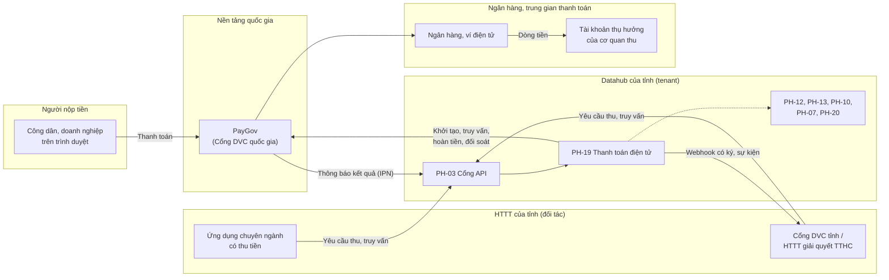
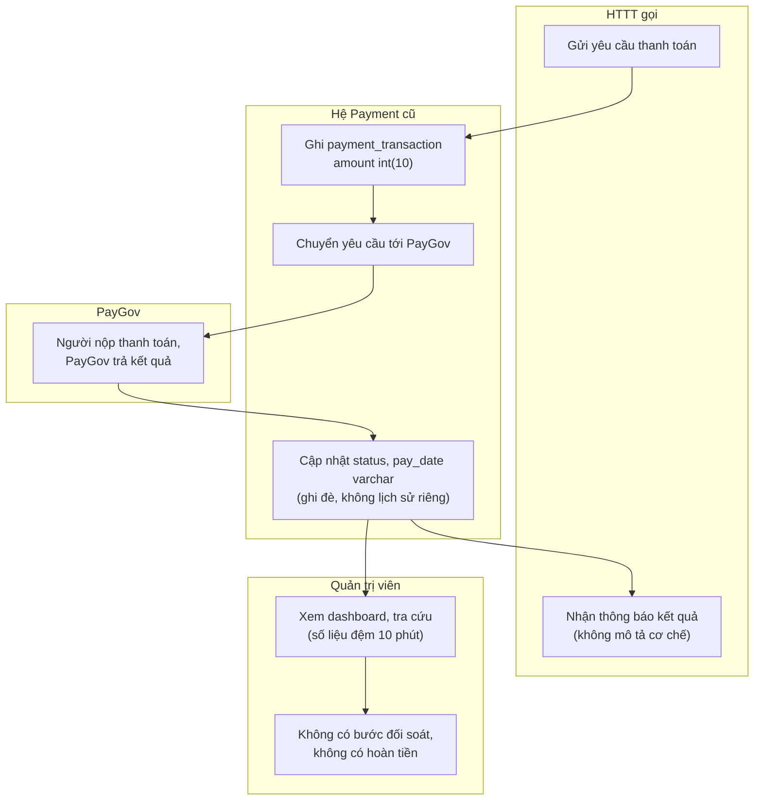

# D02-01-PH19 · Yêu cầu nghiệp vụ phân hệ PH-19 Thanh toán điện tử

## 1. Mục đích, phạm vi và vị trí trong BRD tổng

### 1.1. Mục đích của tài liệu

Tài liệu này là phần yêu cầu nghiệp vụ (BRD) dành riêng cho phân hệ PH-19 Thanh toán điện tử của Datahub. Nó trả lời ba câu hỏi mà hội đồng thẩm định và chủ đầu tư cần trả lời trước khi phê duyệt đầu tư cho phân hệ: vì sao tỉnh cần một lớp thanh toán dùng chung đặt trong nền tảng tích hợp, lớp đó phải đạt được những kết quả nghiệp vụ nào, và việc thu phí, lệ phí trực tuyến của tỉnh sẽ diễn ra thế nào sau khi có phân hệ. Tài liệu không đặc tả chức năng chi tiết; phần đó nằm ở FRS D02-03-PH19, nơi duy nhất định nghĩa nội dung các yêu cầu chức năng `FR-19-nnn`.

Tài liệu được viết cho hai tầng người đọc. Các mục 1 đến 6 dành cho hội đồng thẩm định, lãnh đạo Sở Khoa học và Công nghệ, Sở Tài chính và Văn phòng UBND tỉnh: các mục này nêu bối cảnh pháp lý, hiện trạng, mục tiêu đo được và yêu cầu nghiệp vụ cấp cao. Các mục 7 đến 11 dành cho đội phân tích, thiết kế và kiểm thử: chúng mô tả quy trình TO-BE ở mức có thể dựng use case, mô hình vận hành đa tenant, rủi ro và ma trận truy vết xuống FR.

### 1.2. Phạm vi nghiệp vụ

PH-19 là **lớp trung gian thanh toán của tỉnh** đặt bên trong Datahub. Các hệ thống thông tin (HTTT) của tỉnh có thu tiền — Cổng dịch vụ công tỉnh, HTTT giải quyết thủ tục hành chính (TTHC), các ứng dụng chuyên ngành — gọi chung là **đối tác**, gửi yêu cầu thu phí, lệ phí và các nghĩa vụ tài chính khác vào PH-19 qua một giao diện thống nhất. PH-19 chuyển yêu cầu tới **nhà cung cấp thanh toán** (NCC), trong đó kênh đầu tiên và mặc định là Nền tảng thanh toán trực tuyến của Cổng Dịch vụ công quốc gia (PayGov). PH-19 nhận kết quả, lưu toàn bộ lịch sử làm chứng cứ điện tử, báo kết quả lại cho đối tác, rồi đối soát với NCC vào ngày làm việc kế tiếp và tổ chức xử lý mọi chênh lệch.

Điểm cần nhấn mạnh ngay từ đầu, vì nó quyết định ranh giới trách nhiệm pháp lý của phân hệ: **PH-19 không giữ tiền và không phải là tổ chức cung ứng dịch vụ trung gian thanh toán**. Tiền đi thẳng từ tài khoản hoặc ví của người nộp, qua PayGov và các ngân hàng, trung gian thanh toán kết nối với PayGov, tới tài khoản thụ hưởng của cơ quan thu. PH-19 chỉ giữ thông tin về yêu cầu thu, kết quả thanh toán, việc đối soát và các quyết định xử lý, tức là giữ chứng cứ điện tử của giao dịch chứ không giữ dòng tiền.

Bảng dưới đây tóm tắt ranh giới phạm vi ở mức nghiệp vụ. Bảng ranh giới đầy đủ, chi tiết tới từng nhóm chức năng, nằm ở khung truy vết D02-03-PH19-00 mục 1.2 và không được nhắc lại ở đây để giữ một sự thật ở một nơi.

| Thuộc phạm vi PH-19 | Ngoài phạm vi PH-19 (ai làm) |
|---|---|
| Quản lý vòng đời NCC thanh toán: khai báo, kiểm tra kết nối, giao dịch thử, kích hoạt có phê duyệt, tạm dừng, ngừng hẳn | Đàm phán, ký thỏa thuận kết nối với Văn phòng Chính phủ (chủ đầu tư); kết nối trực tiếp từng ngân hàng (đi qua PayGov) |
| Danh mục dịch vụ thanh toán, nhóm dịch vụ, đối tác được phép thu, hạn mức | Tính mức phí, lệ phí của từng TTHC (HTTT đối tác tính và gửi số tiền); giữ bảng danh mục ngân hàng, lĩnh vực, loại phí (PH-07) |
| Tạo giao dịch, nhận kết quả, truy vấn trạng thái, chống ghi trùng, hết hạn, hủy | Giao diện chọn ngân hàng, nhập thông tin thẻ (do PayGov cung cấp); phát hành biên lai thu phí, lệ phí điện tử có giá trị pháp lý |
| Hoàn tiền có phê duyệt bốn mắt | Quyết định hành chính về việc hoàn phí (cơ quan thu quyết định) |
| Đối soát hằng ngày với NCC, xử lý chênh lệch, biên bản | Hạch toán kế toán, quyết toán ngân sách, đối soát giữa ngân hàng và Kho bạc |
| Tra cứu, nhật ký, dashboard, báo cáo vận hành | Kho phân tích dài hạn (PH-16 và lớp dữ liệu dùng chung tiêu thụ sự kiện) |
| Thông báo kết quả cho HTTT đối tác qua webhook có ký và sự kiện | Gửi tin nhắn, thư điện tử cho người nộp (đối tác thực hiện) |
| Vận hành đa tenant, chuyển đổi từ hệ Payment cũ theo kiểu strangler | Khởi tạo tenant (PH-20); di trú người dùng (PH-12) |

### 1.3. Vị trí trong BRD tổng của Datahub

Tài liệu này là **phụ lục chi tiết hóa miền thanh toán** của BRD tổng [D02-01](../D02-01-brd.md). BRD tổng đã xác lập ở cấp hệ thống ba điểm neo cho thanh toán: mục tiêu **BO-07** "Thanh toán trực tuyến cho dịch vụ công minh bạch, đối soát được" với hai chỉ số **KPI-13** và **KPI-14**; quy trình **BP-05** "Thanh toán dịch vụ công và đối soát"; và yêu cầu nghiệp vụ cấp cao **REQ-19** "Hệ thống phải làm trung gian thanh toán đa kênh: quản lý nhà cung cấp, dịch vụ, giao dịch, đối soát, hoàn tiền, báo cáo". Ba điểm neo đó đủ để thẩm định chủ trương nhưng chưa đủ để viết FR và kiểm thử, vì mỗi điểm gộp nhiều nghiệp vụ có chủ thể, rủi ro và tiêu chí nghiệm thu khác nhau. Tài liệu này tách chúng thành các mã con. Lý do tách thành một tập riêng là PH-19 là phân hệ viết mới hoàn toàn (quyết định Q3 trong dàn ý đã duyệt), có căn cứ pháp lý và nhóm bên liên quan khác hẳn các miền tích hợp dữ liệu, đặc biệt là Sở Tài chính và kế toán cơ quan thu, và có lịch triển khai riêng ở đợt 2.

Quan hệ giữa mã của BRD tổng và mã của tài liệu này được tóm tắt trong bảng sau. Mọi mã có hậu tố "(đề xuất)" là **mã con** do khung truy vết D02-03-PH19-00 cấp tạm ở dải 91–99; mỗi lần xuất hiện, tài liệu luôn ghi kèm mã cha chính thức để người đọc không phải tra ngược. Khi luồng lõi chính thức hóa các mã con, việc đổi số là thay thế cơ học một-một.

| Mã chính thức (BRD tổng) | Mã con trong tài liệu này (đề xuất) | Quan hệ |
|---|---|---|
| REQ-19 | REQ-91…99 | Chín REQ con tinh chỉnh REQ-19 theo từng nhóm nghiệp vụ. REQ-98 còn tinh chỉnh REQ-20 (đa tenant) cho phạm vi thanh toán; REQ-99 tinh chỉnh REQ-22 (chuyển đổi dần từ hệ cũ) |
| BP-05 | BP-91…96 | Sáu quy trình con. BP-96 đồng thời là trường hợp riêng của BP-09 "Chuyển đổi từ hệ cũ" áp cho khối Payment |
| BO-07 | BO-91…96 | Sáu mục tiêu con. BO-94 còn đóng góp vào BO-08 (vận hành chủ động); BO-96 đóng góp vào mục tiêu chuyển đổi của REQ-22 |
| KPI-13, KPI-14 | KPI-91…99 | KPI-13 và KPI-14 được **tái dùng nguyên văn**, không định nghĩa lại; KPI-9x là chỉ số vận hành chi tiết hơn, phục vụ nghiệm thu PH-19 |
| SH-02, 03, 04, 05, 07, 09, 10, 11, 12 | SH-92, SH-93, SH-97 | Dùng bên liên quan chính thức; chỉ thêm ba bên mà BRD tổng chưa có (mục 4) |

Mã `CMP-LAW` mới mà tài liệu này cần được đề xuất ở dải 91–97 vì cùng lý do (mục 2.1 và mục 12). Phần bối cảnh chung của dự án, hiện trạng năm khối hệ cũ, bức tranh năng lực 20 phân hệ và phân đợt đã được trình bày ở BRD tổng (các mục 2, 5, 6.1, 8.3) và không được chép lại ở đây.

Về thời điểm, PH-19 được xếp ở **đợt 2** (BRD tổng mục 8.3). Trong suốt giai đoạn chuyển đổi, hệ Payment cũ vẫn tiếp tục thu tiền; Datahub đứng phía trước và nhận dần từng đối tác theo mô hình strangler mô tả ở mục 8.3 của tài liệu này. Nếu tỉnh triển khai đầu tiên buộc phải tắt hệ cũ sớm, PH-19 phải được kéo lên MVP; đây là một giả định có điều kiện, được ghi ở mục 10. Về kiến trúc, SAD D03-01 §4.2 đã quyết định PH-19 chạy ở đơn vị triển khai riêng `dh-payment` vì yêu cầu bảo mật cao hơn, hồ sơ tải cao điểm khác và cần đường ra (egress) tới kênh thanh toán; tài liệu này chỉ dẫn quyết định đó, không bàn lại.

PH-19 phụ thuộc cứng vào sáu phân hệ thuộc MVP đợt 1: PH-03 Cổng API (định tuyến, xác thực biên, giới hạn tần suất, danh sách IP được phép gọi về), PH-12 Định danh và ủy quyền, PH-13 Giám sát và ghi vết, PH-10 Truyền thông sự kiện, PH-07 Danh mục dùng chung và PH-20 Quản trị tenant. Vì vậy PH-19 không thể đưa vào vận hành trước khi các phân hệ này đạt nghiệm thu. Bảng phụ thuộc chi tiết nằm ở khung truy vết mục 1.5.

## 2. Căn cứ pháp lý và bối cảnh

### 2.1. Căn cứ pháp lý

Phân hệ thanh toán chịu sự chi phối của ba nhóm văn bản: nhóm quy định về dịch vụ công trực tuyến và thực hiện TTHC trên môi trường điện tử (quy định *phải* cho phép nộp phí, lệ phí trực tuyến), nhóm quy định về thanh toán và giao dịch điện tử (quy định *giá trị pháp lý* của chứng cứ và *ai được* làm trung gian thanh toán), và nhóm quy định về an toàn thông tin, dữ liệu cá nhân, lưu trữ (quy định *cách giữ* dữ liệu giao dịch). Bảng dưới đây liệt kê các văn bản được truy vết. Các văn bản đã có mã trong D00-01 §7 được giữ nguyên mã; văn bản chưa có mã được đề xuất mã mới ở dải 91–97. Cột "Trạng thái kiểm tra" theo cùng quy ước với D00-01: mọi văn bản ở trạng thái "Cần đối chiếu" phải được kiểm tra số hiệu, ngày ban hành, hiệu lực và điều khoản cụ thể trước khi tài liệu được phát hành bản 1.0.

| Mã | Văn bản | Nội dung chi phối PH-19 | REQ chịu tác động | Trạng thái kiểm tra |
|---|---|---|---|---|
| CMP-LAW-91 (đề xuất) | Nghị định 45/2020/NĐ-CP về thực hiện TTHC trên môi trường điện tử | Tổ chức, cá nhân được thực hiện nghĩa vụ tài chính trong TTHC bằng phương thức thanh toán trực tuyến; kết quả thanh toán là một phần hồ sơ điện tử | REQ-93, REQ-94 | Cần đối chiếu điều khoản cụ thể |
| CMP-LAW-92 (đề xuất) | Nghị định 42/2022/NĐ-CP quy định về việc cung cấp thông tin và dịch vụ công trực tuyến của CQNN trên môi trường mạng | Phân loại dịch vụ công trực tuyến toàn trình và một phần; dịch vụ toàn trình có phí, lệ phí đòi hỏi việc thanh toán cũng được thực hiện trực tuyến | REQ-93 | Cần đối chiếu điều khoản cụ thể |
| CMP-LAW-93 (đề xuất) | Nghị định 61/2018/NĐ-CP về cơ chế một cửa, một cửa liên thông, được sửa đổi, bổ sung bởi Nghị định 107/2021/NĐ-CP | Vai trò của Cổng DVC quốc gia và HTTT giải quyết TTHC cấp tỉnh; thanh toán trực tuyến phí, lệ phí qua Cổng DVC quốc gia | REQ-93, REQ-97 | Cần đối chiếu điều khoản cụ thể |
| CMP-LAW-94 (đề xuất) | Nghị định 52/2024/NĐ-CP về thanh toán không dùng tiền mặt | Định nghĩa dịch vụ trung gian thanh toán và điều kiện cung ứng; cơ sở để khẳng định PH-19 không làm trung gian thanh toán và không giữ tiền | REQ-93, REQ-96 | Cần đối chiếu điều khoản cụ thể |
| CMP-LAW-95 (đề xuất) | Luật Giao dịch điện tử số 20/2023/QH15 | Giá trị pháp lý của thông điệp dữ liệu, chữ ký điện tử, chứng cứ; yêu cầu về lưu trữ thông điệp dữ liệu bảo đảm tính toàn vẹn | REQ-94, REQ-98 | Cần đối chiếu điều khoản cụ thể |
| CMP-LAW-96 (đề xuất) | Văn bản của Bộ Tài chính về hình thức, thời hạn thu, nộp phí, lệ phí (Thông tư 74/2022/TT-BTC hoặc văn bản thay thế) và quy định về biên lai thu phí, lệ phí điện tử (Nghị định 123/2020/NĐ-CP và văn bản sửa đổi) | Thu phí, lệ phí qua phương thức điện tử; trách nhiệm lập biên lai của tổ chức thu; liên quan tới câu hỏi ai phát hành biên lai (OQ-19-14) | REQ-93, REQ-95, REQ-96 | Cần đối chiếu số hiệu và hiệu lực |
| CMP-LAW-97 (đề xuất) | Luật Kế toán số 88/2015/QH13 và Luật Lưu trữ năm 2024 | Thời hạn lưu trữ chứng từ, tài liệu liên quan tới thu ngân sách; căn cứ để chốt thời gian lưu giao dịch, biên bản đối soát | REQ-98 | Cần đối chiếu số hiệu và thời hạn áp dụng cho chứng cứ của PH-19 |
| CMP-LAW-03 | Nghị định 47/2020/NĐ-CP về quản lý, kết nối, chia sẻ dữ liệu số của CQNN | Datahub đóng vai trò LGSP; kết nối giữa HTTT của tỉnh với nền tảng quốc gia đi qua nền tảng tích hợp cấp tỉnh | REQ-93 | Theo D00-01 |
| CMP-LAW-04, CMP-LAW-05 | Nghị định 13/2023/NĐ-CP và Luật Bảo vệ dữ liệu cá nhân năm 2025 | Họ tên, số định danh, số điện thoại của người nộp là dữ liệu cá nhân; phải tối thiểu hóa, che khi hiển thị, ghi nhận mục đích xử lý | REQ-97, REQ-98 | Theo D00-01 |
| CMP-LAW-06, CMP-LAW-07, CMP-LAW-08 | Nghị định 85/2016/NĐ-CP, Thông tư 12/2022/TT-BTTTT, TCVN 11930:2017 | Phân hệ xử lý giao dịch tài chính của nhiều cơ quan, đề xuất cấp độ 3 và sẵn sàng cấp độ 4 | REQ-98 | Theo D00-01 |
| CMP-LAW-15 | Nghị định 30/2020/NĐ-CP về công tác văn thư | Thể thức biên bản đối soát, báo cáo xuất bản ở dạng văn bản | REQ-95 | Theo D00-01 |
| CMP-LAW-16 | Luật An ninh mạng và văn bản hướng dẫn | Lưu trữ dữ liệu giao dịch trong nước, nhật ký | REQ-98 | Theo D00-01 |

Hai điểm pháp lý dưới đây chưa có câu trả lời chắc chắn và có thể làm thay đổi thiết kế, nên được nêu thành câu hỏi mở ở mục 10. Thứ nhất, chưa xác định được văn bản nào quy định cụ thể thủ tục kết nối của một tỉnh với PayGov, và liệu tỉnh có được kết nối qua một nền tảng trung gian như Datahub thay vì từng HTTT kết nối trực tiếp hay không. Thứ hai, thời hạn lưu trữ bắt buộc đối với chứng cứ điện tử về thanh toán phí, lệ phí (khác với thời hạn lưu chứng từ kế toán của cơ quan thu) chưa được xác định.

### 2.2. Bối cảnh PayGov

PayGov là tên thường gọi của Nền tảng thanh toán trực tuyến tích hợp trên Cổng Dịch vụ công quốc gia, do Văn phòng Chính phủ chủ quản và vận hành. Về mặt nghiệp vụ, PayGov làm một việc: đứng giữa các HTTT giải quyết TTHC của bộ, ngành, địa phương và mạng lưới ngân hàng, trung gian thanh toán, để người nộp chọn kênh thanh toán quen thuộc (thẻ nội địa, tài khoản ngân hàng, ví điện tử, mã QR) mà cơ quan thu không phải ký kết, tích hợp riêng với từng ngân hàng. Tiền được chuyển tới tài khoản thụ hưởng mà cơ quan thu đã đăng ký; PayGov trả kết quả về cho HTTT đã tạo yêu cầu.

Tài liệu hệ cũ dùng mã nhà cung cấp `PAYGOV` và mã hóa cứng giá trị này trong các câu truy vấn dashboard, nhưng **không kèm đặc tả kỹ thuật kết nối của PayGov**. SAD D03-01 đã ghi nhận rủi ro tương ứng là RSK-A04 (đặc tả NDXP, PayGov thay đổi). Vì vậy, trong toàn bộ bộ tài liệu PH-19, mọi chi tiết về tên trường, tham số, thuật toán ký, cách gọi lại kết quả (callback, IPN), cách lấy dữ liệu đối soát và khả năng hoàn tiền qua API của PayGov đều là **Giả định – cần đối chiếu Tài liệu kỹ thuật kết nối Nền tảng thanh toán của Cổng DVCQG do VPCP cấp**, và được gom thành nhóm câu hỏi mở OQ-19-01…08 của khung truy vết. Để việc thay đổi đặc tả không làm lung lay lõi nghiệp vụ, mọi trao đổi với PayGov được cô lập trong một adapter đóng vai trò lớp chống nhiễm (Anti-Corruption Layer, ADR-040). Ở tầng nghiệp vụ, tài liệu này chỉ dựa vào năm năng lực mà bất kỳ cổng thanh toán nào cũng phải có: khởi tạo một yêu cầu thanh toán và nhận về địa chỉ để chuyển người nộp tới; chuyển người nộp quay về sau khi thanh toán; gửi thông báo kết quả từ máy chủ tới máy chủ; trả lời truy vấn trạng thái một giao dịch; và cung cấp dữ liệu giao dịch theo ngày để đối soát. Năng lực thứ sáu — hoàn tiền qua API — được coi là *có thể không có*, và nghiệp vụ hoàn tiền được thiết kế để vẫn chạy được ở chế độ thủ công (mục 7.4).

### 2.3. Mô hình thu phí, lệ phí trực tuyến trên Cổng DVC

Để hội đồng thẩm định thấy rõ PH-19 đứng ở đâu, đoạn này mô tả chuỗi nghiệp vụ thu phí, lệ phí trực tuyến điển hình của một TTHC có thu tiền. Người nộp (công dân, doanh nghiệp) nộp hồ sơ trên Cổng DVC của tỉnh hoặc Cổng DVC quốc gia. Tại thời điểm phải nộp tiền — có thể ngay khi nộp hồ sơ, hoặc sau khi cán bộ thẩm định xác định nghĩa vụ tài chính — HTTT giải quyết TTHC tính số tiền theo biểu phí, lệ phí của thủ tục và tạo một yêu cầu thanh toán. Người nộp được chuyển sang trang của PayGov, chọn ngân hàng hoặc ví, xác thực và thanh toán. PayGov báo kết quả về HTTT đã tạo yêu cầu; HTTT ghi nhận hồ sơ đã nộp tiền, chuyển bước xử lý và lập biên lai. Cuối ngày, kế toán của cơ quan thu cần biết chính xác những khoản nào đã vào tài khoản thụ hưởng để hạch toán.

Trong mô hình không có PH-19, mỗi HTTT có thu tiền phải tự tích hợp với PayGov: tự giữ khóa ký, tự xác minh kết quả, tự xử lý trường hợp người nộp đóng trình duyệt giữa chừng, tự đối soát. Với một tỉnh có nhiều HTTT chuyên ngành, điều đó có nghĩa là nhiều bản tích hợp khác nhau với chất lượng không đồng đều, nhiều nơi giữ khóa bí mật, và không ai có bức tranh tổng hợp về số thu trực tuyến của tỉnh. PH-19 thay mô hình "mỗi HTTT tự nối PayGov" bằng mô hình "mọi HTTT nối PH-19, PH-19 nối PayGov". Sơ đồ ngữ cảnh dưới đây thể hiện mô hình này.

Sơ đồ cho thấy hai dòng tách biệt. Dòng thông tin (mũi tên giữa đối tác, Datahub và PayGov) đi qua PH-03 và PH-19; mọi yêu cầu thu và mọi thông báo kết quả đều được PH-19 ghi nhận. Dòng tiền (từ người nộp qua PayGov, ngân hàng tới tài khoản thụ hưởng) không đi qua Datahub. Người nộp chỉ tương tác với PayGov để thanh toán và với trang của đối tác để xem kết quả; họ không đăng nhập PH-19. Các phân hệ nền của Datahub cung cấp định danh, nhật ký, sự kiện, danh mục và cấu hình tenant cho PH-19 nhưng không nằm trên đường đi của giao dịch, trừ PH-03.

## 3. Hiện trạng AS-IS: hệ Payment cũ

### 3.1. Tổng quan hệ cũ

BRD tổng mục 5.2 đã tóm tắt vấn đề của khối Payment trong một dòng (số tiền `int(10)`, ngày thanh toán kiểu chuỗi, không đối soát, không hoàn tiền). Mục này đi sâu hơn để làm căn cứ cho từng REQ con. Hệ Payment cũ được Viettel xây dựng năm 2021 cho tỉnh Đắk Nông, là một khối của nền tảng LGSP cũ. Tài liệu hệ cũ gồm phân tích yêu cầu (PTYC v1.2), thiết kế tổng thể (TKTT v1.2), thiết kế chi tiết (TKCT v1.7), thiết kế CSDL, hướng dẫn sử dụng (HDSD) và hướng dẫn vận hành (HDVH). Sau đợt sắp xếp đơn vị hành chính năm 2025, địa bàn tỉnh Đắk Nông cũ thuộc một tỉnh mới sau hợp nhất (cần đối chiếu nghị quyết sắp xếp); hệ quả nghiệp vụ của việc này được nêu ở mục 9.

Về chức năng, hệ cũ được kiểm kê thành 23 chức năng `LGC-PAY-001…023` tại D00-03 mục 4.6, cộng ba hành vi được khung truy vết đề xuất bổ sung `LGC-PAY-024…026` (đề xuất). Có thể chia các chức năng đó thành năm nhóm. Nhóm quản lý nhà cung cấp gồm thêm, xem, sửa, xóa, tìm, kích hoạt, dừng nhà cung cấp và thông báo lỗi kết nối (LGC-PAY-001…009). Nhóm giao dịch gồm nhận kết quả thanh toán, lưu dữ liệu quá trình thanh toán và thông báo kết quả cho HTTT gọi (LGC-PAY-010…012, LGC-PAY-024 đề xuất). Nhóm tra cứu gồm bảng giao dịch, tìm kiếm nâng cao theo trạng thái, lĩnh vực, thời gian, từ khóa, và chi tiết giao dịch (LGC-PAY-014…019). Nhóm giám sát gồm dashboard tổng quan và dashboard kênh thanh toán (LGC-PAY-013, 020, 026 đề xuất). Nhóm danh mục và nhật ký gồm quản lý đối tác, nhóm dịch vụ, dịch vụ và nhật ký giao dịch (LGC-PAY-021, 022).

Về dữ liệu, hệ cũ có năm bảng: `payment_partner` (đối tác), `payment_provider` (nhà cung cấp), `payment_service_group` (nhóm dịch vụ, hệ cũ gọi là "lĩnh vực giao dịch"), `payment_service` (dịch vụ) và `payment_transaction` (giao dịch). Về hạ tầng, hai ứng dụng chạy chung một tiến trình Tomcat trên một máy chủ ứng dụng, một máy chủ PostgreSQL; mọi thay đổi cấu hình đều đòi hỏi khởi động lại Tomcat, và việc dừng ứng dụng này kéo theo dừng ứng dụng kia (HDVH).

### 3.2. Quy trình AS-IS dựng lại từ tài liệu cũ

Tài liệu hệ cũ không có sơ đồ quy trình nghiệp vụ. Sơ đồ dưới đây được dựng lại từ danh sách chức năng của PTYC, luồng nghiệp vụ của TKCT và mô tả của HDSD, để làm nền so sánh với quy trình TO-BE ở mục 7.

Quy trình cũ là một chuỗi thẳng, không có nhánh xử lý ngoại lệ nào được mô tả. Tài liệu không nói điều gì xảy ra khi PayGov không gửi kết quả, khi kết quả đến hai lần, khi số tiền trong kết quả khác số tiền yêu cầu, hay khi HTTT gọi không nhận được thông báo. Cuối chuỗi, quản trị viên chỉ có thể xem; không có bước nghiệp vụ nào xác nhận số liệu của hệ khớp với số liệu của PayGov và ngân hàng.

### 3.3. Điểm yếu của hệ cũ

Bảng sau tổng hợp các điểm yếu được phát hiện khi đọc tài liệu hệ cũ. Mỗi điểm yếu được nêu kèm hệ quả nghiệp vụ và yêu cầu nghiệp vụ của PH-19 khắc phục nó, để hội đồng thẩm định thấy mỗi yêu cầu ở mục 6 đều xuất phát từ một vấn đề có thật.

| STT | Điểm yếu | Bằng chứng trong tài liệu cũ | Hệ quả nghiệp vụ | REQ khắc phục |
|---|---|---|---|---|
| 1 | Không có nghiệp vụ đối soát | Không tài liệu nào mô tả đối soát; D00-03 §4.6 ghi nhận | Không phát hiện được giao dịch PayGov báo thành công mà hệ không ghi nhận, hoặc ngược lại; kế toán phải đối chiếu thủ công với sao kê ngân hàng | REQ-95 |
| 2 | Không có nghiệp vụ hoàn tiền | Chỉ có ba giá trị trạng thái `REFUND_PENDING`, `REFUND_SUCCESS`, `REFUND_FAILED` trong TKCT, không có chức năng nào sinh ra chúng (LGC-PAY-025 đề xuất) | Người nộp bị thu sai hoặc thu trùng không được hoàn qua hệ thống; không có phê duyệt, không có vết | REQ-96 |
| 3 | Không bảo mật kết quả gọi về | Chức năng "Nhận kết quả thanh toán" (LGC-PAY-010) không mô tả xác minh chữ ký, nguồn gọi, chống phát lại | Kẻ xấu có thể giả mạo một thông báo "đã thanh toán" để hồ sơ được xử lý mà không nộp tiền | REQ-94, REQ-98 |
| 4 | Không chống ghi trùng | Không có khóa duy nhất ngoài `id`; không có cơ chế idempotency | Người nộp có thể bị tạo hai yêu cầu và trả tiền hai lần cho một hồ sơ; một kết quả đến hai lần có thể bị xử lý hai lần | REQ-94 |
| 5 | Số tiền kiểu `int(10)` | Cột `amount` bảng `payment_transaction` | Trần khoảng 2,1 tỷ đồng; một số nghĩa vụ tài chính (tiền sử dụng đất, lệ phí trước bạ tài sản giá trị lớn) có thể vượt trần | REQ-93, REQ-99 |
| 6 | Ngày thanh toán kiểu `varchar` | Cột `pay_date`; TKCT ghi "định dạng ngày tháng được quy định từ PayGov khi trả về kết quả" | Không lọc, sắp xếp, tổng hợp theo ngày thanh toán một cách tin cậy; không xác định được múi giờ; đối soát theo ngày không làm được | REQ-95, REQ-99 |
| 7 | Chỉ một nhà cung cấp, mã hóa cứng | Các câu truy vấn dashboard trong TKCT chứa điều kiện `providerCode = 'PAYGOV'` (LGC-PAY-023) | Khi PayGov gián đoạn, tỉnh không có phương án; thêm kênh thứ hai đòi hỏi sửa mã | REQ-91 |
| 8 | Không có lịch sử trạng thái | Trạng thái nằm trên một cột duy nhất của giao dịch; TKCT nhắc tới `PaymentHistory` nhưng thiết kế CSDL không có bảng này | Không chứng minh được giao dịch đã đi qua những trạng thái nào, khi nào, do ai | REQ-94, REQ-97 |
| 9 | Không có thông báo kết quả tin cậy cho HTTT gọi | LGC-PAY-012 chỉ ghi "Thông báo kết quả thanh toán" | HTTT gọi có thể không biết hồ sơ đã nộp tiền, hồ sơ bị treo | REQ-94 |
| 10 | Không có cách ly theo tỉnh | Không bảng nào có cột tỉnh hoặc tenant | Không thể phục vụ nhiều tỉnh trên một bản cài; không thể hợp nhất dữ liệu hai tỉnh cũ sau sắp xếp mà vẫn phân biệt được nguồn | REQ-98 |
| 11 | Bí mật kết nối nằm trong tệp cấu hình | HDVH hướng dẫn sửa `username`, `password` trong tệp cấu hình rồi khởi động lại Tomcat | Rủi ro lộ thông tin xác thực; thay đổi cấu hình gây gián đoạn | REQ-98 |
| 12 | Không ràng buộc toàn vẹn dữ liệu | Các khóa ngoại tham chiếu bằng mã kiểu `varchar(255)`, không có ràng buộc duy nhất cho mã | Mã đối tác, mã dịch vụ có thể trùng hoặc mồ côi; dữ liệu lịch sử cần làm sạch khi di trú | REQ-92, REQ-99 |
| 13 | Số liệu giám sát chậm, không cảnh báo | Số liệu tổng được đệm 10 phút (LGC-PAY-026 đề xuất); "Thông báo lỗi kết nối" không mô tả kênh, ngưỡng | Sự cố kênh thanh toán được biết qua phản ánh của người dân thay vì cảnh báo tự động | REQ-91, REQ-97 |
| 14 | Chỉ tiêu phi chức năng thấp | Uptime 90%/năm; 1 người dùng hoạt động; phản hồi ≤ 5 giây với 10 người dùng đồng thời (LGC-NFR-001…003) | Không tương xứng với một kênh thu ngân sách phục vụ người dân 24/7 | REQ-98 |

Điểm chung của các điểm yếu trên là hệ cũ được thiết kế như một **danh mục ghi nhận** ("Danh mục thanh toán điện tử" là tên gọi trong chính tài liệu cũ) hơn là một **hệ thống giao dịch tài chính**. Nó ghi lại những gì PayGov trả về và cho xem lại, nhưng không bảo đảm rằng điều được ghi lại là đúng, đủ, không trùng và khớp với dòng tiền thực tế. PH-19 thay đổi bản chất đó: mỗi giao dịch là một đối tượng có vòng đời được kiểm soát, có chứng cứ và được đối soát.

### 3.4. Những gì hệ cũ làm tốt và được giữ lại

Không phải mọi thứ của hệ cũ đều cần thay. Theo D00-03, 16 trên 23 chức năng hệ cũ có kết luận "Giữ nguyên": cách tổ chức đối tác – nhóm dịch vụ – dịch vụ – nhà cung cấp là hợp lý và được giữ làm khung danh mục của PH-19; bộ tiêu chí tra cứu (trạng thái chọn nhiều, lĩnh vực chọn nhiều, mẫu thời gian 1 tháng, 3 tháng, 1 quý, phân trang 20 dòng) đã quen với người dùng và được giữ nguyên; hai dashboard (tổng quan và kênh thanh toán) được giữ chỉ số cũ và bổ sung chỉ số mới. Ý tưởng "kích hoạt nhà cung cấp chỉ sau khi giao dịch mẫu thành công" của hệ cũ là đúng đắn và trở thành nền của quy trình BP-91. Việc giữ lại những điểm này giúp người dùng chuyển sang PH-19 mà không phải học lại từ đầu.

## 4. Bên liên quan và nhu cầu

Bên liên quan của PH-19 khác với các miền tích hợp dữ liệu ở chỗ có sự tham gia của cơ quan tài chính và của người dân với tư cách người trả tiền. Bảng dưới đây liệt kê tám nhóm bên liên quan đã được cấp mã trong khung truy vết, nhu cầu cụ thể của từng nhóm, mức ảnh hưởng tới quyết định đầu tư và yêu cầu nghiệp vụ đáp ứng nhu cầu đó. Mức ảnh hưởng "Cao" nghĩa là bên đó có quyền chấp thuận hoặc bác bỏ một phần phạm vi; "Trung bình" nghĩa là bên đó cung cấp đầu vào bắt buộc; "Thấp" nghĩa là bên đó chịu tác động nhưng không trực tiếp tham gia quyết định.

| Mã | Bên liên quan | Nhu cầu cụ thể | Ảnh hưởng | Vai trò sử dụng hệ thống | REQ đáp ứng |
|---|---|---|---|---|---|
| SH-91 | Sở Khoa học và Công nghệ / đơn vị vận hành Datahub của tỉnh | Vận hành một điểm thanh toán duy nhất ổn định, có cảnh báo sớm, không phụ thuộc vào cá nhân; kiểm soát được chi phí vận hành và quyền truy cập | Cao | `ROLE-TENANT_ADMIN`, `ROLE-PAYMENT_ADMIN`, `ROLE-SECURITY_OFFICER`, `ROLE-PAYMENT_OPERATOR` | REQ-91, REQ-97, REQ-98 |
| SH-92 | Sở Tài chính và bộ phận kế toán của cơ quan thu | Biết chính xác khoản nào đã thu, của hồ sơ nào, vào ngày nào; đối soát khớp với nhà cung cấp; có biên bản đối soát; hoàn tiền có phê duyệt | Cao | `ROLE-PAYMENT_ACCOUNTANT`, `ROLE-PAYMENT_APPROVER` | REQ-95, REQ-96, REQ-97 |
| SH-93 | Văn phòng UBND tỉnh / Trung tâm phục vụ hành chính công | Tăng tỷ lệ hồ sơ có thu phí được thanh toán trực tuyến; giảm phản ánh của người dân về việc đã trả tiền mà hồ sơ không chuyển bước | Cao | Người xem dashboard, báo cáo | REQ-93, REQ-94, REQ-97 |
| SH-94 | Đơn vị chủ quản HTTT đối tác | Tích hợp một lần, theo một hợp đồng API ổn định không đổi khi đặc tả PayGov đổi; kết quả tin cậy, có thông báo chủ động; thời gian chuyển đổi từ hệ cũ hợp lý | Trung bình | `ROLE-PARTNER_SYSTEM` (máy-máy) | REQ-92, REQ-93, REQ-94, REQ-99 |
| SH-95 | Văn phòng Chính phủ (chủ quản PayGov) | Các bên kết nối tuân thủ đặc tả kỹ thuật, quy trình kết nối, yêu cầu an toàn; hạn chế số đầu mối kỹ thuật cần hỗ trợ ở mỗi tỉnh | Trung bình | Không dùng PH-19; là đối tác kết nối | REQ-91, REQ-93, REQ-98 |
| SH-96 | Người nộp tiền (công dân, doanh nghiệp) | Nộp một lần là xong; không bị trừ tiền hai lần; nếu đã bị trừ tiền thì hồ sơ phải ghi nhận; được hoàn khi bị thu sai; dữ liệu cá nhân được bảo vệ | Thấp (gián tiếp, nhưng là đối tượng phục vụ) | Không đăng nhập PH-19 | REQ-93, REQ-94, REQ-96, REQ-98 |
| SH-97 | Cơ quan kiểm toán, thanh tra | Truy được từng khoản thu tới yêu cầu gốc, kết quả, người phê duyệt; chứng cứ toàn vẹn, không bị sửa | Trung bình | `ROLE-AUDITOR` | REQ-94, REQ-97, REQ-98 |
| SH-98 | Đơn vị quản trị nền tảng (nhà cung cấp sản phẩm) | Một bản mã phục vụ nhiều tỉnh; nâng cấp đồng loạt; thêm adapter nhà cung cấp mới không sửa lõi; hỗ trợ sự cố không cần xem dữ liệu của tỉnh | Trung bình | `ROLE-PLATFORM_ADMIN` | REQ-91, REQ-98, REQ-99 |

Hai xung đột nhu cầu cần được nhận diện sớm. Xung đột thứ nhất là giữa SH-94 (đối tác muốn tích hợp ít, thay đổi ít) và SH-92 (kế toán muốn mọi giao dịch đều đối soát được, kể cả giao dịch của đối tác chưa chuyển sang PH-19). Tài liệu giải quyết bằng mô hình strangler có chế độ `SHADOW` (mục 8.3), cho phép PH-19 ghi nhận song song trước khi đối tác phải sửa mã. Xung đột thứ hai là giữa SH-91 (muốn ít người, ít thủ tục) và SH-97 (muốn phê duyệt bốn mắt cho mọi thao tác nhạy cảm). Ở một số tỉnh, bộ phận vận hành có thể chỉ có hai, ba người. Tài liệu giữ nguyên tắc bốn mắt nhưng cho phép người phê duyệt là cán bộ của Sở Tài chính hoặc cơ quan thu thay vì cùng đơn vị vận hành (mục 9, rủi ro số 9).

