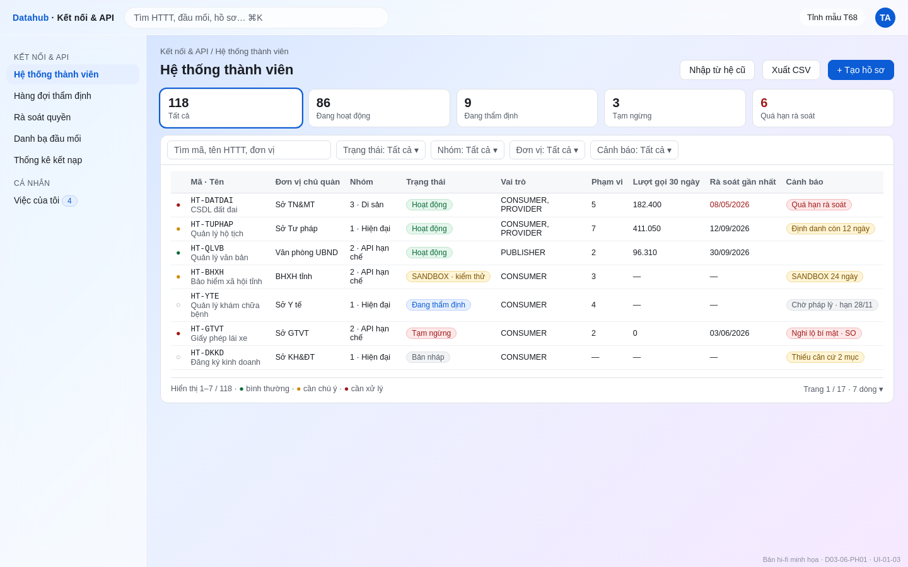
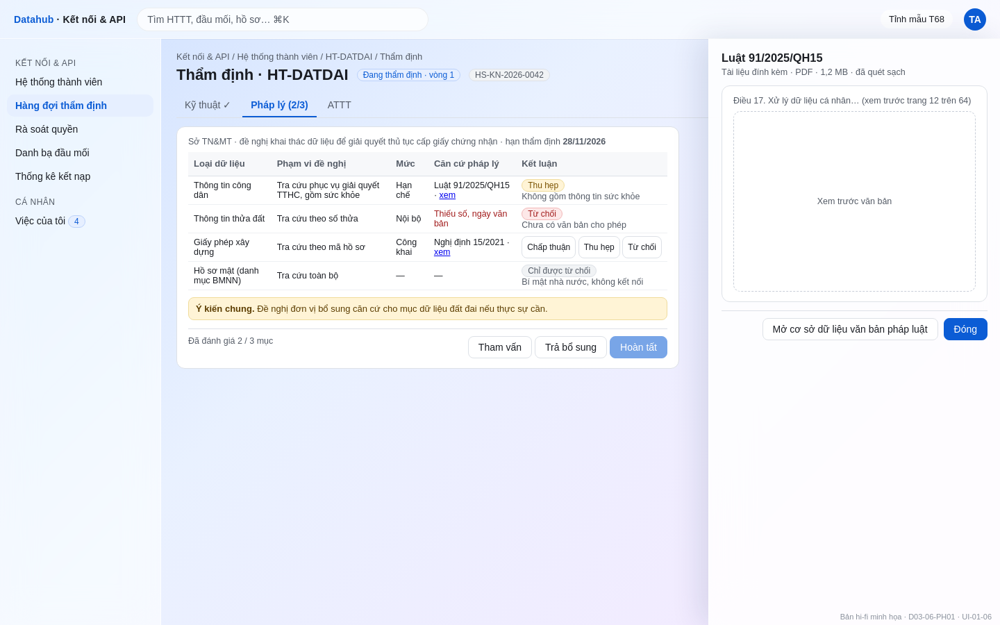
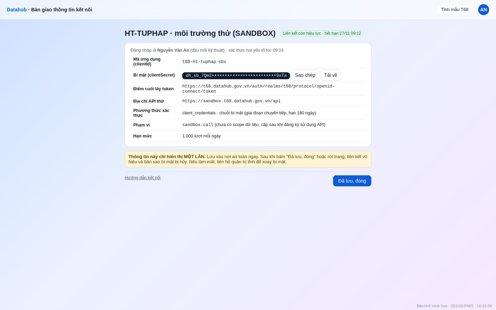

# D02-03-PH01 · Đặc tả yêu cầu chức năng Kết nạp hệ thống thông tin

## Tóm tắt cho hội đồng thẩm định

**Mục tiêu.** PH-01 là cửa vào duy nhất để một hệ thống thông tin (HTTT) của sở, ngành, huyện, xã trở thành thành viên của Datahub. Phân hệ thay chuỗi công văn và thao tác thủ công ở hệ cũ (hai đến bốn tuần, ba mô hình định danh rời nhau cho Application của APIM, publisher và subscriber của Hub) bằng một hồ sơ duy nhất: đơn vị khai hồ sơ, người có thẩm quyền thẩm định và phê duyệt ngay trên hệ thống, hệ thống cấp định danh ứng dụng qua kho bí mật, bàn giao một lần, rồi theo dõi HTTT suốt vòng đời: kiểm thử, kích hoạt, tạm ngừng, chấm dứt, rà soát quyền định kỳ. Mục tiêu đo được là rút thời gian từ lúc nộp hồ sơ đến lúc HTTT gọi được API ở môi trường thật xuống không quá 5 ngày làm việc (KPI-05, NFR-01-020), không để lộ bí mật ở bất kỳ đâu ngoài lần bàn giao (NFR-01-009) và cắt quyền của HTTT trong không quá 60 giây khi có sự cố (NFR-01-008).

**Phạm vi.** 51 yêu cầu chức năng chia bảy nhóm: hồ sơ HTTT và đầu mối, kiểm tra nộp và thẩm định, định danh ứng dụng và bàn giao, vòng đời thành viên, rà soát quyền định kỳ, danh bạ đầu mối, di trú và quản trị. PH-01 quản lý quy trình hành chính và hồ sơ; việc tạo client OAuth thuộc PH-12, cấu hình consumer và hạn mức thuộc PH-03, đăng ký sử dụng API thuộc PH-02. Phân hệ chạy trong đơn vị triển khai `dh-connect` (mặt phẳng điều khiển, Spring Boot, vùng Z3), schema `ph01_onboarding`.

**Căn cứ pháp lý.** CMP-LAW-03 (NĐ 278/2025 về kết nối, chia sẻ dữ liệu: đầu mối, căn cứ khai thác; kế thừa yêu cầu của NĐ 47/2020); CMP-LAW-09 (Công văn 631/THH-THHT: mọi trao đổi qua LGSP, chỉ HTTT đã kết nạp mới có định danh); CMP-LAW-06 và CMP-LAW-08 (NĐ 331/2026, TCVN 14423:2026 cấp độ 3: quản lý tài khoản, bí mật, rà soát quyền, nhật ký); CMP-LAW-05 (Luật BVDLCN 91/2025: dữ liệu liên hệ đầu mối là dữ liệu cá nhân mức Hạn chế); CMP-LAW-01 (Luật Dữ liệu số: phân loại dữ liệu, chia sẻ có căn cứ).

**Những điểm hội đồng cần lưu ý.** (1) Con người thẩm định trước khi máy cấp quyền: mỗi mục dữ liệu đề nghị khai thác phải có căn cứ pháp lý và có kết luận riêng (chấp thuận, chấp thuận thu hẹp, từ chối); quyền của HTTT không bao giờ rộng hơn phạm vi được duyệt (BR-01-003). (2) Thông tin xác thực không bao giờ đi qua thư điện tử hay trao tay: hệ thống bàn giao qua liên kết dùng một lần, người mở phải là đầu mối đã khai báo, đăng nhập có xác thực hai yếu tố; sau lần mở đầu bản sao bí mật bị hủy (BR-01-005, 006). (3) HTTT phải qua môi trường thử SANDBOX đạt tiêu chí rồi mới được kích hoạt môi trường thật và phải được người có thẩm quyền xác nhận (BR-01-008). (4) Quyền được rà soát định kỳ dựa trên mức sử dụng thực tế và hiệu lực căn cứ pháp lý, không dựa cảm tính (BR-01-014, 015). (5) PH-01 không nằm trên đường dữ liệu: PH-01 ngừng hoạt động thì HTTT đã kết nạp vẫn trao đổi bình thường vì định danh đã ở PH-12 và cấu hình đã ở PH-03 (NFR-01-007).

**Con số chính.**

| Chỉ số | Giá trị |
|---|---|
| Yêu cầu chức năng | 51 (M: 41, S: 9, C: 1) |
| Quy tắc nghiệp vụ | 34 (BR-01-001…034) |
| Yêu cầu phi chức năng | 22 (NFR-01-001…022) |
| Màn hình | 17 (UI-01-01…17) |
| API | 88 operation (API-01-001…088), 15 sự kiện (EVT-01-01…15), 54 mã lỗi (ERR-01-001…054) |
| Chức năng hệ cũ được phủ | 4 mục `LGC` (LGC-APIM-019; 020, LGC-HUB-010, 011) và 15 FR của SRS cũ trong repo |
| Mức đợt | MVP; bốn FR (036, 044, 047, 051) sang Đợt 2 |

: Con số chính của PH-01

## 1. Giới thiệu

### 1.1. Mục đích của tài liệu

Tài liệu đặc tả đầy đủ hành vi của phân hệ PH-01 Kết nạp hệ thống thông tin ở mức mà ba nhóm người đọc dùng được ngay không cần hỏi lại. Hội đồng thẩm định dùng tài liệu để đánh giá phân hệ có bảo đảm "mọi trao đổi dữ liệu đi qua một điểm có kiểm soát" và nguyên tắc đặc quyền tối thiểu hay không. Kỹ sư dùng tài liệu làm đầu vào cho thiết kế chi tiết D03-02-PH01, thiết kế CSDL D03-03-PH01 và đặc tả API D03-04-PH01. Kiểm thử viên dùng luồng xử lý, luồng ngoại lệ và quy tắc nghiệp vụ để viết ca kiểm thử ở D05-02-PH01.

Mỗi chức năng được đặc tả theo cùng một khung: mục đích, tác nhân, điều kiện trước, luồng xử lý chính theo từng bước, luồng thay thế, luồng ngoại lệ kèm thông báo người dùng nhìn thấy, quy tắc nghiệp vụ, kết quả, hậu điều kiện, sự kiện, kiểm toán và màn hình liên quan.

### 1.2. Phạm vi

PH-01 chịu trách nhiệm bảy nhóm việc dưới đây.

| # | Trách nhiệm | Nhóm FR |
|---|---|---|
| 1 | Quản lý **hồ sơ HTTT thành viên** (thông tin, cấp độ ATTT, vai trò, hồ sơ năng lực kỹ thuật, nhu cầu khai thác dự kiến, tài liệu đính kèm) và **đầu mối liên hệ** | A |
| 2 | Kiểm tra hợp lệ tự động, nộp hồ sơ, điều phối thẩm định kỹ thuật và căn cứ pháp lý, đánh giá tác động hạn mức quốc gia, phê duyệt, theo dõi tiến độ | B |
| 3 | Yêu cầu PH-12 và PH-03 cấp **định danh ứng dụng** (SANDBOX, PRODUCTION), bàn giao một lần qua OpenBao, kiểm thử SANDBOX, kích hoạt môi trường thật, xoay vòng, thu hồi, nhắc hạn | C |
| 4 | **Vòng đời thành viên**: tạm ngừng, khôi phục, chấm dứt (có khẩn cấp), phân tích tác động phụ thuộc, thay đổi hồ sơ đã kết nạp, mở rộng phạm vi, đồng bộ trạng thái cho phân hệ khác | D |
| 5 | **Rà soát quyền định kỳ** theo mức sử dụng thực tế và hiệu lực căn cứ pháp lý | E |
| 6 | **Danh bạ đầu mối** kết nối, chia sẻ dữ liệu, công khai trong phạm vi cơ quan nhà nước của tenant | F |
| 7 | Nhập HTTT từ hệ cũ, tham số theo tenant, xuất danh sách, thống kê kết nạp | G |

: Trách nhiệm của PH-01

Những việc dưới đây liên quan nhưng không thuộc PH-01. Tài liệu chỉ mô tả điểm giao tiếp với các phân hệ đó.

| Không làm | Thuộc |
|---|---|
| Tạo client OAuth, cấp chứng thư, lưu bí mật client, vô hiệu client, thu hồi token | PH-12 (PH-01 chỉ yêu cầu và giữ tham chiếu `secret_ref`) |
| Cấu hình consumer APISIX, hạn mức, danh sách chặn; kiểm soát truy cập lúc chạy | PH-03 |
| Đăng ký, công bố API; đăng ký sử dụng API; chủ quản dữ liệu chấp thuận từng lần khai thác | PH-02 (và PH-09 với dữ liệu cá nhân) |
| Xây bộ điều hợp, kết nối nguồn, bí mật kết nối | PH-05 (đọc danh sách HTTT đã kết nạp) |
| Cấu hình luồng tích hợp | PH-04 |
| Đăng ký bên phát, bên nhận, topic | PH-10 (PH-01 chỉ phát sự kiện trạng thái HTTT) |
| Khởi tạo tenant, danh mục tổ chức | PH-20 |
| Phân loại dữ liệu và mức nhạy cảm của trường | PH-09 |
| Bảng điều khiển giám sát, kho nhật ký kiểm toán | PH-13 |
| Tạo tài khoản người dùng, gán vai trò | PH-12 |

: Việc ngoài phạm vi PH-01

**Ranh giới quan trọng nhất.** PH-01 quản lý **quy trình hành chính và hồ sơ**; PH-12 quản lý **danh tính kỹ thuật**. Hai vai trò tách riêng vì vòng đời khác nhau: hồ sơ kết nạp là sự kiện có thẩm định một lần, còn danh tính kỹ thuật tồn tại và thay đổi liên tục sau đó. Ranh giới thứ hai: PH-01 ghi **trần phạm vi** (những loại dữ liệu HTTT được phép đề nghị khai thác, sau thẩm định), còn việc đăng ký sử dụng từng API và chấp thuận của chủ quản dữ liệu thuộc PH-02, PH-09.

### 1.3. Đối tượng sử dụng và cách đọc

Bảng dưới cho biết từng nhóm người đọc nên đọc phần nào của tài liệu để tìm được thông tin mình cần nhanh nhất.

| Người đọc | Đọc phần | Mục đích |
|---|---|---|
| Hội đồng thẩm định | Tóm tắt, chương 2, chương 5, chương 11, chương 14 | Đánh giá sự cần thiết, mức bảo đảm kiểm soát và mức phủ nghiệp vụ hệ cũ |
| Chủ đầu tư, quản trị tỉnh | Chương 2, chương 3, mục 6.3, 6.5, 6.6, chương 10 | Biết quy trình duyệt, thời hạn, người chịu trách nhiệm từng bước |
| Cán bộ đầu mối của đơn vị | Mục 6.2, 6.4, 6.7, chương 10 | Biết phải khai gì, nhận định danh ra sao, bảo vệ bí mật thế nào |
| Kỹ sư phát triển | Chương 4, chương 6, chương 7, chương 9 | Hiện thực API, xử lý, quy tắc, mã lỗi, sự kiện |
| Kiểm thử viên | Chương 6, chương 7, chương 8, chương 14 | Viết ca kiểm thử dương, âm, ca bảo mật bàn giao và ca rò rỉ bí mật |
| Cán bộ ATTT, vận hành | Mục 6.5, 6.6, chương 8, chương 12 | Tạm ngừng, thu hồi khẩn, rà soát quyền, theo dõi cảnh báo |

: Người đọc và phần cần đọc

Mã định danh (FR, BR, NFR, ERR, EVT, API, UI) theo quy ước ở D00-01 §3. Chức năng dùng chung của mọi phân hệ (đăng nhập một lần, xác thực hai yếu tố, chọn tenant, phân trang, lọc chuẩn, kiểm toán chung, hộp "Việc của tôi", nguyên tắc bốn mắt, hiển thị lỗi chung, nhập xuất tệp) theo nhóm FR-00 của SRS và không lặp lại ở đây; tài liệu chỉ nêu phần riêng của PH-01.

### 1.4. Thuật ngữ và chữ viết tắt

Bảng dưới giải thích các thuật ngữ và chữ viết tắt dùng trong tập này; thuật ngữ chung của dự án theo D00-01 §2.

| Thuật ngữ, viết tắt | Giải thích |
|---|---|
| HTTT | Hệ thống thông tin của cơ quan, đơn vị kết nối vào Datahub |
| HTTT thành viên | HTTT đã có hồ sơ ở PH-01 (thực thể DD-03); thay Application của APIM, publisher và subscriber của Hub cũ |
| Hồ sơ kết nạp | Hồ sơ của HTTT từ lúc tạo nháp đến lúc được phê duyệt; cùng một thực thể với HTTT thành viên, phân biệt bằng trạng thái |
| Tenant | Một tỉnh dùng Datahub; dữ liệu và cấu hình của tenant tách biệt hoàn toàn với tenant khác |
| Đầu mối | Người của cơ quan chủ quản được liên hệ về kết nối, chia sẻ dữ liệu của một HTTT (DD-04); có ba loại `BUSINESS`, `TECHNICAL`, `SECURITY` |
| Nhu cầu khai thác | Mục dữ liệu mà HTTT đề nghị được khai thác hoặc cung cấp, kèm căn cứ pháp lý |
| Trần phạm vi | Tập nhu cầu khai thác đã được thẩm định chấp thuận hoặc chấp thuận thu hẹp; đăng ký sử dụng API ở PH-02 không được vượt trần |
| Định danh ứng dụng | Thông tin HTTT dùng để gọi Datahub: client OAuth, khóa công khai, chứng thư (DD-05); bí mật nằm ở OpenBao |
| SANDBOX, PRODUCTION | Hai môi trường định danh: thử với dữ liệu giả, và vận hành thật |
| Bàn giao | Việc chuyển thông tin xác thực cho đầu mối bằng liên kết dùng một lần |
| Nhóm HTTT | Phân loại 1 đến 4 theo năng lực kết nối (hiện đại, API hạn chế, di sản, sắp thay thế), quyết định chiến lược bộ điều hợp ở PH-05 |
| Bốn mắt | Một việc quan trọng cần hai người khác nhau: người đề nghị và người duyệt (FR-00-071) |
| OpenBao | Kho bí mật mã nguồn mở của Datahub (ADR-012) |
| Outbox | Bảng ghi sự kiện cùng giao dịch với dữ liệu nghiệp vụ để không mất sự kiện (ADR-042) |
| OR, TA, TO, SO, IE, IA, SV, CA, DO, VW, AU, PA, PO | Vai trò: cán bộ đầu mối của tổ chức, quản trị tỉnh, vận hành tỉnh, cán bộ ATTT, kỹ sư tích hợp, người duyệt tích hợp, chủ dịch vụ, người duyệt dịch vụ, chủ quản dữ liệu, người xem, kiểm toán viên, quản trị nền tảng, vận hành nền tảng (mục 3.1) |
| p95, p99 | Phân vị 95, 99: 95% (99%) số lượt đo có giá trị không vượt ngưỡng nêu |

: Thuật ngữ và chữ viết tắt

### 1.5. Tài liệu tham chiếu

Bảng dưới liệt kê văn bản pháp lý, tài liệu dự án và quyết định kiến trúc mà tập này dựa vào, kèm mục đích dùng.

| Mã | Tài liệu | Dùng cho |
|---|---|---|
| CMP-LAW-03 | Nghị định 278/2025/NĐ-CP về kết nối, chia sẻ dữ liệu | Đầu mối, căn cứ khai thác (kế thừa NĐ 47/2020) |
| CMP-LAW-09 | Công văn 631/THH-THHT về yêu cầu kỹ thuật LGSP | Kết nạp và kiểm soát HTTT kết nối |
| CMP-LAW-06 | Nghị định 331/2026/NĐ-CP về an toàn HTTT theo cấp độ | Cấp độ ATTT của HTTT thành viên |
| CMP-LAW-08 | TCVN 14423:2026 | Quản lý tài khoản, bí mật, rà soát quyền |
| CMP-LAW-05 | Luật Bảo vệ dữ liệu cá nhân 91/2025/QH15 | Dữ liệu liên hệ đầu mối |
| CMP-LAW-01 | Luật Dữ liệu số 60/2024/QH15 | Phân loại, chia sẻ dữ liệu |
| D02-01 | BRD | BO-01, BO-03, KPI-05, BP-01, REQ-01 |
| D02-02 | SRS | Nhóm FR-00 dùng chung, phạm vi PH-01 |
| D02-07 | Từ điển dữ liệu | DD-03, DD-04, DD-05 |
| D02-08 | Ma trận phân quyền | Quyền `PERM-01-*`, cặp loại trừ |
| D03-01 | SAD | `dh-connect`, saga kết nạp, vùng mạng |
| D03-07 | Thiết kế ATTT | SEC-23, 24, 25, 27, 30, 33, 35, 45, 60, 62 |
| D03-10 | Thiết kế đa tenant | RLS, realm theo tenant |
| ADR-006, 007, 012, 031, 042, 058 | Quyết định kiến trúc về Keycloak và OPA, Flowable, OpenBao, nhật ký kiểm toán, outbox, máy trạng thái duyệt nội bộ | Lý do của các lựa chọn |
| `docs/07-srs/SRS-PH-01-onboarding.md` | SRS PH-01 của repo (15 FR) | Nguồn nghiệp vụ gốc, ánh xạ ở mục 11.2 |
| D03-06-PH01 | Thiết kế giao diện màn hình PH-01 | Bố cục chi tiết 17 màn hình, câu thông báo |

: Tài liệu tham chiếu

### 1.6. Cấu trúc tài liệu

Chương 2 trình bày bối cảnh, mục tiêu và kiến trúc của phân hệ. Chương 3 nêu tác nhân và quyền. Chương 4 định nghĩa khái niệm, thực thể và vòng đời của các đối tượng chính. Chương 5 liệt kê toàn bộ 51 chức năng. Chương 6 đặc tả chi tiết từng chức năng theo khung thống nhất, chia bảy nhóm. Chương 7 đến chương 9 gom quy tắc nghiệp vụ, yêu cầu phi chức năng, tham số, mã lỗi, thông báo, sự kiện và API. Chương 10 giới thiệu giao diện tiêu biểu. Chương 11 đến chương 14 là truy vết, phụ thuộc, câu hỏi mở và tiêu chí chấp nhận. Chương 15 ghi các đề nghị đồng bộ với tài liệu dùng chung.

## 2. Tổng quan phân hệ

### 2.1. Bối cảnh và vấn đề cần giải quyết

Ở hệ LGSP cũ, một HTTT muốn kết nối phải đi qua chuỗi công văn qua lại giữa đơn vị, chủ quản LGSP và đơn vị vận hành, rồi một cán bộ tạo tay Application ở khối APIM, publisher và subscriber ở khối Hub. Ba khối dùng ba mô hình định danh rời nhau, không có trường tỉnh, không có hồ sơ chung, không ai thẩm định căn cứ khai thác, và thông tin xác thực được chuyển bằng văn bản hoặc thư điện tử. Thời gian từ lúc nộp hồ sơ đến lúc gọi được API ở môi trường thật ước tính hai đến bốn tuần (D02-01, BO-03). Bảng dưới nêu từng hạn chế, hệ quả và cách PH-01 khắc phục.

| Hạn chế hệ cũ | Hệ quả | Cách PH-01 khắc phục |
|---|---|---|
| Ba mô hình định danh rời nhau: Application (APIM), publisher và subscriber (Hub), đối tác thanh toán | Không biết một HTTT đang giữ những định danh nào; cắt quyền phải làm ở ba nơi | Một thực thể HTTT thành viên có `roles[]` và các định danh ứng dụng (FR-003, FR-048) |
| Ai có tài khoản cũng tạo được Application, publisher, subscriber | HTTT chưa thẩm định vẫn gọi được trục | Chỉ HTTT `ACTIVE` mới có định danh PRODUCTION; mọi bên tham gia ở PH-10 gắn với HTTT có thật (FR-037, FR-038) |
| Không thẩm định căn cứ pháp lý của việc khai thác | Quyền rộng hơn nhu cầu, khó giải trình khi thanh tra | Kết luận từng mục nhu cầu, trần phạm vi (FR-007, FR-014) |
| Thông tin xác thực gửi văn bản, thư điện tử; có tài liệu hệ cũ chứa Consumer Key, Secret dạng văn bản (D00-03, LGC-NGSP-008) | Lộ bí mật qua hộp thư, tệp lưu | Bàn giao một lần qua OpenBao, đăng nhập đúng đầu mối, hủy bản sao sau lần mở (FR-022) |
| Không theo dõi tiến độ, không có hạn xử lý | Đơn vị phải gọi điện hỏi thăm; hồ sơ nằm không | Hộp "Việc của tôi", hạn xử lý, nhắc và leo thang, trang tiến độ (FR-016, FR-019) |
| Không có môi trường thử trước khi vào lưu lượng thật | Lỗi cấu hình lộ ra khi người dân đang dùng | SANDBOX bắt buộc trước PRODUCTION (FR-023, FR-024) |
| Quyền cấp ra không bao giờ được thu lại | Bề mặt tấn công tăng theo thời gian | Rà soát định kỳ theo mức sử dụng, tự tạm ngừng định danh không dùng (FR-036, FR-039…044) |
| Không có danh bạ đầu mối | Không biết gọi ai khi có sự cố hay cần chia sẻ dữ liệu | Danh bạ công khai trong phạm vi cơ quan nhà nước của tenant (FR-045…047) |

: Hạn chế của hệ cũ và cách PH-01 khắc phục

### 2.2. Mục tiêu của phân hệ

PH-01 có năm mục tiêu đo được. Mục tiêu thứ nhất là **kết nạp nhanh mà vẫn có thẩm định**: từ lúc nộp hồ sơ đến lúc HTTT gọi được API ở môi trường thật không quá 5 ngày làm việc ở hồ sơ không bị trả bổ sung (KPI-05, NFR-01-020), trong đó phần định danh sau phê duyệt tự động trong không quá 5 phút (NFR-01-004). Mục tiêu thứ hai là **không lộ bí mật**: không bí mật nào xuất hiện trong CSDL PH-01, nhật ký, vết, phản hồi API, tệp xuất hay thư điện tử, ngoại trừ màn bàn giao hiển thị một lần (NFR-01-009, đo bằng ca kiểm thử với giá trị đánh dấu). Mục tiêu thứ ba là **đặc quyền tối thiểu có chứng cứ**: 100% định danh PRODUCTION có trần phạm vi đã thẩm định, và 100% HTTT `ACTIVE` được rà soát ít nhất mỗi 6 tháng (BR-01-014, NFR-01-016). Mục tiêu thứ tư là **cắt quyền nhanh**: từ lệnh tạm ngừng hoặc thu hồi đến lúc cổng API từ chối HTTT không quá 60 giây (NFR-01-008). Mục tiêu thứ năm là **tuân thủ đầu mối**: 100% tổ chức có HTTT `ACTIVE` có ít nhất một đầu mối kỹ thuật đang hoạt động (BR-01-013), kiểm tra hằng ngày.

### 2.3. Vị trí trong kiến trúc

Hình dưới đặt PH-01 trong kiến trúc tổng thể của Datahub: PH-01 chỉ nằm ở mặt phẳng điều khiển và giao tiếp với các phân hệ khác qua API nội bộ và sự kiện.

```{.mermaid caption="Vị trí của PH-01 trong kiến trúc Datahub"}
flowchart TB
  subgraph UIZ["Giao diện (vùng Z2)"]
    CON["dh-console<br/>UI-01-01…17"]
  end
  subgraph CP["Mặt phẳng điều khiển · dh-connect (vùng Z3)"]
    API["API /api/onboarding/v1"]
    SVC["Hồ sơ HTTT, thẩm định,<br/>định danh, vòng đời, rà soát, danh bạ"]
    DB[("pg-core<br/>schema ph01_onboarding")]
    API --> SVC --> DB
  end
  CON --> API
  SVC -->|"tạo, vô hiệu, thu hồi client"| PH12["PH-12 Định danh<br/>Keycloak, OPA"]
  SVC -->|"consumer, hạn mức, danh sách chặn"| PH03["PH-03 Cổng API<br/>APISIX"]
  SVC -->|"bí mật, bàn giao một lần"| OB[("OpenBao<br/>kv/dh/{tenant}/clients")]
  SVC -->|"tệp đính kèm"| OS[("Kho đối tượng Garage")]
  SVC -->|"EVT-01-*"| K[("Kafka")]
  K --> PH10["PH-10, PH-02, PH-04,<br/>PH-05, PH-13"]
  SVC -.->|"tổ chức"| PH20["PH-20 Tenant"]
  SVC -.->|"mức sử dụng, hạn mức quốc gia"| PH13["PH-13, PH-14"]
```

Hình cho thấy PH-01 nằm hoàn toàn ở mặt phẳng điều khiển. `dh-connect` giữ hồ sơ trong schema `ph01_onboarding` của cụm `pg-core` với bảo mật mức dòng theo tenant (ADR-003). PH-01 không tự tạo client hay bí mật: nó gọi PH-12 và PH-03 qua saga có bù trừ (D03-01 §7.3), còn bí mật nằm ở OpenBao. Sự kiện trạng thái HTTT đi qua outbox sang Kafka để PH-10, PH-02, PH-04, PH-05 giữ bản sao đọc và tự tạm ngừng theo. Theo D03-01, `dh-connect` chạy ở vùng Z3 với hai bản sao; khi `dh-connect` ngừng, APISIX vẫn phục vụ bằng cấu hình đã nạp nên HTTT đã kết nạp không bị ảnh hưởng, chỉ việc kết nạp và đổi cấu hình bị chặn.

### 2.4. Kiến trúc thành phần và công nghệ

PH-01 gồm sáu thành phần trong `dh-connect` (Java 21, Spring Boot 4, Spring Modulith, ADR-001). **Dịch vụ hồ sơ** quản lý HTTT thành viên, hồ sơ kỹ thuật, nhu cầu khai thác, đầu mối, tài liệu, lưu trong PostgreSQL với RLS theo tenant. **Máy trạng thái duyệt** hiện thực vòng đời HTTT bằng enum trạng thái và bảng chuyển khai báo trong mã, mỗi chuyển ghi một dòng lịch sử và một sự kiện outbox trong cùng giao dịch, theo cách của ADR-058 (không phụ thuộc PH-11 vì PH-11 thuộc Đợt 2; đề xuất chuyển sang Flowable nếu sau này cần quy trình nhiều cấp liên cơ quan, Q01-14). **Bộ điều phối saga cấp định danh** gọi PH-12, PH-03, OpenBao theo từng bước có thao tác bù trừ, trạng thái saga lưu trong hồ sơ. **Bộ bàn giao** tạo liên kết dùng một lần trên cơ chế bọc phản hồi (response wrapping) của OpenBao, chỉ giữ giá trị băm của liên kết. **Bộ rà soát quyền** tổng hợp mức sử dụng và hiệu lực căn cứ theo chu kỳ. **Bộ nhắc việc** chạy tác vụ định kỳ (khóa ShedLock để chỉ một bản sao chạy): hạn thẩm định, hạn định danh, sandbox quá hạn, đầu mối thiếu.

Hình dưới mô tả trình tự kết nạp đầu cuối ở mức khái quát: đơn vị nộp hồ sơ, hai nhánh thẩm định, phê duyệt, saga cấp định danh, bàn giao. Điểm quan trọng: bí mật chỉ đi từ PH-12 vào OpenBao rồi từ OpenBao ra màn hình của đúng đầu mối, không đi qua cơ sở dữ liệu PH-01.

```{.mermaid caption="Trình tự kết nạp HTTT đầu cuối, từ nộp hồ sơ đến bàn giao định danh"}
sequenceDiagram
  autonumber
  actor OR as Cán bộ đầu mối đơn vị
  participant P1 as PH-01 dh-connect
  actor RV as Người thẩm định (IE, SO, TA)
  actor TA as Quản trị tỉnh (TA)
  participant P12 as PH-12
  participant P3 as PH-03
  participant OB as OpenBao
  OR->>P1: Nộp hồ sơ đã kiểm tra hợp lệ
  P1->>RV: Việc thẩm định kỹ thuật, căn cứ pháp lý, ATTT
  RV-->>P1: Kết luận từng phần
  P1->>TA: Việc phê duyệt (bốn mắt)
  TA-->>P1: Phê duyệt
  P1->>P12: Tạo client SANDBOX, đăng ký khóa
  P12->>OB: Ghi bí mật client
  P12-->>P1: clientId, secret_ref
  P1->>P3: Tạo consumer SANDBOX, hạn mức mặc định
  P3-->>P1: Đã áp dụng
  P1->>OB: Bọc bản sao bí mật, hạn 24 giờ
  P1-->>OR: Thư có liên kết bàn giao, không chứa bí mật
  OR->>P1: Mở liên kết, đăng nhập, MFA
  P1->>OB: Mở bọc một lần
  OB-->>P1: Bí mật
  P1-->>OR: Hiển thị một lần, hủy bản sao
```

### 2.5. Quy trình nghiệp vụ liên quan

Bảng dưới liệt kê các quy trình nghiệp vụ của D02-01 có PH-01 tham gia và bước cụ thể của PH-01 trong từng quy trình.

| Quy trình | Bước có PH-01 |
|---|---|
| BP-01 Kết nạp HTTT và cấp quyền sử dụng | Toàn bộ nửa đầu: nộp, thẩm định, phê duyệt, cấp định danh SANDBOX, bàn giao, kiểm thử, kích hoạt môi trường thật. Nửa sau (đăng ký sử dụng API, chủ quản dữ liệu chấp thuận) ở PH-02 và PH-09 |
| BP-02 Xây dựng và phát hành luồng | Kỹ sư tích hợp chỉ tạo kết nối, luồng cho HTTT `ACTIVE` (PH-05, PH-04 đọc bản sao HTTT) |
| BP-04 Trao đổi dữ liệu qua sự kiện | Bên phát, bên nhận ở PH-10 phải là HTTT `ACTIVE`; tạm ngừng ở PH-01 lan sang PH-10 (FR-037) |
| BP-07 Giám sát, xử lý sự cố | Cán bộ ATTT tạm ngừng hoặc thu hồi khẩn HTTT nghi bị xâm nhập; cảnh báo hồ sơ quá hạn, định danh sắp hết hạn |
| BP-08 Khởi tạo tenant tỉnh mới | Sau khi tenant có tổ chức, quản trị tỉnh bắt đầu kết nạp HTTT; có thể nhập hàng loạt từ hệ cũ (FR-048) |
| BP-09 Chuyển đổi từ hệ cũ | Application, publisher, subscriber của hệ cũ thành HTTT thành viên, định danh được cấp lại, không di trú bí mật (FR-048, FR-00-093) |

: Quy trình nghiệp vụ có PH-01 tham gia

Hình dưới tóm tắt vòng đời điển hình của một HTTT từ lúc tạo hồ sơ đến lúc được rà soát lần đầu.

```{.mermaid caption="Vòng đời điển hình của một HTTT thành viên"}
flowchart TB
  A["Cán bộ đầu mối tạo hồ sơ nháp<br/>FR-003"] --> B["Khai kỹ thuật, nhu cầu,<br/>đầu mối, tài liệu<br/>FR-006…008"]
  B --> C["Kiểm tra hợp lệ rồi nộp<br/>FR-011, 012"]
  C --> D["Thẩm định kỹ thuật,<br/>pháp lý, ATTT<br/>FR-013…015"]
  D -->|"Thiếu"| B
  D --> E["Quản trị tỉnh phê duyệt<br/>FR-018"]
  E --> F["Cấp định danh SANDBOX,<br/>bàn giao một lần<br/>FR-020, 022"]
  F --> G["Kiểm thử SANDBOX đạt<br/>FR-023"]
  G --> H["Kích hoạt môi trường thật<br/>FR-024"]
  H --> I["Vận hành: xoay vòng,<br/>thay đổi, rà soát 6 tháng<br/>FR-025, 034, 039"]
  I --> J["Tạm ngừng, chấm dứt<br/>FR-029…032"]
```

### 2.6. Chức năng hệ cũ được phủ

Phần A của D00-03 giao bốn chức năng hệ cũ cho PH-01; bảng dưới nêu vai trò của PH-01 với từng chức năng.

| Mã | Chức năng hệ cũ | Vai trò của PH-01 |
|---|---|---|
| LGC-APIM-019 | Danh sách Application | Chính: Application trở thành HTTT thành viên có hồ sơ kết nạp (FR-001, FR-002, FR-050) |
| LGC-APIM-020 | Tạo Application: tên, mô tả, loại, Client ID | Chính cùng PH-12: cấp định danh qua quy trình kết nạp có duyệt (FR-003…024) |
| LGC-HUB-010 | Quản lý publisher: tên, kiểu giao tiếp, khóa tham chiếu | Phần "publisher phải là HTTT thành viên": vai trò `PUBLISHER` của HTTT (FR-003, FR-038); phần topic và kiểu giao tiếp ở PH-10 |
| LGC-HUB-011 | Quản lý subscriber, đánh dấu subscriber là luồng tích hợp | Phần "subscriber là HTTT thành viên": vai trò `SUBSCRIBER` (FR-003, FR-038); phần luồng tích hợp ở PH-04, PH-10 |

: Chức năng hệ cũ do PH-01 phủ

## 3. Tác nhân, vai trò và quyền

### 3.1. Tác nhân

Bảng dưới liệt kê người và hệ thống tương tác với PH-01, kèm vai trò chuẩn ở D02-08 và việc mỗi tác nhân làm.

| Tác nhân | Loại | Mô tả | Tương tác chính |
|---|---|---|---|
| Cán bộ đầu mối của tổ chức (OR, ROLE-ORG_REQUESTER) | Người | Cán bộ kỹ thuật hoặc nghiệp vụ của sở, ngành, huyện, xã chủ quản HTTT; có thể là nhân sự nhà thầu được chủ quản giao | Lập, sửa, nộp hồ sơ của tổ chức mình; nhận bàn giao; kiểm thử; xác nhận rà soát |
| Quản trị tỉnh (TA, ROLE-TENANT_ADMIN) | Người | Quản trị Datahub của tỉnh, thẩm quyền duyệt kết nạp | Lập hồ sơ thay đơn vị, thẩm định được phân công, phê duyệt, kích hoạt, tạm ngừng, thu hồi, rà soát, tham số |
| Kỹ sư tích hợp (IE, ROLE-INTEGRATION_ENGINEER) | Người | Cán bộ kỹ thuật đơn vị vận hành tỉnh | Thẩm định kỹ thuật, xác nhận nhóm HTTT, kiểm thử hỗ trợ |
| Cán bộ ATTT (SO, ROLE-SECURITY_OFFICER) | Người | Cán bộ chuyên trách an toàn thông tin của tỉnh | Thẩm định ATTT, tạm ngừng, thu hồi khẩn, rà soát quyền |
| Vận hành tỉnh (TO) | Người | Cán bộ trực vận hành | Xem hồ sơ, nhận cảnh báo |
| Chủ quản dữ liệu (DO, ROLE-DATA_OWNER) | Người | Đại diện tổ chức làm chủ dữ liệu | Xem hồ sơ có dữ liệu của tổ chức mình (○); quyết định chấp thuận từng lần ở PH-02, PH-09 |
| Chủ dịch vụ (SV), người duyệt dịch vụ (CA), người duyệt tích hợp (IA) | Người | Vai trò ở phân hệ khác | Xem để biết HTTT đang `ACTIVE`, đầu mối liên hệ |
| Người xem (VW), kiểm toán viên (AU) | Người | Lãnh đạo, thanh tra, kiểm toán | Xem; AU xuất bằng chứng |
| Quản trị nền tảng (PA), vận hành nền tảng (PO) | Người | Đơn vị vận hành nền tảng dùng chung | Xem; PA cấu hình tham số mặc định của nền tảng |
| PH-12 Định danh | Hệ thống | Keycloak, OPA | Tạo, vô hiệu, thu hồi client; đăng ký khóa; thu hồi token |
| PH-03 Cổng API | Hệ thống | APISIX và phần control | Tạo, gỡ consumer; hạn mức; danh sách chặn |
| PH-02, PH-04, PH-05, PH-10, PH-14, PH-15 | Hệ thống | Phân hệ khác của Datahub | Đọc bản sao HTTT; nghe sự kiện; trả danh sách phụ thuộc; hạn mức quốc gia |
| PH-13 Giám sát và kiểm toán | Hệ thống | Kho kiểm toán và chỉ số | Nhận bản ghi kiểm toán; trả mức sử dụng theo định danh |
| PH-20 Tenant | Hệ thống | Danh mục tổ chức | Kiểm tra tổ chức chủ quản |
| PH-18 Vận hành | Hệ thống | Thông báo, tham số | Gửi thông báo, thư |
| OpenBao | Hệ thống | Kho bí mật | Bọc phản hồi, PKI cấp chứng thư HTTT |
| Dịch vụ quét mã độc | Hệ thống | Quét tệp đính kèm | Quét trước khi nhận tệp (DD-12) |
| HTTT thành viên | Hệ thống | Hệ của sở, ngành, huyện | Gọi API bằng định danh đã cấp, kiểm thử SANDBOX |

: Tác nhân của PH-01

### 3.2. Ma trận quyền

Ma trận dưới đây dùng ký hiệu của D02-08 §3 (● có quyền, ○ chỉ với đối tượng thuộc tổ chức của mình, — không có quyền). PH-01 dùng đúng sáu quyền đã có ở D02-08 cho PH-01, và mượn hai quyền đã có của PH-18 cho tham số và nhập từ hệ cũ; tập này **không đề xuất mã quyền mới**. Những việc cần phân quyền mịn hơn (thẩm định theo phân công, rà soát quyền, danh bạ) được hiện thực bằng phân công và quy tắc OPA như mô tả dưới bảng; nếu hội đồng muốn tách quyền riêng thì ghi ở chương 15. Cột DS, DA (cán bộ danh mục, người duyệt danh mục) không có quyền nào của PH-01 nên bỏ khỏi bảng.

| Quyền | Ý nghĩa | PA | PO | TA | TO | SO | IE | IA | SV | CA | OR | DO | VW | AU |
|---|---|---|---|---|---|---|---|---|---|---|---|---|---|---|
| PERM-01-read | Xem hồ sơ HTTT, đầu mối, định danh (không xem bí mật), tiến độ, lịch sử | ● | ● | ● | ● | ● | ● | ● | ● | ● | ○ | ○ | ● | ● |
| PERM-01-create | Tạo hồ sơ nháp; khai kỹ thuật, nhu cầu, đầu mối, tài liệu; sửa hồ sơ, đầu mối của HTTT đã kết nạp; đề nghị thay đổi, đề nghị mở rộng phạm vi | — | — | ● | — | — | — | — | — | — | ○ | — | — | — |
| PERM-01-submit | Nộp hồ sơ, nộp lại, rút hồ sơ | — | — | ● | — | — | — | — | — | — | ○ | — | — | — |
| PERM-01-approve | Phê duyệt hoặc từ chối kết nạp; duyệt thay đổi và đề nghị chấm dứt; xác nhận thao tác khẩn; xác nhận kích hoạt PRODUCTION; phân công người thẩm định | — | — | ● | — | — | — | — | — | — | — | — | — | — |
| PERM-01-credential | Cấp, xoay vòng, thu hồi, bật lại định danh; tạo lại liên kết bàn giao; đăng ký khóa, CSR | — | — | ● | — | — | — | — | — | — | ○ | — | — | — |
| PERM-01-suspend | Tạm ngừng, khôi phục, chấm dứt HTTT; thu hồi khẩn; mở kỳ rà soát quyền, xử lý kết quả, thu hồi hoặc thu hẹp phạm vi | — | — | ● | — | ● | — | — | — | — | — | — | — | — |
| PERM-18-config | Sửa tham số cấu hình (dùng cho tham số `onboarding.*`, FR-01-049) | ● | — | ● | — | — | — | — | — | — | — | — | — | — |
| PERM-18-migration | Chạy công cụ di trú (dùng cho nhập HTTT từ hệ cũ, FR-01-048) | ● | ● | ● | — | — | — | — | — | — | — | — | — | — |

: Ma trận quyền của PH-01

Bốn quy tắc bổ sung do OPA thực thi (SEC-26) trên nền ma trận: (1) **Thẩm định theo phân công**: người thẩm định chỉ ghi được kết luận cho bước đã được TA phân công cho mình (IE cho bước kỹ thuật, SO cho bước ATTT, TA hoặc người TA chỉ định cho bước pháp lý); quyền nền là `PERM-01-read`, quyền phân công là `PERM-01-approve`, nên IE và SO không cần quyền ghi riêng. (2) **Danh bạ đầu mối**: mọi người dùng đã đăng nhập thuộc một tổ chức của tenant tra được đầu mối công khai của mọi tổ chức (BR-01-027); đây là quyền cơ sở của người dùng nội bộ tenant, không cần mã quyền riêng; đầu mối `SECURITY` chỉ TA, SO xem. (3) **Rà soát quyền** dùng `PERM-01-suspend` vì bản chất là thu hồi hoặc thu hẹp quyền; AU, VW xem kết quả bằng `PERM-01-read`. (4) **Xuất danh sách** dùng `PERM-01-read` kèm kiểm toán xuất; xuất toàn bộ tenant dành cho TA, AU, PA. Với OR, dấu ○ nghĩa là chỉ tổ chức của người đó (theo `owner_org_id`, bản chiếu từ DD-06). Với DO, ○ nghĩa là hồ sơ có nhu cầu khai thác thuộc dữ liệu của tổ chức mình.

### 3.3. Tách nhiệm vụ và tài khoản máy

Nguyên tắc bốn mắt (FR-00-071) áp dụng ở bốn điểm: (1) người lập hoặc nộp hồ sơ không được thẩm định hay phê duyệt hồ sơ đó; (2) người đã thẩm định hồ sơ ở bước nào không được phê duyệt chính hồ sơ ấy (BR-01-017); (3) thao tác khẩn của SO phải được TA xác nhận bổ sung (BR-01-010); (4) người kích hoạt PRODUCTION không phải người nộp hồ sơ. Cặp loại trừ IE và IA của D02-08 §4 vẫn áp dụng: một người không giữ cả hai vai trò trong cùng tenant. Tenant nhỏ chỉ có một TA vẫn dùng được: TA không thẩm định hồ sơ mình sẽ phê duyệt, việc thẩm định giao cho IE và SO; nếu tenant không đủ người, TA phải mời người thứ hai theo quy trình ở PH-12 (Q01-01).

Các phân hệ gọi PH-01 bằng token dịch vụ, không dùng tài khoản người. Scope `onboarding:internal-read` cho PH-02, PH-03, PH-04, PH-05, PH-10, PH-13, PH-14, PH-15 đọc bản sao HTTT (FR-038); `onboarding:provision-callback` cho PH-12 và PH-03 trả kết quả bất đồng bộ của saga (FR-020); `onboarding:reconcile` cho tác vụ đối chiếu. Scope cấp cho tài khoản dịch vụ khi triển khai, không cấp cho người. Khi gọi PH-12, PH-03, PH-13, PH-14, PH-20, PH-01 dùng tài khoản dịch vụ của `dh-connect`, không chuyển tiếp token của người dùng.

## 4. Khái niệm và mô hình nghiệp vụ

### 4.1. Khái niệm nghiệp vụ

Bảng dưới định nghĩa các khái niệm nghiệp vụ dùng xuyên suốt tài liệu để cùng một từ luôn mang cùng một nghĩa.

| Khái niệm | Định nghĩa |
|---|---|
| HTTT thành viên | Thực thể DD-03: `code` duy nhất trong tenant, tên, tổ chức chủ quản, cấp độ ATTT (`L1`…`L5`), loại HTTT, vai trò (`CONSUMER`, `PROVIDER`, `PUBLISHER`, `SUBSCRIBER`), địa chỉ cơ sở (chỉ `https`), danh sách IP cho phép, trạng thái |
| Hồ sơ kết nạp | Giai đoạn đầu đời của HTTT thành viên: từ `DRAFT` qua `SUBMITTED` đến `APPROVED` hoặc `REJECTED`; không tách thành bảng riêng để một HTTT chỉ có một danh tính xuyên suốt |
| Vòng nộp (`revisionNo`) | Số lần hồ sơ đã nộp; trả bổ sung đưa hồ sơ về `DRAFT` và nộp lại tăng vòng |
| Bước thẩm định | Một kết luận của một người cho một loại thẩm định: `TECHNICAL`, `LEGAL`, `SECURITY`; có thể chạy song song |
| Nhu cầu khai thác | Một dòng loại dữ liệu hoặc nhóm API HTTT đề nghị, chiều `CONSUME` hoặc `PROVIDE`, kèm căn cứ pháp lý (số, ngày, cơ quan ban hành, tệp) và mức phân loại dự kiến |
| Kết luận mục | `APPROVED`, `NARROWED` (chấp thuận thu hẹp, kèm phạm vi được duyệt), `REJECTED` |
| Trần phạm vi | Các mục có kết luận `APPROVED` hoặc `NARROWED`, với phạm vi được duyệt; là giới hạn trên cho đăng ký sử dụng ở PH-02 |
| Định danh ứng dụng | Thực thể DD-05 theo môi trường `SANDBOX` hoặc `PRODUCTION`, phương thức `CLIENT_SECRET`, `PRIVATE_KEY_JWT`, `MTLS`, `API_KEY` (chỉ API dữ liệu mở) |
| Bàn giao | Liên kết dùng một lần, hết hạn 24 giờ mặc định, mở được bởi đúng đầu mối `TECHNICAL` đã đăng nhập với MFA |
| Thao tác khẩn | Tạm ngừng hoặc thu hồi của SO thực hiện ngay, cần TA xác nhận bổ sung trong 24 giờ |
| Kỳ rà soát | Một lần rà soát toàn bộ HTTT `ACTIVE` của tenant, sinh một mục cho mỗi cặp (HTTT, phạm vi) |
| Đầu mối công khai | Đầu mối `BUSINESS` hoặc `TECHNICAL` có cờ công khai, hiển thị trong danh bạ phạm vi tenant |

: Khái niệm nghiệp vụ của PH-01

### 4.2. Thực thể

Bảng dưới liệt kê thực thể mức logic của PH-01 kèm thuộc tính chính; thiết kế bảng, cột và ràng buộc chi tiết ở D03-03-PH01.

| Mã | Thực thể | Thuộc tính chính | Ghi chú |
|---|---|---|---|
| EN-01-01 | HTTT thành viên (`MemberSystem`, DD-03) | `code`, `name`, `owner_org_id`, `operator_name`, `security_level`, `security_approval_ref`, `system_type`, `roles[]`, `status`, `reviewStage`, `provisionStage`, `revisionNo`, `base_urls`, `ip_allowlist`, `legacy_ref`, `activatedAt` | Mã bất biến, không dùng lại |
| EN-01-02 | Hồ sơ năng lực kỹ thuật (`TechnicalProfile`) | `systemKind`, `technology`, `hasApi`, `apiSpecKind`, `protocols[]`, `dbType`, `underMaintenance`, `replacementPlanned`, `criticality`, `maxConcurrentConnections`, `operatingHours`, `expectedDailyCalls`, `proposedGroup`, `confirmedGroup` | Một hồ sơ cho mỗi HTTT; nhóm đề xuất do hệ thống tính |
| EN-01-03 | Nhu cầu khai thác (`DataDemand`) | `demandId`, `direction`, `dataType`, `scopeRequested`, `classification`, `legalBasis{docNo, issuedOn, issuer, attachmentId}`, `verdict`, `scopeApproved`, `opinion`, `reviewerId` | Cốt lõi: quyền theo dòng, không theo hồ sơ |
| EN-01-04 | Trần phạm vi (`ScopeCeiling`) | `systemCode`, `dataType`, `scopeApproved`, `legalBasis`, `validUntil`, `inUse`, `lastUsedAt`, `status` | Sinh từ EN-01-03 khi phê duyệt; thay cho `PHAM_VI_DUOC_CAP` của repo |
| EN-01-05 | Đầu mối (`Contact`, DD-04) | `contactType`, `fullName`, `email`, `phone`, `position`, `userAccountId`, `isPublic`, `lastConfirmedAt`, `status` | Dữ liệu cá nhân mức Hạn chế (HC) |
| EN-01-06 | Tài liệu đính kèm (`Attachment`, DD-12) | `attachmentId`, `kind`, `fileName`, `objectKey`, `sizeBytes`, `sha256`, `scanStatus` | Nội dung ở kho đối tượng, mã hóa khi lưu |
| EN-01-07 | Bước thẩm định (`ReviewStep`) | `stepType`, `assigneeId`, `result`, `opinion`, `startedAt`, `dueAt`, `finishedAt`, `pausedMillis` | Giữ vĩnh viễn |
| EN-01-08 | Định danh ứng dụng (`AppCredential`, DD-05) | `credentialId`, `environment`, `auth_method`, `client_id`, `secret_ref`, `cert_fingerprint`, `jwksRef`, `status`, `expires_at`, `last_used_at`, `rotationEndsAt` | Không lưu bí mật |
| EN-01-09 | Bàn giao (`Handover`) | `handoverId`, `credentialId`, `linkHash`, `wrapAccessor`, `wrapTokenSealed`, `expiresAt`, `openedAt`, `openedBy`, `openedIp`, `failedAttempts`, `status` | Không lưu liên kết gốc; `wrapTokenSealed` là mã bọc OpenBao đã mã hóa bằng transit, chỉ tồn tại khi `PENDING` hoặc `OPENING`; `OPENING` là trạng thái kỹ thuật chiếm chỗ để hai người không mở đồng thời; giữ 3 năm |
| EN-01-10 | Lần kiểm thử SANDBOX (`SandboxTest`) | `testId`, `source`, `authOk`, `apiOk`, `callCount`, `successCount`, `errorDetail`, `observedAt` | Nhận từ PH-03, PH-13; giữ 1 năm |
| EN-01-11 | Lịch sử trạng thái (`StateHistory`) | `fromStatus`, `toStatus`, `reason`, `actor`, `emergency`, `at`, `traceId` | Giữ vĩnh viễn |
| EN-01-12 | Thao tác khẩn (`EmergencyAction`) | `actionType`, `reason`, `performedBy`, `performedAt`, `confirmBy`, `confirmedBy`, `confirmedAt`, `status` | `PENDING_CONFIRM`, `CONFIRMED`, `OVERDUE` |
| EN-01-13 | Yêu cầu thay đổi (`ChangeRequest`) | `changeClass` (`TECHNICAL`, `OWNER_CHANGE`, `FULL`, `TERMINATE`), `diff`, `status`, `requestedBy`, `decidedBy` | Thay đổi mức `NONE` áp dụng ngay nên không tạo yêu cầu; mở rộng phạm vi là loại `FULL`; chấm dứt là loại `TERMINATE` |
| EN-01-14 | Kỳ rà soát (`AccessReviewCycle`) | `cycleCode`, `period`, `status`, `openedBy`, `itemCount`, `closedAt` | Giữ 5 năm |
| EN-01-15 | Mục rà soát (`AccessReviewItem`) | `systemCode`, `dataType`, `usageInPeriod`, `unusedDays`, `legalExpired`, `ownerResponse`, `proposal`, `decision` | |
| EN-01-16 | Phiếu xác nhận của đơn vị (`ReviewConfirmation`) | `confirmId`, `orgId`, `linkHash`, `sentAt`, `respondedAt`, `responderId` | |
| EN-01-17 | Tác vụ nhập hệ cũ (`LegacyImportJob`) | `jobId`, `source`, `rows[]`, `matchedOrg`, `status`, `warnings[]` | |
| EN-01-18 | Mẫu văn bản (`Template`) | `templateCode`, `title`, `version`, `contentVersion`, `fileRef` | Mẫu văn bản đề nghị, hướng dẫn kết nối; ba mẫu mặc định ở tenant `COMMON`, tenant tỉnh đọc được |

: Thực thể nghiệp vụ của PH-01

### 4.3. Máy trạng thái HTTT thành viên

Hồ sơ của một HTTT đi qua bảy trạng thái của DD-03; hình dưới vẽ các chuyển trạng thái hợp lệ và chức năng thực hiện từng chuyển.

```{.mermaid caption="Máy trạng thái HTTT thành viên (DD-03 status)"}
stateDiagram-v2
  [*] --> DRAFT : tạo hồ sơ (FR-01-003)
  DRAFT --> SUBMITTED : nộp (FR-01-012)
  SUBMITTED --> DRAFT : trả bổ sung (FR-01-017)
  SUBMITTED --> DRAFT : đơn vị rút hồ sơ (FR-01-009)
  SUBMITTED --> REJECTED : từ chối (FR-01-018)
  SUBMITTED --> APPROVED : phê duyệt (FR-01-018)
  APPROVED --> ACTIVE : kích hoạt PRODUCTION (FR-01-024)
  APPROVED --> TERMINATED : hủy, quá hạn kiểm thử (FR-01-031)
  ACTIVE --> SUSPENDED : tạm ngừng (FR-01-029, 032, 036)
  SUSPENDED --> ACTIVE : khôi phục (FR-01-030)
  ACTIVE --> TERMINATED : chấm dứt (FR-01-031, 032)
  SUSPENDED --> TERMINATED : chấm dứt (FR-01-031)
  DRAFT --> [*] : xóa nháp (FR-01-009)
  REJECTED --> [*]
  TERMINATED --> [*]
```

Bảy trạng thái khớp D02-07 (DD-03). `DRAFT` là hồ sơ đang soạn hoặc bị trả bổ sung (có `returnReason` và `revisionNo`); chỉ ở `DRAFT` mới sửa được toàn bộ nội dung. `SUBMITTED` là đang thẩm định, có `reviewStage`: `WAITING_ASSIGN` (chờ phân công), `IN_REVIEW` (thẩm định song song kỹ thuật, pháp lý, ATTT), `CONSULTING` (tham vấn, đồng hồ hạn tạm dừng), `WAITING_APPROVAL` (chờ phê duyệt). `APPROVED` là đã duyệt, có `provisionStage`: `PROVISIONING` (saga đang chạy), `AWAITING_KEY` (đã tạo client, chờ HTTT đăng ký khóa công khai hoặc CSR), `SANDBOX_READY` (đã có định danh SANDBOX, đã hoặc đang bàn giao, đang kiểm thử), `PROVISION_FAILED` (saga cần thử lại). Giai đoạn `SANDBOX_READY` thay cho trạng thái `TESTING` của repo: HTTT có định danh thật nhưng chỉ gọi được API sandbox, chưa nhận lưu lượng nghiệp vụ. `ACTIVE` là đã có định danh PRODUCTION. `SUSPENDED` chặn mọi lượt gọi và mọi định danh, giữ nguyên cấu hình để khôi phục nhanh. `TERMINATED` và `REJECTED` là cuối: mã HTTT không dùng lại (BR-01-018). Máy chủ kiểm tra mọi chuyển trạng thái; chuyển không hợp lệ trả ERR-01-005.

### 4.4. Máy trạng thái định danh, bàn giao và kỳ rà soát

Ba đối tượng phụ có vòng đời riêng là định danh ứng dụng, bàn giao và kỳ rà soát; hình dưới vẽ trạng thái của cả ba.

```{.mermaid caption="Máy trạng thái định danh ứng dụng, bàn giao và kỳ rà soát"}
stateDiagram-v2
  state "Định danh ứng dụng" as C {
    [*] --> C_ACTIVE : cấp (FR-01-020, 024)
    C_ACTIVE --> C_ROTATING : xoay vòng (FR-01-025)
    C_ROTATING --> C_ACTIVE : kết thúc chuyển tiếp
    C_ACTIVE --> C_REVOKED : thu hồi (FR-01-026, 029, 031)
    C_ROTATING --> C_REVOKED : thu hồi
    C_ACTIVE --> C_EXPIRED : hết hạn (FR-01-027)
  }
  state "Bàn giao" as H {
    [*] --> H_PENDING : tạo liên kết (FR-01-022)
    H_PENDING --> H_OPENED : đầu mối mở
    H_PENDING --> H_EXPIRED : quá hạn
    H_PENDING --> H_CANCELLED : thu hồi hoặc xoay vòng
    H_EXPIRED --> H_PENDING : tạo lại
  }
  state "Kỳ rà soát" as R {
    [*] --> R_OPEN : mở kỳ (FR-01-039)
    R_OPEN --> R_WAITING : gửi xác nhận (FR-01-041)
    R_WAITING --> R_DECIDING : đủ phản hồi hoặc hết hạn
    R_DECIDING --> R_CLOSED : xử lý xong (FR-01-042)
  }
```

Định danh `ACTIVE` dùng được; `ROTATING` là thời gian chuyển tiếp khi hai bí mật cùng hiệu lực (BR-01-021); `REVOKED` và `EXPIRED` là cuối. Bàn giao `PENDING` mở được đúng một lần; sau `OPENED` bản sao bí mật bị hủy, muốn có lại phải xoay vòng (BR-01-006); `EXPIRED` có thể tạo lại khi bí mật chưa từng được mở. Kỳ rà soát đi một chiều từ `OPEN` đến `CLOSED`; mỗi kỳ ghi bằng chứng giữ 5 năm.

## 5. Danh sách chức năng

PH-01 có 51 chức năng chia bảy nhóm. Bảng dưới liệt kê toàn bộ chức năng kèm nhóm, mức ưu tiên, đợt phát hành và màn hình hiện thực; đặc tả chi tiết ở chương 6. Nhóm: A Hồ sơ HTTT và đầu mối; B Kiểm tra, nộp và thẩm định; C Định danh ứng dụng và bàn giao; D Vòng đời thành viên; E Rà soát quyền định kỳ; F Danh bạ đầu mối; G Di trú và quản trị.

| Mã | Nhóm | Chức năng | Mức | Đợt | Màn hình |
|---|---|---|---|---|---|
| FR-01-001 | A | Liệt kê, tìm kiếm, lọc HTTT thành viên | M | MVP | UI-01-03 |
| FR-01-002 | A | Xem chi tiết HTTT thành viên | M | MVP | UI-01-04 |
| FR-01-003 | A | Tạo hồ sơ kết nạp nháp | M | MVP | UI-01-01 |
| FR-01-004 | A | Sửa hồ sơ nháp, tự lưu | M | MVP | UI-01-01 |
| FR-01-005 | A | Đính kèm, xem, xóa tài liệu hồ sơ | M | MVP | UI-01-01 |
| FR-01-006 | A | Khai hồ sơ năng lực kỹ thuật và đề xuất nhóm HTTT | M | MVP | UI-01-01 |
| FR-01-007 | A | Khai nhu cầu khai thác kèm căn cứ pháp lý | M | MVP | UI-01-01 |
| FR-01-008 | A | Quản lý đầu mối liên hệ của HTTT | M | MVP | UI-01-01, UI-01-04 |
| FR-01-009 | A | Xóa hồ sơ nháp và rút hồ sơ đã nộp | S | MVP | UI-01-02, UI-01-04 |
| FR-01-010 | A | Cung cấp mẫu văn bản và hướng dẫn kết nạp | S | MVP | UI-01-01 |
| FR-01-011 | B | Kiểm tra hợp lệ hồ sơ trước khi nộp | M | MVP | UI-01-01 |
| FR-01-012 | B | Nộp hồ sơ kết nạp | M | MVP | UI-01-01 |
| FR-01-013 | B | Thẩm định kỹ thuật và xác nhận nhóm HTTT | M | MVP | UI-01-06 |
| FR-01-014 | B | Thẩm định căn cứ pháp lý và ATTT theo từng mục | M | MVP | UI-01-06 |
| FR-01-015 | B | Đánh giá tác động tới hạn mức dữ liệu quốc gia | S | MVP | UI-01-06 |
| FR-01-016 | B | Phân công, theo dõi hạn thẩm định, tham vấn | M | MVP | UI-01-05, UI-01-06 |
| FR-01-017 | B | Trả bổ sung và nộp lại hồ sơ | M | MVP | UI-01-02, UI-01-06 |
| FR-01-018 | B | Phê duyệt hoặc từ chối kết nạp | M | MVP | UI-01-07 |
| FR-01-019 | B | Theo dõi tiến độ hồ sơ | S | MVP | UI-01-02 |
| FR-01-020 | C | Cấp định danh SANDBOX sau phê duyệt (saga) | M | MVP | UI-01-08 |
| FR-01-021 | C | Đăng ký khóa công khai hoặc yêu cầu ký chứng thư | M | MVP | UI-01-08 |
| FR-01-022 | C | Bàn giao thông tin xác thực một lần | M | MVP | UI-01-09 |
| FR-01-023 | C | Kiểm thử kết nối ở SANDBOX | M | MVP | UI-01-10 |
| FR-01-024 | C | Kích hoạt môi trường thật (PRODUCTION) | M | MVP | UI-01-10 |
| FR-01-025 | C | Xoay vòng thông tin xác thực | M | MVP | UI-01-08, UI-01-09 |
| FR-01-026 | C | Thu hồi định danh ứng dụng | M | MVP | UI-01-08, UI-01-11 |
| FR-01-027 | C | Nhắc hạn và tự hết hạn định danh | M | MVP | UI-01-08 |
| FR-01-028 | C | Xem danh sách định danh của HTTT | M | MVP | UI-01-04, UI-01-08 |
| FR-01-029 | D | Tạm ngừng HTTT | M | MVP | UI-01-11 |
| FR-01-030 | D | Khôi phục HTTT | M | MVP | UI-01-11 |
| FR-01-031 | D | Chấm dứt tư cách thành viên | M | MVP | UI-01-11 |
| FR-01-032 | D | Thu hồi, tạm ngừng khẩn cấp bởi Cán bộ ATTT | M | MVP | UI-01-11 |
| FR-01-033 | D | Phân tích tác động phụ thuộc trước khi tạm ngừng, chấm dứt | M | MVP | UI-01-11 |
| FR-01-034 | D | Đề nghị thay đổi hồ sơ HTTT đã kết nạp theo mức duyệt | S | MVP | UI-01-04, UI-01-07 |
| FR-01-035 | D | Đề nghị mở rộng trần phạm vi khai thác | M | MVP | UI-01-04, UI-01-06 |
| FR-01-036 | D | Tự tạm ngừng định danh không hoạt động | S | Đợt 2 | UI-01-04 |
| FR-01-037 | D | Đồng bộ trạng thái HTTT tới phân hệ khác | M | MVP | — |
| FR-01-038 | D | Cung cấp bản sao đọc HTTT cho phân hệ khác | M | MVP | — |
| FR-01-039 | E | Mở kỳ rà soát quyền định kỳ | M | MVP | UI-01-12 |
| FR-01-040 | E | Tổng hợp mức sử dụng từng phạm vi | M | MVP | UI-01-12 |
| FR-01-041 | E | Gửi xác nhận cho đơn vị chủ quản và theo dõi phản hồi | M | MVP | UI-01-12, UI-01-13 |
| FR-01-042 | E | Xử lý kết quả rà soát: thu hẹp, thu hồi phạm vi | M | MVP | UI-01-12 |
| FR-01-043 | E | Kiểm tra hiệu lực căn cứ pháp lý | M | MVP | UI-01-12 |
| FR-01-044 | E | Báo cáo rà soát quyền | S | Đợt 2 | UI-01-12 |
| FR-01-045 | F | Tra cứu danh bạ đầu mối trong phạm vi cơ quan nhà nước | M | MVP | UI-01-14 |
| FR-01-046 | F | Cảnh báo tổ chức thiếu đầu mối và nhắc cập nhật | M | MVP | UI-01-14 |
| FR-01-047 | F | Xuất danh bạ đầu mối | C | Đợt 2 | UI-01-14 |
| FR-01-048 | G | Nhập HTTT từ hệ cũ | M | MVP | UI-01-15 |
| FR-01-049 | G | Tham số phân hệ theo tenant | M | MVP | UI-01-16 |
| FR-01-050 | G | Xuất danh sách HTTT thành viên | S | MVP | UI-01-03 |
| FR-01-051 | G | Thống kê kết nạp và thời gian xử lý | S | Đợt 2 | UI-01-17 |

: Danh sách chức năng của PH-01

## 6. Đặc tả chi tiết chức năng

### 6.1. Cách đọc bảng đặc tả

Mỗi chức năng được đặc tả bằng một bảng hai cột gồm 17 mục cố định. Chuẩn này kết hợp hai nguồn: 12 trường kỹ thuật của mẫu FR ở D00-01 §4.3 (đầu vào, đầu ra, mã lỗi, sự kiện, kiểm toán) để kỹ sư và kiểm thử viên dùng ngay, và các mục của mẫu thuyết minh đặc tả chức năng (mục đích, kích hoạt, luồng theo tác nhân, thông báo, kết quả, màn hình) để hội đồng và người dùng nghiệp vụ đọc được. Mục không áp dụng ghi "Không" để người đọc biết đã được xét, không bị bỏ sót.

| Mục | Nội dung | Nguồn |
|---|---|---|
| Mục đích | Chức năng giúp ai làm được việc gì, vì sao cần | Mẫu thuyết minh |
| Tác nhân, quyền | Vai trò thực hiện và `PERM` cần có | D00-01 §4.3 |
| Mức ưu tiên, đợt | M (bắt buộc), S (nên có), C (có thì tốt); đợt phát hành | D00-01 §4.3, mẫu |
| Truy vết | REQ, LGC, Q, ADR | D00-01 §4.3 |
| Tiền điều kiện | Trạng thái phải đúng trước khi chức năng chạy | D00-01 §4.3 |
| Kích hoạt | Thao tác hoặc sự kiện khởi động chức năng | Mẫu thuyết minh |
| Đầu vào | Tham số, trường nhập: tên, kiểu chuẩn, bắt buộc, ràng buộc (bảng riêng khi từ 5 trường) | D00-01 §4.3 |
| Luồng xử lý chính | Các bước đánh số, chủ ngữ là tác nhân hoặc hệ thống; bước kiểm tra ghi mã lỗi khi không đạt | Cả hai |
| Luồng thay thế | Nhánh hợp lệ khác của luồng chính | Mẫu thuyết minh |
| Luồng ngoại lệ | Điều kiện, mã lỗi `ERR`, mã HTTP, hành vi, câu thông báo người dùng nhìn thấy | Cả hai |
| Đầu ra | Mã HTTP, các trường trả về, tiêu đề | D00-01 §4.3 |
| Kết quả | Điều người dùng nhận được khi thành công | Mẫu thuyết minh |
| Hậu điều kiện | Trạng thái dữ liệu sau khi kết thúc | D00-01 §4.3 |
| Sự kiện phát ra | `EVT` nếu có | D00-01 §4.3 |
| Kiểm toán | Có ghi kiểm toán không, các trường được ghi | D00-01 §4.3 |
| Quy tắc nghiệp vụ | Mã `BR` áp dụng (chương 7) | Cả hai |
| Màn hình, API | `UI` và `API` hiện thực chức năng | Mẫu thuyết minh |

: Các mục của bảng đặc tả chức năng

Ví dụ trong chương này dùng tenant `T68`, tổ chức Sở Tư pháp (`SO-TUPHAP`), HTTT `HT-TUPHAP` (quản lý hộ tịch, nhóm 1), `HT-DATDAI` (CSDL đất đai, nhóm 3). Đây là dữ liệu giả lập. Mọi API ở mặt phẳng điều khiển dùng tiền tố `/api/onboarding/v1`; mọi thao tác thay đổi chấp nhận tiêu đề `Idempotency-Key` (ADR-041) và `If-Match` với `ETag` của hồ sơ (FR-00-052). Mọi thao tác thay đổi trạng thái ghi một dòng lịch sử, một bản ghi kiểm toán và một sự kiện outbox trong cùng giao dịch (BR-01-031); các mục "Kiểm toán" và "Sự kiện phát ra" dưới đây chỉ nêu phần riêng.

### 6.2. Nhóm A · Hồ sơ HTTT và đầu mối

Nhóm A là phần cán bộ đầu mối của đơn vị thao tác: tạo hồ sơ nháp, khai thông tin hệ thống, năng lực kỹ thuật, nhu cầu khai thác kèm căn cứ pháp lý, đầu mối và tài liệu, rồi xem lại danh sách và chi tiết. Hồ sơ chỉ sửa tự do khi ở `DRAFT`; sau khi nộp, nội dung bị khóa cho đến khi bị trả bổ sung hoặc được duyệt. Hình dưới tóm tắt quan hệ giữa các chức năng trong nhóm.

```{.mermaid caption="Quan hệ giữa các chức năng nhóm A"}
flowchart TB
  F003["FR-01-003 Tạo hồ sơ nháp"] --> F004["FR-01-004 Sửa, tự lưu"]
  F004 --> F006["FR-01-006 Hồ sơ kỹ thuật,<br/>đề xuất nhóm"]
  F004 --> F007["FR-01-007 Nhu cầu khai thác,<br/>căn cứ pháp lý"]
  F004 --> F008["FR-01-008 Đầu mối"]
  F004 --> F005["FR-01-005 Tài liệu đính kèm"]
  F010["FR-01-010 Mẫu văn bản,<br/>hướng dẫn"] -.-> F005
  F006 --> F011["FR-01-011 Kiểm tra hợp lệ<br/>(nhóm B)"]
  F007 --> F011
  F008 --> F011
  F005 --> F011
  F003 --> F009["FR-01-009 Xóa nháp, rút hồ sơ"]
  F001["FR-01-001 Danh sách HTTT"] --> F002["FR-01-002 Chi tiết HTTT"]
```

#### FR-01-001 · Liệt kê, tìm kiếm, lọc HTTT thành viên

::: dac-ta
**Mục đích.** Giúp quản trị tỉnh, cán bộ ATTT và cán bộ đầu mối thấy toàn bộ HTTT của tenant (hoặc của tổ chức mình), tìm nhanh một HTTT trong vài trăm HTTT và nhận ra ngay HTTT nào đang chờ xử lý, quá hạn rà soát hoặc có định danh sắp hết hạn.

**Tác nhân, quyền.** Mọi vai trò có `PERM-01-read`; OR chỉ thấy HTTT của tổ chức mình (○); DO chỉ thấy HTTT có nhu cầu khai thác thuộc dữ liệu của tổ chức mình (○).

**Mức ưu tiên, đợt.** M · MVP.

**Truy vết.** REQ-01; LGC-APIM-019.

**Tiền điều kiện.** Người dùng đã đăng nhập và chọn tenant làm việc (FR-00-004).

**Kích hoạt.** Người dùng mở menu Kết nối & API › Hệ thống thành viên, hoặc đổi ô tìm kiếm, bộ lọc, trang, sắp xếp.

**Đầu vào.** `q` (tìm không dấu trên mã, tên, tổ chức, 1…100 ký tự); `status[]` (`DRAFT`, `SUBMITTED`, `APPROVED`, `ACTIVE`, `SUSPENDED`, `TERMINATED`, `REJECTED`); `ownerOrgId`; `group` (1…4); `role[]`; `securityLevel[]`; `flag` (`REVIEW_OVERDUE`, `CREDENTIAL_EXPIRING`, `SANDBOX_TOO_LONG`, `NO_TECH_CONTACT`); `page`, `size` (≤ 100), `sort` theo FR-00-021, 022.

**Luồng xử lý chính.**

1. Người dùng mở danh sách; giao diện gọi API với bộ lọc đã lưu trên đường dẫn (FR-00-022).
2. Hệ thống kiểm tra tham số; sai miền giá trị trả ERR-01-003 kèm tên tham số.
3. Hệ thống truy vấn bảng `member_system` của tenant hiện hành (RLS), áp phạm vi theo vai trò (OR: tổ chức của mình; DO: có nhu cầu thuộc dữ liệu của tổ chức mình).
4. Hệ thống tính các cờ cảnh báo từ dữ liệu có sẵn: quá hạn rà soát (> 6 tháng kể từ `lastReviewAt`), định danh còn ≤ 30 ngày, SANDBOX quá 30 ngày, thiếu đầu mối kỹ thuật.
5. Hệ thống trả danh sách phân trang kèm khối `facets` (số HTTT theo trạng thái, nhóm, cờ) dùng cho năm thẻ tổng ở đầu trang; HTTT có cờ cảnh báo xếp trước trong cùng trạng thái.

**Luồng thay thế.** Người dùng bấm một thẻ tổng (ví dụ "Quá hạn rà soát") để lọc nhanh; bộ lọc ghi lên đường dẫn và lưu được thành bộ lọc thường dùng (FR-00-024).

**Luồng ngoại lệ.**

- Tham số lọc sai miền: ERR-01-003 (400); "Giá trị bộ lọc {tên} không hợp lệ."
- Không có kết quả: trả danh sách rỗng, màn hình hiện "Không có hệ thống nào khớp. Bỏ bớt bộ lọc hoặc bấm + Tạo hồ sơ."

**Đầu ra.** `200`; `items[]`: `code`, `name`, `ownerOrg{id, name}`, `status`, `reviewStage`, `group`, `roles[]`, `securityLevel`, `scopeCount`, `calls30d` (từ PH-13, rỗng nếu PH-13 không khả dụng), `lastReviewAt`, `flags[]`, `updatedAt`; `page{number, size, totalElements, totalPages}` (số trang tính từ 0 ở API; giao diện dùng `trang` từ 1, BFF đổi); `facets`.

**Kết quả.** Người dùng thấy đúng HTTT mình được phép xem, với cảnh báo cần xử lý nổi lên đầu.

**Hậu điều kiện.** Không thay đổi dữ liệu.

**Sự kiện phát ra.** Không.

**Kiểm toán.** Không (thao tác chỉ đọc, không có dữ liệu Nhạy cảm).

**Quy tắc nghiệp vụ.** BR-01-030 (đối tượng của tenant khác không thấy, không lộ sự tồn tại).

**Màn hình, API.** UI-01-03; API-01-001.
:::

#### FR-01-002 · Xem chi tiết HTTT thành viên

::: dac-ta
**Mục đích.** Cho người có quyền thấy toàn bộ bức tranh của một HTTT ở một chỗ: hồ sơ, năng lực kỹ thuật, nhu cầu khai thác và kết luận thẩm định, đầu mối, định danh (không bí mật), kiểm thử, API đang dùng, phụ thuộc và lịch sử trạng thái; thao tác tiếp theo hiện theo trạng thái.

**Tác nhân, quyền.** Mọi vai trò có `PERM-01-read` (OR, DO theo phạm vi ○).

**Mức ưu tiên, đợt.** M · MVP.

**Truy vết.** REQ-01; LGC-APIM-019; LGC-HUB-010, LGC-HUB-011.

**Tiền điều kiện.** Người dùng đã đăng nhập, chọn tenant; HTTT tồn tại trong tenant.

**Kích hoạt.** Người dùng bấm một dòng ở danh sách hoặc mở đường dẫn `/ket-noi/he-thong/{ma}`.

**Đầu vào.** `systemCode` (đường dẫn); `tab` (tùy chọn).

**Luồng xử lý chính.**

1. Người dùng mở chi tiết; giao diện gọi API lấy HTTT.
2. Hệ thống tìm HTTT theo mã trong tenant; không có hoặc thuộc tenant khác trả ERR-01-001 (404, cùng thân).
3. Hệ thống kiểm tra phạm vi vai trò (OR: tổ chức của mình; DO: có nhu cầu thuộc dữ liệu của mình); ngoài phạm vi cũng trả ERR-01-001.
4. Hệ thống trả bản ghi kèm `ETag`, danh sách hành động khả dụng theo trạng thái và quyền của người gọi (ví dụ "Tạm ngừng", "Xoay vòng") và tóm tắt từng tab.
5. Tab "Ứng dụng và thông tin xác thực" hiện định danh của FR-01-028; tab "API đang dùng" lấy từ PH-02 qua API nội bộ; tab "Lịch sử" theo FR-00-043 (API-01-003).
6. Màn hình hiển thị chi tiết; trường Nhạy cảm (thư điện tử, điện thoại đầu mối) hiện theo quyền (FR-00-034).

**Luồng thay thế.** Hồ sơ `SUBMITTED` mở ở chế độ chỉ đọc kèm khối tiến độ (FR-01-019); hồ sơ `DRAFT` mở thẳng trình hướng dẫn sửa (FR-01-004).

**Luồng ngoại lệ.**

- Không thấy HTTT: ERR-01-001 (404); "Không tìm thấy hệ thống {mã}."
- PH-02 không khả dụng khi tải tab "API đang dùng": tab hiện "Chưa tải được danh sách API. Thử lại sau." các tab khác vẫn hiển thị (ERR-01-046 ghi nhật ký).

**Đầu ra.** `200`; HTTT đầy đủ thuộc tính DD-03, `technicalProfile`, `dataDemands[]`, `ceiling[]`, `contacts[]`, `credentials[]` (không bí mật), `allowedActions[]`; tiêu đề `ETag`.

**Kết quả.** Người dùng nắm được tình trạng HTTT và biết bước tiếp theo.

**Hậu điều kiện.** Không thay đổi dữ liệu.

**Sự kiện phát ra.** Không.

**Kiểm toán.** Không với người có quyền thường; có (mức tóm tắt) khi PA, PO, AU truy cập HTTT của tenant khác theo FR-00-012.

**Quy tắc nghiệp vụ.** BR-01-030.

**Màn hình, API.** UI-01-04; API-01-002, API-01-003.
:::

#### FR-01-003 · Tạo hồ sơ kết nạp nháp

::: dac-ta
**Mục đích.** Cho cán bộ đầu mối của đơn vị (hoặc quản trị tỉnh thay đơn vị) khởi tạo hồ sơ đề nghị kết nối một HTTT vào Datahub: khai thông tin chung của hệ thống để có mã hồ sơ, rồi bổ sung dần các phần khác, không phải nhập một lần cho xong.

**Tác nhân, quyền.** OR (○), TA có `PERM-01-create`.

**Mức ưu tiên, đợt.** M · MVP.

**Truy vết.** REQ-01; LGC-APIM-020; LGC-HUB-010, LGC-HUB-011; repo FR-01-001; BR-01-018.

**Tiền điều kiện.** Người dùng đã đăng nhập, chọn tenant; tổ chức chủ quản có trong danh mục tổ chức của PH-20 và đang hoạt động.

**Kích hoạt.** Người dùng bấm "+ Tạo hồ sơ" ở UI-01-03, bước 1 của trình hướng dẫn UI-01-01.

**Đầu vào.** Theo bảng dữ liệu vào của FR-01-003 dưới đây; tiêu đề `Idempotency-Key`.

**Luồng xử lý chính.**

1. Người dùng nhập thông tin chung ở bước 1 rồi bấm "Lưu và tiếp tục".
2. Hệ thống kiểm tra dữ liệu theo lược đồ (sai: ERR-01-003 kèm danh sách lỗi theo trường).
3. Hệ thống kiểm tra tổ chức chủ quản tồn tại và hoạt động ở PH-20 (không: ERR-01-004); với OR, tổ chức phải là tổ chức của người nộp (không: ERR-01-006).
4. Hệ thống kiểm tra mã HTTT chưa dùng trong tenant, kể cả HTTT đã `TERMINATED` hoặc `REJECTED` (trùng: ERR-01-002).
5. Hệ thống tạo HTTT ở `DRAFT`, `revisionNo = 0`, sinh số hồ sơ `HS-KN-{năm}-{số thứ tự 4 chữ số}` duy nhất trong tenant và năm, ghi lịch sử, kiểm toán và sự kiện.
6. Hệ thống trả hồ sơ; giao diện chuyển sang bước 2.

**Luồng thay thế.** TA lập hồ sơ thay đơn vị: chọn tổ chức bất kỳ trong tenant; hồ sơ ghi `createdBy` là TA và `onBehalfOf` là tổ chức, đầu mối của tổ chức vẫn là người nhận bàn giao sau này. Tạo từ bản nhập hệ cũ: FR-01-048 gọi cùng quy tắc kiểm tra.

**Luồng ngoại lệ.**

- Mã đã dùng: ERR-01-002 (409); "Mã {mã} đã được dùng (kể cả hệ thống đã chấm dứt). Chọn mã khác."
- Tổ chức không tồn tại hoặc ngừng hoạt động: ERR-01-004 (422); "Tổ chức chủ quản không có trong danh mục hoặc đã ngừng hoạt động. Liên hệ quản trị tỉnh."
- Người nộp không thuộc tổ chức khai báo: ERR-01-006 (403); "Anh/chị không thuộc tổ chức {tên}. Chọn tổ chức của mình hoặc nhờ quản trị tỉnh lập hồ sơ."
- Địa chỉ cơ sở không phải `https` hoặc IP sai dạng: ERR-01-049 (422); "Địa chỉ {giá trị} không hợp lệ. Chỉ nhận https và dải CIDR hợp lệ."

**Đầu ra.** `201`; HTTT ở `DRAFT` với `applicationNo`, `revisionNo`; tiêu đề `Location`, `ETag`.

**Kết quả.** Cán bộ đầu mối có hồ sơ nháp mang số hồ sơ để tra cứu và để nhắc tới khi trao đổi với đơn vị vận hành.

**Hậu điều kiện.** Có một HTTT `DRAFT`; chưa có định danh, chưa thẩm định; mã HTTT đã bị giữ.

**Sự kiện phát ra.** EVT-01-03 (chuyển `∅ → DRAFT`; không gửi tới PH-10 vì chưa là HTTT hoạt động).

**Kiểm toán.** Có: người tạo, tổ chức, mã, số hồ sơ.

**Quy tắc nghiệp vụ.** BR-01-018, BR-01-031.

**Màn hình, API.** UI-01-01 bước 1; API-01-004.
:::

| Trường | Kiểu | Bắt buộc | Ràng buộc | Ví dụ |
|---|---|---|---|---|
| `code` | T-CODE | Có | `^[A-Z][A-Z0-9-]{2,63}$`, bất biến | `HT-TUPHAP` |
| `name` | T-NAME | Có | 3…255 ký tự | `Hệ thống quản lý hộ tịch` |
| `description` | T-TEXT | Có | ≤ 2.000 ký tự; mô tả nghiệp vụ để người thẩm định hiểu ngữ cảnh | `Cấp, quản lý giấy khai sinh…` |
| `ownerOrgId` | T-ID | Có | Tổ chức ở PH-20, đang hoạt động | `SO-TUPHAP` |
| `operatorName` | T-NAME | Không | Đơn vị vận hành, nhà thầu | `Công ty ABC` |
| `systemType` | T-ENUM | Có | `PROVINCIAL`, `NATIONAL`, `MINISTRY`, `LEGACY`, `EXTERNAL` | `PROVINCIAL` |
| `roles` | T-ENUM[] | Có | ≥ 1 trong `CONSUMER`, `PROVIDER`, `PUBLISHER`, `SUBSCRIBER` | `["CONSUMER","PROVIDER"]` |
| `securityLevel` | T-ENUM | Có | `L1`…`L5` | `L3` |
| `securityApprovalRef` | T-TEXT | Khi `L3` trở lên | Số, ngày quyết định phê duyệt cấp độ | `QĐ 1234/QĐ-UBND ngày 12/03/2026` |
| `baseUrls` | T-URI[] | Khi có `PROVIDER` | Chỉ `https` | `["https://hotich.tinh.gov.vn/api"]` |
| `ipAllowlist` | T-JSON | Không | Mảng CIDR; mức Hạn chế (HC) | `["10.20.0.0/24"]` |
| `legacyRef` | T-TEXT | Không | Mã ở hệ cũ, phục vụ di trú | `APIM-APP-0042` |

: Dữ liệu vào của FR-01-003

#### FR-01-004 · Sửa hồ sơ nháp, tự lưu

::: dac-ta
**Mục đích.** Cho cán bộ đầu mối điền hồ sơ dần dần qua nhiều lần mở, không mất dữ liệu khi mất kết nối, và không ghi đè lên thay đổi của đồng nghiệp cùng tổ chức đang sửa cùng hồ sơ.

**Tác nhân, quyền.** OR (○), TA có `PERM-01-create`.

**Mức ưu tiên, đợt.** M · MVP.

**Truy vết.** REQ-01; LGC-APIM-020; repo FR-01-001 bước 3; NFR-01-014.

**Tiền điều kiện.** HTTT ở `DRAFT` (kể cả hồ sơ bị trả bổ sung).

**Kích hoạt.** Người dùng sửa một trường ở UI-01-01, bấm "Lưu nháp", hoặc bộ tự lưu 30 giây chạy khi có thay đổi.

**Đầu vào.** Các trường của FR-01-003 (trừ `code`, bất biến); tiêu đề `If-Match` với `ETag`.

**Luồng xử lý chính.**

1. Giao diện gom thay đổi và gửi PATCH mỗi 30 giây khi có thay đổi, hoặc khi người dùng bấm lưu.
2. Hệ thống kiểm tra trạng thái là `DRAFT` (khác: ERR-01-005).
3. Hệ thống so `If-Match` với phiên bản hiện tại; lệch: ERR-01-007 (412) kèm bản mới nhất để giao diện hiển thị khác biệt (FR-00-052).
4. Hệ thống kiểm tra từng trường theo quy tắc FR-01-003 nhưng cho phép thiếu trường bắt buộc (nháp chưa đủ); sai dạng thì trả ERR-01-003.
5. Hệ thống lưu, tăng `version`, trả `ETag` mới và thời điểm lưu.

**Luồng thay thế.** Mất kết nối: giao diện giữ bản nháp cục bộ ở trình duyệt, báo "Chưa lưu được, đang thử lại"; khi kết nối trở lại gửi bản cục bộ kèm `ETag` cuối cùng đã biết; nếu hồ sơ đã đổi trên máy chủ, hiển thị hộp so sánh để người dùng chọn giữ bản nào. Hồ sơ bị trả bổ sung: các trường cần bổ sung được tô đỏ kèm yêu cầu của người thẩm định (FR-01-017).

**Luồng ngoại lệ.**

- Hồ sơ không còn `DRAFT`: ERR-01-005 (409); "Hồ sơ đã nộp, không sửa được. Dùng Rút hồ sơ nếu cần sửa."
- Người khác đã sửa: ERR-01-007 (412); "Hồ sơ vừa được {tên} cập nhật lúc {giờ}. Xem khác biệt để quyết định giữ bản nào."
- Dữ liệu sai dạng: ERR-01-003 (400); lỗi hiện tại trường.

**Đầu ra.** `200`; hồ sơ đã cập nhật; `ETag`, `savedAt`.

**Kết quả.** Người dùng có thể đóng trình duyệt giữa chừng và quay lại điền tiếp đúng chỗ.

**Hậu điều kiện.** Hồ sơ `DRAFT` mang nội dung mới nhất; `updatedAt` mới; bộ đếm hạn giữ nháp (90 ngày) tính lại.

**Sự kiện phát ra.** Không (nháp chưa công bố).

**Kiểm toán.** Có mức tóm tắt: người sửa, danh sách tên trường đổi (không ghi giá trị `ipAllowlist`).

**Quy tắc nghiệp vụ.** BR-01-018; BR-01-031.

**Màn hình, API.** UI-01-01; API-01-005.
:::

#### FR-01-005 · Đính kèm, xem, xóa tài liệu hồ sơ

::: dac-ta
**Mục đích.** Cho đơn vị đính kèm văn bản đề nghị có chữ ký lãnh đạo, văn bản làm căn cứ pháp lý, quyết định phê duyệt cấp độ ATTT và tài liệu kỹ thuật, để người thẩm định xem ngay trong màn hình mà không phải qua thư điện tử hay bản giấy.

**Tác nhân, quyền.** Tải lên, xóa: OR (○), TA có `PERM-01-create`; xem: mọi vai trò có `PERM-01-read` trong phạm vi.

**Mức ưu tiên, đợt.** M · MVP.

**Truy vết.** REQ-01; repo FR-01-001 bước 4; SEC-45; NFR-01-005, 011.

**Tiền điều kiện.** HTTT ở `DRAFT` (tải lên, xóa); bất kỳ trạng thái (xem).

**Kích hoạt.** Người dùng kéo thả tệp vào khu tải tài liệu, hoặc bấm tên tài liệu để xem.

**Đầu vào.** Tệp (`multipart/form-data`); `kind` (`REQUEST_LETTER`, `LEGAL_BASIS`, `SECURITY_APPROVAL`, `TECH_DOC`, `OTHER`); `title` (T-NAME, tùy chọn).

**Luồng xử lý chính.**

1. Người dùng chọn loại tài liệu và tệp.
2. Hệ thống kiểm tra trạng thái `DRAFT` (khác: ERR-01-005) và kích thước ≤ 20 MB theo tham số `attachment.maxSizeMb` (vượt: ERR-01-012, 413).
3. Hệ thống xác định kiểu tệp theo nội dung (Apache Tika), chỉ nhận PDF, DOCX, XLSX, PNG, JPG (khác: ERR-01-013, 415).
4. Hệ thống gửi tệp qua dịch vụ quét mã độc; nhiễm hoặc không quét được: ERR-01-014 (422), tệp bị loại, không lưu.
5. Hệ thống lưu tệp vào bucket của tenant ở kho đối tượng với mã hóa phía máy chủ, tính SHA-256, ghi siêu dữ liệu DD-12 (`scanStatus = CLEAN`).
6. Hệ thống trả mô tả tài liệu; khi xem, hệ thống cấp liên kết tải ký ngắn hạn (60 giây) sau khi kiểm tra quyền; tài liệu PDF mở ngay trong màn hình.

**Luồng thay thế.** Xóa tài liệu: chỉ ở `DRAFT`, xóa mềm 30 ngày (FR-00-051); tài liệu đã được người thẩm định trích dẫn làm căn cứ ở vòng trước không xóa được (ERR-01-005), chỉ thay bản mới.

**Luồng ngoại lệ.**

- Tệp quá cỡ: ERR-01-012 (413); "Tệp lớn hơn {n} MB. Nén hoặc chia nhỏ tệp."
- Định dạng không được phép: ERR-01-013 (415); "Chỉ nhận PDF, DOCX, XLSX, PNG, JPG."
- Quét mã độc không đạt: ERR-01-014 (422); "Tệp không qua kiểm tra an toàn và đã bị loại. Kiểm tra máy rồi tải lại."
- Dịch vụ quét hoặc kho tệp không khả dụng: ERR-01-046 (503); "Dịch vụ lưu tệp tạm thời không khả dụng, tệp chưa được lưu. Thử lại sau."

**Đầu ra.** `201` với `attachmentId`, `kind`, `fileName`, `sizeBytes`, `sha256`, `scanStatus`; xem tệp: `200` hoặc `302` tới liên kết ký.

**Kết quả.** Tài liệu nằm trong hồ sơ, người thẩm định mở xem trong cùng màn hình.

**Hậu điều kiện.** Siêu dữ liệu ở `ph01_onboarding.file_object`; nội dung ở kho đối tượng, mã hóa khi lưu.

**Sự kiện phát ra.** Không.

**Kiểm toán.** Có: tải lên, xóa; xem tài liệu loại `LEGAL_BASIS`, `SECURITY_APPROVAL` ghi người xem.

**Quy tắc nghiệp vụ.** BR-01-001; BR-01-031.

**Màn hình, API.** UI-01-01 bước 3; API-01-006, 007, 008, 009.
:::

```{.mermaid caption="Trình tự đính kèm tài liệu hồ sơ"}
sequenceDiagram
  autonumber
  actor OR as Cán bộ đầu mối
  participant P1 as PH-01 dh-connect
  participant AV as Dịch vụ quét mã độc
  participant OS as Kho đối tượng
  OR->>P1: Tải lên tệp, loại, tiêu đề
  P1->>P1: Kiểm tra trạng thái, cỡ, kiểu theo nội dung
  P1->>AV: Gửi tệp quét
  AV-->>P1: Sạch
  P1->>OS: Lưu tệp mã hóa, khóa theo tenant
  OS-->>P1: objectKey
  P1-->>OR: 201 attachmentId, sha256
```

Hình cho thấy tệp chỉ được lưu sau khi qua kiểm tra kiểu theo nội dung và quét mã độc; tệp lỗi bị loại ngay, không để lại ở kho.

#### FR-01-006 · Khai hồ sơ năng lực kỹ thuật và đề xuất nhóm HTTT

::: dac-ta
**Mục đích.** Thu thập thông tin kỹ thuật để người thẩm định và đội tích hợp biết HTTT nói chuyện bằng giao thức nào, chịu được bao nhiêu kết nối đồng thời, có API hay chỉ có CSDL, và hệ thống tự đề xuất nhóm 1 đến 4 để chọn chiến lược bộ điều hợp ở PH-05.

**Tác nhân, quyền.** OR (○), TA có `PERM-01-create`.

**Mức ưu tiên, đợt.** M · MVP.

**Truy vết.** REQ-01; repo FR-01-003; ADR-059 (CDC cho nhóm 3).

**Tiền điều kiện.** HTTT ở `DRAFT`.

**Kích hoạt.** Người dùng điền bước 3 của UI-01-01 (phần "Năng lực kỹ thuật").

**Đầu vào.** Theo bảng dữ liệu vào của FR-01-006 dưới đây.

**Luồng xử lý chính.**

1. Người dùng điền biểu mẫu có hướng dẫn cho từng câu hỏi.
2. Hệ thống kiểm tra miền giá trị (sai: ERR-01-003).
3. Hệ thống tính nhóm đề xuất `proposedGroup` theo bảng quy tắc dưới đây và trả kèm lời giải thích từng điều kiện đã dùng.
4. Với nhóm 3, hệ thống yêu cầu thêm `dbType` và `cdcLogEnabled` (có bật nhật ký giao dịch không) để PH-05 chuẩn bị CDC.
5. Với nhóm 4 (`replacementPlanned = true`), hệ thống hiện cảnh báo đề nghị cân nhắc chờ hệ thống mới; người dùng vẫn có thể tiếp tục.
6. Hệ thống lưu hồ sơ kỹ thuật và `proposedGroup`; `confirmedGroup` để trống cho người thẩm định (FR-01-013).

**Luồng thay thế.** Không đủ thông tin để phân nhóm: hệ thống đánh dấu `proposedGroup = null` và hiện lựa chọn "Đề nghị khảo sát trực tiếp"; lựa chọn này ghi vào hồ sơ và người thẩm định sắp lịch khảo sát (không chặn nộp).

**Luồng ngoại lệ.**

- Số kết nối đồng thời nhỏ hơn 1 hoặc không phải số nguyên: ERR-01-003 (400); "Số kết nối đồng thời tối đa phải là số nguyên từ 1. Hỏi đơn vị vận hành hệ thống để biết giá trị này."
- Nhóm 3 thiếu loại CSDL: ERR-01-003 (400); "Hệ thống không có API cần khai loại CSDL để chuẩn bị bắt thay đổi dữ liệu."

**Đầu ra.** `200`; hồ sơ kỹ thuật, `proposedGroup`, `explanation[]`.

**Kết quả.** Người dùng thấy nhóm HTTT được đề xuất và biết vì sao.

**Hậu điều kiện.** Hồ sơ kỹ thuật lưu kèm nhóm đề xuất; con số kết nối đồng thời được PH-05 dùng để đặt giới hạn đồng thời cho bộ điều hợp.

**Sự kiện phát ra.** Không.

**Kiểm toán.** Có mức tóm tắt: người khai, nhóm đề xuất.

**Quy tắc nghiệp vụ.** BR-01-025 (thay đổi sau kết nạp phân mức duyệt).

**Màn hình, API.** UI-01-01 bước 3; API-01-010, API-01-011.
:::

| Trường | Kiểu | Bắt buộc | Ràng buộc | Ví dụ |
|---|---|---|---|---|
| `systemKind` | T-ENUM | Có | `WEB`, `DESKTOP`, `MOBILE_BACKEND`, `BATCH`, `OTHER` | `WEB` |
| `technology` | T-TEXT | Có | Ngôn ngữ, khung, phiên bản ≤ 255 ký tự | `Java 8, Spring 4` |
| `hasApi` | T-BOOL | Có | Yếu tố chính xác định nhóm | `true` |
| `apiSpecKind` | T-ENUM | Khi `hasApi` | `OPENAPI`, `WSDL`, `NONE`, `OTHER` | `OPENAPI` |
| `protocols` | T-ENUM[] | Có | `REST`, `SOAP`, `JMS`, `AMQP`, `MQTT`, `SFTP`, `DB`, `OTHER` | `["REST"]` |
| `dbType` | T-ENUM | Khi không `hasApi` | `POSTGRESQL`, `MYSQL`, `SQLSERVER`, `ORACLE`, `OTHER`, `NONE` | `ORACLE` |
| `cdcLogEnabled` | T-ENUM | Khi nhóm 3 | `YES`, `NO`, `UNKNOWN` | `UNKNOWN` |
| `underMaintenance` | T-BOOL | Có | Còn nhà thầu bảo trì không | `false` |
| `replacementPlanned` | T-BOOL | Có | Có kế hoạch thay thế | `false` |
| `replacementDate` | T-DATE | Khi `replacementPlanned` | Ngày dự kiến thay | `2027-06-30` |
| `criticality` | T-ENUM | Có | `NORMAL`, `CRITICAL` (HTTT thiết yếu, dùng khi phân tích tác động) | `NORMAL` |
| `maxConcurrentConnections` | Số nguyên | Có | ≥ 1; dùng cấu hình nhóm kết nối ở PH-05 | `20` |
| `expectedDailyCalls` | Số nguyên | Có | ≥ 0; lượt gọi dự kiến mỗi ngày, dùng đánh giá hạn mức | `5000` |
| `operatingHours` | T-TEXT | Không | Giờ vận hành, cửa sổ bảo trì | `24/7, bảo trì CN 22:00` |

: Dữ liệu vào của FR-01-006

| Thứ tự | Điều kiện | Nhóm đề xuất | Lời giải thích hiển thị |
|---|---|---|---|
| 1 | `replacementPlanned = true` | 4 Sắp thay thế | "Hệ thống có kế hoạch thay thế. Nên cân nhắc chờ hệ thống mới." |
| 2 | `hasApi = true` và `apiSpecKind = OPENAPI` và `underMaintenance = true` | 1 Hiện đại | "Có API chuẩn và còn bảo trì: kết nối trực tiếp." |
| 3 | `hasApi = true` (còn lại) | 2 API hạn chế | "Có API nhưng thiếu đặc tả chuẩn hoặc hết bảo trì: cần bộ điều hợp riêng." |
| 4 | `hasApi = false` và `dbType` khác `NONE` | 3 Di sản | "Không có API: đọc qua CSDL hoặc bắt thay đổi dữ liệu." |
| 5 | Còn lại | Không đề xuất | "Chưa đủ thông tin. Đề nghị khảo sát trực tiếp." |

: Quy tắc đề xuất nhóm HTTT (thứ tự ưu tiên từ trên xuống)

#### FR-01-007 · Khai nhu cầu khai thác kèm căn cứ pháp lý

::: dac-ta
**Mục đích.** Cho đơn vị nêu rõ HTTT muốn khai thác dữ liệu nào của hệ thống khác (hoặc cung cấp dữ liệu nào) và dựa vào văn bản nào, để người thẩm định đánh giá từng mục thay vì duyệt cả gói. Đây là bảng cốt lõi của phân hệ: mỗi dòng là một quyền cụ thể có căn cứ riêng.

**Tác nhân, quyền.** OR (○), TA có `PERM-01-create`.

**Mức ưu tiên, đợt.** M · MVP.

**Truy vết.** REQ-01; repo FR-01-001, FR-01-002 bước 5; BR-01-001, BR-01-004; CMP-LAW-03.

**Tiền điều kiện.** HTTT ở `DRAFT`.

**Kích hoạt.** Người dùng thêm, sửa, xóa dòng ở bảng "Dữ liệu đề nghị" của UI-01-01 bước 3.

**Đầu vào.** Theo bảng dữ liệu vào của FR-01-007 dưới đây; thay cả danh sách (PUT) hoặc thêm từng dòng.

**Luồng xử lý chính.**

1. Người dùng thêm một dòng: chọn chiều (`CONSUME` đề nghị khai thác, `PROVIDE` cung cấp), loại dữ liệu từ danh mục loại dữ liệu của tenant, phạm vi, mức phân loại dự kiến.
2. Với `CONSUME`, người dùng điền căn cứ pháp lý: số văn bản, ngày ban hành, cơ quan ban hành và chọn tệp đã đính kèm (FR-01-005 loại `LEGAL_BASIS`).
3. Hệ thống kiểm tra loại dữ liệu có trong danh mục (sai: ERR-01-003).
4. Hệ thống kiểm tra loại dữ liệu không nằm trong danh mục bí mật nhà nước; nếu có, từ chối ngay (ERR-01-016).
5. Hệ thống lưu dòng; dòng `CONSUME` thiếu căn cứ được lưu nhưng đánh dấu "Thiếu căn cứ", tô đỏ và sẽ chặn nộp ở FR-01-011 (ERR-01-015).
6. Hệ thống trả danh sách dòng kèm cờ thiếu sót.

**Luồng thay thế.** Dòng `PROVIDE` không bắt buộc căn cứ pháp lý (HTTT chia sẻ dữ liệu do chính chủ quản của mình quản lý) nhưng bắt buộc mức phân loại. Một văn bản căn cứ dùng chung cho nhiều dòng: chọn cùng tệp, hệ thống không lưu lặp tệp.

**Luồng ngoại lệ.**

- Dữ liệu thuộc danh mục bí mật nhà nước: ERR-01-016 (422); "Dữ liệu này thuộc danh mục bí mật nhà nước, không kết nối qua Datahub."
- Căn cứ không đủ số, ngày hoặc cơ quan ban hành: không lỗi khi lưu; ERR-01-015 (422) khi kiểm tra hợp lệ; "Mục {tên} chưa có căn cứ pháp lý. Bổ sung số, ngày, cơ quan ban hành văn bản cho phép khai thác."
- Ngày ban hành sau ngày hiện tại: ERR-01-003 (400).

**Đầu ra.** `200`; `dataDemands[]` kèm `missingLegalBasis` cho từng dòng.

**Kết quả.** Người dùng có danh sách nhu cầu rõ ràng, dòng thiếu căn cứ nổi lên màu đỏ trước khi nộp.

**Hậu điều kiện.** Danh sách nhu cầu của hồ sơ cập nhật; chưa có kết luận thẩm định.

**Sự kiện phát ra.** Không.

**Kiểm toán.** Có mức tóm tắt: số dòng thêm, sửa, xóa.

**Quy tắc nghiệp vụ.** BR-01-001, BR-01-004, BR-01-026.

**Màn hình, API.** UI-01-01 bước 3; API-01-012, API-01-013.
:::

| Trường | Kiểu | Bắt buộc | Ràng buộc | Ví dụ |
|---|---|---|---|---|
| `direction` | T-ENUM | Có | `CONSUME`, `PROVIDE` | `CONSUME` |
| `dataType` | T-CODE | Có | Mã trong danh mục loại dữ liệu của tenant | `THONG_TIN_CONG_DAN` |
| `scopeRequested` | T-TEXT | Có | ≤ 200 ký tự; phạm vi đề nghị | `Tra cứu phục vụ giải quyết TTHC` |
| `classification` | T-ENUM | Có | `PUBLIC`, `INTERNAL`, `RESTRICTED`, `SENSITIVE` (CK, NB, HC, NC) | `RESTRICTED` |
| `purpose` | T-TEXT | Có | Mục đích sử dụng, ≤ 500 ký tự | `Xác minh nhân thân khi cấp giấy` |
| `legalBasis.docNo` | T-TEXT | Khi `CONSUME` | Số, ký hiệu văn bản | `Luật 91/2025/QH15` |
| `legalBasis.issuedOn` | T-DATE | Khi `CONSUME` | Không ở tương lai | `2025-06-26` |
| `legalBasis.issuer` | T-NAME | Khi `CONSUME` | Cơ quan ban hành | `Quốc hội` |
| `legalBasis.validUntil` | T-DATE | Không | Hiệu lực đến; trống là không thời hạn; dùng ở FR-01-043 | `2028-12-31` |
| `legalBasis.attachmentId` | T-ID | Khi `CONSUME` | Tài liệu loại `LEGAL_BASIS` cùng hồ sơ | `a1b2…` |

: Dữ liệu vào của FR-01-007

#### FR-01-008 · Quản lý đầu mối liên hệ của HTTT

::: dac-ta
**Mục đích.** Duy trì danh sách người liên hệ của mỗi HTTT (nghiệp vụ, kỹ thuật, an ninh) để Datahub biết gọi ai khi có việc, và để biết ai nhận bàn giao thông tin xác thực. Mỗi HTTT bắt buộc có ít nhất một đầu mối kỹ thuật.

**Tác nhân, quyền.** OR (○), TA có `PERM-01-create` (khi HTTT ở `DRAFT` và cả khi đã kết nạp).

**Mức ưu tiên, đợt.** M · MVP.

**Truy vết.** REQ-01; repo FR-01-015; CMP-LAW-03 (đầu mối kế thừa NĐ 47/2020), CMP-LAW-05; BR-01-013, 027, 028.

**Tiền điều kiện.** HTTT tồn tại và chưa `TERMINATED`, `REJECTED`.

**Kích hoạt.** Người dùng thêm, sửa, thay thế, bỏ một đầu mối ở UI-01-01 bước 2 hoặc tab "Đầu mối" của UI-01-04.

**Đầu vào.** Theo bảng dữ liệu vào của FR-01-008 dưới đây.

**Luồng xử lý chính.**

1. Người dùng thêm đầu mối: loại, họ tên, chức vụ, thư điện tử, điện thoại, cờ công khai.
2. Hệ thống kiểm tra thư điện tử thuộc miền được phép theo tham số `contact.allowedEmailDomains` (không: ERR-01-011) và chưa trùng trong cùng HTTT (trùng: ERR-01-003).
3. Hệ thống tìm tài khoản người dùng của tenant có cùng thư điện tử (DD-06); có thì gắn `userAccountId`, chưa có thì để trống và gắn cờ "Chưa có tài khoản" (cần có trước khi nhận bàn giao, FR-01-022).
4. Hệ thống áp quy tắc công khai: đầu mối `SECURITY` luôn không công khai; `BUSINESS` và `TECHNICAL` mặc định công khai trong phạm vi tenant (BR-01-027).
5. Hệ thống lưu, ghi `lastConfirmedAt` là thời điểm hiện tại, phát sự kiện đổi đầu mối.
6. Khi **thay thế** đầu mối: người dùng chọn đầu mối cũ và nhập đầu mối mới; hệ thống thêm đầu mối mới, đặt đầu mối cũ `INACTIVE`, hủy liên kết bàn giao đang chờ nhắm tới đầu mối cũ (FR-01-022) và thông báo cho cả hai.

**Luồng thay thế.** Đổi đầu mối ở HTTT `ACTIVE` không cần duyệt (BR-01-025, mức `NONE`) nhưng thông báo tới quản trị tỉnh.

**Luồng ngoại lệ.**

- Thư điện tử ngoài miền công vụ: ERR-01-011 (422); "Thư điện tử phải thuộc miền {danh sách}. Dùng thư công vụ của cơ quan."
- Bỏ hoặc vô hiệu đầu mối kỹ thuật cuối cùng: ERR-01-050 (409); "HTTT phải còn ít nhất một đầu mối kỹ thuật. Thêm đầu mối mới trước khi bỏ người này."
- Số điện thoại sai dạng: ERR-01-003 (400); "Số điện thoại cần theo dạng +84…"

**Đầu ra.** `201` (thêm), `200` (sửa, thay thế), `204` (bỏ); danh sách đầu mối đã cập nhật.

**Kết quả.** HTTT luôn có đầu mối kỹ thuật còn hoạt động, danh bạ cập nhật.

**Hậu điều kiện.** Đầu mối lưu ở DD-04; đầu mối cũ giữ lại lịch sử ở trạng thái `INACTIVE`.

**Sự kiện phát ra.** EVT-01-13.

**Kiểm toán.** Có: thêm, sửa, thay thế, bỏ đầu mối (ghi người thực hiện; không ghi giá trị thư điện tử đầy đủ, chỉ dạng che).

**Quy tắc nghiệp vụ.** BR-01-013, BR-01-025, BR-01-027, BR-01-028.

**Màn hình, API.** UI-01-01 bước 2, UI-01-04 tab Đầu mối; API-01-014, 015, 016, 017.
:::

| Trường | Kiểu | Bắt buộc | Ràng buộc | Ví dụ |
|---|---|---|---|---|
| `contactType` | T-ENUM | Có | `BUSINESS`, `TECHNICAL`, `SECURITY` | `TECHNICAL` |
| `fullName` | T-NAME | Có | Mức Hạn chế (HC) | `Nguyễn Văn An` |
| `position` | T-NAME | Có | Chức vụ | `Chuyên viên CNTT` |
| `email` | T-EMAIL | Có | Miền được phép | `an.nv@tuphap.tinh.gov.vn` |
| `phone` | T-PHONE | Không | E.164 | `+84912345678` |
| `isPublic` | T-BOOL | Không | Mặc định `true` với `BUSINESS`, `TECHNICAL`; `false` với `SECURITY` | `true` |
| `replaceContactId` | T-ID | Khi thay thế | Đầu mối cũ cùng HTTT | `c0a8…` |

: Dữ liệu vào của FR-01-008

#### FR-01-009 · Xóa hồ sơ nháp và rút hồ sơ đã nộp

::: dac-ta
**Mục đích.** Cho đơn vị bỏ hồ sơ nháp không còn cần, hoặc rút hồ sơ đã nộp về để sửa, thay vì phải chờ bị trả. Hồ sơ nháp bỏ quên được hệ thống dọn sau một thời gian.

**Tác nhân, quyền.** OR (○), TA có `PERM-01-submit`.

**Mức ưu tiên, đợt.** S · MVP.

**Truy vết.** REQ-01; BR-01-011, BR-01-018.

**Tiền điều kiện.** Xóa: HTTT ở `DRAFT`. Rút: HTTT ở `SUBMITTED`, chưa có quyết định phê duyệt.

**Kích hoạt.** Người dùng bấm "Xóa hồ sơ" hoặc "Rút hồ sơ"; hoặc tác vụ dọn nháp hằng ngày.

**Đầu vào.** `systemCode`; `reason` (T-TEXT, bắt buộc khi rút).

**Luồng xử lý chính.**

1. Người dùng bấm hành động; hệ thống hiện hộp xác nhận nêu hệ quả (FR-00-050).
2. Hệ thống kiểm tra trạng thái (khác: ERR-01-005).
3. Với **xóa nháp** chưa từng nộp (`revisionNo = 0`): hệ thống xóa mềm hồ sơ cùng tài liệu đính kèm, giữ 30 ngày để khôi phục (FR-00-051); mã HTTT vẫn bị giữ trong 30 ngày rồi giải phóng.
4. Với **rút hồ sơ**: hệ thống đóng các bước thẩm định đang mở với kết quả `WITHDRAWN` (giữ lịch sử), chuyển `SUBMITTED → DRAFT`, ghi lý do, thông báo người thẩm định.
5. Tác vụ dọn: hồ sơ nháp không cập nhật quá `draft.retentionDays` (90 ngày) bị xóa mềm; 14 ngày trước đó hệ thống nhắc người lập.

**Luồng thay thế.** Hồ sơ đã nộp ít nhất một lần (`revisionNo ≥ 1`) bị xóa: không xóa cứng, chỉ chuyển sang trạng thái ẩn khỏi danh sách mặc định sau 90 ngày không hoạt động (giữ bằng chứng thẩm định, BR-01-011).

**Luồng ngoại lệ.**

- Hồ sơ đã được phê duyệt hoặc từ chối: ERR-01-005 (409); "Hồ sơ đã có quyết định, không rút được."
- Thiếu lý do khi rút: ERR-01-033 (400); "Nhập lý do rút hồ sơ."

**Đầu ra.** `204` (xóa), `200` hồ sơ `DRAFT` (rút).

**Kết quả.** Hồ sơ không còn chiếm chỗ ở hàng đợi thẩm định; lịch sử thẩm định vẫn còn.

**Hậu điều kiện.** `DRAFT` hoặc xóa mềm; các việc thẩm định của hồ sơ biến mất khỏi hộp "Việc của tôi".

**Sự kiện phát ra.** EVT-01-03 (khi rút).

**Kiểm toán.** Có: người xóa, rút, lý do.

**Quy tắc nghiệp vụ.** BR-01-011, BR-01-018, BR-01-024.

**Màn hình, API.** UI-01-02, UI-01-04; API-01-018, API-01-019.
:::

#### FR-01-010 · Cung cấp mẫu văn bản và hướng dẫn kết nạp

::: dac-ta
**Mục đích.** Cho đơn vị tải mẫu văn bản đề nghị kết nối, mẫu bản khai căn cứ pháp lý và hướng dẫn kết nối chuẩn, để hồ sơ lần đầu đã đúng mẫu và giảm số lần bị trả bổ sung.

**Tác nhân, quyền.** Mọi người dùng đã đăng nhập thuộc tenant (quyền cơ sở, không cần mã quyền riêng).

**Mức ưu tiên, đợt.** S · MVP.

**Truy vết.** REQ-01; NFR-01-014 (khả năng sử dụng); repo NFR-01-018.

**Tiền điều kiện.** Có ít nhất một mẫu đã được công bố cho tenant.

**Kích hoạt.** Người dùng bấm "Tải mẫu văn bản" hoặc "Hướng dẫn" ở UI-01-01.

**Đầu vào.** `templateCode` (tùy chọn khi liệt kê).

**Luồng xử lý chính.**

1. Người dùng mở khu "Mẫu và hướng dẫn".
2. Hệ thống trả danh sách mẫu đang hiệu lực của tenant: tệp mẫu của tenant nếu có, nếu không thì mẫu mặc định của nền tảng.
3. Người dùng chọn mẫu; hệ thống trả tệp qua liên kết ký ngắn hạn.
4. Giao diện hiện bên cạnh từng trường của biểu mẫu một gợi ý ngắn lấy từ hướng dẫn.

**Luồng thay thế.** Tenant đặt mẫu riêng (đúng thể thức của tỉnh) qua tham số của FR-01-049; mẫu mặc định chỉ dùng khi tenant chưa đặt.

**Luồng ngoại lệ.**

- Không có mẫu cho mã yêu cầu: ERR-01-001 (404); "Không tìm thấy mẫu {mã}."

**Đầu ra.** `200`; `templates[]`: `templateCode`, `title`, `version`, `updatedAt`; tệp khi tải.

**Kết quả.** Đơn vị có mẫu đúng thể thức để soạn văn bản đề nghị.

**Hậu điều kiện.** Không thay đổi dữ liệu.

**Sự kiện phát ra.** Không.

**Kiểm toán.** Không.

**Quy tắc nghiệp vụ.** Mẫu chỉ là tệp hướng dẫn, không thay cho việc kiểm tra hợp lệ ở FR-01-011.

**Màn hình, API.** UI-01-01; API-01-020, API-01-021.
:::

### 6.3. Nhóm B · Kiểm tra, nộp và thẩm định

Nhóm B là con đường từ hồ sơ nháp đến quyết định. Hệ thống kiểm tra hợp lệ tự động trước khi nộp để lọc thiếu sót sớm; sau khi nộp, ba loại thẩm định chạy song song vì do ba loại người đánh giá khác nhau: kỹ thuật (hệ thống đủ năng lực kết nối chưa, cần bộ điều hợp nhóm nào), căn cứ pháp lý (đơn vị có quyền khai thác từng mục dữ liệu theo văn bản nào), an toàn thông tin (cấp độ ATTT có tương xứng không). Gộp ba loại vào một người dẫn tới đánh giá hời hợt ở phần ngoài chuyên môn. Người có thẩm quyền chỉ phê duyệt khi đủ kết luận; mọi bước đều có hạn xử lý để đơn vị không phải gọi điện hỏi thăm.

```{.mermaid caption="Quan hệ giữa các chức năng nhóm B"}
flowchart TB
  F011["FR-01-011 Kiểm tra hợp lệ"] --> F012["FR-01-012 Nộp hồ sơ"]
  F012 --> F016["FR-01-016 Phân công,<br/>hạn, tham vấn"]
  F016 --> F013["FR-01-013 Thẩm định<br/>kỹ thuật"]
  F016 --> F014["FR-01-014 Thẩm định<br/>pháp lý, ATTT"]
  F013 --> F015["FR-01-015 Tác động<br/>hạn mức quốc gia"]
  F013 --> F018["FR-01-018 Phê duyệt<br/>hoặc từ chối"]
  F014 --> F018
  F015 --> F018
  F013 -->|"cần bổ sung"| F017["FR-01-017 Trả bổ sung"]
  F014 -->|"cần bổ sung"| F017
  F018 -->|"cần bổ sung"| F017
  F017 --> F012
  F012 --> F019["FR-01-019 Theo dõi tiến độ"]
  F018 -->|"duyệt"| F020["FR-01-020 Cấp định danh<br/>(nhóm C)"]
```

#### FR-01-011 · Kiểm tra hợp lệ hồ sơ trước khi nộp

::: dac-ta
**Mục đích.** Lọc hồ sơ thiếu sót ngay từ đầu: trả về một lần **đầy đủ** mọi thiếu sót, mỗi thiếu sót kèm hướng dẫn khắc phục cụ thể, để đơn vị sửa một lượt thay vì bị trả nhiều lần. Người nộp có thể chạy kiểm tra bao nhiêu lần tùy ý mà chưa nộp.

**Tác nhân, quyền.** OR (○), TA có `PERM-01-submit`.

**Mức ưu tiên, đợt.** M · MVP.

**Truy vết.** REQ-01; repo FR-01-002; BR-01-001, BR-01-004, BR-01-013, BR-01-026; NFR-01-002.

**Tiền điều kiện.** HTTT ở `DRAFT`.

**Kích hoạt.** Người dùng bấm "Kiểm tra hợp lệ" ở bước "Rà soát" của UI-01-01, hoặc FR-01-012 gọi trước khi nộp.

**Đầu vào.** `systemCode`; không có tham số khác.

**Luồng xử lý chính.**

1. Người dùng bấm "Kiểm tra hợp lệ".
2. Hệ thống chạy toàn bộ các kiểm tra ở bảng dưới, **không dừng ở lỗi đầu tiên**.
3. Với mỗi thiếu sót, hệ thống ghi vị trí (đường dẫn trường), mô tả, hướng dẫn khắc phục và mức `ERROR` (chặn nộp) hoặc `WARNING` (cho nộp nhưng thông báo cho người thẩm định).
4. Hệ thống lưu kết quả gần nhất kèm dấu thời gian để nút "Nộp" biết hồ sơ đã được kiểm tra sau lần sửa cuối.
5. Hệ thống trả `valid`, `errorCount`, `warningCount`, `issues[]`.

**Luồng thay thế.** Hệ thống phụ thuộc (danh mục tổ chức, kho tệp) không khả dụng: các kiểm tra liên quan trả `WARNING` "Chưa kiểm tra được" thay vì chặn; FR-01-012 chạy lại kiểm tra và chặn nếu vẫn chưa kiểm tra được mục bắt buộc.

**Luồng ngoại lệ.**

- Có thiếu sót mức `ERROR`: trả `200` với `valid = false` (kiểm tra thành công, hồ sơ chưa hợp lệ); mã lỗi theo từng thiếu sót, ví dụ ERR-01-015, ERR-01-016, ERR-01-047, ERR-01-050; khi nộp thật (FR-01-012) trả ERR-01-008.
- Đã có hồ sơ khác đang xử lý cho cùng mã HTTT: ERR-01-009; "Đã có hồ sơ {số hồ sơ} đang xử lý cho hệ thống này."
- Tổ chức còn HTTT khác thiếu đầu mối kỹ thuật đang hoạt động: ERR-01-010; "Tổ chức còn hệ thống {mã} chưa có đầu mối kỹ thuật. Bổ sung đầu mối trước khi kết nạp hệ thống mới."

**Đầu ra.** `200`; `{ "valid": false, "errorCount": 3, "warningCount": 1, "issues": [ { "path": "dataDemands[1].legalBasis", "code": "ERR-01-015", "severity": "ERROR", "message": "Mục 'Thông tin thửa đất' chưa có căn cứ pháp lý", "guidance": "Bổ sung số, ngày, cơ quan ban hành văn bản cho phép khai thác dữ liệu đất đai" } ] }`.

**Kết quả.** Người nộp biết chính xác phải sửa gì, hỏi ai, trước khi nộp.

**Hậu điều kiện.** Không đổi trạng thái hồ sơ; lưu kết quả kiểm tra gần nhất.

**Sự kiện phát ra.** Không.

**Kiểm toán.** Không (thao tác kiểm tra, không đổi dữ liệu nghiệp vụ).

**Quy tắc nghiệp vụ.** BR-01-001, BR-01-004, BR-01-013, BR-01-026, BR-01-028.

**Màn hình, API.** UI-01-01 bước 4; API-01-022.
:::

| # | Kiểm tra | Mức | Mã lỗi | Hướng dẫn hiển thị |
|---|---|---|---|---|
| 1 | Đủ trường bắt buộc của FR-01-003, 006 | ERROR | ERR-01-003 | "Điền trường {tên} ở bước {n}." |
| 2 | Tổ chức chủ quản có và đang hoạt động ở PH-20 | ERROR | ERR-01-004 | "Liên hệ quản trị tỉnh để cập nhật danh mục tổ chức." |
| 3 | Có tài liệu `REQUEST_LETTER` đã quét sạch | ERROR | ERR-01-003 | "Tải văn bản đề nghị có chữ ký lãnh đạo đơn vị theo mẫu ở phần Hướng dẫn." |
| 4 | Có ít nhất một đầu mối `TECHNICAL`, thư điện tử thuộc miền được phép | ERROR | ERR-01-050, ERR-01-011 | "Thêm đầu mối kỹ thuật dùng thư công vụ." |
| 5 | Tổ chức không còn HTTT khác thiếu đầu mối kỹ thuật | ERROR | ERR-01-010 | "Bổ sung đầu mối cho hệ thống {mã} trước." |
| 6 | Mỗi dòng nhu cầu `CONSUME` có số, ngày, cơ quan ban hành và tệp căn cứ | ERROR | ERR-01-015 | "Bổ sung căn cứ pháp lý cho mục {tên}." |
| 7 | Không có dòng thuộc danh mục bí mật nhà nước | ERROR | ERR-01-016 | "Xóa mục {tên}: dữ liệu này không kết nối qua Datahub." |
| 8 | Cấp độ ATTT không thấp hơn yêu cầu của mức phân loại cao nhất trong nhu cầu | ERROR | ERR-01-047 | "Mục {tên} mức {mức} cần HTTT cấp độ từ {L}. Cập nhật cấp độ hoặc bỏ mục." |
| 9 | `securityApprovalRef` có khi cấp độ từ `L3` | ERROR | ERR-01-003 | "Nhập số, ngày quyết định phê duyệt cấp độ." |
| 10 | Hồ sơ kỹ thuật đủ để có `proposedGroup`, hoặc đã chọn "Đề nghị khảo sát" | WARNING | — | "Chưa đủ thông tin để phân nhóm." |
| 11 | `baseUrls` chỉ `https`; `ipAllowlist` đúng CIDR; HTTT `PROVIDER` có ít nhất một `baseUrl` | ERROR | ERR-01-049 | "Chỉ nhận địa chỉ https." |
| 12 | Không có hồ sơ khác đang xử lý cho cùng HTTT | ERROR | ERR-01-009 | "Hồ sơ {số} đang xử lý." |
| 13 | HTTT thuộc nhóm 4 | WARNING | — | "Hệ thống sắp thay thế, cân nhắc chờ hệ thống mới." |

: Danh sách kiểm tra hợp lệ hồ sơ trước khi nộp

#### FR-01-012 · Nộp hồ sơ kết nạp

::: dac-ta
**Mục đích.** Chuyển hồ sơ đã kiểm tra hợp lệ vào hàng đợi thẩm định, khóa nội dung để người thẩm định đánh giá đúng bản đã nộp, và bắt đầu đếm hạn xử lý.

**Tác nhân, quyền.** OR (○), TA có `PERM-01-submit`.

**Mức ưu tiên, đợt.** M · MVP.

**Truy vết.** REQ-01; LGC-APIM-020; repo FR-01-002; BO-03, KPI-05.

**Tiền điều kiện.** HTTT ở `DRAFT`; lần kiểm tra hợp lệ gần nhất đạt và sau lần sửa cuối.

**Kích hoạt.** Người dùng bấm "Gửi duyệt" ở bước 5 của UI-01-01.

**Đầu vào.** `systemCode`; `note` (T-TEXT, tùy chọn); tiêu đề `If-Match`, `Idempotency-Key`.

**Luồng xử lý chính.**

1. Người dùng bấm "Gửi duyệt"; hệ thống hiện hộp xác nhận nêu người sẽ thẩm định và hạn dự kiến.
2. Hệ thống kiểm tra trạng thái `DRAFT` (khác: ERR-01-005) và phiên bản hồ sơ khớp `If-Match` (lệch: ERR-01-007).
3. Hệ thống chạy lại FR-01-011; còn thiếu sót mức `ERROR` thì trả ERR-01-008 kèm đầy đủ danh sách, không nộp.
4. Hệ thống đặt `SUBMITTED`, `reviewStage = WAITING_ASSIGN`, tăng `revisionNo`, khóa nội dung hồ sơ.
5. Hệ thống tạo các bước thẩm định: `TECHNICAL` (luôn có), `LEGAL` (luôn có), `SECURITY` (khi `securityLevel` từ `L3` hoặc có nhu cầu mức Hạn chế, Nhạy cảm), mỗi bước có hạn `dueAt` tính theo ngày làm việc (tham số `review.slaWorkingDays`).
6. Hệ thống phát EVT-01-01 và đưa việc vào hộp "Việc của tôi" của người nhận bước (FR-01-016), thông báo người nộp "Hồ sơ {số} đã được tiếp nhận, hạn thẩm định dự kiến {ngày}".

**Luồng thay thế.** Nộp lại sau khi bị trả bổ sung: cùng luồng; hệ thống so sánh với vòng trước và giữ nguyên kết luận của bước thẩm định mà dữ liệu liên quan không đổi (BR-01-032).

**Luồng ngoại lệ.**

- Hồ sơ chưa đủ điều kiện nộp: ERR-01-008 (422); "Hồ sơ còn {n} thiếu sót. Xem danh sách và sửa trước khi nộp."
- Hồ sơ vừa bị người khác sửa: ERR-01-007 (412).
- Đã có hồ sơ khác đang xử lý cho cùng HTTT: ERR-01-009 (409).
- Danh mục tổ chức không khả dụng: ERR-01-046 (503); "Chưa kiểm tra được tổ chức chủ quản. Thử lại sau." hồ sơ giữ `DRAFT`.

**Đầu ra.** `200`; `status = SUBMITTED`, `reviewStage`, `revisionNo`, `steps[]{stepType, dueAt}`.

**Kết quả.** Đơn vị thấy hồ sơ ở trạng thái "Đang thẩm định" cùng hạn dự kiến; người thẩm định nhận việc.

**Hậu điều kiện.** HTTT `SUBMITTED`; nội dung chỉ đọc; các bước thẩm định mở.

**Sự kiện phát ra.** EVT-01-01, EVT-01-03.

**Kiểm toán.** Có: người nộp, vòng nộp, danh sách bước tạo ra.

**Quy tắc nghiệp vụ.** BR-01-001, BR-01-017, BR-01-031, BR-01-032.

**Màn hình, API.** UI-01-01 bước 5; API-01-023.
:::

```{.mermaid caption="Trình tự nộp hồ sơ kết nạp"}
sequenceDiagram
  autonumber
  actor OR as Cán bộ đầu mối
  participant P1 as PH-01 dh-connect
  participant P20 as PH-20
  participant DB as pg-core (outbox)
  participant K as Kafka
  participant P18 as PH-18 Thông báo
  OR->>P1: POST :submit kèm If-Match
  P1->>P20: Kiểm tra tổ chức chủ quản
  P20-->>P1: Đang hoạt động
  P1->>P1: Chạy kiểm tra hợp lệ FR-01-011
  P1->>DB: SUBMITTED, tạo bước thẩm định, lịch sử, outbox EVT-01-01 trong một giao dịch
  DB-->>P1: Cam kết
  P1-->>OR: 200 status SUBMITTED, hạn dự kiến
  DB->>K: Debezium phát EVT-01-01
  K->>P18: Việc thẩm định, thông báo người nộp
```

Hình cho thấy mọi thay đổi trạng thái, bước thẩm định và sự kiện được ghi trong một giao dịch; thông báo và hộp việc được tạo sau, từ sự kiện, nên không mất khi PH-18 tạm ngừng.

#### FR-01-013 · Thẩm định kỹ thuật và xác nhận nhóm HTTT

::: dac-ta
**Mục đích.** Cho kỹ sư tích hợp đánh giá năng lực kết nối của HTTT, xác nhận hoặc chỉnh nhóm 1 đến 4, xác định loại bộ điều hợp cần xây (chuyển cho PH-05), hạn mức truy cập ban đầu và yêu cầu bảo mật (có bắt buộc mTLS không).

**Tác nhân, quyền.** IE, TA, SO được phân công bước `TECHNICAL` (`PERM-01-read` và phân công của TA).

**Mức ưu tiên, đợt.** M · MVP.

**Truy vết.** REQ-01; repo FR-01-005; BR-01-016, BR-01-017, BR-01-019; SEC-24.

**Tiền điều kiện.** HTTT `SUBMITTED`, bước `TECHNICAL` đang mở và được phân công cho người này; người thẩm định không phải người lập hay nộp hồ sơ.

**Kích hoạt.** Người dùng mở việc từ hộp "Việc của tôi" hoặc hàng đợi UI-01-05, vào tab "Kỹ thuật" của UI-01-06.

**Đầu vào.** Theo bảng dữ liệu vào của FR-01-013 dưới đây.

**Luồng xử lý chính.**

1. Người thẩm định xem hồ sơ kỹ thuật, nhóm đề xuất và tài liệu kỹ thuật đính kèm.
2. Người thẩm định xác nhận hoặc chỉnh nhóm (`confirmedGroup`), chọn loại bộ điều hợp cần xây, nhập hạn mức đề xuất, ước tính công sức tích hợp.
3. Hệ thống kiểm tra người thẩm định không phải người lập hay nộp hồ sơ (vi phạm: ERR-01-017) và bước còn mở (khác: ERR-01-020).
4. Hệ thống tính **phương thức xác thực tối thiểu** theo mức phân loại cao nhất của các nhu cầu: `PUBLIC`, `INTERNAL` cho phép `PRIVATE_KEY_JWT` (khuyến nghị) hoặc `CLIENT_SECRET` trong giai đoạn chuyển tiếp; `RESTRICTED` bắt buộc `PRIVATE_KEY_JWT` hoặc `MTLS`; `SENSITIVE` bắt buộc `MTLS` (SEC-24); hiển thị cho người thẩm định, người thẩm định chỉ được chọn mạnh hơn mức tối thiểu.
5. Với nhóm 3, người thẩm định xác nhận HTTT cấp được quyền đọc nhật ký giao dịch; nếu không, ghi phương án thay thế (truy vấn khai báo, tệp).
6. Hệ thống gọi FR-01-015 để đánh giá tác động hạn mức quốc gia khi nhu cầu có dịch vụ quốc gia; hiển thị kết quả.
7. Người thẩm định chọn kết quả `PASS` hoặc `FAIL` (không đủ năng lực, kèm điều kiện cần đáp ứng) và nhập ý kiến; hệ thống ghi bước, phát EVT-01-02 và cập nhật hộp việc.

**Luồng thay thế.** Cần bổ sung thông tin từ đơn vị: người thẩm định dùng FR-01-017 (trả bổ sung) thay vì chọn `FAIL`. Hạn mức đề xuất vượt hạn mức quốc gia còn lại: hệ thống cảnh báo, người thẩm định ghi đề nghị điều chỉnh hoặc xin nâng hạn mức; không chặn.

**Luồng ngoại lệ.**

- Người thẩm định là người lập hồ sơ: ERR-01-017 (403); "Anh/chị đã lập hoặc nộp hồ sơ này nên không thẩm định được."
- Bước không còn mở: ERR-01-020 (409); "Bước thẩm định này đã đóng hoặc hồ sơ đang ở trạng thái khác."
- Thiếu nhóm xác nhận hoặc ý kiến khi `FAIL`: ERR-01-019 (422); "Nhập nhóm HTTT đã xác nhận và ý kiến thẩm định."
- Chọn phương thức xác thực yếu hơn mức tối thiểu: ERR-01-047 (422); "Dữ liệu mức {mức} bắt buộc xác thực bằng {phương thức}."

**Đầu ra.** `200`; bước thẩm định đã ghi, `confirmedGroup`, `minAuthMethod`, `reviewStage` mới.

**Kết quả.** Hồ sơ có phương án kỹ thuật rõ ràng; PH-05 biết loại bộ điều hợp cần xây.

**Hậu điều kiện.** Bước `TECHNICAL` đóng; khi đủ các bước bắt buộc, `reviewStage = WAITING_APPROVAL`.

**Sự kiện phát ra.** EVT-01-02.

**Kiểm toán.** Có: người thẩm định, kết quả, nhóm xác nhận, hạn mức đề xuất, yêu cầu xác thực.

**Quy tắc nghiệp vụ.** BR-01-016, BR-01-017, BR-01-019, BR-01-026.

**Màn hình, API.** UI-01-06; API-01-024.
:::

| Trường | Kiểu | Bắt buộc | Ràng buộc | Ví dụ |
|---|---|---|---|---|
| `result` | T-ENUM | Có | `PASS`, `FAIL` | `PASS` |
| `confirmedGroup` | Số nguyên | Có | 1…4 | `1` |
| `adapterTypes` | T-ENUM[] | Khi nhóm 2, 3 | `REST`, `SOAP`, `MQ`, `FILE`, `DB`, `CDC` | `["SOAP"]` |
| `authMethod` | T-ENUM | Có | `CLIENT_SECRET`, `PRIVATE_KEY_JWT`, `MTLS`; không yếu hơn `minAuthMethod` | `PRIVATE_KEY_JWT` |
| `proposedQuota.limit`, `proposedQuota.period` | Số nguyên, T-ENUM | Có | `period` ∈ `SECOND`, `MINUTE`, `HOUR`, `DAY` | `5000`, `DAY` |
| `cdcFeasible` | T-ENUM | Khi nhóm 3 | `YES`, `NO`, `FALLBACK` | `YES` |
| `effortDays` | Số nguyên | Không | Ước tính công tích hợp | `10` |
| `opinion` | T-TEXT | Khi `FAIL` | ≤ 4.000 ký tự | `Cần nâng cấp TLS lên 1.2` |

: Dữ liệu vào của FR-01-013

#### FR-01-014 · Thẩm định căn cứ pháp lý và ATTT theo từng mục

::: dac-ta
**Mục đích.** Xác minh đơn vị có quyền khai thác từng loại dữ liệu đề nghị và HTTT đủ an toàn để kết nối. Người thẩm định đánh giá **từng mục** nhu cầu thay vì duyệt cả gói, và có thể **chấp thuận thu hẹp** (duyệt một phần) để vừa đáp ứng nhu cầu chính đáng vừa giữ đặc quyền tối thiểu. Kết quả là trần phạm vi của HTTT.

**Tác nhân, quyền.** Bước `LEGAL`: TA hoặc người TA phân công; bước `SECURITY`: SO được phân công (`PERM-01-read` và phân công của TA).

**Mức ưu tiên, đợt.** M · MVP.

**Truy vết.** REQ-01; repo FR-01-004; BR-01-001, 002, 003, 004, 017, 026; CMP-LAW-03, CMP-LAW-06; Q01-01, Q01-02.

**Tiền điều kiện.** HTTT `SUBMITTED`; bước tương ứng đang mở và được phân công; người thẩm định không phải người lập hay nộp hồ sơ.

**Kích hoạt.** Người dùng mở việc, vào tab "Pháp lý" hoặc "ATTT" của UI-01-06.

**Đầu vào.** Bước `LEGAL`: `items[]` gồm `demandId`, `verdict`, `scopeApproved`, `opinion`; `overallOpinion`. Bước `SECURITY`: `result`, `securityLevelConfirmed`, `opinion`.

**Luồng xử lý chính.**

1. Người thẩm định pháp lý xem tóm tắt hồ sơ và bảng nhu cầu; mở văn bản căn cứ ngay trong màn hình; có liên kết tới cơ sở dữ liệu quốc gia về văn bản pháp luật để tự kiểm chứng căn cứ.
2. Với **từng mục**, người thẩm định đánh giá căn cứ có hợp lệ và còn hiệu lực không, phạm vi có tương xứng với nhu cầu không, rồi chọn một trong ba kết luận: `APPROVED` (chấp thuận), `NARROWED` (chấp thuận thu hẹp), `REJECTED` (từ chối).
3. Với `NARROWED`, người thẩm định nhập `scopeApproved`; với `NARROWED` và `REJECTED` nhập ý kiến (thiếu: ERR-01-019).
4. Mục thuộc danh mục bí mật nhà nước: hệ thống vô hiệu nút chấp thuận, kết luận chỉ có thể `REJECTED` (ERR-01-016).
5. Khi bấm "Hoàn tất", hệ thống kiểm tra mọi mục đã có kết luận (còn mục chưa đánh giá: ERR-01-018), và người thẩm định không phải người lập hồ sơ (ERR-01-017).
6. Hệ thống tính kết quả bước: ít nhất một mục `APPROVED` hoặc `NARROWED` thì `PASS`, mọi mục `REJECTED` thì `FAIL` kèm đề xuất từ chối cho người phê duyệt; ghi bước, phát EVT-01-02, đưa trần phạm vi dự kiến vào bản xem trước của người phê duyệt.
7. Bước `SECURITY` do SO thực hiện: xác nhận cấp độ ATTT khai báo và tài liệu phê duyệt cấp độ; xác nhận phương thức xác thực khớp BR-01-019; kết quả `PASS` hoặc `FAIL`.

**Luồng thay thế.** Căn cứ chưa rõ: người thẩm định dùng FR-01-017 (trả bổ sung) nêu cụ thể cần gì. Cần ý kiến chuyên môn khác: dùng tham vấn ở FR-01-016, đồng hồ hạn tạm dừng trong thời gian tham vấn.

**Luồng ngoại lệ.**

- Còn mục chưa đánh giá: ERR-01-018 (422); "Còn {n} mục chưa có kết luận. Đánh giá hết các mục rồi hoàn tất."
- Thu hẹp hoặc từ chối không có ý kiến, hoặc thu hẹp không có phạm vi được duyệt: ERR-01-019 (422); "Mục {tên}: nhập {phạm vi được duyệt | ý kiến}."
- Chấp thuận dữ liệu bí mật nhà nước: ERR-01-016 (422); "Dữ liệu thuộc danh mục bí mật nhà nước, chỉ được từ chối."
- Người thẩm định là người lập: ERR-01-017 (403).

**Đầu ra.** `200`; `{ "stepType": "LEGAL", "result": "PASS", "summary": { "approved": 0, "narrowed": 1, "rejected": 1 }, "ceilingPreview": [ { "dataType": "THONG_TIN_CONG_DAN", "scopeApproved": "Chỉ tra cứu phục vụ giải quyết TTHC, không gồm thông tin sức khỏe" } ], "reviewStage": "WAITING_APPROVAL" }`.

**Kết quả.** Hồ sơ có kết luận từng mục; người phê duyệt thấy trần phạm vi sẽ được cấp.

**Hậu điều kiện.** Bước đóng; kết luận từng mục lưu cùng người thẩm định và thời điểm; chưa tạo trần phạm vi chính thức (chỉ khi phê duyệt, FR-01-018).

**Sự kiện phát ra.** EVT-01-02.

**Kiểm toán.** Có: kết luận, phạm vi, ý kiến của từng mục; người thẩm định; thời lượng.

**Quy tắc nghiệp vụ.** BR-01-001, BR-01-002, BR-01-003, BR-01-004, BR-01-017, BR-01-019, BR-01-026.

**Màn hình, API.** UI-01-06; API-01-025.
:::

| Trường | Kiểu | Bắt buộc | Ràng buộc | Ví dụ |
|---|---|---|---|---|
| `items[].demandId` | T-ID | Có (bước `LEGAL`) | Thuộc hồ sơ | `d1e2…` |
| `items[].verdict` | T-ENUM | Có | `APPROVED`, `NARROWED`, `REJECTED` | `NARROWED` |
| `items[].scopeApproved` | T-TEXT | Khi `NARROWED` | ≤ 200 ký tự; hẹp hơn phạm vi đề nghị | `Chỉ tra cứu phục vụ TTHC` |
| `items[].opinion` | T-TEXT | Khi `NARROWED`, `REJECTED` | ≤ 2.000 ký tự | `Đề nghị rộng hơn nhu cầu thực tế` |
| `overallOpinion` | T-TEXT | Không | ≤ 4.000 ký tự | `Bổ sung căn cứ nếu cần dữ liệu đất đai` |
| `result` | T-ENUM | Có (bước `SECURITY`) | `PASS`, `FAIL` | `PASS` |
| `securityLevelConfirmed` | T-ENUM | Có (bước `SECURITY`) | `L1`…`L5` | `L3` |

: Dữ liệu vào của FR-01-014

#### FR-01-015 · Đánh giá tác động tới hạn mức dữ liệu quốc gia

::: dac-ta
**Mục đích.** Tránh việc kết nạp một HTTT có nhu cầu lớn làm cạn hạn mức khai thác cơ sở dữ liệu quốc gia, vốn là tài nguyên chung của cả tỉnh, ảnh hưởng mọi HTTT khác. Kiểm tra này thường bị bỏ sót nếu làm thủ công.

**Tác nhân, quyền.** Người thẩm định kỹ thuật được phân công (`PERM-01-read` và phân công); gọi tự động từ FR-01-013.

**Mức ưu tiên, đợt.** S · MVP.

**Truy vết.** REQ-01; repo FR-01-005 bước 4; BR-01-016; Q01-03.

**Tiền điều kiện.** HTTT `SUBMITTED`; có ít nhất một nhu cầu `CONSUME` thuộc dịch vụ quốc gia (do PH-14 công bố); `expectedDailyCalls` đã khai.

**Kích hoạt.** Người thẩm định mở tab "Kỹ thuật", hoặc FR-01-013 bước 6.

**Đầu vào.** `systemCode`; danh sách dịch vụ quốc gia trong nhu cầu; `expectedDailyCalls`.

**Luồng xử lý chính.**

1. Hệ thống xác định các nhu cầu thuộc dịch vụ quốc gia.
2. Hệ thống gọi API của PH-14 lấy hạn mức còn lại của tenant theo từng dịch vụ và chu kỳ.
3. Hệ thống ước lượng mức dùng thêm của HTTT: `expectedDailyCalls` phân bổ theo số dịch vụ, nhân hệ số cao điểm theo tham số.
4. Hệ thống so sánh với hạn mức còn lại và phân mức `LOW` (< 20%), `MEDIUM` (20 đến 50%), `HIGH` (> 50% hạn mức còn lại).
5. Hệ thống trả kết quả cho từng dịch vụ kèm gợi ý (điều chỉnh khối lượng, xin nâng hạn mức, giãn lịch gọi).

**Luồng thay thế.** HTTT không có nhu cầu quốc gia: bỏ qua, ghi "Không áp dụng".

**Luồng ngoại lệ.**

- PH-14 không khả dụng: ERR-01-046 (503) ghi nhật ký; màn hình hiện "Chưa lấy được hạn mức quốc gia. Ghi nhận xét thủ công hoặc thử lại." người thẩm định vẫn hoàn tất bước, hồ sơ đánh dấu "Chưa đánh giá hạn mức" cho người phê duyệt thấy.

**Đầu ra.** `200`; `impact[]`: `service`, `remaining`, `projected`, `level`, `suggestion`.

**Kết quả.** Người thẩm định và người phê duyệt biết kết nạp HTTT này có rủi ro cạn hạn mức hay không.

**Hậu điều kiện.** Kết quả lưu vào bước `TECHNICAL`; không chặn quy trình.

**Sự kiện phát ra.** Không.

**Kiểm toán.** Không (kết quả nằm trong kiểm toán của bước thẩm định kỹ thuật).

**Quy tắc nghiệp vụ.** BR-01-016.

**Màn hình, API.** UI-01-06 tab Kỹ thuật; API-01-026.
:::

#### FR-01-016 · Phân công, theo dõi hạn thẩm định, tham vấn

::: dac-ta
**Mục đích.** Bảo đảm mọi hồ sơ đã nộp có người xử lý và có hạn: tự giao việc, nhắc khi gần hạn, leo thang khi quá hạn, và cho phép dừng đồng hồ khi cần hỏi ý kiến chuyên môn khác. Nhờ đó đơn vị không phải gọi điện hỏi thăm và KPI-05 đạt được.

**Tác nhân, quyền.** TA (`PERM-01-approve`) phân công; người thẩm định (IE, SO) nhận việc; hệ thống nhắc.

**Mức ưu tiên, đợt.** M · MVP.

**Truy vết.** REQ-01; repo FR-01-004 E3, FR-01-006 E3; FR-00-070; KPI-05; NFR-01-016.

**Tiền điều kiện.** HTTT `SUBMITTED`.

**Kích hoạt.** Nộp hồ sơ (FR-01-012) tạo việc cho nhóm; TA vào hàng đợi UI-01-05 để phân công; tác vụ nhắc việc chạy mỗi giờ.

**Đầu vào.** Phân công: `stepType`, `assigneeId`. Tham vấn: `consulteeId`, `question`, `expectedBy`. Hàng đợi: bộ lọc `stepType`, `overdue`.

**Luồng xử lý chính.**

1. Khi hồ sơ được nộp, mỗi bước thẩm định xuất hiện trong hộp "Việc của tôi" của mọi người có quyền làm bước đó (IE cho kỹ thuật, SO cho ATTT, TA cho pháp lý); `reviewStage = WAITING_ASSIGN`.
2. Người nhận bấm "Nhận việc" hoặc TA phân công cho một người cụ thể; hệ thống kiểm tra người được giao không phải người lập hồ sơ và có đúng quyền (ERR-01-017).
3. Hệ thống đặt `reviewStage = IN_REVIEW`, ghi `assigneeId`, `startedAt`.
4. Tác vụ nhắc việc chạy mỗi giờ: khi đã dùng 80% thời hạn, nhắc người xử lý; quá hạn `review.slaWorkingDays`, nhắc lần hai tới người xử lý và TA; quá `escalate.afterWorkingDays` ngày làm việc, leo thang tới TA và PO, đánh dấu hồ sơ "Quá hạn" ở danh sách.
5. Khi cần tham vấn, người thẩm định gửi câu hỏi tới một người dùng nội bộ có quyền xem hồ sơ; hệ thống đặt `reviewStage = CONSULTING`, ghi `pausedAt`; khi có trả lời hoặc người thẩm định tiếp tục, hệ thống ghi `pausedMillis` cộng dồn và dời `dueAt` tương ứng.
6. Hệ thống tính ngày làm việc theo lịch của tenant (tham số lịch nghỉ ở PH-18).

**Luồng thay thế.** Phân công lại: TA đổi người xử lý; việc cũ biến mất khỏi hộp người trước, ghi lịch sử. Hồ sơ nằm ở `WAITING_ASSIGN` quá 1 ngày làm việc: hệ thống nhắc TA phân công.

**Luồng ngoại lệ.**

- Giao việc cho người lập hồ sơ: ERR-01-017 (403); "Không giao được: người này đã lập hồ sơ."
- Bước đã đóng: ERR-01-020 (409).
- Người được hỏi tham vấn không có quyền xem hồ sơ: ERR-01-003 (400); "Chọn người có quyền xem hồ sơ này."

**Đầu ra.** `200`; hàng đợi: `items[]` gồm `systemCode`, `applicationNo`, `stepType`, `dueAt`, `overdue`, `assignee`; phân công, tham vấn trả bước đã cập nhật.

**Kết quả.** Mọi hồ sơ có người phụ trách và hạn; hồ sơ quá hạn nổi lên cho TA xử lý.

**Hậu điều kiện.** Mỗi bước có người xử lý, hạn và thời gian tạm dừng chính xác.

**Sự kiện phát ra.** EVT-01-02 (khi phân công); cảnh báo quá hạn gửi PH-13.

**Kiểm toán.** Có: phân công, đổi người, tạm dừng, tiếp tục, leo thang.

**Quy tắc nghiệp vụ.** BR-01-017, BR-01-032.

**Màn hình, API.** UI-01-05, UI-01-06; API-01-027, 028, 029, 030.
:::

#### FR-01-017 · Trả bổ sung và nộp lại hồ sơ

::: dac-ta
**Mục đích.** Cho người thẩm định, người phê duyệt trả hồ sơ về đơn vị kèm yêu cầu bổ sung cụ thể (cần gì, ở trường nào), thay vì từ chối ngay; đơn vị thấy rõ phải làm gì và nộp lại, không phải lập hồ sơ mới.

**Tác nhân, quyền.** Người thẩm định được phân công, TA (`PERM-01-approve`) trả; OR (○), TA (`PERM-01-submit`) nộp lại.

**Mức ưu tiên, đợt.** M · MVP.

**Truy vết.** REQ-01; repo FR-01-004 E1, FR-01-005 E1, FR-01-006 E2; BR-01-032.

**Tiền điều kiện.** HTTT `SUBMITTED` (bước thẩm định mở hoặc `WAITING_APPROVAL`).

**Kích hoạt.** Người xử lý bấm "Trả bổ sung" ở UI-01-06 hoặc UI-01-07.

**Đầu vào.** `requests[]` gồm `path` (đường dẫn trường hoặc phần), `requirement` (T-TEXT, nêu cụ thể cần gì); `note` (T-TEXT).

**Luồng xử lý chính.**

1. Người xử lý nêu từng yêu cầu bổ sung gắn với trường hoặc phần của hồ sơ (ví dụ: "Bổ sung số và ngày văn bản cho phép khai thác dữ liệu đất đai").
2. Hệ thống kiểm tra ít nhất một yêu cầu (thiếu: ERR-01-033) và bước còn mở (ERR-01-020).
3. Hệ thống đóng mọi bước thẩm định đang mở với kết quả `RETURNED` (giữ lịch sử), chuyển `SUBMITTED → DRAFT`, ghi `returnReason`, mở khóa nội dung.
4. Hệ thống thông báo người nộp kèm danh sách yêu cầu; các trường liên quan tô đỏ khi mở hồ sơ (FR-01-004).
5. Đơn vị sửa rồi nộp lại (FR-01-012): `revisionNo` tăng; hệ thống đánh dấu bước cũ có thể giữ kết luận (BR-01-032).
6. Thời gian hồ sơ ở `DRAFT` do bị trả không tính vào hạn thẩm định; hệ thống nhắc đơn vị sau 14 ngày chưa nộp lại.

**Luồng thay thế.** Người phê duyệt yêu cầu bổ sung ở một cấp thẩm định cụ thể: yêu cầu ghi rõ `stepType`; khi nộp lại, chỉ bước đó thẩm định lại, các bước còn lại giữ kết luận nếu dữ liệu không đổi.

**Luồng ngoại lệ.**

- Không có yêu cầu cụ thể: ERR-01-033 (400); "Nêu ít nhất một nội dung cần bổ sung."
- Hồ sơ không ở bước thẩm định: ERR-01-020 (409).

**Đầu ra.** `200`; hồ sơ `DRAFT` kèm `returnReason`, `requests[]`.

**Kết quả.** Đơn vị biết chính xác cần bổ sung gì và ở đâu.

**Hậu điều kiện.** HTTT `DRAFT`; các bước thẩm định đã đóng `RETURNED`; chờ nộp lại.

**Sự kiện phát ra.** EVT-01-02, EVT-01-03.

**Kiểm toán.** Có: người trả, danh sách yêu cầu.

**Quy tắc nghiệp vụ.** BR-01-032.

**Màn hình, API.** UI-01-02, UI-01-06; API-01-031.
:::

#### FR-01-018 · Phê duyệt hoặc từ chối kết nạp

::: dac-ta
**Mục đích.** Quyết định cuối cùng cho phép HTTT gia nhập Datahub. Người phê duyệt thấy tóm tắt hệ thống, đơn vị, trần phạm vi sẽ được cấp, phương án kỹ thuật và cảnh báo; quyết định được ghi cùng người và thời điểm để giải trình.

**Tác nhân, quyền.** TA (`PERM-01-approve`), không phải người lập, nộp, hay đã thẩm định hồ sơ này.

**Mức ưu tiên, đợt.** M · MVP.

**Truy vết.** REQ-01; repo FR-01-006; BR-01-003, BR-01-017; FR-00-071, 072; ADR-058.

**Tiền điều kiện.** HTTT `SUBMITTED`, `reviewStage = WAITING_APPROVAL`: mọi bước bắt buộc đã đóng, bước `LEGAL` có ít nhất một mục `APPROVED` hoặc `NARROWED` (nếu mọi mục `REJECTED` thì hệ thống chỉ cho từ chối hoặc trả bổ sung).

**Kích hoạt.** Người dùng mở việc "Duyệt kết nạp" ở UI-01-07 (qua hộp "Việc của tôi").

**Đầu vào.** `decision` (`APPROVE`, `REJECT`); `comment` (T-TEXT, bắt buộc khi `REJECT`, khuyến nghị khi `APPROVE`); `authCode` nếu phải xác thực lại.

**Luồng xử lý chính.**

1. Hệ thống hiển thị tóm tắt: HTTT, tổ chức, cấp độ ATTT, nhóm xác nhận, trần phạm vi (kết quả từng mục), phương thức xác thực tối thiểu, hạn mức đề xuất, tác động hạn mức quốc gia, ý kiến các bước thẩm định.
2. Người phê duyệt chọn `APPROVE` hoặc `REJECT`; hệ thống yêu cầu xác thực lại hai yếu tố trong vòng 5 phút (ERR-01-035 nếu quá).
3. Hệ thống kiểm tra bốn mắt: người phê duyệt khác người lập, người nộp và mọi người thẩm định hồ sơ (vi phạm: ERR-01-017).
4. Với `APPROVE`: hệ thống tạo **trần phạm vi** từ các mục `APPROVED`, `NARROWED` (bản ghi EN-01-04), chuyển `SUBMITTED → APPROVED`, đặt `provisionStage = PROVISIONING` và phát EVT-01-03 để saga cấp định danh (FR-01-020) bắt đầu.
5. Với `REJECT`: hệ thống yêu cầu lý do (thiếu: ERR-01-033), chuyển `SUBMITTED → REJECTED`, thông báo đơn vị kèm lý do và hướng lập hồ sơ mới.
6. Hệ thống ghi kiểm toán kèm người phê duyệt, thời điểm, nội dung tóm tắt đã duyệt.

**Luồng thay thế.** Yêu cầu bổ sung: người phê duyệt dùng FR-01-017. Quá hạn phê duyệt (`approve.slaWorkingDays`): nhắc tự động, leo thang theo FR-01-016.

**Luồng ngoại lệ.**

- Người phê duyệt từng thẩm định hoặc lập hồ sơ: ERR-01-017 (403); "Anh/chị đã tham gia hồ sơ này nên không duyệt được. Nhờ người khác."
- Hồ sơ chưa đủ kết luận: ERR-01-020 (409); "Hồ sơ chưa đủ kết luận thẩm định."
- Từ chối thiếu lý do: ERR-01-033 (400); "Nhập lý do từ chối."
- Quá thời hạn xác thực lại: ERR-01-035 (403); "Cần xác thực lại hai yếu tố để tiếp tục."

**Đầu ra.** `200`; HTTT với `status` mới; khi duyệt: `provisionStage = PROVISIONING`, `ceiling[]`.

**Kết quả.** HTTT được duyệt và việc cấp định danh bắt đầu ngay, hoặc đơn vị nhận thông báo từ chối kèm lý do.

**Hậu điều kiện.** `APPROVED` (kèm trần phạm vi) hoặc `REJECTED` (cuối, mã giữ vĩnh viễn).

**Sự kiện phát ra.** EVT-01-02, EVT-01-03; khi duyệt thêm EVT-01-11 (trần phạm vi lần đầu).

**Kiểm toán.** Có: người quyết định, quyết định, ý kiến, tóm tắt trần phạm vi; giữ vĩnh viễn trong bảng riêng của PH-01 và 12 tháng trực tuyến, WORM 5 năm ở PH-13.

**Quy tắc nghiệp vụ.** BR-01-003, BR-01-009, BR-01-017, BR-01-031.

**Màn hình, API.** UI-01-07; API-01-032, API-01-033.
:::

#### FR-01-019 · Theo dõi tiến độ hồ sơ

::: dac-ta
**Mục đích.** Cho đơn vị nộp biết hồ sơ đang ở đâu, đã ở mỗi bước bao lâu, đang chờ ai, và cần bổ sung gì khi bị trả; giảm số cuộc điện thoại hỏi thăm.

**Tác nhân, quyền.** OR (○), TA, IE, SO (`PERM-01-read`).

**Mức ưu tiên, đợt.** S · MVP.

**Truy vết.** REQ-01; repo FR-01-007; FR-00-060, 061; KPI-05.

**Tiền điều kiện.** HTTT đã nộp ít nhất một lần.

**Kích hoạt.** Người dùng mở UI-01-02 hoặc bấm liên kết trong thông báo.

**Đầu vào.** `systemCode`.

**Luồng xử lý chính.**

1. Người dùng mở trang tiến độ.
2. Hệ thống dựng dòng thời gian từ lịch sử trạng thái và các bước thẩm định: nộp, phân công, thẩm định kỹ thuật, pháp lý, ATTT, phê duyệt, cấp định danh, bàn giao, kiểm thử, kích hoạt; mỗi mốc có thời điểm và thời gian ở bước.
3. Hệ thống hiển thị "đang chờ": vai trò (không hiển thị tên cá nhân thẩm định), hạn dự kiến, trạng thái quá hạn hay chưa.
4. Với hồ sơ bị trả: hiển thị danh sách yêu cầu bổ sung và các trường cần sửa.
5. Mỗi lần hồ sơ chuyển trạng thái, hệ thống gửi thông báo trong ứng dụng và thư điện tử chỉ chứa liên kết (FR-00-060 đến 062).

**Luồng thay thế.** Người dùng đặt kênh nhận thông báo theo FR-00-061.

**Luồng ngoại lệ.**

- Hồ sơ chưa từng nộp: trang hiện "Hồ sơ chưa nộp. Hoàn tất các bước và bấm Gửi duyệt."
- Không có hồ sơ: ERR-01-001 (404).

**Đầu ra.** `200`; `timeline[]`, `waitingOn{role, dueAt, overdue}`, `returnRequests[]`.

**Kết quả.** Đơn vị tự theo dõi hồ sơ mà không cần hỏi.

**Hậu điều kiện.** Không thay đổi dữ liệu.

**Sự kiện phát ra.** Không.

**Kiểm toán.** Không.

**Quy tắc nghiệp vụ.** BR-01-030.

**Màn hình, API.** UI-01-02; API-01-034.
:::

### 6.4. Nhóm C · Định danh ứng dụng và bàn giao

Nhóm C là phần nhạy cảm nhất về an ninh: từ lúc hồ sơ được duyệt đến lúc HTTT gọi được API ở môi trường thật. PH-01 chỉ **yêu cầu** PH-12 và PH-03 tạo danh tính và cấu hình, giữ tham chiếu tới bí mật chứ không giữ bí mật (BR-01-007). Có ba nguyên tắc xuyên suốt. Thứ nhất, định danh theo môi trường: SANDBOX cấp ngay sau phê duyệt để kiểm thử với dữ liệu giả, PRODUCTION chỉ cấp khi kích hoạt. Thứ hai, phương thức xác thực theo mức phân loại dữ liệu (BR-01-019): HTTT dùng khóa công khai hoặc chứng thư thì không có bí mật nào để bàn giao, chỉ có khóa công khai đăng ký lên. Thứ ba, bí mật chỉ đi một đường: từ PH-12 vào OpenBao, rồi từ OpenBao ra màn hình đúng đầu mối một lần duy nhất.

```{.mermaid caption="Quan hệ giữa các chức năng nhóm C"}
flowchart TB
  F018["FR-01-018 Phê duyệt<br/>(nhóm B)"] --> F020["FR-01-020 Cấp định danh<br/>SANDBOX (saga)"]
  F020 --> F021["FR-01-021 Đăng ký khóa,<br/>CSR"]
  F020 --> F022["FR-01-022 Bàn giao<br/>một lần"]
  F021 --> F023["FR-01-023 Kiểm thử<br/>SANDBOX"]
  F022 --> F023
  F023 --> F024["FR-01-024 Kích hoạt<br/>PRODUCTION"]
  F024 --> F028["FR-01-028 Xem định danh"]
  F028 --> F025["FR-01-025 Xoay vòng"]
  F028 --> F026["FR-01-026 Thu hồi"]
  F027["FR-01-027 Nhắc hạn,<br/>tự hết hạn"] --> F025
```

#### FR-01-020 · Cấp định danh SANDBOX sau phê duyệt (saga)

::: dac-ta
**Mục đích.** Ngay khi hồ sơ được duyệt, tự động tạo danh tính kỹ thuật cho HTTT ở môi trường thử, trong không quá 5 phút, bằng một quy trình nhiều bước có thao tác bù trừ để không bao giờ để lại danh tính nửa vời ở PH-12 hay PH-03.

**Tác nhân, quyền.** Hệ thống (bộ điều phối saga của `dh-connect`); TA (`PERM-01-credential`) xử lý khi saga thất bại.

**Mức ưu tiên, đợt.** M · MVP.

**Truy vết.** REQ-01; LGC-APIM-020; repo FR-01-008; BR-01-003, 007, 019; SEC-24, SEC-33; D03-01 §7.3; NFR-01-004.

**Tiền điều kiện.** HTTT `APPROVED`, `provisionStage = PROVISIONING`; đã có trần phạm vi; PH-12, PH-03, OpenBao khả dụng (không thì thử lại, xem luồng ngoại lệ).

**Kích hoạt.** Sự kiện EVT-01-03 `SUBMITTED → APPROVED` (qua outbox); hoặc TA bấm "Thử lại cấp định danh" khi saga thất bại.

**Đầu vào.** Từ hồ sơ: `systemCode`, `authMethod` (FR-01-013), `proposedQuota`, `ipAllowlist`, trần phạm vi.

**Luồng xử lý chính.**

1. Bộ điều phối tạo bản ghi định danh SANDBOX ở EN-01-08 (`status` chờ), sinh `sagaId` làm khóa lũy đẳng cho mọi lệnh gọi tiếp theo.
2. Bộ điều phối gọi PH-12 tạo client SANDBOX cho tenant (`clientId` theo mẫu `{tenant}-{systemCode}-sbx`) với phương thức `authMethod`; scope ban đầu chỉ gồm scope môi trường thử, **không** có scope dữ liệu nào (BR-01-003).
3. Với `CLIENT_SECRET`, PH-12 ghi bí mật vào OpenBao ở `kv/dh/{tenant}/clients/{systemCode}/sandbox` và trả `secret_ref`; PH-01 chỉ lưu `secret_ref`, không bao giờ nhận giá trị bí mật.
4. Bộ điều phối gọi PH-03 tạo consumer SANDBOX gắn client, hạn mức mặc định cho môi trường thử (`sandbox.quotaPerDay`), danh sách IP cho phép nếu có.
5. Bộ điều phối cập nhật định danh `ACTIVE` ở môi trường `SANDBOX`, đặt `provisionStage = SANDBOX_READY`; với `PRIVATE_KEY_JWT` hoặc `MTLS` đặt `provisionStage = AWAITING_KEY` cho tới khi HTTT đăng ký khóa hoặc CSR (FR-01-021).
6. Với `CLIENT_SECRET`, bộ điều phối kích hoạt bàn giao tự động (FR-01-022) tới đầu mối kỹ thuật; thông báo đơn vị "Định danh thử đã sẵn sàng" kèm liên kết bàn giao (không chứa bí mật).
7. Bộ điều phối phát EVT-01-05 và ghi kiểm toán toàn bộ saga (từng bước, thời gian).

**Luồng thay thế.** Khi một bước giữa chừng thất bại, bộ điều phối chạy thao tác bù trừ theo thứ tự ngược: sau bước 4 lỗi thì gỡ consumer ở PH-03; sau bước 2 lỗi thì xóa client ở PH-12 và hủy bí mật ở OpenBao; rồi thử lại toàn bộ theo lịch lùi 1, 2, 4, 8, 15 phút tối đa 24 giờ.

**Luồng ngoại lệ.**

- PH-12 không khả dụng: ERR-01-021 (503); hồ sơ giữ `APPROVED`, `provisionStage = PROVISIONING`, không mất tiến trình; màn hình hiện "Đang chờ dịch vụ định danh, hệ thống sẽ tự thử lại."
- Client trùng ở PH-12 (mã HTTT đã có client): ERR-01-022 (409); saga dừng, `provisionStage = PROVISION_FAILED`, cảnh báo TA "Mã client đã tồn tại ở PH-12, cần xử lý thủ công."
- Kho bí mật không khả dụng: ERR-01-023 (503); thử lại như trên.
- Quá 24 giờ chưa thành công: `provisionStage = PROVISION_FAILED`, cảnh báo mức cao tới TA và PO ở PH-13.

**Đầu ra.** Không có phản hồi đồng bộ cho người dùng; trạng thái tra qua `GET /systems/{systemCode}/provisioning`: `{ "sagaId", "stage", "steps": [ { "name", "status", "at" } ] }`.

**Kết quả.** HTTT có định danh SANDBOX trong không quá 5 phút kể từ lúc phê duyệt (p95); đầu mối nhận thông báo.

**Hậu điều kiện.** `APPROVED`, `provisionStage = SANDBOX_READY` hoặc `AWAITING_KEY`; client ở PH-12, consumer ở PH-03, bí mật ở OpenBao; PH-01 giữ `secret_ref`.

**Sự kiện phát ra.** EVT-01-05; thông báo EVT-01-03.

**Kiểm toán.** Có: từng bước saga, `clientId`, `secret_ref` (đường dẫn, không giá trị), phương thức xác thực.

**Quy tắc nghiệp vụ.** BR-01-003, BR-01-005, BR-01-007, BR-01-019, BR-01-031.

**Màn hình, API.** UI-01-08; API-01-035, API-01-036; API-01-087 (khi PH-12, PH-03 trả kết quả bất đồng bộ, cờ `onboarding.saga.async-callback`).
:::

```{.mermaid caption="Trình tự saga cấp định danh SANDBOX có bù trừ"}
sequenceDiagram
  autonumber
  participant P1 as PH-01 bộ điều phối saga
  participant P12 as PH-12
  participant OB as OpenBao
  participant P3 as PH-03
  P1->>P12: Tạo client SANDBOX, sagaId
  P12->>OB: Ghi bí mật client
  OB-->>P12: secret_ref
  P12-->>P1: clientId, secret_ref
  P1->>P3: Tạo consumer SANDBOX, hạn mức, IP cho phép
  alt PH-03 lỗi
    P3-->>P1: Lỗi
    P1->>P12: Bù trừ xóa client
    P12->>OB: Hủy bí mật
    P1->>P1: Lên lịch thử lại 1, 2, 4, 8, 15 phút
  else Thành công
    P3-->>P1: Đã áp dụng
    P1->>P1: provisionStage SANDBOX_READY, EVT-01-05
  end
```

Hình cho thấy bước bù trừ khi PH-03 lỗi: client đã tạo ở PH-12 bị xóa, bí mật bị hủy, rồi cả saga thử lại với cùng `sagaId` nên không tạo trùng.

#### FR-01-021 · Đăng ký khóa công khai hoặc yêu cầu ký chứng thư

::: dac-ta
**Mục đích.** Cho HTTT dùng phương thức xác thực mạnh (khóa công khai, chứng thư mTLS) đăng ký khóa hoặc nhận chứng thư mà không phải gửi khóa riêng cho ai: HTTT giữ khóa riêng của mình, Datahub chỉ nhận khóa công khai hoặc yêu cầu ký chứng thư (CSR).

**Tác nhân, quyền.** Đầu mối kỹ thuật (OR ○) hoặc TA có `PERM-01-credential`.

**Mức ưu tiên, đợt.** M · MVP.

**Truy vết.** REQ-01; SEC-24, SEC-35; BR-01-019, BR-01-020.

**Tiền điều kiện.** Có định danh với `auth_method` là `PRIVATE_KEY_JWT` hoặc `MTLS`; `provisionStage = AWAITING_KEY` hoặc đang xoay vòng (FR-01-025).

**Kích hoạt.** Đầu mối bấm "Đăng ký khóa" hoặc "Gửi yêu cầu chứng thư" ở UI-01-08.

**Đầu vào.** Theo bảng dữ liệu vào của FR-01-021 dưới đây.

**Luồng xử lý chính.**

1. Với `PRIVATE_KEY_JWT`: đầu mối tải tập khóa công khai JWKS (hoặc dán JWK). Hệ thống kiểm tra thuật toán `ES256` (đường cong P-256) hoặc `PS256` với RSA từ 3072 bit, có `kid` duy nhất, không chứa thành phần khóa riêng (ERR-01-027 nếu sai).
2. Hệ thống gửi khóa tới PH-12 đăng ký cho client, ghi `jwksRef` và dấu vân tay khóa.
3. Với `MTLS` dùng CA của Datahub: đầu mối tải CSR (PKCS#10). Hệ thống kiểm tra khóa đủ mạnh (ECDSA P-256 hoặc RSA 3072), `CN` đúng mẫu `{systemCode}.{tenant}`, không có phần mở rộng ngoài chính sách (ERR-01-028 nếu sai).
4. Hệ thống gọi OpenBao PKI ký CSR bằng vai trò `pki-http-clients` của tenant, thời hạn theo `credential.maxLifetimeDays`; trả chuỗi chứng thư cho đầu mối.
5. Với `MTLS` dùng chứng thư của CA do tỉnh chấp nhận: đầu mối tải chứng thư; hệ thống kiểm tra chuỗi tới CA đã nạp trong danh sách tin cậy của tenant (ERR-01-028 nếu sai).
6. Hệ thống ghi `cert_fingerprint` (SHA-256), `expires_at`; PH-12 đặt phương thức `tls_client_auth` cho client; PH-03 gắn dấu vân tay vào consumer.
7. Khi định danh sẵn sàng, `provisionStage` chuyển `SANDBOX_READY`; hệ thống phát EVT-01-05 (hoặc EVT-01-06 khi xoay vòng).

**Luồng thay thế.** Đăng ký nhiều khóa cùng lúc (khóa hiện tại và khóa kế tiếp) khi xoay vòng: cho phép tối đa hai khóa `kid` cùng hiệu lực trong thời gian chuyển tiếp (FR-01-025).

**Luồng ngoại lệ.**

- Khóa sai thuật toán, quá yếu, chứa khóa riêng, hoặc `kid` trùng: ERR-01-027 (422); "Khóa không hợp lệ: dùng ES256 (P-256) hoặc PS256 (RSA ≥ 3072 bit), chỉ tải khóa công khai."
- CSR sai tên, khóa yếu, hoặc chứng thư không thuộc CA tin cậy: ERR-01-028 (422); "Yêu cầu chứng thư không hợp lệ: {lý do}."
- OpenBao hoặc PH-12 không khả dụng: ERR-01-023 hoặc ERR-01-021 (503); "Dịch vụ cấp chứng thư tạm thời không khả dụng. Thử lại sau."
- Định danh không ở trạng thái cho phép: ERR-01-030 (409).

**Đầu ra.** `200`; `jwksRef`/chuỗi chứng thư, `cert_fingerprint`, `expires_at`.

**Kết quả.** HTTT có khóa hoặc chứng thư để xác thực; Datahub không bao giờ có khóa riêng.

**Hậu điều kiện.** Định danh có khóa, `provisionStage = SANDBOX_READY`; PH-12 và PH-03 đã cập nhật.

**Sự kiện phát ra.** EVT-01-05, EVT-01-06.

**Kiểm toán.** Có: loại khóa, dấu vân tay, thời hạn (không ghi nội dung khóa).

**Quy tắc nghiệp vụ.** BR-01-007, BR-01-019, BR-01-020.

**Màn hình, API.** UI-01-08; API-01-037, API-01-038.
:::

| Trường | Kiểu | Bắt buộc | Ràng buộc | Ví dụ |
|---|---|---|---|---|
| `credentialId` | T-ID | Có | Định danh của HTTT | `cr-01…` |
| `kind` | T-ENUM | Có | `JWKS`, `CSR`, `CERT` | `JWKS` |
| `payload` | T-TEXT | Có | JWKS hoặc JWK dạng JSON; CSR, chứng thư dạng PEM; ≤ 16 KB | `{"keys":[…]}` |
| `kid` | T-CODE | Với `JWKS` | Duy nhất trong client | `2026-12-a` |
| `notAfterRequested` | T-DATE | Không | Với `CSR`; không quá `credential.maxLifetimeDays` | `2027-11-30` |

: Dữ liệu vào của FR-01-021

#### FR-01-022 · Bàn giao thông tin xác thực một lần

::: dac-ta
**Mục đích.** Chuyển thông tin xác thực cho đơn vị mà không gửi bí mật qua kênh không an toàn: không thư điện tử, không văn bản, không điện thoại. Bí mật hiển thị **đúng một lần** cho đúng đầu mối đã khai báo, đã xác thực hai yếu tố; sau đó không còn ở dạng đọc lại được ở bất kỳ đâu.

**Tác nhân, quyền.** Đầu mối `TECHNICAL` của HTTT (có tài khoản, người nhận); TA, OR (○) có `PERM-01-credential` tạo lại liên kết.

**Mức ưu tiên, đợt.** M · MVP.

**Truy vết.** REQ-01; repo FR-01-009; BR-01-005, BR-01-006, BR-01-007; SEC-23, SEC-32, SEC-33; FR-00-062; NFR-01-010; Q01-05.

**Tiền điều kiện.** Có định danh `CLIENT_SECRET` ở trạng thái `ACTIVE` với `secret_ref`; đầu mối `TECHNICAL` có tài khoản người dùng ở tenant (`userAccountId`); bàn giao `PENDING` còn hạn.

**Kích hoạt.** Đầu mối bấm liên kết trong thư thông báo "Định danh đã sẵn sàng" (thư chỉ chứa liên kết); hoặc TA, OR tạo lại liên kết.

**Đầu vào.** Tạo: `credentialId`, `recipientContactId` (mặc định đầu mối `TECHNICAL` chính), `ttlHours` (mặc định 24). Mở: `token` (từ liên kết), phiên đăng nhập của người mở.

**Luồng xử lý chính.**

1. Khi định danh sẵn sàng, hệ thống yêu cầu OpenBao tạo một bản sao bí mật được **bọc phản hồi** (response wrapping, chỉ mở được một lần) hết hạn sau `handover.ttlHours`; hệ thống chỉ lưu giá trị băm SHA-256 của liên kết, `wrapAccessor` và mã bọc đã mã hóa bằng transit (xóa ngay khi bàn giao rời `PENDING` hoặc `OPENING`), không lưu liên kết gốc.
2. Hệ thống gửi thư tới thư điện tử công vụ của đầu mối kỹ thuật: thư chỉ có liên kết dạng `/ket-noi/ban-giao/{token}` và hướng dẫn, **không** chứa bí mật (FR-00-062).
3. Đầu mối mở liên kết; hệ thống buộc đăng nhập một lần qua Keycloak và xác thực hai yếu tố mới (không dựa vào phiên cũ, ERR-01-035 nếu chưa đạt).
4. Hệ thống băm `token`, tìm bàn giao `PENDING` (không có hoặc đã dùng, hết hạn, hủy: ERR-01-024, 410) và kiểm tra người đăng nhập đúng là tài khoản của đầu mối nhận (sai: ERR-01-025, 403, tăng `failedAttempts`, phát cảnh báo an ninh EVT-01-10 tới SO).
5. Hệ thống yêu cầu OpenBao mở bản bọc (một lần); lấy được bí mật.
6. Hệ thống trả `clientId`, `clientSecret`, điểm cuối token, địa chỉ API của môi trường, phương thức xác thực, hạn mức, đường dẫn hướng dẫn kết nối, kèm tiêu đề `Cache-Control: no-store`; thân phản hồi không ghi vào nhật ký, vết, bộ nhớ đệm (SEC-32).
7. Hệ thống đánh dấu `OPENED`, ghi người mở, thời điểm, địa chỉ IP; **hủy mọi phiên bản bản sao bí mật** của bàn giao ở OpenBao; phát EVT-01-09.
8. Màn hình hiển thị bí mật với nút sao chép, tải về, và cảnh báo "Thông tin này chỉ hiển thị MỘT LẦN. Lưu vào nơi an toàn ngay."

**Luồng thay thế.** Liên kết hết hạn chưa mở: TA hoặc OR bấm "Tạo lại liên kết"; hệ thống hủy bàn giao cũ (`CANCELLED`), tạo bản bọc mới từ bí mật còn lưu ở OpenBao, ghi vết. Định danh `PRIVATE_KEY_JWT` hoặc `MTLS` không có bí mật: trang bàn giao chỉ hiển thị thông tin kết nối (không cần bọc) nhưng vẫn yêu cầu đăng nhập đúng đầu mối và ghi vết. Làm mất bí mật sau khi đã mở: không sinh lại liên kết cũ; dùng xoay vòng (FR-01-025).

**Luồng ngoại lệ.**

- Liên kết đã dùng, hết hạn hoặc bị hủy: ERR-01-024 (410); "Liên kết bàn giao đã được sử dụng hoặc hết hạn. Nếu chưa nhận được thông tin, liên hệ quản trị tỉnh để xoay bí mật và nhận liên kết mới."
- Người mở không phải đầu mối đã khai báo: ERR-01-025 (403); "Tài khoản này không phải đầu mối nhận bàn giao. Sự việc đã được ghi nhận."
- Mở sai quá `handover.maxFailedOpens` lần: ERR-01-026 (429); liên kết bị hủy; "Liên kết đã bị khóa do thử sai nhiều lần. Liên hệ quản trị tỉnh."
- HTTT đang `SUSPENDED` (nghi lộ bí mật, thao tác khẩn): ERR-01-048 (409); "Hệ thống đang tạm ngừng, không tạo liên kết bàn giao mới. Chờ khôi phục hoặc xoay định danh."
- Đầu mối chưa có tài khoản: ERR-01-003 (400) khi tạo liên kết; "Đầu mối {tên} chưa có tài khoản. Nhờ quản trị tỉnh tạo tài khoản rồi tạo lại liên kết."
- OpenBao không khả dụng: ERR-01-023 (503); liên kết chưa bị tiêu hao; "Kho bí mật tạm thời không khả dụng. Mở lại liên kết sau ít phút."

**Đầu ra.** Tạo: `201`, `{ "handoverId", "expiresAt", "recipient" }` (không có liên kết gốc ở phản hồi; liên kết chỉ gửi qua thư). Mở: `200`, `{ "maHeThong", "thongTinKetNoi": { "clientId", "clientSecret", "tokenEndpoint", "apiBaseUrl", "authMethod", "scopes", "quota" }, "canhBao", "huongDan" }`, hiển thị một lần.

**Kết quả.** Đầu mối nhận được thông tin kết nối đầy đủ qua kênh an toàn; không còn bản sao nào đọc lại được.

**Hậu điều kiện.** Bàn giao `OPENED` hoặc `EXPIRED`, `CANCELLED`; bản sao bí mật của bàn giao bị hủy sau khi mở; PH-01 không giữ bí mật.

**Sự kiện phát ra.** EVT-01-09 (đã mở); EVT-01-10 (cảnh báo an ninh khi sai người mở, mở sai nhiều lần).

**Kiểm toán.** Có: tạo, mở, tạo lại, hủy; người mở, địa chỉ IP, thời điểm; không ghi bí mật.

**Quy tắc nghiệp vụ.** BR-01-005, BR-01-006, BR-01-007, BR-01-009.

**Màn hình, API.** UI-01-09; API-01-039, API-01-040, API-01-041.
:::

```{.mermaid caption="Trình tự bàn giao thông tin xác thực một lần"}
sequenceDiagram
  autonumber
  actor DM as Đầu mối kỹ thuật
  participant BFF as dh-console BFF
  participant KC as Keycloak
  participant P1 as PH-01 dh-connect
  participant OB as OpenBao
  P1->>OB: Bọc bản sao bí mật, wrap_ttl 24 giờ
  OB-->>P1: Mã bọc, wrapAccessor
  P1-->>DM: Thư chứa liên kết, không chứa bí mật
  DM->>BFF: Mở liên kết ban-giao
  BFF->>KC: Đăng nhập và MFA mới
  KC-->>BFF: Phiên, sub của đầu mối
  BFF->>P1: POST handovers:open kèm token
  P1->>P1: Băm token, kiểm tra PENDING, hạn, đúng đầu mối
  P1->>OB: Mở bản bọc, một lần
  OB-->>P1: Bí mật
  P1->>OB: Hủy mọi phiên bản bản sao
  P1-->>DM: 200 hiển thị một lần, Cache-Control no-store
```

Hình cho thấy bí mật chỉ tồn tại trong bộ nhớ của `dh-connect` trong lúc trả phản hồi; liên kết trong thư vô dụng với người không đăng nhập đúng tài khoản đầu mối, và sau lần mở đầu thì không còn gì để mở lại.

#### FR-01-023 · Kiểm thử kết nối ở SANDBOX

::: dac-ta
**Mục đích.** Xác nhận HTTT thực sự gọi được Datahub bằng định danh đã cấp, ở môi trường thử với dữ liệu giả, trước khi vào lưu lượng chính thức. Phát hiện lỗi cấu hình mà không ảnh hưởng dịch vụ đang chạy.

**Tác nhân, quyền.** HTTT thành viên (gọi API sandbox); đầu mối, TA, IE, SO xem kết quả (`PERM-01-read`).

**Mức ưu tiên, đợt.** M · MVP.

**Truy vết.** REQ-01; repo FR-01-010; BR-01-008, BR-01-034; ADR-064 (sandbox).

**Tiền điều kiện.** HTTT `APPROVED`, `provisionStage = SANDBOX_READY`; đầu mối đã nhận bàn giao hoặc đã đăng ký khóa.

**Kích hoạt.** HTTT gọi điểm cuối sandbox của Datahub; tác vụ thu thập kết quả chạy mỗi 5 phút; hoặc người dùng bấm "Làm mới kết quả" ở UI-01-10.

**Đầu vào.** `systemCode`; từ nguồn nhật ký truy cập của PH-03, PH-13 theo định danh SANDBOX.

**Luồng xử lý chính.**

1. HTTT gọi điểm cuối sandbox, lấy token bằng định danh SANDBOX rồi gọi các API mẫu với dữ liệu giả.
2. Mỗi 5 phút, hệ thống lấy từ PH-13 (nguồn nhật ký của PH-03) số lượt xác thực thành công, số lượt gọi API thành công, mã lỗi nổi bật theo định danh SANDBOX, ghi một bản ghi EN-01-10.
3. Hệ thống đánh giá tiêu chí: có ít nhất 1 lần xác thực thành công và ít nhất `sandbox.requiredSuccessfulCalls` (mặc định 3) lượt gọi API thành công trong 7 ngày gần nhất; với `MTLS` có thêm bắt tay chứng thư thành công.
4. Hệ thống hiển thị kết quả cho cả hai bên: đơn vị (đầu mối) và quản trị tỉnh; mỗi lỗi kèm hướng dẫn khắc phục theo bảng dưới.
5. Khi đạt đủ tiêu chí, hệ thống đặt `readyToActivate = true` và thông báo TA "HTTT {mã} đã kiểm thử đạt, chờ kích hoạt".
6. Quá `sandbox.maxDays` (30 ngày) kể từ lúc có định danh mà chưa đạt: hệ thống cảnh báo TA và PO, đề nghị liên hệ đơn vị hoặc chấm dứt (FR-01-031).

**Luồng thay thế.** Xác thực lỗi liên tục (từ 20 lượt `invalid_client` trong 1 giờ): hệ thống nghi bí mật bị lộ hoặc cấu hình sai, đề nghị xoay bí mật (FR-01-025) và báo SO.

**Luồng ngoại lệ.**

- Thiếu dữ liệu nhật ký từ PH-13: ERR-01-046 (503) ghi nhật ký; màn hình hiện "Chưa lấy được kết quả kiểm thử. Thử làm mới sau."
- Kiểm thử chưa đạt: hiển thị lỗi cụ thể kèm hướng dẫn, không phải lỗi hệ thống; nút "Kích hoạt" bị vô hiệu với ERR-01-031 nếu cố gọi.

**Đầu ra.** `200`; `{ "authOk": true, "apiOk": false, "callCount": 2, "required": 3, "errors": [ { "code": "invalid_scope", "count": 4, "guidance": "…" } ], "readyToActivate": false }`.

**Kết quả.** Cả đơn vị và quản trị tỉnh thấy HTTT đã kết nối được chưa, và nếu chưa thì sửa gì.

**Hậu điều kiện.** Bản ghi kiểm thử lưu 1 năm; cờ `readyToActivate` cập nhật.

**Sự kiện phát ra.** Không (cảnh báo quá hạn gửi PH-13).

**Kiểm toán.** Không với từng lượt thu thập; có khi quản trị tỉnh xác nhận bỏ qua cảnh báo.

**Quy tắc nghiệp vụ.** BR-01-008, BR-01-034.

**Màn hình, API.** UI-01-10; API-01-042, API-01-043.
:::

| Mã lỗi từ cổng | Nguyên nhân thường gặp | Hướng dẫn hiển thị |
|---|---|---|
| `invalid_client` | Sai `clientId` hoặc bí mật; định danh đã thu hồi | "Kiểm tra clientId và bí mật. Nếu làm mất bí mật, đề nghị xoay bí mật." |
| `invalid_scope` | Yêu cầu scope chưa được cấp | "Chỉ dùng scope môi trường thử. Scope dữ liệu cấp sau khi đăng ký sử dụng API." |
| `ip_not_allowed` | IP nguồn ngoài danh sách cho phép | "Thêm địa chỉ máy chủ vào danh sách IP cho phép (xin quản trị tỉnh)." |
| `cert_mismatch` | Chứng thư client khác chứng thư đã đăng ký | "Dùng đúng chứng thư đã ký. Gửi CSR mới nếu đã thay chứng thư." |
| `invalid_assertion` | JWT ký sai, hết hạn quá 60 giây, hoặc `kid` không có | "Kiểm tra khóa ký, `kid`, đồng hồ máy chủ (NTP)." |
| `quota_exceeded` | Vượt hạn mức môi trường thử | "Giảm tần suất gọi hoặc chờ sang chu kỳ sau." |

: Hướng dẫn khắc phục lỗi kiểm thử SANDBOX

#### FR-01-024 · Kích hoạt môi trường thật (PRODUCTION)

::: dac-ta
**Mục đích.** Cho phép HTTT đã kiểm thử đạt chuyển sang môi trường thật, sau khi người có thẩm quyền xác nhận, để HTTT bắt đầu được cấp quyền dữ liệu theo đăng ký sử dụng ở PH-02.

**Tác nhân, quyền.** TA (`PERM-01-approve`), không phải người nộp hồ sơ.

**Mức ưu tiên, đợt.** M · MVP.

**Truy vết.** REQ-01; repo FR-01-010 bước 4, 5; BR-01-008, 013, 017, 026; D02-01 BP-01.

**Tiền điều kiện.** HTTT `APPROVED`, `readyToActivate = true`; có đầu mối `TECHNICAL` hoạt động; cấp độ ATTT vẫn đạt yêu cầu theo trần phạm vi.

**Kích hoạt.** Quản trị tỉnh bấm "Kích hoạt môi trường thật" ở UI-01-10.

**Đầu vào.** `systemCode`; `note` (T-TEXT, tùy chọn); xác thực lại hai yếu tố.

**Luồng xử lý chính.**

1. Hệ thống hiển thị danh sách kiểm tra điều kiện kích hoạt (kiểm thử đạt, đầu mối, cấp độ ATTT, định danh sandbox còn hạn).
2. Quản trị tỉnh xác nhận; hệ thống kiểm tra không phải người nộp hồ sơ (ERR-01-017) và xác thực lại hai yếu tố (ERR-01-035).
3. Hệ thống kiểm tra kiểm thử đạt (chưa: ERR-01-031) và điều kiện kích hoạt (thiếu: ERR-01-032).
4. Hệ thống chạy saga như FR-01-020 cho môi trường PRODUCTION: client `{tenant}-{systemCode}`, consumer PRODUCTION với hạn mức đã thẩm định, scope ban đầu rỗng; scope dữ liệu chỉ gắn khi đăng ký sử dụng ở PH-02 được duyệt và nằm trong trần phạm vi (BR-01-003).
5. Với `CLIENT_SECRET`, hệ thống bàn giao một lần cho đầu mối (FR-01-022); với khóa công khai, dùng lại khóa đã đăng ký hoặc yêu cầu đăng ký mới (FR-01-021).
6. Hệ thống chuyển `APPROVED → ACTIVE`, ghi `activatedAt`, phát EVT-01-03; định danh SANDBOX vẫn dùng được để thử, nhưng chỉ định danh PRODUCTION gọi được dữ liệu thật.

**Luồng thay thế.** HTTT chỉ có vai trò `PROVIDER` (cung cấp API, chưa gọi dịch vụ khác): vẫn kích hoạt PRODUCTION để PH-02 công bố API của HTTT; scope dữ liệu rỗng.

**Luồng ngoại lệ.**

- Kiểm thử SANDBOX chưa đạt: ERR-01-031 (422); "Chưa đủ lượt kiểm thử đạt ở môi trường thử. Xem kết quả và khắc phục."
- Thiếu điều kiện (đầu mối, cấp độ ATTT): ERR-01-032 (422); "Chưa đủ điều kiện kích hoạt: {danh sách}."
- Người nộp tự kích hoạt: ERR-01-017 (403).
- PH-12, PH-03 không khả dụng: ERR-01-021 (503), saga thử lại, HTTT giữ `APPROVED`.

**Đầu ra.** `200`; `status = ACTIVE`, `activatedAt`, định danh PRODUCTION (không bí mật); nếu saga cấp định danh chưa xong sau 10 giây thì `202` kèm `progressUrl` tới `GET /systems/{systemCode}/provisioning` (API-01-036).

**Kết quả.** HTTT đã được kết nạp chính thức; đầu mối nhận định danh môi trường thật.

**Hậu điều kiện.** `ACTIVE`; PH-02, PH-10, PH-04, PH-05 nhận sự kiện và cho HTTT tham gia.

**Sự kiện phát ra.** EVT-01-03, EVT-01-05.

**Kiểm toán.** Có: người kích hoạt, kết quả kiểm tra điều kiện, định danh PRODUCTION (đường dẫn bí mật).

**Quy tắc nghiệp vụ.** BR-01-003, BR-01-008, BR-01-013, BR-01-017, BR-01-026.

**Màn hình, API.** UI-01-10; API-01-044.
:::

#### FR-01-025 · Xoay vòng thông tin xác thực

::: dac-ta
**Mục đích.** Thay bí mật, khóa hoặc chứng thư của HTTT định kỳ hoặc khi nghi lộ, mà không làm gián đoạn lưu lượng: trong thời gian chuyển tiếp ngắn, cả cũ và mới cùng hiệu lực để HTTT kịp đổi.

**Tác nhân, quyền.** TA, OR (○) có `PERM-01-credential`; SO (`PERM-01-suspend`) buộc xoay khi có sự cố; hệ thống khi sắp hết hạn (FR-01-027).

**Mức ưu tiên, đợt.** M · MVP.

**Truy vết.** REQ-01; repo FR-01-009 E3, FR-01-010 E3; BR-01-020, BR-01-021; SEC-24, SEC-33.

**Tiền điều kiện.** Định danh `ACTIVE`; không đang `ROTATING` (ERR-01-029).

**Kích hoạt.** Người dùng bấm "Xoay vòng" ở UI-01-08; SO bấm "Buộc xoay" ở UI-01-11; hoặc nhắc hạn của hệ thống.

**Đầu vào.** `credentialId`; `reason` (T-TEXT; bắt buộc khi do sự cố); `overlapDays` (số nguyên, 1…14, mặc định `credential.rotationOverlapDays` = 7; với sự cố có thể đặt 0 để vô hiệu cái cũ ngay).

**Luồng xử lý chính.**

1. Người dùng bấm "Xoay vòng"; hệ thống yêu cầu xác thực lại hai yếu tố (ERR-01-035).
2. Hệ thống kiểm tra định danh `ACTIVE` (ERR-01-030) và không đang xoay (ERR-01-029).
3. Với `CLIENT_SECRET`: PH-12 tạo bí mật mới, giữ bí mật cũ hiệu lực song song (client có hai bí mật); bí mật mới ghi OpenBao; hệ thống tạo bàn giao một lần (FR-01-022) tới đầu mối.
4. Với `PRIVATE_KEY_JWT`: đầu mối đăng ký khóa kế tiếp (FR-01-021); PH-12 giữ hai `kid` cùng hiệu lực. Với `MTLS`: đầu mối gửi CSR mới; PH-03 giữ hai dấu vân tay cùng hiệu lực.
5. Hệ thống đặt định danh `ROTATING`, `rotationEndsAt = now + overlapDays`, phát EVT-01-06 để PH-03, PH-10 cập nhật.
6. Khi hết thời gian chuyển tiếp hoặc người dùng bấm "Kết thúc chuyển tiếp" (sau khi HTTT đã đổi), hệ thống gỡ bí mật, khóa hoặc dấu vân tay cũ ở PH-12, PH-03, hủy bản sao ở OpenBao, định danh về `ACTIVE`, `expires_at` tính lại.
7. Hệ thống ghi kiểm toán kèm lý do.

**Luồng thay thế.** Xoay khẩn khi nghi lộ: `overlapDays = 0`, cái cũ vô hiệu ngay, HTTT có thể gián đoạn đến khi nhận cái mới; SO có thể kèm tạm ngừng (FR-01-029).

**Luồng ngoại lệ.**

- Đang xoay vòng: ERR-01-029 (409); "Đang trong thời gian chuyển tiếp tới {thời điểm}. Kết thúc hoặc chờ hết hạn."
- Định danh đã thu hồi hoặc hết hạn: ERR-01-030 (409); "Định danh không còn dùng được. Cấp định danh mới."
- Thiếu lý do khi xoay do sự cố: ERR-01-033 (400).
- PH-12, OpenBao không khả dụng: ERR-01-021, ERR-01-023 (503); định danh giữ `ACTIVE`, chưa đổi.

**Đầu ra.** `200`; `status = ROTATING`, `rotationEndsAt`; bàn giao mới nếu `CLIENT_SECRET`.

**Kết quả.** HTTT nhận thông tin mới và đổi dần, không đứt kết nối.

**Hậu điều kiện.** `ROTATING` trong thời gian chuyển tiếp rồi `ACTIVE` với thông tin mới; thông tin cũ bị gỡ.

**Sự kiện phát ra.** EVT-01-06.

**Kiểm toán.** Có: người xoay, lý do, thời gian chuyển tiếp, kết thúc; không ghi bí mật.

**Quy tắc nghiệp vụ.** BR-01-009, BR-01-020, BR-01-021.

**Màn hình, API.** UI-01-08, UI-01-09; API-01-045, API-01-046.
:::

```{.mermaid caption="Trình tự xoay vòng bí mật có thời gian chuyển tiếp"}
sequenceDiagram
  autonumber
  actor TA as Quản trị tỉnh hoặc đầu mối
  participant P1 as PH-01
  participant P12 as PH-12
  participant OB as OpenBao
  participant P3 as PH-03
  TA->>P1: Xoay vòng, lý do, MFA
  P1->>P12: Tạo bí mật mới, giữ bí mật cũ
  P12->>OB: Ghi bí mật mới
  P12-->>P1: secret_ref mới
  P1->>P3: Cập nhật consumer nếu đổi dấu vân tay
  P1-->>TA: ROTATING, bàn giao một lần cho đầu mối
  Note over P1,P3: Hai thông tin cùng hiệu lực tới rotationEndsAt
  TA->>P1: Kết thúc chuyển tiếp hoặc hết hạn
  P1->>P12: Gỡ bí mật cũ
  P1->>OB: Hủy bản sao cũ
  P1-->>TA: ACTIVE với thông tin mới
```

Hình cho thấy bí mật cũ chỉ bị gỡ sau khi HTTT đã có thời gian đổi sang bí mật mới; việc gỡ do PH-01 chủ động gọi, không phụ thuộc người nhớ.

#### FR-01-026 · Thu hồi định danh ứng dụng

::: dac-ta
**Mục đích.** Cho người có thẩm quyền vô hiệu một định danh khi nó không còn cần hoặc bị nghi lộ, mà không phải chấm dứt cả HTTT: client bị vô hiệu, token đang dùng bị thu hồi, consumer bị gỡ và đưa vào danh sách chặn.

**Tác nhân, quyền.** TA, OR (○) có `PERM-01-credential`; SO có `PERM-01-suspend` khi có sự cố.

**Mức ưu tiên, đợt.** M · MVP.

**Truy vết.** REQ-01; repo FR-01-012; BR-01-009; SEC-25; NFR-01-008.

**Tiền điều kiện.** Định danh `ACTIVE`, `ROTATING` (hoặc `EXPIRED` để dọn).

**Kích hoạt.** Người dùng bấm "Thu hồi" ở UI-01-08, hoặc FR-01-031, FR-01-032 gọi khi chấm dứt HTTT.

**Đầu vào.** `credentialId`; `reason` (T-TEXT, bắt buộc); `confirmImpact` (T-BOOL).

**Luồng xử lý chính.**

1. Người dùng bấm "Thu hồi"; hệ thống hiện hộp xác nhận nêu hệ quả: HTTT sẽ không gọi được bằng định danh này ngay.
2. Hệ thống yêu cầu lý do (thiếu: ERR-01-033) và xác thực lại hai yếu tố (ERR-01-035).
3. Nếu đây là định danh PRODUCTION cuối cùng của HTTT `ACTIVE`, hệ thống cảnh báo "HTTT sẽ không còn định danh dùng được" và đề nghị tạm ngừng thay vì thu hồi; người dùng vẫn có thể tiếp tục (`confirmImpact = true`, ERR-01-034 nếu thiếu).
4. Hệ thống đưa client vào danh sách chặn của APISIX (hiệu lực ≤ 60 giây theo SEC-25), gọi PH-12 vô hiệu client và thu hồi toàn bộ token, gọi PH-03 gỡ consumer.
5. Hệ thống hủy bí mật ở OpenBao, hủy bàn giao đang chờ (`CANCELLED`), đặt định danh `REVOKED`.
6. Hệ thống thông báo đầu mối và ghi kiểm toán.

**Luồng thay thế.** Bước 4 một phần lỗi: hệ thống vẫn đặt `REVOKED` ở PH-01 và thêm vào danh sách chặn trước, rồi thử lại các bước còn lại với cảnh báo "Việc cắt quyền chưa hoàn tất" cho SO (bảo đảm an ninh ưu tiên).

**Luồng ngoại lệ.**

- Định danh đã thu hồi, hết hạn: ERR-01-030 (409).
- Thiếu lý do: ERR-01-033 (400); "Nhập lý do thu hồi."
- Cần xác nhận tác động: ERR-01-034 (409); "Đây là định danh cuối cùng của hệ thống đang hoạt động. Xác nhận để tiếp tục."

**Đầu ra.** `200`; `status = REVOKED`, `enforcement = DONE | PENDING`.

**Kết quả.** Định danh không dùng được trong không quá 60 giây; người dùng nhận xác nhận.

**Hậu điều kiện.** `REVOKED`; consumer gỡ; bí mật hủy.

**Sự kiện phát ra.** EVT-01-07.

**Kiểm toán.** Có: người thu hồi, lý do, thời điểm, kết quả từng bước cắt quyền.

**Quy tắc nghiệp vụ.** BR-01-009, BR-01-023.

**Màn hình, API.** UI-01-08, UI-01-11; API-01-047.
:::

#### FR-01-027 · Nhắc hạn và tự hết hạn định danh

::: dac-ta
**Mục đích.** Bảo đảm không định danh nào sống mãi: mỗi định danh có hạn tối đa 12 tháng (bí mật dạng chuỗi tối đa 180 ngày), hệ thống nhắc đầu mối và quản trị tỉnh trước khi hết hạn để kịp xoay vòng; hết hạn thì tự vô hiệu.

**Tác nhân, quyền.** Hệ thống (tác vụ hằng ngày); người nhận nhắc: đầu mối kỹ thuật và TA.

**Mức ưu tiên, đợt.** M · MVP.

**Truy vết.** REQ-01; BR-01-020; SEC-24, SEC-27; TCVN 14423:2026.

**Tiền điều kiện.** Có định danh `ACTIVE` hoặc `ROTATING` với `expires_at`.

**Kích hoạt.** Tác vụ hằng ngày lúc 06:00 giờ Việt Nam (khóa ShedLock).

**Đầu vào.** Tham số `credential.expiryReminderDays` (mặc định 30, 14, 7), `credential.maxLifetimeDays`, `credential.secretMaxLifetimeDays`.

**Luồng xử lý chính.**

1. Tác vụ tìm định danh còn đúng 30, 14, 7 ngày tới hạn (theo tham số).
2. Với mỗi định danh, hệ thống gửi nhắc tới đầu mối `TECHNICAL` và TA: tên HTTT, môi trường, ngày hết hạn, liên kết tới màn xoay vòng (thư chỉ chứa liên kết).
3. Hệ thống phát EVT-01-08 để PH-13 tính cảnh báo trên bảng điều khiển.
4. Định danh `CLIENT_SECRET` có tuổi bí mật quá `credential.secretMaxLifetimeDays` bị đánh dấu "Quá hạn bí mật" và nhắc như sắp hết hạn.
5. Đến ngày hết hạn mà chưa xoay: hệ thống đặt `EXPIRED`, gọi PH-12 vô hiệu client, PH-03 gỡ consumer, phát EVT-01-07 `reason = EXPIRED`; HTTT vẫn `ACTIVE` nhưng cảnh báo mức cao cho TA "HTTT {mã} không còn định danh dùng được".

**Luồng thay thế.** Đầu mối đã bắt đầu xoay trước hạn: nhắc dừng cho định danh đó.

**Luồng ngoại lệ.**

- Thư thông báo thất bại (địa chỉ không hoạt động): hệ thống ghi nhận, nhắc TA và đánh dấu đầu mối "Thư điện tử không hoạt động" (FR-01-046).
- PH-12 không khả dụng lúc hết hạn: định danh vẫn đặt `EXPIRED` ở PH-01, thử lại vô hiệu hóa theo lịch lùi (như FR-01-026).

**Đầu ra.** Không có phản hồi người dùng; báo cáo chạy gồm số nhắc đã gửi, số định danh hết hạn.

**Kết quả.** Đầu mối biết trước khi định danh hết hạn; định danh quá hạn không còn dùng được.

**Hậu điều kiện.** Định danh `EXPIRED` hoặc vẫn `ACTIVE` với nhắc đã gửi.

**Sự kiện phát ra.** EVT-01-07, EVT-01-08.

**Kiểm toán.** Có: định danh hết hạn tự động (chủ thể `system:dh-connect`).

**Quy tắc nghiệp vụ.** BR-01-020.

**Màn hình, API.** UI-01-08 (nhãn "Sắp hết hạn"); API-01-048.
:::

#### FR-01-028 · Xem danh sách định danh của HTTT

::: dac-ta
**Mục đích.** Cho người có quyền thấy HTTT đang có những định danh nào ở môi trường nào, phương thức xác thực, hạn dùng và lần dùng gần nhất, mà không bao giờ thấy bí mật; từ đó thao tác xoay vòng, thu hồi.

**Tác nhân, quyền.** Mọi vai trò có `PERM-01-read` (OR ○); thao tác theo `PERM-01-credential`.

**Mức ưu tiên, đợt.** M · MVP.

**Truy vết.** REQ-01; LGC-APIM-019; DD-05; BR-01-007.

**Tiền điều kiện.** HTTT có ít nhất một định danh (từ `APPROVED`).

**Kích hoạt.** Người dùng mở tab "Ứng dụng và thông tin xác thực" của UI-01-04 hoặc màn UI-01-08.

**Đầu vào.** `systemCode`; `environment` (tùy chọn); `credentialId` khi xem một định danh.

**Luồng xử lý chính.**

1. Người dùng mở danh sách định danh của HTTT.
2. Hệ thống kiểm tra phạm vi vai trò (OR: tổ chức của mình).
3. Hệ thống trả mỗi định danh gồm môi trường, `auth_method`, `client_id`, trạng thái, `expires_at`, ngày còn lại, `last_used_at` (từ PH-13), `cert_fingerprint` (rút gọn), tuổi bí mật, `rotationEndsAt`; scope hiệu lực lấy từ PH-12 theo thời gian thực.
4. Hệ thống không bao giờ trả bí mật, tham chiếu `secret_ref` chỉ hiện cho PA và TA dưới dạng đường dẫn (không phải giá trị).
5. Hành động khả dụng (xoay vòng, thu hồi, đăng ký khóa, tạo lại liên kết) hiện theo trạng thái và quyền.

**Luồng thay thế.** PH-12 không khả dụng khi lấy scope hiệu lực: cột scope hiện "Chưa tải được", các cột khác vẫn hiển thị.

**Luồng ngoại lệ.**

- Không thấy định danh hoặc HTTT thuộc tenant khác: ERR-01-001 (404).

**Đầu ra.** `200`; `credentials[]` (không bí mật), `allowedActions[]`.

**Kết quả.** Người dùng nắm tình trạng định danh và hạn dùng.

**Hậu điều kiện.** Không thay đổi dữ liệu.

**Sự kiện phát ra.** Không.

**Kiểm toán.** Không (không có bí mật; `secret_ref` đường dẫn xem bởi PA ghi vết mức tóm tắt).

**Quy tắc nghiệp vụ.** BR-01-007, BR-01-030.

**Màn hình, API.** UI-01-04, UI-01-08; API-01-049, API-01-050.
:::

### 6.5. Nhóm D · Vòng đời thành viên

Sau khi kết nạp, HTTT còn sống nhiều năm: đổi đầu mối, đổi địa chỉ, nâng hạn mức, mở rộng nhu cầu khai thác, có khi gặp sự cố an ninh hoặc ngừng hoạt động. Nhóm D quản lý các biến cố đó bằng bốn nguyên tắc. Tạm ngừng không xóa gì để khôi phục nhanh. Chấm dứt là vĩnh viễn nhưng giữ toàn bộ lịch sử làm bằng chứng. Thao tác khẩn của Cán bộ ATTT được thực hiện ngay rồi bổ sung phê duyệt sau, để cân bằng tốc độ phản ứng với kiểm soát. Mọi thay đổi trạng thái lan sang phân hệ khác qua một sự kiện duy nhất để không có hai nguồn sự thật.

```{.mermaid caption="Quan hệ giữa các chức năng nhóm D"}
flowchart TB
  F033["FR-01-033 Phân tích<br/>tác động phụ thuộc"] --> F029["FR-01-029 Tạm ngừng"]
  F033 --> F031["FR-01-031 Chấm dứt"]
  F029 --> F030["FR-01-030 Khôi phục"]
  F029 --> F031
  F032["FR-01-032 Thao tác khẩn<br/>của Cán bộ ATTT"] --> F029
  F032 --> F031
  F036["FR-01-036 Tự tạm ngừng<br/>định danh không dùng"] --> F029
  F034["FR-01-034 Thay đổi hồ sơ"] --> F035["FR-01-035 Mở rộng<br/>trần phạm vi"]
  F029 --> F037["FR-01-037 Đồng bộ trạng thái"]
  F030 --> F037
  F031 --> F037
  F037 --> F038["FR-01-038 Bản sao đọc<br/>cho phân hệ khác"]
```

#### FR-01-029 · Tạm ngừng HTTT

::: dac-ta
**Mục đích.** Tạm dừng quyền truy cập của một HTTT mà không xóa danh tính hay cấu hình: dùng khi nghi lộ bí mật, HTTT gây quá tải trục, đơn vị đề nghị dừng để nâng cấp, hoặc căn cứ pháp lý hết hiệu lực. Mọi định danh của HTTT bị chặn trong không quá 60 giây.

**Tác nhân, quyền.** TA, SO (`PERM-01-suspend`).

**Mức ưu tiên, đợt.** M · MVP.

**Truy vết.** REQ-01; repo FR-01-011; BR-01-009, BR-01-023; SEC-25; NFR-01-008.

**Tiền điều kiện.** HTTT `ACTIVE`.

**Kích hoạt.** Người dùng bấm "Tạm ngừng" ở UI-01-04 hoặc UI-01-11; hoặc hệ thống tự gọi khi căn cứ hết hiệu lực (FR-01-043).

**Đầu vào.** `reasonCode` (`SECURITY_SUSPECT`, `OVERLOAD`, `OWNER_REQUEST`, `LEGAL_EXPIRED`, `OTHER`); `reason` (T-TEXT ≥ 10 ký tự); `expectedUntil` (T-DATE, tùy chọn); `confirmImpact` (T-BOOL).

**Luồng xử lý chính.**

1. Người dùng bấm "Tạm ngừng"; hệ thống gọi phân tích tác động (FR-01-033) và hiển thị kết quả.
2. Người dùng chọn mã lý do, nhập lý do, thời hạn dự kiến; hệ thống yêu cầu xác thực lại hai yếu tố (ERR-01-035).
3. Hệ thống kiểm tra HTTT `ACTIVE` (khác: ERR-01-005), lý do đủ (ERR-01-033), và nếu có phụ thuộc hoặc HTTT `CRITICAL` thì `confirmImpact = true` (ERR-01-034).
4. Hệ thống đặt `SUSPENDED`, `enforcement = PENDING`, ghi lịch sử và outbox trong cùng giao dịch.
5. Hệ thống **trước hết** đẩy client vào danh sách chặn của APISIX (hiệu lực ≤ 60 giây), rồi gọi PH-12 vô hiệu mọi client và thu hồi token, gọi PH-03 vô hiệu consumer; từng bước xong thì ghi `enforcement = DONE`.
6. Hệ thống phát EVT-01-03; PH-10 tạm ngừng bên phát, bên nhận gắn HTTT, PH-02 tạm ngừng đăng ký sử dụng, PH-04, PH-05 đánh dấu (FR-01-037).
7. Hệ thống thông báo đơn vị chủ quản kèm lý do, và ghi kiểm toán.

**Luồng thay thế.** Tạm ngừng định kỳ có hẹn: `expectedUntil` cho phép nhắc quản trị tỉnh khi đến hạn xem xét khôi phục; hệ thống không tự khôi phục.

**Luồng ngoại lệ.**

- Thiếu hoặc quá ngắn lý do: ERR-01-033 (400); "Nhập lý do tạm ngừng (ít nhất 10 ký tự)."
- Có HTTT khác phụ thuộc, hoặc HTTT thiết yếu: ERR-01-034 (409); "Có {n} đối tượng đang phụ thuộc hệ thống này. Xác nhận để tiếp tục."
- HTTT không `ACTIVE`: ERR-01-005 (409).
- PH-12 hoặc PH-03 lỗi khi cắt quyền: trạng thái vẫn `SUSPENDED`, `enforcement = PENDING`, thử lại theo lịch lùi và cảnh báo SO "Việc cắt quyền của {mã} chưa hoàn tất"; không hoàn tác trạng thái.

**Đầu ra.** `200`; `status = SUSPENDED`, `enforcement`, `suspendedAt`.

**Kết quả.** HTTT không gọi được Datahub trong không quá 60 giây; đơn vị nhận thông báo và lý do.

**Hậu điều kiện.** `SUSPENDED`; định danh, consumer vô hiệu nhưng giữ nguyên cấu hình; bên phát, bên nhận ở PH-10 tạm ngừng theo.

**Sự kiện phát ra.** EVT-01-03 (`ACTIVE → SUSPENDED`), EVT-01-07 (định danh vô hiệu tạm thời).

**Kiểm toán.** Có: người thực hiện, mã lý do, lý do, tác động đã xác nhận, thời gian từng bước cắt quyền.

**Quy tắc nghiệp vụ.** BR-01-009, BR-01-010, BR-01-023.

**Màn hình, API.** UI-01-04, UI-01-11; API-01-051.
:::

```{.mermaid caption="Trình tự tạm ngừng HTTT và lan sang phân hệ khác"}
sequenceDiagram
  autonumber
  actor TA as Quản trị tỉnh hoặc SO
  participant P1 as PH-01
  participant P3 as PH-03 APISIX
  participant P12 as PH-12
  participant K as Kafka
  participant P10 as PH-10, PH-02
  TA->>P1: Tạm ngừng, lý do, MFA
  P1->>P1: SUSPENDED, enforcement PENDING, outbox EVT-01-03
  P1->>P3: Danh sách chặn client, hiệu lực dưới 60 giây
  P1->>P12: Vô hiệu client, thu hồi token
  P12-->>P1: Xong
  P1->>P3: Vô hiệu consumer
  P3-->>P1: Xong
  P1->>P1: enforcement DONE
  P1-->>TA: 200 SUSPENDED
  P1->>K: EVT-01-03 qua outbox
  K->>P10: Tạm ngừng bên phát, bên nhận, đăng ký sử dụng
```

Hình cho thấy việc chặn ở cổng được làm trước khi gọi PH-12 để rút ngắn thời gian hở; trạng thái được đặt trước, việc cắt quyền thử lại cho đến khi xong, nên không có trạng thái "đã báo tạm ngừng nhưng vẫn gọi được" kéo dài.

#### FR-01-030 · Khôi phục HTTT

::: dac-ta
**Mục đích.** Đưa HTTT đã tạm ngừng trở lại hoạt động khi nguyên nhân đã được xử lý, nhanh vì cấu hình còn nguyên, nhưng không để một người khôi phục một HTTT mà Cán bộ ATTT đã tạm ngừng vì nghi lộ bí mật.

**Tác nhân, quyền.** TA (`PERM-01-suspend`); lý do `SECURITY_SUSPECT` chỉ SO khôi phục hoặc TA khi SO đồng ý bằng văn bản ghi trong lý do.

**Mức ưu tiên, đợt.** M · MVP.

**Truy vết.** REQ-01; repo FR-01-011 bước 5; BR-01-009, BR-01-010.

**Tiền điều kiện.** HTTT `SUSPENDED`; không có thao tác khẩn chờ xác nhận (FR-01-032); nếu HTTT bị tạm ngừng vì nghi lộ bí mật thì các định danh đã được xoay.

**Kích hoạt.** Người dùng bấm "Khôi phục" ở UI-01-11.

**Đầu vào.** `reason` (T-TEXT ≥ 10 ký tự); `confirmCredentialsRotated` (T-BOOL, khi lý do là `SECURITY_SUSPECT`).

**Luồng xử lý chính.**

1. Người dùng bấm "Khôi phục"; hệ thống hiện lý do đã tạm ngừng và danh sách việc cần làm (xoay bí mật, bổ sung căn cứ).
2. Hệ thống kiểm tra quyền theo mã lý do và không còn thao tác khẩn chờ (vi phạm: ERR-01-036).
3. Hệ thống kiểm tra các điều kiện kích hoạt còn đạt: có đầu mối kỹ thuật, trần phạm vi còn hiệu lực (căn cứ chưa hết hạn), cấp độ ATTT đạt (thiếu: ERR-01-032).
4. Hệ thống yêu cầu xác thực lại hai yếu tố, đặt `ACTIVE`, `enforcement = PENDING`.
5. Hệ thống gỡ danh sách chặn, gọi PH-12 bật lại client còn hạn (định danh `EXPIRED` không bật lại, cần cấp mới), gọi PH-03 bật consumer.
6. Hệ thống phát EVT-01-03; PH-10 tiếp tục bên phát, bên nhận do PH-01 tạm ngừng (không tiếp tục bên do SO hay bên tự tạm ngừng vì nguyên nhân khác).
7. Hệ thống thông báo đơn vị và ghi kiểm toán.

**Luồng thay thế.** Trần phạm vi một số mục đã hết hiệu lực trong lúc tạm ngừng: HTTT vẫn khôi phục, các mục đó giữ `SUSPENDED` (FR-01-043).

**Luồng ngoại lệ.**

- TA khôi phục HTTT bị SO tạm ngừng vì nghi lộ bí mật khi chưa có đồng ý của SO: ERR-01-036 (409); "HTTT bị tạm ngừng vì nghi lộ bí mật. Cần Cán bộ ATTT đồng ý."
- Thiếu điều kiện: ERR-01-032 (422); "Chưa đủ điều kiện khôi phục: {danh sách}."
- Thiếu lý do: ERR-01-033 (400).

**Đầu ra.** `200`; `status = ACTIVE`.

**Kết quả.** HTTT hoạt động trở lại trong không quá 60 giây.

**Hậu điều kiện.** `ACTIVE`; định danh còn hạn bật lại; bên phát, bên nhận bị tạm ngừng theo PH-01 tiếp tục.

**Sự kiện phát ra.** EVT-01-03.

**Kiểm toán.** Có: người khôi phục, lý do, điều kiện đã kiểm tra.

**Quy tắc nghiệp vụ.** BR-01-009, BR-01-010, BR-01-015.

**Màn hình, API.** UI-01-11; API-01-052.
:::

#### FR-01-031 · Chấm dứt tư cách thành viên

::: dac-ta
**Mục đích.** Chấm dứt vĩnh viễn tư cách thành viên của một HTTT (ngừng hoạt động, hết nhu cầu, vi phạm, hoặc kết nạp mà không kiểm thử đạt), có người đề nghị và người duyệt khác nhau, đồng thời giữ toàn bộ hồ sơ và lịch sử làm bằng chứng thẩm định và phục vụ thanh tra.

**Tác nhân, quyền.** Đề nghị: TA, SO (`PERM-01-suspend`); duyệt: TA khác (`PERM-01-approve`).

**Mức ưu tiên, đợt.** M · MVP.

**Truy vết.** REQ-01; repo FR-01-012; BR-01-009, BR-01-011, BR-01-017, BR-01-018, BR-01-023; FR-00-071.

**Tiền điều kiện.** HTTT `ACTIVE`, `SUSPENDED` hoặc `APPROVED`.

**Kích hoạt.** Người dùng bấm "Chấm dứt" ở UI-01-11.

**Đầu vào.** `reason` (T-TEXT, bắt buộc), `legalBasis` (T-TEXT, tùy chọn), `confirmImpact` (T-BOOL).

**Luồng xử lý chính.**

1. Người đề nghị mở "Chấm dứt"; hệ thống hiện phân tích tác động (FR-01-033).
2. Người đề nghị nhập lý do, căn cứ và xác nhận tác động (ERR-01-034 nếu còn phụ thuộc mà chưa xác nhận); hệ thống yêu cầu xác thực lại hai yếu tố.
3. Hệ thống tạo yêu cầu thay đổi loại `TERMINATE` ở trạng thái chờ duyệt, đưa việc vào hộp của người duyệt (TA khác người đề nghị).
4. Người duyệt xem tóm tắt, quyết định (API-01-059); hệ thống kiểm tra khác người đề nghị (ERR-01-017) và xác thực lại hai yếu tố.
5. Khi duyệt, hệ thống đặt `enforcement = PENDING`, đợi các giao dịch đang xử lý hoàn tất tối đa `terminate.drainMinutes` (5 phút) rồi cắt.
6. Hệ thống gọi PH-12 thu hồi mọi client và token, gọi PH-03 gỡ consumer và cấu hình định tuyến, hủy mọi bí mật ở OpenBao, hủy bàn giao đang chờ; đặt mọi định danh `REVOKED`.
7. Hệ thống chuyển `TERMINATED`, **giữ nguyên toàn bộ hồ sơ, lịch sử, bước thẩm định, định danh đã thu hồi**; phát EVT-01-03 để PH-02 ngừng các dịch vụ HTTT đã công bố, PH-10 đóng bên phát, bên nhận.
8. Hệ thống thông báo đơn vị chủ quản kèm lý do và ghi kiểm toán chi tiết.

**Luồng thay thế.** HTTT ở `APPROVED` quá `sandbox.maxDays` ngày chưa kiểm thử đạt và đơn vị không phản hồi sau hai lần nhắc: quản trị tỉnh đề nghị chấm dứt với lý do "Quá hạn kiểm thử"; không cần chờ giao dịch (chưa có lưu lượng thật). Không đồng ý của người duyệt: yêu cầu về `REJECTED` ở mức yêu cầu, HTTT giữ nguyên trạng thái.

**Luồng ngoại lệ.**

- Còn phụ thuộc chưa xác nhận: ERR-01-034 (409); "Có {n} đối tượng phụ thuộc. Xem danh sách và xác nhận."
- Người duyệt trùng người đề nghị: ERR-01-017 (403); "Anh/chị đã đề nghị nên không duyệt được. Nhờ quản trị khác."
- Thiếu lý do: ERR-01-033 (400); "Nhập lý do chấm dứt."
- Giao dịch còn xử lý sau thời gian chờ: hệ thống cắt, các giao dịch đó nhận lỗi `401` từ cổng; ghi cảnh báo PH-13 "Cắt {n} giao dịch đang xử lý".

**Đầu ra.** `201` (tạo đề nghị); `200` khi duyệt: `status = TERMINATED`.

**Kết quả.** Tư cách thành viên chấm dứt; mã HTTT không dùng lại.

**Hậu điều kiện.** `TERMINATED`, định danh `REVOKED`, consumer gỡ, dịch vụ ngừng; lịch sử và bằng chứng còn tra được.

**Sự kiện phát ra.** EVT-01-03, EVT-01-07, EVT-01-11 (trần phạm vi về rỗng).

**Kiểm toán.** Có: đề nghị, quyết định, lý do, căn cứ, danh sách phụ thuộc đã xác nhận, kết quả từng bước cắt; giữ vĩnh viễn ở bảng riêng và WORM 5 năm.

**Quy tắc nghiệp vụ.** BR-01-009, BR-01-011, BR-01-017, BR-01-018, BR-01-023.

**Màn hình, API.** UI-01-11; API-01-053, API-01-059.
:::

#### FR-01-032 · Thu hồi, tạm ngừng khẩn cấp bởi Cán bộ ATTT

::: dac-ta
**Mục đích.** Cho Cán bộ ATTT cắt quyền của HTTT ngay lập tức khi phát hiện lộ bí mật hoặc HTTT bị xâm nhập, không chờ quy trình duyệt đầy đủ; quản trị tỉnh bổ sung xác nhận trong 24 giờ để cân bằng tốc độ phản ứng với kiểm soát.

**Tác nhân, quyền.** SO (`PERM-01-suspend`); xác nhận: TA (`PERM-01-approve`).

**Mức ưu tiên, đợt.** M · MVP.

**Truy vết.** REQ-01; repo FR-01-012 E2; BR-01-009, BR-01-010; D03-07 PB-01, SEC-25, SEC-72.

**Tiền điều kiện.** HTTT `ACTIVE`, `SUSPENDED` hoặc `APPROVED`.

**Kích hoạt.** SO bấm "Xử lý khẩn" ở UI-01-11; hoặc theo playbook sự cố của D03-07.

**Đầu vào.** `mode` (`SUSPEND`, `TERMINATE`); `reason` (T-TEXT, bắt buộc); `incidentRef` (T-TEXT, mã sự cố, tùy chọn).

**Luồng xử lý chính.**

1. SO chọn "Xử lý khẩn", chọn chế độ tạm ngừng hay chấm dứt, nhập lý do; hệ thống yêu cầu xác thực lại hai yếu tố (ERR-01-035).
2. Hệ thống **không** chờ phê duyệt và **không** chờ giao dịch đang xử lý: đặt `SUSPENDED` hoặc `TERMINATED`, `enforcement = PENDING`.
3. Hệ thống đẩy client vào danh sách chặn của APISIX ngay, gọi PH-12 vô hiệu client và thu hồi token, gọi PH-03 gỡ consumer, hủy bí mật ở OpenBao.
4. Hệ thống tạo bản ghi EN-01-12 `PENDING_CONFIRM` với hạn xác nhận `emergency.confirmHours` (24 giờ) và gửi việc xác nhận cho TA (không phải SO).
5. Hệ thống phát EVT-01-15 và EVT-01-03; thông báo TA, PO, đơn vị chủ quản kèm lý do.
6. TA xem lý do và tác động rồi **xác nhận** hoặc **đảo ngược** (chỉ với chế độ `SUSPEND`: khôi phục theo FR-01-030, cần SO đồng ý); hệ thống ghi `CONFIRMED`.
7. Quá hạn xác nhận: hệ thống đặt `OVERDUE`, phát cảnh báo mức cao tới TA và PO; thao tác vẫn có hiệu lực (không tự hoàn tác) vì hoàn tác tự động có thể mở lại lỗ hổng.

**Luồng thay thế.** TA vắng: PA hoặc TA khác xác nhận. Khi chế độ `TERMINATE`, xác nhận là xác nhận không đảo ngược; muốn lập lại HTTT phải lập hồ sơ mới với mã mới (BR-01-018).

**Luồng ngoại lệ.**

- Thiếu lý do: ERR-01-033 (400); "Nhập lý do xử lý khẩn."
- Xác nhận lần hai hoặc quá hạn đã đóng: ERR-01-036 (409); "Thao tác khẩn này đã được xử lý."
- Chưa xác thực lại: ERR-01-035 (403).
- PH-12, PH-03 lỗi: trạng thái vẫn đặt, thử lại và cảnh báo (như FR-01-029).

**Đầu ra.** `200`; `{ "actionId", "status": "SUSPENDED", "confirmBy", "enforcement" }`.

**Kết quả.** HTTT bị cắt trong không quá 60 giây; có người thứ hai chịu trách nhiệm sau cùng.

**Hậu điều kiện.** HTTT `SUSPENDED` hoặc `TERMINATED`; thao tác khẩn ở `PENDING_CONFIRM`, `CONFIRMED` hoặc `OVERDUE`.

**Sự kiện phát ra.** EVT-01-15, EVT-01-03, EVT-01-07.

**Kiểm toán.** Có: SO, lý do, mã sự cố, thời gian từng bước; xác nhận, người xác nhận.

**Quy tắc nghiệp vụ.** BR-01-009, BR-01-010, BR-01-023.

**Màn hình, API.** UI-01-11; API-01-054, API-01-055.
:::

```{.mermaid caption="Trình tự thu hồi khẩn của Cán bộ ATTT và xác nhận bổ sung"}
sequenceDiagram
  autonumber
  actor SO as Cán bộ ATTT
  participant P1 as PH-01
  participant P3 as PH-03 APISIX
  participant P12 as PH-12
  actor TA as Quản trị tỉnh
  SO->>P1: Xử lý khẩn, lý do, MFA
  P1->>P3: Chặn client ngay
  P1->>P12: Vô hiệu client, thu hồi token
  P1-->>SO: 200 đã cắt
  P1->>TA: Việc xác nhận bổ sung, hạn 24 giờ
  alt TA xác nhận trong 24 giờ
    TA->>P1: Xác nhận
    P1->>P1: CONFIRMED
  else Quá hạn
    P1->>TA: Cảnh báo mức cao OVERDUE
    P1->>P1: Giữ nguyên hiệu lực, không tự hoàn tác
  end
```

Hình cho thấy thứ tự quyền lực: cắt trước, hỏi sau, nhưng bắt buộc có người thứ hai xác nhận; quá hạn thì cảnh báo chứ không tự mở lại.

#### FR-01-033 · Phân tích tác động phụ thuộc trước khi tạm ngừng, chấm dứt

::: dac-ta
**Mục đích.** Cho người ra quyết định tạm ngừng hoặc chấm dứt biết ngay những gì sẽ bị ảnh hưởng: dịch vụ HTTT công bố đang có HTTT khác dùng, luồng tích hợp dùng kết nối của HTTT, bên phát và bên nhận ở PH-10, để quyết định có căn cứ và báo trước cho các bên.

**Tác nhân, quyền.** TA, SO (`PERM-01-suspend`); các vai trò có `PERM-01-read` xem kết quả.

**Mức ưu tiên, đợt.** M · MVP.

**Truy vết.** REQ-01; repo FR-01-011 E2, FR-01-012 E1; Q01-03.

**Tiền điều kiện.** HTTT tồn tại và chưa `TERMINATED`.

**Kích hoạt.** Người dùng bấm "Phân tích tác động" ở UI-01-11, hoặc FR-01-029, FR-01-031 gọi tự động.

**Đầu vào.** `systemCode`.

**Luồng xử lý chính.**

1. Hệ thống gọi PH-02 lấy các API HTTT công bố và các đăng ký sử dụng đang hoạt động (HTTT đăng ký, số lượt gọi 30 ngày).
2. Hệ thống gọi PH-04 và PH-05 lấy luồng tích hợp, kết nối nguồn gắn HTTT.
3. Hệ thống gọi PH-10 lấy bên phát, bên nhận, topic của HTTT và các bên nhận phụ thuộc.
4. Hệ thống gom thành danh sách, tính `impactLevel`: `NONE`, `LOW` (chỉ nội bộ HTTT), `MEDIUM` (có HTTT khác phụ thuộc), `HIGH` (HTTT `CRITICAL` hoặc ≥ 5 HTTT phụ thuộc).
5. Hệ thống trả danh sách kèm liên kết tới đối tượng, đầu mối của từng HTTT bị ảnh hưởng để thông báo trước.

**Luồng thay thế.** Một phân hệ không khả dụng: kết quả `partial = true` kèm phân hệ nào thiếu; người dùng vẫn quyết định, hệ thống nhắc "Chưa đầy đủ".

**Luồng ngoại lệ.**

- Phân hệ khác không khả dụng: ERR-01-046 ghi nhật ký; màn hình "Chưa lấy được dữ liệu từ {phân hệ}; danh sách có thể thiếu."

**Đầu ra.** `200`; `{ "impactLevel": "MEDIUM", "partial": false, "dependents": [ { "type": "SUBSCRIPTION", "ref": "…", "orgContact": "…" } ] }`.

**Kết quả.** Người dùng biết tác động trước khi bấm xác nhận.

**Hậu điều kiện.** Không thay đổi dữ liệu.

**Sự kiện phát ra.** Không.

**Kiểm toán.** Không.

**Quy tắc nghiệp vụ.** BR-01-009; BR-01-023.

**Màn hình, API.** UI-01-11; API-01-056.
:::

#### FR-01-034 · Đề nghị thay đổi hồ sơ HTTT đã kết nạp theo mức duyệt

::: dac-ta
**Mục đích.** Cho đơn vị sửa thông tin HTTT đã kết nạp (đổi đầu mối, đổi địa chỉ, nâng hạn mức, đổi cấp độ ATTT, đổi chủ quản), với mức duyệt tương xứng rủi ro: thay đổi nhỏ không cần duyệt, thay đổi kỹ thuật cần duyệt kỹ thuật, thay đổi phạm vi dữ liệu phải qua thẩm định pháp lý lại.

**Tác nhân, quyền.** OR (○), TA có `PERM-01-create`; duyệt: TA (`PERM-01-approve`), thêm SO (`PERM-01-suspend`, thẩm định ATTT theo phân công) khi đổi cấp độ ATTT hoặc IP cho phép.

**Mức ưu tiên, đợt.** S · MVP.

**Truy vết.** REQ-01; repo FR-01-014; BR-01-012, BR-01-025, BR-01-029.

**Tiền điều kiện.** HTTT `ACTIVE`, `SUSPENDED` hoặc `APPROVED`.

**Kích hoạt.** Người dùng bấm "Sửa" ở UI-01-04.

**Đầu vào.** Danh sách trường cần đổi (như FR-01-003, FR-01-006) và `reason` (T-TEXT).

**Luồng xử lý chính.**

1. Người dùng sửa các trường; hệ thống so với bản hiện hành và **tự phân loại** mức thay đổi theo bảng dưới.
2. Thay đổi mức `NONE`: hệ thống áp dụng ngay, ghi lịch sử, đồng bộ sang phân hệ khác (EVT-01-04).
3. Thay đổi mức `TECHNICAL`: hệ thống tạo yêu cầu thay đổi chờ duyệt (EN-01-13), đưa việc cho người duyệt (TA, thêm SO khi cần); người duyệt quyết định (API-01-059).
4. Thay đổi mức `FULL`: hệ thống chuyển cho FR-01-035; không áp dụng trực tiếp (ERR-01-037 nếu cố sửa trần phạm vi bằng đường này).
5. Khi yêu cầu `TECHNICAL` được duyệt, hệ thống áp dụng và đồng bộ: địa chỉ cơ sở, IP cho phép, hạn mức xuống PH-03; cấp độ ATTT lên PH-10 (EVT-01-04).
6. Với đổi chủ quản (`ownerOrgId`): cần cả tổ chức mới xác nhận (OR của tổ chức mới) và TA duyệt (BR-01-029).

**Luồng thay thế.** Hệ thống nhận ra thay đổi không có hiệu lực thực (giá trị trùng): trả `200` không tạo yêu cầu.

**Luồng ngoại lệ.**

- Đang có yêu cầu thay đổi chờ duyệt: ERR-01-038 (409); "Đã có thay đổi chờ duyệt. Chờ quyết định trước khi gửi thay đổi mới."
- Cố sửa phạm vi dữ liệu bằng đường thay đổi thường: ERR-01-037 (422); "Mở rộng phạm vi phải qua thẩm định pháp lý lại. Dùng Đề nghị mở rộng phạm vi."
- Địa chỉ hoặc IP không hợp lệ: ERR-01-049 (422).

**Đầu ra.** `200` (áp dụng ngay, mức `NONE`) hoặc `202` (chờ duyệt, kèm `changeRequest{id, class, status}`).

**Kết quả.** Hồ sơ cập nhật hoặc yêu cầu chờ người duyệt; người sửa biết mức duyệt trước khi gửi.

**Hậu điều kiện.** Hồ sơ đổi (mức `NONE`) hoặc yêu cầu thay đổi `PENDING`.

**Sự kiện phát ra.** EVT-01-04 (khi áp dụng).

**Kiểm toán.** Có: khác biệt trước, sau (che trường Nhạy cảm), người đề nghị, người duyệt.

**Quy tắc nghiệp vụ.** BR-01-012, BR-01-025, BR-01-029.

**Màn hình, API.** UI-01-04, UI-01-07; API-01-057, 058, 059.
:::

| Mức | Thay đổi thuộc mức | Ai duyệt | Hiệu lực |
|---|---|---|---|
| `NONE` | Đổi đầu mối, mô tả, tên đơn vị vận hành, nhóm đầu mối liên hệ | Không | Ngay |
| `TECHNICAL` | Đổi địa chỉ cơ sở, danh sách IP cho phép, nhóm HTTT, `maxConcurrentConnections`, hạn mức, cấp độ ATTT, phương thức xác thực | TA; thêm SO khi đổi cấp độ ATTT hoặc IP cho phép | Sau khi duyệt |
| `OWNER_CHANGE` | Đổi tổ chức chủ quản | TA, cùng xác nhận của tổ chức mới | Sau khi duyệt |
| `FULL` | Thêm hoặc mở rộng nhu cầu khai thác (trần phạm vi), thêm vai trò `PROVIDER`, `PUBLISHER` mới | Theo FR-01-035 | Theo FR-01-035 |

: Phân loại mức duyệt thay đổi hồ sơ HTTT đã kết nạp

#### FR-01-035 · Đề nghị mở rộng trần phạm vi khai thác

::: dac-ta
**Mục đích.** Khi HTTT đã kết nạp cần khai thác thêm loại dữ liệu hoặc phạm vi rộng hơn trần hiện có, buộc qua thẩm định căn cứ pháp lý lại, để không ai mở rộng quyền lén lút.

**Tác nhân, quyền.** OR (○), TA có `PERM-01-create` đề nghị; người thẩm định được phân công; TA duyệt (`PERM-01-approve`).

**Mức ưu tiên, đợt.** M · MVP.

**Truy vết.** REQ-01; repo FR-01-014 E1; BR-01-003, BR-01-012; Q01-02.

**Tiền điều kiện.** HTTT `ACTIVE` hoặc `SUSPENDED`; không có đề nghị mở rộng đang chờ.

**Kích hoạt.** Người dùng bấm "Đề nghị mở rộng phạm vi" ở UI-01-04; hoặc đăng ký sử dụng ở PH-02 vượt trần và người dùng chọn xin mở rộng.

**Đầu vào.** `demands[]` (như FR-01-007: chiều, loại dữ liệu, phạm vi, mức phân loại, mục đích, căn cứ pháp lý); `reason` (T-TEXT).

**Luồng xử lý chính.**

1. Người dùng khai các mục nhu cầu mới kèm căn cứ pháp lý đầy đủ (kiểm tra như FR-01-011 bước 6 đến 8; thiếu: ERR-01-015, ERR-01-016, ERR-01-047).
2. Hệ thống tạo yêu cầu thay đổi mức `FULL` (EN-01-13), tạo bước `LEGAL` chỉ cho các mục mới, thêm bước `SECURITY` nếu có mục mức Hạn chế, Nhạy cảm cao hơn mức hiện có, thêm đánh giá hạn mức quốc gia nếu có dịch vụ quốc gia (FR-01-015).
3. Người thẩm định đánh giá từng mục mới như FR-01-014 (chấp thuận, thu hẹp, từ chối).
4. TA duyệt (khác người đề nghị, khác người thẩm định); khi duyệt, hệ thống thêm các mục được chấp thuận vào **trần phạm vi** và phát EVT-01-11 để PH-02 biết trần mới.
5. Hệ thống **không** tự mở rộng định danh: scope chỉ gắn khi đăng ký sử dụng ở PH-02 được duyệt (BR-01-003).

**Luồng thay thế.** Chỉ thu hẹp hoặc bỏ bớt mục: không cần thẩm định, áp dụng ngay (không mở rộng).

**Luồng ngoại lệ.**

- Mục thiếu căn cứ: ERR-01-015 (422); mục dữ liệu bí mật nhà nước: ERR-01-016 (422); cấp độ ATTT không đạt: ERR-01-047 (422).
- Đã có đề nghị mở rộng đang chờ: ERR-01-038 (409).

**Đầu ra.** `202`; `changeRequest{id, class = FULL, status}`.

**Kết quả.** Trần phạm vi chỉ mở rộng sau khi có kết luận pháp lý cho từng mục mới.

**Hậu điều kiện.** Yêu cầu `FULL` chờ thẩm định; khi duyệt, trần phạm vi cập nhật.

**Sự kiện phát ra.** EVT-01-11 (khi duyệt).

**Kiểm toán.** Có: nội dung mở rộng, kết luận từng mục, người đề nghị, thẩm định, duyệt.

**Quy tắc nghiệp vụ.** BR-01-001, BR-01-003, BR-01-012.

**Màn hình, API.** UI-01-04, UI-01-06; API-01-060 (đề nghị); API-01-059 (TA duyệt).
:::

#### FR-01-036 · Tự tạm ngừng định danh không hoạt động

::: dac-ta
**Mục đích.** Giảm bề mặt tấn công bằng cách tự vô hiệu định danh máy không gọi Datahub trong 90 ngày, theo SEC-27: định danh không dùng là cơ hội cho kẻ tấn công và thường là dấu hiệu HTTT đã bị bỏ quên.

**Tác nhân, quyền.** Hệ thống (tác vụ hằng ngày); người bật lại: TA, OR (○) có `PERM-01-credential`.

**Mức ưu tiên, đợt.** S · Đợt 2.

**Truy vết.** REQ-01; SEC-27; BR-01-022.

**Tiền điều kiện.** Định danh PRODUCTION `ACTIVE` có `last_used_at` (nhận từ PH-13).

**Kích hoạt.** Tác vụ hằng ngày lúc 06:30 (khóa ShedLock).

**Đầu vào.** Tham số `inactivity.autoSuspendDays` (mặc định 90).

**Luồng xử lý chính.**

1. Tác vụ lấy `last_used_at` của mọi định danh PRODUCTION từ PH-13.
2. Với định danh không dùng quá `autoSuspendDays − 7` ngày, hệ thống nhắc đầu mối "Định danh sắp bị tạm ngừng do không dùng".
3. Quá `autoSuspendDays`, hệ thống đặt cờ `disabled = true`, `disabledReason = INACTIVE` (trạng thái định danh giữ `ACTIVE` vì DD-05 không có trạng thái tạm ngừng riêng), gọi PH-12 vô hiệu client, PH-03 gỡ consumer.
4. Hệ thống phát EVT-01-07 với `reason = INACTIVE`, `reversible = true` và thông báo đầu mối, TA.
5. Người dùng có quyền bật lại bằng "Bật lại định danh" kèm lý do; hệ thống gọi PH-12, PH-03 bật lại, không cấp bí mật mới (trừ khi đã quá hạn).

**Luồng thay thế.** HTTT đã `SUSPENDED` hoặc định danh đang `ROTATING`: không tính. Định danh SANDBOX không áp dụng.

**Luồng ngoại lệ.**

- PH-13 không khả dụng: bỏ qua lượt chạy, không tạm ngừng (tránh tạm ngừng nhầm); cảnh báo vận hành.
- Bật lại định danh đã `EXPIRED`: ERR-01-030 (409); "Định danh đã hết hạn. Cấp lại bằng xoay vòng."

**Đầu ra.** Báo cáo lượt chạy; bật lại `200`.

**Kết quả.** Định danh bị bỏ quên không còn dùng được; đầu mối được báo trước.

**Hậu điều kiện.** Định danh `disabled` hoặc không đổi.

**Sự kiện phát ra.** EVT-01-07.

**Kiểm toán.** Có: tự tạm ngừng (chủ thể `system:dh-connect`), bật lại.

**Quy tắc nghiệp vụ.** BR-01-022.

**Màn hình, API.** UI-01-04 (nhãn "Đã tạm ngừng do không dùng"); API-01-061.
:::

#### FR-01-037 · Đồng bộ trạng thái HTTT tới phân hệ khác

::: dac-ta
**Mục đích.** Bảo đảm mọi phân hệ biết trạng thái HTTT chỉ từ một nguồn, mà không đọc chéo cơ sở dữ liệu: PH-10 tạm ngừng bên phát, bên nhận; PH-02 tạm ngừng đăng ký sử dụng; PH-04, PH-05 cập nhật bản sao; PH-03 cập nhật consumer; PH-13 theo dõi. Hiệu lực trong không quá 60 giây.

**Tác nhân, quyền.** Hệ thống (outbox, tác vụ đối chiếu); phân hệ tiêu thụ.

**Mức ưu tiên, đợt.** M · MVP.

**Truy vết.** REQ-01; BR-01-023, BR-01-031; ADR-042; FR-10-029 (PH-10); Q01-13; NFR-01-008, NFR-01-021.

**Tiền điều kiện.** Một thay đổi trạng thái, thuộc tính hoặc đầu mối của HTTT xảy ra.

**Kích hoạt.** Mỗi chuyển trạng thái (cùng giao dịch ghi outbox); tác vụ đối chiếu hằng giờ.

**Đầu vào.** Từ outbox: bản ghi sự kiện; từ tác vụ đối chiếu: toàn bộ HTTT của tenant.

**Luồng xử lý chính.**

1. Khi trạng thái đổi, hệ thống ghi bản ghi outbox cùng giao dịch với thay đổi (không mất sự kiện khi `dh-connect` hỏng giữa chừng).
2. Debezium đọc outbox và phát lên topic `{tenant}.connect.system.state-changed.v1` (EVT-01-03) với khóa là `systemCode`, nên mọi thay đổi của một HTTT đến theo đúng thứ tự.
3. Phân hệ tiêu thụ cập nhật: PH-10 tạm ngừng hoặc tiếp tục bên phát, bên nhận trong ≤ 60 giây (ACL Kafka ≤ 2 phút); PH-02 tạm ngừng đăng ký sử dụng và dịch vụ công bố; PH-04, PH-05 cập nhật bản sao `external_system`.
4. Thay đổi thuộc tính (cấp độ, địa chỉ, đầu mối) phát EVT-01-04; thay đổi trần phạm vi phát EVT-01-11.
5. Mỗi giờ, tác vụ đối chiếu phát một **ảnh chụp** trạng thái (`snapshot = true`, theo lô) để bù sự kiện lỡ; phân hệ tiêu thụ so khớp với bản sao của mình và sửa lệch.
6. Khi PH-20 tạm ngừng cả tenant, PH-01 không đổi trạng thái từng HTTT; PH-03 chặn ở mức tenant.

**Luồng thay thế.** Phân hệ tiêu thụ nghe sự kiện chậm: tác vụ đối chiếu hằng giờ bù; tạm ngừng khẩn vẫn có hiệu lực ngay ở cổng nhờ danh sách chặn (FR-01-029).

**Luồng ngoại lệ.**

- Kafka không khả dụng: outbox giữ sự kiện, phát lại khi Kafka trở lại; cảnh báo PH-13 khi hàng đợi outbox > 60 giây.
- Phân hệ tiêu thụ không xử lý được: sự kiện vào hàng đợi lỗi của phân hệ đó (PH-18); PH-01 không bị chặn.

**Đầu ra.** Sự kiện EVT-01-03, EVT-01-04, EVT-01-11; ảnh chụp theo lô.

**Kết quả.** Các phân hệ có cùng một bức tranh về HTTT; tạm ngừng ở PH-01 lan xuống không cần thao tác tay.

**Hậu điều kiện.** Bản sao ở phân hệ khác khớp PH-01 sau tối đa 1 giờ.

**Sự kiện phát ra.** EVT-01-03, EVT-01-04, EVT-01-11.

**Kiểm toán.** Không với từng sự kiện (đã có kiểm toán của thao tác gốc); có khi tác vụ đối chiếu phát hiện lệch.

**Quy tắc nghiệp vụ.** BR-01-023, BR-01-031.

**Màn hình, API.** Không có màn hình; API-01-062.
:::

#### FR-01-038 · Cung cấp bản sao đọc HTTT cho phân hệ khác

::: dac-ta
**Mục đích.** Cho phân hệ khác tra HTTT thành viên (đang `ACTIVE` không, cấp độ ATTT, vai trò, client OAuth, nhóm) qua API chỉ-đọc và sự kiện, thay cho việc mỗi phân hệ tự giữ danh sách HTTT. Đây là đường mà PH-10, PH-04, PH-05 xác minh bên phát, bên nhận, bên gọi.

**Tác nhân, quyền.** PH-02, PH-03, PH-04, PH-05, PH-10, PH-13, PH-14, PH-15 (scope `onboarding:internal-read`).

**Mức ưu tiên, đợt.** M · MVP.

**Truy vết.** REQ-01; LGC-HUB-010, LGC-HUB-011; BR-01-030; PH-10 FR-10-026, FR-10-029.

**Tiền điều kiện.** Phân hệ gọi có token dịch vụ với scope phù hợp.

**Kích hoạt.** Phân hệ khác gọi API nội bộ (kiểm tra khi lưu, khi đối chiếu); hoặc khởi tạo bản sao lần đầu.

**Đầu vào.** `updatedSince` (T-TS, tùy chọn); `systemCode`; `status[]`; `page`, `size` (≤ 500).

**Luồng xử lý chính.**

1. Phân hệ gọi `GET /internal/systems` kèm `updatedSince` để đồng bộ gia tăng, hoặc `GET /internal/systems/{systemCode}` để tra một HTTT.
2. Hệ thống kiểm tra token dịch vụ và tenant (token mang `tenant`; không đọc chéo tenant).
3. Hệ thống trả bản ghi rút gọn: `code`, `name`, `ownerOrgId`, `status`, `roles[]`, `securityLevel`, `group`, `baseUrls`, `clientIds[]` theo môi trường, `activatedAt`, `updatedAt`, `ceilingDataTypes[]`.
4. Hệ thống không trả dữ liệu liên hệ cá nhân, bí mật, `secret_ref`, nội dung hồ sơ; thông tin liên hệ lấy qua API danh bạ với quyền riêng.

**Luồng thay thế.** Phân hệ muốn nghe thay đổi thay vì gọi lại: dùng topic của FR-01-037; API chỉ dùng khi khởi tạo và đối chiếu.

**Luồng ngoại lệ.**

- Token thiếu scope: `403`; không có mã ERR riêng (lỗi xác thực dùng chung theo FR-00-080).
- Không thấy HTTT: ERR-01-001 (404).
- Quá giới hạn trang: ERR-01-003 (400).

**Đầu ra.** `200`; `items[]` rút gọn; `nextUpdatedSince`.

**Kết quả.** Phân hệ khác có bản sao HTTT đáng tin cậy, cập nhật theo sự kiện.

**Hậu điều kiện.** Không thay đổi dữ liệu.

**Sự kiện phát ra.** Không.

**Kiểm toán.** Không với từng lượt đọc (token dịch vụ); có số liệu tổng ở PH-13.

**Quy tắc nghiệp vụ.** BR-01-030.

**Màn hình, API.** Không có màn hình; API-01-063, API-01-064.
:::

### 6.6. Nhóm E · Rà soát quyền định kỳ

Quyền cấp ra thường tích tụ mà không ai thu lại: sau vài năm một HTTT có thể giữ nhiều quyền không còn dùng, làm tăng bề mặt tấn công và vi phạm nguyên tắc đặc quyền tối thiểu. Nhóm E rà soát định kỳ (mặc định sáu tháng) dựa trên **mức sử dụng thực tế** và **hiệu lực của căn cứ pháp lý**, không dựa cảm tính: hệ thống tổng hợp mức dùng từng phạm vi trong trần, đánh dấu phạm vi không dùng, gửi cho đơn vị chủ quản xác nhận còn cần hay không, rồi người có thẩm quyền xử lý. Căn cứ hết hiệu lực thì tạm ngừng phạm vi tương ứng ngay, không chờ kỳ rà soát.

```{.mermaid caption="Quan hệ giữa các chức năng nhóm E"}
flowchart TB
  F039["FR-01-039 Mở kỳ rà soát"] --> F040["FR-01-040 Tổng hợp<br/>mức sử dụng"]
  F039 --> F043["FR-01-043 Kiểm tra hiệu lực<br/>căn cứ pháp lý"]
  F040 --> F041["FR-01-041 Gửi xác nhận,<br/>theo dõi phản hồi"]
  F043 --> F042["FR-01-042 Xử lý kết quả"]
  F041 --> F042
  F042 --> F044["FR-01-044 Báo cáo<br/>rà soát"]
  F043 -.->|"hết hiệu lực"| F029["FR-01-029 Tạm ngừng<br/>(nhóm D)"]
```

#### FR-01-039 · Mở kỳ rà soát quyền định kỳ

::: dac-ta
**Mục đích.** Bảo đảm mọi HTTT `ACTIVE` được rà soát quyền ít nhất mỗi sáu tháng: hệ thống tự mở kỳ rà soát đúng hạn, hoặc cho quản trị tỉnh và Cán bộ ATTT mở thủ công khi cần.

**Tác nhân, quyền.** TA, SO (`PERM-01-suspend`); hệ thống tự mở theo lịch.

**Mức ưu tiên, đợt.** M · MVP.

**Truy vết.** REQ-01; repo FR-01-013 bước 1; BR-01-014; SEC-27; CMP-LAW-08.

**Tiền điều kiện.** Không có kỳ rà soát nào đang mở ở tenant.

**Kích hoạt.** Tác vụ lịch (mỗi `accessReview.intervalMonths` tháng, mặc định 6) hoặc người dùng bấm "Mở kỳ rà soát" ở UI-01-12.

**Đầu vào.** `name` (T-NAME); `scope` (`ALL_ACTIVE`, hoặc danh sách `ownerOrgId`); `periodFrom`, `periodTo` (T-DATE, mặc định kỳ trước đến hôm nay).

**Luồng xử lý chính.**

1. Người dùng (hoặc tác vụ) mở kỳ; hệ thống kiểm tra không có kỳ đang mở (có: ERR-01-039).
2. Hệ thống sinh `cycleCode` dạng `RS-{năm}-{nn}`, đặt `OPEN`.
3. Hệ thống lấy mọi HTTT `ACTIVE` trong phạm vi và với mỗi cặp (HTTT, mục trần phạm vi) tạo một mục rà soát (EN-01-15).
4. Hệ thống đánh dấu HTTT có `lastReviewAt` quá `intervalMonths` là "Quá hạn rà soát" nếu kỳ được mở muộn.
5. Hệ thống gửi thông báo cho TA, SO: số HTTT, số mục, hạn dự kiến; chuyển sang FR-01-040.

**Luồng thay thế.** Mở kỳ cho một nhóm tổ chức (rà soát theo chuyên đề, ví dụ sau sự cố): `scope` liệt kê tổ chức; kỳ này không cập nhật `lastReviewAt` toàn tenant.

**Luồng ngoại lệ.**

- Đã có kỳ đang mở: ERR-01-039 (409); "Kỳ rà soát {mã} đang mở. Hoàn tất hoặc đóng kỳ đó trước."
- Chu kỳ ngoài miền cho phép: ERR-01-044 (422).
- Không có HTTT nào trong phạm vi: kỳ vẫn mở với 0 mục, màn hình báo "Không có HTTT cần rà soát."

**Đầu ra.** `201`; `cycleCode`, `itemCount`, `status = OPEN`.

**Kết quả.** Kỳ rà soát có danh sách mục rõ ràng, bắt đầu theo dõi.

**Hậu điều kiện.** Kỳ `OPEN` với các mục sinh ra.

**Sự kiện phát ra.** Không (cảnh báo gửi PH-13).

**Kiểm toán.** Có: người mở hoặc `system`, phạm vi, số mục.

**Quy tắc nghiệp vụ.** BR-01-014.

**Màn hình, API.** UI-01-12; API-01-065, API-01-066, API-01-067.
:::

#### FR-01-040 · Tổng hợp mức sử dụng từng phạm vi

::: dac-ta
**Mục đích.** Cho người rà soát thấy khách quan mỗi phạm vi trong trần của HTTT đã được dùng bao nhiêu trong kỳ, phạm vi nào không dùng, để đề xuất thu hồi dựa trên số liệu thay vì cảm tính.

**Tác nhân, quyền.** Hệ thống; TA, SO (`PERM-01-suspend`) xem.

**Mức ưu tiên, đợt.** M · MVP.

**Truy vết.** REQ-01; repo FR-01-013 bước 2, 3; NFR-01-015; Q01-03.

**Tiền điều kiện.** Kỳ rà soát `OPEN` có mục chưa tổng hợp.

**Kích hoạt.** Ngay sau khi mở kỳ (FR-01-039), và khi người dùng bấm "Làm mới số liệu".

**Đầu vào.** `cycleCode`; khoảng thời gian của kỳ.

**Luồng xử lý chính.**

1. Hệ thống với mỗi mục (HTTT, loại dữ liệu) xác định các API và scope thuộc loại dữ liệu đó qua danh mục dịch vụ ở PH-02.
2. Hệ thống gọi PH-13 lấy số lượt gọi thành công theo định danh của HTTT và theo API trong khoảng thời gian của kỳ.
3. Hệ thống tính `usageInPeriod` và `unusedDays` (số ngày kể từ lần dùng cuối của phạm vi).
4. Hệ thống đặt cờ cho mục: `UNUSED_IN_PERIOD` (không dùng trong kỳ), `UNUSED_OVER_12M` (không dùng quá `accessReview.unusedDays`, mặc định 365 ngày: đề xuất thu hồi), `CREDENTIAL_EXPIRING` (định danh gần hết hạn), `LEGAL_EXPIRED` (từ FR-01-043).
5. Hệ thống lưu số liệu vào mục; hiển thị bảng "Phạm vi quyền" ở UI-01-12.

**Luồng thay thế.** Mục không ánh xạ được tới API (loại dữ liệu chưa gắn API ở PH-02): `usageInPeriod = null`, cờ `NO_USAGE_DATA` để người rà soát quyết định thủ công.

**Luồng ngoại lệ.**

- PH-13 hoặc PH-02 không khả dụng: ERR-01-046 (503) ghi nhật ký; mục đánh dấu "Chưa có số liệu", kỳ vẫn tiếp tục; người dùng bấm làm mới sau.

**Đầu ra.** `200`; `items[]`: `systemCode`, `dataType`, `scopeApproved`, `usageInPeriod`, `unusedDays`, `flags[]`, `proposal`.

**Kết quả.** Người rà soát có bảng sử dụng thực tế từng phạm vi.

**Hậu điều kiện.** Mục có số liệu và đề xuất.

**Sự kiện phát ra.** Không.

**Kiểm toán.** Không (số liệu thống kê); có ở bước quyết định.

**Quy tắc nghiệp vụ.** BR-01-014.

**Màn hình, API.** UI-01-12; API-01-068.
:::

#### FR-01-041 · Gửi xác nhận cho đơn vị chủ quản và theo dõi phản hồi

::: dac-ta
**Mục đích.** Hỏi đơn vị chủ quản HTTT xem từng phạm vi còn cần không, và nhắc đơn vị không phản hồi; không phản hồi thì chuyển sang đề xuất thu hẹp, để quyền không bị giữ mãi chỉ vì không ai trả lời.

**Tác nhân, quyền.** TA, SO (`PERM-01-suspend`) gửi; OR (○) của tổ chức trả lời.

**Mức ưu tiên, đợt.** M · MVP.

**Truy vết.** REQ-01; repo FR-01-013 bước 4, 5; BR-01-014; FR-00-070.

**Tiền điều kiện.** Kỳ `OPEN` đã có số liệu (FR-01-040).

**Kích hoạt.** Người dùng bấm "Gửi xác nhận" ở UI-01-12; tác vụ nhắc hằng ngày.

**Đầu vào.** Gửi: `cycleCode`, `orgIds` (mặc định mọi tổ chức có mục). Trả lời: `token`, `answers[]` gồm `itemId`, `answer` (`KEEP`, `REDUCE`, `RELEASE`), `scopeReduced` (khi `REDUCE`), `note`.

**Luồng xử lý chính.**

1. Hệ thống nhóm các mục theo tổ chức chủ quản và tạo mỗi tổ chức một phiếu xác nhận (EN-01-16) với liên kết ngắn hạn (`accessReview.confirmLinkTtlDays`, mặc định 30 ngày), chỉ lưu giá trị băm.
2. Hệ thống gửi thư tới đầu mối của tổ chức (thư chỉ chứa liên kết) và đưa việc vào "Việc của tôi" của OR; kỳ chuyển `WAITING`.
3. Đại diện tổ chức mở liên kết, đăng nhập đúng tổ chức (OR hoặc đầu mối), xem các mục kèm mức dùng thực tế (UI-01-13).
4. Với mỗi mục, đại diện chọn "Còn cần" (`KEEP`), "Thu hẹp" (`REDUCE`, nêu phạm vi còn cần) hoặc "Không cần nữa" (`RELEASE`); hệ thống lưu phản hồi, `respondedAt`.
5. Đơn vị không phản hồi sau `accessReview.noResponseDays` (30 ngày): hệ thống đặt đề xuất `REDUCE` cho mọi mục của tổ chức đó, đánh dấu "Đơn vị chưa phản hồi".
6. Khi mọi tổ chức đã phản hồi hoặc hết hạn, kỳ chuyển `DECIDING`; hệ thống thông báo TA, SO.

**Luồng thay thế.** Nhắc lần hai sau 14 ngày; leo thang tới lãnh đạo đơn vị qua thư của TA nếu quá hạn (nội dung thư do TA soạn, không tự động).

**Luồng ngoại lệ.**

- Liên kết hết hạn hoặc đã trả lời: ERR-01-040 (410); "Phiếu xác nhận đã hết hạn hoặc đã được trả lời. Liên hệ quản trị tỉnh."
- Người mở không thuộc tổ chức: ERR-01-025 (403); "Tài khoản này không thuộc tổ chức được hỏi."
- Thu hẹp không nêu phạm vi: ERR-01-003 (400).

**Đầu ra.** Gửi: `202`, số phiếu đã gửi. Trả lời: `200`, tóm tắt phản hồi.

**Kết quả.** Đơn vị chủ quản xác nhận hoặc thu hẹp quyền; không phản hồi cũng có đề xuất xử lý.

**Hậu điều kiện.** Mỗi mục có `ownerResponse` hoặc cờ "chưa phản hồi".

**Sự kiện phát ra.** Không (thông báo gửi qua PH-18).

**Kiểm toán.** Có: gửi phiếu, phản hồi của từng đơn vị (người trả lời, thời điểm).

**Quy tắc nghiệp vụ.** BR-01-014.

**Màn hình, API.** UI-01-12, UI-01-13; API-01-069, 070, 071.
:::

#### FR-01-042 · Xử lý kết quả rà soát: thu hẹp, thu hồi phạm vi

::: dac-ta
**Mục đích.** Cho người có thẩm quyền quyết định từng mục sau rà soát: giữ, thu hẹp hay thu hồi phạm vi, riêng lẻ hoặc hàng loạt, có lý do, để quyền thật sự được thu lại thay vì chỉ ghi nhận.

**Tác nhân, quyền.** TA, SO (`PERM-01-suspend`).

**Mức ưu tiên, đợt.** M · MVP.

**Truy vết.** REQ-01; repo FR-01-013 E2; BR-01-003, BR-01-009, BR-01-014.

**Tiền điều kiện.** Kỳ `DECIDING`.

**Kích hoạt.** Người dùng chọn một hoặc nhiều mục ở UI-01-12 rồi bấm "Thu hồi phạm vi" hoặc "Thu hẹp" hoặc "Giữ".

**Đầu vào.** `items[]` gồm `itemId`, `decision` (`KEEP`, `NARROW`, `REVOKE_SCOPE`), `scopeNew` (khi `NARROW`), `reason` (T-TEXT).

**Luồng xử lý chính.**

1. Người dùng xem mục kèm số liệu sử dụng, phản hồi của đơn vị, đề xuất của hệ thống.
2. Người dùng chọn quyết định; hệ thống yêu cầu lý do (thiếu: ERR-01-033) và xác thực lại hai yếu tố cho `REVOKE_SCOPE` (ERR-01-035).
3. Hệ thống kiểm tra quyết định hợp lệ: không thu hồi phạm vi đang có đăng ký sử dụng đang hoạt động mà chưa có thông báo (hệ thống liệt kê đăng ký bị ảnh hưởng và yêu cầu xác nhận, ERR-01-041 nếu thiếu).
4. Với `REVOKE_SCOPE` hoặc `NARROW`, hệ thống cập nhật trần phạm vi (EN-01-04) và phát EVT-01-11; PH-02 hủy hoặc thu hẹp các đăng ký sử dụng vượt trần, PH-12 gỡ scope tương ứng khỏi client.
5. Hệ thống ghi quyết định, thông báo đơn vị chủ quản; khi mọi mục đã có quyết định, kỳ chuyển `CLOSED`, cập nhật `lastReviewAt` cho từng HTTT.

**Luồng thay thế.** Thu hồi hàng loạt: người dùng chọn nhiều mục "Không dùng quá 12 tháng" và thu hồi cùng lúc với một lý do chung; mỗi mục vẫn ghi quyết định riêng.

**Luồng ngoại lệ.**

- Thiếu lý do: ERR-01-033 (400); "Nhập lý do cho quyết định."
- Quyết định không hợp lệ (ví dụ giữ mục có căn cứ đã hết hiệu lực): ERR-01-041 (422); "Không giữ được mục có căn cứ hết hiệu lực. Chọn thu hồi hoặc bổ sung căn cứ ở Đề nghị mở rộng."
- Chưa xác thực lại: ERR-01-035 (403).

**Đầu ra.** `200`; `decisions[]`, số mục đã thu hồi, thu hẹp, giữ.

**Kết quả.** Quyền không còn cần được thu hồi, có bằng chứng.

**Hậu điều kiện.** Trần phạm vi cập nhật; kỳ `CLOSED` khi xong.

**Sự kiện phát ra.** EVT-01-11, EVT-01-12 (khi đóng kỳ).

**Kiểm toán.** Có: từng quyết định, người quyết định, lý do, phản hồi của đơn vị làm căn cứ; giữ 5 năm.

**Quy tắc nghiệp vụ.** BR-01-003, BR-01-009, BR-01-014.

**Màn hình, API.** UI-01-12; API-01-072.
:::

#### FR-01-043 · Kiểm tra hiệu lực căn cứ pháp lý

::: dac-ta
**Mục đích.** Không để HTTT tiếp tục khai thác dữ liệu khi cơ sở pháp lý đã hết hiệu lực: hệ thống kiểm tra ngày hết hiệu lực của căn cứ từng mục hằng ngày và khi rà soát; hết hiệu lực thì tạm ngừng phạm vi tương ứng, không chờ kỳ rà soát.

**Tác nhân, quyền.** Hệ thống; TA, SO đánh dấu thủ công văn bản bị bãi bỏ (`PERM-01-suspend`).

**Mức ưu tiên, đợt.** M · MVP.

**Truy vết.** REQ-01; repo FR-01-013 bước 6, E1; BR-01-015; CMP-LAW-03.

**Tiền điều kiện.** Mục trần phạm vi có `validUntil` hoặc được đánh dấu bãi bỏ.

**Kích hoạt.** Tác vụ hằng ngày lúc 05:30; khi mở kỳ rà soát; khi người dùng đánh dấu "Văn bản đã bị bãi bỏ".

**Đầu vào.** Từ trần phạm vi: `validUntil`; từ người dùng: `docNo`, `repealedOn`, `note` khi đánh dấu thủ công.

**Luồng xử lý chính.**

1. Tác vụ tìm các mục trần phạm vi `ACTIVE` có `validUntil` đã qua, hoặc căn cứ bị đánh dấu bãi bỏ.
2. Hệ thống đặt mục `SUSPENDED` với lý do `LEGAL_EXPIRED`, đặt cờ `legalExpired` ở mục rà soát (nếu có kỳ mở).
3. Hệ thống phát EVT-01-11 để PH-02 tạm ngừng đăng ký sử dụng thuộc mục đó; PH-12 gỡ scope tương ứng.
4. Hệ thống thông báo đơn vị và TA kèm hướng "Bổ sung căn cứ mới bằng Đề nghị mở rộng phạm vi".
5. Khi đơn vị có căn cứ mới, thủ tục là FR-01-035 (thẩm định lại); mục khôi phục sau khi được duyệt.
6. Trước hạn 30 ngày, hệ thống nhắc đơn vị "Căn cứ {văn bản} sắp hết hiệu lực".

**Luồng thay thế.** Toàn bộ trần của HTTT hết hiệu lực cùng lúc: hệ thống đề nghị TA tạm ngừng HTTT (FR-01-029) với lý do `LEGAL_EXPIRED` thay vì từng mục.

**Luồng ngoại lệ.**

- Mục đã `SUSPENDED` hoặc `REVOKED`: bỏ qua, không phát lại sự kiện.
- Đánh dấu bãi bỏ thiếu số hiệu hoặc ngày: ERR-01-003 (400); "Nhập số hiệu và ngày văn bản bị bãi bỏ."

**Đầu ra.** Báo cáo lượt chạy: số mục tạm ngừng, số nhắc đã gửi.

**Kết quả.** Không còn quyền khai thác dựa trên văn bản hết hiệu lực.

**Hậu điều kiện.** Mục trần `SUSPENDED`, đăng ký sử dụng liên quan tạm ngừng.

**Sự kiện phát ra.** EVT-01-11.

**Kiểm toán.** Có: mục bị tạm ngừng, văn bản, ngày hết hiệu lực (chủ thể `system:dh-connect` hoặc người đánh dấu).

**Quy tắc nghiệp vụ.** BR-01-015.

**Màn hình, API.** UI-01-12 (nhãn "Căn cứ hết hiệu lực"); API-01-073.
:::

#### FR-01-044 · Báo cáo rà soát quyền

::: dac-ta
**Mục đích.** Cho lãnh đạo, thanh tra và kiểm toán xem bằng chứng rà soát: số HTTT, số phạm vi, tỷ lệ đơn vị phản hồi, số thu hồi, thu hẹp, giữ; xuất để lưu hồ sơ tuân thủ.

**Tác nhân, quyền.** TA, SO (`PERM-01-suspend`), AU, VW (`PERM-01-read`).

**Mức ưu tiên, đợt.** S · Đợt 2.

**Truy vết.** REQ-01; BR-01-014; SEC-27; FR-00-030.

**Tiền điều kiện.** Có kỳ rà soát đã `CLOSED`.

**Kích hoạt.** Người dùng bấm "Báo cáo" ở UI-01-12.

**Đầu vào.** `cycleCode`; `format` (`PDF`, `XLSX`).

**Luồng xử lý chính.**

1. Người dùng chọn kỳ và định dạng.
2. Hệ thống tổng hợp: số HTTT, số mục, số mục theo quyết định, tỷ lệ phản hồi theo tổ chức, danh sách thu hồi kèm lý do, thời gian xử lý.
3. Hệ thống dựng báo cáo; với báo cáo lớn chạy nền theo FR-00-054 và thông báo khi xong.
4. Hệ thống trả tệp, ghi kiểm toán xuất.

**Luồng thay thế.** So sánh với kỳ trước: bảng thay đổi tỷ lệ phản hồi, số thu hồi.

**Luồng ngoại lệ.**

- Kỳ chưa đóng: ERR-01-020 (409); "Kỳ rà soát chưa hoàn tất, báo cáo chỉ có khi kỳ đã đóng."

**Đầu ra.** `200`, tệp báo cáo; hoặc `202` kèm tác vụ nền tra bằng API-01-088.

**Kết quả.** Có bằng chứng tuân thủ để nộp thanh tra.

**Hậu điều kiện.** Không thay đổi dữ liệu; có bản xuất.

**Sự kiện phát ra.** Không.

**Kiểm toán.** Có: người xuất, kỳ, định dạng.

**Quy tắc nghiệp vụ.** BR-01-014.

**Màn hình, API.** UI-01-12; API-01-074, API-01-075; API-01-088 (tra tác vụ xuất nền).
:::

### 6.7. Nhóm F · Danh bạ đầu mối

Danh bạ đầu mối là yêu cầu của chia sẻ dữ liệu giữa cơ quan nhà nước: mỗi cơ quan cử đầu mối phụ trách kết nối, chia sẻ dữ liệu và thông tin liên hệ được công khai trong phạm vi các cơ quan nhà nước. Dữ liệu này là dữ liệu cá nhân mức Hạn chế nên công khai có kiểm soát: chỉ người dùng đã đăng nhập thuộc một tổ chức của tenant mới xem, giới hạn tốc độ tra cứu để chống thu thập hàng loạt, và đầu mối an ninh không công khai. Nhóm F cũng giữ danh bạ luôn đầy đủ và đúng bằng nhắc việc tự động.

```{.mermaid caption="Quan hệ giữa các chức năng nhóm F"}
flowchart TB
  F008["FR-01-008 Quản lý đầu mối<br/>(nhóm A)"] --> F045["FR-01-045 Tra cứu danh bạ"]
  F045 --> F047["FR-01-047 Xuất danh bạ"]
  F046["FR-01-046 Cảnh báo thiếu đầu mối,<br/>nhắc cập nhật"] --> F008
  F046 -.->|"chặn kết nạp mới"| F011["FR-01-011 Kiểm tra<br/>hợp lệ (nhóm B)"]
```

#### FR-01-045 · Tra cứu danh bạ đầu mối trong phạm vi cơ quan nhà nước

::: dac-ta
**Mục đích.** Cho cán bộ của các cơ quan trong tỉnh tìm nhanh người cần liên hệ về kết nối, chia sẻ dữ liệu của một HTTT hoặc một cơ quan, đúng yêu cầu công khai đầu mối.

**Tác nhân, quyền.** Mọi người dùng đã đăng nhập thuộc một tổ chức của tenant (quyền cơ sở); đầu mối `SECURITY` chỉ TA, SO.

**Mức ưu tiên, đợt.** M · MVP.

**Truy vết.** REQ-01; repo FR-01-015 bước 2, 4; BR-01-027; CMP-LAW-03, CMP-LAW-05; DD-04.

**Tiền điều kiện.** Người dùng đã đăng nhập, chọn tenant; thuộc một tổ chức của tenant.

**Kích hoạt.** Người dùng mở menu Kết nối & API › Danh bạ đầu mối; hoặc phân hệ khác gọi API tra đầu mối.

**Đầu vào.** `q` (tìm không dấu trên họ tên, chức vụ, tổ chức, HTTT); `orgId`; `systemCode`; `contactType`; `page`, `size`.

**Luồng xử lý chính.**

1. Người dùng nhập từ khóa hoặc bộ lọc.
2. Hệ thống kiểm tra giới hạn tốc độ tra cứu (`directory` mặc định 60 lượt mỗi phút mỗi người dùng; vượt: ERR-01-045).
3. Hệ thống truy vấn đầu mối `ACTIVE` có cờ công khai của tenant hiện hành; không trả đầu mối `SECURITY` và đầu mối không công khai, trừ khi người gọi là TA hoặc SO.
4. Hệ thống trả danh sách gồm họ tên, chức vụ, điện thoại, thư điện tử, tổ chức, HTTT; kèm `lastConfirmedAt`.
5. Phân hệ khác (PH-13 khi cảnh báo, PH-18 khi gửi thư) gọi API theo `systemCode` và loại đầu mối để biết gửi cho ai (scope `onboarding:internal-read`).

**Luồng thay thế.** Tra theo tổ chức: trả toàn bộ đầu mối công khai của một cơ quan, gồm đầu mối của mọi HTTT cơ quan đó chủ quản.

**Luồng ngoại lệ.**

- Vượt giới hạn tra cứu: ERR-01-045 (429); "Bạn tra cứu quá nhanh. Thử lại sau {n} giây."
- Không thấy tổ chức: ERR-01-001 (404).

**Đầu ra.** `200`; `items[]`: `fullName`, `position`, `phone`, `email`, `orgName`, `systemName`, `contactType`, `lastConfirmedAt`; phân trang.

**Kết quả.** Cán bộ tìm được người cần liên hệ; thông tin chỉ trong phạm vi cơ quan nhà nước của tỉnh.

**Hậu điều kiện.** Không thay đổi dữ liệu.

**Sự kiện phát ra.** Không.

**Kiểm toán.** Không với từng lượt tra; ghi số lượt tra bất thường (vượt giới hạn) để PH-13 phát hiện thu thập hàng loạt.

**Quy tắc nghiệp vụ.** BR-01-027, BR-01-030.

**Màn hình, API.** UI-01-14; API-01-076, API-01-077.
:::

#### FR-01-046 · Cảnh báo tổ chức thiếu đầu mối và nhắc cập nhật

::: dac-ta
**Mục đích.** Giữ danh bạ luôn đầy đủ và đúng: tìm tổ chức có HTTT hoạt động nhưng không còn đầu mối kỹ thuật, đầu mối đã nghỉ, chuyển công tác hoặc thư điện tử không còn hoạt động, đầu mối lâu không xác nhận; nhắc xử lý và không cho kết nạp HTTT mới của tổ chức đang vi phạm.

**Tác nhân, quyền.** Hệ thống (tác vụ hằng ngày); TA, OR (○) xử lý.

**Mức ưu tiên, đợt.** M · MVP.

**Truy vết.** REQ-01; repo FR-01-015 E1, E2; BR-01-013, BR-01-028; CMP-LAW-03.

**Tiền điều kiện.** Tenant có ít nhất một HTTT `ACTIVE`.

**Kích hoạt.** Tác vụ hằng ngày lúc 06:15; sự kiện PH-12 tài khoản đầu mối bị vô hiệu hoặc chuyển tổ chức; sự kiện PH-18 thư gửi đầu mối bị trả lại.

**Đầu vào.** Tham số `directory.staleMonths` (mặc định 12).

**Luồng xử lý chính.**

1. Tác vụ tìm: (a) tổ chức có HTTT `ACTIVE` mà không có đầu mối `TECHNICAL` đang hoạt động; (b) đầu mối có `userAccountId` đã bị vô hiệu hoặc không còn thuộc tổ chức (từ PH-12); (c) đầu mối có thư bị trả lại (từ PH-18); (d) đầu mối `lastConfirmedAt` quá `directory.staleMonths`.
2. Với (b), (c), hệ thống đặt đầu mối `INACTIVE` hoặc gắn cờ "Thư điện tử không hoạt động" và nhắc OR, TA của tổ chức.
3. Với (d), hệ thống nhắc đầu mối xác nhận thông tin còn đúng; xác nhận bằng một nút bấm, ghi `lastConfirmedAt`.
4. Với (a), hệ thống đánh dấu tổ chức "Thiếu đầu mối kỹ thuật", đưa vào danh sách "Cần xử lý" ở UI-01-14, phát EVT-01-14 và nhắc TA mỗi tuần.
5. Tổ chức bị đánh dấu (a) không nộp được hồ sơ HTTT mới: FR-01-011 trả ERR-01-010 cho tới khi bổ sung đầu mối.

**Luồng thay thế.** Tổ chức giải thể, sáp nhập: TA chuyển HTTT sang tổ chức kế thừa (FR-01-034, đổi chủ quản); tổ chức mới thừa hưởng đầu mối.

**Luồng ngoại lệ.**

- PH-12, PH-18 không khả dụng: bỏ qua nguồn đó trong lượt chạy, ghi nhật ký; không đánh dấu nhầm.
- Bỏ đầu mối kỹ thuật cuối cùng: ERR-01-050 (409) (theo FR-01-008).

**Đầu ra.** Báo cáo lượt chạy; danh sách "Cần xử lý" ở UI-01-14.

**Kết quả.** Quản trị tỉnh thấy ngay tổ chức nào không còn người liên hệ; danh bạ luôn cập nhật.

**Hậu điều kiện.** Đầu mối `INACTIVE` hoặc gắn cờ; tổ chức vi phạm bị chặn kết nạp mới.

**Sự kiện phát ra.** EVT-01-14.

**Kiểm toán.** Có: đánh dấu đầu mối `INACTIVE`, xác nhận lại (chủ thể `system:dh-connect` hoặc người xác nhận).

**Quy tắc nghiệp vụ.** BR-01-013, BR-01-028.

**Màn hình, API.** UI-01-14; API-01-078.
:::

#### FR-01-047 · Xuất danh bạ đầu mối

::: dac-ta
**Mục đích.** Cho quản trị tỉnh, kiểm toán và cơ quan được giao xuất danh bạ đầu mối ra tệp để lưu hồ sơ hoặc gửi theo yêu cầu, có ghi vết vì đây là dữ liệu cá nhân mức Hạn chế.

**Tác nhân, quyền.** TA, AU (`PERM-01-read`, xuất toàn bộ danh bạ chỉ TA, AU).

**Mức ưu tiên, đợt.** C · Đợt 2.

**Truy vết.** REQ-01; FR-00-030, FR-00-034; CMP-LAW-05.

**Tiền điều kiện.** Người dùng đã đăng nhập; có quyền xuất.

**Kích hoạt.** Người dùng bấm "Xuất" ở UI-01-14.

**Đầu vào.** Bộ lọc như FR-01-045; `format` (`XLSX`, `CSV`); `purpose` (T-TEXT, bắt buộc).

**Luồng xử lý chính.**

1. Người dùng chọn bộ lọc, định dạng và nhập mục đích sử dụng.
2. Hệ thống kiểm tra quyền và mục đích (thiếu: ERR-01-033).
3. Hệ thống kiểm tra số dòng; dưới 5.000 dòng trả ngay, từ 5.000 dòng chạy nền (FR-00-031).
4. Hệ thống xuất chỉ các đầu mối công khai (hoặc theo quyền TA), đánh dấu bản xuất bằng dòng ghi chú "Dữ liệu liên hệ cán bộ, chỉ dùng cho mục đích đã nêu".
5. Hệ thống ghi kiểm toán người xuất, bộ lọc, số dòng, mục đích.

**Luồng thay thế.** Người dùng không có quyền xuất nhưng có quyền xem: chỉ xuất được trang hiện hành (tối đa 100 dòng).

**Luồng ngoại lệ.**

- Thiếu mục đích: ERR-01-033 (400); "Nhập mục đích sử dụng bản xuất."
- Vượt giới hạn tốc độ: ERR-01-045 (429).

**Đầu ra.** `200` tệp, hoặc `202` kèm tác vụ nền tra bằng API-01-088.

**Kết quả.** Có tệp danh bạ, kèm bằng chứng ai xuất và vì sao.

**Hậu điều kiện.** Không thay đổi dữ liệu; có bản ghi kiểm toán.

**Sự kiện phát ra.** Không.

**Kiểm toán.** Có: người xuất, bộ lọc, số dòng, mục đích.

**Quy tắc nghiệp vụ.** BR-01-027.

**Màn hình, API.** UI-01-14; API-01-079; API-01-088 (tra tác vụ xuất nền).
:::

### 6.8. Nhóm G · Di trú và quản trị

Nhóm G gồm các chức năng đưa HTTT từ hệ cũ vào, chỉnh tham số của tenant và xem tổng quan. Nhập từ hệ cũ có một ràng buộc không thương lượng: **không di trú thông tin xác thực** (FR-00-093): Application, publisher, subscriber được chuyển thành hồ sơ HTTT nháp, còn mọi định danh cấp lại qua quy trình kết nạp.

```{.mermaid caption="Quan hệ giữa các chức năng nhóm G"}
flowchart TB
  F048["FR-01-048 Nhập HTTT<br/>từ hệ cũ"] --> F003["FR-01-003 Hồ sơ nháp<br/>(nhóm A)"]
  F049["FR-01-049 Tham số<br/>theo tenant"] -.-> F016["FR-01-016 Hạn thẩm định<br/>(nhóm B)"]
  F049 -.-> F027["FR-01-027 Nhắc hạn<br/>(nhóm C)"]
  F001["FR-01-001 Danh sách"] --> F050["FR-01-050 Xuất danh sách"]
  F051["FR-01-051 Thống kê kết nạp"] -.-> F016
```

#### FR-01-048 · Nhập HTTT từ hệ cũ

::: dac-ta
**Mục đích.** Chuyển hàng trăm Application (APIM), publisher và subscriber (Hub) của hệ cũ thành hồ sơ HTTT nháp có sẵn tên, mô tả, tổ chức đề xuất, vai trò và mã cũ, để đơn vị chỉ cần bổ sung và đi qua quy trình kết nạp thay vì nhập lại từ đầu, và để di trú chạy song song theo hướng thay dần.

**Tác nhân, quyền.** TA, PA, PO (`PERM-18-migration`); tạo hồ sơ nháp dùng `PERM-01-create` của TA.

**Mức ưu tiên, đợt.** M · MVP.

**Truy vết.** REQ-01, REQ-22; LGC-APIM-019; 020; LGC-HUB-010, 011; FR-00-032, 090, 093; ADR-056; BP-09; BR-01-033.

**Tiền điều kiện.** Có tệp xuất từ hệ cũ (CSV, XLSX hoặc JSON) của danh sách Application, publisher, subscriber; tổ chức của tenant đã có ở PH-20.

**Kích hoạt.** Người dùng bấm "Nhập từ hệ cũ" ở UI-01-15.

**Đầu vào.** Tệp (≤ `legacyImport.maxRows` dòng, mặc định 5.000); `source` (`APIM_APPLICATION`, `HUB_PUBLISHER`, `HUB_SUBSCRIBER`).

**Luồng xử lý chính.**

1. Người dùng tải tệp lên (qua kiểm tra kiểu theo nội dung và quét mã độc như FR-01-005).
2. Hệ thống phân tích tệp (pha xem trước, ADR-056) và ánh xạ cột theo bảng dưới; **không đọc** cột thông tin xác thực (Client Secret, Consumer Key, khóa tham chiếu) và đếm số cột bị bỏ để báo.
3. Hệ thống ghép tổ chức theo tên hoặc mã đơn vị với danh mục tổ chức ở PH-20, gợi ý tổ chức gần đúng; mục không ghép được để "Chọn tổ chức".
4. Hệ thống gộp bản ghi trùng giữa ba nguồn theo `legacy_ref` hoặc tên chuẩn hóa thành một HTTT có nhiều vai trò (`CONSUMER`, `PUBLISHER`, `SUBSCRIBER`).
5. Hệ thống hiển thị bản xem trước: số HTTT sẽ tạo, trùng với HTTT đã có (bỏ qua, ERR-01-043), cảnh báo, số bí mật đã bỏ; người dùng sửa gợi ý rồi xác nhận.
6. Khi xác nhận, hệ thống tạo tất cả hồ sơ `DRAFT` hoặc không tạo gì (ghi tất cả hoặc không), gắn `legacy_ref`, giao cho OR của tổ chức qua hộp "Việc của tôi" với nhắc "Hoàn tất hồ sơ để cấp lại định danh".
7. Hệ thống trả báo cáo đối chiếu: số bản ghi đọc, số hồ sơ tạo, số trùng, số cảnh báo, số bí mật bỏ qua.

**Luồng thay thế.** Nhập lại cùng tệp sau khi sửa: hệ thống bỏ qua HTTT đã nhập nhờ `legacy_ref`, chỉ tạo phần mới.

**Luồng ngoại lệ.**

- Tệp sai cấu trúc hoặc thiếu cột bắt buộc: ERR-01-042 (400); "Tệp không đúng mẫu. Tải mẫu nhập và thử lại."
- Bản ghi trùng HTTT đã có: ERR-01-043 (409); hiển thị ở bản xem trước, không dừng cả tệp.
- Tệp có giá trị trông như bí mật ở cột không khai báo: hệ thống không chép, ghi cảnh báo "Phát hiện giá trị có thể là bí mật ở cột {tên}; đã bỏ qua."
- Quá số dòng cho phép: ERR-01-044 (422).

**Đầu ra.** `201`; `{ "jobId", "created": 118, "skipped": 4, "warnings": 6, "secretsDropped": 120 }`.

**Kết quả.** Hồ sơ nháp cho từng HTTT hệ cũ đã sẵn sàng để đơn vị hoàn tất; không bí mật nào được mang sang.

**Hậu điều kiện.** Hồ sơ `DRAFT` gắn `legacy_ref`; tác vụ nhập `DONE`.

**Sự kiện phát ra.** Không.

**Kiểm toán.** Có: người nhập, số bản ghi, tệp (băm), số bí mật bỏ qua.

**Quy tắc nghiệp vụ.** BR-01-018, BR-01-033.

**Màn hình, API.** UI-01-15; API-01-080, 081, 082.
:::

| Nguồn hệ cũ | Cột hệ cũ | Trường HTTT | Ghi chú |
|---|---|---|---|
| Application (APIM) | Tên, mô tả | `name`, `description` | Mã `code` đề xuất từ tên chuẩn hóa, người dùng sửa được |
| Application (APIM) | Loại | `systemType`, `roles = CONSUMER` | |
| Application (APIM) | Client ID | `legacy_ref` | Chỉ để đối chiếu, không dùng làm `client_id` mới |
| Application (APIM) | Consumer Key, Secret, khóa | Bỏ qua | Không di trú bí mật (FR-00-093) |
| Publisher (Hub) | Tên, kiểu giao tiếp | `name`, `roles = PUBLISHER`; kiểu giao tiếp chuyển PH-10 | Khóa tham chiếu bỏ qua |
| Subscriber (Hub) | Tên, đánh dấu "là luồng" | `name`, `roles = SUBSCRIBER`; subscriber là luồng ghi chú để PH-04, PH-10 xử lý | |
| Chung | Đơn vị, người liên hệ | `ownerOrgId` đề xuất, đầu mối đề xuất | Người liên hệ thành đầu mối `TECHNICAL` đề xuất nếu thư công vụ hợp lệ |

: Ánh xạ cột hệ cũ sang HTTT thành viên khi nhập

#### FR-01-049 · Tham số phân hệ theo tenant

::: dac-ta
**Mục đích.** Cho quản trị tỉnh chỉnh các tham số vận hành của PH-01 theo quy chế của tỉnh (hạn thẩm định, thời hạn bàn giao, hạn định danh, chu kỳ rà soát, miền thư điện tử công vụ…) trong miền cho phép của nền tảng, thay vì cố định trong mã.

**Tác nhân, quyền.** TA, PA (`PERM-18-config`); PA đặt giá trị mặc định và trần của nền tảng.

**Mức ưu tiên, đợt.** M · MVP.

**Truy vết.** REQ-01; FR-00-072; BR-01-014, BR-01-020, BR-01-032; chương 8.2.

**Tiền điều kiện.** Người dùng có quyền.

**Kích hoạt.** Người dùng mở UI-01-16, sửa một tham số, bấm "Lưu".

**Đầu vào.** `key` (khóa tham số, ví dụ `onboarding.review.slaWorkingDays`); `value`; `reason` (T-TEXT).

**Luồng xử lý chính.**

1. Người dùng mở màn Tham số; hệ thống hiển thị khóa, giá trị hiện hành, mặc định, miền cho phép, ý nghĩa.
2. Người dùng sửa giá trị và nhập lý do.
3. Hệ thống kiểm tra giá trị trong miền và không vượt trần của nền tảng (ngoài: ERR-01-044).
4. Hệ thống lưu phiên bản giá trị mới kèm người đổi, thời điểm, lý do; hiệu lực trong ≤ 60 giây (đệm tham số theo PH-18).
5. Tham số liên quan an ninh (thời hạn định danh, bàn giao, số lần mở sai) yêu cầu xác thực lại hai yếu tố và chỉ được siết chặt tự do; nới lỏng cần lý do và ghi kiểm toán mức cao.

**Luồng thay thế.** Khôi phục mặc định: nút "Đặt lại" quay về giá trị của nền tảng.

**Luồng ngoại lệ.**

- Giá trị ngoài miền: ERR-01-044 (422); "Giá trị {khóa} phải từ {min} đến {max}."
- Thiếu lý do: ERR-01-033 (400).
- Chưa xác thực lại: ERR-01-035 (403).

**Đầu ra.** `200`; tham số đã cập nhật kèm `version`.

**Kết quả.** Tenant vận hành theo quy chế riêng, trong khuôn khổ an toàn.

**Hậu điều kiện.** Giá trị mới có hiệu lực sau tối đa 60 giây.

**Sự kiện phát ra.** Không.

**Kiểm toán.** Có: khóa, giá trị cũ, mới, người đổi, lý do.

**Quy tắc nghiệp vụ.** BR-01-009, BR-01-014, BR-01-020.

**Màn hình, API.** UI-01-16; API-01-083, API-01-084.
:::

#### FR-01-050 · Xuất danh sách HTTT thành viên

::: dac-ta
**Mục đích.** Cho quản trị tỉnh, cán bộ ATTT và kiểm toán xuất danh sách HTTT thành viên theo bộ lọc hiện tại ra tệp để lập báo cáo, kiểm tra chéo hoặc lưu hồ sơ kiểm toán; không gồm dữ liệu liên hệ cá nhân và không gồm bí mật.

**Tác nhân, quyền.** TA, SO, AU, PA (`PERM-01-read`; xuất toàn bộ tenant chỉ TA, AU, PA).

**Mức ưu tiên, đợt.** S · MVP.

**Truy vết.** REQ-01; LGC-APIM-019; FR-00-030, FR-00-031, FR-00-034.

**Tiền điều kiện.** Người dùng đã đăng nhập; danh sách hiện hành có dữ liệu.

**Kích hoạt.** Người dùng bấm "Xuất CSV" hoặc "Xuất Excel" ở UI-01-03.

**Đầu vào.** Bộ lọc của FR-01-001; `format` (`CSV`, `XLSX`); `columns[]` (tùy chọn).

**Luồng xử lý chính.**

1. Người dùng chọn bộ lọc và định dạng.
2. Hệ thống kiểm tra phạm vi quyền (OR chỉ xuất HTTT của tổ chức mình).
3. Dưới 5.000 dòng hệ thống trả ngay; từ 5.000 dòng chạy nền theo FR-00-031 và thông báo khi xong.
4. Hệ thống xuất các cột: mã, tên, tổ chức, trạng thái, nhóm, vai trò, cấp độ ATTT, ngày kích hoạt, ngày rà soát gần nhất, số phạm vi; không có thư điện tử, điện thoại, `secret_ref`, địa chỉ IP.
5. Hệ thống ghi kiểm toán xuất.

**Luồng thay thế.** Người dùng chỉ muốn tệp mẫu nhập: dùng FR-00-033.

**Luồng ngoại lệ.**

- Không có dòng nào khớp: `204`; "Không có dữ liệu để xuất."
- Quá giới hạn dòng trực tiếp: tự chuyển nền (không lỗi).

**Đầu ra.** `200` tệp; hoặc `202` kèm mã công việc, tra bằng API-01-088.

**Kết quả.** Có tệp danh sách HTTT theo bộ lọc, không lộ dữ liệu nhạy cảm.

**Hậu điều kiện.** Không thay đổi dữ liệu; có bản ghi kiểm toán xuất.

**Sự kiện phát ra.** Không.

**Kiểm toán.** Có: người xuất, bộ lọc, số dòng, cột xuất.

**Quy tắc nghiệp vụ.** BR-01-030.

**Màn hình, API.** UI-01-03; API-01-085; API-01-088 (tra tác vụ xuất nền).
:::

#### FR-01-051 · Thống kê kết nạp và thời gian xử lý

::: dac-ta
**Mục đích.** Cho lãnh đạo và quản trị tỉnh theo dõi tổng quan kết nạp: số HTTT theo trạng thái, số hồ sơ đang chờ, thời gian xử lý từng bước, tỷ lệ bị trả bổ sung, số định danh sắp hết hạn, và đo KPI-05 (nộp hồ sơ đến gọi được API ở môi trường thật không quá 5 ngày làm việc).

**Tác nhân, quyền.** TA, SO, VW, AU, PA (`PERM-01-read`).

**Mức ưu tiên, đợt.** S · Đợt 2.

**Truy vết.** REQ-01; BO-03, KPI-05; NFR-01-015, NFR-01-020.

**Tiền điều kiện.** Có dữ liệu kết nạp trong khoảng thời gian chọn.

**Kích hoạt.** Người dùng mở UI-01-17.

**Đầu vào.** `from`, `to` (T-DATE, mặc định 90 ngày); `ownerOrgId` (tùy chọn).

**Luồng xử lý chính.**

1. Người dùng chọn khoảng thời gian và bộ lọc.
2. Hệ thống tính từ lịch sử trạng thái và các bước thẩm định: số HTTT theo trạng thái; thời gian trung vị và p90 của từng giai đoạn (nộp đến phân công, thẩm định, phê duyệt, cấp định danh, kiểm thử, kích hoạt); thời gian từ nộp đến kích hoạt (đối chiếu KPI-05).
3. Hệ thống tính tỷ lệ hồ sơ bị trả bổ sung, tỷ lệ từ chối, số hồ sơ quá hạn thẩm định, số định danh sắp hết hạn, số HTTT quá hạn rà soát.
4. Hệ thống trả số liệu kèm chuỗi theo tuần cho biểu đồ.
5. Hệ thống phát các chỉ số `onboarding_*` ở NFR-01-015 cho PH-13 để vẽ trên bảng điều khiển chung.

**Luồng thay thế.** Người dùng bấm vào một số để mở danh sách HTTT tương ứng ở UI-01-03 với bộ lọc sẵn.

**Luồng ngoại lệ.**

- Khoảng thời gian không hợp lệ (`from` sau `to`): ERR-01-003 (400); "Khoảng thời gian không hợp lệ."
- Không có dữ liệu: màn hình hiện "Chưa có hồ sơ trong khoảng thời gian này."

**Đầu ra.** `200`; `byStatus`, `stageDurations{median, p90}`, `endToEnd{median, p90, kpi05Met}`, `returnRate`, `backlog`, chuỗi tuần.

**Kết quả.** Lãnh đạo thấy kết nạp có đạt mục tiêu 5 ngày làm việc không và nút thắt ở đâu.

**Hậu điều kiện.** Không thay đổi dữ liệu.

**Sự kiện phát ra.** Không.

**Kiểm toán.** Không.

**Quy tắc nghiệp vụ.** BR-01-030.

**Màn hình, API.** UI-01-17; API-01-086.
:::

## 7. Quy tắc nghiệp vụ

Các quy tắc dưới đây áp dụng cho nhiều chức năng; cột "FR áp dụng" ghi ba chữ số cuối của `FR-01-nnn`. Quy tắc nào cũng được thực thi ở máy chủ, không dựa vào giao diện.

| Mã | Quy tắc | FR áp dụng |
|---|---|---|
| BR-01-001 | Mỗi mục nhu cầu khai thác (`CONSUME`) phải có căn cứ pháp lý gồm số, ngày, cơ quan ban hành và tệp văn bản; thiếu thì không nộp được | 005, 007, 011, 012, 014, 035 |
| BR-01-002 | Thẩm định căn cứ pháp lý do người thực hiện, không tự động hóa; hệ thống chỉ hỗ trợ (hiển thị văn bản, kiểm tra hiệu lực theo ngày) | 014 |
| BR-01-003 | Trần phạm vi bằng đúng phạm vi được duyệt, không rộng hơn; scope của định danh luôn nằm trong giao của trần phạm vi và các đăng ký sử dụng đã duyệt ở PH-02; định danh mới cấp không có scope dữ liệu nào | 014, 018, 020, 024, 035, 042 |
| BR-01-004 | Dữ liệu thuộc danh mục bí mật nhà nước bị từ chối tuyệt đối, không đề nghị, không chấp thuận | 007, 011, 014 |
| BR-01-005 | Thông tin xác thực không gửi qua thư điện tử, văn bản hay điện thoại; chỉ bàn giao qua liên kết một lần kèm đăng nhập đúng đầu mối | 020, 022 |
| BR-01-006 | Liên kết bàn giao mở được đúng một lần, hết hạn sau 24 giờ (tham số); sau lần mở đầu bản sao bí mật bị hủy; muốn có lại phải xoay vòng | 022 |
| BR-01-007 | PH-01 không lưu bí mật, khóa riêng; chỉ lưu `secret_ref`, dấu vân tay, giá trị băm; không API nào của PH-01 trả bí mật ngoài lần bàn giao | 020, 021, 022, 028 |
| BR-01-008 | HTTT phải qua kiểm thử SANDBOX đạt tiêu chí và được người có thẩm quyền xác nhận trước khi có định danh PRODUCTION | 023, 024 |
| BR-01-009 | Tạm ngừng, chấm dứt, thu hồi, xoay vòng, quyết định rà soát bắt buộc có lý do và xác thực lại hai yếu tố trong 5 phút | 018, 022, 025, 026, 029, 030, 031, 032, 033, 042, 049 |
| BR-01-010 | Thao tác khẩn của Cán bộ ATTT thực hiện ngay, TA xác nhận bổ sung trong 24 giờ, quá hạn thì cảnh báo mức cao nhưng không tự hoàn tác; HTTT bị SO tạm ngừng vì nghi lộ bí mật chỉ khôi phục khi SO đồng ý và đã xoay định danh | 029, 030, 032 |
| BR-01-011 | Giữ toàn bộ hồ sơ, bước thẩm định, lịch sử trạng thái kể cả sau khi chấm dứt hoặc từ chối; không xóa cứng hồ sơ đã nộp | 009, 031 |
| BR-01-012 | Mở rộng nhu cầu khai thác của HTTT đã kết nạp phải qua thẩm định pháp lý lại; không sửa trần bằng đường thay đổi thường | 034, 035 |
| BR-01-013 | Mỗi HTTT có ít nhất một đầu mối kỹ thuật đang hoạt động; tổ chức còn HTTT thiếu đầu mối kỹ thuật không nộp được hồ sơ HTTT mới | 008, 011, 024, 046 |
| BR-01-014 | Rà soát quyền mọi HTTT `ACTIVE` ít nhất mỗi 6 tháng, dựa trên mức sử dụng thực tế và phản hồi của đơn vị chủ quản; đơn vị không phản hồi sau 30 ngày thì đề xuất thu hẹp | 039, 040, 041, 042, 043, 044, 049 |
| BR-01-015 | Căn cứ pháp lý hết hiệu lực thì tạm ngừng phạm vi tương ứng ngay, không chờ kỳ rà soát; khôi phục khi có căn cứ mới qua thẩm định | 030, 043 |
| BR-01-016 | Thẩm định kỹ thuật phải đánh giá tác động tới hạn mức dữ liệu quốc gia khi HTTT có nhu cầu dịch vụ quốc gia | 013, 015 |
| BR-01-017 | Bốn mắt: người lập hồ sơ không thẩm định, phê duyệt; người đã thẩm định không phê duyệt cùng hồ sơ; người đề nghị chấm dứt không duyệt; người nộp không kích hoạt | 012, 013, 014, 016, 018, 024, 031 |
| BR-01-018 | Mã HTTT bất biến, duy nhất trong tenant và không dùng lại, kể cả sau khi chấm dứt hoặc bị từ chối | 003, 004, 009, 031, 032, 048 |
| BR-01-019 | Phương thức xác thực tối thiểu theo mức phân loại cao nhất của trần phạm vi: Công khai, Nội bộ cho phép khóa công khai hoặc chuỗi bí mật (giai đoạn chuyển tiếp); Hạn chế bắt buộc khóa công khai hoặc mTLS; Nhạy cảm bắt buộc mTLS (SEC-24) | 013, 014, 020, 021 |
| BR-01-020 | Định danh hết hạn tối đa 12 tháng, chuỗi bí mật tối đa 180 ngày; nhắc trước 30, 14, 7 ngày; hết hạn tự vô hiệu | 021, 025, 027, 049 |
| BR-01-021 | Xoay vòng có thời gian chuyển tiếp tối đa 14 ngày (mặc định 7) trong đó thông tin cũ và mới cùng hiệu lực; xoay khẩn có thể đặt 0 | 025 |
| BR-01-022 | Định danh PRODUCTION không gọi Datahub 90 ngày thì tự vô hiệu (có thể bật lại bởi người có quyền) | 036 |
| BR-01-023 | Tạm ngừng, chấm dứt hiệu lực ở cổng API không quá 60 giây: đặt trạng thái và chặn ở cổng trước, gọi PH-12, PH-03 sau và thử lại cho tới khi xong; lan sang phân hệ khác bằng một sự kiện duy nhất | 026, 029, 031, 032, 033, 037 |
| BR-01-024 | Hồ sơ nháp không cập nhật quá 90 ngày thì xóa mềm sau khi nhắc 14 ngày trước | 009 |
| BR-01-025 | Thay đổi hồ sơ HTTT đã kết nạp phân mức: không cần duyệt (đầu mối, mô tả), duyệt kỹ thuật (địa chỉ, IP, hạn mức, cấp độ ATTT), duyệt đầy đủ (mở rộng phạm vi) | 006, 008, 034 |
| BR-01-026 | Cấp độ ATTT của HTTT không thấp hơn yêu cầu của mức phân loại dữ liệu trong trần: mức Hạn chế, Nhạy cảm yêu cầu từ cấp độ 3 (giả định, tham số theo tenant, cấp độ 3 theo ADR-030) | 007, 011, 013, 014, 024, 035 |
| BR-01-027 | Đầu mối `BUSINESS`, `TECHNICAL` công khai trong phạm vi tenant (họ tên, chức vụ, điện thoại, thư điện tử); đầu mối `SECURITY` chỉ SO, TA xem; tra cứu có giới hạn tốc độ | 008, 045, 047 |
| BR-01-028 | Thư điện tử đầu mối thuộc miền công vụ được tenant cho phép; thư bị trả lại thì đánh dấu đầu mối không hoạt động | 008, 011, 046 |
| BR-01-029 | Đổi chủ quản HTTT cần tổ chức mới xác nhận và TA duyệt | 034 |
| BR-01-030 | Đối tượng của tenant khác, hoặc ngoài phạm vi vai trò, trả như không tồn tại (`404`, cùng thân) | 001, 002, 019, 028, 038, 045, 050, 051 |
| BR-01-031 | Mọi thay đổi trạng thái ghi lịch sử, kiểm toán và sự kiện outbox trong cùng giao dịch | 003, 004, 005, 012, 020, 037 |
| BR-01-032 | Hồ sơ bị trả bổ sung giữ nguyên nội dung; đồng hồ hạn dừng trong thời gian chờ đơn vị; khi nộp lại, bước thẩm định mà dữ liệu liên quan không đổi giữ nguyên kết luận | 012, 016, 017, 049 |
| BR-01-033 | Nhập từ hệ cũ không mang thông tin xác thực; HTTT nhập vào ở `DRAFT`, không tự `ACTIVE`; định danh cấp lại qua kết nạp | 048 |
| BR-01-034 | Môi trường SANDBOX chỉ có dữ liệu giả; định danh SANDBOX không gọi được dữ liệu thật | 023 |

: Quy tắc nghiệp vụ của PH-01

## 8. Tham số và yêu cầu phi chức năng

### 8.1. Yêu cầu phi chức năng

PH-01 không nằm trên đường dữ liệu nên yêu cầu hiệu năng thấp hơn nhiều so với PH-03, PH-04, PH-10; yêu cầu nặng nhất là an ninh bí mật và tốc độ cắt quyền. Hồ sơ đo là "tỉnh vừa" GĐ-07 (200 HTTT, 80 HTTT kết nạp năm đầu) nếu không nêu khác.

| Mã | Yêu cầu | Chỉ tiêu | Điều kiện đo |
|---|---|---|---|
| NFR-01-001 | Độ trễ API điều khiển | Đọc p95 ≤ 300 ms, ghi p95 ≤ 600 ms (trừ thao tác bất đồng bộ) | 1.000 HTTT, 5.000 định danh mỗi tenant |
| NFR-01-002 | Độ trễ kiểm tra hợp lệ hồ sơ | p99 ≤ 2 giây | Hồ sơ có 30 mục nhu cầu, 10 tài liệu |
| NFR-01-003 | Độ trễ tải danh sách HTTT | p99 ≤ 1 giây | 500 HTTT, mỗi trang 50 dòng, kèm facets |
| NFR-01-004 | Thời gian cấp định danh SANDBOX sau phê duyệt | p95 ≤ 5 phút từ lúc phê duyệt đến khi có bàn giao hoặc chờ khóa | PH-12, PH-03, OpenBao khả dụng |
| NFR-01-005 | Kích thước tệp đính kèm | Tối đa 20 MB mỗi tệp (tham số, trần 50 MB theo SEC-45) | |
| NFR-01-006 | Sẵn sàng | ≥ 99,5% trong giờ hành chính; 2 bản sao; RPO ≤ 1 giờ, RTO ≤ 4 giờ | Theo SEC-71 mặt phẳng điều khiển |
| NFR-01-007 | Cách ly sự cố | Khi `dh-connect` ngừng, HTTT `ACTIVE` vẫn gọi API bình thường ≥ 24 giờ; chỉ kết nạp và đổi cấu hình bị chặn | APISIX giữ cấu hình đã nạp; token còn hạn 5 phút làm mới qua PH-12 |
| NFR-01-008 | Hiệu lực cắt quyền | Từ lệnh tạm ngừng, thu hồi, thao tác khẩn đến khi cổng API từ chối HTTT ≤ 60 giây; ACL Kafka ≤ 2 phút | Ba bản sao APISIX, danh sách chặn theo SEC-25 |
| NFR-01-009 | Không lộ bí mật | 0 bí mật trong CSDL PH-01, nhật ký, vết, phản hồi API, tệp xuất, thư điện tử; ngoại lệ duy nhất là phản hồi mở bàn giao | Ca kiểm thử rò rỉ với giá trị đánh dấu `DH-CANARY-…` ở D05-02 |
| NFR-01-010 | Bàn giao một lần | Liên kết hết hạn ≤ 24 giờ (tham số tối đa 72 giờ); mã liên kết ≥ 256 bit; chỉ lưu băm liên kết và mã bọc đã mã hóa; mở sai tối đa 5 lần rồi khóa | |
| NFR-01-011 | Bảo vệ tài liệu đính kèm | Mã hóa khi lưu (SEC-30), quét mã độc trước khi nhận (SEC-45); mỗi tenant một bucket | |
| NFR-01-012 | Xác thực mạnh cho thao tác nhạy cảm | Phê duyệt, kích hoạt, tạm ngừng, thu hồi, xoay vòng, mở bàn giao yêu cầu xác thực hai yếu tố mới trong 5 phút | Keycloak `acr` cao, SEC-23 |
| NFR-01-013 | Kiểm toán | Mọi quyết định thẩm định, phê duyệt, thao tác vòng đời được ghi kiểm toán; trực tuyến 12 tháng, WORM 5 năm (ADR-031); bảng nghiệp vụ giữ vĩnh viễn | Truy được quyết định từ 1 năm trước |
| NFR-01-014 | Khả năng sử dụng | Người lần đầu hoàn thành biểu mẫu trong ≤ 30 phút (giả định, kiểm bằng UAT với 5 cán bộ đầu mối); nháp tự lưu mỗi 30 giây và không mất khi mất kết nối; mọi thông báo lỗi nêu cách khắc phục | UAT ở D05-02 |
| NFR-01-015 | Quan sát | Phát chỉ số `onboarding_applications_total{status}`, `onboarding_stage_duration_days{stage}`, `onboarding_members_total{status,group}`, `onboarding_credential_expiring_total`, `onboarding_scope_unused_total`, `onboarding_review_overdue_total`, `onboarding_saga_failed_total`, `onboarding_enforcement_pending_total` | OpenTelemetry, ADR-011 |
| NFR-01-016 | Cảnh báo và tuân thủ rà soát | Cảnh báo khi hồ sơ chờ thẩm định quá hạn, HTTT ở SANDBOX quá 30 ngày, định danh còn ≤ 30 ngày, saga lỗi, cắt quyền chưa hoàn tất; 100% HTTT `ACTIVE` được rà soát trong 6 tháng | Cảnh báo ở PH-13, kiểm bằng chỉ số |
| NFR-01-017 | Quy mô | 1.000 HTTT, 5.000 định danh, 20.000 đầu mối, 50.000 mục trần phạm vi mỗi tenant | |
| NFR-01-018 | Khả năng truy cập | Màn UI-01-* đạt WCAG 2.2 AA theo D03-05 | |
| NFR-01-019 | Tương thích hợp đồng | API `v1` chỉ thêm trường tùy chọn; sự kiện theo chế độ BACKWARD ở Apicurio | CI-5 |
| NFR-01-020 | Thời gian kết nạp đầu cuối | Từ lúc nộp hồ sơ đến lúc gọi được API ở môi trường thật ≤ 5 ngày làm việc ở hồ sơ không bị trả bổ sung (KPI-05) | Đo trên dữ liệu thật thí điểm; thành phần của PH-01 ≤ 3 ngày làm việc |
| NFR-01-021 | Độ trễ sự kiện trạng thái | p95 ≤ 5 giây từ commit đến Kafka; không mất, thứ tự theo `systemCode` | Outbox và Debezium, ADR-042 |
| NFR-01-022 | Lưu giữ | Hồ sơ, bước thẩm định, lịch sử trạng thái, HTTT đã chấm dứt: vĩnh viễn; bàn giao 3 năm; kỳ rà soát 5 năm; kiểm thử SANDBOX 1 năm | Theo chính sách lưu giữ, kiểm tra bằng tác vụ dọn |

: Yêu cầu phi chức năng của PH-01

### 8.2. Tham số theo tenant

Khóa đầy đủ có tiền tố `onboarding.`; các FR ở chương 6 viết khóa rút gọn bỏ tiền tố này. Miền là khoảng quản trị tỉnh được chọn; PA có thể đặt trần thấp hơn cho cả nền tảng.

| Khóa | Mặc định | Miền | Ý nghĩa |
|---|---|---|---|
| `review.slaWorkingDays` | 2 | 1…10 | Hạn mỗi bước thẩm định (ngày làm việc); giả định, cơ sở KPI-05 (tổng ≤ 5 ngày); thay mặc định 10 ngày của hệ cũ |
| `approve.slaWorkingDays` | 1 | 1…10 | Hạn phê duyệt |
| `escalate.afterWorkingDays` | 3 | 2…15 | Quá bao nhiêu ngày thì leo thang tới TA và PO |
| `draft.retentionDays` | 90 | 30…365 | Hồ sơ nháp không cập nhật bị xóa mềm sau số ngày này |
| `attachment.maxSizeMb` | 20 | 1…50 | Cỡ tệp đính kèm tối đa |
| `contact.allowedEmailDomains` | `["gov.vn"]` | Danh sách miền | Miền thư điện tử công vụ của đầu mối |
| `handover.ttlHours` | 24 | 1…72 | Hạn liên kết bàn giao |
| `handover.maxFailedOpens` | 5 | 3…10 | Số lần mở sai trước khi khóa liên kết |
| `credential.maxLifetimeDays` | 365 | 30…365 | Hạn tối đa của định danh (DD-05: ≤ 12 tháng) |
| `credential.secretMaxLifetimeDays` | 180 | 30…180 | Hạn tối đa của chuỗi bí mật (SEC-24) |
| `credential.rotationOverlapDays` | 7 | 1…14 | Thời gian chuyển tiếp khi xoay vòng |
| `credential.expiryReminderDays` | `[30,14,7]` | Danh sách số ngày | Mốc nhắc trước khi hết hạn |
| `sandbox.maxDays` | 30 | 7…90 | Thời gian tối đa ở SANDBOX trước khi cảnh báo |
| `sandbox.requiredSuccessfulCalls` | 3 | 1…10 | Số lượt gọi API thành công cần để kiểm thử đạt |
| `sandbox.quotaPerDay` | 1.000 | 100…10.000 | Hạn mức gọi mỗi ngày ở SANDBOX |
| `inactivity.autoSuspendDays` | 90 | 30…365 | Số ngày không dùng thì tự vô hiệu định danh (SEC-27) |
| `emergency.confirmHours` | 24 | 1…72 | Hạn xác nhận thao tác khẩn |
| `terminate.drainMinutes` | 5 | 0…30 | Thời gian chờ giao dịch đang xử lý khi chấm dứt |
| `accessReview.intervalMonths` | 6 | 1…6 | Chu kỳ rà soát tự động (tối đa 6 để thỏa BR-01-014) |
| `accessReview.unusedDays` | 365 | 90…730 | Không dùng quá số ngày này thì đề xuất thu hồi |
| `accessReview.noResponseDays` | 30 | 7…60 | Đơn vị không phản hồi quá số ngày này thì đề xuất thu hẹp |
| `accessReview.confirmLinkTtlDays` | 30 | 7…60 | Hạn liên kết phiếu xác nhận |
| `directory.staleMonths` | 12 | 3…24 | Đầu mối lâu không xác nhận thì nhắc |
| `directory.rateLimitPerMinute` | 60 | 10…300 | Giới hạn tra cứu danh bạ mỗi người dùng |
| `quotaImpact.mediumPct`, `quotaImpact.highPct` | 20, 50 | 5…90 | Ngưỡng phân mức tác động hạn mức quốc gia (FR-01-015) |
| `security.minLevelRestricted`, `security.minLevelSensitive` | `L3`, `L3` | `L1`…`L5` | Cấp độ ATTT tối thiểu của HTTT khi trần có mức Hạn chế, Nhạy cảm (giả định theo ADR-030) |
| `mfa.stepUpMinutes` | 5 | 1…15 | Thời hạn xác thực lại hai yếu tố cho thao tác nhạy cảm |
| `legacyImport.maxRows` | 5.000 | 100…20.000 | Số dòng tối đa mỗi lần nhập hệ cũ |

: Tham số theo tenant của PH-01

## 9. Mã lỗi, thông báo, sự kiện và API

### 9.1. Mã lỗi

Định nghĩa đầy đủ (thân RFC 9457, trường bổ sung) ở D03-04-PH01 §6. Toàn bộ mã dải 001–099 thuộc mặt phẳng điều khiển.

| Mã | HTTP | Ý nghĩa |
|---|---|---|
| ERR-01-001 | 404 | Không tìm thấy đối tượng, đối tượng thuộc tenant khác hoặc ngoài phạm vi vai trò |
| ERR-01-002 | 409 | Mã HTTT đã dùng (kể cả HTTT đã chấm dứt hoặc bị từ chối) |
| ERR-01-003 | 400 | Dữ liệu không hợp lệ theo lược đồ, kèm danh sách lỗi theo trường |
| ERR-01-004 | 422 | Tổ chức chủ quản không có hoặc không hoạt động ở danh mục tổ chức |
| ERR-01-005 | 409 | Chuyển trạng thái, thao tác không hợp lệ với trạng thái hiện tại |
| ERR-01-006 | 403 | Người nộp không thuộc tổ chức đã khai báo |
| ERR-01-007 | 412 | Hồ sơ đã được người khác sửa (`If-Match` không khớp) |
| ERR-01-008 | 422 | Hồ sơ chưa đủ điều kiện nộp, kèm danh sách đầy đủ thiếu sót |
| ERR-01-009 | 409 | Đã có hồ sơ khác đang xử lý cho cùng HTTT |
| ERR-01-010 | 422 | Tổ chức còn HTTT thiếu đầu mối kỹ thuật đang hoạt động |
| ERR-01-011 | 422 | Thư điện tử đầu mối không thuộc miền công vụ được phép |
| ERR-01-012 | 413 | Tệp vượt cỡ cho phép |
| ERR-01-013 | 415 | Định dạng tệp không được phép |
| ERR-01-014 | 422 | Tệp bị loại do quét mã độc |
| ERR-01-015 | 422 | Mục nhu cầu khai thác thiếu căn cứ pháp lý |
| ERR-01-016 | 422 | Dữ liệu thuộc danh mục bí mật nhà nước, không kết nối |
| ERR-01-017 | 403 | Vi phạm bốn mắt (người xử lý là người lập, nộp, thẩm định hoặc đề nghị) |
| ERR-01-018 | 422 | Còn mục nhu cầu chưa được đánh giá |
| ERR-01-019 | 422 | Thiếu ý kiến, phạm vi được duyệt hoặc nhóm xác nhận bắt buộc |
| ERR-01-020 | 409 | Hồ sơ, bước hoặc kỳ không ở giai đoạn xử lý tương ứng |
| ERR-01-021 | 503 | PH-12 không khả dụng khi cấp, thu hồi định danh |
| ERR-01-022 | 409 | Client trùng ở PH-12 |
| ERR-01-023 | 503 | Kho bí mật không khả dụng |
| ERR-01-024 | 410 | Liên kết bàn giao đã dùng, hết hạn hoặc bị hủy |
| ERR-01-025 | 403 | Người mở liên kết không phải đối tượng được nhận (đầu mối, tổ chức) |
| ERR-01-026 | 429 | Mở liên kết sai quá số lần cho phép, liên kết bị khóa |
| ERR-01-027 | 422 | Khóa công khai không hợp lệ |
| ERR-01-028 | 422 | Yêu cầu chứng thư hoặc chứng thư không hợp lệ |
| ERR-01-029 | 409 | Định danh đang trong thời gian chuyển tiếp xoay vòng |
| ERR-01-030 | 409 | Định danh không ở trạng thái cho phép thao tác |
| ERR-01-031 | 422 | Chưa đủ kiểm thử SANDBOX đạt |
| ERR-01-032 | 422 | Chưa đủ điều kiện kích hoạt hoặc khôi phục |
| ERR-01-033 | 400 | Thiếu lý do hoặc nội dung bắt buộc |
| ERR-01-034 | 409 | Cần xác nhận tác động phụ thuộc trước khi tiếp tục |
| ERR-01-035 | 403 | Cần xác thực lại hai yếu tố cho thao tác nhạy cảm |
| ERR-01-036 | 409 | Thao tác khẩn đã được xử lý, hoặc khôi phục khi chưa có đồng ý của Cán bộ ATTT |
| ERR-01-037 | 422 | Mở rộng phạm vi phải qua thẩm định pháp lý lại |
| ERR-01-038 | 409 | Đã có yêu cầu thay đổi chờ duyệt |
| ERR-01-039 | 409 | Đã có kỳ rà soát đang mở |
| ERR-01-040 | 410 | Phiếu xác nhận rà soát hết hạn hoặc đã trả lời |
| ERR-01-041 | 422 | Quyết định rà soát không hợp lệ |
| ERR-01-042 | 400 | Tệp nhập hệ cũ sai cấu trúc |
| ERR-01-043 | 409 | Bản ghi nhập trùng HTTT đã có |
| ERR-01-044 | 422 | Tham số hoặc dữ liệu vượt miền, vượt trần cho phép |
| ERR-01-045 | 429 | Vượt giới hạn tốc độ tra cứu danh bạ |
| ERR-01-046 | 503 | Phụ thuộc không khả dụng (danh mục tổ chức, PH-02, PH-13, PH-14, kho tệp, quét mã độc) |
| ERR-01-047 | 422 | Cấp độ ATTT hoặc phương thức xác thực thấp hơn yêu cầu của mức phân loại dữ liệu |
| ERR-01-048 | 409 | HTTT đang tạm ngừng, không thực hiện được thao tác |
| ERR-01-049 | 422 | Địa chỉ cơ sở không phải `https` hoặc dải IP sai dạng |
| ERR-01-050 | 409 | HTTT phải còn ít nhất một đầu mối kỹ thuật |
| ERR-01-051 | 409 | `Idempotency-Key` đã dùng với thân yêu cầu khác (`type` = `idempotency-mismatch`) |
| ERR-01-052 | 401, 403 | Thiếu hoặc hết hạn thông tin xác thực; người gọi hoặc token dịch vụ không đủ quyền hay scope |
| ERR-01-053 | 409 | Kết quả bước saga đến không khớp bước đang chờ (bước không ở `ACCEPTED`) hoặc cờ `onboarding.saga.async-callback` đang tắt |
| ERR-01-054 | 409 | Yêu cầu cùng `Idempotency-Key` đang được xử lý, thử lại sau |

: Mã lỗi của PH-01

### 9.2. Thông báo hiển thị cho người dùng

Mỗi mã lỗi mà người dùng có thể gặp trên màn hình được chuyển thành một câu tiếng Việt cụ thể, nêu điều gì sai và phải làm gì. Bảng dưới là các câu chính; nguồn chuẩn và vị trí hiển thị ở D03-06-PH01 §5.2. Lỗi không có trong bảng hiển thị theo FR-00-080: câu từ trường `detail`, kèm mã lỗi và nút "Sao chép mã truy vết".

| Mã | Câu hiển thị | Vị trí |
|---|---|---|
| ERR-01-001 | "Không tìm thấy hệ thống {mã}." | CMP-ResultPage ST-08 hoặc CMP-Toast |
| ERR-01-002 | "Mã {mã} đã được dùng (kể cả hệ thống đã chấm dứt). Chọn mã khác." | Dưới trường mã |
| ERR-01-003 | "Dữ liệu chưa hợp lệ. Sửa các trường được đánh dấu." | CMP-Alert đầu biểu mẫu và lỗi từng trường theo errors[].path |
| ERR-01-004 | "Tổ chức chủ quản không có trong danh mục hoặc đã ngừng hoạt động. Liên hệ quản trị tỉnh." | Dưới trường tổ chức |
| ERR-01-005 | "Hồ sơ đã nộp, không sửa được. Dùng Rút hồ sơ nếu cần sửa." | CMP-Alert đầu màn |
| ERR-01-006 | "Anh/chị không thuộc tổ chức {tên}. Chọn tổ chức của mình hoặc nhờ quản trị tỉnh lập hồ sơ." | Hộp cảnh báo bước 1 |
| ERR-01-007 | "Hồ sơ vừa được {tên} cập nhật lúc {giờ}. Xem khác biệt để quyết định giữ bản nào." | Hộp so sánh |
| ERR-01-008 | "Hồ sơ còn {n} thiếu sót. Xem danh sách và sửa trước khi nộp." | Hộp ở bước Rà soát |
| ERR-01-009 | "Đã có hồ sơ khác đang xử lý cho hệ thống này. Chờ kết quả hoặc rút hồ sơ đó." | CMP-Alert bước Rà soát |
| ERR-01-010 | "Tổ chức còn hệ thống {mã} chưa có đầu mối kỹ thuật. Bổ sung đầu mối trước khi kết nạp hệ thống mới." | Hộp ở bước Rà soát |
| ERR-01-011 | "Thư điện tử phải thuộc miền {danh sách}. Dùng thư công vụ của cơ quan." | Dưới trường thư điện tử |
| ERR-01-012 | "Tệp lớn hơn {n} MB. Nén hoặc chia nhỏ tệp." | Dưới ô tải tệp |
| ERR-01-013 | "Chỉ nhận PDF, DOCX, XLSX, PNG, JPG." | Dưới ô tải tệp |
| ERR-01-014 | "Tệp không qua kiểm tra an toàn và đã bị loại. Kiểm tra máy rồi tải lại." | Dưới ô tải tệp |
| ERR-01-015 | "Mục {tên} chưa có căn cứ pháp lý. Bổ sung số, ngày, cơ quan ban hành văn bản cho phép khai thác." | Dòng nhu cầu, tô đỏ |
| ERR-01-016 | "Dữ liệu này thuộc danh mục bí mật nhà nước, không kết nối qua Datahub." | Dòng nhu cầu |
| ERR-01-017 | "Anh/chị đã tham gia hồ sơ này nên không thực hiện được bước này. Nhờ người khác." | Hộp xác nhận |
| ERR-01-018 | "Còn {n} mục chưa có kết luận. Đánh giá hết các mục rồi hoàn tất." | Dưới nút Hoàn tất |
| ERR-01-019 | "Nhập nhóm HTTT đã xác nhận và ý kiến thẩm định." | Dưới nút "Hoàn tất" |
| ERR-01-020 | "Bước thẩm định này đã đóng hoặc hồ sơ đang ở trạng thái khác." | CMP-Toast, tải lại màn |
| ERR-01-021 | "Đang chờ dịch vụ định danh, hệ thống sẽ tự thử lại." | Khối tiến độ cấp định danh |
| ERR-01-022 | "Mã client đã tồn tại ở dịch vụ định danh, cần xử lý thủ công." | Khối tiến độ cấp định danh |
| ERR-01-023 | "Kho bí mật tạm thời không khả dụng. Mở lại liên kết sau ít phút." | Trang bàn giao |
| ERR-01-024 | "Liên kết bàn giao đã được sử dụng hoặc hết hạn. Nếu chưa nhận được thông tin, liên hệ quản trị tỉnh để xoay bí mật và nhận liên kết mới." | Trang bàn giao |
| ERR-01-025 | "Tài khoản này không phải đầu mối nhận bàn giao. Sự việc đã được ghi nhận." | Trang bàn giao |
| ERR-01-026 | "Liên kết đã bị khóa do thử sai nhiều lần. Liên hệ quản trị tỉnh." | CMP-ResultPage ở UI-01-09 |
| ERR-01-027 | "Khóa không hợp lệ: dùng ES256 (P-256) hoặc PS256 (RSA ≥ 3072 bit), chỉ tải khóa công khai." | Dưới ô tải khóa |
| ERR-01-028 | "Yêu cầu chứng thư không hợp lệ: {lý do}." | Dưới ô tải CSR |
| ERR-01-029 | "Đang trong thời gian chuyển tiếp tới {thời điểm}. Kết thúc hoặc chờ hết hạn." | Hộp xoay vòng |
| ERR-01-030 | "Định danh không còn dùng được. Cấp định danh mới." | CMP-ConfirmDialog |
| ERR-01-031 | "Chưa đủ lượt kiểm thử đạt ở môi trường thử. Xem kết quả và khắc phục." | Hộp kích hoạt |
| ERR-01-032 | "Chưa đủ điều kiện kích hoạt: {danh sách}." | Hộp kích hoạt |
| ERR-01-033 | "Nhập lý do cho thao tác này." | Dưới trường lý do |
| ERR-01-034 | "Có {n} đối tượng đang phụ thuộc hệ thống này. Xem danh sách và xác nhận để tiếp tục." | Hộp tác động |
| ERR-01-035 | "Cần xác thực lại hai yếu tố để tiếp tục." | Hộp xác thực lại |
| ERR-01-036 | "HTTT bị tạm ngừng vì nghi lộ bí mật. Cần Cán bộ ATTT đồng ý trước khi khôi phục." | Hộp khôi phục |
| ERR-01-037 | "Mở rộng phạm vi phải qua thẩm định pháp lý lại. Dùng Đề nghị mở rộng phạm vi." | Hộp sửa hồ sơ |
| ERR-01-038 | "Đã có thay đổi chờ duyệt. Chờ quyết định trước khi gửi thay đổi mới." | CMP-Alert ở hộp sửa hồ sơ |
| ERR-01-039 | "Kỳ rà soát {mã} đang mở. Hoàn tất hoặc đóng kỳ đó trước." | Hộp mở kỳ |
| ERR-01-040 | "Phiếu xác nhận đã hết hạn hoặc đã được trả lời. Liên hệ quản trị tỉnh." | Trang xác nhận của đơn vị |
| ERR-01-041 | "Không giữ được mục có căn cứ hết hiệu lực. Chọn thu hồi hoặc bổ sung căn cứ ở Đề nghị mở rộng." | Dòng mục rà soát |
| ERR-01-042 | "Tệp không đúng mẫu. Tải mẫu nhập và thử lại." | CMP-Alert ở UI-01-15 |
| ERR-01-043 | "{n} dòng trùng hệ thống đã có, đã bỏ qua." | Bản xem trước nhập |
| ERR-01-044 | "Giá trị {khóa} phải từ {min} đến {max}." | Dưới trường tham số |
| ERR-01-045 | "Bạn tra cứu quá nhanh. Thử lại sau {n} giây." | Thông báo nổi |
| ERR-01-046 | "Dịch vụ {tên} tạm thời không khả dụng. Thử lại sau." | Thông báo nổi hoặc khối chức năng |
| ERR-01-047 | "Dữ liệu mức {mức} cần HTTT cấp độ từ {L} và xác thực bằng {phương thức}." | Hộp cảnh báo |
| ERR-01-048 | "Hệ thống đang tạm ngừng, không tạo liên kết bàn giao mới. Chờ khôi phục hoặc xoay định danh." | CMP-Alert ở UI-01-08 |
| ERR-01-049 | "Địa chỉ {giá trị} không hợp lệ. Chỉ nhận https và dải CIDR hợp lệ." | Dưới trường địa chỉ |
| ERR-01-050 | "HTTT phải còn ít nhất một đầu mối kỹ thuật. Thêm đầu mối mới trước khi bỏ người này." | Hộp xác nhận |
| ERR-01-051 | "Yêu cầu này đã được gửi với nội dung khác. Tải lại trang rồi thử lại." | Thông báo nổi |
| ERR-01-052 | "Anh/chị không có quyền thực hiện thao tác này hoặc phiên đã hết hạn. Đăng nhập lại hoặc liên hệ quản trị tỉnh." | Thông báo nổi hoặc trang đăng nhập |
| ERR-01-054 | "Yêu cầu đang được xử lý. Chờ vài giây rồi xem kết quả." | Thông báo nổi |

: Thông báo hiển thị theo mã lỗi

### 9.3. Sự kiện

Chủ đề theo quy ước D00-04 §4, miền `connect` của `dh-connect`; phát qua outbox trong cùng giao dịch với thay đổi (ADR-042). Khóa bản ghi là `systemCode` để giữ thứ tự theo HTTT. Sự kiện không chứa bí mật, không chứa dữ liệu liên hệ cá nhân.

| Mã | Topic | Khi nào | Bên tiêu thụ |
|---|---|---|---|
| EVT-01-01 | `{tenant}.connect.system.submitted.v1` | Hồ sơ được nộp hoặc nộp lại | PH-13, PH-18 |
| EVT-01-02 | `{tenant}.connect.review.decided.v1` | Bước thẩm định hoàn tất, phân công, trả bổ sung | PH-13, PH-18 |
| EVT-01-03 | `{tenant}.connect.system.state-changed.v1` | Mọi chuyển trạng thái HTTT; ảnh chụp đối chiếu hằng giờ (`snapshot = true`) | PH-10, PH-02, PH-04, PH-05, PH-03, PH-13 |
| EVT-01-04 | `{tenant}.connect.system.updated.v1` | Đổi thuộc tính (cấp độ ATTT, địa chỉ, IP, chủ quản, vai trò) | PH-10, PH-04, PH-05, PH-03 |
| EVT-01-05 | `{tenant}.connect.credential.issued.v1` | Cấp định danh SANDBOX, PRODUCTION | PH-03, PH-10, PH-13 |
| EVT-01-06 | `{tenant}.connect.credential.rotated.v1` | Bắt đầu, kết thúc xoay vòng; đăng ký khóa mới | PH-03, PH-10 |
| EVT-01-07 | `{tenant}.connect.credential.revoked.v1` | Thu hồi, hết hạn, tự vô hiệu (`reason`, `reversible`) | PH-03, PH-10, PH-13 |
| EVT-01-08 | `{tenant}.connect.credential.expiring.v1` | Còn 30, 14, 7 ngày tới hạn | PH-13, PH-18 |
| EVT-01-09 | `{tenant}.connect.handover.opened.v1` | Đầu mối mở liên kết bàn giao thành công | PH-13 |
| EVT-01-10 | `{tenant}.connect.handover.security-alert.v1` | Sai người mở liên kết, mở sai nhiều lần | PH-13, SO |
| EVT-01-11 | `{tenant}.connect.scope-ceiling.changed.v1` | Trần phạm vi tạo, mở rộng, thu hẹp, tạm ngừng, thu hồi | PH-02, PH-12, PH-13 |
| EVT-01-12 | `{tenant}.connect.access-review.completed.v1` | Kỳ rà soát đóng | PH-13, PH-18 |
| EVT-01-13 | `{tenant}.connect.contact.changed.v1` | Thêm, sửa, thay thế, vô hiệu đầu mối (không kèm dữ liệu liên hệ, chỉ mã HTTT, loại) | PH-18, PH-13 |
| EVT-01-14 | `{tenant}.connect.directory.gap-detected.v1` | Phát hiện tổ chức thiếu đầu mối kỹ thuật | PH-13, PH-18 |
| EVT-01-15 | `{tenant}.connect.emergency-action.recorded.v1` | Thao tác khẩn của SO, xác nhận, quá hạn | PH-13, TA, PO |

: Sự kiện phát ra của PH-01

PH-01 tiêu thụ ba loại sự kiện từ phân hệ khác, không đăng ký mã mới: tài khoản đầu mối bị vô hiệu hoặc đổi tổ chức (PH-12), thư thông báo bị trả lại (PH-18), tenant bị tạm ngừng (PH-20).

### 9.4. Danh mục API

Định nghĩa đầy đủ và ví dụ ở D03-04-PH01. Mọi đường dẫn có tiền tố `/api/onboarding/v1`; `{systemCode}` là mã HTTT; hành động dùng dạng `…:động-từ`. Hai nhóm đường dẫn: giao diện (`/systems`, `/credentials`, …) và nội bộ (`/internal/…`) dành cho token dịch vụ.

| Mã | Phương thức, đường dẫn | FR |
|---|---|---|
| API-01-001 | `GET /systems` | 001 |
| API-01-002 | `GET /systems/{systemCode}` | 002 |
| API-01-003 | `GET /systems/{systemCode}/history` | 002 |
| API-01-004 | `POST /systems` | 003 |
| API-01-005 | `PATCH /systems/{systemCode}` | 004 |
| API-01-006 | `GET /systems/{systemCode}/attachments` | 005 |
| API-01-007 | `POST /systems/{systemCode}/attachments` | 005 |
| API-01-008 | `GET /systems/{systemCode}/attachments/{attachmentId}/content` | 005 |
| API-01-009 | `DELETE /systems/{systemCode}/attachments/{attachmentId}` | 005 |
| API-01-010 | `PUT /systems/{systemCode}/technical-profile` | 006 |
| API-01-011 | `GET /systems/{systemCode}/technical-profile` | 006 |
| API-01-012 | `PUT /systems/{systemCode}/data-demands` | 007 |
| API-01-013 | `GET /systems/{systemCode}/data-demands` | 007 |
| API-01-014 | `GET /systems/{systemCode}/contacts` | 008 |
| API-01-015 | `POST /systems/{systemCode}/contacts` | 008 |
| API-01-016 | `PATCH /systems/{systemCode}/contacts/{contactId}` | 008 |
| API-01-017 | `DELETE /systems/{systemCode}/contacts/{contactId}` | 008 |
| API-01-018 | `DELETE /systems/{systemCode}` (xóa nháp) | 009 |
| API-01-019 | `POST /systems/{systemCode}:withdraw` | 009 |
| API-01-020 | `GET /templates` | 010 |
| API-01-021 | `GET /templates/{templateCode}/content` | 010 |
| API-01-022 | `POST /systems/{systemCode}:validate` | 011 |
| API-01-023 | `POST /systems/{systemCode}:submit` | 012 |
| API-01-024 | `POST /systems/{systemCode}/reviews/technical` | 013 |
| API-01-025 | `POST /systems/{systemCode}/reviews/{legal\|security}` | 014 |
| API-01-026 | `POST /systems/{systemCode}/reviews/quota-impact` | 015 |
| API-01-027 | `GET /review-queue` | 016 |
| API-01-028 | `POST /systems/{systemCode}/reviews:assign` | 016 |
| API-01-029 | `POST /systems/{systemCode}/reviews:consult` | 016 |
| API-01-030 | `POST /systems/{systemCode}/reviews:resume` | 016 |
| API-01-031 | `POST /systems/{systemCode}:return` | 017 |
| API-01-032 | `POST /systems/{systemCode}:approve` | 018 |
| API-01-033 | `POST /systems/{systemCode}:reject` | 018 |
| API-01-034 | `GET /systems/{systemCode}/progress` | 019 |
| API-01-035 | `POST /systems/{systemCode}/credentials:provision` | 020 |
| API-01-036 | `GET /systems/{systemCode}/provisioning` | 020 |
| API-01-037 | `PUT /credentials/{credentialId}/public-key` | 021 |
| API-01-038 | `POST /credentials/{credentialId}:sign-csr` | 021 |
| API-01-039 | `POST /credentials/{credentialId}/handovers` | 022 |
| API-01-040 | `POST /handovers:open` | 022 |
| API-01-041 | `POST /handovers/{handoverId}:reissue` | 022 |
| API-01-042 | `POST /systems/{systemCode}/sandbox-tests` (làm mới kết quả) | 023 |
| API-01-043 | `GET /systems/{systemCode}/sandbox-tests` | 023 |
| API-01-044 | `POST /systems/{systemCode}:activate` | 024 |
| API-01-045 | `POST /credentials/{credentialId}:rotate` | 025 |
| API-01-046 | `POST /credentials/{credentialId}:finish-rotation` | 025 |
| API-01-047 | `POST /credentials/{credentialId}:revoke` | 026 |
| API-01-048 | `GET /credentials:expiring` | 027 |
| API-01-049 | `GET /systems/{systemCode}/credentials` | 028 |
| API-01-050 | `GET /credentials/{credentialId}` | 028 |
| API-01-051 | `POST /systems/{systemCode}:suspend` | 029 |
| API-01-052 | `POST /systems/{systemCode}:resume` | 030 |
| API-01-053 | `POST /systems/{systemCode}:terminate` (tạo đề nghị) | 031 |
| API-01-054 | `POST /systems/{systemCode}:emergency-action` | 032 |
| API-01-055 | `POST /emergency-actions/{actionId}:confirm` | 032 |
| API-01-056 | `GET /systems/{systemCode}/impact` | 033 |
| API-01-057 | `POST /systems/{systemCode}/change-requests` | 034 |
| API-01-058 | `GET /systems/{systemCode}/change-requests` | 034 |
| API-01-059 | `POST /change-requests/{changeRequestId}:decide` | 031, 034, 035 |
| API-01-060 | `POST /systems/{systemCode}/scope-expansions` | 035 |
| API-01-061 | `POST /credentials/{credentialId}:enable` (bật lại định danh tự vô hiệu) | 036 |
| API-01-062 | `POST /internal/reconciliations` | 037 |
| API-01-063 | `GET /internal/systems` | 038 |
| API-01-064 | `GET /internal/systems/{systemCode}` | 038 |
| API-01-065 | `POST /access-reviews` | 039 |
| API-01-066 | `GET /access-reviews` | 039 |
| API-01-067 | `GET /access-reviews/{cycleCode}` | 039 |
| API-01-068 | `GET /access-reviews/{cycleCode}/items` | 040 |
| API-01-069 | `POST /access-reviews/{cycleCode}:send-confirmations` | 041 |
| API-01-070 | `GET /access-review-confirmations/{token}` | 041 |
| API-01-071 | `POST /access-review-confirmations/{token}:respond` | 041 |
| API-01-072 | `POST /access-reviews/{cycleCode}/items:decide` | 042 |
| API-01-073 | `POST /scope-ceilings:mark-legal-expired` | 043 |
| API-01-074 | `GET /access-reviews/{cycleCode}/report` | 044 |
| API-01-075 | `POST /access-reviews/{cycleCode}/report:export` | 044 |
| API-01-076 | `GET /directory/contacts` | 045 |
| API-01-077 | `GET /directory/organizations/{orgId}/contacts` | 045 |
| API-01-078 | `GET /directory/gaps` | 046 |
| API-01-079 | `POST /directory/contacts:export` | 047 |
| API-01-080 | `POST /legacy-imports` | 048 |
| API-01-081 | `GET /legacy-imports/{jobId}` | 048 |
| API-01-082 | `POST /legacy-imports/{jobId}:confirm` | 048 |
| API-01-083 | `GET /settings` | 049 |
| API-01-084 | `PUT /settings/{key}` | 049 |
| API-01-085 | `POST /systems:export` | 050 |
| API-01-086 | `GET /statistics` | 051 |
| API-01-087 | `POST /internal/provisioning-callbacks` | 020 |
| API-01-088 | `GET /jobs/{jobId}` | 044, 047, 050 |

: Danh mục API của PH-01

Danh sách trên gom 88 operation; API-01-087 (nhận kết quả bất đồng bộ của bước saga, chỉ trong cụm, bằng token dịch vụ `onboarding:provision-callback`) và API-01-088 (tra tác vụ nền xuất tệp, báo cáo) do tập D03-04-PH01 bổ sung khi đặc tả hợp đồng. Hai chức năng không có API riêng vì chạy nền: tự vô hiệu định danh không dùng (FR-01-036, chỉ có API bật lại) và nhắc việc (FR-01-016, FR-01-027, FR-01-046 dùng các API đọc ở trên).

## 10. Giao diện

### 10.1. Danh sách màn hình

PH-01 có 17 màn hình chia bốn nhóm: hồ sơ và thẩm định (UI-01-01…07), định danh và kiểm thử (08…10), vòng đời và rà soát (11…13), danh bạ, di trú, quản trị (14…17). Cột "Mẫu và đường dẫn" theo mẫu màn `PTN-*` của D03-06-00 §4 và quy ước đường dẫn ở §2.4; bố cục, thành phần, trạng thái của từng màn đặc tả ở D03-06-PH01. Màn UI-01-09 và UI-01-13 là trang riêng, không nằm trong menu, mở từ liên kết trong thư thông báo. Về phát hành, UI-01-17 thuộc Đợt 2 (chỉ báo FR-01-051), mười sáu màn còn lại thuộc MVP, trong đó hành động bật lại định danh tự vô hiệu ở UI-01-04 và UI-01-08 thuộc Đợt 2; UI-01-06 được viết ở mức siêu chi tiết, các màn khác ở mức đầy đủ (D03-06-PH01).

| Mã | Tên | Mẫu và đường dẫn | Vai trò chính | Hành vi chính | FR |
|---|---|---|---|---|---|
| UI-01-01 | Biểu mẫu kết nạp | PTN-05 · `/ket-noi/he-thong/moi`, `/{ma}/sua` | OR, TA | Năm bước: thông tin hệ thống, đầu mối, hồ sơ kỹ thuật và pháp lý (nhu cầu, tài liệu), rà soát (kiểm tra hợp lệ), gửi duyệt; tự lưu 30 giây; dòng thiếu căn cứ tô đỏ; mẫu văn bản tải xuống | 003…008, 010…012 |
| UI-01-02 | Tiến độ hồ sơ | PTN-02 · `/ket-noi/he-thong/{ma}/tien-do` | OR, TA, IE, SO | Dòng thời gian các bước, thời gian ở mỗi bước, đang chờ ai, yêu cầu bổ sung khi bị trả; rút hồ sơ | 009, 017, 019 |
| UI-01-03 | Danh sách HTTT thành viên | PTN-01 · `/ket-noi/he-thong` | TA, SO, IE, OR, VW, AU | Năm thẻ tổng làm bộ lọc nhanh; tìm, lọc theo trạng thái, nhóm, đơn vị, cờ cảnh báo; tạo hồ sơ; xuất | 001, 050 |
| UI-01-04 | Chi tiết HTTT thành viên | PTN-02 · `/ket-noi/he-thong/{ma}` | Mọi vai trò có quyền xem | Tab Hồ sơ, Ứng dụng và thông tin xác thực, Đầu mối, API đang dùng, Phụ thuộc, Lịch sử; hành động theo trạng thái (sửa, mở rộng phạm vi, tạm ngừng) | 002, 008, 009, 028, 034, 035, 036 |
| UI-01-05 | Hàng đợi thẩm định | PTN-10 · `/ket-noi/he-thong/tham-dinh` | TA, IE, SO | Hồ sơ chờ xử lý theo loại bước, hạn, quá hạn; nhận việc, phân công, tham vấn | 016 |
| UI-01-06 | Thẩm định hồ sơ | PTN-02 · `/ket-noi/he-thong/{ma}/tham-dinh` | IE, SO, TA | Tab Kỹ thuật (nhóm, bộ điều hợp, hạn mức, xác thực, tác động hạn mức quốc gia), Pháp lý (từng mục: Chấp thuận, Thu hẹp, Từ chối; xem văn bản), ATTT; trả bổ sung; nút Hoàn tất bật khi đã đánh giá hết | 013, 014, 015, 016, 017, 035 |
| UI-01-07 | Duyệt kết nạp | PTN-10 · `/viec-cua-toi/{id}` | TA | Tóm tắt hồ sơ, trần phạm vi sẽ cấp, ý kiến thẩm định; Duyệt, Từ chối, Trả bổ sung; duyệt thay đổi kỹ thuật | 018, 034 |
| UI-01-08 | Định danh ứng dụng | PTN-02 · `/ket-noi/he-thong/{ma}/dinh-danh` | TA, OR | Danh sách định danh SANDBOX, PRODUCTION (không bí mật), tiến độ saga, đăng ký khóa, CSR, xoay vòng, thu hồi, nhãn sắp hết hạn | 020, 021, 025, 026, 027, 028 |
| UI-01-09 | Bàn giao thông tin xác thực | Trang riêng · `/ket-noi/ban-giao/{token}` | Đầu mối kỹ thuật | Đăng nhập, MFA mới, hiển thị bí mật một lần với sao chép, tải về, cảnh báo; modal xoay vòng hiện bí mật một lần | 022, 025 |
| UI-01-10 | Kiểm thử SANDBOX và kích hoạt | PTN-02 · `/ket-noi/he-thong/{ma}/kiem-thu` | OR, TA, IE | Kết quả kiểm thử hai bên, hướng dẫn khắc phục từng lỗi, danh sách điều kiện kích hoạt, nút Kích hoạt môi trường thật | 023, 024 |
| UI-01-11 | Vòng đời và xử lý khẩn | Hộp thoại, ngăn kéo · `/ket-noi/he-thong/{ma}/vong-doi?hanh-dong=…` | TA, SO | Phân tích tác động; tạm ngừng, khôi phục, chấm dứt (đề nghị, duyệt), xử lý khẩn, xác nhận bổ sung; lý do bắt buộc, xác thực lại | 026, 029, 030, 031, 032, 033 |
| UI-01-12 | Rà soát quyền định kỳ | PTN-10 · `/ket-noi/ra-soat-quyen` | TA, SO, AU | Chọn kỳ; bảng phạm vi (số lần dùng, căn cứ, hiệu lực, đề xuất); nhãn "Không dùng trong kỳ", "Căn cứ hết hiệu lực", "Đơn vị chưa phản hồi"; gửi xác nhận; xử lý hàng loạt; báo cáo | 039…044 |
| UI-01-13 | Xác nhận của đơn vị | Trang riêng · `/ket-noi/xac-nhan/{token}` | OR, đầu mối | Danh sách phạm vi của đơn vị kèm mức dùng thực tế; chọn Còn cần, Thu hẹp, Không cần nữa; gửi phản hồi | 041 |
| UI-01-14 | Danh bạ đầu mối | PTN-01 · `/ket-noi/danh-ba` | Mọi người dùng; TA xử lý | Tra cứu theo tên, tổ chức, HTTT; khối "Cần xử lý" (thiếu đầu mối, thư không hoạt động); xuất | 045, 046, 047 |
| UI-01-15 | Nhập HTTT từ hệ cũ | PTN-09 · `/ket-noi/he-thong/nhap` | TA, PA | Tải tệp, xem trước ghép tổ chức và gộp vai trò, số bí mật đã bỏ, xác nhận ghi tất cả hoặc không, báo cáo | 048 |
| UI-01-16 | Tham số kết nạp | PTN-12 · `/quan-tri/tham-so/ket-nap` | TA, PA | Bảng khóa, giá trị, mặc định, miền; sửa kèm lý do; lịch sử | 049 |
| UI-01-17 | Thống kê kết nạp | PTN-06 · `/ket-noi/thong-ke-ket-nap` | TA, SO, VW, AU | Thẻ KPI-05, thời gian từng giai đoạn, tỷ lệ trả bổ sung, hồ sơ quá hạn, định danh sắp hết hạn | 051 |

: Danh sách màn hình của PH-01

### 10.2. Giao diện tiêu biểu

Phần dưới giới thiệu ba màn hình tiêu biểu, dựng bằng bộ token Liquid Glass đề xuất của D03-05. Dữ liệu trên hình là dữ liệu minh họa của tenant `T68`, không phải dữ liệu thật.

Màn danh sách HTTT thành viên (UI-01-03) là nơi quản trị tỉnh bắt đầu mọi việc. Năm thẻ ở đầu trang vừa là số liệu vừa là bộ lọc nhanh: bấm "Quá hạn rà soát" để chỉ xem HTTT cần rà soát. Cột "Cảnh báo" gom những việc phải làm: định danh sắp hết hạn, SANDBOX quá lâu, thiếu đầu mối kỹ thuật. Cột "Phạm vi" cho biết số mục trong trần phạm vi; không có cột nào hiển thị bí mật.



Màn thẩm định hồ sơ (UI-01-06), tab Pháp lý, cho người thẩm định đánh giá từng mục nhu cầu thay vì duyệt cả gói. Mỗi dòng có ba nút Chấp thuận, Thu hẹp, Từ chối; chọn Thu hẹp thì ô "Phạm vi được duyệt" hiện ra bắt buộc nhập; dòng thuộc danh mục bí mật nhà nước vô hiệu nút Chấp thuận kèm giải thích. Nút "Hoàn tất" ở cuối bảng chỉ bật khi đã đánh giá hết các mục quyết định được, và văn bản căn cứ mở ngay bên phải màn hình.



Trang bàn giao (UI-01-09) là màn duy nhất của Datahub hiển thị một bí mật. Bí mật nằm trong khung tối riêng kèm nút Sao chép và Tải về (trên ảnh minh họa phần giữa được che); cảnh báo màu cam nhắc "chỉ hiển thị MỘT LẦN"; sau khi người dùng bấm "Đã lưu, đóng" hoặc rời trang, liên kết vô hiệu và bản sao bí mật bị hủy. Trang yêu cầu đăng nhập đúng tài khoản đầu mối với xác thực hai yếu tố mới, nên liên kết rơi vào tay người khác cũng vô dụng.



## 11. Truy vết

### 11.1. Chức năng hệ cũ → FR

Phần A của D00-03 có bốn hàng hệ cũ do PH-01 chịu trách nhiệm (đủ hai hàng chính và hai hàng cùng PH-10). Mỗi hàng có đúng một kết luận; kết luận khớp cột kết luận của D00-03.

| Mã | Chức năng hệ cũ | FR | Kết luận |
|---|---|---|---|
| LGC-APIM-019 | Danh sách Application | 001, 002, 028, 050; Application trở thành HTTT thành viên có hồ sơ kết nạp (003…024) | Nâng cấp |
| LGC-APIM-020 | Tạo Application: tên, mô tả, loại, Client ID | 003, 004, 006, 007, 008, 011…018 (hồ sơ có duyệt); 020, 021, 022 (cấp Client ID qua quy trình, cùng PH-12); 024 (môi trường thật); 048 (nhập từ hệ cũ) | Nâng cấp |
| LGC-HUB-010 | Quản lý publisher: tên, kiểu giao tiếp, khóa tham chiếu | 003 (vai trò `PUBLISHER`), 037, 038 (PH-10 chỉ nhận bên phát là HTTT `ACTIVE`), 048; kiểu giao tiếp, topic ở PH-10 | Nâng cấp |
| LGC-HUB-011 | Quản lý subscriber, đánh dấu subscriber là luồng tích hợp | 003 (vai trò `SUBSCRIBER`), 037, 038, 048; subscriber là luồng ở PH-04, PH-10 | Nâng cấp |

: Chức năng hệ cũ → FR của PH-01

Cột "Màn hình vận hành" của D00-03 đánh dấu LGC-APIM-019 là màn có giá trị vận hành; màn đó được giữ dưới dạng mới là UI-01-03 và UI-01-04 (danh sách và chi tiết HTTT thành viên), khớp D03-06-00 §7.

### 11.2. FR của repo → FR

Ánh xạ mã cũ sang mã mới cho 15 FR của `docs/07-srs/SRS-PH-01-onboarding.md`. Mọi FR cũ đều được phủ; số FR tăng từ 15 lên 51 vì tách chức năng thành đơn vị kiểm thử được, bổ sung chức năng đa tenant, định danh theo môi trường, thao tác khẩn, danh bạ và di trú.

| FR cũ | Tên cũ | FR mới | Ghi chú thay đổi |
|---|---|---|---|
| FR-01-001 | Tạo hồ sơ đăng ký kết nạp | 003, 004, 005, 008, 009, 010 | Tách tạo, sửa tự lưu, tài liệu, đầu mối, xóa, mẫu; số hồ sơ `HS-KN-{năm}-{số}` giữ nguyên |
| FR-01-002 | Kiểm tra hợp lệ tự động | 011, 012 | Tách kiểm tra (không nộp) và nộp; thêm kiểm tra cấp độ ATTT, đầu mối của tổ chức, bí mật nhà nước |
| FR-01-003 | Khai báo hồ sơ năng lực kỹ thuật | 006 | Thêm `criticality`, `cdcLogEnabled`; nhóm 1 đến 4 giữ nguyên |
| FR-01-004 | Thẩm định căn cứ pháp lý | 014, 016, 017 | Giữ ba kết luận từng mục; thêm bước ATTT; tham vấn dừng đồng hồ; nay không có vai trò pháp chế riêng (Q01-01) |
| FR-01-005 | Thẩm định kỹ thuật | 013, 015 | Thêm phương thức xác thực tối thiểu theo mức phân loại; đánh giá hạn mức quốc gia thành FR riêng |
| FR-01-006 | Phê duyệt kết nạp | 018 | Thêm bốn mắt, xác thực lại hai yếu tố; thời hạn mặc định 1 ngày (thay 10 ngày) |
| FR-01-007 | Theo dõi tiến độ hồ sơ | 019 | Giữ nguyên ý, thêm dòng thời gian và hộp việc |
| FR-01-008 | Yêu cầu cấp danh tính kỹ thuật | 020, 021 | Saga có bù trừ; định danh theo môi trường; khóa công khai, CSR; scope ban đầu rỗng |
| FR-01-009 | Bàn giao thông tin kết nối an toàn | 022 | Bọc phản hồi OpenBao; đăng nhập và MFA đúng đầu mối; hủy bản sao sau lần mở |
| FR-01-010 | Kiểm thử kết nối trước khi kích hoạt | 023, 024 | `TESTING` thành `SANDBOX_READY`; kích hoạt thành FR riêng với bốn mắt |
| FR-01-011 | Tạm ngừng và khôi phục | 029, 030, 033, 036, 037 | Thêm phân tích tác động, đồng bộ sang PH-10, tự tạm ngừng định danh không dùng |
| FR-01-012 | Thu hồi kết nạp | 031, 032, 026 | Bốn mắt cho chấm dứt thường; thao tác khẩn của SO; thu hồi riêng định danh |
| FR-01-013 | Rà soát quyền định kỳ | 039, 040, 041, 042, 043, 044 | Tách thành sáu chức năng; thêm kiểm tra hiệu lực căn cứ hằng ngày |
| FR-01-014 | Cập nhật hồ sơ thành viên | 034, 035 | Ba mức duyệt giữ nguyên; mở rộng phạm vi thành FR riêng; thêm đổi chủ quản |
| FR-01-015 | Quản lý danh bạ đầu mối | 008, 045, 046, 047 | Tách quản lý, tra cứu, cảnh báo, xuất; thêm giới hạn tốc độ và công khai có kiểm soát |

: Ánh xạ FR của repo sang FR mới

FR mới không có FR cũ tương ứng: 001, 002 (danh sách, chi tiết, từ yêu cầu LGC-APIM-019), 025, 027, 028 (xoay vòng, nhắc hạn, xem định danh), 038 (bản sao đọc cho phân hệ khác), 048 đến 051 (di trú, tham số, xuất, thống kê).

### 11.3. Quy tắc, yêu cầu phi chức năng, màn hình của repo

Ánh xạ này giúp kiểm thử viên và người xem lại tài liệu cũ không bị lạc mã. Mã BR của repo `BR-01-001…016` được giữ đúng số ở tập này (BR-01-001…016) với nội dung được làm rõ; các mã BR-01-017…034 là mới.

| Mã cũ | Mã mới | Ghi chú |
|---|---|---|
| NFR-01-001 | NFR-01-002 | Kiểm tra hợp lệ p99 ≤ 2 giây |
| NFR-01-002 | NFR-01-003 | Danh sách p99 ≤ 1 giây với 500 HTTT |
| NFR-01-003 | NFR-01-004 | Cấp định danh ≤ 5 phút, nay là p95 |
| NFR-01-004 | NFR-01-005 | Tệp 20 MB |
| NFR-01-005, 007, 008 | NFR-01-006 | Sẵn sàng 99,5%, hai bản sao, RPO/RTO gộp |
| NFR-01-006 | NFR-01-007 | Cách ly sự cố, thêm điều kiện 24 giờ |
| NFR-01-009, 011 | NFR-01-009; BR-01-005, 007 | Không lưu, không gửi bí mật; thêm kiểm thử rò rỉ có giá trị đánh dấu |
| NFR-01-010 | NFR-01-010 | Liên kết một lần, 24 giờ, lưu băm |
| NFR-01-012 | NFR-01-011 | Tệp đính kèm mã hóa; nơi lưu là kho đối tượng Garage thay MinIO |
| NFR-01-013 | NFR-01-012 | Xác thực lại hai yếu tố mở rộng cho phê duyệt, kích hoạt, mở bàn giao |
| NFR-01-014 | NFR-01-013 | Kiểm toán; trực tuyến 12 tháng, WORM 5 năm, bảng nghiệp vụ vĩnh viễn |
| NFR-01-015, 016, 017 | NFR-01-014 | Khả năng sử dụng gộp |
| NFR-01-018 | FR-01-010 | Mẫu văn bản thành chức năng |
| NFR-01-019 | NFR-01-015 | Chỉ số đổi theo chuẩn tenant |
| NFR-01-020, 021, 022 | NFR-01-016 | Cảnh báo gộp, thêm saga lỗi, cắt quyền chưa xong |
| UI-01-01 | UI-01-01 | Biểu mẫu kết nạp; từ bốn bước thành năm bước |
| UI-01-02 | UI-01-02 | Tiến độ hồ sơ |
| UI-01-03 | UI-01-05 | Hàng đợi thẩm định |
| UI-01-04 | UI-01-06 | Thẩm định (gộp pháp lý, kỹ thuật, ATTT) |
| UI-01-05 | UI-01-03 | Danh sách thành viên |
| UI-01-06 | UI-01-12 | Rà soát quyền |
| UI-01-07 | UI-01-09 | Bàn giao |
| CMP-01 (repo) | CMP-LAW-09 | Mọi chia sẻ qua dịch vụ trên trục |
| CMP-28 (repo) | CMP-LAW-06, CMP-LAW-08 | Ghi vết truy cập, nhật ký |
| CMP-23 (repo) | BR-01-004; Q01-08 | Dữ liệu mật bị từ chối tuyệt đối |
| NĐ 47/2020 (repo) | CMP-LAW-03 | Đầu mối, căn cứ khai thác; NĐ 278/2025 thay NĐ 47/2020 |

: Ánh xạ NFR, UI, căn cứ của repo sang mã mới

### 11.4. FR → REQ

Bảng dưới nối các nhóm FR với yêu cầu nghiệp vụ REQ trong D02-01.

| FR | REQ | Ghi chú |
|---|---|---|
| 001…047, 049…051 | REQ-01 | Hồ sơ HTTT thành viên, đầu mối, cấp độ ATTT, trạng thái, quy trình kết nạp có duyệt |
| 020…028 | REQ-01, REQ-12 (qua PH-12) | Cấp, xoay vòng, thu hồi định danh; phần Keycloak ở PH-12 |
| 029…033, 036, 037 | REQ-01, REQ-13 | Tạm ngừng, chấm dứt, phát sự kiện, cảnh báo |
| 039…044 | REQ-01, REQ-12 | Rà soát quyền định kỳ (SEC-27) |
| 048 | REQ-01, REQ-22 | Di trú, không mang thông tin xác thực cũ (FR-00-093) |
| 013, 015 | REQ-01, REQ-14 | Hạn mức dữ liệu quốc gia (PH-14) |

: Ánh xạ FR sang REQ

REQ-01 trong D02-01 (§ yêu cầu nghiệp vụ) là yêu cầu chính của PH-01; các REQ phụ ghi ở cột trên là nơi chức năng chạm sang phân hệ khác. Mã REQ phụ lấy theo bảng REQ của D02-01 và sẽ được đối chiếu lại khi tập PH-12, PH-13, PH-14 hoàn thành (chương 15).

## 12. Phụ thuộc, giả định và ràng buộc

### 12.1. Phụ thuộc

Bảng dưới nêu các hệ thống PH-01 phụ thuộc, mức phụ thuộc (cứng hoặc mềm) và hành vi khi hệ thống đó không khả dụng.

| Phụ thuộc | Loại | Dùng cho | Khi không khả dụng |
|---|---|---|---|
| Keycloak (PH-12) | Cứng | Đăng nhập, MFA, vô hiệu client, thu hồi token, đăng ký khóa | Không đăng nhập được; cấp, thu hồi định danh chờ (ERR-01-021), hồ sơ giữ `APPROVED`; chặn ở cổng vẫn làm được nhờ APISIX |
| OpenBao | Cứng | Bí mật client, bàn giao bọc, PKI ký CSR | Không bàn giao, không ký chứng thư (ERR-01-023); liên kết bàn giao không bị tiêu hao |
| PH-03 / APISIX | Cứng với cắt quyền | Consumer, hạn mức, danh sách chặn | Trạng thái vẫn đặt, thử lại và cảnh báo (`enforcement = PENDING`) |
| Kafka, Debezium (outbox) | Cứng với sự kiện | EVT-01-* | Outbox giữ sự kiện; phát lại khi Kafka trở lại |
| Kho đối tượng, dịch vụ quét mã độc | Cứng với tệp | Tài liệu đính kèm | Từ chối nhận tệp (ERR-01-046) |
| PH-20 (danh mục tổ chức) | Mềm | Kiểm tra tổ chức chủ quản | Dùng bản đệm 24 giờ; hết đệm thì chặn nộp (ERR-01-046) |
| PH-13 | Mềm | Mức dùng, nhật ký kiểm thử SANDBOX, kiểm toán | Đệm bản ghi kiểm toán cục bộ; bỏ qua lượt tổng hợp, không tạm ngừng nhầm |
| PH-02 | Mềm | API đang dùng, phụ thuộc, danh mục API cho mức dùng | Tab "API đang dùng" báo chưa tải; tác động `partial` |
| PH-14 | Mềm | Hạn mức quốc gia | Ghi nhận xét thủ công, đánh dấu "Chưa đánh giá hạn mức" |
| PH-18 | Mềm | Thông báo, thư, tham số, lịch nghỉ | Thông báo gửi lại; tham số dùng bản đệm 60 giây rồi giá trị mặc định |
| PH-04, PH-05, PH-10 | Mềm | Danh sách phụ thuộc; nghe sự kiện | PH-01 không bị chặn; đối chiếu hằng giờ bù |
| Danh mục loại dữ liệu của tenant (PH-07 hoặc PH-09) | Mềm | Chọn `dataType` ở nhu cầu | Dùng bản đệm; hết đệm thì không thêm mục mới (Q01-16) |

: Phụ thuộc của PH-01

### 12.2. Giả định

Thiếu số liệu thật thì tài liệu dùng giả định có ghi cơ sở; bảng dưới là các giả định của PH-01, sẽ được thay bằng số khảo sát khi có.

| Mã | Giả định | Cơ sở |
|---|---|---|
| GĐ-01-01 | Tỉnh vừa: 200 HTTT, 80 HTTT kết nạp năm đầu, 20 hồ sơ mỗi tháng ở cao điểm | GĐ-04, GĐ-07 (D02-01, D02-02) |
| GĐ-01-02 | Mỗi HTTT trung bình 2,5 đầu mối, 6 mục nhu cầu khai thác, 1,3 định danh mỗi môi trường | Kinh nghiệm triển khai LGSP thế hệ đầu; dùng định cỡ NFR-01-017; thay bằng số khảo sát thật |
| GĐ-01-03 | 30% hồ sơ bị trả bổ sung ít nhất một lần ở những tháng đầu | Lý do hồ sơ thiếu căn cứ pháp lý; dùng định cỡ hộp việc và thời gian KPI-05 |
| GĐ-01-04 | Hạn thẩm định mỗi bước 2 ngày làm việc, phê duyệt 1 ngày, leo thang sau 3 ngày | Suy ra từ KPI-05 (tổng ≤ 5 ngày làm việc); quy chế tỉnh có thể quy định khác (Q01-09) |
| GĐ-01-05 | Quy trình thẩm định, thẩm quyền từng cấp đã được tỉnh ban hành bằng văn bản trước khi vận hành | Kế thừa GD-04 của SRS repo |
| GĐ-01-06 | Danh mục tổ chức của PH-20 đầy đủ và cập nhật khi bắt đầu kết nạp | Kế thừa GD-03 của SRS repo; PH-20 chịu trách nhiệm |
| GĐ-01-07 | Thư điện tử công vụ của đầu mối nhận được thư thông báo từ Datahub (không bị lọc) | Cần chủ quản tỉnh cấu hình cho phép tên miền gửi |
| GĐ-01-08 | Danh mục loại dữ liệu của tenant và nhãn bí mật nhà nước có sẵn khi bắt đầu kết nạp | Kế thừa GD-05 của SRS repo; nguồn danh mục chốt ở Q01-08, Q01-16 |

: Giả định của PH-01

### 12.3. Ràng buộc

Bảng dưới liệt kê các ràng buộc pháp lý, kỹ thuật và dự án mà thiết kế của PH-01 phải tuân theo.

| Ràng buộc | Nguồn |
|---|---|
| Mọi trao đổi dữ liệu giữa HTTT đi qua Datahub; chỉ HTTT đã kết nạp mới có định danh | CMP-LAW-09 |
| Mỗi cơ quan cử đầu mối kết nối, chia sẻ dữ liệu và công khai thông tin liên hệ trong phạm vi cơ quan nhà nước | CMP-LAW-03 (kế thừa NĐ 47/2020) |
| Mọi khai thác dữ liệu phải có căn cứ pháp lý | CMP-LAW-03, CMP-LAW-01 |
| Đặc quyền tối thiểu; rà soát quyền định kỳ; vô hiệu tài khoản không dùng 45 ngày, client máy 90 ngày | CMP-LAW-08, SEC-27 |
| Không gửi bí mật qua kênh không an toàn; bí mật chỉ ở OpenBao | SEC-33, ADR-012 |
| Xác thực máy-máy theo mức phân loại: mTLS hoặc khóa công khai cho mức Hạn chế trở lên | SEC-24 |
| Cắt quyền ≤ 60 giây | SEC-25 |
| Dữ liệu liên hệ đầu mối là dữ liệu cá nhân mức Hạn chế, xử lý theo luật BVDLCN | CMP-LAW-05 |
| Toàn bộ công nghệ mã nguồn mở | Yêu cầu dự án |
| Java 21, Spring Boot 4, Modulith; schema `ph01_onboarding` | ADR-001, D00-04 §4 |

: Ràng buộc của PH-01

## 13. Câu hỏi mở

> **Câu hỏi mở Q01-01:** D02-08 không có vai trò pháp chế; bước thẩm định căn cứ pháp lý ở FR-01-014 đang giao cho TA hoặc người TA phân công. Tenant nhỏ chỉ có một TA thì bốn mắt (BR-01-017) khó đạt. Đề xuất: giữ ba bước IE, SO, TA như hiện tại, tenant thiếu người nhờ PH-12 cấp vai trò thẩm định tạm cho cán bộ của sở khác; cần chủ đầu tư xác nhận có thêm vai trò pháp chế vào danh mục vai trò không.

> **Câu hỏi mở Q01-02:** Trần phạm vi (EN-01-04) có ràng buộc PH-02 hay không: PH-02 có từ chối đăng ký sử dụng vượt trần không, hay chỉ cảnh báo. Giả định của tập này: PH-02 chặn vượt trần và cho đường xin mở rộng (FR-01-035). Cần xác nhận khi viết tập PH-02, và nếu PH-02 không chặn thì BR-01-003 mất hiệu lực thực thi.

> **Câu hỏi mở Q01-03:** Giao diện API nội bộ PH-01 gọi sang phân hệ khác chưa chốt: PH-12 (tạo, vô hiệu client, thu hồi token, đăng ký khóa, gỡ scope), PH-03 (consumer, hạn mức, danh sách chặn), PH-13 (mức dùng theo định danh và theo scope), PH-14 (hạn mức quốc gia còn lại), PH-02 (API, đăng ký, phụ thuộc), PH-04, PH-05, PH-10 (phụ thuộc). Tập này mô tả hành vi cần có; tên và lược đồ chốt ở D03-04 của từng phân hệ.

> **Câu hỏi mở Q01-04:** Văn bản đề nghị có chữ ký lãnh đạo đơn vị hiện chỉ tải lên dạng PDF và người thẩm định kiểm tra bằng mắt. Có cần yêu cầu chữ ký số và kiểm tra chữ ký tự động không (phụ thuộc hạ tầng chữ ký số của tỉnh).

> **Câu hỏi mở Q01-05:** Đầu mối kỹ thuật thường là nhân sự nhà thầu của đơn vị. Tài khoản của họ thuộc realm của tenant hay realm `dh-dev` của D03-07, và do ai chịu trách nhiệm khi nhà thầu thay người. Ảnh hưởng điều kiện "đầu mối có tài khoản" của FR-01-022. Đề xuất: realm của tenant, TA cấp có ngày hết hạn theo hợp đồng.

> **Câu hỏi mở Q01-06:** Q303 của D03-07 hỏi HTTT của tỉnh có đủ năng lực mTLS không. Nếu tỷ lệ thấp, cần chính sách chuyển tiếp cho mức Nhạy cảm (khóa công khai 12 tháng kèm giới hạn IP). Tập này thực thi BR-01-019 đúng SEC-24; cần quyết định ngoại lệ có thời hạn và cách ghi nhận ở hồ sơ.

> **Câu hỏi mở Q01-07:** Điều, khoản của NĐ 278/2025 quy định đầu mối kết nối, chia sẻ dữ liệu và công khai thông tin liên hệ, so với NĐ 47/2020 mà SRS cũ dẫn. Tập này kế thừa yêu cầu cũ (CMP-LAW-03); cần đối chiếu bản chính thức trên Công báo và cập nhật căn cứ.

> **Câu hỏi mở Q01-08:** Cách nhận biết dữ liệu thuộc danh mục bí mật nhà nước để chặn ở FR-01-007, FR-01-014: nhãn ở danh mục loại dữ liệu (PH-07 hoặc PH-09), hay danh sách riêng do tỉnh khai. Cần cơ sở pháp lý cụ thể (luật bảo vệ bí mật nhà nước và danh mục do cơ quan có thẩm quyền ban hành) và chủ sở hữu danh mục.

> **Câu hỏi mở Q01-09:** Hạn xử lý mặc định 2 ngày cho mỗi bước thẩm định, 1 ngày phê duyệt (GĐ-01-04) suy ra từ KPI-05; có khớp quy chế tiếp nhận hồ sơ của tỉnh không. Hệ cũ dùng 10 ngày làm việc phê duyệt và leo thang sau 15 ngày.

> **Câu hỏi mở Q01-10:** Khi tổ chức giải thể, sáp nhập (DD-02 có `successor_id`), HTTT chuyển chủ quản thế nào: tự động theo tổ chức kế thừa hay phải đề nghị từng HTTT theo FR-01-034 (đổi chủ quản). Đề xuất: PH-20 phát sự kiện, PH-01 tạo sẵn đề nghị đổi chủ quản chờ TA duyệt hàng loạt.

> **Câu hỏi mở Q01-11:** HTTT loại `NATIONAL`, `MINISTRY`, `EXTERNAL` (của bộ, ngành, nhà cung cấp ngoài tỉnh) kết nối vào tenant: ai nộp hồ sơ (tổ chức không thuộc tenant), ai duyệt, có cần cấp độ ATTT. Đề xuất: TA nhập hộ với văn bản của bộ, ngành làm căn cứ, kết nối qua PH-14.

> **Câu hỏi mở Q01-12:** Chu kỳ rà soát 6 tháng kế thừa từ hệ cũ (BR-01-014) lệch với SEC-27 (quản trị rà soát quý, không phản hồi 14 ngày thì gỡ quyền). Đề xuất: rà soát quyền HTTT 6 tháng, rà soát quyền người dùng quản trị theo quý ở PH-12; cần Cán bộ ATTT xác nhận và thống nhất khoảng 14 hay 30 ngày chờ phản hồi.

> **Câu hỏi mở Q01-13:** Tên topic `{tenant}.connect.system.state-changed.v1` và nội dung sự kiện EVT-01-03 cần xác nhận với PH-10 (đang giả định ở Q10-17, GĐ-10-05) và PH-04, PH-05, PH-02. Đề xuất: chốt đúng như EVT-01-03 của tập này.

> **Câu hỏi mở Q01-14:** Máy trạng thái duyệt nội bộ (ADR-058) hay Flowable (ADR-007) cho quy trình kết nạp có nhiều bước và hạn xử lý. Tập này dùng máy trạng thái nội bộ vì PH-11 thuộc Đợt 2. Nếu tỉnh cần quy trình liên cơ quan có nhiều cấp, đề xuất ADR mở rộng ADR-058 với chế độ `approval_mode = BPMN`.

> **Câu hỏi mở Q01-15:** Đợt 2 có PH-15 cổng nhà phát triển: có cho đầu mối nhà thầu tự lấy thông tin xác thực trên cổng (BP-01 trong D02-01) thay vì console không. Nếu có, trang bàn giao UI-01-09 dùng lại API-01-040 trên cổng và cần xem tài khoản nhà thầu thuộc realm nào (Q01-05).

> **Câu hỏi mở Q01-16:** Nguồn của danh mục loại dữ liệu (`dataType`) ở FR-01-007: PH-07 (danh mục dùng chung), PH-09 (phân loại dữ liệu), hay danh mục API của PH-02. Cùng với việc ngưỡng cấp độ ATTT tối thiểu theo mức phân loại (giả định cấp độ 3 cho mức Hạn chế, Nhạy cảm, BR-01-026) có phù hợp thực tế các HTTT cấp độ 2 của tỉnh hay cần ngoại lệ có thời hạn.

## 14. Tiêu chí chấp nhận cấp phân hệ

Phân hệ được nghiệm thu khi đạt đủ các tiêu chí dưới đây; mỗi tiêu chí kiểm chứng được bằng ca kiểm thử hoặc UAT ở D05-02-PH01.

1. Mọi FR mức M có ít nhất một ca kiểm thử dương và một ca âm đạt ở D05-02-PH01; các ca rò rỉ chéo tenant cho mọi API đọc đạt (BR-01-030).
2. Ca kiểm thử rò rỉ bí mật (NFR-01-009) không tìm thấy giá trị đánh dấu ở CSDL `pg-core`, log, vết, phản hồi API, tệp xuất, thư điện tử, nhật ký kiểm toán; riêng phản hồi mở bàn giao có giá trị đúng một lần.
3. Kết nạp thành công ít nhất một HTTT thật đi trọn quy trình: nộp, hai nhánh thẩm định, phê duyệt, định danh SANDBOX, bàn giao, kiểm thử, kích hoạt; thời gian từ nộp đến gọi được API môi trường thật đo được theo KPI-05.
4. Kịch bản bàn giao: mở lần hai trả `410` (ERR-01-024); người không phải đầu mối mở bị từ chối và phát cảnh báo (ERR-01-025, EVT-01-10); liên kết hết hạn tạo lại được khi chưa mở; sau khi mở, kiểm tra OpenBao không còn bản sao bí mật.
5. Kịch bản đặc quyền tối thiểu: duyệt một mục thu hẹp, từ chối một mục thì trần chỉ gồm mục thu hẹp; định danh mới cấp không có scope dữ liệu; đăng ký sử dụng vượt trần bị PH-02 chặn (Q01-02).
6. Kịch bản bốn mắt: người lập, người thẩm định, người phê duyệt, người kích hoạt không trùng nhau (ERR-01-017); cặp IE và IA loại trừ.
7. Kịch bản cắt quyền: tạm ngừng, thu hồi, thao tác khẩn khiến cổng API từ chối HTTT trong ≤ 60 giây (NFR-01-008) và PH-10 tạm ngừng bên phát, bên nhận theo; thao tác khẩn quá 24 giờ chưa xác nhận phát cảnh báo mức cao và không tự hoàn tác.
8. PH-01 ngừng hoạt động 24 giờ không làm HTTT `ACTIVE` mất kết nối (NFR-01-007); các thao tác kết nạp báo lỗi rõ ràng.
9. Saga cấp định danh chịu được lỗi giữa chừng ở PH-03: bù trừ đúng, thử lại không tạo trùng client; ≤ 5 phút ở điều kiện bình thường (NFR-01-004).
10. Kỳ rà soát đầu tiên chạy trên dữ liệu thật: phát hiện phạm vi không dùng, căn cứ hết hiệu lực tạm ngừng phạm vi đúng ngày; đơn vị không phản hồi sau 30 ngày chuyển sang đề xuất thu hẹp.
11. Danh bạ đầu mối đầy đủ cho mọi tổ chức có HTTT `ACTIVE`; tổ chức thiếu đầu mối bị chặn kết nạp mới.
12. Nhập từ hệ cũ tạo hồ sơ `DRAFT` cho mọi Application, publisher, subscriber, báo cáo số bí mật đã bỏ khớp số cột bí mật ở tệp nguồn; không bí mật nào xuất hiện ở CSDL (FR-00-093).
13. Đạt các NFR-01-002, 003, 004, 007, 008, 012, 021 ở hồ sơ "tỉnh vừa".
14. Mọi mục `LGC` ở mục 11.1 và mọi FR cũ ở mục 11.2 có ca UAT tương ứng ở D05-02-PH01.

## 15. Đề nghị đồng bộ

Các việc dưới đây thuộc tài liệu dùng chung hoặc phân hệ khác, nằm ngoài quyền sửa của tập này; ghi lại để đợt đồng bộ cuối thực hiện.

| # | Tài liệu | Đề nghị |
|---|---|---|
| 1 | D02-08 §3.1 | Không thêm mã quyền mới cho PH-01. Mở rộng cột "Mô tả" của `PERM-01-create` (gồm sửa hồ sơ, đầu mối của HTTT đã kết nạp, đề nghị thay đổi), `PERM-01-approve` (gồm phân công người thẩm định, duyệt thay đổi, xác nhận thao tác khẩn), `PERM-01-suspend` (gồm rà soát quyền); ghi quy tắc OPA "thẩm định theo phân công" cho IE và SO ở chương 4 (cặp loại trừ). Nếu hội đồng muốn tách quyền mịn hơn thì tách theo bốn nhóm việc: thẩm định theo phân công (IE, SO), rà soát quyền (TA, SO), danh bạ đầu mối (mọi vai trò nội bộ), quản trị phân hệ (PA, TA); khi đó đặt tên theo động từ chuẩn của D02-08 §3 |
| 2 | D02-07, DD-03 | Thêm thuộc tính của HTTT: `application_no`, `revision_no`, `review_stage`, `provision_stage`, `enforcement`, `activated_at`, `last_review_at`; giữ 7 giá trị `status`; thay câu "Chi tiết máy trạng thái ở FRS PH-01" bằng liên kết mục 4.3 |
| 3 | D02-07, DD-04 | Thêm `is_public`, `position`, `last_confirmed_at`, `status` (`ACTIVE`, `INACTIVE`); DD-05: thêm `jwks_ref`, `rotation_ends_at`, `disabled`, `disabled_reason`, `environment` đã có |
| 4 | D02-07 | Thêm thực thể con thuộc PH-01 nếu SDD cần liệt kê: nhu cầu khai thác, trần phạm vi, bước thẩm định, bàn giao, kỳ rà soát (EN-01-03…16) |
| 5 | D00-03 phần B | Ghi ánh xạ LGC → FR của PH-01 theo mục 11.1 cho LGC-APIM-019; 020, LGC-HUB-010, 011 |
| 6 | D02-02 SRS | Dẫn FR-00-093 bước 4 "kênh cấp phát của PH-01" tới FR-01-022; bổ sung mô tả PH-01 ở chương 5: định danh theo môi trường SANDBOX, PRODUCTION |
| 7 | D02-03-PH10 | Trả lời Q10-17 và GĐ-10-05: sự kiện `{tenant}.connect.system.state-changed.v1` là EVT-01-03 của tập này (Q01-13) |
| 8 | Tập PH-12 | Cung cấp API nội bộ tạo, vô hiệu, thu hồi token, đăng ký khóa, xoay bí mật client; nhận EVT-01-11 để gỡ scope; phát sự kiện tài khoản vô hiệu, đổi tổ chức (Q01-03, Q01-05) |
| 9 | Tập PH-03 | Cung cấp API consumer, hạn mức, danh sách chặn ≤ 60 giây; nhật ký truy cập theo định danh SANDBOX |
| 10 | Tập PH-02 | Nhận EVT-01-03, EVT-01-11; kiểm tra đăng ký sử dụng không vượt trần phạm vi và cho đường xin mở rộng (Q01-02) |
| 11 | Tập PH-13, PH-14, PH-18, PH-20 | PH-13: API mức dùng theo định danh và scope; PH-14: API hạn mức quốc gia còn lại; PH-18: mẫu thông báo, tham số `onboarding.*` theo mục 8.2, lịch nghỉ; PH-20: API tra tổ chức, sự kiện đổi tổ chức, tạm ngừng tenant |
| 12 | D03-06-00 §2.3 | Bổ sung đường dẫn của PH-01 ngoài `/ket-noi/he-thong`: `/ket-noi/ban-giao/{token}`, `/ket-noi/xac-nhan/{token}`, `/ket-noi/danh-ba`, `/ket-noi/ra-soat-quyen`, `/ket-noi/thong-ke-ket-nap`, `/quan-tri/tham-so/ket-nap` |
| 13 | D03-07 | Ghi vào SEC-24 và SEC-33 rằng bàn giao bí mật dùng response wrapping của OpenBao và hủy bản sao sau lần mở; bổ sung ca PB-01 bước "vô hiệu client" gọi FR-01-032 |
| 14 | Đề xuất ADR (chưa cấp số) | (a) Bàn giao thông tin xác thực một lần bằng response wrapping của OpenBao và đăng nhập đúng đầu mối; (b) mở rộng ADR-058 cho quy trình kết nạp HTTT nhiều bước, giữ đường nâng lên Flowable (Q01-14); (c) trần phạm vi (ScopeCeiling) là giới hạn trên của đăng ký sử dụng (Q01-02) |
| 15 | D00-04 §3.2 | Chạy `kiem_tra_ma.py --cap-nhat-so-tra-cuu` để thêm dải mã PH-01: FR 001…051, BR 001…034, NFR 001…022, API 001…086, EVT 001…015, ERR 001…050, UI 01…17; đổi bảng §2 của D00-04, PH-01 từ "chưa" thành "FRS 0.1" |
| 16 | D02-01 | Bổ sung KPI-05 đo thành phần PH-01 ≤ 3 ngày làm việc (NFR-01-020) và REQ phụ của FR (mục 11.4) khi các tập liên quan hoàn thành |

: Đề nghị đồng bộ với tài liệu dùng chung và phân hệ khác

## Lịch sử phiên bản

| Phiên bản | Ngày | Người | Nội dung |
|---|---|---|---|
| 0.1 | 26/11/2026 | Nhóm viết tài liệu (Claude) | Bản đầu, viết theo chuẩn trình bày kết hợp: tóm tắt cho hội đồng, giới thiệu sáu ý, 51 yêu cầu chức năng theo khối đặc tả 17 mục, 34 quy tắc nghiệp vụ, 22 yêu cầu phi chức năng, 50 mã lỗi, 15 sự kiện, 86 API, 17 màn hình, truy vết 4 mục LGC và 15 FR của SRS cũ, 16 câu hỏi mở và 16 đề nghị đồng bộ. Nguồn: D02-02 SRS, D03-01 SAD §4, D02-07 (DD-03…05), D02-08, D03-07, D00-03 phần A, `docs/07-srs/SRS-PH-01-onboarding.md` |
| 0.2 | 26/11/2026 | Nhóm viết tài liệu (Claude) | Rà soát chéo bảy tập: thêm API-01-087, 088 và ERR-01-051…054 (88 API, 54 mã lỗi); bổ sung 21 câu thông báo ở §9.2 cho khớp D03-06; FR-01-001, 020, 024, 034, 035, 044, 047, 050 cập nhật đầu ra và API theo D03-04 |
| 0.3 | 27/11/2026 | Nhóm viết tài liệu (Claude) | Đồng bộ chéo cuối: EN-01-09, 10, 18 và FR-01-022 theo CSDL (wrapTokenSealed, OPENING, source, successCount, contentVersion), UI-01-11 và phát hành ở §10.1 |
