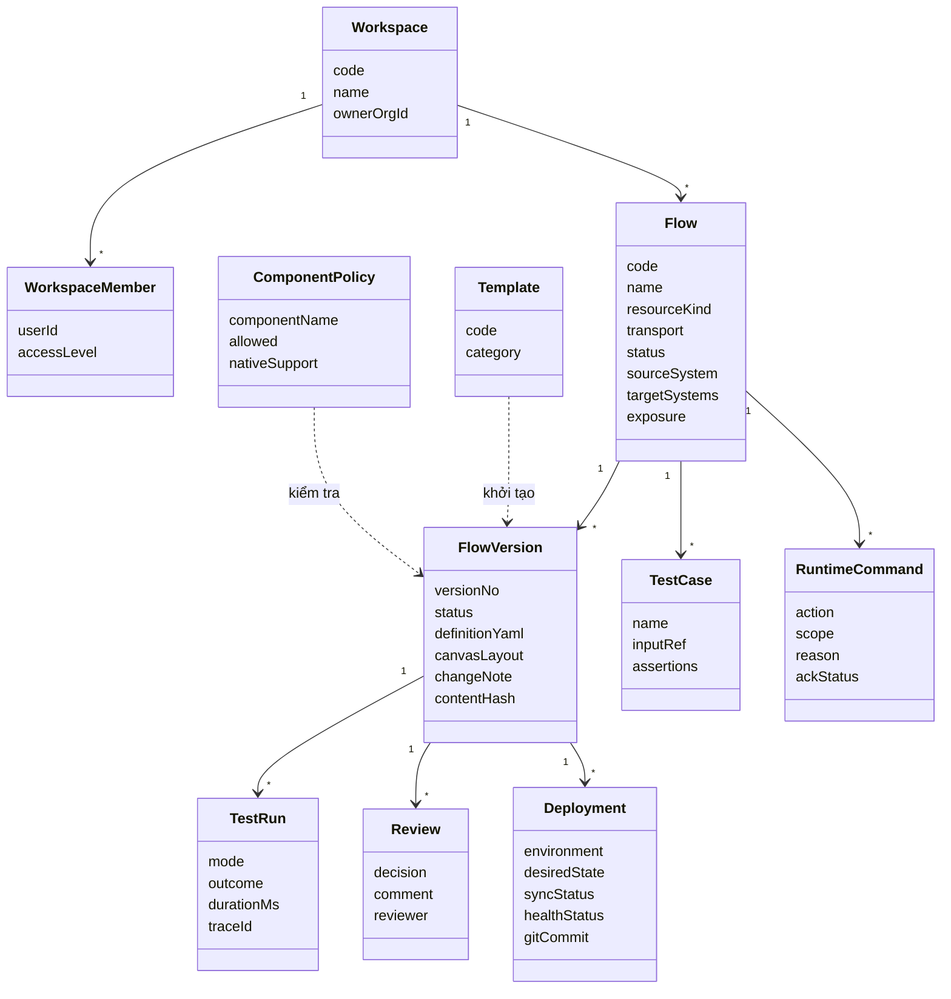
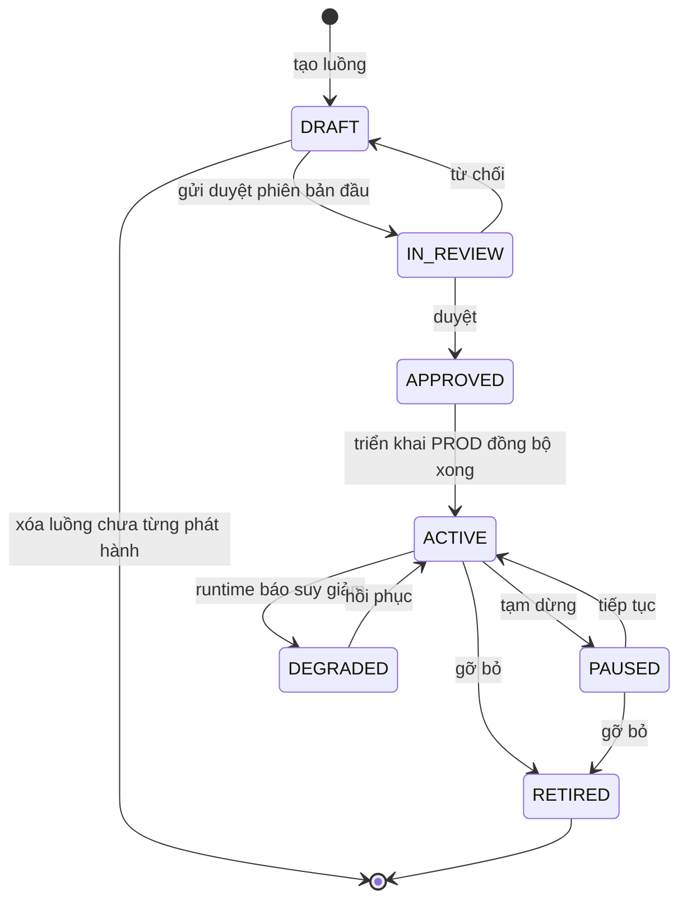
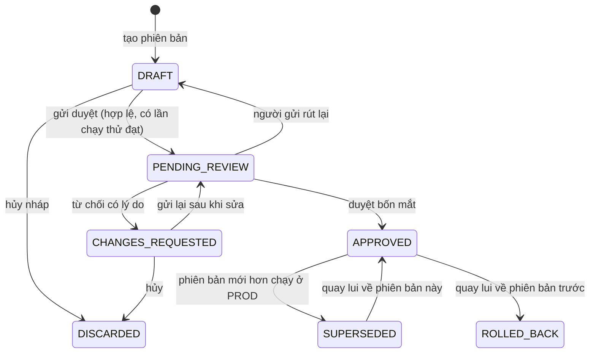
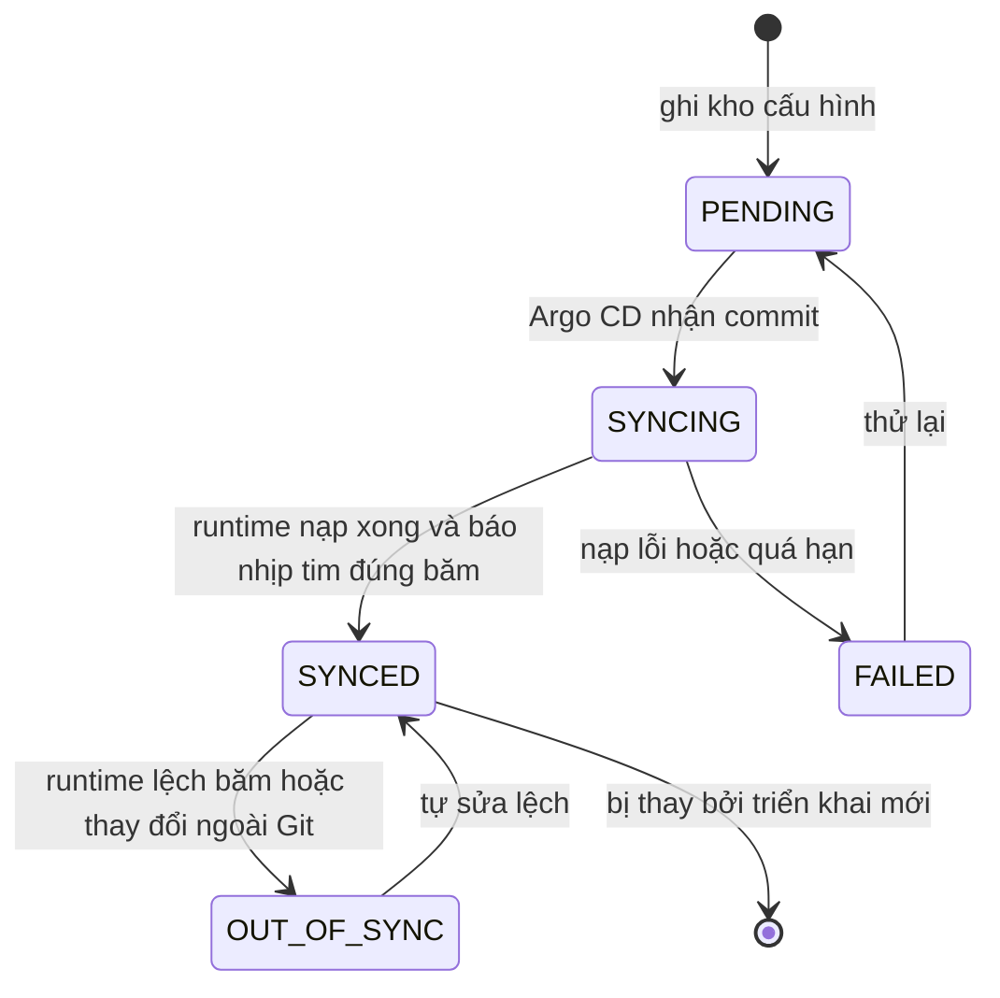
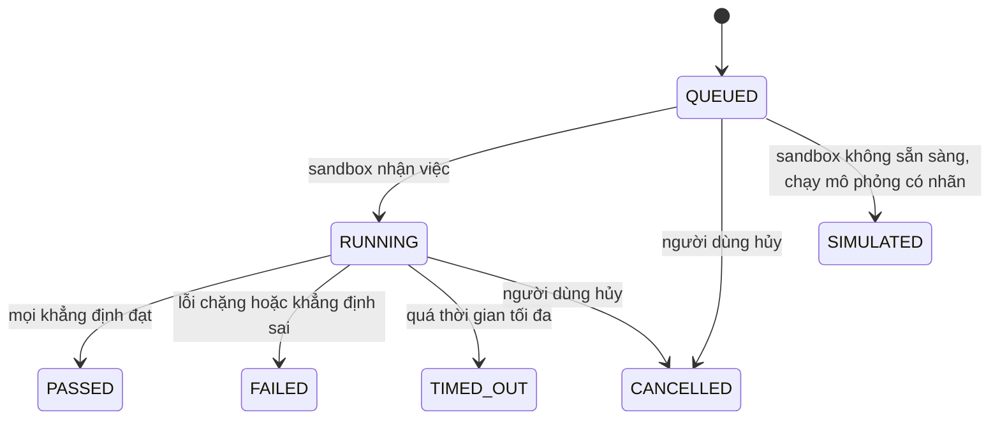
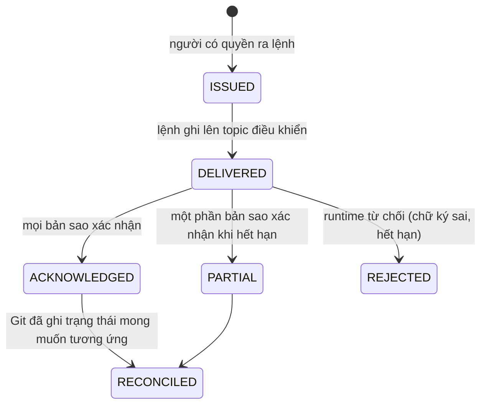

# D02-03-PH04 · Đặc tả chức năng phân hệ PH-04 Lõi tích hợp và trình thiết kế luồng

## Tóm tắt cho hội đồng thẩm định

PH-04 Lõi tích hợp và trình thiết kế luồng thay thế hai khối "Bus" và "Productivity Tooling" của LGSP cũ. Bus cũ là tập các chương trình tích hợp (agent) Apache Camel chạy trên máy chủ cố định, được quản trị qua JMX và Jolokia; Tooling là công cụ kéo thả viết bằng Angular, sinh Camel XML và tệp `pom.xml` cho từng project. PH-04 thay cả hai bằng một quy trình khép kín: kỹ sư tích hợp thiết kế luồng trên trình thiết kế trực quan, chạy thử trên môi trường cô lập, gửi duyệt, người duyệt khác người thiết kế phê duyệt, rồi luồng được phát hành qua kho cấu hình Git và tự động triển khai xuống lớp chạy `dh-runtime` (Camel Quarkus). Phân hệ thuộc đợt MVP vì mọi lượt trao đổi có chuyển đổi dữ liệu giữa hai hệ thống thông tin (HTTT) đều đi qua luồng của PH-04.

Phạm vi phủ hệ cũ: 41 chức năng của Bus (LGC-BUS-001…041) và 29 chức năng của Tooling (LGC-TOOL-001…029) đã kiểm kê ở D00-03. Mọi chức năng được giữ hoặc nâng cấp đều có FR tương ứng (mục 9.1). Hai chức năng bị loại bỏ vì lý do an toàn thông tin: người dùng tự sửa `pom.xml` (LGC-TOOL-022) và nhập component từ tệp JAR (LGC-TOOL-027). Một số chức năng giám sát của Bus (biểu đồ lượng bản tin, CPU, bộ nhớ, log) chuyển sang PH-13; PH-04 nhúng lại các biểu đồ đó trên màn chi tiết luồng.

Điểm mới so với hệ cũ:
- Luồng có phiên bản, có lịch sử và so sánh khác biệt; mọi phiên bản đem chạy đều đã qua duyệt bốn mắt.
- Luồng viết bằng Camel YAML DSL thay Camel XML. Người dùng không thêm được thư viện tùy ý; chỉ dùng thành phần trong danh mục đã duyệt.
- Không còn ra lệnh trực tiếp vào máy chủ đang chạy. Trạng thái mong muốn nằm trong Git, Argo CD đưa xuống runtime và báo lại tình trạng triển khai. Lệnh tạm dừng khẩn cấp có kênh riêng, có ký và có kiểm toán.
- Bí mật kết nối không bao giờ nằm trong luồng. Luồng chỉ trỏ tới kết nối đã đăng ký ở PH-05.
- Có trình ánh xạ dữ liệu sinh biểu thức JQ, chuyển mã qua bảng ánh xạ của PH-07 và che dữ liệu cá nhân theo chính sách của PH-09.
- Một nền chạy phục vụ nhiều tỉnh. Mỗi bản tin mang ngữ cảnh tenant; luồng của tỉnh lớn chạy trong namespace riêng.

Căn cứ pháp lý chính ở mục 1.6. Phạm vi MVP ở mục 9.3, tiêu chí chấp nhận cấp phân hệ ở mục 13. Hiện trạng mã nguồn và các chỗ lệch so với thiết kế được ghi ở mục 2.4 để chủ đầu tư thấy rõ khối lượng còn lại.

## 1. Mục đích, phạm vi và người đọc

### 1.1. Mục đích

Tài liệu này đặc tả đầy đủ yêu cầu chức năng của phân hệ PH-04 Lõi tích hợp và trình thiết kế luồng thuộc sản phẩm Datahub. Mục tiêu là để đội phát triển lập trình ngay mà không phải đoán ý nghiệp vụ, để đội kiểm thử viết được ca dương tính và âm tính cho từng yêu cầu, và để chủ đầu tư có căn cứ nghiệm thu từng chức năng so với Bus và Tooling của hệ cũ.

Mỗi FR viết theo mẫu D00-01 §4.3, dùng kiểu dữ liệu chuẩn `T-*` ở D00-01 §5 và hệ mã truy vết ở D00-01 §3. Chức năng dùng chung cho mọi phân hệ (xác thực, phân trang, kiểm toán, thông báo, hộp "Việc của tôi", khóa lạc quan) đã đặc tả ở [D02-02 SRS §4](../D02-02-srs.md); tài liệu này chỉ ghi "Tuân thủ FR-00-nnn" và không viết lại.

### 1.2. Phạm vi

PH-04 gồm hai nửa chạy ở hai mặt phẳng khác nhau (ADR-013).

**Nửa điều khiển (control plane), đơn vị triển khai `dh-integration`.** Quản lý không gian làm việc và luồng; trình thiết kế luồng trên `dh-console` (canvas, bảng thành phần, cấu hình chặng, trình soạn biểu thức, đồng bộ hai chiều với YAML, Kamelet, Pipe, ca kiểm thử, bean, ánh xạ dữ liệu); kiểm tra hợp lệ; chạy thử và nhật ký chạy thử; gửi duyệt, duyệt bốn mắt, phát hành qua GitOps, thăng cấp môi trường, quay lui; điều khiển kích hoạt và tạm dừng; xem tình trạng triển khai; danh mục thành phần Camel; thư viện khuôn mẫu; công cụ chuyển luồng XML của hệ cũ sang YAML.

**Nửa chạy (data plane), đơn vị triển khai `dh-runtime`.** Khung chín chặng chuẩn của luồng; tiếp nhận đồng bộ (HTTP, SOAP qua APISIX) và bất đồng bộ (Kafka); kiểm tra lược đồ; ủy quyền qua OPA; chuyển đổi, chuẩn hóa về mô hình dữ liệu chuẩn (CDM) và chuyển mã qua PH-07; làm giàu; che dữ liệu cá nhân theo PH-09; định tuyến, tách, gộp, gọi song song; phát sự kiện; xử lý lỗi, thử lại, ngắt mạch, đẩy bản tin lỗi sang PH-18; chống trùng; truy cập CSDL có kiểm soát (Q359); ngữ cảnh tenant; phát vết, chỉ số, log.

Ngoài phạm vi của tài liệu này:
- Danh mục Kamelet được duyệt và kết nối tới nguồn (khai báo, lưu bí mật, kiểm tra kết nối) thuộc PH-05. PH-04 chỉ dùng chúng.
- Topic, lược đồ sự kiện, publisher và subscriber thuộc PH-10. PH-04 chỉ gửi và nhận trên topic đã đăng ký.
- Đăng ký và công bố API ra cổng thuộc PH-02, PH-03. Luồng có điểm vào HTTP được công bố qua PH-02 như một backend.
- Bảng điều khiển, tra log, truy vết thuộc PH-13. PH-04 nhúng lại một phần trên màn chi tiết luồng.
- Xem, sửa, xử lý lại bản tin lỗi (DLQ) thuộc PH-18.
- Luồng kết nối quốc gia NDXP là luồng PH-04 nhưng adapter và quản lý thông tin xác thực với NDXP thuộc PH-14.

### 1.3. Người đọc và cách đọc

| Người đọc | Phần nên đọc kỹ | Mục đích sử dụng |
|---|---|---|
| Chủ đầu tư, lãnh đạo Sở | Tóm tắt, mục 2, 9, 11, 13 | Xác nhận phạm vi, đối chiếu với Bus và Tooling, trả lời câu hỏi mở |
| Phân tích nghiệp vụ | Toàn bộ, đặc biệt mục 4, 5, 12 | Cơ sở cho use case D02-04-PH04 và user story |
| Kiến trúc sư, trưởng nhóm | Mục 2.4, 4, 5 nhóm D–F, 7, 10 | SDD D03-02-PH04, CSDL, API |
| Lập trình viên `dh-integration` | Mục 5 nhóm A, C, D, E, G; mục 8 | Lập trình API điều khiển |
| Lập trình viên `dh-console` | Mục 4, 5 nhóm B, C, D; mục 12 | Màn hình D03-06-PH04 |
| Lập trình viên `dh-runtime` | Mục 5 nhóm F | Khuôn mẫu route chuẩn, Kamelet nền |
| Kiểm thử viên | Mục 5 (ngoại lệ, hậu điều kiện), 6, 7 | Ca kiểm thử D05-02-PH04 |
| Đội di trú | Mục 2.2, FR-04-082, 9.1 | Chuyển luồng XML của Bus cũ |

### 1.4. Tài liệu liên quan

| Mã | Tài liệu | Quan hệ |
|---|---|---|
| D00-01 | Thuật ngữ và quy ước chung | Mẫu FR, kiểu `T-*`, hệ mã |
| D00-02 | Sổ ADR | ADR-002, 009, 010, 013 và ADR-060…069 của PH-04 |
| D00-03 | Ma trận truy vết | Kiểm kê LGC-BUS, LGC-TOOL (§4.1, §4.2) |
| D02-02 | SRS cấp hệ thống | FR-00-*, NFR-00-*, REQ-04 |
| D02-07 | Từ điển dữ liệu dùng chung | DD-*, trường ngữ cảnh |
| D02-08 | Ma trận phân quyền | PERM-04-*, vai trò IE, IA, TO |
| D03-01 | SAD | DU `dh-integration`, `dh-runtime`; đường phát hành §5 |
| D03-07 | Thiết kế ATTT | SEC-40…49 ứng dụng, SEC-50…59 nền tảng |
| D03-09 | Hạ tầng | Namespace `dh-runtime`, `dh-rt-{tenant}`, vùng Z4 |
| D03-10 | Đa tenant | Luồng thuộc tenant, ngưỡng 50 luồng |
| D04-01 | Coding convention | CC-CAMEL-*, Q359 |
| D02-04-PH04 | Use case PH-04 | UC-04-* |
| D03-02-PH04 | SDD PH-04 | Thiết kế chi tiết |
| D03-03-PH04 | CSDL PH-04 | Schema `ph04` |
| D03-04-PH04 | API và sự kiện PH-04 | API-04-*, EVT-04-*, ERR-04-* |
| D03-05 | Design system | CMP-*, vật liệu glass |
| D03-06-PH04 | Màn hình PH-04 | UI-04-* |
| D05-02-PH04 | Test case PH-04 | TS-04-*, TC-04-* |
| `docs/07-srs/SRS-PH-04-*.md` | SRS PH-04 của repo gốc | Nguồn tham khảo; ánh xạ mã cũ sang mã mới ở Phụ lục A |

### 1.5. Quy ước riêng của tài liệu

Trong tài liệu, "luồng" (flow) là một tệp tài nguyên Camel có phiên bản, quản lý như một đơn vị phát hành; một luồng có thể chứa nhiều "route" Camel. "Chặng" (step, node) là một bước trên sơ đồ, tương ứng một phần tử EIP hoặc một lời gọi thành phần. "Phiên bản" là một bản định nghĩa luồng bất biến sau khi gửi duyệt. "Triển khai" là việc một phiên bản đã duyệt được đưa xuống một môi trường. Mã thành phần Camel viết nguyên tiếng Anh như trong catalog (`kafka`, `platform-http`, `setBody`).

Repo gốc đã có hai bộ mã FR cho PH-04: `FR-04-001…040` ở `SRS-PH-04-integration-core.md` và `FR-D-001…085` ở `SRS-PH-04-designer.md`, kèm mã màn `D-01…08`, `UI-04-01…10`. Bộ tài liệu này đánh số lại theo quy ước chung (Q11). Mã cũ được giữ trong cột "Mã repo" của bảng truy vết và ở Phụ lục A, để đội phát triển đối chiếu chú thích trong mã nguồn hiện có.

### 1.6. Căn cứ pháp lý riêng của PH-04

| Văn bản | Nội dung áp dụng cho PH-04 | Ghi chú |
|---|---|---|
| Luật Chuyển đổi số 148/2025/QH15 và Nghị định 224/2026/NĐ-CP | Đầu tư, thuê dịch vụ CNTT; yêu cầu hồ sơ thiết kế | Căn cứ đầu tư chung |
| Nghị định 278/2025/NĐ-CP về kết nối, chia sẻ dữ liệu | Kết nối giữa các HTTT qua nền tảng chia sẻ cấp tỉnh; ghi nhật ký kết nối; chuẩn hóa trước 31/12/2026 | PH-04 là nơi thực hiện chuyển đổi và ghi vết trên đường trao đổi |
| Luật An ninh mạng 116/2025/QH15, Nghị định 331/2026/NĐ-CP | Bảo đảm an ninh HTTT cấp độ 3; kiểm soát thay đổi phần mềm, phân tách nhiệm vụ | Căn cứ duyệt bốn mắt, cấm nạp mã tùy ý |
| TCVN 14423:2026 cấp độ 3 (nhóm quản lý cấu hình, phát triển và thay đổi, nhật ký) | Quản lý phiên bản, kiểm thử trước khi đưa vào vận hành, nhật ký thao tác quản trị | Ánh xạ chi tiết ở D03-07 |
| Luật Bảo vệ dữ liệu cá nhân 91/2025/QH15, Nghị định 356/2025/NĐ-CP | Che, giả danh dữ liệu cá nhân khi chuyển tiếp; không lưu bản tin chứa dữ liệu cá nhân ngoài mục đích | Căn cứ BR-04-012, BR-04-013 |
| Khung kiến trúc Chính phủ số (phiên bản hiện hành) | Vai trò LGSP cấp tỉnh trong kiến trúc | Ánh xạ ở SAD |

Các văn bản trên đã được tra cứu ngày 21/11/2026 và chưa đối chiếu Công báo; điểm chưa xác minh ghi ở câu hỏi Q04-01.

## 2. Bối cảnh nghiệp vụ

### 2.1. Vai trò của PH-04 trong Datahub

Khi hai HTTT trao đổi dữ liệu qua Datahub có hai đường đi. Đường thẳng: APISIX xác thực, kiểm tra đăng ký sử dụng rồi chuyển lượt gọi thẳng tới backend của HTTT cung cấp; đường này không cần PH-04. Đường có xử lý: dữ liệu cần đổi định dạng (SOAP sang REST, XML sang JSON), đổi mã (mã dân tộc của sở A sang mã chuẩn), ghép từ nhiều nguồn, che dữ liệu cá nhân, chuyển từ đồng bộ sang bất đồng bộ, hoặc đọc định kỳ từ CSDL và tệp FTP của hệ cũ. Mọi đường có xử lý đều là một luồng PH-04. Theo D03-09 §4, khoảng 40% lượt gọi đi qua `dh-runtime` (giả định định cỡ).

PH-04 cũng là nơi tỉnh đưa các tích hợp đang chạy trên Bus cũ sang Datahub theo kiểu strangler: từng luồng XML cũ được chuyển sang YAML, chạy song song, đối chiếu kết quả, rồi chuyển lưu lượng.

### 2.2. Hệ cũ Bus và Productivity Tooling

**Bus** gồm nhiều "chương trình tích hợp" (agent). Mỗi agent là một tiến trình Camel trên Spring XML chạy trên một máy chủ có host và cổng cố định, chứa nhiều route. Giao diện quản trị đọc thông tin agent, route, endpoint và số liệu qua JMX, phơi ra bằng Jolokia; cho phép start, stop agent và route, sửa host, port, method của agent, xóa agent, xem sơ đồ, mã nguồn XML và thuộc tính route. Dữ liệu quản trị lưu ở các bảng `Project`, `Group`, `Project_group` (phân quyền theo nhóm với `access_level`), `Context`, `Context_status`, `Context_file`, `File`, `Dependency`, `Builder`.

**Productivity Tooling** là trình thiết kế kéo thả: thanh Project, thanh Component có chế độ thu gọn và mở rộng, nhóm component (Routing, Data Transformation, Database Connection, Network, Message Broker, Scheduling, bảo mật), vùng thiết kế có kết nối giữa các component, thanh Properties, tab Source đồng bộ hai chiều, data mapping có nhập tài liệu mẫu, lưu nháp ở bảng `draft_session`, tải XML, cập nhật `pom.xml`, nhập component từ JAR.

Các hạn chế của hệ cũ mà PH-04 phải khắc phục:

| Hạn chế | Hệ quả | Cách PH-04 khắc phục |
|---|---|---|
| Agent gắn máy chủ cố định, sửa host/port trực tiếp | Không mở rộng theo tải, sự cố một máy ảnh hưởng mọi route trên đó | Runtime trên K8s, nhiều bản sao, KEDA; cấu hình qua phiên bản luồng |
| Điều khiển qua JMX/Jolokia phơi ra mạng | Bề mặt tấn công lớn, không kiểm toán được người ra lệnh | Không mở JMX; điều khiển qua GitOps và kênh lệnh có ký (ADR-065) |
| Lưu XML trong CSDL, không phiên bản | Không biết ai sửa gì, không quay lui được | Phiên bản bất biến, Git làm nguồn triển khai, so sánh khác biệt |
| Người dùng sửa `pom.xml`, nạp JAR | Rủi ro chuỗi cung ứng, vi phạm kiểm soát phần mềm cấp độ 3 | Danh mục thành phần được duyệt, ảnh runtime dựng sẵn |
| Không duyệt trước khi chạy | Một người có thể đưa thay đổi lỗi vào vận hành | Duyệt bốn mắt, kiểm tra hợp lệ bắt buộc |
| Mật khẩu CSDL, FTP nằm trong XML | Lộ bí mật qua mã nguồn và bản sao lưu | Tham chiếu kết nối PH-05, bí mật trong OpenBao |
| Không có chạy thử | Lỗi phát hiện khi đã vào vận hành | Chạy thử trên sandbox với đích mô phỏng |

### 2.3. Yêu cầu mới

Ngoài phủ chức năng cũ, PH-04 phải đáp ứng các yêu cầu mới của chủ đầu tư (Q2, Q5, Q9, Q12 ở D00-02): đa tenant; ATTT cấp độ 3 sẵn sàng cấp độ 4; giữ Camel Quarkus cho data plane; chạy song song với Bus cũ trong thời gian chuyển đổi. Người dùng còn yêu cầu trình thiết kế luồng có trải nghiệm hiện đại tương đương Kaoto, theo phong cách Liquid Glass trên antd v6 (Q8).

### 2.4. Hiện trạng mã nguồn và chỗ lệch so với thiết kế

Mã trong repo (tháng 11/2026) đã có một phần lớn PH-04. Bảng dưới ghi các điểm lệch giữa mã và thiết kế của bộ tài liệu này, để kế hoạch phát triển có đầu việc rõ ràng. Mỗi điểm lệch có FR hoặc ADR quyết định cách xử lý.

| Mã lệch | Hiện trạng trong mã | Thiết kế đích | Xử lý | Căn cứ |
|---|---|---|---|---|
| GAP-04-01 | Runtime Camel Quarkus 3.33.2 (Camel 4.18 LTS) ở `camel/dancu`, `camel/datdai`; catalog của trình thiết kế trước đây sinh từ `@kaoto/camel-catalog` 0.7.0 cho camel-quarkus **3.35.0**. Ngày 25/11/2026 đã có thay đổi hạ catalog về dòng 3.33 (PR #5): Kaoto không phát hành nhánh 3.33.2 nên dùng 3.33.1 (Camel 4.18.2), phiên bản đọc từ `camel/*/pom.xml`, `npm run catalog:check` chặn lệch | Catalog khớp phiên bản runtime; lệch bản vá (3.33.1 so với 3.33.2) chấp nhận được khi danh sách thành phần và lược đồ không đổi | Giữ cơ chế của PR #5; bổ sung so khớp theo tệp kê khai hồ sơ runtime và kiểm tra khác biệt lược đồ giữa hai bản vá | FR-04-081, ADR-061 |
| GAP-04-02 | Luồng nghiệp vụ `TraCuuRoute`, `StandardPipelineRoute`, `CdmMapRoute` viết bằng Java DSL; chỉ `ping` là YAML | Luồng nghiệp vụ viết bằng YAML DSL (ADR-010) | Chuyển ba luồng sang YAML; Java chỉ còn cho processor và bean nền được duyệt | ADR-062, FR-04-060 |
| GAP-04-03 | `GitOpsPublisher` ghi tệp `routes/<mã>/route.camel.yaml` trong cùng repo, commit tùy chọn; chưa có kho cấu hình riêng, chưa có Argo CD; runtime không nạp được luồng đã phát hành | Kho cấu hình Git riêng theo tenant và môi trường, Argo CD đồng bộ xuống runtime, runtime nạp YAML lúc chạy | Thiết kế mới ở SDD §5; luồng phát hành báo tình trạng triển khai | FR-04-042, ADR-063 |
| GAP-04-04 | `testRun` mô phỏng: dựng waterfall chín chặng từ `stage.hashCode()`, luôn trả `PASSED`, không nạp Camel | Chạy Camel thật trong sandbox cô lập, đích mô phỏng | Bộ chạy thử `dh-runtime-sandbox` | FR-04-030, ADR-064 |
| GAP-04-05 | `publish()` nhận phiên bản ở trạng thái `DRAFT` và phát hành thẳng, bỏ qua duyệt | Chỉ phát hành phiên bản `APPROVED`; duyệt bốn mắt bắt buộc | Siết máy trạng thái ở máy chủ | FR-04-041, BR-04-005 |
| GAP-04-06 | Bốn mắt so `actor` với `created_by` của phiên bản; chưa so với người gửi duyệt, người sửa gần nhất | Người duyệt khác người tạo, người sửa và người gửi duyệt | Lưu danh sách người đóng góp vào phiên bản | BR-04-005 |
| GAP-04-07 | Bảng `ph04.route` chưa có `tenant_id`, chưa có RLS | Mọi bảng có `tenant_id`, RLS theo D03-10 | DDL mới ở D03-03-PH04 | ADR-003 |
| GAP-04-08 | Khung chín chặng kiểm tra bằng tìm chuỗi con trong YAML (`lower.contains(stage)`) | Kiểm tra theo metadata chặng trên cây tài nguyên | Đánh dấu chặng bằng `id` có tiền tố chuẩn và `description` | FR-04-023, BR-04-002 |
| GAP-04-09 | DataMapper xem trước bằng mô phỏng JQ trong trình duyệt; engine máy chủ `camel-quarkus-jq` chưa có | Xem trước chạy JQ thật ở máy chủ | Gọi API xem trước của sandbox; giữ xem trước cục bộ có nhãn "mô phỏng" khi máy chủ không sẵn | FR-04-020 |
| GAP-04-10 | `camel/dancu` dùng `camel-quarkus-sql` với datasource dùng chung tài khoản `lgsp` | Q359: tài khoản chỉ đọc theo luồng, khai báo ở PH-05, kiểm toán, RLS theo tenant | Thiết kế ở FR-04-072, ADR-067 | Q359 |
| GAP-04-11 | Tạm dừng luồng chỉ đổi cột `status` trong CSDL control; runtime không biết | Tạm dừng thật trên runtime, có xác nhận | Kênh lệnh có ký và trạng thái mong muốn trong Git | FR-04-050, ADR-065 |
| GAP-04-12 | Không có `errorHandler` chuẩn ở luồng mẫu | Mọi luồng có DLQ chuẩn sang PH-18 | Khuôn `routeConfiguration` nền, kiểm tra bắt buộc | FR-04-070 |
| GAP-04-13 | Đường dẫn giao diện `/flows/...`, tên gói `vn.lgsp` | Đường dẫn `/tich-hop/luong/...` theo D03-06-00; gói `vn.datahub` theo Q350 | Đổi khi tái cấu trúc, giữ chuyển hướng từ đường dẫn cũ một đợt | D03-06-00 §2.4 |

### 2.5. Đa tenant trong PH-04

Mỗi luồng thuộc đúng một tenant. Tenant `PLATFORM` sở hữu các khuôn mẫu, Kamelet nền và luồng dùng chung toàn quốc (ví dụ luồng kết nối NDXP mẫu), các tenant tỉnh dùng lại bằng cách tạo luồng từ khuôn hoặc tham chiếu Kamelet. Luồng chạy trong namespace dùng chung `dh-runtime` có nhãn tenant, hoặc trong namespace riêng `dh-rt-{tenant}` khi tenant có trên 50 luồng hoặc có yêu cầu riêng (D03-10 §3, D03-09 §5). Mọi bản tin trong runtime mang tiêu đề `dh-tenant` được đặt ở chặng tiếp nhận từ token hoặc từ topic, không lấy từ dữ liệu do bên gọi gửi (BR-04-010).

## 3. Tác nhân, vai trò và quyền

### 3.1. Tác nhân

| Tác nhân | Mã vai trò | Việc chính với PH-04 |
|---|---|---|
| Kỹ sư tích hợp | IE (INTEGRATION_ENGINEER) | Thiết kế, chạy thử, gửi duyệt luồng; xem tình trạng |
| Người duyệt tích hợp | IA (INTEGRATION_APPROVER) | Duyệt hoặc từ chối phiên bản, phát hành, quay lui |
| Vận hành tenant | TO (TENANT_OPERATOR) | Kích hoạt, tạm dừng luồng và route; xem tình trạng |
| Quản trị tenant | TA (TENANT_ADMIN) | Quản lý không gian làm việc, thành viên, tham số PH-04; vận hành |
| Cán bộ an toàn thông tin | SO (SECURITY_OFFICER) | Tạm dừng khẩn cấp; xem nhật ký kiểm toán; duyệt danh mục thành phần |
| Quản trị nền tảng | PA (PLATFORM_ADMIN) | Khuôn mẫu, Kamelet nền, luồng toàn quốc, danh mục thành phần, hồ sơ runtime |
| Người xem, kiểm toán | VW, AU | Xem luồng, lịch sử, nhật ký |
| HTTT thành viên | (máy) | Gọi điểm vào HTTP của luồng qua APISIX; gửi, nhận bản tin Kafka |
| Argo CD | (máy) | Đồng bộ kho cấu hình xuống runtime; báo tình trạng |
| `dh-runtime` | (máy) | Chạy luồng, báo nhịp tim, nhận lệnh điều khiển |
| PH-05, PH-07, PH-09, PH-10, PH-13, PH-18 | (máy) | Cung cấp kết nối, chuyển mã, chính sách che, topic, giám sát, xử lý bản tin lỗi |

### 3.2. Quyền PH-04 theo D02-08

| Quyền | Mô tả | Vai trò có quyền theo D02-08 §3.1 |
|---|---|---|
| `PERM-04-read` | Xem luồng, phiên bản, sơ đồ, mã nguồn, tình trạng | PA, PO, TA, TO, SO, IE, IA, VW, AU |
| `PERM-04-create`, `PERM-04-update` | Tạo, thiết kế luồng, chạy thử | IE |
| `PERM-04-submit` | Gửi duyệt phiên bản | IE |
| `PERM-04-publish` | Duyệt, từ chối, phát hành, quay lui | IA |
| `PERM-04-operate` | Kích hoạt, tạm dừng luồng và route | TA, TO, SO, IA |

### 3.3. Quyền đề xuất bổ sung D02-08

D02-08 chưa có các quyền dưới đây. FRS đề xuất bổ sung; cho tới khi D02-08 được cập nhật, mã nguồn kiểm tra mã quyền mới nhưng cấu hình vai trò mặc định theo cột "Gán mặc định đề xuất".

| Quyền đề xuất | Mô tả | Gán mặc định đề xuất | Lý do |
|---|---|---|---|
| `PERM-04-delete` | Gỡ bỏ luồng, xóa bản nháp | IE (bản nháp của mình), TA | Gỡ luồng đang chạy là thao tác có hậu quả, tách khỏi `update` |
| `PERM-04-emergency-stop` | Tạm dừng khẩn cấp bỏ qua GitOps | SO, TA | Lệnh khẩn có tác động ngay trên runtime, cần quyền riêng để kiểm toán |
| `PERM-04-promote` | Thăng cấp phiên bản đã duyệt lên môi trường cao hơn | IA, TA | Tách phê duyệt nội dung với phê duyệt đưa vào vận hành thật |
| `PERM-04-admin` | Quản lý không gian làm việc, thành viên, tham số PH-04 | TA, PA | Theo động từ chuẩn `admin` của D02-08 §3 |
| `PERM-04-catalog-admin` | Quản lý danh mục thành phần được phép, khuôn mẫu, hồ sơ runtime | PA, SO (duyệt) | Danh mục thành phần quyết định mã nào được chạy |
| `PERM-04-sample-data` | Dùng dữ liệu thật làm bản tin mẫu khi chạy thử trên môi trường TEST | IE (được TA cấp theo luồng) | Bản tin thật có thể chứa dữ liệu cá nhân |

### 3.4. Phạm vi không gian làm việc

Quyền ở mục 3.2 áp trong phạm vi tenant. PH-04 bổ sung một phạm vi hẹp hơn là **không gian làm việc** (workspace), kế thừa khái niệm `Project` và `Project_group.access_level` của Bus cũ (LGC-BUS-032). Mỗi luồng thuộc đúng một không gian làm việc; mỗi không gian làm việc có danh sách thành viên với mức truy cập `VIEW`, `EDIT`, `MAINTAIN`. Người có `PERM-04-update` chỉ sửa được luồng trong không gian làm việc mà mình có mức `EDIT` trở lên. Người có `PERM-04-publish` chỉ duyệt được luồng trong không gian làm việc mà mình là thành viên mức `MAINTAIN`. TA và PA không bị giới hạn bởi không gian làm việc. Mục đích là để sở A không vô tình sửa luồng của sở B trong cùng tỉnh, như cách hệ cũ phân quyền project theo group.

## 4. Khái niệm và mô hình nghiệp vụ

### 4.1. Tổng quan mô hình

### 4.2. Không gian làm việc

Không gian làm việc (EN-04-01) là nhóm luồng của một đơn vị hoặc một dự án tích hợp, có mã duy nhất trong tenant, tên, tổ chức chủ quản và danh sách thành viên. Mỗi tenant có sẵn một không gian làm việc mặc định `DEFAULT` khi khởi tạo. Không gian làm việc tương ứng `Project` của Bus cũ và được di trú từ đó.

### 4.3. Luồng và loại tài nguyên

Luồng (EN-04-02) có mã duy nhất trong tenant, mẫu `^[a-z][a-z0-9-]{2,62}$`, không đổi được sau khi tạo vì là khóa của tệp trong kho cấu hình. Loại tài nguyên `resourceKind` gồm:

| Loại | Nội dung tệp | Chạy độc lập | Ví dụ |
|---|---|---|---|
| `ROUTE` | Một hoặc nhiều `route`, kèm `routeConfiguration`, `rest`, `beans` cấp tệp | Có | Luồng tra cứu hộ tịch |
| `KAMELET` | Một `Kamelet` (`spec.definition`, `spec.template`) | Không, được luồng khác dùng | Kamelet nguồn đọc bảng hồ sơ |
| `PIPE` | Một `Pipe` nối `source`, `steps`, `sink` | Có | Đẩy thay đổi CSDL sang Kafka |
| `TEST` | Một bộ ca kiểm thử gắn với một luồng `ROUTE` hoặc `PIPE` | Không, chỉ chạy khi kiểm thử | Bộ ca của luồng tra cứu |

Thuộc tính vận chuyển `transport` (`SYNC`, `ASYNC`, `SCHEDULED`, `MIXED`) mô tả cách luồng được kích hoạt; được suy ra từ chặng đầu và người dùng không sửa tay. Thuộc tính `exposure` cho biết luồng **đối ngoại** (có `sourceSystem` hoặc `targetSystems` là HTTT thành viên đã kết nạp) hay **nội bộ**. Luồng đối ngoại phải theo khung chín chặng (BR-04-002).

### 4.4. Phiên bản

Mỗi luồng có dãy phiên bản `versionNo` tăng dần từ 1. Mỗi phiên bản (EN-04-03) chứa định nghĩa YAML, bố cục sơ đồ (vị trí chặng, ghi chú dán, nhóm), ghi chú thay đổi, băm SHA-256 của YAML đã chuẩn hóa, danh sách người đóng góp, kết quả kiểm tra hợp lệ gần nhất. Tại mọi thời điểm một luồng có tối đa một phiên bản mở (`DRAFT` hoặc `CHANGES_REQUESTED`). Phiên bản đã gửi duyệt là bất biến về nội dung: mọi sửa đổi phải làm trên phiên bản mới.

Bố cục sơ đồ không nằm trong YAML đem triển khai. Repo hiện nhúng bố cục vào dòng chú thích `# @lgsp-canvas-v1:` và lọc bỏ khi phát hành; thiết kế đích lưu bố cục ở cột riêng (`canvas_layout`) để YAML trong kho cấu hình sạch, còn tệp tải xuống vẫn có thể kèm bố cục để mở lại trên trình thiết kế khác của Datahub (FR-04-027).

### 4.5. Môi trường và triển khai

Datahub có ba môi trường luồng: `TEST` (sandbox và môi trường thử tích hợp), `STAGING` (tiền vận hành, tùy tỉnh) và `PROD`. Một phiên bản đã duyệt được triển khai lần lượt theo thứ tự môi trường; mỗi lần triển khai (EN-04-06) ghi môi trường, trạng thái mong muốn (`RUNNING`, `PAUSED`, `REMOVED`), commit Git, trạng thái đồng bộ Argo CD (`PENDING`, `SYNCED`, `OUT_OF_SYNC`, `FAILED`) và sức khỏe báo về từ runtime (`HEALTHY`, `DEGRADED`, `DOWN`, `UNKNOWN`). Tỉnh không có STAGING thì bỏ qua môi trường này (tham số `04.env.stages`).

### 4.6. Chặng và khung chín chặng chuẩn

Khung chín chặng là khuôn mẫu chuẩn của mọi luồng đối ngoại, kế thừa từ repo (`routes/_templates/standard-9-stage.camel.yaml`):

| Thứ tự | Mã chặng | Tên | Việc phải làm | FR |
|---|---|---|---|---|
| 1 | `receive` | Tiếp nhận | Nhận bản tin, đặt `traceId`, `dh-tenant`, `dh-flow`, `dh-flow-version`, đo kích thước | FR-04-061, 062 |
| 2 | `schema` | Kiểm tra lược đồ | Kiểm tra JSON Schema, XSD hoặc lược đồ Apicurio | FR-04-063 |
| 3 | `authz` | Ủy quyền | Hỏi OPA theo ngữ cảnh bên gọi, mục đích, dữ liệu | FR-04-064 |
| 4 | `transform` | Chuyển đổi | Chuẩn hóa về CDM, chuyển mã, đổi định dạng | FR-04-065 |
| 5 | `enrich` | Làm giàu | Bổ sung dữ liệu từ nguồn khác | FR-04-066 |
| 6 | `route` | Định tuyến | Chọn đích theo nội dung, tách, gộp | FR-04-068 |
| 7 | `deliver` | Gửi đích | Gọi HTTT đích hoặc phát sự kiện | FR-04-068, 069 |
| 8 | `audit` | Ghi vết | Ghi nhật ký kết nối theo NĐ 278/2025 | FR-04-074 |
| 9 | `respond` | Phản hồi | Trả kết quả, che dữ liệu theo bên nhận | FR-04-067 |

Mỗi chặng chuẩn được đánh dấu trên cây tài nguyên bằng `id` có tiền tố `dh-stage-{mã}` ở phần tử EIP đầu tiên của chặng (thường là một `step` bao các bước con). Cách đánh dấu này thay việc tìm chuỗi con trong YAML (GAP-04-08) và cho phép sơ đồ nhóm các bước con thành một khối chặng có thể thu gọn.

### 4.7. Danh mục thành phần và hồ sơ runtime

Danh mục thành phần (EN-04-11) là bản sao có kiểm soát của catalog Camel cho đúng phiên bản runtime: component, mẫu EIP, Kamelet, dataformat, language, entity, load balancer. Mỗi mục có cờ "được phép" theo chính sách của nền tảng và tenant, mức hỗ trợ native, giấy phép. "Hồ sơ runtime" (runtime profile) là tập thành phần được biên dịch vào một ảnh `dh-runtime` native; mỗi luồng khi phát hành được gán vào hồ sơ có đủ thành phần nó dùng (ADR-063). Thành phần không hỗ trợ native chạy trong hồ sơ JVM riêng (ADR-002).

### 4.8. Kết nối và bí mật

Luồng không chứa bí mật. Mọi tham số nhạy cảm (mật khẩu, khóa API, chứng thư) được tham chiếu qua kết nối đã đăng ký ở PH-05, dạng `{{conn:<mã kết nối>.<khóa>}}`, hoặc qua tham chiếu kho bí mật `{{vault:<đường dẫn>#<khóa>}}` do nền tảng cấp. Runtime phân giải tham chiếu lúc khởi động route qua OpenBao (ADR-012). Trình kiểm tra hợp lệ chặn mọi chuỗi giống bí mật viết thẳng (BR-04-003).

### 4.9. Sơ đồ trạng thái luồng

Trạng thái luồng `Flow.status` là trạng thái tổng hợp để hiển thị và lọc, được tính từ phiên bản và triển khai.

| Trạng thái | Nhãn hiển thị | Ý nghĩa |
|---|---|---|
| `DRAFT` | Nháp | Chưa có phiên bản nào được duyệt |
| `IN_REVIEW` | Chờ duyệt | Phiên bản đầu tiên đang chờ duyệt |
| `APPROVED` | Đã duyệt | Có phiên bản đã duyệt nhưng chưa chạy ở PROD |
| `ACTIVE` | Đang chạy | Có phiên bản chạy ở PROD với trạng thái mong muốn `RUNNING` |
| `PAUSED` | Tạm dừng | Trạng thái mong muốn ở PROD là `PAUSED` |
| `DEGRADED` | Suy giảm | Runtime báo `DEGRADED` hoặc `DOWN`, hoặc lệch đồng bộ quá ngưỡng |
| `RETIRED` | Đã gỡ | Đã gỡ khỏi mọi môi trường; chỉ xem lịch sử |

### 4.10. Sơ đồ trạng thái phiên bản

Repo hiện có các trạng thái `DRAFT`, `TESTING`, `PENDING_REVIEW`, `APPROVED`. Trạng thái `TESTING` của repo được bỏ: việc đã chạy thử đạt là một điều kiện (BR-04-004), không phải trạng thái, vì người thiết kế có thể chạy thử nhiều lần xen kẽ với sửa.

### 4.11. Sơ đồ trạng thái triển khai

### 4.12. Sơ đồ trạng thái lần chạy thử

`SIMULATED` chỉ dùng khi tham số `04.test.allow-simulation` bật (mặc định tắt ở PROD và STAGING của nền tảng, bật ở môi trường phát triển). Lần chạy mô phỏng không được tính là "chạy thử đạt" cho điều kiện gửi duyệt.

### 4.13. Sơ đồ trạng thái lệnh điều khiển runtime

### 4.14. Thuật ngữ bổ sung

| Thuật ngữ | Giải thích |
|---|---|
| Canvas | Vùng vẽ sơ đồ luồng trên trình thiết kế |
| Chặng, nút | Một phần tử trên sơ đồ, tương ứng một bước Camel |
| Cạnh | Đường nối thể hiện thứ tự xử lý giữa hai chặng |
| Inspector | Ngăn bên phải hiển thị cấu hình của chặng đang chọn |
| Bảng thành phần | Ngăn bên trái liệt kê thành phần kéo vào sơ đồ |
| Quay vòng YAML | Mở YAML lên sơ đồ rồi lưu lại; không được mất dữ liệu (BR-04-006) |
| Ghim bản tin mẫu (pin) | Gắn bản tin mẫu vào một chặng để xem trước biểu thức và ánh xạ |
| Sandbox | Môi trường chạy thử cô lập, đích bị thay bằng mô phỏng |
| Kho cấu hình | Kho Git chứa YAML luồng theo tenant và môi trường, nguồn của Argo CD |
| Hồ sơ runtime | Tập thành phần được biên dịch vào một ảnh `dh-runtime` |
| Lệnh khẩn | Lệnh tạm dừng gửi thẳng tới runtime qua topic điều khiển có ký |

## 5. Đặc tả chi tiết yêu cầu chức năng

### 5.0. Cách đọc đặc tả và quy định chung cho mọi FR

Mỗi FR gồm một bảng tóm tắt theo mẫu D00-01 §4.3, bảng đầu vào khi FR có đầu vào đáng kể, danh sách bước xử lý đánh số và bảng ngoại lệ. Các quy định chung dưới đây không lặp lại ở từng FR.

**Tenant và phạm vi.** Tenant xác định từ ngữ cảnh xác thực, không lấy từ tham số client gửi (FR-00-010); mọi truy vấn chạy dưới RLS với `app.tenant_id` của phiên. Đối tượng thuộc tenant khác hoặc thuộc không gian làm việc mà người dùng không là thành viên (với vai trò bị giới hạn theo mục 3.4) trả `404` thay vì `403` để không lộ sự tồn tại (FR-00-011).

**Lũy đẳng và khóa lạc quan.** Thao tác tạo nhận tiêu đề `Idempotency-Key` (16…128 ký tự, lưu 24 giờ); cùng khóa cùng nội dung trả kết quả cũ, cùng khóa khác nội dung trả `ERR-04-018`. Thao tác sửa, xóa, chuyển trạng thái yêu cầu `If-Match` chứa ETag; không khớp trả `ERR-04-006` (412), thiếu trả `ERR-04-007` (428). Riêng lưu định nghĩa (FR-04-024) dùng ETag của phiên bản, không của luồng, để đổi tên luồng không làm hỏng phiên soạn thảo.

**Lỗi.** Lỗi trả theo RFC 9457 với `type`, `title`, `status`, `detail`, `instance`, `code` (mã `ERR-04-nnn`), `traceId`; lỗi kiểm tra hợp lệ thêm mảng `errors` gồm `{path, code, message, severity, nodeId}`, trong đó `nodeId` là mã chặng trên sơ đồ để giao diện tô đúng chặng. Thông điệp tiếng Việt nói rõ sai gì và sửa thế nào (FR-00-080).

**Kiểm toán.** Mọi thao tác ghi thành công sinh bản ghi kiểm toán qua PH-13 theo FR-00-040, FR-00-041 với các trường chung: thời điểm, tenant, chủ thể, địa chỉ nguồn, hành động, loại và mã đối tượng, giá trị trước và sau (chỉ trường thay đổi; với định nghĩa YAML chỉ ghi băm trước và sau, không ghi toàn văn), kết quả, lý do, `traceId`. Cột "Kiểm toán" của từng FR chỉ ghi phần riêng. Thao tác đọc không ghi kiểm toán, trừ đọc nhật ký chạy thử có bản tin thật (FR-04-032).

**Sự kiện.** Sự kiện ghi vào bảng outbox trong cùng giao dịch với thay đổi (SAD §7.3), phát lên topic `{tenant}.integration.{đối tượng}.{động từ}.v1` của PH-10.

**Định nghĩa luồng.** "YAML chuẩn hóa" là YAML sau khi bỏ chú thích bố cục, sắp khóa theo thứ tự của lược đồ Camel, thụt lề hai dấu cách, kết thúc bằng một dòng trống. Băm nội dung tính trên YAML chuẩn hóa. Kích thước định nghĩa tối đa `04.flow.max-definition-kb` (mặc định 512 KiB); vượt trả `ERR-04-033`.

Kiểu dữ liệu chuẩn theo D00-01 §5. FRS dùng thêm: `T-FLOW-CODE` mẫu `^[a-z][a-z0-9-]{2,62}$`; `T-YAML` chuỗi UTF-8 là tài liệu YAML; `T-ENV` ∈ {`TEST`, `STAGING`, `PROD`}; `T-INT` số nguyên 32 bit.

### 5.1. Nhóm A — Không gian làm việc và quản lý luồng

#### FR-04-001 · Liệt kê luồng, tìm theo tên, endpoint, hệ nguồn, môi trường, đếm theo trạng thái

Màn đầu tiên của PH-04 (UI-04-01). Thay danh sách chương trình tích hợp có phân trang của Bus và bốn kiểu tìm kiếm cũ (theo endpoint, nguồn, tên, host). Tìm theo host được thay bằng tìm theo môi trường và namespace vì không còn máy chủ cố định.

| Trường | Nội dung |
|---|---|
| Mã, tên | FR-04-001 · Liệt kê luồng, tìm theo tên, endpoint, hệ nguồn, môi trường, đếm theo trạng thái |
| Mức ưu tiên | M |
| Truy vết | REQ-04; LGC-BUS-001, 002, 003, 004, 005, 025; LGC-TOOL-001 · Mã repo: FR-D-001 |
| Tác nhân, quyền | Mọi vai trò có `PERM-04-read` |
| Tiền điều kiện | Đã đăng nhập và chọn tenant làm việc (FR-00-004) |
| Đầu ra | Trang kết quả `items[]` (mã, tên, loại tài nguyên, vận chuyển, đối ngoại/nội bộ, không gian làm việc, trạng thái tổng hợp, phiên bản đang chạy ở PROD, phiên bản mở và trạng thái của nó, HTTT nguồn, HTTT đích, endpoint chính, tình trạng triển khai theo từng môi trường, người sửa cuối, thời điểm sửa cuối, `allowedActions`), `page`, `size`, `totalElements`, khối `facets` đếm theo trạng thái, loại tài nguyên, vận chuyển, không gian làm việc, môi trường có triển khai |
| Hậu điều kiện | Không đổi dữ liệu |
| Sự kiện, kiểm toán | Không |

| Tham số | Kiểu | Bắt buộc | Ràng buộc | Ví dụ |
|---|---|---|---|---|
| `q` | T-NAME | Không | Tìm không dấu trên mã, tên, mô tả; 1…100 ký tự | `ho tich` |
| `endpoint` | chuỗi | Không | Khớp chuỗi con trên URI của chặng đầu và các chặng `to` (đã chuẩn hóa, bỏ tham số truy vấn); 2…200 ký tự | `/ho-tich/tra-cuu` |
| `sourceSystem` | T-CODE[] | Không | Mã HTTT nguồn | `hotich-tinh` |
| `targetSystem` | T-CODE[] | Không | Mã HTTT đích | `ndxp` |
| `workspace` | T-CODE[] | Không | Mã không gian làm việc | `so-tu-phap` |
| `status` | T-ENUM[] | Không | Trạng thái ở mục 4.9; mặc định mọi trạng thái trừ `RETIRED` | `ACTIVE,DEGRADED` |
| `resourceKind` | T-ENUM[] | Không | `ROUTE`, `KAMELET`, `PIPE`, `TEST` | `ROUTE` |
| `transport` | T-ENUM[] | Không | `SYNC`, `ASYNC`, `SCHEDULED`, `MIXED` | `ASYNC` |
| `environment` | T-ENV | Không | Chỉ luồng có triển khai ở môi trường này | `PROD` |
| `namespace` | chuỗi | Không | `dh-runtime` hoặc `dh-rt-{tenant}` (thay tìm theo host) | |
| `hasOpenVersion` | T-BOOL | Không | Có phiên bản mở | `true` |
| `pendingMyReview` | T-BOOL | Không | Có phiên bản chờ người dùng hiện tại duyệt | `true` |
| `updatedFrom`, `updatedTo` | T-DATE | Không | Khoảng ngày sửa cuối | |
| `page`, `size` | T-INT | Không | `size` ∈ {10, 20, 50, 100}, mặc định 20 | |
| `sort` | chuỗi | Không | `code`, `name`, `updatedAt`, `status`, kèm `,asc` hoặc `,desc`; mặc định `updatedAt,desc` | |

Xử lý gồm các bước sau.

1. Hệ thống kiểm tra tham số; sai miền trả `400` với `errors`.
2. Hệ thống lọc luồng của tenant, loại luồng đã xóa mềm, và với người dùng bị giới hạn theo không gian làm việc (mục 3.4) chỉ giữ luồng của không gian làm việc mà người dùng là thành viên.
3. Hệ thống áp bộ lọc. Lọc `endpoint` dùng bảng chỉ mục endpoint được tính khi lưu định nghĩa (EN-04-04), không phân tích YAML lúc truy vấn.
4. Hệ thống tính `facets` trên tập kết quả trước phân trang.
5. Hệ thống ghép tình trạng triển khai mới nhất theo môi trường (EN-04-06) và tính `allowedActions` theo quyền, trạng thái và vai trò không gian làm việc.
6. Hệ thống sắp xếp, phân trang, trả kết quả.

| Điều kiện | Mã lỗi | HTTP | Hành vi |
|---|---|---|---|
| Tham số sai kiểu, ngoài miền | — | 400 | `errors` theo tham số |
| `size` > 100 | ERR-04-026 | 400 | |
| `workspace` không tồn tại hoặc người dùng không là thành viên | — | 200 | Danh sách rỗng, không báo lỗi |

#### FR-04-002 · Xem chi tiết luồng: thông tin, route, endpoint, thuộc tính, sơ đồ, mã nguồn, phiên bản, triển khai

Màn chi tiết nhiều tab (UI-04-02) thay màn chi tiết agent và chi tiết route của Bus: metadata (người tạo, ngày, mô tả, agent URL), danh sách route, tab endpoint, tab thuộc tính, tab đồ thị, tab mã nguồn, tab dữ liệu thêm, trạng thái hoạt động. Các biểu đồ lượng bản tin, CPU, bộ nhớ của Bus cũ được nhúng từ PH-13 (FR-04-053).

| Trường | Nội dung |
|---|---|
| Mã, tên | FR-04-002 · Xem chi tiết luồng |
| Mức ưu tiên | M |
| Truy vết | REQ-04; LGC-BUS-006, 008, 017, 018, 020, 021, 022, 023, 024, 025 · Mã repo: FR-D-004 |
| Tác nhân, quyền | `PERM-04-read` |
| Tiền điều kiện | Luồng tồn tại trong tenant, người dùng thấy được theo mục 3.4 |
| Đầu ra | Thông tin luồng (mọi trường EN-04-02, chủ sở hữu, HTTT liên quan, nhãn, không gian làm việc); danh sách route trong phiên bản chọn (mã route, chặng đầu, số chặng, mô tả, `autoStartup`); danh sách endpoint (chiều vào hoặc ra, thành phần, URI đã che tham số nhạy cảm, phương thức HTTP, đường dẫn); bảng thuộc tính (tham số của từng chặng lấy từ định nghĩa, không đọc từ JMX); sơ đồ chỉ đọc; YAML chuẩn hóa; danh sách phiên bản; triển khai theo môi trường; khối "dữ liệu thêm" gồm nhãn, chú thích, liên kết tài liệu; ETag của luồng |
| Hậu điều kiện, sự kiện, kiểm toán | Không |

| Tham số | Kiểu | Bắt buộc | Ràng buộc |
|---|---|---|---|
| `{flowCode}` | T-FLOW-CODE | Có | |
| `version` | T-INT hoặc `running`, `latest`, `open` | Không | Mặc định `running` nếu có, ngược lại `latest` |
| `environment` | T-ENV | Không | Với `version=running`, môi trường để chọn phiên bản đang chạy; mặc định `PROD` |

Xử lý gồm các bước sau.

1. Hệ thống tìm luồng; không thấy hoặc không được thấy trả `ERR-04-001`.
2. Hệ thống chọn phiên bản theo `version`; không có trả `ERR-04-004`.
3. Hệ thống trả các khối thông tin. Danh sách route, endpoint và bảng thuộc tính lấy từ cây tài nguyên đã phân tích và lưu khi lưu định nghĩa (EN-04-04), không phân tích lại YAML mỗi lần xem.
4. URI endpoint được che: tham số có tên thuộc danh sách nhạy cảm (`password`, `secret`, `token`, `apiKey`, `accessKey`, `privateKey`, `passphrase`) thay bằng `***`, dù theo BR-04-003 chúng không thể là giá trị thật.

| Điều kiện | Mã lỗi | HTTP |
|---|---|---|
| Không tìm thấy luồng | ERR-04-001 | 404 |
| Không tìm thấy phiên bản | ERR-04-004 | 404 |

#### FR-04-003 · Tạo luồng mới từ luồng trống, khuôn mẫu, API trong danh mục dịch vụ hoặc tệp YAML

| Trường | Nội dung |
|---|---|
| Mã, tên | FR-04-003 · Tạo luồng mới |
| Mức ưu tiên | M |
| Truy vết | REQ-04; LGC-BUS-013; LGC-TOOL-002 · Mã repo: FR-D-003, FR-D-060 |
| Tác nhân, quyền | IE với `PERM-04-create`, mức `EDIT` trên không gian làm việc đích |
| Tiền điều kiện | Tenant hoạt động; không gian làm việc tồn tại |
| Đầu ra | `201 Created`, `Location: /api/integration/v1/flows/{code}`, thân là chi tiết luồng kèm `openVersionNo = 1`; ETag |
| Hậu điều kiện | Một `flow` trạng thái `DRAFT`; một `flow_version` số 1 trạng thái `DRAFT`, `origin` ghi nguồn khởi tạo; chỉ mục endpoint, route của phiên bản 1 |
| Sự kiện phát ra | EVT-04-01 `{tenant}.integration.flow.created.v1` |
| Kiểm toán | `INT_FLOW_CREATE`, đối tượng `flow/{code}`, giá trị sau là thông tin luồng và băm định nghĩa |

| Trường | Kiểu | Bắt buộc | Ràng buộc | Ví dụ |
|---|---|---|---|---|
| `code` | T-FLOW-CODE | Có | Duy nhất trong tenant, kể cả luồng đã gỡ trong 30 ngày lưu giữ; không dùng tiền tố dành riêng `dh-`, `sys-`, `platform-` | `tra-cuu-ho-tich` |
| `name` | T-NAME | Có | 1…255 ký tự, NFC | `Tra cứu hộ tịch cho cổng DVC` |
| `description` | T-TEXT | Không | ≤ 4.000 ký tự | |
| `workspaceCode` | T-CODE | Có | Người dùng có mức `EDIT` trở lên | `so-tu-phap` |
| `resourceKind` | T-ENUM | Có | `ROUTE`, `KAMELET`, `PIPE`, `TEST` | `ROUTE` |
| `origin` | T-ENUM | Có | `BLANK`, `TEMPLATE`, `API_SPEC`, `YAML_FILE`, `LEGACY_XML` (qua FR-04-082) | `TEMPLATE` |
| `templateCode` | T-CODE | Khi `TEMPLATE` | Khuôn mẫu tồn tại, cùng loại tài nguyên, được phép cho tenant | `tpl-sync-lookup` |
| `templateParams` | T-JSON | Không | Theo lược đồ tham số của khuôn mẫu | `{"path":"/ho-tich/tra-cuu"}` |
| `apiRef` | T-ID | Khi `API_SPEC` | API trong danh mục dịch vụ PH-02 mà người dùng có quyền xem | |
| `definitionYaml` | T-YAML | Khi `YAML_FILE` | ≤ 512 KiB; phân tích được | |
| `testTargetFlow` | T-FLOW-CODE | Khi `TEST` | Luồng `ROUTE` hoặc `PIPE` cùng không gian làm việc | `tra-cuu-ho-tich` |
| `sourceSystem` | T-CODE | Không | HTTT trong danh sách PH-01 đã kết nạp, hoặc mã nội bộ | `cong-dvc-tinh` |
| `targetSystems` | T-CODE[] | Không | Như trên, tối đa 20 | `["hotich-tinh"]` |
| `labels` | T-JSON (map) | Không | Tối đa 20 cặp; khóa `^[a-z0-9.-/]{1,63}$` | `{"linh-vuc":"tu-phap"}` |

Xử lý gồm các bước sau.

1. Hệ thống chuẩn hóa văn bản, kiểm tra quyền và mức truy cập không gian làm việc.
2. Hệ thống kiểm tra tính duy nhất của `code`; trùng trả `ERR-04-002`.
3. Hệ thống sinh định nghĩa ban đầu theo `origin`:
   - `BLANK` với `ROUTE`: một route có chặng đầu trống và, nếu luồng đối ngoại, chín khối chặng chuẩn rỗng (mục 4.6) kèm `routeConfiguration` tham chiếu cấu hình xử lý lỗi nền (FR-04-070).
   - `BLANK` với `KAMELET`, `PIPE`, `TEST`: khung tối thiểu hợp lệ của loại đó.
   - `TEMPLATE`: điền tham số vào khuôn mẫu (FR-04-025).
   - `API_SPEC`: đọc OpenAPI từ PH-02, sinh `rest` DSL với mỗi thao tác một route `direct:{operationId}` có khung chín chặng, lược đồ yêu cầu và phản hồi gắn vào chặng `schema`.
   - `YAML_FILE`: phân tích, xác định loại tài nguyên từ nội dung; loại khác `resourceKind` khai báo trả `ERR-04-009`.
4. Hệ thống chạy kiểm tra hợp lệ (FR-04-023) ở chế độ thiết kế; lỗi không chặn việc tạo, được lưu kèm phiên bản.
5. Hệ thống ghi luồng, phiên bản 1, chỉ mục endpoint và route, outbox EVT-04-01 trong một giao dịch.
6. Hệ thống ghi kiểm toán và trả `201`.

| Điều kiện | Mã lỗi | HTTP |
|---|---|---|
| Mã luồng trùng | ERR-04-002 | 409 |
| Không có mức `EDIT` trên không gian làm việc | ERR-04-003 | 403 |
| Không gian làm việc không tồn tại | ERR-04-027 | 404 |
| Khuôn mẫu không tồn tại hoặc không được phép | ERR-04-039 | 404 |
| YAML không phân tích được | ERR-04-008 | 422 |
| Loại tài nguyên không khớp nội dung | ERR-04-009 | 422 |
| Định nghĩa vượt kích thước | ERR-04-033 | 413 |
| `Idempotency-Key` dùng với nội dung khác | ERR-04-018 | 409 |

#### FR-04-004 · Cập nhật thông tin luồng

Sửa tên, mô tả, không gian làm việc, HTTT nguồn và đích, nhãn, liên kết tài liệu. Các thông tin này không thuộc phiên bản nên sửa trực tiếp. Mã luồng và loại tài nguyên không sửa được. Sửa host, port, method của agent như Bus cũ (LGC-BUS-011) không còn ở đây: tham số kết nối thuộc phiên bản luồng (FR-04-014) hoặc kết nối PH-05.

| Trường | Nội dung |
|---|---|
| Mã, tên | FR-04-004 · Cập nhật thông tin luồng |
| Mức ưu tiên | M |
| Truy vết | REQ-04; LGC-BUS-006, 011 · Mã repo: FR-D-002 (đổi tên) |
| Tác nhân, quyền | IE (`PERM-04-update`, mức `EDIT`), TA |
| Đầu vào | Các trường `name`, `description`, `workspaceCode`, `sourceSystem`, `targetSystems`, `labels`, `docLinks` (tối đa 10 URL `https`) như FR-04-003; `If-Match` |
| Đầu ra | `200` với chi tiết luồng, ETag mới |
| Hậu điều kiện | Thông tin luồng đổi; nếu `sourceSystem` hoặc `targetSystems` đổi làm luồng chuyển từ nội bộ sang đối ngoại thì phiên bản mở được kiểm tra lại với mức nghiêm ngặt của luồng đối ngoại |
| Sự kiện phát ra | EVT-04-02 `flow.updated` với danh sách trường đổi |
| Kiểm toán | `INT_FLOW_UPDATE`, giá trị trước và sau của các trường đổi |

Chuyển luồng sang không gian làm việc khác yêu cầu mức `EDIT` ở cả hai nơi. Luồng ở trạng thái `RETIRED` trả `ERR-04-034`.

| Điều kiện | Mã lỗi | HTTP |
|---|---|---|
| ETag không khớp | ERR-04-006 | 412 |
| Thiếu `If-Match` | ERR-04-007 | 428 |
| Luồng đã gỡ | ERR-04-034 | 409 |
| Không có quyền trên không gian làm việc đích | ERR-04-003 | 403 |

#### FR-04-005 · Nhân bản luồng

| Trường | Nội dung |
|---|---|
| Mã, tên | FR-04-005 · Nhân bản luồng |
| Mức ưu tiên | S |
| Truy vết | REQ-04 · Mã repo: FR-D-002 (nhân bản) |
| Tác nhân, quyền | IE (`PERM-04-create`) |
| Đầu vào | `newCode` (T-FLOW-CODE), `newName`, `sourceVersion` (số phiên bản, mặc định phiên bản mới nhất), `workspaceCode` |
| Đầu ra | `201` như FR-04-003, `origin = DUPLICATE`, `duplicatedFrom = {code, versionNo}` |
| Hậu điều kiện | Luồng mới `DRAFT`, phiên bản 1 là bản sao định nghĩa và bố cục; không sao chép triển khai, lần chạy thử, lịch sử duyệt, ca kiểm thử (ca kiểm thử sao chép khi `copyTests = true`) |
| Sự kiện, kiểm toán | EVT-04-01; `INT_FLOW_DUPLICATE` |

Mã route bên trong được giữ nguyên; vì mã route chỉ cần duy nhất trong một runtime, hệ thống thêm hậu tố khi phát hiện trùng với route của luồng khác đang chạy trong cùng namespace (BR-04-011) và báo lại số mã route đã đổi.

#### FR-04-006 · Gỡ bỏ luồng có kiểm tra phụ thuộc, xóa bản nháp

Thay chức năng xóa agent của Bus. Luồng chưa từng phát hành được xóa hẳn (xóa mềm, giải phóng mã sau 30 ngày). Luồng đã phát hành chỉ được **gỡ**: trạng thái mong muốn ở mọi môi trường thành `REMOVED`, lịch sử giữ lại.

| Trường | Nội dung |
|---|---|
| Mã, tên | FR-04-006 · Gỡ bỏ luồng có kiểm tra phụ thuộc |
| Mức ưu tiên | M |
| Truy vết | REQ-04; LGC-BUS-010; LGC-TOOL-016 · Mã repo: FR-D-002 (xóa nháp) |
| Tác nhân, quyền | Xóa luồng chưa phát hành: IE người tạo hoặc TA (`PERM-04-delete`). Gỡ luồng đã phát hành: IA hoặc TA (`PERM-04-delete` và `PERM-04-publish`) |
| Tiền điều kiện | Không có lần chạy thử đang chạy |
| Đầu vào | `reason` (T-TEXT 10…1.000 ký tự, bắt buộc với gỡ), `If-Match`, `force` (chỉ TA, bỏ qua cảnh báo phụ thuộc mềm) |
| Đầu ra | `202 Accepted` với danh sách triển khai được yêu cầu gỡ (luồng đã phát hành); `204` (luồng chưa phát hành) |
| Hậu điều kiện | Chưa phát hành: `deleted_at` được đặt. Đã phát hành: luồng `RETIRED` khi mọi triển khai báo đã gỡ |
| Sự kiện phát ra | EVT-04-09 `flow.retired`; EVT-04-06 cho từng môi trường |
| Kiểm toán | `INT_FLOW_DELETE` hoặc `INT_FLOW_RETIRE`, lý do, danh sách phụ thuộc tại thời điểm gỡ |

Xử lý gồm các bước sau.

1. Hệ thống tính phụ thuộc (API-04-016): luồng khác gọi tới route của luồng này qua `direct:`, `seda:`, `kamelet:` (với Kamelet); API ở PH-02 dùng luồng làm backend; subscription ở PH-10 có subscriber là luồng; ca kiểm thử gắn với luồng.
2. Phụ thuộc cứng (API đang công bố, luồng đang chạy gọi tới) chặn gỡ với `ERR-04-017` kèm danh sách. Phụ thuộc mềm (ca kiểm thử, luồng nháp) hiện cảnh báo; TA có thể gỡ với `force = true`.
3. Hệ thống ghi trạng thái mong muốn `REMOVED` vào kho cấu hình cho mọi môi trường (FR-04-042) và trả `202`.

| Điều kiện | Mã lỗi | HTTP |
|---|---|---|
| Còn phụ thuộc cứng | ERR-04-017 | 409 |
| Thiếu lý do khi gỡ | ERR-04-025 | 400 |
| Đang có lần chạy thử | ERR-04-005 | 409 |

#### FR-04-007 · Quản lý không gian làm việc và thành viên

| Trường | Nội dung |
|---|---|
| Mã, tên | FR-04-007 · Quản lý không gian làm việc và thành viên |
| Mức ưu tiên | S |
| Truy vết | REQ-04; LGC-BUS-032 |
| Tác nhân, quyền | TA (`PERM-04-admin`) tạo, sửa, lưu trữ; thành viên mức `MAINTAIN` thêm, bớt thành viên |
| Đầu vào | `code` (T-CODE, duy nhất trong tenant), `name`, `ownerOrgId`, `description`; danh sách thành viên `{userId hoặc groupId, accessLevel ∈ VIEW, EDIT, MAINTAIN}` |
| Đầu ra | Không gian làm việc và danh sách thành viên |
| Hậu điều kiện | Quyền hiệu lực của thành viên thay đổi ngay ở lượt gọi kế tiếp |
| Sự kiện, kiểm toán | `INT_WORKSPACE_*`, ghi danh sách thành viên thêm, bớt |

Không gian làm việc còn luồng không xóa được, chỉ lưu trữ (ẩn khỏi danh sách chọn khi tạo luồng). Thành viên là nhóm Keycloak được mở rộng thành người dùng lúc kiểm tra quyền. Ở MVP mọi luồng thuộc không gian `DEFAULT` và kiểm tra mức truy cập chỉ bật khi tham số `04.workspace.enforce` bật.

| Điều kiện | Mã lỗi | HTTP |
|---|---|---|
| Mã trùng | ERR-04-028 | 409 |
| Xóa không gian còn luồng | ERR-04-017 | 409 |

### 5.2. Nhóm B — Trình thiết kế luồng

Nhóm B đặc tả hành vi chức năng của trình thiết kế. Bố cục, thành phần, tương tác chuột và bàn phím, trạng thái từng vùng được đặc tả chi tiết ở D03-06-PH04 §10–§18. FR ở đây chỉ quy định điều hệ thống phải làm và điều máy chủ phải kiểm.

#### FR-04-010 · Mở trình thiết kế, phiên soạn thảo và cảnh báo người khác đang sửa

| Trường | Nội dung |
|---|---|
| Mã, tên | FR-04-010 · Mở trình thiết kế, phiên soạn thảo và cảnh báo người khác đang sửa |
| Mức ưu tiên | M |
| Truy vết | REQ-04; LGC-TOOL-001, 029 · Mã repo: FR-D-010, FR-D-013 |
| Tác nhân, quyền | `PERM-04-read` để mở chỉ đọc; `PERM-04-update` và mức `EDIT` để sửa |
| Tiền điều kiện | Luồng tồn tại |
| Đầu ra | Định nghĩa của phiên bản mở (hoặc phiên bản được chọn ở chế độ chỉ đọc), bố cục sơ đồ, kết quả kiểm tra gần nhất, phiên bản catalog, danh sách người đang mở luồng, ETag phiên bản |
| Hậu điều kiện | Một phiên soạn thảo (EN-04-09) được tạo hoặc gia hạn cho người dùng, hết hạn sau 120 giây không có nhịp |
| Sự kiện, kiểm toán | Không |

Xử lý gồm các bước sau.

1. Nếu luồng có phiên bản mở và người dùng được sửa, trình thiết kế mở phiên bản đó ở chế độ sửa. Nếu không có phiên bản mở, mở phiên bản đang chạy ở PROD (hoặc mới nhất) ở chế độ chỉ đọc, kèm hành động "Tạo phiên bản mới" (FR-04-011).
2. Trình duyệt gửi nhịp phiên (API-04-034) mỗi 30 giây. Máy chủ trả danh sách người khác đang có phiên trên cùng phiên bản. Giao diện hiển thị chỉ báo "Đang có {n} người khác mở luồng này" với tên và thời điểm. Đây là cảnh báo, không phải khóa cứng; xung đột thật được bắt bằng ETag khi lưu (FR-04-024).
3. Máy chủ trả `catalogVersion` mà định nghĩa được kiểm tra; nếu khác `catalogVersion` hiện hành của tenant (vì nền tảng vừa nâng runtime), giao diện hiển thị dải "Danh mục thành phần đã cập nhật lên {phiên bản}. Kiểm tra lại luồng trước khi gửi duyệt" và chạy lại kiểm tra (FR-04-081).
4. Nếu trình duyệt còn bản nháp cục bộ chưa lưu lên máy chủ (FR-04-024 bước 5) mới hơn ETag máy chủ, giao diện hỏi khôi phục.

| Điều kiện | Mã lỗi | HTTP | Hành vi |
|---|---|---|---|
| Luồng đã gỡ | — | 200 | Mở chỉ đọc |
| Không có quyền sửa | — | 200 | Mở chỉ đọc, ẩn hành động sửa |

#### FR-04-011 · Tạo phiên bản mới từ phiên bản đã có

| Trường | Nội dung |
|---|---|
| Mã, tên | FR-04-011 · Tạo phiên bản mới từ phiên bản đã có |
| Mức ưu tiên | M |
| Truy vết | REQ-04; LGC-BUS-011 (thay thế) |
| Tác nhân, quyền | IE (`PERM-04-update`, mức `EDIT`) |
| Tiền điều kiện | Luồng không có phiên bản mở; luồng không `RETIRED` |
| Đầu vào | `baseVersion` (mặc định phiên bản đang chạy ở PROD, nếu không có thì mới nhất) |
| Đầu ra | `201` với phiên bản mới `DRAFT`, `baseVersionNo` |
| Hậu điều kiện | Phiên bản mới sao chép định nghĩa, bố cục, ca kiểm thử liên kết của phiên bản gốc |
| Sự kiện, kiểm toán | `INT_VERSION_CREATE` |

| Điều kiện | Mã lỗi | HTTP |
|---|---|---|
| Đã có phiên bản mở | ERR-04-016 | 409 |
| Phiên bản gốc không tồn tại | ERR-04-004 | 404 |

#### FR-04-012 · Bảng thành phần theo danh mục được phép, tìm kiếm và lọc theo vai trò chặng

| Trường | Nội dung |
|---|---|
| Mã, tên | FR-04-012 · Bảng thành phần theo danh mục được phép |
| Mức ưu tiên | M |
| Truy vết | REQ-04; LGC-TOOL-003, 004, 005, 006, 007, 008, 009, 010, 011, 012 · Mã repo: FR-D-011 |
| Tác nhân, quyền | `PERM-04-update` |
| Đầu vào | Từ khóa tìm, loại (tab), nhãn, vai trò chặng đang chèn (`from` hay bước giữa) |
| Đầu ra | Danh sách thành phần có tên Camel, tiêu đề tiếng Việt (nếu có), mô tả gốc, nhãn, biểu tượng nhóm, mức hỗ trợ (`stable`, `preview`, `deprecated`), mức native, cờ "cần kết nối PH-05", cờ "Kamelet tự viết của tenant" |
| Hậu điều kiện | Không |

Quy tắc chức năng của bảng thành phần:

1. Nguồn dữ liệu là chỉ mục catalog của đúng phiên bản runtime (FR-04-081), giao xuống trình duyệt một lần và lưu bộ đệm theo `catalogVersion`. Repo hiện có 751 nút (323 component, 74 EIP, 252 Kamelet, 48 dataformat, 26 language, 21 entity, 7 load balancer); con số chính xác thay đổi theo phiên bản.
2. Chỉ hiện thành phần được phép theo chính sách (FR-04-080). Thành phần bị cấm không hiện; thành phần đã có trong luồng nhưng sau đó bị cấm vẫn hiện trên sơ đồ với huy hiệu "Không còn được phép" và lỗi kiểm tra `ERR-04-011`.
3. Tab theo loại: Dùng nhiều, Thành phần, Mẫu EIP, Kamelet, Định dạng dữ liệu, Ngôn ngữ biểu thức. Tab "Dùng nhiều" tính theo tần suất dùng trong các luồng của tenant 90 ngày gần nhất, tối đa 24 mục, cộng các mục do nền tảng ghim.
4. Nhóm hiển thị theo nghiệp vụ của Tooling cũ để người dùng quen thuộc: Định tuyến (EIP định tuyến), Chuyển đổi dữ liệu (XML, JSON, văn bản, JQ, ánh xạ), Kết nối CSDL, Mạng (HTTP, REST, SOAP, tệp, FTP, SFTP), Hàng đợi bản tin (Kafka nội bộ ưu tiên, sau đó AMQP, MQTT, JMS), Lập lịch, Bảo mật (mã hóa, ký, che dữ liệu). Mỗi thành phần có thể thuộc nhiều nhóm. Bảng ánh xạ nhãn gốc của catalog sang nhóm nghiệp vụ ở SDD §6.3.
5. Tìm kiếm trên tên Camel, tiêu đề, tiêu đề tiếng Việt, mô tả, nhãn, không dấu, không phân biệt hoa thường; khớp đúng tên xếp trước, khớp tiền tố tiếp theo, khớp mô tả sau cùng. Thời gian phản hồi mỗi lần gõ ≤ 50 ms (NFR-04-002).
6. Khi người dùng chèn chặng đầu của route, chỉ hiện thành phần dùng được làm điểm vào (`consumer` hoặc Kamelet `source`). Khi chèn bước giữa, ẩn thành phần chỉ có chiều vào. Khi đang soạn Pipe, chỉ hiện Kamelet đúng loại (`source`, `action`, `sink`) cho vị trí đó.
7. Thành phần có cờ "cần kết nối PH-05" (CSDL, FTP, SFTP, LDAP, MQ ngoài, HTTP tới HTTT ngoài) khi kéo vào sơ đồ mở ngay ô chọn kết nối (FR-04-016) thay vì để người dùng nhập máy chủ, cổng, mật khẩu như Tooling cũ.
8. Không có chức năng nhập thành phần từ JAR hay sửa `pom.xml` (LGC-TOOL-022, 027 bị loại bỏ). Nút "Đề xuất thành phần mới" mở yêu cầu tới PA theo FR-04-080.

#### FR-04-013 · Thao tác trên sơ đồ: thêm, chèn, xóa, nối, rẽ nhánh, chọn nhiều, thu phóng, tự sắp xếp, hoàn tác

| Trường | Nội dung |
|---|---|
| Mã, tên | FR-04-013 · Thao tác trên sơ đồ |
| Mức ưu tiên | M |
| Truy vết | REQ-04; LGC-TOOL-013, 017, 018, 023, 024, 025 · Mã repo: FR-D-012 |
| Tác nhân, quyền | `PERM-04-update` (chế độ sửa) |
| Đầu ra | Cây tài nguyên Camel trong bộ nhớ trình duyệt và YAML sinh lại sau mỗi thay đổi |

Các thao tác bắt buộc và quy tắc của chúng:

| Thao tác | Quy tắc |
|---|---|
| Thêm chặng | Kéo từ bảng thành phần thả lên sơ đồ; thả lên cạnh thì chèn giữa hai chặng; thả lên chặng thì thay chặng (có xác nhận nếu chặng cũ đã cấu hình); thả vào vùng trống của một nhánh thì nối cuối nhánh. Có cách thêm không cần kéo: chọn chặng rồi nhấn `Enter` trên thành phần trong bảng, hoặc nút `＋` trên cạnh (WCAG 2.5.7) |
| Chèn ngang, dọc | Chèn sau chặng đang chọn trên cùng nhánh (ngang) hoặc thêm nhánh mới cho chặng rẽ nhánh `choice`, `multicast`, `doTry`, `loadBalance` (dọc) |
| Xóa chặng | Xóa chặng và nối chặng trước với chặng sau. Xóa chặng rẽ nhánh hỏi "Xóa cả các nhánh con ({n} chặng)?" |
| Nối, bỏ nối | Kéo từ cổng ra tới cổng vào. Sơ đồ Camel là cây có thứ tự, nên chỉ cho nối hợp lệ theo ngữ nghĩa Camel: một chặng thường có đúng một chặng sau; nhánh chỉ tạo bằng chặng rẽ nhánh. Thả dây ra vùng trống mở bảng thành phần để chọn chặng mới (LGC-TOOL-024 "bắt kết nối khi thả") |
| Chọn nhiều | Kéo vùng quét, `Shift`+bấm; thao tác xóa, nhân bản, nhóm áp cho tập chọn liên tiếp trên cùng nhánh |
| Nhân bản | `Ctrl+D` nhân bản chặng hoặc đoạn chặng đang chọn, đặt `id` mới |
| Xóa toàn bộ | "Xóa nội dung route" (Clear Page của Tooling cũ) giữ chặng đầu, xóa mọi chặng sau, có xác nhận và hoàn tác được |
| Thu phóng | 10%…400%; vừa khung (`0`); minimap tự hiện khi sơ đồ có trên 20 chặng |
| Tự sắp xếp | Sắp trái sang phải theo thứ tự luồng (dagre); giữ vị trí chặng người dùng đã ghim |
| Nhiều route | Một tệp có nhiều route; thanh thực thể (bố trí ở D03-06-PH04 §10.5) liệt kê route, `routeConfiguration`, `rest`, `beans`; chuyển qua lại giữ nguyên vị trí và mức thu phóng từng sơ đồ (Mã repo FR-D-005) |
| Hoàn tác, làm lại | Ít nhất 100 bước trong phiên; gộp các thay đổi liên tiếp trên cùng một trường trong 1 giây thành một bước |
| Nhóm chặng | Khối chặng chuẩn (mục 4.6) hiển thị như nhóm có tiêu đề, thu gọn hoặc mở rộng được |

Mọi thao tác chỉ đổi cây tài nguyên trong trình duyệt; lưu lên máy chủ theo FR-04-024. Giới hạn hiệu năng ở NFR-04-003, 004.

#### FR-04-014 · Cấu hình chặng bằng biểu mẫu sinh từ catalog, khôi phục giá trị gốc

| Trường | Nội dung |
|---|---|
| Mã, tên | FR-04-014 · Cấu hình chặng bằng biểu mẫu sinh từ catalog |
| Mức ưu tiên | M |
| Truy vết | REQ-04; LGC-TOOL-019, 020 · Mã repo: FR-D-020, 021, 022, 023, FR-04-037 (repo) |
| Tác nhân, quyền | `PERM-04-update` |
| Đầu vào | Chặng đang chọn; lược đồ JSON của thành phần ở phiên bản catalog hiện hành |
| Đầu ra | Giá trị tham số của chặng trên cây tài nguyên |

Quy tắc chức năng:

1. Biểu mẫu sinh từ lược đồ của thành phần (thuộc tính đường dẫn URI, thuộc tính truy vấn, thuộc tính của EIP). Thuộc tính được nhóm theo nhóm gốc của catalog (`common`, `producer`, `consumer`, `security`, `scheduler`, `advanced` và các nhóm khác nếu có); tab đầu mở sẵn là nhóm có trường bắt buộc.
2. Mặc định chỉ hiện trường bắt buộc và trường đã có giá trị; nút "Hiện tất cả ({n})" mở phần còn lại. Có ô tìm trường xuyên các nhóm.
3. Điều khiển theo kiểu: `enum` dùng hộp chọn có mô tả từng giá trị; `boolean` dùng công tắc hiện giá trị mặc định; số dùng ô số có biên; `duration` dùng ô số kèm đơn vị; chuỗi là biểu thức dùng trình soạn biểu thức (FR-04-015); trường bí mật dùng ô chọn kết nối hoặc tham chiếu bí mật (FR-04-016), không có ô nhập tự do; `object`, `array` dùng bảng khóa–giá trị.
4. Mỗi trường hiện tiêu đề, mô tả gốc, giá trị mặc định, tên tham số Camel, dấu bắt buộc, cảnh báo `deprecated`.
5. Kiểm tra tại chỗ: sai kiểu, thiếu bắt buộc, ngoài `enum`, sai mẫu báo ngay dưới trường; tổng số lỗi hiện ở chân biểu mẫu và trên huy hiệu của chặng.
6. "Khôi phục giá trị gốc" (LGC-TOOL-020) có hai mức: khôi phục một trường về giá trị khi mở biểu mẫu, và khôi phục toàn chặng về giá trị trong phiên bản đã lưu gần nhất. "Đặt về mặc định" xóa giá trị để Camel dùng mặc định của thành phần.
7. Giá trị bằng mặc định không được ghi vào YAML (giữ YAML gọn), trừ khi người dùng ghim "luôn ghi".
8. Thuộc tính route (mã route, mô tả, `autoStartup`, `routePolicy`, `group`) cấu hình ở Inspector khi chọn route, đáp ứng "thuộc tính theo route" của LGC-TOOL-019.
9. Chặng có thể được đặt tên hiển thị tiếng Việt (`description` của EIP) và mã `id`; mã `id` duy nhất trong tệp, mẫu `^[a-zA-Z][a-zA-Z0-9-_]{0,63}$`.

#### FR-04-015 · Trình soạn biểu thức có gợi ý, kiểm tra cú pháp và xem trước trên bản tin mẫu

| Trường | Nội dung |
|---|---|
| Mã, tên | FR-04-015 · Trình soạn biểu thức |
| Mức ưu tiên | M |
| Truy vết | REQ-04 · Mã repo: FR-04-031 (repo), FR-04-036 (repo) |
| Tác nhân, quyền | `PERM-04-update` |
| Đầu vào | Ngôn ngữ (`simple`, `constant`, `header`, `exchangeProperty`, `jq`, `jsonpath`, `xpath`, `xquery`, `groovy` nếu được phép), biểu thức, bản tin mẫu ghim (FR-04-022) |
| Đầu ra | Biểu thức gán cho trường; kết quả xem trước; lỗi cú pháp |

Quy tắc:

1. Gợi ý tự động theo ngôn ngữ: với `simple` gợi ý `${body}`, `${header.*}`, `${exchangeProperty.*}`, hàm có sẵn; với `jq`, `jsonpath` gợi ý đường dẫn trường lấy từ bản tin mẫu; với mọi ngôn ngữ gợi ý biến cấu hình `{{...}}` của môi trường (FR-04-084) và tiêu đề chuẩn `dh-*`.
2. Kiểm tra cú pháp chạy ở máy chủ (API-04-032) bằng engine Camel thật của đúng phiên bản runtime, sau 400 ms kể từ lần gõ cuối. Lỗi trả vị trí dòng, cột.
3. Xem trước chạy biểu thức trên bản tin mẫu ở máy chủ sandbox. Khi sandbox không sẵn sàng, giao diện được phép đánh giá cục bộ cho `simple` cơ bản, `jsonpath` và `jq`, và **bắt buộc** gắn nhãn "Xem trước mô phỏng trên trình duyệt, kết quả có thể khác runtime" (GAP-04-09).
4. Ngôn ngữ kịch bản tùy ý (`groovy`, `js`, `python`) mặc định không được phép (ADR-062); chỉ hiện khi PA cho phép trong chính sách thành phần của tenant.

| Điều kiện | Mã lỗi | HTTP |
|---|---|---|
| Biểu thức không biên dịch được | ERR-04-037 | 422 |
| Bản tin mẫu vượt kích thước | ERR-04-021 | 413 |
| Sandbox không sẵn sàng (xem trước máy chủ) | ERR-04-019 | 503 |

#### FR-04-016 · Chọn kết nối PH-05 và tham chiếu bí mật thay vì nhập bí mật

| Trường | Nội dung |
|---|---|
| Mã, tên | FR-04-016 · Chọn kết nối PH-05 và tham chiếu bí mật |
| Mức ưu tiên | M |
| Truy vết | REQ-04, REQ-05; LGC-TOOL-008; LGC-BUS-041 · Mã repo: FR-04-032 (repo), BR-D-02 |
| Tác nhân, quyền | `PERM-04-update`; kết nối phải được cấp cho không gian làm việc của luồng ở PH-05 |
| Đầu vào | Loại kết nối cần (theo thành phần), mã kết nối |
| Đầu ra | Tham chiếu `{{conn:<mã>.<khóa>}}` trong tham số của chặng; tiêu đề hiển thị tên kết nối và trạng thái kiểm tra kết nối gần nhất |

Quy tắc:

1. Ô chọn kết nối liệt kê kết nối PH-05 đúng loại (ví dụ `jdbc-postgresql`, `sftp`, `http-basic`, `oauth2-client`) được cấp cho không gian làm việc, kèm môi trường có giá trị (TEST, STAGING, PROD). Kết nối thiếu giá trị ở PROD được đánh dấu "Chưa sẵn sàng cho PROD".
2. Chọn kết nối điền các tham số không bí mật (máy chủ, cổng, cơ sở dữ liệu) dưới dạng tham chiếu, không chép giá trị. Người dùng không xem được giá trị bí mật.
3. Nút "Tạo kết nối mới" mở luồng khai báo kết nối của PH-05 trong tab mới; trình thiết kế làm mới danh sách khi quay lại.
4. Với CSDL, ô chọn chỉ hiện kết nối loại "chỉ đọc cho luồng" (FR-04-072); kết nối có quyền ghi chỉ hiện khi kết nối đó ở PH-05 được duyệt cho mục đích ghi và luồng đó.
5. Trình kiểm tra hợp lệ (FR-04-023) báo `ERR-04-013` khi luồng tham chiếu kết nối không tồn tại, không cấp cho không gian làm việc, hoặc sai loại.

#### FR-04-017 · Đồng bộ hai chiều giữa sơ đồ, thuộc tính và YAML, không mất dữ liệu khi quay vòng

| Trường | Nội dung |
|---|---|
| Mã, tên | FR-04-017 · Đồng bộ hai chiều sơ đồ và YAML |
| Mức ưu tiên | M |
| Truy vết | REQ-04; LGC-TOOL-021, 026 · Mã repo: BR-D-04, BR-D-04b |
| Tác nhân, quyền | `PERM-04-update` (sửa YAML), `PERM-04-read` (xem) |
| Đầu ra | Sơ đồ, Inspector và YAML luôn biểu diễn cùng một cây tài nguyên |

Quy tắc:

1. Trình thiết kế có ba chế độ: Sơ đồ, YAML, Chia đôi. Chuyển chế độ không mất dữ liệu.
2. Sửa trên sơ đồ hoặc Inspector sinh lại YAML trong ≤ 100 ms (NFR-04-005).
3. Sửa YAML: sau 500 ms không gõ, trình thiết kế phân tích YAML; hợp lệ thì cập nhật sơ đồ, giữ vị trí các chặng có `id` không đổi; lỗi cú pháp thì hiện lỗi tại dòng và ở bảng Vấn đề, sơ đồ giữ trạng thái hợp lệ gần nhất kèm dải "YAML đang có lỗi, sơ đồ hiển thị phiên bản hợp lệ gần nhất".
4. Quay vòng không mất dữ liệu (BR-04-006): mở YAML rồi lưu không thay đổi phải cho YAML chuẩn hóa có cùng băm với YAML chuẩn hóa ban đầu. Biểu thức, khối lồng (`doTry`, `doCatch`, `doFinally`, `choice`, `multicast`, `split`, `loadBalance`, `circuitBreaker`, `saga`), chú thích dòng, thứ tự khóa không biết (khóa của phiên bản Camel mới hơn catalog) phải được giữ.
5. Phần tử YAML mà trình thiết kế không biểu diễn được trên sơ đồ (ví dụ cú pháp ngắn lạ, khóa không có trong lược đồ) hiện trên sơ đồ như chặng "Không biểu diễn được", chỉ sửa được trong YAML, và không bị xóa khi sửa phần khác.
6. Bố cục sơ đồ (vị trí, ghi chú dán, trạng thái thu gọn nhóm) lưu riêng (mục 4.4), không làm bẩn YAML.

#### FR-04-018 · Soạn Kamelet và gửi đăng ký Kamelet tự viết

| Trường | Nội dung |
|---|---|
| Mã, tên | FR-04-018 · Soạn Kamelet |
| Mức ưu tiên | S |
| Truy vết | REQ-04, REQ-05 · Mã repo: FR-D-061, FR-D-062 |
| Tác nhân, quyền | IE (`PERM-04-update`) |
| Đầu vào | `metadata.name` (mẫu `^[a-z][a-z0-9-]{2,62}-(source|sink|action)$`), nhãn `camel.apache.org/kamelet.type`; `spec.definition` gồm tiêu đề, mô tả, danh sách tham số (tên, tiêu đề, kiểu, mặc định, bắt buộc, mô tả, `x-descriptors`); `spec.dataTypes`; `spec.template` (một route bắt đầu bằng `kamelet:source`) |
| Đầu ra | Luồng loại `KAMELET` |

Quy tắc:

1. Kiểu tham số theo dữ liệu thực tế của Kamelet gốc: `string`, `boolean`, `integer`, `binary`, `long`; không dùng `number` dù lược đồ cho phép (theo đếm trên 243 Kamelet đã vendor ở repo: `string` 1.256, `boolean` 316, `integer` 111, `binary` 9, `long` 1).
2. Tham số nhạy cảm đánh dấu `x-descriptors: urn:camel:group:credentials` và chỉ nhận tham chiếu kết nối, không nhận giá trị.
3. Kamelet tự viết khi được phát hành trong tenant sẽ xuất hiện đầu tab Kamelet của bảng thành phần với huy hiệu "Của tỉnh". Muốn dùng chung toàn quốc phải qua quy trình đăng ký Kamelet của PH-05 (duyệt bởi PA và SO).
4. Tên trùng Kamelet nền hoặc Kamelet tự viết khác trong tenant trả `ERR-04-036`.

#### FR-04-019 · Soạn Pipe

| Trường | Nội dung |
|---|---|
| Mã, tên | FR-04-019 · Soạn Pipe |
| Mức ưu tiên | S |
| Truy vết | REQ-04 · Mã repo: FR-D-063 |
| Tác nhân, quyền | IE |
| Đầu vào | `source` (Kamelet loại source hoặc tham chiếu topic), `steps[]` (Kamelet loại action), `sink`, `errorHandler` |
| Đầu ra | Luồng loại `PIPE` |

Sơ đồ Pipe là tuyến tính: khóa thao tác rẽ nhánh, bảng thành phần chỉ hiện Kamelet đúng vị trí. Tham số của từng Kamelet cấu hình bằng biểu mẫu sinh từ `spec.definition`. Pipe được dùng cho các tích hợp một chiều đơn giản thay Bus cũ, ví dụ đọc tệp SFTP định kỳ rồi đẩy lên Kafka.

#### FR-04-020 · Trình ánh xạ dữ liệu sinh biểu thức JQ

| Trường | Nội dung |
|---|---|
| Mã, tên | FR-04-020 · Trình ánh xạ dữ liệu sinh biểu thức JQ |
| Mức ưu tiên | M |
| Truy vết | REQ-04; LGC-TOOL-007, 028; LGC-BUS-036 · Mã repo: FR-D-083, 084, 085 |
| Tác nhân, quyền | IE |
| Đầu vào | Lược đồ nguồn và đích: JSON Schema, XSD (chuyển sang cây trường), OpenAPI của API PH-02, lược đồ topic Apicurio, lược đồ CDM, hoặc suy ra từ tài liệu mẫu JSON, XML; danh sách ánh xạ |
| Đầu ra | Một chặng `transform` (hoặc `setBody`) với biểu thức `jq` sinh ra; tệp mô tả ánh xạ `*.dhmap.json` lưu cùng phiên bản để mở lại trên trình ánh xạ |

Quy tắc:

1. Nhập tài liệu mẫu (LGC-TOOL-028): dán hoặc tải tệp JSON, XML ≤ 1 MiB; hệ thống suy ra cây trường với kiểu. Với XML, chặng ánh xạ tự thêm bước `unmarshal` XML sang JSON trước và `marshal` sau nếu đích là XML.
2. Ánh xạ một–một, nhiều–một (ghép), hằng số, giá trị mặc định khi nguồn rỗng, điều kiện (nếu–thì), lặp mảng (ánh xạ phần tử mảng nguồn sang phần tử mảng đích).
3. Thư viện hàm: chuỗi (cắt, hoa, thường, nối, tách, thay thế, chuẩn hóa không dấu), số (làm tròn, định dạng), ngày (đổi định dạng `dd/MM/yyyy` sang ISO, đổi múi giờ), kiểm tra rỗng, và **chuyển mã qua PH-07**: chọn bảng ánh xạ mã của PH-07 (ví dụ mã dân tộc của HTTT A sang mã chuẩn), sinh lời gọi hàm `dh_map("<bảng>"; .<trường>)` do runtime cung cấp, tra từ ảnh chụp trong bộ nhớ của PH-07 (ADR-053 của PH-07).
4. Xem trước chạy JQ thật trên sandbox (API-04-033); không có sandbox thì theo quy tắc nhãn ở FR-04-015 bước 3.
5. "Xuất ánh xạ" tải tệp `*.dhmap.json` và tệp `*.jq`; "Đặt lại ánh xạ" xóa mọi ánh xạ (có hoàn tác).
6. Không nhúng AtlasMap hay DataMapper XSLT của Kaoto (ADR-066).
7. Ánh xạ một–nhiều (tách một nguồn ra nhiều đích khác cấu trúc) chưa làm ở MVP; người dùng viết tay JQ trong trình soạn biểu thức.

| Điều kiện | Mã lỗi | HTTP |
|---|---|---|
| Ánh xạ tới trường đích không tồn tại, vòng tham chiếu | ERR-04-038 | 422 |
| Tài liệu mẫu vượt 1 MiB | ERR-04-021 | 413 |

#### FR-04-021 · Bean, cấu hình cấp tệp và metadata

| Trường | Nội dung |
|---|---|
| Mã, tên | FR-04-021 · Bean, cấu hình cấp tệp và metadata |
| Mức ưu tiên | S |
| Truy vết | REQ-04 · Mã repo: FR-D-008, FR-D-080, 081, 082 |
| Tác nhân, quyền | IE |
| Đầu vào | `beans[]` (`name`, `type`, `properties`); `routeConfiguration` (`errorHandler`, `onException`, `intercept`, `onCompletion`); metadata (`name`, `labels`, `annotations`) cho Kamelet, Pipe |
| Đầu ra | Phần tử cấp tệp trong YAML |

`type` của bean chỉ được chọn từ danh sách lớp được phép trong hồ sơ runtime (thư viện nền `vn.datahub.runtime.*` và lớp chuẩn của Camel, Quarkus được PA duyệt); không nhập tên lớp tự do. Trường của thành phần nhận bean hiện hộp chọn các bean đã khai. Bean không chứa bí mật.

#### FR-04-022 · Ghim bản tin mẫu theo chặng

| Trường | Nội dung |
|---|---|
| Mã, tên | FR-04-022 · Ghim bản tin mẫu theo chặng |
| Mức ưu tiên | M |
| Truy vết | REQ-04 · Mã repo: FR-04-033 (repo), FR-D-024, BR-D-03 |
| Tác nhân, quyền | IE |
| Đầu vào | Thân (JSON, XML, văn bản ≤ 256 KiB), tiêu đề, thuộc tính exchange giả lập |
| Đầu ra | Bản tin mẫu gắn với chặng, dùng cho xem trước biểu thức và ánh xạ |

Bản tin mẫu lưu cùng phiên bản ở cột riêng, **không** đi vào YAML đem triển khai (BR-04-007). Chặng chưa ghim dùng bản tin mẫu của chặng trước gần nhất trên đường đi. Trình thiết kế cảnh báo khi bản tin mẫu có dấu hiệu chứa dữ liệu cá nhân thật (mẫu số định danh 12 chữ số, số điện thoại, thư điện tử) và gợi ý thay bằng dữ liệu giả; người có `PERM-04-sample-data` mới được bỏ qua cảnh báo.

#### FR-04-023 · Kiểm tra hợp lệ định nghĩa luồng

| Trường | Nội dung |
|---|---|
| Mã, tên | FR-04-023 · Kiểm tra hợp lệ định nghĩa luồng |
| Mức ưu tiên | M |
| Truy vết | REQ-04 · Mã repo: FR-04-027 (repo), FR-04-034 (repo), FR-D-023, BR-D-01, BR-D-05 |
| Tác nhân, quyền | `PERM-04-update`; chạy tự động khi lưu, gửi duyệt, phát hành |
| Đầu vào | YAML, loại tài nguyên, mức nghiêm ngặt (`DESIGN`, `SUBMIT`, `PUBLISH`), môi trường đích (với `PUBLISH`) |
| Đầu ra | `valid`, danh sách phát hiện `{code, severity ∈ ERROR, WARN, INFO, path, nodeId, message, ruleId}` |

Các quy tắc kiểm tra, mã quy tắc và mức nghiêm trọng theo mức nghiêm ngặt:

| Quy tắc | Nội dung | DESIGN | SUBMIT | PUBLISH |
|---|---|---|---|---|
| VR-01 | YAML phân tích được, đúng hình dạng của loại tài nguyên | ERROR | ERROR | ERROR |
| VR-02 | Mọi phần tử, thuộc tính hợp lệ theo lược đồ catalog của phiên bản runtime (thiếu bắt buộc, sai kiểu, ngoài `enum`) | ERROR | ERROR | ERROR |
| VR-03 | Không có chuỗi giống bí mật viết thẳng; chỉ chấp nhận `{{conn:…}}`, `{{vault:…}}`, `#bean` (BR-04-003) | ERROR | ERROR | ERROR |
| VR-04 | Mọi thành phần, ngôn ngữ, dataformat được phép theo chính sách của tenant | WARN | ERROR | ERROR |
| VR-05 | Luồng đối ngoại có đủ chín chặng chuẩn theo thứ tự (BR-04-002) | WARN | ERROR | ERROR |
| VR-06 | Luồng nội bộ có đủ chín chặng | INFO | WARN | WARN |
| VR-07 | Tham chiếu kết nối tồn tại, đúng loại, được cấp cho không gian làm việc; ở `PUBLISH` có giá trị cho môi trường đích | WARN | ERROR | ERROR |
| VR-08 | Mã `id` chặng, mã route duy nhất trong tệp; không trùng route đang chạy của luồng khác trong namespace đích | ERROR | ERROR | ERROR |
| VR-09 | Tham chiếu nội bộ `direct:`, `seda:` trỏ tới route tồn tại (trong tệp hoặc luồng đã phát hành cùng tenant) | WARN | ERROR | ERROR |
| VR-10 | Topic Kafka đã đăng ký ở PH-10 và luồng có quyền publish, subscribe tương ứng (BR-04-009) | WARN | ERROR | ERROR |
| VR-11 | Có `routeConfiguration` xử lý lỗi nền hoặc `errorHandler` có DLQ tới PH-18 (BR-04-008) | WARN | ERROR | ERROR |
| VR-12 | Thành phần hỗ trợ native, hoặc luồng được gán hồ sơ JVM được phép (BR-04-014) | INFO | WARN | ERROR |
| VR-13 | Truy cập CSDL tuân thủ Q359: kết nối chỉ đọc, câu lệnh chỉ `SELECT`, `WITH`; không tham chiếu schema control; có đặt `app.tenant_id` (BR-04-015) | ERROR | ERROR | ERROR |
| VR-14 | Chặng `receive` đặt tiêu đề `dh-tenant` từ nguồn tin cậy; không đặt từ thân hay tiêu đề do bên gọi gửi (BR-04-010) | WARN | ERROR | ERROR |
| VR-15 | Kamelet có tham số nhạy cảm đánh dấu đúng; Pipe chỉ dùng Kamelet đúng loại | ERROR | ERROR | ERROR |
| VR-16 | Biểu thức biên dịch được | WARN | ERROR | ERROR |
| VR-17 | Định nghĩa được kiểm tra trên đúng phiên bản catalog hiện hành của tenant | INFO | ERROR | ERROR |
| VR-18 | Luồng có điểm vào HTTP thì đường dẫn không trùng luồng khác đang chạy cùng tenant | ERROR | ERROR | ERROR |
| VR-19 | Không dùng thành phần đọc tệp cục bộ, thực thi lệnh hệ điều hành (`exec`, `ssh` tới máy ngoài danh sách), trừ khi chính sách cho phép tường minh | ERROR | ERROR | ERROR |
| VR-20 | Ca kiểm thử (loại `TEST`) mỗi ca có ít nhất một khẳng định | ERROR | ERROR | ERROR |

Kiểm tra chạy ở hai nơi: trình duyệt (bộ quy tắc VR-01…09, 15, 18, 20 bằng lược đồ đã tải) cho phản hồi tức thì, và máy chủ (toàn bộ) là chốt chặn có hiệu lực. Mỗi phát hiện có `nodeId` để giao diện tô chặng và đưa người dùng tới đúng trường.

#### FR-04-024 · Lưu bản nháp tự động, phát hiện xung đột, khôi phục phiên nháp

| Trường | Nội dung |
|---|---|
| Mã, tên | FR-04-024 · Lưu bản nháp tự động và phát hiện xung đột |
| Mức ưu tiên | M |
| Truy vết | REQ-04; LGC-TOOL-014, 029 · Mã repo: FR-D-013 |
| Tác nhân, quyền | IE (`PERM-04-update`, mức `EDIT`) |
| Đầu vào | `definitionYaml`, `canvasLayout`, `samples`, `If-Match` (ETag phiên bản) |
| Đầu ra | `200` với ETag mới, kết quả kiểm tra mức `DESIGN`, thời điểm lưu |
| Hậu điều kiện | Phiên bản mở được cập nhật; chỉ mục route, endpoint tính lại; người dùng được thêm vào danh sách người đóng góp |
| Sự kiện | Không phát sự kiện cho từng lần lưu nháp |
| Kiểm toán | `INT_VERSION_SAVE` với băm trước và sau; gộp các lần lưu tự động của cùng người trong 10 phút thành một bản ghi kiểm toán |

Xử lý gồm các bước sau.

1. Trình duyệt tự lưu 30 giây sau thay đổi cuối nếu có thay đổi; `Ctrl+S` lưu ngay. Chỉ báo trạng thái: "Đã lưu {giờ}", "Chưa lưu", "Đang lưu…", "Lưu lỗi", "Chưa lưu lên máy chủ" (mất kết nối).
2. Máy chủ kiểm tra phiên bản ở trạng thái `DRAFT` hoặc `CHANGES_REQUESTED`; khác trả `ERR-04-005`.
3. Máy chủ so ETag; không khớp trả `ERR-04-006` kèm ETag hiện tại và người lưu gần nhất. Giao diện mở so sánh YAML ba bên (gốc chung, của tôi, của người kia) để người dùng chọn giữ bản nào hoặc gộp tay. Không bao giờ ghi đè âm thầm.
4. Máy chủ chạy kiểm tra mức `DESIGN`, lưu định nghĩa và kết quả. Lỗi kiểm tra không chặn lưu.
5. Khi mất kết nối, trình duyệt lưu bản nháp vào IndexedDB với khóa `dh.int.draft.{tenant}.{flow}.{version}` (thay bảng `draft_session` của Tooling cũ ở phía máy chủ bằng bộ đệm phía trình duyệt cho phần chưa đồng bộ), tự đồng bộ khi có lại kết nối. Dữ liệu cục bộ bị xóa khi lưu thành công hoặc khi người dùng đăng xuất.
6. Rời trang khi còn thay đổi chưa lưu lên máy chủ: hỏi xác nhận.

| Điều kiện | Mã lỗi | HTTP |
|---|---|---|
| Phiên bản không còn ở trạng thái sửa được | ERR-04-005 | 409 |
| ETag không khớp | ERR-04-006 | 412 |
| Định nghĩa vượt kích thước | ERR-04-033 | 413 |
| Thay đổi đang bị đóng băng (FR-04-084) | ERR-04-041 | 423 |

#### FR-04-025 · Thư viện khuôn mẫu luồng

| Trường | Nội dung |
|---|---|
| Mã, tên | FR-04-025 · Thư viện khuôn mẫu luồng |
| Mức ưu tiên | S |
| Truy vết | REQ-04; LGC-BUS-013 · Mã repo: FR-04-030 (repo) |
| Tác nhân, quyền | Dùng: IE. Quản lý khuôn mẫu nền: PA (`PERM-04-catalog-admin`). Khuôn mẫu của tenant: TA |
| Đầu vào | Khuôn mẫu: mã, tên, mô tả, loại tài nguyên, nhóm, định nghĩa có chỗ trống tham số `${tpl.<tên>}`, lược đồ JSON của tham số, ảnh minh họa sơ đồ |
| Đầu ra | Danh sách và chi tiết khuôn mẫu; định nghĩa đã điền tham số khi tạo luồng |

Bộ khuôn mẫu nền tối thiểu ở MVP:

| Mã | Tên | Dùng khi |
|---|---|---|
| `tpl-standard-9` | Khung chín chặng trống | Luồng đối ngoại bất kỳ |
| `tpl-sync-lookup` | Tra cứu đồng bộ REST → HTTT đích REST | Cổng DVC tra cứu dữ liệu của sở |
| `tpl-soap-to-rest` | Bọc dịch vụ SOAP cũ thành REST | Dịch vụ SOAP của hệ cũ |
| `tpl-db-poll-to-kafka` | Đọc định kỳ CSDL chỉ đọc → Kafka | Đồng bộ dữ liệu từ CSDL hệ cũ (Q359) |
| `tpl-kafka-to-rest` | Nhận sự kiện Kafka → gọi REST HTTT | Đẩy thông báo cho HTTT nhận |
| `tpl-sftp-to-kafka` | Đọc tệp SFTP định kỳ → tách dòng → Kafka | Tệp CSV trao đổi định kỳ |
| `tpl-ndxp-proxy` | Gọi dịch vụ quốc gia qua PH-14 | Tra cứu CSDL quốc gia |
| `tpl-cdm-normalize` | Chuẩn hóa về CDM có chuyển mã PH-07 | Dữ liệu dân cư, tổ chức |

#### FR-04-026 · Ghi chú dán và luồng con dùng lại

| Trường | Nội dung |
|---|---|
| Mã, tên | FR-04-026 · Ghi chú dán và luồng con dùng lại |
| Mức ưu tiên | C (ghi chú), S (luồng con) |
| Truy vết | REQ-04 · Mã repo: FR-04-039, FR-04-040 (repo) |
| Tác nhân, quyền | IE |

Ghi chú dán là khối văn bản Markdown giới hạn (đậm, nghiêng, danh sách, liên kết `https`) ≤ 2.000 ký tự, đặt trên sơ đồ, lưu trong bố cục, không vào YAML. Luồng con là route `direct:` trong cùng tệp hoặc trong luồng khác đã phát hành của tenant; chặng gọi luồng con hiển thị tên luồng con và cho "Mở luồng con" (sang tab thực thể hoặc luồng khác ở chế độ chỉ đọc).

#### FR-04-027 · Tải xuống, nhập YAML và xuất gói luồng

| Trường | Nội dung |
|---|---|
| Mã, tên | FR-04-027 · Tải xuống, nhập YAML và xuất gói luồng |
| Mức ưu tiên | M (tải YAML), S (gói) |
| Truy vết | REQ-04; LGC-TOOL-015 (thay XML bằng YAML) |
| Tác nhân, quyền | Tải xuống: `PERM-04-read`. Nhập vào phiên bản mở: `PERM-04-update` |
| Đầu vào | Định dạng tải: `yaml` (YAML chuẩn hóa), `yaml+layout` (kèm chú thích bố cục `# @dh-canvas-v1:` để mở lại), `bundle` (tệp nén gồm YAML, bố cục, ánh xạ `*.dhmap.json`, ca kiểm thử, `README.md` tự sinh) |
| Đầu ra | Tệp tải xuống tên `{flow}-v{n}.camel.yaml` hoặc `{flow}-v{n}.dhflow.zip` |

Nhập YAML vào phiên bản mở thay toàn bộ định nghĩa sau khi người dùng xác nhận, có hoàn tác. Tải xuống không chứa bản tin mẫu (có thể chứa dữ liệu cá nhân) trừ khi người dùng chọn rõ và có `PERM-04-sample-data`.

### 5.3. Nhóm C — Chạy thử và ca kiểm thử

#### FR-04-030 · Chạy thử luồng trên sandbox với đích mô phỏng

Thay "kiểm tra kết nối khi thêm chương trình tích hợp" của Bus cũ bằng chạy thử cả luồng. Repo hiện mô phỏng kết quả (GAP-04-04); FR này đặc tả hành vi đích với Camel chạy thật.

| Trường | Nội dung |
|---|---|
| Mã, tên | FR-04-030 · Chạy thử luồng trên sandbox |
| Mức ưu tiên | M |
| Truy vết | REQ-04; LGC-BUS-013 · Mã repo: FR-04-028 (repo), FR-D-030, 031 |
| Tác nhân, quyền | IE (`PERM-04-update`) |
| Tiền điều kiện | Phiên bản không có lỗi mức `ERROR` ở mức `DESIGN`; tenant chưa vượt hạn mức chạy thử đồng thời (`04.test.max-concurrent`, mặc định 5) |
| Đầu ra | `202 Accepted` với `runId`, sau đó kết quả qua API-04-042 hoặc luồng sự kiện máy chủ (SSE) |
| Hậu điều kiện | Một `test_run` và các `test_run_step`; phiên bản được đánh dấu "có lần chạy thử đạt" nếu `PASSED` ở chế độ không mô phỏng |
| Sự kiện phát ra | EVT-04-10 `testrun.completed` |
| Kiểm toán | `INT_TESTRUN_START`; nếu dùng dữ liệu thật thì ghi thêm cờ `realData = true` |

| Trường | Kiểu | Bắt buộc | Ràng buộc | Ví dụ |
|---|---|---|---|---|
| `mode` | T-ENUM | Có | `MOCK` (mọi đích ngoài bị thay bằng mô phỏng), `SANDBOX_LIVE` (gọi hệ thống thật ở môi trường TEST qua kết nối giá trị TEST) | `MOCK` |
| `routeId` | chuỗi | Không | Route để bơm bản tin vào; mặc định route đầu tiên | `tra-cuu` |
| `input` | đối tượng | Có | `body` (≤ 256 KiB), `headers` (≤ 50), `contentType` | |
| `mocks` | mảng | Không | Mỗi phần tử `{endpointPattern, response: {status, headers, body}, delayMs, failWith}`; mặc định mọi đích trả `200` với thân rỗng | |
| `testCaseIds` | T-ID[] | Không | Chạy theo ca kiểm thử (FR-04-031) thay `input` | |
| `timeoutSeconds` | T-INT | Không | 1…120, mặc định 30 | `30` |
| `captureBodies` | T-BOOL | Không | Lưu thân bản tin từng chặng để xem lại; mặc định `true` với `MOCK`, `false` với `SANDBOX_LIVE` | |

Xử lý gồm các bước sau.

1. Máy chủ kiểm tra hợp lệ ở mức `DESIGN`; có lỗi `ERROR` trả `ERR-04-009` kèm phát hiện, không chạy.
2. Máy chủ tạo `test_run` trạng thái `QUEUED`, gửi việc tới sandbox (`dh-runtime-sandbox`, ADR-064): YAML đã thay các điểm đích theo `mocks` (thành phần `mock:` hoặc WireMock nội bộ), tham chiếu kết nối được phân giải bằng giá trị môi trường TEST, mọi thành phần đọc tệp, gọi lệnh bị vô hiệu.
3. Sandbox nạp YAML vào một `CamelContext` riêng của lần chạy với runtime đúng phiên bản (Camel Quarkus 3.33.2, Camel 4.18), bơm bản tin vào route chọn, ghi sự kiện từng chặng (`ExchangeCreated`, `StepStarted`, `StepCompleted`, `ExchangeFailed`) kèm thời điểm, thời lượng, ngoại lệ, và nếu `captureBodies` thì thân, tiêu đề sau chặng (đã che theo BR-04-013).
4. Kết thúc khi bản tin hoàn tất, lỗi không bắt, hoặc quá `timeoutSeconds`; trạng thái `PASSED`, `FAILED`, `TIMED_OUT`. Với `testCaseIds`, `PASSED` khi mọi khẳng định đạt.
5. Máy chủ lưu kết quả từng chặng (EN-04-08) theo thứ tự đi qua, kể cả chặng bị bỏ qua (nhánh `choice` không chọn) với trạng thái `SKIPPED`.
6. Khi sandbox không sẵn sàng và tham số `04.test.allow-simulation` bật, máy chủ chạy mô phỏng tĩnh (đi theo cây, không thực thi), đặt trạng thái `SIMULATED`, gắn nhãn rõ trên kết quả. Lần chạy `SIMULATED` không thỏa điều kiện gửi duyệt.
7. Thân bản tin lưu ở kho đối tượng, bucket `dh-int-testrun`, mã hóa phía máy chủ, xóa sau `04.test.body-retention-days` (mặc định 7 ngày); metadata lưu 90 ngày (FR-04-032). Theo nguyên tắc của repo (changeset 006), nếu không bật `captureBodies` thì không lưu thân, tiêu đề, tham số kết nối.

| Điều kiện | Mã lỗi | HTTP | Hành vi |
|---|---|---|---|
| Định nghĩa còn lỗi | ERR-04-009 | 422 | Không chạy |
| Vượt hạn mức đồng thời | ERR-04-019 | 429 | Gợi ý chờ hoặc hủy lần chạy khác |
| Sandbox không sẵn sàng, không cho mô phỏng | ERR-04-019 | 503 | |
| Bản tin vượt kích thước | ERR-04-021 | 413 | |
| `SANDBOX_LIVE` dùng kết nối thiếu giá trị TEST | ERR-04-013 | 422 | |
| Quá thời gian | ERR-04-020 | — | Kết quả `TIMED_OUT`, đánh dấu chặng đang chạy là chặng treo |

#### FR-04-031 · Ca kiểm thử của luồng và bộ chạy

| Trường | Nội dung |
|---|---|
| Mã, tên | FR-04-031 · Ca kiểm thử của luồng |
| Mức ưu tiên | S |
| Truy vết | REQ-04 · Mã repo: FR-D-064 |
| Tác nhân, quyền | IE |
| Đầu vào | Mỗi ca: tên, mô tả, route vào, bản tin vào, mô phỏng đích, danh sách khẳng định `{kind ∈ STATUS, BODY_JQ, HEADER, STEP_VISITED, STEP_NOT_VISITED, ENDPOINT_CALLED, DURATION_LT, ERROR_CODE, DLQ_SENT}, expected}` |
| Đầu ra | Bộ ca lưu thành luồng loại `TEST` gắn với luồng đích, hoặc lưu kèm phiên bản |

Mỗi ca phải có ít nhất một khẳng định (VR-20), vì ca không khẳng định gì luôn đạt và tạo cảm giác an toàn giả. Khi gửi duyệt, mọi ca gắn với luồng được chạy tự động (FR-04-040). Bộ ca được xuất cùng gói luồng (FR-04-027) để chạy trong CI của kho cấu hình (cổng CI-5 ở D04-02).

#### FR-04-032 · Nhật ký chạy thử, xem lại, so sánh hai lần chạy, dọn nhật ký

| Trường | Nội dung |
|---|---|
| Mã, tên | FR-04-032 · Nhật ký chạy thử |
| Mức ưu tiên | M (nhật ký, xem lại), S (so sánh), S (dọn) |
| Truy vết | REQ-04 · Mã repo: FR-D-032, 040, 041, 042 |
| Tác nhân, quyền | `PERM-04-read`; xem thân bản tin của lần chạy `SANDBOX_LIVE` cần `PERM-04-sample-data` |
| Đầu vào | Bộ lọc: phiên bản, kết quả, người chạy, chế độ, khoảng thời gian |
| Đầu ra | Danh sách lần chạy; chi tiết gồm sơ đồ thời gian từng chặng (waterfall), thân và tiêu đề trước, sau mỗi chặng (nếu có), `traceId` liên kết sang PH-13, phiên bản định nghĩa đã dùng; so sánh thời lượng từng chặng của hai lần chạy |
| Kiểm toán | Đọc thân bản tin của lần chạy dữ liệu thật ghi `INT_TESTRUN_VIEW_BODY` |

Dọn nhật ký chạy hằng ngày: metadata quá `04.test.retention-days` (mặc định 90) và thân quá `04.test.body-retention-days` bị xóa. Lần chạy đã được viện dẫn trong một lần duyệt được giữ tới khi phiên bản đó bị thay hai lần, để người duyệt sau này còn thấy bằng chứng.

#### FR-04-033 · Phủ kết quả chạy thử và số liệu chạy thật lên sơ đồ

| Trường | Nội dung |
|---|---|
| Mã, tên | FR-04-033 · Phủ kết quả lên sơ đồ |
| Mức ưu tiên | M (chạy thử), S (số liệu chạy thật) |
| Truy vết | REQ-04; LGC-BUS-022 · Mã repo: FR-04-035 (repo), FR-D-031 |
| Tác nhân, quyền | `PERM-04-read` |

Sau một lần chạy thử, sơ đồ tô đường đi: chặng đạt có dấu ✓ và số thứ tự, chặng lỗi có dấu ✕, chặng bỏ qua có nét mờ và nhãn "Bỏ qua"; bấm chặng mở dữ liệu vào, ra của chặng đó. Ở chế độ chỉ đọc của phiên bản đang chạy, sơ đồ có thể phủ số liệu chạy thật lấy từ PH-13 cho 15 phút, 1 giờ, 24 giờ gần nhất: số bản tin, tỷ lệ lỗi, độ trễ p95 theo chặng. Màu không phải kênh thông tin duy nhất (WCAG 1.4.1).

### 5.4. Nhóm D — Duyệt, phát hành và triển khai

#### FR-04-040 · Gửi duyệt phiên bản

| Trường | Nội dung |
|---|---|
| Mã, tên | FR-04-040 · Gửi duyệt phiên bản |
| Mức ưu tiên | M |
| Truy vết | REQ-04 · Mã repo: FR-04-029 (repo), BR-D-05 |
| Tác nhân, quyền | IE (`PERM-04-submit`, mức `EDIT`) |
| Tiền điều kiện | Phiên bản `DRAFT` hoặc `CHANGES_REQUESTED`; đã lưu (không còn thay đổi cục bộ) |
| Đầu vào | `changeNote` (T-TEXT 10…4.000 ký tự, bắt buộc), `targetEnvironment` (T-ENV, mặc định môi trường đầu tiên của `04.env.stages` sau TEST), `suggestedReviewers` (tùy chọn), `If-Match` |
| Đầu ra | Phiên bản `PENDING_REVIEW`; việc "Duyệt luồng" trong hộp "Việc của tôi" của người có quyền duyệt |
| Sự kiện phát ra | EVT-04-03 `version.submitted` |
| Kiểm toán | `INT_VERSION_SUBMIT`, băm định nghĩa, ghi chú thay đổi |

Xử lý gồm các bước sau.

1. Máy chủ chạy kiểm tra hợp lệ mức `SUBMIT`; có `ERROR` trả `ERR-04-009` với phát hiện.
2. Máy chủ kiểm tra điều kiện chạy thử (BR-04-004): có ít nhất một lần chạy thử `PASSED` không mô phỏng trên **đúng băm định nghĩa hiện tại**; luồng có ca kiểm thử thì mọi ca phải đạt trên băm đó. Thiếu trả `ERR-04-014`. Tham số `04.review.require-test` cho TA tắt điều kiện với luồng nội bộ, không tắt được với luồng đối ngoại.
3. Máy chủ khóa nội dung phiên bản (bất biến), chụp danh sách người đóng góp, ghi outbox EVT-04-03.

| Điều kiện | Mã lỗi | HTTP |
|---|---|---|
| Còn lỗi kiểm tra | ERR-04-009 | 422 |
| Thiếu lần chạy thử đạt trên đúng băm | ERR-04-014 | 409 |
| Trạng thái không cho gửi | ERR-04-005 | 409 |
| Thiếu ghi chú thay đổi | ERR-04-025 | 400 |

Người gửi có thể **rút lại** phiên bản `PENDING_REVIEW` về `DRAFT` khi chưa ai duyệt (API-04-051), có lý do.

#### FR-04-041 · Duyệt bốn mắt với so sánh YAML và so sánh sơ đồ

| Trường | Nội dung |
|---|---|
| Mã, tên | FR-04-041 · Duyệt bốn mắt |
| Mức ưu tiên | M |
| Truy vết | REQ-04 · Mã repo: FR-04-029 (repo), FR-D-050, FR-D-051 |
| Tác nhân, quyền | IA (`PERM-04-publish`, mức `MAINTAIN` khi giới hạn theo không gian làm việc) |
| Tiền điều kiện | Phiên bản `PENDING_REVIEW` |
| Đầu vào | `decision` ∈ {`APPROVE`, `REQUEST_CHANGES`}, `comment` (bắt buộc; với `REQUEST_CHANGES` ≥ 10 ký tự), `checklist` (các mục bắt buộc đã đánh dấu), bình luận theo dòng YAML hoặc theo chặng (tùy chọn), `If-Match` |
| Đầu ra | Phiên bản `APPROVED` hoặc `CHANGES_REQUESTED` |
| Sự kiện phát ra | EVT-04-04 `version.approved` hoặc EVT-04-05 `version.changes-requested` |
| Kiểm toán | `INT_VERSION_APPROVE` hoặc `INT_VERSION_REJECT`, ý kiến, checklist, băm định nghĩa được duyệt |

Quy tắc:

1. Người duyệt không được là người tạo phiên bản, người có tên trong danh sách người đóng góp, hoặc người gửi duyệt (BR-04-005). Máy chủ chặn với `ERR-04-015`; giao diện chỉ ẩn nút để đỡ bấm nhầm.
2. Màn duyệt bắt buộc hiện so sánh giữa phiên bản chờ duyệt và phiên bản đang chạy ở môi trường đích (hoặc phiên bản gốc nếu chưa chạy): so sánh YAML theo dòng có gộp đoạn không đổi, và so sánh sơ đồ (chặng thêm, xóa, đổi tham số tô ba màu có nhãn chữ). Nút duyệt chỉ bật sau khi người duyệt đã mở tab so sánh ít nhất một lần (ghi nhận phía máy chủ qua API-04-025).
3. Màn duyệt hiện bằng chứng: kết quả kiểm tra mức `PUBLISH` cho môi trường đích, lần chạy thử đạt và ca kiểm thử, danh sách thành phần mới so với phiên bản trước, kết nối mới, topic mới, thay đổi quyền truy cập CSDL.
4. Checklist bắt buộc do TA cấu hình (`04.review.checklist`), mặc định: "Đã xem toàn bộ khác biệt", "Không có dữ liệu cá nhân đi ra ngoài mục đích", "Xử lý lỗi và DLQ phù hợp", "Đã kiểm tra kết nối và quyền CSDL mới".
5. Duyệt đồng nghĩa phát hành tới môi trường đích ghi trong yêu cầu duyệt (FR-04-042), trừ khi người duyệt chọn "Duyệt, phát hành sau".

| Điều kiện | Mã lỗi | HTTP |
|---|---|---|
| Tự duyệt | ERR-04-015 | 403 |
| Chưa xem so sánh | ERR-04-005 | 409 |
| Thiếu ý kiến hoặc checklist | ERR-04-025 | 400 |
| Trạng thái không cho duyệt | ERR-04-005 | 409 |

#### FR-04-042 · Phát hành qua GitOps và theo dõi tình trạng triển khai

Thay cơ chế lưu XML trong bảng `Context` và nạp trực tiếp vào agent của Bus cũ. Repo hiện ghi tệp YAML vào chính repo mã (GAP-04-03); FR này đặc tả luồng đích.

| Trường | Nội dung |
|---|---|
| Mã, tên | FR-04-042 · Phát hành qua GitOps |
| Mức ưu tiên | M |
| Truy vết | REQ-04; LGC-BUS-033, 034 · Mã repo: FR-04-020, FR-04-022 (repo) |
| Tác nhân, quyền | IA (`PERM-04-publish`); với PROD khi `04.env.prod-requires-promote` bật cần thêm `PERM-04-promote` |
| Tiền điều kiện | Phiên bản `APPROVED`; kiểm tra mức `PUBLISH` cho môi trường đích không có `ERROR`; không trong thời gian đóng băng thay đổi |
| Đầu vào | `environment` (T-ENV), `strategy` ∈ {`REPLACE` mặc định, `CANARY` (đợt 2)}, `scheduledAt` (tùy chọn, trong 30 ngày), `If-Match` |
| Đầu ra | `202 Accepted` với `deploymentId` |
| Hậu điều kiện | Một `deployment` `PENDING`; commit trong kho cấu hình |
| Sự kiện phát ra | EVT-04-06 `deployment.requested`; sau đó EVT-04-07 `deployment.status-changed` mỗi lần trạng thái đổi |
| Kiểm toán | `INT_DEPLOY_REQUEST`, môi trường, commit, người yêu cầu |

Xử lý gồm các bước sau.

1. Máy chủ sinh các tệp triển khai cho luồng: YAML chuẩn hóa, tệp mô tả triển khai `flow.dh.yaml` (mã luồng, phiên bản, băm, tenant, hồ sơ runtime, namespace, trạng thái mong muốn, danh sách kết nối cần phân giải, topic, điểm vào HTTP). Cấu trúc kho ở SDD §5.2.
2. Máy chủ ghi các tệp vào kho cấu hình `dh-flows-{tenant}` trên nhánh của môi trường (`env/test`, `env/staging`, `env/prod`) bằng một commit ký bằng khóa của dịch vụ `dh-integration`, thông điệp `flow({code}): v{n} → {env}` kèm mã duyệt. Với PROD, commit đi qua yêu cầu gộp (merge request) tự động được gộp khi kho có chính sách bảo vệ nhánh (CI kho cấu hình chạy lại kiểm tra và ca kiểm thử).
3. Argo CD (ApplicationSet theo tenant và môi trường) đồng bộ thư mục luồng thành ConfigMap và tài nguyên `FlowDeployment` của namespace đích. `dh-runtime` theo dõi tài nguyên, nạp hoặc nạp lại route của luồng mà không khởi động lại pod (ADR-063).
4. `dh-runtime` phát nhịp tim EVT-04-12 mỗi 30 giây với danh sách luồng, phiên bản, băm, trạng thái route. `dh-integration` so băm để chuyển triển khai sang `SYNCED`; quá `04.deploy.timeout-minutes` (mặc định 10) chưa khớp thì `FAILED` với lý do lấy từ Argo CD và log nạp route.
5. Khi PROD `SYNCED`, phiên bản trước đang chạy ở PROD chuyển `SUPERSEDED`, luồng chuyển `ACTIVE`.
6. Ghi kho cấu hình lỗi: `ERR-04-022`, triển khai không được tạo, người dùng thử lại được.

| Điều kiện | Mã lỗi | HTTP |
|---|---|---|
| Phiên bản chưa duyệt | ERR-04-005 | 409 |
| Chưa qua môi trường trước theo thứ tự | ERR-04-023 | 409 |
| Kiểm tra mức `PUBLISH` có lỗi | ERR-04-009 | 422 |
| Ghi kho cấu hình lỗi | ERR-04-022 | 502 |
| Đang đóng băng thay đổi | ERR-04-041 | 423 |

#### FR-04-043 · So sánh hai phiên bản bất kỳ

| Trường | Nội dung |
|---|---|
| Mã, tên | FR-04-043 · So sánh hai phiên bản |
| Mức ưu tiên | M |
| Truy vết | REQ-04; LGC-BUS-023 · Mã repo: FR-D-004, FR-D-050 |
| Tác nhân, quyền | `PERM-04-read` |
| Đầu vào | `from`, `to` (số phiên bản), chế độ `yaml`, `graph`, `summary` |
| Đầu ra | Khác biệt YAML (unified hoặc hai cột), khác biệt cây (chặng thêm, xóa, đổi, di chuyển; tham số đổi theo chặng), tóm tắt (số chặng đổi, thành phần mới, kết nối mới, topic mới, điểm vào mới) |

So sánh cây dựa trên `id` chặng; chặng không có `id` ổn định được ghép theo vị trí và loại.

#### FR-04-044 · Quay lui về phiên bản trước

| Trường | Nội dung |
|---|---|
| Mã, tên | FR-04-044 · Quay lui về phiên bản trước |
| Mức ưu tiên | M |
| Truy vết | REQ-04 · Mã repo: FR-04-022 (repo) |
| Tác nhân, quyền | IA (`PERM-04-publish`) |
| Tiền điều kiện | Phiên bản đích từng được duyệt (`APPROVED` hoặc `SUPERSEDED`), cùng loại tài nguyên; kiểm tra mức `PUBLISH` hiện tại không có `ERROR` (thành phần có thể đã bị cấm, kết nối có thể đã bị thu hồi) |
| Đầu vào | `environment`, `toVersion`, `reason` (bắt buộc) |
| Đầu ra | `202` như FR-04-042 |
| Hậu điều kiện | Phiên bản đang chạy chuyển `ROLLED_BACK`; phiên bản đích chạy lại |
| Kiểm toán | `INT_ROLLBACK`, lý do |

Quay lui không cần duyệt lại vì phiên bản đích đã được duyệt, nhưng vẫn qua kiểm tra mức `PUBLISH`. Quay lui về phiên bản dùng thành phần đã bị cấm trả `ERR-04-040`.

#### FR-04-045 · Thăng cấp phiên bản qua các môi trường

| Trường | Nội dung |
|---|---|
| Mã, tên | FR-04-045 · Thăng cấp phiên bản qua các môi trường |
| Mức ưu tiên | S |
| Truy vết | REQ-04 |
| Tác nhân, quyền | `PERM-04-promote` |
| Đầu vào | `fromEnvironment`, `toEnvironment`, `deploymentId` nguồn |

Thăng cấp đưa đúng phiên bản (cùng băm) đang `SYNCED` và khỏe ở môi trường trước lên môi trường kế tiếp theo `04.env.stages`. Yêu cầu phiên bản đã chạy ổn định ở môi trường trước ít nhất `04.env.soak-minutes` (mặc định 30 ở STAGING, 0 ở TEST). Thăng cấp lên PROD ngoài giờ hành chính hiện cảnh báo, không chặn.

### 5.5. Nhóm E — Vận hành luồng

#### FR-04-050 · Kích hoạt, tạm dừng, tiếp tục luồng và từng route có lý do

Thay Start/Stop agent và route của Bus cũ qua JMX.

| Trường | Nội dung |
|---|---|
| Mã, tên | FR-04-050 · Kích hoạt, tạm dừng, tiếp tục luồng và route |
| Mức ưu tiên | M |
| Truy vết | REQ-04; LGC-BUS-009, 012, 026 · Mã repo: FR-04-021 (repo), FR-D-002 (tạm dừng) |
| Tác nhân, quyền | TO, TA, IA (`PERM-04-operate`); tạm dừng khẩn: SO, TA (`PERM-04-emergency-stop`) |
| Tiền điều kiện | Luồng có triển khai `SYNCED` ở môi trường chọn |
| Đầu vào | `environment`, `scope` (`FLOW` hoặc danh sách `routeIds`), `action` ∈ {`PAUSE`, `RESUME`, `EMERGENCY_STOP`}, `reason` (10…1.000 ký tự, bắt buộc), `drain` (với `PAUSE`: chờ bản tin đang xử lý xong, mặc định `true`, tối đa 60 giây) |
| Đầu ra | `202` với `commandId` |
| Hậu điều kiện | Lệnh `RuntimeCommand` (EN-04-10); khi tất cả bản sao xác nhận, trạng thái mong muốn ghi vào kho cấu hình để lần đồng bộ sau không bật lại luồng |
| Sự kiện phát ra | EVT-04-11 `runtime.command` (topic điều khiển), EVT-04-08 `flow.runtime-state-changed` khi đã xác nhận |
| Kiểm toán | `INT_FLOW_PAUSE`, `INT_FLOW_RESUME`, `INT_FLOW_EMERGENCY_STOP`, lý do, phạm vi, danh sách bản sao xác nhận |

Xử lý theo ADR-065:

1. `PAUSE`, `RESUME` thông thường: máy chủ ghi trạng thái mong muốn mới vào `flow.dh.yaml` trong kho cấu hình **và** gửi lệnh có ký lên topic điều khiển `dh.integration.runtime.command.v1` để có hiệu lực trong vài giây thay vì chờ chu kỳ đồng bộ của Argo CD.
2. `EMERGENCY_STOP`: chỉ gửi lệnh lên topic điều khiển trước, ghi Git sau; runtime dừng route ngay không chờ xả bản tin (bản tin đang xử lý được đưa sang DLQ với lý do "dừng khẩn"). Dùng khi luồng gây sự cố ATTT hoặc làm quá tải hệ đích.
3. Lệnh mang mã lệnh, tenant, luồng, route, hành động, thời điểm hết hạn (60 giây), chữ ký Ed25519 bằng khóa của `dh-integration` lấy từ OpenBao. Runtime kiểm chữ ký, hết hạn, tenant của luồng trước khi thi hành; sai thì từ chối và phát xác nhận `REJECTED`.
4. Mỗi bản sao runtime phát xác nhận EVT-04-13. Hết 30 giây mà chưa đủ xác nhận thì lệnh `PARTIAL`, giao diện hiển thị bản sao chưa xác nhận.
5. Tạm dừng một route mà luồng khác đang gọi tới qua `direct:` hiện cảnh báo danh sách luồng bị ảnh hưởng trước khi gửi.

| Điều kiện | Mã lỗi | HTTP |
|---|---|---|
| Thiếu lý do | ERR-04-025 | 400 |
| Luồng chưa triển khai ở môi trường | ERR-04-023 | 409 |
| Runtime từ chối hoặc không xác nhận | ERR-04-024 | — (lệnh `REJECTED`, `PARTIAL`) |

#### FR-04-051 · Xem tình trạng runtime của luồng

| Trường | Nội dung |
|---|---|
| Mã, tên | FR-04-051 · Xem tình trạng runtime của luồng |
| Mức ưu tiên | M |
| Truy vết | REQ-04; LGC-BUS-014, 015, 017, 025, 028 · Mã repo: — |
| Tác nhân, quyền | `PERM-04-read` |
| Đầu ra | Theo từng môi trường: phiên bản mong muốn và phiên bản đang chạy, băm, trạng thái đồng bộ, namespace, hồ sơ runtime, số bản sao đang chạy trên tổng, sức khỏe từng bản sao, trạng thái từng route (`Started`, `Suspended`, `Stopped`) theo nhịp tim gần nhất, thời điểm nhịp tim, lệch giữa mong muốn và thực tế |

Thay việc đọc trạng thái agent và route qua JMX/Jolokia (LGC-BUS-030) bằng nhịp tim do runtime chủ động phát; không mở JMX ra ngoài pod. Nhịp tim quá 90 giây không về thì sức khỏe `UNKNOWN`.

#### FR-04-052 · Danh sách điểm kết nối của luồng và số liệu theo điểm kết nối

| Trường | Nội dung |
|---|---|
| Mã, tên | FR-04-052 · Danh sách điểm kết nối của luồng |
| Mức ưu tiên | M |
| Truy vết | REQ-04; LGC-BUS-020, 027, 028 |
| Tác nhân, quyền | `PERM-04-read` |
| Đầu ra | Điểm vào, ra của luồng: chiều, thành phần, URI đã che, phương thức, đường dẫn, HTTT liên quan, API PH-02 công bố điểm vào này (nếu có), topic PH-10; số lượt, lỗi, độ trễ p95, lần gọi gần nhất, lỗi gần nhất trong khoảng thời gian chọn (lấy từ PH-13) |

#### FR-04-053 · Giám sát theo luồng nhúng từ PH-13

| Trường | Nội dung |
|---|---|
| Mã, tên | FR-04-053 · Giám sát theo luồng |
| Mức ưu tiên | S |
| Truy vết | REQ-04, REQ-13; LGC-BUS-007, 015, 016, 019, 029 |
| Tác nhân, quyền | `PERM-04-read` và `PERM-13-read` |

Tab "Giám sát" của chi tiết luồng nhúng bảng điều khiển theo luồng của PH-13 (thông lượng, tỷ lệ lỗi, độ trễ p50, p95, p99 theo route; CPU, bộ nhớ của các bản sao chạy luồng; log lọc theo `dh-flow`; danh sách vết gần nhất). PH-04 chỉ truyền bộ lọc `tenant`, `flow`, `version`, `environment`; không lưu số liệu.

### 5.6. Nhóm F — Data plane: khuôn mẫu route chuẩn

Nhóm F đặc tả hành vi bắt buộc của luồng khi chạy trong `dh-runtime`. Hành vi được cài đặt bằng thư viện nền `dh-runtime-core` (Kamelet nền, `routeConfiguration` nền, processor nền) để người thiết kế không phải tự viết. FR nhóm F được kiểm bằng ca kiểm thử của luồng mẫu và kiểm thử tích hợp của `dh-runtime`.

#### FR-04-060 · Khung chín chặng chuẩn và thư viện nền

| Trường | Nội dung |
|---|---|
| Mã, tên | FR-04-060 · Khung chín chặng chuẩn và thư viện nền |
| Mức ưu tiên | M |
| Truy vết | REQ-04; LGC-BUS-035…039 · Mã repo: WP-20 (khung 9 bước) |

Mỗi chặng chuẩn có một Kamelet nền loại `action` (ví dụ `dh-receive-action`, `dh-schema-action`, `dh-authz-action`, `dh-audit-action`, `dh-respond-action`) và một `routeConfiguration` nền `dh-default-config` gồm xử lý lỗi, chặn `onCompletion` ghi vết. Người thiết kế kéo Kamelet nền vào khối chặng tương ứng hoặc dùng khuôn mẫu đã có sẵn. Luồng Java DSL hiện có (`TraCuuRoute`, `StandardPipelineRoute`, `CdmMapRoute`) được viết lại bằng YAML dùng các Kamelet nền này (GAP-04-02, ADR-062).

#### FR-04-061 · Tiếp nhận đồng bộ HTTP và SOAP qua APISIX

| Trường | Nội dung |
|---|---|
| Mã, tên | FR-04-061 · Tiếp nhận đồng bộ |
| Mức ưu tiên | M |
| Truy vết | REQ-04; LGC-BUS-039 · Mã repo: FR-04-001 (repo) |

Điểm vào đồng bộ dùng `platform-http` (REST) hoặc `cxf` (SOAP, chỉ hồ sơ JVM nếu native chưa hỗ trợ đủ). Runtime chỉ nhận lưu lượng từ APISIX nội bộ (`apisix-int`, chính sách mạng và `AuthorizationPolicy` của mesh, D03-09). Chặng `receive` đọc tiêu đề do APISIX đặt sau khi xác thực (`X-Dh-Consumer`, `X-Dh-Tenant`, `X-Dh-Subscription`, `traceparent`), đặt tiêu đề nội bộ `dh-tenant`, `dh-caller`, `dh-flow`, `dh-flow-version`, đo kích thước, từ chối thân vượt `04.runtime.max-body-kb` (mặc định 10 MiB) với `ERR-04-107`. Thời gian chờ tối đa của lượt đồng bộ theo cấu hình luồng, mặc định 30 giây, tối đa 120 giây.

#### FR-04-062 · Tiếp nhận bất đồng bộ từ Kafka

| Trường | Nội dung |
|---|---|
| Mã, tên | FR-04-062 · Tiếp nhận bất đồng bộ từ Kafka |
| Mức ưu tiên | M |
| Truy vết | REQ-04, REQ-10; LGC-BUS-039 · Mã repo: FR-04-002 (repo) |

Luồng nhận bản tin từ topic đã đăng ký ở PH-10 với nhóm tiêu thụ `dh-flow-{tenant}-{flow}`. Ghi nhận offset sau khi xử lý xong (at-least-once) kết hợp chống trùng (FR-04-071). Tenant lấy từ tiền tố topic `{tenant}.`, không lấy từ nội dung. Bản tin không giải tuần tự được theo lược đồ Apicurio đi thẳng DLQ với `ERR-04-101`.

#### FR-04-063 · Kiểm tra lược đồ bản tin

FR-04-063 (M; LGC-BUS-036; repo FR-04-003, 004). Chặng `schema` kiểm tra JSON Schema 2020-12, XSD, hoặc lược đồ Avro/JSON của Apicurio theo mã lược đồ khai báo; lỗi trả bên gọi đồng bộ `400` với `ERR-04-101` kèm tối đa 20 lỗi theo đường dẫn trường (không lặp lại giá trị trường để tránh lộ dữ liệu), với bất đồng bộ đưa DLQ. Kiểm tra đính kèm: kiểu MIME trong danh sách cho phép của luồng, kích thước, quét mã độc qua dịch vụ DD-12 với tệp vượt 1 MiB.

#### FR-04-064 · Ủy quyền qua OPA

FR-04-064 (M; LGC-BUS-041; repo FR-04-005). Chặng `authz` gọi OPA cục bộ (sidecar hoặc dịch vụ trong namespace) với đầu vào `{tenant, caller, subscription, flow, operation, purpose, dataClasses}`; kết quả `allow`, `obligations` (ví dụ che trường). Từ chối trả `403` với `ERR-04-102`. OPA không phản hồi trong 200 ms thì từ chối (đóng an toàn). Nghĩa vụ che trường được chặng `respond` thi hành.

#### FR-04-065 · Chuyển đổi, chuẩn hóa về CDM và chuyển mã qua PH-07

FR-04-065 (M; LGC-BUS-036; repo FR-04-006, 007, 010). Chặng `transform` dùng biểu thức JQ (từ trình ánh xạ hoặc viết tay), dataformat (`jackson`, `jacksonXml`, `csv`, `bindy`), XSLT (chỉ hồ sơ JVM hoặc khi native được kiểm chứng). Chuyển mã dùng hàm `dh_map` tra ảnh chụp bảng ánh xạ PH-07 trong bộ nhớ, cập nhật theo sự kiện thay đổi của PH-07; mã không có trong bảng xử lý theo cấu hình (`FAIL`, `PASS_THROUGH`, `DEFAULT:<mã>`). Lỗi chuyển đổi trả `ERR-04-108`.

#### FR-04-066 · Làm giàu bản tin

FR-04-066 (M; repo FR-04-008). Chặng `enrich` gọi nguồn bổ sung (`enrich`, `pollEnrich`) qua kết nối PH-05 hoặc luồng con, có thời gian chờ riêng (mặc định 5 giây) và hành vi khi lỗi (`FAIL` hoặc `CONTINUE` có đánh dấu `dh-enrich-partial`).

#### FR-04-067 · Che, giả danh dữ liệu cá nhân theo chính sách PH-09

FR-04-067 (M; LGC-TOOL-012; repo FR-04-009). Chặng `respond` (và mọi chặng gửi đích) áp chính sách che của PH-09 theo phân loại trường của lược đồ và nghĩa vụ từ OPA: che một phần, băm có khóa, mã hóa trường, bỏ trường. Log và vết không bao giờ chứa giá trị trường phân loại Cá nhân hoặc Nhạy cảm (BR-04-013).

#### FR-04-068 · Định tuyến theo nội dung, tách, gộp, gọi song song, gửi đích

FR-04-068 (M với định tuyến, gửi đích; S với tách, gộp, song song; LGC-BUS-035; repo FR-04-011, 012, 013). Dùng EIP `choice`, `split`, `aggregate` (kho tổng hợp bền vững bằng PostgreSQL schema `ph04_rt` hoặc Valkey, không dùng bộ nhớ khi luồng có nhiều bản sao), `multicast` song song có thời gian chờ tổng, `recipientList` chỉ với danh sách đích khai báo tĩnh. Gửi đích qua kết nối PH-05; HTTT đích phải đã kết nạp và đang hoạt động ở PH-01 (`ERR-04-043` ở kiểm tra).

#### FR-04-069 · Phát sự kiện ra Kafka

FR-04-069 (M; LGC-BUS-039; repo FR-04-014). Gửi lên topic đã đăng ký, khóa phân vùng theo cấu hình luồng, tuần tự hóa theo lược đồ Apicurio, `acks=all`, lũy đẳng nhà sản xuất bật; tiêu đề `dh-tenant`, `traceparent`, `dh-flow`, `dh-source-system`.

#### FR-04-070 · Xử lý lỗi chuẩn: phân loại, thử lại, ngắt mạch, DLQ, dự phòng

| Trường | Nội dung |
|---|---|
| Mã, tên | FR-04-070 · Xử lý lỗi chuẩn |
| Mức ưu tiên | M |
| Truy vết | REQ-04, REQ-18; LGC-BUS-037 · Mã repo: FR-04-015…019 (repo) |

`routeConfiguration` nền `dh-default-config` quy định:

| Loại lỗi | Ví dụ | Thử lại | Đích cuối |
|---|---|---|---|
| Tạm thời | Hệ đích 502, 503, 504, quá thời gian, mất kết nối | 3 lần, trễ tăng dần 1 s, 4 s, 16 s, có nhiễu ±20% | DLQ nếu vẫn lỗi |
| Hạn mức | Hệ đích 429 | Theo `Retry-After`, tối đa 3 lần | DLQ |
| Nghiệp vụ | Hệ đích 400, 404, 409, 422 | Không | Trả bên gọi (đồng bộ) hoặc DLQ (bất đồng bộ) |
| Dữ liệu | Sai lược đồ, lỗi chuyển đổi | Không | Trả bên gọi hoặc DLQ |
| Ủy quyền | OPA từ chối | Không | Trả bên gọi; không đưa DLQ (không lưu bản tin bị từ chối) |
| Nội bộ | Ngoại lệ không phân loại | 1 lần | DLQ, cảnh báo |

Ngắt mạch (`circuitBreaker` Resilience4j) theo từng hệ đích: mở khi tỷ lệ lỗi ≥ 50% trên cửa sổ 20 lượt, nửa mở sau 30 giây. Khi mạch mở, lượt đồng bộ nhận `503` với `ERR-04-105` hoặc đi nhánh dự phòng (`onFallback`) nếu luồng khai báo. DLQ là topic `{tenant}.ops.dlq.v1` của PH-18 với tiêu đề lý do, số lần thử, chặng lỗi, mã lỗi; thân bản tin được mã hóa trường nhạy cảm trước khi đưa DLQ.

#### FR-04-071 · Chống trùng bản tin

FR-04-071 (M; repo EN-04-07). Luồng bất đồng bộ và luồng đồng bộ có khai báo khóa chống trùng (tiêu đề `Idempotency-Key` hoặc biểu thức trên thân) dùng `idempotentConsumer` với kho Valkey `dh:int:idem:{tenant}:{flow}:{key}` TTL 24 giờ (cấu hình được). Bản tin trùng của luồng đồng bộ trả lại kết quả đã lưu nếu có (lưu tối đa 64 KiB), ngược lại `409` với `ERR-04-106`.

#### FR-04-072 · Truy cập CSDL trực tiếp có kiểm soát (Q359)

| Trường | Nội dung |
|---|---|
| Mã, tên | FR-04-072 · Truy cập CSDL trực tiếp có kiểm soát |
| Mức ưu tiên | M |
| Truy vết | REQ-04, REQ-05; LGC-BUS-040; LGC-TOOL-008 · Quyết định Q359 (25/11/2026) |

Luồng được đọc trực tiếp CSDL khi đáp ứng đủ:

1. Kết nối CSDL khai báo ở PH-05 với loại "CSDL cho luồng", gồm máy chủ, cơ sở dữ liệu, schema được phép, tài khoản **chỉ đọc riêng cho từng luồng** (hoặc từng không gian làm việc khi TA cho phép), bí mật trong OpenBao, cấp phát động khi engine hỗ trợ (OpenBao database secrets engine, TTL 1 giờ).
2. Câu lệnh chỉ `SELECT` hoặc `WITH … SELECT`; trình kiểm tra phân tích câu lệnh (VR-13) và chặn `INSERT`, `UPDATE`, `DELETE`, `MERGE`, DDL, `COPY`, gọi hàm có tác dụng phụ trong danh sách cấm, nhiều câu lệnh trong một chuỗi. Tham số truyền bằng tham số ràng buộc (`:#name`), không ghép chuỗi.
3. Không tham chiếu schema của control plane (`ph01`…`ph20`, `public` của `pg-core`) hay CSDL `pg-payment`; tài khoản chỉ đọc không có quyền trên các schema đó ở mức CSDL (chốt chặn thật), kiểm tra tĩnh là lớp phụ.
4. Với CSDL của Datahub có RLS theo tenant (ví dụ kho dữ liệu dùng chung `ph06`, `ph07` bản đọc), mỗi lượt truy vấn chạy trong giao dịch có `SET LOCAL app.tenant_id = '<tenant của bản tin>'` do Kamelet nền `dh-sql-ro-source` hoặc processor nền đặt từ tiêu đề `dh-tenant`, không từ dữ liệu bên gọi.
5. Mọi truy vấn được ghi kiểm toán ở phía CSDL (pgaudit, lớp `READ` cho vai trò của luồng) và ở phía runtime (mã luồng, phiên bản, tenant, băm câu lệnh, số dòng, thời lượng, `traceId`; không ghi giá trị tham số).
6. Giới hạn: thời gian chờ câu lệnh (`statement_timeout`) mặc định 10 giây, số dòng tối đa mỗi lượt 10.000 (cấu hình theo kết nối), kích thước lô khi đọc định kỳ.
7. Ghi vào CSDL nghiệp vụ của HTTT thành viên (không phải CSDL Datahub) chỉ được khi kết nối PH-05 được duyệt riêng cho mục đích ghi, có SO đồng ý, và luồng đó được liệt kê trong phạm vi kết nối; mặc định cấm.

| Điều kiện | Mã lỗi | Khi nào |
|---|---|---|
| Câu lệnh vi phạm chính sách | ERR-04-031 | Kiểm tra hợp lệ (thiết kế, gửi duyệt) |
| Kết nối không phải loại chỉ đọc cho luồng | ERR-04-013 | Kiểm tra hợp lệ |
| Truy vấn quá thời gian hoặc vượt số dòng | ERR-04-108 | Runtime |

#### FR-04-073 · Ngữ cảnh tenant trên mỗi bản tin

FR-04-073 (M; ADR-003, D03-10). Mỗi exchange có tiêu đề `dh-tenant` đặt một lần ở chặng `receive` từ nguồn tin cậy (tiêu đề APISIX sau xác thực, tiền tố topic, hoặc cấu hình luồng với luồng lập lịch). Tiêu đề này bất biến: processor nền `TenantGuard` chặn mọi thay đổi sau chặng `receive`. Mọi lời gọi đi (HTTP tới dịch vụ Datahub, Kafka, CSDL, PH-07) mang tenant này. Luồng chạy trong namespace dùng chung chỉ xử lý bản tin có tenant đúng tenant sở hữu luồng; bản tin lệch tenant bị từ chối và cảnh báo ATTT.

#### FR-04-074 · Vết, chỉ số, log và nhật ký kết nối

FR-04-074 (M; LGC-BUS-030, 038; repo FR-04-023, 024, 025). Runtime dùng OpenTelemetry: lan truyền `traceparent` W3C, span theo chặng chuẩn; chỉ số Micrometer `dh_flow_exchanges_total`, `dh_flow_failures_total`, `dh_flow_duration_seconds` (histogram) theo nhãn `tenant`, `flow`, `version`, `route`, `stage`; log JSON có `traceId`, `tenant`, `flow`, không có thân bản tin. Chặng `audit` ghi nhật ký kết nối theo NĐ 278/2025 (bên gọi, bên cung cấp, dịch vụ, thời điểm, kết quả, mã vết, loại dữ liệu) lên topic `{tenant}.audit.connection-log.v1` để PH-13 lưu.

#### FR-04-075 · Hồ sơ runtime, biên dịch native và chế độ JVM

FR-04-075 (M; ADR-002, ADR-063). Nền tảng dựng các ảnh `dh-runtime` theo hồ sơ: `core-native` (HTTP, REST, Kafka, JQ, Jackson, SQL PostgreSQL, Kamelet nền), `files-native` (thêm FTP, SFTP, tệp, CSV), `soap-jvm` (CXF, XSLT, SOAP), `legacy-jvm` (thành phần cần cho luồng di trú chưa hỗ trợ native). Ảnh được ký (cosign), có SBOM, quét lỗ hổng ở CI. Luồng phát hành được gán hồ sơ nhỏ nhất chứa đủ thành phần; hệ thống báo khi không hồ sơ nào đủ (`ERR-04-029`).

### 5.7. Nhóm G — Danh mục thành phần, di trú, kiểm toán, tham số

#### FR-04-080 · Danh mục thành phần và chính sách thành phần được phép

| Trường | Nội dung |
|---|---|
| Mã, tên | FR-04-080 · Danh mục thành phần và chính sách được phép |
| Mức ưu tiên | M |
| Truy vết | REQ-04, REQ-05; LGC-BUS-034, 040 · Mã repo: FR-D-070, 071, 072, 073 |
| Tác nhân, quyền | Xem: `PERM-04-read`. Quản lý chính sách: PA (`PERM-04-catalog-admin`) cho nền tảng, TA cho tenant (chỉ thu hẹp, không mở rộng) |
| Đầu ra | Danh mục duyệt được theo loại, nhãn; chi tiết thành phần: mô tả gốc, cú pháp URI, bảng thuộc tính theo nhóm, mức hỗ trợ, `deprecated`, mức native (`SUPPORTED`, `JVM_ONLY`, `NOT_APPLICABLE`), phụ thuộc (tọa độ Maven với component; phụ thuộc logic `camel:<tên>` với Kamelet), giấy phép và nguồn catalog, trạng thái chính sách (được phép, cần duyệt từng luồng, cấm) kèm lý do |

Chính sách nền mặc định: cho phép thành phần trong các nhóm HTTP, REST, Kafka, SQL (chỉ đọc theo FR-04-072), FTP, SFTP, tệp trong thư mục làm việc tạm, JQ, JSON, XML, CSV, mail gửi qua máy chủ thư của nền tảng, lập lịch, Kamelet nền; **cấm** `exec`, `ssh`, `docker`, `kubernetes-*`, thành phần đám mây công cộng ngoài danh sách (trừ khi tỉnh có hợp đồng và SO duyệt), ngôn ngữ kịch bản tùy ý, `bean` với lớp ngoài danh sách. Màn chi tiết hiện "không có tham số cấu hình" cho 9 Kamelet không có lược đồ thay vì báo lỗi. Thay đổi chính sách ghi kiểm toán và làm luồng đang dùng thành phần bị cấm hiện cảnh báo trên danh sách luồng.

#### FR-04-081 · Khớp phiên bản catalog với runtime

| Trường | Nội dung |
|---|---|
| Mã, tên | FR-04-081 · Khớp phiên bản catalog với runtime |
| Mức ưu tiên | M |
| Truy vết | REQ-04 · Quyết định 25/11/2026 (catalog khớp đúng phiên bản Camel Quarkus của runtime) |
| Tác nhân, quyền | PA; tự động ở CI |

1. Mỗi hồ sơ runtime có tệp kê khai `runtime-manifest.json`: phiên bản Quarkus, Camel Quarkus, Camel, danh sách extension, băm ảnh.
2. Catalog của trình thiết kế sinh bằng công cụ từ `@kaoto/camel-catalog` (hoặc trực tiếp từ `camel-catalog` của đúng phiên bản) cho phiên bản Camel Quarkus trong tệp kê khai; tệp chỉ mục ghi `runtime`, `runtimeVersion`, `camelVersion`, `generatedAt`, băm.
3. CI của `dh-console` và `dh-integration` chặn khi `runtimeVersion` của catalog khác phiên bản trong tệp kê khai của hồ sơ mặc định (cổng CI bổ sung cho D04-02). Lệch 3.35.0 so với 3.33.2 (GAP-04-01) đã được xử lý bằng PR #5 (catalog 3.33.1, Camel 4.18.2). Lệch ở mức bản vá được chấp nhận khi công cụ so khớp xác nhận danh sách thành phần và lược đồ không đổi; lệch bản phụ (minor) trở lên luôn bị chặn.
4. Khi nền tảng nâng runtime, catalog mới được phát hành cùng; `dh-integration` đánh dấu mọi luồng cần kiểm tra lại (VR-17) và lập danh sách luồng có thành phần, thuộc tính bị bỏ hoặc đổi tên giữa hai phiên bản.
5. Trình thiết kế chỉ dùng một phiên bản catalog tại một thời điểm cho một tenant; phiên bản đang chạy của một luồng cũ có thể dùng catalog cũ ở chế độ chỉ đọc để hiển thị.

#### FR-04-082 · Chuyển luồng Camel XML của Bus cũ sang YAML

| Trường | Nội dung |
|---|---|
| Mã, tên | FR-04-082 · Chuyển luồng Camel XML của Bus cũ sang YAML |
| Mức ưu tiên | M |
| Truy vết | REQ-04, REQ-22; LGC-BUS-033; LGC-TOOL-015 |
| Tác nhân, quyền | IE, đội di trú |
| Đầu vào | Tệp Camel XML (Spring XML hoặc XML DSL) ≤ 2 MiB, hoặc gói xuất từ bảng `Context`, `Context_file` của hệ cũ; ánh xạ kết nối cũ sang kết nối PH-05 |
| Đầu ra | Báo cáo chuyển đổi và luồng nháp mới (`origin = LEGACY_XML`) |

1. Công cụ chuyển (dựa trên `camel-xml-io` và bộ ghi YAML của Camel cùng phiên bản) đọc XML, tách bean Spring, route, `routeContext`, `restContext`.
2. Tham số kết nối có máy chủ, tài khoản, mật khẩu được gỡ khỏi định nghĩa và thay bằng chỗ trống `{{conn:CHUA_GAN.<khóa>}}`; báo cáo liệt kê kết nối cần khai báo ở PH-05. Mật khẩu cũ không được lưu ở bất kỳ đâu trong Datahub.
3. Phần không chuyển được (bean Spring tùy biến, lớp Java của hệ cũ, thành phần bị cấm) được giữ dạng chú thích và đánh dấu chặng "Cần xử lý tay" trên sơ đồ.
4. Báo cáo chuyển đổi gồm: số route, số chặng chuyển được, số chặng cần xử lý tay, thành phần bị cấm, kết nối cần khai báo, khuyến nghị bổ sung chín chặng chuẩn. Báo cáo là đầu vào của kế hoạch di trú D06-01 và kiểm thử đối chiếu chạy song song.

| Điều kiện | Mã lỗi | HTTP |
|---|---|---|
| Tệp không phải Camel XML hoặc vượt kích thước | ERR-04-032 | 422 |

#### FR-04-083 · Lịch sử thao tác và kiểm toán của luồng

FR-04-083 (M; LGC-BUS-032, 033). Tab "Lịch sử" của chi tiết luồng liệt kê bản ghi kiểm toán của luồng và các phiên bản, triển khai, lệnh điều khiển, lần chạy thử, theo thời gian giảm dần, lọc theo loại hành động và người thực hiện; lấy từ PH-13 qua API-04-091. Xem cần `PERM-04-read`; nội dung giá trị trước, sau chỉ hiện cho AU, SO, TA.

#### FR-04-084 · Tham số PH-04 theo tenant và đóng băng thay đổi

FR-04-084 (S; LGC-BUS-031). TA đặt tham số `04.*` trong miền cho phép (mục 7.1) qua màn tham số chung của PH-18; biến cấu hình theo môi trường dùng trong biểu thức (`{{dh.env.<tên>}}`, Mã repo FR-04-036) khai báo ở đây với giá trị theo TEST, STAGING, PROD. TA, SO đặt **khoảng đóng băng thay đổi** (ví dụ kỳ cao điểm cuối năm): trong khoảng này mọi phát hành, thăng cấp tới PROD bị chặn với `ERR-04-041`, trừ quay lui và tạm dừng khẩn.

## 6. Quy tắc nghiệp vụ

| Mã | Quy tắc | FR áp dụng |
|---|---|---|
| BR-04-001 | Mã luồng duy nhất trong tenant, không đổi sau khi tạo; mã của luồng đã xóa mềm được giải phóng sau 30 ngày | FR-04-003, 006 |
| BR-04-002 | Luồng đối ngoại phải có đủ chín chặng chuẩn đúng thứ tự khi gửi duyệt và phát hành; luồng nội bộ chỉ nhận cảnh báo. Khung chuẩn gỡ được lúc thiết kế (kế thừa BR-D-01 sửa ngày 06/8/2026 của repo) | FR-04-023, 040, 042 |
| BR-04-003 | Định nghĩa luồng không được chứa bí mật; chỉ tham chiếu `{{conn:…}}`, `{{vault:…}}` hoặc `#bean` | FR-04-016, 023 |
| BR-04-004 | Gửi duyệt cần ít nhất một lần chạy thử `PASSED` không mô phỏng trên đúng băm định nghĩa đang gửi, và mọi ca kiểm thử gắn với luồng đạt | FR-04-030, 040 |
| BR-04-005 | Người duyệt khác người tạo, người đóng góp và người gửi duyệt của phiên bản (bốn mắt); chốt ở máy chủ | FR-04-041 |
| BR-04-006 | Quay vòng YAML không mất dữ liệu: băm YAML chuẩn hóa không đổi khi mở rồi lưu mà không sửa | FR-04-017 |
| BR-04-007 | Bản tin mẫu, bố cục sơ đồ, ghi chú dán không đi vào YAML đem triển khai | FR-04-017, 022, 026 |
| BR-04-008 | Mọi luồng có xử lý lỗi với DLQ tới PH-18, trực tiếp hoặc qua `routeConfiguration` nền | FR-04-023, 070 |
| BR-04-009 | Luồng chỉ gửi, nhận trên topic đã đăng ký ở PH-10 mà luồng được cấp quyền publish, subscribe | FR-04-023, 062, 069 |
| BR-04-010 | Tenant của bản tin đặt một lần ở chặng tiếp nhận từ nguồn tin cậy và bất biến trong suốt luồng | FR-04-061, 062, 073 |
| BR-04-011 | Mã route duy nhất trong mỗi namespace runtime; đường dẫn HTTP duy nhất trong tenant | FR-04-005, 023 |
| BR-04-012 | Chỉ phiên bản `APPROVED` được triển khai; không có kênh nào nạp định nghĩa vào runtime ngoài kho cấu hình (trừ sandbox chạy thử) | FR-04-042 |
| BR-04-013 | Log, vết, chỉ số, nhật ký chạy thử không chứa giá trị trường phân loại Cá nhân, Nhạy cảm, Bí mật; thân bản tin chỉ lưu ở nhật ký chạy thử khi được bật và trong thời hạn lưu | FR-04-030, 032, 067, 074 |
| BR-04-014 | Luồng chỉ dùng thành phần được phép; thành phần không hỗ trợ native chỉ chạy trong hồ sơ JVM được phép cho tenant | FR-04-012, 075, 080 |
| BR-04-015 | Truy cập CSDL trực tiếp theo Q359: tài khoản chỉ đọc riêng theo luồng khai báo ở PH-05, chỉ câu lệnh đọc, có kiểm toán, đặt `app.tenant_id`, không truy cập CSDL control plane | FR-04-072 |
| BR-04-016 | Một luồng có tối đa một phiên bản mở; phiên bản đã gửi duyệt là bất biến | FR-04-011, 040 |
| BR-04-017 | Mọi thay đổi trạng thái luồng, phiên bản, triển khai và mọi lệnh điều khiển có lý do (với tạm dừng, gỡ, quay lui) và được ghi kiểm toán | FR-04-006, 044, 050 |
| BR-04-018 | Trạng thái mong muốn trong kho cấu hình là nguồn sự thật; lệnh khẩn qua topic điều khiển phải được đối soát vào Git trong 5 phút | FR-04-050 |
| BR-04-019 | Phiên bản triển khai lên môi trường cao hơn phải đã `SYNCED` và khỏe ở môi trường trước, trừ quay lui | FR-04-042, 045 |
| BR-04-020 | Trình thiết kế dùng catalog đúng phiên bản runtime của tenant; định nghĩa được kiểm tra trên catalog khác phiên bản không được gửi duyệt | FR-04-081, 023 |
| BR-04-021 | Không gian làm việc giới hạn quyền sửa, duyệt khi `04.workspace.enforce` bật; TA, PA không bị giới hạn | FR-04-007 |
| BR-04-022 | Trong khoảng đóng băng thay đổi, không phát hành, thăng cấp tới PROD; quay lui và tạm dừng khẩn vẫn được | FR-04-042, 084 |

## 7. Tham số và yêu cầu phi chức năng

### 7.1. Tham số PH-04

| Tham số | Kiểu | Mặc định | Miền | Ý nghĩa |
|---|---|---|---|---|
| `04.workspace.enforce` | boolean | `false` | — | Giới hạn quyền theo không gian làm việc |
| `04.flow.max-definition-kb` | số | 512 | 64…2.048 | Kích thước định nghĩa tối đa |
| `04.env.stages` | danh sách | `TEST,PROD` | tập con có thứ tự của `TEST,STAGING,PROD` | Môi trường và thứ tự thăng cấp |
| `04.env.soak-minutes.STAGING` | số | 30 | 0…1.440 | Thời gian chạy ổn định trước khi thăng cấp |
| `04.env.prod-requires-promote` | boolean | `true` | — | Lên PROD cần `PERM-04-promote` |
| `04.review.require-test` | boolean | `true` | Không tắt được cho luồng đối ngoại | Điều kiện chạy thử khi gửi duyệt |
| `04.review.checklist` | danh sách | 4 mục (FR-04-041) | 1…10 mục | Checklist của người duyệt |
| `04.test.max-concurrent` | số | 5 | 1…20 | Số lần chạy thử đồng thời mỗi tenant |
| `04.test.allow-simulation` | boolean | `false` | — | Cho chạy mô phỏng khi sandbox không sẵn |
| `04.test.retention-days` | số | 90 | 7…365 | Lưu metadata lần chạy thử |
| `04.test.body-retention-days` | số | 7 | 0…30 | Lưu thân bản tin chạy thử |
| `04.deploy.timeout-minutes` | số | 10 | 2…60 | Hạn đồng bộ triển khai |
| `04.runtime.max-body-kb` | số | 10.240 | 64…51.200 | Kích thước bản tin tối đa |
| `04.runtime.sync-timeout-seconds` | số | 30 | 1…120 | Thời gian chờ mặc định của luồng đồng bộ |
| `04.runtime.idempotency-ttl-hours` | số | 24 | 1…168 | Thời gian giữ khóa chống trùng |
| `04.sql.statement-timeout-seconds` | số | 10 | 1…120 | Thời gian chờ câu lệnh CSDL |
| `04.sql.max-rows` | số | 10.000 | 1…100.000 | Số dòng tối đa mỗi lượt |
| `04.freeze.windows` | danh sách khoảng thời gian | rỗng | — | Khoảng đóng băng thay đổi |
| `04.flow.require-legal-basis` | boolean | `false` | — | Luồng đối ngoại phải khai căn cứ pháp lý khi tạo (bổ sung từ D03-06-PH04) |
| `04.review.sla-hours` | số | 24 | 1…168 | Ngưỡng thời gian chờ duyệt để cảnh báo (bổ sung từ D03-06-PH04) |
| `04.review.require-reauth` | boolean | `false` | Luôn `true` khi môi trường đích là PROD | Xác thực lại khi duyệt, phát hành (bổ sung từ D03-06-PH04) |
| `04.deploy.rollback-suggest-error-ratio` | số | 2,0 | 1,1…10 | Gợi ý quay lui khi tỷ lệ lỗi 5 phút đầu gấp n lần phiên bản trước; không tự quay lui (bổ sung từ D03-06-PH04) |
| `04.mapping.require-all-required` | boolean | `false` | — | Trường bắt buộc của lược đồ đích chưa ánh xạ là lỗi ở mức `SUBMIT` (bổ sung từ D03-06-PH04) |

### 7.2. Yêu cầu phi chức năng riêng của PH-04

| Mã | Yêu cầu | Ngưỡng | Cách đo |
|---|---|---|---|
| NFR-04-001 | Mở bảng thành phần với toàn bộ catalog | < 300 ms sau khi catalog đã nạp vào bộ đệm | Đo trên máy văn phòng chuẩn D05-03 |
| NFR-04-002 | Gõ tìm trong bảng thành phần | < 50 ms mỗi lần gõ | Đo `performance.now` |
| NFR-04-003 | Kéo chặng trên sơ đồ 200 chặng | ≥ 50 khung hình/giây (PTN-07); tối thiểu chấp nhận 30 | Chrome DevTools |
| NFR-04-004 | Mở trình thiết kế với luồng 200 chặng | < 2 s tới khi tương tác được | Lighthouse TTI |
| NFR-04-005 | Sinh lại YAML sau một thay đổi | < 100 ms | Kiểm thử đơn vị đo |
| NFR-04-006 | Mở cửa sổ cấu hình chặng 154 thuộc tính | < 400 ms | |
| NFR-04-007 | Kiểm tra hợp lệ máy chủ mức `SUBMIT` | p95 < 2 s với luồng 200 chặng | Kiểm thử tải API |
| NFR-04-008 | Chạy thử `MOCK` luồng mẫu chín chặng | p95 < 5 s từ lúc gửi tới khi có kết quả (gồm khởi tạo context) | |
| NFR-04-009 | Từ duyệt PROD tới `SYNCED` | p95 < 3 phút | Đo trên môi trường STAGING |
| NFR-04-010 | Từ lệnh tạm dừng tới mọi bản sao xác nhận | p95 < 10 s; khẩn < 5 s | |
| NFR-04-011 | Độ trễ thêm của khung chín chặng (không tính gọi đích) | p95 < 15 ms với bản tin JSON 10 KiB | Kiểm thử tải `dh-runtime` |
| NFR-04-012 | Thông lượng một vCPU `dh-runtime` native, luồng chuyển đổi JSON chuẩn | ≥ 400 bản tin/giây (D03-09) | |
| NFR-04-013 | Khởi động pod `dh-runtime` native tới sẵn sàng | < 1 s không tính nạp luồng; < 5 s với 50 luồng | |
| NFR-04-014 | Sẵn sàng data plane | 99,9% (KPI-03) | Theo D03-09 |
| NFR-04-015 | Giao diện trình thiết kế dùng được hoàn toàn bằng bàn phím | Tạo luồng ba chặng không dùng chuột | Kiểm thử thủ công D05-02-PH04 |
| NFR-04-016 | Tương phản và khả năng truy cập | WCAG 2.2 AA trên mọi màn UI-04 | axe-core, kiểm thử thủ công |
| NFR-04-017 | Bề rộng màn hình trình thiết kế | 1280…2560 px đầy đủ; 1024…1279 px panel tự gập; dưới 1024 px chỉ xem YAML | |

## 8. Mã lỗi, sự kiện và danh mục API

### 8.1. Mã lỗi ERR-04

Bảng mã lỗi chính thức nằm ở D03-04-PH04 §6. Tóm tắt nhóm mã: `ERR-04-001…049` lỗi của API điều khiển `dh-integration`; `ERR-04-101…120` lỗi do `dh-runtime` trả cho bên gọi luồng hoặc ghi vào DLQ.

### 8.2. Sự kiện EVT-04

| Mã | Topic | Phát khi |
|---|---|---|
| EVT-04-01 | `{tenant}.integration.flow.created.v1` | Tạo luồng |
| EVT-04-02 | `{tenant}.integration.flow.updated.v1` | Sửa thông tin luồng |
| EVT-04-03 | `{tenant}.integration.version.submitted.v1` | Gửi duyệt |
| EVT-04-04 | `{tenant}.integration.version.approved.v1` | Duyệt |
| EVT-04-05 | `{tenant}.integration.version.changes-requested.v1` | Từ chối |
| EVT-04-06 | `{tenant}.integration.deployment.requested.v1` | Yêu cầu triển khai, gỡ, quay lui |
| EVT-04-07 | `{tenant}.integration.deployment.status-changed.v1` | Trạng thái triển khai đổi |
| EVT-04-08 | `{tenant}.integration.flow.runtime-state-changed.v1` | Luồng, route tạm dừng, tiếp tục đã xác nhận |
| EVT-04-09 | `{tenant}.integration.flow.retired.v1` | Luồng đã gỡ |
| EVT-04-10 | `{tenant}.integration.testrun.completed.v1` | Lần chạy thử kết thúc |
| EVT-04-11 | `dh.integration.runtime.command.v1` | Lệnh điều khiển runtime (topic hệ thống, có ký) |
| EVT-04-12 | `dh.integration.runtime.heartbeat.v1` | Nhịp tim của bản sao runtime |
| EVT-04-13 | `dh.integration.runtime.command-ack.v1` | Xác nhận lệnh |
| EVT-04-14 | `{tenant}.audit.connection-log.v1` | Nhật ký kết nối của chặng `audit` (chủ quản topic là PH-13) |

### 8.3. Danh mục API theo FR

| FR | API |
|---|---|
| FR-04-001, 002 | API-04-010, 012, 016 |
| FR-04-003…006 | API-04-011, 013, 014, 015, 016 |
| FR-04-007 | API-04-001…004 |
| FR-04-010, 011, 024 | API-04-020, 021, 022, 023, 024, 034 |
| FR-04-012, 080, 081 | API-04-070…074 |
| FR-04-015, 020 | API-04-032, 033 |
| FR-04-023 | API-04-030, 031 |
| FR-04-025 | API-04-080…082 |
| FR-04-027, 082 | API-04-026, 027, 028 |
| FR-04-030…032 | API-04-040…044 |
| FR-04-040, 041 | API-04-050…053 |
| FR-04-042…045 | API-04-025, 054, 055, 056 |
| FR-04-050…053 | API-04-060…063 |
| FR-04-083, 084 | API-04-090, 091 |

## 9. Truy vết

### 9.1. Chức năng hệ cũ sang FR

Bảng chứng minh mọi chức năng của Bus và Tooling kiểm kê ở D00-03 §4.1, §4.2 đều có kết luận. Cột "Mức" lấy theo D00-03.

| Mã LGC | Chức năng hệ cũ | FR phủ (PH-04) hoặc phân hệ khác | Mức |
|---|---|---|---|
| LGC-BUS-001 | Danh sách chương trình tích hợp có phân trang | FR-04-001 | Nâng cấp |
| LGC-BUS-002 | Tìm theo endpoint | FR-04-001 (`endpoint`) | Giữ nguyên |
| LGC-BUS-003 | Tìm theo nguồn | FR-04-001 (`sourceSystem`) | Giữ nguyên |
| LGC-BUS-004 | Tìm theo tên | FR-04-001 (`q`) | Giữ nguyên |
| LGC-BUS-005 | Tìm theo host | FR-04-001 (`environment`, `namespace`) | Thay thế |
| LGC-BUS-006 | Metadata chương trình | FR-04-002, 004 | Nâng cấp |
| LGC-BUS-007 | Biểu đồ lượng bản tin theo giây | PH-13; nhúng ở FR-04-053 | Thay thế |
| LGC-BUS-008 | Danh sách route của chương trình | FR-04-002 | Giữ nguyên |
| LGC-BUS-009 | Start/Stop agent | FR-04-050 | Nâng cấp |
| LGC-BUS-010 | Xóa chương trình | FR-04-006 | Nâng cấp |
| LGC-BUS-011 | Sửa host, port, method | FR-04-004, 011, 014; PH-05 | Thay thế |
| LGC-BUS-012 | Kích hoạt, hủy chương trình | FR-04-050, 006 | Nâng cấp |
| LGC-BUS-013 | Thêm chương trình có kiểm tra kết nối | FR-04-003, 030; PH-05 kiểm tra kết nối | Nâng cấp |
| LGC-BUS-014 | Tổng quan số agent hoạt động | PH-13; FR-04-051 | Thay thế |
| LGC-BUS-015 | Số liệu từng agent | PH-13; FR-04-051, 053 | Thay thế |
| LGC-BUS-016 | CPU, bộ nhớ agent | PH-13; FR-04-053 | Thay thế |
| LGC-BUS-017 | Chi tiết agent | FR-04-002, 051 | Thay thế |
| LGC-BUS-018 | Dữ liệu các route | FR-04-002 | Giữ nguyên |
| LGC-BUS-019 | Biểu đồ theo route | PH-13; FR-04-053 | Thay thế |
| LGC-BUS-020 | Tab endpoint | FR-04-002, 052 | Giữ nguyên |
| LGC-BUS-021 | Tab thuộc tính route | FR-04-002 | Giữ nguyên |
| LGC-BUS-022 | Tab đồ thị route | FR-04-002, 033 | Nâng cấp |
| LGC-BUS-023 | Tab mã nguồn | FR-04-002, 043 | Nâng cấp |
| LGC-BUS-024 | Tab dữ liệu thêm | FR-04-002 | Giữ nguyên |
| LGC-BUS-025 | Trạng thái hoạt động, dừng | FR-04-001, 051 | Giữ nguyên |
| LGC-BUS-026 | Start/Stop từng route | FR-04-050 | Nâng cấp |
| LGC-BUS-027 | Thống kê theo endpoint | PH-13; FR-04-052 | Thay thế |
| LGC-BUS-028 | REST API của agent | PH-02; FR-04-052 | Thay thế |
| LGC-BUS-029 | Log của agent | PH-13; FR-04-053 | Thay thế |
| LGC-BUS-030 | Lấy dữ liệu từ JMX/Jolokia | PH-13; FR-04-051, 074 | Thay thế |
| LGC-BUS-031 | Cấu hình hệ thống | PH-18, PH-20; FR-04-084 | Nâng cấp |
| LGC-BUS-032 | Project, group, phân quyền | FR-04-007; PH-12 | Nâng cấp |
| LGC-BUS-033 | Lưu context XML, trạng thái, tệp | FR-04-042, 082 | Thay thế |
| LGC-BUS-034 | Dependency Maven, builder | FR-04-075, 080 | Thay thế |
| LGC-BUS-035 | Routing giữa kênh | FR-04-068 | Giữ nguyên |
| LGC-BUS-036 | Transformation | FR-04-020, 065; PH-07 | Nâng cấp |
| LGC-BUS-037 | Error handling | FR-04-070; PH-18 | Nâng cấp |
| LGC-BUS-038 | Logging routing | FR-04-074; PH-13 | Thay thế |
| LGC-BUS-039 | Document và event message | FR-04-061, 062, 069 | Giữ nguyên |
| LGC-BUS-040 | Danh mục connector | PH-05; FR-04-012, 016, 072 | Nâng cấp |
| LGC-BUS-041 | Bảo mật route, bản tin, endpoint | FR-04-016, 064, 067; PH-03, PH-12 | Nâng cấp |
| LGC-TOOL-001 | Thanh Project | FR-04-001, 010 | Nâng cấp |
| LGC-TOOL-002 | Thêm project | FR-04-003, 025 | Nâng cấp |
| LGC-TOOL-003 | Thanh Component thu gọn | FR-04-012 | Giữ nguyên |
| LGC-TOOL-004 | Thanh Component mở rộng | FR-04-012 | Giữ nguyên |
| LGC-TOOL-005 | Tìm component | FR-04-012 | Giữ nguyên |
| LGC-TOOL-006 | Nhóm Routing | FR-04-012 | Giữ nguyên |
| LGC-TOOL-007 | Nhóm Data Transformation | FR-04-012, 020 | Nâng cấp |
| LGC-TOOL-008 | Nhóm Database Connection | FR-04-012, 016, 072 | Nâng cấp |
| LGC-TOOL-009 | Nhóm Network | FR-04-012 | Giữ nguyên |
| LGC-TOOL-010 | Nhóm Message Broker | FR-04-012; PH-10 | Nâng cấp |
| LGC-TOOL-011 | Nhóm Scheduling | FR-04-012 | Giữ nguyên |
| LGC-TOOL-012 | Nhóm bảo mật | FR-04-012, 067; PH-09 | Nâng cấp |
| LGC-TOOL-013 | Đường kết nối giữa component | FR-04-013 | Giữ nguyên |
| LGC-TOOL-014 | Lưu kết quả thiết kế | FR-04-024 | Nâng cấp |
| LGC-TOOL-015 | Tải mã XML | FR-04-027 (YAML) | Thay thế |
| LGC-TOOL-016 | Xóa project | FR-04-006 | Giữ nguyên |
| LGC-TOOL-017 | Clear Page | FR-04-013 | Giữ nguyên |
| LGC-TOOL-018 | Thu, phóng | FR-04-013 | Giữ nguyên |
| LGC-TOOL-019 | Thanh Properties | FR-04-014 | Nâng cấp |
| LGC-TOOL-020 | Lưu dữ liệu gốc, reset tham số | FR-04-014 | Giữ nguyên |
| LGC-TOOL-021 | Đồng bộ hai chiều | FR-04-017 | Giữ nguyên |
| LGC-TOOL-022 | Cập nhật pom | — | Loại bỏ (D00-03 §6) |
| LGC-TOOL-023 | Thêm, xóa component, chèn ngang, dọc | FR-04-013 | Giữ nguyên |
| LGC-TOOL-024 | Tạo, xóa kết nối; bắt kết nối khi thả | FR-04-013 | Giữ nguyên |
| LGC-TOOL-025 | Nhiều component, nhiều route | FR-04-013 | Giữ nguyên |
| LGC-TOOL-026 | Source tab hai chiều | FR-04-017 | Giữ nguyên |
| LGC-TOOL-027 | Nhập component từ JAR | — (thay bằng FR-04-018 và quy trình đăng ký Kamelet PH-05) | Loại bỏ (D00-03 §6) |
| LGC-TOOL-028 | Data mapping | FR-04-020 | Nâng cấp |
| LGC-TOOL-029 | Phiên nháp `draft_session` | FR-04-010, 024 | Giữ nguyên |

Kết quả: 41/41 mục LGC-BUS và 29/29 mục LGC-TOOL có kết luận; 2 mục loại bỏ có lý do ATTT ghi ở D00-03 §6; 15 mục chuyển một phần hoặc toàn bộ sang PH-13 và có phần nhúng ở PH-04.

### 9.2. FR sang use case, màn hình và kiểm thử

| FR | Mức | UC | UI | TS (D05-02-PH04) |
|---|---|---|---|---|
| FR-04-001, 002 | M | UC-04-02 | UI-04-01, 02 | TS-04-01 |
| FR-04-003 | M | UC-04-03 | UI-04-03 | TS-04-02 |
| FR-04-004, 005, 006 | M (005: S) | UC-04-02, 16 | UI-04-02 | TS-04-03 |
| FR-04-007 | S | UC-04-01 | UI-04-21 | TS-04-04 |
| FR-04-010, 011, 024 | M | UC-04-04 | UI-04-04 | TS-04-05 |
| FR-04-012 | M | UC-04-04 | UI-04-04 (bảng thành phần) | TS-04-06 |
| FR-04-013 | M | UC-04-04 | UI-04-04 (canvas) | TS-04-07 |
| FR-04-014, 016 | M | UC-04-05 | UI-04-05 | TS-04-08 |
| FR-04-015 | M | UC-04-05 | UI-04-06 | TS-04-09 |
| FR-04-017 | M | UC-04-04 | UI-04-04 (chế độ YAML, chia đôi) | TS-04-10 |
| FR-04-018, 019, 021 | S | UC-04-07 | UI-04-08, 09, 10 | TS-04-11 |
| FR-04-020 | M | UC-04-06 | UI-04-07 | TS-04-12 |
| FR-04-022 | M | UC-04-05 | UI-04-05 (cột vào) | TS-04-09 |
| FR-04-023 | M | UC-04-04, 10 | UI-04-04 (bảng Vấn đề) | TS-04-13 |
| FR-04-025 | S | UC-04-03 | UI-04-19 | TS-04-02 |
| FR-04-026, 027 | C/S, M | UC-04-04 | UI-04-04 | TS-04-14 |
| FR-04-030, 033 | M | UC-04-08 | UI-04-11 | TS-04-15 |
| FR-04-031 | S | UC-04-09 | UI-04-13 | TS-04-16 |
| FR-04-032 | M | UC-04-08 | UI-04-12 | TS-04-15 |
| FR-04-040 | M | UC-04-10 | UI-04-04 (hộp gửi duyệt) | TS-04-17 |
| FR-04-041 | M | UC-04-11 | UI-04-14 | TS-04-18 |
| FR-04-042, 045 | M, S | UC-04-12 | UI-04-15 | TS-04-19 |
| FR-04-043 | M | UC-04-11 | UI-04-16 | TS-04-18 |
| FR-04-044 | M | UC-04-13 | UI-04-15 | TS-04-20 |
| FR-04-050 | M | UC-04-14, 15 | UI-04-02 (tab Triển khai) | TS-04-21 |
| FR-04-051, 052, 053 | M, M, S | UC-04-02 | UI-04-02 | TS-04-22 |
| FR-04-060…075 | M (068 một phần S) | UC-04-17, 18, 19 | — | TS-04-23…27 |
| FR-04-080, 081 | M | UC-04-21, 22 | UI-04-17 | TS-04-28 |
| FR-04-082 | M | UC-04-20 | UI-04-18 | TS-04-29 |
| FR-04-083 | M | Mọi UC ghi | UI-04-02 (tab Lịch sử) | TS-04-30 |
| FR-04-084 | S | — | UI-04-20 | TS-04-31 |

### 9.3. Phạm vi MVP

PH-04 thuộc MVP (D02-01 §8.3). Quy ước: FR mức M thuộc MVP; S thuộc đợt 2 nhưng mô hình dữ liệu và API được chừa sẵn; C làm khi có nhu cầu. Bảng sau liệt kê phần không thuộc MVP; mọi FR khác ở mục 5 thuộc MVP.

| FR | Mức | Đợt | Lý do |
|---|---|---|---|
| FR-04-005 Nhân bản luồng | S | Đợt 2 | Tạo từ khuôn mẫu, nhập YAML đáp ứng nhu cầu ở MVP |
| FR-04-007 Không gian làm việc | S | Đợt 2 | MVP dùng không gian `DEFAULT`, phân quyền theo vai trò tenant |
| FR-04-018 Kamelet tự viết | S | Đợt 2 | MVP dùng Kamelet nền và Kamelet vendor được phép |
| FR-04-019 Pipe | S | Đợt 2 | Luồng `ROUTE` phủ được các ca Pipe |
| FR-04-021 Bean, metadata | S | Đợt 2 | `routeConfiguration` nền đáp ứng MVP |
| FR-04-025 Thư viện khuôn mẫu đầy đủ | S | Đợt 2 | MVP có `tpl-standard-9`, `tpl-sync-lookup`, `tpl-db-poll-to-kafka` dựng sẵn |
| FR-04-026 Ghi chú dán, luồng con | C, S | Đợt 2 | Tiện ích |
| FR-04-031 Ca kiểm thử | S | Đợt 2 | MVP dùng chạy thử thủ công làm điều kiện gửi duyệt |
| FR-04-045 Thăng cấp nhiều môi trường | S | Đợt 2 | MVP có TEST và PROD |
| FR-04-053 Giám sát nhúng | S | Đợt 2 | MVP liên kết sang PH-13 |
| FR-04-068 Tách, gộp, song song | S | Đợt 2 | Khi có luồng thật cần |
| FR-04-084 Tham số theo tenant | S | Đợt 2 | MVP đặt tham số bằng cấu hình triển khai |

Các hạng mục bắt buộc xong trước khi đóng MVP vì là chỗ lệch mã so với thiết kế: GAP-04-01 (catalog khớp runtime), GAP-04-03 (GitOps thật), GAP-04-04 (chạy thử thật), GAP-04-05, 06 (bốn mắt), GAP-04-07 (tenant, RLS), GAP-04-10 (Q359), GAP-04-11 (tạm dừng thật), GAP-04-12 (DLQ chuẩn). GAP-04-02 (chuyển Java DSL sang YAML) và GAP-04-08, 09, 13 có thể làm song song đầu đợt 2.

## 10. Phụ thuộc, giả định và ràng buộc

### 10.1. Phụ thuộc với phân hệ khác

| Phân hệ | Hướng | Cơ chế | Khi không sẵn sàng |
|---|---|---|---|
| PH-01 Kết nạp HTTT | PH-04 dùng | Bản sao đọc `ph04.external_system` qua sự kiện, xác định luồng đối ngoại | Kiểm tra hiểu luồng là nội bộ (nới, không siết nhầm), cảnh báo |
| PH-02 Danh mục dịch vụ | Hai chiều | PH-04 đọc OpenAPI để sinh luồng; PH-02 công bố điểm vào của luồng làm backend | Không tạo được luồng từ API |
| PH-03 APISIX | PH-04 dùng | Định tuyến lượt gọi đồng bộ tới `dh-runtime` | Luồng đồng bộ ngừng nhận (ngoài phạm vi) |
| PH-05 Bộ điều hợp, kết nối | PH-04 dùng | Danh sách kết nối, Kamelet được duyệt, tài khoản CSDL chỉ đọc | Không chọn được kết nối mới; luồng đang chạy không ảnh hưởng |
| PH-07 Danh mục | PH-04 dùng | Bảng ánh xạ mã, ảnh chụp trong bộ nhớ runtime | Runtime dùng ảnh chụp gần nhất |
| PH-09 Dữ liệu cá nhân | PH-04 dùng | Phân loại trường, chính sách che | Runtime dùng chính sách đệm; không có thì đóng an toàn |
| PH-10 Sự kiện | PH-04 dùng | Topic, lược đồ, quyền publish, subscribe | Kiểm tra VR-10 không chạy được: chặn gửi duyệt |
| PH-12 IAM | PH-04 dùng | Vai trò, nhóm, OPA | Không đăng nhập được (ngoài phạm vi) |
| PH-13 Giám sát | PH-04 dùng | Kiểm toán, số liệu, log | Kiểm toán giữ ở outbox |
| PH-18 Vận hành | PH-04 dùng | DLQ, tham số | Bản tin lỗi giữ ở topic DLQ tới khi PH-18 xử lý |
| PH-20 Tenant | PH-04 dùng | Khởi tạo namespace runtime, kho cấu hình, không gian `DEFAULT` cho tenant mới | — |

### 10.2. Giả định

Thứ nhất, kho cấu hình Git của nền tảng là GitHub ở giai đoạn phát triển và GitLab on-prem khi bàn giao (Q353); `dh-integration` ghi qua API chuẩn của Git (HTTP smart protocol) nên không phụ thuộc nhà cung cấp. Thứ hai, Argo CD được triển khai theo ADR-009 trước khi đóng MVP. Thứ ba, số luồng của một tỉnh cỡ vừa khoảng 120 luồng ở năm đầu, 300 luồng ở năm thứ ba (giả định, căn cứ D03-10 §5 đặt ngưỡng 1.000 luồng hoạt động toàn nền tảng và ngưỡng 50 luồng để tách namespace); tỉnh thí điểm chưa có số liệu thật. Thứ tư, khoảng 60% luồng Bus cũ là REST hoặc SOAP đồng bộ đơn giản, 25% đọc CSDL hoặc tệp định kỳ, 15% phức tạp có bean tùy biến (giả định dựa trên mô tả nhóm connector của Bus cũ; dùng để ước lượng công di trú, cần đo lại khi có gói xuất của tỉnh). Thứ năm, catalog `@kaoto/camel-catalog` có bản phát hành cho Camel Quarkus 3.33.x; nếu không, công cụ sinh catalog dùng trực tiếp `camel-catalog` 4.18.

### 10.3. Ràng buộc

FRS chịu các ràng buộc: phân quyền theo D02-08 (quyền đề xuất ở mục 3.3 chờ gộp); đa tenant theo D03-10; ATTT theo D03-07 (cấm mã tùy ý, quản lý thay đổi, nhật ký); hạ tầng theo D03-09 (namespace, vùng Z4, priority class); ADR-002, 009, 010, 013 và ADR-060…069; quyết định Q359.

## 11. Câu hỏi mở

Câu hỏi của các tài liệu khác trong bộ PH-04 được quản lý ở chính tài liệu đó (D03-02-PH04: Q04-20…29; D03-06-PH04: Q04-30…39; D05-02-PH04: Q04-40…44). Theo chỉ đạo của chủ đầu tư ngày 25/11/2026, câu hỏi thiếu dữ liệu thật được giải bằng giả định ghi rõ cơ sở; chỉ câu hỏi về lựa chọn thiết kế được đưa ra duyệt.

| Mã | Câu hỏi | Mục | Đề xuất tạm |
|---|---|---|---|
| Q04-01 | Đối chiếu Công báo các văn bản ở mục 1.6 | 1.6 | Viện dẫn như mục 1.6, đánh dấu cần xác minh |
| Q04-02 | Có bổ sung sáu quyền đề xuất ở mục 3.3 vào D02-08 không | 3.3 | Bổ sung trong PR gộp tiếp theo |
| Q04-03 | Tạm dừng khẩn qua topic điều khiển có ký (ADR-065) hay chỉ qua Git | 5.5 | Topic điều khiển có ký, đối soát Git trong 5 phút |
| Q04-04 | Một ảnh runtime theo hồ sơ thành phần nạp YAML lúc chạy (ADR-063), hay biên dịch native riêng cho từng luồng | 5.6 | Ảnh theo hồ sơ, nạp YAML lúc chạy |
| Q04-05 | Môi trường STAGING là bắt buộc cho mọi tỉnh hay tùy chọn | 4.5 | Tùy chọn, mặc định `TEST,PROD` |
| Q04-06 | Bỏ trạng thái `TESTING` của repo, chuyển thành điều kiện gửi duyệt | 4.10 | Bỏ |
| Q04-07 | Tỷ lệ phân loại luồng Bus cũ ở giả định thứ tư | 10.2 | Dùng giả định, đo lại khi có gói xuất |

## 12. Danh sách màn hình ở mức chức năng

Bố cục, trường, trạng thái và thông điệp chi tiết ở D03-06-PH04. Cột "Màn hệ cũ" cho biết màn tương ứng của Bus hoặc Tooling được giữ, gộp hay là màn mới.

| UI | Màn hình | Người dùng chính | Hành vi chức năng | FR | Màn hệ cũ |
|---|---|---|---|---|---|
| UI-04-01 | Danh sách luồng | Mọi vai trò có `PERM-04-read` | Lọc, tìm theo tên, endpoint, nguồn, môi trường; đếm theo trạng thái; mở thiết kế, chạy thử, nhật ký, tạo luồng | 001 | Giữ: danh sách agent của Bus và thanh Project của Tooling |
| UI-04-02 | Chi tiết luồng | Mọi vai trò có `PERM-04-read` | Tab Tổng quan, Sơ đồ, Route, Điểm kết nối, Thuộc tính, Mã nguồn, Phiên bản, Triển khai, Chạy thử, Giám sát, Lịch sử; tạm dừng, tiếp tục, gỡ | 002, 004, 006, 033, 043, 050…053, 083 | Giữ và gộp: chi tiết agent, chi tiết route (6 tab) |
| UI-04-03 | Tạo luồng | IE | Chọn loại tài nguyên, điểm xuất phát (trống, khuôn mẫu, API, tệp), nhập thông tin | 003, 025 | Giữ: thêm project, thêm chương trình tích hợp |
| UI-04-04 | Trình thiết kế luồng | IE (sửa), mọi vai trò (xem) | Canvas, bảng thành phần, Inspector, thanh thực thể, YAML hai chiều, bảng Vấn đề, lưu, gửi duyệt | 010…017, 021…024, 026, 027, 040 | Giữ và thiết kế lại: vùng thiết kế, thanh Component, thanh Properties, tab Source của Tooling |
| UI-04-05 | Cấu hình chặng mở rộng | IE | Cửa sổ ba cột Vào, Tham số, Ra; nhóm thuộc tính; chọn kết nối; ghim bản tin mẫu | 014, 016, 022 | Thiết kế lại: thanh Properties |
| UI-04-06 | Trình soạn biểu thức | IE | Soạn, gợi ý, kiểm tra, xem trước biểu thức | 015 | Mới |
| UI-04-07 | Trình ánh xạ dữ liệu | IE | Ba cột nguồn, ánh xạ, đích; hàm; chuyển mã PH-07; xem trước | 020 | Thiết kế lại: data mapping của Tooling |
| UI-04-08 | Trình soạn Kamelet | IE | Định nghĩa tham số, template, kiểu dữ liệu | 018 | Mới (thay nhập JAR) |
| UI-04-09 | Trình soạn Pipe | IE | Nguồn, các bước, đích tuyến tính | 019 | Mới |
| UI-04-10 | Cấu hình cấp tệp, bean | IE | `routeConfiguration`, xử lý lỗi, bean, metadata | 021 | Mới |
| UI-04-11 | Chạy thử | IE | Nhập bản tin, mô phỏng đích, chạy, đọc kết quả theo chặng | 030, 033 | Mới (thay kiểm tra kết nối) |
| UI-04-12 | Nhật ký chạy thử | IE, IA | Lọc, xem lại, so sánh hai lần chạy | 032 | Mới |
| UI-04-13 | Ca kiểm thử | IE | Soạn ca, khẳng định, chạy bộ ca | 031 | Mới |
| UI-04-14 | Hàng đợi duyệt và màn duyệt | IA | So sánh YAML và sơ đồ, bằng chứng, checklist, duyệt, yêu cầu sửa | 041, 043 | Mới |
| UI-04-15 | Phát hành, triển khai, quay lui | IA, TA | Chọn môi trường, theo dõi đồng bộ GitOps, quay lui | 042, 044, 045 | Mới (thay nạp context XML) |
| UI-04-16 | So sánh phiên bản | Mọi vai trò có `PERM-04-read` | So sánh hai phiên bản bất kỳ | 043 | Nâng cấp: tab mã nguồn |
| UI-04-17 | Danh mục thành phần | Mọi vai trò; PA quản lý chính sách | Duyệt, tìm, xem chi tiết thành phần, chính sách được phép | 080, 081 | Mới (thay quản lý dependency) |
| UI-04-18 | Nhập luồng hệ cũ | IE, đội di trú | Tải XML, xem báo cáo chuyển đổi, gán kết nối, tạo luồng nháp | 082 | Mới |
| UI-04-19 | Thư viện khuôn mẫu | IE; PA, TA quản lý | Duyệt, xem trước, dùng khuôn mẫu | 025 | Mới |
| UI-04-20 | Tham số PH-04 | TA | Đặt tham số `04.*`, biến môi trường, đóng băng thay đổi | 084 | Thay thế: cấu hình hệ thống của Bus |
| UI-04-21 | Không gian làm việc | TA | Tạo, sửa không gian làm việc, thành viên | 007 | Thay thế: quản lý project, group |

## 13. Tiêu chí chấp nhận cấp phân hệ

| Mã | Tiêu chí | Kiểm chứng |
|---|---|---|
| AC-04-01 | 100% mục LGC-BUS-001…041 và LGC-TOOL-001…029 có kết luận ở mục 9.1; mọi mục giữ hoặc nâng cấp có ít nhất một test case đạt | Báo cáo độ phủ D00-03; kết quả D05-02-PH04 |
| AC-04-02 | Mọi FR mức M có ít nhất một ca dương và một ca âm đạt; không còn lỗi mức nghiêm trọng, cao | Ma trận D05-02-PH04 §8 |
| AC-04-03 | Không có đường nào đưa định nghĩa vào runtime PROD mà không qua duyệt bốn mắt và kho cấu hình | Kiểm thử bảo mật D05-04; rà soát cấu hình mạng, RBAC K8s |
| AC-04-04 | Chạy thử chạy Camel thật đúng phiên bản runtime; catalog trình thiết kế khớp phiên bản runtime | TS-04-15, TS-04-28; cổng CI |
| AC-04-05 | Quay vòng YAML không mất dữ liệu trên toàn bộ luồng mẫu và 100% luồng di trú của tỉnh thí điểm | TS-04-10 |
| AC-04-06 | Không rò dữ liệu giữa tenant: luồng, nhật ký chạy thử, bản tin runtime của tenant A không đọc được từ tenant B | TS-04-24, kịch bản cách ly D05-01 |
| AC-04-07 | Truy cập CSDL trực tiếp chỉ chạy được câu lệnh đọc bằng tài khoản riêng của luồng, có kiểm toán, có RLS | TS-04-26 |
| AC-04-08 | Đạt NFR-04-001…017 | D05-03 và kiểm thử khả năng truy cập |
| AC-04-09 | Ít nhất 90% luồng Bus cũ của tỉnh thí điểm được chuyển tự động sang YAML với không quá 2 chặng cần xử lý tay mỗi luồng; kết quả chạy song song khớp ≥ 99,9% lượt | Báo cáo di trú D06-01 |
| AC-04-10 | Tạm dừng khẩn có hiệu lực trên mọi bản sao trong 5 giây và được đối soát vào Git | TS-04-21 |
| AC-04-11 | Hợp đồng `openapi-integration.yaml`, `asyncapi-integration.yaml` qua lint, mã nguồn khớp hợp đồng | Cổng CI D04-02 |

## Phụ lục A. Ánh xạ mã yêu cầu của repo gốc sang mã mới

| Mã repo | Nội dung | Mã mới |
|---|---|---|
| FR-04-001…004 (repo) | Tiếp nhận, kiểm tra cấu trúc, đính kèm | FR-04-061, 062, 063 |
| FR-04-005 (repo) | Ủy quyền | FR-04-064 |
| FR-04-006, 007, 010 (repo) | Chuẩn hóa CDM, ánh xạ DMDC quốc gia, chuyển định dạng | FR-04-065 |
| FR-04-008 (repo) | Làm giàu | FR-04-066 |
| FR-04-009 (repo) | Che, giả danh | FR-04-067 |
| FR-04-011…013 (repo) | Định tuyến, tách gộp, song song | FR-04-068 |
| FR-04-014 (repo) | Phát sự kiện | FR-04-069 |
| FR-04-015…019 (repo) | Xử lý lỗi | FR-04-070 |
| FR-04-020…022 (repo) | Nạp, tạm dừng, triển khai theo phiên bản | FR-04-042, 050, 044 |
| FR-04-023…025 (repo) | traceId, vết bất đồng bộ, chỉ số | FR-04-074 |
| FR-04-026, 027 (repo) | Thiết kế trực quan, kiểm tra hợp lệ | FR-04-013, 023 |
| FR-04-028 (repo) | Chạy thử | FR-04-030 |
| FR-04-029 (repo) | Duyệt | FR-04-040, 041 |
| FR-04-030 (repo) | Thư viện mẫu | FR-04-025 |
| FR-04-031…040 (repo) | Biểu thức, credential, pin, báo chặng thiếu, làm nổi chạy thử, biến môi trường, popup, choice, sticky, luồng con | FR-04-015, 016, 022, 023, 033, 084, 014, 013, 026 |
| FR-D-001…004 | Danh sách, thao tác, tạo, lịch sử phiên bản | FR-04-001…006, 043 |
| FR-D-005…008 | Tệp nhiều thực thể, cấu hình cấp tệp | FR-04-013, 021 |
| FR-D-010…013 | Bố cục, bảng thành phần, canvas, trạng thái lưu | FR-04-010, 012, 013, 024 |
| FR-D-020…024 | Cửa sổ cấu hình, nhóm trường, điều khiển theo kiểu, kiểm tra tại chỗ, bản tin mẫu | FR-04-014, 022 |
| FR-D-030…032 | Chạy thử, đối chiếu sơ đồ, so sánh lần chạy | FR-04-030, 032, 033 |
| FR-D-040…042 | Nhật ký chạy | FR-04-032 |
| FR-D-050, 051 | So sánh trước khi duyệt, bốn mắt | FR-04-041 |
| FR-D-060…064 | Loại tài nguyên, Kamelet, Pipe, Test | FR-04-003, 018, 019, 031 |
| FR-D-070…073 | Danh mục thành phần | FR-04-080, 081 |
| FR-D-080…085 | Bean, metadata, DataMapper | FR-04-020, 021 |
| BR-D-01…06 | Ràng buộc của repo | BR-04-002, 003, 007, 006, 004/023, 017 |
| D-01…D-08, UI-04-01…10 (repo) | Màn hình của repo | UI-04-01…21 (D03-06-PH04 §3) |
