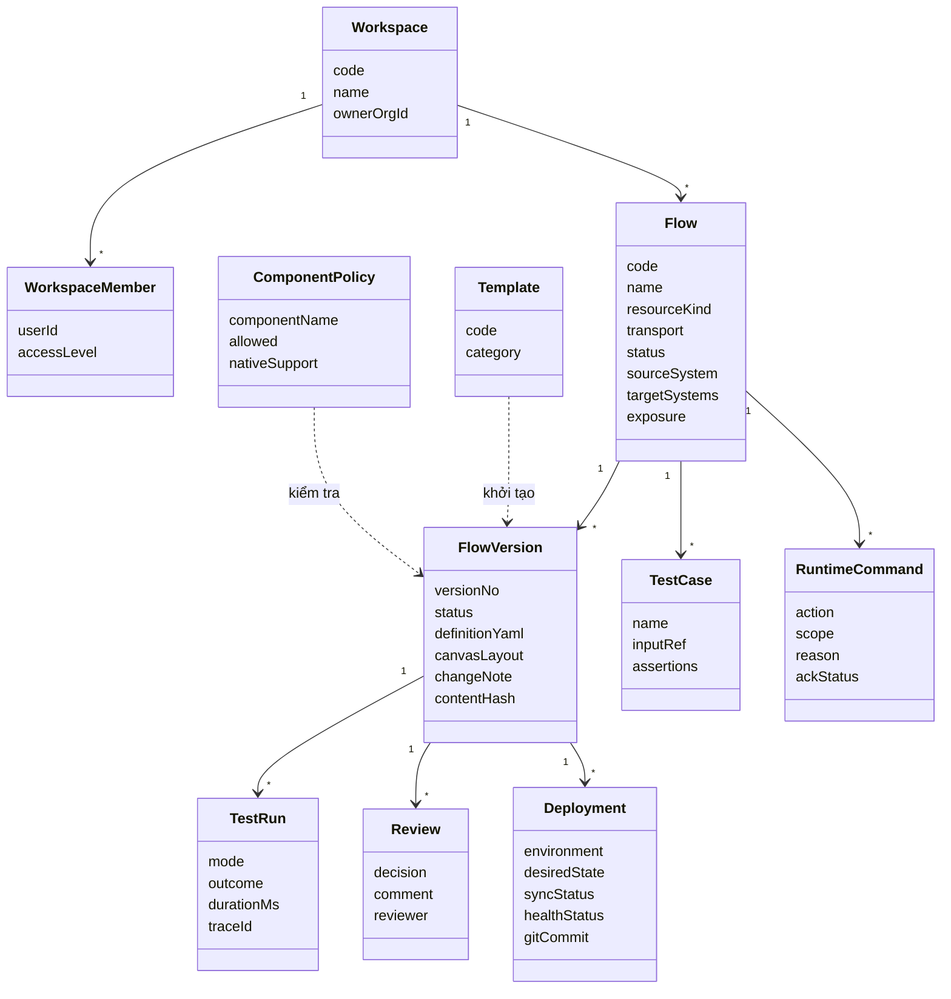
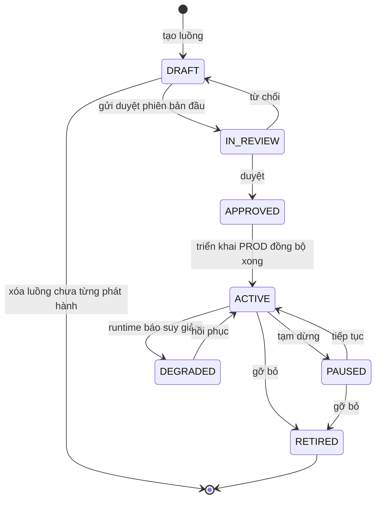
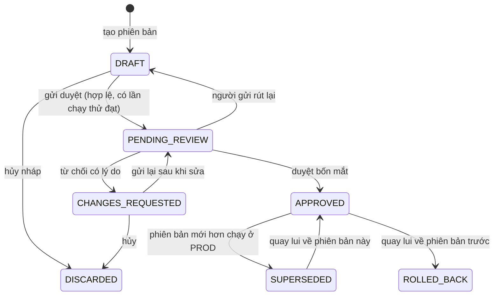
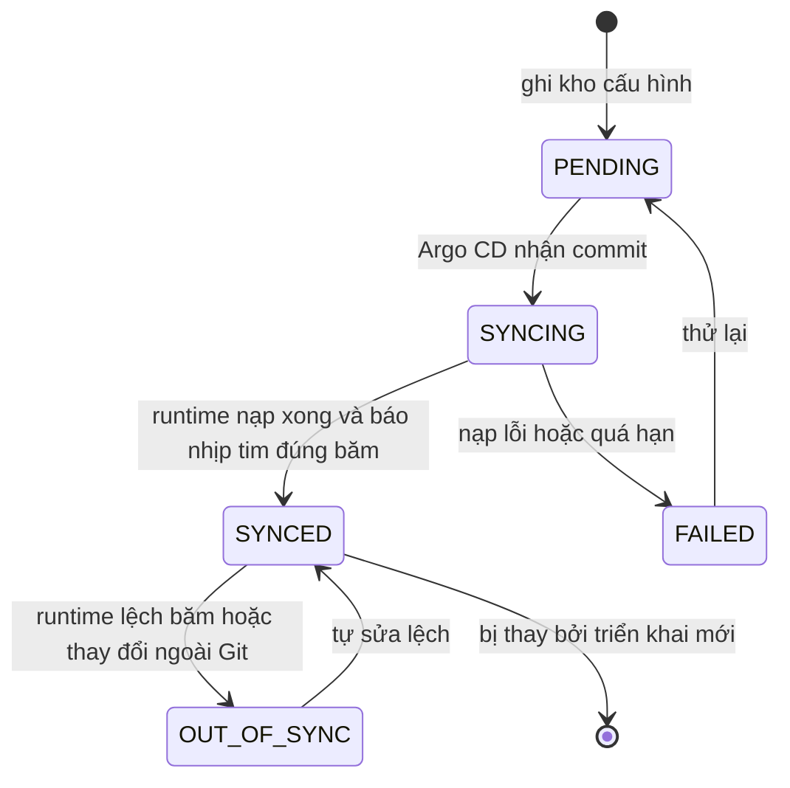
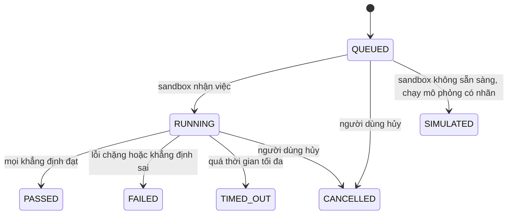
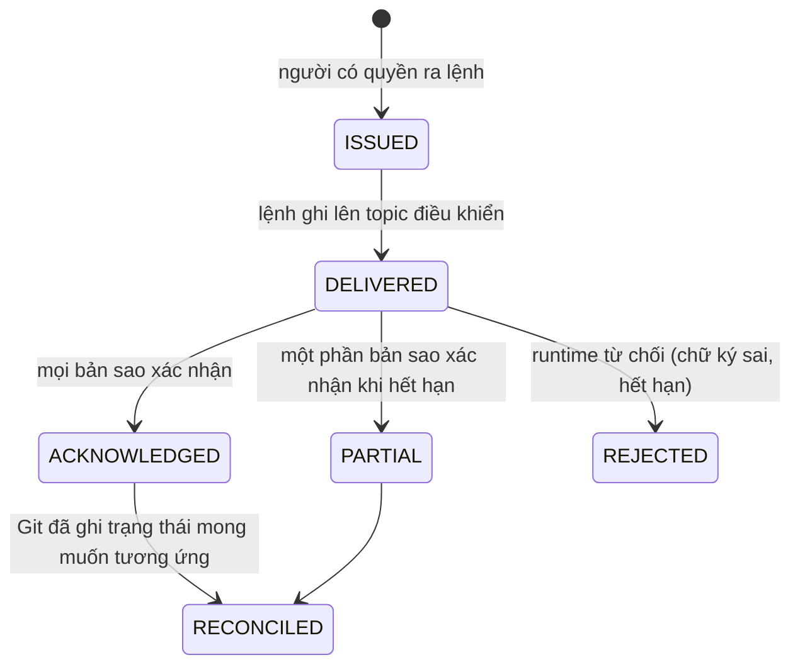

# D02-03-PH04 · Đặc tả chức năng phân hệ PH-04 Lõi tích hợp và trình thiết kế luồng

## Tóm tắt cho hội đồng thẩm định

PH-04 Lõi tích hợp và trình thiết kế luồng thay thế hai khối "Bus" và "Productivity Tooling" của LGSP cũ. Bus cũ là tập các chương trình tích hợp (agent) Apache Camel chạy trên máy chủ cố định, được quản trị qua JMX và Jolokia; Tooling là công cụ kéo thả viết bằng Angular, sinh Camel XML và tệp `pom.xml` cho từng project. PH-04 thay cả hai bằng một quy trình khép kín: kỹ sư tích hợp thiết kế luồng trên trình thiết kế trực quan, chạy thử trên môi trường cô lập, gửi duyệt, người duyệt khác người thiết kế phê duyệt, rồi luồng được phát hành qua kho cấu hình Git và tự động triển khai xuống lớp chạy `dh-runtime` (Camel Quarkus). Phân hệ thuộc đợt MVP vì mọi lượt trao đổi có chuyển đổi dữ liệu giữa hai hệ thống thông tin (HTTT) đều đi qua luồng của PH-04.

Phạm vi phủ hệ cũ: 41 chức năng của Bus (LGC-BUS-001…041) và 29 chức năng của Tooling (LGC-TOOL-001…029) đã kiểm kê ở D00-03. Mọi chức năng được giữ hoặc nâng cấp đều có FR tương ứng (mục 9.1). Hai chức năng bị loại bỏ vì lý do an toàn thông tin: người dùng tự sửa `pom.xml` (LGC-TOOL-022) và nhập component từ tệp JAR (LGC-TOOL-027). Một số chức năng giám sát của Bus (biểu đồ lượng bản tin, CPU, bộ nhớ, log) chuyển sang PH-13; PH-04 nhúng lại các biểu đồ đó trên màn chi tiết luồng.

Điểm mới so với hệ cũ:
- Luồng có phiên bản, có lịch sử và so sánh khác biệt; mọi phiên bản đem chạy đều đã qua duyệt bốn mắt.
- Luồng viết bằng Camel YAML DSL thay Camel XML. Người dùng không thêm được thư viện tùy ý; chỉ dùng thành phần trong danh mục đã duyệt.
- Không còn ra lệnh trực tiếp vào máy chủ đang chạy. Trạng thái mong muốn nằm trong Git, Argo CD đưa xuống runtime và báo lại tình trạng triển khai. Lệnh tạm dừng khẩn cấp có kênh riêng, có ký và có kiểm toán.
- Bí mật kết nối không bao giờ nằm trong luồng. Luồng chỉ trỏ tới kết nối đã đăng ký ở PH-05.
- Có trình ánh xạ dữ liệu sinh biểu thức JQ, chuyển mã qua bảng ánh xạ của PH-07 và che dữ liệu cá nhân theo chính sách của PH-09.
- Một nền chạy phục vụ nhiều tỉnh. Mỗi bản tin mang ngữ cảnh tenant; luồng của tỉnh lớn chạy trong namespace riêng.

Căn cứ pháp lý chính ở mục 1.6. Phạm vi MVP ở mục 9.3, tiêu chí chấp nhận cấp phân hệ ở mục 13. Hiện trạng mã nguồn và các chỗ lệch so với thiết kế được ghi ở mục 2.4 để chủ đầu tư thấy rõ khối lượng còn lại.

## 1. Mục đích, phạm vi và người đọc

### 1.1. Mục đích

Tài liệu này đặc tả đầy đủ yêu cầu chức năng của phân hệ PH-04 Lõi tích hợp và trình thiết kế luồng thuộc sản phẩm Datahub. Mục tiêu là để đội phát triển lập trình ngay mà không phải đoán ý nghiệp vụ, để đội kiểm thử viết được ca dương tính và âm tính cho từng yêu cầu, và để chủ đầu tư có căn cứ nghiệm thu từng chức năng so với Bus và Tooling của hệ cũ.

Mỗi FR viết theo mẫu D00-01 §4.3, dùng kiểu dữ liệu chuẩn `T-*` ở D00-01 §5 và hệ mã truy vết ở D00-01 §3. Chức năng dùng chung cho mọi phân hệ (xác thực, phân trang, kiểm toán, thông báo, hộp "Việc của tôi", khóa lạc quan) đã đặc tả ở [D02-02 SRS §4](../D02-02-srs.md); tài liệu này chỉ ghi "Tuân thủ FR-00-nnn" và không viết lại.

### 1.2. Phạm vi

PH-04 gồm hai nửa chạy ở hai mặt phẳng khác nhau (ADR-013).

**Nửa điều khiển (control plane), đơn vị triển khai `dh-integration`.** Quản lý không gian làm việc và luồng; trình thiết kế luồng trên `dh-console` (canvas, bảng thành phần, cấu hình chặng, trình soạn biểu thức, đồng bộ hai chiều với YAML, Kamelet, Pipe, ca kiểm thử, bean, ánh xạ dữ liệu); kiểm tra hợp lệ; chạy thử và nhật ký chạy thử; gửi duyệt, duyệt bốn mắt, phát hành qua GitOps, thăng cấp môi trường, quay lui; điều khiển kích hoạt và tạm dừng; xem tình trạng triển khai; danh mục thành phần Camel; thư viện khuôn mẫu; công cụ chuyển luồng XML của hệ cũ sang YAML.

**Nửa chạy (data plane), đơn vị triển khai `dh-runtime`.** Khung chín chặng chuẩn của luồng; tiếp nhận đồng bộ (HTTP, SOAP qua APISIX) và bất đồng bộ (Kafka); kiểm tra lược đồ; ủy quyền qua OPA; chuyển đổi, chuẩn hóa về mô hình dữ liệu chuẩn (CDM) và chuyển mã qua PH-07; làm giàu; che dữ liệu cá nhân theo PH-09; định tuyến, tách, gộp, gọi song song; phát sự kiện; xử lý lỗi, thử lại, ngắt mạch, đẩy bản tin lỗi sang PH-18; chống trùng; truy cập CSDL có kiểm soát (Q359); ngữ cảnh tenant; phát vết, chỉ số, log.

Ngoài phạm vi của tài liệu này:
- Danh mục Kamelet được duyệt và kết nối tới nguồn (khai báo, lưu bí mật, kiểm tra kết nối) thuộc PH-05. PH-04 chỉ dùng chúng.
- Topic, lược đồ sự kiện, publisher và subscriber thuộc PH-10. PH-04 chỉ gửi và nhận trên topic đã đăng ký.
- Đăng ký và công bố API ra cổng thuộc PH-02, PH-03. Luồng có điểm vào HTTP được công bố qua PH-02 như một backend.
- Bảng điều khiển, tra log, truy vết thuộc PH-13. PH-04 nhúng lại một phần trên màn chi tiết luồng.
- Xem, sửa, xử lý lại bản tin lỗi (DLQ) thuộc PH-18.
- Luồng kết nối quốc gia NDXP là luồng PH-04 nhưng adapter và quản lý thông tin xác thực với NDXP thuộc PH-14.

### 1.3. Người đọc và cách đọc

| Người đọc | Phần nên đọc kỹ | Mục đích sử dụng |
|---|---|---|
| Chủ đầu tư, lãnh đạo Sở | Tóm tắt, mục 2, 9, 11, 13 | Xác nhận phạm vi, đối chiếu với Bus và Tooling, trả lời câu hỏi mở |
| Phân tích nghiệp vụ | Toàn bộ, đặc biệt mục 4, 5, 12 | Cơ sở cho use case D02-04-PH04 và user story |
| Kiến trúc sư, trưởng nhóm | Mục 2.4, 4, 5 nhóm D–F, 7, 10 | SDD D03-02-PH04, CSDL, API |
| Lập trình viên `dh-integration` | Mục 5 nhóm A, C, D, E, G; mục 8 | Lập trình API điều khiển |
| Lập trình viên `dh-console` | Mục 4, 5 nhóm B, C, D; mục 12 | Màn hình D03-06-PH04 |
| Lập trình viên `dh-runtime` | Mục 5 nhóm F | Khuôn mẫu route chuẩn, Kamelet nền |
| Kiểm thử viên | Mục 5 (ngoại lệ, hậu điều kiện), 6, 7 | Ca kiểm thử D05-02-PH04 |
| Đội di trú | Mục 2.2, FR-04-082, 9.1 | Chuyển luồng XML của Bus cũ |

### 1.4. Tài liệu liên quan

| Mã | Tài liệu | Quan hệ |
|---|---|---|
| D00-01 | Thuật ngữ và quy ước chung | Mẫu FR, kiểu `T-*`, hệ mã |
| D00-02 | Sổ ADR | ADR-002, 009, 010, 013 và ADR-060…069 của PH-04 |
| D00-03 | Ma trận truy vết | Kiểm kê LGC-BUS, LGC-TOOL (§4.1, §4.2) |
| D02-02 | SRS cấp hệ thống | FR-00-*, NFR-00-*, REQ-04 |
| D02-07 | Từ điển dữ liệu dùng chung | DD-*, trường ngữ cảnh |
| D02-08 | Ma trận phân quyền | PERM-04-*, vai trò IE, IA, TO |
| D03-01 | SAD | DU `dh-integration`, `dh-runtime`; đường phát hành §5 |
| D03-07 | Thiết kế ATTT | SEC-40…49 ứng dụng, SEC-50…59 nền tảng |
| D03-09 | Hạ tầng | Namespace `dh-runtime`, `dh-rt-{tenant}`, vùng Z4 |
| D03-10 | Đa tenant | Luồng thuộc tenant, ngưỡng 50 luồng |
| D04-01 | Coding convention | CC-CAMEL-*, Q359 |
| D02-04-PH04 | Use case PH-04 | UC-04-* |
| D03-02-PH04 | SDD PH-04 | Thiết kế chi tiết |
| D03-03-PH04 | CSDL PH-04 | Schema `ph04` |
| D03-04-PH04 | API và sự kiện PH-04 | API-04-*, EVT-04-*, ERR-04-* |
| D03-05 | Design system | CMP-*, vật liệu glass |
| D03-06-PH04 | Màn hình PH-04 | UI-04-* |
| D05-02-PH04 | Test case PH-04 | TS-04-*, TC-04-* |
| `docs/07-srs/SRS-PH-04-*.md` | SRS PH-04 của repo gốc | Nguồn tham khảo; ánh xạ mã cũ sang mã mới ở Phụ lục A |

### 1.5. Quy ước riêng của tài liệu

Trong tài liệu, "luồng" (flow) là một tệp tài nguyên Camel có phiên bản, quản lý như một đơn vị phát hành; một luồng có thể chứa nhiều "route" Camel. "Chặng" (step, node) là một bước trên sơ đồ, tương ứng một phần tử EIP hoặc một lời gọi thành phần. "Phiên bản" là một bản định nghĩa luồng bất biến sau khi gửi duyệt. "Triển khai" là việc một phiên bản đã duyệt được đưa xuống một môi trường. Mã thành phần Camel viết nguyên tiếng Anh như trong catalog (`kafka`, `platform-http`, `setBody`).

Repo gốc đã có hai bộ mã FR cho PH-04: `FR-04-001…040` ở `SRS-PH-04-integration-core.md` và `FR-D-001…085` ở `SRS-PH-04-designer.md`, kèm mã màn `D-01…08`, `UI-04-01…10`. Bộ tài liệu này đánh số lại theo quy ước chung (Q11). Mã cũ được giữ trong cột "Mã repo" của bảng truy vết và ở Phụ lục A, để đội phát triển đối chiếu chú thích trong mã nguồn hiện có.

### 1.6. Căn cứ pháp lý riêng của PH-04

| Văn bản | Nội dung áp dụng cho PH-04 | Ghi chú |
|---|---|---|
| Luật Chuyển đổi số 148/2025/QH15 và Nghị định 224/2026/NĐ-CP | Đầu tư, thuê dịch vụ CNTT; yêu cầu hồ sơ thiết kế | Căn cứ đầu tư chung |
| Nghị định 278/2025/NĐ-CP về kết nối, chia sẻ dữ liệu | Kết nối giữa các HTTT qua nền tảng chia sẻ cấp tỉnh; ghi nhật ký kết nối; chuẩn hóa trước 31/12/2026 | PH-04 là nơi thực hiện chuyển đổi và ghi vết trên đường trao đổi |
| Luật An ninh mạng 116/2025/QH15, Nghị định 331/2026/NĐ-CP | Bảo đảm an ninh HTTT cấp độ 3; kiểm soát thay đổi phần mềm, phân tách nhiệm vụ | Căn cứ duyệt bốn mắt, cấm nạp mã tùy ý |
| TCVN 14423:2026 cấp độ 3 (nhóm quản lý cấu hình, phát triển và thay đổi, nhật ký) | Quản lý phiên bản, kiểm thử trước khi đưa vào vận hành, nhật ký thao tác quản trị | Ánh xạ chi tiết ở D03-07 |
| Luật Bảo vệ dữ liệu cá nhân 91/2025/QH15, Nghị định 356/2025/NĐ-CP | Che, giả danh dữ liệu cá nhân khi chuyển tiếp; không lưu bản tin chứa dữ liệu cá nhân ngoài mục đích | Căn cứ BR-04-012, BR-04-013 |
| Khung kiến trúc Chính phủ số (phiên bản hiện hành) | Vai trò LGSP cấp tỉnh trong kiến trúc | Ánh xạ ở SAD |

Các văn bản trên đã được tra cứu ngày 21/11/2026 và chưa đối chiếu Công báo; điểm chưa xác minh ghi ở câu hỏi Q04-01.

## 2. Bối cảnh nghiệp vụ

### 2.1. Vai trò của PH-04 trong Datahub

Khi hai HTTT trao đổi dữ liệu qua Datahub có hai đường đi. Đường thẳng: APISIX xác thực, kiểm tra đăng ký sử dụng rồi chuyển lượt gọi thẳng tới backend của HTTT cung cấp; đường này không cần PH-04. Đường có xử lý: dữ liệu cần đổi định dạng (SOAP sang REST, XML sang JSON), đổi mã (mã dân tộc của sở A sang mã chuẩn), ghép từ nhiều nguồn, che dữ liệu cá nhân, chuyển từ đồng bộ sang bất đồng bộ, hoặc đọc định kỳ từ CSDL và tệp FTP của hệ cũ. Mọi đường có xử lý đều là một luồng PH-04. Theo D03-09 §4, khoảng 40% lượt gọi đi qua `dh-runtime` (giả định định cỡ).

PH-04 cũng là nơi tỉnh đưa các tích hợp đang chạy trên Bus cũ sang Datahub theo kiểu strangler: từng luồng XML cũ được chuyển sang YAML, chạy song song, đối chiếu kết quả, rồi chuyển lưu lượng.

### 2.2. Hệ cũ Bus và Productivity Tooling

**Bus** gồm nhiều "chương trình tích hợp" (agent). Mỗi agent là một tiến trình Camel trên Spring XML chạy trên một máy chủ có host và cổng cố định, chứa nhiều route. Giao diện quản trị đọc thông tin agent, route, endpoint và số liệu qua JMX, phơi ra bằng Jolokia; cho phép start, stop agent và route, sửa host, port, method của agent, xóa agent, xem sơ đồ, mã nguồn XML và thuộc tính route. Dữ liệu quản trị lưu ở các bảng `Project`, `Group`, `Project_group` (phân quyền theo nhóm với `access_level`), `Context`, `Context_status`, `Context_file`, `File`, `Dependency`, `Builder`.

**Productivity Tooling** là trình thiết kế kéo thả: thanh Project, thanh Component có chế độ thu gọn và mở rộng, nhóm component (Routing, Data Transformation, Database Connection, Network, Message Broker, Scheduling, bảo mật), vùng thiết kế có kết nối giữa các component, thanh Properties, tab Source đồng bộ hai chiều, data mapping có nhập tài liệu mẫu, lưu nháp ở bảng `draft_session`, tải XML, cập nhật `pom.xml`, nhập component từ JAR.

Các hạn chế của hệ cũ mà PH-04 phải khắc phục:

| Hạn chế | Hệ quả | Cách PH-04 khắc phục |
|---|---|---|
| Agent gắn máy chủ cố định, sửa host/port trực tiếp | Không mở rộng theo tải, sự cố một máy ảnh hưởng mọi route trên đó | Runtime trên K8s, nhiều bản sao, KEDA; cấu hình qua phiên bản luồng |
| Điều khiển qua JMX/Jolokia phơi ra mạng | Bề mặt tấn công lớn, không kiểm toán được người ra lệnh | Không mở JMX; điều khiển qua GitOps và kênh lệnh có ký (ADR-065) |
| Lưu XML trong CSDL, không phiên bản | Không biết ai sửa gì, không quay lui được | Phiên bản bất biến, Git làm nguồn triển khai, so sánh khác biệt |
| Người dùng sửa `pom.xml`, nạp JAR | Rủi ro chuỗi cung ứng, vi phạm kiểm soát phần mềm cấp độ 3 | Danh mục thành phần được duyệt, ảnh runtime dựng sẵn |
| Không duyệt trước khi chạy | Một người có thể đưa thay đổi lỗi vào vận hành | Duyệt bốn mắt, kiểm tra hợp lệ bắt buộc |
| Mật khẩu CSDL, FTP nằm trong XML | Lộ bí mật qua mã nguồn và bản sao lưu | Tham chiếu kết nối PH-05, bí mật trong OpenBao |
| Không có chạy thử | Lỗi phát hiện khi đã vào vận hành | Chạy thử trên sandbox với đích mô phỏng |

### 2.3. Yêu cầu mới

Ngoài phủ chức năng cũ, PH-04 phải đáp ứng các yêu cầu mới của chủ đầu tư (Q2, Q5, Q9, Q12 ở D00-02): đa tenant; ATTT cấp độ 3 sẵn sàng cấp độ 4; giữ Camel Quarkus cho data plane; chạy song song với Bus cũ trong thời gian chuyển đổi. Người dùng còn yêu cầu trình thiết kế luồng có trải nghiệm hiện đại tương đương Kaoto, theo phong cách Liquid Glass trên antd v6 (Q8).

### 2.4. Hiện trạng mã nguồn và chỗ lệch so với thiết kế

Mã trong repo (tháng 11/2026) đã có một phần lớn PH-04. Bảng dưới ghi các điểm lệch giữa mã và thiết kế của bộ tài liệu này, để kế hoạch phát triển có đầu việc rõ ràng. Mỗi điểm lệch có FR hoặc ADR quyết định cách xử lý.

| Mã lệch | Hiện trạng trong mã | Thiết kế đích | Xử lý | Căn cứ |
|---|---|---|---|---|
| GAP-04-01 | Runtime Camel Quarkus 3.33.2 (Camel 4.18 LTS) ở `camel/dancu`, `camel/datdai`; catalog của trình thiết kế sinh từ `@kaoto/camel-catalog` 0.7.0 cho camel-quarkus **3.35.0** | Catalog phải khớp đúng phiên bản runtime | Sinh lại catalog cho 3.33.2; CI so khớp tệp kê khai runtime với catalog | FR-04-081, ADR-061 |
| GAP-04-02 | Luồng nghiệp vụ `TraCuuRoute`, `StandardPipelineRoute`, `CdmMapRoute` viết bằng Java DSL; chỉ `ping` là YAML | Luồng nghiệp vụ viết bằng YAML DSL (ADR-010) | Chuyển ba luồng sang YAML; Java chỉ còn cho processor và bean nền được duyệt | ADR-062, FR-04-060 |
| GAP-04-03 | `GitOpsPublisher` ghi tệp `routes/<mã>/route.camel.yaml` trong cùng repo, commit tùy chọn; chưa có kho cấu hình riêng, chưa có Argo CD; runtime không nạp được luồng đã phát hành | Kho cấu hình Git riêng theo tenant và môi trường, Argo CD đồng bộ xuống runtime, runtime nạp YAML lúc chạy | Thiết kế mới ở SDD §5; luồng phát hành báo tình trạng triển khai | FR-04-042, ADR-063 |
| GAP-04-04 | `testRun` mô phỏng: dựng waterfall chín chặng từ `stage.hashCode()`, luôn trả `PASSED`, không nạp Camel | Chạy Camel thật trong sandbox cô lập, đích mô phỏng | Bộ chạy thử `dh-runtime-sandbox` | FR-04-030, ADR-064 |
| GAP-04-05 | `publish()` nhận phiên bản ở trạng thái `DRAFT` và phát hành thẳng, bỏ qua duyệt | Chỉ phát hành phiên bản `APPROVED`; duyệt bốn mắt bắt buộc | Siết máy trạng thái ở máy chủ | FR-04-041, BR-04-005 |
| GAP-04-06 | Bốn mắt so `actor` với `created_by` của phiên bản; chưa so với người gửi duyệt, người sửa gần nhất | Người duyệt khác người tạo, người sửa và người gửi duyệt | Lưu danh sách người đóng góp vào phiên bản | BR-04-005 |
| GAP-04-07 | Bảng `ph04.route` chưa có `tenant_id`, chưa có RLS | Mọi bảng có `tenant_id`, RLS theo D03-10 | DDL mới ở D03-03-PH04 | ADR-003 |
| GAP-04-08 | Khung chín chặng kiểm tra bằng tìm chuỗi con trong YAML (`lower.contains(stage)`) | Kiểm tra theo metadata chặng trên cây tài nguyên | Đánh dấu chặng bằng `id` có tiền tố chuẩn và `description` | FR-04-023, BR-04-002 |
| GAP-04-09 | DataMapper xem trước bằng mô phỏng JQ trong trình duyệt; engine máy chủ `camel-quarkus-jq` chưa có | Xem trước chạy JQ thật ở máy chủ | Gọi API xem trước của sandbox; giữ xem trước cục bộ có nhãn "mô phỏng" khi máy chủ không sẵn | FR-04-020 |
| GAP-04-10 | `camel/dancu` dùng `camel-quarkus-sql` với datasource dùng chung tài khoản `lgsp` | Q359: tài khoản chỉ đọc theo luồng, khai báo ở PH-05, kiểm toán, RLS theo tenant | Thiết kế ở FR-04-072, ADR-067 | Q359 |
| GAP-04-11 | Tạm dừng luồng chỉ đổi cột `status` trong CSDL control; runtime không biết | Tạm dừng thật trên runtime, có xác nhận | Kênh lệnh có ký và trạng thái mong muốn trong Git | FR-04-050, ADR-065 |
| GAP-04-12 | Không có `errorHandler` chuẩn ở luồng mẫu | Mọi luồng có DLQ chuẩn sang PH-18 | Khuôn `routeConfiguration` nền, kiểm tra bắt buộc | FR-04-070 |
| GAP-04-13 | Đường dẫn giao diện `/flows/...`, tên gói `vn.lgsp` | Đường dẫn `/tich-hop/luong/...` theo D03-06-00; gói `vn.datahub` theo Q350 | Đổi khi tái cấu trúc, giữ chuyển hướng từ đường dẫn cũ một đợt | D03-06-00 §2.4 |

### 2.5. Đa tenant trong PH-04

Mỗi luồng thuộc đúng một tenant. Tenant `PLATFORM` sở hữu các khuôn mẫu, Kamelet nền và luồng dùng chung toàn quốc (ví dụ luồng kết nối NDXP mẫu), các tenant tỉnh dùng lại bằng cách tạo luồng từ khuôn hoặc tham chiếu Kamelet. Luồng chạy trong namespace dùng chung `dh-runtime` có nhãn tenant, hoặc trong namespace riêng `dh-rt-{tenant}` khi tenant có trên 50 luồng hoặc có yêu cầu riêng (D03-10 §3, D03-09 §5). Mọi bản tin trong runtime mang tiêu đề `dh-tenant` được đặt ở chặng tiếp nhận từ token hoặc từ topic, không lấy từ dữ liệu do bên gọi gửi (BR-04-010).

## 3. Tác nhân, vai trò và quyền

### 3.1. Tác nhân

| Tác nhân | Mã vai trò | Việc chính với PH-04 |
|---|---|---|
| Kỹ sư tích hợp | IE (INTEGRATION_ENGINEER) | Thiết kế, chạy thử, gửi duyệt luồng; xem tình trạng |
| Người duyệt tích hợp | IA (INTEGRATION_APPROVER) | Duyệt hoặc từ chối phiên bản, phát hành, quay lui |
| Vận hành tenant | TO (TENANT_OPERATOR) | Kích hoạt, tạm dừng luồng và route; xem tình trạng |
| Quản trị tenant | TA (TENANT_ADMIN) | Quản lý không gian làm việc, thành viên, tham số PH-04; vận hành |
| Cán bộ an toàn thông tin | SO (SECURITY_OFFICER) | Tạm dừng khẩn cấp; xem nhật ký kiểm toán; duyệt danh mục thành phần |
| Quản trị nền tảng | PA (PLATFORM_ADMIN) | Khuôn mẫu, Kamelet nền, luồng toàn quốc, danh mục thành phần, hồ sơ runtime |
| Người xem, kiểm toán | VW, AU | Xem luồng, lịch sử, nhật ký |
| HTTT thành viên | (máy) | Gọi điểm vào HTTP của luồng qua APISIX; gửi, nhận bản tin Kafka |
| Argo CD | (máy) | Đồng bộ kho cấu hình xuống runtime; báo tình trạng |
| `dh-runtime` | (máy) | Chạy luồng, báo nhịp tim, nhận lệnh điều khiển |
| PH-05, PH-07, PH-09, PH-10, PH-13, PH-18 | (máy) | Cung cấp kết nối, chuyển mã, chính sách che, topic, giám sát, xử lý bản tin lỗi |

### 3.2. Quyền PH-04 theo D02-08

| Quyền | Mô tả | Vai trò có quyền theo D02-08 §3.1 |
|---|---|---|
| `PERM-04-read` | Xem luồng, phiên bản, sơ đồ, mã nguồn, tình trạng | PA, PO, TA, TO, SO, IE, IA, VW, AU |
| `PERM-04-create`, `PERM-04-update` | Tạo, thiết kế luồng, chạy thử | IE |
| `PERM-04-submit` | Gửi duyệt phiên bản | IE |
| `PERM-04-publish` | Duyệt, từ chối, phát hành, quay lui | IA |
| `PERM-04-operate` | Kích hoạt, tạm dừng luồng và route | TA, TO, SO, IA |

### 3.3. Quyền đề xuất bổ sung D02-08

D02-08 chưa có các quyền dưới đây. FRS đề xuất bổ sung; cho tới khi D02-08 được cập nhật, mã nguồn kiểm tra mã quyền mới nhưng cấu hình vai trò mặc định theo cột "Gán mặc định đề xuất".

| Quyền đề xuất | Mô tả | Gán mặc định đề xuất | Lý do |
|---|---|---|---|
| `PERM-04-delete` | Gỡ bỏ luồng, xóa bản nháp | IE (bản nháp của mình), TA | Gỡ luồng đang chạy là thao tác có hậu quả, tách khỏi `update` |
| `PERM-04-emergency-stop` | Tạm dừng khẩn cấp bỏ qua GitOps | SO, TA | Lệnh khẩn có tác động ngay trên runtime, cần quyền riêng để kiểm toán |
| `PERM-04-promote` | Thăng cấp phiên bản đã duyệt lên môi trường cao hơn | IA, TA | Tách phê duyệt nội dung với phê duyệt đưa vào vận hành thật |
| `PERM-04-admin` | Quản lý không gian làm việc, thành viên, tham số PH-04 | TA, PA | Theo động từ chuẩn `admin` của D02-08 §3 |
| `PERM-04-catalog-admin` | Quản lý danh mục thành phần được phép, khuôn mẫu, hồ sơ runtime | PA, SO (duyệt) | Danh mục thành phần quyết định mã nào được chạy |
| `PERM-04-sample-data` | Dùng dữ liệu thật làm bản tin mẫu khi chạy thử trên môi trường TEST | IE (được TA cấp theo luồng) | Bản tin thật có thể chứa dữ liệu cá nhân |

### 3.4. Phạm vi không gian làm việc

Quyền ở mục 3.2 áp trong phạm vi tenant. PH-04 bổ sung một phạm vi hẹp hơn là **không gian làm việc** (workspace), kế thừa khái niệm `Project` và `Project_group.access_level` của Bus cũ (LGC-BUS-032). Mỗi luồng thuộc đúng một không gian làm việc; mỗi không gian làm việc có danh sách thành viên với mức truy cập `VIEW`, `EDIT`, `MAINTAIN`. Người có `PERM-04-update` chỉ sửa được luồng trong không gian làm việc mà mình có mức `EDIT` trở lên. Người có `PERM-04-publish` chỉ duyệt được luồng trong không gian làm việc mà mình là thành viên mức `MAINTAIN`. TA và PA không bị giới hạn bởi không gian làm việc. Mục đích là để sở A không vô tình sửa luồng của sở B trong cùng tỉnh, như cách hệ cũ phân quyền project theo group.

## 4. Khái niệm và mô hình nghiệp vụ

### 4.1. Tổng quan mô hình

### 4.2. Không gian làm việc

Không gian làm việc (EN-04-01) là nhóm luồng của một đơn vị hoặc một dự án tích hợp, có mã duy nhất trong tenant, tên, tổ chức chủ quản và danh sách thành viên. Mỗi tenant có sẵn một không gian làm việc mặc định `DEFAULT` khi khởi tạo. Không gian làm việc tương ứng `Project` của Bus cũ và được di trú từ đó.

### 4.3. Luồng và loại tài nguyên

Luồng (EN-04-02) có mã duy nhất trong tenant, mẫu `^[a-z][a-z0-9-]{2,62}$`, không đổi được sau khi tạo vì là khóa của tệp trong kho cấu hình. Loại tài nguyên `resourceKind` gồm:

| Loại | Nội dung tệp | Chạy độc lập | Ví dụ |
|---|---|---|---|
| `ROUTE` | Một hoặc nhiều `route`, kèm `routeConfiguration`, `rest`, `beans` cấp tệp | Có | Luồng tra cứu hộ tịch |
| `KAMELET` | Một `Kamelet` (`spec.definition`, `spec.template`) | Không, được luồng khác dùng | Kamelet nguồn đọc bảng hồ sơ |
| `PIPE` | Một `Pipe` nối `source`, `steps`, `sink` | Có | Đẩy thay đổi CSDL sang Kafka |
| `TEST` | Một bộ ca kiểm thử gắn với một luồng `ROUTE` hoặc `PIPE` | Không, chỉ chạy khi kiểm thử | Bộ ca của luồng tra cứu |

Thuộc tính vận chuyển `transport` (`SYNC`, `ASYNC`, `SCHEDULED`, `MIXED`) mô tả cách luồng được kích hoạt; được suy ra từ chặng đầu và người dùng không sửa tay. Thuộc tính `exposure` cho biết luồng **đối ngoại** (có `sourceSystem` hoặc `targetSystems` là HTTT thành viên đã kết nạp) hay **nội bộ**. Luồng đối ngoại phải theo khung chín chặng (BR-04-002).

### 4.4. Phiên bản

Mỗi luồng có dãy phiên bản `versionNo` tăng dần từ 1. Mỗi phiên bản (EN-04-03) chứa định nghĩa YAML, bố cục sơ đồ (vị trí chặng, ghi chú dán, nhóm), ghi chú thay đổi, băm SHA-256 của YAML đã chuẩn hóa, danh sách người đóng góp, kết quả kiểm tra hợp lệ gần nhất. Tại mọi thời điểm một luồng có tối đa một phiên bản mở (`DRAFT` hoặc `CHANGES_REQUESTED`). Phiên bản đã gửi duyệt là bất biến về nội dung: mọi sửa đổi phải làm trên phiên bản mới.

Bố cục sơ đồ không nằm trong YAML đem triển khai. Repo hiện nhúng bố cục vào dòng chú thích `# @lgsp-canvas-v1:` và lọc bỏ khi phát hành; thiết kế đích lưu bố cục ở cột riêng (`canvas_layout`) để YAML trong kho cấu hình sạch, còn tệp tải xuống vẫn có thể kèm bố cục để mở lại trên trình thiết kế khác của Datahub (FR-04-027).

### 4.5. Môi trường và triển khai

Datahub có ba môi trường luồng: `TEST` (sandbox và môi trường thử tích hợp), `STAGING` (tiền vận hành, tùy tỉnh) và `PROD`. Một phiên bản đã duyệt được triển khai lần lượt theo thứ tự môi trường; mỗi lần triển khai (EN-04-06) ghi môi trường, trạng thái mong muốn (`RUNNING`, `PAUSED`, `REMOVED`), commit Git, trạng thái đồng bộ Argo CD (`PENDING`, `SYNCED`, `OUT_OF_SYNC`, `FAILED`) và sức khỏe báo về từ runtime (`HEALTHY`, `DEGRADED`, `DOWN`, `UNKNOWN`). Tỉnh không có STAGING thì bỏ qua môi trường này (tham số `04.env.stages`).

### 4.6. Chặng và khung chín chặng chuẩn

Khung chín chặng là khuôn mẫu chuẩn của mọi luồng đối ngoại, kế thừa từ repo (`routes/_templates/standard-9-stage.camel.yaml`):

| Thứ tự | Mã chặng | Tên | Việc phải làm | FR |
|---|---|---|---|---|
| 1 | `receive` | Tiếp nhận | Nhận bản tin, đặt `traceId`, `dh-tenant`, `dh-flow`, `dh-flow-version`, đo kích thước | FR-04-061, 062 |
| 2 | `schema` | Kiểm tra lược đồ | Kiểm tra JSON Schema, XSD hoặc lược đồ Apicurio | FR-04-063 |
| 3 | `authz` | Ủy quyền | Hỏi OPA theo ngữ cảnh bên gọi, mục đích, dữ liệu | FR-04-064 |
| 4 | `transform` | Chuyển đổi | Chuẩn hóa về CDM, chuyển mã, đổi định dạng | FR-04-065 |
| 5 | `enrich` | Làm giàu | Bổ sung dữ liệu từ nguồn khác | FR-04-066 |
| 6 | `route` | Định tuyến | Chọn đích theo nội dung, tách, gộp | FR-04-068 |
| 7 | `deliver` | Gửi đích | Gọi HTTT đích hoặc phát sự kiện | FR-04-068, 069 |
| 8 | `audit` | Ghi vết | Ghi nhật ký kết nối theo NĐ 278/2025 | FR-04-074 |
| 9 | `respond` | Phản hồi | Trả kết quả, che dữ liệu theo bên nhận | FR-04-067 |

Mỗi chặng chuẩn được đánh dấu trên cây tài nguyên bằng `id` có tiền tố `dh-stage-{mã}` ở phần tử EIP đầu tiên của chặng (thường là một `step` bao các bước con). Cách đánh dấu này thay việc tìm chuỗi con trong YAML (GAP-04-08) và cho phép sơ đồ nhóm các bước con thành một khối chặng có thể thu gọn.

### 4.7. Danh mục thành phần và hồ sơ runtime

Danh mục thành phần (EN-04-11) là bản sao có kiểm soát của catalog Camel cho đúng phiên bản runtime: component, mẫu EIP, Kamelet, dataformat, language, entity, load balancer. Mỗi mục có cờ "được phép" theo chính sách của nền tảng và tenant, mức hỗ trợ native, giấy phép. "Hồ sơ runtime" (runtime profile) là tập thành phần được biên dịch vào một ảnh `dh-runtime` native; mỗi luồng khi phát hành được gán vào hồ sơ có đủ thành phần nó dùng (ADR-063). Thành phần không hỗ trợ native chạy trong hồ sơ JVM riêng (ADR-002).

### 4.8. Kết nối và bí mật

Luồng không chứa bí mật. Mọi tham số nhạy cảm (mật khẩu, khóa API, chứng thư) được tham chiếu qua kết nối đã đăng ký ở PH-05, dạng `{{conn:<mã kết nối>.<khóa>}}`, hoặc qua tham chiếu kho bí mật `{{vault:<đường dẫn>#<khóa>}}` do nền tảng cấp. Runtime phân giải tham chiếu lúc khởi động route qua OpenBao (ADR-012). Trình kiểm tra hợp lệ chặn mọi chuỗi giống bí mật viết thẳng (BR-04-003).

### 4.9. Sơ đồ trạng thái luồng

Trạng thái luồng `Flow.status` là trạng thái tổng hợp để hiển thị và lọc, được tính từ phiên bản và triển khai.

| Trạng thái | Nhãn hiển thị | Ý nghĩa |
|---|---|---|
| `DRAFT` | Nháp | Chưa có phiên bản nào được duyệt |
| `IN_REVIEW` | Chờ duyệt | Phiên bản đầu tiên đang chờ duyệt |
| `APPROVED` | Đã duyệt | Có phiên bản đã duyệt nhưng chưa chạy ở PROD |
| `ACTIVE` | Đang chạy | Có phiên bản chạy ở PROD với trạng thái mong muốn `RUNNING` |
| `PAUSED` | Tạm dừng | Trạng thái mong muốn ở PROD là `PAUSED` |
| `DEGRADED` | Suy giảm | Runtime báo `DEGRADED` hoặc `DOWN`, hoặc lệch đồng bộ quá ngưỡng |
| `RETIRED` | Đã gỡ | Đã gỡ khỏi mọi môi trường; chỉ xem lịch sử |

### 4.10. Sơ đồ trạng thái phiên bản

Repo hiện có các trạng thái `DRAFT`, `TESTING`, `PENDING_REVIEW`, `APPROVED`. Trạng thái `TESTING` của repo được bỏ: việc đã chạy thử đạt là một điều kiện (BR-04-004), không phải trạng thái, vì người thiết kế có thể chạy thử nhiều lần xen kẽ với sửa.

### 4.11. Sơ đồ trạng thái triển khai

### 4.12. Sơ đồ trạng thái lần chạy thử

`SIMULATED` chỉ dùng khi tham số `04.test.allow-simulation` bật (mặc định tắt ở PROD và STAGING của nền tảng, bật ở môi trường phát triển). Lần chạy mô phỏng không được tính là "chạy thử đạt" cho điều kiện gửi duyệt.

### 4.13. Sơ đồ trạng thái lệnh điều khiển runtime

### 4.14. Thuật ngữ bổ sung

| Thuật ngữ | Giải thích |
|---|---|
| Canvas | Vùng vẽ sơ đồ luồng trên trình thiết kế |
| Chặng, nút | Một phần tử trên sơ đồ, tương ứng một bước Camel |
| Cạnh | Đường nối thể hiện thứ tự xử lý giữa hai chặng |
| Inspector | Ngăn bên phải hiển thị cấu hình của chặng đang chọn |
| Bảng thành phần | Ngăn bên trái liệt kê thành phần kéo vào sơ đồ |
| Quay vòng YAML | Mở YAML lên sơ đồ rồi lưu lại; không được mất dữ liệu (BR-04-006) |
| Ghim bản tin mẫu (pin) | Gắn bản tin mẫu vào một chặng để xem trước biểu thức và ánh xạ |
| Sandbox | Môi trường chạy thử cô lập, đích bị thay bằng mô phỏng |
| Kho cấu hình | Kho Git chứa YAML luồng theo tenant và môi trường, nguồn của Argo CD |
| Hồ sơ runtime | Tập thành phần được biên dịch vào một ảnh `dh-runtime` |
| Lệnh khẩn | Lệnh tạm dừng gửi thẳng tới runtime qua topic điều khiển có ký |
