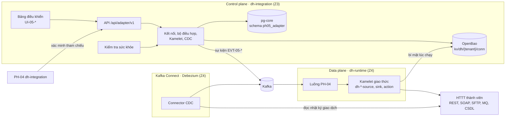
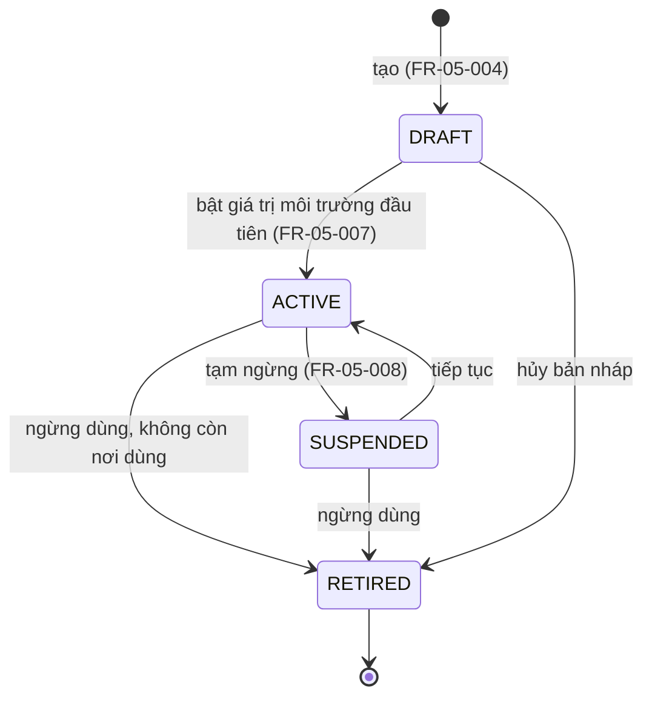
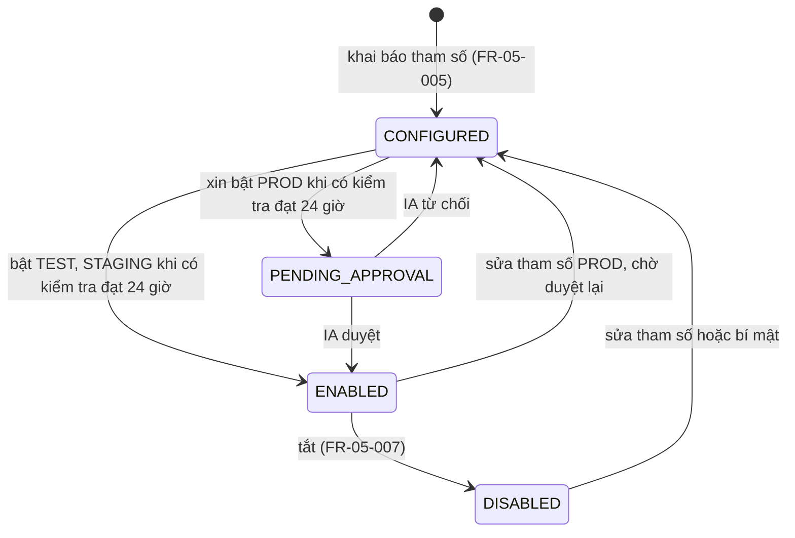
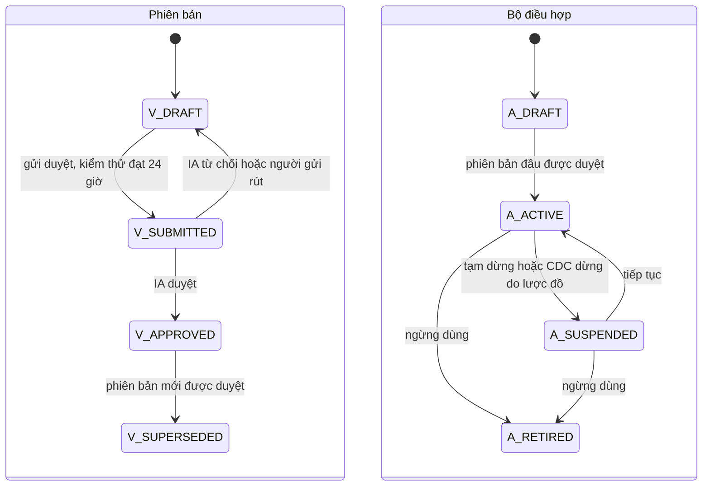
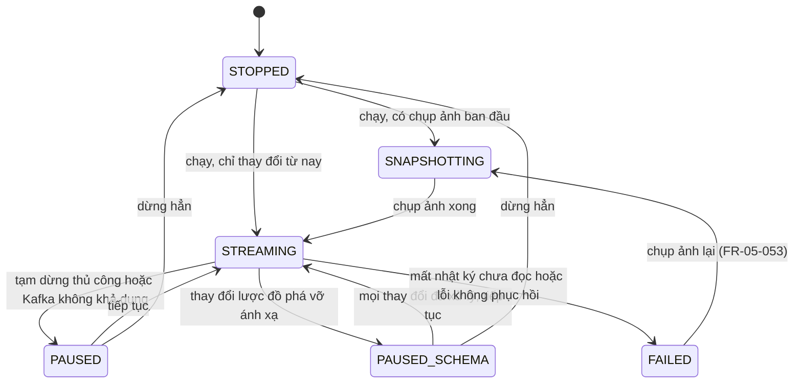
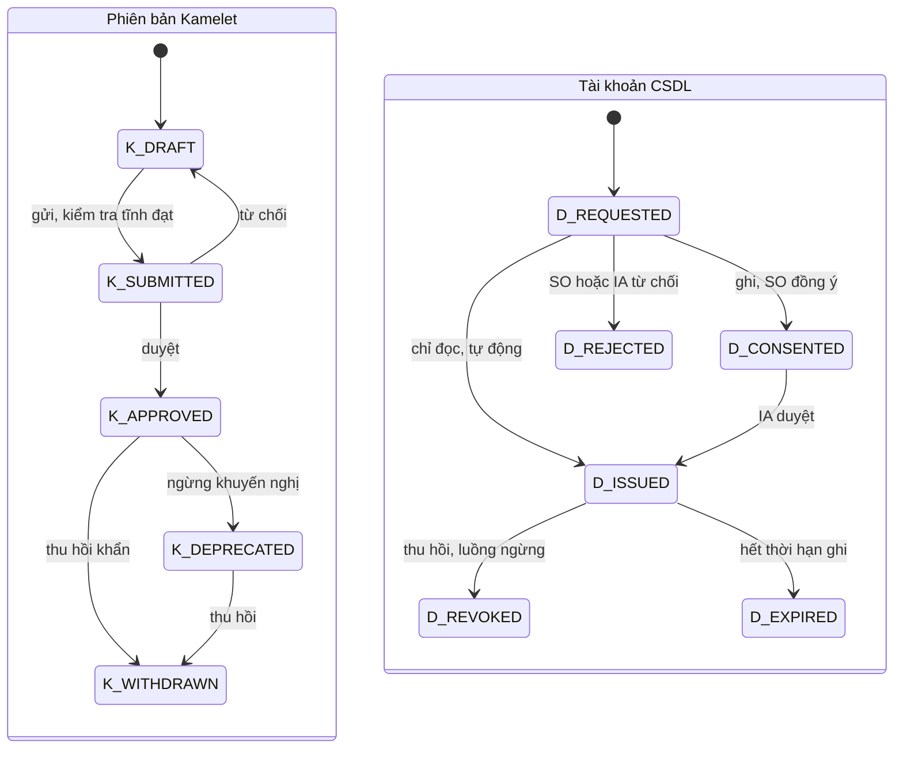

# D02-03-PH05 · Đặc tả yêu cầu chức năng Bộ điều hợp và kết nối

## Tóm tắt cho hội đồng thẩm định

**Mục tiêu.** PH-05 là lớp cách ly giữa lõi tích hợp (PH-04) và thực tế không đồng nhất của các hệ thống thông tin (HTTT) thành viên. Phân hệ quản lý ba thứ mà mọi luồng tích hợp cần nhưng không được tự giữ: **kết nối nguồn** (địa chỉ, tham số, bí mật theo từng môi trường), **bộ điều hợp** (cách nói chuyện với một HTTT cụ thể qua REST, SOAP, hàng đợi bản tin, tệp, CSDL, thư điện tử, CDC) và **danh mục Kamelet được duyệt** (khối kết nối dùng lại trong trình thiết kế luồng). Nhờ đó luồng PH-04 không chứa mật khẩu, không gọi thẳng giao thức thô và không phải sửa khi một HTTT đổi công nghệ.

**Phạm vi.** 62 yêu cầu chức năng chia tám nhóm: loại kết nối, kết nối nguồn và bí mật, sức khỏe kết nối, CSDL cho luồng theo quyết định Q359, bộ điều hợp theo giao thức, chuyển đổi định dạng và nhóm kết nối, bắt thay đổi dữ liệu (CDC) cho hệ di sản, danh mục Kamelet, quản trị. Phân hệ chạy trên hai DU: `dh-integration` (control plane, Spring Boot) và `dh-runtime` (data plane, Camel Quarkus 3.33.x).

**Căn cứ pháp lý.** CMP-LAW-09 (Công văn 631/THH-THHT: mọi yêu cầu ra vào đều qua bộ điều hợp, hỗ trợ HTTP, HTTPS, WebSocket, POP, IMAP, SMTP, JMS, AMQP, MQTT; JSON, XML, SOAP); CMP-LAW-03 (NĐ 278/2025 về kết nối, chia sẻ dữ liệu); CMP-LAW-06 và CMP-LAW-08 (NĐ 331/2026, TCVN 14423:2026 cấp độ 3: quản lý bí mật, kiểm soát truy cập, nhật ký); CMP-LAW-05 (Luật BVDLCN 91/2025: tối thiểu hóa truy cập dữ liệu cá nhân khi đọc CSDL nguồn).

**Con số chính.**

| Chỉ số | Giá trị |
|---|---|
| Yêu cầu chức năng | 62 (M: 51, S: 10, C: 1) |
| Quy tắc nghiệp vụ | 30 (BR-05-001…030) |
| Yêu cầu phi chức năng | 16 (NFR-05-001…016) |
| Màn hình | 17 (UI-05-01…17) |
| API | 92 operation (API-05-001…093, 042 để trống), 15 sự kiện (EVT-05-01…15) |
| Chức năng hệ cũ được phủ | 9 mục `LGC` (Bus connector, Tooling nhóm kết nối, bảo mật endpoint, sửa kết nối) và 1 mục loại bỏ có thay thế (LGC-TOOL-027) |
| Mức đợt | MVP; năm FR mức S và một FR mức C sang Đợt 3 |

## 1. Mục đích, phạm vi và người đọc

### 1.1. Mục đích

Tài liệu đặc tả đầy đủ hành vi của PH-05 để kỹ sư hiện thực và kiểm thử viên viết ca kiểm thử mà không phải hỏi lại. Mỗi FR có tiền điều kiện, đầu vào, các bước xử lý kiểm chứng được, ngoại lệ có mã lỗi và hậu điều kiện.

### 1.2. Phạm vi làm

| # | Trách nhiệm | Nhóm FR |
|---|---|---|
| 1 | Duy trì danh mục **loại kết nối** (HTTP, OAuth2, SOAP, JDBC, SFTP, JMS, AMQP, MQTT, SMTP, IMAP, LDAP, Kafka ngoài…) với lược đồ tham số và khóa bí mật | A |
| 2 | Khai báo **kết nối nguồn** theo HTTT, giá trị riêng cho TEST, STAGING, PROD; bí mật ghi một chiều vào OpenBao; cấp kết nối cho không gian làm việc hoặc luồng của PH-04 | B |
| 3 | Kiểm tra kết nối không tác dụng phụ, có hướng dẫn khắc phục; theo dõi sức khỏe chủ động và thụ động; báo PH-04 để điều chỉnh ngắt mạch | B, C |
| 4 | Hiện thực quyết định Q359 (ADR-067): kết nối "CSDL cho luồng", tài khoản chỉ đọc theo luồng cấp động, kiểm tra quyền thực tế, quy trình xin ghi có Cán bộ ATTT đồng ý | D |
| 5 | Đóng gói cách giao tiếp với từng HTTT thành **bộ điều hợp** có phiên bản: thao tác, phân trang, hạn mức phía đối tác, WSDL, khóa tệp, giới hạn đồng thời, chuyển đổi định dạng về JSON chuẩn | E |
| 6 | CDC bằng Debezium cho HTTT nhóm 3 (không API): cấu hình, kiểm tra điều kiện, chạy, giám sát lược đồ, dừng an toàn khi lược đồ đổi | F |
| 7 | Danh mục **Kamelet được duyệt**: Kamelet nền giao thức, Kamelet của tỉnh, Kamelet dùng chung toàn quốc; quy trình đăng ký, kiểm tra tĩnh, duyệt, ngừng dùng; đồng bộ với catalog của trình thiết kế (ADR-061) | G |
| 8 | Tham số theo tenant, báo cáo sử dụng | H |

### 1.3. Phạm vi không làm

| Không làm | Thuộc |
|---|---|
| Logic nghiệp vụ, định tuyến, ánh xạ ngữ nghĩa giữa lược đồ (DataMapper sinh JQ) | PH-04 (ADR-066) |
| Ủy quyền theo mục đích, nghĩa vụ che dữ liệu | PH-12, PH-09 qua PH-04 |
| Kết nối tới Nền tảng chia sẻ, điều phối dữ liệu quốc gia và dịch vụ NGSP | PH-14 (dùng lại loại kết nối và Kamelet của PH-05) |
| Đăng ký topic Kafka nội bộ, lược đồ sự kiện | PH-10 (PH-05 chỉ xin topic cho CDC) |
| Kết nạp HTTT | PH-01 (PH-05 đọc danh sách HTTT đã kết nạp) |
| Bảng điều khiển số liệu chi tiết theo luồng | PH-13 (PH-05 phát chỉ số) |
| Quản lý kho bí mật, chính sách OpenBao | Nền tảng (ADR-012); PH-05 chỉ ghi và đọc trong đường dẫn của mình |

### 1.4. Chức năng hệ cũ được phủ

| Mã | Chức năng hệ cũ | Vai trò của PH-05 |
|---|---|---|
| LGC-BUS-040 | Connector: CSDL, NoSQL, LDAP, Hadoop, message broker, HTTP, SOAP, FTP, File, cloud, SMPP, lập lịch | Chính |
| LGC-BUS-011 | Sửa thông tin kết nối của chương trình (host, port, method) | Chính (kết nối), cùng PH-04 |
| LGC-BUS-013 | Thêm chương trình tích hợp có kiểm tra kết nối | Phần kiểm tra kết nối |
| LGC-BUS-041 | Bảo mật endpoint (Basic, SSL, WS-Security) | Phần xác thực ra ngoài, cùng PH-03, PH-04, PH-12 |
| LGC-TOOL-008 | Nhóm Database Connection | Chính (kết nối CSDL), cùng PH-04 |
| LGC-TOOL-009 | Nhóm Network (HTTP, File, FTP, REST) | Kamelet giao thức |
| LGC-TOOL-010 | Nhóm Message Broker | Kamelet hàng đợi bản tin, cùng PH-10 |
| LGC-TOOL-011 | Nhóm Scheduling | Lịch quét tệp, hộp thư, kiểm tra sức khỏe |
| LGC-TOOL-012 | Nhóm bảo mật (mã hóa gói tin, điểm cuối) | Phần TLS, mTLS, WS-Security của bộ điều hợp |
| LGC-TOOL-027 | Nhập component từ file JAR (đã loại bỏ) | Thay bằng quy trình đăng ký Kamelet (FR-05-056…058) |

### 1.5. Người đọc và cách đọc

Hội đồng thẩm định đọc phần tóm tắt, §2, §9 và §13. Kỹ sư đọc §4, §5, §6, §8. Kiểm thử viên đọc §5, §6, §13. Mã định danh theo D00-01 §3; số kế tiếp theo D00-04 §3.2.

## 2. Bối cảnh nghiệp vụ

### 2.1. Vị trí trong kiến trúc

Sơ đồ cho thấy PH-05 có mặt ở cả hai mặt phẳng. Ở control plane, `dh-integration` giữ danh mục và trạng thái trong schema `ph05_adapter` của cụm `pg-core`, còn bí mật chỉ nằm trong OpenBao. Ở data plane, luồng PH-04 không gọi giao thức thô mà gọi Kamelet giao thức của PH-05; Kamelet đọc bí mật trực tiếp từ OpenBao lúc chạy qua xác thực Kubernetes của pod, nên bí mật không đi qua `dh-integration` khi chạy. CDC chạy trên Kafka Connect với connector Debezium (ADR-059), đọc nhật ký giao dịch của CSDL nguồn và đẩy thay đổi vào topic đã đăng ký ở PH-10. Vùng mạng theo D03-07: control plane ở Z3, data plane ở Z4, lưu lượng ra HTTT qua egress gateway (SEC-16).

### 2.2. Phân loại HTTT và chiến lược kết nối

Cách xây bộ điều hợp phụ thuộc nhóm HTTT xác định khi khảo sát (kế hoạch triển khai bước 1). Trường `systemGroup` của bộ điều hợp nhận một trong bốn giá trị dưới đây.

| Nhóm | Đặc điểm | Cách kết nối | Chi phí | Rủi ro |
|---|---|---|---|---|
| 1. Hiện đại | REST, có OpenAPI, đang bảo trì | Sinh bộ điều hợp từ OpenAPI (FR-05-046), Kamelet `dh-http-sink` | Thấp | Thấp |
| 2. API hạn chế | SOAP hoặc REST cũ, tài liệu thiếu hoặc lệch | Bộ điều hợp SOAP với WSDL đệm, phát hiện lệch (FR-05-034) | Trung bình | Tài liệu sai lệch |
| 3. Di sản | Không API, không còn nhà thầu | CDC Debezium (FR-05-048…053) hoặc truy vấn khai báo chỉ đọc (FR-05-038) | Trung bình | Phụ thuộc cấu trúc bảng nội bộ |
| 4. Sắp thay thế | Có kế hoạch thay mới | Kết nối tối thiểu (tệp, truy vấn chỉ đọc), không đầu tư sâu | Rất thấp | Thấp |

Giả định GĐ-04 (tỉnh vừa, 200 HTTT, 80 HTTT kết nối năm đầu) được chia theo tỷ lệ giả định GĐ-05-01: 45% nhóm 1, 30% nhóm 2, 15% nhóm 3, 10% nhóm 4. Cơ sở: tỷ lệ thường gặp ở các tỉnh đã triển khai LGSP thế hệ đầu; số thật lấy khi khảo sát.

### 2.3. Quy trình nghiệp vụ liên quan

| Quy trình | Bước có PH-05 |
|---|---|
| Kết nạp HTTT (PH-01) → tích hợp | Sau khi HTTT `ACTIVE`, kỹ sư tích hợp tạo kết nối, kiểm tra, xin bật PROD, cấp cho không gian làm việc |
| Thiết kế, phát hành luồng (PH-04) | Trình thiết kế liệt kê kết nối được cấp (FR-04-016) và Kamelet được duyệt; PH-04 xác minh tham chiếu khi lưu, gửi duyệt, phát hành (FR-05-014) |
| Vận hành | Bảng sức khỏe, cảnh báo khi kết nối suy giảm; xoay vòng bí mật theo lịch |
| Di trú từ Bus cũ (strangler) | Gói Context XML của Bus được phân tích, kết nối cũ thành kết nối nháp không kèm mật khẩu; PH-04 dùng bảng ánh xạ `connectionMap` (FR-04-082) |
| Sự cố ATTT | Cán bộ ATTT tạm ngừng kết nối, thu hồi tài khoản CSDL, buộc xoay bí mật |

### 2.4. Hạn chế của hệ cũ cần khắc phục

| Hạn chế hệ cũ | Hệ quả | Cách PH-05 khắc phục |
|---|---|---|
| Mật khẩu CSDL, FTP, khóa API nằm trong XML Camel và bảng `Context_file` | Lộ bí mật qua mã nguồn, bản sao lưu | Bí mật ghi một chiều vào OpenBao, luồng chỉ giữ tham chiếu `{{conn:…}}` (BR-05-001) |
| Datasource dùng chung một tài khoản `lgsp` có quyền ghi | Một luồng lỗi có thể sửa dữ liệu của sở; không truy vết được luồng nào đọc gì | Tài khoản chỉ đọc theo luồng, cấp động TTL 1 giờ, pgaudit (FR-05-024, 027) |
| Sửa host, port trực tiếp trên runtime | Không có phiên bản, không duyệt, không biết luồng nào bị ảnh hưởng | Sửa qua API có kiểm toán, cảnh báo nơi dùng, bật PROD cần duyệt (FR-05-006, 007, 013) |
| Nhập component từ JAR | Nạp mã tùy ý vào runtime, vi phạm cấp độ 3 | Kamelet YAML qua kiểm tra tĩnh và duyệt (FR-05-056, 057) |
| Không kiểm tra sức khỏe kết nối | Phát hiện lỗi khi người dân đã bị ảnh hưởng | Kiểm tra chủ động 60 giây, đánh giá thụ động, cảnh báo (FR-05-019…021) |
| Không có kênh cho hệ không API | Nhập tay hoặc sửa mã hệ nguồn | CDC đọc nhật ký giao dịch, không sửa hệ nguồn (FR-05-048) |

## 3. Tác nhân, vai trò và quyền

### 3.1. Tác nhân

| Tác nhân | Loại | Tương tác chính |
|---|---|---|
| ROLE-INTEGRATION_ENGINEER (IE) | Người | Tạo kết nối, bộ điều hợp, Kamelet; kiểm tra; gửi duyệt |
| ROLE-INTEGRATION_APPROVER (IA) | Người | Duyệt bật giá trị PROD, phiên bản bộ điều hợp, Kamelet của tỉnh, tài khoản ghi CSDL |
| ROLE-TENANT_ADMIN (TA) | Người | Như IE, cộng tham số phân hệ, bật tắt loại kết nối |
| ROLE-TENANT_OPERATOR (TO) | Người | Theo dõi sức khỏe, tạm ngừng, tiếp tục, xoay bí mật, điều khiển CDC |
| ROLE-SECURITY_OFFICER (SO) | Người | Đồng ý mục đích ghi CSDL, xem nhật ký truy cập CSDL, tạm ngừng khi có sự cố |
| ROLE-PLATFORM_ADMIN (PA) | Người | Duyệt Kamelet dùng chung toàn quốc (`COMMON`), quản lý Kamelet nền |
| ROLE-AUDITOR (AU), ROLE-VIEWER (VW) | Người | Xem |
| PH-04 `dh-integration` | Hệ thống | Xác minh tham chiếu kết nối, đọc catalog Kamelet |
| `dh-runtime` | Hệ thống | Đọc cấu hình kết nối không bí mật, đọc bí mật từ OpenBao, phát chỉ số và nhật ký truy cập CSDL |
| PH-01, PH-10, PH-13, PH-18 | Hệ thống | HTTT đã kết nạp; topic CDC; giám sát và cảnh báo; tham số |
| OpenBao | Hệ thống | KV v2 cho bí mật kết nối; database secrets engine cho tài khoản động |
| Kafka Connect (Debezium) | Hệ thống | Chạy connector CDC |
| HTTT thành viên | Hệ thống | Đầu kia của kết nối |

### 3.2. Quyền

Ma trận dưới đây dùng ký hiệu của D02-08 §3. Quyền `PERM-05-read`, `PERM-05-connection`, `PERM-05-kamelet-approve` đã có ở D02-08; tám quyền còn lại được bổ sung vào D02-08 §3.1 trong cùng đợt này.

| Quyền | Ý nghĩa | PA | TA | TO | SO | IE | IA | VW | AU |
|---|---|---|---|---|---|---|---|---|---|
| PERM-05-read | Xem loại kết nối, kết nối (không xem bí mật), bộ điều hợp, Kamelet, sức khỏe, CDC | ● | ● | ● | ● | ● | ● | ● | ● |
| PERM-05-connection | Tạo, sửa kết nối; khai báo giá trị và bí mật TEST, STAGING, PROD; cấp kết nối; yêu cầu tài khoản CSDL | — | ● | — | — | ● | — | — | — |
| PERM-05-adapter | Tạo, sửa bộ điều hợp, thao tác, cấu hình CDC; gửi duyệt; xử lý thay đổi lược đồ | — | ● | — | — | ● | — | — | — |
| PERM-05-test | Chạy kiểm tra kết nối, kiểm thử bộ điều hợp, xem trước chuyển đổi, kiểm tra quyền CSDL, kiểm tra điều kiện CDC | — | ● | ● | — | ● | ● | — | — |
| PERM-05-operate | Tạm ngừng, tiếp tục, tắt giá trị môi trường, xoay bí mật, chạy, tạm dừng CDC, chạy so sánh phiên bản | — | ● | ● | ● | — | — | — | — |
| PERM-05-approve | Duyệt bật giá trị PROD, phiên bản bộ điều hợp, tài khoản ghi CSDL | — | — | — | — | — | ● | — | — |
| PERM-05-db-write-consent | Đồng ý mục đích ghi vào CSDL của HTTT | — | — | — | ● | — | — | — | — |
| PERM-05-kamelet-submit | Soạn, kiểm tra, gửi đăng ký Kamelet; đề xuất dùng chung | — | ● | — | — | ● | — | — | — |
| PERM-05-kamelet-approve | Duyệt, từ chối, ngừng khuyến nghị, thu hồi Kamelet (IA với Kamelet của tỉnh; PA với `COMMON` và Kamelet nền) | ● | — | — | — | — | ● | — | — |
| PERM-05-audit-read | Xem nhật ký truy cập CSDL của luồng, lịch sử xoay bí mật chi tiết | — | — | — | ● | — | — | — | ● |
| PERM-05-admin | Tham số phân hệ, bật tắt loại kết nối, trần tham số theo tenant | ● | ● | — | — | — | — | — | — |

Tách nhiệm vụ: IE và IA đã là cặp loại trừ ở D02-08 §4. Ngoài ra nguyên tắc bốn mắt (FR-00-071) áp dụng cho từng đối tượng: người khai báo bí mật PROD hoặc gửi duyệt không được tự duyệt (BR-05-009). `PERM-05-operate` của SO chỉ dùng cho tạm ngừng khi có sự cố (FR-05-008), không dùng cho xoay bí mật hay CDC.

**Máy gọi máy.** `dh-integration` của PH-04 gọi API nội bộ bằng token dịch vụ có scope `adapter:verify`; `dh-runtime` dùng scope `adapter:runtime-config`; PH-13 dùng `adapter:health-read`. Scope này cấp cho tài khoản dịch vụ khi triển khai, không cấp cho người.

## 4. Khái niệm và mô hình nghiệp vụ

### 4.1. Thuật ngữ

| Thuật ngữ | Định nghĩa |
|---|---|
| Loại kết nối | Khuôn mô tả một cách kết nối (ví dụ `oauth2-client`, `jdbc-postgresql`, `sftp`): tham số không bí mật, khóa bí mật, Kamelet giao thức dùng nó, bước kiểm tra không tác dụng phụ |
| Kết nối nguồn | Bản khai báo kết nối tới một HTTT cụ thể theo một loại kết nối, có mã duy nhất trong tenant (ví dụ `ndxp-ho-tich`, `qlvb-soap`, `dkkd-csdl`) |
| Giá trị môi trường | Tham số và bí mật của một kết nối ở một môi trường TEST, STAGING hoặc PROD |
| Cấp kết nối | Cho phép một không gian làm việc (hoặc một luồng, với CSDL cho luồng) của PH-04 dùng kết nối |
| CSDL cho luồng | Loại kết nối CSDL theo Q359: tài khoản riêng cho từng luồng, mặc định chỉ đọc, cấp động |
| Bộ điều hợp | Gói cấu hình có phiên bản mô tả cách giao tiếp với một HTTT: kết nối dùng, các thao tác, định dạng, phân trang, giới hạn đồng thời. Khi được duyệt, mỗi thao tác xuất hiện trong bảng thành phần của trình thiết kế như một Kamelet sinh (FR-05-047) |
| Thao tác | Một lời gọi cụ thể của bộ điều hợp: `GET /ho-so/{ma}`, thao tác SOAP `SendDocument`, hàng đợi `QLVB.IN`, mẫu tệp `BC_*.csv`, truy vấn khai báo |
| Kamelet nền giao thức | Kamelet do nền tảng viết, ký cùng ảnh runtime (`dh-http-sink`, `dh-soap-sink`, `dh-sql-ro-source`…), hiện thực giao thức và đọc kết nối |
| Kamelet của tỉnh | Kamelet do tỉnh soạn, qua kiểm tra tĩnh và duyệt, chỉ dùng trong tenant đó |
| Kamelet dùng chung | Kamelet ở tenant `COMMON`, mọi tenant dùng được, do PA duyệt |
| JSON chuẩn | Biểu diễn JSON mà bộ điều hợp trả cho luồng sau khi chuyển định dạng (XML, SOAP, CSV, cố định độ rộng). Ánh xạ sang lược đồ dữ liệu dùng chung là việc của PH-04 |
| CDC | Bắt thay đổi dữ liệu từ nhật ký giao dịch của CSDL nguồn (WAL, binlog, redo log) |

### 4.2. Thực thể

| Mã | Thực thể | Thuộc tính chính | Ghi chú |
|---|---|---|---|
| EN-05-01 | Loại kết nối (`ConnectionType`) | `typeCode`, nhóm giao thức, lược đồ tham số (JSON Schema), danh sách khóa bí mật, Kamelet giao thức, bước kiểm tra, mức hỗ trợ | Do nền tảng định nghĩa; tenant chỉ bật tắt và đặt trần (FR-05-061) |
| EN-05-02 | Kết nối nguồn (`Connection`) | `connectionCode`, tên, `typeCode`, HTTT chủ quản (`systemCode` ở PH-01), mục đích (`READ`, `READ_WRITE`), trạng thái, chủ sở hữu, nhãn, phiên bản cấu hình | Mã bất biến |
| EN-05-03 | Giá trị môi trường (`ConnectionEnvironment`) | `env`, tham số không bí mật, đường dẫn bí mật, phiên bản bí mật, trạng thái, lần kiểm tra đạt gần nhất | Một kết nối có tối đa ba giá trị |
| EN-05-04 | Cấp kết nối (`ConnectionGrant`) | Kết nối, phạm vi (`WORKSPACE` hoặc `FLOW`), mã không gian hoặc mã luồng, môi trường được phép, thời hạn | |
| EN-05-05 | Lần kiểm tra kết nối (`ConnectionTest`) | Môi trường, kết quả từng bước, thời gian, người chạy, hướng dẫn khắc phục | Giữ 1 năm |
| EN-05-06 | Mẫu sức khỏe (`HealthSample`) và trạng thái sức khỏe (`HealthState`) | Mức `HEALTHY`, `DEGRADED`, `UNHEALTHY`, `UNKNOWN`, lý do, độ trễ, tỷ lệ lỗi | Mẫu giữ 90 ngày |
| EN-05-07 | Lần xoay bí mật (`SecretRotation`) | Môi trường, phiên bản cũ, mới, trạng thái, thời điểm kết thúc chuyển tiếp | |
| EN-05-08 | Tài khoản CSDL cho luồng (`FlowDbAccount`) | Kết nối, luồng, phạm vi schema, bảng, mục đích, cơ chế cấp (`DYNAMIC`, `STATIC`), trạng thái, người đồng ý, người duyệt, thời hạn | Q359 |
| EN-05-09 | Bản ghi truy cập CSDL (`DbAccessRecord`) | Luồng, phiên bản, tenant, băm câu lệnh, số dòng, thời lượng, `traceId` | Nhận từ runtime qua Kafka |
| EN-05-10 | Bộ điều hợp (`Adapter`) | `adapterCode`, HTTT, nhóm 1–4, giao thức, kết nối, trạng thái, phiên bản hiệu lực | |
| EN-05-11 | Phiên bản bộ điều hợp (`AdapterVersion`) | Số phiên bản, trạng thái, giới hạn đồng thời, định dạng, tệp đặc tả (OpenAPI, WSDL) đệm | Bất biến sau duyệt |
| EN-05-12 | Thao tác (`AdapterOperation`) | `operationCode`, chiều (`OUTBOUND`, `INBOUND`), tham số giao thức, định dạng vào ra, quy tắc chuẩn hóa, phân trang | |
| EN-05-13 | Lần kiểm thử bộ điều hợp (`AdapterTest`) và so sánh (`AdapterComparison`) | Kết quả theo thao tác; khác biệt giữa hai phiên bản | |
| EN-05-14 | Cấu hình CDC (`CdcConfig`) | Bộ điều hợp, loại CSDL, bảng theo dõi, chế độ chụp ảnh ban đầu, topic, trạng thái, vị trí đọc gần nhất | |
| EN-05-15 | Thay đổi lược đồ CDC (`CdcSchemaChange`) | Bảng, loại thay đổi, mức phá vỡ, trạng thái xử lý, người xử lý | Giữ vĩnh viễn |
| EN-05-16 | Kamelet (`Kamelet`) | `kameletName`, phạm vi (`BASE`, `COMMON`, `TENANT`), loại (`source`, `sink`, `action`), nhóm, chủ sở hữu | |
| EN-05-17 | Phiên bản Kamelet (`KameletVersion`) | Số phiên bản theo SemVer, YAML, tham số, kết quả kiểm tra tĩnh, trạng thái, người duyệt | |
| EN-05-18 | Tác vụ nhập kết nối hệ cũ (`LegacyImportJob`) | Tệp, danh sách kết nối phát hiện, đề xuất loại, trạng thái | |

### 4.3. Máy trạng thái kết nối nguồn

Kết nối ở `DRAFT` khi mới tạo và chưa có môi trường nào được bật; luồng chưa thể dùng nó ngoài trình thiết kế. Bật giá trị môi trường đầu tiên chuyển kết nối sang `ACTIVE`. `SUSPENDED` chặn mọi lượt dùng mới ở mọi môi trường: runtime nhận EVT-05-04 và từ chối lượt gọi bằng ERR-05-118, kiểm tra sức khỏe dừng. `RETIRED` là trạng thái cuối: mã không dùng lại được (BR-05-004), bí mật bị hủy sau 30 ngày (BR-05-012). Máy chủ kiểm tra mọi chuyển trạng thái; chuyển không hợp lệ trả ERR-05-008.

### 4.4. Máy trạng thái giá trị môi trường

Giá trị môi trường chỉ dùng được ở runtime khi `ENABLED`. Điều kiện chung để bật là có lần kiểm tra đạt trong 24 giờ trên đúng giá trị đó (BR-05-006). Ở PROD, bật cần IA duyệt theo bốn mắt (BR-05-009). Sửa tham số hay bí mật của giá trị PROD đang `ENABLED` không làm gián đoạn: giá trị cũ vẫn phục vụ cho tới khi giá trị mới được duyệt (BR-05-010); với TEST, STAGING, sửa có hiệu lực ngay sau kiểm tra đạt.

### 4.5. Máy trạng thái bộ điều hợp và phiên bản

Bộ điều hợp có hai trục trạng thái. Trục phiên bản quản lý nội dung: bản nháp sửa được, phiên bản được duyệt thì bất biến và chỉ có một phiên bản hiệu lực ở một thời điểm (BR-05-016). Trục bộ điều hợp quản lý vận hành: `SUSPENDED` chặn lượt gọi mới qua mọi thao tác. Trong hiển thị, tiền tố `V_` và `A_` được bỏ; API dùng tên không tiền tố trong hai trường khác nhau (`versionStatus`, `status`).

### 4.6. Máy trạng thái CDC

`PAUSED_SCHEMA` là điểm thiết kế quan trọng: khi cấu trúc bảng nguồn đổi theo cách phá vỡ ánh xạ, CDC dừng thay vì tiếp tục phát dữ liệu có thể sai (BR-05-022), vì dữ liệu sai lan vào trục khó sửa hơn nhiều so với một gián đoạn có kiểm soát. Vị trí đọc được giữ để tiếp tục đúng chỗ. `FAILED` xảy ra khi nhật ký giao dịch đã xoay vòng mất phần chưa đọc; chỉ chụp ảnh lại mới đưa dữ liệu về đúng.

### 4.7. Máy trạng thái Kamelet và tài khoản CSDL cho luồng

Kamelet `APPROVED` xuất hiện trong catalog của trình thiết kế; `DEPRECATED` vẫn chạy và vẫn hiện trong luồng cũ nhưng bị ẩn khỏi bảng thành phần và có cảnh báo; `WITHDRAWN` bị chặn ở lần phát hành luồng kế tiếp và gây cảnh báo mức cao cho mọi luồng đang dùng (BR-05-027). Tài khoản CSDL chỉ đọc được cấp ngay khi yêu cầu hợp lệ; tài khoản có quyền ghi cần SO đồng ý rồi IA duyệt, có thời hạn tối đa 90 ngày (BR-05-020).

## 5. Đặc tả chi tiết yêu cầu chức năng

Mỗi FR theo mẫu D00-01 §4.3. FR có nhiều bước hoặc thay đổi trạng thái được đặc tả bằng bảng đầy đủ. FR đọc hoặc FR đơn giản dùng bảng gọn, gộp các trường không có nội dung riêng ("Không" với sự kiện, kiểm toán là giá trị đã xét). Chức năng dùng chung (đăng nhập, chọn tenant, phân trang, lọc chuẩn, kiểm toán chung, hộp "Việc của tôi") theo FR-00 của SRS, không lặp lại. Mọi API ở control plane dùng tiền tố `/api/adapter/v1`; ví dụ dùng tenant `T68`, HTTT `HT-TUPHAP` (Sở Tư pháp), `HT-QLVB` (quản lý văn bản), `HT-DATDAI` (CSDL đất đai, nhóm 3), đều là dữ liệu giả lập.

### 5.1. Nhóm A · Loại kết nối

#### FR-05-001 · Liệt kê loại kết nối và lược đồ tham số

| Trường | Nội dung |
|---|---|
| Mức ưu tiên | M |
| Truy vết | REQ-05; LGC-BUS-040, LGC-TOOL-008, 009, 010 |
| Tác nhân, quyền | Mọi vai trò có `PERM-05-read`; PH-04 (trình thiết kế) |
| Tiền điều kiện | Đã đăng nhập, chọn tenant (FR-00-004) |
| Đầu vào | `protocolGroup` (lọc: `HTTP`, `SOAP`, `DATABASE`, `FILE`, `MESSAGING`, `MAIL`, `DIRECTORY`), `includeDisabled` (mặc định `false`) |
| Đầu ra | Danh sách loại: `typeCode`, tên, nhóm, mức hỗ trợ (`STABLE`, `PREVIEW`, `DEPRECATED`), `enabledInTenant`, lược đồ tham số (JSON Schema 2020-12), `secretKeys[]`, Kamelet giao thức, các bước kiểm tra, trần tham số của tenant |
| Hậu điều kiện, sự kiện, kiểm toán | Không đổi dữ liệu; không sự kiện; không kiểm toán |

Danh mục loại kết nối ban đầu (bản 0.1) gồm 24 loại dưới đây. Loại mới chỉ thêm qua bản phát hành nền tảng vì mỗi loại cần Kamelet giao thức và bước kiểm tra có kiểm thử.

| `typeCode` | Nhóm | Tham số không bí mật chính | Khóa bí mật | Kamelet giao thức |
|---|---|---|---|---|
| `http-none` | HTTP | `baseUrl`, `timeoutMs`, `tlsMinVersion`, `caBundleRef` | — | `dh-http-sink`, `dh-http-source` (webhook nhận vào qua PH-03) |
| `http-basic` | HTTP | như trên, `username` | `password` | như trên |
| `http-apikey` | HTTP | như trên, `headerName` hoặc `queryName` | `apiKey` | như trên |
| `oauth2-client` | HTTP | như trên, `tokenUrl`, `clientId`, `scope`, `authMethod` (`client_secret_post`, `client_secret_basic`, `private_key_jwt`) | `clientSecret` hoặc `privateKeyPem` | như trên |
| `http-mtls` | HTTP | như trên, `clientCertRef` (mã chứng thư ở OpenBao PKI) | `clientKeyPem` | như trên |
| `soap-wss` | SOAP | `wsdlUrl`, `endpointUrl`, `soapVersion` (`1.1`, `1.2`), `wssMode` (`NONE`, `USERNAME_TOKEN`, `SIGNATURE`) | `wssPassword`, `signingKeyPem` | `dh-soap-sink` |
| `jdbc-postgresql`, `jdbc-oracle`, `jdbc-mysql`, `jdbc-sqlserver` | DATABASE | `host`, `port`, `database` (hoặc `serviceName`), `sslMode`, `allowedSchemas[]`, `maxRows`, `statementTimeoutMs` | `username`, `password` (khi cấp tĩnh) | `dh-sql-ro-source`, `dh-sql-ro-action`, `dh-sql-write-sink` |
| `db-flow` | DATABASE | như JDBC, cộng `engine` (`postgresql`, `oracle`, `mysql`, `sqlserver`), `provisioning` (`DYNAMIC`, `STATIC`), `rlsTenantSetting` | `adminUsername`, `adminPassword` (chỉ cho OpenBao database engine) | như trên |
| `mongodb` | DATABASE | `uri` không kèm mật khẩu, `database`, `readPreference` | `username`, `password` | `dh-mongodb-ro-source` (Đợt 3) |
| `sftp` | FILE | `host`, `port`, `username`, `baseDir`, `knownHostKey` | `password` hoặc `privateKeyPem` | `dh-sftp-source`, `dh-sftp-sink` |
| `ftps` | FILE | `host`, `port`, `username`, `baseDir`, `implicitTls` | `password` | `dh-ftps-source`, `dh-ftps-sink` |
| `smb-share` | FILE | `host`, `share`, `domain`, `username`, `baseDir` | `password` | `dh-smb-source`, `dh-smb-sink` |
| `jms-activemq` | MESSAGING | `brokerUrl`, `username`, `destinationType` | `password` | `dh-jms-source`, `dh-jms-sink` |
| `amqp-1` | MESSAGING | `remoteUri`, `username`, `containerId` | `password` | `dh-amqp-source`, `dh-amqp-sink` |
| `mqtt-5` | MESSAGING | `brokerUrl`, `clientIdPrefix`, `qos` | `password` | `dh-mqtt-source`, `dh-mqtt-sink` |
| `kafka-external` | MESSAGING | `bootstrapServers`, `securityProtocol`, `saslMechanism` | `saslPassword` | `dh-kafka-ext-source`, `dh-kafka-ext-sink` |
| `smtp` | MAIL | `host`, `port`, `starttls`, `username`, `fromAddress` | `password` | `dh-mail-sink` |
| `imap` | MAIL | `host`, `port`, `username`, `folder` | `password` | `dh-imap-source` |
| `ldap` | DIRECTORY | `url`, `baseDn`, `bindDn` | `bindPassword` | `dh-ldap-action` |
| `cdc-debezium` | DATABASE | như `db-flow`, cộng `logMode` | `username`, `password` (tài khoản quyền đọc nhật ký) | Connector Debezium (FR-05-048), không phải Kamelet |

#### FR-05-002 · Liệt kê, tìm kiếm và lọc kết nối nguồn

| Trường | Nội dung |
|---|---|
| Mức ưu tiên | M |
| Truy vết | REQ-05; LGC-BUS-040 |
| Tác nhân, quyền | `PERM-05-read` |
| Đầu vào | `q` (tìm không dấu trên mã, tên, `systemCode`, máy chủ), `typeCode`, `protocolGroup`, `systemCode`, `status`, `health`, `env` (có giá trị `ENABLED` ở môi trường), `grantedTo` (mã không gian làm việc), `owner`, `label`, phân trang `page`, `size` (≤ 200), `sort` (`code`, `name`, `updatedAt`, `health`) |
| Xử lý | 1. Kiểm tra tham số; sai miền trả ERR-05-003. 2. Truy vấn trong tenant hiện hành (RLS). 3. Kết nối `UNHEALTHY` luôn xếp đầu khi `sort` không chỉ định (BR-05-014). 4. Trả kèm khối `facets` đếm theo loại, trạng thái, sức khỏe. |
| Đầu ra | `items[]`: mã, tên, loại, HTTT, trạng thái, môi trường `ENABLED`, sức khỏe từng môi trường, số nơi dùng, cập nhật lần cuối; `page`, `size`, `totalElements`, `facets` |
| Hậu điều kiện, sự kiện, kiểm toán | Không đổi dữ liệu; không sự kiện; không kiểm toán |

#### FR-05-003 · Xem chi tiết kết nối nguồn

| Trường | Nội dung |
|---|---|
| Mức ưu tiên | M |
| Truy vết | REQ-05; LGC-BUS-006 (phần thông tin kết nối) |
| Tác nhân, quyền | `PERM-05-read` |
| Tiền điều kiện | Kết nối thuộc tenant hiện hành; kết nối của tenant khác trả `404` ERR-05-001 như không tồn tại (BR-05-002) |
| Đầu ra | Thông tin chung; ba giá trị môi trường với tham số không bí mật, `secretSet` (có hay chưa), `secretVersion`, `secretUpdatedAt`, trạng thái, lần kiểm tra gần nhất; danh sách cấp; sức khỏe; số nơi dùng; `ETag` |
| Ngoại lệ | Không tồn tại hoặc tenant khác: ERR-05-001, 404 |
| Hậu điều kiện, sự kiện, kiểm toán | Không đổi dữ liệu. Không bao giờ trả giá trị bí mật (BR-05-001). Không kiểm toán |

#### FR-05-004 · Tạo kết nối nguồn

| Trường | Nội dung |
|---|---|
| Mức ưu tiên | M |
| Truy vết | REQ-05; LGC-BUS-011, LGC-BUS-013, LGC-TOOL-008, 009 |
| Tác nhân, quyền | IE, TA (`PERM-05-connection`) |
| Tiền điều kiện | HTTT chủ quản ở trạng thái `ACTIVE` tại PH-01 (bản sao đọc); loại kết nối được bật ở tenant |

| Tham số | Kiểu | Bắt buộc | Ràng buộc | Ví dụ |
|---|---|---|---|---|
| `connectionCode` | T-CODE chữ thường | Có | `^[a-z][a-z0-9-]{2,62}$`, duy nhất trong tenant kể cả kết nối `RETIRED` | `qlvb-soap` |
| `name` | T-NAME | Có | 3…255 ký tự | `Quản lý văn bản, dịch vụ SOAP` |
| `typeCode` | T-CODE | Có | Loại có trong FR-05-001, được bật | `soap-wss` |
| `systemCode` | T-CODE | Có | HTTT `ACTIVE` ở PH-01 | `HT-QLVB` |
| `purpose` | enum | Có | `READ`, `READ_WRITE` | `READ_WRITE` |
| `description` | T-TEXT | Không | ≤ 2.000 ký tự | |
| `owner` | T-CODE | Không | Mã người dùng; mặc định người tạo | |
| `labels` | mảng T-CODE | Không | ≤ 10 | `["van-ban"]` |
| `Idempotency-Key` | tiêu đề | Có | UUID | |

| Trường | Nội dung |
|---|---|
| Xử lý | 1. Kiểm tra quyền, khóa idempotency (trùng khóa khác thân: ERR-05-039). 2. Kiểm tra mã theo mẫu và duy nhất (ERR-05-002). 3. Kiểm tra loại kết nối được bật (ERR-05-004). 4. Kiểm tra HTTT ở bản sao PH-01 (ERR-05-005). 5. Từ chối khi thân có trường trùng tên khóa bí mật của loại (ERR-05-006, BR-05-001). 6. Tạo kết nối `DRAFT`, chưa có giá trị môi trường. 7. Ghi kiểm toán. |
| Đầu ra | `201`, thân như FR-05-003, tiêu đề `Location`, `ETag` |
| Ngoại lệ | Mã sai mẫu: ERR-05-003, 400 · Mã trùng: ERR-05-002, 409 · Loại không được hỗ trợ hoặc tắt: ERR-05-004, 422 · HTTT không `ACTIVE`: ERR-05-005, 422 · Có bí mật trong thân: ERR-05-006, 422 · Khóa idempotency trùng khác thân: ERR-05-039, 422 |
| Hậu điều kiện | Kết nối `DRAFT`; chưa dùng được trong luồng ngoài chế độ thiết kế |
| Sự kiện phát ra | Không (sự kiện chỉ phát khi giá trị môi trường được bật, EVT-05-01) |
| Kiểm toán | Có: người tạo, mã, loại, HTTT, mục đích |

#### FR-05-005 · Khai báo giá trị và bí mật theo môi trường

| Trường | Nội dung |
|---|---|
| Mức ưu tiên | M |
| Truy vết | REQ-05; LGC-BUS-011, LGC-BUS-041, LGC-TOOL-008, 012 |
| Tác nhân, quyền | IE, TA (`PERM-05-connection`) |
| Tiền điều kiện | Kết nối không `RETIRED`; môi trường thuộc `TEST`, `STAGING`, `PROD` |
| Đầu vào | Hai lệnh tách biệt. (a) Tham số không bí mật: đối tượng theo lược đồ của loại (API-05-011), kèm `If-Match`. (b) Bí mật: đối tượng chỉ gồm các khóa trong `secretKeys` của loại (API-05-012), chỉ qua HTTPS tới BFF, kích thước ≤ 16 KiB |

| Trường | Nội dung |
|---|---|
| Xử lý | 1. Kiểm tra tham số theo JSON Schema của loại; trả tối đa 20 lỗi theo đường dẫn (ERR-05-003). 2. Kiểm tra trần tenant, ví dụ `maxPoolSize`, `timeoutMs` (ERR-05-030). 3. Kiểm tra `baseUrl`, `host` không trỏ vào dải nội bộ của nền tảng (danh sách cấm của D03-07, ERR-05-003) và có FQDN đích trong danh sách egress hoặc tạo đề nghị bổ sung egress (BR-05-013). 4. Với bí mật: ghi thẳng vào OpenBao KV v2 tại `kv/dh/{tenant}/conn/{connectionCode}/{env}` bằng token dịch vụ của `dh-integration` (chính sách chỉ ghi, không đọc); PostgreSQL chỉ lưu `secretVersion`, thời điểm, người ghi. 5. Đặt trạng thái giá trị `CONFIGURED`; với PROD đang `ENABLED` thì lưu thành bản chờ (BR-05-010). 6. Đánh dấu lần kiểm tra cũ hết hiệu lực cho giá trị này. 7. Ghi kiểm toán. |
| Đầu ra | (a) `200` giá trị môi trường; (b) `204` |
| Ngoại lệ | Lược đồ sai: ERR-05-003, 400 · Vượt trần: ERR-05-030, 422 · Khóa bí mật lạ: ERR-05-003, 400 · Xung đột phiên bản: ERR-05-007, 412 · OpenBao không khả dụng: ERR-05-028, 503 (không ghi gì, không để lại bí mật trong hàng đợi thử lại) · Kết nối `RETIRED`: ERR-05-008, 409 · Đóng băng thay đổi PROD: ERR-05-031, 423 |
| Hậu điều kiện | Giá trị `CONFIGURED`, cần kiểm tra lại trước khi bật |
| Sự kiện phát ra | EVT-05-02 khi tham số của giá trị đang `ENABLED` ở TEST, STAGING thay đổi |
| Kiểm toán | Có: môi trường, khóa tham số thay đổi (giá trị cũ và mới với tham số không bí mật), tên khóa bí mật thay đổi, `secretVersion`; không bao giờ ghi giá trị bí mật |

#### FR-05-006 · Sửa thông tin kết nối

FR-05-006 (M; LGC-BUS-011). IE, TA (`PERM-05-connection`) sửa tên, mô tả, chủ sở hữu, nhãn, mục đích bằng `PATCH` có `If-Match`. Mã, loại và HTTT không sửa được (ERR-05-003); đổi loại phải tạo kết nối mới và chuyển nơi dùng. Đổi `purpose` từ `READ_WRITE` về `READ` có hiệu lực ngay; từ `READ` lên `READ_WRITE` khiến mọi tài khoản ghi phải xin lại (FR-05-026). Phản hồi kèm danh sách nơi dùng bị ảnh hưởng (FR-05-013). Xung đột phiên bản trả ERR-05-007. Kiểm toán: có, ghi trường cũ và mới. Sự kiện: EVT-05-02.

#### FR-05-007 · Bật, tắt giá trị môi trường và duyệt bật PROD

| Trường | Nội dung |
|---|---|
| Mức ưu tiên | M |
| Truy vết | REQ-05; LGC-BUS-009, 012 (phần kết nối) |
| Tác nhân, quyền | Bật TEST, STAGING và xin bật PROD: IE, TA (`PERM-05-connection`). Duyệt, từ chối PROD: IA (`PERM-05-approve`). Tắt: TO, TA, SO (`PERM-05-operate`) |
| Tiền điều kiện | Giá trị `CONFIGURED` hoặc `DISABLED`; có lần kiểm tra đạt trong 24 giờ trên đúng phiên bản tham số và bí mật hiện tại (BR-05-006) |
| Đầu vào | `reason` (bắt buộc khi tắt và khi từ chối, 10…500 ký tự), `comment` khi duyệt |

| Trường | Nội dung |
|---|---|
| Xử lý | 1. Kiểm tra trạng thái và lần kiểm tra đạt (ERR-05-009). 2. TEST, STAGING: chuyển `ENABLED`, phát EVT-05-01. 3. PROD: chuyển `PENDING_APPROVAL`, tạo việc trong hộp "Việc của tôi" của IA (FR-00-070) kèm kết quả kiểm tra và khác biệt so với giá trị đang chạy. 4. Duyệt: kiểm tra người duyệt khác người xin bật và khác người ghi bí mật gần nhất (ERR-05-011); chuyển `ENABLED`; nếu đây là giá trị đầu tiên được bật, kết nối sang `ACTIVE`; phát EVT-05-01. 5. Từ chối: về `CONFIGURED`, thông báo người xin. 6. Tắt: chuyển `DISABLED`, phát EVT-05-04 với `env`; runtime từ chối lượt gọi mới bằng ERR-05-118 sau tối đa 30 giây (NFR-05-006). 7. Ghi kiểm toán. |
| Đầu ra | Giá trị môi trường với trạng thái mới |
| Ngoại lệ | Chưa có kiểm tra đạt 24 giờ: ERR-05-009, 409 · Chuyển trạng thái không hợp lệ: ERR-05-008, 409 · Bốn mắt: ERR-05-011, 403 · Thiếu lý do: ERR-05-038, 400 · Đóng băng PROD: ERR-05-031, 423 |
| Hậu điều kiện | Giá trị `ENABLED` dùng được ở runtime trong môi trường đó |
| Sự kiện phát ra | EVT-05-01 (bật), EVT-05-04 (tắt) |
| Kiểm toán | Có: hành động, môi trường, người xin, người duyệt, lý do |

#### FR-05-008 · Tạm ngừng, tiếp tục và ngừng dùng kết nối

FR-05-008 (M; LGC-BUS-009, 010). **Tạm ngừng** (TO, TA, SO với `PERM-05-operate`, lý do bắt buộc): kết nối `ACTIVE` sang `SUSPENDED`, mọi môi trường bị chặn, phát EVT-05-04; dùng khi HTTT bảo trì hoặc có sự cố ATTT. **Tiếp tục** (`PERM-05-operate`, không phải SO trừ khi chính SO đã tạm ngừng): về `ACTIVE`, các giá trị trở lại trạng thái trước khi tạm ngừng. **Ngừng dùng** (IE, TA với `PERM-05-connection`, lý do bắt buộc): chỉ khi không còn nơi dùng ở phiên bản luồng đang chạy hoặc phiên bản bộ điều hợp hiệu lực (FR-05-013); còn nơi dùng trả ERR-05-010 kèm danh sách. Ngừng dùng thu hồi mọi cấp kết nối, thu hồi tài khoản CSDL (FR-05-028), lên lịch hủy bí mật sau 30 ngày (BR-05-012). Kiểm toán: có. Sự kiện: EVT-05-04.

#### FR-05-009 · Cấp và thu hồi quyền sử dụng kết nối

| Trường | Nội dung |
|---|---|
| Mức ưu tiên | M |
| Truy vết | REQ-05; LGC-BUS-032 (phân quyền theo nhóm của Bus) |
| Tác nhân, quyền | IE, TA (`PERM-05-connection`) |
| Tiền điều kiện | Kết nối không `RETIRED`; không gian làm việc tồn tại ở PH-04 |
| Đầu vào | `scope` (`WORKSPACE`, `FLOW`), `workspaceCode` hoặc `flowCode`, `environments[]` (mặc định cả ba), `validUntil` (tùy chọn), `Idempotency-Key` |
| Xử lý | 1. Kiểm tra không gian hoặc luồng ở PH-04 (ERR-05-033). 2. Kết nối loại `db-flow` chỉ cấp phạm vi `FLOW`, trừ khi TA bật tham số `05.dbflow.allow-workspace-scope` (BR-05-018). 3. Tạo cấp; trùng cấp hiện có thì trả cấp cũ. 4. Phát EVT-05-05. Thu hồi: xóa cấp; luồng đang chạy không bị ngắt nhưng lần lưu, gửi duyệt, phát hành kế tiếp của luồng sẽ bị PH-04 chặn (FR-05-014); phản hồi kèm danh sách luồng bị ảnh hưởng. |
| Đầu ra | `201` cấp mới hoặc `200` cấp sẵn có; thu hồi `204` |
| Ngoại lệ | Không gian không tồn tại: ERR-05-033, 422 · Phạm vi không hợp lệ với loại: ERR-05-003, 400 · PH-04 không khả dụng: ERR-05-029, 503 |
| Hậu điều kiện | Trình thiết kế của không gian thấy kết nối trong ô chọn (FR-04-016) |
| Sự kiện phát ra | EVT-05-05 |
| Kiểm toán | Có |

#### FR-05-010 · Kiểm tra kết nối không tác dụng phụ, có hướng dẫn khắc phục

| Trường | Nội dung |
|---|---|
| Mức ưu tiên | M |
| Truy vết | REQ-05; LGC-BUS-013 |
| Tác nhân, quyền | IE, TA, TO, IA (`PERM-05-test`) |
| Tiền điều kiện | Giá trị môi trường đã khai báo tham số; bí mật đã ghi nếu loại có khóa bí mật bắt buộc |
| Đầu vào | `env`; `Idempotency-Key`; tùy chọn `probe` (với HTTP: đường dẫn kiểm tra chỉ dùng phương thức `GET`, `HEAD`, `OPTIONS`) |

| Trường | Nội dung |
|---|---|
| Xử lý | 1. Từ chối nếu đang có một lần kiểm tra chạy cho cùng giá trị (ERR-05-018) hoặc vượt 20 lần mỗi giờ mỗi kết nối (ERR-05-019). 2. Tạo bản ghi `RUNNING`, trả `202` kèm `testId`. 3. Bộ chạy kiểm tra ở `dh-runtime` (hồ sơ `probe`, không xử lý lưu lượng nghiệp vụ) đọc bí mật từ OpenBao và chạy lần lượt các bước của loại: **DNS** → **TCP** → **TLS** (phiên bản ≥ 1.2, chuỗi chứng thư, tên máy chủ) → **xác thực** → **thao tác thử không tác dụng phụ**. 4. Thao tác thử theo nhóm: HTTP `HEAD` hoặc `GET` tới `probe`; SOAP tải WSDL và đếm thao tác; JDBC `SELECT 1` trong giao dịch chỉ đọc và kiểm tra quyền (FR-05-025 với `db-flow`); SFTP, FTPS, SMB liệt kê `baseDir` không đọc nội dung; JMS, AMQP, MQTT mở kết nối và phiên, không gửi bản tin; SMTP `EHLO` và xác thực, không gửi thư; IMAP `SELECT` thư mục ở chế độ chỉ đọc; LDAP bind và tìm `baseDn` phạm vi `base`. 5. Mỗi bước ghi kết quả, thời gian, mã nguyên nhân và **hướng dẫn khắc phục** bằng câu tiếng Việt từ bảng nguyên nhân (§5.1.1). 6. Dừng ở bước thất bại đầu tiên; bước sau ghi `SKIPPED`. 7. Không bao giờ đưa bí mật, chuỗi kết nối đầy đủ hay nội dung phản hồi có dữ liệu vào kết quả (BR-05-001); với lỗi xác thực chỉ ghi mã của hệ đích. 8. Xác thực thất bại không thử lại trong cùng lần kiểm tra (BR-05-008). |
| Đầu ra | Kết quả: `PASSED`, `FAILED`; `steps[]` (`name`, `status`, `durationMs`, `causeCode`, `hint`); `latencyMs`; `secretVersion` đã dùng; `expiresAt` (24 giờ sau) |
| Ngoại lệ | Đang chạy: ERR-05-018, 409 · Vượt hạn mức: ERR-05-019, 429 · Thiếu bí mật bắt buộc: ERR-05-014, 422 · Bộ chạy kiểm tra không khả dụng: ERR-05-029, 503. Kết quả `FAILED` không phải lỗi API |
| Hậu điều kiện | Lần kiểm tra đạt làm điều kiện bật (FR-05-007) trong 24 giờ |
| Sự kiện phát ra | Không; kết quả đẩy tới giao diện qua SSE của BFF |
| Kiểm toán | Có: người chạy, môi trường, kết quả, `secretVersion` |

##### 5.1.1. Bảng nguyên nhân và hướng dẫn khắc phục

| `causeCode` | Bước | Hướng dẫn hiển thị (mẫu) |
|---|---|---|
| `DNS_NXDOMAIN` | DNS | Không phân giải được tên máy chủ `{host}`. Kiểm tra lại tên hoặc đề nghị đơn vị chủ quản HTTT bổ sung bản ghi DNS nội bộ. |
| `EGRESS_DENIED` | TCP | Nền tảng chưa cho phép đi tới `{host}:{port}`. Gửi đề nghị bổ sung đích ra ngoài cho Quản trị tỉnh (SEC-16). |
| `TCP_REFUSED` | TCP | Máy đích từ chối kết nối ở cổng `{port}`. Đề nghị đơn vị chủ quản mở cổng cho dải địa chỉ ra của Datahub `{egressCidr}`. |
| `TCP_TIMEOUT` | TCP | Không có phản hồi sau `{timeoutMs}` ms. Kiểm tra tường lửa phía HTTT. |
| `TLS_VERSION` | TLS | Máy đích chỉ hỗ trợ `{version}`, thấp hơn TLS 1.2. Đề nghị nâng cấu hình TLS; ngoại lệ phải có Cán bộ ATTT phê duyệt (BR-05-011). |
| `TLS_UNTRUSTED` | TLS | Chứng thư của máy đích không tin cậy (`{issuer}`). Tải chuỗi CA của đơn vị lên kho chứng thư của tenant. |
| `TLS_HOSTNAME` | TLS | Tên trong chứng thư (`{cn}`) không khớp `{host}`. |
| `AUTH_FAILED` | Xác thực | Hệ đích từ chối thông tin xác thực (mã `{remoteCode}`). Kiểm tra bí mật môi trường `{env}`; không thử lại tự động để tránh khóa tài khoản. |
| `AUTH_TOKEN_URL` | Xác thực | Không lấy được token tại `{tokenUrl}` (HTTP `{status}`). |
| `PROBE_HTTP_STATUS` | Thao tác thử | Đường dẫn kiểm tra trả HTTP `{status}`. |
| `WSDL_FETCH` | Thao tác thử | Không tải được WSDL; sẽ dùng bản đệm nếu có (FR-05-034). |
| `DB_PRIVILEGE_WRITE` | Thao tác thử | Tài khoản có quyền `{privileges}` trên `{object}` trong khi kết nối khai báo chỉ đọc. Đề nghị đơn vị chủ quản thu hồi quyền ghi (FR-05-025). |
| `DB_REPLICATION` | Thao tác thử | Tài khoản thiếu quyền đọc nhật ký giao dịch (`REPLICATION` hoặc `LOGMINING`). |
| `DIR_NOT_FOUND` | Thao tác thử | Thư mục `{baseDir}` không tồn tại hoặc không có quyền liệt kê. |
| `BROKER_AUTHZ` | Thao tác thử | Môi giới bản tin từ chối mở phiên cho `{destination}`. |

#### FR-05-011 · Bảo vệ bí mật: ghi một chiều, không hiển thị, không ghi log

FR-05-011 (M; LGC-BUS-041, LGC-TOOL-008; SEC-24, SEC-32 của D03-07). Yêu cầu xuyên suốt: (1) bí mật chỉ nhận qua API-05-012 và chỉ lưu ở OpenBao; (2) không API nào trả giá trị bí mật, kể cả cho PA; giao diện chỉ hiện "Đã đặt, phiên bản n, cập nhật lúc…"; (3) mọi trường tên khớp mẫu bí mật của D03-02-PH04 (`pass`, `secret`, `token`, `apiKey`, `privateKey`, `credential`, `authorization`) ở API tham số không bí mật bị từ chối bằng ERR-05-006; (4) log ứng dụng, vết OpenTelemetry, thông báo lỗi và kết quả kiểm tra đi qua bộ lọc che bí mật của thư viện nền; (5) `dh-integration` chỉ có chính sách ghi trên `kv/dh/+/conn/*`, chỉ `dh-runtime` của đúng tenant có chính sách đọc (BR-05-003). Kiểm thử bằng ca rò rỉ ở D05-02.

#### FR-05-012 · Xoay vòng bí mật không gián đoạn

| Trường | Nội dung |
|---|---|
| Mức ưu tiên | M |
| Truy vết | REQ-05; LGC-BUS-041; SEC-24 |
| Tác nhân, quyền | TO, TA, SO (`PERM-05-operate`); tự động theo lịch |
| Tiền điều kiện | Giá trị môi trường `ENABLED`; không có lần xoay đang ở `TRANSITION` (ERR-05-036) |
| Đầu vào | `mode`: `MANUAL` (người dùng nhập bí mật mới qua API-05-012 rồi gọi xoay) hoặc `GENERATED` (với `oauth2-client` có API đổi khóa phía đối tác, hoặc `db-flow` mà OpenBao quản lý mật khẩu gốc); `transitionMinutes` (mặc định 60, 5…1.440); `reason` |
| Xử lý | 1. Ghi bí mật mới thành phiên bản `n+1` ở OpenBao, giữ phiên bản `n`. 2. Chạy kiểm tra (FR-05-010) với phiên bản mới; thất bại thì hủy phiên bản mới, lần xoay `FAILED`, giữ nguyên. 3. Đạt: lần xoay `TRANSITION`, phát EVT-05-03; runtime nạp phiên bản mới, nếu lượt gọi với phiên bản mới bị từ chối xác thực thì dùng lại phiên bản `n` trong thời gian chuyển tiếp (BR-05-007). 4. Hết thời gian chuyển tiếp: hủy phiên bản `n`, lần xoay `COMPLETED`. 5. PROD: không cần duyệt lại vì tham số không đổi và đã kiểm tra đạt; kiểm toán ghi rõ. 6. Lịch xoay mặc định theo tham số `05.secret.max-age-days` (90 ngày, theo TCVN 14423:2026 cấp độ 3); kết nối quá hạn bị cảnh báo ở UI-05-07 và gửi việc cho chủ sở hữu 14 ngày trước hạn. |
| Đầu ra | `202`, bản ghi lần xoay |
| Ngoại lệ | Đang chuyển tiếp: ERR-05-036, 409 · OpenBao không khả dụng: ERR-05-028, 503 · Thiếu lý do: ERR-05-038, 400 |
| Hậu điều kiện | Bí mật mới có hiệu lực, bí mật cũ bị hủy |
| Sự kiện phát ra | EVT-05-03 |
| Kiểm toán | Có: người, môi trường, phiên bản cũ và mới, kết quả kiểm tra |

#### FR-05-013 · Xem nơi đang dùng kết nối và bộ điều hợp

FR-05-013 (M; LGC-BUS-010 phần kiểm tra phụ thuộc). `PERM-05-read`. Trả danh sách nơi dùng gồm: luồng và phiên bản (từ PH-04, theo chỉ mục tham chiếu mà PH-04 gửi qua sự kiện phát hành và qua API xác minh), môi trường đang chạy, bộ điều hợp và phiên bản dùng kết nối, cấu hình CDC, Kamelet của tỉnh tham chiếu. Mỗi mục có liên kết mở sang màn tương ứng. Khi PH-04 không trả lời trong 2 giây, phản hồi có `partial: true` và cảnh báo "Danh sách luồng có thể chưa đủ" (ERR-05-029 không trả về như lỗi). Không đổi dữ liệu, không kiểm toán.

#### FR-05-014 · Xác minh tham chiếu kết nối cho PH-04

| Trường | Nội dung |
|---|---|
| Mức ưu tiên | M |
| Truy vết | REQ-05; FR-04-016, FR-04-072; quy tắc VR-07 của D03-04-PH04 §5 |
| Tác nhân, quyền | `dh-integration` của PH-04 (scope `adapter:verify`) |
| Đầu vào | `tenant` (từ token dịch vụ, không từ thân), `workspaceCode`, `flowCode`, `flowVersion`, `stage` (`DESIGN`, `SUBMIT`, `PUBLISH`), `targetEnv`, `references[]` (`connectionCode`, `keysUsed[]`, `kameletName`, `adapterCode`, `operationCode`, `accessMode` `READ` hoặc `WRITE`) |
| Xử lý | Với từng tham chiếu, kiểm tra theo thứ tự và dừng ở lỗi đầu tiên: 1. tồn tại trong tenant; 2. không `SUSPENDED`, `RETIRED`; 3. được cấp cho không gian hoặc luồng; 4. có giá trị `ENABLED` cho `targetEnv` (ở `DESIGN` chỉ cảnh báo); 5. khóa dùng có trong lược đồ của loại; 6. `accessMode = WRITE` thì kết nối `READ_WRITE` và có tài khoản ghi `ISSUED` cho luồng; 7. Kamelet `APPROVED` hoặc `DEPRECATED` (`WITHDRAWN` là lỗi); 8. bộ điều hợp `ACTIVE` và thao tác có trong phiên bản hiệu lực. Lưu chỉ mục nơi dùng khi `stage = PUBLISH`. |
| Đầu ra | `results[]` với `status` (`OK`, `WARNING`, `ERROR`), `code` (ERR-05-001, 008, 013, 014, 003, 017, 120…), thông điệp; `allOk` |
| Ngoại lệ | Thân sai: ERR-05-003, 400 · Token không có scope: ERR-05-012, 403. Lỗi từng tham chiếu nằm trong `results`, HTTP vẫn 200 |
| Hậu điều kiện | Chỉ mục nơi dùng cập nhật khi phát hành |
| Sự kiện, kiểm toán | Không sự kiện; không kiểm toán (PH-04 kiểm toán lệnh gốc) |

#### FR-05-015 · Cung cấp cấu hình kết nối không bí mật cho runtime

FR-05-015 (M; ADR-013, ADR-063). `dh-runtime` (scope `adapter:runtime-config`) đọc tệp kê khai kết nối của tenant và môi trường của nó: với mỗi kết nối `ACTIVE` có giá trị `ENABLED`: mã, loại, tham số không bí mật, đường dẫn và phiên bản bí mật, giới hạn đồng thời (FR-05-042), trạng thái sức khỏe. Runtime gọi khi khởi động và khi nhận EVT-05-01, 02, 03, 04; ngoài ra làm mới mỗi 5 phút. `ConnPropertiesFunction` của runtime (D03-02-PH04 §4.3) phân giải `{{conn:mã.khóa}}`: khóa không bí mật từ tệp kê khai, khóa bí mật từ OpenBao. Phản hồi có `ETag` để gọi có điều kiện. Kết nối `SUSPENDED` hoặc giá trị `DISABLED` vẫn có trong tệp kê khai với cờ `blocked` để runtime trả ERR-05-118 thay vì lỗi phân giải. Không kiểm toán từng lần đọc; chỉ số `dh_adapter_runtime_config_requests_total`.

#### FR-05-016 · Xem lịch sử thay đổi

FR-05-016 (M; LGC-BUS-006). `PERM-05-read` xem lịch sử của kết nối, bộ điều hợp: thời điểm, người, hành động, trường đổi (giá trị cũ và mới với trường không bí mật; với bí mật chỉ tên khóa và phiên bản), lý do. Nguồn là nhật ký kiểm toán chung (FR-00-050) lọc theo đối tượng. Lọc theo khoảng thời gian, người, hành động; phân trang. `PERM-05-audit-read` xem thêm địa chỉ IP và phiên đăng nhập.

#### FR-05-017 · Xuất danh sách kết nối

FR-05-017 (S). `PERM-05-read` xuất CSV UTF-8 có BOM các kết nối khớp bộ lọc của FR-05-002 (tối đa 10.000 dòng): mã, tên, loại, HTTT, mục đích, trạng thái, môi trường bật, máy chủ, sức khỏe, số nơi dùng, chủ sở hữu, cập nhật lần cuối. Không có cột bí mật và không có `secretVersion`. Kiểm toán: có (xuất dữ liệu cấu hình, FR-00-052).

#### FR-05-018 · Nhập ánh xạ kết nối từ hệ cũ

| Trường | Nội dung |
|---|---|
| Mức ưu tiên | M |
| Truy vết | REQ-05, REQ-04; LGC-BUS-011, LGC-BUS-033, LGC-BUS-040; FR-04-082 |
| Tác nhân, quyền | IE, TA (`PERM-05-connection`) |
| Đầu vào | Tệp ZIP (≤ 20 MiB) gồm các tệp Camel XML của Bus cũ (bảng `Context`, `Context_file` đã xuất) hoặc tệp `datasource.properties`; `defaultSystemCode` |
| Xử lý | 1. Quét mã độc (DD-12); nhiễm thì `FAILED` (ERR-05-034). 2. Phân tích không thực thi: tìm `dataSource`, URI `sql:`, `jdbc:`, `ftp:`, `sftp:`, `http:`, `https:`, `cxf:`, `jms:`, `activemq:`, `mqtt:`, `smtp:`, `imap:` và bean cấu hình kết nối. 3. Gom theo máy chủ, cổng, tài khoản thành **đề xuất kết nối**: loại đề xuất, mã gợi ý, tham số không bí mật, danh sách tệp và route dùng. 4. **Không lưu và không hiển thị** mật khẩu, khóa tìm thấy; báo cáo chỉ ghi "phát hiện bí mật dạng rõ ở tệp X dòng Y" để cán bộ ATTT xử lý lộ lọt (BR-05-025). 5. Người dùng chỉnh mã, HTTT, loại cho từng đề xuất rồi xác nhận (API-05-030); hệ thống tạo kết nối `DRAFT` chưa có bí mật và sinh bảng `connectionMap` (mã cũ → mã kết nối mới) cho FR-04-082. |
| Đầu ra | Báo cáo phân tích; danh sách kết nối nháp; tệp `connectionMap.json` |
| Ngoại lệ | Tệp sai định dạng hoặc quá lớn: ERR-05-024, 400 hoặc 413 · Mã độc: ERR-05-034, 422 · Mã gợi ý trùng: đề xuất ghi trạng thái `CONFLICT`, không lỗi toàn tác vụ |
| Hậu điều kiện | Kết nối nháp cần khai báo bí mật, kiểm tra, bật như kết nối mới |
| Sự kiện phát ra | Không |
| Kiểm toán | Có: tệp (băm), số đề xuất, số kết nối tạo, số bí mật dạng rõ phát hiện |

### 5.2. Nhóm C · Sức khỏe kết nối

#### FR-05-019 · Kiểm tra sức khỏe chủ động

FR-05-019 (M; LGC-BUS-014, 015 phần kết nối; LGC-TOOL-011). Với mỗi giá trị môi trường `ENABLED`, bộ chạy `probe` của `dh-runtime` chạy thao tác thử nhẹ của loại (như bước 4 FR-05-010, không chạy lại xác thực OAuth nếu token còn hạn) theo chu kỳ `05.health.interval-seconds` (mặc định 60 giây ở PROD, 300 giây ở TEST, STAGING; tối thiểu 30 giây). Mỗi lần ghi một mẫu: kết quả, độ trễ, nguyên nhân. Hệ đích không cho phép thao tác thử (khai báo `probe: NONE`) chỉ dùng đánh giá thụ động (FR-05-020) và giao diện ghi rõ "Chỉ theo dõi thụ động". Kiểm tra sức khỏe không bao giờ thử lại xác thực khi lỗi `AUTH_FAILED` lần thứ hai liên tiếp; nó chuyển `UNHEALTHY` và dừng thăm dò xác thực tới khi bí mật đổi (BR-05-008). Chỉ số `dh_adapter_probe_duration_seconds`, `dh_adapter_probe_failures_total`.

#### FR-05-020 · Đánh giá sức khỏe thụ động từ lưu lượng thật

FR-05-020 (M). Kamelet giao thức phát chỉ số theo kết nối và thao tác (`dh_adapter_calls_total{result}`, `dh_adapter_call_duration_seconds`, `dh_adapter_pool_wait_seconds`). Bộ đánh giá ở `dh-integration` đọc từ Prometheus mỗi phút và xếp mức theo cửa sổ 5 phút: `UNHEALTHY` khi tỷ lệ lỗi tạm thời ≥ 50% trên ≥ 20 lượt hoặc thăm dò chủ động thất bại 3 lần liên tiếp; `DEGRADED` khi tỷ lệ lỗi ≥ 5%, hoặc p95 độ trễ > 2 lần đường nền 7 ngày, hoặc thời gian chờ nhóm kết nối p95 > 500 ms; `HEALTHY` khi không vi phạm; `UNKNOWN` khi chưa có mẫu trong 15 phút. Ngưỡng là tham số theo tenant (FR-05-061). Lỗi nghiệp vụ 4xx từ hệ đích không tính vào tỷ lệ lỗi.

#### FR-05-021 · Cảnh báo và phát sự kiện khi đổi mức sức khỏe

FR-05-021 (M). Khi mức đổi, `dh-integration` ghi `HealthState` mới kèm lý do, phát EVT-05-06 (khóa phân vùng `connectionCode`) và cập nhật API-05-093. Chống dao động: chỉ đổi mức khi điều kiện mới giữ ít nhất 2 chu kỳ đánh giá liên tiếp; về `HEALTHY` cần 3 chu kỳ. PH-04 dùng sự kiện để mở sớm ngắt mạch của chặng `deliver` cho đích `UNHEALTHY` và hiển thị cảnh báo trên luồng; PH-13 tạo cảnh báo: `UNHEALTHY` ở PROD mức cao gửi TO và chủ sở hữu kết nối, kèm thông báo cho đầu mối kỹ thuật của HTTT (lấy từ PH-01) khi tham số `05.health.notify-system-contact` bật; `DEGRADED` mức trung bình chỉ hiện ở bảng. Kiểm toán: không (sự kiện vận hành); lịch sử mức giữ 90 ngày.

#### FR-05-022 · Tổng quan sức khỏe

FR-05-022 (M; LGC-BUS-014, 015). `PERM-05-read`. Trả và hiển thị (UI-05-07): số kết nối, bộ điều hợp theo mức sức khỏe và môi trường; danh sách `UNHEALTHY`, `DEGRADED` xếp theo thời gian ở mức hiện tại; lưới nhiệt 24 giờ theo HTTT; kết nối có bí mật sắp quá hạn xoay; CDC có độ trễ vượt ngưỡng; thay đổi lược đồ chờ xử lý. Lọc theo môi trường, HTTT, nhóm giao thức. Bảng số liệu chi tiết theo luồng thuộc PH-13; màn này liên kết sang.

### 5.3. Nhóm D · CSDL cho luồng (Q359)

#### FR-05-023 · Khai báo kết nối CSDL cho luồng

FR-05-023 (M; LGC-TOOL-008, LGC-BUS-040; Q359, ADR-067). Kết nối loại `db-flow` khai báo như FR-05-004, FR-05-005 với các ràng buộc riêng: `allowedSchemas[]` bắt buộc, không rỗng; không được chứa schema của control plane (`ph01`…`ph20`, `public` của `pg-core`) hay CSDL `pg-payment`, kể cả khi máy chủ là CSDL của Datahub (ERR-05-016, BR-05-017); `maxRows` mặc định 10.000, trần 100.000; `statementTimeoutMs` mặc định 10.000, trần 60.000; `provisioning = DYNAMIC` bắt buộc với PostgreSQL, MySQL, SQL Server (OpenBao database secrets engine), `STATIC` cho phép với Oracle khi đơn vị chủ quản không cấp được tài khoản quản trị cho OpenBao (khi đó mỗi luồng một tài khoản tĩnh, xoay 90 ngày). Bí mật `adminUsername`, `adminPassword` là tài khoản mà OpenBao dùng để tạo tài khoản luồng; tài khoản này chỉ có quyền `CREATE ROLE` và cấp `SELECT` trên các schema được phép, do đơn vị chủ quản tạo theo kịch bản mẫu ở D03-03-PH05. Với CSDL có RLS theo tenant, `rlsTenantSetting` (mặc định `app.tenant_id`) được Kamelet `dh-sql-ro-source` đặt bằng `SET LOCAL` trong mỗi giao dịch (FR-04-072 bước 4).

#### FR-05-024 · Cấp tài khoản CSDL chỉ đọc theo luồng

| Trường | Nội dung |
|---|---|
| Mức ưu tiên | M |
| Truy vết | REQ-05, REQ-04; LGC-TOOL-008; Q359, ADR-067 |
| Tác nhân, quyền | IE, TA (`PERM-05-connection`) |
| Tiền điều kiện | Kết nối `db-flow` có giá trị `ENABLED` ở môi trường yêu cầu; luồng tồn tại ở PH-04 và kết nối đã cấp cho luồng (FR-05-009) |
| Đầu vào | `flowCode`, `environments[]`, `schemas[]` (tập con của `allowedSchemas`), `tables[]` (tùy chọn, thu hẹp tới bảng hoặc view), `accessMode` (`READ` mặc định, `WRITE` xem FR-05-026), `justification` (bắt buộc với `WRITE`) |
| Xử lý | 1. Kiểm tra phạm vi là tập con (ERR-05-027). 2. `READ` với `DYNAMIC`: tạo role OpenBao `dh-{tenant}-{flowCode}-{env}` với câu lệnh tạo tài khoản sinh từ mẫu chỉ có `CONNECT`, `USAGE` trên schema và `SELECT` trên bảng được liệt kê (hoặc mọi bảng của schema nếu không liệt kê), `default_ttl` 1 giờ, `max_ttl` 24 giờ; tài khoản ở trạng thái `ISSUED`. 3. `READ` với `STATIC`: tạo bản ghi chờ đơn vị chủ quản cấp tài khoản theo kịch bản; khi IE ghi bí mật tài khoản và kiểm tra quyền đạt (FR-05-025) thì `ISSUED`. 4. Ghi chính sách OpenBao cho phép đúng service account của `dh-runtime` tenant đó đọc `database/creds/dh-{tenant}-{flowCode}-{env}`. 5. Phát EVT-05-15. |
| Đầu ra | `201`, tài khoản với trạng thái, cơ chế, phạm vi, tên role OpenBao |
| Ngoại lệ | Phạm vi vượt: ERR-05-027, 422 · Chưa cấp kết nối cho luồng: ERR-05-013, 422 · OpenBao không khả dụng: ERR-05-028, 503 · CSDL nguồn từ chối tạo role (thiếu quyền tài khoản quản trị): ERR-05-025, 422 kèm hướng dẫn |
| Hậu điều kiện | Luồng dùng `dh-sql-ro-source` với kết nối này nhận thông tin đăng nhập động lúc chạy |
| Sự kiện phát ra | EVT-05-15 |
| Kiểm toán | Có: luồng, môi trường, phạm vi, cơ chế |

#### FR-05-025 · Kiểm tra quyền thực tế của tài khoản CSDL

FR-05-025 (M; Q359 lớp chốt chặn thật). `PERM-05-test`. Với giá trị môi trường của kết nối `db-flow` hoặc JDBC mục đích `READ`, bộ chạy `probe` đăng nhập bằng tài khoản (tĩnh, hoặc một tài khoản động cấp tạm 5 phút) và truy vấn từ điển hệ thống: PostgreSQL `information_schema.role_table_grants`, `has_schema_privilege`, thuộc tính `rolsuper`, `rolcreaterole`, `rolbypassrls`; Oracle `USER_TAB_PRIVS`, `USER_SYS_PRIVS`, `SESSION_ROLES`; MySQL `SHOW GRANTS`; SQL Server `fn_my_permissions`. Kết quả liệt kê quyền theo đối tượng. Có bất kỳ quyền `INSERT`, `UPDATE`, `DELETE`, `TRUNCATE`, DDL, `EXECUTE` trên thủ tục ngoài danh sách cho phép, `BYPASSRLS`, quyền quản trị, hoặc quyền trên schema ngoài `allowedSchemas` thì kết quả `FAILED` với `causeCode = DB_PRIVILEGE_WRITE` hoặc `DB_SCOPE`, giá trị môi trường không bật được (BR-05-019). Chạy lại tự động mỗi 24 giờ với giá trị đã bật; phát hiện quyền mới vượt phạm vi thì chuyển sức khỏe `UNHEALTHY` với lý do `PRIVILEGE_DRIFT` và cảnh báo SO.

#### FR-05-026 · Đề nghị, đồng ý và duyệt mục đích ghi vào CSDL

| Trường | Nội dung |
|---|---|
| Mức ưu tiên | M |
| Truy vết | REQ-05; Q359 khoản 6, ADR-067 khoản 6, BR-04-015 |
| Tác nhân, quyền | Đề nghị: IE, TA (`PERM-05-connection`). Đồng ý: SO (`PERM-05-db-write-consent`). Duyệt: IA (`PERM-05-approve`) |
| Tiền điều kiện | Kết nối `purpose = READ_WRITE`; CSDL đích là CSDL của HTTT thành viên, không phải CSDL của Datahub (BR-05-017) |
| Đầu vào | Như FR-05-024 với `accessMode = WRITE`, cộng `tables[]` bắt buộc, `operations[]` (`INSERT`, `UPDATE`; `DELETE` chỉ khi có văn bản đồng ý của đơn vị chủ quản, đính kèm số văn bản), `validUntil` (≤ 90 ngày), `justification` (≥ 30 ký tự), `ownerConsentRef` (số, ngày văn bản đồng ý của đơn vị chủ quản CSDL) |
| Xử lý | 1. Tạo tài khoản `REQUESTED`, giao việc cho SO. 2. SO xem phạm vi, lý do, văn bản; đồng ý thì `CONSENTED` và giao việc cho IA; từ chối thì `REJECTED` có lý do. 3. IA duyệt (khác người đề nghị, ERR-05-011): `ISSUED`, OpenBao role mẫu ghi chỉ có các quyền trong `operations[]` trên `tables[]`. 4. Hết `validUntil`: `EXPIRED`, xóa role, phát EVT-05-15; 14 ngày trước hạn gửi việc gia hạn cho người đề nghị. 5. Gia hạn là một đề nghị mới, đi lại bước 1–3. |
| Đầu ra | Tài khoản với trạng thái |
| Ngoại lệ | Kết nối chỉ đọc: ERR-05-017, 409 · CSDL của Datahub: ERR-05-016, 422 · Quá 90 ngày: ERR-05-037, 422 · Duyệt khi chưa có SO đồng ý: ERR-05-017, 409 · Bốn mắt: ERR-05-011, 403 |
| Hậu điều kiện | Luồng được liệt kê có thể dùng `dh-sql-write-sink` với kết nối này (FR-05-014 bước 6) |
| Sự kiện phát ra | EVT-05-15 |
| Kiểm toán | Có: người đề nghị, SO, IA, phạm vi, văn bản đồng ý, thời hạn |

#### FR-05-027 · Kiểm toán truy cập CSDL của luồng

FR-05-027 (M; ADR-067 khoản 5; SEC-61). Kamelet `dh-sql-ro-source`, `dh-sql-ro-action`, `dh-sql-write-sink` phát EVT-05-14 sau mỗi câu lệnh: tenant, luồng, phiên bản, môi trường, kết nối, tài khoản (tên role động), băm SHA-256 của câu lệnh đã chuẩn hóa, loại câu lệnh, số dòng đọc hoặc ghi, thời lượng, `traceId`; không có giá trị tham số và dữ liệu. `dh-integration` tiêu thụ, lưu 12 tháng trực tuyến ở bảng phân vùng theo tháng, chuyển WORM theo chính sách chung (5 năm). SO, AU (`PERM-05-audit-read`) tra cứu theo luồng, kết nối, khoảng thời gian, `traceId` (API-05-041). Đối chiếu với pgaudit của CSDL nguồn khi đơn vị chủ quản cung cấp: tài liệu D03-02-PH05 mô tả mẫu cấu hình pgaudit lớp `READ`, `WRITE` cho role `dh-*`. Mẫu bất thường (số dòng đọc trong một giờ vượt 10 lần trung bình 7 ngày của luồng) tạo cảnh báo an ninh mức trung bình cho SO.

#### FR-05-028 · Thu hồi tài khoản CSDL

FR-05-028 (M). Tài khoản bị thu hồi khi: người có `PERM-05-connection` hoặc SO (`PERM-05-operate`) thu hồi thủ công kèm lý do; luồng ngừng dùng ở PH-04 (tiêu thụ sự kiện ngừng dùng luồng); kết nối ngừng dùng; quyền ghi hết hạn. Thu hồi xóa role OpenBao và gọi thu hồi mọi lease đang mở (`sys/leases/revoke-prefix`), nên tài khoản động bị xóa ở CSDL nguồn trong vòng 60 giây (NFR-05-007). Tài khoản tĩnh chuyển `REVOKED` và tạo việc cho IE đề nghị đơn vị chủ quản xóa tài khoản. Kiểm toán: có. Sự kiện: EVT-05-15.
