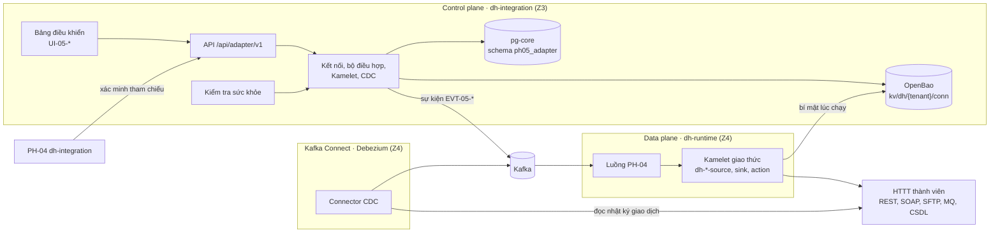
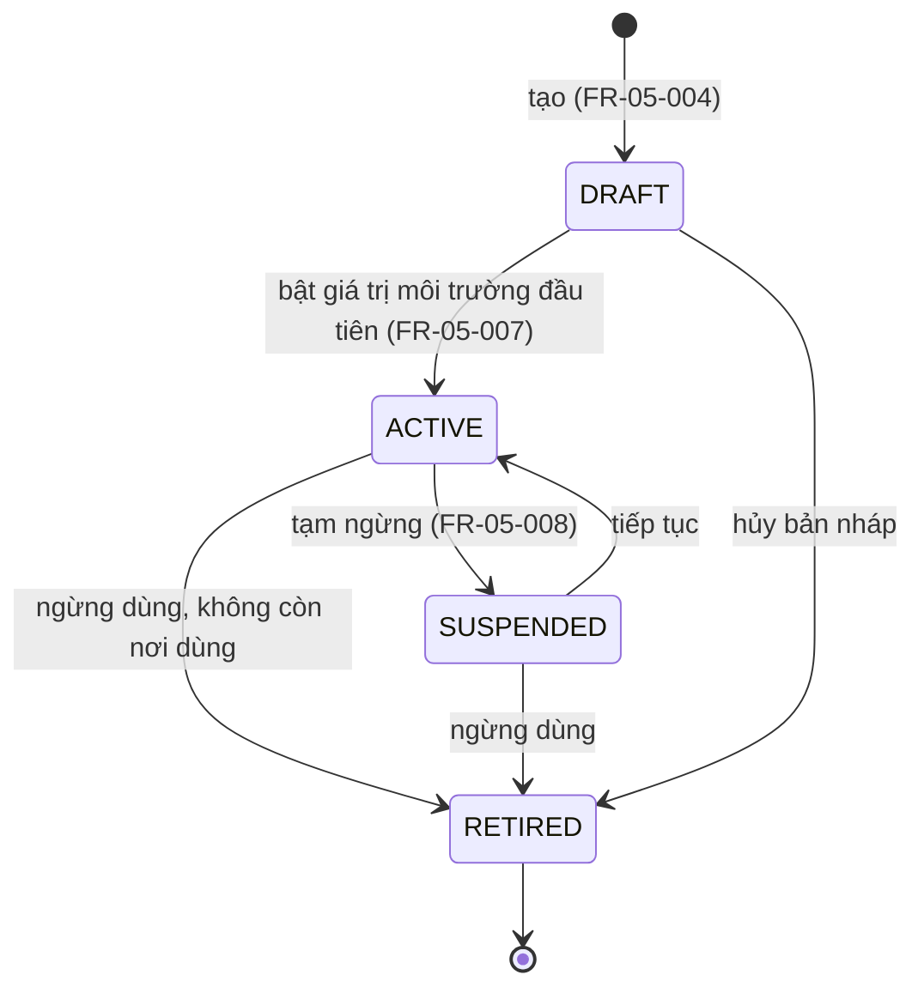
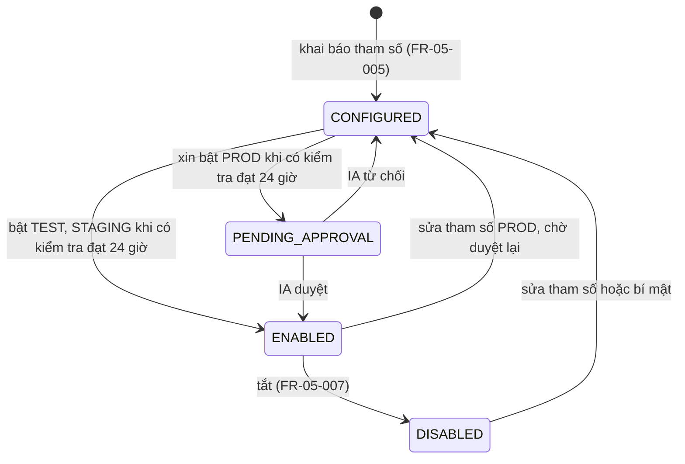
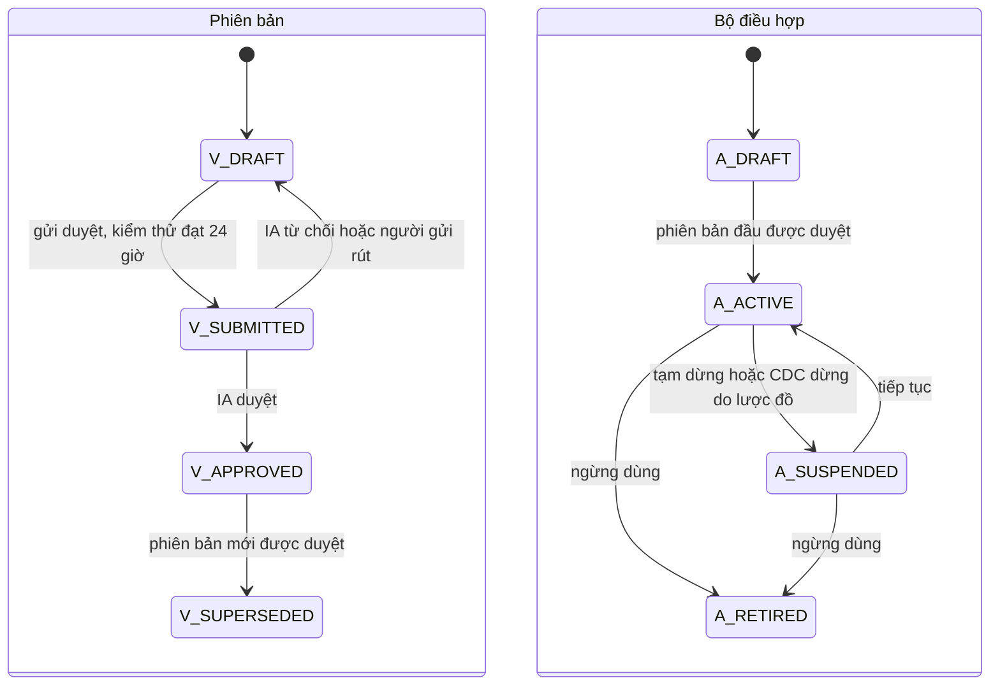
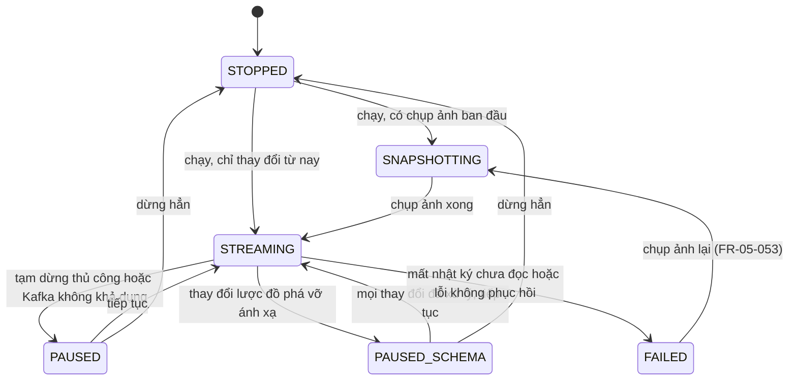
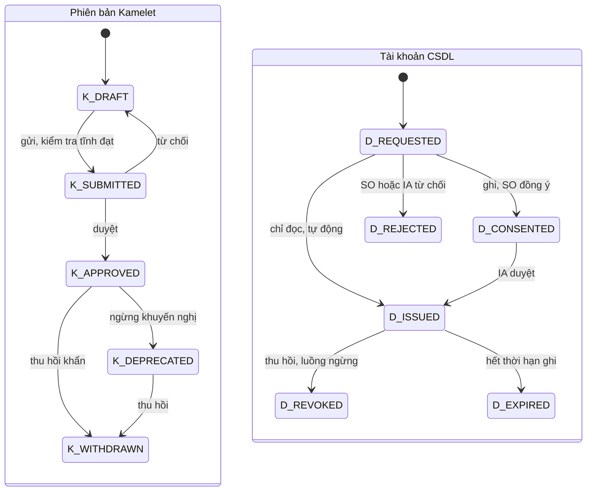

# D02-03-PH05 · Đặc tả yêu cầu chức năng Bộ điều hợp và kết nối

## Tóm tắt cho hội đồng thẩm định

**Mục tiêu.** PH-05 là lớp cách ly giữa lõi tích hợp (PH-04) và thực tế không đồng nhất của các hệ thống thông tin (HTTT) thành viên. Phân hệ quản lý ba thứ mà mọi luồng tích hợp cần nhưng không được tự giữ: **kết nối nguồn** (địa chỉ, tham số, bí mật theo từng môi trường), **bộ điều hợp** (cách nói chuyện với một HTTT cụ thể qua REST, SOAP, hàng đợi bản tin, tệp, CSDL, thư điện tử, CDC) và **danh mục Kamelet được duyệt** (khối kết nối dùng lại trong trình thiết kế luồng). Nhờ đó luồng PH-04 không chứa mật khẩu, không gọi thẳng giao thức thô và không phải sửa khi một HTTT đổi công nghệ.

**Phạm vi.** 62 yêu cầu chức năng chia tám nhóm: loại kết nối, kết nối nguồn và bí mật, sức khỏe kết nối, CSDL cho luồng theo quyết định Q359, bộ điều hợp theo giao thức, chuyển đổi định dạng và nhóm kết nối, bắt thay đổi dữ liệu (CDC) cho hệ di sản, danh mục Kamelet, quản trị. Phân hệ chạy trên hai DU: `dh-integration` (control plane, Spring Boot) và `dh-runtime` (data plane, Camel Quarkus 3.33.x).

**Căn cứ pháp lý.** CMP-LAW-09 (Công văn 631/THH-THHT: mọi yêu cầu ra vào đều qua bộ điều hợp, hỗ trợ HTTP, HTTPS, WebSocket, POP, IMAP, SMTP, JMS, AMQP, MQTT; JSON, XML, SOAP); CMP-LAW-03 (NĐ 278/2025 về kết nối, chia sẻ dữ liệu); CMP-LAW-06 và CMP-LAW-08 (NĐ 331/2026, TCVN 14423:2026 cấp độ 3: quản lý bí mật, kiểm soát truy cập, nhật ký); CMP-LAW-05 (Luật BVDLCN 91/2025: tối thiểu hóa truy cập dữ liệu cá nhân khi đọc CSDL nguồn).

**Con số chính.**

| Chỉ số | Giá trị |
|---|---|
| Yêu cầu chức năng | 62 (M: 51, S: 10, C: 1) |
| Quy tắc nghiệp vụ | 30 (BR-05-001…030) |
| Yêu cầu phi chức năng | 16 (NFR-05-001…016) |
| Màn hình | 17 (UI-05-01…17) |
| API | 92 operation (API-05-001…093, 042 để trống), 15 sự kiện (EVT-05-01…15) |
| Chức năng hệ cũ được phủ | 9 mục `LGC` (Bus connector, Tooling nhóm kết nối, bảo mật endpoint, sửa kết nối) và 1 mục loại bỏ có thay thế (LGC-TOOL-027) |
| Mức đợt | MVP; năm FR mức S và một FR mức C sang Đợt 3 |

## 1. Mục đích, phạm vi và người đọc

### 1.1. Mục đích

Tài liệu đặc tả đầy đủ hành vi của PH-05 để kỹ sư hiện thực và kiểm thử viên viết ca kiểm thử mà không phải hỏi lại. Mỗi FR có tiền điều kiện, đầu vào, các bước xử lý kiểm chứng được, ngoại lệ có mã lỗi và hậu điều kiện.

### 1.2. Phạm vi làm

| # | Trách nhiệm | Nhóm FR |
|---|---|---|
| 1 | Duy trì danh mục **loại kết nối** (HTTP, OAuth2, SOAP, JDBC, SFTP, JMS, AMQP, MQTT, SMTP, IMAP, LDAP, Kafka ngoài…) với lược đồ tham số và khóa bí mật | A |
| 2 | Khai báo **kết nối nguồn** theo HTTT, giá trị riêng cho TEST, STAGING, PROD; bí mật ghi một chiều vào OpenBao; cấp kết nối cho không gian làm việc hoặc luồng của PH-04 | B |
| 3 | Kiểm tra kết nối không tác dụng phụ, có hướng dẫn khắc phục; theo dõi sức khỏe chủ động và thụ động; báo PH-04 để điều chỉnh ngắt mạch | B, C |
| 4 | Hiện thực quyết định Q359 (ADR-067): kết nối "CSDL cho luồng", tài khoản chỉ đọc theo luồng cấp động, kiểm tra quyền thực tế, quy trình xin ghi có Cán bộ ATTT đồng ý | D |
| 5 | Đóng gói cách giao tiếp với từng HTTT thành **bộ điều hợp** có phiên bản: thao tác, phân trang, hạn mức phía đối tác, WSDL, khóa tệp, giới hạn đồng thời, chuyển đổi định dạng về JSON chuẩn | E |
| 6 | CDC bằng Debezium cho HTTT nhóm 3 (không API): cấu hình, kiểm tra điều kiện, chạy, giám sát lược đồ, dừng an toàn khi lược đồ đổi | F |
| 7 | Danh mục **Kamelet được duyệt**: Kamelet nền giao thức, Kamelet của tỉnh, Kamelet dùng chung toàn quốc; quy trình đăng ký, kiểm tra tĩnh, duyệt, ngừng dùng; đồng bộ với catalog của trình thiết kế (ADR-061) | G |
| 8 | Tham số theo tenant, báo cáo sử dụng | H |

### 1.3. Phạm vi không làm

| Không làm | Thuộc |
|---|---|
| Logic nghiệp vụ, định tuyến, ánh xạ ngữ nghĩa giữa lược đồ (DataMapper sinh JQ) | PH-04 (ADR-066) |
| Ủy quyền theo mục đích, nghĩa vụ che dữ liệu | PH-12, PH-09 qua PH-04 |
| Kết nối tới Nền tảng chia sẻ, điều phối dữ liệu quốc gia và dịch vụ NGSP | PH-14 (dùng lại loại kết nối và Kamelet của PH-05) |
| Đăng ký topic Kafka nội bộ, lược đồ sự kiện | PH-10 (PH-05 chỉ xin topic cho CDC) |
| Kết nạp HTTT | PH-01 (PH-05 đọc danh sách HTTT đã kết nạp) |
| Bảng điều khiển số liệu chi tiết theo luồng | PH-13 (PH-05 phát chỉ số) |
| Quản lý kho bí mật, chính sách OpenBao | Nền tảng (ADR-012); PH-05 chỉ ghi và đọc trong đường dẫn của mình |

### 1.4. Chức năng hệ cũ được phủ

| Mã | Chức năng hệ cũ | Vai trò của PH-05 |
|---|---|---|
| LGC-BUS-040 | Connector: CSDL, NoSQL, LDAP, Hadoop, message broker, HTTP, SOAP, FTP, File, cloud, SMPP, lập lịch | Chính |
| LGC-BUS-011 | Sửa thông tin kết nối của chương trình (host, port, method) | Chính (kết nối), cùng PH-04 |
| LGC-BUS-013 | Thêm chương trình tích hợp có kiểm tra kết nối | Phần kiểm tra kết nối |
| LGC-BUS-041 | Bảo mật endpoint (Basic, SSL, WS-Security) | Phần xác thực ra ngoài, cùng PH-03, PH-04, PH-12 |
| LGC-TOOL-008 | Nhóm Database Connection | Chính (kết nối CSDL), cùng PH-04 |
| LGC-TOOL-009 | Nhóm Network (HTTP, File, FTP, REST) | Kamelet giao thức |
| LGC-TOOL-010 | Nhóm Message Broker | Kamelet hàng đợi bản tin, cùng PH-10 |
| LGC-TOOL-011 | Nhóm Scheduling | Lịch quét tệp, hộp thư, kiểm tra sức khỏe |
| LGC-TOOL-012 | Nhóm bảo mật (mã hóa gói tin, điểm cuối) | Phần TLS, mTLS, WS-Security của bộ điều hợp |
| LGC-TOOL-027 | Nhập component từ file JAR (đã loại bỏ) | Thay bằng quy trình đăng ký Kamelet (FR-05-056…058) |

### 1.5. Người đọc và cách đọc

Hội đồng thẩm định đọc phần tóm tắt, §2, §9 và §13. Kỹ sư đọc §4, §5, §6, §8. Kiểm thử viên đọc §5, §6, §13. Mã định danh theo D00-01 §3; số kế tiếp theo D00-04 §3.2.

## 2. Bối cảnh nghiệp vụ

### 2.1. Vị trí trong kiến trúc



Sơ đồ cho thấy PH-05 có mặt ở cả hai mặt phẳng. Ở control plane, `dh-integration` giữ danh mục và trạng thái trong schema `ph05_adapter` của cụm `pg-core`, còn bí mật chỉ nằm trong OpenBao. Ở data plane, luồng PH-04 không gọi giao thức thô mà gọi Kamelet giao thức của PH-05; Kamelet đọc bí mật trực tiếp từ OpenBao lúc chạy qua xác thực Kubernetes của pod, nên bí mật không đi qua `dh-integration` khi chạy. CDC chạy trên Kafka Connect với connector Debezium (ADR-059), đọc nhật ký giao dịch của CSDL nguồn và đẩy thay đổi vào topic đã đăng ký ở PH-10. Vùng mạng theo D03-07: control plane ở Z3, data plane ở Z4, lưu lượng ra HTTT qua egress gateway (SEC-16).

### 2.2. Phân loại HTTT và chiến lược kết nối

Cách xây bộ điều hợp phụ thuộc nhóm HTTT xác định khi khảo sát (kế hoạch triển khai bước 1). Trường `systemGroup` của bộ điều hợp nhận một trong bốn giá trị dưới đây.

| Nhóm | Đặc điểm | Cách kết nối | Chi phí | Rủi ro |
|---|---|---|---|---|
| 1. Hiện đại | REST, có OpenAPI, đang bảo trì | Sinh bộ điều hợp từ OpenAPI (FR-05-046), Kamelet `dh-http-sink` | Thấp | Thấp |
| 2. API hạn chế | SOAP hoặc REST cũ, tài liệu thiếu hoặc lệch | Bộ điều hợp SOAP với WSDL đệm, phát hiện lệch (FR-05-034) | Trung bình | Tài liệu sai lệch |
| 3. Di sản | Không API, không còn nhà thầu | CDC Debezium (FR-05-048…053) hoặc truy vấn khai báo chỉ đọc (FR-05-038) | Trung bình | Phụ thuộc cấu trúc bảng nội bộ |
| 4. Sắp thay thế | Có kế hoạch thay mới | Kết nối tối thiểu (tệp, truy vấn chỉ đọc), không đầu tư sâu | Rất thấp | Thấp |

Giả định GĐ-04 (tỉnh vừa, 200 HTTT, 80 HTTT kết nối năm đầu) được chia theo tỷ lệ giả định GĐ-05-01: 45% nhóm 1, 30% nhóm 2, 15% nhóm 3, 10% nhóm 4. Cơ sở: tỷ lệ thường gặp ở các tỉnh đã triển khai LGSP thế hệ đầu; số thật lấy khi khảo sát.

### 2.3. Quy trình nghiệp vụ liên quan

| Quy trình | Bước có PH-05 |
|---|---|
| Kết nạp HTTT (PH-01) → tích hợp | Sau khi HTTT `ACTIVE`, kỹ sư tích hợp tạo kết nối, kiểm tra, xin bật PROD, cấp cho không gian làm việc |
| Thiết kế, phát hành luồng (PH-04) | Trình thiết kế liệt kê kết nối được cấp (FR-04-016) và Kamelet được duyệt; PH-04 xác minh tham chiếu khi lưu, gửi duyệt, phát hành (FR-05-014) |
| Vận hành | Bảng sức khỏe, cảnh báo khi kết nối suy giảm; xoay vòng bí mật theo lịch |
| Di trú từ Bus cũ (strangler) | Gói Context XML của Bus được phân tích, kết nối cũ thành kết nối nháp không kèm mật khẩu; PH-04 dùng bảng ánh xạ `connectionMap` (FR-04-082) |
| Sự cố ATTT | Cán bộ ATTT tạm ngừng kết nối, thu hồi tài khoản CSDL, buộc xoay bí mật |

### 2.4. Hạn chế của hệ cũ cần khắc phục

| Hạn chế hệ cũ | Hệ quả | Cách PH-05 khắc phục |
|---|---|---|
| Mật khẩu CSDL, FTP, khóa API nằm trong XML Camel và bảng `Context_file` | Lộ bí mật qua mã nguồn, bản sao lưu | Bí mật ghi một chiều vào OpenBao, luồng chỉ giữ tham chiếu `{{conn:…}}` (BR-05-001) |
| Datasource dùng chung một tài khoản `lgsp` có quyền ghi | Một luồng lỗi có thể sửa dữ liệu của sở; không truy vết được luồng nào đọc gì | Tài khoản chỉ đọc theo luồng, cấp động TTL 1 giờ, pgaudit (FR-05-024, 027) |
| Sửa host, port trực tiếp trên runtime | Không có phiên bản, không duyệt, không biết luồng nào bị ảnh hưởng | Sửa qua API có kiểm toán, cảnh báo nơi dùng, bật PROD cần duyệt (FR-05-006, 007, 013) |
| Nhập component từ JAR | Nạp mã tùy ý vào runtime, vi phạm cấp độ 3 | Kamelet YAML qua kiểm tra tĩnh và duyệt (FR-05-056, 057) |
| Không kiểm tra sức khỏe kết nối | Phát hiện lỗi khi người dân đã bị ảnh hưởng | Kiểm tra chủ động 60 giây, đánh giá thụ động, cảnh báo (FR-05-019…021) |
| Không có kênh cho hệ không API | Nhập tay hoặc sửa mã hệ nguồn | CDC đọc nhật ký giao dịch, không sửa hệ nguồn (FR-05-048) |

## 3. Tác nhân, vai trò và quyền

### 3.1. Tác nhân

| Tác nhân | Loại | Tương tác chính |
|---|---|---|
| ROLE-INTEGRATION_ENGINEER (IE) | Người | Tạo kết nối, bộ điều hợp, Kamelet; kiểm tra; gửi duyệt |
| ROLE-INTEGRATION_APPROVER (IA) | Người | Duyệt bật giá trị PROD, phiên bản bộ điều hợp, Kamelet của tỉnh, tài khoản ghi CSDL |
| ROLE-TENANT_ADMIN (TA) | Người | Như IE, cộng tham số phân hệ, bật tắt loại kết nối |
| ROLE-TENANT_OPERATOR (TO) | Người | Theo dõi sức khỏe, tạm ngừng, tiếp tục, xoay bí mật, điều khiển CDC |
| ROLE-SECURITY_OFFICER (SO) | Người | Đồng ý mục đích ghi CSDL, xem nhật ký truy cập CSDL, tạm ngừng khi có sự cố |
| ROLE-PLATFORM_ADMIN (PA) | Người | Duyệt Kamelet dùng chung toàn quốc (`COMMON`), quản lý Kamelet nền |
| ROLE-AUDITOR (AU), ROLE-VIEWER (VW) | Người | Xem |
| PH-04 `dh-integration` | Hệ thống | Xác minh tham chiếu kết nối, đọc catalog Kamelet |
| `dh-runtime` | Hệ thống | Đọc cấu hình kết nối không bí mật, đọc bí mật từ OpenBao, phát chỉ số và nhật ký truy cập CSDL |
| PH-01, PH-10, PH-13, PH-18 | Hệ thống | HTTT đã kết nạp; topic CDC; giám sát và cảnh báo; tham số |
| OpenBao | Hệ thống | KV v2 cho bí mật kết nối; database secrets engine cho tài khoản động |
| Kafka Connect (Debezium) | Hệ thống | Chạy connector CDC |
| HTTT thành viên | Hệ thống | Đầu kia của kết nối |

### 3.2. Quyền

Ma trận dưới đây dùng ký hiệu của D02-08 §3. Quyền `PERM-05-read`, `PERM-05-connection`, `PERM-05-kamelet-approve` đã có ở D02-08; tám quyền còn lại được bổ sung vào D02-08 §3.1 trong cùng đợt này.

| Quyền | Ý nghĩa | PA | TA | TO | SO | IE | IA | VW | AU |
|---|---|---|---|---|---|---|---|---|---|
| PERM-05-read | Xem loại kết nối, kết nối (không xem bí mật), bộ điều hợp, Kamelet, sức khỏe, CDC | ● | ● | ● | ● | ● | ● | ● | ● |
| PERM-05-connection | Tạo, sửa kết nối; khai báo giá trị và bí mật TEST, STAGING, PROD; cấp kết nối; yêu cầu tài khoản CSDL | — | ● | — | — | ● | — | — | — |
| PERM-05-adapter | Tạo, sửa bộ điều hợp, thao tác, cấu hình CDC; gửi duyệt; xử lý thay đổi lược đồ | — | ● | — | — | ● | — | — | — |
| PERM-05-test | Chạy kiểm tra kết nối, kiểm thử bộ điều hợp, xem trước chuyển đổi, kiểm tra quyền CSDL, kiểm tra điều kiện CDC | — | ● | ● | — | ● | ● | — | — |
| PERM-05-operate | Tạm ngừng, tiếp tục, tắt giá trị môi trường, xoay bí mật, chạy, tạm dừng CDC, chạy so sánh phiên bản | — | ● | ● | ● | — | — | — | — |
| PERM-05-approve | Duyệt bật giá trị PROD, phiên bản bộ điều hợp, tài khoản ghi CSDL | — | — | — | — | — | ● | — | — |
| PERM-05-db-write-consent | Đồng ý mục đích ghi vào CSDL của HTTT | — | — | — | ● | — | — | — | — |
| PERM-05-kamelet-submit | Soạn, kiểm tra, gửi đăng ký Kamelet; đề xuất dùng chung | — | ● | — | — | ● | — | — | — |
| PERM-05-kamelet-approve | Duyệt, từ chối, ngừng khuyến nghị, thu hồi Kamelet (IA với Kamelet của tỉnh; PA với `COMMON` và Kamelet nền) | ● | — | — | — | — | ● | — | — |
| PERM-05-audit-read | Xem nhật ký truy cập CSDL của luồng, lịch sử xoay bí mật chi tiết | — | — | — | ● | — | — | — | ● |
| PERM-05-admin | Tham số phân hệ, bật tắt loại kết nối, trần tham số theo tenant | ● | ● | — | — | — | — | — | — |

Tách nhiệm vụ: IE và IA đã là cặp loại trừ ở D02-08 §4. Ngoài ra nguyên tắc bốn mắt (FR-00-071) áp dụng cho từng đối tượng: người khai báo bí mật PROD hoặc gửi duyệt không được tự duyệt (BR-05-009). `PERM-05-operate` của SO chỉ dùng cho tạm ngừng khi có sự cố (FR-05-008), không dùng cho xoay bí mật hay CDC.

**Máy gọi máy.** `dh-integration` của PH-04 gọi API nội bộ bằng token dịch vụ có scope `adapter:verify`; `dh-runtime` dùng scope `adapter:runtime-config`; PH-13 dùng `adapter:health-read`. Scope này cấp cho tài khoản dịch vụ khi triển khai, không cấp cho người.

## 4. Khái niệm và mô hình nghiệp vụ

### 4.1. Thuật ngữ

| Thuật ngữ | Định nghĩa |
|---|---|
| Loại kết nối | Khuôn mô tả một cách kết nối (ví dụ `oauth2-client`, `jdbc-postgresql`, `sftp`): tham số không bí mật, khóa bí mật, Kamelet giao thức dùng nó, bước kiểm tra không tác dụng phụ |
| Kết nối nguồn | Bản khai báo kết nối tới một HTTT cụ thể theo một loại kết nối, có mã duy nhất trong tenant (ví dụ `ndxp-ho-tich`, `qlvb-soap`, `dkkd-csdl`) |
| Giá trị môi trường | Tham số và bí mật của một kết nối ở một môi trường TEST, STAGING hoặc PROD |
| Cấp kết nối | Cho phép một không gian làm việc (hoặc một luồng, với CSDL cho luồng) của PH-04 dùng kết nối |
| CSDL cho luồng | Loại kết nối CSDL theo Q359: tài khoản riêng cho từng luồng, mặc định chỉ đọc, cấp động |
| Bộ điều hợp | Gói cấu hình có phiên bản mô tả cách giao tiếp với một HTTT: kết nối dùng, các thao tác, định dạng, phân trang, giới hạn đồng thời. Khi được duyệt, mỗi thao tác xuất hiện trong bảng thành phần của trình thiết kế như một Kamelet sinh (FR-05-047) |
| Thao tác | Một lời gọi cụ thể của bộ điều hợp: `GET /ho-so/{ma}`, thao tác SOAP `SendDocument`, hàng đợi `QLVB.IN`, mẫu tệp `BC_*.csv`, truy vấn khai báo |
| Kamelet nền giao thức | Kamelet do nền tảng viết, ký cùng ảnh runtime (`dh-http-sink`, `dh-soap-sink`, `dh-sql-ro-source`…), hiện thực giao thức và đọc kết nối |
| Kamelet của tỉnh | Kamelet do tỉnh soạn, qua kiểm tra tĩnh và duyệt, chỉ dùng trong tenant đó |
| Kamelet dùng chung | Kamelet ở tenant `COMMON`, mọi tenant dùng được, do PA duyệt |
| JSON chuẩn | Biểu diễn JSON mà bộ điều hợp trả cho luồng sau khi chuyển định dạng (XML, SOAP, CSV, cố định độ rộng). Ánh xạ sang lược đồ dữ liệu dùng chung là việc của PH-04 |
| CDC | Bắt thay đổi dữ liệu từ nhật ký giao dịch của CSDL nguồn (WAL, binlog, redo log) |

### 4.2. Thực thể

| Mã | Thực thể | Thuộc tính chính | Ghi chú |
|---|---|---|---|
| EN-05-01 | Loại kết nối (`ConnectionType`) | `typeCode`, nhóm giao thức, lược đồ tham số (JSON Schema), danh sách khóa bí mật, Kamelet giao thức, bước kiểm tra, mức hỗ trợ | Do nền tảng định nghĩa; tenant chỉ bật tắt và đặt trần (FR-05-061) |
| EN-05-02 | Kết nối nguồn (`Connection`) | `connectionCode`, tên, `typeCode`, HTTT chủ quản (`systemCode` ở PH-01), mục đích (`READ`, `READ_WRITE`), trạng thái, chủ sở hữu, nhãn, phiên bản cấu hình | Mã bất biến |
| EN-05-03 | Giá trị môi trường (`ConnectionEnvironment`) | `env`, tham số không bí mật, đường dẫn bí mật, phiên bản bí mật, trạng thái, lần kiểm tra đạt gần nhất | Một kết nối có tối đa ba giá trị |
| EN-05-04 | Cấp kết nối (`ConnectionGrant`) | Kết nối, phạm vi (`WORKSPACE` hoặc `FLOW`), mã không gian hoặc mã luồng, môi trường được phép, thời hạn | |
| EN-05-05 | Lần kiểm tra kết nối (`ConnectionTest`) | Môi trường, kết quả từng bước, thời gian, người chạy, hướng dẫn khắc phục | Giữ 1 năm |
| EN-05-06 | Mẫu sức khỏe (`HealthSample`) và trạng thái sức khỏe (`HealthState`) | Mức `HEALTHY`, `DEGRADED`, `UNHEALTHY`, `UNKNOWN`, lý do, độ trễ, tỷ lệ lỗi | Mẫu giữ 90 ngày |
| EN-05-07 | Lần xoay bí mật (`SecretRotation`) | Môi trường, phiên bản cũ, mới, trạng thái, thời điểm kết thúc chuyển tiếp | |
| EN-05-08 | Tài khoản CSDL cho luồng (`FlowDbAccount`) | Kết nối, luồng, phạm vi schema, bảng, mục đích, cơ chế cấp (`DYNAMIC`, `STATIC`), trạng thái, người đồng ý, người duyệt, thời hạn | Q359 |
| EN-05-09 | Bản ghi truy cập CSDL (`DbAccessRecord`) | Luồng, phiên bản, tenant, băm câu lệnh, số dòng, thời lượng, `traceId` | Nhận từ runtime qua Kafka |
| EN-05-10 | Bộ điều hợp (`Adapter`) | `adapterCode`, HTTT, nhóm 1–4, giao thức, kết nối, trạng thái, phiên bản hiệu lực | |
| EN-05-11 | Phiên bản bộ điều hợp (`AdapterVersion`) | Số phiên bản, trạng thái, giới hạn đồng thời, định dạng, tệp đặc tả (OpenAPI, WSDL) đệm | Bất biến sau duyệt |
| EN-05-12 | Thao tác (`AdapterOperation`) | `operationCode`, chiều (`OUTBOUND`, `INBOUND`), tham số giao thức, định dạng vào ra, quy tắc chuẩn hóa, phân trang | |
| EN-05-13 | Lần kiểm thử bộ điều hợp (`AdapterTest`) và so sánh (`AdapterComparison`) | Kết quả theo thao tác; khác biệt giữa hai phiên bản | |
| EN-05-14 | Cấu hình CDC (`CdcConfig`) | Bộ điều hợp, loại CSDL, bảng theo dõi, chế độ chụp ảnh ban đầu, topic, trạng thái, vị trí đọc gần nhất | |
| EN-05-15 | Thay đổi lược đồ CDC (`CdcSchemaChange`) | Bảng, loại thay đổi, mức phá vỡ, trạng thái xử lý, người xử lý | Giữ vĩnh viễn |
| EN-05-16 | Kamelet (`Kamelet`) | `kameletName`, phạm vi (`BASE`, `COMMON`, `TENANT`), loại (`source`, `sink`, `action`), nhóm, chủ sở hữu | |
| EN-05-17 | Phiên bản Kamelet (`KameletVersion`) | Số phiên bản theo SemVer, YAML, tham số, kết quả kiểm tra tĩnh, trạng thái, người duyệt | |
| EN-05-18 | Tác vụ nhập kết nối hệ cũ (`LegacyImportJob`) | Tệp, danh sách kết nối phát hiện, đề xuất loại, trạng thái | |

### 4.3. Máy trạng thái kết nối nguồn



Kết nối ở `DRAFT` khi mới tạo và chưa có môi trường nào được bật; luồng chưa thể dùng nó ngoài trình thiết kế. Bật giá trị môi trường đầu tiên chuyển kết nối sang `ACTIVE`. `SUSPENDED` chặn mọi lượt dùng mới ở mọi môi trường: runtime nhận EVT-05-04 và từ chối lượt gọi bằng ERR-05-118, kiểm tra sức khỏe dừng. `RETIRED` là trạng thái cuối: mã không dùng lại được (BR-05-004), bí mật bị hủy sau 30 ngày (BR-05-012). Máy chủ kiểm tra mọi chuyển trạng thái; chuyển không hợp lệ trả ERR-05-008.

### 4.4. Máy trạng thái giá trị môi trường



Giá trị môi trường chỉ dùng được ở runtime khi `ENABLED`. Điều kiện chung để bật là có lần kiểm tra đạt trong 24 giờ trên đúng giá trị đó (BR-05-006). Ở PROD, bật cần IA duyệt theo bốn mắt (BR-05-009). Sửa tham số hay bí mật của giá trị PROD đang `ENABLED` không làm gián đoạn: giá trị cũ vẫn phục vụ cho tới khi giá trị mới được duyệt (BR-05-010); với TEST, STAGING, sửa có hiệu lực ngay sau kiểm tra đạt.

### 4.5. Máy trạng thái bộ điều hợp và phiên bản



Bộ điều hợp có hai trục trạng thái. Trục phiên bản quản lý nội dung: bản nháp sửa được, phiên bản được duyệt thì bất biến và chỉ có một phiên bản hiệu lực ở một thời điểm (BR-05-016). Trục bộ điều hợp quản lý vận hành: `SUSPENDED` chặn lượt gọi mới qua mọi thao tác. Trong hiển thị, tiền tố `V_` và `A_` được bỏ; API dùng tên không tiền tố trong hai trường khác nhau (`versionStatus`, `status`).

### 4.6. Máy trạng thái CDC



`PAUSED_SCHEMA` là điểm thiết kế quan trọng: khi cấu trúc bảng nguồn đổi theo cách phá vỡ ánh xạ, CDC dừng thay vì tiếp tục phát dữ liệu có thể sai (BR-05-022), vì dữ liệu sai lan vào trục khó sửa hơn nhiều so với một gián đoạn có kiểm soát. Vị trí đọc được giữ để tiếp tục đúng chỗ. `FAILED` xảy ra khi nhật ký giao dịch đã xoay vòng mất phần chưa đọc; chỉ chụp ảnh lại mới đưa dữ liệu về đúng.

### 4.7. Máy trạng thái Kamelet và tài khoản CSDL cho luồng



Kamelet `APPROVED` xuất hiện trong catalog của trình thiết kế; `DEPRECATED` vẫn chạy và vẫn hiện trong luồng cũ nhưng bị ẩn khỏi bảng thành phần và có cảnh báo; `WITHDRAWN` bị chặn ở lần phát hành luồng kế tiếp và gây cảnh báo mức cao cho mọi luồng đang dùng (BR-05-027). Tài khoản CSDL chỉ đọc được cấp ngay khi yêu cầu hợp lệ; tài khoản có quyền ghi cần SO đồng ý rồi IA duyệt, có thời hạn tối đa 90 ngày (BR-05-020).

## 5. Đặc tả chi tiết yêu cầu chức năng

Mỗi FR theo mẫu D00-01 §4.3. FR có nhiều bước hoặc thay đổi trạng thái được đặc tả bằng bảng đầy đủ. FR đọc hoặc FR đơn giản dùng bảng gọn, gộp các trường không có nội dung riêng ("Không" với sự kiện, kiểm toán là giá trị đã xét). Chức năng dùng chung (đăng nhập, chọn tenant, phân trang, lọc chuẩn, kiểm toán chung, hộp "Việc của tôi") theo FR-00 của SRS, không lặp lại. Mọi API ở control plane dùng tiền tố `/api/adapter/v1`; ví dụ dùng tenant `T68`, HTTT `HT-TUPHAP` (Sở Tư pháp), `HT-QLVB` (quản lý văn bản), `HT-DATDAI` (CSDL đất đai, nhóm 3), đều là dữ liệu giả lập.

### 5.1. Nhóm A · Loại kết nối

#### FR-05-001 · Liệt kê loại kết nối và lược đồ tham số

| Trường | Nội dung |
|---|---|
| Mức ưu tiên | M |
| Truy vết | REQ-05; LGC-BUS-040, LGC-TOOL-008, 009, 010 |
| Tác nhân, quyền | Mọi vai trò có `PERM-05-read`; PH-04 (trình thiết kế) |
| Tiền điều kiện | Đã đăng nhập, chọn tenant (FR-00-004) |
| Đầu vào | `protocolGroup` (lọc: `HTTP`, `SOAP`, `DATABASE`, `FILE`, `MESSAGING`, `MAIL`, `DIRECTORY`), `includeDisabled` (mặc định `false`) |
| Đầu ra | Danh sách loại: `typeCode`, tên, nhóm, mức hỗ trợ (`STABLE`, `PREVIEW`, `DEPRECATED`), `enabledInTenant`, lược đồ tham số (JSON Schema 2020-12), `secretKeys[]`, Kamelet giao thức, các bước kiểm tra, trần tham số của tenant |
| Hậu điều kiện, sự kiện, kiểm toán | Không đổi dữ liệu; không sự kiện; không kiểm toán |

Danh mục loại kết nối ban đầu (bản 0.1) gồm 24 loại dưới đây. Loại mới chỉ thêm qua bản phát hành nền tảng vì mỗi loại cần Kamelet giao thức và bước kiểm tra có kiểm thử.

| `typeCode` | Nhóm | Tham số không bí mật chính | Khóa bí mật | Kamelet giao thức |
|---|---|---|---|---|
| `http-none` | HTTP | `baseUrl`, `timeoutMs`, `tlsMinVersion`, `caBundleRef` | — | `dh-http-sink`, `dh-http-source` (webhook nhận vào qua PH-03) |
| `http-basic` | HTTP | như trên, `username` | `password` | như trên |
| `http-apikey` | HTTP | như trên, `headerName` hoặc `queryName` | `apiKey` | như trên |
| `oauth2-client` | HTTP | như trên, `tokenUrl`, `clientId`, `scope`, `authMethod` (`client_secret_post`, `client_secret_basic`, `private_key_jwt`) | `clientSecret` hoặc `privateKeyPem` | như trên |
| `http-mtls` | HTTP | như trên, `clientCertRef` (mã chứng thư ở OpenBao PKI) | `clientKeyPem` | như trên |
| `soap-wss` | SOAP | `wsdlUrl`, `endpointUrl`, `soapVersion` (`1.1`, `1.2`), `wssMode` (`NONE`, `USERNAME_TOKEN`, `SIGNATURE`) | `wssPassword`, `signingKeyPem` | `dh-soap-sink` |
| `jdbc-postgresql`, `jdbc-oracle`, `jdbc-mysql`, `jdbc-sqlserver` | DATABASE | `host`, `port`, `database` (hoặc `serviceName`), `sslMode`, `allowedSchemas[]`, `maxRows`, `statementTimeoutMs` | `username`, `password` (khi cấp tĩnh) | `dh-sql-ro-source`, `dh-sql-ro-action`, `dh-sql-write-sink` |
| `db-flow` | DATABASE | như JDBC, cộng `engine` (`postgresql`, `oracle`, `mysql`, `sqlserver`), `provisioning` (`DYNAMIC`, `STATIC`), `rlsTenantSetting` | `adminUsername`, `adminPassword` (chỉ cho OpenBao database engine) | như trên |
| `mongodb` | DATABASE | `uri` không kèm mật khẩu, `database`, `readPreference` | `username`, `password` | `dh-mongodb-ro-source` (Đợt 3) |
| `sftp` | FILE | `host`, `port`, `username`, `baseDir`, `knownHostKey` | `password` hoặc `privateKeyPem` | `dh-sftp-source`, `dh-sftp-sink` |
| `ftps` | FILE | `host`, `port`, `username`, `baseDir`, `implicitTls` | `password` | `dh-ftps-source`, `dh-ftps-sink` |
| `smb-share` | FILE | `host`, `share`, `domain`, `username`, `baseDir` | `password` | `dh-smb-source`, `dh-smb-sink` |
| `jms-activemq` | MESSAGING | `brokerUrl`, `username`, `destinationType` | `password` | `dh-jms-source`, `dh-jms-sink` |
| `amqp-1` | MESSAGING | `remoteUri`, `username`, `containerId` | `password` | `dh-amqp-source`, `dh-amqp-sink` |
| `mqtt-5` | MESSAGING | `brokerUrl`, `clientIdPrefix`, `qos` | `password` | `dh-mqtt-source`, `dh-mqtt-sink` |
| `kafka-external` | MESSAGING | `bootstrapServers`, `securityProtocol`, `saslMechanism` | `saslPassword` | `dh-kafka-ext-source`, `dh-kafka-ext-sink` |
| `smtp` | MAIL | `host`, `port`, `starttls`, `username`, `fromAddress` | `password` | `dh-mail-sink` |
| `imap` | MAIL | `host`, `port`, `username`, `folder` | `password` | `dh-imap-source` |
| `ldap` | DIRECTORY | `url`, `baseDn`, `bindDn` | `bindPassword` | `dh-ldap-action` |
| `cdc-debezium` | DATABASE | như `db-flow`, cộng `logMode` | `username`, `password` (tài khoản quyền đọc nhật ký) | Connector Debezium (FR-05-048), không phải Kamelet |

### 5.2. Nhóm B · Kết nối nguồn và bí mật

#### FR-05-002 · Liệt kê, tìm kiếm và lọc kết nối nguồn

| Trường | Nội dung |
|---|---|
| Mức ưu tiên | M |
| Truy vết | REQ-05; LGC-BUS-040 |
| Tác nhân, quyền | `PERM-05-read` |
| Đầu vào | `q` (tìm không dấu trên mã, tên, `systemCode`, máy chủ), `typeCode`, `protocolGroup`, `systemCode`, `status`, `health`, `env` (có giá trị `ENABLED` ở môi trường), `grantedTo` (mã không gian làm việc), `owner`, `label`, phân trang `page`, `size` (≤ 200), `sort` (`code`, `name`, `updatedAt`, `health`) |
| Xử lý | 1. Kiểm tra tham số; sai miền trả ERR-05-003. 2. Truy vấn trong tenant hiện hành (RLS). 3. Kết nối `UNHEALTHY` luôn xếp đầu khi `sort` không chỉ định (BR-05-014). 4. Trả kèm khối `facets` đếm theo loại, trạng thái, sức khỏe. |
| Đầu ra | `items[]`: mã, tên, loại, HTTT, trạng thái, môi trường `ENABLED`, sức khỏe từng môi trường, số nơi dùng, cập nhật lần cuối; `page`, `size`, `totalElements`, `facets` |
| Hậu điều kiện, sự kiện, kiểm toán | Không đổi dữ liệu; không sự kiện; không kiểm toán |

#### FR-05-003 · Xem chi tiết kết nối nguồn

| Trường | Nội dung |
|---|---|
| Mức ưu tiên | M |
| Truy vết | REQ-05; LGC-BUS-006 (phần thông tin kết nối) |
| Tác nhân, quyền | `PERM-05-read` |
| Tiền điều kiện | Kết nối thuộc tenant hiện hành; kết nối của tenant khác trả `404` ERR-05-001 như không tồn tại (BR-05-002) |
| Đầu ra | Thông tin chung; ba giá trị môi trường với tham số không bí mật, `secretSet` (có hay chưa), `secretVersion`, `secretUpdatedAt`, trạng thái, lần kiểm tra gần nhất; danh sách cấp; sức khỏe; số nơi dùng; `ETag` |
| Ngoại lệ | Không tồn tại hoặc tenant khác: ERR-05-001, 404 |
| Hậu điều kiện, sự kiện, kiểm toán | Không đổi dữ liệu. Không bao giờ trả giá trị bí mật (BR-05-001). Không kiểm toán |

#### FR-05-004 · Tạo kết nối nguồn

| Trường | Nội dung |
|---|---|
| Mức ưu tiên | M |
| Truy vết | REQ-05; LGC-BUS-011, LGC-BUS-013, LGC-TOOL-008, 009 |
| Tác nhân, quyền | IE, TA (`PERM-05-connection`) |
| Tiền điều kiện | HTTT chủ quản ở trạng thái `ACTIVE` tại PH-01 (bản sao đọc); loại kết nối được bật ở tenant |

| Tham số | Kiểu | Bắt buộc | Ràng buộc | Ví dụ |
|---|---|---|---|---|
| `connectionCode` | T-CODE chữ thường | Có | `^[a-z][a-z0-9-]{2,62}$`, duy nhất trong tenant kể cả kết nối `RETIRED` | `qlvb-soap` |
| `name` | T-NAME | Có | 3…255 ký tự | `Quản lý văn bản, dịch vụ SOAP` |
| `typeCode` | T-CODE | Có | Loại có trong FR-05-001, được bật | `soap-wss` |
| `systemCode` | T-CODE | Có | HTTT `ACTIVE` ở PH-01 | `HT-QLVB` |
| `purpose` | enum | Có | `READ`, `READ_WRITE` | `READ_WRITE` |
| `description` | T-TEXT | Không | ≤ 2.000 ký tự | |
| `owner` | T-CODE | Không | Mã người dùng; mặc định người tạo | |
| `labels` | mảng T-CODE | Không | ≤ 10 | `["van-ban"]` |
| `Idempotency-Key` | tiêu đề | Có | UUID | |

| Trường | Nội dung |
|---|---|
| Xử lý | 1. Kiểm tra quyền, khóa idempotency (trùng khóa khác thân: ERR-05-039). 2. Kiểm tra mã theo mẫu và duy nhất (ERR-05-002). 3. Kiểm tra loại kết nối được bật (ERR-05-004). 4. Kiểm tra HTTT ở bản sao PH-01 (ERR-05-005). 5. Từ chối khi thân có trường trùng tên khóa bí mật của loại (ERR-05-006, BR-05-001). 6. Tạo kết nối `DRAFT`, chưa có giá trị môi trường. 7. Ghi kiểm toán. |
| Đầu ra | `201`, thân như FR-05-003, tiêu đề `Location`, `ETag` |
| Ngoại lệ | Mã sai mẫu: ERR-05-003, 400 · Mã trùng: ERR-05-002, 409 · Loại không được hỗ trợ hoặc tắt: ERR-05-004, 422 · HTTT không `ACTIVE`: ERR-05-005, 422 · Có bí mật trong thân: ERR-05-006, 422 · Khóa idempotency trùng khác thân: ERR-05-039, 422 |
| Hậu điều kiện | Kết nối `DRAFT`; chưa dùng được trong luồng ngoài chế độ thiết kế |
| Sự kiện phát ra | Không (sự kiện chỉ phát khi giá trị môi trường được bật, EVT-05-01) |
| Kiểm toán | Có: người tạo, mã, loại, HTTT, mục đích |

#### FR-05-005 · Khai báo giá trị và bí mật theo môi trường

| Trường | Nội dung |
|---|---|
| Mức ưu tiên | M |
| Truy vết | REQ-05; LGC-BUS-011, LGC-BUS-041, LGC-TOOL-008, 012 |
| Tác nhân, quyền | IE, TA (`PERM-05-connection`) |
| Tiền điều kiện | Kết nối không `RETIRED`; môi trường thuộc `TEST`, `STAGING`, `PROD` |
| Đầu vào | Hai lệnh tách biệt. (a) Tham số không bí mật: đối tượng theo lược đồ của loại (API-05-011), kèm `If-Match`. (b) Bí mật: đối tượng chỉ gồm các khóa trong `secretKeys` của loại (API-05-012), chỉ qua HTTPS tới BFF, kích thước ≤ 16 KiB |

| Trường | Nội dung |
|---|---|
| Xử lý | 1. Kiểm tra tham số theo JSON Schema của loại; trả tối đa 20 lỗi theo đường dẫn (ERR-05-003). 2. Kiểm tra trần tenant, ví dụ `maxPoolSize`, `timeoutMs` (ERR-05-030). 3. Kiểm tra `baseUrl`, `host` không trỏ vào dải nội bộ của nền tảng (danh sách cấm của D03-07, ERR-05-003) và có FQDN đích trong danh sách egress hoặc tạo đề nghị bổ sung egress (BR-05-013). 4. Với bí mật: ghi thẳng vào OpenBao KV v2 tại `kv/dh/{tenant}/conn/{connectionCode}/{env}` bằng token dịch vụ của `dh-integration` (chính sách chỉ ghi, không đọc); PostgreSQL chỉ lưu `secretVersion`, thời điểm, người ghi. 5. Đặt trạng thái giá trị `CONFIGURED`; với PROD đang `ENABLED` thì lưu thành bản chờ (BR-05-010). 6. Đánh dấu lần kiểm tra cũ hết hiệu lực cho giá trị này. 7. Ghi kiểm toán. |
| Đầu ra | (a) `200` giá trị môi trường; (b) `204` |
| Ngoại lệ | Lược đồ sai: ERR-05-003, 400 · Vượt trần: ERR-05-030, 422 · Khóa bí mật lạ: ERR-05-003, 400 · Xung đột phiên bản: ERR-05-007, 412 · OpenBao không khả dụng: ERR-05-028, 503 (không ghi gì, không để lại bí mật trong hàng đợi thử lại) · Kết nối `RETIRED`: ERR-05-008, 409 · Đóng băng thay đổi PROD: ERR-05-031, 423 |
| Hậu điều kiện | Giá trị `CONFIGURED`, cần kiểm tra lại trước khi bật |
| Sự kiện phát ra | EVT-05-02 khi tham số của giá trị đang `ENABLED` ở TEST, STAGING thay đổi |
| Kiểm toán | Có: môi trường, khóa tham số thay đổi (giá trị cũ và mới với tham số không bí mật), tên khóa bí mật thay đổi, `secretVersion`; không bao giờ ghi giá trị bí mật |

#### FR-05-006 · Sửa thông tin kết nối

FR-05-006 (M; LGC-BUS-011). IE, TA (`PERM-05-connection`) sửa tên, mô tả, chủ sở hữu, nhãn, mục đích bằng `PATCH` có `If-Match`. Mã, loại và HTTT không sửa được (ERR-05-003); đổi loại phải tạo kết nối mới và chuyển nơi dùng. Đổi `purpose` từ `READ_WRITE` về `READ` có hiệu lực ngay; từ `READ` lên `READ_WRITE` khiến mọi tài khoản ghi phải xin lại (FR-05-026). Phản hồi kèm danh sách nơi dùng bị ảnh hưởng (FR-05-013). Xung đột phiên bản trả ERR-05-007. Kiểm toán: có, ghi trường cũ và mới. Sự kiện: EVT-05-02.

#### FR-05-007 · Bật, tắt giá trị môi trường và duyệt bật PROD

| Trường | Nội dung |
|---|---|
| Mức ưu tiên | M |
| Truy vết | REQ-05; LGC-BUS-009, 012 (phần kết nối) |
| Tác nhân, quyền | Bật TEST, STAGING và xin bật PROD: IE, TA (`PERM-05-connection`). Duyệt, từ chối PROD: IA (`PERM-05-approve`). Tắt: TO, TA, SO (`PERM-05-operate`) |
| Tiền điều kiện | Giá trị `CONFIGURED` hoặc `DISABLED`; có lần kiểm tra đạt trong 24 giờ trên đúng phiên bản tham số và bí mật hiện tại (BR-05-006) |
| Đầu vào | `reason` (bắt buộc khi tắt và khi từ chối, 10…500 ký tự), `comment` khi duyệt |

| Trường | Nội dung |
|---|---|
| Xử lý | 1. Kiểm tra trạng thái và lần kiểm tra đạt (ERR-05-009). 2. TEST, STAGING: chuyển `ENABLED`, phát EVT-05-01. 3. PROD: chuyển `PENDING_APPROVAL`, tạo việc trong hộp "Việc của tôi" của IA (FR-00-070) kèm kết quả kiểm tra và khác biệt so với giá trị đang chạy. 4. Duyệt: kiểm tra người duyệt khác người xin bật và khác người ghi bí mật gần nhất (ERR-05-011); chuyển `ENABLED`; nếu đây là giá trị đầu tiên được bật, kết nối sang `ACTIVE`; phát EVT-05-01. 5. Từ chối: về `CONFIGURED`, thông báo người xin. 6. Tắt: chuyển `DISABLED`, phát EVT-05-04 với `env`; runtime từ chối lượt gọi mới bằng ERR-05-118 sau tối đa 30 giây (NFR-05-006). 7. Ghi kiểm toán. |
| Đầu ra | Giá trị môi trường với trạng thái mới |
| Ngoại lệ | Chưa có kiểm tra đạt 24 giờ: ERR-05-009, 409 · Chuyển trạng thái không hợp lệ: ERR-05-008, 409 · Bốn mắt: ERR-05-011, 403 · Thiếu lý do: ERR-05-038, 400 · Đóng băng PROD: ERR-05-031, 423 |
| Hậu điều kiện | Giá trị `ENABLED` dùng được ở runtime trong môi trường đó |
| Sự kiện phát ra | EVT-05-01 (bật), EVT-05-04 (tắt) |
| Kiểm toán | Có: hành động, môi trường, người xin, người duyệt, lý do |

#### FR-05-008 · Tạm ngừng, tiếp tục và ngừng dùng kết nối

FR-05-008 (M; LGC-BUS-009, 010). **Tạm ngừng** (TO, TA, SO với `PERM-05-operate`, lý do bắt buộc): kết nối `ACTIVE` sang `SUSPENDED`, mọi môi trường bị chặn, phát EVT-05-04; dùng khi HTTT bảo trì hoặc có sự cố ATTT. **Tiếp tục** (`PERM-05-operate`, không phải SO trừ khi chính SO đã tạm ngừng): về `ACTIVE`, các giá trị trở lại trạng thái trước khi tạm ngừng. **Ngừng dùng** (IE, TA với `PERM-05-connection`, lý do bắt buộc): chỉ khi không còn nơi dùng ở phiên bản luồng đang chạy hoặc phiên bản bộ điều hợp hiệu lực (FR-05-013); còn nơi dùng trả ERR-05-010 kèm danh sách. Ngừng dùng thu hồi mọi cấp kết nối, thu hồi tài khoản CSDL (FR-05-028), lên lịch hủy bí mật sau 30 ngày (BR-05-012). Kiểm toán: có. Sự kiện: EVT-05-04.

#### FR-05-009 · Cấp và thu hồi quyền sử dụng kết nối

| Trường | Nội dung |
|---|---|
| Mức ưu tiên | M |
| Truy vết | REQ-05; LGC-BUS-032 (phân quyền theo nhóm của Bus) |
| Tác nhân, quyền | IE, TA (`PERM-05-connection`) |
| Tiền điều kiện | Kết nối không `RETIRED`; không gian làm việc tồn tại ở PH-04 |
| Đầu vào | `scope` (`WORKSPACE`, `FLOW`), `workspaceCode` hoặc `flowCode`, `environments[]` (mặc định cả ba), `validUntil` (tùy chọn), `Idempotency-Key` |
| Xử lý | 1. Kiểm tra không gian hoặc luồng ở PH-04 (ERR-05-033). 2. Kết nối loại `db-flow` chỉ cấp phạm vi `FLOW`, trừ khi TA bật tham số `05.dbflow.allow-workspace-scope` (BR-05-018). 3. Tạo cấp; trùng cấp hiện có thì trả cấp cũ. 4. Phát EVT-05-05. Thu hồi: xóa cấp; luồng đang chạy không bị ngắt nhưng lần lưu, gửi duyệt, phát hành kế tiếp của luồng sẽ bị PH-04 chặn (FR-05-014); phản hồi kèm danh sách luồng bị ảnh hưởng. |
| Đầu ra | `201` cấp mới hoặc `200` cấp sẵn có; thu hồi `204` |
| Ngoại lệ | Không gian không tồn tại: ERR-05-033, 422 · Phạm vi không hợp lệ với loại: ERR-05-003, 400 · PH-04 không khả dụng: ERR-05-029, 503 |
| Hậu điều kiện | Trình thiết kế của không gian thấy kết nối trong ô chọn (FR-04-016) |
| Sự kiện phát ra | EVT-05-05 |
| Kiểm toán | Có |

#### FR-05-010 · Kiểm tra kết nối không tác dụng phụ, có hướng dẫn khắc phục

| Trường | Nội dung |
|---|---|
| Mức ưu tiên | M |
| Truy vết | REQ-05; LGC-BUS-013 |
| Tác nhân, quyền | IE, TA, TO, IA (`PERM-05-test`) |
| Tiền điều kiện | Giá trị môi trường đã khai báo tham số; bí mật đã ghi nếu loại có khóa bí mật bắt buộc |
| Đầu vào | `env`; `Idempotency-Key`; tùy chọn `probe` (với HTTP: đường dẫn kiểm tra chỉ dùng phương thức `GET`, `HEAD`, `OPTIONS`) |

| Trường | Nội dung |
|---|---|
| Xử lý | 1. Từ chối nếu đang có một lần kiểm tra chạy cho cùng giá trị (ERR-05-018) hoặc vượt 20 lần mỗi giờ mỗi kết nối (ERR-05-019). 2. Tạo bản ghi `RUNNING`, trả `202` kèm `testId`. 3. Bộ chạy kiểm tra ở `dh-runtime` (hồ sơ `probe`, không xử lý lưu lượng nghiệp vụ) đọc bí mật từ OpenBao và chạy lần lượt các bước của loại: **DNS** → **TCP** → **TLS** (phiên bản ≥ 1.2, chuỗi chứng thư, tên máy chủ) → **xác thực** → **thao tác thử không tác dụng phụ**. 4. Thao tác thử theo nhóm: HTTP `HEAD` hoặc `GET` tới `probe`; SOAP tải WSDL và đếm thao tác; JDBC `SELECT 1` trong giao dịch chỉ đọc và kiểm tra quyền (FR-05-025 với `db-flow`); SFTP, FTPS, SMB liệt kê `baseDir` không đọc nội dung; JMS, AMQP, MQTT mở kết nối và phiên, không gửi bản tin; SMTP `EHLO` và xác thực, không gửi thư; IMAP `SELECT` thư mục ở chế độ chỉ đọc; LDAP bind và tìm `baseDn` phạm vi `base`. 5. Mỗi bước ghi kết quả, thời gian, mã nguyên nhân và **hướng dẫn khắc phục** bằng câu tiếng Việt từ bảng nguyên nhân (§5.2.1). 6. Dừng ở bước thất bại đầu tiên; bước sau ghi `SKIPPED`. 7. Không bao giờ đưa bí mật, chuỗi kết nối đầy đủ hay nội dung phản hồi có dữ liệu vào kết quả (BR-05-001); với lỗi xác thực chỉ ghi mã của hệ đích. 8. Xác thực thất bại không thử lại trong cùng lần kiểm tra (BR-05-008). |
| Đầu ra | Kết quả: `PASSED`, `FAILED`; `steps[]` (`name`, `status`, `durationMs`, `causeCode`, `hint`); `latencyMs`; `secretVersion` đã dùng; `expiresAt` (24 giờ sau) |
| Ngoại lệ | Đang chạy: ERR-05-018, 409 · Vượt hạn mức: ERR-05-019, 429 · Thiếu bí mật bắt buộc: ERR-05-014, 422 · Bộ chạy kiểm tra không khả dụng: ERR-05-029, 503. Kết quả `FAILED` không phải lỗi API |
| Hậu điều kiện | Lần kiểm tra đạt làm điều kiện bật (FR-05-007) trong 24 giờ |
| Sự kiện phát ra | Không; kết quả đẩy tới giao diện qua SSE của BFF |
| Kiểm toán | Có: người chạy, môi trường, kết quả, `secretVersion` |

##### 5.2.1. Bảng nguyên nhân và hướng dẫn khắc phục

| `causeCode` | Bước | Hướng dẫn hiển thị (mẫu) |
|---|---|---|
| `DNS_NXDOMAIN` | DNS | Không phân giải được tên máy chủ `{host}`. Kiểm tra lại tên hoặc đề nghị đơn vị chủ quản HTTT bổ sung bản ghi DNS nội bộ. |
| `EGRESS_DENIED` | TCP | Nền tảng chưa cho phép đi tới `{host}:{port}`. Gửi đề nghị bổ sung đích ra ngoài cho Quản trị tỉnh (SEC-16). |
| `TCP_REFUSED` | TCP | Máy đích từ chối kết nối ở cổng `{port}`. Đề nghị đơn vị chủ quản mở cổng cho dải địa chỉ ra của Datahub `{egressCidr}`. |
| `TCP_TIMEOUT` | TCP | Không có phản hồi sau `{timeoutMs}` ms. Kiểm tra tường lửa phía HTTT. |
| `TLS_VERSION` | TLS | Máy đích chỉ hỗ trợ `{version}`, thấp hơn TLS 1.2. Đề nghị nâng cấu hình TLS; ngoại lệ phải có Cán bộ ATTT phê duyệt (BR-05-011). |
| `TLS_UNTRUSTED` | TLS | Chứng thư của máy đích không tin cậy (`{issuer}`). Tải chuỗi CA của đơn vị lên kho chứng thư của tenant. |
| `TLS_HOSTNAME` | TLS | Tên trong chứng thư (`{cn}`) không khớp `{host}`. |
| `AUTH_FAILED` | Xác thực | Hệ đích từ chối thông tin xác thực (mã `{remoteCode}`). Kiểm tra bí mật môi trường `{env}`; không thử lại tự động để tránh khóa tài khoản. |
| `AUTH_TOKEN_URL` | Xác thực | Không lấy được token tại `{tokenUrl}` (HTTP `{status}`). |
| `PROBE_HTTP_STATUS` | Thao tác thử | Đường dẫn kiểm tra trả HTTP `{status}`. |
| `WSDL_FETCH` | Thao tác thử | Không tải được WSDL; sẽ dùng bản đệm nếu có (FR-05-034). |
| `DB_PRIVILEGE_WRITE` | Thao tác thử | Tài khoản có quyền `{privileges}` trên `{object}` trong khi kết nối khai báo chỉ đọc. Đề nghị đơn vị chủ quản thu hồi quyền ghi (FR-05-025). |
| `DB_REPLICATION` | Thao tác thử | Tài khoản thiếu quyền đọc nhật ký giao dịch (`REPLICATION` hoặc `LOGMINING`). |
| `DIR_NOT_FOUND` | Thao tác thử | Thư mục `{baseDir}` không tồn tại hoặc không có quyền liệt kê. |
| `BROKER_AUTHZ` | Thao tác thử | Môi giới bản tin từ chối mở phiên cho `{destination}`. |

#### FR-05-011 · Bảo vệ bí mật: ghi một chiều, không hiển thị, không ghi log

FR-05-011 (M; LGC-BUS-041, LGC-TOOL-008; SEC-24, SEC-32 của D03-07). Yêu cầu xuyên suốt: (1) bí mật chỉ nhận qua API-05-012 và chỉ lưu ở OpenBao; (2) không API nào trả giá trị bí mật, kể cả cho PA; giao diện chỉ hiện "Đã đặt, phiên bản n, cập nhật lúc…"; (3) mọi trường tên khớp mẫu bí mật của D03-02-PH04 (`pass`, `secret`, `token`, `apiKey`, `privateKey`, `credential`, `authorization`) ở API tham số không bí mật bị từ chối bằng ERR-05-006; (4) log ứng dụng, vết OpenTelemetry, thông báo lỗi và kết quả kiểm tra đi qua bộ lọc che bí mật của thư viện nền; (5) `dh-integration` chỉ có chính sách ghi trên `kv/dh/+/conn/*`, chỉ `dh-runtime` của đúng tenant có chính sách đọc (BR-05-003). Kiểm thử bằng ca rò rỉ ở D05-02.

#### FR-05-012 · Xoay vòng bí mật không gián đoạn

| Trường | Nội dung |
|---|---|
| Mức ưu tiên | M |
| Truy vết | REQ-05; LGC-BUS-041; SEC-24 |
| Tác nhân, quyền | TO, TA, SO (`PERM-05-operate`); tự động theo lịch |
| Tiền điều kiện | Giá trị môi trường `ENABLED`; không có lần xoay đang ở `TRANSITION` (ERR-05-036) |
| Đầu vào | `mode`: `MANUAL` (người dùng nhập bí mật mới qua API-05-012 rồi gọi xoay) hoặc `GENERATED` (với `oauth2-client` có API đổi khóa phía đối tác, hoặc `db-flow` mà OpenBao quản lý mật khẩu gốc); `transitionMinutes` (mặc định 60, 5…1.440); `reason` |
| Xử lý | 1. Ghi bí mật mới thành phiên bản `n+1` ở OpenBao, giữ phiên bản `n`. 2. Chạy kiểm tra (FR-05-010) với phiên bản mới; thất bại thì hủy phiên bản mới, lần xoay `FAILED`, giữ nguyên. 3. Đạt: lần xoay `TRANSITION`, phát EVT-05-03; runtime nạp phiên bản mới, nếu lượt gọi với phiên bản mới bị từ chối xác thực thì dùng lại phiên bản `n` trong thời gian chuyển tiếp (BR-05-007). 4. Hết thời gian chuyển tiếp: hủy phiên bản `n`, lần xoay `COMPLETED`. 5. PROD: không cần duyệt lại vì tham số không đổi và đã kiểm tra đạt; kiểm toán ghi rõ. 6. Lịch xoay mặc định theo tham số `05.secret.max-age-days` (90 ngày, theo TCVN 14423:2026 cấp độ 3); kết nối quá hạn bị cảnh báo ở UI-05-07 và gửi việc cho chủ sở hữu 14 ngày trước hạn. |
| Đầu ra | `202`, bản ghi lần xoay |
| Ngoại lệ | Đang chuyển tiếp: ERR-05-036, 409 · OpenBao không khả dụng: ERR-05-028, 503 · Thiếu lý do: ERR-05-038, 400 |
| Hậu điều kiện | Bí mật mới có hiệu lực, bí mật cũ bị hủy |
| Sự kiện phát ra | EVT-05-03 |
| Kiểm toán | Có: người, môi trường, phiên bản cũ và mới, kết quả kiểm tra |

#### FR-05-013 · Xem nơi đang dùng kết nối và bộ điều hợp

FR-05-013 (M; LGC-BUS-010 phần kiểm tra phụ thuộc). `PERM-05-read`. Trả danh sách nơi dùng gồm: luồng và phiên bản (từ PH-04, theo chỉ mục tham chiếu mà PH-04 gửi qua sự kiện phát hành và qua API xác minh), môi trường đang chạy, bộ điều hợp và phiên bản dùng kết nối, cấu hình CDC, Kamelet của tỉnh tham chiếu. Mỗi mục có liên kết mở sang màn tương ứng. Khi PH-04 không trả lời trong 2 giây, phản hồi có `partial: true` và cảnh báo "Danh sách luồng có thể chưa đủ" (ERR-05-029 không trả về như lỗi). Không đổi dữ liệu, không kiểm toán.

#### FR-05-014 · Xác minh tham chiếu kết nối cho PH-04

| Trường | Nội dung |
|---|---|
| Mức ưu tiên | M |
| Truy vết | REQ-05; FR-04-016, FR-04-072; quy tắc VR-07 của D03-04-PH04 §5 |
| Tác nhân, quyền | `dh-integration` của PH-04 (scope `adapter:verify`) |
| Đầu vào | `tenant` (từ token dịch vụ, không từ thân), `workspaceCode`, `flowCode`, `flowVersion`, `stage` (`DESIGN`, `SUBMIT`, `PUBLISH`), `targetEnv`, `references[]` (`connectionCode`, `keysUsed[]`, `kameletName`, `adapterCode`, `operationCode`, `accessMode` `READ` hoặc `WRITE`) |
| Xử lý | Với từng tham chiếu, kiểm tra theo thứ tự và dừng ở lỗi đầu tiên: 1. tồn tại trong tenant; 2. không `SUSPENDED`, `RETIRED`; 3. được cấp cho không gian hoặc luồng; 4. có giá trị `ENABLED` cho `targetEnv` (ở `DESIGN` chỉ cảnh báo); 5. khóa dùng có trong lược đồ của loại; 6. `accessMode = WRITE` thì kết nối `READ_WRITE` và có tài khoản ghi `ISSUED` cho luồng; 7. Kamelet `APPROVED` hoặc `DEPRECATED` (`WITHDRAWN` là lỗi); 8. bộ điều hợp `ACTIVE` và thao tác có trong phiên bản hiệu lực. Lưu chỉ mục nơi dùng khi `stage = PUBLISH`. |
| Đầu ra | `results[]` với `status` (`OK`, `WARNING`, `ERROR`), `code` (ERR-05-001, 008, 013, 014, 003, 017, 120…), thông điệp; `allOk` |
| Ngoại lệ | Thân sai: ERR-05-003, 400 · Token không có scope: ERR-05-012, 403. Lỗi từng tham chiếu nằm trong `results`, HTTP vẫn 200 |
| Hậu điều kiện | Chỉ mục nơi dùng cập nhật khi phát hành |
| Sự kiện, kiểm toán | Không sự kiện; không kiểm toán (PH-04 kiểm toán lệnh gốc) |

#### FR-05-015 · Cung cấp cấu hình kết nối không bí mật cho runtime

FR-05-015 (M; ADR-013, ADR-063). `dh-runtime` (scope `adapter:runtime-config`) đọc tệp kê khai kết nối của tenant và môi trường của nó: với mỗi kết nối `ACTIVE` có giá trị `ENABLED`: mã, loại, tham số không bí mật, đường dẫn và phiên bản bí mật, giới hạn đồng thời (FR-05-042), trạng thái sức khỏe. Runtime gọi khi khởi động và khi nhận EVT-05-01, 02, 03, 04; ngoài ra làm mới mỗi 5 phút. `ConnPropertiesFunction` của runtime (D03-02-PH04 §4.3) phân giải `{{conn:mã.khóa}}`: khóa không bí mật từ tệp kê khai, khóa bí mật từ OpenBao. Phản hồi có `ETag` để gọi có điều kiện. Kết nối `SUSPENDED` hoặc giá trị `DISABLED` vẫn có trong tệp kê khai với cờ `blocked` để runtime trả ERR-05-118 thay vì lỗi phân giải. Không kiểm toán từng lần đọc; chỉ số `dh_adapter_runtime_config_requests_total`.

#### FR-05-016 · Xem lịch sử thay đổi

FR-05-016 (M; LGC-BUS-006). `PERM-05-read` xem lịch sử của kết nối, bộ điều hợp: thời điểm, người, hành động, trường đổi (giá trị cũ và mới với trường không bí mật; với bí mật chỉ tên khóa và phiên bản), lý do. Nguồn là nhật ký kiểm toán chung (FR-00-050) lọc theo đối tượng. Lọc theo khoảng thời gian, người, hành động; phân trang. `PERM-05-audit-read` xem thêm địa chỉ IP và phiên đăng nhập.

#### FR-05-017 · Xuất danh sách kết nối

FR-05-017 (S). `PERM-05-read` xuất CSV UTF-8 có BOM các kết nối khớp bộ lọc của FR-05-002 (tối đa 10.000 dòng): mã, tên, loại, HTTT, mục đích, trạng thái, môi trường bật, máy chủ, sức khỏe, số nơi dùng, chủ sở hữu, cập nhật lần cuối. Không có cột bí mật và không có `secretVersion`. Kiểm toán: có (xuất dữ liệu cấu hình, FR-00-052).

#### FR-05-018 · Nhập ánh xạ kết nối từ hệ cũ

| Trường | Nội dung |
|---|---|
| Mức ưu tiên | M |
| Truy vết | REQ-05, REQ-04; LGC-BUS-011, LGC-BUS-033, LGC-BUS-040; FR-04-082 |
| Tác nhân, quyền | IE, TA (`PERM-05-connection`) |
| Đầu vào | Tệp ZIP (≤ 20 MiB) gồm các tệp Camel XML của Bus cũ (bảng `Context`, `Context_file` đã xuất) hoặc tệp `datasource.properties`; `defaultSystemCode` |
| Xử lý | 1. Quét mã độc (DD-12); nhiễm thì `FAILED` (ERR-05-034). 2. Phân tích không thực thi: tìm `dataSource`, URI `sql:`, `jdbc:`, `ftp:`, `sftp:`, `http:`, `https:`, `cxf:`, `jms:`, `activemq:`, `mqtt:`, `smtp:`, `imap:` và bean cấu hình kết nối. 3. Gom theo máy chủ, cổng, tài khoản thành **đề xuất kết nối**: loại đề xuất, mã gợi ý, tham số không bí mật, danh sách tệp và route dùng. 4. **Không lưu và không hiển thị** mật khẩu, khóa tìm thấy; báo cáo chỉ ghi "phát hiện bí mật dạng rõ ở tệp X dòng Y" để cán bộ ATTT xử lý lộ lọt (BR-05-025). 5. Người dùng chỉnh mã, HTTT, loại cho từng đề xuất rồi xác nhận (API-05-030); hệ thống tạo kết nối `DRAFT` chưa có bí mật và sinh bảng `connectionMap` (mã cũ → mã kết nối mới) cho FR-04-082. |
| Đầu ra | Báo cáo phân tích; danh sách kết nối nháp; tệp `connectionMap.json` |
| Ngoại lệ | Tệp sai định dạng hoặc quá lớn: ERR-05-024, 400 hoặc 413 · Mã độc: ERR-05-034, 422 · Mã gợi ý trùng: đề xuất ghi trạng thái `CONFLICT`, không lỗi toàn tác vụ |
| Hậu điều kiện | Kết nối nháp cần khai báo bí mật, kiểm tra, bật như kết nối mới |
| Sự kiện phát ra | Không |
| Kiểm toán | Có: tệp (băm), số đề xuất, số kết nối tạo, số bí mật dạng rõ phát hiện |

### 5.3. Nhóm C · Sức khỏe kết nối

#### FR-05-019 · Kiểm tra sức khỏe chủ động

FR-05-019 (M; LGC-BUS-014, 015 phần kết nối; LGC-TOOL-011). Với mỗi giá trị môi trường `ENABLED`, bộ chạy `probe` của `dh-runtime` chạy thao tác thử nhẹ của loại (như bước 4 FR-05-010, không chạy lại xác thực OAuth nếu token còn hạn) theo chu kỳ `05.health.interval-seconds` (mặc định 60 giây ở PROD, 300 giây ở TEST, STAGING; tối thiểu 30 giây). Mỗi lần ghi một mẫu: kết quả, độ trễ, nguyên nhân. Hệ đích không cho phép thao tác thử (khai báo `probe: NONE`) chỉ dùng đánh giá thụ động (FR-05-020) và giao diện ghi rõ "Chỉ theo dõi thụ động". Kiểm tra sức khỏe không bao giờ thử lại xác thực khi lỗi `AUTH_FAILED` lần thứ hai liên tiếp; nó chuyển `UNHEALTHY` và dừng thăm dò xác thực tới khi bí mật đổi (BR-05-008). Chỉ số `dh_adapter_probe_duration_seconds`, `dh_adapter_probe_failures_total`.

#### FR-05-020 · Đánh giá sức khỏe thụ động từ lưu lượng thật

FR-05-020 (M). Kamelet giao thức phát chỉ số theo kết nối và thao tác (`dh_adapter_calls_total{result}`, `dh_adapter_call_duration_seconds`, `dh_adapter_pool_wait_seconds`). Bộ đánh giá ở `dh-integration` đọc từ Prometheus mỗi phút và xếp mức theo cửa sổ 5 phút: `UNHEALTHY` khi tỷ lệ lỗi tạm thời ≥ 50% trên ≥ 20 lượt hoặc thăm dò chủ động thất bại 3 lần liên tiếp; `DEGRADED` khi tỷ lệ lỗi ≥ 5%, hoặc p95 độ trễ > 2 lần đường nền 7 ngày, hoặc thời gian chờ nhóm kết nối p95 > 500 ms; `HEALTHY` khi không vi phạm; `UNKNOWN` khi chưa có mẫu trong 15 phút. Ngưỡng là tham số theo tenant (FR-05-061). Lỗi nghiệp vụ 4xx từ hệ đích không tính vào tỷ lệ lỗi.

#### FR-05-021 · Cảnh báo và phát sự kiện khi đổi mức sức khỏe

FR-05-021 (M). Khi mức đổi, `dh-integration` ghi `HealthState` mới kèm lý do, phát EVT-05-06 (khóa phân vùng `connectionCode`) và cập nhật API-05-093. Chống dao động: chỉ đổi mức khi điều kiện mới giữ ít nhất 2 chu kỳ đánh giá liên tiếp; về `HEALTHY` cần 3 chu kỳ. PH-04 dùng sự kiện để mở sớm ngắt mạch của chặng `deliver` cho đích `UNHEALTHY` và hiển thị cảnh báo trên luồng; PH-13 tạo cảnh báo: `UNHEALTHY` ở PROD mức cao gửi TO và chủ sở hữu kết nối, kèm thông báo cho đầu mối kỹ thuật của HTTT (lấy từ PH-01) khi tham số `05.health.notify-system-contact` bật; `DEGRADED` mức trung bình chỉ hiện ở bảng. Kiểm toán: không (sự kiện vận hành); lịch sử mức giữ 90 ngày.

#### FR-05-022 · Tổng quan sức khỏe

FR-05-022 (M; LGC-BUS-014, 015). `PERM-05-read`. Trả và hiển thị (UI-05-07): số kết nối, bộ điều hợp theo mức sức khỏe và môi trường; danh sách `UNHEALTHY`, `DEGRADED` xếp theo thời gian ở mức hiện tại; lưới nhiệt 24 giờ theo HTTT; kết nối có bí mật sắp quá hạn xoay; CDC có độ trễ vượt ngưỡng; thay đổi lược đồ chờ xử lý. Lọc theo môi trường, HTTT, nhóm giao thức. Bảng số liệu chi tiết theo luồng thuộc PH-13; màn này liên kết sang.

### 5.4. Nhóm D · CSDL cho luồng (Q359)

#### FR-05-023 · Khai báo kết nối CSDL cho luồng

FR-05-023 (M; LGC-TOOL-008, LGC-BUS-040; Q359, ADR-067). Kết nối loại `db-flow` khai báo như FR-05-004, FR-05-005 với các ràng buộc riêng: `allowedSchemas[]` bắt buộc, không rỗng; không được chứa schema của control plane (`ph01`…`ph20`, `public` của `pg-core`) hay CSDL `pg-payment`, kể cả khi máy chủ là CSDL của Datahub (ERR-05-016, BR-05-017); `maxRows` mặc định 10.000, trần 100.000; `statementTimeoutMs` mặc định 10.000, trần 60.000; `provisioning = DYNAMIC` bắt buộc với PostgreSQL, MySQL, SQL Server (OpenBao database secrets engine), `STATIC` cho phép với Oracle khi đơn vị chủ quản không cấp được tài khoản quản trị cho OpenBao (khi đó mỗi luồng một tài khoản tĩnh, xoay 90 ngày). Bí mật `adminUsername`, `adminPassword` là tài khoản mà OpenBao dùng để tạo tài khoản luồng; tài khoản này chỉ có quyền `CREATE ROLE` và cấp `SELECT` trên các schema được phép, do đơn vị chủ quản tạo theo kịch bản mẫu ở D03-03-PH05. Với CSDL có RLS theo tenant, `rlsTenantSetting` (mặc định `app.tenant_id`) được Kamelet `dh-sql-ro-source` đặt bằng `SET LOCAL` trong mỗi giao dịch (FR-04-072 bước 4).

#### FR-05-024 · Cấp tài khoản CSDL chỉ đọc theo luồng

| Trường | Nội dung |
|---|---|
| Mức ưu tiên | M |
| Truy vết | REQ-05, REQ-04; LGC-TOOL-008; Q359, ADR-067 |
| Tác nhân, quyền | IE, TA (`PERM-05-connection`) |
| Tiền điều kiện | Kết nối `db-flow` có giá trị `ENABLED` ở môi trường yêu cầu; luồng tồn tại ở PH-04 và kết nối đã cấp cho luồng (FR-05-009) |
| Đầu vào | `flowCode`, `environments[]`, `schemas[]` (tập con của `allowedSchemas`), `tables[]` (tùy chọn, thu hẹp tới bảng hoặc view), `accessMode` (`READ` mặc định, `WRITE` xem FR-05-026), `justification` (bắt buộc với `WRITE`) |
| Xử lý | 1. Kiểm tra phạm vi là tập con (ERR-05-027). 2. `READ` với `DYNAMIC`: tạo role OpenBao `dh-{tenant}-{flowCode}-{env}` với câu lệnh tạo tài khoản sinh từ mẫu chỉ có `CONNECT`, `USAGE` trên schema và `SELECT` trên bảng được liệt kê (hoặc mọi bảng của schema nếu không liệt kê), `default_ttl` 1 giờ, `max_ttl` 24 giờ; tài khoản ở trạng thái `ISSUED`. 3. `READ` với `STATIC`: tạo bản ghi chờ đơn vị chủ quản cấp tài khoản theo kịch bản; khi IE ghi bí mật tài khoản và kiểm tra quyền đạt (FR-05-025) thì `ISSUED`. 4. Ghi chính sách OpenBao cho phép đúng service account của `dh-runtime` tenant đó đọc `database/creds/dh-{tenant}-{flowCode}-{env}`. 5. Phát EVT-05-15. |
| Đầu ra | `201`, tài khoản với trạng thái, cơ chế, phạm vi, tên role OpenBao |
| Ngoại lệ | Phạm vi vượt: ERR-05-027, 422 · Chưa cấp kết nối cho luồng: ERR-05-013, 422 · OpenBao không khả dụng: ERR-05-028, 503 · CSDL nguồn từ chối tạo role (thiếu quyền tài khoản quản trị): ERR-05-025, 422 kèm hướng dẫn |
| Hậu điều kiện | Luồng dùng `dh-sql-ro-source` với kết nối này nhận thông tin đăng nhập động lúc chạy |
| Sự kiện phát ra | EVT-05-15 |
| Kiểm toán | Có: luồng, môi trường, phạm vi, cơ chế |

#### FR-05-025 · Kiểm tra quyền thực tế của tài khoản CSDL

FR-05-025 (M; Q359 lớp chốt chặn thật). `PERM-05-test`. Với giá trị môi trường của kết nối `db-flow` hoặc JDBC mục đích `READ`, bộ chạy `probe` đăng nhập bằng tài khoản (tĩnh, hoặc một tài khoản động cấp tạm 5 phút) và truy vấn từ điển hệ thống: PostgreSQL `information_schema.role_table_grants`, `has_schema_privilege`, thuộc tính `rolsuper`, `rolcreaterole`, `rolbypassrls`; Oracle `USER_TAB_PRIVS`, `USER_SYS_PRIVS`, `SESSION_ROLES`; MySQL `SHOW GRANTS`; SQL Server `fn_my_permissions`. Kết quả liệt kê quyền theo đối tượng. Có bất kỳ quyền `INSERT`, `UPDATE`, `DELETE`, `TRUNCATE`, DDL, `EXECUTE` trên thủ tục ngoài danh sách cho phép, `BYPASSRLS`, quyền quản trị, hoặc quyền trên schema ngoài `allowedSchemas` thì kết quả `FAILED` với `causeCode = DB_PRIVILEGE_WRITE` hoặc `DB_SCOPE`, giá trị môi trường không bật được (BR-05-019). Chạy lại tự động mỗi 24 giờ với giá trị đã bật; phát hiện quyền mới vượt phạm vi thì chuyển sức khỏe `UNHEALTHY` với lý do `PRIVILEGE_DRIFT` và cảnh báo SO.

#### FR-05-026 · Đề nghị, đồng ý và duyệt mục đích ghi vào CSDL

| Trường | Nội dung |
|---|---|
| Mức ưu tiên | M |
| Truy vết | REQ-05; Q359 khoản 6, ADR-067 khoản 6, BR-04-015 |
| Tác nhân, quyền | Đề nghị: IE, TA (`PERM-05-connection`). Đồng ý: SO (`PERM-05-db-write-consent`). Duyệt: IA (`PERM-05-approve`) |
| Tiền điều kiện | Kết nối `purpose = READ_WRITE`; CSDL đích là CSDL của HTTT thành viên, không phải CSDL của Datahub (BR-05-017) |
| Đầu vào | Như FR-05-024 với `accessMode = WRITE`, cộng `tables[]` bắt buộc, `operations[]` (`INSERT`, `UPDATE`; `DELETE` chỉ khi có văn bản đồng ý của đơn vị chủ quản, đính kèm số văn bản), `validUntil` (≤ 90 ngày), `justification` (≥ 30 ký tự), `ownerConsentRef` (số, ngày văn bản đồng ý của đơn vị chủ quản CSDL) |
| Xử lý | 1. Tạo tài khoản `REQUESTED`, giao việc cho SO. 2. SO xem phạm vi, lý do, văn bản; đồng ý thì `CONSENTED` và giao việc cho IA; từ chối thì `REJECTED` có lý do. 3. IA duyệt (khác người đề nghị, ERR-05-011): `ISSUED`, OpenBao role mẫu ghi chỉ có các quyền trong `operations[]` trên `tables[]`. 4. Hết `validUntil`: `EXPIRED`, xóa role, phát EVT-05-15; 14 ngày trước hạn gửi việc gia hạn cho người đề nghị. 5. Gia hạn là một đề nghị mới, đi lại bước 1–3. |
| Đầu ra | Tài khoản với trạng thái |
| Ngoại lệ | Kết nối chỉ đọc: ERR-05-017, 409 · CSDL của Datahub: ERR-05-016, 422 · Quá 90 ngày: ERR-05-037, 422 · Duyệt khi chưa có SO đồng ý: ERR-05-017, 409 · Bốn mắt: ERR-05-011, 403 |
| Hậu điều kiện | Luồng được liệt kê có thể dùng `dh-sql-write-sink` với kết nối này (FR-05-014 bước 6) |
| Sự kiện phát ra | EVT-05-15 |
| Kiểm toán | Có: người đề nghị, SO, IA, phạm vi, văn bản đồng ý, thời hạn |

#### FR-05-027 · Kiểm toán truy cập CSDL của luồng

FR-05-027 (M; ADR-067 khoản 5; SEC-61). Kamelet `dh-sql-ro-source`, `dh-sql-ro-action`, `dh-sql-write-sink` phát EVT-05-14 sau mỗi câu lệnh: tenant, luồng, phiên bản, môi trường, kết nối, tài khoản (tên role động), băm SHA-256 của câu lệnh đã chuẩn hóa, loại câu lệnh, số dòng đọc hoặc ghi, thời lượng, `traceId`; không có giá trị tham số và dữ liệu. `dh-integration` tiêu thụ, lưu 12 tháng trực tuyến ở bảng phân vùng theo tháng, chuyển WORM theo chính sách chung (5 năm). SO, AU (`PERM-05-audit-read`) tra cứu theo luồng, kết nối, khoảng thời gian, `traceId` (API-05-041). Đối chiếu với pgaudit của CSDL nguồn khi đơn vị chủ quản cung cấp: tài liệu D03-02-PH05 mô tả mẫu cấu hình pgaudit lớp `READ`, `WRITE` cho role `dh-*`. Mẫu bất thường (số dòng đọc trong một giờ vượt 10 lần trung bình 7 ngày của luồng) tạo cảnh báo an ninh mức trung bình cho SO.

#### FR-05-028 · Thu hồi tài khoản CSDL

FR-05-028 (M). Tài khoản bị thu hồi khi: người có `PERM-05-connection` hoặc SO (`PERM-05-operate`) thu hồi thủ công kèm lý do; luồng ngừng dùng ở PH-04 (tiêu thụ sự kiện ngừng dùng luồng); kết nối ngừng dùng; quyền ghi hết hạn. Thu hồi xóa role OpenBao và gọi thu hồi mọi lease đang mở (`sys/leases/revoke-prefix`), nên tài khoản động bị xóa ở CSDL nguồn trong vòng 60 giây (NFR-05-007). Tài khoản tĩnh chuyển `REVOKED` và tạo việc cho IE đề nghị đơn vị chủ quản xóa tài khoản. Kiểm toán: có. Sự kiện: EVT-05-15.

### 5.5. Nhóm E · Bộ điều hợp theo giao thức

#### FR-05-029 · Liệt kê bộ điều hợp kèm sức khỏe

FR-05-029 (M; LGC-BUS-001 phần kết nối, LGC-BUS-015). `PERM-05-read`. Lọc theo `q` (mã, tên, HTTT), `systemCode`, `systemGroup` (1–4), `protocol` (`REST`, `SOAP`, `MESSAGING`, `FILE`, `DATABASE`, `MAIL`, `DIRECTORY`, `CDC`), `status`, `versionStatus`, `health`, `hasPendingSchemaChange`. Mỗi dòng: mã, tên, HTTT, nhóm, giao thức, phiên bản hiệu lực, có bản nháp hay không, sức khỏe, độ trễ p95 và tỷ lệ lỗi 1 giờ, lượt gọi 24 giờ, độ trễ CDC (nếu là CDC), số thay đổi lược đồ chờ. Bộ điều hợp `UNHEALTHY` xếp đầu khi không chỉ định sắp xếp (BR-05-014). Kèm `facets` và bốn thẻ tổng: tổng, đang hoạt động, suy giảm, mất kết nối.

#### FR-05-030 · Xem chi tiết bộ điều hợp và phiên bản

FR-05-030 (M; LGC-BUS-006, LGC-BUS-020). `PERM-05-read`. Trả thông tin chung, phiên bản hiệu lực, bản nháp (nếu có), danh sách thao tác với tham số giao thức, định dạng, quy tắc chuẩn hóa, phân trang, giới hạn đồng thời, kết nối dùng và trạng thái của nó, tệp đặc tả đệm (OpenAPI, WSDL) kèm băm và ngày tải, kiểm thử gần nhất, sức khỏe, nơi dùng. Xem một phiên bản cũ cụ thể ở chế độ chỉ đọc; so sánh hai phiên bản theo từng thao tác (khác biệt dạng cây). Bộ điều hợp của tenant khác trả ERR-05-001.

#### FR-05-031 · Tạo và sửa bộ điều hợp

| Trường | Nội dung |
|---|---|
| Mức ưu tiên | M |
| Truy vết | REQ-05; LGC-BUS-040, LGC-BUS-013; repo FR-05-001 |
| Tác nhân, quyền | IE, TA (`PERM-05-adapter`) |
| Tiền điều kiện | HTTT `ACTIVE` ở PH-01; kết nối dùng thuộc tenant, không `RETIRED`, cùng HTTT (BR-05-015) |

| Tham số | Kiểu | Bắt buộc | Ràng buộc | Ví dụ |
|---|---|---|---|---|
| `adapterCode` | T-CODE chữ thường | Có | `^[a-z][a-z0-9-]{2,50}$`, duy nhất trong tenant; dùng làm tiền tố Kamelet sinh | `qlvb-soap` |
| `name` | T-NAME | Có | | `Bộ điều hợp QLVB` |
| `systemCode` | T-CODE | Có | HTTT `ACTIVE` | `HT-QLVB` |
| `systemGroup` | số nguyên | Có | 1…4 | `2` |
| `protocol` | enum | Có | Như FR-05-029; phải khớp nhóm giao thức của loại kết nối | `SOAP` |
| `connectionCode` | T-CODE | Có (trừ CDC dùng kết nối `cdc-debezium`) | Kết nối cùng HTTT | `qlvb-soap` |
| `maxConcurrency` | số nguyên | Không | 1…trần tenant (mặc định 20) | `10` |
| `description`, `labels` | | Không | | |

| Trường | Nội dung |
|---|---|
| Xử lý | 1. Kiểm tra mã (ERR-05-002), HTTT (ERR-05-005), kết nối và giao thức khớp (ERR-05-003). 2. Tạo bộ điều hợp `DRAFT` cùng phiên bản 1 `DRAFT` rỗng thao tác. 3. Sửa (`PATCH`) chỉ trường thông tin chung (tên, mô tả, nhãn, chủ sở hữu); đổi kết nối, giới hạn đồng thời, thao tác phải qua phiên bản nháp (FR-05-032, FR-05-045). |
| Đầu ra | `201`, chi tiết bộ điều hợp |
| Ngoại lệ | Như FR-05-004 · Giao thức không khớp loại kết nối: ERR-05-003, 400 |
| Hậu điều kiện | Bộ điều hợp `DRAFT`, chưa xuất hiện trong trình thiết kế |
| Sự kiện, kiểm toán | Không sự kiện; kiểm toán có |

#### FR-05-032 · Khai báo thao tác của bộ điều hợp

| Trường | Nội dung |
|---|---|
| Mức ưu tiên | M |
| Truy vết | REQ-05; LGC-BUS-020, LGC-TOOL-009, 010 |
| Tác nhân, quyền | IE, TA (`PERM-05-adapter`) |
| Tiền điều kiện | Phiên bản ở `DRAFT` |
| Đầu vào | `operationCode` (`^[a-z][a-z0-9-]{1,40}$`), `title`, `direction` (`OUTBOUND`: luồng gọi ra; `INBOUND`: bộ điều hợp nhận vào và đẩy cho luồng), `protocolSpec` (theo giao thức, xem FR-05-033…039), `requestFormat`, `responseFormat` (`JSON`, `XML`, `SOAP`, `CSV`, `FIXED_WIDTH`, `TEXT`, `BINARY`), `requestSchemaRef`, `responseSchemaRef` (lược đồ JSON chuẩn ở Apicurio, tùy chọn), `normalization` (FR-05-041), `timeoutMs`, `idempotent` (khai báo thao tác an toàn để PH-04 thử lại), `sideEffect` (`NONE`, `WRITE`), `sampleRequest`, `sampleResponse` (≤ 1 MiB, dùng cho xem trước và kiểm thử) |
| Xử lý | 1. Kiểm tra `protocolSpec` theo lược đồ của giao thức (ERR-05-032). 2. Kiểm tra thao tác `sideEffect = WRITE` chỉ khi kết nối `READ_WRITE` (ERR-05-017). 3. Quét mã độc dữ liệu mẫu (ERR-05-034). 4. Lưu vào phiên bản nháp; xóa kết quả kiểm thử của phiên bản. |
| Đầu ra | Thao tác đã lưu; cảnh báo nếu thiếu lược đồ phản hồi |
| Ngoại lệ | Phiên bản không phải `DRAFT`: ERR-05-008, 409 · Đặc tả giao thức sai: ERR-05-032, 422 · Dữ liệu mẫu quá lớn: ERR-05-035, 413 |
| Hậu điều kiện | Phiên bản nháp có thao tác mới, cần kiểm thử lại |
| Sự kiện, kiểm toán | Không sự kiện; kiểm toán có |

#### FR-05-033 · Bộ điều hợp REST/HTTP

| Trường | Nội dung |
|---|---|
| Mức ưu tiên | M |
| Truy vết | REQ-05; LGC-BUS-040 (HTTP), LGC-TOOL-009; CMP-LAW-09; repo FR-05-005 |
| Tác nhân, quyền | Khai báo: IE (`PERM-05-adapter`). Chạy: luồng PH-04 qua Kamelet sinh |
| Đầu vào (`protocolSpec`) | `method`, `pathTemplate` (ví dụ `/api/ho-so/{maHoSo}`), `query` (ánh xạ từ tham số Kamelet), `headers` (không chứa bí mật), `bodyTemplate` hoặc truyền thân, `pagination` (`NONE`, `PAGE_NUMBER`, `OFFSET_LIMIT`, `CURSOR`, `LINK_HEADER`; tên tham số; đường dẫn tới danh sách và cờ còn trang; `maxPages` mặc định 50, trần 500), `rateLimit` (`respectRemoteHeaders` mặc định `true`, `maxRps` phía Datahub), `successStatuses` (mặc định 2xx) |
| Xử lý | 1. Dựng yêu cầu từ mẫu; giá trị đưa vào đường dẫn được mã hóa URL, không ghép thô. 2. Áp xác thực theo loại kết nối: Basic, khóa API, Bearer từ OAuth2 (token đệm trong bộ nhớ, làm mới khi còn 60 giây hoặc khi nhận 401 lần đầu), mTLS. 3. Gửi qua nhóm kết nối dùng lại có giới hạn (FR-05-042). 4. Phân trang tự động tới hết hoặc tới `maxPages`; vượt thì lỗi ERR-05-110, không trả kết quả thiếu im lặng (BR-05-021). 5. Tôn trọng hạn mức phía đối tác: đọc `Retry-After`, `RateLimit-*` hoặc `X-RateLimit-*`; còn ≤ 5% hạn mức thì giãn nhịp. 6. Chuyển phản hồi về JSON chuẩn (FR-05-040) và chuẩn hóa (FR-05-041). 7. Phân loại lỗi để PH-04 xử lý theo FR-04-070: `429` → tạm thời, chờ `Retry-After` tối đa 30 giây rồi ERR-05-106; `4xx` khác → nghiệp vụ, không thử lại; `5xx`, quá hạn → tạm thời (ERR-05-104); phản hồi sai định dạng → dữ liệu (ERR-05-108), đưa DLQ kèm phản hồi gốc đã mã hóa. |
| Đầu ra | Thân JSON chuẩn; tiêu đề `dh-adapter-status`, `dh-adapter-pages` |
| Ngoại lệ | ERR-05-101…106, 108, 110, 118, 119 |
| Hậu điều kiện | Không đổi trạng thái ở control plane |
| Sự kiện, kiểm toán | Chỉ số `dh_adapter_calls_total`; nhật ký kết nối do chặng `audit` của PH-04 ghi |

Ví dụ thao tác `tra-cuu-ho-so` của bộ điều hợp `dvc-rest` (HTTT nhóm 1):

```json
{
  "operationCode": "tra-cuu-ho-so",
  "direction": "OUTBOUND",
  "protocolSpec": {
    "method": "GET",
    "pathTemplate": "/api/v2/ho-so",
    "query": { "tuNgay": "${param.tuNgay}", "denNgay": "${param.denNgay}", "trang": "${page}", "kichThuoc": "100" },
    "pagination": { "mode": "PAGE_NUMBER", "pageParam": "trang", "startAt": 1, "itemsPath": "$.duLieu", "hasMorePath": "$.conTrang", "maxPages": 50 }
  },
  "responseFormat": "JSON",
  "timeoutMs": 10000,
  "idempotent": true,
  "sideEffect": "NONE"
}
```

#### FR-05-034 · Bộ điều hợp SOAP

| Trường | Nội dung |
|---|---|
| Mức ưu tiên | M |
| Truy vết | REQ-05; LGC-BUS-040 (SOAP), LGC-BUS-041 (WS-Security), LGC-TOOL-012; CMP-LAW-09; repo FR-05-006 |
| Đầu vào (`protocolSpec`) | `wsdlRef` (WSDL đã tải và đệm ở kho đối tượng, kèm băm), `service`, `port`, `operation`, `soapAction`, `bodyTemplate` (XML có chỗ trống `${…}` được mã hóa XML) hoặc `jsonToXml: true`, `faultMapping[]` (mã `faultcode` hoặc phần tử chi tiết → lớp lỗi `BUSINESS`, `TRANSIENT`, `DATA`) |
| Xử lý | 1. Khi khai báo: tải WSDL qua kết nối, phân tích (bộ phân tích XML an toàn, cấm XXE theo CC-SEC-13), đệm bản WSDL và các XSD nhập kèm; liệt kê dịch vụ, cổng, thao tác. 2. Khi chạy: dựng phong bì SOAP 1.1 hoặc 1.2, thêm `SOAPAction`, áp WS-Security (`UsernameToken` có `Nonce`, `Created`; hoặc chữ ký XML với khóa của kết nối). 3. Tách phần thân phản hồi, chuyển về JSON chuẩn (FR-05-040). 4. `SOAP Fault` được trích mã, mô tả và phân loại theo `faultMapping`; không có trong bảng thì `BUSINESS` (ERR-05-107). 5. WSDL không tải được khi khai báo hoặc làm mới: dùng bản đệm; không có bản đệm thì ERR-05-023. 6. **Phát hiện lệch WSDL**: mỗi lần kiểm thử và mỗi 24 giờ, tải WSDL hiện hành, so với bản đệm; khác ở thao tác đang dùng (đổi tên, đổi kiểu, thêm phần tử bắt buộc) thì ghi cảnh báo chi tiết theo thao tác và chuyển sức khỏe `DEGRADED` lý do `WSDL_DRIFT` (BR-05-023). Phản hồi thực tế lệch WSDL (phần tử không khai báo) được ghi cảnh báo mẫu, không làm hỏng lượt gọi nếu chuyển đổi vẫn thành công. |
| Đầu ra | Thân JSON chuẩn |
| Ngoại lệ | ERR-05-101…104, 107, 108, 119; ERR-05-023 khi khai báo |
| Sự kiện, kiểm toán | Như FR-05-033 |

#### FR-05-035 · Bộ điều hợp hàng đợi bản tin (JMS, AMQP, MQTT, Kafka ngoài)

FR-05-035 (M; LGC-BUS-040 message broker, LGC-TOOL-010; CMP-LAW-09; repo FR-05-007). `protocolSpec`: `destination` (hàng đợi hoặc chủ đề), `destinationType`, `role` (`CONSUMER` cho `INBOUND`, `PRODUCER` cho `OUTBOUND`), `ackMode` (xác nhận sau khi luồng xử lý xong; MQTT QoS ≥ 1 với dữ liệu quan trọng, mặc định 1), `concurrentConsumers` (≤ `maxConcurrency`), `messageFormat`, `propertiesMap` (thuộc tính bản tin ↔ tiêu đề `dh-*`: `traceparent`, `correlationId`). Hành vi: tự kết nối lại khi mất kết nối với giãn cách lũy thừa 1…60 giây, cảnh báo nếu mất quá 5 phút (ERR-05-114); bản tin không giải mã được chuyển hàng đợi lỗi của môi giới nếu có, ngược lại DLQ của PH-04; hàng đợi phía đối tác đầy (từ chối gửi) thì tạm dừng phát, trả lỗi tạm thời và cảnh báo. Thao tác `INBOUND` của hàng đợi chỉ chạy khi một luồng PH-04 đã phát hành dùng Kamelet nguồn của thao tác đó; bộ điều hợp không tự tiêu thụ khi không có luồng (BR-05-024). Kafka ngoài (`kafka-external`) chỉ dùng cho cụm Kafka của bên thứ ba; Kafka nội bộ đi qua PH-10.

#### FR-05-036 · Bộ điều hợp tệp và SFTP, FTPS, thư mục chia sẻ

| Trường | Nội dung |
|---|---|
| Mức ưu tiên | M |
| Truy vết | REQ-05; LGC-BUS-040 (FTP, File), LGC-TOOL-009, 011; repo FR-05-008 |
| Đầu vào (`protocolSpec`) | `role` (`POLL` cho `INBOUND`, `WRITE` cho `OUTBOUND`), `directory`, `includePattern` (glob, ví dụ `BC_*.csv`), `schedule` (cron, tối thiểu mỗi phút) hoặc `pollIntervalSeconds`, `readyStrategy` (`STABLE_SIZE` với `stableSeconds` mặc định 30, `DONE_MARKER` với hậu tố `.done`, `RENAME_PREFIX`), `archiveDirectory`, `errorDirectory`, `format` (`CSV` với `delimiter`, `quote`, `header`, `encoding`; `FIXED_WIDTH` với bảng cột vị trí, độ dài; `XML`, `JSON` theo bản ghi), `recordMode` (`WHOLE_FILE`, `PER_RECORD`, `BATCH` với `batchSize`), `maxFileSizeMb` (mặc định 200), `writeMode` (`TEMP_THEN_RENAME` mặc định) |
| Xử lý | 1. Quét theo lịch; mỗi lượt chỉ một bản sao giữ khóa lượt quét của bộ điều hợp (khóa phân tán qua Kubernetes Lease hoặc bảng khóa, BR-05-026). 2. Chỉ nhận tệp đã ghi xong theo `readyStrategy`; tệp chưa sẵn sàng bỏ qua lượt này (ERR-05-112 mức thông tin). 3. Khóa tệp bằng đổi tên sang `.dh-processing-{uuid}` trước khi đọc, nên hai bản sao không cùng xử lý một tệp. 4. Đọc theo luồng (streaming), không nạp cả tệp vào bộ nhớ; tệp vượt `maxFileSizeMb` chuyển thư mục lỗi. 5. Phân tích theo `format`; bản ghi lỗi được gom (số dòng, lý do), các bản ghi còn lại vẫn xử lý; tỷ lệ bản ghi lỗi vượt `maxErrorRatio` (mặc định 10%) thì cả tệp lỗi. 6. Xử lý xong chuyển tệp sang `archiveDirectory` kèm dấu thời gian; tệp sai định dạng hoàn toàn sang `errorDirectory` kèm tệp `.error.json` mô tả lỗi (ERR-05-113). 7. Mất kết nối giữa chừng: không xóa, không chuyển tệp nguồn; trả tên về như cũ ở lượt kế tiếp và xử lý lại từ đầu; phía luồng dùng khóa chống trùng theo tên tệp và số dòng (FR-04-071). 8. Ghi tệp `OUTBOUND`: ghi tệp tạm rồi đổi tên, không để đích thấy tệp ghi dở. |
| Đầu ra | Bản tin JSON chuẩn theo `recordMode`, tiêu đề `dh-file-name`, `dh-file-record`, `dh-file-checksum` |
| Ngoại lệ | ERR-05-101…104, 112, 113 |
| Sự kiện, kiểm toán | Chỉ số `dh_adapter_files_total{result}`, `dh_adapter_file_records_total{result}` |

#### FR-05-037 · Bộ điều hợp thư điện tử

FR-05-037 (S; LGC-BUS-040; CMP-LAW-09 yêu cầu POP, IMAP, SMTP; repo FR-05-010). **Gửi** (`smtp`): mẫu thư (tiêu đề, thân HTML hoặc văn bản có chỗ trống), tệp đính kèm từ thân bản tin hoặc kho đối tượng (≤ 10 MiB tổng), địa chỉ nhận lấy từ bản tin nhưng phải khớp danh sách miền cho phép của bộ điều hợp (chống lạm dụng gửi thư ra ngoài, BR-05-028); máy chủ từ chối tạm thời thì thử lại theo giãn cách. **Nhận** (`imap`; POP3 chỉ hỗ trợ đọc và xóa sau khi xử lý, không khuyến nghị): quét thư mục theo lịch, lọc theo người gửi, tiêu đề; trích nội dung và đính kèm; **mọi đính kèm được quét mã độc trước khi đưa vào luồng** (DD-12); có mã độc thì chặn, chuyển thư sang thư mục cách ly, phát cảnh báo an ninh (ERR-05-115); thư đã xử lý được đánh dấu và chuyển thư mục. Đợt 3.

#### FR-05-038 · Bộ điều hợp CSDL theo truy vấn khai báo

| Trường | Nội dung |
|---|---|
| Mức ưu tiên | M |
| Truy vết | REQ-05, REQ-04; LGC-TOOL-008, LGC-BUS-040; Q359, ADR-067; repo FR-05-011 (nâng từ S lên M theo Q359) |
| Đầu vào (`protocolSpec`) | `statement` (một câu `SELECT` hoặc `WITH … SELECT` với tham số ràng buộc `:#ten`), `parameters[]` (tên, kiểu, bắt buộc), `maxRows` (≤ `maxRows` của kết nối), `fetchSize`, `pagingKey` (cột khóa tăng dần cho đọc định kỳ khối lượng lớn), `schedule` (với `INBOUND` đọc định kỳ), `watermarkStore` (`CONTROL` lưu mốc ở `dh-integration`), hoặc với thao tác ghi: `statement` `INSERT`, `UPDATE` khai báo trước trên bảng trong phạm vi tài khoản ghi |
| Xử lý | 1. Khi khai báo: phân tích câu lệnh bằng bộ phân tích SQL (cùng bộ của VR-13 PH-04), chặn câu không phải đọc với kết nối chỉ đọc, nhiều câu trong một chuỗi, hàm có tác dụng phụ trong danh sách cấm, schema ngoài phạm vi (ERR-05-032). 2. Không nhận câu lệnh động từ bên gọi; luồng chỉ truyền giá trị tham số (chống chèn mã SQL: không ghép chuỗi, BR-05-019). 3. Khi chạy: Kamelet `dh-sql-ro-source` hoặc `dh-sql-ro-action` lấy tài khoản động của luồng (FR-05-024), mở giao dịch chỉ đọc, đặt `statement_timeout` và `SET LOCAL` tenant (nếu có RLS), chạy câu lệnh, đọc tối đa `maxRows + 1` dòng. 4. Vượt `maxRows` thì trả `maxRows` dòng kèm tiêu đề `dh-truncated: true` và cảnh báo (ERR-05-111 mức cảnh báo) hoặc lỗi nếu thao tác khai báo `onTruncate: FAIL`. 5. Quá thời gian: hủy câu lệnh ở CSDL (`pg_cancel_backend` qua driver), trả ERR-05-111. 6. Đọc định kỳ theo `pagingKey`: lưu mốc sau mỗi lô thành công. 7. Phát EVT-05-14 (FR-05-027). |
| Đầu ra | Mảng bản ghi JSON (tên cột chữ thường), tiêu đề `dh-rows`, `dh-truncated` |
| Ngoại lệ | ERR-05-101, 103, 104, 105, 111 |
| Sự kiện, kiểm toán | EVT-05-14 mỗi câu lệnh |

#### FR-05-039 · Bộ điều hợp LDAP

FR-05-039 (C; LGC-BUS-040 LDAP). Thao tác tra cứu (`search`) với `baseDn`, `filterTemplate` (giá trị được thoát theo RFC 4515, không ghép thô), `attributes[]`, `scope`, `sizeLimit` (≤ 1.000); chỉ đọc, không có thao tác ghi. Dùng cho HTTT chỉ công bố danh bạ cán bộ qua LDAP. Đợt 3.

#### FR-05-040 · Chuyển đổi định dạng về JSON chuẩn

| Trường | Nội dung |
|---|---|
| Mức ưu tiên | M |
| Truy vết | REQ-05; LGC-BUS-036 (phần định dạng), LGC-TOOL-007; CMP-LAW-09 (JSON, XML, SOAP); repo FR-05-012 |
| Tác nhân, quyền | Khai báo trong thao tác; xem trước: `PERM-05-test` (API-05-054) |
| Đầu vào | Bản tin định dạng gốc; quy tắc định dạng của thao tác |
| Xử lý | 1. XML, SOAP → JSON theo quy ước cố định của nền tảng: phần tử thành khóa, thuộc tính thành khóa tiền tố `@`, nội dung văn bản kèm thuộc tính thành `#text`, phần tử lặp thành mảng theo XSD (không đoán theo số lần xuất hiện), không gian tên bỏ tiền tố theo bảng ánh xạ của thao tác. 2. CSV, cố định độ rộng → mảng đối tượng theo tiêu đề hoặc bảng cột; mã hóa ký tự khai báo (`UTF-8`, `windows-1258`, `TCVN3` qua bảng chuyển, `VNI` không hỗ trợ: ERR-05-032). 3. JSON → JSON giữ nguyên cấu trúc, chỉ chuẩn hóa kiểu. 4. Chiều ngược (JSON chuẩn → XML, SOAP, CSV) dùng mẫu hoặc quy ước ngược. 5. Chuẩn hóa kiểu cơ bản theo khai báo trường: ngày về ISO 8601 (`dd/MM/yyyy`, `yyyyMMdd`, `yyyy-MM-dd'T'HH:mm:ss` có múi giờ mặc định `+07:00`), số thập phân dấu chấm, cắt khoảng trắng, chuẩn hóa Unicode NFC. 6. Kiểm tra kết quả theo `responseSchemaRef` nếu có; lỗi trả danh sách tối đa 20 trường sai (ERR-05-108). 7. Ánh xạ sang lược đồ dữ liệu dùng chung và chuyển mã danh mục là việc của chặng `transform` ở PH-04 (ADR-066, FR-04-066), không làm ở đây (BR-05-005). |
| Đầu ra | JSON chuẩn; với xem trước: hai cột gốc và JSON, danh sách cảnh báo |
| Ngoại lệ | ERR-05-108 (runtime); ERR-05-032 (khai báo) |
| Sự kiện, kiểm toán | Không |

#### FR-05-041 · Chuẩn hóa giá trị thiếu và giá trị đặc biệt

FR-05-041 (M; repo FR-05-013). Mỗi thao tác có bảng quy tắc theo đường dẫn trường: danh sách giá trị coi là thiếu (mặc định chung `""`, `"null"`, `"NULL"`, `"N/A"`, `"-"`; theo trường có thể thêm `0`, `01/01/1900`, `1900-01-01`), hành vi khi thiếu với trường bắt buộc (`DEFAULT:<giá trị>`, `REJECT`, `PASS_NULL`), giá trị mặc định. Bản ghi bị `REJECT` không đi tiếp: với bản tin đơn lẻ trả ERR-05-109 (lớp dữ liệu, DLQ), với tệp theo bản ghi được gom vào danh sách lỗi (FR-05-036 bước 5). Bộ điều hợp phát chỉ số `dh_adapter_missing_values_total{field}` để PH-08 đánh giá chất lượng nguồn (Đợt 3) và để UI-05-09 hiện tỷ lệ thiếu theo trường.

#### FR-05-042 · Nhóm kết nối và giới hạn đồng thời theo HTTT

| Trường | Nội dung |
|---|---|
| Mức ưu tiên | M |
| Truy vết | REQ-05; repo FR-05-015 |
| Đầu vào | `maxConcurrency` của phiên bản bộ điều hợp (mặc định 20, trần tenant `05.adapter.max-concurrency` mặc định 100); `poolMinIdle` (mặc định 1); `idleTimeoutSeconds` (300); `acquireTimeoutMs` (3.000) |
| Xử lý | 1. Giới hạn là **tổng trên mọi bản sao** `dh-runtime` của tenant tới một HTTT, không phải mỗi bản sao (BR-05-029): khi hồ sơ runtime có `n` bản sao, mỗi bản sao nhận hạn mức `ceil(maxConcurrency / n)` từ tệp kê khai (FR-05-015) và được cập nhật khi số bản sao đổi (KEDA hoặc HPA báo qua `dh-integration`). 2. Mỗi bản sao giữ nhóm kết nối riêng cho bộ điều hợp (HTTP: nhóm kết nối của client; JDBC: Agroal; JMS: phiên được nhóm), kích thước tối đa bằng hạn mức của nó, cộng vách ngăn (bulkhead) Resilience4j cùng kích thước. 3. Kiểm tra kết nối còn sống trước khi dùng lại (JDBC `isValid`, HTTP keep-alive có hạn). 4. Đóng kết nối nhàn rỗi quá `idleTimeoutSeconds`. 5. Nhóm cạn: chờ tối đa `acquireTimeoutMs`, rồi trả ERR-05-105 (lỗi tạm thời) cho PH-04, không xếp hàng vô hạn. 6. Kết nối lỗi khi lấy ra bị loại và tạo kết nối mới. |
| Đầu ra | Chỉ số `dh_adapter_pool_active`, `dh_adapter_pool_wait_seconds`, `dh_adapter_pool_exhausted_total` |
| Ngoại lệ | ERR-05-105 |
| Ghi chú | Nhiều HTTT cũ chỉ chịu vài chục kết nối đồng thời. Nếu không giới hạn tổng, khi runtime mở rộng lên 20 bản sao mà mỗi bản sao mở 50 kết nối, Datahub có thể làm sập chính HTTT đang tích hợp |

#### FR-05-043 · Kiểm thử bộ điều hợp

FR-05-043 (M; LGC-BUS-013; repo FR-05-002). `PERM-05-test`. Chạy trên môi trường `TEST` (mặc định) hoặc `STAGING`, cho từng thao tác hoặc tất cả: kiểm tra kết nối (FR-05-010); với thao tác không tác dụng phụ (`sideEffect = NONE`), gọi thật với `sampleRequest` hoặc tham số người dùng nhập; với thao tác `WRITE`, chỉ chạy khi người dùng tích "Tôi xác nhận môi trường TEST của HTTT cho phép ghi thử" và không bao giờ trên PROD (BR-05-030); chuyển đổi định dạng và chuẩn hóa trên phản hồi thật; kiểm tra lược đồ. Kết quả theo thao tác: kết nối, xác thực, gọi, chuyển đổi, lược đồ, độ trễ, số trang; mỗi bước có hướng dẫn khắc phục như §5.2.1. Kết quả hiển thị hai cột: phản hồi gốc (đã che trường được đánh dấu nhạy cảm) và JSON chuẩn. Kiểm thử đạt mọi thao tác trong 24 giờ là điều kiện gửi duyệt (BR-05-006). Kiểm toán: có (người, môi trường, thao tác, kết quả).

#### FR-05-044 · Gửi duyệt, duyệt phiên bản; tạm dừng, tiếp tục, ngừng dùng bộ điều hợp

| Trường | Nội dung |
|---|---|
| Mức ưu tiên | M |
| Truy vết | REQ-05; LGC-BUS-009, 010, 012 (phần bộ điều hợp); repo FR-05-003 |
| Tác nhân, quyền | Gửi duyệt, ngừng dùng: IE, TA (`PERM-05-adapter`). Duyệt, từ chối: IA (`PERM-05-approve`). Tạm dừng, tiếp tục: TO, TA, SO (`PERM-05-operate`) |
| Xử lý | **Gửi duyệt**: phiên bản `DRAFT` có ít nhất một thao tác, mọi thao tác kiểm thử đạt trong 24 giờ (ERR-05-009), kết nối có giá trị `ENABLED` ở PROD hoặc đang chờ duyệt cùng lúc; chuyển `SUBMITTED`, tạo việc cho IA kèm khác biệt với phiên bản hiệu lực. **Duyệt**: người duyệt khác người gửi và khác người sửa thao tác gần nhất (ERR-05-011); phiên bản `APPROVED`, phiên bản cũ `SUPERSEDED`; lần đầu thì bộ điều hợp `ACTIVE`; sinh Kamelet cho từng thao tác (FR-05-047); phát EVT-05-07. **Từ chối**: về `DRAFT` có lý do. **Tạm dừng**: `ACTIVE` → `SUSPENDED`, lý do bắt buộc; runtime ngừng nhận lượt mới qua bộ điều hợp sau tối đa 30 giây, lượt đang xử lý được hoàn tất trong tối đa 30 giây rồi bị ngắt (NFR-05-006); thao tác `INBOUND` dừng tiêu thụ, quét; phát EVT-05-08. **Tiếp tục**: về `ACTIVE`. **Ngừng dùng**: chỉ khi không còn luồng đang chạy dùng (ERR-05-010 kèm danh sách); Kamelet sinh chuyển `WITHDRAWN`. |
| Ngoại lệ | ERR-05-008, 009, 010, 011, 038 |
| Sự kiện phát ra | EVT-05-07, EVT-05-08 |
| Kiểm toán | Có: hành động, phiên bản, người, lý do |

#### FR-05-045 · Phiên bản bộ điều hợp và chế độ so sánh

FR-05-045 (S; repo FR-05-014). Tạo phiên bản nháp mới sao chép từ phiên bản hiệu lực (API-05-048); chỉ một bản nháp tại một thời điểm (ERR-05-008). Thay đổi tương thích (thêm thao tác, thêm trường tùy chọn ở phản hồi) tăng số phụ; thay đổi phá vỡ (xóa thao tác, đổi tham số bắt buộc, đổi cấu trúc phản hồi) tăng số chính, và Kamelet sinh mang hậu tố phiên bản chính để luồng cũ không bị đổi ngầm (BR-05-016). **Chế độ so sánh** (TO, TA với `PERM-05-operate`): với thao tác không tác dụng phụ, runtime gửi bản sao lượt gọi thật ở STAGING hoặc PROD tới phiên bản nháp đã duyệt kỹ thuật (kiểm thử đạt), trong `durationMinutes` (≤ 120) và tỷ lệ mẫu `sampleRate` (≤ 10%); so JSON chuẩn của hai phiên bản, bỏ qua trường khai báo `ignorePaths`; báo cáo tỷ lệ khớp, mẫu khác biệt (đã che dữ liệu nhạy cảm). Kết quả phiên bản nháp không bao giờ trả cho luồng. Tỷ lệ khác vượt `05.compare.max-diff-ratio` (mặc định 1%) thì cảnh báo, người duyệt phải xác nhận thủ công trước khi duyệt. Đợt 3.

#### FR-05-046 · Sinh bộ điều hợp nháp từ OpenAPI hoặc WSDL

FR-05-046 (S; repo FR-05-018). `PERM-05-adapter`. Đầu vào: tệp OpenAPI 3.0, 3.1 (JSON, YAML ≤ 5 MiB) hoặc WSDL 1.1 (kèm XSD, ZIP ≤ 10 MiB), hoặc URL tải qua kết nối đã khai báo. Hệ thống phân tích (lỗi cú pháp trả ERR-05-023 kèm dòng, cột), liệt kê thao tác; cán bộ chọn thao tác cần dùng; hệ thống sinh bộ điều hợp `DRAFT` với `protocolSpec`, lược đồ phản hồi (đăng ký nháp ở Apicurio), dữ liệu mẫu từ `examples` nếu có, phân trang đoán từ tên tham số (`page`, `size`, `offset`, `limit`, `cursor`) ở trạng thái **đề xuất**, cần cán bộ xác nhận. Không tự sinh ánh xạ ngữ nghĩa; gợi ý ánh xạ trường là việc của DataMapper PH-04. Tệp đặc tả được đệm cùng phiên bản (băm SHA-256).

#### FR-05-047 · Đưa bộ điều hợp vào bảng thành phần của trình thiết kế

FR-05-047 (M; FR-04-012, ADR-061). Khi một phiên bản được duyệt, mỗi thao tác sinh một Kamelet phạm vi `TENANT` tên `{adapterCode}-{operationCode}-v{major}-{sink|source|action}` (rút gọn nếu quá 63 ký tự, có băm 6 ký tự), loại: `OUTBOUND` với phản hồi → `action`; `OUTBOUND` không phản hồi → `sink`; `INBOUND` → `source`. Kamelet sinh là lớp mỏng gọi Kamelet nền giao thức với tham số cố định của thao tác; tham số mở cho người thiết kế là tham số khai báo của thao tác (ví dụ `tuNgay`, `denNgay`), có tiêu đề tiếng Việt, kiểu, bắt buộc. Kamelet sinh được đánh dấu "Sinh từ bộ điều hợp", không sửa tay được, tự qua kiểm tra tĩnh và không cần duyệt riêng (vì phiên bản bộ điều hợp đã duyệt, BR-05-027). API-05-089 trả Kamelet sinh trong catalog của tenant; trình thiết kế hiển thị trong nhóm "Bộ điều hợp của tỉnh" theo HTTT.

### 5.6. Nhóm F · CDC cho hệ di sản

#### FR-05-048 · Khai báo cấu hình CDC

| Trường | Nội dung |
|---|---|
| Mức ưu tiên | M |
| Truy vết | REQ-05; LGC-BUS-040 (CSDL); repo FR-05-009; ADR-059 |
| Tác nhân, quyền | IE, TA (`PERM-05-adapter`) |
| Tiền điều kiện | Bộ điều hợp `protocol = CDC`, `systemGroup` 3 hoặc 4; kết nối loại `cdc-debezium` có giá trị `ENABLED` |
| Đầu vào | `engine` (`postgresql` ≥ 12, `mysql` ≥ 8.0, `oracle` ≥ 19c, `sqlserver` ≥ 2019), `tables[]` (schema, bảng, cột khóa nếu bảng không có khóa chính, `columnsInclude` hoặc `columnsExclude`, cột nhạy cảm cần băm hoặc bỏ), `snapshotMode` (`INITIAL`, `NO_DATA` chỉ thay đổi từ nay, `WHEN_NEEDED`), `topicPrefix` (mặc định `{tenant}.cdc.{adapterCode}`), `heartbeatSeconds` (mặc định 30), `schemaChangePolicy` (`PAUSE_ON_BREAKING` mặc định, không cho chọn bỏ qua với bảng có trường bắt buộc) |
| Xử lý | 1. Kiểm tra bảng thuộc `allowedSchemas` của kết nối (ERR-05-027). 2. Kiểm tra tổng số bảng ≤ `05.cdc.max-tables` (mặc định 50). 3. Xin PH-10 đăng ký topic `{topicPrefix}.{schema}.{table}.v1` (một topic mỗi bảng, khóa phân vùng = khóa chính, lưu giữ 7 ngày) và lược đồ Avro tương ứng ở Apicurio; PH-10 không khả dụng thì ERR-05-029. 4. Lưu cấu hình, trạng thái CDC `STOPPED`. 5. Sinh đặc tả `KafkaConnector` (Strimzi) vào kho GitOps của tenant ở nhánh môi trường; chỉ áp dụng khi chạy (FR-05-050). |
| Đầu ra | Cấu hình CDC, danh sách topic |
| Ngoại lệ | ERR-05-027, 029, 030 |
| Sự kiện, kiểm toán | Không sự kiện; kiểm toán có |

#### FR-05-049 · Kiểm tra điều kiện CDC ở CSDL nguồn

FR-05-049 (M). `PERM-05-test`. Bộ chạy `probe` kiểm tra theo engine và trả từng mục đạt, không đạt kèm hướng dẫn gửi đơn vị chủ quản: PostgreSQL `wal_level = logical`, quyền `REPLICATION` hoặc vai trò `rds_replication`, publication được tạo sẵn cho đúng bảng (tài khoản CDC không được tự tạo publication cho mọi bảng), `max_replication_slots` còn chỗ; MySQL `binlog_format = ROW`, `binlog_row_image = FULL`, `gtid_mode = ON`, quyền `REPLICATION SLAVE`, `REPLICATION CLIENT`, `SELECT`; Oracle `ARCHIVELOG`, supplemental logging mức CSDL và mức bảng, quyền LogMiner (`LOGMINING`, `SELECT ANY TRANSACTION` theo kịch bản mẫu); SQL Server CDC bật ở CSDL và bảng. Ngoài ra kiểm tra thời gian giữ nhật ký ≥ `05.cdc.min-log-retention-hours` (mặc định 24 giờ) để giảm rủi ro mất nhật ký khi CDC dừng qua đêm. Không đạt thì không chạy được CDC (ERR-05-025).

#### FR-05-050 · Chạy, tạm dừng, tiếp tục và dừng CDC

FR-05-050 (M). TO, TA (`PERM-05-operate`). **Chạy**: điều kiện CDC đạt trong 24 giờ, bộ điều hợp có phiên bản `APPROVED`; áp `KafkaConnector` qua GitOps (ADR-009), trạng thái `SNAPSHOTTING` hoặc `STREAMING` theo `snapshotMode`. **Tạm dừng**: đặt connector `paused`, giữ vị trí đọc (offset ở topic nội bộ của Kafka Connect); trạng thái `PAUSED`. Kafka không khả dụng cũng đưa về `PAUSED` tự động và tiếp tục khi Kafka trở lại. **Tiếp tục**: từ `PAUSED`, hoặc từ `PAUSED_SCHEMA` khi mọi thay đổi lược đồ đã xử lý (ERR-05-026). **Dừng hẳn**: xóa connector, giữ offset 7 ngày; với PostgreSQL xóa replication slot sau khi xác nhận để không giữ WAL vô hạn ở CSDL nguồn (BR-05-022). Mất kết nối CSDL: Debezium thử lại, giữ vị trí; quá 5 phút thì cảnh báo. Mọi hành động có lý do, kiểm toán, phát EVT-05-12.

#### FR-05-051 · Giám sát và xử lý thay đổi lược đồ

| Trường | Nội dung |
|---|---|
| Mức ưu tiên | M |
| Truy vết | REQ-05; repo FR-05-009 bước 4 và E2 |
| Tác nhân, quyền | Hệ thống phát hiện; IE, TA (`PERM-05-adapter`) xử lý; TO được thông báo |
| Xử lý | 1. `dh-integration` tiêu thụ topic lịch sử lược đồ của connector và sự kiện thay đổi cấu trúc; so với lược đồ Avro đã đăng ký của bảng. 2. Phân loại: **tương thích** (thêm cột có thể null, mở rộng độ dài) → ghi `CdcSchemaChange` mức `INFO`, cập nhật lược đồ theo chế độ BACKWARD của PH-10, CDC tiếp tục; **phá vỡ** (xóa cột, đổi tên, đổi kiểu, thêm cột `NOT NULL` không mặc định, đổi khóa chính) → mức `BREAKING`, tạm dừng connector trước khi phát bản ghi theo lược đồ mới, trạng thái `PAUSED_SCHEMA`, cảnh báo mức cao (BR-05-022). 3. Người xử lý chọn cho từng thay đổi: `ACCEPT_NEW_SCHEMA` (đăng ký lược đồ phiên bản chính mới, topic mới `.v2`, thông báo các luồng tiêu thụ `.v1`), `MAP_COLUMN` (khai báo cột cũ ↔ cột mới), `EXCLUDE_COLUMN`, `STOP_TABLE`; kèm ghi chú. 4. Khi không còn thay đổi `BREAKING` chờ, cho phép tiếp tục (FR-05-050). |
| Đầu ra | Danh sách thay đổi chờ (API-05-074), trạng thái sau xử lý |
| Ngoại lệ | Tiếp tục khi còn thay đổi chờ: ERR-05-026, 409 |
| Sự kiện phát ra | EVT-05-11 khi phát hiện, EVT-05-12 khi trạng thái CDC đổi |
| Kiểm toán | Có: thay đổi, quyết định, người |

#### FR-05-052 · Theo dõi trạng thái CDC

FR-05-052 (M). `PERM-05-read`. Trả và hiển thị (UI-05-12): trạng thái, engine, vị trí đọc (LSN, GTID, SCN), thời điểm cập nhật vị trí, độ trễ (thời gian từ commit ở nguồn tới khi bản ghi có ở Kafka, từ chỉ số `MilliSecondsBehindSource`), tiến độ chụp ảnh (số dòng, phần trăm theo ước lượng thống kê bảng), theo từng bảng: số sự kiện 24 giờ theo loại `c`, `u`, `d`, sự kiện cuối; số thay đổi lược đồ chờ; kích thước WAL hoặc slot giữ lại ở nguồn (PostgreSQL). Độ trễ vượt `05.cdc.lag-alert-seconds` (mặc định 300) chuyển sức khỏe `DEGRADED`; vượt 4 lần ngưỡng là `UNHEALTHY`.

#### FR-05-053 · Chụp ảnh lại dữ liệu nguồn

FR-05-053 (S). TO, TA (`PERM-05-operate`), lý do bắt buộc, chạy khi CDC `FAILED` do mất nhật ký hoặc khi người dùng cần nạp lại một số bảng. Chụp ảnh lại dùng tín hiệu chụp ảnh tăng dần của Debezium (incremental snapshot) cho các bảng chọn, không khóa bảng nguồn lâu; bản ghi chụp ảnh mang `op = r` để luồng tiêu thụ phân biệt. Bảng > 10 triệu dòng (theo thống kê) phải được xác nhận lịch chạy ngoài giờ hành chính. Phát EVT-05-12; kiểm toán có.

### 5.7. Nhóm G · Danh mục Kamelet được duyệt

#### FR-05-054 · Liệt kê danh mục Kamelet

FR-05-054 (M; LGC-BUS-040, LGC-TOOL-008…011; FR-04-012). `PERM-05-read`. Danh mục gồm Kamelet nền (`BASE`, giao thức và chặng chuẩn), dùng chung (`COMMON`), của tỉnh (`TENANT`) và Kamelet sinh từ bộ điều hợp. Lọc theo `scope`, `type`, nhóm (`HTTP`, `SOAP`, `DATABASE`, `FILE`, `MESSAGING`, `MAIL`, `STAGE`, `ADAPTER`), trạng thái phiên bản, `q`. Mỗi mục: tên, tiêu đề tiếng Việt, phạm vi, loại, phiên bản mới nhất được duyệt, trạng thái, số nơi dùng, mức native (`SUPPORTED`, `JVM_ONLY`), huy hiệu "Của tỉnh", "Dùng chung", "Sinh từ bộ điều hợp". Kamelet `WITHDRAWN` chỉ hiện khi chọn lọc trạng thái đó.

#### FR-05-055 · Xem chi tiết Kamelet

FR-05-055 (M). `PERM-05-read`. Trả: mô tả, tham số (tên, tiêu đề, kiểu, mặc định, bắt buộc, `x-descriptors`), kiểu dữ liệu vào ra, YAML theo phiên bản (chỉ đọc, tô cú pháp), lịch sử phiên bản và trạng thái, người gửi, người duyệt, kết quả kiểm tra tĩnh, phụ thuộc thành phần Camel, nơi dùng (luồng, phiên bản, môi trường; từ chỉ mục FR-05-014), ghi chú phát hành, khác biệt giữa hai phiên bản. Kamelet nền có thêm liên kết tài liệu ở D03-02-PH05.

#### FR-05-056 · Soạn, kiểm tra tĩnh và gửi đăng ký Kamelet

| Trường | Nội dung |
|---|---|
| Mức ưu tiên | M |
| Truy vết | REQ-05; LGC-TOOL-027 (thay thế); FR-04-018; SEC-46 |
| Tác nhân, quyền | IE, TA (`PERM-05-kamelet-submit`) |
| Đầu vào | YAML Kamelet (≤ 256 KiB) theo FR-04-018 (tên `^[a-z][a-z0-9-]{2,62}-(source|sink|action)$`, `spec.definition`, `spec.template`), nguồn (`DESIGNER` khi gửi từ trình thiết kế PH-04, `UPLOAD`), ghi chú phát hành, `version` (SemVer; mới thì `1.0.0`) |
| Xử lý | 1. Tên không trùng Kamelet nền, `COMMON` hay Kamelet khác của tenant (ERR-05-002). 2. **Kiểm tra tĩnh** (API-05-081, chạy lại khi gửi): YAML hợp lệ với lược đồ Kamelet của Camel 4.18; mọi thành phần, ngôn ngữ biểu thức trong `template` thuộc danh mục được phép của FR-04-080 cho tenant; không `#class:`, không `bean` ngoài danh sách, không ngôn ngữ kịch bản (`groovy`, `js`, `python`, `mvel`, `ognl`); không URI kết nối ra ngoài trực tiếp mà phải qua Kamelet nền giao thức hoặc tham số kết nối (`{{conn:…}}`, CC-CAMEL-07); tham số nhạy cảm có `x-descriptors: urn:camel:group:credentials`; không có chuỗi giống bí mật (quét entropy và mẫu); các thành phần có ở runtime theo `runtime-manifest.json` (ERR-05-021); với phiên bản mới của Kamelet đã có, số phụ phải tương thích ngược (không bỏ tham số, không thêm tham số bắt buộc không mặc định), ngược lại phải tăng số chính (ERR-05-022). 3. Lưu phiên bản `DRAFT` kèm báo cáo kiểm tra; gửi thì `SUBMITTED`. 4. Nguồn `DESIGNER`: khi luồng loại `KAMELET` của PH-04 được duyệt phát hành bởi IA (FR-04-018), PH-04 gọi API-05-079 và API-05-082 kèm mã quyết định duyệt; PH-05 ghi nhận duyệt đó và chuyển thẳng `APPROVED` nếu kiểm tra tĩnh đạt (BR-05-027), không duyệt hai lần. |
| Đầu ra | Phiên bản Kamelet và báo cáo kiểm tra: `violations[]` (mã quy tắc, dòng, cột, thông điệp) |
| Ngoại lệ | ERR-05-002, 020, 021, 022 |
| Hậu điều kiện | `SUBMITTED` nằm trong hộp việc của IA |
| Sự kiện, kiểm toán | Không sự kiện; kiểm toán có |

#### FR-05-057 · Duyệt hoặc từ chối Kamelet

FR-05-057 (M; SEC-46). Kamelet `TENANT`: IA của tenant (`PERM-05-kamelet-approve`). Kamelet `COMMON` và Kamelet nền: PA, có SO của tenant đề xuất hoặc SO nền tảng đồng ý ghi trong ý kiến (FR-04-018 quy tắc 3). Người duyệt xem YAML, báo cáo kiểm tra tĩnh, khác biệt với phiên bản trước, danh sách thành phần dùng; người duyệt khác người gửi (ERR-05-011). Duyệt thì `APPROVED`, phát EVT-05-09, catalog của tenant (hoặc mọi tenant với `COMMON`) được làm mới (FR-05-059). Từ chối có lý do, về `DRAFT`. Kiểm toán: có.

#### FR-05-058 · Ngừng khuyến nghị và thu hồi Kamelet

FR-05-058 (M; repo FR-05-017 E1). Người có `PERM-05-kamelet-approve` ở phạm vi tương ứng. **Ngừng khuyến nghị** (`DEPRECATED`): ẩn khỏi bảng thành phần, luồng đang dùng vẫn chạy và trình thiết kế hiện cảnh báo vàng kèm Kamelet thay thế gợi ý. **Thu hồi** (`WITHDRAWN`, dùng khi có lỗi bảo mật hoặc lỗi nghiêm trọng): lý do bắt buộc; PH-04 chặn lần phát hành kế tiếp của mọi luồng dùng Kamelet đó (FR-05-014 bước 7); hệ thống phát EVT-05-10, gửi cảnh báo mức cao tới chủ sở hữu mọi luồng đang dùng và tới TO; luồng đang chạy không bị dừng tự động trừ khi người thu hồi chọn `stopRunningFlows` (khi đó gửi yêu cầu tạm dừng sang PH-04, cần TO xác nhận). Thu hồi Kamelet `COMMON` thông báo mọi tenant. Kiểm toán: có.

#### FR-05-059 · Đồng bộ danh mục Kamelet với catalog trình thiết kế và runtime

FR-05-059 (M; ADR-061, FR-04-081). API-05-089 trả cho `dh-integration` của PH-04 danh sách Kamelet khả dụng cho tenant: Kamelet nền theo `runtime-manifest.json` của hồ sơ runtime mặc định, `COMMON` và `TENANT` ở trạng thái `APPROVED` (và `DEPRECATED` với cờ ẩn), Kamelet sinh từ bộ điều hợp; mỗi mục có YAML, băm, mức native. PH-04 gộp vào catalog của trình thiết kế. Khi nền tảng nâng runtime, PH-05 chạy lại kiểm tra tĩnh mọi Kamelet `COMMON` và `TENANT` với catalog mới; Kamelet không còn hợp lệ được đánh dấu `NEEDS_REVIEW` (thuộc tính, không phải trạng thái) và báo chủ sở hữu, nhưng không tự thu hồi. Kamelet được đóng vào ảnh runtime ở bước nạp YAML lúc chạy (ADR-063): runtime tải YAML Kamelet theo băm từ API-05-089 khi nạp luồng; Kamelet nền nằm sẵn trong ảnh.

#### FR-05-060 · Đề xuất Kamelet của tỉnh thành dùng chung

FR-05-060 (S). IE, TA (`PERM-05-kamelet-submit`) đề xuất một phiên bản `APPROVED` của Kamelet `TENANT` lên `COMMON`: hệ thống tạo bản sao ở tenant `COMMON` trạng thái `SUBMITTED`, kèm thông tin tỉnh đề xuất, số luồng đang dùng, thời gian chạy ổn định; PA duyệt theo FR-05-057. Khi được duyệt, Kamelet ở tỉnh đề xuất được gợi ý chuyển sang bản `COMMON` (không tự đổi luồng). Tên ở `COMMON` không trùng tên Kamelet `TENANT` nào của mọi tenant; trùng thì PA đặt tên mới và ghi bí danh. Đợt 3.

### 5.8. Nhóm H · Quản trị

#### FR-05-061 · Tham số phân hệ theo tenant

FR-05-061 (M; LGC-BUS-031). TA, PA (`PERM-05-admin`). Tham số nhóm `05.*` lưu ở PH-18 (cấu hình theo tenant có phiên bản), PH-05 đọc với bản đệm 60 giây. Ngoài tham số ở §7.2, TA bật, tắt từng loại kết nối cho tenant (chỉ thu hẹp danh mục nền tảng, không thêm) và đặt trần tham số (API-05-091). Tắt một loại đang có kết nối `ACTIVE` bị từ chối (ERR-05-010) trừ khi chọn `blockNew` (chỉ chặn tạo mới). Kiểm toán: có.

#### FR-05-062 · Báo cáo sử dụng kết nối và bộ điều hợp

FR-05-062 (S; LGC-BUS-014). `PERM-05-read`. Báo cáo theo tháng: số HTTT có kết nối theo nhóm 1–4, số kết nối và bộ điều hợp theo giao thức, trạng thái; số lượt gọi, tỷ lệ lỗi, thời gian ở mức `UNHEALTHY` theo HTTT; bí mật quá hạn xoay; tài khoản ghi CSDL đang hiệu lực; Kamelet theo phạm vi. Xuất CSV, XLSX. Phục vụ chỉ tiêu GĐ-04 (số HTTT kết nối) ở PH-16.

## 6. Quy tắc nghiệp vụ

| Mã | Quy tắc | FR áp dụng |
|---|---|---|
| BR-05-001 | Bí mật chỉ nhận qua API ghi bí mật và chỉ lưu ở OpenBao; không API nào trả giá trị bí mật; không bí mật trong PostgreSQL, log, vết, thông báo lỗi, kết quả kiểm tra, tệp xuất | 003, 004, 005, 010, 011, 017, 018 |
| BR-05-002 | Đối tượng của tenant khác được trả như không tồn tại (`404`, cùng thân), không tiết lộ sự tồn tại | 003, 030, 055 |
| BR-05-003 | Chỉ `dh-runtime` và bộ chạy `probe` của đúng tenant có chính sách đọc bí mật; `dh-integration` chỉ ghi | 011, 015 |
| BR-05-004 | Mã kết nối, bộ điều hợp, Kamelet là bất biến và không dùng lại, kể cả sau khi ngừng dùng | 004, 031, 056 |
| BR-05-005 | Bộ điều hợp chỉ làm giao tiếp kỹ thuật và chuyển định dạng; không chứa logic nghiệp vụ, không ánh xạ ngữ nghĩa, không chuyển mã danh mục (thuộc PH-04) | 032, 040 |
| BR-05-006 | Bật giá trị môi trường, gửi duyệt phiên bản bộ điều hợp, chạy CDC đòi hỏi lần kiểm tra hoặc kiểm thử đạt trong 24 giờ trên đúng phiên bản tham số, bí mật, nội dung hiện tại | 007, 043, 044, 050 |
| BR-05-007 | Trong thời gian chuyển tiếp xoay bí mật, runtime thử bí mật mới trước, bị từ chối xác thực thì dùng bí mật cũ và ghi chỉ số `dh_adapter_secret_fallback_total` | 012 |
| BR-05-008 | Lỗi xác thực không được thử lại tự động quá một lần trong 5 phút cho cùng kết nối và môi trường, để không làm hệ đích khóa tài khoản của Datahub | 010, 019, 033 |
| BR-05-009 | Bốn mắt: người duyệt khác người đề nghị, khác người ghi bí mật hoặc sửa nội dung gần nhất của đối tượng được duyệt | 007, 026, 044, 057 |
| BR-05-010 | Sửa giá trị PROD đang bật không gián đoạn dịch vụ: giá trị đang chạy giữ nguyên tới khi giá trị mới được duyệt | 005, 007 |
| BR-05-011 | Kết nối ra ngoài dùng TLS ≥ 1.2. Ngoại lệ cho HTTT cũ chỉ được khi SO phê duyệt có thời hạn ≤ 180 ngày, ghi vào sổ ngoại lệ ATTT, và kết nối mang nhãn `tls-exception` | 005, 010 |
| BR-05-012 | Bí mật của kết nối ngừng dùng bị hủy (xóa mọi phiên bản ở OpenBao) sau 30 ngày; trong 30 ngày, khôi phục kết nối cần TA và SO | 008 |
| BR-05-013 | Máy chủ đích phải có trong danh sách đích ra ngoài (egress) của tenant; chưa có thì tạo đề nghị bổ sung cho TA, kiểm tra trả `EGRESS_DENIED` tới khi được thêm | 005, 010 |
| BR-05-014 | Trong danh sách không chỉ định sắp xếp, đối tượng `UNHEALTHY` luôn đứng đầu, rồi `DEGRADED` | 002, 029 |
| BR-05-015 | Kết nối dùng cho bộ điều hợp phải thuộc cùng HTTT với bộ điều hợp | 031 |
| BR-05-016 | Phiên bản bộ điều hợp và phiên bản Kamelet đã duyệt là bất biến; mỗi bộ điều hợp có đúng một phiên bản hiệu lực; thay đổi phá vỡ tăng số chính và sinh Kamelet mới, không đổi ngầm luồng đang dùng | 044, 045, 047, 056 |
| BR-05-017 | Không kết nối nào được trỏ tới CSDL control plane (`pg-core` schema `ph01…ph20`, `public`) hay `pg-payment`; ghi chỉ được vào CSDL của HTTT thành viên | 023, 026 |
| BR-05-018 | Kết nối `db-flow` chỉ cấp phạm vi luồng; cấp cho không gian làm việc chỉ khi TA bật `05.dbflow.allow-workspace-scope` | 009, 024 |
| BR-05-019 | Tài khoản của kết nối chỉ đọc không được có quyền ghi, DDL, `BYPASSRLS`, quyền quản trị hay quyền ngoài phạm vi; câu lệnh luôn khai báo trước, tham số ràng buộc, không ghép chuỗi từ dữ liệu bên gọi | 025, 038 |
| BR-05-020 | Tài khoản ghi CSDL cần SO đồng ý rồi IA duyệt, kèm văn bản đồng ý của đơn vị chủ quản; thời hạn ≤ 90 ngày; `DELETE` chỉ khi văn bản đồng ý nêu rõ | 026 |
| BR-05-021 | Phân trang không bao giờ trả thiếu im lặng: vượt `maxPages` là lỗi | 033 |
| BR-05-022 | CDC dừng (không phát) khi lược đồ nguồn đổi theo cách phá vỡ; dừng hẳn CDC phải giải phóng replication slot để không giữ nhật ký vô hạn ở nguồn | 050, 051 |
| BR-05-023 | WSDL thực tế được so với bản đệm ít nhất mỗi 24 giờ; lệch ở thao tác đang dùng hạ sức khỏe xuống `DEGRADED` | 034 |
| BR-05-024 | Thao tác `INBOUND` (tiêu thụ hàng đợi, quét tệp, quét hộp thư, đọc định kỳ) chỉ chạy khi có ít nhất một luồng phát hành ở môi trường đó dùng nó | 035, 036, 037, 038 |
| BR-05-025 | Bí mật dạng rõ phát hiện khi nhập gói hệ cũ không được lưu, không hiển thị; báo cáo chỉ nêu vị trí để SO xử lý lộ lọt và buộc xoay bí mật ở hệ đích | 018 |
| BR-05-026 | Mỗi lượt quét và mỗi tệp chỉ được một bản sao runtime xử lý | 036, 037 |
| BR-05-027 | Kamelet sinh từ phiên bản bộ điều hợp đã duyệt và Kamelet phát hành qua PH-04 có IA duyệt không cần duyệt lần hai ở PH-05; Kamelet `WITHDRAWN` chặn phát hành luồng dùng nó | 047, 056, 058 |
| BR-05-028 | Thư gửi đi chỉ tới miền nằm trong danh sách cho phép của bộ điều hợp | 037 |
| BR-05-029 | Giới hạn đồng thời tới một HTTT tính tổng trên mọi bản sao runtime của tenant | 042 |
| BR-05-030 | Kiểm thử thao tác có tác dụng phụ không bao giờ chạy trên PROD | 043, 045 |

## 7. Tham số và yêu cầu phi chức năng

### 7.1. Yêu cầu phi chức năng

| Mã | Yêu cầu | Chỉ tiêu | Điều kiện đo |
|---|---|---|---|
| NFR-05-001 | Độ trễ thêm của Kamelet giao thức so với gọi trực tiếp | p95 ≤ 5 ms (HTTP), ≤ 15 ms (SOAP có WS-Security), không tính thời gian của hệ đích | Hồ sơ "tỉnh vừa" GĐ-07, 200 lượt/giây, WireMock trả ngay |
| NFR-05-002 | Phân giải `{{conn:…}}` và lấy bí mật | p99 ≤ 2 ms khi có đệm; ≤ 50 ms khi đọc OpenBao | Đo ở runtime, đệm 5 phút |
| NFR-05-003 | API control plane | Đọc p95 ≤ 300 ms, ghi p95 ≤ 600 ms (trừ lệnh bất đồng bộ) | 5.000 kết nối, 2.000 bộ điều hợp mỗi tenant |
| NFR-05-004 | Kiểm tra kết nối | Hoàn tất ≤ 15 giây với mọi loại khi hệ đích phản hồi; ≤ thời gian chờ khai báo + 5 giây khi không | |
| NFR-05-005 | Phát hiện mất kết nối | Từ lúc HTTT ngừng phản hồi tới khi sức khỏe `UNHEALTHY` ≤ 3 phút ở PROD | Chu kỳ 60 giây, hai chu kỳ chống dao động |
| NFR-05-006 | Hiệu lực tạm ngừng, tắt | Runtime từ chối lượt mới ≤ 30 giây sau lệnh; lượt đang chạy kết thúc ≤ 30 giây | Ba bản sao runtime |
| NFR-05-007 | Thu hồi tài khoản CSDL động | Tài khoản bị xóa ở CSDL nguồn ≤ 60 giây sau lệnh | PostgreSQL, MySQL |
| NFR-05-008 | Thông lượng bộ điều hợp tệp | ≥ 20.000 bản ghi CSV mỗi giây mỗi bản sao; bộ nhớ heap không tăng theo kích thước tệp | Tệp 200 MB, 1 triệu dòng, 20 cột |
| NFR-05-009 | Độ trễ CDC | p95 ≤ 5 giây từ commit ở nguồn tới Kafka ở tải 500 thay đổi mỗi giây | PostgreSQL 16, một connector |
| NFR-05-010 | Không mất, không trùng thay đổi CDC khi khởi động lại | 0 mất; trùng chỉ trong cửa sổ từ offset cuối, đánh dấu được bằng LSN, SCN | Kill pod Kafka Connect giữa luồng |
| NFR-05-011 | Không lộ bí mật | 0 bí mật trong log, vết, phản hồi API, tệp xuất, DLQ | Ca kiểm thử rò rỉ với giá trị đánh dấu `DH-CANARY-…` ở D05-02 |
| NFR-05-012 | Sẵn sàng của phân giải kết nối khi control plane mất | Luồng đang chạy tiếp tục ≥ 24 giờ khi `dh-integration` không khả dụng | Runtime giữ tệp kê khai và bí mật đệm; bí mật động làm mới trực tiếp với OpenBao |
| NFR-05-013 | Quy mô | 5.000 kết nối, 2.000 bộ điều hợp, 10.000 thao tác, 500 Kamelet `TENANT`, 50 cấu hình CDC mỗi tenant | |
| NFR-05-014 | Khả năng truy cập | Màn UI-05-* đạt WCAG 2.2 AA theo D03-05 | |
| NFR-05-015 | Lưu giữ | Kiểm tra kết nối 1 năm; mẫu sức khỏe 90 ngày (gộp theo giờ sau 7 ngày); bản ghi truy cập CSDL 12 tháng trực tuyến, WORM 5 năm; thay đổi lược đồ CDC, cấu hình, phiên bản vĩnh viễn | |
| NFR-05-016 | Tương thích hợp đồng | API `v1` chỉ thêm trường tùy chọn; sự kiện theo chế độ BACKWARD ở Apicurio | CI-5 |

### 7.2. Tham số theo tenant

| Khóa | Mặc định | Miền | Ý nghĩa |
|---|---|---|---|
| `05.health.interval-seconds` | 60 (PROD), 300 (khác) | 30…3.600 | Chu kỳ kiểm tra chủ động |
| `05.health.error-ratio-unhealthy` | 0,5 | 0,1…1 | Ngưỡng tỷ lệ lỗi `UNHEALTHY` |
| `05.health.error-ratio-degraded` | 0,05 | 0,01…0,5 | Ngưỡng `DEGRADED` |
| `05.health.notify-system-contact` | `false` | | Báo đầu mối kỹ thuật HTTT khi `UNHEALTHY` |
| `05.secret.max-age-days` | 90 | 30…365 | Hạn xoay bí mật |
| `05.test.max-per-hour` | 20 | 5…100 | Số lần kiểm tra mỗi kết nối mỗi giờ |
| `05.adapter.max-concurrency` | 100 | 1…1.000 | Trần `maxConcurrency` |
| `05.adapter.max-pages` | 500 | 10…5.000 | Trần `maxPages` |
| `05.dbflow.allow-workspace-scope` | `false` | | Cho cấp `db-flow` theo không gian làm việc |
| `05.dbflow.max-rows` | 100.000 | 1…1.000.000 | Trần `maxRows` |
| `05.dbflow.write-max-days` | 90 | 1…90 | Thời hạn tối đa tài khoản ghi |
| `05.cdc.max-tables` | 50 | 1…500 | Số bảng tối đa mỗi tenant |
| `05.cdc.lag-alert-seconds` | 300 | 30…3.600 | Ngưỡng độ trễ CDC |
| `05.cdc.min-log-retention-hours` | 24 | 1…168 | Giữ nhật ký tối thiểu ở nguồn |
| `05.compare.max-diff-ratio` | 0,01 | 0…0,5 | Ngưỡng khác biệt ở chế độ so sánh |
| `05.mail.allowed-domains` | `["gov.vn"]` | | Miền thư được gửi tới (mỗi bộ điều hợp thu hẹp thêm) |

## 8. Mã lỗi, sự kiện và danh mục API

### 8.1. Mã lỗi

Định nghĩa đầy đủ (thân RFC 9457, trường bổ sung) ở D03-04-PH05 §6. Dải 001–099 cho control plane, 101–199 cho runtime.

| Mã | HTTP | Ý nghĩa |
|---|---|---|
| ERR-05-001 | 404 | Không tìm thấy đối tượng hoặc đối tượng thuộc tenant khác |
| ERR-05-002 | 409 | Mã đã tồn tại (kể cả đối tượng đã ngừng dùng) |
| ERR-05-003 | 400 | Dữ liệu không hợp lệ theo lược đồ, kèm danh sách lỗi theo trường |
| ERR-05-004 | 422 | Loại kết nối không được hỗ trợ hoặc bị tắt ở tenant |
| ERR-05-005 | 422 | HTTT không tồn tại hoặc không `ACTIVE` ở PH-01 |
| ERR-05-006 | 422 | Bí mật gửi qua trường không phải bí mật |
| ERR-05-007 | 412 | Phiên bản đối tượng đã thay đổi (`If-Match`) |
| ERR-05-008 | 409 | Chuyển trạng thái không hợp lệ |
| ERR-05-009 | 409 | Chưa có kiểm tra hoặc kiểm thử đạt trong 24 giờ |
| ERR-05-010 | 409 | Còn nơi đang dùng |
| ERR-05-011 | 403 | Vi phạm bốn mắt |
| ERR-05-012 | 403 | Không có quyền |
| ERR-05-013 | 422 | Kết nối chưa được cấp cho không gian làm việc hoặc luồng |
| ERR-05-014 | 422 | Môi trường chưa có giá trị hoặc thiếu bí mật bắt buộc |
| ERR-05-015 | 422 | Tài khoản khai báo chỉ đọc nhưng có quyền ghi |
| ERR-05-016 | 422 | Phạm vi trỏ tới CSDL control plane hoặc `pg-payment` |
| ERR-05-017 | 409 | Mục đích ghi chưa được phép (kết nối chỉ đọc hoặc chưa có SO đồng ý) |
| ERR-05-018 | 409 | Đang có lần kiểm tra chạy cho cùng giá trị |
| ERR-05-019 | 429 | Vượt số lần kiểm tra cho phép |
| ERR-05-020 | 422 | Kamelet vi phạm chính sách tĩnh |
| ERR-05-021 | 422 | Kamelet dùng thành phần không có ở runtime |
| ERR-05-022 | 422 | Phiên bản Kamelet không tương thích ngược với số phụ |
| ERR-05-023 | 422 | Không phân tích hoặc không tải được OpenAPI, WSDL |
| ERR-05-024 | 400 | Tệp nhập sai định dạng hoặc quá lớn (413 khi quá lớn) |
| ERR-05-025 | 422 | CSDL nguồn không đáp ứng điều kiện (CDC hoặc tạo tài khoản động) |
| ERR-05-026 | 409 | Còn thay đổi lược đồ chưa xử lý |
| ERR-05-027 | 422 | Bảng hoặc schema ngoài phạm vi cho phép |
| ERR-05-028 | 503 | OpenBao không khả dụng |
| ERR-05-029 | 503 | Phân hệ hoặc dịch vụ phụ thuộc không khả dụng (PH-01, PH-04, PH-10, Kafka Connect, bộ chạy kiểm tra) |
| ERR-05-030 | 422 | Vượt trần tham số của tenant |
| ERR-05-031 | 423 | Đang đóng băng thay đổi PROD |
| ERR-05-032 | 422 | Đặc tả thao tác không hợp lệ (giao thức, câu lệnh SQL, mã hóa ký tự) |
| ERR-05-033 | 422 | Không gian làm việc hoặc luồng không tồn tại ở PH-04 |
| ERR-05-034 | 422 | Tệp hoặc dữ liệu mẫu có mã độc |
| ERR-05-035 | 413 | Dữ liệu mẫu vượt 1 MiB |
| ERR-05-036 | 409 | Đang có lần xoay bí mật trong chuyển tiếp |
| ERR-05-037 | 422 | Thời hạn tài khoản ghi vượt tối đa |
| ERR-05-038 | 400 | Thiếu lý do bắt buộc |
| ERR-05-039 | 422 | `Idempotency-Key` đã dùng với thân khác |
| ERR-05-040 | 403 | Thao tác ghi trên đối tượng `COMMON` từ tenant tỉnh |
| ERR-05-101 | — | Không lấy được bí mật (OpenBao không khả dụng và hết đệm) |
| ERR-05-102 | — | Hệ đích từ chối xác thực |
| ERR-05-103 | — | Không kết nối được tới hệ đích (DNS, từ chối, egress) |
| ERR-05-104 | — | Hệ đích quá thời gian chờ hoặc trả 5xx |
| ERR-05-105 | — | Nhóm kết nối cạn, chờ quá hạn |
| ERR-05-106 | — | Hệ đích giới hạn tần suất (429) quá thời gian chờ |
| ERR-05-107 | — | Hệ đích trả SOAP Fault |
| ERR-05-108 | — | Phản hồi sai định dạng hoặc sai lược đồ khai báo |
| ERR-05-109 | — | Thiếu trường bắt buộc sau chuẩn hóa |
| ERR-05-110 | — | Vượt số trang tối đa |
| ERR-05-111 | — | Câu lệnh CSDL quá thời gian hoặc vượt số dòng |
| ERR-05-112 | — | Tệp chưa ghi xong hoặc không khóa được (thông tin) |
| ERR-05-113 | — | Tệp sai định dạng |
| ERR-05-114 | — | Mất kết nối môi giới bản tin quá 5 phút |
| ERR-05-115 | — | Đính kèm thư có mã độc |
| ERR-05-116 | — | CDC dừng do thay đổi lược đồ phá vỡ |
| ERR-05-117 | — | CDC mất nhật ký giao dịch chưa đọc |
| ERR-05-118 | — | Kết nối, giá trị môi trường hoặc bộ điều hợp đang bị chặn (tạm ngừng, tắt) |
| ERR-05-119 | — | TLS dưới 1.2 hoặc chứng thư không tin cậy |
| ERR-05-120 | — | Kamelet đã bị thu hồi |

Mã runtime xuất hiện ở tiêu đề `dh-error-code` của exchange, trong DLQ và trong phản hồi lỗi mà PH-04 trả cho bên gọi (PH-04 ánh xạ sang ERR-04-1xx tương ứng theo D03-04-PH04 §6).

### 8.2. Sự kiện

| Mã | Topic | Khi nào | Bên tiêu thụ |
|---|---|---|---|
| EVT-05-01 | `{tenant}.adapter.connection.enabled.v1` | Giá trị môi trường được bật | `dh-runtime`, PH-04 |
| EVT-05-02 | `{tenant}.adapter.connection.changed.v1` | Tham số không bí mật đổi ở giá trị đang bật | `dh-runtime` |
| EVT-05-03 | `{tenant}.adapter.connection.secret-rotated.v1` | Bí mật mới có hiệu lực | `dh-runtime` |
| EVT-05-04 | `{tenant}.adapter.connection.state-changed.v1` | Tạm ngừng, tiếp tục, ngừng dùng, tắt môi trường | `dh-runtime`, PH-04, PH-13 |
| EVT-05-05 | `{tenant}.adapter.connection.grant-changed.v1` | Cấp, thu hồi | PH-04 |
| EVT-05-06 | `{tenant}.adapter.health.changed.v1` | Mức sức khỏe đổi | PH-04, PH-13 |
| EVT-05-07 | `{tenant}.adapter.adapter.version-approved.v1` | Phiên bản bộ điều hợp được duyệt | PH-04, `dh-runtime` |
| EVT-05-08 | `{tenant}.adapter.adapter.state-changed.v1` | Tạm dừng, tiếp tục, ngừng dùng bộ điều hợp | `dh-runtime`, PH-04 |
| EVT-05-09 | `{tenant}.adapter.kamelet.published.v1` | Kamelet được duyệt (với `COMMON`: `common.adapter.kamelet.published.v1`) | PH-04 |
| EVT-05-10 | `{tenant}.adapter.kamelet.lifecycle-changed.v1` | Ngừng khuyến nghị, thu hồi | PH-04, PH-13 |
| EVT-05-11 | `{tenant}.adapter.cdc.schema-changed.v1` | Phát hiện thay đổi lược đồ | PH-10, PH-13 |
| EVT-05-12 | `{tenant}.adapter.cdc.state-changed.v1` | Trạng thái CDC đổi | PH-13 |
| EVT-05-13 | `{tenant}.cdc.{adapterCode}.{schema}.{table}.v1` | Thay đổi dữ liệu (Debezium, khung chuẩn) | Luồng PH-04, PH-06 |
| EVT-05-14 | `{tenant}.adapter.db.access-recorded.v1` | Mỗi câu lệnh CSDL của luồng | `dh-integration` (kiểm toán), PH-13 |
| EVT-05-15 | `{tenant}.adapter.flow-account.changed.v1` | Cấp, thu hồi, hết hạn tài khoản CSDL | PH-04, PH-13 |

### 8.3. Danh mục API

Định nghĩa đầy đủ và ví dụ ở D03-04-PH05; nguồn chuẩn là `03-thiet-ke/api/ph05/tools/spec.py`. Bảng dưới gom theo nhóm.

| Nhóm | Mã | FR |
|---|---|---|
| Loại kết nối | API-05-001, 002 | 001 |
| Kết nối nguồn | API-05-003…009, 025…027 | 002…004, 006, 008, 013, 016, 017 |
| Giá trị môi trường, bí mật, xoay | API-05-010…016, 020, 021 | 005, 007, 011, 012 |
| Kiểm tra kết nối | API-05-017…019 | 010 |
| Cấp kết nối | API-05-022…024 | 009 |
| Nhập hệ cũ | API-05-028…030 | 018 |
| Nội bộ cho PH-04, runtime, PH-13 | API-05-031, 032, 089, 093 | 014, 015, 021, 047, 059 |
| Sức khỏe | API-05-033, 034, 061 | 019, 020, 022 |
| CSDL cho luồng | API-05-035…041 | 024…027, 028 |
| Bộ điều hợp | API-05-043…060, 062…066 | 013, 016, 029…046 |
| CDC | API-05-067…075 | 048…053 |
| Kamelet | API-05-076…088 | 054…058, 060 |
| Quản trị | API-05-090…092 | 061, 062 |

Mã API-05-042 để trống (dự phòng cho nhận nhật ký truy cập CSDL qua HTTP nếu Kafka không dùng được ở hồ sơ HT-B; xem câu hỏi mở Q05-08).

## 9. Truy vết

### 9.1. Chức năng hệ cũ → FR

| Mã | Chức năng hệ cũ | FR | Kết luận |
|---|---|---|---|
| LGC-BUS-040 | Connector đa loại (CSDL, NoSQL, LDAP, Hadoop, MQ, HTTP, SOAP, FTP, File, cloud, SMPP, lập lịch) | 001, 033…039, 048; Hadoop, SMPP, cloud công cộng không có loại kết nối ở 0.1 (Q05-01) | Nâng cấp |
| LGC-BUS-011 | Sửa host, port, method | 005, 006, 007 (sửa qua API có kiểm toán và duyệt PROD); PH-04 FR-04-004 | Thay thế |
| LGC-BUS-013 | Thêm chương trình có kiểm tra kết nối | 010, 043; PH-04 FR-04-003, 030 | Nâng cấp |
| LGC-BUS-041 | Bảo mật route, mã hóa bản tin, bảo mật endpoint (Basic, SSL, WS-Security) | 011, 012, 033 (OAuth2, mTLS), 034 (WS-Security); phần còn lại ở PH-03, PH-04, PH-12 | Nâng cấp |
| LGC-TOOL-008 | Nhóm Database Connection | 023…028, 038 | Nâng cấp |
| LGC-TOOL-009 | Nhóm Network (HTTP, File, FTP, REST) | 033, 036, 054 | Giữ nguyên (dưới dạng Kamelet giao thức) |
| LGC-TOOL-010 | Nhóm Message Broker | 035, 054; Kafka nội bộ ở PH-10 | Nâng cấp |
| LGC-TOOL-011 | Nhóm Scheduling | 019, 036, 037, 038 (lịch quét, đọc định kỳ) | Giữ nguyên |
| LGC-TOOL-012 | Nhóm bảo mật (mã hóa gói tin, điểm cuối) | 033, 034 (TLS, mTLS, WS-Security); che dữ liệu ở PH-09 | Nâng cấp |
| LGC-TOOL-027 | Nhập component từ JAR (loại bỏ, D00-03 §6) | Thay bằng 056, 057, 058 | Loại bỏ, có thay thế |

Các mục `LGC-BUS-006`, `LGC-BUS-009`, `LGC-BUS-010`, `LGC-BUS-012`, `LGC-BUS-014`, `LGC-BUS-015`, `LGC-BUS-020`, `LGC-BUS-031`, `LGC-BUS-032`, `LGC-BUS-033`, `LGC-BUS-036` thuộc PH-04, PH-13 hay PH-18 làm chính; PH-05 chỉ phủ phần liên quan tới kết nối và đã ghi trong cột truy vết của từng FR. Kết luận chính của các mục này giữ ở tập của phân hệ làm chính.

### 9.2. FR → REQ và FR của repo

| FR | REQ | FR repo (`docs/07-srs/SRS-PH-05-adapter.md`) |
|---|---|---|
| 001…018 | REQ-05 | FR-05-001, 016 (tách thành kết nối và bí mật) |
| 019…022 | REQ-05, REQ-13 | FR-05-004 |
| 023…028 | REQ-05, REQ-04 | FR-05-011 (mở rộng theo Q359) |
| 029…032, 043, 044 | REQ-05 | FR-05-001, 002, 003 |
| 033 | REQ-05 | FR-05-005 |
| 034 | REQ-05 | FR-05-006 |
| 035 | REQ-05 | FR-05-007 |
| 036 | REQ-05 | FR-05-008 |
| 037 | REQ-05 | FR-05-010 |
| 038 | REQ-05, REQ-04 | FR-05-011 |
| 039 | REQ-05 | — (mới, từ LGC-BUS-040 LDAP) |
| 040, 041 | REQ-05 | FR-05-012, 013 (ánh xạ ngữ nghĩa chuyển sang PH-04) |
| 042 | REQ-05 | FR-05-015 |
| 045 | REQ-05 | FR-05-014 |
| 046 | REQ-05 | FR-05-018 |
| 047, 054…060 | REQ-05, REQ-04 | FR-05-017 |
| 048…053 | REQ-05 | FR-05-009 |
| 061, 062 | REQ-05 | — |

Ánh xạ khác biệt với repo: FR-05-012 của repo (chuyển đổi sang CDM qua XSLT, JSLT, chuẩn hóa mã danh mục qua PH-07) được tách: phần định dạng ở FR-05-040 của tập này, phần ngữ nghĩa và mã danh mục ở PH-04 (DataMapper JQ, ADR-066). Lý do: hai nơi cùng ánh xạ ngữ nghĩa sẽ sinh hai nguồn sự thật cho một quy tắc chuyển đổi.

## 10. Phụ thuộc, giả định và ràng buộc

### 10.1. Phụ thuộc

| Phụ thuộc | Loại | Dùng cho | Khi không khả dụng |
|---|---|---|---|
| OpenBao (KV v2, database engine, PKI) | Cứng | Bí mật, tài khoản động, chứng thư mTLS | Không ghi được bí mật mới (ERR-05-028); runtime dùng đệm, hết đệm thì ERR-05-101 và `UNHEALTHY` |
| PH-01 (bản sao HTTT) | Mềm | Kiểm tra HTTT khi tạo | Dùng bản sao gần nhất; quá 24 giờ thì chặn tạo mới |
| PH-04 `dh-integration` | Mềm | Kiểm tra không gian, luồng; nơi dùng | Cấp kết nối trả ERR-05-029; nơi dùng trả `partial` |
| PH-10, Apicurio | Cứng với CDC | Topic, lược đồ CDC | Không khai báo được CDC mới; CDC đang chạy không ảnh hưởng |
| Kafka | Cứng với sự kiện, CDC | EVT-05-*, CDC | Outbox giữ sự kiện; CDC `PAUSED` |
| Kafka Connect (Strimzi) | Cứng với CDC | Chạy Debezium | CDC dừng, giữ offset |
| PH-13, Prometheus | Mềm | Chỉ số cho đánh giá thụ động, cảnh báo | Chỉ dùng kiểm tra chủ động |
| PH-18 | Mềm | Tham số | Bản đệm 60 giây rồi giá trị mặc định |
| Dịch vụ quét mã độc (DD-12) | Cứng với nhập tệp, đính kèm | FR-05-018, 032, 037 | Từ chối nhận tệp (ERR-05-029) |

### 10.2. Giả định

| Mã | Giả định | Cơ sở |
|---|---|---|
| GĐ-05-01 | Tỷ lệ HTTT theo nhóm ở tỉnh vừa: 45% nhóm 1, 30% nhóm 2, 15% nhóm 3, 10% nhóm 4 | Kinh nghiệm triển khai LGSP thế hệ đầu; dùng để định cỡ bộ điều hợp SOAP và CDC; thay bằng số khảo sát thật |
| GĐ-05-02 | Mỗi HTTT kết nối trung bình 1,5 kết nối nguồn và 1 bộ điều hợp; 80 HTTT kết nối năm đầu (GĐ-04) nên khoảng 120 kết nối, 80 bộ điều hợp mỗi tenant | GĐ-04 |
| GĐ-05-03 | Đơn vị chủ quản CSDL cấp được tài khoản quản trị giới hạn cho OpenBao với PostgreSQL, MySQL, SQL Server; Oracle có thể chỉ cấp tài khoản tĩnh | Thực tế các sở thường dùng Oracle với hợp đồng bảo trì hạn chế |
| GĐ-05-04 | HTTT nhóm 3 cho bật nhật ký giao dịch mức cần cho CDC (`wal_level = logical`, `ARCHIVELOG`, supplemental logging) | Repo GD-03; nếu không, dùng truy vấn khai báo đọc định kỳ (FR-05-038) |
| GĐ-05-05 | Đường mạng từ dải egress của Datahub tới HTTT đã thông, có băng thông đủ | Repo GD-04 |

### 10.3. Ràng buộc

| Ràng buộc | Nguồn |
|---|---|
| Mọi yêu cầu ra vào HTTT thành viên đi qua bộ điều hợp hoặc Kamelet giao thức | CMP-LAW-09 |
| Hỗ trợ HTTP, HTTPS, WebSocket, POP, IMAP, SMTP, JMS, AMQP, MQTT; JSON, XML, SOAP | CMP-LAW-09 |
| Không sửa mã HTTT nhóm 3 khi tích hợp | Thực tế triển khai |
| TLS ≥ 1.2 khi hệ đích hỗ trợ | CMP-LAW-08, BR-05-011 |
| Toàn bộ công nghệ mã nguồn mở | Yêu cầu dự án |
| Camel Quarkus 3.33.x, catalog khớp runtime | ADR-002, ADR-061 |

## 11. Câu hỏi mở

> **Câu hỏi mở Q05-01:** Các loại connector của Bus cũ chưa có loại kết nối tương ứng ở bản 0.1 là Hadoop (HDFS), SMPP (tin nhắn), lưu trữ đám mây công cộng. Đề xuất: SMPP thay bằng tích hợp dịch vụ tin nhắn của tỉnh qua REST; HDFS và đám mây công cộng chỉ thêm khi có HTTT thật cần và SO duyệt. Cần xác nhận danh sách HTTT của tỉnh thí điểm có dùng không.

> **Câu hỏi mở Q05-02:** Với HTTT chỉ hỗ trợ TLS 1.0, 1.1, ngoại lệ có thời hạn 180 ngày (BR-05-011) có phù hợp yêu cầu cấp độ 3 của TCVN 14423:2026 không, hay phải đặt proxy nâng TLS ở vùng của HTTT. Cần ý kiến đơn vị thẩm định ATTT.

> **Câu hỏi mở Q05-03:** Oracle không có plugin chính thức trong OpenBao database engine ở mọi phiên bản; cần xác nhận phiên bản OpenBao triển khai có plugin Oracle hay dùng cơ chế tài khoản tĩnh (GĐ-05-03).

> **Câu hỏi mở Q05-04:** Văn bản đồng ý của đơn vị chủ quản CSDL cho mục đích ghi (FR-05-026) có cần ký số và lưu bản gốc ở Datahub không, hay chỉ ghi số, ngày văn bản.

> **Câu hỏi mở Q05-05:** Kamelet `COMMON` do một tỉnh đề xuất (FR-05-060) thuộc quyền sở hữu của ai về mặt bảo trì khi tỉnh đó không còn người phụ trách. Đề xuất: chuyển cho đơn vị vận hành nền tảng.

> **Câu hỏi mở Q05-06:** Chế độ so sánh (FR-05-045) gửi bản sao lượt gọi thật tới hệ đích lần thứ hai; với HTTT tính phí theo lượt hoặc có hạn mức thấp cần đơn vị chủ quản đồng ý. Có cần thêm cờ đồng ý ở kết nối không.

> **Câu hỏi mở Q05-07:** Debezium Oracle connector dùng LogMiner cần quyền rộng (`SELECT ANY TRANSACTION`, `LOGMINING`). Cần đơn vị thẩm định chấp nhận quyền này cho tài khoản CDC hay yêu cầu dùng XStream (cần giấy phép GoldenGate).

> **Câu hỏi mở Q05-08:** Hồ sơ HT-B (cloud dùng chung) có cho runtime phát EVT-05-14 vào Kafka chung không, hay cần đường HTTP dự phòng (API-05-042 để trống).

## 12. Danh sách màn hình ở mức chức năng

| Mã | Tên | Vai trò chính | Hành vi chính | FR |
|---|---|---|---|---|
| UI-05-01 | Danh sách kết nối nguồn | IE, TO | Tìm, lọc theo loại, HTTT, sức khỏe; tạo; xuất | 002, 017 |
| UI-05-02 | Chi tiết kết nối nguồn | IE, TO, IA | Tab Tổng quan, Môi trường, Cấp sử dụng, Kiểm tra, Sức khỏe, Nơi dùng, Lịch sử; tạm ngừng, ngừng dùng, xoay bí mật | 003, 005…009, 012, 013, 016 |
| UI-05-03 | Tạo, sửa kết nối | IE | Trình hướng dẫn: chọn loại, thông tin chung, giá trị và bí mật theo môi trường, kiểm tra, cấp | 001, 004…006, 009 |
| UI-05-04 | Kiểm tra, chẩn đoán kết nối | IE, TO | Chạy theo bước, hướng dẫn khắc phục, sao chép gửi đơn vị chủ quản, lịch sử | 010 |
| UI-05-05 | Tài khoản CSDL cho luồng | IE, SO, IA | Yêu cầu chỉ đọc, đề nghị ghi, kiểm tra quyền, thu hồi, nhật ký truy cập | 023…028 |
| UI-05-06 | Nhập kết nối từ hệ cũ | IE | Tải gói, xem đề xuất, sửa, xác nhận, tải `connectionMap` | 018 |
| UI-05-07 | Tổng quan sức khỏe | TO | Thẻ, lưới nhiệt, danh sách suy giảm, bí mật quá hạn, CDC trễ | 019…022 |
| UI-05-08 | Danh sách bộ điều hợp | IE, TO | Tìm, lọc theo nhóm, giao thức, sức khỏe; tạo; tạo từ đặc tả | 029 |
| UI-05-09 | Chi tiết bộ điều hợp | IE, TO, IA | Tab Tổng quan, Thao tác, Kiểm thử, Phiên bản, Sức khỏe, Nơi dùng, Lịch sử; gửi duyệt, tạm dừng | 030, 041, 043…045, 047 |
| UI-05-10 | Trình cấu hình bộ điều hợp | IE | Soạn thao tác theo giao thức, mẫu yêu cầu, phân trang, định dạng, chuẩn hóa, xem trước chuyển đổi, kiểm thử tại chỗ | 032…042 |
| UI-05-11 | Tạo bộ điều hợp từ đặc tả | IE | Tải OpenAPI, WSDL; chọn thao tác; xác nhận đề xuất | 046 |
| UI-05-12 | Giám sát CDC | TO, IE | Trạng thái, vị trí, độ trễ, bảng, điều khiển | 048…050, 052, 053 |
| UI-05-13 | Thay đổi lược đồ chờ xử lý | IE, TO | Hộp việc thay đổi, khác biệt cột, quyết định | 051 |
| UI-05-14 | Danh mục Kamelet | IE | Lọc theo phạm vi, loại, nhóm; xem nơi dùng | 054 |
| UI-05-15 | Chi tiết Kamelet | IE, IA, PA | Tham số, YAML, phiên bản, nơi dùng; ngừng khuyến nghị, thu hồi, đề xuất dùng chung | 055, 058, 060 |
| UI-05-16 | Soạn và gửi đăng ký Kamelet | IE | Tải hoặc dán YAML, kiểm tra tĩnh, gửi | 056 |
| UI-05-17 | Duyệt yêu cầu của phân hệ | IA, SO, PA | Duyệt bật PROD, phiên bản bộ điều hợp, tài khoản ghi, Kamelet (trong "Việc của tôi") | 007, 026, 044, 057 |

## 13. Tiêu chí chấp nhận cấp phân hệ

1. Mọi FR mức M có ít nhất một ca kiểm thử dương và một ca âm đạt ở D05-02-PH05; các ca rò rỉ chéo tenant cho mọi API đọc đạt.
2. Ca kiểm thử rò rỉ bí mật (NFR-05-011) không tìm thấy giá trị đánh dấu ở log, vết, phản hồi, DLQ, tệp xuất, CSDL `pg-core`.
3. Luồng mẫu `ho-tich-khai-sinh` của PH-04 chạy với kết nối `ndxp-ho-tich` khai báo ở PH-05, xoay bí mật giữa chừng không làm mất lượt gọi nào.
4. Luồng đọc CSDL `dkkd` qua `db-flow` dùng tài khoản động; kiểm tra quyền phát hiện và chặn tài khoản có `INSERT`; pgaudit ở CSDL nguồn ghi đúng tên role của luồng.
5. Bộ điều hợp SOAP `qlvb-soap` phát hiện lệch WSDL được dựng sẵn ở môi trường kiểm thử; bộ điều hợp SFTP không xử lý tệp đang ghi dở và không xử lý trùng khi chạy ba bản sao.
6. CDC trên PostgreSQL dừng ở `PAUSED_SCHEMA` khi xóa một cột đang ánh xạ, không phát bản ghi sai; tiếp tục đúng vị trí sau khi xử lý.
7. Kamelet có `#class:` hoặc component `exec` bị kiểm tra tĩnh chặn; Kamelet thu hồi chặn phát hành luồng dùng nó.
8. Đạt các NFR-05-001, 005, 006, 008, 009 ở hồ sơ "tỉnh vừa".
9. Mọi mục `LGC` ở §9.1 có kết luận và ca UAT tương ứng ở D05-02-PH05 §7.

## Lịch sử phiên bản

| Phiên bản | Ngày | Người | Nội dung |
|---|---|---|---|
| 0.1 | 26/11/2026 | Nhóm viết tài liệu (Claude) | Bản đầu, viết theo quy tắc tối ưu token: sổ tra cứu D00-04, khuôn K-FRS, nguồn yêu cầu từ SRS-PH-05 của repo, Q359, ADR-067 |
