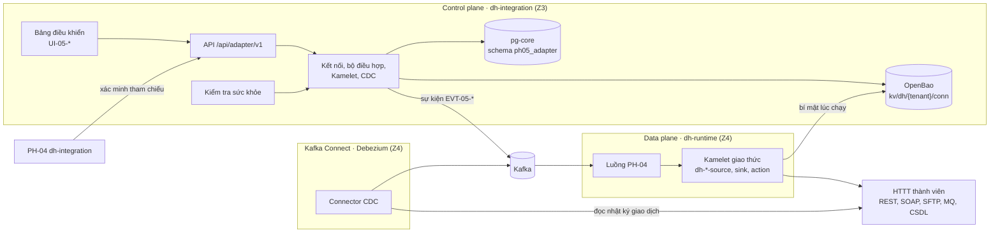
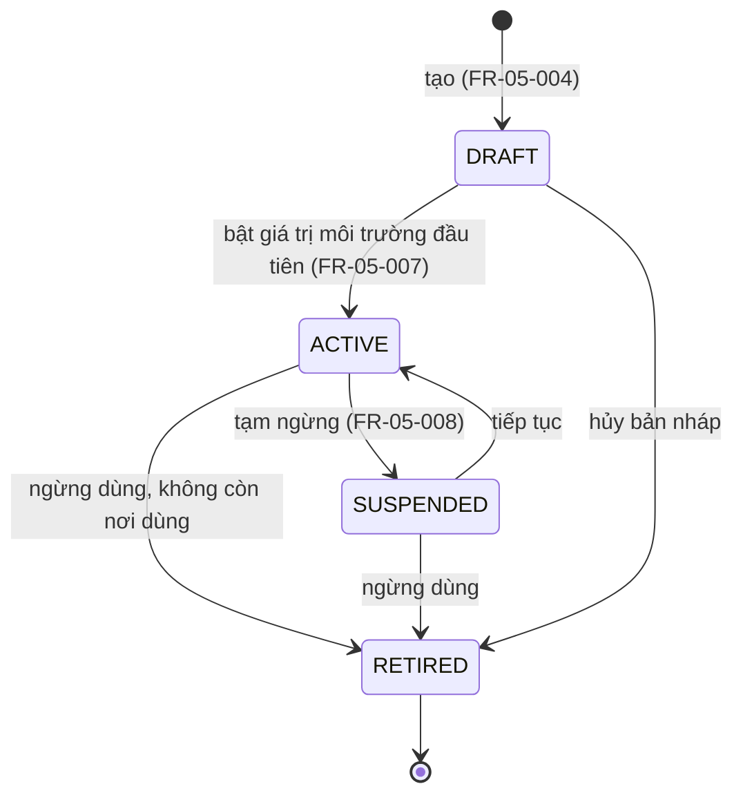
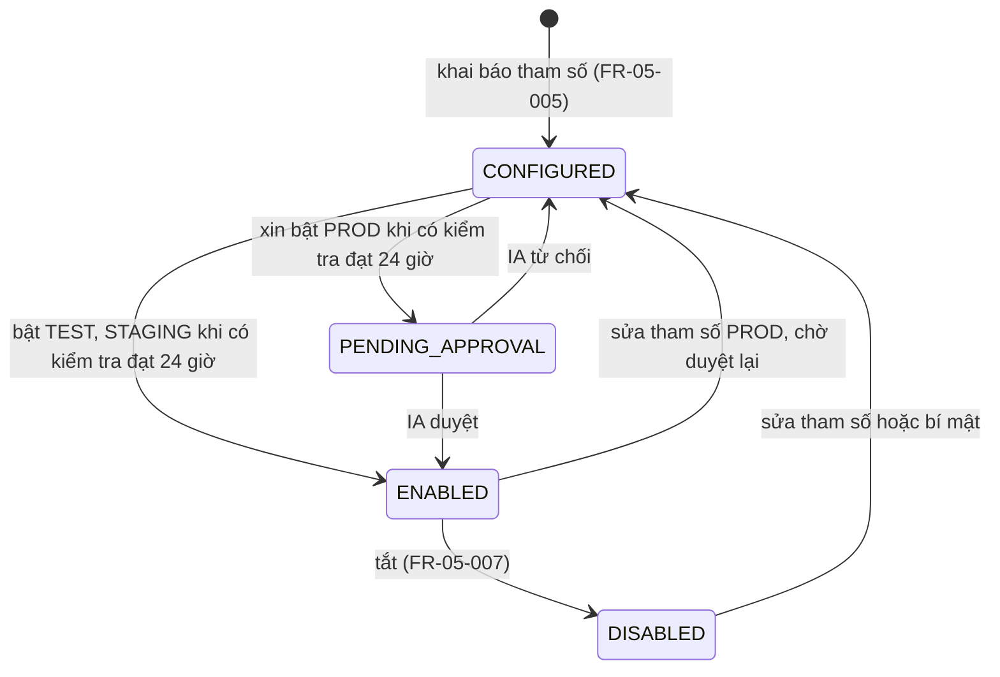
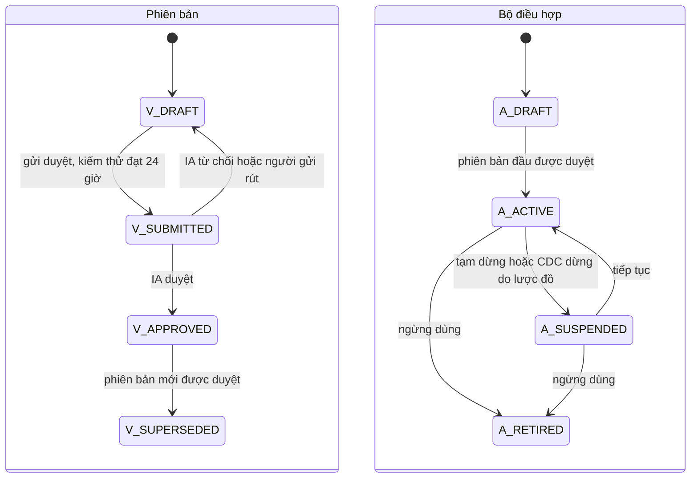
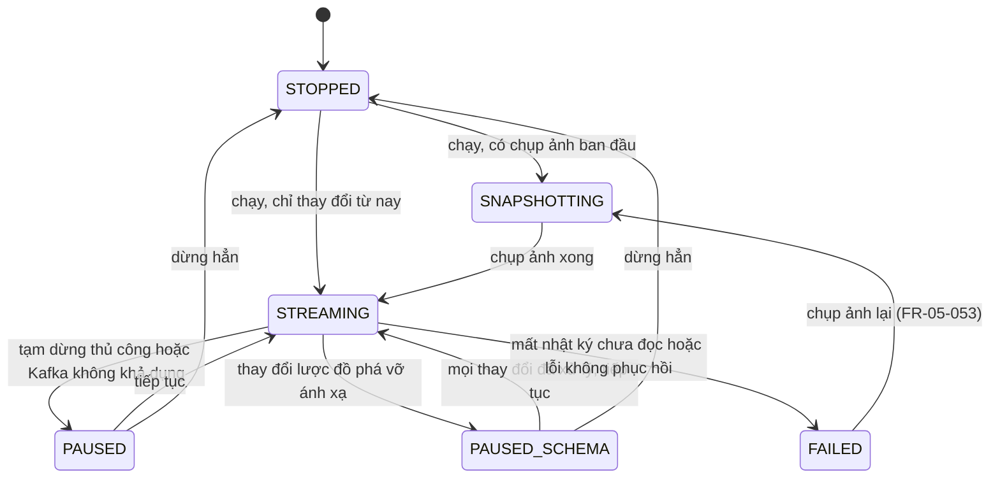
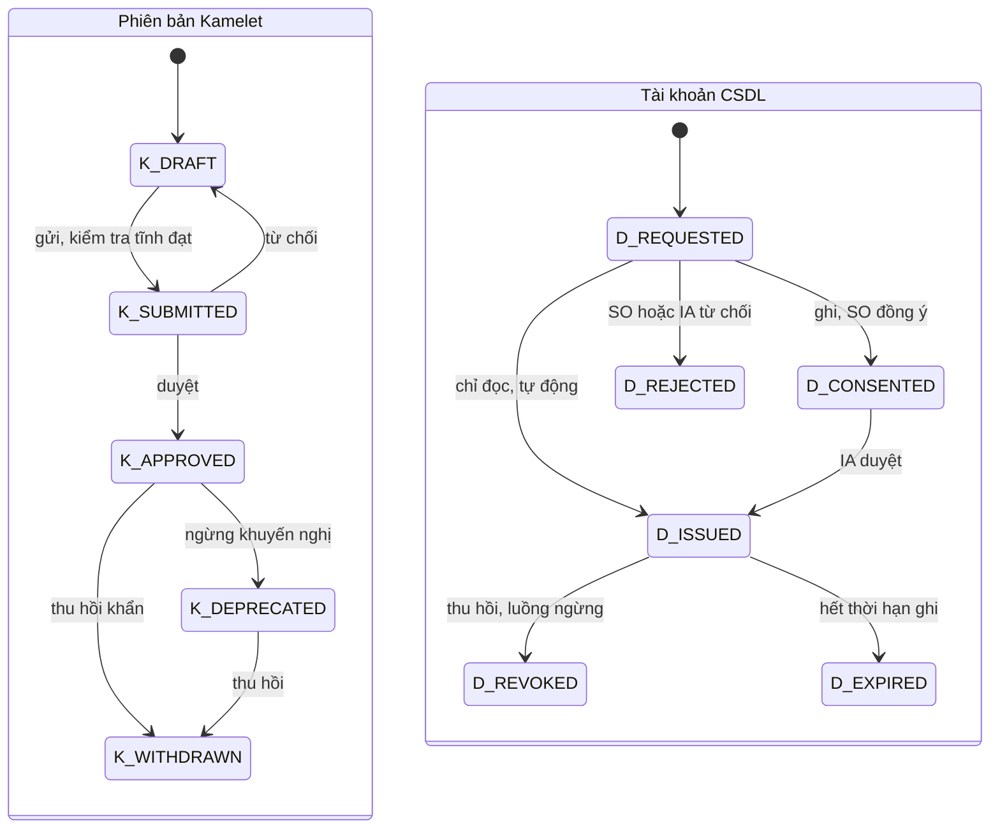

# D02-03-PH05 · Đặc tả yêu cầu chức năng Bộ điều hợp và kết nối

## Tóm tắt cho hội đồng thẩm định

**Mục tiêu.** PH-05 là lớp cách ly giữa lõi tích hợp (PH-04) và thực tế không đồng nhất của các hệ thống thông tin (HTTT) thành viên. Phân hệ quản lý ba thứ mà mọi luồng tích hợp cần nhưng không được tự giữ: **kết nối nguồn** (địa chỉ, tham số, bí mật theo từng môi trường), **bộ điều hợp** (cách nói chuyện với một HTTT cụ thể qua REST, SOAP, hàng đợi bản tin, tệp, CSDL, thư điện tử, CDC) và **danh mục Kamelet được duyệt** (khối kết nối dùng lại trong trình thiết kế luồng). Nhờ đó luồng PH-04 không chứa mật khẩu, không gọi thẳng giao thức thô và không phải sửa khi một HTTT đổi công nghệ.

**Phạm vi.** 62 yêu cầu chức năng chia tám nhóm: loại kết nối, kết nối nguồn và bí mật, sức khỏe kết nối, CSDL cho luồng theo quyết định Q359, bộ điều hợp theo giao thức, chuyển đổi định dạng và nhóm kết nối, bắt thay đổi dữ liệu (CDC) cho hệ di sản, danh mục Kamelet, quản trị. Phân hệ chạy trên hai DU: `dh-integration` (control plane, Spring Boot) và `dh-runtime` (data plane, Camel Quarkus 3.33.x).

**Căn cứ pháp lý.** CMP-LAW-09 (Công văn 631/THH-THHT: mọi yêu cầu ra vào đều qua bộ điều hợp, hỗ trợ HTTP, HTTPS, WebSocket, POP, IMAP, SMTP, JMS, AMQP, MQTT; JSON, XML, SOAP); CMP-LAW-03 (NĐ 278/2025 về kết nối, chia sẻ dữ liệu); CMP-LAW-06 và CMP-LAW-08 (NĐ 331/2026, TCVN 14423:2026 cấp độ 3: quản lý bí mật, kiểm soát truy cập, nhật ký); CMP-LAW-05 (Luật BVDLCN 91/2025: tối thiểu hóa truy cập dữ liệu cá nhân khi đọc CSDL nguồn).

**Con số chính.**

| Chỉ số | Giá trị |
|---|---|
| Yêu cầu chức năng | 62 (M: 51, S: 10, C: 1) |
| Quy tắc nghiệp vụ | 30 (BR-05-001…030) |
| Yêu cầu phi chức năng | 16 (NFR-05-001…016) |
| Màn hình | 17 (UI-05-01…17) |
| API | 92 operation (API-05-001…093, 042 để trống), 15 sự kiện (EVT-05-01…15) |
| Chức năng hệ cũ được phủ | 9 mục `LGC` (Bus connector, Tooling nhóm kết nối, bảo mật endpoint, sửa kết nối) và 1 mục loại bỏ có thay thế (LGC-TOOL-027) |
| Mức đợt | MVP; năm FR mức S và một FR mức C sang Đợt 3 |

## 1. Mục đích, phạm vi và người đọc

### 1.1. Mục đích

Tài liệu đặc tả đầy đủ hành vi của PH-05 để kỹ sư hiện thực và kiểm thử viên viết ca kiểm thử mà không phải hỏi lại. Mỗi FR có tiền điều kiện, đầu vào, các bước xử lý kiểm chứng được, ngoại lệ có mã lỗi và hậu điều kiện.

### 1.2. Phạm vi làm

| # | Trách nhiệm | Nhóm FR |
|---|---|---|
| 1 | Duy trì danh mục **loại kết nối** (HTTP, OAuth2, SOAP, JDBC, SFTP, JMS, AMQP, MQTT, SMTP, IMAP, LDAP, Kafka ngoài…) với lược đồ tham số và khóa bí mật | A |
| 2 | Khai báo **kết nối nguồn** theo HTTT, giá trị riêng cho TEST, STAGING, PROD; bí mật ghi một chiều vào OpenBao; cấp kết nối cho không gian làm việc hoặc luồng của PH-04 | B |
| 3 | Kiểm tra kết nối không tác dụng phụ, có hướng dẫn khắc phục; theo dõi sức khỏe chủ động và thụ động; báo PH-04 để điều chỉnh ngắt mạch | B, C |
| 4 | Hiện thực quyết định Q359 (ADR-067): kết nối "CSDL cho luồng", tài khoản chỉ đọc theo luồng cấp động, kiểm tra quyền thực tế, quy trình xin ghi có Cán bộ ATTT đồng ý | D |
| 5 | Đóng gói cách giao tiếp với từng HTTT thành **bộ điều hợp** có phiên bản: thao tác, phân trang, hạn mức phía đối tác, WSDL, khóa tệp, giới hạn đồng thời, chuyển đổi định dạng về JSON chuẩn | E |
| 6 | CDC bằng Debezium cho HTTT nhóm 3 (không API): cấu hình, kiểm tra điều kiện, chạy, giám sát lược đồ, dừng an toàn khi lược đồ đổi | F |
| 7 | Danh mục **Kamelet được duyệt**: Kamelet nền giao thức, Kamelet của tỉnh, Kamelet dùng chung toàn quốc; quy trình đăng ký, kiểm tra tĩnh, duyệt, ngừng dùng; đồng bộ với catalog của trình thiết kế (ADR-061) | G |
| 8 | Tham số theo tenant, báo cáo sử dụng | H |

### 1.3. Phạm vi không làm

| Không làm | Thuộc |
|---|---|
| Logic nghiệp vụ, định tuyến, ánh xạ ngữ nghĩa giữa lược đồ (DataMapper sinh JQ) | PH-04 (ADR-066) |
| Ủy quyền theo mục đích, nghĩa vụ che dữ liệu | PH-12, PH-09 qua PH-04 |
| Kết nối tới Nền tảng chia sẻ, điều phối dữ liệu quốc gia và dịch vụ NGSP | PH-14 (dùng lại loại kết nối và Kamelet của PH-05) |
| Đăng ký topic Kafka nội bộ, lược đồ sự kiện | PH-10 (PH-05 chỉ xin topic cho CDC) |
| Kết nạp HTTT | PH-01 (PH-05 đọc danh sách HTTT đã kết nạp) |
| Bảng điều khiển số liệu chi tiết theo luồng | PH-13 (PH-05 phát chỉ số) |
| Quản lý kho bí mật, chính sách OpenBao | Nền tảng (ADR-012); PH-05 chỉ ghi và đọc trong đường dẫn của mình |

### 1.4. Chức năng hệ cũ được phủ

| Mã | Chức năng hệ cũ | Vai trò của PH-05 |
|---|---|---|
| LGC-BUS-040 | Connector: CSDL, NoSQL, LDAP, Hadoop, message broker, HTTP, SOAP, FTP, File, cloud, SMPP, lập lịch | Chính |
| LGC-BUS-011 | Sửa thông tin kết nối của chương trình (host, port, method) | Chính (kết nối), cùng PH-04 |
| LGC-BUS-013 | Thêm chương trình tích hợp có kiểm tra kết nối | Phần kiểm tra kết nối |
| LGC-BUS-041 | Bảo mật endpoint (Basic, SSL, WS-Security) | Phần xác thực ra ngoài, cùng PH-03, PH-04, PH-12 |
| LGC-TOOL-008 | Nhóm Database Connection | Chính (kết nối CSDL), cùng PH-04 |
| LGC-TOOL-009 | Nhóm Network (HTTP, File, FTP, REST) | Kamelet giao thức |
| LGC-TOOL-010 | Nhóm Message Broker | Kamelet hàng đợi bản tin, cùng PH-10 |
| LGC-TOOL-011 | Nhóm Scheduling | Lịch quét tệp, hộp thư, kiểm tra sức khỏe |
| LGC-TOOL-012 | Nhóm bảo mật (mã hóa gói tin, điểm cuối) | Phần TLS, mTLS, WS-Security của bộ điều hợp |
| LGC-TOOL-027 | Nhập component từ file JAR (đã loại bỏ) | Thay bằng quy trình đăng ký Kamelet (FR-05-056…058) |

### 1.5. Người đọc và cách đọc

Hội đồng thẩm định đọc phần tóm tắt, §2, §9 và §13. Kỹ sư đọc §4, §5, §6, §8. Kiểm thử viên đọc §5, §6, §13. Mã định danh theo D00-01 §3; số kế tiếp theo D00-04 §3.2.

## 2. Bối cảnh nghiệp vụ

### 2.1. Vị trí trong kiến trúc

Sơ đồ cho thấy PH-05 có mặt ở cả hai mặt phẳng. Ở control plane, `dh-integration` giữ danh mục và trạng thái trong schema `ph05_adapter` của cụm `pg-core`, còn bí mật chỉ nằm trong OpenBao. Ở data plane, luồng PH-04 không gọi giao thức thô mà gọi Kamelet giao thức của PH-05; Kamelet đọc bí mật trực tiếp từ OpenBao lúc chạy qua xác thực Kubernetes của pod, nên bí mật không đi qua `dh-integration` khi chạy. CDC chạy trên Kafka Connect với connector Debezium (ADR-059), đọc nhật ký giao dịch của CSDL nguồn và đẩy thay đổi vào topic đã đăng ký ở PH-10. Vùng mạng theo D03-07: control plane ở Z3, data plane ở Z4, lưu lượng ra HTTT qua egress gateway (SEC-16).

### 2.2. Phân loại HTTT và chiến lược kết nối

Cách xây bộ điều hợp phụ thuộc nhóm HTTT xác định khi khảo sát (kế hoạch triển khai bước 1). Trường `systemGroup` của bộ điều hợp nhận một trong bốn giá trị dưới đây.

| Nhóm | Đặc điểm | Cách kết nối | Chi phí | Rủi ro |
|---|---|---|---|---|
| 1. Hiện đại | REST, có OpenAPI, đang bảo trì | Sinh bộ điều hợp từ OpenAPI (FR-05-046), Kamelet `dh-http-sink` | Thấp | Thấp |
| 2. API hạn chế | SOAP hoặc REST cũ, tài liệu thiếu hoặc lệch | Bộ điều hợp SOAP với WSDL đệm, phát hiện lệch (FR-05-034) | Trung bình | Tài liệu sai lệch |
| 3. Di sản | Không API, không còn nhà thầu | CDC Debezium (FR-05-048…053) hoặc truy vấn khai báo chỉ đọc (FR-05-038) | Trung bình | Phụ thuộc cấu trúc bảng nội bộ |
| 4. Sắp thay thế | Có kế hoạch thay mới | Kết nối tối thiểu (tệp, truy vấn chỉ đọc), không đầu tư sâu | Rất thấp | Thấp |

Giả định GĐ-04 (tỉnh vừa, 200 HTTT, 80 HTTT kết nối năm đầu) được chia theo tỷ lệ giả định GĐ-05-01: 45% nhóm 1, 30% nhóm 2, 15% nhóm 3, 10% nhóm 4. Cơ sở: tỷ lệ thường gặp ở các tỉnh đã triển khai LGSP thế hệ đầu; số thật lấy khi khảo sát.

### 2.3. Quy trình nghiệp vụ liên quan

| Quy trình | Bước có PH-05 |
|---|---|
| Kết nạp HTTT (PH-01) → tích hợp | Sau khi HTTT `ACTIVE`, kỹ sư tích hợp tạo kết nối, kiểm tra, xin bật PROD, cấp cho không gian làm việc |
| Thiết kế, phát hành luồng (PH-04) | Trình thiết kế liệt kê kết nối được cấp (FR-04-016) và Kamelet được duyệt; PH-04 xác minh tham chiếu khi lưu, gửi duyệt, phát hành (FR-05-014) |
| Vận hành | Bảng sức khỏe, cảnh báo khi kết nối suy giảm; xoay vòng bí mật theo lịch |
| Di trú từ Bus cũ (strangler) | Gói Context XML của Bus được phân tích, kết nối cũ thành kết nối nháp không kèm mật khẩu; PH-04 dùng bảng ánh xạ `connectionMap` (FR-04-082) |
| Sự cố ATTT | Cán bộ ATTT tạm ngừng kết nối, thu hồi tài khoản CSDL, buộc xoay bí mật |

### 2.4. Hạn chế của hệ cũ cần khắc phục

| Hạn chế hệ cũ | Hệ quả | Cách PH-05 khắc phục |
|---|---|---|
| Mật khẩu CSDL, FTP, khóa API nằm trong XML Camel và bảng `Context_file` | Lộ bí mật qua mã nguồn, bản sao lưu | Bí mật ghi một chiều vào OpenBao, luồng chỉ giữ tham chiếu `{{conn:…}}` (BR-05-001) |
| Datasource dùng chung một tài khoản `lgsp` có quyền ghi | Một luồng lỗi có thể sửa dữ liệu của sở; không truy vết được luồng nào đọc gì | Tài khoản chỉ đọc theo luồng, cấp động TTL 1 giờ, pgaudit (FR-05-024, 027) |
| Sửa host, port trực tiếp trên runtime | Không có phiên bản, không duyệt, không biết luồng nào bị ảnh hưởng | Sửa qua API có kiểm toán, cảnh báo nơi dùng, bật PROD cần duyệt (FR-05-006, 007, 013) |
| Nhập component từ JAR | Nạp mã tùy ý vào runtime, vi phạm cấp độ 3 | Kamelet YAML qua kiểm tra tĩnh và duyệt (FR-05-056, 057) |
| Không kiểm tra sức khỏe kết nối | Phát hiện lỗi khi người dân đã bị ảnh hưởng | Kiểm tra chủ động 60 giây, đánh giá thụ động, cảnh báo (FR-05-019…021) |
| Không có kênh cho hệ không API | Nhập tay hoặc sửa mã hệ nguồn | CDC đọc nhật ký giao dịch, không sửa hệ nguồn (FR-05-048) |

## 3. Tác nhân, vai trò và quyền

### 3.1. Tác nhân

| Tác nhân | Loại | Tương tác chính |
|---|---|---|
| ROLE-INTEGRATION_ENGINEER (IE) | Người | Tạo kết nối, bộ điều hợp, Kamelet; kiểm tra; gửi duyệt |
| ROLE-INTEGRATION_APPROVER (IA) | Người | Duyệt bật giá trị PROD, phiên bản bộ điều hợp, Kamelet của tỉnh, tài khoản ghi CSDL |
| ROLE-TENANT_ADMIN (TA) | Người | Như IE, cộng tham số phân hệ, bật tắt loại kết nối |
| ROLE-TENANT_OPERATOR (TO) | Người | Theo dõi sức khỏe, tạm ngừng, tiếp tục, xoay bí mật, điều khiển CDC |
| ROLE-SECURITY_OFFICER (SO) | Người | Đồng ý mục đích ghi CSDL, xem nhật ký truy cập CSDL, tạm ngừng khi có sự cố |
| ROLE-PLATFORM_ADMIN (PA) | Người | Duyệt Kamelet dùng chung toàn quốc (`COMMON`), quản lý Kamelet nền |
| ROLE-AUDITOR (AU), ROLE-VIEWER (VW) | Người | Xem |
| PH-04 `dh-integration` | Hệ thống | Xác minh tham chiếu kết nối, đọc catalog Kamelet |
| `dh-runtime` | Hệ thống | Đọc cấu hình kết nối không bí mật, đọc bí mật từ OpenBao, phát chỉ số và nhật ký truy cập CSDL |
| PH-01, PH-10, PH-13, PH-18 | Hệ thống | HTTT đã kết nạp; topic CDC; giám sát và cảnh báo; tham số |
| OpenBao | Hệ thống | KV v2 cho bí mật kết nối; database secrets engine cho tài khoản động |
| Kafka Connect (Debezium) | Hệ thống | Chạy connector CDC |
| HTTT thành viên | Hệ thống | Đầu kia của kết nối |

### 3.2. Quyền

Ma trận dưới đây dùng ký hiệu của D02-08 §3. Quyền `PERM-05-read`, `PERM-05-connection`, `PERM-05-kamelet-approve` đã có ở D02-08; tám quyền còn lại được bổ sung vào D02-08 §3.1 trong cùng đợt này.

| Quyền | Ý nghĩa | PA | TA | TO | SO | IE | IA | VW | AU |
|---|---|---|---|---|---|---|---|---|---|
| PERM-05-read | Xem loại kết nối, kết nối (không xem bí mật), bộ điều hợp, Kamelet, sức khỏe, CDC | ● | ● | ● | ● | ● | ● | ● | ● |
| PERM-05-connection | Tạo, sửa kết nối; khai báo giá trị và bí mật TEST, STAGING, PROD; cấp kết nối; yêu cầu tài khoản CSDL | — | ● | — | — | ● | — | — | — |
| PERM-05-adapter | Tạo, sửa bộ điều hợp, thao tác, cấu hình CDC; gửi duyệt; xử lý thay đổi lược đồ | — | ● | — | — | ● | — | — | — |
| PERM-05-test | Chạy kiểm tra kết nối, kiểm thử bộ điều hợp, xem trước chuyển đổi, kiểm tra quyền CSDL, kiểm tra điều kiện CDC | — | ● | ● | — | ● | ● | — | — |
| PERM-05-operate | Tạm ngừng, tiếp tục, tắt giá trị môi trường, xoay bí mật, chạy, tạm dừng CDC, chạy so sánh phiên bản | — | ● | ● | ● | — | — | — | — |
| PERM-05-approve | Duyệt bật giá trị PROD, phiên bản bộ điều hợp, tài khoản ghi CSDL | — | — | — | — | — | ● | — | — |
| PERM-05-db-write-consent | Đồng ý mục đích ghi vào CSDL của HTTT | — | — | — | ● | — | — | — | — |
| PERM-05-kamelet-submit | Soạn, kiểm tra, gửi đăng ký Kamelet; đề xuất dùng chung | — | ● | — | — | ● | — | — | — |
| PERM-05-kamelet-approve | Duyệt, từ chối, ngừng khuyến nghị, thu hồi Kamelet (IA với Kamelet của tỉnh; PA với `COMMON` và Kamelet nền) | ● | — | — | — | — | ● | — | — |
| PERM-05-audit-read | Xem nhật ký truy cập CSDL của luồng, lịch sử xoay bí mật chi tiết | — | — | — | ● | — | — | — | ● |
| PERM-05-admin | Tham số phân hệ, bật tắt loại kết nối, trần tham số theo tenant | ● | ● | — | — | — | — | — | — |

Tách nhiệm vụ: IE và IA đã là cặp loại trừ ở D02-08 §4. Ngoài ra nguyên tắc bốn mắt (FR-00-071) áp dụng cho từng đối tượng: người khai báo bí mật PROD hoặc gửi duyệt không được tự duyệt (BR-05-009). `PERM-05-operate` của SO chỉ dùng cho tạm ngừng khi có sự cố (FR-05-008), không dùng cho xoay bí mật hay CDC.

**Máy gọi máy.** `dh-integration` của PH-04 gọi API nội bộ bằng token dịch vụ có scope `adapter:verify`; `dh-runtime` dùng scope `adapter:runtime-config`; PH-13 dùng `adapter:health-read`. Scope này cấp cho tài khoản dịch vụ khi triển khai, không cấp cho người.

## 4. Khái niệm và mô hình nghiệp vụ

### 4.1. Thuật ngữ

| Thuật ngữ | Định nghĩa |
|---|---|
| Loại kết nối | Khuôn mô tả một cách kết nối (ví dụ `oauth2-client`, `jdbc-postgresql`, `sftp`): tham số không bí mật, khóa bí mật, Kamelet giao thức dùng nó, bước kiểm tra không tác dụng phụ |
| Kết nối nguồn | Bản khai báo kết nối tới một HTTT cụ thể theo một loại kết nối, có mã duy nhất trong tenant (ví dụ `ndxp-ho-tich`, `qlvb-soap`, `dkkd-csdl`) |
| Giá trị môi trường | Tham số và bí mật của một kết nối ở một môi trường TEST, STAGING hoặc PROD |
| Cấp kết nối | Cho phép một không gian làm việc (hoặc một luồng, với CSDL cho luồng) của PH-04 dùng kết nối |
| CSDL cho luồng | Loại kết nối CSDL theo Q359: tài khoản riêng cho từng luồng, mặc định chỉ đọc, cấp động |
| Bộ điều hợp | Gói cấu hình có phiên bản mô tả cách giao tiếp với một HTTT: kết nối dùng, các thao tác, định dạng, phân trang, giới hạn đồng thời. Khi được duyệt, mỗi thao tác xuất hiện trong bảng thành phần của trình thiết kế như một Kamelet sinh (FR-05-047) |
| Thao tác | Một lời gọi cụ thể của bộ điều hợp: `GET /ho-so/{ma}`, thao tác SOAP `SendDocument`, hàng đợi `QLVB.IN`, mẫu tệp `BC_*.csv`, truy vấn khai báo |
| Kamelet nền giao thức | Kamelet do nền tảng viết, ký cùng ảnh runtime (`dh-http-sink`, `dh-soap-sink`, `dh-sql-ro-source`…), hiện thực giao thức và đọc kết nối |
| Kamelet của tỉnh | Kamelet do tỉnh soạn, qua kiểm tra tĩnh và duyệt, chỉ dùng trong tenant đó |
| Kamelet dùng chung | Kamelet ở tenant `COMMON`, mọi tenant dùng được, do PA duyệt |
| JSON chuẩn | Biểu diễn JSON mà bộ điều hợp trả cho luồng sau khi chuyển định dạng (XML, SOAP, CSV, cố định độ rộng). Ánh xạ sang lược đồ dữ liệu dùng chung là việc của PH-04 |
| CDC | Bắt thay đổi dữ liệu từ nhật ký giao dịch của CSDL nguồn (WAL, binlog, redo log) |

### 4.2. Thực thể

| Mã | Thực thể | Thuộc tính chính | Ghi chú |
|---|---|---|---|
| EN-05-01 | Loại kết nối (`ConnectionType`) | `typeCode`, nhóm giao thức, lược đồ tham số (JSON Schema), danh sách khóa bí mật, Kamelet giao thức, bước kiểm tra, mức hỗ trợ | Do nền tảng định nghĩa; tenant chỉ bật tắt và đặt trần (FR-05-061) |
| EN-05-02 | Kết nối nguồn (`Connection`) | `connectionCode`, tên, `typeCode`, HTTT chủ quản (`systemCode` ở PH-01), mục đích (`READ`, `READ_WRITE`), trạng thái, chủ sở hữu, nhãn, phiên bản cấu hình | Mã bất biến |
| EN-05-03 | Giá trị môi trường (`ConnectionEnvironment`) | `env`, tham số không bí mật, đường dẫn bí mật, phiên bản bí mật, trạng thái, lần kiểm tra đạt gần nhất | Một kết nối có tối đa ba giá trị |
| EN-05-04 | Cấp kết nối (`ConnectionGrant`) | Kết nối, phạm vi (`WORKSPACE` hoặc `FLOW`), mã không gian hoặc mã luồng, môi trường được phép, thời hạn | |
| EN-05-05 | Lần kiểm tra kết nối (`ConnectionTest`) | Môi trường, kết quả từng bước, thời gian, người chạy, hướng dẫn khắc phục | Giữ 1 năm |
| EN-05-06 | Mẫu sức khỏe (`HealthSample`) và trạng thái sức khỏe (`HealthState`) | Mức `HEALTHY`, `DEGRADED`, `UNHEALTHY`, `UNKNOWN`, lý do, độ trễ, tỷ lệ lỗi | Mẫu giữ 90 ngày |
| EN-05-07 | Lần xoay bí mật (`SecretRotation`) | Môi trường, phiên bản cũ, mới, trạng thái, thời điểm kết thúc chuyển tiếp | |
| EN-05-08 | Tài khoản CSDL cho luồng (`FlowDbAccount`) | Kết nối, luồng, phạm vi schema, bảng, mục đích, cơ chế cấp (`DYNAMIC`, `STATIC`), trạng thái, người đồng ý, người duyệt, thời hạn | Q359 |
| EN-05-09 | Bản ghi truy cập CSDL (`DbAccessRecord`) | Luồng, phiên bản, tenant, băm câu lệnh, số dòng, thời lượng, `traceId` | Nhận từ runtime qua Kafka |
| EN-05-10 | Bộ điều hợp (`Adapter`) | `adapterCode`, HTTT, nhóm 1–4, giao thức, kết nối, trạng thái, phiên bản hiệu lực | |
| EN-05-11 | Phiên bản bộ điều hợp (`AdapterVersion`) | Số phiên bản, trạng thái, giới hạn đồng thời, định dạng, tệp đặc tả (OpenAPI, WSDL) đệm | Bất biến sau duyệt |
| EN-05-12 | Thao tác (`AdapterOperation`) | `operationCode`, chiều (`OUTBOUND`, `INBOUND`), tham số giao thức, định dạng vào ra, quy tắc chuẩn hóa, phân trang | |
| EN-05-13 | Lần kiểm thử bộ điều hợp (`AdapterTest`) và so sánh (`AdapterComparison`) | Kết quả theo thao tác; khác biệt giữa hai phiên bản | |
| EN-05-14 | Cấu hình CDC (`CdcConfig`) | Bộ điều hợp, loại CSDL, bảng theo dõi, chế độ chụp ảnh ban đầu, topic, trạng thái, vị trí đọc gần nhất | |
| EN-05-15 | Thay đổi lược đồ CDC (`CdcSchemaChange`) | Bảng, loại thay đổi, mức phá vỡ, trạng thái xử lý, người xử lý | Giữ vĩnh viễn |
| EN-05-16 | Kamelet (`Kamelet`) | `kameletName`, phạm vi (`BASE`, `COMMON`, `TENANT`), loại (`source`, `sink`, `action`), nhóm, chủ sở hữu | |
| EN-05-17 | Phiên bản Kamelet (`KameletVersion`) | Số phiên bản theo SemVer, YAML, tham số, kết quả kiểm tra tĩnh, trạng thái, người duyệt | |
| EN-05-18 | Tác vụ nhập kết nối hệ cũ (`LegacyImportJob`) | Tệp, danh sách kết nối phát hiện, đề xuất loại, trạng thái | |

### 4.3. Máy trạng thái kết nối nguồn

Kết nối ở `DRAFT` khi mới tạo và chưa có môi trường nào được bật; luồng chưa thể dùng nó ngoài trình thiết kế. Bật giá trị môi trường đầu tiên chuyển kết nối sang `ACTIVE`. `SUSPENDED` chặn mọi lượt dùng mới ở mọi môi trường: runtime nhận EVT-05-04 và từ chối lượt gọi bằng ERR-05-118, kiểm tra sức khỏe dừng. `RETIRED` là trạng thái cuối: mã không dùng lại được (BR-05-004), bí mật bị hủy sau 30 ngày (BR-05-012). Máy chủ kiểm tra mọi chuyển trạng thái; chuyển không hợp lệ trả ERR-05-008.

### 4.4. Máy trạng thái giá trị môi trường

Giá trị môi trường chỉ dùng được ở runtime khi `ENABLED`. Điều kiện chung để bật là có lần kiểm tra đạt trong 24 giờ trên đúng giá trị đó (BR-05-006). Ở PROD, bật cần IA duyệt theo bốn mắt (BR-05-009). Sửa tham số hay bí mật của giá trị PROD đang `ENABLED` không làm gián đoạn: giá trị cũ vẫn phục vụ cho tới khi giá trị mới được duyệt (BR-05-010); với TEST, STAGING, sửa có hiệu lực ngay sau kiểm tra đạt.

### 4.5. Máy trạng thái bộ điều hợp và phiên bản

Bộ điều hợp có hai trục trạng thái. Trục phiên bản quản lý nội dung: bản nháp sửa được, phiên bản được duyệt thì bất biến và chỉ có một phiên bản hiệu lực ở một thời điểm (BR-05-016). Trục bộ điều hợp quản lý vận hành: `SUSPENDED` chặn lượt gọi mới qua mọi thao tác. Trong hiển thị, tiền tố `V_` và `A_` được bỏ; API dùng tên không tiền tố trong hai trường khác nhau (`versionStatus`, `status`).

### 4.6. Máy trạng thái CDC

`PAUSED_SCHEMA` là điểm thiết kế quan trọng: khi cấu trúc bảng nguồn đổi theo cách phá vỡ ánh xạ, CDC dừng thay vì tiếp tục phát dữ liệu có thể sai (BR-05-022), vì dữ liệu sai lan vào trục khó sửa hơn nhiều so với một gián đoạn có kiểm soát. Vị trí đọc được giữ để tiếp tục đúng chỗ. `FAILED` xảy ra khi nhật ký giao dịch đã xoay vòng mất phần chưa đọc; chỉ chụp ảnh lại mới đưa dữ liệu về đúng.

### 4.7. Máy trạng thái Kamelet và tài khoản CSDL cho luồng

Kamelet `APPROVED` xuất hiện trong catalog của trình thiết kế; `DEPRECATED` vẫn chạy và vẫn hiện trong luồng cũ nhưng bị ẩn khỏi bảng thành phần và có cảnh báo; `WITHDRAWN` bị chặn ở lần phát hành luồng kế tiếp và gây cảnh báo mức cao cho mọi luồng đang dùng (BR-05-027). Tài khoản CSDL chỉ đọc được cấp ngay khi yêu cầu hợp lệ; tài khoản có quyền ghi cần SO đồng ý rồi IA duyệt, có thời hạn tối đa 90 ngày (BR-05-020).
