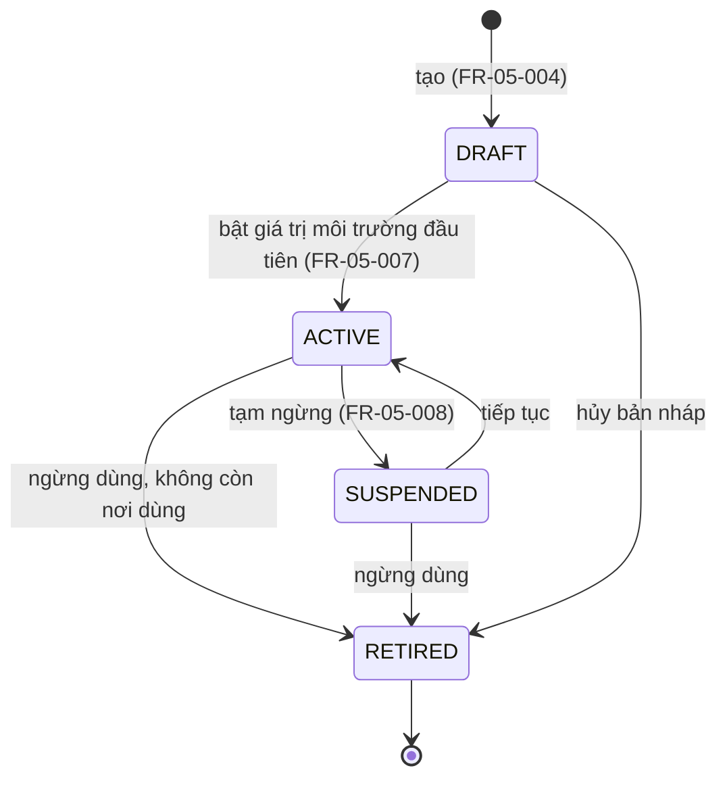
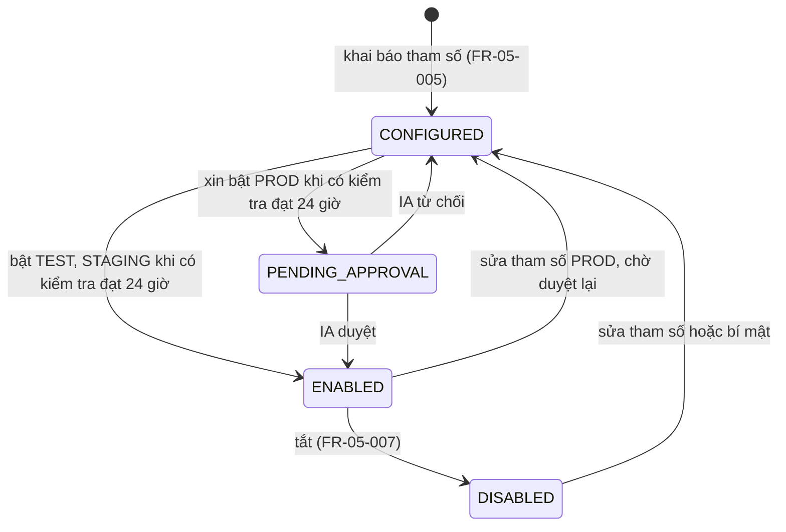
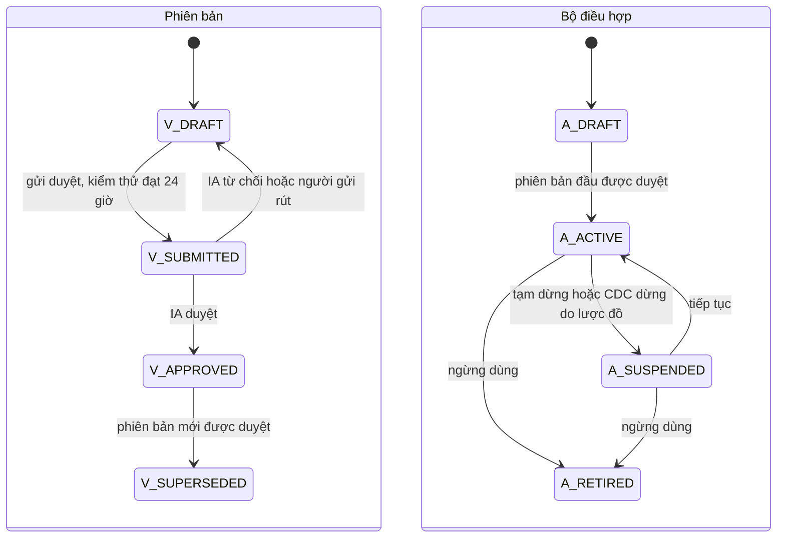
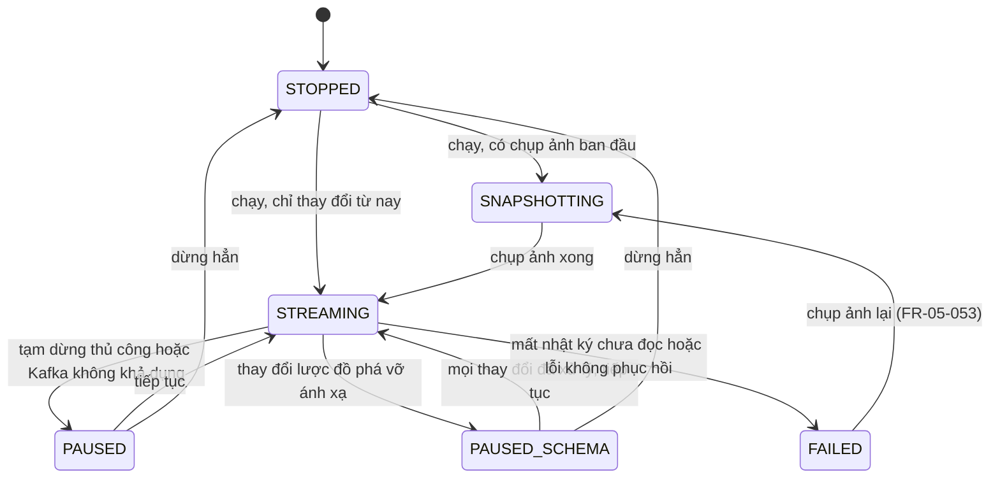
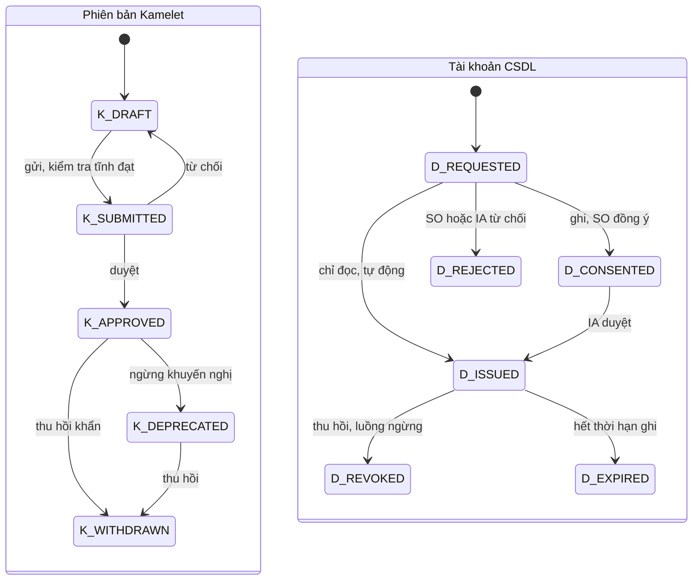
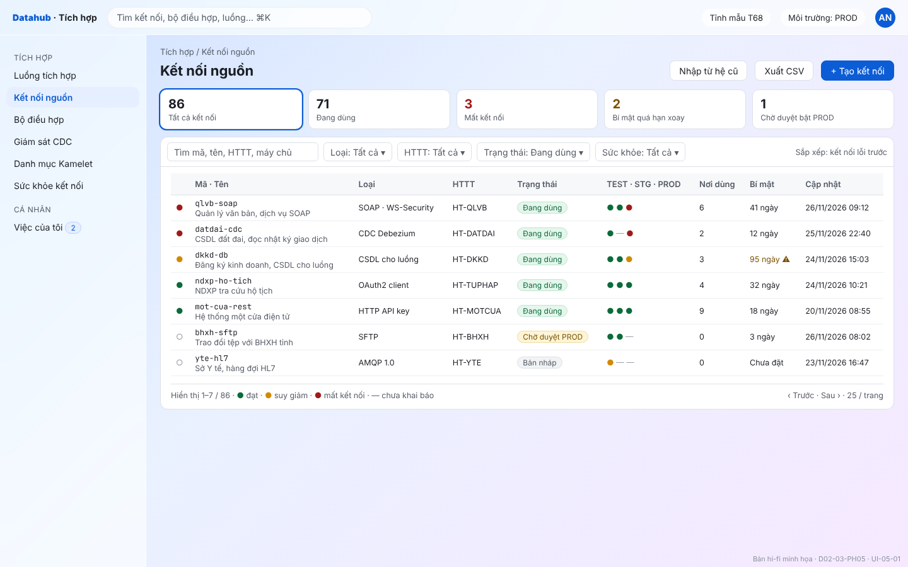
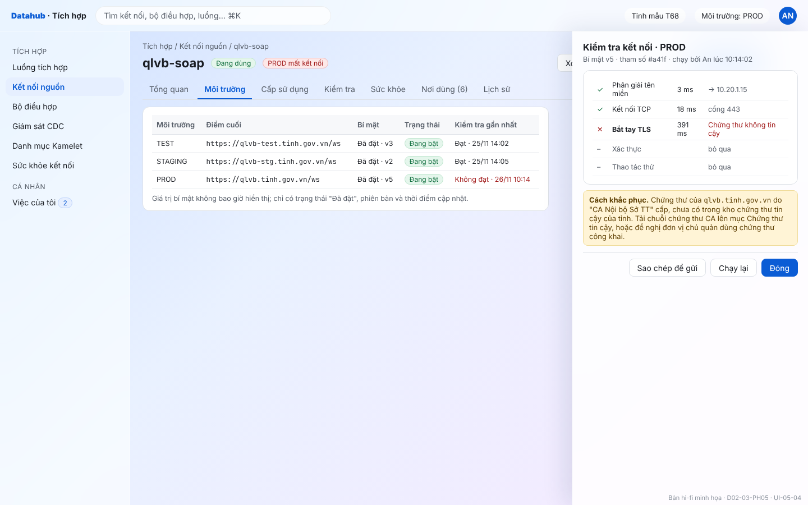

# D02-03-PH05 · Đặc tả yêu cầu chức năng Bộ điều hợp và kết nối

## Tóm tắt cho hội đồng thẩm định

**Mục tiêu.** PH-05 là lớp cách ly giữa lõi tích hợp (PH-04) và thực tế không đồng nhất của các hệ thống thông tin (HTTT) thành viên. Phân hệ quản lý ba thứ mà mọi luồng tích hợp cần nhưng không được tự giữ: **kết nối nguồn** (địa chỉ, tham số, bí mật theo từng môi trường), **bộ điều hợp** (cách nói chuyện với một HTTT cụ thể qua REST, SOAP, hàng đợi bản tin, tệp, CSDL, thư điện tử, CDC) và **danh mục Kamelet được duyệt** (khối kết nối dùng lại trong trình thiết kế luồng). Nhờ đó luồng PH-04 không chứa mật khẩu, không gọi thẳng giao thức thô và không phải sửa khi một HTTT đổi công nghệ.

**Phạm vi.** 62 yêu cầu chức năng chia tám nhóm: loại kết nối, kết nối nguồn và bí mật, sức khỏe kết nối, CSDL cho luồng theo quyết định Q359, bộ điều hợp theo giao thức, bắt thay đổi dữ liệu (CDC) cho hệ di sản, danh mục Kamelet, quản trị. Phân hệ chạy trên hai đơn vị triển khai: `dh-integration` (mặt phẳng điều khiển, Spring Boot) và `dh-runtime` (mặt phẳng dữ liệu, Camel Quarkus 3.33.x).

**Căn cứ pháp lý.** CMP-LAW-09 (Công văn 631/THH-THHT: mọi yêu cầu ra vào đều qua bộ điều hợp, hỗ trợ HTTP, HTTPS, WebSocket, POP, IMAP, SMTP, JMS, AMQP, MQTT; JSON, XML, SOAP); CMP-LAW-03 (NĐ 278/2025 về kết nối, chia sẻ dữ liệu); CMP-LAW-06 và CMP-LAW-08 (NĐ 331/2026, TCVN 14423:2026 cấp độ 3: quản lý bí mật, kiểm soát truy cập, nhật ký); CMP-LAW-05 (Luật BVDLCN 91/2025: tối thiểu hóa truy cập dữ liệu cá nhân khi đọc CSDL nguồn).

**Những điểm hội đồng cần lưu ý.** (1) Mật khẩu, khóa của HTTT không còn nằm trong mã luồng như ở Bus cũ mà chỉ nằm trong kho bí mật, ghi một chiều, không ai xem lại được. (2) Mỗi kết nối có ba bộ giá trị cho ba môi trường; bật ở môi trường thật cần người thứ hai duyệt. (3) Đọc thẳng CSDL của HTTT chỉ được bằng tài khoản riêng của từng luồng, mặc định chỉ đọc, có kiểm toán từng câu lệnh; ghi vào CSDL cần Cán bộ ATTT đồng ý. (4) Hệ di sản không có API được kết nối bằng CDC, không phải sửa mã hệ nguồn.

**Con số chính.**

| Chỉ số | Giá trị |
|---|---|
| Yêu cầu chức năng | 62 (M: 54, S: 7, C: 1) |
| Quy tắc nghiệp vụ | 30 (BR-05-001…030) |
| Yêu cầu phi chức năng | 16 (NFR-05-001…016) |
| Màn hình | 17 (UI-05-01…17) |
| API | 92 operation (API-05-001…093, 042 để trống), 15 sự kiện (EVT-05-01…15) |
| Chức năng hệ cũ được phủ | 9 mục `LGC` (Bus connector, Tooling nhóm kết nối, bảo mật endpoint, sửa kết nối) và 1 mục loại bỏ có thay thế (LGC-TOOL-027) |
| Mức đợt | MVP; ba FR mức S (037, 045, 060) và FR mức C (039) sang Đợt 3 |

: Con số chính của PH-05

## 1. Giới thiệu

### 1.1. Mục đích của tài liệu

Tài liệu đặc tả đầy đủ hành vi của phân hệ PH-05 Bộ điều hợp và kết nối, ở mức mà ba nhóm người đọc dùng được ngay không cần hỏi lại. Hội đồng thẩm định dùng tài liệu để đánh giá phân hệ có đáp ứng yêu cầu kết nối của Công văn 631/THH-THHT và yêu cầu an toàn thông tin cấp độ 3 hay không. Kỹ sư dùng tài liệu làm đầu vào cho thiết kế chi tiết D03-02-PH05, thiết kế CSDL D03-03-PH05 và đặc tả API D03-04-PH05. Kiểm thử viên dùng các luồng xử lý, luồng ngoại lệ và quy tắc nghiệp vụ để viết ca kiểm thử ở D05-02-PH05.

Mỗi chức năng được đặc tả theo cùng một khung: mục đích, tác nhân, điều kiện trước, luồng xử lý chính theo từng bước, luồng thay thế, luồng ngoại lệ kèm thông báo người dùng nhìn thấy, quy tắc nghiệp vụ, kết quả, hậu điều kiện, sự kiện, kiểm toán và màn hình liên quan.

### 1.2. Phạm vi

PH-05 chịu trách nhiệm tám nhóm việc dưới đây.

| # | Trách nhiệm | Nhóm FR |
|---|---|---|
| 1 | Duy trì danh mục **loại kết nối** (HTTP, OAuth2, SOAP, JDBC, SFTP, JMS, AMQP, MQTT, SMTP, IMAP, LDAP, Kafka ngoài…) với lược đồ tham số và khóa bí mật | A |
| 2 | Khai báo **kết nối nguồn** theo HTTT, giá trị riêng cho TEST, STAGING, PROD; bí mật ghi một chiều vào OpenBao; cấp kết nối cho không gian làm việc hoặc luồng của PH-04 | B |
| 3 | Kiểm tra kết nối không tác dụng phụ, có hướng dẫn khắc phục; theo dõi sức khỏe chủ động và thụ động; báo PH-04 để điều chỉnh ngắt mạch | B, C |
| 4 | Hiện thực quyết định Q359 (ADR-067): kết nối "CSDL cho luồng", tài khoản chỉ đọc theo luồng cấp động, kiểm tra quyền thực tế, quy trình xin ghi có Cán bộ ATTT đồng ý | D |
| 5 | Đóng gói cách giao tiếp với từng HTTT thành **bộ điều hợp** có phiên bản: thao tác, phân trang, hạn mức phía đối tác, WSDL, khóa tệp, giới hạn đồng thời, chuyển đổi định dạng về JSON chuẩn | E |
| 6 | CDC bằng Debezium cho HTTT nhóm 3 (không API): cấu hình, kiểm tra điều kiện, chạy, giám sát lược đồ, dừng an toàn khi lược đồ đổi | F |
| 7 | Danh mục **Kamelet được duyệt**: Kamelet nền giao thức, Kamelet của tỉnh, Kamelet dùng chung toàn quốc; quy trình đăng ký, kiểm tra tĩnh, duyệt, ngừng dùng; đồng bộ với catalog của trình thiết kế (ADR-061) | G |
| 8 | Tham số theo tenant, báo cáo sử dụng | H |

: Trách nhiệm của PH-05

Những việc dưới đây liên quan nhưng không thuộc PH-05. Tài liệu chỉ mô tả điểm giao tiếp với các phân hệ đó.

| Không làm | Thuộc |
|---|---|
| Logic nghiệp vụ, định tuyến, ánh xạ ngữ nghĩa giữa lược đồ (DataMapper sinh JQ) | PH-04 (ADR-066) |
| Ủy quyền theo mục đích, nghĩa vụ che dữ liệu | PH-12, PH-09 qua PH-04 |
| Kết nối tới Nền tảng chia sẻ, điều phối dữ liệu quốc gia và dịch vụ NGSP | PH-14 (dùng lại loại kết nối và Kamelet của PH-05) |
| Đăng ký topic Kafka nội bộ, lược đồ sự kiện | PH-10 (PH-05 chỉ xin topic cho CDC) |
| Kết nạp HTTT | PH-01 (PH-05 đọc danh sách HTTT đã kết nạp) |
| Bảng điều khiển số liệu chi tiết theo luồng | PH-13 (PH-05 phát chỉ số) |
| Quản lý kho bí mật, chính sách OpenBao | Nền tảng (ADR-012); PH-05 chỉ ghi và đọc trong đường dẫn của mình |

: Việc ngoài phạm vi PH-05

### 1.3. Đối tượng sử dụng và cách đọc

| Người đọc | Đọc phần | Mục đích |
|---|---|---|
| Hội đồng thẩm định | Tóm tắt, chương 2, chương 5, chương 11, chương 14 | Đánh giá sự cần thiết, mức đáp ứng yêu cầu pháp lý, mức phủ nghiệp vụ hệ cũ |
| Chủ đầu tư, đơn vị chủ quản HTTT | Chương 2, chương 3, mục 6.3, chương 10 | Biết việc mình phải phối hợp: cấp tài khoản, mở cổng, xác nhận văn bản đồng ý ghi |
| Kỹ sư phát triển | Chương 4, chương 6, chương 7, chương 9 | Hiện thực API, xử lý, quy tắc, mã lỗi |
| Kiểm thử viên | Chương 6, chương 7, chương 8, chương 14 | Viết ca kiểm thử dương, âm, ca hiệu năng và ca rò rỉ bí mật |
| Vận hành | Mục 6.4, chương 8, chương 12 | Theo dõi sức khỏe, xoay bí mật, xử lý sự cố |

: Người đọc và phần cần đọc

Mã định danh (FR, BR, NFR, ERR, EVT, API, UI) theo quy ước ở D00-01 §3. Chức năng dùng chung của mọi phân hệ (đăng nhập, chọn tenant, phân trang, lọc chuẩn, kiểm toán chung, hộp "Việc của tôi", hiển thị lỗi chung) theo nhóm FR-00 của SRS và không lặp lại ở đây.

### 1.4. Thuật ngữ và chữ viết tắt

| Thuật ngữ, viết tắt | Giải thích |
|---|---|
| HTTT | Hệ thống thông tin của cơ quan, đơn vị kết nối vào Datahub |
| Tenant | Một tỉnh dùng Datahub; dữ liệu và cấu hình của tenant tách biệt hoàn toàn với tenant khác |
| Môi trường | Một trong ba môi trường chạy luồng: TEST (thử), STAGING (tiền vận hành), PROD (vận hành thật) |
| Bí mật | Mật khẩu, khóa API, khóa riêng, chứng thư khóa riêng dùng để xác thực với HTTT |
| OpenBao | Kho bí mật mã nguồn mở (nhánh cộng đồng của HashiCorp Vault) mà Datahub dùng để lưu bí mật và cấp tài khoản CSDL động |
| Kamelet | Khối kết nối dùng lại của Apache Camel, mô tả bằng YAML, xuất hiện như một ô kéo thả trong trình thiết kế luồng |
| Bộ điều hợp | Gói cấu hình có phiên bản mô tả cách giao tiếp với một HTTT cụ thể (định nghĩa đầy đủ ở mục 4.1) |
| CDC | Bắt thay đổi dữ liệu (Change Data Capture) từ nhật ký giao dịch của CSDL nguồn |
| Bốn mắt | Nguyên tắc một việc quan trọng cần hai người khác nhau: một người đề nghị, một người duyệt |
| Mặt phẳng điều khiển | Phần quản trị cấu hình (`dh-integration`), không xử lý dữ liệu nghiệp vụ |
| Mặt phẳng dữ liệu | Phần chạy luồng và xử lý dữ liệu thật (`dh-runtime`) |
| IE, IA, TA, TO, SO, PA, AU, VW | Vai trò: kỹ sư tích hợp, người duyệt tích hợp, quản trị tenant, vận hành tenant, Cán bộ ATTT, quản trị nền tảng, kiểm toán viên, người xem (mục 3.1) |
| Egress | Danh sách đích ra ngoài mà nền tảng cho phép đi tới (SEC-16) |
| p95 | Phân vị 95: 95% số lượt đo có giá trị không vượt ngưỡng nêu |

: Thuật ngữ và chữ viết tắt

### 1.5. Tài liệu tham chiếu

| Mã | Tài liệu | Dùng cho |
|---|---|---|
| CMP-LAW-09 | Công văn 631/THH-THHT về yêu cầu kỹ thuật nền tảng tích hợp, chia sẻ dữ liệu cấp tỉnh | Giao thức, định dạng bắt buộc của bộ điều hợp |
| CMP-LAW-03 | Nghị định 278/2025/NĐ-CP về kết nối, chia sẻ dữ liệu | Kết nối với HTTT, Nền tảng chia sẻ quốc gia |
| CMP-LAW-06 | Nghị định 331/2026/NĐ-CP về bảo đảm an toàn hệ thống thông tin theo cấp độ | Yêu cầu cấp độ 3 |
| CMP-LAW-08 | TCVN 14423:2026 Yêu cầu cơ bản về an toàn hệ thống thông tin theo cấp độ | Quản lý bí mật, xoay khóa 90 ngày, TLS, nhật ký |
| CMP-LAW-05 | Luật Bảo vệ dữ liệu cá nhân 91/2025/QH15 | Tối thiểu hóa truy cập dữ liệu cá nhân |
| D02-02 | Đặc tả yêu cầu phần mềm (SRS) | Nhóm FR-00 dùng chung, REQ-05 |
| D03-01 | Kiến trúc tổng thể (SAD) | Đơn vị triển khai, vùng mạng |
| D03-07 | Thiết kế an toàn thông tin | SEC-16, SEC-24, SEC-32, SEC-61 |
| ADR-012, ADR-059, ADR-061, ADR-063, ADR-066, ADR-067 | Quyết định kiến trúc về kho bí mật, CDC, catalog trình thiết kế, cấu hình runtime, ánh xạ, CSDL cho luồng | Lý do của các lựa chọn trong tài liệu |
| D02-03-PH04 | Đặc tả yêu cầu chức năng PH-04 Tích hợp | Điểm giao tiếp với trình thiết kế và runtime |
| D03-06-PH05 | Thiết kế giao diện màn hình PH-05 | Bố cục chi tiết của 17 màn hình, câu thông báo |

: Tài liệu tham chiếu

### 1.6. Cấu trúc tài liệu

Chương 2 trình bày bối cảnh, mục tiêu và kiến trúc của phân hệ. Chương 3 nêu tác nhân và quyền. Chương 4 định nghĩa khái niệm, thực thể và vòng đời của các đối tượng chính. Chương 5 liệt kê toàn bộ 62 chức năng. Chương 6 đặc tả chi tiết từng chức năng theo khung thống nhất. Chương 7 đến chương 9 gom quy tắc nghiệp vụ, yêu cầu phi chức năng, tham số, mã lỗi, thông báo, sự kiện và API. Chương 10 giới thiệu giao diện tiêu biểu. Chương 11 đến chương 14 là truy vết, phụ thuộc, câu hỏi mở và tiêu chí chấp nhận.

## 2. Tổng quan phân hệ

### 2.1. Bối cảnh và vấn đề cần giải quyết

Ở hệ LGSP cũ, mỗi chương trình tích hợp trên Bus tự mang thông tin kết nối của nó: chuỗi kết nối CSDL, địa chỉ dịch vụ SOAP, tài khoản FTP, khóa API được viết thẳng vào tệp XML Camel và bảng `Context_file`. Cách làm này gây ra sáu vấn đề mà PH-05 phải khắc phục. Bảng dưới nêu từng vấn đề, hệ quả thực tế và cách PH-05 giải quyết.

| Hạn chế hệ cũ | Hệ quả | Cách PH-05 khắc phục |
|---|---|---|
| Mật khẩu CSDL, FTP, khóa API nằm trong XML Camel và bảng `Context_file` | Lộ bí mật qua mã nguồn, bản sao lưu | Bí mật ghi một chiều vào OpenBao, luồng chỉ giữ tham chiếu `{{conn:…}}` (BR-05-001) |
| Datasource dùng chung một tài khoản `lgsp` có quyền ghi | Một luồng lỗi có thể sửa dữ liệu của sở; không truy vết được luồng nào đọc gì | Tài khoản chỉ đọc theo luồng, cấp động sống 1 giờ, kiểm toán từng câu lệnh (FR-05-024, 027) |
| Sửa host, port trực tiếp trên runtime | Không có phiên bản, không duyệt, không biết luồng nào bị ảnh hưởng | Sửa qua API có kiểm toán, cảnh báo nơi dùng, bật PROD cần duyệt (FR-05-006, 007, 013) |
| Nhập component từ JAR | Nạp mã tùy ý vào runtime, vi phạm cấp độ 3 | Kamelet YAML qua kiểm tra tĩnh và duyệt (FR-05-056, 057) |
| Không kiểm tra sức khỏe kết nối | Phát hiện lỗi khi người dân đã bị ảnh hưởng | Kiểm tra chủ động 60 giây, đánh giá thụ động, cảnh báo (FR-05-019…021) |
| Không có kênh cho hệ không API | Nhập tay hoặc sửa mã hệ nguồn | CDC đọc nhật ký giao dịch, không sửa hệ nguồn (FR-05-048) |

: Hạn chế của hệ cũ và cách khắc phục

### 2.2. Mục tiêu của phân hệ

PH-05 có năm mục tiêu đo được. Mục tiêu thứ nhất là **không lộ bí mật**: không một bí mật nào xuất hiện trong mã luồng, CSDL quản trị, nhật ký, vết, tệp xuất hay phản hồi API (NFR-05-011, đo bằng ca kiểm thử với giá trị đánh dấu). Mục tiêu thứ hai là **thay đổi kết nối an toàn**: đổi địa chỉ hay mật khẩu của một HTTT không làm gián đoạn luồng đang chạy, và mọi thay đổi ở môi trường thật đều có người thứ hai duyệt. Mục tiêu thứ ba là **phát hiện sớm sự cố**: một HTTT ngừng phản hồi được đánh dấu mất kết nối trong không quá 3 phút (NFR-05-005), trước khi người dân gặp lỗi. Mục tiêu thứ tư là **truy cập CSDL tối thiểu**: mỗi luồng đọc CSDL bằng tài khoản riêng chỉ đọc, đúng bảng được phép, có kiểm toán từng câu lệnh. Mục tiêu thứ năm là **kết nối được mọi nhóm HTTT**, kể cả hệ di sản không còn nhà thầu, mà không phải sửa mã hệ nguồn.

### 2.3. Vị trí trong kiến trúc

```{.mermaid caption="Vị trí của PH-05 trong kiến trúc Datahub"}
flowchart TB
  subgraph CP["Mặt phẳng điều khiển · dh-integration (vùng Z3)"]
    UI["Màn hình UI-05-*"] --> API["API /api/adapter/v1"]
    API --> REG["Kết nối, bộ điều hợp,<br/>Kamelet, CDC"]
    REG --> DB[("pg-core<br/>schema ph05_adapter")]
    REG --> OB[("OpenBao<br/>kv/dh/{tenant}/conn")]
    HC["Kiểm tra sức khỏe"] --> REG
  end
  subgraph DP["Mặt phẳng dữ liệu · dh-runtime (vùng Z4)"]
    FL["Luồng PH-04"] --> KM["Kamelet giao thức<br/>dh-*-source, sink, action"]
    KM -->|"đọc bí mật lúc chạy"| OB
    DBZ["Kafka Connect · Debezium"]
  end
  PH04["PH-04 trình thiết kế"] -->|"xác minh tham chiếu"| API
  REG -->|"sự kiện EVT-05-*"| K[("Kafka")]
  K --> FL
  KM --> HT["HTTT thành viên<br/>REST, SOAP, SFTP, MQ, CSDL"]
  DBZ -->|"đọc nhật ký giao dịch"| HT
  DBZ --> K
```

PH-05 có mặt ở cả hai mặt phẳng. Ở mặt phẳng điều khiển, `dh-integration` giữ danh mục và trạng thái trong schema `ph05_adapter` của cụm `pg-core`, còn bí mật chỉ nằm trong OpenBao. Ở mặt phẳng dữ liệu, luồng PH-04 không gọi giao thức thô mà gọi Kamelet giao thức của PH-05; Kamelet đọc bí mật trực tiếp từ OpenBao lúc chạy bằng danh tính Kubernetes của pod, nên bí mật không đi qua `dh-integration` khi chạy. CDC chạy trên Kafka Connect với connector Debezium (ADR-059), đọc nhật ký giao dịch của CSDL nguồn và đẩy thay đổi vào topic đã đăng ký ở PH-10. Theo D03-07, mặt phẳng điều khiển ở vùng mạng Z3, mặt phẳng dữ liệu ở Z4, mọi lưu lượng ra HTTT đi qua cổng egress (SEC-16).

### 2.4. Kiến trúc thành phần và công nghệ

PH-05 gồm năm thành phần. **Dịch vụ quản trị kết nối** trong `dh-integration` (Java 21, Spring Boot) cung cấp API `/api/adapter/v1`, lưu loại kết nối, kết nối, giá trị môi trường, cấp sử dụng, bộ điều hợp, Kamelet và cấu hình CDC trong PostgreSQL với bảo mật mức dòng (RLS) theo tenant. **Bộ ghi bí mật** là một mô-đun của dịch vụ quản trị, chỉ có quyền ghi vào đường dẫn `kv/dh/{tenant}/conn/*` của OpenBao, không có quyền đọc lại. **Bộ chạy kiểm tra** (hồ sơ `probe` của `dh-runtime`) chạy các bước kiểm tra kết nối và kiểm tra sức khỏe định kỳ; nó tách khỏi bản sao xử lý lưu lượng nghiệp vụ để một lần kiểm tra chậm không ảnh hưởng luồng thật. **Kamelet giao thức** (`dh-http-sink`, `dh-soap-sink`, `dh-sql-ro-source`, `dh-sftp-source`…) do nền tảng viết, ký cùng ảnh runtime, đọc cấu hình kết nối từ tệp kê khai và bí mật từ OpenBao. **Connector CDC** chạy trên Kafka Connect (Strimzi) với Debezium cho PostgreSQL, MySQL, SQL Server, Oracle.

Hình dưới mô tả trình tự khi một luồng đang chạy gọi tới HTTT qua kết nối đã khai báo. Điểm quan trọng: bí mật đi thẳng từ OpenBao tới Kamelet trong bộ nhớ của pod runtime, có đệm 5 phút, và không bao giờ đi qua mặt phẳng điều khiển hay nằm trong nhật ký.

```{.mermaid caption="Trình tự một luồng gọi HTTT qua kết nối của PH-05"}
sequenceDiagram
  autonumber
  participant L as Luồng PH-04
  participant K as Kamelet giao thức
  participant C as Tệp kê khai kết nối
  participant B as OpenBao
  participant H as HTTT thành viên
  L->>K: Gọi thao tác với {{conn:qlvb-soap.endpointUrl}}
  K->>C: Đọc tham số không bí mật (đệm, làm mới khi có EVT-05-01…04)
  K->>B: Đọc bí mật môi trường PROD (đệm 5 phút)
  B-->>K: wssPassword phiên bản 5
  K->>H: Gửi yêu cầu qua egress, TLS ≥ 1.2
  H-->>K: Phản hồi
  K-->>L: JSON chuẩn, kèm chỉ số độ trễ, kết quả
  Note over K: Không ghi bí mật vào log, vết, thông báo lỗi
```

### 2.5. Phân loại HTTT và chiến lược kết nối

Cách xây bộ điều hợp phụ thuộc nhóm HTTT, xác định khi khảo sát ở bước 1 của kế hoạch triển khai. Trường `systemGroup` của bộ điều hợp nhận một trong bốn giá trị dưới đây.

| Nhóm | Đặc điểm | Cách kết nối | Chi phí | Rủi ro |
|---|---|---|---|---|
| 1. Hiện đại | REST, có OpenAPI, đang bảo trì | Sinh bộ điều hợp từ OpenAPI (FR-05-046), Kamelet `dh-http-sink` | Thấp | Thấp |
| 2. API hạn chế | SOAP hoặc REST cũ, tài liệu thiếu hoặc lệch | Bộ điều hợp SOAP với WSDL đệm, phát hiện lệch (FR-05-034) | Trung bình | Tài liệu sai lệch |
| 3. Di sản | Không API, không còn nhà thầu | CDC Debezium (FR-05-048…053) hoặc truy vấn khai báo chỉ đọc (FR-05-038) | Trung bình | Phụ thuộc cấu trúc bảng nội bộ |
| 4. Sắp thay thế | Có kế hoạch thay mới | Kết nối tối thiểu (tệp, truy vấn chỉ đọc), không đầu tư sâu | Rất thấp | Thấp |

: Phân loại HTTT và chiến lược kết nối

Giả định GĐ-04 (tỉnh vừa, 200 HTTT, 80 HTTT kết nối năm đầu) được chia theo tỷ lệ giả định GĐ-05-01: 45% nhóm 1, 30% nhóm 2, 15% nhóm 3, 10% nhóm 4. Cơ sở: tỷ lệ thường gặp ở các tỉnh đã triển khai LGSP thế hệ đầu; số thật lấy khi khảo sát.

### 2.6. Quy trình nghiệp vụ liên quan

| Quy trình | Bước có PH-05 |
|---|---|
| Kết nạp HTTT (PH-01) → tích hợp | Sau khi HTTT `ACTIVE`, kỹ sư tích hợp tạo kết nối, kiểm tra, xin bật PROD, cấp cho không gian làm việc |
| Thiết kế, phát hành luồng (PH-04) | Trình thiết kế liệt kê kết nối được cấp (FR-04-016) và Kamelet được duyệt; PH-04 xác minh tham chiếu khi lưu, gửi duyệt, phát hành (FR-05-014) |
| Vận hành | Bảng sức khỏe, cảnh báo khi kết nối suy giảm; xoay vòng bí mật theo lịch |
| Di trú từ Bus cũ (strangler) | Gói Context XML của Bus được phân tích, kết nối cũ thành kết nối nháp không kèm mật khẩu; PH-04 dùng bảng ánh xạ `connectionMap` (FR-04-082) |
| Sự cố ATTT | Cán bộ ATTT tạm ngừng kết nối, thu hồi tài khoản CSDL, buộc xoay bí mật |

: Quy trình nghiệp vụ có PH-05 tham gia

Hình dưới tóm tắt vòng đời điển hình của một kết nối từ lúc HTTT được kết nạp tới lúc kết nối phục vụ luồng ở môi trường thật.

```{.mermaid caption="Vòng đời điển hình của một kết nối nguồn"}
flowchart LR
  A["HTTT được kết nạp<br/>ở PH-01"] --> B["IE tạo kết nối<br/>FR-05-004"]
  B --> C["Khai báo tham số,<br/>bí mật theo môi trường<br/>FR-05-005"]
  C --> D["Kiểm tra kết nối<br/>FR-05-010"]
  D -->|"Không đạt"| C
  D -->|"Đạt"| E["Bật TEST, STAGING<br/>FR-05-007"]
  E --> F["Xin bật PROD"]
  F --> G["IA duyệt<br/>bốn mắt"]
  G --> H["Cấp cho không gian<br/>làm việc FR-05-009"]
  H --> I["Luồng PH-04 dùng<br/>kết nối"]
  I --> J["Theo dõi sức khỏe,<br/>xoay bí mật 90 ngày"]
```

### 2.7. Chức năng hệ cũ được phủ

| Mã | Chức năng hệ cũ | Vai trò của PH-05 |
|---|---|---|
| LGC-BUS-040 | Connector: CSDL, NoSQL, LDAP, Hadoop, message broker, HTTP, SOAP, FTP, File, cloud, SMPP, lập lịch | Chính |
| LGC-BUS-011 | Sửa thông tin kết nối của chương trình (host, port, method) | Chính (kết nối), cùng PH-04 |
| LGC-BUS-013 | Thêm chương trình tích hợp có kiểm tra kết nối | Phần kiểm tra kết nối |
| LGC-BUS-041 | Bảo mật endpoint (Basic, SSL, WS-Security) | Phần xác thực ra ngoài, cùng PH-03, PH-04, PH-12 |
| LGC-TOOL-008 | Nhóm Database Connection | Chính (kết nối CSDL), cùng PH-04 |
| LGC-TOOL-009 | Nhóm Network (HTTP, File, FTP, REST) | Kamelet giao thức |
| LGC-TOOL-010 | Nhóm Message Broker | Kamelet hàng đợi bản tin, cùng PH-10 |
| LGC-TOOL-011 | Nhóm Scheduling | Lịch quét tệp, hộp thư, kiểm tra sức khỏe |
| LGC-TOOL-012 | Nhóm bảo mật (mã hóa gói tin, điểm cuối) | Phần TLS, mTLS, WS-Security của bộ điều hợp |
| LGC-TOOL-027 | Nhập component từ file JAR (đã loại bỏ) | Thay bằng quy trình đăng ký Kamelet (FR-05-056…058) |

: Chức năng hệ cũ do PH-05 phủ

## 3. Tác nhân, vai trò và quyền

### 3.1. Tác nhân

| Tác nhân | Loại | Mô tả | Tương tác chính |
|---|---|---|---|
| Kỹ sư tích hợp (IE, ROLE-INTEGRATION_ENGINEER) | Người | Cán bộ kỹ thuật của đơn vị vận hành Datahub tỉnh hoặc nhà thầu tích hợp | Tạo kết nối, bộ điều hợp, Kamelet; kiểm tra; gửi duyệt |
| Người duyệt tích hợp (IA, ROLE-INTEGRATION_APPROVER) | Người | Trưởng nhóm tích hợp hoặc lãnh đạo trung tâm được giao | Duyệt bật giá trị PROD, phiên bản bộ điều hợp, Kamelet của tỉnh, tài khoản ghi CSDL |
| Quản trị tenant (TA, ROLE-TENANT_ADMIN) | Người | Quản trị Datahub của tỉnh | Như IE, cộng tham số phân hệ, bật tắt loại kết nối |
| Vận hành tenant (TO, ROLE-TENANT_OPERATOR) | Người | Cán bộ trực vận hành | Theo dõi sức khỏe, tạm ngừng, tiếp tục, xoay bí mật, điều khiển CDC |
| Cán bộ ATTT (SO, ROLE-SECURITY_OFFICER) | Người | Cán bộ chuyên trách an toàn thông tin của tỉnh | Đồng ý mục đích ghi CSDL, xem nhật ký truy cập CSDL, tạm ngừng khi có sự cố |
| Quản trị nền tảng (PA, ROLE-PLATFORM_ADMIN) | Người | Đơn vị vận hành nền tảng dùng chung | Duyệt Kamelet dùng chung toàn quốc (`COMMON`), quản lý Kamelet nền |
| Kiểm toán viên (AU), người xem (VW) | Người | Thanh tra, kiểm toán, lãnh đạo | Xem |
| PH-04 `dh-integration` | Hệ thống | Lõi tích hợp | Xác minh tham chiếu kết nối, đọc catalog Kamelet |
| `dh-runtime` | Hệ thống | Bộ chạy luồng | Đọc cấu hình kết nối không bí mật, đọc bí mật từ OpenBao, phát chỉ số và nhật ký truy cập CSDL |
| PH-01, PH-10, PH-13, PH-18 | Hệ thống | Phân hệ khác của Datahub | HTTT đã kết nạp; topic CDC; giám sát và cảnh báo; tham số |
| OpenBao | Hệ thống | Kho bí mật | KV v2 cho bí mật kết nối; database secrets engine cho tài khoản động |
| Kafka Connect (Debezium) | Hệ thống | Nền chạy CDC | Chạy connector CDC |
| HTTT thành viên | Hệ thống | Hệ của sở, ngành, huyện | Đầu kia của kết nối |

: Tác nhân của PH-05

### 3.2. Ma trận quyền

Ma trận dưới đây dùng ký hiệu của D02-08 §3 (● có quyền, — không có). Quyền `PERM-05-read`, `PERM-05-connection`, `PERM-05-kamelet-approve` đã có ở D02-08; tám quyền còn lại được bổ sung vào D02-08 §3.1 trong đợt đồng bộ.

| Quyền | Ý nghĩa | PA | TA | TO | SO | IE | IA | VW | AU |
|---|---|---|---|---|---|---|---|---|---|
| PERM-05-read | Xem loại kết nối, kết nối (không xem bí mật), bộ điều hợp, Kamelet, sức khỏe, CDC | ● | ● | ● | ● | ● | ● | ● | ● |
| PERM-05-connection | Tạo, sửa kết nối; khai báo giá trị và bí mật TEST, STAGING, PROD; cấp kết nối; yêu cầu tài khoản CSDL | — | ● | — | — | ● | — | — | — |
| PERM-05-adapter | Tạo, sửa bộ điều hợp, thao tác, cấu hình CDC; gửi duyệt; xử lý thay đổi lược đồ | — | ● | — | — | ● | — | — | — |
| PERM-05-test | Chạy kiểm tra kết nối, kiểm thử bộ điều hợp, xem trước chuyển đổi, kiểm tra quyền CSDL, kiểm tra điều kiện CDC | — | ● | ● | — | ● | ● | — | — |
| PERM-05-operate | Tạm ngừng, tiếp tục, tắt giá trị môi trường, xoay bí mật, chạy, tạm dừng CDC, chạy so sánh phiên bản | — | ● | ● | ● | — | — | — | — |
| PERM-05-approve | Duyệt bật giá trị PROD, phiên bản bộ điều hợp, tài khoản ghi CSDL | — | — | — | — | — | ● | — | — |
| PERM-05-db-write-consent | Đồng ý mục đích ghi vào CSDL của HTTT | — | — | — | ● | — | — | — | — |
| PERM-05-kamelet-submit | Soạn, kiểm tra, gửi đăng ký Kamelet; đề xuất dùng chung | — | ● | — | — | ● | — | — | — |
| PERM-05-kamelet-approve | Duyệt, từ chối, ngừng khuyến nghị, thu hồi Kamelet (IA với Kamelet của tỉnh; PA với `COMMON` và Kamelet nền) | ● | — | — | — | — | ● | — | — |
| PERM-05-audit-read | Xem nhật ký truy cập CSDL của luồng, lịch sử xoay bí mật chi tiết | — | — | — | ● | — | — | — | ● |
| PERM-05-admin | Tham số phân hệ, bật tắt loại kết nối, trần tham số theo tenant | ● | ● | — | — | — | — | — | — |

: Ma trận quyền của PH-05

### 3.3. Tách nhiệm vụ và tài khoản máy

IE và IA đã là cặp loại trừ ở D02-08 §4: một người không được giữ cả hai vai trò trong cùng tenant. Ngoài ra nguyên tắc bốn mắt (FR-00-071) áp dụng cho từng đối tượng: người khai báo bí mật PROD hoặc gửi duyệt không được tự duyệt (BR-05-009). `PERM-05-operate` của SO chỉ dùng khi có sự cố: tạm ngừng kết nối (FR-05-008), tắt giá trị môi trường (FR-05-007), tạm dừng bộ điều hợp (FR-05-044), thu hồi tài khoản CSDL (FR-05-028); không dùng cho xoay bí mật, CDC hay so sánh phiên bản.

Các phân hệ gọi nhau bằng token dịch vụ, không dùng tài khoản người. `dh-integration` của PH-04 gọi API nội bộ với scope `adapter:verify`; `dh-runtime` dùng scope `adapter:runtime-config`; PH-13 dùng `adapter:health-read`. Scope này cấp cho tài khoản dịch vụ khi triển khai, không cấp cho người.

## 4. Khái niệm và mô hình nghiệp vụ

### 4.1. Khái niệm nghiệp vụ

| Khái niệm | Định nghĩa |
|---|---|
| Loại kết nối | Khuôn mô tả một cách kết nối (ví dụ `oauth2-client`, `jdbc-postgresql`, `sftp`): tham số không bí mật, khóa bí mật, Kamelet giao thức dùng nó, bước kiểm tra không tác dụng phụ |
| Kết nối nguồn | Bản khai báo kết nối tới một HTTT cụ thể theo một loại kết nối, có mã duy nhất trong tenant (ví dụ `ndxp-ho-tich`, `qlvb-soap`, `dkkd-csdl`) |
| Giá trị môi trường | Tham số và bí mật của một kết nối ở một môi trường TEST, STAGING hoặc PROD |
| Cấp kết nối | Cho phép một không gian làm việc (hoặc một luồng, với CSDL cho luồng) của PH-04 dùng kết nối |
| CSDL cho luồng | Loại kết nối CSDL theo Q359: tài khoản riêng cho từng luồng, mặc định chỉ đọc, cấp động |
| Bộ điều hợp | Gói cấu hình có phiên bản mô tả cách giao tiếp với một HTTT: kết nối dùng, các thao tác, định dạng, phân trang, giới hạn đồng thời. Khi được duyệt, mỗi thao tác xuất hiện trong bảng thành phần của trình thiết kế như một Kamelet sinh (FR-05-047) |
| Thao tác | Một lời gọi cụ thể của bộ điều hợp: `GET /ho-so/{ma}`, thao tác SOAP `SendDocument`, hàng đợi `QLVB.IN`, mẫu tệp `BC_*.csv`, truy vấn khai báo |
| Kamelet nền giao thức | Kamelet do nền tảng viết, ký cùng ảnh runtime (`dh-http-sink`, `dh-soap-sink`, `dh-sql-ro-source`…), hiện thực giao thức và đọc kết nối |
| Kamelet của tỉnh | Kamelet do tỉnh soạn, qua kiểm tra tĩnh và duyệt, chỉ dùng trong tenant đó |
| Kamelet dùng chung | Kamelet ở tenant `COMMON`, mọi tenant dùng được, do PA duyệt |
| JSON chuẩn | Biểu diễn JSON mà bộ điều hợp trả cho luồng sau khi chuyển định dạng (XML, SOAP, CSV, cố định độ rộng). Ánh xạ sang lược đồ dữ liệu dùng chung là việc của PH-04 |

: Khái niệm nghiệp vụ của PH-05

### 4.2. Thực thể

| Mã | Thực thể | Thuộc tính chính | Ghi chú |
|---|---|---|---|
| EN-05-01 | Loại kết nối (`ConnectionType`) | `typeCode`, nhóm giao thức, lược đồ tham số (JSON Schema), danh sách khóa bí mật, Kamelet giao thức, bước kiểm tra, mức hỗ trợ | Do nền tảng định nghĩa; tenant chỉ bật tắt và đặt trần (FR-05-061) |
| EN-05-02 | Kết nối nguồn (`Connection`) | `connectionCode`, tên, `typeCode`, HTTT chủ quản (`systemCode` ở PH-01), mục đích (`READ`, `READ_WRITE`), trạng thái, chủ sở hữu, nhãn, phiên bản cấu hình | Mã bất biến |
| EN-05-03 | Giá trị môi trường (`ConnectionEnvironment`) | `env`, tham số không bí mật, đường dẫn bí mật, phiên bản bí mật, trạng thái, lần kiểm tra đạt gần nhất | Một kết nối có tối đa ba giá trị |
| EN-05-04 | Cấp kết nối (`ConnectionGrant`) | Kết nối, phạm vi (`WORKSPACE`, `FLOW` hoặc `API`), mã không gian, mã luồng hoặc mã API của PH-02, môi trường được phép, thời hạn | |
| EN-05-05 | Lần kiểm tra kết nối (`ConnectionTest`) | Môi trường, kết quả từng bước, thời gian, người chạy, hướng dẫn khắc phục | Giữ 1 năm |
| EN-05-06 | Mẫu sức khỏe (`HealthSample`) và trạng thái sức khỏe (`HealthState`) | Mức `HEALTHY`, `DEGRADED`, `UNHEALTHY`, `UNKNOWN`, lý do, độ trễ, tỷ lệ lỗi | Mẫu giữ 90 ngày |
| EN-05-07 | Lần xoay bí mật (`SecretRotation`) | Môi trường, phiên bản cũ, mới, trạng thái, thời điểm kết thúc chuyển tiếp | |
| EN-05-08 | Tài khoản CSDL cho luồng (`FlowDbAccount`) | Kết nối, luồng, phạm vi schema, bảng, mục đích, cơ chế cấp (`DYNAMIC`, `STATIC`), trạng thái, người đồng ý, người duyệt, thời hạn | Q359 |
| EN-05-09 | Bản ghi truy cập CSDL (`DbAccessRecord`) | Luồng, phiên bản, tenant, băm câu lệnh, số dòng, thời lượng, `traceId` | Nhận từ runtime qua Kafka |
| EN-05-10 | Bộ điều hợp (`Adapter`) | `adapterCode`, HTTT, nhóm 1–4, giao thức, kết nối, trạng thái, phiên bản hiệu lực | |
| EN-05-11 | Phiên bản bộ điều hợp (`AdapterVersion`) | Số phiên bản, trạng thái, giới hạn đồng thời, định dạng, tệp đặc tả (OpenAPI, WSDL) đệm | Bất biến sau duyệt |
| EN-05-12 | Thao tác (`AdapterOperation`) | `operationCode`, chiều (`OUTBOUND`, `INBOUND`), tham số giao thức, định dạng vào ra, quy tắc chuẩn hóa, phân trang | |
| EN-05-13 | Lần kiểm thử bộ điều hợp (`AdapterTest`) và so sánh (`AdapterComparison`) | Kết quả theo thao tác; khác biệt giữa hai phiên bản | |
| EN-05-14 | Cấu hình CDC (`CdcConfig`) | Bộ điều hợp, loại CSDL, bảng theo dõi, chế độ chụp ảnh ban đầu, topic, trạng thái, vị trí đọc gần nhất | |
| EN-05-15 | Thay đổi lược đồ CDC (`CdcSchemaChange`) | Bảng, loại thay đổi, mức phá vỡ, trạng thái xử lý, người xử lý | Giữ vĩnh viễn |
| EN-05-16 | Kamelet (`Kamelet`) | `kameletName`, phạm vi (`BASE`, `COMMON`, `TENANT`), loại (`source`, `sink`, `action`), nhóm, chủ sở hữu | |
| EN-05-17 | Phiên bản Kamelet (`KameletVersion`) | Số phiên bản theo SemVer, YAML, tham số, kết quả kiểm tra tĩnh, trạng thái, người duyệt | |
| EN-05-18 | Tác vụ nhập kết nối hệ cũ (`LegacyImportJob`) | Tệp, danh sách kết nối phát hiện, đề xuất loại, trạng thái | |

### 4.3. Máy trạng thái kết nối nguồn



Kết nối ở `DRAFT` khi mới tạo và chưa có môi trường nào được bật; luồng chưa thể dùng nó ngoài trình thiết kế. Bật giá trị môi trường đầu tiên chuyển kết nối sang `ACTIVE`. `SUSPENDED` chặn mọi lượt dùng mới ở mọi môi trường: runtime nhận EVT-05-04 và từ chối lượt gọi bằng ERR-05-118, kiểm tra sức khỏe dừng. `RETIRED` là trạng thái cuối: mã không dùng lại được (BR-05-004), bí mật bị hủy sau 30 ngày (BR-05-012). Máy chủ kiểm tra mọi chuyển trạng thái; chuyển không hợp lệ trả ERR-05-008.

### 4.4. Máy trạng thái giá trị môi trường



Giá trị môi trường chỉ dùng được ở runtime khi `ENABLED`. Điều kiện chung để bật là có lần kiểm tra đạt trong 24 giờ trên đúng giá trị đó (BR-05-006). Ở PROD, bật cần IA duyệt theo bốn mắt (BR-05-009). Sửa tham số hay bí mật của giá trị PROD đang `ENABLED` không làm gián đoạn: giá trị cũ vẫn phục vụ cho tới khi giá trị mới được duyệt (BR-05-010); với TEST, STAGING, sửa có hiệu lực ngay sau kiểm tra đạt.

### 4.5. Máy trạng thái bộ điều hợp và phiên bản



Bộ điều hợp có hai trục trạng thái. Trục phiên bản quản lý nội dung: bản nháp sửa được, phiên bản được duyệt thì bất biến và chỉ có một phiên bản hiệu lực ở một thời điểm (BR-05-016). Trục bộ điều hợp quản lý vận hành: `SUSPENDED` chặn lượt gọi mới qua mọi thao tác. Trong hiển thị, tiền tố `V_` và `A_` được bỏ; API dùng tên không tiền tố trong hai trường khác nhau (`versionStatus`, `status`).

### 4.6. Máy trạng thái CDC



`PAUSED_SCHEMA` là điểm thiết kế quan trọng: khi cấu trúc bảng nguồn đổi theo cách phá vỡ ánh xạ, CDC dừng thay vì tiếp tục phát dữ liệu có thể sai (BR-05-022), vì dữ liệu sai lan vào trục khó sửa hơn nhiều so với một gián đoạn có kiểm soát. Vị trí đọc được giữ để tiếp tục đúng chỗ. `FAILED` xảy ra khi nhật ký giao dịch đã xoay vòng mất phần chưa đọc; chỉ chụp ảnh lại mới đưa dữ liệu về đúng.

### 4.7. Máy trạng thái Kamelet và tài khoản CSDL cho luồng



Kamelet `APPROVED` xuất hiện trong catalog của trình thiết kế; `DEPRECATED` vẫn chạy và vẫn hiện trong luồng cũ nhưng bị ẩn khỏi bảng thành phần và có cảnh báo; `WITHDRAWN` bị chặn ở lần phát hành luồng kế tiếp và gây cảnh báo mức cao cho mọi luồng đang dùng (BR-05-027). Tài khoản CSDL chỉ đọc được cấp ngay khi yêu cầu hợp lệ; tài khoản có quyền ghi cần SO đồng ý rồi IA duyệt, có thời hạn tối đa 90 ngày (BR-05-020).

## 5. Danh sách chức năng

PH-05 có 62 chức năng chia tám nhóm. Bảng dưới liệt kê toàn bộ chức năng kèm nhóm, mức ưu tiên, đợt phát hành và màn hình hiện thực; đặc tả chi tiết ở chương 6. Nhóm: A Loại kết nối; B Kết nối nguồn và bí mật; C Sức khỏe kết nối; D CSDL cho luồng (Q359); E Bộ điều hợp theo giao thức; F CDC cho hệ di sản; G Danh mục Kamelet được duyệt; H Quản trị.

| Mã | Nhóm | Chức năng | Mức | Đợt | Màn hình |
|---|---|---|---|---|---|
| FR-05-001 | A | Liệt kê loại kết nối và lược đồ tham số | M | MVP | UI-05-03 |
| FR-05-002 | B | Liệt kê, tìm kiếm và lọc kết nối nguồn | M | MVP | UI-05-01 |
| FR-05-003 | B | Xem chi tiết kết nối nguồn | M | MVP | UI-05-02 |
| FR-05-004 | B | Tạo kết nối nguồn | M | MVP | UI-05-03 |
| FR-05-005 | B | Khai báo giá trị và bí mật theo môi trường | M | MVP | UI-05-02, UI-05-03 |
| FR-05-006 | B | Sửa thông tin kết nối | M | MVP | UI-05-02, UI-05-03 |
| FR-05-007 | B | Bật, tắt giá trị môi trường và duyệt bật PROD | M | MVP | UI-05-02, UI-05-17 |
| FR-05-008 | B | Tạm ngừng, tiếp tục và ngừng dùng kết nối | M | MVP | UI-05-02 |
| FR-05-009 | B | Cấp và thu hồi quyền sử dụng kết nối | M | MVP | UI-05-02, UI-05-03 |
| FR-05-010 | B | Kiểm tra kết nối không tác dụng phụ, có hướng dẫn khắc phục | M | MVP | UI-05-04 |
| FR-05-011 | B | Bảo vệ bí mật: ghi một chiều, không hiển thị, không ghi log | M | MVP | — |
| FR-05-012 | B | Xoay vòng bí mật không gián đoạn | M | MVP | UI-05-02 |
| FR-05-013 | B | Xem nơi đang dùng kết nối và bộ điều hợp | M | MVP | UI-05-02 |
| FR-05-014 | B | Xác minh tham chiếu kết nối cho PH-04 | M | MVP | — |
| FR-05-015 | B | Cung cấp cấu hình kết nối không bí mật cho runtime | M | MVP | — |
| FR-05-016 | B | Xem lịch sử thay đổi | M | MVP | UI-05-02 |
| FR-05-017 | B | Xuất danh sách kết nối | S | MVP | UI-05-01 |
| FR-05-018 | B | Nhập ánh xạ kết nối từ hệ cũ | M | MVP | UI-05-06 |
| FR-05-019 | C | Kiểm tra sức khỏe chủ động | M | MVP | UI-05-07 |
| FR-05-020 | C | Đánh giá sức khỏe thụ động từ lưu lượng thật | M | MVP | UI-05-07 |
| FR-05-021 | C | Cảnh báo và phát sự kiện khi đổi mức sức khỏe | M | MVP | UI-05-07 |
| FR-05-022 | C | Tổng quan sức khỏe | M | MVP | UI-05-07 |
| FR-05-023 | D | Khai báo kết nối CSDL cho luồng | M | MVP | UI-05-05 |
| FR-05-024 | D | Cấp tài khoản CSDL chỉ đọc theo luồng | M | MVP | UI-05-05 |
| FR-05-025 | D | Kiểm tra quyền thực tế của tài khoản CSDL | M | MVP | UI-05-05 |
| FR-05-026 | D | Đề nghị, đồng ý và duyệt mục đích ghi vào CSDL | M | MVP | UI-05-05, UI-05-17 |
| FR-05-027 | D | Kiểm toán truy cập CSDL của luồng | M | MVP | UI-05-05 |
| FR-05-028 | D | Thu hồi tài khoản CSDL | M | MVP | UI-05-05 |
| FR-05-029 | E | Liệt kê bộ điều hợp kèm sức khỏe | M | MVP | UI-05-08 |
| FR-05-030 | E | Xem chi tiết bộ điều hợp và phiên bản | M | MVP | UI-05-09 |
| FR-05-031 | E | Tạo và sửa bộ điều hợp | M | MVP | — |
| FR-05-032 | E | Khai báo thao tác của bộ điều hợp | M | MVP | UI-05-10 |
| FR-05-033 | E | Bộ điều hợp REST/HTTP | M | MVP | UI-05-10 |
| FR-05-034 | E | Bộ điều hợp SOAP | M | MVP | UI-05-10 |
| FR-05-035 | E | Bộ điều hợp hàng đợi bản tin (JMS, AMQP, MQTT, Kafka ngoài) | M | MVP | UI-05-10 |
| FR-05-036 | E | Bộ điều hợp tệp và SFTP, FTPS, thư mục chia sẻ | M | MVP | UI-05-10 |
| FR-05-037 | E | Bộ điều hợp thư điện tử | S | Đợt 3 | UI-05-10 |
| FR-05-038 | E | Bộ điều hợp CSDL theo truy vấn khai báo | M | MVP | UI-05-10 |
| FR-05-039 | E | Bộ điều hợp LDAP | C | Đợt 3 | UI-05-10 |
| FR-05-040 | E | Chuyển đổi định dạng về JSON chuẩn | M | MVP | UI-05-10 |
| FR-05-041 | E | Chuẩn hóa giá trị thiếu và giá trị đặc biệt | M | MVP | UI-05-09, UI-05-10 |
| FR-05-042 | E | Nhóm kết nối và giới hạn đồng thời theo HTTT | M | MVP | UI-05-10 |
| FR-05-043 | E | Kiểm thử bộ điều hợp | M | MVP | UI-05-09 |
| FR-05-044 | E | Gửi duyệt, duyệt phiên bản; tạm dừng, tiếp tục, ngừng dùng bộ điều hợp | M | MVP | UI-05-09, UI-05-17 |
| FR-05-045 | E | Phiên bản bộ điều hợp và chế độ so sánh | S | Đợt 3 | UI-05-09 |
| FR-05-046 | E | Sinh bộ điều hợp nháp từ OpenAPI hoặc WSDL | S | MVP | UI-05-11 |
| FR-05-047 | E | Đưa bộ điều hợp vào bảng thành phần của trình thiết kế | M | MVP | UI-05-09 |
| FR-05-048 | F | Khai báo cấu hình CDC | M | MVP | UI-05-12 |
| FR-05-049 | F | Kiểm tra điều kiện CDC ở CSDL nguồn | M | MVP | UI-05-12 |
| FR-05-050 | F | Chạy, tạm dừng, tiếp tục và dừng CDC | M | MVP | UI-05-12 |
| FR-05-051 | F | Giám sát và xử lý thay đổi lược đồ | M | MVP | UI-05-13 |
| FR-05-052 | F | Theo dõi trạng thái CDC | M | MVP | UI-05-12 |
| FR-05-053 | F | Chụp ảnh lại dữ liệu nguồn | S | MVP | UI-05-12 |
| FR-05-054 | G | Liệt kê danh mục Kamelet | M | MVP | UI-05-14 |
| FR-05-055 | G | Xem chi tiết Kamelet | M | MVP | UI-05-15 |
| FR-05-056 | G | Soạn, kiểm tra tĩnh và gửi đăng ký Kamelet | M | MVP | UI-05-16 |
| FR-05-057 | G | Duyệt hoặc từ chối Kamelet | M | MVP | UI-05-17 |
| FR-05-058 | G | Ngừng khuyến nghị và thu hồi Kamelet | M | MVP | UI-05-15 |
| FR-05-059 | G | Đồng bộ danh mục Kamelet với catalog trình thiết kế và runtime | M | MVP | — |
| FR-05-060 | G | Đề xuất Kamelet của tỉnh thành dùng chung | S | Đợt 3 | UI-05-15 |
| FR-05-061 | H | Tham số phân hệ theo tenant | M | MVP | — |
| FR-05-062 | H | Báo cáo sử dụng kết nối và bộ điều hợp | S | MVP | — |

: Danh sách chức năng của PH-05

## 6. Đặc tả chi tiết chức năng

### 6.1. Cách đọc bảng đặc tả

Mỗi chức năng được đặc tả bằng một bảng hai cột gồm 17 mục cố định. Chuẩn này kết hợp hai nguồn: 12 trường kỹ thuật của mẫu FR ở D00-01 §4.3 (đầu vào, đầu ra, mã lỗi, sự kiện, kiểm toán) để kỹ sư và kiểm thử viên dùng ngay, và các mục của mẫu thuyết minh đặc tả chức năng (mục đích, kích hoạt, luồng theo tác nhân, thông báo, kết quả, màn hình) để hội đồng và người dùng nghiệp vụ đọc được. Mục không áp dụng ghi "Không" để người đọc biết đã được xét, không bị bỏ sót.

| Mục | Nội dung | Nguồn |
|---|---|---|
| Mục đích | Chức năng giúp ai làm được việc gì, vì sao cần | Mẫu thuyết minh |
| Tác nhân, quyền | Vai trò thực hiện và `PERM` cần có | D00-01 §4.3 |
| Mức ưu tiên, đợt | M (bắt buộc), S (nên có), C (có thì tốt); đợt phát hành | D00-01 §4.3, mẫu |
| Truy vết | REQ, LGC, Q, ADR | D00-01 §4.3 |
| Tiền điều kiện | Trạng thái phải đúng trước khi chức năng chạy | D00-01 §4.3 |
| Kích hoạt | Thao tác hoặc sự kiện khởi động chức năng | Mẫu thuyết minh |
| Đầu vào | Tham số, trường nhập: tên, kiểu chuẩn, bắt buộc, ràng buộc (bảng riêng khi từ 5 trường) | D00-01 §4.3 |
| Luồng xử lý chính | Các bước đánh số, chủ ngữ là tác nhân hoặc hệ thống; bước kiểm tra ghi mã lỗi khi không đạt | Cả hai |
| Luồng thay thế | Nhánh hợp lệ khác của luồng chính | Mẫu thuyết minh |
| Luồng ngoại lệ | Điều kiện, mã lỗi `ERR`, mã HTTP, hành vi, câu thông báo người dùng nhìn thấy | Cả hai |
| Đầu ra | Mã HTTP, các trường trả về, tiêu đề | D00-01 §4.3 |
| Kết quả | Điều người dùng nhận được khi thành công | Mẫu thuyết minh |
| Hậu điều kiện | Trạng thái dữ liệu sau khi kết thúc | D00-01 §4.3 |
| Sự kiện phát ra | `EVT` nếu có | D00-01 §4.3 |
| Kiểm toán | Có ghi kiểm toán không, các trường được ghi | D00-01 §4.3 |
| Quy tắc nghiệp vụ | Mã `BR` áp dụng (chương 7) | Cả hai |
| Màn hình, API | `UI` và `API` hiện thực chức năng | Mẫu thuyết minh |

: Các mục của bảng đặc tả chức năng

Ví dụ trong chương này dùng tenant `T68`, HTTT `HT-TUPHAP` (Sở Tư pháp), `HT-QLVB` (quản lý văn bản), `HT-DATDAI` (CSDL đất đai, nhóm 3). Đây là dữ liệu giả lập. Mọi API ở mặt phẳng điều khiển dùng tiền tố `/api/adapter/v1`.

### 6.2. Nhóm A · Loại kết nối

#### FR-05-001 · Liệt kê loại kết nối và lược đồ tham số

::: dac-ta
**Mục đích.** Cho kỹ sư tích hợp và trình thiết kế luồng biết Datahub hỗ trợ những cách kết nối nào, mỗi cách cần khai báo những tham số gì và bí mật gì, để màn hình tạo kết nối tự dựng biểu mẫu đúng theo loại mà không phải viết riêng cho từng giao thức.

**Tác nhân, quyền.** Mọi vai trò có `PERM-05-read`; PH-04 (trình thiết kế luồng) bằng token dịch vụ.

**Mức ưu tiên, đợt.** M · MVP.

**Truy vết.** REQ-05; LGC-BUS-040, LGC-TOOL-008, 009, 010.

**Tiền điều kiện.** Người dùng đã đăng nhập và chọn tenant làm việc (FR-00-004).

**Kích hoạt.** Người dùng mở bước "Chọn loại" của màn tạo kết nối, hoặc trình thiết kế nạp danh sách loại khi khởi động.

**Đầu vào.** `protocolGroup` (lọc theo nhóm giao thức, tùy chọn); `includeDisabled` (mặc định `false`, chỉ có tác dụng với `PERM-05-admin`); hoặc `typeCode` khi lấy một loại.

**Luồng xử lý chính.**

1. Người dùng (hoặc trình thiết kế) yêu cầu danh sách loại kết nối, có thể lọc theo nhóm giao thức `protocolGroup` (`HTTP`, `SOAP`, `DATABASE`, `FILE`, `MESSAGING`, `MAIL`, `DIRECTORY`, `CDC`).
2. Hệ thống lấy danh mục loại do nền tảng định nghĩa (bảng 6.2 dưới đây) và đánh dấu loại nào đang được bật ở tenant hiện hành.
3. Mặc định hệ thống chỉ trả loại đang bật; người có `PERM-05-admin` có thể yêu cầu cả loại đang tắt (`includeDisabled = true`) để bật lại.
4. Với mỗi loại, hệ thống trả mã, tên, nhóm, mức hỗ trợ (`STABLE`, `PREVIEW`, `DEPRECATED`), lược đồ tham số không bí mật dạng JSON Schema 2020-12, danh sách khóa bí mật, Kamelet giao thức dùng loại đó, các bước kiểm tra và trần tham số của tenant (ví dụ `maxPoolSize`, `timeoutMs`).
5. Màn hình hiển thị loại theo nhóm dạng thẻ chọn; loại `PREVIEW` có nhãn "Thử nghiệm", loại `DEPRECATED` có nhãn "Sắp ngừng" và không cho tạo kết nối mới.

**Luồng thay thế.** Trình thiết kế PH-04 gọi với một `typeCode` cụ thể để lấy lược đồ tham số khi hiển thị ô cấu hình Kamelet (API-05-002).

**Luồng ngoại lệ.**

- Mã loại không tồn tại khi gọi theo `typeCode`: trả ERR-05-001, màn hình báo "Không tìm thấy loại kết nối {mã}."
- Tham số lọc sai miền giá trị: trả ERR-05-003 kèm tên tham số sai.

**Đầu ra.** `200`; danh sách loại: `typeCode`, tên, nhóm, mức hỗ trợ (`STABLE`, `PREVIEW`, `DEPRECATED`), `enabledInTenant`, lược đồ tham số (JSON Schema 2020-12), `secretKeys[]`, Kamelet giao thức, các bước kiểm tra, trần tham số của tenant.

**Kết quả.** Người dùng thấy đúng các loại được phép dùng ở tỉnh mình, với biểu mẫu tham số tương ứng.

**Hậu điều kiện.** Không thay đổi dữ liệu.

**Sự kiện phát ra.** Không.

**Kiểm toán.** Không (thao tác chỉ đọc, không có dữ liệu nhạy cảm).

**Quy tắc nghiệp vụ.** Loại kết nối chỉ thêm mới qua bản phát hành nền tảng, vì mỗi loại cần Kamelet giao thức và bước kiểm tra đã được kiểm thử; tenant chỉ bật, tắt và đặt trần (FR-05-061).

**Màn hình, API.** UI-05-03 bước 1; API-05-001, API-05-002.
:::

Danh mục loại kết nối ban đầu gồm 25 loại dưới đây: 24 loại của bản 0.1 và loại `pulsar-bridge` bổ sung theo ADR-073.

| `typeCode` | Nhóm | Tham số không bí mật chính | Khóa bí mật | Kamelet giao thức |
|---|---|---|---|---|
| `http-none` | HTTP | `baseUrl`, `timeoutMs`, `tlsMinVersion`, `caBundleRef` | — | `dh-http-sink`, `dh-http-source` (webhook nhận vào qua PH-03) |
| `http-basic` | HTTP | như trên, `username` | `password` | như trên |
| `http-apikey` | HTTP | như trên, `headerName` hoặc `queryName` | `apiKey` | như trên |
| `oauth2-client` | HTTP | như trên, `tokenUrl`, `clientId`, `scope`, `authMethod` (`client_secret_post`, `client_secret_basic`, `private_key_jwt`) | `clientSecret` hoặc `privateKeyPem` | như trên |
| `http-mtls` | HTTP | như trên, `clientCertRef` (mã chứng thư ở OpenBao PKI) | `clientKeyPem` | như trên |
| `soap-wss` | SOAP | `wsdlUrl`, `endpointUrl`, `soapVersion` (`1.1`, `1.2`), `wssMode` (`NONE`, `USERNAME_TOKEN`, `SIGNATURE`) | `wssPassword`, `signingKeyPem` | `dh-soap-sink` |
| `jdbc-postgresql`, `jdbc-oracle`, `jdbc-mysql`, `jdbc-sqlserver` | DATABASE | `host`, `port`, `database` (hoặc `serviceName`), `sslMode`, `allowedSchemas[]`, `maxRows`, `statementTimeoutMs` | `username`, `password` (khi cấp tĩnh) | `dh-sql-ro-source`, `dh-sql-ro-action`, `dh-sql-write-sink` |
| `db-flow` | DATABASE | như JDBC, cộng `engine` (`postgresql`, `oracle`, `mysql`, `sqlserver`), `provisioning` (`DYNAMIC`, `STATIC`), `rlsTenantSetting` | `adminUsername`, `adminPassword` (chỉ cho OpenBao database engine) | như trên |
| `mongodb` | DATABASE | `uri` không kèm mật khẩu, `database`, `readPreference` | `username`, `password` | `dh-mongodb-ro-source` (Đợt 3) |
| `sftp` | FILE | `host`, `port`, `username`, `baseDir`, `knownHostKey` | `password` hoặc `privateKeyPem` | `dh-sftp-source`, `dh-sftp-sink` |
| `ftps` | FILE | `host`, `port`, `username`, `baseDir`, `implicitTls` | `password` | `dh-ftps-source`, `dh-ftps-sink` |
| `smb-share` | FILE | `host`, `share`, `domain`, `username`, `baseDir` | `password` | `dh-smb-source`, `dh-smb-sink` |
| `jms-activemq` | MESSAGING | `brokerUrl`, `username`, `destinationType` | `password` | `dh-jms-source`, `dh-jms-sink` |
| `amqp-1` | MESSAGING | `remoteUri`, `username`, `containerId` | `password` | `dh-amqp-source`, `dh-amqp-sink` |
| `mqtt-5` | MESSAGING | `brokerUrl`, `clientIdPrefix`, `qos` | `password` | `dh-mqtt-source`, `dh-mqtt-sink` |
| `kafka-external` | MESSAGING | `bootstrapServers`, `securityProtocol`, `saslMechanism` | `saslPassword` | `dh-kafka-ext-source`, `dh-kafka-ext-sink` |
| `pulsar-bridge` | MESSAGING | `serviceUrl`, `tenant`, `namespace`, `authMode`, `expiresAt` (hạn dùng của cầu nối) | `authToken` | Không có Kamelet giao thức riêng: chỉ luồng cầu nối di trú của PH-10 dùng thành phần Camel `pulsar` (ADR-073); chỉ PA bật, có hạn dùng, hết hạn tự tắt |
| `smtp` | MAIL | `host`, `port`, `starttls`, `username`, `fromAddress` | `password` | `dh-mail-sink` |
| `imap` | MAIL | `host`, `port`, `username`, `folder` | `password` | `dh-imap-source` |
| `ldap` | DIRECTORY | `url`, `baseDn`, `bindDn` | `bindPassword` | `dh-ldap-action` |
| `cdc-debezium` | DATABASE | như `db-flow`, cộng `logMode` | `username`, `password` (tài khoản quyền đọc nhật ký) | Connector Debezium (FR-05-048), không phải Kamelet |

: Danh mục loại kết nối

| Kamelet | Loại | Phân hệ yêu cầu | Hành vi và ràng buộc |
|---|---|---|---|
| `dh-kafka-source`, `dh-kafka-sink` | source, sink | PH-10 | Đọc và ghi topic Kafka nội bộ qua listener `internal` (mTLS, ACL theo tiền tố tenant); tên topic, khóa phân vùng, lược đồ và nhóm tiêu thụ lấy từ cấu hình topic của PH-10, không qua kết nối PH-05 (kết nối `kafka-external` chỉ dành cho cụm Kafka của bên thứ ba) |
| `dh-mdm-ingest-sink` | sink | PH-06 | Gửi bản ghi ứng viên tới API nội bộ API-06-022 bằng token máy scope `mdm:ingest`, kèm `Idempotency-Key` là `exchangeId`; `429` thì giãn theo `Retry-After` (FR-06-011) |
| `dh-mdm-resolve` | action | PH-06 | Gọi API-06-071 (`POST /domains/{domainCode}:resolve`, scope `mdm:resolve`) để làm giàu bản tin bằng định danh chủ; tiêu đề `X-Purpose` lấy từ mục đích khai ở chặng `authz` |
| `dh-dq-check` | action | PH-08 | Gọi kiểm tra chất lượng trực tuyến của PH-08, đặt tiêu đề `dh-dq-verdict` và `dh-dq-violations` (chỉ mã quy tắc); `onFail` mặc định `STOP_TO_DLQ` với lý do `DQ_FAIL` (FR-08-033); gọi PH-08 bằng token máy scope `dq.check` |
| `dh-national-invoke` | action | PH-14 | Gọi điểm gọi chung của PH-14 (API-14-075, scope `national.invoke`) kèm mục đích và mã hồ sơ; gửi `X-DH-Parallel-Run` và băm trường tới API-14-089 khi đang chạy song song; không tự thử lại, việc thử lại do `dh-default-config` quyết định (FR-14-010) |
| `dh-assist-action` | action | PH-17 | Đợt 3. Gọi `POST /assist/v1/inference/classify` hoặc `extract` của PH-17 qua mTLS với token dịch vụ scope `assist:infer` (FR-17-060); người thiết kế khai `purpose` (mã mục đích PH-09), `dataClass` (bốn mức DD-08) và `task`; kết quả kèm `confidence` để luồng tự quyết định dùng hay không |
| `dh-audit-sink` | sink | PH-13 | Ghi bản ghi kiểm toán của luồng qua `KafkaAuditSender` của `dh-audit`; khác `dh-audit-action` (nhật ký kết nối EVT-04-14 của PH-04) |

: Kamelet nền nghiệp vụ của nền tảng, do phân hệ khác yêu cầu

Các Kamelet trong bảng trên là Kamelet nền, ký cùng ảnh runtime và có trong `runtime-manifest.json` của hồ sơ runtime mặc định; PH-05 đăng ký chúng vào danh mục Kamelet (nhóm G) để API-05-089 trả cho trình thiết kế. Chúng không gắn với một `typeCode`, nên người thiết kế không phải chọn kết nối PH-05 cho các bước này.

### 6.3. Nhóm B · Kết nối nguồn và bí mật

Nhóm B là phần người dùng thao tác nhiều nhất: khai báo một kết nối tới HTTT, nhập tham số và bí mật cho từng môi trường, kiểm tra, xin bật, cấp cho không gian làm việc và theo dõi về sau. Hình dưới tóm tắt quan hệ giữa các chức năng trong nhóm.

```{.mermaid caption="Quan hệ giữa các chức năng nhóm B"}
flowchart TB
  F004["FR-05-004 Tạo kết nối"] --> F005["FR-05-005 Khai báo<br/>tham số, bí mật"]
  F018["FR-05-018 Nhập từ hệ cũ"] --> F005
  F005 --> F010["FR-05-010 Kiểm tra"]
  F010 --> F007["FR-05-007 Bật môi trường,<br/>duyệt PROD"]
  F007 --> F009["FR-05-009 Cấp sử dụng"]
  F009 --> F014["FR-05-014 Xác minh<br/>tham chiếu cho PH-04"]
  F007 --> F015["FR-05-015 Cấu hình<br/>cho runtime"]
  F007 --> F012["FR-05-012 Xoay bí mật"]
  F007 --> F008["FR-05-008 Tạm ngừng,<br/>ngừng dùng"]
  F008 --> F013["FR-05-013 Nơi dùng"]
  F011["FR-05-011 Bảo vệ bí mật<br/>(xuyên suốt)"] -.-> F005
  F011 -.-> F012
```

#### FR-05-002 · Liệt kê, tìm kiếm và lọc kết nối nguồn

::: dac-ta
**Mục đích.** Giúp kỹ sư và cán bộ vận hành tìm nhanh một kết nối trong vài trăm kết nối của tỉnh, và thấy ngay kết nối nào đang hỏng, bí mật nào sắp quá hạn xoay, kết nối nào đang chờ duyệt.

**Tác nhân, quyền.** Mọi vai trò có `PERM-05-read`.

**Mức ưu tiên, đợt.** M · MVP.

**Truy vết.** REQ-05; LGC-BUS-040.

**Tiền điều kiện.** Đã đăng nhập, chọn tenant.

**Kích hoạt.** Người dùng mở menu Tích hợp › Kết nối nguồn, hoặc thay đổi ô tìm kiếm, bộ lọc, trang.

**Đầu vào.** `q`, `typeCode`, `protocolGroup`, `systemCode`, `status`, `health`, `env` (có giá trị `ENABLED` ở môi trường), `grantedTo` (mã không gian làm việc), `owner`, `label`; `cursor`, `limit` (mặc định 25, ≤ 100); `sort` (`code`, `name`, `updatedAt`, `health`).

**Luồng xử lý chính.**

1. Người dùng nhập từ khóa `q` (tìm không dấu trên mã, tên, mã HTTT, tên máy chủ) và chọn bộ lọc: loại kết nối, nhóm giao thức, HTTT, trạng thái, mức sức khỏe, môi trường đang bật, không gian làm việc được cấp, chủ sở hữu, nhãn.
2. Hệ thống kiểm tra tham số; số dòng mỗi trang `limit` mặc định 25, tối đa 100; phân trang theo con trỏ `cursor`.
3. Hệ thống truy vấn trong phạm vi tenant hiện hành (bảo mật mức dòng theo tenant), không bao giờ trả kết nối của tỉnh khác.
4. Khi người dùng không chọn cách sắp xếp, hệ thống xếp kết nối mất kết nối (`UNHEALTHY`) lên đầu, rồi suy giảm (`DEGRADED`), rồi theo thời điểm cập nhật mới nhất.
5. Hệ thống trả mỗi dòng gồm mã, tên, loại, HTTT, trạng thái, các môi trường đang bật kèm mức sức khỏe từng môi trường, số nơi đang dùng, tuổi của bí mật, thời điểm cập nhật; kèm khối đếm theo loại, trạng thái, sức khỏe để hiện bộ lọc nhanh.
6. Màn hình hiển thị bảng và năm thẻ tổng: tất cả, đang dùng, mất kết nối, bí mật quá hạn xoay, chờ duyệt bật PROD; bấm thẻ là lọc nhanh.

**Luồng thay thế.** Người dùng bấm "Xuất CSV" để tải danh sách đang lọc (FR-05-017).

**Luồng ngoại lệ.**

- Tham số sai miền (ví dụ `limit` > 100): trả ERR-05-003; màn hình giữ bộ lọc cũ và báo "Giá trị lọc không hợp lệ: {tên tham số}."
- Không có kết quả: màn hình hiện trạng thái rỗng "Không có kết nối khớp bộ lọc" kèm nút "Xóa bộ lọc"; nếu tenant chưa có kết nối nào thì hiện hướng dẫn "Tạo kết nối đầu tiên" hoặc "Nhập từ hệ cũ".

**Đầu ra.** `200`; `items[]`: mã, tên, loại, HTTT, trạng thái, môi trường `ENABLED`, sức khỏe từng môi trường, số nơi dùng, tuổi bí mật, cập nhật lần cuối; `page` (`nextCursor`, `limit`); `facets` đếm theo loại, trạng thái, sức khỏe.

**Kết quả.** Người dùng tìm được kết nối cần xem trong một hoặc hai thao tác và nhận diện ngay các kết nối có vấn đề.

**Hậu điều kiện.** Không thay đổi dữ liệu.

**Sự kiện phát ra.** Không.

**Kiểm toán.** Không.

**Quy tắc nghiệp vụ.** BR-05-014 (đối tượng mất kết nối đứng đầu); BR-05-002 (cô lập tenant).

**Màn hình, API.** UI-05-01; API-05-003.
:::

#### FR-05-003 · Xem chi tiết kết nối nguồn

::: dac-ta
**Mục đích.** Cho người dùng thấy toàn bộ thông tin của một kết nối trên một màn: thông tin chung, giá trị từng môi trường, ai được dùng, kết quả kiểm tra, sức khỏe, nơi đang dùng và lịch sử, mà không bao giờ thấy giá trị bí mật.

**Tác nhân, quyền.** Mọi vai trò có `PERM-05-read`.

**Mức ưu tiên, đợt.** M · MVP.

**Truy vết.** REQ-05; LGC-BUS-006 (phần thông tin kết nối).

**Tiền điều kiện.** Kết nối thuộc tenant hiện hành.

**Kích hoạt.** Người dùng bấm vào một dòng ở danh sách, hoặc mở liên kết từ luồng, cảnh báo, việc chờ duyệt.

**Đầu vào.** `connectionCode` (đường dẫn).

**Luồng xử lý chính.**

1. Người dùng mở chi tiết kết nối theo mã.
2. Hệ thống kiểm tra kết nối tồn tại trong tenant hiện hành.
3. Hệ thống trả thông tin chung (mã, tên, loại, HTTT, mục đích, trạng thái, chủ sở hữu, nhãn), ba giá trị môi trường với tham số không bí mật, cờ "đã đặt bí mật", phiên bản và thời điểm cập nhật bí mật, trạng thái môi trường, lần kiểm tra gần nhất; danh sách cấp sử dụng; mức sức khỏe; số nơi dùng; thẻ phiên bản `ETag` để sửa có kiểm soát xung đột.
4. Màn hình chia bảy tab: Tổng quan, Môi trường, Cấp sử dụng, Kiểm tra, Sức khỏe, Nơi dùng, Lịch sử. Thanh tiêu đề hiện nút hành động theo quyền và trạng thái: Kiểm tra, Xoay bí mật, Tạm ngừng, Ngừng dùng.
5. Ô bí mật chỉ hiện "Đã đặt · phiên bản n · cập nhật lúc …" hoặc "Chưa đặt"; không có nút xem, không có cách nào lấy lại giá trị.

**Luồng thay thế.** Không.

**Luồng ngoại lệ.**

- Kết nối không tồn tại hoặc thuộc tenant khác: trả ERR-05-001 với cùng một thân phản hồi cho cả hai trường hợp, để không lộ sự tồn tại của kết nối ở tỉnh khác; màn hình báo "Không tìm thấy kết nối {mã}."

**Đầu ra.** `200`; thông tin chung; ba giá trị môi trường với tham số không bí mật, `secretSet`, `secretVersion`, `secretUpdatedAt`, trạng thái, lần kiểm tra gần nhất; danh sách cấp; sức khỏe; số nơi dùng; tiêu đề `ETag`. Không bao giờ có giá trị bí mật.

**Kết quả.** Người dùng nắm được tình trạng đầy đủ của kết nối và các thao tác có thể làm tiếp.

**Hậu điều kiện.** Không thay đổi dữ liệu.

**Sự kiện phát ra.** Không.

**Kiểm toán.** Không.

**Quy tắc nghiệp vụ.** BR-05-001 (không bao giờ trả giá trị bí mật); BR-05-002 (đối tượng của tenant khác coi như không tồn tại).

**Màn hình, API.** UI-05-02; API-05-005, API-05-010.
:::

#### FR-05-004 · Tạo kết nối nguồn

::: dac-ta
**Mục đích.** Khai báo một kết nối mới tới HTTT thành viên theo một loại kết nối, làm điểm tựa duy nhất cho mọi luồng sau này dùng tới HTTT đó. Ở bước này chỉ khai thông tin chung; tham số và bí mật theo môi trường khai ở FR-05-005.

**Tác nhân, quyền.** IE, TA (`PERM-05-connection`).

**Mức ưu tiên, đợt.** M · MVP.

**Truy vết.** REQ-05; LGC-BUS-011, LGC-BUS-013, LGC-TOOL-008, 009.

**Tiền điều kiện.** HTTT chủ quản ở trạng thái `ACTIVE` trong danh mục HTTT của PH-01; loại kết nối đang được bật ở tenant.

**Kích hoạt.** Người dùng bấm "+ Tạo kết nối" ở UI-05-01, chọn loại ở bước 1 và điền bước 2 "Thông tin chung" của trình hướng dẫn UI-05-03.

**Đầu vào.** Theo bảng dữ liệu vào của FR-05-004 dưới đây.

**Luồng xử lý chính.**

1. Người dùng chọn loại kết nối (FR-05-001), nhập mã, tên, HTTT chủ quản, mục đích (chỉ đọc hoặc đọc ghi), mô tả, chủ sở hữu, nhãn theo bảng dữ liệu vào dưới đây, rồi bấm "Tiếp tục".
2. Hệ thống kiểm tra quyền và khóa chống gửi trùng `Idempotency-Key`; cùng khóa với cùng nội dung thì trả lại kết quả lần trước, cùng khóa khác nội dung thì từ chối (ERR-05-039).
3. Hệ thống kiểm tra mã theo mẫu `^[a-z][a-z0-9-]{2,62}$` (sai mẫu: ERR-05-003) và chưa từng dùng trong tenant, kể cả kết nối đã ngừng dùng (trùng: ERR-05-002).
4. Hệ thống kiểm tra loại kết nối đang được bật ở tenant (ERR-05-004).
5. Hệ thống kiểm tra HTTT tồn tại và ở trạng thái `ACTIVE` trong bản sao danh mục HTTT của PH-01 (ERR-05-005).
6. Hệ thống từ chối nếu thân yêu cầu có trường trùng tên với khóa bí mật của loại (ví dụ `password`), để bí mật không bao giờ đi qua đường lưu tham số thường (ERR-05-006, BR-05-001).
7. Hệ thống tạo kết nối ở trạng thái `DRAFT` (bản nháp), chưa có giá trị môi trường nào, ghi kiểm toán.
8. Màn hình chuyển sang bước 3 "Tham số và bí mật theo môi trường" (FR-05-005).

**Luồng thay thế.** Kết nối được tạo hàng loạt từ gói hệ cũ (FR-05-018): bước 1 do hệ thống đề xuất, người dùng chỉ sửa và xác nhận.

**Luồng ngoại lệ.**

- Mã sai mẫu: ERR-05-003 (400); dưới ô mã báo "Mã chỉ gồm chữ thường, số và dấu gạch ngang, 3–63 ký tự, bắt đầu bằng chữ."
- Mã đã dùng: ERR-05-002 (409); "Mã {mã} đã được dùng (kể cả đối tượng đã ngừng dùng). Chọn mã khác."
- Loại kết nối chưa được bật: ERR-05-004 (422); "Loại kết nối này chưa được bật cho tỉnh. Liên hệ quản trị tenant."
- HTTT không tồn tại hoặc chưa hoạt động: ERR-05-005 (422); "HTTT {mã} không tồn tại hoặc chưa ở trạng thái hoạt động trong danh mục HTTT."
- Có bí mật trong thân: ERR-05-006 (422); "Trường {tên} là bí mật. Khai ở mục Bí mật bên dưới." và con trỏ chuyển tới ô bí mật.
- Khóa chống gửi trùng đã dùng với nội dung khác: ERR-05-039 (422).

**Đầu ra.** `201`; thân như FR-05-003; tiêu đề `Location`, `ETag`.

**Kết quả.** Kết nối nháp xuất hiện trong danh sách với nhãn "Bản nháp"; người dùng tiếp tục khai báo môi trường.

**Hậu điều kiện.** Kết nối ở `DRAFT`; chưa dùng được trong luồng ngoài chế độ thiết kế.

**Sự kiện phát ra.** Không (sự kiện chỉ phát khi một môi trường được bật, EVT-05-01).

**Kiểm toán.** Có: người tạo, mã, loại, HTTT, mục đích.

**Quy tắc nghiệp vụ.** BR-05-001 (bí mật chỉ qua đường ghi bí mật); BR-05-004 (mã bất biến, không dùng lại).

**Màn hình, API.** UI-05-03 bước 1–2; API-05-004.
:::

| Trường | Kiểu | Bắt buộc | Ràng buộc | Ví dụ |
|---|---|---|---|---|
| `connectionCode` | T-CODE chữ thường | Có | `^[a-z][a-z0-9-]{2,62}$`, duy nhất trong tenant kể cả kết nối `RETIRED` | `qlvb-soap` |
| `name` | T-NAME | Có | 3…255 ký tự | `Quản lý văn bản, dịch vụ SOAP` |
| `typeCode` | T-CODE | Có | Loại có trong FR-05-001, được bật | `soap-wss` |
| `systemCode` | T-CODE | Có | HTTT `ACTIVE` ở PH-01 | `HT-QLVB` |
| `purpose` | enum | Có | `READ`, `READ_WRITE` | `READ_WRITE` |
| `description` | T-TEXT | Không | ≤ 2.000 ký tự | |
| `owner` | T-CODE | Không | Mã người dùng; mặc định người tạo | |
| `labels` | mảng T-CODE | Không | ≤ 10 | `["van-ban"]` |
| `Idempotency-Key` | tiêu đề | Có | 16…128 ký tự, giữ 24 giờ | |

: Dữ liệu vào của FR-05-004

#### FR-05-005 · Khai báo giá trị và bí mật theo môi trường

::: dac-ta
**Mục đích.** Cho phép một kết nối có tham số và bí mật riêng ở TEST, STAGING, PROD, để cùng một luồng chạy được ở cả ba môi trường mà không sửa luồng, và để bí mật đi thẳng vào kho bí mật theo một chiều, không ai đọc lại được.

**Tác nhân, quyền.** IE, TA (`PERM-05-connection`).

**Mức ưu tiên, đợt.** M · MVP.

**Truy vết.** REQ-05; LGC-BUS-011, LGC-BUS-041, LGC-TOOL-008, 012.

**Tiền điều kiện.** Kết nối không ở `RETIRED`; môi trường thuộc `TEST`, `STAGING`, `PROD`.

**Kích hoạt.** Người dùng điền bước 3 của trình hướng dẫn tạo kết nối, hoặc bấm "Sửa" trên một môi trường ở tab Môi trường của UI-05-02.

**Đầu vào.** Hai lệnh tách biệt. (a) Tham số không bí mật: đối tượng theo lược đồ của loại, kèm `If-Match`. (b) Bí mật: đối tượng chỉ gồm các khóa trong `secretKeys` của loại, chỉ qua HTTPS, kích thước ≤ 16 KiB.

**Luồng xử lý chính.**

1. Màn hình dựng biểu mẫu theo lược đồ của loại kết nối: phần tham số không bí mật (ví dụ `endpointUrl`, `timeoutMs`) và phần bí mật tách riêng (ví dụ `wssPassword`). Ô bí mật là ô mật khẩu, không có nút hiện, không tự điền.
2. Người dùng nhập tham số và bấm "Lưu tham số". Hệ thống kiểm tra theo JSON Schema của loại và trả tối đa 20 lỗi kèm đường dẫn trường (ERR-05-003).
3. Hệ thống kiểm tra tham số không vượt trần của tenant (ví dụ `maxPoolSize`, `timeoutMs`; ERR-05-030).
4. Hệ thống kiểm tra `baseUrl`, `host` không trỏ vào dải địa chỉ nội bộ của nền tảng (danh sách cấm ở D03-07) và tên máy chủ đích có trong danh sách egress của tenant; nếu chưa có, hệ thống tạo đề nghị bổ sung egress gửi TA và cảnh báo người dùng.
5. Người dùng nhập bí mật và bấm "Ghi bí mật". Hệ thống ghi thẳng vào OpenBao tại `kv/dh/{tenant}/conn/{connectionCode}/{env}` bằng token dịch vụ chỉ có quyền ghi; PostgreSQL chỉ lưu số phiên bản bí mật, thời điểm và người ghi. Ô bí mật trên màn hình được xóa ngay sau khi gửi.
6. Hệ thống đặt giá trị môi trường về `CONFIGURED`. Nếu là PROD đang `ENABLED`, thay đổi được lưu thành bản chờ duyệt, bản đang chạy giữ nguyên.
7. Hệ thống đánh dấu lần kiểm tra cũ của môi trường này hết hiệu lực, vì tham số hoặc bí mật đã đổi.
8. Hệ thống ghi kiểm toán; màn hình nhắc "Chạy kiểm tra để có thể bật môi trường".

**Luồng thay thế.** Với TEST, STAGING đang bật, sửa tham số có hiệu lực ngay sau khi kiểm tra đạt và phát EVT-05-02 để runtime nạp lại.

**Luồng ngoại lệ.**

- Tham số sai lược đồ hoặc khóa bí mật lạ: ERR-05-003 (400), lỗi hiện dưới từng ô.
- Vượt trần tenant: ERR-05-030 (422); "Giá trị {tên} vượt mức tối đa {trần} của tỉnh."
- Người khác đã sửa cùng lúc: ERR-05-007 (412); "Kết nối vừa được người khác sửa. Tải lại để xem thay đổi."
- Kho bí mật không khả dụng: ERR-05-028 (503); không ghi gì, không để bí mật trong hàng đợi thử lại; "Kho bí mật tạm thời không khả dụng; bí mật chưa được ghi. Thử lại sau." Màn hình giữ dữ liệu đã nhập trừ ô bí mật.
- Kết nối đã ngừng dùng: ERR-05-008 (409).
- Đang đóng băng thay đổi PROD: ERR-05-031 (423); "Đang trong khoảng đóng băng thay đổi PROD tới {thời điểm}."

**Đầu ra.** (a) `200` kèm giá trị môi trường mới; (b) `204` không thân.

**Kết quả.** Môi trường có đủ tham số và bí mật, sẵn sàng để kiểm tra.

**Hậu điều kiện.** Giá trị môi trường ở `CONFIGURED`; phải kiểm tra đạt trước khi bật.

**Sự kiện phát ra.** EVT-05-02 khi tham số của giá trị đang bật ở TEST, STAGING thay đổi.

**Kiểm toán.** Có: môi trường, khóa tham số thay đổi (giá trị cũ và mới với tham số không bí mật), tên khóa bí mật thay đổi, `secretVersion`; không bao giờ ghi giá trị bí mật.

**Quy tắc nghiệp vụ.** BR-05-001 (bí mật chỉ ở OpenBao); BR-05-010 (sửa PROD không gián đoạn); BR-05-011 (TLS ≥ 1.2); BR-05-013 (đích phải có trong egress).

**Màn hình, API.** UI-05-03 bước 3; UI-05-02 tab Môi trường; API-05-011 (tham số), API-05-012 (bí mật).
:::

```{.mermaid caption="Trình tự ghi bí mật một chiều (FR-05-005)"}
sequenceDiagram
  autonumber
  actor IE as Kỹ sư tích hợp
  participant UI as Màn hình UI-05-03
  participant S as dh-integration
  participant B as OpenBao
  participant P as PostgreSQL ph05_adapter
  IE->>UI: Nhập wssPassword, bấm "Ghi bí mật"
  UI->>S: PUT .../environments/PROD/secret (HTTPS)
  UI-->>UI: Xóa ô bí mật
  S->>S: Kiểm tra quyền, khóa bí mật thuộc loại
  S->>B: Ghi kv/dh/T68/conn/qlvb-soap/PROD (token chỉ ghi)
  B-->>S: Phiên bản 6
  S->>P: Lưu secretVersion = 6, người ghi, thời điểm
  S->>P: Đánh dấu lần kiểm tra cũ hết hiệu lực
  S-->>UI: 204
  UI-->>IE: "Đã đặt · phiên bản 6 · chạy kiểm tra để bật"
```

#### FR-05-006 · Sửa thông tin kết nối

::: dac-ta
**Mục đích.** Cập nhật thông tin mô tả của kết nối (tên, mô tả, chủ sở hữu, nhãn, mục đích) mà không ảnh hưởng tới tham số kỹ thuật, và cho người sửa thấy trước luồng nào bị ảnh hưởng.

**Tác nhân, quyền.** IE, TA (`PERM-05-connection`).

**Mức ưu tiên, đợt.** M · MVP.

**Truy vết.** REQ-05; LGC-BUS-011.

**Tiền điều kiện.** Kết nối không ở `RETIRED`.

**Kích hoạt.** Người dùng bấm "Sửa" ở tab Tổng quan của UI-05-02.

**Đầu vào.** `name`, `description`, `owner`, `labels`, `purpose` (`PATCH`); tiêu đề `If-Match`.

**Luồng xử lý chính.**

1. Người dùng sửa tên, mô tả, chủ sở hữu, nhãn hoặc mục đích và bấm "Lưu". Màn hình gửi kèm `If-Match` là phiên bản đang xem.
2. Hệ thống kiểm tra phiên bản; nếu đã có người khác sửa thì từ chối.
3. Hệ thống từ chối sửa mã, loại và HTTT; đổi loại phải tạo kết nối mới và chuyển nơi dùng.
4. Khi mục đích đổi từ đọc ghi về chỉ đọc, hệ thống áp dụng ngay và thu hồi mọi tài khoản ghi CSDL của kết nối. Khi đổi từ chỉ đọc lên đọc ghi, mọi tài khoản ghi phải xin lại theo FR-05-026.
5. Hệ thống lưu, ghi kiểm toán, phát EVT-05-02 và trả kèm danh sách nơi dùng bị ảnh hưởng (FR-05-013) để màn hình hiện thông báo.

**Luồng thay thế.** Không.

**Luồng ngoại lệ.**

- Sửa mã, loại hoặc HTTT: ERR-05-003 (400); "Không sửa được mã, loại, HTTT của kết nối. Tạo kết nối mới nếu cần đổi."
- Xung đột phiên bản: ERR-05-007 (412).

**Đầu ra.** `200`; kết nối sau khi sửa; `affectedUsages[]` (nơi dùng bị ảnh hưởng, FR-05-013); `ETag` mới.

**Kết quả.** Thông tin kết nối được cập nhật; người dùng biết các luồng đang dùng kết nối.

**Hậu điều kiện.** Phiên bản cấu hình của kết nối tăng một.

**Sự kiện phát ra.** EVT-05-02.

**Kiểm toán.** Có: trường cũ và mới.

**Quy tắc nghiệp vụ.** BR-05-004 (mã bất biến).

**Màn hình, API.** UI-05-02 tab Tổng quan; API-05-006.
:::

#### FR-05-007 · Bật, tắt giá trị môi trường và duyệt bật PROD

::: dac-ta
**Mục đích.** Đưa một môi trường của kết nối vào sử dụng sau khi đã kiểm tra đạt, với môi trường thật (PROD) cần người thứ hai duyệt; và cho phép tắt nhanh một môi trường khi có sự cố.

**Tác nhân, quyền.** Bật TEST, STAGING và xin bật PROD: IE, TA (`PERM-05-connection`). Duyệt, từ chối PROD: IA (`PERM-05-approve`). Tắt: TO, TA, SO (`PERM-05-operate`).

**Mức ưu tiên, đợt.** M · MVP.

**Truy vết.** REQ-05; LGC-BUS-009, 012 (phần kết nối).

**Tiền điều kiện.** Giá trị môi trường ở `CONFIGURED` hoặc `DISABLED`; có lần kiểm tra đạt trong 24 giờ trên đúng phiên bản tham số và bí mật hiện tại.

**Kích hoạt.** Người dùng bấm "Bật" hoặc "Xin bật PROD" ở tab Môi trường; IA mở việc "Duyệt bật PROD" trong "Việc của tôi"; người vận hành bấm "Tắt".

**Đầu vào.** `env`; `reason` (bắt buộc khi tắt và khi từ chối, 10…500 ký tự); `comment` khi duyệt.

**Luồng xử lý chính.**

1. Người dùng bấm "Bật" trên một môi trường.
2. Hệ thống kiểm tra trạng thái và có lần kiểm tra đạt trong 24 giờ đúng phiên bản tham số, bí mật hiện tại (ERR-05-008, ERR-05-009).
3. Với TEST, STAGING: hệ thống chuyển `ENABLED`, phát EVT-05-01; runtime của môi trường đó nạp kết nối.
4. Với PROD: hệ thống chuyển `PENDING_APPROVAL` và tạo việc trong hộp "Việc của tôi" của IA, kèm kết quả kiểm tra và khác biệt so với giá trị đang chạy (nếu có).
5. IA mở việc, xem khác biệt và kết quả kiểm tra, bấm "Duyệt" kèm ý kiến.
6. Hệ thống kiểm tra người duyệt khác người xin bật và khác người ghi bí mật gần nhất (ERR-05-011); chuyển `ENABLED`; nếu đây là môi trường đầu tiên được bật thì kết nối chuyển từ `DRAFT` sang `ACTIVE`; phát EVT-05-01.
7. Hệ thống ghi kiểm toán và thông báo người xin bật.

**Luồng thay thế.**

- IA bấm "Từ chối" kèm lý do (10…500 ký tự): giá trị về `CONFIGURED`, người xin nhận thông báo kèm lý do.
- Người vận hành bấm "Tắt" kèm lý do: giá trị chuyển `DISABLED`, phát EVT-05-04; runtime từ chối lượt gọi mới bằng ERR-05-118 trong tối đa 30 giây (NFR-05-006).

**Luồng ngoại lệ.**

- Chưa có kiểm tra đạt trong 24 giờ: ERR-05-009 (409); hộp bật hiện "Chưa có kiểm tra đạt trong 24 giờ trên đúng tham số và bí mật hiện tại." kèm nút "Chạy kiểm tra".
- Chuyển trạng thái không hợp lệ: ERR-05-008 (409).
- Người duyệt trùng người xin hoặc người ghi bí mật: ERR-05-011 (403); "Anh/chị là người {xin bật | ghi bí mật gần nhất} nên không được tự duyệt."
- Thiếu lý do khi tắt hoặc từ chối: ERR-05-038 (400).
- Đang đóng băng thay đổi PROD: ERR-05-031 (423).

**Đầu ra.** `200`; giá trị môi trường với trạng thái mới (`ENABLED`, `PENDING_APPROVAL`, `CONFIGURED`, `DISABLED`).

**Kết quả.** Môi trường được bật và luồng ở môi trường đó dùng được kết nối; hoặc môi trường bị tắt ngay khi có sự cố.

**Hậu điều kiện.** Giá trị `ENABLED` dùng được ở runtime trong môi trường đó; hoặc `DISABLED` và mọi lượt gọi mới bị từ chối.

**Sự kiện phát ra.** EVT-05-01 (bật), EVT-05-04 (tắt, có `env`).

**Kiểm toán.** Có: hành động, môi trường, người xin, người duyệt, lý do.

**Quy tắc nghiệp vụ.** BR-05-006 (cần kiểm tra đạt 24 giờ); BR-05-009 (bốn mắt); BR-05-010 (bản PROD đang chạy giữ nguyên tới khi bản mới được duyệt).

**Màn hình, API.** UI-05-02 tab Môi trường; UI-05-17; API-05-013, 014, 015, 016.
:::

```{.mermaid caption="Trình tự xin bật và duyệt bật môi trường PROD (FR-05-007)"}
sequenceDiagram
  autonumber
  actor IE as Kỹ sư tích hợp
  actor IA as Người duyệt
  participant S as dh-integration
  participant W as Việc của tôi (FR-00-070)
  participant K as Kafka
  participant R as dh-runtime PROD
  IE->>S: Xin bật PROD
  S->>S: Kiểm tra lần kiểm tra đạt ≤ 24 giờ
  S->>W: Tạo việc "Duyệt bật PROD" kèm khác biệt
  S-->>IE: Trạng thái PENDING_APPROVAL
  IA->>W: Mở việc, xem kết quả kiểm tra
  IA->>S: Duyệt
  S->>S: Kiểm tra bốn mắt (BR-05-009)
  S->>K: EVT-05-01 connection.enabled
  K->>R: Nạp lại tệp kê khai kết nối
  S-->>IE: Thông báo đã bật PROD
```

#### FR-05-008 · Tạm ngừng, tiếp tục và ngừng dùng kết nối

::: dac-ta
**Mục đích.** Cho phép chặn ngay mọi lượt dùng một kết nối khi HTTT bảo trì hoặc có sự cố an toàn thông tin, mở lại khi xong; và cho phép ngừng dùng hẳn một kết nối không còn cần, có kiểm tra không làm đứt luồng nào.

**Tác nhân, quyền.** Tạm ngừng, tiếp tục: TO, TA, SO (`PERM-05-operate`). Ngừng dùng: IE, TA (`PERM-05-connection`).

**Mức ưu tiên, đợt.** M · MVP.

**Truy vết.** REQ-05; LGC-BUS-009, 010.

**Tiền điều kiện.** Tạm ngừng: kết nối `ACTIVE`. Tiếp tục: kết nối `SUSPENDED`. Ngừng dùng: kết nối `DRAFT`, `ACTIVE` hoặc `SUSPENDED`.

**Kích hoạt.** Người dùng bấm "Tạm ngừng", "Tiếp tục" hoặc "Ngừng dùng" ở thanh tiêu đề UI-05-02.

**Đầu vào.** `reason` (bắt buộc, 10…500 ký tự).

**Luồng xử lý chính.**

1. Người dùng bấm "Tạm ngừng" và nhập lý do (bắt buộc).
2. Hệ thống chuyển kết nối sang `SUSPENDED`, chặn mọi môi trường, dừng kiểm tra sức khỏe, phát EVT-05-04; runtime từ chối lượt gọi mới bằng ERR-05-118 trong tối đa 30 giây.
3. Khi sự cố xong, người dùng bấm "Tiếp tục"; hệ thống đưa kết nối về `ACTIVE`, các môi trường trở lại đúng trạng thái trước khi tạm ngừng, phát EVT-05-04.
4. Khi không còn cần kết nối, IE bấm "Ngừng dùng" và nhập lý do. Hệ thống kiểm tra không còn nơi dùng ở phiên bản luồng đang chạy hoặc phiên bản bộ điều hợp đang hiệu lực (FR-05-013); còn nơi dùng thì từ chối (ERR-05-010).
5. Hệ thống chuyển kết nối sang `RETIRED`, thu hồi mọi cấp sử dụng, thu hồi tài khoản CSDL (FR-05-028), lên lịch hủy bí mật sau 30 ngày, phát EVT-05-04, ghi kiểm toán.

**Luồng thay thế.** Nếu SO là người tạm ngừng, chỉ SO (hoặc TA cùng SO) được tiếp tục, để kết nối không bị mở lại khi sự cố ATTT chưa xử lý xong.

**Luồng ngoại lệ.**

- Còn nơi dùng khi ngừng dùng: ERR-05-010 (409); hộp thoại "Còn {n} nơi đang dùng." kèm danh sách liên kết tới từng luồng, bộ điều hợp.
- Chuyển trạng thái không hợp lệ (ví dụ tạm ngừng kết nối nháp): ERR-05-008 (409).
- Thiếu lý do: ERR-05-038 (400).

**Đầu ra.** `200`; kết nối với trạng thái mới. Ngừng dùng còn nơi dùng: `409` kèm danh sách nơi dùng.

**Kết quả.** Kết nối bị chặn ngay khi cần, mở lại an toàn, hoặc được rút khỏi sử dụng mà không làm hỏng luồng.

**Hậu điều kiện.** Trạng thái kết nối mới; runtime đã nhận sự kiện.

**Sự kiện phát ra.** EVT-05-04.

**Kiểm toán.** Có: hành động, lý do, người thực hiện.

**Quy tắc nghiệp vụ.** BR-05-004 (mã không dùng lại sau ngừng dùng); BR-05-012 (bí mật hủy sau 30 ngày, khôi phục trong 30 ngày cần TA và SO).

**Màn hình, API.** UI-05-02; API-05-007, 008, 009.
:::

#### FR-05-009 · Cấp và thu hồi quyền sử dụng kết nối

::: dac-ta
**Mục đích.** Giới hạn kết nối chỉ được dùng bởi đúng không gian làm việc (nhóm dự án tích hợp) hoặc đúng luồng cần nó, để một nhóm không tự ý dùng kết nối tới CSDL của sở khác.

**Tác nhân, quyền.** IE, TA (`PERM-05-connection`).

**Mức ưu tiên, đợt.** M · MVP.

**Truy vết.** REQ-05; LGC-BUS-032 (phân quyền theo nhóm của Bus).

**Tiền điều kiện.** Kết nối không `RETIRED`; không gian làm việc hoặc luồng tồn tại ở PH-04; với phạm vi `API`, API tồn tại ở PH-02 (đã chốt 27/11/2026, Q383).

**Kích hoạt.** Người dùng bấm "+ Cấp" ở tab Cấp sử dụng của UI-05-02, hoặc ở bước 5 của trình hướng dẫn tạo kết nối.

**Đầu vào.** `scope` (`WORKSPACE`, `FLOW`, `API`), `workspaceCode`, `flowCode` hoặc `apiCode`, `environments[]` (mặc định cả ba), `validUntil` (tùy chọn), `Idempotency-Key`. Thu hồi: `grantId`.

**Luồng xử lý chính.**

1. Người dùng chọn phạm vi (không gian làm việc hoặc luồng), chọn mã không gian hoặc luồng, chọn các môi trường được phép (mặc định cả ba) và thời hạn (tùy chọn).
2. Hệ thống kiểm tra không gian hoặc luồng tồn tại ở PH-04 (ERR-05-033; PH-04 không trả lời: ERR-05-029). Với phạm vi `API` (để backend `SYSTEM` của PH-02 dùng kết nối), hệ thống gọi API-02-002 của PH-02 bằng token dịch vụ để kiểm `apiCode` tồn tại (ERR-05-033; PH-02 không trả lời: ERR-05-029), kiểm môi trường được cấp trùng môi trường của API và loại kết nối thuộc nhóm `http-*` (sai: ERR-05-003).
3. Với kết nối loại CSDL cho luồng (`db-flow`), hệ thống chỉ cho cấp theo luồng, trừ khi TA đã bật tham số `05.dbflow.allow-workspace-scope`.
4. Hệ thống tạo cấp sử dụng; nếu đã có cấp giống hệt thì trả cấp cũ, không tạo trùng.
5. Hệ thống phát EVT-05-05; trình thiết kế của không gian thấy kết nối trong ô chọn kết nối.

**Luồng thay thế.** Thu hồi: người dùng bấm "Thu hồi" trên một cấp. Hệ thống xóa cấp, phát EVT-05-05 và trả danh sách luồng bị ảnh hưởng. Luồng đang chạy không bị ngắt, nhưng lần lưu, gửi duyệt hoặc phát hành kế tiếp của luồng sẽ bị PH-04 chặn (FR-05-014).

**Luồng ngoại lệ.**

- Không gian hoặc luồng không tồn tại: ERR-05-033 (422).
- Phạm vi không hợp lệ với loại kết nối: ERR-05-003 (400); "Kết nối CSDL cho luồng chỉ cấp được cho từng luồng." Phạm vi `API` với loại kết nối không phải `http-*`: ERR-05-003; "Chỉ kết nối HTTP cấp được cho API."
- PH-04 không khả dụng: ERR-05-029 (503); "Chưa kiểm tra được không gian làm việc. Thử lại sau."

**Đầu ra.** `201` cấp mới hoặc `200` cấp sẵn có; thu hồi `204`, kèm danh sách luồng bị ảnh hưởng.

**Kết quả.** Đúng nhóm hoặc đúng luồng dùng được kết nối, ở đúng môi trường được phép.

**Hậu điều kiện.** Có bản ghi cấp sử dụng; trình thiết kế của không gian thấy kết nối (FR-04-016).

**Sự kiện phát ra.** EVT-05-05.

**Kiểm toán.** Có: kết nối, phạm vi, mã không gian hoặc luồng, môi trường, người cấp hoặc thu hồi.

**Quy tắc nghiệp vụ.** BR-05-018.

**Màn hình, API.** UI-05-02 tab Cấp sử dụng; UI-05-03 bước 5; API-05-022, 023, 024.
:::

#### FR-05-010 · Kiểm tra kết nối không tác dụng phụ, có hướng dẫn khắc phục

::: dac-ta
**Mục đích.** Trả lời ba câu hỏi trước khi đưa kết nối vào dùng: có tới được HTTT không, nếu không thì hỏng ở bước nào, và phải làm gì để sửa. Kiểm tra không được làm thay đổi dữ liệu của HTTT.

**Tác nhân, quyền.** IE, TA, TO, IA (`PERM-05-test`).

**Mức ưu tiên, đợt.** M · MVP.

**Truy vết.** REQ-05; LGC-BUS-013.

**Tiền điều kiện.** Giá trị môi trường đã khai báo tham số; bí mật đã ghi nếu loại có khóa bí mật bắt buộc.

**Kích hoạt.** Người dùng bấm "Kiểm tra kết nối" ở UI-05-02 hoặc ở bước 4 của trình hướng dẫn tạo kết nối.

**Đầu vào.** `env`; `Idempotency-Key`; `probe` tùy chọn (với HTTP: đường dẫn kiểm tra chỉ dùng `GET`, `HEAD`, `OPTIONS`).

**Luồng xử lý chính.**

1. Người dùng chọn môi trường và bấm "Kiểm tra kết nối"; với HTTP có thể nhập đường dẫn kiểm tra chỉ dùng `GET`, `HEAD`, `OPTIONS`.
2. Hệ thống kiểm tra không có lần kiểm tra khác đang chạy cho cùng môi trường (ERR-05-018) và chưa vượt 20 lần mỗi giờ mỗi kết nối (ERR-05-019); có đủ bí mật bắt buộc (ERR-05-014).
3. Hệ thống tạo bản ghi kiểm tra `RUNNING`, trả ngay mã lần kiểm tra; màn hình mở ngăn kéo "Kiểm tra kết nối" và nhận tiến độ từng bước qua kênh đẩy SSE.
4. Bộ chạy kiểm tra (hồ sơ `probe` của `dh-runtime`) đọc bí mật từ OpenBao và chạy lần lượt năm bước: phân giải tên miền (DNS) → kết nối TCP → bắt tay TLS (phiên bản ≥ 1.2, chuỗi chứng thư, tên máy chủ) → xác thực → thao tác thử không tác dụng phụ.
5. Thao tác thử tùy nhóm giao thức: HTTP gửi `HEAD` hoặc `GET` tới đường dẫn kiểm tra; SOAP tải WSDL và đếm thao tác; JDBC chạy `SELECT 1` trong giao dịch chỉ đọc và kiểm tra quyền (FR-05-025 với `db-flow`); SFTP, FTPS, SMB liệt kê thư mục gốc không đọc nội dung; JMS, AMQP, MQTT mở kết nối và phiên, không gửi bản tin; SMTP `EHLO` và xác thực, không gửi thư; IMAP mở thư mục ở chế độ chỉ đọc; LDAP bind và tìm trong phạm vi `base`.
6. Mỗi bước ghi kết quả, thời gian, mã nguyên nhân và câu hướng dẫn khắc phục tiếng Việt lấy từ bảng nguyên nhân dưới đây. Hệ thống dừng ở bước thất bại đầu tiên; các bước sau ghi "bỏ qua".
7. Màn hình hiện từng bước với dấu ✓ hoặc ✕ và thời lượng; bước lỗi mở khối "Cách khắc phục" và nút "Sao chép để gửi" (văn bản thuần gửi đơn vị chủ quản, không có tham số bí mật).
8. Khi đạt, màn hình báo "Kết nối dùng được. Kết quả có hiệu lực tới {thời điểm + 24 giờ} để bật môi trường."

**Luồng thay thế.** Kênh đẩy SSE bị mất: màn hình chuyển sang hỏi kết quả mỗi 2 giây (API-05-019), không báo lỗi cho người dùng.

**Luồng ngoại lệ.**

- Đang có lần kiểm tra chạy: ERR-05-018 (409); màn hình mở lần đang chạy thay vì báo lỗi.
- Vượt 20 lần mỗi giờ: ERR-05-019 (429); "Đã chạy quá số lần kiểm tra cho phép. Thử lại sau {n} phút." Nút kiểm tra đếm ngược.
- Thiếu bí mật bắt buộc: ERR-05-014 (422); "Môi trường {env} chưa có bí mật {tên khóa}."
- Bộ chạy kiểm tra không khả dụng: ERR-05-029 (503).
- Kết quả "Không đạt" không phải lỗi API: phản hồi vẫn thành công, kết quả nằm trong từng bước.

**Đầu ra.** `202` kèm `testId`; kết quả (API-05-019, SSE): `PASSED` hoặc `FAILED`; `steps[]` (`name`, `status`, `durationMs`, `causeCode`, `hint`); `latencyMs`; `secretVersion` đã dùng; `expiresAt` (24 giờ sau).

**Kết quả.** Người dùng biết chắc kết nối dùng được, hoặc biết chính xác bước hỏng và cách khắc phục để gửi đơn vị chủ quản HTTT.

**Hậu điều kiện.** Lần kiểm tra đạt là điều kiện để bật môi trường (FR-05-007) trong 24 giờ; kết quả lưu 1 năm.

**Sự kiện phát ra.** Không (kết quả đẩy tới giao diện qua SSE của BFF).

**Kiểm toán.** Có: người chạy, môi trường, kết quả, `secretVersion`.

**Quy tắc nghiệp vụ.** BR-05-001 (không đưa bí mật, chuỗi kết nối đầy đủ hay nội dung phản hồi có dữ liệu vào kết quả; với lỗi xác thực chỉ ghi mã của hệ đích); BR-05-008 (lỗi xác thực không thử lại trong cùng lần kiểm tra để hệ đích không khóa tài khoản); BR-05-011; BR-05-013.

**Màn hình, API.** UI-05-04; API-05-017, 018, 019.
:::

| Mã nguyên nhân | Bước | Hướng dẫn hiển thị cho người dùng |
|---|---|---|
| `DNS_NXDOMAIN` | DNS | Không phân giải được tên máy chủ `{host}`. Kiểm tra lại tên hoặc đề nghị đơn vị chủ quản HTTT bổ sung bản ghi DNS nội bộ. |
| `EGRESS_DENIED` | TCP | Nền tảng chưa cho phép đi tới `{host}:{port}`. Gửi đề nghị bổ sung đích ra ngoài cho Quản trị tỉnh (SEC-16). |
| `TCP_REFUSED` | TCP | Máy đích từ chối kết nối ở cổng `{port}`. Đề nghị đơn vị chủ quản mở cổng cho dải địa chỉ ra của Datahub `{egressCidr}`. |
| `TCP_TIMEOUT` | TCP | Không có phản hồi sau `{timeoutMs}` ms. Kiểm tra tường lửa phía HTTT. |
| `TLS_VERSION` | TLS | Máy đích chỉ hỗ trợ `{version}`, thấp hơn TLS 1.2. Đề nghị nâng cấu hình TLS; ngoại lệ phải có Cán bộ ATTT phê duyệt (BR-05-011). |
| `TLS_UNTRUSTED` | TLS | Chứng thư của máy đích không tin cậy (`{issuer}`). Tải chuỗi CA của đơn vị lên kho chứng thư của tenant. |
| `TLS_HOSTNAME` | TLS | Tên trong chứng thư (`{cn}`) không khớp `{host}`. |
| `AUTH_FAILED` | Xác thực | Hệ đích từ chối thông tin xác thực (mã `{remoteCode}`). Kiểm tra bí mật môi trường `{env}`; không thử lại tự động để tránh khóa tài khoản. |
| `AUTH_TOKEN_URL` | Xác thực | Không lấy được token tại `{tokenUrl}` (HTTP `{status}`). |
| `PROBE_HTTP_STATUS` | Thao tác thử | Đường dẫn kiểm tra trả HTTP `{status}`. |
| `WSDL_FETCH` | Thao tác thử | Không tải được WSDL; sẽ dùng bản đệm nếu có (FR-05-034). |
| `DB_PRIVILEGE_WRITE` | Thao tác thử | Tài khoản có quyền `{privileges}` trên `{object}` trong khi kết nối khai báo chỉ đọc. Đề nghị đơn vị chủ quản thu hồi quyền ghi (FR-05-025). |
| `DB_REPLICATION` | Thao tác thử | Tài khoản thiếu quyền đọc nhật ký giao dịch (`REPLICATION` hoặc `LOGMINING`). |
| `DIR_NOT_FOUND` | Thao tác thử | Thư mục `{baseDir}` không tồn tại hoặc không có quyền liệt kê. |
| `BROKER_AUTHZ` | Thao tác thử | Môi giới bản tin từ chối mở phiên cho `{destination}`. |

: Nguyên nhân lỗi kiểm tra kết nối và hướng dẫn khắc phục

```{.mermaid caption="Các bước kiểm tra kết nối và điểm dừng khi lỗi (FR-05-010)"}
flowchart LR
  S(["Bắt đầu"]) --> D{"DNS"}
  D -->|"đạt"| T{"TCP"}
  D -->|"lỗi"| X1["DNS_NXDOMAIN"]
  T -->|"đạt"| L{"TLS ≥ 1.2"}
  T -->|"lỗi"| X2["EGRESS_DENIED,<br/>TCP_REFUSED, TCP_TIMEOUT"]
  L -->|"đạt"| A{"Xác thực"}
  L -->|"lỗi"| X3["TLS_VERSION, TLS_UNTRUSTED,<br/>TLS_HOSTNAME"]
  A -->|"đạt"| P{"Thao tác thử"}
  A -->|"lỗi"| X4["AUTH_FAILED<br/>không thử lại"]
  P -->|"đạt"| OK(["Đạt, hiệu lực 24 giờ"])
  P -->|"lỗi"| X5["PROBE_*, DB_*,<br/>DIR_*, BROKER_*"]
```

#### FR-05-011 · Bảo vệ bí mật: ghi một chiều, không hiển thị, không ghi log

::: dac-ta
**Mục đích.** Bảo đảm bí mật của HTTT không bao giờ bị lộ qua bất kỳ kênh nào của Datahub, kể cả với quản trị viên cao nhất, đáp ứng yêu cầu quản lý thông tin xác thực của TCVN 14423:2026 cấp độ 3. Đây là yêu cầu xuyên suốt, áp dụng cho mọi chức năng có chạm tới bí mật.

**Tác nhân, quyền.** Hệ thống (áp dụng cho mọi tác nhân).

**Mức ưu tiên, đợt.** M · MVP.

**Truy vết.** REQ-05; LGC-BUS-041, LGC-TOOL-008; SEC-24, SEC-32 (D03-07).

**Tiền điều kiện.** Không.

**Kích hoạt.** Mọi lệnh ghi, đọc, kiểm tra, xuất, nhập có liên quan tới kết nối.

**Đầu vào.** Không áp dụng (yêu cầu xuyên suốt).

**Luồng xử lý chính.**

1. Bí mật chỉ được nhận qua hai API: ghi bí mật (API-05-012) và xoay bí mật (API-05-020); chỉ được lưu ở OpenBao.
2. Không API nào trả giá trị bí mật, kể cả với PA; giao diện chỉ hiện "Đã đặt, phiên bản n, cập nhật lúc …".
3. Mọi trường có tên khớp mẫu bí mật (`pass`, `secret`, `token`, `apiKey`, `privateKey`, `credential`, `authorization`) gửi tới API tham số không bí mật đều bị từ chối.
4. Nhật ký ứng dụng, vết OpenTelemetry, thông báo lỗi và kết quả kiểm tra đều đi qua bộ lọc che bí mật của thư viện nền trước khi ghi.
5. `dh-integration` chỉ có chính sách ghi trên `kv/dh/+/conn/*`; chỉ `dh-runtime` và bộ chạy kiểm tra của đúng tenant có chính sách đọc.

**Luồng thay thế.** Không.

**Luồng ngoại lệ.**

- Bí mật gửi qua trường thường: ERR-05-006 (422).
- Phát hiện bí mật trong log ở ca kiểm thử rò rỉ: lỗi chặn phát hành (NFR-05-011).

**Đầu ra.** Không áp dụng.

**Kết quả.** Không ai, kể cả quản trị viên, lấy lại được bí mật từ Datahub; lộ bí mật chỉ có thể xảy ra ở phía HTTT.

**Hậu điều kiện.** Không áp dụng.

**Sự kiện phát ra.** Không.

**Kiểm toán.** Mọi lệnh ghi, xoay bí mật ghi tên khóa và phiên bản, không ghi giá trị.

**Quy tắc nghiệp vụ.** BR-05-001, BR-05-003.

**Màn hình, API.** Áp dụng cho UI-05-02, 03, 04, 06; API-05-004, 011, 012, 017, 020, 027, 028.
:::

#### FR-05-012 · Xoay vòng bí mật không gián đoạn

::: dac-ta
**Mục đích.** Thay mật khẩu, khóa của kết nối định kỳ (90 ngày theo TCVN 14423:2026 cấp độ 3) hoặc khi nghi lộ, mà các luồng đang chạy không bị lỗi xác thực trong lúc chuyển.

**Tác nhân, quyền.** TO, TA (`PERM-05-operate`); hệ thống tự động theo lịch. SO không xoay bí mật (mục 3.3).

**Mức ưu tiên, đợt.** M · MVP.

**Truy vết.** REQ-05; LGC-BUS-041; SEC-24.

**Tiền điều kiện.** Giá trị môi trường `ENABLED`; không có lần xoay khác đang trong thời gian chuyển tiếp.

**Kích hoạt.** Người dùng bấm "Xoay bí mật" ở UI-05-02; hoặc lịch xoay tới hạn.

**Đầu vào.** `env`; `mode` (`MANUAL`, `GENERATED`); `transitionMinutes` (mặc định 60, 5…1.440); `reason`.

**Luồng xử lý chính.**

1. Người dùng chọn môi trường, chọn cách xoay: nhập bí mật mới (`MANUAL`) hoặc để hệ thống sinh (`GENERATED`, với OAuth2 có API đổi khóa phía đối tác, hoặc CSDL cho luồng mà OpenBao quản lý mật khẩu gốc); nhập thời gian chuyển tiếp (mặc định 60 phút, 5…1.440) và lý do.
2. Hệ thống kiểm tra không có lần xoay đang chuyển tiếp (ERR-05-036), ghi bí mật mới thành phiên bản n+1 ở OpenBao (không khả dụng: ERR-05-028), giữ phiên bản n.
3. Hệ thống chạy kiểm tra (FR-05-010) với phiên bản mới. Không đạt thì hủy phiên bản mới, lần xoay `FAILED`, giữ nguyên bí mật cũ.
4. Đạt thì lần xoay sang `TRANSITION`, phát EVT-05-03; runtime nạp phiên bản mới.
5. Trong thời gian chuyển tiếp, nếu lượt gọi với bí mật mới bị hệ đích từ chối xác thực, runtime dùng lại bí mật cũ và ghi chỉ số `dh_adapter_secret_fallback_total`.
6. Hết thời gian chuyển tiếp, hệ thống hủy phiên bản n, lần xoay `COMPLETED`.
7. Với PROD không cần duyệt lại vì tham số không đổi và đã kiểm tra đạt; kiểm toán ghi rõ điều này.

**Luồng thay thế.** Lịch tự động: tham số `05.secret.max-age-days` (mặc định 90). 14 ngày trước hạn, hệ thống gửi việc cho chủ sở hữu kết nối; quá hạn thì kết nối có cảnh báo ở UI-05-01 và UI-05-07.

Với loại `oauth2-client` ở chế độ `private_key_jwt` và loại `http-mtls`, phiên bản mới trong thời gian chuyển tiếp là giá trị chờ: bên dùng kết nối (luồng PH-04, và PH-14 ở FR-14-025) chọn phiên bản qua thư viện dùng chung `SecretVersionSelector`, dùng phiên bản mới sau khi kiểm tra đạt và quay lại phiên bản cũ khi đích từ chối, nên việc lấy token hoặc bắt tay mTLS không gián đoạn khi xoay.

**Luồng ngoại lệ.**

- Đang có lần xoay trong chuyển tiếp: ERR-05-036 (409); "Đang có lần xoay bí mật trong thời gian chuyển tiếp tới {thời điểm}."
- Kho bí mật không khả dụng: ERR-05-028 (503).
- Thiếu lý do: ERR-05-038 (400).
- Bí mật mới không qua kiểm tra: lần xoay `FAILED`, màn hình hiện bước lỗi như FR-05-010; bí mật cũ vẫn dùng.

**Đầu ra.** `202`; bản ghi lần xoay (`rotationId`, trạng thái, phiên bản cũ và mới, thời điểm kết thúc chuyển tiếp).

**Kết quả.** Bí mật mới có hiệu lực, bí mật cũ bị hủy, không lượt gọi nào thất bại vì đổi bí mật.

**Hậu điều kiện.** Phiên bản bí mật hiện hành tăng một; tuổi bí mật về 0.

**Sự kiện phát ra.** EVT-05-03.

**Kiểm toán.** Có: người, môi trường, phiên bản cũ và mới, kết quả kiểm tra.

**Quy tắc nghiệp vụ.** BR-05-007 (dùng bí mật cũ trong chuyển tiếp); BR-05-008.

**Màn hình, API.** UI-05-02 hộp Xoay bí mật; API-05-020, 021.
:::

```{.mermaid caption="Trạng thái của một lần xoay bí mật (FR-05-012)"}
stateDiagram-v2
  [*] --> TESTING : ghi phiên bản n+1
  TESTING --> FAILED : kiểm tra không đạt, hủy n+1
  TESTING --> TRANSITION : kiểm tra đạt, phát EVT-05-03
  TRANSITION --> COMPLETED : hết thời gian chuyển tiếp, hủy n
  FAILED --> [*]
  COMPLETED --> [*]
```

#### FR-05-013 · Xem nơi đang dùng kết nối và bộ điều hợp

::: dac-ta
**Mục đích.** Trước khi sửa, tạm ngừng hay ngừng dùng một kết nối, người dùng cần biết luồng nào, bộ điều hợp nào, môi trường nào sẽ bị ảnh hưởng.

**Tác nhân, quyền.** Mọi vai trò có `PERM-05-read`.

**Mức ưu tiên, đợt.** M · MVP.

**Truy vết.** REQ-05; LGC-BUS-010 (phần kiểm tra phụ thuộc).

**Tiền điều kiện.** Kết nối thuộc tenant hiện hành.

**Kích hoạt.** Người dùng mở tab "Nơi dùng" ở UI-05-02; hoặc hệ thống tự gọi khi sửa (FR-05-006), ngừng dùng (FR-05-008).

**Đầu vào.** `connectionCode` (đường dẫn).

**Luồng xử lý chính.**

1. Hệ thống lấy chỉ mục tham chiếu do PH-04 gửi qua sự kiện phát hành và qua API xác minh (FR-05-014).
2. Hệ thống trả danh sách nơi dùng: luồng và phiên bản, môi trường đang chạy, bộ điều hợp và phiên bản dùng kết nối, cấu hình CDC, Kamelet của tỉnh có tham chiếu.
3. Màn hình hiện từng mục với liên kết mở sang màn tương ứng.

**Luồng thay thế.** Không.

**Luồng ngoại lệ.**

- PH-04 không trả lời trong 2 giây: phản hồi có cờ `partial: true`; màn hình cảnh báo "Danh sách luồng có thể chưa đủ" thay vì báo lỗi.

**Đầu ra.** `200`; `items[]` (loại nơi dùng, mã, phiên bản, môi trường, liên kết); `partial` (`true` khi PH-04 không trả lời trong 2 giây).

**Kết quả.** Người dùng thấy đầy đủ phạm vi ảnh hưởng trước khi thay đổi.

**Hậu điều kiện.** Không thay đổi dữ liệu.

**Sự kiện phát ra.** Không.

**Kiểm toán.** Không.

**Quy tắc nghiệp vụ.** Không.

**Màn hình, API.** UI-05-02 tab Nơi dùng; API-05-025.
:::

#### FR-05-014 · Xác minh tham chiếu kết nối cho PH-04

::: dac-ta
**Mục đích.** Cho PH-04 kiểm tra mọi kết nối, Kamelet, bộ điều hợp mà một luồng tham chiếu có hợp lệ không, vào ba thời điểm: khi lưu thiết kế, khi gửi duyệt và khi phát hành. Nhờ đó luồng không thể phát hành với kết nối chưa được cấp, chưa bật hoặc đã bị thu hồi.

**Tác nhân, quyền.** `dh-integration` của PH-04 (token dịch vụ, scope `adapter:verify`).

**Mức ưu tiên, đợt.** M · MVP.

**Truy vết.** REQ-05; FR-04-016, FR-04-072; quy tắc VR-07 của D03-04-PH04 §5.

**Tiền điều kiện.** Token dịch vụ hợp lệ; tenant lấy từ token, không từ thân yêu cầu.

**Kích hoạt.** PH-04 lưu, gửi duyệt hoặc phát hành một phiên bản luồng.

**Đầu vào.** `tenant` (từ token dịch vụ, không từ thân), `workspaceCode`, `flowCode`, `flowVersion`, `stage` (`DESIGN`, `SUBMIT`, `PUBLISH`), `targetEnv`, `references[]` (`connectionCode`, `keysUsed[]`, `kameletName`, `adapterCode`, `operationCode`, `accessMode`).

**Luồng xử lý chính.**

1. PH-04 gửi mã không gian, mã luồng, phiên bản, giai đoạn (`DESIGN`, `SUBMIT`, `PUBLISH`), môi trường đích và danh sách tham chiếu (kết nối, khóa dùng, Kamelet, bộ điều hợp, thao tác, chế độ đọc hoặc ghi).
2. Với từng tham chiếu, hệ thống kiểm tra theo thứ tự và dừng ở lỗi đầu tiên: (a) tồn tại trong tenant; (b) không `SUSPENDED`, `RETIRED`; (c) được cấp cho không gian hoặc luồng; (d) có giá trị `ENABLED` cho môi trường đích (ở `DESIGN` chỉ cảnh báo); (e) khóa dùng có trong lược đồ của loại; (f) chế độ ghi thì kết nối phải là đọc ghi và có tài khoản ghi `ISSUED` cho luồng; (g) Kamelet `APPROVED` hoặc `DEPRECATED`, không được `WITHDRAWN`; (h) bộ điều hợp `ACTIVE` và thao tác có trong phiên bản hiệu lực.
3. Hệ thống trả kết quả từng tham chiếu (`OK`, cảnh báo `DEPRECATED`, hoặc lỗi `NOT_FOUND`, `NOT_GRANTED`, `NOT_ENABLED`, `SUSPENDED`, `UNKNOWN_KEY`, `MODE_MISMATCH`, `WITHDRAWN`) kèm mã lỗi tương ứng và cờ tổng `allOk`.
4. Ở giai đoạn `PUBLISH`, hệ thống lưu chỉ mục nơi dùng cho FR-05-013.
5. PH-04 hiện lỗi ngay trên ô tương ứng của trình thiết kế và chặn gửi duyệt, phát hành khi `allOk = false`.

**Luồng thay thế.** Không.

**Luồng ngoại lệ.**

- Thân yêu cầu sai: ERR-05-003 (400).
- Token không có scope: ERR-05-012 (403).
- Lỗi của từng tham chiếu nằm trong kết quả, phản hồi HTTP vẫn 200.

**Đầu ra.** `200`; `results[]` (`status`, `code`, thông điệp nêu mã lỗi tương ứng ERR-05-001, 013, 014, 118, 003, 017, 120); `allOk`.

**Kết quả.** Luồng chỉ phát hành được khi mọi kết nối nó dùng hợp lệ ở môi trường đích.

**Hậu điều kiện.** Chỉ mục nơi dùng được cập nhật khi phát hành.

**Sự kiện phát ra.** Không.

**Kiểm toán.** Không (PH-04 kiểm toán lệnh gốc).

**Quy tắc nghiệp vụ.** BR-05-018, BR-05-027.

**Màn hình, API.** Không có màn riêng (kết quả hiện trong trình thiết kế PH-04); API-05-031.
:::

#### FR-05-015 · Cung cấp cấu hình kết nối không bí mật cho runtime

::: dac-ta
**Mục đích.** Cho runtime biết các kết nối đang dùng được ở môi trường của nó cùng tham số không bí mật, để phân giải tham chiếu `{{conn:mã.khóa}}` trong luồng mà không phải hỏi mặt phẳng điều khiển ở mỗi lượt gọi, và tiếp tục chạy được khi mặt phẳng điều khiển gián đoạn.

**Tác nhân, quyền.** `dh-runtime` (token dịch vụ, scope `adapter:runtime-config`).

**Mức ưu tiên, đợt.** M · MVP.

**Truy vết.** ADR-013, ADR-063.

**Tiền điều kiện.** Không.

**Kích hoạt.** Runtime khởi động; nhận EVT-05-01, 02, 03, 04; hoặc mỗi 5 phút.

**Đầu vào.** Tiêu đề `If-None-Match` (ETag lần trước); tenant và môi trường lấy từ token dịch vụ.

**Luồng xử lý chính.**

1. Runtime gọi API lấy tệp kê khai kết nối của tenant và môi trường của nó, kèm `If-None-Match` là `ETag` lần trước.
2. Hệ thống trả các kết nối `ACTIVE` có giá trị `ENABLED`: mã, loại, tham số không bí mật, đường dẫn và phiên bản bí mật, giới hạn đồng thời (FR-05-042), mức sức khỏe; hoặc `304` nếu không đổi.
3. Kết nối `SUSPENDED` hoặc giá trị `DISABLED` vẫn có trong tệp kê khai với cờ `blocked`, để runtime trả lỗi rõ ràng ERR-05-118 thay vì lỗi không phân giải được.
4. Khi luồng chạy, hàm phân giải của runtime (D03-02-PH04 §4.3) lấy khóa không bí mật từ tệp kê khai và khóa bí mật từ OpenBao.

**Luồng thay thế.** Mặt phẳng điều khiển không khả dụng: runtime dùng tệp kê khai đã đệm và bí mật đã đệm; luồng đang chạy tiếp tục ít nhất 24 giờ (NFR-05-012).

**Luồng ngoại lệ.**

- Token không có scope: ERR-05-012 (403).

**Đầu ra.** `200` tệp kê khai (mã, loại, tham số không bí mật, đường dẫn và phiên bản bí mật, giới hạn đồng thời, sức khỏe, cờ `blocked`) kèm `ETag`; hoặc `304`.

**Kết quả.** Luồng dùng được kết nối ngay sau khi bật, và nhận thay đổi trong vài giây.

**Hậu điều kiện.** Không thay đổi dữ liệu.

**Sự kiện phát ra.** Không.

**Kiểm toán.** Không kiểm toán từng lần đọc; chỉ số `dh_adapter_runtime_config_requests_total`.

**Quy tắc nghiệp vụ.** BR-05-003 (tệp kê khai không có bí mật).

**Màn hình, API.** Không có màn; API-05-032.
:::

#### FR-05-016 · Xem lịch sử thay đổi

::: dac-ta
**Mục đích.** Trả lời câu hỏi "ai đã đổi gì, lúc nào, vì sao" với một kết nối hoặc bộ điều hợp, phục vụ điều tra sự cố và thanh tra.

**Tác nhân, quyền.** Mọi vai trò có `PERM-05-read`; `PERM-05-audit-read` xem thêm địa chỉ IP và phiên đăng nhập.

**Mức ưu tiên, đợt.** M · MVP.

**Truy vết.** REQ-05; LGC-BUS-006.

**Tiền điều kiện.** Đối tượng thuộc tenant hiện hành.

**Kích hoạt.** Người dùng mở tab "Lịch sử" ở UI-05-02 hoặc UI-05-09.

**Đầu vào.** Mã đối tượng; lọc `from`, `to`, `actor`, `action`; phân trang.

**Luồng xử lý chính.**

1. Hệ thống lọc nhật ký kiểm toán chung (FR-00-050) theo đối tượng.
2. Hệ thống trả từng mục: thời điểm, người, hành động, trường đổi (giá trị cũ và mới với trường không bí mật; với bí mật chỉ tên khóa và phiên bản), lý do.
3. Người dùng lọc theo khoảng thời gian, người, hành động; phân trang.

**Luồng thay thế.** Không.

**Luồng ngoại lệ.** Không có ngoài lỗi chung (FR-00-080).

**Đầu ra.** `200`; `items[]`: thời điểm, người, hành động, trường đổi (cũ, mới), lý do; thêm IP, phiên với `PERM-05-audit-read`.

**Kết quả.** Người dùng truy được nguồn gốc mọi thay đổi.

**Hậu điều kiện.** Không thay đổi dữ liệu.

**Sự kiện phát ra.** Không.

**Kiểm toán.** Không.

**Quy tắc nghiệp vụ.** BR-05-001.

**Màn hình, API.** UI-05-02 tab Lịch sử; API-05-026.
:::

#### FR-05-017 · Xuất danh sách kết nối

::: dac-ta
**Mục đích.** Cho phép tải danh sách kết nối ra tệp để báo cáo, đối chiếu với đơn vị chủ quản HTTT hoặc lập hồ sơ kiểm tra ATTT.

**Tác nhân, quyền.** Mọi vai trò có `PERM-05-read`.

**Mức ưu tiên, đợt.** S · MVP.

**Truy vết.** REQ-05.

**Tiền điều kiện.** Không.

**Kích hoạt.** Người dùng bấm "Xuất CSV" ở UI-05-01.

**Đầu vào.** Bộ lọc như FR-05-002.

**Luồng xử lý chính.**

1. Hệ thống áp đúng bộ lọc đang chọn của FR-05-002.
2. Hệ thống sinh tệp CSV UTF-8 có BOM (mở được bằng Excel tiếng Việt), tối đa 10.000 dòng, gồm: mã, tên, loại, HTTT, mục đích, trạng thái, môi trường bật, máy chủ, sức khỏe, số nơi dùng, chủ sở hữu, cập nhật lần cuối.
3. Tệp không có cột bí mật và không có phiên bản bí mật.
4. Trình duyệt tải tệp `ket-noi-nguon-{tenant}-{yyyyMMdd}.csv`.

**Luồng thay thế.** Không.

**Luồng ngoại lệ.**

- Vượt 10.000 dòng: hệ thống từ chối và báo "Danh sách quá lớn. Thu hẹp bộ lọc dưới 10.000 dòng."

**Đầu ra.** `200` tệp `text/csv; charset=utf-8` có BOM, ≤ 10.000 dòng, tên `ket-noi-nguon-{tenant}-{yyyyMMdd}.csv`.

**Kết quả.** Người dùng có tệp danh sách kết nối không chứa bí mật.

**Hậu điều kiện.** Không thay đổi dữ liệu.

**Sự kiện phát ra.** Không.

**Kiểm toán.** Có (xuất dữ liệu cấu hình, FR-00-052): người xuất, bộ lọc, số dòng.

**Quy tắc nghiệp vụ.** BR-05-001.

**Màn hình, API.** UI-05-01; API-05-027.
:::

#### FR-05-018 · Nhập ánh xạ kết nối từ hệ cũ

::: dac-ta
**Mục đích.** Rút ngắn việc chuyển từ Bus cũ: thay vì gõ lại hàng trăm kết nối, kỹ sư tải gói cấu hình của Bus lên để hệ thống đề xuất kết nối nháp, đồng thời phát hiện mật khẩu đang để dạng rõ trong gói để xử lý lộ lọt.

**Tác nhân, quyền.** IE, TA (`PERM-05-connection`).

**Mức ưu tiên, đợt.** M · MVP.

**Truy vết.** REQ-05, REQ-04; LGC-BUS-011, LGC-BUS-033, LGC-BUS-040; FR-04-082.

**Tiền điều kiện.** Có gói xuất từ Bus cũ (bảng `Context`, `Context_file`) hoặc tệp `datasource.properties`.

**Kích hoạt.** Người dùng bấm "Nhập từ hệ cũ" ở UI-05-01.

**Đầu vào.** Tệp ZIP (≤ 20 MiB) gồm tệp Camel XML của Bus cũ (bảng `Context`, `Context_file` đã xuất) hoặc `datasource.properties`; `defaultSystemCode`. Bước xác nhận: danh sách đề xuất đã chỉnh.

**Luồng xử lý chính.**

1. Người dùng tải tệp ZIP (≤ 20 MiB) và chọn HTTT mặc định.
2. Hệ thống quét mã độc (DD-12).
3. Hệ thống phân tích, không thực thi: tìm `dataSource`, URI `sql:`, `jdbc:`, `ftp:`, `sftp:`, `http:`, `https:`, `cxf:`, `jms:`, `activemq:`, `mqtt:`, `smtp:`, `imap:` và bean cấu hình kết nối.
4. Hệ thống gom theo máy chủ, cổng, tài khoản thành các đề xuất kết nối: loại đề xuất, mã gợi ý, tham số không bí mật, danh sách tệp và route đang dùng.
5. Hệ thống không lưu và không hiển thị mật khẩu, khóa tìm thấy; báo cáo chỉ ghi "phát hiện bí mật dạng rõ ở tệp X dòng Y" để Cán bộ ATTT xử lý lộ lọt.
6. Người dùng xem bảng đề xuất, sửa mã, HTTT, loại cho từng dòng, bỏ chọn dòng không cần, rồi bấm "Tạo kết nối nháp".
7. Hệ thống tạo các kết nối `DRAFT` chưa có bí mật và sinh tệp `connectionMap.json` (mã cũ → mã kết nối mới) cho PH-04 chuyển luồng (FR-04-082).

**Luồng thay thế.** Mã gợi ý trùng với kết nối đã có: dòng đề xuất mang trạng thái `CONFLICT`, người dùng đổi mã hoặc chọn "Dùng kết nối có sẵn"; không làm lỗi cả tác vụ.

**Luồng ngoại lệ.**

- Tệp sai định dạng: ERR-05-024 (400); quá lớn: 413; "Tệp không đúng định dạng gói Bus hoặc vượt 20 MiB."
- Có mã độc: ERR-05-034 (422); tác vụ `FAILED`, tệp bị hủy.

**Đầu ra.** `202` kèm `jobId`; kết quả phân tích (đề xuất, vị trí bí mật dạng rõ); sau xác nhận: danh sách kết nối nháp và tệp `connectionMap.json`.

**Kết quả.** Có danh sách kết nối nháp tương ứng với Bus cũ và bảng ánh xạ để chuyển luồng; Cán bộ ATTT có danh sách vị trí lộ bí mật cần xử lý.

**Hậu điều kiện.** Kết nối nháp cần khai báo bí mật, kiểm tra, bật như kết nối mới.

**Sự kiện phát ra.** Không.

**Kiểm toán.** Có: băm tệp, số đề xuất, số kết nối tạo, số bí mật dạng rõ phát hiện.

**Quy tắc nghiệp vụ.** BR-05-025 (bí mật dạng rõ không lưu, không hiển thị).

**Màn hình, API.** UI-05-06; API-05-028, 029, 030.
:::

### 6.4. Nhóm C · Sức khỏe kết nối

Nhóm C trả lời câu hỏi vận hành hằng ngày: kết nối nào đang hỏng, từ lúc nào, vì sao. Sức khỏe được đánh giá từ hai nguồn: thăm dò chủ động theo chu kỳ (FR-05-019) và lưu lượng thật của luồng (FR-05-020). Kết quả gộp lại thành một mức duy nhất, có chống dao động, rồi phát sự kiện cho PH-04 và PH-13 (FR-05-021) và hiển thị trên bảng tổng quan (FR-05-022).

```{.mermaid caption="Đánh giá và phát tín hiệu sức khỏe kết nối"}
flowchart TB
  P["probe trong dh-runtime<br/>(FR-05-019)"] -->|mẫu thăm dò| M[(Prometheus)]
  K["Kamelet giao thức<br/>(lưu lượng thật)"] -->|dh_adapter_calls_total| M
  M --> E["Bộ đánh giá ở dh-integration<br/>(FR-05-020)"]
  E -->|đổi mức, chống dao động| H["HealthState + EVT-05-06<br/>(FR-05-021)"]
  H --> F["PH-04: mở sớm ngắt mạch"]
  H --> A["PH-13: cảnh báo"]
  H --> U["UI-05-07 tổng quan<br/>(FR-05-022)"]
```

Hình trên cho thấy bộ đánh giá không gọi hệ đích trực tiếp; nó chỉ đọc chỉ số. Nhờ vậy, việc đánh giá không tạo thêm tải cho HTTT ngoài thao tác thăm dò nhẹ đã khai báo.

#### FR-05-019 · Kiểm tra sức khỏe chủ động

::: dac-ta
**Mục đích.** Phát hiện kết nối hỏng trước khi luồng thật gọi tới, kể cả khi lúc đó không có lưu lượng (ban đêm, ngày nghỉ), để cán bộ vận hành xử lý sớm.

**Tác nhân, quyền.** Hệ thống (bộ chạy `probe` của `dh-runtime`). Người dùng chỉ xem kết quả (`PERM-05-read`).

**Mức ưu tiên, đợt.** M · MVP.

**Truy vết.** REQ-05; LGC-BUS-014, LGC-BUS-015 (phần kết nối); LGC-TOOL-011.

**Tiền điều kiện.** Giá trị môi trường ở trạng thái `ENABLED`; loại kết nối có thao tác thử (`probe` khác `NONE`).

**Kích hoạt.** Theo chu kỳ `05.health.interval-seconds`: mặc định 60 giây ở PROD, 300 giây ở TEST và STAGING, tối thiểu 30 giây.

**Đầu vào.** Danh sách giá trị môi trường `ENABLED` của tenant và thao tác thử của từng loại kết nối (lấy từ API-05-032).

**Luồng xử lý chính.**

1. Hệ thống chọn các giá trị môi trường đến hạn thăm dò.
2. Hệ thống chạy thao tác thử nhẹ của loại, như bước 4 của FR-05-010; không chạy lại xác thực OAuth nếu token còn hạn.
3. Hệ thống ghi một mẫu: kết quả, độ trễ, mã nguyên nhân (`causeCode` theo bảng ở FR-05-010).
4. Hệ thống phát chỉ số `dh_adapter_probe_duration_seconds` và `dh_adapter_probe_failures_total` để bộ đánh giá (FR-05-020) xếp mức.

**Luồng thay thế.** Hệ đích không cho phép thao tác thử (khai báo `probe: NONE`): hệ thống bỏ qua thăm dò, chỉ dùng đánh giá thụ động (FR-05-020); giao diện ghi rõ "Chỉ theo dõi thụ động".

**Luồng ngoại lệ.**

- Lỗi `AUTH_FAILED` lần thứ hai liên tiếp: hệ thống không thử xác thực lại, chuyển `UNHEALTHY` và dừng thăm dò xác thực tới khi bí mật đổi (BR-05-008). Trên UI-05-02 hiện: "Xác thực thất bại hai lần liên tiếp. Đã tạm dừng thăm dò để tránh khóa tài khoản; cập nhật bí mật rồi chạy kiểm tra."
- Bộ chạy `probe` không khả dụng: không có mẫu mới; sau 15 phút mức thành `UNKNOWN` (FR-05-020).

**Đầu ra.** Mẫu thăm dò (kết quả, độ trễ, nguyên nhân) và hai chỉ số trên.

**Kết quả.** Cán bộ vận hành thấy kết nối hỏng trong vòng một đến hai chu kỳ, kể cả khi không có luồng nào chạy.

**Hậu điều kiện.** Có mẫu thăm dò mới cho bộ đánh giá; không thay đổi dữ liệu ở HTTT.

**Sự kiện phát ra.** Không trực tiếp; đổi mức do FR-05-021 phát EVT-05-06.

**Kiểm toán.** Không (hoạt động vận hành tự động).

**Quy tắc nghiệp vụ.** BR-05-008.

**Màn hình, API.** UI-05-02 tab Sức khỏe; UI-05-07; API-05-034.
:::

#### FR-05-020 · Đánh giá sức khỏe thụ động từ lưu lượng thật

::: dac-ta
**Mục đích.** Xếp mức sức khỏe theo trải nghiệm thật của luồng (lỗi, độ trễ, chờ nhóm kết nối), vì thăm dò chủ động có thể đạt trong khi lượt gọi thật vẫn chậm hoặc lỗi.

**Tác nhân, quyền.** Hệ thống (bộ đánh giá ở `dh-integration`).

**Mức ưu tiên, đợt.** M · MVP.

**Truy vết.** REQ-05; LGC-BUS-015.

**Tiền điều kiện.** Kamelet giao thức phát chỉ số theo kết nối và thao tác: `dh_adapter_calls_total{result}`, `dh_adapter_call_duration_seconds`, `dh_adapter_pool_wait_seconds`.

**Kích hoạt.** Mỗi phút.

**Đầu vào.** Chỉ số Prometheus cửa sổ 5 phút; mẫu thăm dò (FR-05-019); đường nền độ trễ 7 ngày; ngưỡng theo tenant (FR-05-061).

**Luồng xử lý chính.**

1. Hệ thống đọc chỉ số của từng kết nối và bộ điều hợp trong cửa sổ 5 phút.
2. Hệ thống loại lỗi nghiệp vụ 4xx từ hệ đích khỏi tỷ lệ lỗi.
3. Hệ thống xếp `UNHEALTHY` khi tỷ lệ lỗi tạm thời ≥ 50% trên ≥ 20 lượt, hoặc thăm dò chủ động thất bại 3 lần liên tiếp.
4. Nếu chưa `UNHEALTHY`, hệ thống xếp `DEGRADED` khi tỷ lệ lỗi ≥ 5%, hoặc p95 độ trễ > 2 lần đường nền 7 ngày, hoặc p95 thời gian chờ nhóm kết nối > 500 ms.
5. Không vi phạm ngưỡng nào: `HEALTHY`.
6. Hệ thống chuyển mức đề xuất cho FR-05-021 để quyết định có đổi mức hay không.

**Luồng thay thế.** Chưa có mẫu nào (thăm dò hay lưu lượng) trong 15 phút: mức `UNKNOWN`.

**Luồng ngoại lệ.** Prometheus không trả lời: hệ thống giữ mức hiện tại, ghi cảnh báo nội bộ; sau 15 phút không đọc được, mức thành `UNKNOWN` và UI-05-07 hiện "Chưa đánh giá được sức khỏe: hệ thống giám sát không phản hồi."

**Đầu ra.** Mức đề xuất kèm lý do (chỉ số và ngưỡng bị vi phạm).

**Kết quả.** Mức sức khỏe phản ánh đúng việc luồng có gọi được HTTT hay không.

**Hậu điều kiện.** Không đổi trạng thái lưu trữ; đổi mức do FR-05-021 thực hiện.

**Sự kiện phát ra.** Không trực tiếp.

**Kiểm toán.** Không.

**Quy tắc nghiệp vụ.** BR-05-014 (xếp hỏng lên đầu danh sách dùng mức này).

**Màn hình, API.** UI-05-07; UI-05-02 và UI-05-09 tab Sức khỏe; API-05-034, 061.
:::

| Mức | Điều kiện (cửa sổ 5 phút) | Ghi chú |
|---|---|---|
| `UNHEALTHY` | Lỗi tạm thời ≥ 50% trên ≥ 20 lượt, hoặc thăm dò thất bại 3 lần liên tiếp | Lỗi 4xx nghiệp vụ không tính |
| `DEGRADED` | Lỗi ≥ 5%, hoặc p95 độ trễ > 2 lần đường nền 7 ngày, hoặc p95 chờ nhóm kết nối > 500 ms | |
| `HEALTHY` | Không vi phạm ngưỡng nào | |
| `UNKNOWN` | Chưa có mẫu trong 15 phút | |

: Ngưỡng mặc định xếp mức sức khỏe (tham số theo tenant, FR-05-061)

#### FR-05-021 · Cảnh báo và phát sự kiện khi đổi mức sức khỏe

::: dac-ta
**Mục đích.** Báo cho đúng người và đúng phân hệ khi một kết nối đổi mức, mà không gây bão cảnh báo khi chỉ số dao động quanh ngưỡng.

**Tác nhân, quyền.** Hệ thống (`dh-integration`). Người nhận: TO, chủ sở hữu kết nối, đầu mối kỹ thuật của HTTT.

**Mức ưu tiên, đợt.** M · MVP.

**Truy vết.** REQ-05; LGC-BUS-015.

**Tiền điều kiện.** FR-05-020 trả mức đề xuất khác mức hiện tại.

**Kích hoạt.** Mỗi chu kỳ đánh giá (1 phút).

**Đầu vào.** Mức hiện tại, mức đề xuất, số chu kỳ liên tiếp mức đề xuất đã giữ.

**Luồng xử lý chính.**

1. Hệ thống chỉ đổi mức khi điều kiện mới giữ ít nhất 2 chu kỳ đánh giá liên tiếp; riêng về `HEALTHY` cần 3 chu kỳ.
2. Hệ thống ghi `HealthState` mới kèm lý do và thời điểm.
3. Hệ thống phát EVT-05-06 với khóa phân vùng `{kind}:{code}` và cập nhật API-05-093.
4. PH-04 tiêu thụ sự kiện để mở sớm ngắt mạch của chặng `deliver` với đích `UNHEALTHY` và hiện cảnh báo trên luồng.
5. PH-13 tạo cảnh báo: `UNHEALTHY` ở PROD mức cao gửi TO và chủ sở hữu kết nối; `DEGRADED` mức trung bình, chỉ hiện ở bảng.

**Luồng thay thế.** Tham số `05.health.notify-system-contact` bật: PH-13 gửi thêm thông báo cho đầu mối kỹ thuật của HTTT lấy từ PH-01.

**Luồng ngoại lệ.** Kafka không nhận sự kiện: hệ thống ghi `HealthState` trước, đưa sự kiện vào hộp thư đi (outbox) và phát lại khi Kafka khả dụng; API-05-093 vẫn trả mức mới.

**Đầu ra.** `HealthState` mới; EVT-05-06.

**Kết quả.** TO nhận một cảnh báo khi kết nối PROD hỏng thật, không nhận hàng chục cảnh báo khi chỉ số chập chờn.

**Hậu điều kiện.** Lịch sử mức được giữ 90 ngày.

**Sự kiện phát ra.** EVT-05-06.

**Kiểm toán.** Không (sự kiện vận hành).

**Quy tắc nghiệp vụ.** BR-05-014.

**Màn hình, API.** UI-05-07; UI-05-02 tab Sức khỏe; API-05-093.
:::

#### FR-05-022 · Tổng quan sức khỏe

::: dac-ta
**Mục đích.** Cho cán bộ vận hành một màn hình duy nhất để biết toàn bộ kết nối và bộ điều hợp của tỉnh đang ổn hay không, và việc nào cần làm trước.

**Tác nhân, quyền.** TO, IE, TA (`PERM-05-read`).

**Mức ưu tiên, đợt.** M · MVP.

**Truy vết.** REQ-05; LGC-BUS-014, LGC-BUS-015.

**Tiền điều kiện.** Người dùng đăng nhập vào tenant.

**Kích hoạt.** Người dùng mở UI-05-07 từ menu "Kết nối · Sức khỏe"; màn tự làm mới mỗi 60 giây.

**Đầu vào.** Bộ lọc: `environment`, `systemCode`, `protocolGroup`.

**Luồng xử lý chính.**

1. Người dùng mở màn hoặc đổi bộ lọc.
2. Hệ thống trả số kết nối và bộ điều hợp theo mức sức khỏe và môi trường.
3. Hệ thống trả danh sách `UNHEALTHY`, `DEGRADED` xếp theo thời gian đã ở mức hiện tại (lâu nhất lên đầu).
4. Hệ thống trả lưới nhiệt 24 giờ theo HTTT, kết nối có bí mật sắp quá hạn xoay, CDC có độ trễ vượt ngưỡng và thay đổi lược đồ chờ xử lý.
5. Người dùng bấm một dòng để mở chi tiết kết nối (UI-05-02) hoặc bộ điều hợp (UI-05-09).

**Luồng thay thế.** Người dùng bấm "Xem theo luồng": hệ thống mở bảng số liệu theo luồng của PH-13 (số liệu chi tiết theo luồng thuộc PH-13, không ở màn này).

**Luồng ngoại lệ.** Không đọc được trạng thái sức khỏe: ERR-05-029 (503); "Chưa tải được trạng thái sức khỏe. Số liệu hiện là của lần tải trước lúc {thời điểm}."

**Đầu ra.** `200`, các khối số liệu nêu trên, kèm `asOf`.

**Kết quả.** Cán bộ vận hành biết ngay kết nối nào hỏng, hỏng bao lâu và việc tồn đọng (bí mật, CDC, lược đồ).

**Hậu điều kiện.** Không đổi dữ liệu.

**Sự kiện phát ra.** Không.

**Kiểm toán.** Không.

**Quy tắc nghiệp vụ.** BR-05-014.

**Màn hình, API.** UI-05-07; API-05-033.
:::

### 6.5. Nhóm D · CSDL cho luồng (Q359)

Nhóm D hiện thực quyết định Q359: luồng được đọc CSDL của HTTT trực tiếp bằng SQL, nhưng chỉ qua tài khoản riêng của từng luồng, có phạm vi hẹp, có kiểm tra quyền thực tế, có kiểm toán từng câu lệnh, và không bao giờ chạm CSDL control plane của Datahub. Ghi vào CSDL là ngoại lệ, cần SO đồng ý và IA duyệt.

```{.mermaid caption="Vòng đời tài khoản CSDL theo luồng"}
stateDiagram-v2
  [*] --> REQUESTED: đề nghị ghi (FR-05-026)
  [*] --> ISSUED: cấp chỉ đọc (FR-05-024)
  REQUESTED --> CONSENTED: SO đồng ý
  REQUESTED --> REJECTED: SO từ chối
  CONSENTED --> ISSUED: IA duyệt
  CONSENTED --> REJECTED: IA từ chối
  ISSUED --> EXPIRED: hết validUntil
  ISSUED --> REVOKED: thu hồi (FR-05-028)
  EXPIRED --> [*]
  REVOKED --> [*]
  REJECTED --> [*]
```

Tài khoản chỉ đọc đi thẳng tới `ISSUED`; tài khoản ghi đi qua hai lần duyệt của hai người khác nhau. Mọi nhánh kết thúc đều xóa role ở OpenBao.

#### FR-05-023 · Khai báo kết nối CSDL cho luồng

::: dac-ta
**Mục đích.** Cho kỹ sư khai báo một CSDL của HTTT mà luồng được phép đọc, với phạm vi schema, trần số dòng và thời gian chạy, sao cho Datahub tự cấp được tài khoản riêng cho từng luồng.

**Tác nhân, quyền.** IE, TA (`PERM-05-connection`).

**Mức ưu tiên, đợt.** M · MVP.

**Truy vết.** REQ-05; LGC-TOOL-008, LGC-BUS-040; Q359, ADR-067.

**Tiền điều kiện.** Như FR-05-004; đơn vị chủ quản CSDL đã tạo tài khoản quản trị cho OpenBao theo kịch bản mẫu ở D03-03-PH05 (với `DYNAMIC`).

**Kích hoạt.** Người dùng chọn loại "CSDL cho luồng (`db-flow`)" ở bước 1 của UI-05-03.

**Đầu vào.** Như FR-05-004, FR-05-005, cộng `allowedSchemas[]`, `maxRows`, `statementTimeoutMs`, `provisioning`, `rlsTenantSetting`; bí mật `adminUsername`, `adminPassword`. Chi tiết ở bảng dưới.

**Luồng xử lý chính.**

1. Người dùng nhập thông tin chung và tham số như FR-05-004, rồi khai `allowedSchemas[]`.
2. Hệ thống kiểm tra `allowedSchemas[]` không rỗng và không chứa schema của control plane (`ph01`…`ph20`, `public` của `pg-core`) hay CSDL `pg-payment`, kể cả khi máy chủ là CSDL của Datahub (ERR-05-016).
3. Hệ thống kiểm tra `maxRows` và `statementTimeoutMs` trong trần (ERR-05-030).
4. Hệ thống kiểm tra `provisioning`: `DYNAMIC` bắt buộc với PostgreSQL, MySQL, SQL Server (OpenBao database secrets engine).
5. Người dùng ghi bí mật tài khoản quản trị như FR-05-005; tài khoản này chỉ có quyền `CREATE ROLE` và cấp `SELECT` trên các schema được phép.
6. Hệ thống lưu kết nối `DRAFT`; kiểm tra (FR-05-010) và kiểm tra quyền (FR-05-025) là điều kiện bật môi trường.

**Luồng thay thế.** Oracle khi đơn vị chủ quản không cấp được tài khoản quản trị cho OpenBao: cho phép `provisioning = STATIC`; mỗi luồng một tài khoản tĩnh, xoay 90 ngày.

**Luồng ngoại lệ.**

- Phạm vi chứa CSDL của Datahub: ERR-05-016 (422); "Không được cấp quyền đọc CSDL quản trị của Datahub ({schema}). Bỏ schema này khỏi phạm vi."
- Vượt trần: ERR-05-030 (422); "Giá trị {tên} vượt trần {trần} của tỉnh."
- `STATIC` với loại CSDL khác Oracle: ERR-05-003 (400); "Chỉ CSDL Oracle được dùng tài khoản tĩnh."

**Đầu ra.** `201`, kết nối `db-flow` như FR-05-004.

**Kết quả.** Kết nối sẵn sàng để cấp tài khoản theo luồng (FR-05-024).

**Hậu điều kiện.** Kết nối `DRAFT`; với CSDL có RLS theo tenant, Kamelet `dh-sql-ro-source` sẽ đặt `rlsTenantSetting` bằng `SET LOCAL` trong mỗi giao dịch (FR-04-072 bước 4).

**Sự kiện phát ra.** Như FR-05-004.

**Kiểm toán.** Có: như FR-05-004, cộng phạm vi schema.

**Quy tắc nghiệp vụ.** BR-05-017; BR-05-019.

**Màn hình, API.** UI-05-03; UI-05-05; API-05-004, 005 (như FR-05-004, FR-05-005).
:::

| Tham số | Kiểu | Bắt buộc | Ràng buộc | Ví dụ |
|---|---|---|---|---|
| `allowedSchemas[]` | danh sách chuỗi | Có | Không rỗng; không chứa schema control plane, `pg-payment` | `["hotich", "baocao"]` |
| `maxRows` | số nguyên | Không | Mặc định 10.000; trần 100.000 | `5000` |
| `statementTimeoutMs` | số nguyên | Không | Mặc định 10.000; trần 60.000 | `15000` |
| `provisioning` | enum | Có | `DYNAMIC` (PostgreSQL, MySQL, SQL Server); `STATIC` chỉ Oracle | `DYNAMIC` |
| `rlsTenantSetting` | chuỗi | Không | Mặc định `app.tenant_id` | `app.tenant_id` |
| `adminUsername`, `adminPassword` | bí mật | Có với `DYNAMIC` | Chỉ quyền `CREATE ROLE` và cấp `SELECT` | |

: Dữ liệu vào riêng của FR-05-023

#### FR-05-024 · Cấp tài khoản CSDL chỉ đọc theo luồng

::: dac-ta
**Mục đích.** Mỗi luồng đọc CSDL bằng tài khoản riêng, quyền hẹp tới đúng bảng cần, thời hạn ngắn, để khi một luồng bị lạm dụng thì không lộ cả CSDL và truy được luồng nào đã đọc gì.

**Tác nhân, quyền.** IE, TA (`PERM-05-connection`).

**Mức ưu tiên, đợt.** M · MVP.

**Truy vết.** REQ-05, REQ-04; LGC-TOOL-008; Q359, ADR-067.

**Tiền điều kiện.** Kết nối `db-flow` có giá trị `ENABLED` ở môi trường yêu cầu; luồng tồn tại ở PH-04 và kết nối đã cấp cho luồng (FR-05-009).

**Kích hoạt.** Người dùng bấm "Yêu cầu tài khoản chỉ đọc" ở UI-05-05.

**Đầu vào.** `flowCode`, `environments[]`, `schemas[]` (tập con của `allowedSchemas`), `tables[]` (tùy chọn, thu hẹp tới bảng hoặc view), `accessMode` (`READ` mặc định; `WRITE` xem FR-05-026), `justification` (bắt buộc với `WRITE`).

**Luồng xử lý chính.**

1. Người dùng chọn luồng, môi trường, schema và (tùy chọn) bảng, rồi bấm "Gửi".
2. Hệ thống kiểm tra phạm vi là tập con của `allowedSchemas` (ERR-05-027) và kết nối đã cấp cho luồng (ERR-05-013).
3. Với `DYNAMIC`: hệ thống tạo role OpenBao `dh-{tenant}-{flowCode}-{env}` với câu lệnh tạo tài khoản sinh từ mẫu, chỉ có `CONNECT`, `USAGE` trên schema và `SELECT` trên bảng được liệt kê (hoặc mọi bảng của schema nếu không liệt kê); `default_ttl` 1 giờ, `max_ttl` 24 giờ.
4. Hệ thống ghi chính sách OpenBao cho phép đúng service account của `dh-runtime` tenant đó đọc `database/creds/dh-{tenant}-{flowCode}-{env}`.
5. Hệ thống chuyển tài khoản sang `ISSUED` và phát EVT-05-15.

**Luồng thay thế.** Với `STATIC`: hệ thống tạo bản ghi chờ đơn vị chủ quản cấp tài khoản theo kịch bản; khi IE ghi bí mật tài khoản và kiểm tra quyền đạt (FR-05-025) thì tài khoản sang `ISSUED`.

**Luồng ngoại lệ.**

- Phạm vi vượt: ERR-05-027 (422); "Bảng hoặc schema {tên} nằm ngoài phạm vi cho phép của kết nối."
- Chưa cấp kết nối cho luồng: ERR-05-013 (422); "Kết nối chưa được cấp cho luồng {mã}. Cấp ở tab Cấp sử dụng trước."
- OpenBao không khả dụng: ERR-05-028 (503); "Kho bí mật tạm thời không khả dụng; tài khoản chưa được cấp. Thử lại sau."
- CSDL nguồn từ chối tạo role (tài khoản quản trị thiếu quyền): ERR-05-025 (422) kèm hướng dẫn; "CSDL nguồn từ chối tạo tài khoản. Đề nghị đơn vị chủ quản chạy lại kịch bản cấp quyền cho tài khoản quản trị."

**Đầu ra.** `201`, tài khoản kèm trạng thái, cơ chế, phạm vi, tên role OpenBao.

**Kết quả.** Luồng đọc được đúng bảng đã xin, không cần ai nhập mật khẩu CSDL vào luồng.

**Hậu điều kiện.** Luồng dùng `dh-sql-ro-source` với kết nối này nhận thông tin đăng nhập động lúc chạy.

**Sự kiện phát ra.** EVT-05-15.

**Kiểm toán.** Có: luồng, môi trường, phạm vi, cơ chế.

**Quy tắc nghiệp vụ.** BR-05-017; BR-05-019.

**Màn hình, API.** UI-05-05; API-05-035, 036.
:::

#### FR-05-025 · Kiểm tra quyền thực tế của tài khoản CSDL

::: dac-ta
**Mục đích.** Không tin vào khai báo: đăng nhập bằng chính tài khoản luồng sẽ dùng và đọc từ điển hệ thống để xác nhận nó thật sự chỉ đọc và chỉ thấy đúng phạm vi. Đây là chốt chặn thật của Q359.

**Tác nhân, quyền.** IE, TA, SO (`PERM-05-test`); Hệ thống chạy lại tự động.

**Mức ưu tiên, đợt.** M · MVP.

**Truy vết.** REQ-05; Q359 (lớp chốt chặn thật); ADR-067.

**Tiền điều kiện.** Giá trị môi trường của kết nối `db-flow` hoặc JDBC mục đích `READ` đã có bí mật.

**Kích hoạt.** Người dùng bấm "Kiểm tra quyền" ở UI-05-05; bước bắt buộc trước khi bật môi trường; tự động mỗi 24 giờ với giá trị đã bật.

**Đầu vào.** `connectionCode`, `env`; tài khoản tĩnh hoặc một tài khoản động cấp tạm 5 phút.

**Luồng xử lý chính.**

1. Bộ chạy `probe` đăng nhập bằng tài khoản cần kiểm tra.
2. Hệ thống truy vấn từ điển hệ thống theo loại CSDL: PostgreSQL `information_schema.role_table_grants`, `has_schema_privilege`, thuộc tính `rolsuper`, `rolcreaterole`, `rolbypassrls`; Oracle `USER_TAB_PRIVS`, `USER_SYS_PRIVS`, `SESSION_ROLES`; MySQL `SHOW GRANTS`; SQL Server `fn_my_permissions`.
3. Hệ thống liệt kê quyền theo đối tượng.
4. Hệ thống so với phạm vi: không có quyền vượt thì kết quả `PASSED`.
5. Hệ thống lưu kết quả; tài khoản động cấp tạm bị thu hồi ngay.

**Luồng thay thế.** Lần chạy tự động 24 giờ phát hiện quyền mới vượt phạm vi: hệ thống chuyển sức khỏe `UNHEALTHY` lý do `PRIVILEGE_DRIFT` và cảnh báo SO.

**Luồng ngoại lệ.**

- Có quyền `INSERT`, `UPDATE`, `DELETE`, `TRUNCATE`, DDL, `EXECUTE` trên thủ tục ngoài danh sách cho phép, `BYPASSRLS` hoặc quyền quản trị: kết quả `FAILED`, `causeCode = DB_PRIVILEGE_WRITE`, ERR-05-015 (422); "Tài khoản khai là chỉ đọc nhưng có quyền ghi trên {bảng}. Đề nghị đơn vị chủ quản thu hồi quyền trước khi bật."
- Có quyền trên schema ngoài `allowedSchemas`: `FAILED`, `causeCode = DB_SCOPE`, ERR-05-027 (422); "Tài khoản thấy được schema {tên} ngoài phạm vi."
- Không đăng nhập được: như bảng nguyên nhân của FR-05-010.

**Đầu ra.** Kết quả `PASSED` hoặc `FAILED`, danh sách quyền theo đối tượng, các quyền vi phạm.

**Kết quả.** SO có bằng chứng tài khoản luồng chỉ đọc đúng phạm vi; giá trị môi trường không bật được nếu tài khoản có quyền vượt.

**Hậu điều kiện.** Kết quả kiểm tra quyền gắn với giá trị môi trường; `FAILED` chặn bật môi trường.

**Sự kiện phát ra.** EVT-05-06 khi đổi sức khỏe do `PRIVILEGE_DRIFT`.

**Kiểm toán.** Có: người hoặc hệ thống chạy, môi trường, kết quả, quyền vi phạm.

**Quy tắc nghiệp vụ.** BR-05-019.

**Màn hình, API.** UI-05-05; UI-05-04; API-05-040.
:::

#### FR-05-026 · Đề nghị, đồng ý và duyệt mục đích ghi vào CSDL

::: dac-ta
**Mục đích.** Cho phép ngoại lệ có kiểm soát khi một luồng buộc phải ghi vào CSDL của HTTT thành viên: có văn bản đồng ý của chủ quản, SO đồng ý, IA duyệt, quyền hẹp tới bảng và thao tác, và có hạn.

**Tác nhân, quyền.** Đề nghị: IE, TA (`PERM-05-connection`). Đồng ý: SO (`PERM-05-db-write-consent`). Duyệt: IA (`PERM-05-approve`).

**Mức ưu tiên, đợt.** M · MVP.

**Truy vết.** REQ-05; Q359 khoản 6; ADR-067 khoản 6; BR-04-015.

**Tiền điều kiện.** Kết nối `purpose = READ_WRITE`; CSDL đích là CSDL của HTTT thành viên, không phải CSDL của Datahub (BR-05-017).

**Kích hoạt.** IE bấm "Đề nghị quyền ghi" ở UI-05-05; SO và IA xử lý ở UI-05-17.

**Đầu vào.** Như FR-05-024 với `accessMode = WRITE`, cộng `tables[]`, `operations[]`, `validUntil`, `justification`, `ownerConsentRef`. Chi tiết ở bảng dưới.

**Luồng xử lý chính.**

1. IE gửi đề nghị; hệ thống tạo tài khoản `REQUESTED` và giao việc cho SO.
2. SO xem phạm vi, lý do, văn bản đồng ý; bấm "Đồng ý": tài khoản `CONSENTED`, hệ thống giao việc cho IA.
3. IA (khác người đề nghị) bấm "Duyệt": tài khoản `ISSUED`; role mẫu OpenBao chỉ có các quyền trong `operations[]` trên `tables[]`.
4. Hệ thống phát EVT-05-15.
5. 14 ngày trước `validUntil`, hệ thống gửi việc gia hạn cho người đề nghị; hết hạn thì `EXPIRED`, xóa role, phát EVT-05-15.

**Luồng thay thế.**

- SO hoặc IA từ chối: `REJECTED` có lý do (ERR-05-038 nếu thiếu lý do).
- Gia hạn: là một đề nghị mới, đi lại bước 1–3.

**Luồng ngoại lệ.**

- Kết nối chỉ đọc: ERR-05-017 (409); "Kết nối chỉ đọc không cho thao tác ghi. Đổi mục đích kết nối hoặc yêu cầu tài khoản ghi."
- CSDL của Datahub: ERR-05-016 (422); "Không được ghi vào CSDL của Datahub."
- Thiếu văn bản đồng ý: ERR-05-003 (400); "Cần số, ngày văn bản đồng ý của đơn vị chủ quản CSDL."
- Quá 90 ngày: ERR-05-037 (422); "Thời hạn quyền ghi tối đa 90 ngày."
- IA duyệt khi SO chưa đồng ý: ERR-05-017 (409); "Cần cán bộ ATTT đồng ý trước khi duyệt."
- Bốn mắt: ERR-05-011 (403); "Anh/chị là người đề nghị nên không được tự duyệt."

**Đầu ra.** Tài khoản kèm trạng thái sau mỗi bước.

**Kết quả.** Luồng ghi được đúng bảng, đúng thao tác, trong thời hạn đã duyệt; hết hạn thì tự mất quyền.

**Hậu điều kiện.** Luồng được liệt kê có thể dùng `dh-sql-write-sink` với kết nối này (FR-05-014 bước 6).

**Sự kiện phát ra.** EVT-05-15.

**Kiểm toán.** Có: người đề nghị, SO, IA, phạm vi, văn bản đồng ý, thời hạn.

**Quy tắc nghiệp vụ.** BR-05-017; BR-04-015.

**Màn hình, API.** UI-05-05; UI-05-17; API-05-036, 037, 038.
:::

| Trường | Kiểu | Bắt buộc | Ràng buộc | Ví dụ |
|---|---|---|---|---|
| `tables[]` | danh sách chuỗi | Có | Bảng trong `allowedSchemas` | `["hotich.ket_qua_dong_bo"]` |
| `operations[]` | danh sách enum | Có | `INSERT`, `UPDATE`; `DELETE` chỉ khi văn bản đồng ý ghi rõ | `["INSERT"]` |
| `validUntil` | ngày | Có | ≤ 90 ngày kể từ ngày duyệt | `2027-02-20` |
| `justification` | chuỗi | Có | ≥ 30 ký tự | |
| `ownerConsentRef` | chuỗi | Có | Số, ngày văn bản đồng ý của đơn vị chủ quản | `125/STP-VP ngày 18/11/2026` |

: Dữ liệu vào riêng của FR-05-026

```{.mermaid caption="Trình tự đề nghị và duyệt quyền ghi CSDL"}
sequenceDiagram
  actor IE
  actor SO
  actor IA
  participant DI as dh-integration
  participant OB as OpenBao
  IE->>DI: Đề nghị ghi (API-05-036)
  DI-->>SO: Việc cần đồng ý
  SO->>DI: Đồng ý (API-05-037)
  DI-->>IA: Việc cần duyệt
  IA->>DI: Duyệt (API-05-038)
  DI->>OB: Tạo role chỉ quyền operations[] trên tables[]
  DI-->>IE: ISSUED, EVT-05-15
```

#### FR-05-027 · Kiểm toán truy cập CSDL của luồng

::: dac-ta
**Mục đích.** Trả lời được "luồng nào, lúc nào, bằng tài khoản nào, đã đọc hoặc ghi bao nhiêu dòng ở CSDL nào", mà không lưu dữ liệu cá nhân trong nhật ký.

**Tác nhân, quyền.** Ghi: Hệ thống (Kamelet SQL, `dh-integration`). Tra cứu: SO, AU (`PERM-05-audit-read`).

**Mức ưu tiên, đợt.** M · MVP.

**Truy vết.** REQ-05; ADR-067 khoản 5; SEC-61.

**Tiền điều kiện.** Luồng dùng `dh-sql-ro-source`, `dh-sql-ro-action` hoặc `dh-sql-write-sink`.

**Kích hoạt.** Sau mỗi câu lệnh (ghi); người dùng mở tab Nhật ký truy cập ở UI-05-05 (tra cứu).

**Đầu vào.** Ghi: ngữ cảnh lượt chạy. Tra cứu: `flowCode`, `connectionCode`, khoảng thời gian, `traceId`.

**Luồng xử lý chính.**

1. Kamelet phát EVT-05-14 sau mỗi câu lệnh: tenant, luồng, phiên bản, môi trường, kết nối, tài khoản (tên role động), băm SHA-256 của câu lệnh đã chuẩn hóa, loại câu lệnh, số dòng đọc hoặc ghi, thời lượng, `traceId`; không có giá trị tham số và dữ liệu.
2. `dh-integration` tiêu thụ và lưu 12 tháng trực tuyến ở bảng phân vùng theo tháng.
3. Hệ thống chuyển bản ghi sang WORM theo chính sách chung (5 năm).
4. SO, AU tra cứu theo luồng, kết nối, khoảng thời gian, `traceId`.
5. Hệ thống phát hiện mẫu bất thường: số dòng đọc trong một giờ vượt 10 lần trung bình 7 ngày của luồng thì tạo cảnh báo an ninh mức trung bình cho SO.

**Luồng thay thế.** Đơn vị chủ quản cung cấp pgaudit của CSDL nguồn: SO đối chiếu theo `traceId` và tên role; D03-02-PH05 mô tả mẫu cấu hình pgaudit lớp `READ`, `WRITE` cho role `dh-*`.

**Luồng ngoại lệ.** Kafka không nhận EVT-05-14: Kamelet đệm cục bộ và phát lại; đệm đầy thì lượt chạy lỗi tạm thời, không chạy câu lệnh không được kiểm toán.

**Đầu ra.** Tra cứu: `200`, danh sách bản ghi có phân trang.

**Kết quả.** SO và kiểm toán viên truy được mọi lần luồng chạm CSDL của HTTT.

**Hậu điều kiện.** Bản ghi bất biến, giữ 12 tháng trực tuyến và 5 năm WORM.

**Sự kiện phát ra.** EVT-05-14.

**Kiểm toán.** Bản thân chức năng là nhật ký kiểm toán; việc tra cứu được ghi kiểm toán.

**Quy tắc nghiệp vụ.** BR-05-019.

**Màn hình, API.** UI-05-05 tab Nhật ký truy cập; API-05-041.
:::

#### FR-05-028 · Thu hồi tài khoản CSDL

::: dac-ta
**Mục đích.** Bảo đảm tài khoản CSDL mất hiệu lực ngay khi không còn lý do tồn tại, kể cả khi không ai nhớ thu hồi.

**Tác nhân, quyền.** IE, TA (`PERM-05-connection`); SO (`PERM-05-operate`); Hệ thống (tự động).

**Mức ưu tiên, đợt.** M · MVP.

**Truy vết.** REQ-05; Q359; ADR-067.

**Tiền điều kiện.** Tài khoản ở `ISSUED`.

**Kích hoạt.** Một trong bốn: người dùng bấm "Thu hồi" ở UI-05-05; luồng ngừng dùng ở PH-04 (tiêu thụ sự kiện ngừng dùng luồng); kết nối ngừng dùng; quyền ghi hết hạn.

**Đầu vào.** `accountId`, `reason` (bắt buộc khi thu hồi thủ công).

**Luồng xử lý chính.**

1. Hệ thống xác định tài khoản cần thu hồi theo nguồn kích hoạt.
2. Hệ thống xóa role OpenBao.
3. Hệ thống gọi thu hồi mọi lease đang mở (`sys/leases/revoke-prefix`); tài khoản động bị xóa ở CSDL nguồn trong vòng 60 giây (NFR-05-007).
4. Hệ thống chuyển tài khoản `REVOKED` và phát EVT-05-15.

**Luồng thay thế.** Tài khoản tĩnh: hệ thống chuyển `REVOKED` và tạo việc cho IE đề nghị đơn vị chủ quản xóa tài khoản ở CSDL.

**Luồng ngoại lệ.**

- Thiếu lý do khi thu hồi thủ công: ERR-05-038 (400); "Nhập lý do thu hồi."
- OpenBao không khả dụng: ERR-05-028 (503); hệ thống đưa việc thu hồi vào hàng đợi, thử lại mỗi phút và cảnh báo SO nếu sau 15 phút chưa xong; "Đã chặn tài khoản; việc xóa ở kho bí mật sẽ hoàn tất khi kho khả dụng."

**Đầu ra.** `200`, tài khoản `REVOKED`.

**Kết quả.** Luồng không còn đọc hoặc ghi được CSDL bằng tài khoản đó.

**Hậu điều kiện.** Không còn lease mở; tài khoản động không còn ở CSDL nguồn.

**Sự kiện phát ra.** EVT-05-15.

**Kiểm toán.** Có: người hoặc nguồn kích hoạt, lý do, thời điểm xóa lease.

**Quy tắc nghiệp vụ.** BR-05-017.

**Màn hình, API.** UI-05-05; API-05-039.
:::

### 6.6. Nhóm E · Bộ điều hợp theo giao thức

Bộ điều hợp là lớp nằm giữa luồng PH-04 và HTTT: nó biết giao thức, xác thực, phân trang, định dạng của HTTT, và trả cho luồng một bản tin JSON chuẩn. Nhóm E gồm vòng đời bộ điều hợp (FR-05-029…032, 043…047), bảy giao thức (FR-05-033…039), chuyển đổi và chuẩn hóa dữ liệu (FR-05-040, 041) và giới hạn đồng thời để không làm sập HTTT (FR-05-042).

```{.mermaid caption="Vòng đời phiên bản bộ điều hợp"}
stateDiagram-v2
  [*] --> DRAFT: tạo (FR-05-031) hoặc sinh từ đặc tả (FR-05-046)
  DRAFT --> SUBMITTED: gửi duyệt, kiểm thử đạt 24 giờ (FR-05-044)
  SUBMITTED --> DRAFT: từ chối
  SUBMITTED --> APPROVED: IA duyệt, sinh Kamelet (FR-05-047)
  APPROVED --> SUPERSEDED: phiên bản mới được duyệt
  SUPERSEDED --> [*]
```

Bộ điều hợp chỉ xuất hiện trong trình thiết kế luồng khi có phiên bản `APPROVED`. Sửa thao tác luôn đi qua phiên bản nháp mới (FR-05-045), nên luồng đang chạy không bị đổi ngầm.

```{.mermaid caption="Trình tự một lượt gọi qua bộ điều hợp"}
sequenceDiagram
  participant F as Luồng PH-04
  participant K as Kamelet sinh
  participant B as Kamelet nền giao thức
  participant OB as OpenBao
  participant H as HTTT
  F->>K: tham số thao tác
  K->>B: tham số cố định + tham số mở
  B->>OB: lấy bí mật (đệm)
  B->>H: yêu cầu (giới hạn đồng thời FR-05-042)
  H-->>B: phản hồi gốc
  B->>B: chuyển JSON chuẩn, chuẩn hóa (FR-05-040, 041)
  B-->>F: JSON chuẩn hoặc lỗi đã phân loại
```

#### FR-05-029 · Liệt kê bộ điều hợp kèm sức khỏe

::: dac-ta
**Mục đích.** Cho kỹ sư và cán bộ vận hành tìm nhanh bộ điều hợp của một HTTT, thấy ngay bộ nào đang hỏng, chậm, hoặc có thay đổi lược đồ chờ xử lý.

**Tác nhân, quyền.** IE, TO, TA, IA (`PERM-05-read`).

**Mức ưu tiên, đợt.** M · MVP.

**Truy vết.** REQ-05; LGC-BUS-001 (phần kết nối), LGC-BUS-015.

**Tiền điều kiện.** Người dùng đăng nhập vào tenant.

**Kích hoạt.** Người dùng mở UI-05-08 từ menu "Kết nối · Bộ điều hợp".

**Đầu vào.** Bộ lọc `q` (mã, tên, HTTT), `systemCode`, `systemGroup` (1–4), `protocol` (`REST`, `SOAP`, `MESSAGING`, `FILE`, `DATABASE`, `MAIL`, `DIRECTORY`, `CDC`), `status`, `versionStatus`, `health`, `hasPendingSchemaChange`; phân trang, sắp xếp.

**Luồng xử lý chính.**

1. Người dùng mở màn hoặc đổi bộ lọc.
2. Hệ thống trả danh sách bộ điều hợp thuộc tenant theo bộ lọc.
3. Mỗi dòng có: mã, tên, HTTT, nhóm, giao thức, phiên bản hiệu lực, có bản nháp hay không, sức khỏe, p95 độ trễ và tỷ lệ lỗi 1 giờ, lượt gọi 24 giờ, độ trễ CDC (nếu là CDC), số thay đổi lược đồ chờ.
4. Khi người dùng không chọn sắp xếp, hệ thống xếp bộ điều hợp `UNHEALTHY` lên đầu.
5. Hệ thống trả kèm `facets` và bốn thẻ tổng: tổng, đang hoạt động, suy giảm, mất kết nối.

**Luồng thay thế.** Người dùng bấm một thẻ tổng: hệ thống áp bộ lọc tương ứng (ví dụ `health = UNHEALTHY`).

**Luồng ngoại lệ.** Tham số lọc sai: ERR-05-003 (400); "Bộ lọc {tên} không hợp lệ."

**Đầu ra.** `200`, trang kết quả, `facets`, bốn thẻ tổng.

**Kết quả.** Người dùng thấy bộ điều hợp cần xử lý trước ở đầu danh sách.

**Hậu điều kiện.** Không đổi dữ liệu.

**Sự kiện phát ra.** Không.

**Kiểm toán.** Không.

**Quy tắc nghiệp vụ.** BR-05-014.

**Màn hình, API.** UI-05-08; API-05-043.
:::

#### FR-05-030 · Xem chi tiết bộ điều hợp và phiên bản

::: dac-ta
**Mục đích.** Cho một nơi xem đầy đủ bộ điều hợp: đang chạy phiên bản nào, có những thao tác gì, dùng kết nối nào, kiểm thử gần nhất ra sao, ai đang dùng; và so được hai phiên bản trước khi duyệt.

**Tác nhân, quyền.** IE, TO, IA, TA (`PERM-05-read`).

**Mức ưu tiên, đợt.** M · MVP.

**Truy vết.** REQ-05; LGC-BUS-006, LGC-BUS-020.

**Tiền điều kiện.** Bộ điều hợp thuộc tenant của người dùng.

**Kích hoạt.** Người dùng bấm một dòng ở UI-05-08, hoặc liên kết từ luồng, cảnh báo, việc duyệt.

**Đầu vào.** `adapterCode`; tùy chọn `version` (xem phiên bản cũ), cặp `from`, `to` (so sánh).

**Luồng xử lý chính.**

1. Hệ thống trả thông tin chung, phiên bản hiệu lực và bản nháp (nếu có).
2. Hệ thống trả danh sách thao tác kèm tham số giao thức, định dạng, quy tắc chuẩn hóa, phân trang, giới hạn đồng thời.
3. Hệ thống trả kết nối dùng và trạng thái của nó, tệp đặc tả đệm (OpenAPI, WSDL) kèm băm và ngày tải.
4. Hệ thống trả kiểm thử gần nhất, sức khỏe và nơi dùng.
5. Người dùng chuyển giữa các tab Tổng quan, Thao tác, Kiểm thử, Phiên bản, Sức khỏe, Nơi dùng, Lịch sử.

**Luồng thay thế.**

- Xem phiên bản cũ: hệ thống trả phiên bản đó ở chế độ chỉ đọc.
- So sánh hai phiên bản: hệ thống trả khác biệt theo từng thao tác, dạng cây.

**Luồng ngoại lệ.** Bộ điều hợp không tồn tại hoặc của tenant khác: ERR-05-001 (404); "Không tìm thấy bộ điều hợp {mã}."

**Đầu ra.** `200`, chi tiết kèm `ETag`.

**Kết quả.** Người duyệt thấy chính xác thay đổi giữa hai phiên bản; cán bộ vận hành thấy ai bị ảnh hưởng nếu tạm dừng.

**Hậu điều kiện.** Không đổi dữ liệu.

**Sự kiện phát ra.** Không.

**Kiểm toán.** Không.

**Quy tắc nghiệp vụ.** BR-05-016.

**Màn hình, API.** UI-05-09; API-05-045, 047, 049, 062, 066.
:::

#### FR-05-031 · Tạo và sửa bộ điều hợp

::: dac-ta
**Mục đích.** Khai báo một bộ điều hợp cho một HTTT trên một kết nối đã có, làm khung để khai báo thao tác.

**Tác nhân, quyền.** IE, TA (`PERM-05-adapter`).

**Mức ưu tiên, đợt.** M · MVP.

**Truy vết.** REQ-05; LGC-BUS-040, LGC-BUS-013; repo FR-05-001.

**Tiền điều kiện.** HTTT `ACTIVE` ở PH-01; kết nối dùng thuộc tenant, không `RETIRED`, cùng HTTT (BR-05-015).

**Kích hoạt.** Người dùng bấm "+ Tạo bộ điều hợp" ở UI-05-08 (sửa: "Sửa thông tin" ở UI-05-09).

**Đầu vào.** Theo bảng dữ liệu vào của FR-05-031 dưới đây; sửa cần `If-Match`.

**Luồng xử lý chính.**

1. Người dùng nhập mã, tên, HTTT, nhóm HTTT, giao thức, kết nối, giới hạn đồng thời rồi bấm "Tạo".
2. Hệ thống kiểm tra mã theo mẫu và chưa dùng trong tenant (sai mẫu: ERR-05-003; trùng: ERR-05-002).
3. Hệ thống kiểm tra HTTT `ACTIVE` ở PH-01 (ERR-05-005).
4. Hệ thống kiểm tra kết nối cùng HTTT và giao thức khớp nhóm giao thức của loại kết nối (ERR-05-003).
5. Hệ thống tạo bộ điều hợp `DRAFT` cùng phiên bản 1 `DRAFT` chưa có thao tác, ghi kiểm toán.

**Luồng thay thế.**

- Sửa (`PATCH`): chỉ sửa được tên, mô tả, nhãn, chủ sở hữu. Đổi kết nối, giới hạn đồng thời, thao tác phải qua phiên bản nháp (FR-05-032, FR-05-045).
- CDC dùng kết nối `cdc-debezium`: không cần `connectionCode` riêng.

**Luồng ngoại lệ.**

- Mã đã dùng: ERR-05-002 (409); "Mã {mã} đã được dùng (kể cả đối tượng đã ngừng dùng). Chọn mã khác."
- HTTT không hợp lệ: ERR-05-005 (422); "HTTT {mã} không tồn tại hoặc chưa ở trạng thái hoạt động trong danh mục HTTT."
- Giao thức không khớp loại kết nối: ERR-05-003 (400); "Giao thức {giao thức} không dùng được với kết nối loại {loại}."
- Vượt trần đồng thời: ERR-05-030 (422); "Giới hạn đồng thời vượt trần {trần} của tỉnh."
- Sửa khi bản đã đổi: ERR-05-007 (412); "Bộ điều hợp vừa được người khác sửa. Tải lại để xem bản mới."

**Đầu ra.** `201` chi tiết bộ điều hợp, tiêu đề `Location`, `ETag`; sửa `200`.

**Kết quả.** Có khung bộ điều hợp để khai báo thao tác; chưa ảnh hưởng luồng nào.

**Hậu điều kiện.** Bộ điều hợp `DRAFT`, chưa xuất hiện trong trình thiết kế.

**Sự kiện phát ra.** Không.

**Kiểm toán.** Có: người tạo hoặc sửa, giá trị trước và sau.

**Quy tắc nghiệp vụ.** BR-05-015.

**Màn hình, API.** UI-05-08; UI-05-09; API-05-044, 046.
:::

| Tham số | Kiểu | Bắt buộc | Ràng buộc | Ví dụ |
|---|---|---|---|---|
| `adapterCode` | T-CODE chữ thường | Có | `^[a-z][a-z0-9-]{2,39}$`, duy nhất trong tenant; dùng làm tiền tố Kamelet sinh và topic CDC | `qlvb-soap` |
| `name` | T-NAME | Có | | `Bộ điều hợp QLVB` |
| `systemCode` | T-CODE | Có | HTTT `ACTIVE` | `HT-QLVB` |
| `systemGroup` | số nguyên | Có | 1…4 | `2` |
| `protocol` | enum | Có | Như FR-05-029; phải khớp nhóm giao thức của loại kết nối | `SOAP` |
| `connectionCode` | T-CODE | Có (trừ CDC dùng kết nối `cdc-debezium`) | Kết nối cùng HTTT | `qlvb-soap` |
| `maxConcurrency` | số nguyên | Không | 1…trần tenant (mặc định 20) | `10` |
| `description`, `labels` | | Không | | |

: Dữ liệu vào của FR-05-031

#### FR-05-032 · Khai báo thao tác của bộ điều hợp

::: dac-ta
**Mục đích.** Mô tả từng việc luồng có thể làm với HTTT (tra cứu hồ sơ, gửi kết quả…): gọi thế nào, nhận gì, an toàn để thử lại hay không. Mỗi thao tác sau khi duyệt thành một Kamelet trong trình thiết kế.

**Tác nhân, quyền.** IE, TA (`PERM-05-adapter`).

**Mức ưu tiên, đợt.** M · MVP.

**Truy vết.** REQ-05; LGC-BUS-020, LGC-TOOL-009, LGC-TOOL-010.

**Tiền điều kiện.** Phiên bản ở `DRAFT`.

**Kích hoạt.** Người dùng bấm "+ Thao tác" ở UI-05-10.

**Đầu vào.** Theo bảng dữ liệu vào của FR-05-032 dưới đây.

**Luồng xử lý chính.**

1. Người dùng chọn chiều, nhập tham số giao thức, định dạng, lược đồ, dữ liệu mẫu rồi bấm "Lưu".
2. Hệ thống kiểm tra `protocolSpec` theo lược đồ của giao thức (ERR-05-032).
3. Hệ thống kiểm tra thao tác `sideEffect = WRITE` chỉ được khai trên kết nối `READ_WRITE` (ERR-05-017).
4. Hệ thống quét mã độc dữ liệu mẫu (ERR-05-034) và kiểm tra kích thước (ERR-05-035).
5. Hệ thống lưu thao tác vào phiên bản nháp và xóa kết quả kiểm thử cũ của phiên bản.

**Luồng thay thế.** Xóa thao tác khỏi bản nháp: người dùng bấm "Xóa"; hệ thống xóa và xóa kết quả kiểm thử của phiên bản.

**Luồng ngoại lệ.**

- Phiên bản không phải `DRAFT`: ERR-05-008 (409); "Phiên bản {n} đã gửi duyệt hoặc đã duyệt. Tạo phiên bản nháp mới để sửa."
- Đặc tả giao thức sai: ERR-05-032 (422); "Đặc tả thao tác không hợp lệ: {danh sách trường sai}."
- Kết nối chỉ đọc mà thao tác ghi: ERR-05-017 (409); "Kết nối chỉ đọc không cho thao tác ghi. Đổi mục đích kết nối hoặc yêu cầu tài khoản ghi."
- Dữ liệu mẫu có mã độc: ERR-05-034 (422); "Dữ liệu mẫu bị chặn vì có dấu hiệu mã độc."
- Dữ liệu mẫu quá lớn: ERR-05-035 (413); "Dữ liệu mẫu vượt 1 MiB."

**Đầu ra.** `200` thao tác đã lưu; cảnh báo nếu thiếu lược đồ phản hồi.

**Kết quả.** Thao tác sẵn sàng để kiểm thử (FR-05-043).

**Hậu điều kiện.** Phiên bản nháp có thao tác mới, cần kiểm thử lại trước khi gửi duyệt.

**Sự kiện phát ra.** Không.

**Kiểm toán.** Có: thao tác, người sửa, khác biệt.

**Quy tắc nghiệp vụ.** BR-05-006; BR-05-016.

**Màn hình, API.** UI-05-10; API-05-050, 051.
:::

| Trường | Kiểu | Bắt buộc | Ràng buộc |
|---|---|---|---|
| `operationCode` | chuỗi | Có | `^[a-z][a-z0-9-]{1,40}$` |
| `title` | T-NAME | Có | Tiêu đề tiếng Việt hiện trong trình thiết kế |
| `direction` | enum | Có | `OUTBOUND` (luồng gọi ra), `INBOUND` (bộ điều hợp nhận vào và đẩy cho luồng) |
| `protocolSpec` | đối tượng | Có | Theo giao thức, xem FR-05-033…039 |
| `requestFormat`, `responseFormat` | enum | Có | `JSON`, `XML`, `SOAP`, `CSV`, `FIXED_WIDTH`, `TEXT`, `BINARY` |
| `requestSchemaRef`, `responseSchemaRef` | tham chiếu | Không | Lược đồ JSON chuẩn ở Apicurio |
| `normalization` | đối tượng | Không | FR-05-041 |
| `timeoutMs` | số nguyên | Không | Thời gian chờ của thao tác |
| `idempotent` | logic | Có | Khai báo thao tác an toàn để PH-04 thử lại |
| `sideEffect` | enum | Có | `NONE`, `WRITE` |
| `sampleRequest`, `sampleResponse` | tệp | Không | ≤ 1 MiB; dùng cho xem trước và kiểm thử |

: Dữ liệu vào của FR-05-032

#### FR-05-033 · Bộ điều hợp REST/HTTP

::: dac-ta
**Mục đích.** Gọi API REST của HTTT một cách an toàn: dựng yêu cầu không ghép chuỗi thô, tự xác thực, tự phân trang tới hết, tôn trọng hạn mức của đối tác, và phân loại lỗi để PH-04 biết khi nào được thử lại.

**Tác nhân, quyền.** Khai báo: IE (`PERM-05-adapter`). Chạy: luồng PH-04 qua Kamelet sinh.

**Mức ưu tiên, đợt.** M · MVP.

**Truy vết.** REQ-05; LGC-BUS-040 (HTTP), LGC-TOOL-009; CMP-LAW-09; repo FR-05-005.

**Tiền điều kiện.** Phiên bản bộ điều hợp `APPROVED`; kết nối loại HTTP có giá trị `ENABLED` ở môi trường chạy.

**Kích hoạt.** Luồng đi tới chặng dùng Kamelet sinh của thao tác.

**Đầu vào.** `protocolSpec`: `method`, `pathTemplate` (ví dụ `/api/ho-so/{maHoSo}`), `query` (ánh xạ từ tham số Kamelet), `headers` (không chứa bí mật), `bodyTemplate` hoặc truyền thân, `pagination` (`NONE`, `PAGE_NUMBER`, `OFFSET_LIMIT`, `CURSOR`, `LINK_HEADER`; tên tham số; đường dẫn tới danh sách và cờ còn trang; `maxPages` mặc định 50, trần 500), `rateLimit` (`respectRemoteHeaders` mặc định `true`, `maxRps` phía Datahub), `successStatuses` (mặc định 2xx).

**Luồng xử lý chính.**

1. Hệ thống dựng yêu cầu từ mẫu; giá trị đưa vào đường dẫn được mã hóa URL, không ghép thô.
2. Hệ thống áp xác thực theo loại kết nối: Basic, khóa API, Bearer từ OAuth2 (token đệm trong bộ nhớ, làm mới khi còn 60 giây hoặc khi nhận 401 lần đầu), mTLS.
3. Hệ thống gửi qua nhóm kết nối dùng lại có giới hạn (FR-05-042).
4. Hệ thống phân trang tự động tới hết hoặc tới `maxPages`.
5. Hệ thống tôn trọng hạn mức phía đối tác: đọc `Retry-After`, `RateLimit-*` hoặc `X-RateLimit-*`; còn ≤ 5% hạn mức thì giãn nhịp.
6. Hệ thống chuyển phản hồi về JSON chuẩn (FR-05-040) và chuẩn hóa (FR-05-041), trả cho luồng.

**Luồng thay thế.** Nhận `401` lần đầu với OAuth2: hệ thống làm mới token một lần rồi gửi lại.

**Luồng ngoại lệ.** Hệ thống phân loại lỗi để PH-04 xử lý theo FR-04-070:

- `429`: tạm thời; chờ `Retry-After` tối đa 30 giây, quá thì ERR-05-106.
- `4xx` khác: lỗi nghiệp vụ, không thử lại; trả mã và thân lỗi của HTTT.
- `5xx`, quá hạn: tạm thời, ERR-05-104.
- Phản hồi sai định dạng: lỗi dữ liệu, ERR-05-108; đưa DLQ kèm phản hồi gốc đã mã hóa.
- Vượt `maxPages`: ERR-05-110; không trả kết quả thiếu một cách im lặng (BR-05-021).
- Không lấy được bí mật, xác thực bị từ chối, không tới được hệ đích: ERR-05-101, 102, 103.
- Kết nối hoặc bộ điều hợp đang bị chặn: ERR-05-118. TLS dưới 1.2 hoặc chứng thư không tin cậy: ERR-05-119.

Các lỗi runtime hiện cho người vận hành ở UI-05-09 tab Sức khỏe và ở lượt chạy của PH-04 kèm mã truy vết.

**Đầu ra.** Thân JSON chuẩn; tiêu đề `dh-adapter-status`, `dh-adapter-pages`.

**Kết quả.** Luồng nhận đủ dữ liệu của mọi trang, hoặc một lỗi rõ ràng; không bao giờ nhận dữ liệu thiếu mà không biết.

**Hậu điều kiện.** Không đổi trạng thái ở control plane.

**Sự kiện phát ra.** Không; chỉ số `dh_adapter_calls_total`.

**Kiểm toán.** Nhật ký kết nối do chặng `audit` của PH-04 ghi.

**Quy tắc nghiệp vụ.** BR-05-021.

**Màn hình, API.** Khai báo ở UI-05-10; kiểm thử API-05-052; catalog API-05-089.
:::

Ví dụ thao tác `tra-cuu-ho-so` của bộ điều hợp `dvc-rest` (HTTT nhóm 1):

```json
{
  "operationCode": "tra-cuu-ho-so",
  "direction": "OUTBOUND",
  "protocolSpec": {
    "method": "GET",
    "pathTemplate": "/api/v2/ho-so",
    "query": { "tuNgay": "${param.tuNgay}", "denNgay": "${param.denNgay}", "trang": "${page}", "kichThuoc": "100" },
    "pagination": { "mode": "PAGE_NUMBER", "pageParam": "trang", "startAt": 1, "itemsPath": "$.duLieu", "hasMorePath": "$.conTrang", "maxPages": 50 }
  },
  "responseFormat": "JSON",
  "timeoutMs": 10000,
  "idempotent": true,
  "sideEffect": "NONE"
}
```

#### FR-05-034 · Bộ điều hợp SOAP

::: dac-ta
**Mục đích.** Gọi dịch vụ SOAP của các HTTT thế hệ cũ (phổ biến ở hệ một cửa, quản lý văn bản) mà luồng chỉ phải làm việc với JSON, và phát hiện sớm khi bên kia đổi WSDL.

**Tác nhân, quyền.** Khai báo: IE (`PERM-05-adapter`). Chạy: luồng PH-04 qua Kamelet sinh.

**Mức ưu tiên, đợt.** M · MVP.

**Truy vết.** REQ-05; LGC-BUS-040 (SOAP), LGC-BUS-041 (WS-Security), LGC-TOOL-012; CMP-LAW-09; repo FR-05-006.

**Tiền điều kiện.** Như FR-05-033, kết nối loại SOAP.

**Kích hoạt.** Khai báo: người dùng tải WSDL ở UI-05-10. Chạy: luồng đi tới chặng dùng Kamelet sinh.

**Đầu vào.** `protocolSpec`: `wsdlRef` (WSDL đã tải và đệm ở kho đối tượng, kèm băm), `service`, `port`, `operation`, `soapAction`, `bodyTemplate` (XML có chỗ trống `${…}` được mã hóa XML) hoặc `jsonToXml: true`, `faultMapping[]` (mã `faultcode` hoặc phần tử chi tiết → lớp lỗi `BUSINESS`, `TRANSIENT`, `DATA`).

**Luồng xử lý chính.**

1. Khi khai báo, hệ thống tải WSDL qua kết nối, phân tích bằng bộ phân tích XML an toàn (cấm XXE theo CC-SEC-13), đệm bản WSDL và các XSD nhập kèm, rồi liệt kê dịch vụ, cổng, thao tác để người dùng chọn.
2. Khi chạy, hệ thống dựng phong bì SOAP 1.1 hoặc 1.2, thêm `SOAPAction`.
3. Hệ thống áp WS-Security: `UsernameToken` có `Nonce`, `Created`; hoặc chữ ký XML với khóa của kết nối.
4. Hệ thống tách phần thân phản hồi và chuyển về JSON chuẩn (FR-05-040).
5. Mỗi lần kiểm thử và mỗi 24 giờ, hệ thống tải WSDL hiện hành và so với bản đệm (phát hiện lệch WSDL).

**Luồng thay thế.**

- WSDL không tải được khi khai báo hoặc làm mới: hệ thống dùng bản đệm.
- Phản hồi thực tế có phần tử không khai báo trong WSDL: hệ thống ghi cảnh báo mẫu, không làm hỏng lượt gọi nếu chuyển đổi vẫn thành công.

**Luồng ngoại lệ.**

- `SOAP Fault`: hệ thống trích mã, mô tả, phân loại theo `faultMapping`; không có trong bảng thì `BUSINESS`, ERR-05-107.
- WSDL lệch ở thao tác đang dùng (đổi tên, đổi kiểu, thêm phần tử bắt buộc): ghi cảnh báo chi tiết theo thao tác, sức khỏe `DEGRADED` lý do `WSDL_DRIFT` (BR-05-023); UI-05-09 hiện "WSDL của HTTT đã đổi ở thao tác {mã}. Xem khác biệt và cập nhật phiên bản nháp."
- WSDL không tải được và không có bản đệm: ERR-05-023 (422); "Không tải hoặc không phân tích được WSDL: {lý do, dòng, cột}."
- Lỗi runtime chung: ERR-05-101…104, 108, 119 như FR-05-033.

**Đầu ra.** Thân JSON chuẩn.

**Kết quả.** Luồng gọi dịch vụ SOAP như gọi một API JSON; IE biết ngay khi HTTT đổi WSDL.

**Hậu điều kiện.** Không đổi trạng thái ở control plane (trừ đánh dấu sức khỏe khi lệch WSDL).

**Sự kiện phát ra.** EVT-05-06 khi đổi sức khỏe do `WSDL_DRIFT`.

**Kiểm toán.** Như FR-05-033.

**Quy tắc nghiệp vụ.** BR-05-023.

**Màn hình, API.** UI-05-10; UI-05-09 tab Sức khỏe; API-05-050, 052.
:::

#### FR-05-035 · Bộ điều hợp hàng đợi bản tin (JMS, AMQP, MQTT, Kafka ngoài)

::: dac-ta
**Mục đích.** Nhận bản tin từ, hoặc gửi bản tin tới, môi giới bản tin của HTTT hay bên thứ ba, với bảo đảm không mất bản tin và không tiêu thụ khi chưa có luồng xử lý.

**Tác nhân, quyền.** Khai báo: IE (`PERM-05-adapter`). Chạy: luồng PH-04.

**Mức ưu tiên, đợt.** M · MVP.

**Truy vết.** REQ-05; LGC-BUS-040 (message broker), LGC-TOOL-010; CMP-LAW-09; repo FR-05-007.

**Tiền điều kiện.** Như FR-05-033, kết nối loại JMS, AMQP, MQTT hoặc `kafka-external`.

**Kích hoạt.** `INBOUND`: luồng PH-04 đã phát hành dùng Kamelet nguồn của thao tác. `OUTBOUND`: luồng đi tới chặng gửi.

**Đầu vào.** `protocolSpec`: `destination` (hàng đợi hoặc chủ đề), `destinationType`, `role` (`CONSUMER` cho `INBOUND`, `PRODUCER` cho `OUTBOUND`), `ackMode` (xác nhận sau khi luồng xử lý xong; MQTT QoS ≥ 1 với dữ liệu quan trọng, mặc định 1), `concurrentConsumers` (≤ `maxConcurrency`), `messageFormat`, `propertiesMap` (thuộc tính bản tin ↔ tiêu đề `dh-*`: `traceparent`, `correlationId`).

**Luồng xử lý chính.**

1. Hệ thống kết nối tới môi giới bằng bí mật của kết nối.
2. Với `CONSUMER`: hệ thống nhận bản tin, ánh xạ thuộc tính sang tiêu đề `dh-*`, chuyển JSON chuẩn và đẩy cho luồng.
3. Hệ thống chỉ xác nhận (ack) sau khi luồng xử lý xong.
4. Với `PRODUCER`: hệ thống chuyển JSON chuẩn về `messageFormat`, gắn thuộc tính và gửi.

**Luồng thay thế.**

- Không có luồng đã phát hành dùng Kamelet nguồn: bộ điều hợp không tự tiêu thụ (BR-05-024).
- Kafka ngoài (`kafka-external`) chỉ dùng cho cụm Kafka của bên thứ ba; Kafka nội bộ đi qua PH-10.

**Luồng ngoại lệ.**

- Mất kết nối: tự kết nối lại với giãn cách lũy thừa 1…60 giây; mất quá 5 phút thì cảnh báo, ERR-05-114.
- Bản tin không giải mã được: chuyển hàng đợi lỗi của môi giới nếu có, ngược lại DLQ của PH-04.
- Hàng đợi phía đối tác đầy (từ chối gửi): tạm dừng phát, trả lỗi tạm thời và cảnh báo.

**Đầu ra.** Bản tin JSON chuẩn kèm tiêu đề `dh-*` (`INBOUND`); xác nhận gửi (`OUTBOUND`).

**Kết quả.** Bản tin không mất khi luồng lỗi giữa chừng, vì chỉ xác nhận sau khi xử lý xong.

**Hậu điều kiện.** Không đổi trạng thái ở control plane.

**Sự kiện phát ra.** Không; chỉ số `dh_adapter_calls_total`.

**Kiểm toán.** Như FR-05-033.

**Quy tắc nghiệp vụ.** BR-05-024.

**Màn hình, API.** UI-05-10; API-05-050, 052.
:::

#### FR-05-036 · Bộ điều hợp tệp và SFTP, FTPS, thư mục chia sẻ

::: dac-ta
**Mục đích.** Đọc và ghi tệp trao đổi (CSV, cố định độ rộng, XML, JSON) với các HTTT chỉ trao đổi bằng tệp, bảo đảm không đọc tệp ghi dở, không xử lý trùng, không mất tệp khi đứt kết nối.

**Tác nhân, quyền.** Khai báo: IE (`PERM-05-adapter`). Chạy: luồng PH-04.

**Mức ưu tiên, đợt.** M · MVP.

**Truy vết.** REQ-05; LGC-BUS-040 (FTP, File), LGC-TOOL-009, LGC-TOOL-011; repo FR-05-008.

**Tiền điều kiện.** Như FR-05-033, kết nối loại SFTP, FTPS hoặc thư mục chia sẻ.

**Kích hoạt.** `POLL`: theo `schedule` hoặc `pollIntervalSeconds`. `WRITE`: luồng đi tới chặng ghi tệp.

**Đầu vào.** Theo bảng dữ liệu vào của FR-05-036 dưới đây.

**Luồng xử lý chính.**

1. Hệ thống quét theo lịch; mỗi lượt chỉ một bản sao giữ khóa lượt quét của bộ điều hợp (khóa phân tán qua Kubernetes Lease hoặc bảng khóa, BR-05-026).
2. Hệ thống chỉ nhận tệp đã ghi xong theo `readyStrategy`.
3. Hệ thống khóa tệp bằng đổi tên sang `.dh-processing-{uuid}` trước khi đọc, nên hai bản sao không cùng xử lý một tệp.
4. Hệ thống đọc theo luồng (streaming), không nạp cả tệp vào bộ nhớ.
5. Hệ thống phân tích theo `format`; bản ghi lỗi được gom (số dòng, lý do), các bản ghi còn lại vẫn xử lý.
6. Xử lý xong, hệ thống chuyển tệp sang `archiveDirectory` kèm dấu thời gian.
7. Với `WRITE`, hệ thống ghi tệp tạm rồi đổi tên, không để đích thấy tệp ghi dở.

**Luồng thay thế.** Tệp chưa sẵn sàng: bỏ qua lượt này, ghi ERR-05-112 mức thông tin, xét lại ở lượt sau.

**Luồng ngoại lệ.**

- Tệp vượt `maxFileSizeMb`: chuyển `errorDirectory`.
- Tỷ lệ bản ghi lỗi vượt `maxErrorRatio` (mặc định 10%): cả tệp lỗi, ERR-05-113.
- Tệp sai định dạng hoàn toàn: chuyển `errorDirectory` kèm tệp `.error.json` mô tả lỗi, ERR-05-113.
- Mất kết nối giữa chừng: không xóa, không chuyển tệp nguồn; trả tên về như cũ ở lượt kế tiếp và xử lý lại từ đầu; phía luồng dùng khóa chống trùng theo tên tệp và số dòng (FR-04-071).
- Lỗi kết nối chung: ERR-05-101…104.

**Đầu ra.** Bản tin JSON chuẩn theo `recordMode`; tiêu đề `dh-file-name`, `dh-file-record`, `dh-file-checksum`.

**Kết quả.** Mỗi tệp được xử lý đúng một lần về mặt nghiệp vụ; tệp lỗi nằm ở thư mục lỗi kèm lý do để đơn vị gửi sửa.

**Hậu điều kiện.** Tệp nguồn ở `archiveDirectory` hoặc `errorDirectory`.

**Sự kiện phát ra.** Không; chỉ số `dh_adapter_files_total{result}`, `dh_adapter_file_records_total{result}`.

**Kiểm toán.** Như FR-05-033.

**Quy tắc nghiệp vụ.** BR-05-026.

**Màn hình, API.** UI-05-10; API-05-050, 052.
:::

| Trường | Ràng buộc, mặc định |
|---|---|
| `role` | `POLL` cho `INBOUND`, `WRITE` cho `OUTBOUND` |
| `directory`, `includePattern` | Thư mục; glob, ví dụ `BC_*.csv` |
| `schedule` hoặc `pollIntervalSeconds` | Cron, tối thiểu mỗi phút |
| `readyStrategy` | `STABLE_SIZE` (`stableSeconds` mặc định 30), `DONE_MARKER` (hậu tố `.done`), `RENAME_PREFIX` |
| `archiveDirectory`, `errorDirectory` | Bắt buộc với `POLL` |
| `format` | `CSV` (`delimiter`, `quote`, `header`, `encoding`); `FIXED_WIDTH` (bảng cột vị trí, độ dài); `XML`, `JSON` theo bản ghi |
| `recordMode` | `WHOLE_FILE`, `PER_RECORD`, `BATCH` (`batchSize`) |
| `maxFileSizeMb` | Mặc định 200 |
| `maxErrorRatio` | Mặc định 10% |
| `writeMode` | `TEMP_THEN_RENAME` (mặc định) |

: Dữ liệu vào của FR-05-036

#### FR-05-037 · Bộ điều hợp thư điện tử

::: dac-ta
**Mục đích.** Gửi thư thông báo từ luồng và nhận thư có đính kèm từ các đơn vị chỉ trao đổi qua thư, mà không biến Datahub thành kênh gửi thư rác hay đường đưa mã độc vào.

**Tác nhân, quyền.** Khai báo: IE (`PERM-05-adapter`). Chạy: luồng PH-04.

**Mức ưu tiên, đợt.** S · Đợt 3.

**Truy vết.** REQ-05; LGC-BUS-040; CMP-LAW-09 (POP, IMAP, SMTP); repo FR-05-010.

**Tiền điều kiện.** Như FR-05-033, kết nối loại `smtp` hoặc `imap`.

**Kích hoạt.** Gửi: luồng đi tới chặng gửi thư. Nhận: theo lịch quét.

**Đầu vào.** Gửi: mẫu thư (tiêu đề, thân HTML hoặc văn bản có chỗ trống), đính kèm từ thân bản tin hoặc kho đối tượng (≤ 10 MiB tổng), địa chỉ nhận lấy từ bản tin, danh sách miền cho phép của bộ điều hợp. Nhận: thư mục, lịch, bộ lọc người gửi, tiêu đề.

**Luồng xử lý chính.**

1. Gửi: hệ thống dựng thư từ mẫu, kiểm tra mọi địa chỉ nhận khớp danh sách miền cho phép (BR-05-028), rồi gửi qua SMTP.
2. Nhận (`imap`): hệ thống quét thư mục theo lịch, lọc theo người gửi, tiêu đề.
3. Hệ thống trích nội dung và đính kèm.
4. Hệ thống quét mã độc mọi đính kèm trước khi đưa vào luồng (DD-12).
5. Hệ thống đánh dấu thư đã xử lý và chuyển thư mục.

**Luồng thay thế.** POP3: chỉ hỗ trợ đọc và xóa sau khi xử lý; không khuyến nghị.

**Luồng ngoại lệ.**

- Địa chỉ nhận ngoài miền cho phép: lỗi nghiệp vụ, không gửi; ERR-05-003; "Địa chỉ {địa chỉ} không thuộc miền được phép của bộ điều hợp."
- Máy chủ thư từ chối tạm thời: thử lại theo giãn cách.
- Đính kèm có mã độc: chặn, chuyển thư sang thư mục cách ly, phát cảnh báo an ninh, ERR-05-115.

**Đầu ra.** Gửi: mã thư của máy chủ. Nhận: bản tin JSON chuẩn có nội dung và tham chiếu đính kèm.

**Kết quả.** Luồng trao đổi được qua thư mà không có đính kèm độc hại lọt vào.

**Hậu điều kiện.** Thư đã xử lý nằm ở thư mục đã xử lý hoặc cách ly.

**Sự kiện phát ra.** Cảnh báo an ninh qua PH-13 khi có mã độc.

**Kiểm toán.** Như FR-05-033.

**Quy tắc nghiệp vụ.** BR-05-028.

**Màn hình, API.** UI-05-10; API-05-050, 052.
:::

#### FR-05-038 · Bộ điều hợp CSDL theo truy vấn khai báo

::: dac-ta
**Mục đích.** Cho luồng đọc CSDL của HTTT bằng câu SQL khai báo trước và đã kiểm tra, chạy dưới tài khoản riêng của luồng (Q359), để không có đường cho câu lệnh động hay chèn mã SQL.

**Tác nhân, quyền.** Khai báo: IE (`PERM-05-adapter`). Chạy: luồng PH-04 qua `dh-sql-ro-source`, `dh-sql-ro-action`.

**Mức ưu tiên, đợt.** M · MVP (nâng từ S theo Q359).

**Truy vết.** REQ-05, REQ-04; LGC-TOOL-008, LGC-BUS-040; Q359, ADR-067; repo FR-05-011.

**Tiền điều kiện.** Kết nối `db-flow` (FR-05-023); luồng có tài khoản `ISSUED` (FR-05-024).

**Kích hoạt.** Khai báo: ở UI-05-10. Chạy: luồng gọi thao tác, hoặc theo `schedule` với `INBOUND` đọc định kỳ.

**Đầu vào.** `protocolSpec`: `statement` (một câu `SELECT` hoặc `WITH … SELECT` với tham số ràng buộc `:#ten`), `parameters[]` (tên, kiểu, bắt buộc), `maxRows` (≤ `maxRows` của kết nối), `fetchSize`, `pagingKey` (cột khóa tăng dần cho đọc định kỳ khối lượng lớn), `schedule`, `watermarkStore` (`CONTROL` lưu mốc ở `dh-integration`), `onTruncate`; thao tác ghi: `statement` `INSERT`, `UPDATE` khai báo trước trên bảng trong phạm vi tài khoản ghi.

**Luồng xử lý chính.**

1. Khi khai báo, hệ thống phân tích câu lệnh bằng bộ phân tích SQL (cùng bộ của VR-13 PH-04), chặn: câu không phải đọc với kết nối chỉ đọc, nhiều câu trong một chuỗi, hàm có tác dụng phụ trong danh sách cấm, schema ngoài phạm vi.
2. Khi chạy, Kamelet lấy tài khoản động của luồng (FR-05-024), mở giao dịch chỉ đọc, đặt `statement_timeout` và `SET LOCAL` tenant (nếu có RLS).
3. Hệ thống chạy câu lệnh với giá trị tham số do luồng truyền, đọc tối đa `maxRows + 1` dòng.
4. Hệ thống trả mảng bản ghi JSON, tên cột chữ thường.
5. Hệ thống phát EVT-05-14 (FR-05-027).

**Luồng thay thế.**

- Đọc định kỳ theo `pagingKey`: hệ thống lưu mốc sau mỗi lô thành công.
- Vượt `maxRows` với `onTruncate` mặc định: trả `maxRows` dòng, tiêu đề `dh-truncated: true` và cảnh báo ERR-05-111 mức cảnh báo.

**Luồng ngoại lệ.**

- Câu lệnh sai khi khai báo: ERR-05-032 (422); "Câu lệnh không được phép: {lý do}. Chỉ dùng một câu SELECT với tham số :#tên."
- Vượt `maxRows` khi `onTruncate: FAIL`: ERR-05-111.
- Quá thời gian: hủy câu lệnh ở CSDL (`pg_cancel_backend` qua driver), ERR-05-111.
- Lỗi kết nối, xác thực, nhóm cạn: ERR-05-101, 103, 104, 105.

**Đầu ra.** Mảng bản ghi JSON; tiêu đề `dh-rows`, `dh-truncated`.

**Kết quả.** Luồng đọc được dữ liệu cần mà bên gọi không bao giờ đưa được câu lệnh của riêng mình vào.

**Hậu điều kiện.** Mốc đọc cập nhật (nếu đọc định kỳ).

**Sự kiện phát ra.** EVT-05-14 mỗi câu lệnh.

**Kiểm toán.** Qua EVT-05-14 (FR-05-027).

**Quy tắc nghiệp vụ.** BR-05-019 (không ghép chuỗi, không nhận câu lệnh động từ bên gọi).

**Màn hình, API.** UI-05-10; API-05-050, 052.
:::

#### FR-05-039 · Bộ điều hợp LDAP

::: dac-ta
**Mục đích.** Tra cứu danh bạ cán bộ của HTTT chỉ công bố qua LDAP, ở chế độ chỉ đọc, không có đường chèn bộ lọc.

**Tác nhân, quyền.** Khai báo: IE (`PERM-05-adapter`). Chạy: luồng PH-04.

**Mức ưu tiên, đợt.** C · Đợt 3.

**Truy vết.** REQ-05; LGC-BUS-040 (LDAP).

**Tiền điều kiện.** Như FR-05-033, kết nối loại LDAP.

**Kích hoạt.** Luồng đi tới chặng tra cứu.

**Đầu vào.** `protocolSpec`: `baseDn`, `filterTemplate`, `attributes[]`, `scope`, `sizeLimit` (≤ 1.000).

**Luồng xử lý chính.**

1. Hệ thống dựng bộ lọc từ `filterTemplate`; giá trị được thoát theo RFC 4515, không ghép thô.
2. Hệ thống gửi thao tác `search` với `baseDn`, `scope`, `attributes[]`, `sizeLimit`.
3. Hệ thống chuyển kết quả về mảng JSON chuẩn.

**Luồng thay thế.** Không. Bộ điều hợp không có thao tác ghi.

**Luồng ngoại lệ.**

- Khai báo thao tác ghi: ERR-05-032 (422); "Bộ điều hợp LDAP chỉ hỗ trợ tra cứu."
- Vượt `sizeLimit`: ERR-05-110.
- Lỗi kết nối, xác thực: ERR-05-101…104.

**Đầu ra.** Mảng bản ghi JSON.

**Kết quả.** Luồng lấy được thông tin cán bộ từ danh bạ của HTTT.

**Hậu điều kiện.** Không đổi trạng thái.

**Sự kiện phát ra.** Không.

**Kiểm toán.** Như FR-05-033.

**Quy tắc nghiệp vụ.** Không.

**Màn hình, API.** UI-05-10; API-05-050, 052.
:::

#### FR-05-040 · Chuyển đổi định dạng về JSON chuẩn

::: dac-ta
**Mục đích.** Mọi luồng nhận cùng một dạng dữ liệu (JSON chuẩn) bất kể HTTT trả XML, SOAP, CSV hay cố định độ rộng, để chặng `transform` của PH-04 chỉ phải làm ánh xạ nghiệp vụ.

**Tác nhân, quyền.** Khai báo trong thao tác: IE (`PERM-05-adapter`). Xem trước: IE (`PERM-05-test`). Chạy: Hệ thống.

**Mức ưu tiên, đợt.** M · MVP.

**Truy vết.** REQ-05; LGC-BUS-036 (phần định dạng), LGC-TOOL-007; CMP-LAW-09 (JSON, XML, SOAP); repo FR-05-012.

**Tiền điều kiện.** Thao tác có `responseFormat` (và `requestFormat` với chiều ngược).

**Kích hoạt.** Mỗi phản hồi của thao tác; hoặc người dùng bấm "Xem trước chuyển đổi" ở UI-05-10.

**Đầu vào.** Bản tin định dạng gốc; quy tắc định dạng của thao tác.

**Luồng xử lý chính.**

1. XML, SOAP → JSON theo quy ước cố định: phần tử thành khóa, thuộc tính thành khóa tiền tố `@`, nội dung văn bản kèm thuộc tính thành `#text`, phần tử lặp thành mảng theo XSD (không đoán theo số lần xuất hiện), không gian tên bỏ tiền tố theo bảng ánh xạ của thao tác.
2. CSV, cố định độ rộng → mảng đối tượng theo tiêu đề hoặc bảng cột; mã hóa ký tự theo khai báo (`UTF-8`, `windows-1258`, `TCVN3` qua bảng chuyển).
3. JSON → JSON giữ nguyên cấu trúc, chỉ chuẩn hóa kiểu.
4. Hệ thống chuẩn hóa kiểu cơ bản theo khai báo trường: ngày về ISO 8601 (`dd/MM/yyyy`, `yyyyMMdd`, `yyyy-MM-dd'T'HH:mm:ss`, múi giờ mặc định `+07:00`), số thập phân dấu chấm, cắt khoảng trắng, chuẩn hóa Unicode NFC.
5. Hệ thống kiểm tra kết quả theo `responseSchemaRef` nếu có.

**Luồng thay thế.** Chiều ngược (JSON chuẩn → XML, SOAP, CSV): dùng mẫu hoặc quy ước ngược.

**Luồng ngoại lệ.**

- Khai mã hóa `VNI`: không hỗ trợ, ERR-05-032 (422); "Mã hóa VNI không được hỗ trợ. Đề nghị HTTT xuất UTF-8."
- Kết quả sai lược đồ khi chạy: ERR-05-108, kèm tối đa 20 trường sai.
- Khi xem trước, lỗi hiện ngay dưới cột JSON: "Trường {đường dẫn}: {lý do}."

**Đầu ra.** JSON chuẩn; với xem trước: hai cột gốc và JSON, danh sách cảnh báo.

**Kết quả.** Người thiết kế luồng làm việc với một dạng dữ liệu duy nhất, đã đúng kiểu ngày, số và Unicode.

**Hậu điều kiện.** Không đổi trạng thái.

**Sự kiện phát ra.** Không.

**Kiểm toán.** Không.

**Quy tắc nghiệp vụ.** BR-05-005 (ánh xạ sang lược đồ dùng chung và chuyển mã danh mục là việc của chặng `transform` ở PH-04, ADR-066, FR-04-066; không làm ở đây).

**Màn hình, API.** UI-05-10 khối Xem trước chuyển đổi; API-05-054.
:::

#### FR-05-041 · Chuẩn hóa giá trị thiếu và giá trị đặc biệt

::: dac-ta
**Mục đích.** Thống nhất các cách HTTT cũ biểu diễn "không có dữ liệu" (`""`, `"N/A"`, `01/01/1900`…) để luồng không xử lý giá trị giả như dữ liệu thật, và đo được chất lượng nguồn.

**Tác nhân, quyền.** Khai báo: IE (`PERM-05-adapter`). Chạy: Hệ thống.

**Mức ưu tiên, đợt.** M · MVP.

**Truy vết.** REQ-05; repo FR-05-013.

**Tiền điều kiện.** Thao tác có bảng quy tắc `normalization`.

**Kích hoạt.** Sau bước chuyển đổi định dạng (FR-05-040), mỗi bản ghi.

**Đầu vào.** Bảng quy tắc theo đường dẫn trường: danh sách giá trị coi là thiếu (mặc định chung `""`, `"null"`, `"NULL"`, `"N/A"`, `"-"`; theo trường có thể thêm `0`, `01/01/1900`, `1900-01-01`); hành vi khi thiếu với trường bắt buộc (`DEFAULT:<giá trị>`, `REJECT`, `PASS_NULL`); giá trị mặc định.

**Luồng xử lý chính.**

1. Hệ thống so từng trường với danh sách giá trị coi là thiếu; khớp thì đổi thành `null`.
2. Với trường bắt buộc đang `null`, hệ thống áp hành vi: `DEFAULT` điền giá trị mặc định, `PASS_NULL` giữ `null`, `REJECT` loại bản ghi.
3. Hệ thống phát chỉ số `dh_adapter_missing_values_total{field}`.

**Luồng thay thế.** Tệp theo bản ghi: bản ghi bị `REJECT` được gom vào danh sách lỗi của tệp (FR-05-036 bước 5), các bản ghi khác vẫn đi tiếp.

**Luồng ngoại lệ.** Bản tin đơn lẻ bị `REJECT`: ERR-05-109 (lớp dữ liệu, đưa DLQ).

**Đầu ra.** Bản ghi đã chuẩn hóa; chỉ số thiếu theo trường.

**Kết quả.** UI-05-09 hiện tỷ lệ thiếu theo trường; PH-08 dùng chỉ số để đánh giá chất lượng nguồn (Đợt 3).

**Hậu điều kiện.** Không đổi trạng thái.

**Sự kiện phát ra.** Không.

**Kiểm toán.** Không.

**Quy tắc nghiệp vụ.** Không.

**Màn hình, API.** UI-05-10 khối Chuẩn hóa; UI-05-09 tab Sức khỏe; API-05-050.
:::

#### FR-05-042 · Nhóm kết nối và giới hạn đồng thời theo HTTT

::: dac-ta
**Mục đích.** Không để Datahub làm sập HTTT đang tích hợp: giới hạn tổng số kết nối đồng thời tới mỗi HTTT trên mọi bản sao runtime, và trả lỗi tạm thời rõ ràng thay vì xếp hàng vô hạn.

**Tác nhân, quyền.** Khai báo: IE (`PERM-05-adapter`) qua phiên bản bộ điều hợp. Chạy: Hệ thống.

**Mức ưu tiên, đợt.** M · MVP.

**Truy vết.** REQ-05; repo FR-05-015.

**Tiền điều kiện.** Phiên bản bộ điều hợp `APPROVED` có `maxConcurrency`.

**Kích hoạt.** Mỗi lượt gọi qua bộ điều hợp; mỗi khi số bản sao `dh-runtime` đổi.

**Đầu vào.** `maxConcurrency` (mặc định 20; trần tenant `05.adapter.max-concurrency` mặc định 100), `poolMinIdle` (mặc định 1), `idleTimeoutSeconds` (300), `acquireTimeoutMs` (3.000).

**Luồng xử lý chính.**

1. Hệ thống áp giới hạn là tổng trên mọi bản sao `dh-runtime` của tenant tới một HTTT (BR-05-029): khi có `n` bản sao, mỗi bản sao nhận hạn mức `ceil(maxConcurrency / n)` từ tệp kê khai (FR-05-015), cập nhật khi KEDA hoặc HPA đổi số bản sao (báo qua `dh-integration`).
2. Mỗi bản sao giữ nhóm kết nối riêng cho bộ điều hợp (HTTP: nhóm kết nối của client; JDBC: Agroal; JMS: phiên được nhóm), kích thước tối đa bằng hạn mức, cộng vách ngăn (bulkhead) Resilience4j cùng kích thước.
3. Hệ thống kiểm tra kết nối còn sống trước khi dùng lại (JDBC `isValid`, HTTP keep-alive có hạn).
4. Hệ thống đóng kết nối nhàn rỗi quá `idleTimeoutSeconds`.

**Luồng thay thế.** Kết nối lỗi khi lấy ra: hệ thống loại kết nối đó và tạo kết nối mới.

**Luồng ngoại lệ.** Nhóm cạn: chờ tối đa `acquireTimeoutMs` rồi trả ERR-05-105 (lỗi tạm thời) cho PH-04, không xếp hàng vô hạn.

**Đầu ra.** Chỉ số `dh_adapter_pool_active`, `dh_adapter_pool_wait_seconds`, `dh_adapter_pool_exhausted_total`.

**Kết quả.** HTTT không bao giờ nhận quá số kết nối đã thỏa thuận, kể cả khi runtime tự mở rộng.

**Hậu điều kiện.** Không đổi trạng thái ở control plane.

**Sự kiện phát ra.** Không.

**Kiểm toán.** Không; đổi `maxConcurrency` được kiểm toán qua phiên bản (FR-05-044).

**Quy tắc nghiệp vụ.** BR-05-029.

**Màn hình, API.** UI-05-10 khối Giới hạn; UI-05-09 tab Sức khỏe; API-05-061.
:::

Ghi chú: nhiều HTTT cũ chỉ chịu vài chục kết nối đồng thời. Nếu không giới hạn tổng, khi runtime mở rộng lên 20 bản sao mà mỗi bản sao mở 50 kết nối, Datahub có thể làm sập chính HTTT đang tích hợp.

#### FR-05-043 · Kiểm thử bộ điều hợp

::: dac-ta
**Mục đích.** Chứng minh từng thao tác chạy đúng với HTTT thật trước khi gửi duyệt: tới được, xác thực được, gọi được, chuyển đổi đúng, khớp lược đồ, mà không ghi bừa vào HTTT.

**Tác nhân, quyền.** IE, TA, IA (`PERM-05-test`).

**Mức ưu tiên, đợt.** M · MVP.

**Truy vết.** REQ-05; LGC-BUS-013; repo FR-05-002.

**Tiền điều kiện.** Phiên bản có ít nhất một thao tác; kết nối có giá trị ở môi trường kiểm thử.

**Kích hoạt.** Người dùng bấm "Kiểm thử" (một thao tác hoặc tất cả) ở UI-05-09 tab Kiểm thử hoặc UI-05-10.

**Đầu vào.** `environment` (`TEST` mặc định, hoặc `STAGING`), `operations[]`, tham số người dùng nhập hoặc `sampleRequest`, xác nhận ghi thử (với `WRITE`).

**Luồng xử lý chính.**

1. Hệ thống kiểm tra kết nối (như FR-05-010).
2. Với thao tác `sideEffect = NONE`, hệ thống gọi thật với `sampleRequest` hoặc tham số người dùng nhập.
3. Hệ thống chạy chuyển đổi định dạng, chuẩn hóa và kiểm tra lược đồ trên phản hồi thật.
4. Hệ thống trả kết quả theo thao tác: kết nối, xác thực, gọi, chuyển đổi, lược đồ, độ trễ, số trang; mỗi bước lỗi có hướng dẫn khắc phục như bảng nguyên nhân ở FR-05-010.
5. Hệ thống hiển thị hai cột: phản hồi gốc (đã che trường đánh dấu nhạy cảm) và JSON chuẩn.

**Luồng thay thế.** Thao tác `WRITE`: chỉ chạy khi người dùng tích "Tôi xác nhận môi trường TEST của HTTT cho phép ghi thử"; không bao giờ chạy trên PROD (BR-05-030).

**Luồng ngoại lệ.**

- Chọn PROD: ERR-05-003 (400); "Không kiểm thử bộ điều hợp trên môi trường PROD."
- Thao tác `WRITE` chưa xác nhận: ERR-05-003 (400); "Cần xác nhận môi trường TEST của HTTT cho phép ghi thử."
- Đang có lần kiểm thử chạy: ERR-05-018 (409); "Đang có lần kiểm tra chạy cho môi trường này."
- Vượt số lần: ERR-05-019 (429); "Đã chạy quá số lần kiểm tra cho phép. Thử lại sau {n} phút."

**Đầu ra.** `202` kèm `testId`; kết quả đọc ở API-05-053.

**Kết quả.** IE biết thao tác nào đạt, thao tác nào hỏng và phải sửa gì; kiểm thử đạt mọi thao tác trong 24 giờ là điều kiện gửi duyệt (BR-05-006).

**Hậu điều kiện.** Kết quả kiểm thử gắn với phiên bản.

**Sự kiện phát ra.** Không.

**Kiểm toán.** Có: người, môi trường, thao tác, kết quả.

**Quy tắc nghiệp vụ.** BR-05-006; BR-05-030.

**Màn hình, API.** UI-05-09 tab Kiểm thử; UI-05-10; API-05-052, 053.
:::

#### FR-05-044 · Gửi duyệt, duyệt phiên bản; tạm dừng, tiếp tục, ngừng dùng bộ điều hợp

::: dac-ta
**Mục đích.** Bảo đảm không thao tác nào tới được luồng PROD khi chưa có người thứ hai duyệt, và cho cán bộ vận hành dừng nhanh một bộ điều hợp đang gây sự cố.

**Tác nhân, quyền.** Gửi duyệt, ngừng dùng: IE, TA (`PERM-05-adapter`). Duyệt, từ chối: IA (`PERM-05-approve`). Tạm dừng, tiếp tục: TO, TA, SO (`PERM-05-operate`).

**Mức ưu tiên, đợt.** M · MVP.

**Truy vết.** REQ-05; LGC-BUS-009, LGC-BUS-010, LGC-BUS-012 (phần bộ điều hợp); repo FR-05-003.

**Tiền điều kiện.** Gửi duyệt: phiên bản `DRAFT`. Duyệt: `SUBMITTED`. Tạm dừng: bộ điều hợp `ACTIVE`.

**Kích hoạt.** Các nút "Gửi duyệt", "Tạm dừng", "Tiếp tục", "Ngừng dùng" ở UI-05-09; "Duyệt", "Từ chối" ở UI-05-17.

**Đầu vào.** `version`; `reason` (bắt buộc khi từ chối, tạm dừng, ngừng dùng); `If-Match`.

**Luồng xử lý chính.**

1. Gửi duyệt: hệ thống kiểm tra phiên bản có ít nhất một thao tác, mọi thao tác kiểm thử đạt trong 24 giờ (ERR-05-009), kết nối có giá trị `ENABLED` ở PROD hoặc đang chờ duyệt cùng lúc; chuyển `SUBMITTED`, tạo việc cho IA kèm khác biệt với phiên bản hiệu lực.
2. Duyệt: hệ thống kiểm tra người duyệt khác người gửi và khác người sửa thao tác gần nhất (ERR-05-011); chuyển phiên bản `APPROVED`, phiên bản cũ `SUPERSEDED`; lần đầu thì bộ điều hợp `ACTIVE`.
3. Hệ thống sinh Kamelet cho từng thao tác (FR-05-047) và phát EVT-05-07.
4. Tạm dừng: `ACTIVE` → `SUSPENDED`; runtime ngừng nhận lượt mới qua bộ điều hợp sau tối đa 30 giây, lượt đang xử lý được hoàn tất trong tối đa 30 giây rồi bị ngắt (NFR-05-006); thao tác `INBOUND` dừng tiêu thụ, quét; phát EVT-05-08.
5. Tiếp tục: về `ACTIVE`, phát EVT-05-08.

**Luồng thay thế.**

- Từ chối: phiên bản về `DRAFT` kèm lý do.
- Ngừng dùng: chỉ khi không còn luồng đang chạy dùng; Kamelet sinh chuyển `WITHDRAWN`.

**Luồng ngoại lệ.**

- Chuyển trạng thái không hợp lệ: ERR-05-008 (409); "Không thể {thao tác} khi phiên bản đang ở {trạng thái}."
- Chưa kiểm thử đạt: ERR-05-009 (409); "Chưa có kiểm thử đạt trong 24 giờ cho thao tác {mã}." kèm nút "Chạy kiểm thử".
- Còn luồng dùng khi ngừng dùng: ERR-05-010 (409); "Còn {n} nơi đang dùng." kèm danh sách liên kết.
- Bốn mắt: ERR-05-011 (403); "Anh/chị là người gửi duyệt hoặc sửa thao tác gần nhất nên không được tự duyệt."
- Thiếu lý do: ERR-05-038 (400); "Nhập lý do."
- Đóng băng PROD: ERR-05-031 (423); "Đang trong khoảng đóng băng thay đổi PROD tới {thời điểm}."

**Đầu ra.** `200`, phiên bản hoặc bộ điều hợp với trạng thái mới.

**Kết quả.** Sau khi duyệt, thao tác xuất hiện trong trình thiết kế; khi tạm dừng, luồng ngừng gọi HTTT trong 30 giây.

**Hậu điều kiện.** Trạng thái phiên bản, bộ điều hợp và Kamelet sinh khớp nhau.

**Sự kiện phát ra.** EVT-05-07, EVT-05-08.

**Kiểm toán.** Có: hành động, phiên bản, người, lý do.

**Quy tắc nghiệp vụ.** BR-05-006; BR-05-027.

**Màn hình, API.** UI-05-09; UI-05-17; API-05-055…060.
:::

```{.mermaid caption="Trình tự gửi duyệt và duyệt phiên bản bộ điều hợp"}
sequenceDiagram
  actor IE
  actor IA
  participant DI as dh-integration
  participant RT as dh-runtime
  IE->>DI: Gửi duyệt (API-05-055)
  DI->>DI: Kiểm tra kiểm thử đạt 24 giờ
  DI-->>IA: Việc duyệt kèm khác biệt
  IA->>DI: Duyệt (API-05-056), kiểm tra bốn mắt
  DI->>DI: APPROVED, sinh Kamelet (FR-05-047)
  DI-->>RT: EVT-05-07, cập nhật catalog
```

#### FR-05-045 · Phiên bản bộ điều hợp và chế độ so sánh

::: dac-ta
**Mục đích.** Cho sửa bộ điều hợp mà không đổi ngầm hành vi của luồng đang chạy, và đo được phiên bản mới có trả kết quả giống phiên bản cũ trên lưu lượng thật hay không trước khi duyệt.

**Tác nhân, quyền.** Tạo phiên bản: IE, TA (`PERM-05-adapter`). Chế độ so sánh: TO, TA (`PERM-05-operate`).

**Mức ưu tiên, đợt.** S · Đợt 3.

**Truy vết.** REQ-05; repo FR-05-014.

**Tiền điều kiện.** Bộ điều hợp có phiên bản hiệu lực; với so sánh, bản nháp đã kiểm thử đạt.

**Kích hoạt.** Người dùng bấm "Tạo phiên bản mới" hoặc "So sánh trên lưu lượng thật" ở UI-05-09 tab Phiên bản.

**Đầu vào.** Tạo: không. So sánh: `environment` (STAGING hoặc PROD), `durationMinutes` (≤ 120), `sampleRate` (≤ 10%), `ignorePaths[]`.

**Luồng xử lý chính.**

1. Hệ thống tạo phiên bản nháp sao chép từ phiên bản hiệu lực.
2. Khi lưu, hệ thống xếp loại thay đổi: tương thích (thêm thao tác, thêm trường tùy chọn ở phản hồi) tăng số phụ; phá vỡ (xóa thao tác, đổi tham số bắt buộc, đổi cấu trúc phản hồi) tăng số chính.
3. Với thay đổi phá vỡ, Kamelet sinh mang hậu tố phiên bản chính mới để luồng cũ không bị đổi ngầm (BR-05-016).
4. Chế độ so sánh: với thao tác không tác dụng phụ, runtime gửi bản sao lượt gọi thật tới phiên bản nháp theo `sampleRate` trong `durationMinutes`.
5. Hệ thống so JSON chuẩn của hai phiên bản, bỏ qua `ignorePaths`, báo tỷ lệ khớp và mẫu khác biệt (đã che dữ liệu nhạy cảm).

**Luồng thay thế.** Tỷ lệ khác vượt `05.compare.max-diff-ratio` (mặc định 1%): hệ thống cảnh báo; người duyệt phải xác nhận thủ công trước khi duyệt.

**Luồng ngoại lệ.**

- Đã có bản nháp: ERR-05-008 (409); "Bộ điều hợp đã có phiên bản nháp {n}. Mở bản đó để sửa."
- So sánh thao tác có tác dụng phụ: ERR-05-003 (400); "Chỉ so sánh được thao tác không ghi dữ liệu."
- Vượt thời lượng hoặc tỷ lệ mẫu: ERR-05-030 (422).

**Đầu ra.** `201` phiên bản nháp; so sánh `202` kèm `comparisonId`, kết quả ở API-05-064.

**Kết quả.** Người duyệt có số liệu khớp thật thay vì chỉ đọc khác biệt cấu hình.

**Hậu điều kiện.** Kết quả của phiên bản nháp không bao giờ trả cho luồng.

**Sự kiện phát ra.** Không.

**Kiểm toán.** Có: tạo phiên bản, chạy so sánh, người xác nhận khi vượt ngưỡng.

**Quy tắc nghiệp vụ.** BR-05-016.

**Màn hình, API.** UI-05-09 tab Phiên bản; API-05-048, 063, 064.
:::

#### FR-05-046 · Sinh bộ điều hợp nháp từ OpenAPI hoặc WSDL

::: dac-ta
**Mục đích.** Rút ngắn thời gian khai báo với HTTT đã có đặc tả máy đọc được: hệ thống đọc OpenAPI hoặc WSDL và đề xuất sẵn thao tác, lược đồ, phân trang để IE chỉ việc chọn và xác nhận.

**Tác nhân, quyền.** IE, TA (`PERM-05-adapter`).

**Mức ưu tiên, đợt.** S · MVP.

**Truy vết.** REQ-05; repo FR-05-018.

**Tiền điều kiện.** HTTT `ACTIVE`; có kết nối (nếu tải đặc tả qua URL).

**Kích hoạt.** Người dùng bấm "Tạo từ đặc tả" ở UI-05-08, mở UI-05-11.

**Đầu vào.** Tệp OpenAPI 3.0, 3.1 (JSON, YAML ≤ 5 MiB) hoặc WSDL 1.1 (kèm XSD, ZIP ≤ 10 MiB), hoặc URL tải qua kết nối đã khai báo; mã bộ điều hợp, HTTT.

**Luồng xử lý chính.**

1. Người dùng tải tệp hoặc nhập URL.
2. Hệ thống phân tích và liệt kê thao tác.
3. Người dùng chọn thao tác cần dùng.
4. Hệ thống sinh bộ điều hợp `DRAFT` với `protocolSpec`, lược đồ phản hồi (đăng ký nháp ở Apicurio), dữ liệu mẫu từ `examples` nếu có.
5. Hệ thống đoán phân trang từ tên tham số (`page`, `size`, `offset`, `limit`, `cursor`) ở trạng thái đề xuất; người dùng xác nhận hoặc sửa.
6. Hệ thống đệm tệp đặc tả cùng phiên bản (băm SHA-256).

**Luồng thay thế.** Không.

**Luồng ngoại lệ.**

- Lỗi cú pháp hoặc không tải được: ERR-05-023 (422) kèm dòng, cột; "Không phân tích được đặc tả ở dòng {d}, cột {c}: {lý do}."
- Tệp quá lớn: ERR-05-024 (413); "Tệp vượt {n} MiB."
- Tệp có mã độc: ERR-05-034 (422).

**Đầu ra.** `201`, bộ điều hợp nháp với danh sách đề xuất cần xác nhận.

**Kết quả.** IE có bộ điều hợp nháp đủ thao tác trong vài phút, chỉ cần kiểm thử và gửi duyệt.

**Hậu điều kiện.** Bộ điều hợp `DRAFT`; không tự sinh ánh xạ ngữ nghĩa (gợi ý ánh xạ trường là việc của DataMapper PH-04).

**Sự kiện phát ra.** Không.

**Kiểm toán.** Có: tệp (băm), thao tác chọn, người.

**Quy tắc nghiệp vụ.** Không.

**Màn hình, API.** UI-05-11; API-05-065.
:::

#### FR-05-047 · Đưa bộ điều hợp vào bảng thành phần của trình thiết kế

::: dac-ta
**Mục đích.** Biến mỗi thao tác đã duyệt thành một khối kéo thả trong trình thiết kế luồng, có tên và tham số tiếng Việt, để người thiết kế không phải biết giao thức bên dưới.

**Tác nhân, quyền.** Hệ thống (khi duyệt phiên bản). Người thiết kế luồng thấy kết quả trong PH-04.

**Mức ưu tiên, đợt.** M · MVP.

**Truy vết.** REQ-05; FR-04-012; ADR-061.

**Tiền điều kiện.** Phiên bản bộ điều hợp vừa chuyển `APPROVED` (FR-05-044).

**Kích hoạt.** Sự kiện duyệt phiên bản.

**Đầu vào.** Danh sách thao tác của phiên bản, tham số khai báo của từng thao tác.

**Luồng xử lý chính.**

1. Hệ thống sinh mỗi thao tác một Kamelet phạm vi `TENANT` tên `{adapterCode}-{operationCode}-v{major}-{sink|source|action}`; quá 63 ký tự thì rút gọn kèm băm 6 ký tự.
2. Hệ thống chọn loại: `OUTBOUND` có phản hồi → `action`; `OUTBOUND` không phản hồi → `sink`; `INBOUND` → `source`.
3. Kamelet sinh là lớp mỏng gọi Kamelet nền giao thức với tham số cố định của thao tác; tham số mở cho người thiết kế là tham số khai báo của thao tác (ví dụ `tuNgay`, `denNgay`), có tiêu đề tiếng Việt, kiểu, bắt buộc.
4. Hệ thống đánh dấu "Sinh từ bộ điều hợp", tự qua kiểm tra tĩnh, không cần duyệt riêng (BR-05-027).
5. API-05-089 trả Kamelet sinh trong catalog của tenant; trình thiết kế hiện trong nhóm "Bộ điều hợp của tỉnh" theo HTTT.

**Luồng thay thế.** Phiên bản số phụ: Kamelet giữ tên (cùng `v{major}`), cập nhật định nghĩa.

**Luồng ngoại lệ.** Sinh Kamelet thất bại kiểm tra tĩnh (lỗi nội bộ): phiên bản vẫn `APPROVED` nhưng catalog không cập nhật; hệ thống cảnh báo TA và IE: "Không sinh được thành phần cho thao tác {mã}. Liên hệ quản trị."

**Đầu ra.** Kamelet sinh trong catalog.

**Kết quả.** Người thiết kế kéo thao tác "Tra cứu hồ sơ" của HTTT vào luồng như mọi thành phần khác.

**Hậu điều kiện.** Kamelet sinh không sửa tay được.

**Sự kiện phát ra.** EVT-05-07 (phát ở FR-05-044).

**Kiểm toán.** Có, cùng bản ghi duyệt phiên bản.

**Quy tắc nghiệp vụ.** BR-05-016; BR-05-027.

**Màn hình, API.** UI-05-09 tab Thao tác; UI-05-14; API-05-089.
:::

### 6.7. Nhóm F · CDC cho hệ di sản

CDC (Change Data Capture, bắt thay đổi dữ liệu) dùng cho HTTT nhóm 3 và 4: hệ không có API hay chỉ có API rất hạn chế. Debezium đọc nhật ký giao dịch của CSDL nguồn và phát từng thay đổi lên Kafka qua PH-10, không cần sửa ứng dụng của HTTT. Rủi ro chính là thay đổi lược đồ ở nguồn và việc giữ nhật ký quá lâu ở CSDL nguồn; nhóm F xử lý cả hai.

```{.mermaid caption="Trạng thái CDC của một bộ điều hợp"}
stateDiagram-v2
  [*] --> STOPPED: khai báo (FR-05-048)
  STOPPED --> SNAPSHOTTING: chạy, snapshotMode INITIAL
  STOPPED --> STREAMING: chạy, NO_DATA
  SNAPSHOTTING --> STREAMING: chụp ảnh xong
  STREAMING --> PAUSED: tạm dừng, Kafka mất
  PAUSED --> STREAMING: tiếp tục
  STREAMING --> PAUSED_SCHEMA: thay đổi lược đồ phá vỡ (FR-05-051)
  PAUSED_SCHEMA --> STREAMING: xử lý xong, tiếp tục
  STREAMING --> FAILED: mất nhật ký chưa đọc
  FAILED --> SNAPSHOTTING: chụp ảnh lại (FR-05-053)
  STREAMING --> STOPPED: dừng hẳn
  PAUSED --> STOPPED: dừng hẳn
```

CDC chỉ dừng tự động vì hai lý do: thay đổi lược đồ phá vỡ (`PAUSED_SCHEMA`) và mất nhật ký (`FAILED`). Mọi trường hợp khác (mất kết nối CSDL, Kafka tạm mất) đều giữ vị trí đọc và tự tiếp tục.

#### FR-05-048 · Khai báo cấu hình CDC

::: dac-ta
**Mục đích.** Khai báo những bảng nào của CSDL nguồn được bắt thay đổi, cột nào bỏ hoặc băm, và topic đích, để phát dữ liệu của hệ di sản lên Kafka mà không phải sửa HTTT.

**Tác nhân, quyền.** IE, TA (`PERM-05-adapter`).

**Mức ưu tiên, đợt.** M · MVP.

**Truy vết.** REQ-05; LGC-BUS-040 (CSDL); repo FR-05-009; ADR-059.

**Tiền điều kiện.** Bộ điều hợp `protocol = CDC`, `systemGroup` 3 hoặc 4; kết nối loại `cdc-debezium` có giá trị `ENABLED`.

**Kích hoạt.** Người dùng mở tab CDC ở UI-05-12 và bấm "Lưu cấu hình".

**Đầu vào.** Theo bảng dữ liệu vào của FR-05-048 dưới đây.

**Luồng xử lý chính.**

1. Người dùng chọn engine, bảng, cột, chế độ chụp ảnh rồi bấm "Lưu cấu hình".
2. Hệ thống kiểm tra bảng thuộc `allowedSchemas` của kết nối (ERR-05-027) và tổng số bảng ≤ `05.cdc.max-tables` (mặc định 50; ERR-05-030).
3. Hệ thống xin PH-10 đăng ký topic `{topicPrefix}.{schema}.{table}.v1` (một topic mỗi bảng, khóa phân vùng là khóa chính, lưu giữ 7 ngày) và lược đồ Avro tương ứng ở Apicurio.
4. Hệ thống lưu cấu hình, trạng thái CDC `STOPPED`.
5. Hệ thống sinh đặc tả `KafkaConnector` (Strimzi) vào kho GitOps của tenant ở nhánh môi trường; chỉ áp dụng khi chạy (FR-05-050).

**Luồng thay thế.** Sửa cấu hình khi CDC đang chạy: hệ thống lưu bản mới, yêu cầu tạm dừng rồi tiếp tục để áp dụng; bảng mới thêm được chụp ảnh tăng dần (FR-05-053).

**Luồng ngoại lệ.**

- Bảng ngoài phạm vi: ERR-05-027 (422); "Bảng {tên} nằm ngoài phạm vi cho phép của kết nối."
- Quá số bảng: ERR-05-030 (422); "Vượt số bảng CDC tối đa {n} của tỉnh."
- PH-10 không khả dụng: ERR-05-029 (503); "Chưa đăng ký được topic với phân hệ Sự kiện. Thử lại sau."

**Đầu ra.** `200`, cấu hình CDC kèm danh sách topic.

**Kết quả.** Có cấu hình CDC sẵn sàng chạy; luồng PH-04 thấy trước các topic để thiết kế tiêu thụ.

**Hậu điều kiện.** CDC `STOPPED`; topic và lược đồ đã đăng ký ở PH-10.

**Sự kiện phát ra.** Không.

**Kiểm toán.** Có: bảng, cột loại trừ hoặc băm, người.

**Quy tắc nghiệp vụ.** BR-05-022.

**Màn hình, API.** UI-05-12; API-05-067, 068.
:::

| Trường | Ràng buộc, mặc định |
|---|---|
| `engine` | `POSTGRESQL` ≥ 12, `MYSQL` ≥ 8.0, `ORACLE` ≥ 19c, `SQLSERVER` ≥ 2019 |
| `tables[]` | Schema, bảng; cột khóa nếu bảng không có khóa chính; `columnsInclude` hoặc `columnsExclude`; cột nhạy cảm cần băm hoặc bỏ |
| `snapshotMode` | `INITIAL`, `NO_DATA` (chỉ thay đổi từ nay), `WHEN_NEEDED` |
| `topicPrefix` | Mặc định `{tenant}.cdc.{adapterCode}` |
| `heartbeatSeconds` | Mặc định 30 |
| `schemaChangePolicy` | `PAUSE_ON_BREAKING` (mặc định); không cho chọn bỏ qua với bảng có trường bắt buộc |

: Dữ liệu vào của FR-05-048

#### FR-05-049 · Kiểm tra điều kiện CDC ở CSDL nguồn

::: dac-ta
**Mục đích.** Biết trước CSDL nguồn đã cấu hình đủ cho CDC chưa và thiếu gì, kèm hướng dẫn gửi đơn vị chủ quản, thay vì để connector lỗi khó hiểu khi chạy.

**Tác nhân, quyền.** IE, TA, TO (`PERM-05-test`).

**Mức ưu tiên, đợt.** M · MVP.

**Truy vết.** REQ-05; repo FR-05-009; ADR-059.

**Tiền điều kiện.** Cấu hình CDC đã lưu (FR-05-048).

**Kích hoạt.** Người dùng bấm "Kiểm tra điều kiện" ở UI-05-12; bắt buộc trong 24 giờ trước khi chạy.

**Đầu vào.** `adapterCode`, `environment`.

**Luồng xử lý chính.**

1. Bộ chạy `probe` đăng nhập CSDL nguồn bằng tài khoản CDC.
2. Hệ thống kiểm tra theo engine:
   - PostgreSQL: `wal_level = logical`; quyền `REPLICATION` hoặc vai trò `rds_replication`; publication được tạo sẵn cho đúng bảng (tài khoản CDC không được tự tạo publication cho mọi bảng); `max_replication_slots` còn chỗ.
   - MySQL: `binlog_format = ROW`, `binlog_row_image = FULL`, `gtid_mode = ON`; quyền `REPLICATION SLAVE`, `REPLICATION CLIENT`, `SELECT`.
   - Oracle: `ARCHIVELOG`; supplemental logging mức CSDL và mức bảng; quyền LogMiner (`LOGMINING`, `SELECT ANY TRANSACTION` theo kịch bản mẫu).
   - SQL Server: CDC bật ở CSDL và ở bảng.
3. Hệ thống kiểm tra thời gian giữ nhật ký ≥ `05.cdc.min-log-retention-hours` (mặc định 24 giờ), để giảm rủi ro mất nhật ký khi CDC dừng qua đêm.
4. Hệ thống trả từng mục đạt hoặc không đạt, kèm hướng dẫn và nút "Sao chép để gửi" đơn vị chủ quản.

**Luồng thay thế.** Không.

**Luồng ngoại lệ.** Có mục không đạt: kết quả `FAILED`, không chạy được CDC (ERR-05-025, 422); "CSDL nguồn chưa đáp ứng điều kiện CDC: {mục}. Gửi hướng dẫn cho đơn vị chủ quản."

**Đầu ra.** `200`, danh sách mục kiểm tra với kết quả và hướng dẫn.

**Kết quả.** IE có văn bản cụ thể để đề nghị đơn vị chủ quản cấu hình CSDL.

**Hậu điều kiện.** Kết quả kiểm tra gắn với cấu hình CDC, có hiệu lực 24 giờ.

**Sự kiện phát ra.** Không.

**Kiểm toán.** Có: người, kết quả.

**Quy tắc nghiệp vụ.** BR-05-022.

**Màn hình, API.** UI-05-12; API-05-069.
:::

#### FR-05-050 · Chạy, tạm dừng, tiếp tục và dừng CDC

::: dac-ta
**Mục đích.** Điều khiển CDC an toàn: không mất thay đổi khi tạm dừng, không giữ nhật ký vô hạn ở CSDL nguồn khi dừng hẳn.

**Tác nhân, quyền.** TO, TA (`PERM-05-operate`).

**Mức ưu tiên, đợt.** M · MVP.

**Truy vết.** REQ-05; repo FR-05-009; ADR-009, ADR-059.

**Tiền điều kiện.** Chạy: điều kiện CDC đạt trong 24 giờ (FR-05-049); bộ điều hợp có phiên bản `APPROVED`.

**Kích hoạt.** Các nút "Chạy", "Tạm dừng", "Tiếp tục", "Dừng hẳn" ở UI-05-12.

**Đầu vào.** `reason` (bắt buộc với mọi hành động).

**Luồng xử lý chính.**

1. Chạy: hệ thống áp `KafkaConnector` qua GitOps (ADR-009); trạng thái `SNAPSHOTTING` hoặc `STREAMING` theo `snapshotMode`.
2. Tạm dừng: hệ thống đặt connector `paused`, giữ vị trí đọc (offset ở topic nội bộ của Kafka Connect); trạng thái `PAUSED`.
3. Tiếp tục: từ `PAUSED`, hoặc từ `PAUSED_SCHEMA` khi mọi thay đổi lược đồ đã xử lý.
4. Dừng hẳn: hệ thống xóa connector, giữ offset 7 ngày; với PostgreSQL, xóa replication slot sau khi người dùng xác nhận, để không giữ WAL vô hạn ở CSDL nguồn (BR-05-022).
5. Mỗi hành động, hệ thống ghi lý do, kiểm toán và phát EVT-05-12.

**Luồng thay thế.**

- Kafka không khả dụng: hệ thống tự đưa về `PAUSED` và tự tiếp tục khi Kafka trở lại.
- Mất kết nối CSDL: Debezium thử lại, giữ vị trí; quá 5 phút thì cảnh báo.

**Luồng ngoại lệ.**

- Chưa kiểm tra điều kiện đạt: ERR-05-009 (409); "Chưa có kiểm tra điều kiện CDC đạt trong 24 giờ." kèm nút "Kiểm tra điều kiện".
- Tiếp tục khi còn thay đổi lược đồ chờ: ERR-05-026 (409); "Còn {n} thay đổi lược đồ chưa xử lý." kèm liên kết UI-05-13.
- Thiếu lý do: ERR-05-038 (400). Kafka Connect không khả dụng: ERR-05-029 (503).

**Đầu ra.** `202`, trạng thái CDC mới (khi connector xác nhận).

**Kết quả.** TO dừng hoặc chạy lại CDC mà không mất thay đổi nào đã xảy ra ở nguồn trong thời gian dừng (trong giới hạn giữ nhật ký).

**Hậu điều kiện.** Trạng thái CDC và connector khớp nhau.

**Sự kiện phát ra.** EVT-05-12.

**Kiểm toán.** Có: hành động, lý do, người.

**Quy tắc nghiệp vụ.** BR-05-022.

**Màn hình, API.** UI-05-12; API-05-070, 071, 072.
:::

#### FR-05-051 · Giám sát và xử lý thay đổi lược đồ

::: dac-ta
**Mục đích.** Không để thay đổi cấu trúc bảng ở nguồn âm thầm làm hỏng dữ liệu của các luồng tiêu thụ: thay đổi tương thích tự áp dụng, thay đổi phá vỡ dừng CDC chờ người quyết định.

**Tác nhân, quyền.** Hệ thống phát hiện; IE, TA (`PERM-05-adapter`) xử lý; TO được thông báo.

**Mức ưu tiên, đợt.** M · MVP.

**Truy vết.** REQ-05; repo FR-05-009 bước 4 và E2.

**Tiền điều kiện.** CDC đang `SNAPSHOTTING` hoặc `STREAMING`.

**Kích hoạt.** Connector ghi bản ghi lịch sử lược đồ hoặc sự kiện thay đổi cấu trúc; người xử lý mở UI-05-13.

**Đầu vào.** Xử lý: `changeId`, `decision` (`ACCEPT`, `MAP_COLUMN`, `EXCLUDE_TABLE`, `RESNAPSHOT`), `columnMap` (với `MAP_COLUMN`), `note` (≥ 10 ký tự).

**Luồng xử lý chính.**

1. `dh-integration` tiêu thụ topic lịch sử lược đồ của connector và sự kiện thay đổi cấu trúc; so với lược đồ Avro đã đăng ký của bảng.
2. Thay đổi tương thích (thêm cột có thể null, mở rộng độ dài): hệ thống ghi `CdcSchemaChange` mức `COMPATIBLE`, cập nhật lược đồ theo chế độ BACKWARD của PH-10, CDC tiếp tục.
3. Thay đổi phá vỡ (xóa cột, đổi tên, đổi kiểu, thêm cột `NOT NULL` không mặc định, đổi khóa chính): hệ thống ghi mức `BREAKING`, tạm dừng connector trước khi phát bản ghi theo lược đồ mới, trạng thái `PAUSED_SCHEMA`, cảnh báo mức cao (BR-05-022), phát EVT-05-11.
4. Người xử lý chọn cho từng thay đổi: `ACCEPT` (đăng ký lược đồ phiên bản chính mới, topic mới `.v2`, thông báo các luồng tiêu thụ `.v1`), `MAP_COLUMN` (khai báo cột cũ ↔ cột mới), `EXCLUDE_TABLE` (bỏ bảng khỏi CDC), `RESNAPSHOT` (xếp lịch chụp ảnh lại, FR-05-053).
5. Khi không còn thay đổi `BREAKING` chờ, hệ thống cho phép tiếp tục (FR-05-050).

**Luồng thay thế.** Loại một cột khỏi CDC: sửa `columnExcludes` trong cấu hình (API-05-068) thay vì xử lý từng thay đổi.

**Luồng ngoại lệ.**

- Tiếp tục khi còn thay đổi chờ: ERR-05-026 (409); "Còn {n} thay đổi lược đồ chưa xử lý." kèm liên kết UI-05-13.
- Ghi chú ngắn: ERR-05-003 (400); "Ghi chú tối thiểu 10 ký tự."

**Đầu ra.** Danh sách thay đổi chờ (API-05-074); trạng thái sau xử lý.

**Kết quả.** Luồng tiêu thụ không bao giờ nhận bản ghi theo lược đồ mới mà chưa có người quyết định.

**Hậu điều kiện.** Lược đồ ở PH-10 khớp nguồn; topic `.v2` (nếu `ACCEPT`) đã đăng ký.

**Sự kiện phát ra.** EVT-05-11 khi phát hiện; EVT-05-12 khi trạng thái CDC đổi.

**Kiểm toán.** Có: thay đổi, quyết định, người.

**Quy tắc nghiệp vụ.** BR-05-022.

**Màn hình, API.** UI-05-13; UI-05-12; API-05-074, 075.
:::

```{.mermaid caption="Trình tự xử lý thay đổi lược đồ phá vỡ"}
sequenceDiagram
  participant DB as CSDL nguồn
  participant DZ as Debezium
  participant DI as dh-integration
  participant PH10 as PH-10
  actor IE
  DB->>DZ: ALTER TABLE (đổi kiểu cột)
  DZ->>DI: bản ghi lịch sử lược đồ
  DI->>DI: so lược đồ Avro: BREAKING
  DI->>DZ: tạm dừng connector (PAUSED_SCHEMA)
  DI-->>IE: cảnh báo, EVT-05-11
  IE->>DI: ACCEPT (API-05-075)
  DI->>PH10: đăng ký lược đồ, topic .v2
  IE->>DI: tiếp tục (API-05-072)
  DI->>DZ: resume
```

#### FR-05-052 · Theo dõi trạng thái CDC

::: dac-ta
**Mục đích.** Cho cán bộ vận hành biết CDC đang chạy tới đâu, trễ bao nhiêu, và CSDL nguồn đang phải giữ bao nhiêu nhật ký vì CDC.

**Tác nhân, quyền.** TO, IE (`PERM-05-read`).

**Mức ưu tiên, đợt.** M · MVP.

**Truy vết.** REQ-05; repo FR-05-009.

**Tiền điều kiện.** Bộ điều hợp có cấu hình CDC.

**Kích hoạt.** Người dùng mở UI-05-12; màn tự làm mới mỗi 30 giây.

**Đầu vào.** `adapterCode`.

**Luồng xử lý chính.**

1. Hệ thống trả trạng thái, engine, vị trí đọc (LSN, GTID, SCN) và thời điểm cập nhật vị trí.
2. Hệ thống trả độ trễ (từ commit ở nguồn tới khi bản ghi có ở Kafka, chỉ số `MilliSecondsBehindSource`) và tiến độ chụp ảnh (số dòng, phần trăm theo ước lượng thống kê bảng).
3. Theo từng bảng, hệ thống trả số sự kiện 24 giờ theo loại `c`, `u`, `d`, sự kiện cuối.
4. Hệ thống trả số thay đổi lược đồ chờ và kích thước WAL hoặc slot giữ lại ở nguồn (PostgreSQL).

**Luồng thay thế.** Không.

**Luồng ngoại lệ.**

- Độ trễ vượt `05.cdc.lag-alert-seconds` (mặc định 300): sức khỏe `DEGRADED`; vượt 4 lần ngưỡng: `UNHEALTHY`.
- Kafka Connect không trả lời: ERR-05-029 (503); "Chưa lấy được trạng thái CDC. Số liệu là của lần tải trước lúc {thời điểm}."

**Đầu ra.** `200`, các khối số liệu nêu trên.

**Kết quả.** TO thấy CDC trễ trước khi người dùng nghiệp vụ phàn nàn dữ liệu cũ.

**Hậu điều kiện.** Không đổi dữ liệu.

**Sự kiện phát ra.** EVT-05-06 khi sức khỏe đổi do độ trễ.

**Kiểm toán.** Không.

**Quy tắc nghiệp vụ.** BR-05-022.

**Màn hình, API.** UI-05-12; UI-05-07; API-05-067.
:::

#### FR-05-053 · Chụp ảnh lại dữ liệu nguồn

::: dac-ta
**Mục đích.** Nạp lại dữ liệu của một số bảng khi CDC mất nhật ký hoặc khi luồng cần dữ liệu đầy đủ, mà không khóa bảng nguồn lâu.

**Tác nhân, quyền.** TO, TA (`PERM-05-operate`).

**Mức ưu tiên, đợt.** S · MVP.

**Truy vết.** REQ-05; repo FR-05-009; ADR-059.

**Tiền điều kiện.** CDC `FAILED` do mất nhật ký (ERR-05-117), hoặc `STREAMING` khi người dùng cần nạp lại một số bảng.

**Kích hoạt.** Người dùng bấm "Chụp ảnh lại" ở UI-05-12, hoặc chọn `RESNAPSHOT` ở FR-05-051.

**Đầu vào.** `tables[]`, `reason` (bắt buộc), `scheduledAt` (bắt buộc với bảng lớn).

**Luồng xử lý chính.**

1. Người dùng chọn bảng, nhập lý do.
2. Hệ thống ước lượng số dòng theo thống kê bảng.
3. Hệ thống gửi tín hiệu chụp ảnh tăng dần của Debezium (incremental snapshot) cho các bảng chọn.
4. Bản ghi chụp ảnh mang `op = r` để luồng tiêu thụ phân biệt với thay đổi thật.
5. Hệ thống phát EVT-05-12 khi bắt đầu và khi xong.

**Luồng thay thế.** Bảng > 10 triệu dòng: hệ thống yêu cầu xác nhận lịch chạy ngoài giờ hành chính và chạy theo `scheduledAt`.

**Luồng ngoại lệ.**

- Thiếu lý do: ERR-05-038 (400); "Nhập lý do chụp ảnh lại."
- Bảng lớn chưa có lịch ngoài giờ: ERR-05-003 (400); "Bảng {tên} khoảng {n} dòng. Chọn lịch chạy ngoài giờ hành chính."

**Đầu ra.** `202`, tiến độ chụp ảnh ở FR-05-052.

**Kết quả.** Luồng tiêu thụ có lại đủ dữ liệu của bảng mà HTTT không bị khóa bảng.

**Hậu điều kiện.** CDC về `STREAMING` sau khi chụp ảnh xong.

**Sự kiện phát ra.** EVT-05-12.

**Kiểm toán.** Có: bảng, lý do, lịch, người.

**Quy tắc nghiệp vụ.** BR-05-022.

**Màn hình, API.** UI-05-12; API-05-073.
:::

### 6.8. Nhóm G · Danh mục Kamelet được duyệt

Kamelet là khối thành phần dựng sẵn mà trình thiết kế luồng PH-04 dùng. PH-05 giữ danh mục Kamelet của tenant và của nền tảng, kiểm tra tĩnh mọi Kamelet trước khi duyệt (chống chèn mã, chống kết nối ra ngoài không qua kết nối đã khai báo), và đồng bộ danh mục với runtime. Có bốn phạm vi: nền (`BASE`), dùng chung (`COMMON`), của tỉnh (`TENANT`), và Kamelet sinh từ bộ điều hợp.

```{.mermaid caption="Vòng đời phiên bản Kamelet"}
stateDiagram-v2
  [*] --> DRAFT: soạn (FR-05-056)
  DRAFT --> SUBMITTED: kiểm tra tĩnh đạt, gửi
  SUBMITTED --> APPROVED: duyệt (FR-05-057)
  SUBMITTED --> DRAFT: từ chối
  APPROVED --> DEPRECATED: ngừng khuyến nghị (FR-05-058)
  APPROVED --> WITHDRAWN: thu hồi
  DEPRECATED --> WITHDRAWN: thu hồi
  WITHDRAWN --> [*]
```

#### FR-05-054 · Liệt kê danh mục Kamelet

::: dac-ta
**Mục đích.** Cho kỹ sư biết có những thành phần nào dùng được trong luồng của tỉnh, ở phạm vi nào, có chạy native được không, và đang được dùng ở bao nhiêu nơi.

**Tác nhân, quyền.** IE, IA, PA (`PERM-05-read`).

**Mức ưu tiên, đợt.** M · MVP.

**Truy vết.** REQ-05; LGC-BUS-040, LGC-TOOL-008…011; FR-04-012.

**Tiền điều kiện.** Người dùng đăng nhập vào tenant.

**Kích hoạt.** Người dùng mở UI-05-14 từ menu "Kết nối · Kamelet".

**Đầu vào.** Bộ lọc `scope`, `type`, nhóm (`HTTP`, `SOAP`, `DATABASE`, `FILE`, `MESSAGING`, `MAIL`, `STAGE`, `ADAPTER`), trạng thái phiên bản, `q`.

**Luồng xử lý chính.**

1. Người dùng mở màn hoặc đổi bộ lọc.
2. Hệ thống trả Kamelet nền, `COMMON`, `TENANT` và Kamelet sinh từ bộ điều hợp theo bộ lọc.
3. Mỗi mục có: tên, tiêu đề tiếng Việt, phạm vi, loại, phiên bản mới nhất được duyệt, trạng thái, số nơi dùng, mức native (`SUPPORTED`, `JVM_ONLY`), huy hiệu "Của tỉnh", "Dùng chung", "Sinh từ bộ điều hợp".
4. Người dùng bấm một mục để mở chi tiết (FR-05-055).

**Luồng thay thế.** Kamelet `WITHDRAWN` chỉ hiện khi người dùng chọn lọc trạng thái đó.

**Luồng ngoại lệ.** Bộ lọc sai: ERR-05-003 (400).

**Đầu ra.** `200`, trang kết quả kèm `facets`.

**Kết quả.** Kỹ sư chọn đúng thành phần trước khi thiết kế luồng, tránh tạo Kamelet trùng.

**Hậu điều kiện.** Không đổi dữ liệu.

**Sự kiện phát ra.** Không.

**Kiểm toán.** Không.

**Quy tắc nghiệp vụ.** Không.

**Màn hình, API.** UI-05-14; API-05-076.
:::

#### FR-05-055 · Xem chi tiết Kamelet

::: dac-ta
**Mục đích.** Cho người dùng và người duyệt xem đủ một Kamelet: tham số, định nghĩa YAML, ai gửi, ai duyệt, kết quả kiểm tra tĩnh, đang dùng ở đâu.

**Tác nhân, quyền.** IE, IA, PA (`PERM-05-read`).

**Mức ưu tiên, đợt.** M · MVP.

**Truy vết.** REQ-05; FR-04-012.

**Tiền điều kiện.** Kamelet khả dụng với tenant.

**Kích hoạt.** Người dùng bấm một mục ở UI-05-14, hoặc liên kết từ trình thiết kế, việc duyệt.

**Đầu vào.** `kameletName`; tùy chọn `version`, cặp phiên bản để so sánh.

**Luồng xử lý chính.**

1. Hệ thống trả mô tả, tham số (tên, tiêu đề, kiểu, mặc định, bắt buộc, `x-descriptors`), kiểu dữ liệu vào ra.
2. Hệ thống trả YAML theo phiên bản (chỉ đọc, tô cú pháp), lịch sử phiên bản và trạng thái, người gửi, người duyệt, kết quả kiểm tra tĩnh, phụ thuộc thành phần Camel, ghi chú phát hành.
3. Hệ thống trả nơi dùng (luồng, phiên bản, môi trường) từ chỉ mục FR-05-014.

**Luồng thay thế.** So sánh hai phiên bản: hệ thống trả khác biệt YAML và khác biệt tham số. Kamelet nền có thêm liên kết tài liệu ở D03-02-PH05.

**Luồng ngoại lệ.** Không tìm thấy hoặc không khả dụng với tenant: ERR-05-001 (404); "Không tìm thấy Kamelet {tên}."

**Đầu ra.** `200`, chi tiết; YAML ở API-05-078.

**Kết quả.** Người duyệt và người dùng thấy cùng một nguồn sự thật về Kamelet.

**Hậu điều kiện.** Không đổi dữ liệu.

**Sự kiện phát ra.** Không.

**Kiểm toán.** Không.

**Quy tắc nghiệp vụ.** Không.

**Màn hình, API.** UI-05-15; API-05-077, 078, 087.
:::

#### FR-05-056 · Soạn, kiểm tra tĩnh và gửi đăng ký Kamelet

::: dac-ta
**Mục đích.** Cho tỉnh tự tạo thành phần dùng lại được, nhưng chỉ khi nó vượt qua kiểm tra tĩnh nghiêm ngặt: không chạy mã tùy ý, không kết nối ra ngoài trái phép, không chứa bí mật.

**Tác nhân, quyền.** IE, TA (`PERM-05-kamelet-submit`).

**Mức ưu tiên, đợt.** M · MVP.

**Truy vết.** REQ-05; LGC-TOOL-027 (thay thế); FR-04-018; SEC-46.

**Tiền điều kiện.** Không.

**Kích hoạt.** Người dùng soạn hoặc tải YAML ở UI-05-16 rồi bấm "Kiểm tra" và "Gửi duyệt"; hoặc PH-04 gửi từ trình thiết kế.

**Đầu vào.** YAML Kamelet (≤ 256 KiB) theo FR-04-018 (tên `^[a-z][a-z0-9-]{2,62}-(source|sink|action)$`, `spec.definition`, `spec.template`); `origin` (`EDITOR` khi soạn hoặc tải tệp ở UI-05-16, `DESIGNER` khi gửi từ trình thiết kế PH-04; `GENERATED`, `PLATFORM` do hệ thống đặt cho Kamelet sinh và Kamelet nền); ghi chú phát hành; `version` (SemVer; mới thì `1.0.0`).

**Luồng xử lý chính.**

1. Hệ thống kiểm tra tên không trùng Kamelet nền, `COMMON` hay Kamelet khác của tenant (ERR-05-002).
2. Hệ thống chạy kiểm tra tĩnh (chạy lại khi gửi) theo các quy tắc ở bảng dưới.
3. Hệ thống lưu phiên bản `DRAFT` kèm báo cáo kiểm tra.
4. Người dùng bấm "Gửi duyệt": hệ thống chạy lại kiểm tra, chuyển `SUBMITTED` và đưa vào hộp việc của IA.

**Luồng thay thế.** Nguồn `DESIGNER`: khi luồng loại `KAMELET` của PH-04 được IA duyệt phát hành (FR-04-018), PH-04 gọi API-05-079 và API-05-082 kèm mã quyết định duyệt; PH-05 ghi nhận duyệt đó và chuyển thẳng `APPROVED` nếu kiểm tra tĩnh đạt (BR-05-027), không duyệt hai lần.

**Luồng ngoại lệ.**

- Tên trùng: ERR-05-002 (409); "Tên {tên} đã được dùng. Chọn tên khác."
- Vi phạm chính sách tĩnh: ERR-05-020 (422); "Kamelet vi phạm {n} quy tắc. Xem từng dòng trong báo cáo kiểm tra."
- Thành phần không có ở runtime: ERR-05-021 (422); "Thành phần {tên} không có trong runtime hiện hành."
- Không tương thích ngược ở số phụ: ERR-05-022 (422); "Thay đổi này phá vỡ tương thích. Tăng số chính của phiên bản."

**Đầu ra.** Phiên bản Kamelet và báo cáo kiểm tra: `findings[]` (mã quy tắc, mức, dòng, cột, thông điệp).

**Kết quả.** IE biết chính xác dòng nào vi phạm quy tắc nào và sửa ngay trong trình soạn.

**Hậu điều kiện.** `SUBMITTED` nằm trong hộp việc của IA.

**Sự kiện phát ra.** Không.

**Kiểm toán.** Có: người, phiên bản, kết quả kiểm tra.

**Quy tắc nghiệp vụ.** BR-05-027.

**Màn hình, API.** UI-05-16; API-05-079, 080, 081, 082.
:::

| Quy tắc kiểm tra tĩnh | Lỗi khi vi phạm |
|---|---|
| YAML hợp lệ với lược đồ Kamelet của Camel 4.18 | ERR-05-020 |
| Mọi thành phần, ngôn ngữ biểu thức trong `template` thuộc danh mục được phép của FR-04-080 cho tenant | ERR-05-020 |
| Không `#class:`, không `bean` ngoài danh sách, không ngôn ngữ kịch bản (`groovy`, `js`, `python`, `mvel`, `ognl`, `spel`) | ERR-05-020 |
| Không URI kết nối ra ngoài trực tiếp; phải qua Kamelet nền giao thức hoặc tham số kết nối (`{{conn:…}}`, CC-CAMEL-07) | ERR-05-020 |
| Tham số nhạy cảm có `x-descriptors: urn:camel:group:credentials` | ERR-05-020 |
| Không có chuỗi giống bí mật (quét entropy và mẫu) | ERR-05-020 |
| Thành phần có ở runtime theo `runtime-manifest.json` | ERR-05-021 |
| Phiên bản số phụ tương thích ngược (không bỏ tham số, không thêm tham số bắt buộc không mặc định) | ERR-05-022 |

: Quy tắc kiểm tra tĩnh Kamelet

#### FR-05-057 · Duyệt hoặc từ chối Kamelet

::: dac-ta
**Mục đích.** Người thứ hai có thẩm quyền xem lại Kamelet trước khi nó vào bảng thành phần, với Kamelet dùng chung thì cần thêm ý kiến an ninh.

**Tác nhân, quyền.** Kamelet `TENANT`: IA của tenant (`PERM-05-kamelet-approve`). Kamelet `COMMON` và Kamelet nền: PA, có SO của tenant đề xuất hoặc SO nền tảng đồng ý ghi trong ý kiến (FR-04-018 quy tắc 3).

**Mức ưu tiên, đợt.** M · MVP.

**Truy vết.** REQ-05; SEC-46; FR-04-018.

**Tiền điều kiện.** Phiên bản `SUBMITTED`.

**Kích hoạt.** Người duyệt mở việc ở UI-05-17.

**Đầu vào.** `decision` (`APPROVE`, `REJECT`), `comment` (bắt buộc khi từ chối).

**Luồng xử lý chính.**

1. Người duyệt xem YAML, báo cáo kiểm tra tĩnh, khác biệt với phiên bản trước, danh sách thành phần dùng.
2. Hệ thống kiểm tra người duyệt khác người gửi (ERR-05-011).
3. Duyệt: phiên bản `APPROVED`, hệ thống phát EVT-05-09.
4. Hệ thống làm mới catalog của tenant, hoặc của mọi tenant với `COMMON` (FR-05-059).

**Luồng thay thế.** Từ chối: phiên bản về `DRAFT` kèm lý do.

**Luồng ngoại lệ.**

- Bốn mắt: ERR-05-011 (403); "Anh/chị là người gửi Kamelet này nên không được tự duyệt."
- Kamelet `COMMON` chưa có ý kiến SO: ERR-05-017 (409); "Cần ý kiến đồng ý của cán bộ ATTT trước khi duyệt Kamelet dùng chung."
- Thiếu lý do từ chối: ERR-05-038 (400).

**Đầu ra.** `200`, phiên bản với trạng thái mới.

**Kết quả.** Kamelet được duyệt xuất hiện trong trình thiết kế của tỉnh (hoặc mọi tỉnh với `COMMON`).

**Hậu điều kiện.** Catalog đã làm mới.

**Sự kiện phát ra.** EVT-05-09.

**Kiểm toán.** Có: quyết định, người, ý kiến.

**Quy tắc nghiệp vụ.** BR-05-027.

**Màn hình, API.** UI-05-17; API-05-083, 084.
:::

#### FR-05-058 · Ngừng khuyến nghị và thu hồi Kamelet

::: dac-ta
**Mục đích.** Rút một Kamelet khỏi dùng mới khi có bản tốt hơn (ngừng khuyến nghị), hoặc chặn nó ngay khi có lỗi bảo mật (thu hồi), và báo cho mọi chủ sở hữu luồng bị ảnh hưởng.

**Tác nhân, quyền.** Người có `PERM-05-kamelet-approve` ở phạm vi tương ứng.

**Mức ưu tiên, đợt.** M · MVP.

**Truy vết.** REQ-05; repo FR-05-017 E1.

**Tiền điều kiện.** Phiên bản `APPROVED` (ngừng khuyến nghị) hoặc `APPROVED`, `DEPRECATED` (thu hồi).

**Kích hoạt.** Người dùng bấm "Ngừng khuyến nghị" hoặc "Thu hồi" ở UI-05-15.

**Đầu vào.** `replacement` (tùy chọn, Kamelet thay thế gợi ý), `reason` (bắt buộc khi thu hồi), `stopRunningFlows` (tùy chọn khi thu hồi).

**Luồng xử lý chính.**

1. Ngừng khuyến nghị: hệ thống chuyển `DEPRECATED`, ẩn khỏi bảng thành phần; luồng đang dùng vẫn chạy và trình thiết kế hiện cảnh báo vàng kèm Kamelet thay thế gợi ý.
2. Thu hồi: hệ thống chuyển `WITHDRAWN`; PH-04 chặn lần phát hành kế tiếp của mọi luồng dùng Kamelet đó (FR-05-014 bước 7).
3. Hệ thống phát EVT-05-10, gửi cảnh báo mức cao tới chủ sở hữu mọi luồng đang dùng và tới TO.
4. Thu hồi Kamelet `COMMON`: hệ thống thông báo mọi tenant.

**Luồng thay thế.** Người thu hồi chọn `stopRunningFlows`: hệ thống gửi yêu cầu tạm dừng các luồng đang chạy sang PH-04, cần TO xác nhận. Mặc định luồng đang chạy không bị dừng tự động.

**Luồng ngoại lệ.**

- Thiếu lý do: ERR-05-038 (400); "Nhập lý do thu hồi."
- Tenant tỉnh thao tác trên Kamelet `COMMON`: ERR-05-040 (403); "Kamelet dùng chung chỉ quản trị nền tảng được thu hồi."
- Chuyển trạng thái không hợp lệ: ERR-05-008 (409).

**Đầu ra.** `200`, phiên bản với trạng thái mới, số luồng bị ảnh hưởng.

**Kết quả.** Không luồng mới nào dùng được Kamelet lỗi; chủ sở hữu luồng cũ biết phải đổi.

**Hậu điều kiện.** Runtime báo ERR-05-120 khi nạp luồng dùng Kamelet đã thu hồi.

**Sự kiện phát ra.** EVT-05-10.

**Kiểm toán.** Có: hành động, lý do, người, số luồng ảnh hưởng.

**Quy tắc nghiệp vụ.** BR-05-027.

**Màn hình, API.** UI-05-15; API-05-085, 086, 087.
:::

#### FR-05-059 · Đồng bộ danh mục Kamelet với catalog trình thiết kế và runtime

::: dac-ta
**Mục đích.** Trình thiết kế và runtime luôn thấy cùng một danh mục Kamelet đã duyệt, và nâng phiên bản runtime không làm Kamelet cũ hỏng âm thầm.

**Tác nhân, quyền.** Hệ thống (`dh-integration` của PH-04 và PH-05, runtime); token dịch vụ.

**Mức ưu tiên, đợt.** M · MVP.

**Truy vết.** REQ-05; ADR-061, ADR-063; FR-04-081.

**Tiền điều kiện.** Có hồ sơ runtime mặc định và `runtime-manifest.json`.

**Kích hoạt.** Kamelet đổi trạng thái (EVT-05-09, EVT-05-10); PH-04 nạp catalog; runtime nạp luồng; nền tảng nâng runtime.

**Đầu vào.** Tenant; phiên bản catalog runtime.

**Luồng xử lý chính.**

1. API-05-089 trả danh sách Kamelet khả dụng cho tenant: Kamelet nền theo `runtime-manifest.json` của hồ sơ runtime mặc định; `COMMON` và `TENANT` ở `APPROVED` (và `DEPRECATED` với cờ ẩn); Kamelet sinh từ bộ điều hợp. Mỗi mục có YAML, băm, mức native.
2. PH-04 gộp vào catalog của trình thiết kế.
3. Runtime tải YAML Kamelet theo băm từ API-05-089 khi nạp luồng (ADR-063); Kamelet nền nằm sẵn trong ảnh.

**Luồng thay thế.** Nền tảng nâng runtime: PH-05 chạy lại kiểm tra tĩnh mọi Kamelet `COMMON` và `TENANT` với catalog mới; Kamelet không còn hợp lệ được đánh dấu `NEEDS_REVIEW` (thuộc tính, không phải trạng thái) và báo chủ sở hữu, không tự thu hồi.

**Luồng ngoại lệ.**

- Runtime yêu cầu băm không có: `404`, runtime từ chối nạp luồng và báo lỗi cấu hình.
- Kamelet đã thu hồi: ERR-05-120.

**Đầu ra.** Danh mục Kamelet có băm.

**Kết quả.** Không có Kamelet chưa duyệt nào chạy được ở runtime.

**Hậu điều kiện.** Catalog trình thiết kế và runtime khớp nhau theo băm.

**Sự kiện phát ra.** Không (tiêu thụ EVT-05-09, EVT-05-10).

**Kiểm toán.** Không.

**Quy tắc nghiệp vụ.** BR-05-027.

**Màn hình, API.** Không có màn riêng; API-05-089.
:::

#### FR-05-060 · Đề xuất Kamelet của tỉnh thành dùng chung

::: dac-ta
**Mục đích.** Cho Kamelet tốt của một tỉnh được dùng lại ở mọi tỉnh, qua duyệt của quản trị nền tảng.

**Tác nhân, quyền.** Đề xuất: IE, TA (`PERM-05-kamelet-submit`). Duyệt: PA theo FR-05-057.

**Mức ưu tiên, đợt.** S · Đợt 3.

**Truy vết.** REQ-05; FR-04-018.

**Tiền điều kiện.** Phiên bản `APPROVED` của Kamelet `TENANT`.

**Kích hoạt.** Người dùng bấm "Đề xuất dùng chung" ở UI-05-15.

**Đầu vào.** `kameletName`, `version`, ghi chú đề xuất.

**Luồng xử lý chính.**

1. Hệ thống tạo bản sao ở tenant `COMMON` trạng thái `SUBMITTED`.
2. Hệ thống kèm thông tin tỉnh đề xuất, số luồng đang dùng, thời gian chạy ổn định.
3. PA duyệt theo FR-05-057.
4. Khi được duyệt, hệ thống gợi ý tỉnh đề xuất chuyển luồng sang bản `COMMON` (không tự đổi luồng).

**Luồng thay thế.** Tên trùng một Kamelet `TENANT` của tenant khác: PA đặt tên mới và ghi bí danh.

**Luồng ngoại lệ.** Phiên bản chưa `APPROVED`: ERR-05-008 (409); "Chỉ đề xuất được phiên bản đã duyệt."

**Đầu ra.** `202`, bản sao `SUBMITTED` ở `COMMON`.

**Kết quả.** Các tỉnh khác dùng được Kamelet mà không phải viết lại.

**Hậu điều kiện.** Kamelet ở tỉnh đề xuất giữ nguyên tới khi chủ sở hữu chủ động chuyển.

**Sự kiện phát ra.** EVT-05-09 khi được duyệt.

**Kiểm toán.** Có: đề xuất, người, quyết định.

**Quy tắc nghiệp vụ.** BR-05-027.

**Màn hình, API.** UI-05-15; UI-05-17; API-05-088.
:::

### 6.9. Nhóm H · Quản trị

Nhóm H cho quản trị tenant điều chỉnh phân hệ theo điều kiện của tỉnh và lấy số liệu báo cáo.

#### FR-05-061 · Tham số phân hệ theo tenant

::: dac-ta
**Mục đích.** Cho mỗi tỉnh đặt ngưỡng, trần và loại kết nối được dùng theo điều kiện riêng, trong giới hạn của nền tảng.

**Tác nhân, quyền.** TA, PA (`PERM-05-admin`).

**Mức ưu tiên, đợt.** M · MVP.

**Truy vết.** REQ-05; LGC-BUS-031.

**Tiền điều kiện.** Không.

**Kích hoạt.** Người dùng mở trang Tham số PH-05 ở cấu hình tenant (PH-18).

**Đầu vào.** Tham số nhóm `05.*` (mục 8.2); bật, tắt từng loại kết nối; trần tham số theo loại; `blockNew` khi tắt loại đang dùng.

**Luồng xử lý chính.**

1. TA sửa tham số; hệ thống lưu ở PH-18 (cấu hình theo tenant có phiên bản).
2. TA bật, tắt loại kết nối; chỉ thu hẹp danh mục nền tảng, không thêm.
3. TA đặt trần tham số theo loại (API-05-091).
4. PH-05 đọc tham số với bản đệm 60 giây.

**Luồng thay thế.** Tắt loại đang có kết nối `ACTIVE` với `blockNew`: chỉ chặn tạo mới, kết nối cũ chạy tiếp.

**Luồng ngoại lệ.** Tắt loại đang có kết nối `ACTIVE` mà không chọn `blockNew`: ERR-05-010 (409); "Còn {n} kết nối đang dùng loại này. Chọn 'Chỉ chặn tạo mới' hoặc ngừng dùng các kết nối trước."

**Đầu ra.** `200`, tham số mới kèm phiên bản cấu hình.

**Kết quả.** Tham số có hiệu lực trong tối đa 60 giây.

**Hậu điều kiện.** Có phiên bản cấu hình mới ở PH-18.

**Sự kiện phát ra.** Không (PH-18 phát sự kiện đổi cấu hình).

**Kiểm toán.** Có: tham số, giá trị trước và sau, người.

**Quy tắc nghiệp vụ.** Không.

**Màn hình, API.** Trang cấu hình tenant của PH-18; API-05-090, 091.
:::

#### FR-05-062 · Báo cáo sử dụng kết nối và bộ điều hợp

::: dac-ta
**Mục đích.** Cho lãnh đạo và quản trị tỉnh số liệu hằng tháng về mức độ kết nối HTTT, phục vụ chỉ tiêu GĐ-04 (số HTTT kết nối) ở PH-16.

**Tác nhân, quyền.** TA, TO, lãnh đạo có `PERM-05-read`.

**Mức ưu tiên, đợt.** S · MVP.

**Truy vết.** REQ-05; LGC-BUS-014; GĐ-04.

**Tiền điều kiện.** Có dữ liệu sử dụng của tháng.

**Kích hoạt.** Người dùng mở báo cáo ở UI-05-07 ("Báo cáo tháng") hoặc PH-16 gọi API.

**Đầu vào.** `month`, `format` (`JSON`, `CSV`, `XLSX`).

**Luồng xử lý chính.**

1. Hệ thống tổng hợp số HTTT có kết nối theo nhóm 1–4; số kết nối và bộ điều hợp theo giao thức, trạng thái.
2. Hệ thống tổng hợp số lượt gọi, tỷ lệ lỗi, thời gian ở mức `UNHEALTHY` theo HTTT.
3. Hệ thống tổng hợp bí mật quá hạn xoay, tài khoản ghi CSDL đang hiệu lực, Kamelet theo phạm vi.
4. Hệ thống trả báo cáo hoặc tệp xuất.

**Luồng thay thế.** Không.

**Luồng ngoại lệ.** Tháng chưa có dữ liệu: `200` với số liệu rỗng và ghi chú "Chưa có dữ liệu cho tháng {tháng}."

**Đầu ra.** `200` báo cáo; tệp CSV, XLSX.

**Kết quả.** Có số liệu chính thức để báo cáo tiến độ kết nối HTTT của tỉnh.

**Hậu điều kiện.** Không đổi dữ liệu.

**Sự kiện phát ra.** Không.

**Kiểm toán.** Có (xuất tệp).

**Quy tắc nghiệp vụ.** Không.

**Màn hình, API.** UI-05-07; API-05-092.
:::

## 7. Quy tắc nghiệp vụ

| Mã | Quy tắc | FR áp dụng |
|---|---|---|
| BR-05-001 | Bí mật chỉ nhận qua API ghi bí mật và chỉ lưu ở OpenBao; không API nào trả giá trị bí mật; không bí mật trong PostgreSQL, log, vết, thông báo lỗi, kết quả kiểm tra, tệp xuất | 003, 004, 005, 010, 011, 017, 018 |
| BR-05-002 | Đối tượng của tenant khác được trả như không tồn tại (`404`, cùng thân), không tiết lộ sự tồn tại | 003, 030, 055 |
| BR-05-003 | Chỉ `dh-runtime` và bộ chạy `probe` của đúng tenant có chính sách đọc bí mật; `dh-integration` chỉ ghi | 011, 015 |
| BR-05-004 | Mã kết nối, bộ điều hợp, Kamelet là bất biến và không dùng lại, kể cả sau khi ngừng dùng | 004, 031, 056 |
| BR-05-005 | Bộ điều hợp chỉ làm giao tiếp kỹ thuật và chuyển định dạng; không chứa logic nghiệp vụ, không ánh xạ ngữ nghĩa, không chuyển mã danh mục (thuộc PH-04) | 032, 040 |
| BR-05-006 | Bật giá trị môi trường, gửi duyệt phiên bản bộ điều hợp, chạy CDC đòi hỏi lần kiểm tra hoặc kiểm thử đạt trong 24 giờ trên đúng phiên bản tham số, bí mật, nội dung hiện tại | 007, 043, 044, 050 |
| BR-05-007 | Trong thời gian chuyển tiếp xoay bí mật, runtime thử bí mật mới trước, bị từ chối xác thực thì dùng bí mật cũ và ghi chỉ số `dh_adapter_secret_fallback_total` | 012 |
| BR-05-008 | Lỗi xác thực không được thử lại tự động quá một lần trong 5 phút cho cùng kết nối và môi trường, để không làm hệ đích khóa tài khoản của Datahub | 010, 019, 033 |
| BR-05-009 | Bốn mắt: người duyệt khác người đề nghị, khác người ghi bí mật hoặc sửa nội dung gần nhất của đối tượng được duyệt | 007, 026, 044, 057 |
| BR-05-010 | Sửa giá trị PROD đang bật không gián đoạn dịch vụ: giá trị đang chạy giữ nguyên tới khi giá trị mới được duyệt | 005, 007 |
| BR-05-011 | Kết nối ra ngoài dùng TLS ≥ 1.2. Ngoại lệ cho HTTT cũ chỉ được khi SO phê duyệt có thời hạn ≤ 180 ngày, ghi vào sổ ngoại lệ ATTT, và kết nối mang nhãn `tls-exception` | 005, 010 |
| BR-05-012 | Bí mật của kết nối ngừng dùng bị hủy (xóa mọi phiên bản ở OpenBao) sau 30 ngày; trong 30 ngày, khôi phục kết nối cần TA và SO | 008 |
| BR-05-013 | Máy chủ đích phải có trong danh sách đích ra ngoài (egress) của tenant; chưa có thì tạo đề nghị bổ sung cho TA, kiểm tra trả `EGRESS_DENIED` tới khi được thêm | 005, 010 |
| BR-05-014 | Trong danh sách không chỉ định sắp xếp, đối tượng `UNHEALTHY` luôn đứng đầu, rồi `DEGRADED` | 002, 029 |
| BR-05-015 | Kết nối dùng cho bộ điều hợp phải thuộc cùng HTTT với bộ điều hợp | 031 |
| BR-05-016 | Phiên bản bộ điều hợp và phiên bản Kamelet đã duyệt là bất biến; mỗi bộ điều hợp có đúng một phiên bản hiệu lực; thay đổi phá vỡ tăng số chính và sinh Kamelet mới, không đổi ngầm luồng đang dùng | 044, 045, 047, 056 |
| BR-05-017 | Không kết nối nào được trỏ tới CSDL control plane (`pg-core` schema `ph01…ph20`, `public`) hay `pg-payment`; ghi chỉ được vào CSDL của HTTT thành viên | 023, 026 |
| BR-05-018 | Kết nối `db-flow` chỉ cấp phạm vi luồng; cấp cho không gian làm việc chỉ khi TA bật `05.dbflow.allow-workspace-scope` | 009, 024 |
| BR-05-019 | Tài khoản của kết nối chỉ đọc không được có quyền ghi, DDL, `BYPASSRLS`, quyền quản trị hay quyền ngoài phạm vi; câu lệnh luôn khai báo trước, tham số ràng buộc, không ghép chuỗi từ dữ liệu bên gọi | 025, 038 |
| BR-05-020 | Tài khoản ghi CSDL cần SO đồng ý rồi IA duyệt, kèm văn bản đồng ý của đơn vị chủ quản; thời hạn ≤ 90 ngày; `DELETE` chỉ khi văn bản đồng ý nêu rõ | 026 |
| BR-05-021 | Phân trang không bao giờ trả thiếu im lặng: vượt `maxPages` là lỗi | 033 |
| BR-05-022 | CDC dừng (không phát) khi lược đồ nguồn đổi theo cách phá vỡ; dừng hẳn CDC phải giải phóng replication slot để không giữ nhật ký vô hạn ở nguồn | 050, 051 |
| BR-05-023 | WSDL thực tế được so với bản đệm ít nhất mỗi 24 giờ; lệch ở thao tác đang dùng hạ sức khỏe xuống `DEGRADED` | 034 |
| BR-05-024 | Thao tác `INBOUND` (tiêu thụ hàng đợi, quét tệp, quét hộp thư, đọc định kỳ) chỉ chạy khi có ít nhất một luồng phát hành ở môi trường đó dùng nó | 035, 036, 037, 038 |
| BR-05-025 | Bí mật dạng rõ phát hiện khi nhập gói hệ cũ không được lưu, không hiển thị; báo cáo chỉ nêu vị trí để SO xử lý lộ lọt và buộc xoay bí mật ở hệ đích | 018 |
| BR-05-026 | Mỗi lượt quét và mỗi tệp chỉ được một bản sao runtime xử lý | 036, 037 |
| BR-05-027 | Kamelet sinh từ phiên bản bộ điều hợp đã duyệt và Kamelet phát hành qua PH-04 có IA duyệt không cần duyệt lần hai ở PH-05; Kamelet `WITHDRAWN` chặn phát hành luồng dùng nó | 047, 056, 058 |
| BR-05-028 | Thư gửi đi chỉ tới miền nằm trong danh sách cho phép của bộ điều hợp | 037 |
| BR-05-029 | Giới hạn đồng thời tới một HTTT tính tổng trên mọi bản sao runtime của tenant | 042 |
| BR-05-030 | Kiểm thử thao tác có tác dụng phụ không bao giờ chạy trên PROD | 043, 045 |

## 8. Tham số và yêu cầu phi chức năng

### 8.1. Yêu cầu phi chức năng

| Mã | Yêu cầu | Chỉ tiêu | Điều kiện đo |
|---|---|---|---|
| NFR-05-001 | Độ trễ thêm của Kamelet giao thức so với gọi trực tiếp | p95 ≤ 5 ms (HTTP), ≤ 15 ms (SOAP có WS-Security), không tính thời gian của hệ đích | Hồ sơ "tỉnh vừa" GĐ-07, 200 lượt/giây, WireMock trả ngay |
| NFR-05-002 | Phân giải `{{conn:…}}` và lấy bí mật | p99 ≤ 2 ms khi có đệm; ≤ 50 ms khi đọc OpenBao | Đo ở runtime, đệm 5 phút |
| NFR-05-003 | API control plane | Đọc p95 ≤ 300 ms, ghi p95 ≤ 600 ms (trừ lệnh bất đồng bộ) | 5.000 kết nối, 2.000 bộ điều hợp mỗi tenant |
| NFR-05-004 | Kiểm tra kết nối | Hoàn tất ≤ 15 giây với mọi loại khi hệ đích phản hồi; ≤ thời gian chờ khai báo + 5 giây khi không | |
| NFR-05-005 | Phát hiện mất kết nối | Từ lúc HTTT ngừng phản hồi tới khi sức khỏe `UNHEALTHY` ≤ 3 phút ở PROD | Chu kỳ 60 giây, hai chu kỳ chống dao động |
| NFR-05-006 | Hiệu lực tạm ngừng, tắt | Runtime từ chối lượt mới ≤ 30 giây sau lệnh; lượt đang chạy kết thúc ≤ 30 giây | Ba bản sao runtime |
| NFR-05-007 | Thu hồi tài khoản CSDL động | Tài khoản bị xóa ở CSDL nguồn ≤ 60 giây sau lệnh | PostgreSQL, MySQL |
| NFR-05-008 | Thông lượng bộ điều hợp tệp | ≥ 20.000 bản ghi CSV mỗi giây mỗi bản sao; bộ nhớ heap không tăng theo kích thước tệp | Tệp 200 MB, 1 triệu dòng, 20 cột |
| NFR-05-009 | Độ trễ CDC | p95 ≤ 5 giây từ commit ở nguồn tới Kafka ở tải 500 thay đổi mỗi giây | PostgreSQL 16, một connector |
| NFR-05-010 | Không mất, không trùng thay đổi CDC khi khởi động lại | 0 mất; trùng chỉ trong cửa sổ từ offset cuối, đánh dấu được bằng LSN, SCN | Kill pod Kafka Connect giữa luồng |
| NFR-05-011 | Không lộ bí mật | 0 bí mật trong log, vết, phản hồi API, tệp xuất, DLQ | Ca kiểm thử rò rỉ với giá trị đánh dấu `DH-CANARY-…` ở D05-02 |
| NFR-05-012 | Sẵn sàng của phân giải kết nối khi control plane mất | Luồng đang chạy tiếp tục ≥ 24 giờ khi `dh-integration` không khả dụng | Runtime giữ tệp kê khai và bí mật đệm; bí mật động làm mới trực tiếp với OpenBao |
| NFR-05-013 | Quy mô | 5.000 kết nối, 2.000 bộ điều hợp, 10.000 thao tác, 500 Kamelet `TENANT`, 50 cấu hình CDC mỗi tenant | |
| NFR-05-014 | Khả năng truy cập | Màn UI-05-* đạt WCAG 2.2 AA theo D03-05 | |
| NFR-05-015 | Lưu giữ | Kiểm tra kết nối 1 năm; mẫu sức khỏe 90 ngày (gộp theo giờ sau 7 ngày); bản ghi truy cập CSDL 12 tháng trực tuyến, WORM 5 năm; thay đổi lược đồ CDC, cấu hình, phiên bản vĩnh viễn | |
| NFR-05-016 | Tương thích hợp đồng | API `v1` chỉ thêm trường tùy chọn; sự kiện theo chế độ BACKWARD ở Apicurio | CI-5 |

### 8.2. Tham số theo tenant

| Khóa | Mặc định | Miền | Ý nghĩa |
|---|---|---|---|
| `05.health.interval-seconds` | 60 (PROD), 300 (khác) | 30…3.600 | Chu kỳ kiểm tra chủ động |
| `05.health.error-ratio-unhealthy` | 0,5 | 0,1…1 | Ngưỡng tỷ lệ lỗi `UNHEALTHY` |
| `05.health.error-ratio-degraded` | 0,05 | 0,01…0,5 | Ngưỡng `DEGRADED` |
| `05.health.notify-system-contact` | `false` | | Báo đầu mối kỹ thuật HTTT khi `UNHEALTHY` |
| `05.secret.max-age-days` | 90 | 30…365 | Hạn xoay bí mật |
| `05.test.max-per-hour` | 20 | 5…100 | Số lần kiểm tra mỗi kết nối mỗi giờ |
| `05.adapter.max-concurrency` | 100 | 1…500 | Trần `maxConcurrency` |
| `05.adapter.max-pages` | 500 | 10…500 | Trần `maxPages` |
| `05.dbflow.allow-workspace-scope` | `false` | | Cho cấp `db-flow` theo không gian làm việc |
| `05.dbflow.max-rows` | 100.000 | 1…100.000 |
| `05.dbflow.ttl-seconds` | 3.600 | 300…86.400 | Thời gian sống tài khoản CSDL động | Trần `maxRows` |
| `05.dbflow.write-max-days` | 90 | 1…90 | Thời hạn tối đa tài khoản ghi |
| `05.cdc.max-tables` | 50 | 1…500 | Số bảng tối đa mỗi tenant |
| `05.cdc.lag-alert-seconds` | 300 | 30…3.600 | Ngưỡng độ trễ CDC |
| `05.cdc.min-log-retention-hours` | 24 | 1…168 | Giữ nhật ký tối thiểu ở nguồn |
| `05.compare.max-diff-ratio` | 0,01 | 0…0,5 | Ngưỡng khác biệt ở chế độ so sánh |
| `05.mail.allowed-domains` | `["gov.vn"]` | | Miền thư được gửi tới (mỗi bộ điều hợp thu hẹp thêm) |

## 9. Mã lỗi, thông báo, sự kiện và API

### 9.1. Mã lỗi

Định nghĩa đầy đủ (thân RFC 9457, trường bổ sung) ở D03-04-PH05 §6. Dải 001–099 cho control plane, 101–199 cho runtime.

| Mã | HTTP | Ý nghĩa |
|---|---|---|
| ERR-05-001 | 404 | Không tìm thấy đối tượng hoặc đối tượng thuộc tenant khác |
| ERR-05-002 | 409 | Mã đã tồn tại (kể cả đối tượng đã ngừng dùng) |
| ERR-05-003 | 400 | Dữ liệu không hợp lệ theo lược đồ, kèm danh sách lỗi theo trường |
| ERR-05-004 | 422 | Loại kết nối không được hỗ trợ hoặc bị tắt ở tenant |
| ERR-05-005 | 422 | HTTT không tồn tại hoặc không `ACTIVE` ở PH-01 |
| ERR-05-006 | 422 | Bí mật gửi qua trường không phải bí mật |
| ERR-05-007 | 412 | Phiên bản đối tượng đã thay đổi (`If-Match`) |
| ERR-05-008 | 409 | Chuyển trạng thái không hợp lệ |
| ERR-05-009 | 409 | Chưa có kiểm tra hoặc kiểm thử đạt trong 24 giờ |
| ERR-05-010 | 409 | Còn nơi đang dùng |
| ERR-05-011 | 403 | Vi phạm bốn mắt |
| ERR-05-012 | 403 | Không có quyền |
| ERR-05-013 | 422 | Kết nối chưa được cấp cho không gian làm việc hoặc luồng |
| ERR-05-014 | 422 | Môi trường chưa có giá trị hoặc thiếu bí mật bắt buộc |
| ERR-05-015 | 422 | Tài khoản khai báo chỉ đọc nhưng có quyền ghi |
| ERR-05-016 | 422 | Phạm vi trỏ tới CSDL control plane hoặc `pg-payment` |
| ERR-05-017 | 409 | Mục đích ghi chưa được phép (kết nối chỉ đọc hoặc chưa có SO đồng ý) |
| ERR-05-018 | 409 | Đang có lần kiểm tra chạy cho cùng giá trị |
| ERR-05-019 | 429 | Vượt số lần kiểm tra cho phép |
| ERR-05-020 | 422 | Kamelet vi phạm chính sách tĩnh |
| ERR-05-021 | 422 | Kamelet dùng thành phần không có ở runtime |
| ERR-05-022 | 422 | Phiên bản Kamelet không tương thích ngược với số phụ |
| ERR-05-023 | 422 | Không phân tích hoặc không tải được OpenAPI, WSDL |
| ERR-05-024 | 400 | Tệp nhập sai định dạng hoặc quá lớn (413 khi quá lớn) |
| ERR-05-025 | 422 | CSDL nguồn không đáp ứng điều kiện (CDC hoặc tạo tài khoản động) |
| ERR-05-026 | 409 | Còn thay đổi lược đồ chưa xử lý |
| ERR-05-027 | 422 | Bảng hoặc schema ngoài phạm vi cho phép |
| ERR-05-028 | 503 | OpenBao không khả dụng |
| ERR-05-029 | 503 | Phân hệ hoặc dịch vụ phụ thuộc không khả dụng (PH-01, PH-04, PH-10, Kafka Connect, bộ chạy kiểm tra) |
| ERR-05-030 | 422 | Vượt trần tham số của tenant |
| ERR-05-031 | 423 | Đang đóng băng thay đổi PROD |
| ERR-05-032 | 422 | Đặc tả thao tác không hợp lệ (giao thức, câu lệnh SQL, mã hóa ký tự) |
| ERR-05-033 | 422 | Không gian làm việc hoặc luồng không tồn tại ở PH-04 |
| ERR-05-034 | 422 | Tệp hoặc dữ liệu mẫu có mã độc |
| ERR-05-035 | 413 | Dữ liệu mẫu vượt 1 MiB |
| ERR-05-036 | 409 | Đang có lần xoay bí mật trong chuyển tiếp |
| ERR-05-037 | 422 | Thời hạn tài khoản ghi vượt tối đa |
| ERR-05-038 | 400 | Thiếu lý do bắt buộc |
| ERR-05-039 | 422 | `Idempotency-Key` đã dùng với thân khác |
| ERR-05-040 | 403 | Thao tác ghi trên đối tượng `COMMON` từ tenant tỉnh |
| ERR-05-101 | — | Không lấy được bí mật (OpenBao không khả dụng và hết đệm) |
| ERR-05-102 | — | Hệ đích từ chối xác thực |
| ERR-05-103 | — | Không kết nối được tới hệ đích (DNS, từ chối, egress) |
| ERR-05-104 | — | Hệ đích quá thời gian chờ hoặc trả 5xx |
| ERR-05-105 | — | Nhóm kết nối cạn, chờ quá hạn |
| ERR-05-106 | — | Hệ đích giới hạn tần suất (429) quá thời gian chờ |
| ERR-05-107 | — | Hệ đích trả SOAP Fault |
| ERR-05-108 | — | Phản hồi sai định dạng hoặc sai lược đồ khai báo |
| ERR-05-109 | — | Thiếu trường bắt buộc sau chuẩn hóa |
| ERR-05-110 | — | Vượt số trang tối đa |
| ERR-05-111 | — | Câu lệnh CSDL quá thời gian hoặc vượt số dòng |
| ERR-05-112 | — | Tệp chưa ghi xong hoặc không khóa được (thông tin) |
| ERR-05-113 | — | Tệp sai định dạng |
| ERR-05-114 | — | Mất kết nối môi giới bản tin quá 5 phút |
| ERR-05-115 | — | Đính kèm thư có mã độc |
| ERR-05-116 | — | CDC dừng do thay đổi lược đồ phá vỡ |
| ERR-05-117 | — | CDC mất nhật ký giao dịch chưa đọc |
| ERR-05-118 | — | Kết nối, giá trị môi trường hoặc bộ điều hợp đang bị chặn (tạm ngừng, tắt) |
| ERR-05-119 | — | TLS dưới 1.2 hoặc chứng thư không tin cậy |
| ERR-05-120 | — | Kamelet đã bị thu hồi |

Mã runtime xuất hiện ở tiêu đề `dh-error-code` của exchange, trong DLQ và trong phản hồi lỗi mà PH-04 trả cho bên gọi (PH-04 ánh xạ sang ERR-04-1xx tương ứng theo D03-04-PH04 §6).

### 9.2. Thông báo hiển thị cho người dùng

Mỗi mã lỗi mà người dùng có thể gặp trên màn hình được chuyển thành một câu tiếng Việt cụ thể, nêu điều gì sai và phải làm gì. Bảng dưới là các câu chính; nguồn chuẩn và vị trí hiển thị ở D03-06-PH05 §5.2. Lỗi không có trong bảng hiển thị theo FR-00-080: câu từ trường `detail`, kèm mã lỗi và nút "Sao chép mã truy vết".

| Mã | Câu hiển thị | Vị trí |
|---|---|---|
| ERR-05-002 | "Mã {mã} đã được dùng (kể cả đối tượng đã ngừng dùng). Chọn mã khác." | Dưới trường mã |
| ERR-05-004 | "Loại kết nối này chưa được bật cho tỉnh. Liên hệ quản trị tenant." | Hộp cảnh báo đầu bước 1 |
| ERR-05-005 | "HTTT {mã} không tồn tại hoặc chưa ở trạng thái hoạt động trong danh mục HTTT." | Dưới trường HTTT |
| ERR-05-006 | "Trường {tên} là bí mật. Khai ở mục Bí mật bên dưới." | Dưới trường; con trỏ chuyển tới ô bí mật |
| ERR-05-009 | "Chưa có kiểm tra đạt trong 24 giờ trên đúng tham số và bí mật hiện tại." kèm nút "Chạy kiểm tra" | Hộp bật môi trường |
| ERR-05-010 | "Còn {n} nơi đang dùng." kèm danh sách liên kết | Hộp thoại |
| ERR-05-011 | "Anh/chị là người {xin bật, gửi duyệt, ghi bí mật gần nhất} nên không được tự duyệt." | Hộp duyệt |
| ERR-05-015 | "Tài khoản khai là chỉ đọc nhưng có quyền ghi trên {bảng}. Đề nghị đơn vị chủ quản thu hồi quyền trước khi bật." | Kết quả kiểm tra quyền |
| ERR-05-017 | "Kết nối chỉ đọc không cho thao tác ghi. Đổi mục đích kết nối hoặc yêu cầu tài khoản ghi." | Dưới trường tác dụng phụ |
| ERR-05-018 | "Đang có lần kiểm tra chạy cho môi trường này." kèm liên kết mở lần đó | Thông báo nổi |
| ERR-05-019 | "Đã chạy quá số lần kiểm tra cho phép. Thử lại sau {n} phút." | Thông báo nổi, nút kiểm tra đếm ngược |
| ERR-05-026 | "Còn {n} thay đổi lược đồ chưa xử lý." kèm liên kết UI-05-13 | Hộp cảnh báo ở UI-05-12 |
| ERR-05-028 | "Kho bí mật tạm thời không khả dụng; bí mật chưa được ghi. Thử lại sau." | Hộp cảnh báo lỗi, giữ dữ liệu đã nhập trừ ô bí mật |
| ERR-05-031 | "Đang trong khoảng đóng băng thay đổi PROD tới {thời điểm}." | Dải thông báo đầu trang |
| ERR-05-036 | "Đang có lần xoay bí mật trong thời gian chuyển tiếp tới {thời điểm}." | Hộp xoay bí mật |

: Thông báo hiển thị theo mã lỗi

### 9.3. Sự kiện

| Mã | Topic | Khi nào | Bên tiêu thụ |
|---|---|---|---|
| EVT-05-01 | `{tenant}.adapter.connection.enabled.v1` | Giá trị môi trường được bật | `dh-runtime`, PH-04 |
| EVT-05-02 | `{tenant}.adapter.connection.changed.v1` | Tham số không bí mật đổi ở giá trị đang bật | `dh-runtime` |
| EVT-05-03 | `{tenant}.adapter.connection.secret-rotated.v1` | Bí mật mới có hiệu lực | `dh-runtime` |
| EVT-05-04 | `{tenant}.adapter.connection.state-changed.v1` | Tạm ngừng, tiếp tục, ngừng dùng, tắt môi trường | `dh-runtime`, PH-04, PH-13 |
| EVT-05-05 | `{tenant}.adapter.connection.grant-changed.v1` | Cấp, thu hồi | PH-04 |
| EVT-05-06 | `{tenant}.adapter.health.changed.v1` | Mức sức khỏe đổi | PH-04, PH-13 |
| EVT-05-07 | `{tenant}.adapter.adapter.version-approved.v1` | Phiên bản bộ điều hợp được duyệt | PH-04, `dh-runtime` |
| EVT-05-08 | `{tenant}.adapter.adapter.state-changed.v1` | Tạm dừng, tiếp tục, ngừng dùng bộ điều hợp | `dh-runtime`, PH-04, PH-16 |
| EVT-05-09 | `{tenant}.adapter.kamelet.published.v1` | Kamelet được duyệt (với `COMMON`: `common.adapter.kamelet.published.v1`) | PH-04 |
| EVT-05-10 | `{tenant}.adapter.kamelet.lifecycle-changed.v1` | Ngừng khuyến nghị, thu hồi | PH-04, PH-13 |
| EVT-05-11 | `{tenant}.adapter.cdc.schema-changed.v1` | Phát hiện thay đổi lược đồ | PH-10, PH-13 |
| EVT-05-12 | `{tenant}.adapter.cdc.state-changed.v1` | Trạng thái CDC đổi | PH-13 |
| EVT-05-13 | `{tenant}.cdc.{adapterCode}.{schema}.{table}.v1` | Thay đổi dữ liệu (Debezium, khung chuẩn) | Luồng PH-04, PH-06 |
| EVT-05-14 | `{tenant}.adapter.db.access-recorded.v1` | Mỗi câu lệnh CSDL của luồng | `dh-integration` (kiểm toán), PH-13 |
| EVT-05-15 | `{tenant}.adapter.flow-account.changed.v1` | Cấp, thu hồi, hết hạn tài khoản CSDL | PH-04, PH-13 |

### 9.4. Danh mục API

Định nghĩa đầy đủ và ví dụ ở D03-04-PH05; nguồn chuẩn là `03-thiet-ke/api/ph05/tools/spec.py`. Bảng dưới gom theo nhóm.

| Nhóm | Mã | FR |
|---|---|---|
| Loại kết nối | API-05-001, 002 | 001 |
| Kết nối nguồn | API-05-003…009, 025…027 | 002…004, 006, 008, 013, 016, 017 |
| Giá trị môi trường, bí mật, xoay | API-05-010…016, 020, 021 | 005, 007, 011, 012 |
| Kiểm tra kết nối | API-05-017…019 | 010 |
| Cấp kết nối | API-05-022…024 | 009 |
| Nhập hệ cũ | API-05-028…030 | 018 |
| Nội bộ cho PH-04, runtime, PH-13 | API-05-031, 032, 089, 093 | 014, 015, 021, 047, 059 |
| Sức khỏe | API-05-033, 034, 061 | 019, 020, 022 |
| CSDL cho luồng | API-05-035…041 | 024…027, 028 |
| Bộ điều hợp | API-05-043…060, 062…066 | 013, 016, 029…046 |
| CDC | API-05-067…075 | 048…053 |
| Kamelet | API-05-076…088 | 054…058, 060 |
| Quản trị | API-05-090…092 | 061, 062 |

Mã API-05-042 để trống (dự phòng cho nhận nhật ký truy cập CSDL qua HTTP nếu Kafka không dùng được ở hồ sơ HT-B; xem câu hỏi mở Q05-08).

## 10. Giao diện

### 10.1. Danh sách màn hình

PH-05 có 17 màn hình chia bốn nhóm: kết nối nguồn và bí mật (UI-05-01…07), bộ điều hợp (08…11), CDC (12, 13), Kamelet (14…16), cộng màn duyệt dùng chung (17). Bố cục, thành phần, trạng thái của từng màn đặc tả ở D03-06-PH05.

| Mã | Tên | Vai trò chính | Hành vi chính | FR |
|---|---|---|---|---|
| UI-05-01 | Danh sách kết nối nguồn | IE, TO | Tìm, lọc theo loại, HTTT, sức khỏe; tạo; xuất | 002, 017 |
| UI-05-02 | Chi tiết kết nối nguồn | IE, TO, IA | Tab Tổng quan, Môi trường, Cấp sử dụng, Kiểm tra, Sức khỏe, Nơi dùng, Lịch sử; tạm ngừng, ngừng dùng, xoay bí mật | 003, 005…009, 012, 013, 016 |
| UI-05-03 | Tạo, sửa kết nối | IE | Trình hướng dẫn: chọn loại, thông tin chung, giá trị và bí mật theo môi trường, kiểm tra, cấp | 001, 004…006, 009 |
| UI-05-04 | Kiểm tra, chẩn đoán kết nối | IE, TO | Chạy theo bước, hướng dẫn khắc phục, sao chép gửi đơn vị chủ quản, lịch sử | 010 |
| UI-05-05 | Tài khoản CSDL cho luồng | IE, SO, IA | Yêu cầu chỉ đọc, đề nghị ghi, kiểm tra quyền, thu hồi, nhật ký truy cập | 023…028 |
| UI-05-06 | Nhập kết nối từ hệ cũ | IE | Tải gói, xem đề xuất, sửa, xác nhận, tải `connectionMap` | 018 |
| UI-05-07 | Tổng quan sức khỏe | TO | Thẻ, lưới nhiệt, danh sách suy giảm, bí mật quá hạn, CDC trễ | 019…022 |
| UI-05-08 | Danh sách bộ điều hợp | IE, TO | Tìm, lọc theo nhóm, giao thức, sức khỏe; tạo; tạo từ đặc tả | 029 |
| UI-05-09 | Chi tiết bộ điều hợp | IE, TO, IA | Tab Tổng quan, Thao tác, Kiểm thử, Phiên bản, Sức khỏe, Nơi dùng, Lịch sử; gửi duyệt, tạm dừng | 030, 041, 043…045, 047 |
| UI-05-10 | Trình cấu hình bộ điều hợp | IE | Soạn thao tác theo giao thức, mẫu yêu cầu, phân trang, định dạng, chuẩn hóa, xem trước chuyển đổi, kiểm thử tại chỗ | 032…042 |
| UI-05-11 | Tạo bộ điều hợp từ đặc tả | IE | Tải OpenAPI, WSDL; chọn thao tác; xác nhận đề xuất | 046 |
| UI-05-12 | Giám sát CDC | TO, IE | Trạng thái, vị trí, độ trễ, bảng, điều khiển | 048…050, 052, 053 |
| UI-05-13 | Thay đổi lược đồ chờ xử lý | IE, TO | Hộp việc thay đổi, khác biệt cột, quyết định | 051 |
| UI-05-14 | Danh mục Kamelet | IE | Lọc theo phạm vi, loại, nhóm; xem nơi dùng | 054 |
| UI-05-15 | Chi tiết Kamelet | IE, IA, PA | Tham số, YAML, phiên bản, nơi dùng; ngừng khuyến nghị, thu hồi, đề xuất dùng chung | 055, 058, 060 |
| UI-05-16 | Soạn và gửi đăng ký Kamelet | IE | Tải hoặc dán YAML, kiểm tra tĩnh, gửi | 056 |
| UI-05-17 | Duyệt yêu cầu của phân hệ | IA, SO, PA | Duyệt bật PROD, phiên bản bộ điều hợp, tài khoản ghi, Kamelet (trong "Việc của tôi") | 007, 026, 044, 057 |

: Danh sách màn hình của PH-05

### 10.2. Giao diện tiêu biểu

Phần dưới giới thiệu hai màn hình tiêu biểu của nhóm kết nối nguồn, dựng bằng bộ token Liquid Glass đề xuất của D03-05. Dữ liệu trên hình là dữ liệu minh họa.

Màn danh sách kết nối nguồn (UI-05-01) là nơi kỹ sư và cán bộ vận hành bắt đầu mọi việc. Năm thẻ tổng ở đầu trang vừa là số liệu vừa là bộ lọc nhanh: bấm "Mất kết nối" để chỉ xem kết nối đang hỏng. Kết nối hỏng luôn xếp đầu (BR-05-014). Cột "TEST · STG · PROD" cho biết môi trường nào đang bật và sức khỏe từng môi trường bằng ba chấm màu; cột "Bí mật" hiện tuổi bí mật và cảnh báo khi quá 90 ngày, không bao giờ hiện giá trị.



Ngăn kéo kiểm tra kết nối (UI-05-04) mở trên màn chi tiết kết nối khi người dùng bấm "Kiểm tra kết nối". Năm bước chạy lần lượt và hiện kết quả ngay khi xong từng bước. Ở ví dụ, bước bắt tay TLS thất bại vì chứng thư của máy chủ do CA nội bộ của sở cấp; khối "Cách khắc phục" nói rõ phải làm gì, và nút "Sao chép để gửi" chép nội dung thành văn bản để gửi đơn vị chủ quản HTTT, không kèm bí mật.



## 11. Truy vết

### 11.1. Chức năng hệ cũ → FR

| Mã | Chức năng hệ cũ | FR | Kết luận |
|---|---|---|---|
| LGC-BUS-040 | Connector đa loại (CSDL, NoSQL, LDAP, Hadoop, MQ, HTTP, SOAP, FTP, File, cloud, SMPP, lập lịch) | 001, 033…039, 048; Hadoop, SMPP, cloud công cộng không có loại kết nối ở 0.1 (Q05-01) | Nâng cấp |
| LGC-BUS-011 | Sửa host, port, method | 005, 006, 007 (sửa qua API có kiểm toán và duyệt PROD); PH-04 FR-04-004 | Thay thế |
| LGC-BUS-013 | Thêm chương trình có kiểm tra kết nối | 010, 043; PH-04 FR-04-003, 030 | Nâng cấp |
| LGC-BUS-041 | Bảo mật route, mã hóa bản tin, bảo mật endpoint (Basic, SSL, WS-Security) | 011, 012, 033 (OAuth2, mTLS), 034 (WS-Security); phần còn lại ở PH-03, PH-04, PH-12 | Nâng cấp |
| LGC-TOOL-008 | Nhóm Database Connection | 023…028, 038 | Nâng cấp |
| LGC-TOOL-009 | Nhóm Network (HTTP, File, FTP, REST) | 033, 036, 054 | Giữ nguyên (dưới dạng Kamelet giao thức) |
| LGC-TOOL-010 | Nhóm Message Broker | 035, 054; Kafka nội bộ ở PH-10 | Nâng cấp |
| LGC-TOOL-011 | Nhóm Scheduling | 019, 036, 037, 038 (lịch quét, đọc định kỳ) | Giữ nguyên |
| LGC-TOOL-012 | Nhóm bảo mật (mã hóa gói tin, điểm cuối) | 033, 034 (TLS, mTLS, WS-Security); che dữ liệu ở PH-09 | Nâng cấp |
| LGC-TOOL-027 | Nhập component từ JAR (loại bỏ, D00-03 §6) | Thay bằng 056, 057, 058 | Loại bỏ, có thay thế |

Các mục `LGC-BUS-006`, `LGC-BUS-009`, `LGC-BUS-010`, `LGC-BUS-012`, `LGC-BUS-014`, `LGC-BUS-015`, `LGC-BUS-020`, `LGC-BUS-031`, `LGC-BUS-032`, `LGC-BUS-033`, `LGC-BUS-036` thuộc PH-04, PH-13 hay PH-18 làm chính; PH-05 chỉ phủ phần liên quan tới kết nối và đã ghi trong cột truy vết của từng FR. Kết luận chính của các mục này giữ ở tập của phân hệ làm chính.

### 11.2. FR → REQ và FR của repo

| FR | REQ | FR repo (`docs/07-srs/SRS-PH-05-adapter.md`) |
|---|---|---|
| 001…018 | REQ-05 | FR-05-001, 016 (tách thành kết nối và bí mật) |
| 019…022 | REQ-05, REQ-13 | FR-05-004 |
| 023…028 | REQ-05, REQ-04 | FR-05-011 (mở rộng theo Q359) |
| 029…032, 043, 044 | REQ-05 | FR-05-001, 002, 003 |
| 033 | REQ-05 | FR-05-005 |
| 034 | REQ-05 | FR-05-006 |
| 035 | REQ-05 | FR-05-007 |
| 036 | REQ-05 | FR-05-008 |
| 037 | REQ-05 | FR-05-010 |
| 038 | REQ-05, REQ-04 | FR-05-011 |
| 039 | REQ-05 | — (mới, từ LGC-BUS-040 LDAP) |
| 040, 041 | REQ-05 | FR-05-012, 013 (ánh xạ ngữ nghĩa chuyển sang PH-04) |
| 042 | REQ-05 | FR-05-015 |
| 045 | REQ-05 | FR-05-014 |
| 046 | REQ-05 | FR-05-018 |
| 047, 054…060 | REQ-05, REQ-04 | FR-05-017 |
| 048…053 | REQ-05 | FR-05-009 |
| 061, 062 | REQ-05 | — |

Ánh xạ khác biệt với repo: FR-05-012 của repo (chuyển đổi sang CDM qua XSLT, JSLT, chuẩn hóa mã danh mục qua PH-07) được tách: phần định dạng ở FR-05-040 của tập này, phần ngữ nghĩa và mã danh mục ở PH-04 (DataMapper JQ, ADR-066). Lý do: hai nơi cùng ánh xạ ngữ nghĩa sẽ sinh hai nguồn sự thật cho một quy tắc chuyển đổi.

## 12. Phụ thuộc, giả định và ràng buộc

### 12.1. Phụ thuộc

| Phụ thuộc | Loại | Dùng cho | Khi không khả dụng |
|---|---|---|---|
| OpenBao (KV v2, database engine, PKI) | Cứng | Bí mật, tài khoản động, chứng thư mTLS | Không ghi được bí mật mới (ERR-05-028); runtime dùng đệm, hết đệm thì ERR-05-101 và `UNHEALTHY` |
| PH-01 (bản sao HTTT) | Mềm | Kiểm tra HTTT khi tạo; bản sao khởi tạo và đối chiếu bằng API-01-063, API-01-064 (token dịch vụ `onboarding:internal-read`), cập nhật qua EVT-01-03, EVT-01-04 | Dùng bản sao gần nhất; quá 24 giờ thì chặn tạo mới |
| PH-04 `dh-integration` | Mềm | Kiểm tra không gian, luồng; nơi dùng | Cấp kết nối trả ERR-05-029; nơi dùng trả `partial` |
| PH-10, Apicurio | Cứng với CDC | Topic, lược đồ CDC | Không khai báo được CDC mới; CDC đang chạy không ảnh hưởng |
| Kafka | Cứng với sự kiện, CDC | EVT-05-*, CDC | Outbox giữ sự kiện; CDC `PAUSED` |
| Kafka Connect (Strimzi) | Cứng với CDC | Chạy Debezium | CDC dừng, giữ offset |
| PH-13, Prometheus | Mềm | Chỉ số cho đánh giá thụ động, cảnh báo | Chỉ dùng kiểm tra chủ động |
| PH-18 | Mềm | Tham số | Bản đệm 60 giây rồi giá trị mặc định |
| Dịch vụ quét mã độc (DD-12) | Cứng với nhập tệp, đính kèm | FR-05-018, 032, 037 | Từ chối nhận tệp (ERR-05-029) |

### 12.2. Giả định

| Mã | Giả định | Cơ sở |
|---|---|---|
| GĐ-05-01 | Tỷ lệ HTTT theo nhóm ở tỉnh vừa: 45% nhóm 1, 30% nhóm 2, 15% nhóm 3, 10% nhóm 4 | Kinh nghiệm triển khai LGSP thế hệ đầu; dùng để định cỡ bộ điều hợp SOAP và CDC; thay bằng số khảo sát thật |
| GĐ-05-02 | Mỗi HTTT kết nối trung bình 1,5 kết nối nguồn và 1 bộ điều hợp; 80 HTTT kết nối năm đầu (GĐ-04) nên khoảng 120 kết nối, 80 bộ điều hợp mỗi tenant | GĐ-04 |
| GĐ-05-03 | Đơn vị chủ quản CSDL cấp được tài khoản quản trị giới hạn cho OpenBao với PostgreSQL, MySQL, SQL Server; Oracle có thể chỉ cấp tài khoản tĩnh | Thực tế các sở thường dùng Oracle với hợp đồng bảo trì hạn chế |
| GĐ-05-04 | HTTT nhóm 3 cho bật nhật ký giao dịch mức cần cho CDC (`wal_level = logical`, `ARCHIVELOG`, supplemental logging) | Repo GD-03; nếu không, dùng truy vấn khai báo đọc định kỳ (FR-05-038) |
| GĐ-05-05 | Đường mạng từ dải egress của Datahub tới HTTT đã thông, có băng thông đủ | Repo GD-04 |

### 12.3. Ràng buộc

| Ràng buộc | Nguồn |
|---|---|
| Mọi yêu cầu ra vào HTTT thành viên đi qua bộ điều hợp hoặc Kamelet giao thức | CMP-LAW-09 |
| Hỗ trợ HTTP, HTTPS, WebSocket, POP, IMAP, SMTP, JMS, AMQP, MQTT; JSON, XML, SOAP | CMP-LAW-09 |
| Không sửa mã HTTT nhóm 3 khi tích hợp | Thực tế triển khai |
| TLS ≥ 1.2 khi hệ đích hỗ trợ | CMP-LAW-08, BR-05-011 |
| Toàn bộ công nghệ mã nguồn mở | Yêu cầu dự án |
| Camel Quarkus 3.33.x, catalog khớp runtime | ADR-002, ADR-061 |

## 13. Câu hỏi mở

> **Câu hỏi mở Q05-01:** Các loại connector của Bus cũ chưa có loại kết nối tương ứng ở bản 0.1 là Hadoop (HDFS), SMPP (tin nhắn), lưu trữ đám mây công cộng. Đề xuất: SMPP thay bằng tích hợp dịch vụ tin nhắn của tỉnh qua REST; HDFS và đám mây công cộng chỉ thêm khi có HTTT thật cần và SO duyệt. Cần xác nhận danh sách HTTT của tỉnh thí điểm có dùng không.

> **Câu hỏi mở Q05-02:** Với HTTT chỉ hỗ trợ TLS 1.0, 1.1, ngoại lệ có thời hạn 180 ngày (BR-05-011) có phù hợp yêu cầu cấp độ 3 của TCVN 14423:2026 không, hay phải đặt proxy nâng TLS ở vùng của HTTT. Cần ý kiến đơn vị thẩm định ATTT.

> **Câu hỏi mở Q05-03:** Oracle không có plugin chính thức trong OpenBao database engine ở mọi phiên bản; cần xác nhận phiên bản OpenBao triển khai có plugin Oracle hay dùng cơ chế tài khoản tĩnh (GĐ-05-03).

> **Câu hỏi mở Q05-04:** Văn bản đồng ý của đơn vị chủ quản CSDL cho mục đích ghi (FR-05-026) có cần ký số và lưu bản gốc ở Datahub không, hay chỉ ghi số, ngày văn bản.

> **Câu hỏi mở Q05-05:** Kamelet `COMMON` do một tỉnh đề xuất (FR-05-060) thuộc quyền sở hữu của ai về mặt bảo trì khi tỉnh đó không còn người phụ trách. Đề xuất: chuyển cho đơn vị vận hành nền tảng.

> **Câu hỏi mở Q05-06:** Chế độ so sánh (FR-05-045) gửi bản sao lượt gọi thật tới hệ đích lần thứ hai; với HTTT tính phí theo lượt hoặc có hạn mức thấp cần đơn vị chủ quản đồng ý. Có cần thêm cờ đồng ý ở kết nối không.

> **Câu hỏi mở Q05-07:** Debezium Oracle connector dùng LogMiner cần quyền rộng (`SELECT ANY TRANSACTION`, `LOGMINING`). Cần đơn vị thẩm định chấp nhận quyền này cho tài khoản CDC hay yêu cầu dùng XStream (cần giấy phép GoldenGate).

> **Câu hỏi mở Q05-08:** Hồ sơ HT-B (cloud dùng chung) có cho runtime phát EVT-05-14 vào Kafka chung không, hay cần đường HTTP dự phòng (API-05-042 để trống).

## 14. Tiêu chí chấp nhận cấp phân hệ

1. Mọi FR mức M có ít nhất một ca kiểm thử dương và một ca âm đạt ở D05-02-PH05; các ca rò rỉ chéo tenant cho mọi API đọc đạt.
2. Ca kiểm thử rò rỉ bí mật (NFR-05-011) không tìm thấy giá trị đánh dấu ở log, vết, phản hồi, DLQ, tệp xuất, CSDL `pg-core`.
3. Luồng mẫu `ho-tich-khai-sinh` của PH-04 chạy với kết nối `ndxp-ho-tich` khai báo ở PH-05, xoay bí mật giữa chừng không làm mất lượt gọi nào.
4. Luồng đọc CSDL `dkkd` qua `db-flow` dùng tài khoản động; kiểm tra quyền phát hiện và chặn tài khoản có `INSERT`; pgaudit ở CSDL nguồn ghi đúng tên role của luồng.
5. Bộ điều hợp SOAP `qlvb-soap` phát hiện lệch WSDL được dựng sẵn ở môi trường kiểm thử; bộ điều hợp SFTP không xử lý tệp đang ghi dở và không xử lý trùng khi chạy ba bản sao.
6. CDC trên PostgreSQL dừng ở `PAUSED_SCHEMA` khi xóa một cột đang ánh xạ, không phát bản ghi sai; tiếp tục đúng vị trí sau khi xử lý.
7. Kamelet có `#class:` hoặc component `exec` bị kiểm tra tĩnh chặn; Kamelet thu hồi chặn phát hành luồng dùng nó.
8. Đạt các NFR-05-001, 005, 006, 008, 009 ở hồ sơ "tỉnh vừa".
9. Mọi mục `LGC` ở mục 11.1 có kết luận và ca UAT tương ứng ở D05-02-PH05 §7.

## Lịch sử phiên bản

| Phiên bản | Ngày | Người | Nội dung |
|---|---|---|---|
| 0.1 | 26/11/2026 | Nhóm viết tài liệu (Claude) | Bản đầu, viết theo quy tắc tối ưu token: sổ tra cứu D00-04, khuôn K-FRS, nguồn yêu cầu từ SRS-PH-05 của repo, Q359, ADR-067 |
| 0.2 | 26/11/2026 | Nhóm viết tài liệu (Claude) | Nâng mức chi tiết theo khuôn trình bày mới: thêm chương Giới thiệu (thuật ngữ, tài liệu tham chiếu, cấu trúc), mục tiêu và kiến trúc thành phần, sơ đồ trình tự, danh sách chức năng, bảng đặc tả đầy đủ cho nhóm A, B (luồng chính, luồng thay thế, ngoại lệ kèm thông báo, kết quả, màn hình), bảng thông báo hiển thị, giao diện tiêu biểu. Nhóm C–H giữ nội dung 0.1, viết lại sau khi duyệt mẫu |
| 0.3 | 26/11/2026 | Nhóm viết tài liệu (Claude) | Áp chuẩn đặc tả kết hợp 17 mục cho đủ 62 FR: giữ toàn bộ trường kỹ thuật của D00-01 §4.3 (đầu vào, đầu ra, mã lỗi theo bước, sự kiện, kiểm toán) và thêm các mục của mẫu thuyết minh (mục đích, kích hoạt, luồng thay thế, câu thông báo, kết quả, màn hình và API). Thêm bảng dữ liệu vào cho FR-05-023, 026, 031, 032, 036, 048; bảng ngưỡng sức khỏe, quy tắc kiểm tra tĩnh Kamelet; sơ đồ đánh giá sức khỏe, vòng đời tài khoản CSDL, bộ điều hợp, CDC, Kamelet; trình tự duyệt quyền ghi CSDL, lượt gọi bộ điều hợp, duyệt phiên bản, xử lý thay đổi lược đồ |
| 0.4 | 27/11/2026 | Nhóm viết tài liệu (Claude) | Đồng bộ chéo cuối: loại pulsar-bridge, bảng Kamelet nền nghiệp vụ, khóa bí mật chờ kích hoạt, người nhận EVT-05-08; chốt câu hỏi mở đợt đồng bộ: Q383 |
