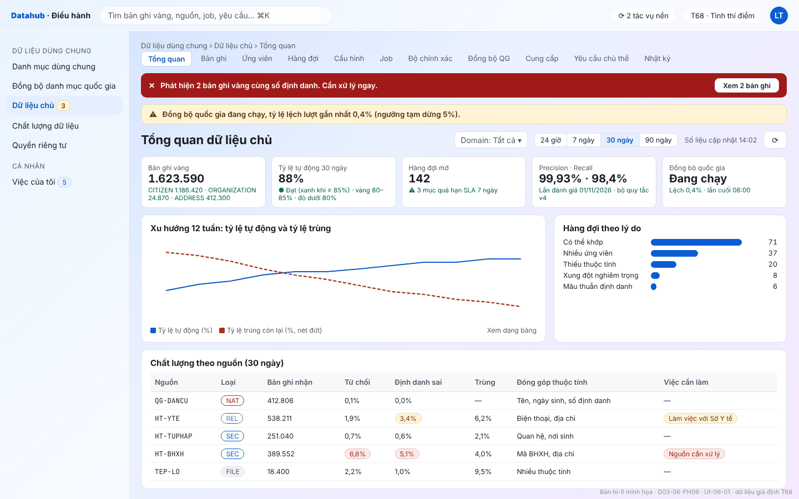
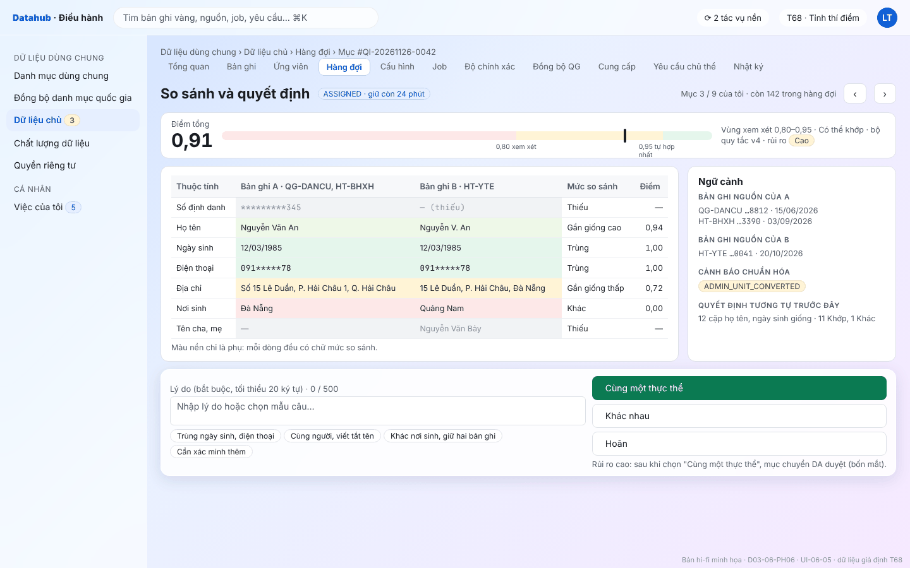

# D02-03-PH06 · Đặc tả yêu cầu chức năng Dữ liệu chủ

## Tóm tắt cho hội đồng thẩm định

**Mục tiêu.** PH-06 trả lời câu hỏi mà từng HTTT riêng lẻ không trả lời được: "Ông Nguyễn Văn A trong hệ thống y tế và ông Nguyễn Văn A trong hệ thống đất đai có phải cùng một người không?". Phân hệ nhận bản ghi về công dân, tổ chức và địa chỉ từ nhiều nguồn, chuẩn hóa, đối sánh, hợp nhất thành **bản ghi vàng** (golden record, bản ghi tốt nhất đại diện cho một thực thể), ghi rõ từng thuộc tính lấy từ nguồn nào, và cung cấp lại cho HTTT trong tỉnh qua API và sự kiện có kiểm soát mục đích.

**Phạm vi.** 60 yêu cầu chức năng chia tám nhóm: mô hình domain dữ liệu chủ; nguồn và nạp bản ghi ứng viên; đối sánh; hàng đợi người quản lý dữ liệu; bản ghi vàng; truy xuất nguồn gốc và liên kết chéo nguồn; cung cấp dữ liệu và đồng bộ quốc gia; vận hành. Ba domain dựng sẵn: `CITIZEN` (công dân, cá nhân), `ORGANIZATION` (tổ chức, doanh nghiệp, cơ quan), `ADDRESS` (địa chỉ gắn ĐVHC của PH-07). Phân hệ chạy trong DU `dh-data` (Spring Boot 4 + Modulith, package `vn.datahub.data.mdm`); đối sánh theo lô chạy bằng Splink trong Job Kubernetes; đối sánh trực tuyến dùng `pg_trgm` và quy tắc xác định trong PostgreSQL.

**Căn cứ pháp lý.** CMP-LAW-01 (Luật Dữ liệu 60/2024: dữ liệu chủ, quản trị và chia sẻ dữ liệu); CMP-LAW-03 (NĐ 278/2025 về kết nối, chia sẻ dữ liệu, thay NĐ 47/2020); CMP-LAW-05 và CMP-LAW-04 (Luật BVDLCN 91/2025, NĐ 356/2025: xử lý dữ liệu cá nhân, quyền của chủ thể dữ liệu); CMP-LAW-06 và CMP-LAW-08 (NĐ 331/2026, TCVN 14423:2026 cấp độ 3: kiểm soát truy cập, nhật ký, mã hóa).

**Những điểm hội đồng cần lưu ý.**

1. Datahub **không ghi đè nguồn gốc**. CSDL quốc gia về dân cư và đăng ký doanh nghiệp là nguồn chân lý cho thuộc tính nhân thân, đăng ký; PH-06 nhận về qua PH-14, ánh xạ và bổ sung thuộc tính địa phương, không tự quyết lại các thuộc tính đó (BR-06-003, BR-06-032).
2. Vùng điểm nghi ngờ **cố ý không tự động hóa**: hợp nhất nhầm hai công dân làm trộn hồ sơ y tế, bảo hiểm, đất đai, sửa rất tốn kém. Hợp nhất rủi ro cao cần hai người (bốn mắt).
3. Mọi thay đổi bản ghi vàng lưu ảnh chụp đầy đủ trước thay đổi, nên hợp nhất, tách, sửa tay đều hoàn tác được trong 90 ngày.
4. Sự kiện thay đổi không mang dữ liệu cá nhân; HTTT cần giá trị thì tra lại qua API, nêu mục đích đã được PH-09 chấp thuận; mọi lượt tra được ghi vết, không ghi được vết thì không trả dữ liệu.
5. Bộ quy tắc đối sánh chỉ được kích hoạt khi đạt độ chính xác đo trên tập nhãn: hợp nhất sai ≤ 0,1%, bỏ sót ≤ 2%.

**Con số chính.**

| Chỉ số | Giá trị |
|---|---|
| Yêu cầu chức năng | 60 (M: 54, S: 6, C: 0) |
| Quy tắc nghiệp vụ | 33 (BR-06-001…033) |
| Yêu cầu phi chức năng | 20 (NFR-06-001…020) |
| Màn hình | 18 (UI-06-01…18) |
| API | 96 operation dự kiến (API-06-001…096), 15 sự kiện (EVT-06-01…15) |
| Mã lỗi | 50 control (ERR-06-001…050), 14 job và đồng bộ (ERR-06-101…114) |
| Chức năng hệ cũ được phủ | Hệ cũ không có MDM; 3 nhóm `LGC` liên quan gián tiếp (NGSP-003, NGSP-005, DMDC) |
| Đợt | Đợt 3 cho toàn bộ phân hệ |

: Con số chính của PH-06

## 1. Giới thiệu

### 1.1. Mục đích của tài liệu

Tài liệu đặc tả đầy đủ hành vi của PH-06 Dữ liệu chủ ở mức ba nhóm người đọc dùng được ngay. Hội đồng thẩm định dùng tài liệu để đánh giá sự cần thiết, mức tuân thủ quy định về dữ liệu cá nhân và về chia sẻ dữ liệu. Kỹ sư dùng tài liệu làm đầu vào cho D03-02-PH06 (thiết kế chi tiết), D03-03-PH06 (CSDL), D03-04-PH06 (API). Kiểm thử viên dùng luồng xử lý, ngoại lệ, quy tắc và ngưỡng để viết ca ở D05-02-PH06.

Mỗi chức năng đặc tả theo khung 17 mục của K-TRINH-BAY §4: mục đích, tác nhân, mức ưu tiên, truy vết, tiền điều kiện, kích hoạt, đầu vào, luồng chính, luồng thay thế, luồng ngoại lệ kèm câu thông báo, đầu ra, kết quả, hậu điều kiện, sự kiện, kiểm toán, quy tắc và màn hình, API. Phụ lục A là nguồn chuẩn của mọi giá trị liệt kê (enum) dùng trong bộ bảy tập PH-06.

### 1.2. Phạm vi

PH-06 chịu trách nhiệm tám nhóm việc dưới đây.

| # | Trách nhiệm | Nhóm FR |
|---|---|---|
| 1 | Mô hình domain dữ liệu chủ cấu hình được: thuộc tính có kiểu, khóa định danh có quy tắc kiểm tra, phân loại theo PH-09, phiên bản, duyệt và kích hoạt; gói nền `CITIZEN`, `ORGANIZATION`, `ADDRESS` | A |
| 2 | Đăng ký nguồn gắn HTTT của PH-01, mức tin cậy và thứ tự ưu tiên nguồn có phê duyệt; nạp bản ghi ứng viên qua API, luồng PH-04, sự kiện PH-10, tệp lô; chuẩn hóa; chống trùng | B |
| 3 | Đối sánh xác định và xác suất, khóa gom nhóm, ngưỡng ba vùng, job theo lô bằng Splink, chạy thử, đo độ chính xác trên tập nhãn | C |
| 4 | Hàng đợi người quản lý dữ liệu: ưu tiên, phân công, so sánh cạnh nhau, quyết định, duyệt bốn mắt, SLA | D |
| 5 | Bản ghi vàng: sống sót thuộc tính, tạo và cập nhật, sửa tay có lý do, hợp nhất, tách, hoàn tác, ngừng, lịch sử phiên bản | E |
| 6 | Truy xuất nguồn gốc từng thuộc tính, liên kết chéo nguồn, tra ID nguồn và ID vàng | F |
| 7 | Tra cứu, giải quyết trực tuyến, tìm kiếm, xuất có kiểm soát, phát sự kiện, đăng ký nhận cập nhật, che theo PH-09, đồng bộ với CSDL tổng hợp quốc gia qua PH-14 | G |
| 8 | Dashboard chỉ số, lịch và chạy lại job, nhật ký, yêu cầu của chủ thể dữ liệu, lưu giữ, tham số tenant | H |

: Trách nhiệm của PH-06

Những việc dưới đây liên quan nhưng không thuộc PH-06; tài liệu chỉ mô tả điểm giao tiếp.

| Không làm | Thuộc |
|---|---|
| Bảng mã, danh mục, ĐVHC (kể cả lịch sử sắp xếp ĐVHC) | PH-07; PH-06 chỉ tra và tham chiếu mã |
| Đánh giá chất lượng dữ liệu tổng thể, quy tắc chất lượng | PH-08 (đọc bản ghi vàng để chấm điểm) |
| Phân loại dữ liệu, mục đích khai thác, sự đồng ý, chính sách che | PH-09; PH-06 áp quyết định của PH-09 |
| Gọi CSDL quốc gia, Nền tảng chia sẻ, điều phối dữ liệu quốc gia | PH-14 |
| Đăng ký topic, giao nhận sự kiện tới HTTT | PH-10 |
| Kết nạp HTTT, cấp định danh ứng dụng | PH-01 |
| Lưu dữ liệu nghiệp vụ chi tiết (hồ sơ bệnh án, thửa đất…) | HTTT thành viên |
| Là nguồn chân lý cuối cùng về nhân thân, đăng ký doanh nghiệp | CSDL quốc gia tương ứng |

: Việc ngoài phạm vi PH-06

### 1.3. Đối tượng sử dụng và cách đọc

| Người đọc | Đọc phần | Mục đích |
|---|---|---|
| Hội đồng thẩm định | Tóm tắt, chương 2, 5, 11, 14 | Sự cần thiết, tuân thủ pháp lý, ranh giới với CSDL quốc gia |
| Lãnh đạo, chủ quản dữ liệu | Chương 2, 3, mục 6.3 (ưu tiên nguồn), 6.6, 6.8 | Biết việc phải phê duyệt: thứ tự ưu tiên nguồn, hợp nhất rủi ro cao, xuất dữ liệu |
| Người quản lý dữ liệu | Mục 6.5, 6.6, 6.7, chương 10 | Xử lý hàng đợi, hợp nhất, tách, truy nguồn gốc |
| Kỹ sư phát triển | Chương 4, 6, 7, 9, Phụ lục A | Hiện thực mô hình, pipeline, API, mã lỗi, enum |
| Kiểm thử viên | Chương 6, 7, 8, 14 | Ca dương, ca âm, ca độ chính xác, ca phân quyền, ca rò rỉ |
| Vận hành | Mục 6.9, chương 8, 12 | Job, đồng bộ, cảnh báo, lưu giữ |

: Người đọc và phần cần đọc

Chức năng dùng chung (đăng nhập, chọn tenant, danh sách chuẩn, kiểm toán chung, "Việc của tôi", bốn mắt, hiển thị lỗi) theo nhóm FR-00 của D02-02 và không lặp lại.

### 1.4. Thuật ngữ và chữ viết tắt

| Thuật ngữ, viết tắt | Giải thích |
|---|---|
| Dữ liệu chủ (master data) | Dữ liệu định danh thực thể nghiệp vụ cốt lõi dùng chung nhiều HTTT: công dân, tổ chức, địa chỉ |
| Domain | Một loại thực thể chủ có mô hình riêng (`CITIZEN`, `ORGANIZATION`, `ADDRESS`) |
| Bản ghi ứng viên (candidate) | Một bản ghi về thực thể do một nguồn gửi tới, chưa hoặc đã liên kết với bản ghi vàng |
| Bản ghi vàng (golden record) | Bản ghi hợp nhất đại diện duy nhất cho một thực thể, có `goldenId` ổn định |
| Liên kết chéo nguồn (cross-reference, xref) | Liên kết giữa một bản ghi nguồn `(sourceCode, sourceKey)` và một bản ghi vàng |
| Đối sánh xác định (deterministic) | So khớp theo khóa định danh hợp lệ, kết luận chắc chắn |
| Đối sánh xác suất (probabilistic) | Chấm điểm theo tổ hợp thuộc tính (họ tên, ngày sinh, địa chỉ…) |
| Khóa gom nhóm (blocking key) | Khóa thu hẹp tập ứng viên cần so chi tiết, ví dụ ba ký tự đầu tên không dấu cộng năm sinh |
| Splink | Thư viện mã nguồn mở đối sánh xác suất theo mô hình Fellegi–Sunter, chạy trên DuckDB hoặc Spark |
| `pg_trgm` | Phần mở rộng PostgreSQL đo độ giống chuỗi theo bộ ba ký tự |
| Sống sót thuộc tính (survivorship) | Quy tắc chọn giá trị thắng cho từng thuộc tính khi các nguồn khác nhau |
| Truy xuất nguồn gốc (lineage) | Thông tin giá trị thuộc tính đến từ nguồn nào, lúc nào, theo quy tắc nào |
| Người quản lý dữ liệu (steward) | Cán bộ xử lý hàng đợi đối sánh và thao tác thủ công trên bản ghi vàng (DS) |
| Precision, recall | Độ chính xác (tỷ lệ cặp kết luận khớp là đúng) và độ phủ (tỷ lệ cặp đúng được tìm ra) |
| Tập nhãn | Tập cặp bản ghi đã được người xác nhận khớp hoặc không khớp, dùng đo precision, recall |
| Chủ thể dữ liệu | Người mà dữ liệu cá nhân nói về (Luật BVDLCN 91/2025) |
| DLCN | Dữ liệu cá nhân |
| CCCD | Số định danh cá nhân 12 chữ số (in trên thẻ căn cước) |
| MST, MSDN | Mã số thuế, mã số doanh nghiệp |
| ĐVHC | Đơn vị hành chính (PH-07, mô hình hai cấp có lịch sử ba cấp) |
| DS, DA, DO, TA, TO, SO, AU, VW, PA | Vai trò ở mục 3.1 theo D02-08 |
| p95, p99 | Phân vị 95, 99 của số đo |

: Thuật ngữ và chữ viết tắt của PH-06

### 1.5. Tài liệu tham chiếu

| Mã | Tài liệu | Dùng cho |
|---|---|---|
| CMP-LAW-01 | Luật Dữ liệu 60/2024/QH15 | Dữ liệu chủ, quản trị, chia sẻ dữ liệu |
| CMP-LAW-03 | NĐ 278/2025/NĐ-CP (thay NĐ 47/2020) | Kết nối, chia sẻ dữ liệu; đồng bộ qua Nền tảng chia sẻ quốc gia |
| CMP-LAW-05 | Luật BVDLCN 91/2025/QH15 | Xử lý DLCN, quyền chủ thể, tối thiểu hóa |
| CMP-LAW-04 | NĐ 356/2025/NĐ-CP | Quy định chi tiết BVDLCN, DPIA, thông báo vi phạm |
| CMP-LAW-06, CMP-LAW-08 | NĐ 331/2026, TCVN 14423:2026 | Kiểm soát truy cập, nhật ký, mã hóa cấp độ 3 |
| D02-02 | SRS | FR-00 dùng chung, REQ-06 |
| D02-07 | Từ điển dữ liệu dùng chung | DD-08 mức phân loại |
| D02-08 | Ma trận phân quyền | `ROLE-*`, `PERM-06-*` |
| D03-01 | SAD | DU `dh-data`, Splink theo lô, `pg_trgm` |
| D02-03-PH07 | FRS Danh mục dùng chung | Tra mã, ĐVHC (FR-07-026, 044, 046) |
| D02-03-PH10 | FRS Sự kiện | Topic DU nội bộ (FR-10-067), subscription (FR-10-035) |
| ADR-003, ADR-031, ADR-032, ADR-041, ADR-042, ADR-046, ADR-055, ADR-057 | RLS đa tenant, kiểm toán chuỗi băm, mã hóa envelope, idempotency, outbox, bốn mắt, mô hình ĐVHC, đồng bộ quốc gia qua PH-14 | Lý do lựa chọn |
| `docs/07-srs/SRS-PH-06-mdm.md` | SRS cũ của repo (13 FR) | Nguồn nghiệp vụ, bảng ánh xạ ở 11.2 |

: Tài liệu tham chiếu của PH-06

### 1.6. Cấu trúc tài liệu

Chương 2 trình bày bối cảnh, mục tiêu, kiến trúc và quy trình. Chương 3 nêu tác nhân, quyền, tách nhiệm vụ. Chương 4 định nghĩa khái niệm, thực thể và bốn máy trạng thái. Chương 5 liệt kê 60 chức năng; chương 6 đặc tả từng chức năng. Chương 7 đến 9 gom quy tắc, phi chức năng, tham số, mã lỗi, thông báo, sự kiện, API. Chương 10 là giao diện. Chương 11 đến 14 là truy vết, phụ thuộc, câu hỏi mở, tiêu chí chấp nhận. Phụ lục A là nguồn chuẩn enum; Phụ lục B là đề nghị đồng bộ.

## 2. Tổng quan phân hệ

### 2.1. Bối cảnh và vấn đề cần giải quyết

Mỗi HTTT của tỉnh giữ bản sao riêng về công dân, doanh nghiệp, địa chỉ, nhập theo cách riêng: có hệ lưu CCCD, có hệ chỉ có họ tên và ngày sinh, có hệ ghi địa chỉ theo ĐVHC ba cấp cũ. Hệ cũ (Viettel 2021) chỉ chuyển bản tin giữa các hệ, không có lớp dữ liệu chủ, nên cùng một người tồn tại dưới nhiều định danh và sai lệch không ai thấy. Bảng dưới tóm tắt hệ quả.

| Hạn chế hiện nay | Hệ quả | Cách PH-06 khắc phục |
|---|---|---|
| Không có định danh thống nhất giữa các HTTT | Không ghép được hồ sơ một người qua các ngành; báo cáo đếm trùng | Bản ghi vàng có `goldenId` ổn định, liên kết chéo với mọi bản ghi nguồn |
| Bản ghi cũ thiếu CCCD, họ tên không dấu, sai chính tả | Không đối chiếu được bằng khóa | Chuẩn hóa tiếng Việt, đối sánh xác suất, hàng đợi người quyết định |
| Địa chỉ theo ĐVHC cũ trước sắp xếp 2025 | Mã xã, huyện không còn hiệu lực | Chuẩn hóa theo PH-07, chuyển mã cũ sang mới (FR-07-046) |
| Không biết giá trị đến từ đâu | Công dân khiếu nại nhưng không biết sửa ở hệ nào | Lineage cấp thuộc tính, yêu cầu sửa gửi về nguồn |
| Chia sẻ DLCN không kiểm soát mục đích | Rủi ro vi phạm Luật BVDLCN | Tra cứu theo mục đích PH-09, che, ghi vết, phê duyệt truy cập hàng loạt |

: Hạn chế hiện nay và cách PH-06 khắc phục

### 2.2. Mục tiêu của phân hệ

1. Tỷ lệ bản ghi ứng viên được xử lý tự động ≥ 85%, hàng đợi thủ công ≤ 15% (NFR-06-007).
2. Hợp nhất sai ≤ 0,1%, bỏ sót ≤ 2% trên tập nhãn ≥ 10.000 cặp (NFR-06-008, NFR-06-009).
3. Tra cứu bản ghi vàng theo khóa p99 ≤ 50 ms, giải quyết xác suất p95 ≤ 300 ms ở hồ sơ tỉnh vừa (NFR-06-001, NFR-06-003).
4. 100% lượt truy cập dữ liệu chủ có nhật ký; 100% thuộc tính bản ghi vàng truy được nguồn (NFR-06-015).
5. Đồng bộ chiều xuống từ CSDL quốc gia áp vào bản ghi vàng trong ≤ 15 phút (NFR-06-020).

### 2.3. Vị trí trong kiến trúc

PH-06 nằm trong DU `dh-data` cùng PH-07, PH-08, PH-09, ở vùng ứng dụng nội bộ. Nguồn dữ liệu vào qua ba đường (API, luồng PH-04, sự kiện PH-10) và qua PH-14 cho CSDL quốc gia; dữ liệu ra qua API (sau APISIX) và topic Kafka.

```{.mermaid caption="Vị trí của PH-06 trong kiến trúc Datahub"}
flowchart TB
  subgraph SRC["Nguồn"]
    HT["HTTT thành viên<br/>(API, tệp)"]
    P04["PH-04 luồng tích hợp"]
    P10["PH-10 sự kiện"]
    P14["PH-14 kết nối quốc gia<br/>CSDL dân cư, ĐKDN"]
  end
  subgraph DATA["dh-data"]
    MDM["PH-06 Dữ liệu chủ"]
    P07["PH-07 Danh mục, ĐVHC"]
    P09["PH-09 Quyền riêng tư"]
    P08["PH-08 Chất lượng"]
  end
  JOB["Job K8s Splink<br/>(đối sánh lô)"]
  PG[("pg-core<br/>schema ph06_mdm")]
  K[("Kafka<br/>t68.mdm.*")]
  GW["APISIX"]
  HT --> GW --> MDM
  P04 --> MDM
  P10 --> MDM
  P14 <--> MDM
  MDM --> P07
  MDM --> P09
  MDM --> PG
  JOB <--> PG
  MDM --> K
  P08 --> MDM
```

Hình cho thấy PH-06 không gọi thẳng CSDL quốc gia mà luôn qua PH-14 (BR-06-032), không tự giữ danh mục mà tra PH-07, và không tự quyết chính sách che mà hỏi PH-09. Job Splink không gọi API nghiệp vụ; nó chỉ đọc bảng staging và ghi bảng kết quả trong `ph06_mdm`, `dh-data` áp kết quả.

### 2.4. Kiến trúc thành phần và công nghệ

| Thành phần | Trách nhiệm | Công nghệ |
|---|---|---|
| `mdm-model` | Mô hình domain, phiên bản, phân loại | Spring Modulith module, JSON Schema sinh từ mô hình |
| `mdm-ingest` | Nhận ứng viên từ API, luồng, sự kiện, tệp; idempotency | REST, Kafka listener (inbox ADR-042), Garage cho tệp |
| `mdm-normalize` | Chuẩn hóa tên, ngày, định danh, địa chỉ; sinh khóa gom nhóm | Java, ICU4J bỏ dấu, gọi PH-07 có bộ đệm Valkey |
| `mdm-match-online` | Đối sánh xác định và xác suất trực tuyến | PostgreSQL `pg_trgm`, `fuzzystrmatch`, chỉ mục GIN |
| `mdm-match-batch` | Đối sánh theo lô, huấn luyện tham số | Job K8s Python, Splink trên DuckDB (≤ 5 triệu bản ghi) hoặc Spark nhỏ |
| `mdm-steward` | Hàng đợi, phân công, quyết định, bốn mắt | Spring, việc giao qua "Việc của tôi" (FR-00-070) |
| `mdm-golden` | Sống sót, bản ghi vàng, hợp nhất, tách, hoàn tác, lịch sử | PostgreSQL, ảnh chụp JSONB, khóa lạc quan `version` |
| `mdm-serve` | Tra cứu, resolve, tìm kiếm, xuất, che | REST, OPA, PH-09 policy, mã hóa envelope (ADR-032) |
| `mdm-sync` | Đồng bộ với CSDL quốc gia qua PH-14 | Kafka, API nội bộ PH-14 |
| `mdm-ops` | Lịch job, chỉ số, nhật ký, lưu giữ | Quartz cluster, Micrometer, Prometheus |

: Thành phần của PH-06

Hình dưới là trình tự luồng chính: một bản ghi ứng viên đi từ nguồn tới bản ghi vàng và sự kiện.

```{.mermaid caption="Trình tự luồng chính nạp, đối sánh và cập nhật bản ghi vàng"}
sequenceDiagram
  participant S as Nguồn (HTTT, PH-04)
  participant I as mdm-ingest
  participant N as mdm-normalize
  participant R as PH-07
  participant M as mdm-match-online
  participant G as mdm-golden
  participant Q as mdm-steward
  participant K as Kafka (outbox)
  S->>I: Bản ghi ứng viên kèm sourceKey, sourceVersion
  I->>I: Kiểm lược đồ, chống trùng
  I->>N: Ứng viên RECEIVED
  N->>R: Tra mã ĐVHC, giới tính, dân tộc
  R-->>N: Mã hiện hành
  N->>M: Ứng viên NORMALIZED, khóa gom nhóm
  M->>M: Xác định rồi xác suất
  alt MATCH hoặc NO_MATCH
    M->>G: Liên kết hoặc tạo bản ghi vàng
    G->>G: Sống sót, ảnh chụp, lineage
    G->>K: EVT-06-01 hoặc EVT-06-02
  else POSSIBLE_MATCH
    M->>Q: Tạo mục hàng đợi
    Q->>K: EVT-06-08
  end
```

Bản ghi ứng viên luôn được ghi trước khi đối sánh nên không mất dữ liệu khi bước sau lỗi. Nhánh `POSSIBLE_MATCH` dừng ở hàng đợi; bản ghi vàng chỉ đổi khi người quyết định (nhóm D).

### 2.5. Quy trình nghiệp vụ liên quan

Bộ quy trình BP-01…09 của D02-01 chưa có quy trình riêng cho dữ liệu chủ; tài liệu đề nghị bổ sung BP-10 "Quản lý dữ liệu chủ" (Phụ lục B). PH-06 tham gia các quy trình sẵn có như bảng dưới.

| Quy trình | Bước có PH-06 |
|---|---|
| BP-01 Kết nạp HTTT | HTTT đã kết nạp mới đăng ký được làm nguồn (FR-06-008) hoặc đăng ký nhận cập nhật (FR-06-051) |
| BP-04 Trao đổi dữ liệu qua sự kiện | PH-06 tiêu thụ sự kiện nguồn (FR-06-012), phát sự kiện bản ghi vàng (FR-06-050) |
| BP-06 Khai thác dữ liệu quốc gia | Đồng bộ dân cư, ĐKDN qua PH-14 (FR-06-053, 054) |
| BP-10 (đề nghị) Quản lý dữ liệu chủ | Cấu hình domain, nguồn, quy tắc; vận hành hàng đợi; xử lý khiếu nại và yêu cầu chủ thể |

: Quy trình nghiệp vụ có PH-06 tham gia

```{.mermaid caption="Vòng đời điển hình của dữ liệu chủ một công dân"}
flowchart TB
  A["Nguồn gửi bản ghi"] --> B["Chuẩn hóa"]
  B --> C{"Đối sánh"}
  C -->|"MATCH"| D["Liên kết vào bản ghi vàng"]
  C -->|"NO_MATCH"| E["Tạo bản ghi vàng mới"]
  C -->|"POSSIBLE_MATCH"| F["Hàng đợi người quản lý"]
  F --> D
  F --> E
  D --> G["Sống sót thuộc tính, lịch sử"]
  E --> G
  G --> H["Sự kiện, tra cứu, đồng bộ quốc gia"]
  H --> I["Khiếu nại, yêu cầu chủ thể"]
  I --> J["Sửa tại nguồn, nạp lại"]
  J --> A
```

Vòng đời khép kín ở bước sửa tại nguồn (BR-06-014): sửa trên bản ghi vàng mà không sửa nguồn thì lần nạp sau sẽ sai lại.

### 2.6. Chức năng hệ cũ được phủ

Hệ cũ không có chức năng dữ liệu chủ (D02-02 ghi LGC "—" cho PH-06). Các mục `LGC` dưới đây liên quan gián tiếp: PH-06 dùng dữ liệu mà chức năng đó cung cấp, không thay chức năng. Kết luận chi tiết ở 11.1.

| `LGC` | Chức năng hệ cũ | Vai trò của PH-06 |
|---|---|---|
| LGC-NGSP-003 | Tra cứu BHXH hộ gia đình | Nguồn bổ sung cho `CITIZEN` qua PH-14 |
| LGC-NGSP-005 | Dữ liệu đăng ký doanh nghiệp | Nguồn chính cho `ORGANIZATION` qua PH-14 |
| LGC-DMDC-015, LGC-DMDC-019 | Khai thác danh mục qua API, danh mục quốc gia | PH-07 cung cấp mã ĐVHC, giới tính, dân tộc để chuẩn hóa |

: Chức năng hệ cũ liên quan gián tiếp

## 3. Tác nhân, vai trò và quyền

### 3.1. Tác nhân

| Tác nhân | Loại | Mô tả | Tương tác chính |
|---|---|---|---|
| Người quản lý dữ liệu (DS, ROLE-DATA_STEWARD) | Người | Cán bộ chuyên trách dữ liệu của Sở hoặc trung tâm dữ liệu tỉnh | Xử lý hàng đợi, hợp nhất, tách, sửa tay, nạp tệp, xem lineage |
| Người duyệt dữ liệu (DA, ROLE-DATA_APPROVER) | Người | Lãnh đạo phụ trách dữ liệu được giao | Duyệt mô hình, quy tắc, ưu tiên nguồn, hợp nhất rủi ro cao, hoàn tác quá hạn |
| Chủ quản dữ liệu (DO, ROLE-DATA_OWNER) | Người | Đại diện cơ quan chủ quản nguồn | Chấp thuận xuất, đăng ký nhận cập nhật; nhận yêu cầu sửa tại nguồn |
| Quản trị tenant (TA, ROLE-TENANT_ADMIN) | Người | Quản trị Datahub của tỉnh | Cấu hình domain, nguồn, quy tắc, tham số |
| Vận hành tenant (TO, ROLE-TENANT_OPERATOR) | Người | Cán bộ trực | Lịch job, chạy lại, theo dõi đồng bộ |
| Cán bộ ATTT (SO, ROLE-SECURITY_OFFICER) | Người | ATTT của tỉnh | Xem nhật ký truy cập, xử lý yêu cầu chủ thể cùng PH-09 |
| Kiểm toán (AU), Người xem (VW) | Người | Thanh tra, lãnh đạo | Xem dashboard; AU xem nhật ký |
| Quản trị nền tảng (PA, ROLE-PLATFORM_ADMIN) | Người | Đơn vị vận hành nền tảng | Gói domain nền, trần tham số |
| HTTT thành viên | Hệ thống | Hệ của sở, ngành | Gửi ứng viên (`mdm:ingest`), tra cứu, resolve (`mdm:read`, `mdm:resolve`), nhận cập nhật |
| PH-04 `dh-integration`, `dh-runtime` | Hệ thống | Lõi tích hợp | Nạp qua luồng, làm giàu bản tin bằng resolve |
| PH-07, PH-09, PH-10, PH-14, PH-08, PH-13 | Hệ thống | Phân hệ khác | Mã danh mục; chính sách che, mục đích; topic; đồng bộ quốc gia; đọc bản ghi vàng; chỉ số |
| Job Splink | Hệ thống | Job K8s | Đọc staging, ghi kết quả đối sánh |

: Tác nhân của PH-06

### 3.2. Ma trận quyền

`PERM-06-read`, `PERM-06-update`, `PERM-06-merge` đã có ở D02-08 §3.2 (DS ○, TA; merge cần DA). Chín quyền còn lại là đề nghị mới, ghi ở Phụ lục B "Đề nghị đồng bộ D02-08". Ký hiệu theo D02-08: ● có quyền, ○ chỉ với đối tượng thuộc tổ chức của mình, — không.

| Quyền | Ý nghĩa | PA | TA | TO | SO | DS | DA | DO | VW | AU |
|---|---|---|---|---|---|---|---|---|---|---|
| PERM-06-read | Xem domain, nguồn, quy tắc, bản ghi vàng (đã che), ứng viên, lineage, dashboard | ● | ● | ● | ● | ● | ● | ○ | ● | ● |
| PERM-06-update | Sửa tay thuộc tính, xử lý ứng viên lỗi, gỡ liên kết | — | ● | — | — | ○ | — | — | — | — |
| PERM-06-merge | Hợp nhất, tách, hoàn tác, ngừng, khôi phục bản ghi vàng | — | ● | — | — | ○ | ● | — | — | — |
| PERM-06-config | Soạn mô hình domain, nguồn, ưu tiên nguồn, quy tắc đối sánh, sống sót; gửi duyệt | ● (gói nền) | ● | — | — | ○ | — | — | — | — |
| PERM-06-approve | Duyệt mô hình, quy tắc, ưu tiên nguồn, hợp nhất rủi ro cao, hoàn tác quá hạn | — | — | — | — | — | ● | — | — | — |
| PERM-06-steward | Nhận, xử lý, phân công mục hàng đợi; quản lý tập nhãn | — | ● | — | — | ● | ● | — | — | — |
| PERM-06-ingest | Nạp tệp lô, chạy lại xử lý ứng viên | — | ● | — | — | ○ | — | — | — | — |
| PERM-06-export | Đề nghị xuất; DO, DA chấp thuận xuất | — | ● | — | — | ○ | ● | ○ | — | — |
| PERM-06-sync | Chạy, tạm dừng đồng bộ quốc gia, xử lý lệch | — | ● | — | — | ● | ● | — | — | — |
| PERM-06-operate | Lịch job, chạy lại, hủy job | — | ● | ● | — | — | — | — | — | — |
| PERM-06-dsr | Tiếp nhận, xử lý yêu cầu của chủ thể dữ liệu | — | ● | — | ● | ● | — | — | — | — |
| PERM-06-audit-read | Xem nhật ký truy cập dữ liệu chủ | — | — | — | ● | — | — | — | — | ● |

: Ma trận quyền của PH-06

Xem giá trị đầy đủ của thuộc tính `SENSITIVE` cần thêm `PERM-09-unmask` và nêu lý do (D02-08 §3.1); không có thì giá trị luôn bị che, kể cả với DS.

### 3.3. Tách nhiệm vụ và tài khoản máy

Bốn mắt (FR-00-071, ADR-046) áp dụng cho: kích hoạt mô hình domain, kích hoạt bộ quy tắc và ngưỡng, thứ tự ưu tiên nguồn, quy tắc sống sót, hợp nhất rủi ro cao (BR-06-019), hoàn tác quá 90 ngày, xuất dữ liệu, áp lại sống sót hàng loạt. Người đề nghị hoặc người quyết định ở bước trước không được duyệt (ERR-06-005). DS và DA là cặp loại trừ trong cùng tenant (đề nghị D02-08 §4).

HTTT và phân hệ gọi PH-06 bằng token dịch vụ. Scope: `mdm:ingest` (nạp ứng viên, chỉ cho nguồn đã đăng ký), `mdm:read` (tra cứu theo ID, khóa), `mdm:resolve` (giải quyết trực tuyến), `mdm:search` (tìm theo thuộc tính, chỉ cấp khi PH-09 chấp thuận mục đích), `mdm:xref` (tra ID nguồn, ID vàng). PH-14 dùng `mdm:national-sync`; Job Splink dùng tài khoản CSDL riêng chỉ có quyền trên bảng staging và kết quả.

## 4. Khái niệm và mô hình nghiệp vụ

### 4.1. Khái niệm nghiệp vụ

| Khái niệm | Định nghĩa |
|---|---|
| Mô hình domain | Định nghĩa có phiên bản của một domain: danh sách thuộc tính (kiểu, bắt buộc, đa trị, phân loại), khóa định danh, quy tắc chuẩn hóa, thuộc tính quan trọng |
| Thuộc tính quan trọng | Thuộc tính mà xung đột giữa hai nguồn cùng mức buộc chuyển người (mặc định `dateOfBirth`, `gender` của `CITIZEN`; `taxCode`, `legalName` của `ORGANIZATION`) |
| Nguồn dữ liệu chủ | Một HTTT (hoặc CSDL quốc gia qua PH-14, hoặc nhập tay) được phép gửi bản ghi cho một hoặc nhiều domain, có mức tin cậy 1–5 |
| Thứ tự ưu tiên nguồn | Bảng mức ưu tiên theo domain và theo thuộc tính, có căn cứ phê duyệt, dùng cho sống sót |
| Bộ quy tắc đối sánh | Tập quy tắc xác định, quy tắc xác suất (trọng số hoặc tham số Splink), quy tắc loại trừ, khóa gom nhóm và ngưỡng ba vùng, có phiên bản |
| Ngưỡng ba vùng | `autoMergeThreshold` (≥ thì tự hợp nhất), `reviewThreshold` (≥ thì vào hàng đợi), dưới đó là khác biệt |
| Mục hàng đợi | Một cặp (ứng viên hoặc bản ghi vàng với bản ghi vàng) cần người quyết định, kèm điểm từng thuộc tính |
| Thao tác bản ghi vàng | Một lần hợp nhất, tách, sửa tay, ngừng, khôi phục, áp lại sống sót, có `operationId`, hoàn tác được |
| Ảnh chụp | Toàn bộ trạng thái bản ghi vàng (thuộc tính, liên kết) trước một thay đổi |
| Lệch đồng bộ | Khác biệt giá trị giữa bản ghi vàng và CSDL quốc gia trên thuộc tính được đồng bộ |

: Khái niệm nghiệp vụ của PH-06

### 4.2. Thực thể

Thực thể mức logic; bảng vật lý ở D03-03-PH06. Mọi bảng trong schema `ph06_mdm` có `tenant_id`, RLS theo ADR-003 và các cột chung của D00-01 §5.1.

| Mã | Thực thể | Mô tả | Thực thể cũ |
|---|---|---|---|
| EN-06-01 | `golden_record` | Bản ghi vàng: `goldenId`, domain, trạng thái, `mergedInto`, `version`, độ tin cậy | EN-06-01 cũ |
| EN-06-02 | `golden_attribute` | Giá trị thuộc tính vàng kèm nguồn, `sourceUpdatedAt`, chiến lược sống sót, độ tin cậy | EN-06-02 cũ |
| EN-06-03 | `source_xref` | Liên kết chéo nguồn `(sourceCode, sourceKey)` ↔ `goldenId`, phương thức, điểm, hiệu lực | EN-06-03 cũ |
| EN-06-04 | `source_priority` | Mức ưu tiên nguồn theo domain, thuộc tính, căn cứ phê duyệt | EN-06-04 cũ |
| EN-06-05 | `steward_item` | Mục hàng đợi, lý do, ưu tiên, người nhận, quyết định | EN-06-05 cũ |
| EN-06-06 | `golden_history` | Ảnh chụp trước thay đổi, loại thay đổi, thao tác | EN-06-06 cũ |
| EN-06-07 | `domain_model` | Domain và phiên bản mô hình (thuộc tính, khóa, phân loại) | Mới |
| EN-06-08 | `mdm_source` | Nguồn dữ liệu chủ gắn HTTT, mức tin cậy, kênh nạp | NGUON_DU_LIEU cũ |
| EN-06-09 | `candidate_record` | Bản ghi ứng viên: dữ liệu gốc (mã hóa), đã chuẩn hóa, khóa gom nhóm, trạng thái | BAN_GHI_UNG_VIEN cũ |
| EN-06-10 | `match_rule_set` | Bộ quy tắc, ngưỡng, khóa gom nhóm có phiên bản | Mới |
| EN-06-11 | `match_result` | Kết quả đối sánh cặp, điểm từng thuộc tính, kết luận | KET_QUA_DOI_SANH cũ |
| EN-06-12 | `match_job` | Job theo lô (loại, trạng thái, số liệu) | Mới |
| EN-06-13 | `golden_operation` | Thao tác hợp nhất, tách, sửa tay…, trạng thái duyệt, hoàn tác | THAO_TAC_HOP_NHAT cũ |
| EN-06-14 | `attribute_lineage` | Lịch sử giá trị từng thuộc tính | LINEAGE cũ |
| EN-06-15 | `label_pair` | Cặp có nhãn của tập kiểm chứng | Mới |
| EN-06-16 | `national_sync_record` | Nhật ký đồng bộ, lệch với quốc gia | DONG_BO_QG cũ |
| EN-06-17 | `survivorship_rule` | Chiến lược sống sót theo thuộc tính, có phiên bản | Mới |
| EN-06-18 | `update_subscription` | Đăng ký nhận cập nhật của HTTT | Mới |
| EN-06-19 | `export_request` | Yêu cầu xuất có duyệt | Mới |
| EN-06-20 | `subject_request` | Yêu cầu của chủ thể dữ liệu | Mới |
| EN-06-21 | `access_log` | Nhật ký truy cập dữ liệu chủ (ai, tra ai, mục đích) | Mới |

: Thực thể mức logic của PH-06

```{.mermaid caption="Quan hệ giữa các thực thể chính của PH-06"}
erDiagram
  DOMAIN_MODEL ||--o{ GOLDEN_RECORD : "định nghĩa"
  GOLDEN_RECORD ||--o{ GOLDEN_ATTRIBUTE : "gồm"
  GOLDEN_RECORD ||--o{ SOURCE_XREF : "liên kết"
  GOLDEN_RECORD ||--o{ GOLDEN_HISTORY : "có lịch sử"
  GOLDEN_ATTRIBUTE ||--o{ ATTRIBUTE_LINEAGE : "truy nguồn"
  MDM_SOURCE ||--o{ CANDIDATE_RECORD : "gửi"
  MDM_SOURCE ||--o{ SOURCE_PRIORITY : "có mức"
  CANDIDATE_RECORD ||--o| SOURCE_XREF : "trở thành"
  CANDIDATE_RECORD ||--o{ MATCH_RESULT : "sinh"
  MATCH_RESULT ||--o| STEWARD_ITEM : "chuyển"
  MATCH_RULE_SET ||--o{ MATCH_RESULT : "chấm điểm"
  MATCH_JOB ||--o{ MATCH_RESULT : "tạo"
  GOLDEN_OPERATION ||--o{ GOLDEN_HISTORY : "ghi"
```

Hình cho thấy ứng viên không ghi thẳng vào bản ghi vàng mà qua kết quả đối sánh và liên kết; mọi thay đổi bản ghi vàng đi qua một thao tác có lịch sử. Nguồn ở cấp thuộc tính (BR-06-009) nằm ở `GOLDEN_ATTRIBUTE` và `ATTRIBUTE_LINEAGE`.

### 4.3. Máy trạng thái bản ghi vàng

```{.mermaid caption="Vòng đời bản ghi vàng"}
stateDiagram-v2
  [*] --> ACTIVE: Tạo (NO_MATCH, nạp quốc gia)
  ACTIVE --> LOCKED: Thao tác chờ duyệt, yêu cầu chủ thể hạn chế
  LOCKED --> ACTIVE: Duyệt xong, hết hạn chế
  ACTIVE --> MERGED: Bị hợp nhất vào bản khác
  MERGED --> ACTIVE: Tách, hoàn tác hợp nhất
  ACTIVE --> RETIRED: Ngừng (không còn liên kết hiệu lực)
  RETIRED --> ACTIVE: Khôi phục
```

| Trạng thái | Ý nghĩa | Tra cứu trả về |
|---|---|---|
| `ACTIVE` | Đang dùng, nhận cập nhật | Bản ghi |
| `LOCKED` | Đang có thao tác chờ duyệt hoặc chủ thể yêu cầu hạn chế xử lý; không nhận hợp nhất, sửa tay | Bản ghi kèm cờ `locked` |
| `MERGED` | Đã hợp nhất vào `mergedInto`; giữ để chuyển hướng | `200` kèm `mergedInto` và liên kết tới bản sống sót |
| `RETIRED` | Ngừng dùng (thực thể giải thể, bản ghi thử, trùng không còn nguồn) | `410` ERR-06-001 biến thể "đã ngừng" kèm lý do |

: Trạng thái bản ghi vàng

Không có trạng thái xóa (BR-06-007). Trạng thái `SUSPENDED`, `ARCHIVED` của SRS cũ được thay bằng `LOCKED`, `RETIRED`.

### 4.4. Máy trạng thái mục hàng đợi

```{.mermaid caption="Vòng đời mục hàng đợi người quản lý dữ liệu"}
stateDiagram-v2
  [*] --> OPEN: Đối sánh POSSIBLE_MATCH, xung đột
  OPEN --> ASSIGNED: Nhận việc, phân công
  ASSIGNED --> OPEN: Trả lại, hết hạn giữ 30 phút
  ASSIGNED --> DEFERRED: Hoãn, cần thêm thông tin
  DEFERRED --> ASSIGNED: Hết hạn hoãn, nhận lại
  ASSIGNED --> PENDING_APPROVAL: Quyết định MATCH rủi ro cao
  PENDING_APPROVAL --> RESOLVED: DA duyệt
  PENDING_APPROVAL --> ASSIGNED: DA từ chối
  ASSIGNED --> RESOLVED: Quyết định MATCH rủi ro thấp, NO_MATCH
  OPEN --> CANCELLED: Dữ liệu đổi, mục lỗi thời
  ASSIGNED --> CANCELLED: Dữ liệu đổi, mục lỗi thời
```

`RESOLVED` và `CANCELLED` là trạng thái cuối. Mục `CANCELLED` do dữ liệu đổi sinh lại mục mới nếu cặp vẫn nằm trong vùng xem xét.

### 4.5. Máy trạng thái job đối sánh

```{.mermaid caption="Vòng đời job đối sánh theo lô"}
stateDiagram-v2
  [*] --> QUEUED: Lịch, yêu cầu tay
  QUEUED --> PREPARING: Xuất staging
  PREPARING --> RUNNING: Khởi Job K8s Splink
  RUNNING --> AWAITING_CONFIRMATION: Vượt ngưỡng an toàn
  RUNNING --> APPLYING: Có kết quả
  AWAITING_CONFIRMATION --> APPLYING: DA xác nhận
  AWAITING_CONFIRMATION --> CANCELLED: Từ chối
  APPLYING --> SUCCEEDED: Áp xong
  APPLYING --> PARTIALLY_SUCCEEDED: Có cặp xung đột bị bỏ qua
  PREPARING --> FAILED: Lỗi
  RUNNING --> FAILED: Lỗi, quá giờ
  QUEUED --> CANCELLED: Hủy
  RUNNING --> CANCELLED: Hủy
```

Job `FAILED` không đổi bản ghi vàng nào vì chỉ bước `APPLYING` ghi vào bản ghi vàng và từng cặp được áp trong giao dịch riêng. `AWAITING_CONFIRMATION` là cơ chế an toàn của BR-06-022.

### 4.6. Máy trạng thái mô hình domain và bộ quy tắc

```{.mermaid caption="Vòng đời phiên bản mô hình domain và bộ quy tắc"}
stateDiagram-v2
  [*] --> DRAFT: Tạo nháp
  DRAFT --> TESTING: Chạy thử, đánh giá (bộ quy tắc)
  TESTING --> DRAFT: Sửa
  DRAFT --> PENDING_APPROVAL: Gửi duyệt (mô hình)
  TESTING --> PENDING_APPROVAL: Gửi duyệt
  PENDING_APPROVAL --> ACTIVE: DA duyệt
  PENDING_APPROVAL --> REJECTED: DA từ chối
  REJECTED --> DRAFT: Sửa lại
  ACTIVE --> SUPERSEDED: Phiên bản mới kích hoạt
```

Mỗi domain có đúng một phiên bản mô hình `ACTIVE` và một bộ quy tắc `ACTIVE`. Phiên bản `ACTIVE` không sửa được (BR-06-017). Bộ quy tắc bắt buộc đi qua `TESTING` có kết quả đánh giá đạt (BR-06-021); mô hình domain đi thẳng từ `DRAFT` sang `PENDING_APPROVAL`.

## 5. Danh sách chức năng

PH-06 có 60 chức năng chia tám nhóm. Nhóm: A Mô hình domain; B Nguồn và nạp ứng viên; C Đối sánh; D Hàng đợi người quản lý dữ liệu; E Bản ghi vàng; F Nguồn gốc và liên kết chéo; G Cung cấp dữ liệu; H Vận hành. Toàn bộ thuộc Đợt 3.

| Mã | Nhóm | Chức năng | Mức | Đợt | Màn hình |
|---|---|---|---|---|---|
| FR-06-001 | A | Liệt kê và xem domain dữ liệu chủ | M | Đợt 3 | UI-06-07 |
| FR-06-002 | A | Soạn mô hình domain với thuộc tính có kiểu | M | Đợt 3 | UI-06-07 |
| FR-06-003 | A | Khai báo khóa định danh và quy tắc kiểm tra | M | Đợt 3 | UI-06-07 |
| FR-06-004 | A | Gán phân loại dữ liệu cho thuộc tính theo PH-09 | M | Đợt 3 | UI-06-07 |
| FR-06-005 | A | Quản lý phiên bản mô hình và kiểm tra tương thích | S | Đợt 3 | UI-06-07 |
| FR-06-006 | A | Gửi duyệt, kích hoạt, tạm ngừng và ngừng domain | M | Đợt 3 | UI-06-07 |
| FR-06-007 | A | Nạp gói domain nền CITIZEN, ORGANIZATION, ADDRESS | M | Đợt 3 | UI-06-07 |
| FR-06-008 | B | Đăng ký nguồn dữ liệu chủ gắn HTTT | M | Đợt 3 | UI-06-08 |
| FR-06-009 | B | Khai báo mức tin cậy và thứ tự ưu tiên nguồn có phê duyệt | M | Đợt 3 | UI-06-08 |
| FR-06-010 | B | Nạp bản ghi ứng viên qua API | M | Đợt 3 | Không |
| FR-06-011 | B | Nạp bản ghi ứng viên qua luồng PH-04 | M | Đợt 3 | Không |
| FR-06-012 | B | Nạp bản ghi ứng viên qua sự kiện PH-10 | S | Đợt 3 | Không |
| FR-06-013 | B | Nạp tệp lô có xem trước | M | Đợt 3 | UI-06-11 |
| FR-06-014 | B | Chuẩn hóa họ tên, ngày, số định danh | M | Đợt 3 | UI-06-11 |
| FR-06-015 | B | Chuẩn hóa địa chỉ theo ĐVHC của PH-07 | M | Đợt 3 | UI-06-11 |
| FR-06-016 | B | Chống trùng, thứ tự phiên bản nguồn và xóa từ nguồn | M | Đợt 3 | Không |
| FR-06-017 | B | Xem bản ghi ứng viên và xử lý ứng viên lỗi | M | Đợt 3 | UI-06-11 |
| FR-06-018 | C | Quản lý bộ quy tắc đối sánh có phiên bản | M | Đợt 3 | UI-06-09 |
| FR-06-019 | C | Cấu hình khóa gom nhóm và theo dõi hiệu quả | M | Đợt 3 | UI-06-09 |
| FR-06-020 | C | Đối sánh xác định theo khóa định danh | M | Đợt 3 | Không |
| FR-06-021 | C | Đối sánh xác suất trực tuyến | M | Đợt 3 | Không |
| FR-06-022 | C | Chạy job đối sánh theo lô bằng Splink | M | Đợt 3 | UI-06-12 |
| FR-06-023 | C | Cấu hình ngưỡng tự hợp nhất, xem xét, khác biệt | M | Đợt 3 | UI-06-09 |
| FR-06-024 | C | Chạy thử bộ quy tắc trên mẫu | S | Đợt 3 | UI-06-09 |
| FR-06-025 | C | Quản lý tập nhãn kiểm chứng | M | Đợt 3 | UI-06-13 |
| FR-06-026 | C | Đo precision, recall và chặn kích hoạt quy tắc kém | M | Đợt 3 | UI-06-09, UI-06-13 |
| FR-06-027 | D | Tạo mục hàng đợi và tính mức ưu tiên | M | Đợt 3 | UI-06-04 |
| FR-06-028 | D | Liệt kê, nhận việc và phân công mục hàng đợi | M | Đợt 3 | UI-06-04 |
| FR-06-029 | D | So sánh cạnh nhau hai bản ghi | M | Đợt 3 | UI-06-05 |
| FR-06-030 | D | Quyết định khớp, không khớp, hoãn | M | Đợt 3 | UI-06-05 |
| FR-06-031 | D | Duyệt bốn mắt hợp nhất rủi ro cao | M | Đợt 3 | UI-06-05 |
| FR-06-032 | D | Theo dõi SLA, nâng ưu tiên và cảnh báo quá tải | M | Đợt 3 | UI-06-04, UI-06-01 |
| FR-06-033 | E | Cấu hình quy tắc sống sót thuộc tính | M | Đợt 3 | UI-06-10 |
| FR-06-034 | E | Tạo và cập nhật bản ghi vàng tự động | M | Đợt 3 | Không |
| FR-06-035 | E | Xem chi tiết bản ghi vàng | M | Đợt 3 | UI-06-03 |
| FR-06-036 | E | Sửa tay thuộc tính có lý do | S | Đợt 3 | UI-06-03 |
| FR-06-037 | E | Hợp nhất bản ghi vàng thủ công | M | Đợt 3 | UI-06-06 |
| FR-06-038 | E | Tách bản ghi vàng | M | Đợt 3 | UI-06-06 |
| FR-06-039 | E | Hoàn tác thao tác trên bản ghi vàng | M | Đợt 3 | UI-06-03, UI-06-06 |
| FR-06-040 | E | Ngừng và khôi phục bản ghi vàng | M | Đợt 3 | UI-06-03 |
| FR-06-041 | E | Xem lịch sử phiên bản và so sánh hai phiên bản | M | Đợt 3 | UI-06-03 |
| FR-06-042 | E | Xem trước tác động và áp lại sống sót hàng loạt | S | Đợt 3 | UI-06-10 |
| FR-06-043 | F | Truy xuất nguồn gốc từng thuộc tính | M | Đợt 3 | UI-06-03 |
| FR-06-044 | F | Xem và gỡ liên kết chéo nguồn | M | Đợt 3 | UI-06-03 |
| FR-06-045 | F | Tra ID nguồn và ID vàng | M | Đợt 3 | UI-06-02 |
| FR-06-046 | G | Tra cứu bản ghi vàng theo ID hoặc khóa định danh | M | Đợt 3 | UI-06-02, UI-06-03 |
| FR-06-047 | G | Giải quyết bản ghi trực tuyến (resolve) | M | Đợt 3 | Không |
| FR-06-048 | G | Tìm kiếm bản ghi vàng theo thuộc tính | M | Đợt 3 | UI-06-02 |
| FR-06-049 | G | Xuất dữ liệu chủ có kiểm soát | M | Đợt 3 | UI-06-15 |
| FR-06-050 | G | Phát sự kiện thay đổi bản ghi vàng | M | Đợt 3 | Không |
| FR-06-051 | G | Đăng ký nhận cập nhật cho HTTT | S | Đợt 3 | UI-06-15 |
| FR-06-052 | G | Che dữ liệu theo phân loại và mục đích PH-09 | M | Đợt 3 | Không |
| FR-06-053 | G | Đồng bộ với CSDL tổng hợp quốc gia qua PH-14 | M | Đợt 3 | UI-06-14 |
| FR-06-054 | G | Xử lý danh sách lệch đồng bộ quốc gia | M | Đợt 3 | UI-06-14 |
| FR-06-055 | H | Dashboard chỉ số dữ liệu chủ | M | Đợt 3 | UI-06-01 |
| FR-06-056 | H | Lịch job, chạy lại và hủy job | M | Đợt 3 | UI-06-12 |
| FR-06-057 | H | Nhật ký xử lý và nhật ký truy cập | M | Đợt 3 | UI-06-18 |
| FR-06-058 | H | Tiếp nhận và xử lý yêu cầu của chủ thể dữ liệu | M | Đợt 3 | UI-06-16 |
| FR-06-059 | H | Chính sách lưu giữ và dọn dữ liệu | M | Đợt 3 | UI-06-17 |
| FR-06-060 | H | Tham số phân hệ theo tenant | M | Đợt 3 | UI-06-17 |

: Danh sách chức năng của PH-06

## 6. Đặc tả chi tiết chức năng

### 6.1. Cách đọc bảng đặc tả

Mỗi chức năng được đặc tả bằng một bảng hai cột gồm 17 mục cố định, kết hợp 12 trường kỹ thuật của D00-01 §4.3 và các mục của mẫu thuyết minh. Mục không áp dụng ghi "Không".

| Mục | Nội dung | Nguồn |
|---|---|---|
| Mục đích | Chức năng giúp ai làm được việc gì, vì sao cần | Mẫu thuyết minh |
| Tác nhân, quyền | Vai trò thực hiện và `PERM` hoặc scope | D00-01 §4.3 |
| Mức ưu tiên, đợt | M, S, C; đợt phát hành | D00-01 §4.3, mẫu |
| Truy vết | REQ, LGC, FR cũ của repo, Q | D00-01 §4.3 |
| Tiền điều kiện | Trạng thái phải đúng trước khi chạy | D00-01 §4.3 |
| Kích hoạt | Thao tác hoặc sự kiện khởi động | Mẫu thuyết minh |
| Đầu vào | Tham số, trường nhập (bảng riêng khi từ 5 trường) | D00-01 §4.3 |
| Luồng xử lý chính | Bước đánh số, bước kiểm tra ghi mã lỗi | Cả hai |
| Luồng thay thế | Nhánh hợp lệ khác | Mẫu thuyết minh |
| Luồng ngoại lệ | Mã lỗi, HTTP, câu thông báo | Cả hai |
| Đầu ra | Mã HTTP, trường trả về | D00-01 §4.3 |
| Kết quả | Điều người dùng nhận được | Mẫu thuyết minh |
| Hậu điều kiện | Trạng thái dữ liệu sau khi xong | D00-01 §4.3 |
| Sự kiện phát ra | `EVT` | D00-01 §4.3 |
| Kiểm toán | Có ghi không, trường được ghi | D00-01 §4.3 |
| Quy tắc nghiệp vụ | `BR` áp dụng | Cả hai |
| Màn hình, API | `UI`, `API` | Mẫu thuyết minh |

: Các mục của bảng đặc tả chức năng

Ví dụ dùng tenant `T68`, nguồn `HT-YTE` (hồ sơ sức khỏe), `HT-GIAODUC` (học sinh), `HT-TUPHAP` (hộ tịch), `QG-DANCU` (CSDL quốc gia về dân cư qua PH-14), `QG-DKDN` (đăng ký doanh nghiệp qua PH-14). Dữ liệu là giả lập. Mọi API dùng tiền tố `/api/mdm/v1`; ví dụ CCCD dùng dải `0010990xxxxx` không có thật.

### 6.2. Nhóm A · Mô hình domain dữ liệu chủ

Nhóm A cho phép tỉnh mô tả "dữ liệu chủ trông như thế nào" mà không phải sửa mã: mỗi domain có thuộc tính có kiểu, khóa định danh có quy tắc kiểm tra, phân loại theo PH-09 và phiên bản. Ba domain nền được nạp sẵn khi khởi tạo; tỉnh bổ sung thuộc tính địa phương hoặc domain mới qua bản nháp có duyệt. Mô hình `ACTIVE` sinh JSON Schema dùng để kiểm tra mọi bản ghi ứng viên (FR-06-010).

```{.mermaid caption="Quan hệ giữa các chức năng nhóm A"}
flowchart TB
  F007["FR-06-007 Gói nền"] --> F001["FR-06-001 Xem domain"]
  F001 --> F002["FR-06-002 Soạn mô hình"]
  F002 --> F003["FR-06-003 Khóa định danh"]
  F002 --> F004["FR-06-004 Phân loại PH-09"]
  F003 --> F005["FR-06-005 Phiên bản,<br/>tương thích"]
  F004 --> F005
  F005 --> F006["FR-06-006 Duyệt, kích hoạt"]
  F006 --> B["Nhóm B, C dùng mô hình ACTIVE"]
```

Chuỗi soạn, kiểm tra tương thích, duyệt bảo đảm mô hình đang chạy không bị đổi ngầm; mọi chức năng nhóm B và C đọc phiên bản `ACTIVE`.

#### FR-06-001 · Liệt kê và xem domain dữ liệu chủ

::: dac-ta
**Mục đích.** Cho người quản lý dữ liệu và quản trị thấy tỉnh đang quản lý những domain nào, mô hình hiện hành ra sao và số lượng bản ghi vàng, để biết phạm vi dữ liệu chủ trước khi cấu hình hay khai thác.

**Tác nhân, quyền.** Mọi vai trò có `PERM-06-read`; HTTT có scope `mdm:read` chỉ đọc lược đồ công bố.

**Mức ưu tiên, đợt.** M · Đợt 3.

**Truy vết.** REQ-06; SRS cũ §2.2.

**Tiền điều kiện.** Người dùng đã đăng nhập và chọn tenant (FR-00-004).

**Kích hoạt.** Mở UI-06-07 hoặc gọi API-06-001.

**Đầu vào.** `status` (danh sách `DomainStatus`), `q` (mã hoặc tên, không dấu), `page`, `size` ≤ 100; với chi tiết: `domainCode`, `version` (mặc định phiên bản `ACTIVE`).

**Luồng xử lý chính.**

1. Hệ thống kiểm tham số; `size` ngoài 1…100 trả ERR-06-047.
2. Hệ thống truy vấn domain của tenant hiện hành kèm phiên bản `ACTIVE`, số thuộc tính, số khóa định danh, số bản ghi vàng `ACTIVE` (đếm từ bảng thống kê cập nhật 5 phút một lần).
3. Với chi tiết, hệ thống trả danh sách thuộc tính (tên, nhãn, kiểu, bắt buộc, đa trị, phân loại, quan trọng), khóa định danh, quy tắc chuẩn hóa, liên kết JSON Schema và danh sách phiên bản.

**Luồng thay thế.** Chọn phiên bản cũ để xem; phiên bản `SUPERSEDED` hiển thị nhãn "Đã thay thế".

**Luồng ngoại lệ.**

- Không có domain hoặc domain thuộc tenant khác: ERR-06-001 (404); "Không tìm thấy domain {mã} trong tỉnh đang làm việc."
- Tham số sai miền: ERR-06-047 (422); "Tham số {tên} không hợp lệ: {chi tiết}."

**Đầu ra.** `200`; `items[]` gồm `domainCode`, `name`, `status`, `activeVersion`, `attributeCount`, `goldenCount`; chi tiết có `attributes[]`, `identifiers[]`, `schemaUrl`, `versions[]`, `ETag`.

**Kết quả.** Người dùng thấy danh sách domain và mô hình hiện hành, mở được JSON Schema để gửi cho đơn vị chủ quản nguồn.

**Hậu điều kiện.** Không thay đổi dữ liệu.

**Sự kiện phát ra.** Không.

**Kiểm toán.** Không (chỉ đọc cấu hình, không có DLCN).

**Quy tắc nghiệp vụ.** BR-06-017.

**Màn hình, API.** UI-06-07; API-06-001, API-06-002.
:::

#### FR-06-002 · Soạn mô hình domain với thuộc tính có kiểu

::: dac-ta
**Mục đích.** Cho quản trị thêm thuộc tính địa phương vào domain nền (ví dụ `ethnicity`, `occupation`) hoặc tạo domain mới mà không sửa mã, nhưng mọi thay đổi đi qua bản nháp có kiểm tra và duyệt.

**Tác nhân, quyền.** TA, DS (`PERM-06-config`).

**Mức ưu tiên, đợt.** M · Đợt 3.

**Truy vết.** REQ-06; ADR-050 (thuộc tính động JSONB).

**Tiền điều kiện.** Domain chưa có bản nháp khác đang mở (một domain một bản nháp).

**Kích hoạt.** Bấm "Tạo bản nháp" ở UI-06-07 (từ phiên bản `ACTIVE`) hoặc "+ Domain mới".

**Đầu vào.** Theo bảng dữ liệu vào của FR-06-002; `If-Match` khi sửa nháp.

**Luồng xử lý chính.**

1. Người dùng tạo bản nháp; hệ thống sao chép phiên bản `ACTIVE` thành `DRAFT` với số phiên bản kế tiếp (domain mới: phiên bản 1).
2. Người dùng thêm, sửa, ẩn thuộc tính; hệ thống kiểm tên theo `^[a-z][a-zA-Z0-9]{1,62}$` và không trùng (ERR-06-002), kiểu thuộc `AttributeType` (Phụ lục A), `CODE_REF` phải chỉ tới danh mục PH-07 đang phát hành (ERR-06-003).
3. Hệ thống kiểm mỗi domain có ít nhất một thuộc tính hiển thị (`displayName = true`) và ít nhất một khóa định danh hoặc một tổ hợp thuộc tính đủ để đối sánh xác suất (ERR-06-009).
4. Hệ thống lưu nháp, tăng `version` của bản nháp, sinh JSON Schema xem trước.

**Luồng thay thế.** Ẩn thuộc tính (`hidden = true`) thay vì xóa khi thuộc tính đã có dữ liệu; xóa thật chỉ với thuộc tính mới thêm trong nháp.

**Luồng ngoại lệ.**

- Tên thuộc tính trùng: ERR-06-002 (409); "Thuộc tính {tên} đã có trong domain."
- Danh mục tham chiếu không tồn tại hoặc chưa phát hành: ERR-06-003 (400); "Danh mục {mã} chưa phát hành ở PH-07."
- Thiếu khóa hoặc tổ hợp đối sánh: ERR-06-009 (422); "Domain cần ít nhất một khóa định danh hoặc ba thuộc tính dùng được cho đối sánh."
- Đã có bản nháp: ERR-06-006 (409); "Domain {mã} đang có bản nháp phiên bản {n} do {người} tạo."
- Sửa đồng thời: ERR-06-004 (409); "Bản nháp đã được người khác sửa. Tải lại để xem thay đổi."

**Đầu ra.** `201` (tạo) hoặc `200` (sửa); bản nháp, `ETag`, `schemaPreview`.

**Kết quả.** Bản nháp sẵn sàng gán khóa, phân loại và gửi duyệt.

**Hậu điều kiện.** Phiên bản `ACTIVE` không đổi; pipeline vẫn kiểm bản ghi theo phiên bản cũ.

**Sự kiện phát ra.** Không.

**Kiểm toán.** Có: người sửa, thuộc tính thêm, sửa, ẩn, giá trị trước và sau.

**Quy tắc nghiệp vụ.** BR-06-016; BR-06-017.

**Màn hình, API.** UI-06-07 tab "Thuộc tính"; API-06-003, API-06-005, API-06-006.
:::

| Trường | Kiểu | Bắt buộc | Ràng buộc | Ví dụ |
|---|---|---|---|---|
| `name` | T-CODE (camelCase) | Có | `^[a-z][a-zA-Z0-9]{1,62}$` | `ethnicity` |
| `label` | T-NAME | Có | 1…255 ký tự | `Dân tộc` |
| `type` | enum `AttributeType` | Có | Phụ lục A | `CODE_REF` |
| `codeListRef` | T-CODE | Khi `CODE_REF` | Mã danh mục PH-07 | `DM_DAN_TOC` |
| `required` | T-BOOL | Có | | `false` |
| `multiValued` | T-BOOL | Có | | `false` |
| `critical` | T-BOOL | Có | Thuộc tính quan trọng (mục 4.1) | `false` |
| `matchable` | T-BOOL | Có | Dùng được trong quy tắc đối sánh | `true` |
| `dataClass` | enum `DataClass` | Có | FR-06-004 | `RESTRICTED` |

: Dữ liệu vào của FR-06-002

#### FR-06-003 · Khai báo khóa định danh và quy tắc kiểm tra

::: dac-ta
**Mục đích.** Xác định thuộc tính nào là khóa định danh (CCCD, MST, mã ĐVHC) và cách kiểm hợp lệ, vì chỉ khóa hợp lệ mới được dùng cho đối sánh xác định chính xác tuyệt đối.

**Tác nhân, quyền.** TA, DS (`PERM-06-config`).

**Mức ưu tiên, đợt.** M · Đợt 3.

**Truy vết.** REQ-06; FR-06-003 cũ (bước 1); BR-06-001 cũ.

**Tiền điều kiện.** Bản nháp `DRAFT` của domain.

**Kích hoạt.** Tab "Khóa định danh" của UI-06-07; nút "Thử kiểm tra".

**Đầu vào.** `identifierType` (enum `IdentifierType`), `attribute`, `validator` (`CCCD_12`, `CMND_9`, `MST_10_13`, `MSDN`, `MA_BHXH_10`, `DVHC_CODE`, `REGEX`), `pattern` (khi `REGEX`), `deterministic` (T-BOOL), `uniqueAmongActive` (T-BOOL). Thử: `values[]` ≤ 50.

**Luồng xử lý chính.**

1. Người dùng chọn thuộc tính kiểu `IDENTIFIER` và loại khóa; hệ thống kiểm thuộc tính tồn tại, kiểu đúng (ERR-06-009).
2. Hệ thống gắn bộ kiểm tra theo bảng dưới; `REGEX` phải biên dịch được và không có lượng từ lồng nhau (chống ReDoS, ERR-06-003).
3. Người dùng bấm "Thử kiểm tra" với danh sách giá trị; hệ thống trả từng giá trị `VALID`, `INVALID_FORMAT`, `INVALID_CHECKSUM`, `PLACEHOLDER` (dãy toàn số 0, toàn một chữ số).
4. Hệ thống lưu khai báo vào bản nháp.

**Luồng thay thế.** Khóa `deterministic = false` (ví dụ mã BHXH ở tỉnh có dữ liệu bẩn) chỉ dùng làm thuộc tính so sánh có trọng số cao, không cho kết luận chắc chắn.

**Luồng ngoại lệ.**

- Thuộc tính không phải `IDENTIFIER`: ERR-06-009 (422); "Thuộc tính {tên} phải có kiểu Định danh để làm khóa."
- Biểu thức không an toàn hoặc sai cú pháp: ERR-06-003 (400); "Biểu thức kiểm tra không hợp lệ hoặc có nguy cơ chạy quá lâu."
- Hai khóa cùng loại trong một domain: ERR-06-002 (409); "Domain đã có khóa loại {loại}."

**Đầu ra.** `200`; danh sách khóa; với thử: `results[]` gồm `value` (đã che, giữ 3 số cuối), `verdict`, `reason`.

**Kết quả.** Người dùng biết chắc giá trị nào được hệ thống coi là khóa hợp lệ trước khi bật.

**Hậu điều kiện.** Khóa có hiệu lực khi phiên bản được kích hoạt (FR-06-006).

**Sự kiện phát ra.** Không.

**Kiểm toán.** Có: khai báo khóa; lượt thử không lưu giá trị thử.

**Quy tắc nghiệp vụ.** BR-06-001; BR-06-006.

**Màn hình, API.** UI-06-07 tab "Khóa định danh"; API-06-006, API-06-013.
:::

| Bộ kiểm tra | Quy tắc | Giá trị bị coi là giả |
|---|---|---|
| `CCCD_12` | 12 chữ số; 3 số đầu là mã tỉnh nơi đăng ký khai sinh theo danh mục PH-07; số thứ 4 mã thế kỷ, giới tính (0–9); 2 số kế là năm sinh | `000000000000`, 12 chữ số giống nhau |
| `CMND_9` | 9 chữ số; chỉ dùng làm thuộc tính so sánh, không xác định (`deterministic = false` bắt buộc) | 9 chữ số giống nhau |
| `MST_10_13` | 10 chữ số có chữ số kiểm tra thứ 10 theo trọng số 31, 29, 23, 19, 17, 13, 7, 5, 3; hoặc 13 ký tự dạng `NNNNNNNNNN-NNN` | `0000000000` |
| `MSDN` | Trùng quy tắc MST 10 số (mã số doanh nghiệp là MST) | |
| `MA_BHXH_10` | 10 chữ số | |
| `DVHC_CODE` | Mã tồn tại trong danh mục ĐVHC của PH-07 tại ngày hiệu lực (FR-07-026) | |

: Bộ kiểm tra khóa định danh dựng sẵn

Ghi chú: quy tắc chữ số kiểm tra MST theo Thông tư hướng dẫn đăng ký thuế; cần đối chiếu văn bản hiện hành khi nghiệm thu (giả định, Q06-09).

#### FR-06-004 · Gán phân loại dữ liệu cho thuộc tính theo PH-09

::: dac-ta
**Mục đích.** Bảo đảm mọi thuộc tính có mức phân loại (Công khai, Nội bộ, Hạn chế, Nhạy cảm) trước khi dữ liệu được nạp, để che, mã hóa và ghi nhật ký đúng Luật BVDLCN.

**Tác nhân, quyền.** TA, DS đề xuất (`PERM-06-config`); phân loại chính thức do PH-09 quản lý (`PERM-09-classify` của TA, SO, DO).

**Mức ưu tiên, đợt.** M · Đợt 3.

**Truy vết.** REQ-06; REQ-09; CMP-LAW-05; SEC-31.

**Tiền điều kiện.** Bản nháp `DRAFT`; PH-09 có danh mục DD-08.

**Kích hoạt.** Cột "Phân loại" ở UI-06-07; gửi duyệt (FR-06-006) kiểm lại.

**Đầu vào.** Theo thuộc tính: `dataClass` (`PUBLIC`, `INTERNAL`, `RESTRICTED`, `SENSITIVE`), `personalData` (T-BOOL), `legalBasis` (T-TEXT, bắt buộc khi `personalData`).

**Luồng xử lý chính.**

1. Hệ thống gợi ý phân loại theo bảng mặc định của gói nền (ví dụ `nationalId`, `dateOfBirth`, `phone` là `SENSITIVE`; `fullName` là `RESTRICTED`; `legalName` tổ chức là `PUBLIC`).
2. Người dùng xác nhận hoặc đổi; hệ thống gọi PH-09 đăng ký phân loại trường `ph06_mdm.{domain}.{attribute}` ở trạng thái đề xuất.
3. Hệ thống đánh dấu thuộc tính `SENSITIVE` là mã hóa envelope (ADR-032) và không cho dùng làm khóa gom nhóm ở dạng rõ (chỉ dùng băm HMAC, FR-06-019).
4. Khi gửi duyệt, hệ thống kiểm mọi thuộc tính `personalData` đã có phân loại PH-09 xác nhận (ERR-06-010).

**Luồng thay thế.** PH-09 hạ hoặc nâng phân loại sau khi kích hoạt: PH-06 nhận sự kiện của PH-09, áp ngay cho che và nhật ký; nâng lên `SENSITIVE` kích hoạt job mã hóa lại (`SURVIVORSHIP_REAPPLY` không dùng, job riêng `REENCRYPT`).

**Luồng ngoại lệ.**

- Thuộc tính DLCN chưa phân loại: ERR-06-010 (422); "Thuộc tính {tên} là dữ liệu cá nhân nhưng chưa có phân loại được PH-09 xác nhận."
- PH-09 không khả dụng: ERR-06-021 (503); "Chưa kết nối được phân hệ Quyền riêng tư. Lưu nháp được, gửi duyệt sau."

**Đầu ra.** `200`; thuộc tính kèm `dataClass`, `classificationStatus` (`PROPOSED`, `CONFIRMED`).

**Kết quả.** Mô hình có phân loại đủ, PH-09 thấy được trường nào của PH-06 là DLCN.

**Hậu điều kiện.** Phân loại là đầu vào của FR-06-052 (che) và FR-06-057 (nhật ký).

**Sự kiện phát ra.** Không (PH-09 phát sự kiện phân loại của mình).

**Kiểm toán.** Có: phân loại trước, sau, người đổi, căn cứ.

**Quy tắc nghiệp vụ.** BR-06-016; BR-06-026.

**Màn hình, API.** UI-06-07; API-06-006.
:::

#### FR-06-005 · Quản lý phiên bản mô hình và kiểm tra tương thích

::: dac-ta
**Mục đích.** Cho người duyệt thấy chính xác bản nháp khác phiên bản đang chạy ở đâu và thay đổi đó có phá vỡ nguồn đang gửi dữ liệu hay không.

**Tác nhân, quyền.** TA, DS, DA (`PERM-06-read`).

**Mức ưu tiên, đợt.** S · Đợt 3.

**Truy vết.** REQ-06; ADR-051 (phiên bản ảnh chụp).

**Tiền điều kiện.** Domain có ít nhất hai phiên bản.

**Kích hoạt.** Tab "Phiên bản" của UI-06-07, chọn hai phiên bản, bấm "So sánh".

**Đầu vào.** `domainCode`, `version`, `with` (mặc định phiên bản `ACTIVE`).

**Luồng xử lý chính.**

1. Hệ thống tải hai phiên bản; không có trả ERR-06-001.
2. Hệ thống so từng thuộc tính, khóa, quy tắc chuẩn hóa; phân loại thay đổi thành `NON_BREAKING` (thêm thuộc tính không bắt buộc, đổi nhãn, nâng phân loại) và `BREAKING` (xóa hoặc ẩn thuộc tính có dữ liệu, đổi kiểu, thêm bắt buộc, đổi khóa định danh, hạ phân loại).
3. Hệ thống đếm số nguồn đang gửi thuộc tính bị ảnh hưởng và số bản ghi vàng có giá trị ở thuộc tính đó.
4. Hệ thống trả kết quả; thay đổi `BREAKING` gắn cờ yêu cầu tăng số phiên bản chính và kế hoạch áp lại (FR-06-042).

**Luồng thay thế.** Không.

**Luồng ngoại lệ.**

- Phiên bản không tồn tại: ERR-06-001 (404); "Không có phiên bản {n} của domain {mã}."

**Đầu ra.** `200`; `changes[]` (`path`, `kind`, `before`, `after`, `compat`), `affectedSources[]`, `affectedGoldenCount`.

**Kết quả.** Người duyệt thấy danh sách thay đổi tô màu theo mức phá vỡ và số đối tượng bị ảnh hưởng.

**Hậu điều kiện.** Không thay đổi dữ liệu.

**Sự kiện phát ra.** Không.

**Kiểm toán.** Không.

**Quy tắc nghiệp vụ.** BR-06-017.

**Màn hình, API.** UI-06-07 tab "Phiên bản"; API-06-004, API-06-007.
:::

#### FR-06-006 · Gửi duyệt, kích hoạt, tạm ngừng và ngừng domain

::: dac-ta
**Mục đích.** Đưa phiên bản mô hình vào dùng sau khi người thứ hai duyệt, và cho phép tạm ngừng hoặc ngừng domain khi tỉnh không còn quản lý nó.

**Tác nhân, quyền.** Gửi duyệt: TA, DS (`PERM-06-config`). Duyệt, từ chối: DA (`PERM-06-approve`). Tạm ngừng, ngừng: TA (`PERM-06-config`).

**Mức ưu tiên, đợt.** M · Đợt 3.

**Truy vết.** REQ-06; FR-00-071; ADR-046.

**Tiền điều kiện.** Bản nháp qua kiểm tra FR-06-002…004; domain `ACTIVE` hoặc `DRAFT` (domain mới).

**Kích hoạt.** Nút "Gửi duyệt" ở UI-06-07; DA xử lý ở "Việc của tôi" (FR-00-070).

**Đầu vào.** Gửi duyệt: `comment`. Duyệt: `decision` (`APPROVE`, `REJECT`), `comment` (bắt buộc khi từ chối, ≥ 20 ký tự). Ngừng: `reason`.

**Luồng xử lý chính.**

1. Người soạn gửi duyệt; hệ thống chạy lại kiểm tra (ERR-06-009, ERR-06-010) và so tương thích (FR-06-005), chuyển `PENDING_APPROVAL`, giao việc cho DA.
2. DA mở so sánh, bấm "Duyệt"; hệ thống kiểm DA khác người gửi (ERR-06-005).
3. Hệ thống trong một giao dịch: chuyển phiên bản cũ `SUPERSEDED`, phiên bản mới `ACTIVE`, phát hành JSON Schema mới, ghi outbox EVT-06-10.
4. Nếu có thay đổi `BREAKING`, hệ thống tạo job `SURVIVORSHIP_REAPPLY` ở trạng thái chờ xác nhận (FR-06-042) và thông báo các nguồn bị ảnh hưởng 7 ngày trước khi thuộc tính bị ẩn bắt đầu bị từ chối.

**Luồng thay thế.**

- DA từ chối: phiên bản `REJECTED`, người soạn nhận lý do, sửa thành nháp mới.
- Tạm ngừng domain (`SUSPENDED`): ngừng nhận ứng viên (ERR-06-006 cho nguồn), tra cứu vẫn chạy.
- Ngừng domain (`RETIRED`): chỉ khi không còn bản ghi vàng `ACTIVE` (ERR-06-011).

**Luồng ngoại lệ.**

- Tự duyệt: ERR-06-005 (403); "Anh/chị là người gửi duyệt nên không được tự duyệt."
- Từ chối không lý do: ERR-06-007 (422); "Nhập lý do từ chối (tối thiểu 20 ký tự)."
- Ngừng domain còn bản ghi vàng: ERR-06-011 (422); "Domain còn {n} bản ghi vàng đang hoạt động, không ngừng được."
- Trạng thái không hợp lệ: ERR-06-006 (409); "Phiên bản đang ở trạng thái {trạng thái}, không thực hiện được thao tác này."

**Đầu ra.** `200`; phiên bản kèm `status`, `approvedBy`, `activatedAt`.

**Kết quả.** Mô hình mới có hiệu lực ngay cho bản ghi nạp sau thời điểm kích hoạt.

**Hậu điều kiện.** Một domain đúng một phiên bản `ACTIVE`.

**Sự kiện phát ra.** EVT-06-10.

**Kiểm toán.** Có: người gửi, người duyệt, quyết định, ý kiến, phiên bản trước và sau.

**Quy tắc nghiệp vụ.** BR-06-016; BR-06-017.

**Màn hình, API.** UI-06-07; API-06-008, API-06-009, API-06-010, API-06-011.
:::

```{.mermaid caption="Trình tự gửi duyệt và kích hoạt phiên bản mô hình domain"}
sequenceDiagram
  actor DS
  actor DA
  participant M as dh-data mdm-model
  participant P9 as PH-09
  participant K as Kafka
  DS->>M: Gửi duyệt phiên bản 3 (API-06-008)
  M->>P9: Kiểm phân loại các thuộc tính DLCN
  P9-->>M: Đã xác nhận
  M-->>DA: Việc cần duyệt
  DA->>M: Duyệt (API-06-009)
  M->>M: Phiên bản 2 SUPERSEDED, phiên bản 3 ACTIVE
  M->>K: EVT-06-10 model.activated
  M-->>DS: Thông báo đã kích hoạt
```

Trình tự cho thấy PH-09 được hỏi trước khi giao việc cho DA, nên DA không phải duyệt một mô hình còn thiếu phân loại.

#### FR-06-007 · Nạp gói domain nền CITIZEN, ORGANIZATION, ADDRESS

::: dac-ta
**Mục đích.** Cho tỉnh có ngay ba domain chuẩn khi khởi tạo tenant, giống nhau giữa các tỉnh để đối sánh, đồng bộ quốc gia và tích hợp PH-04 dùng chung một mô hình.

**Tác nhân, quyền.** PA (`PERM-06-config`, gói nền `COMMON`); tự động khi khởi tạo tenant (BP-08).

**Mức ưu tiên, đợt.** M · Đợt 3.

**Truy vết.** REQ-06; FR-07-049 (cách nạp gói danh mục nền); SRS cũ §2.2.

**Tiền điều kiện.** Tenant `ACTIVE`; PH-07 đã nạp danh mục nền (ĐVHC, giới tính, dân tộc, quốc tịch).

**Kích hoạt.** Sự kiện khởi tạo tenant của PH-20 hoặc PA bấm "Nạp gói nền" ở UI-06-07.

**Đầu vào.** `packageVersion` (mặc định mới nhất), `domains[]` (mặc định cả ba).

**Luồng xử lý chính.**

1. Hệ thống đọc gói nền ở tenant `COMMON` theo phiên bản.
2. Với từng domain chưa có ở tenant, hệ thống tạo domain phiên bản 1 `ACTIVE` không qua duyệt (gói nền đã được PA duyệt ở `COMMON`), kèm bộ quy tắc đối sánh mặc định ở trạng thái `DRAFT` và quy tắc sống sót mặc định ở `DRAFT`.
3. Domain đã có thì bỏ qua và ghi vào báo cáo (không ghi đè cấu hình tỉnh).
4. Hệ thống trả báo cáo nạp và tạo việc cho TA "Duyệt thứ tự ưu tiên nguồn, bộ quy tắc trước khi nhận dữ liệu".

**Luồng thay thế.** Nạp lại một domain đã ngừng: tạo phiên bản mới ở `DRAFT`, đi qua FR-06-006.

**Luồng ngoại lệ.**

- PH-07 thiếu danh mục tham chiếu: ERR-06-003 (400); "Thiếu danh mục {mã} ở PH-07. Nạp gói danh mục nền trước."
- Phiên bản gói không tồn tại: ERR-06-001 (404); "Không có gói domain nền phiên bản {n}."

**Đầu ra.** `200`; `installed[]`, `skipped[]`, `followUpTasks[]`.

**Kết quả.** Tỉnh có ba domain với thuộc tính chuẩn ở bảng dưới, chưa nhận dữ liệu cho tới khi bộ quy tắc được kích hoạt.

**Hậu điều kiện.** Ba domain `ACTIVE`; bộ quy tắc, sống sót `DRAFT`.

**Sự kiện phát ra.** EVT-06-10 cho từng domain được tạo.

**Kiểm toán.** Có: gói, phiên bản, domain tạo, domain bỏ qua.

**Quy tắc nghiệp vụ.** BR-06-021.

**Màn hình, API.** UI-06-07; API-06-012.
:::

| Domain | Thuộc tính chính (kiểu, phân loại) | Khóa định danh |
|---|---|---|
| `CITIZEN` | `nationalId` (IDENTIFIER, NC), `fullName` (NAME_VN, HC), `dateOfBirth` (DATE, NC, quan trọng), `gender` (CODE_REF `DM_GIOI_TINH`, HC, quan trọng), `ethnicity` (CODE_REF, NC), `nationality` (CODE_REF, HC), `permanentAddress` (ADDRESS_REF, HC), `phone` (PHONE, NC), `email` (EMAIL, NC), `fatherName`, `motherName` (NAME_VN, NC), `socialInsuranceNo` (IDENTIFIER, NC) | `CCCD_12` xác định; `MA_BHXH_10` không xác định |
| `ORGANIZATION` | `taxCode` (IDENTIFIER, CK, quan trọng), `legalName` (STRING, CK, quan trọng), `shortName`, `foreignName` (STRING, CK), `orgType` (CODE_REF), `legalRepresentative` (NAME_VN, HC), `headOffice` (ADDRESS_REF, CK), `establishedDate` (DATE, CK), `status` (CODE_REF), `budgetUnitCode` (IDENTIFIER, CK) | `MST_10_13` xác định; `MA_DVQHNS` xác định cho cơ quan nhà nước |
| `ADDRESS` | `adminUnitCode` (CODE_REF ĐVHC cấp xã, CK), `provinceCode` (CODE_REF, CK), `street`, `houseNumber`, `hamlet` (STRING, CK), `fullText` (STRING, CK), `legacyAdminUnitCode` (CODE_REF lịch sử, CK), `geo` (STRING lat,lon, NB) | Không có khóa; đối sánh theo `adminUnitCode` + chuỗi chuẩn hóa |

: Thuộc tính chuẩn của gói domain nền

Ghi chú: `ADDRESS` của công dân ở mức thường trú là thuộc tính HC vì gắn với người; bản ghi vàng `ADDRESS` tự nó (địa chỉ trụ sở, địa điểm) là CK. Domain cán bộ công chức, thửa đất của SRS cũ chưa thuộc gói nền (Q06-04).

### 6.3. Nhóm B · Nguồn và nạp bản ghi ứng viên

Nhóm B quyết định dữ liệu nào được vào PH-06 và ở dạng nào. Chỉ HTTT đã kết nạp ở PH-01 và được đăng ký làm nguồn mới gửi được bản ghi; mỗi nguồn có mức tin cậy và thứ tự ưu tiên do lãnh đạo phê duyệt bằng văn bản. Bốn kênh nạp (API, luồng PH-04, sự kiện PH-10, tệp lô) cùng đổ về một đường xử lý: kiểm lược đồ, chống trùng, ghi bản ghi ứng viên, chuẩn hóa, rồi chuyển nhóm C.

```{.mermaid caption="Quan hệ giữa các chức năng nhóm B"}
flowchart TB
  F008["FR-06-008 Đăng ký nguồn"] --> F009["FR-06-009 Tin cậy,<br/>ưu tiên nguồn"]
  F008 --> F010["FR-06-010 API"]
  F008 --> F011["FR-06-011 Luồng PH-04"]
  F008 --> F012["FR-06-012 Sự kiện PH-10"]
  F008 --> F013["FR-06-013 Tệp lô"]
  F010 --> F016["FR-06-016 Chống trùng,<br/>thứ tự phiên bản"]
  F011 --> F016
  F012 --> F016
  F013 --> F016
  F016 --> F014["FR-06-014 Chuẩn hóa tên,<br/>ngày, định danh"]
  F014 --> F015["FR-06-015 Chuẩn hóa địa chỉ"]
  F015 --> C["Nhóm C đối sánh"]
  F016 --> F017["FR-06-017 Ứng viên lỗi"]
  F015 --> F017
```

Bốn kênh nạp hội tụ ở FR-06-016 nên quy tắc chống trùng và thứ tự phiên bản như nhau với mọi nguồn; ứng viên lỗi ở bất kỳ bước nào đều về FR-06-017.

```{.mermaid caption="Vòng đời bản ghi ứng viên"}
stateDiagram-v2
  [*] --> RECEIVED: Nhận, qua kiểm lược đồ
  [*] --> REJECTED: Sai lược đồ, thiếu khóa nguồn
  RECEIVED --> DUPLICATE: Trùng phiên bản đã nhận
  RECEIVED --> SUPERSEDED: Phiên bản cũ hơn bản đã có
  RECEIVED --> NORMALIZED: Chuẩn hóa xong
  RECEIVED --> NORMALIZATION_PENDING: PH-07 không khả dụng
  NORMALIZATION_PENDING --> NORMALIZED: Chuẩn hóa lại
  NORMALIZED --> LINKED: MATCH hoặc NO_MATCH
  NORMALIZED --> QUEUED: POSSIBLE_MATCH, xung đột
  QUEUED --> LINKED: Người quyết định
  REJECTED --> RECEIVED: Xử lý lại sau khi sửa
```

`LINKED`, `DUPLICATE`, `SUPERSEDED` là trạng thái cuối; `REJECTED` chỉ quay lại khi DS chọn "Xử lý lại" (FR-06-017).

#### FR-06-008 · Đăng ký nguồn dữ liệu chủ gắn HTTT

::: dac-ta
**Mục đích.** Xác định HTTT nào được gửi dữ liệu cho domain nào, qua kênh nào, để PH-06 từ chối mọi bản ghi từ nguồn không đăng ký và truy được trách nhiệm của từng bản ghi.

**Tác nhân, quyền.** TA, DS (`PERM-06-config`); xem: `PERM-06-read`.

**Mức ưu tiên, đợt.** M · Đợt 3.

**Truy vết.** REQ-06; REQ-01; SRS cũ EN NGUON_DU_LIEU.

**Tiền điều kiện.** HTTT `ACTIVE` ở PH-01 (trừ loại `NATIONAL_DB` gắn kết nối PH-14 và loại `MANUAL_ENTRY`).

**Kích hoạt.** "+ Thêm nguồn" ở UI-06-08.

**Đầu vào.** Theo bảng dữ liệu vào của FR-06-008.

**Luồng xử lý chính.**

1. Người dùng chọn HTTT; hệ thống gọi PH-01 kiểm HTTT `ACTIVE` (ERR-06-012).
2. Người dùng chọn loại nguồn, domain, kênh nạp; hệ thống kiểm mã nguồn theo `^[A-Z][A-Z0-9-]{2,31}$`, chưa dùng (ERR-06-002).
3. Hệ thống tạo nguồn `DRAFT`, gán mức tin cậy mặc định theo loại (`NATIONAL_DB` 1, `SECTOR_AUTHORITATIVE` 2, `SECTOR_RELATED` 3, `SECTOR_OTHER` 4, `MANUAL_ENTRY` và `FILE_BATCH` 5).
4. Với kênh `API`, hệ thống đề nghị PH-01 cấp scope `mdm:ingest` cho định danh ứng dụng của HTTT; kênh `EVENT` đề nghị subscription ở PH-10 (FR-10-035).
5. Nguồn chuyển `ACTIVE` khi thứ tự ưu tiên của nó được duyệt (FR-06-009); trước đó bản ghi gửi tới bị từ chối ERR-06-014.

**Luồng thay thế.** Tạm ngừng (`SUSPENDED`), tiếp tục, ngừng (`RETIRED`) nguồn; ngừng không xóa liên kết đã có, liên kết giữ `ACTIVE` nhưng không nhận cập nhật.

**Luồng ngoại lệ.**

- HTTT không hoạt động: ERR-06-012 (422); "HTTT {mã} chưa ở trạng thái hoạt động trong danh mục HTTT."
- Mã nguồn đã dùng: ERR-06-002 (409); "Mã nguồn {mã} đã được dùng."
- Domain chưa `ACTIVE`: ERR-06-006 (409); "Domain {mã} chưa được kích hoạt."

**Đầu ra.** `201`; nguồn kèm `status`, `trustLevel`, `channels[]`, `Location`.

**Kết quả.** Nguồn xuất hiện trong danh sách, chờ duyệt thứ tự ưu tiên.

**Hậu điều kiện.** Nguồn `DRAFT`; scope và subscription ở trạng thái đề nghị.

**Sự kiện phát ra.** Không.

**Kiểm toán.** Có: nguồn, HTTT, domain, kênh, người tạo.

**Quy tắc nghiệp vụ.** BR-06-004; BR-06-032.

**Màn hình, API.** UI-06-08; API-06-014, API-06-015, API-06-016, API-06-017.
:::

| Trường | Kiểu | Bắt buộc | Ràng buộc | Ví dụ |
|---|---|---|---|---|
| `sourceCode` | T-CODE | Có | `^[A-Z][A-Z0-9-]{2,31}$`, duy nhất trong tenant | `HT-YTE` |
| `systemCode` | T-CODE | Có (trừ `NATIONAL_DB`, `MANUAL_ENTRY`) | HTTT `ACTIVE` ở PH-01 | `SYT-HSSK` |
| `sourceKind` | enum `SourceKind` | Có | Phụ lục A | `SECTOR_RELATED` |
| `domains[]` | danh sách T-CODE | Có | Domain `ACTIVE` | `["CITIZEN"]` |
| `channels[]` | danh sách enum `IngestChannel` | Có | `API`, `FLOW`, `EVENT`, `FILE`, `NATIONAL_SYNC` | `["API","FLOW"]` |
| `attributeScope[]` | danh sách chuỗi | Không | Thuộc tính nguồn được phép gửi; rỗng là mọi thuộc tính | `["fullName","phone"]` |
| `ownerOrgCode` | T-CODE | Có | Tổ chức chủ quản (DD-02) | `SYT` |

: Dữ liệu vào của FR-06-008

#### FR-06-009 · Khai báo mức tin cậy và thứ tự ưu tiên nguồn có phê duyệt

::: dac-ta
**Mục đích.** Ghi lại quyết định quản lý "nguồn nào thắng khi các nguồn mâu thuẫn" cùng căn cứ văn bản, vì đây là quyết định của lãnh đạo, không phải của đội kỹ thuật.

**Tác nhân, quyền.** Đề nghị: TA, DS (`PERM-06-config`). Duyệt: DA (`PERM-06-approve`).

**Mức ưu tiên, đợt.** M · Đợt 3.

**Truy vết.** REQ-06; FR-06-006 cũ; BR-06-004 cũ; RB-03 cũ.

**Tiền điều kiện.** Domain `ACTIVE`; nguồn `DRAFT` hoặc `ACTIVE`.

**Kích hoạt.** Tab "Ưu tiên nguồn" ở UI-06-08: kéo thả thứ tự, bấm "Đề nghị áp dụng".

**Đầu vào.** `entries[]` gồm `sourceCode`, `attribute` (rỗng là mọi thuộc tính), `priority` (1 cao nhất…99); `approvalRef` (số, ngày văn bản phê duyệt, bắt buộc); `justification`.

**Luồng xử lý chính.**

1. Người đề nghị sắp thứ tự; hệ thống kiểm mỗi cặp (nguồn, thuộc tính) một mức, nguồn `NATIONAL_DB` luôn mức 1 với thuộc tính thẩm quyền quốc gia (BR-06-003).
2. Hệ thống kiểm `approvalRef` có (ERR-06-013).
3. Hệ thống chạy xem trước tác động (như FR-06-042 bước 1) trên mẫu 10.000 bản ghi vàng, trả số bản ghi dự kiến đổi giá trị theo thuộc tính.
4. Hệ thống tạo đề nghị `PENDING_APPROVAL`, giao DA.
5. DA (khác người đề nghị) duyệt; hệ thống kích hoạt bảng ưu tiên mới, chuyển các nguồn `DRAFT` có mức sang `ACTIVE`; nếu tác động > 1.000 bản ghi, tạo job áp lại chờ xác nhận (FR-06-042), ngược lại áp ngay theo lô nhỏ.

**Luồng thay thế.** Nguồn mới chưa có mức: dùng mức thấp nhất của loại nguồn, hiển thị cảnh báo "chưa có ưu tiên được duyệt" (ERR-06-014 chỉ áp cho nguồn `DRAFT`).

**Luồng ngoại lệ.**

- Thiếu căn cứ phê duyệt: ERR-06-013 (422); "Nhập số, ngày văn bản phê duyệt thứ tự ưu tiên nguồn."
- Hạ CSDL quốc gia khỏi mức 1 ở thuộc tính thẩm quyền: ERR-06-035 (422); "Thuộc tính {tên} thuộc thẩm quyền CSDL quốc gia, nguồn quốc gia phải ở mức 1."
- Tự duyệt: ERR-06-005 (403); "Anh/chị là người đề nghị nên không được tự duyệt."

**Đầu ra.** `202`; đề nghị kèm `impactPreview`; sau duyệt `200` bảng ưu tiên hiện hành.

**Kết quả.** Thứ tự ưu tiên có hiệu lực với căn cứ văn bản hiển thị ở UI-06-08 và ở lineage.

**Hậu điều kiện.** Bảng ưu tiên cũ lưu lịch sử; sống sót dùng bảng mới cho mọi cập nhật sau thời điểm duyệt.

**Sự kiện phát ra.** Không (thay đổi bản ghi vàng do áp lại phát EVT-06-02).

**Kiểm toán.** Có: đề nghị, căn cứ, người đề nghị, người duyệt, bảng trước và sau, tác động.

**Quy tắc nghiệp vụ.** BR-06-003; BR-06-004.

**Màn hình, API.** UI-06-08; API-06-018, API-06-019, API-06-020.
:::

| Mức | Nguồn mặc định | Cơ sở |
|---|---|---|
| 1 | CSDL quốc gia về dân cư, ĐKDN (qua PH-14) | Nguồn xác thực theo luật cho nhân thân, đăng ký |
| 2 | Hộ tịch (Sở Tư pháp), đăng ký thuế | Cơ quan đăng ký sự kiện gốc |
| 3 | HTTT chuyên ngành liên quan trực tiếp (BHXH với số sổ, Y tế với thông tin liên hệ khám bệnh) | Cơ quan quản lý lĩnh vực |
| 4 | HTTT chuyên ngành khác | |
| 5 | Nhập tay, tệp lô | Rủi ro sai sót cao nhất |

: Thứ tự ưu tiên nguồn mặc định để trình duyệt

```{.mermaid caption="Trình tự đề nghị và duyệt thứ tự ưu tiên nguồn"}
sequenceDiagram
  actor DS
  actor DA
  participant M as dh-data
  participant J as Job áp lại
  DS->>M: Đề nghị thứ tự mới kèm văn bản (API-06-019)
  M->>M: Xem trước tác động trên mẫu
  M-->>DA: Việc cần duyệt kèm tác động
  DA->>M: Duyệt (API-06-020)
  alt Tác động trên 1.000 bản ghi
    M->>J: Tạo job SURVIVORSHIP_REAPPLY chờ xác nhận
  else Tác động nhỏ
    M->>M: Áp ngay theo lô 500
  end
  M-->>DS: Đã áp dụng
```

Trình tự cho thấy thay đổi ưu tiên không bao giờ âm thầm đổi hàng loạt bản ghi vàng: tác động lớn luôn có bước xác nhận riêng.

#### FR-06-010 · Nạp bản ghi ứng viên qua API

::: dac-ta
**Mục đích.** Cho HTTT gửi trực tiếp bản ghi công dân, tổ chức, địa chỉ khi tạo hoặc sửa ở hệ của mình, để bản ghi vàng cập nhật gần thời gian thực.

**Tác nhân, quyền.** HTTT nguồn với scope `mdm:ingest`, định danh ứng dụng khớp `systemCode` của nguồn.

**Mức ưu tiên, đợt.** M · Đợt 3.

**Truy vết.** REQ-06; FR-06-001 cũ; ADR-041.

**Tiền điều kiện.** Nguồn `ACTIVE` có kênh `API` cho domain; domain `ACTIVE`.

**Kích hoạt.** HTTT gọi API-06-021.

**Đầu vào.** Tiêu đề `Idempotency-Key` (UUID, bắt buộc); thân là một bản ghi hoặc `records[]` ≤ 500, mỗi bản ghi theo bảng dữ liệu vào dưới.

**Luồng xử lý chính.**

1. Hệ thống xác định nguồn từ token; nguồn không đăng ký cho domain hoặc chưa `ACTIVE` trả ERR-06-014.
2. Hệ thống kiểm `Idempotency-Key` theo FR-06-016 (ERR-06-015).
3. Với từng bản ghi, hệ thống kiểm `sourceKey` có (ERR-06-016), `attributes` đúng JSON Schema của phiên bản `ACTIVE` và nằm trong `attributeScope` của nguồn (ERR-06-017, chi tiết theo trường).
4. Hệ thống mã hóa trường `SENSITIVE`, ghi bản ghi ứng viên `RECEIVED` cùng outbox nội bộ trong một giao dịch.
5. Hệ thống trả kết quả từng bản ghi ngay; chuẩn hóa và đối sánh chạy bất đồng bộ (mục tiêu p95 ≤ 2 giây tới `LINKED` cho đường xác định).

**Luồng thay thế.**

- `operation = DELETE`: nguồn báo bản ghi đã xóa ở hệ nguồn, xử lý ở FR-06-016.
- Gọi kèm `?wait=true` với một bản ghi: chờ tối đa 3 giây để trả luôn `goldenId` hoặc `queued`.

**Luồng ngoại lệ.**

- Nguồn không được phép: ERR-06-014 (403); "Hệ thống {mã} chưa được đăng ký làm nguồn cho domain {domain}."
- Thiếu khóa nguồn: ERR-06-016 (422); "Bản ghi thiếu sourceKey nên không truy vết ngược được."
- Sai lược đồ: ERR-06-017 (422); "Bản ghi không đúng mô hình {domain} phiên bản {n}: {danh sách trường}."
- Lô quá lớn: ERR-06-018 (413); "Mỗi lần gửi tối đa 500 bản ghi."
- Vượt hạn mức: ERR-06-048 (429); "Vượt hạn mức {n} bản ghi mỗi phút của nguồn. Thử lại sau {giây} giây."

**Đầu ra.** `202`; `results[]` gồm `sourceKey`, `candidateId`, `status` (`RECEIVED`, `DUPLICATE`, `SUPERSEDED`, `REJECTED`), `errors[]`; lỗi từng bản ghi không làm hỏng cả lô (trả `207` khi có bản ghi lỗi).

**Kết quả.** HTTT biết ngay bản ghi nào được nhận, bản ghi nào sai và vì sao.

**Hậu điều kiện.** Ứng viên `RECEIVED` chờ chuẩn hóa.

**Sự kiện phát ra.** EVT-06-07 (ứng viên được nhận, gom theo lô); EVT-06-08 khi bị từ chối.

**Kiểm toán.** Có ở mức lô: nguồn, số bản ghi, số lỗi, `Idempotency-Key`; không ghi giá trị thuộc tính.

**Quy tắc nghiệp vụ.** BR-06-018; BR-06-028; BR-06-029.

**Màn hình, API.** Không có màn hình; API-06-021.
:::

| Trường | Kiểu | Bắt buộc | Ràng buộc | Ví dụ |
|---|---|---|---|---|
| `sourceKey` | chuỗi | Có | 1…120 ký tự, khóa bản ghi ở hệ nguồn | `BN-2026-000123` |
| `sourceVersion` | số nguyên hoặc T-TS | Có | Tăng dần theo `sourceKey` | `7` |
| `sourceUpdatedAt` | T-TS | Có | Thời điểm sửa ở nguồn, không ở tương lai quá 5 phút | `2026-11-20T08:00:00+07:00` |
| `operation` | enum `CandidateOperation` | Có | `CREATE`, `UPDATE`, `DELETE` | `UPDATE` |
| `attributes` | T-JSON | Có (trừ `DELETE`) | Theo JSON Schema domain | `{"fullName":"Nguyễn Văn A"}` |

: Dữ liệu vào của FR-06-010

```json
{
  "records": [{
    "sourceKey": "BN-2026-000123", "sourceVersion": 7,
    "sourceUpdatedAt": "2026-11-20T08:00:00+07:00", "operation": "UPDATE",
    "attributes": {
      "nationalId": "001099012345", "fullName": "Nguyễn Văn A",
      "dateOfBirth": "1990-01-15", "gender": "1",
      "permanentAddress": {"adminUnitCode": "00004", "street": "Phố Hàng Bông", "houseNumber": "12"},
      "phone": "0912345678"
    }
  }]
}
```

#### FR-06-011 · Nạp bản ghi ứng viên qua luồng PH-04

::: dac-ta
**Mục đích.** Cho HTTT không tự gọi API (hệ cũ, hệ chỉ có CSDL hay SOAP) vẫn trở thành nguồn, bằng một luồng PH-04 đọc dữ liệu, ánh xạ về mô hình domain và gửi vào PH-06.

**Tác nhân, quyền.** Luồng PH-04 chạy ở `dh-runtime` với scope `mdm:ingest` gắn nguồn; IE thiết kế luồng (`PERM-04-create`).

**Mức ưu tiên, đợt.** M · Đợt 3.

**Truy vết.** REQ-06; REQ-04; FR-06-001 cũ (tác nhân PH-04).

**Tiền điều kiện.** Nguồn `ACTIVE` có kênh `FLOW`; luồng đã phát hành ở PH-04, khai báo `mdmSource` trong cấu hình.

**Kích hoạt.** Bước `dh-mdm-ingest-sink` (Kamelet nền, đề nghị cho PH-05) trong luồng gửi bản ghi.

**Đầu vào.** Như FR-06-010; thêm `flowCode`, `flowVersion`, `exchangeId` (truy vết về PH-04).

**Luồng xử lý chính.**

1. Luồng đọc dữ liệu nguồn (CDC, truy vấn, tệp) và ánh xạ sang mô hình domain bằng DataMapper (ADR-066).
2. Bước sink gọi API nội bộ API-06-022 qua mạng nội bộ, kèm `Idempotency-Key = exchangeId`.
3. PH-06 xử lý như FR-06-010 bước 1–5 và ghi `flowCode`, `exchangeId` vào ứng viên.
4. Lỗi từng bản ghi trả về luồng; luồng đẩy bản tin lỗi vào DLQ của PH-04 để xử lý lại (PH-18).

**Luồng thay thế.** Luồng chạy theo lô đêm gửi lô 500; khi PH-06 trả `429`, luồng giãn theo `Retry-After`.

**Luồng ngoại lệ.**

- Luồng không khớp nguồn: ERR-06-014 (403); hiển thị cho vận hành ở nhật ký luồng PH-04 "Luồng {mã} không được gửi dữ liệu thay nguồn {nguồn}."
- Sai lược đồ: ERR-06-017 (422); bản tin vào DLQ PH-04 kèm danh sách trường sai.
- PH-06 không khả dụng: luồng thử lại theo chính sách PH-04; bản tin không mất nhờ DLQ.

**Đầu ra.** `202` như FR-06-010.

**Kết quả.** Dữ liệu từ hệ không có API vẫn vào được bản ghi vàng, truy được tới lượt chạy luồng.

**Hậu điều kiện.** Ứng viên `RECEIVED` mang `flowCode`, `exchangeId`.

**Sự kiện phát ra.** EVT-06-07.

**Kiểm toán.** Có ở mức lô, kèm `flowCode`.

**Quy tắc nghiệp vụ.** BR-06-018; BR-06-028.

**Màn hình, API.** Không; API-06-022.
:::

```{.mermaid caption="Trình tự nạp ứng viên qua luồng PH-04"}
sequenceDiagram
  participant H as HTTT cũ (CSDL)
  participant R as dh-runtime luồng PH-04
  participant M as dh-data PH-06
  participant D as DLQ PH-04
  R->>H: Đọc thay đổi (CDC, truy vấn)
  R->>R: Ánh xạ về mô hình CITIZEN
  R->>M: Gửi lô 500 (API-06-022)
  M-->>R: 207 kèm kết quả từng bản ghi
  R->>D: Bản ghi REJECTED vào DLQ
```

#### FR-06-012 · Nạp bản ghi ứng viên qua sự kiện PH-10

::: dac-ta
**Mục đích.** Cho HTTT đã phát sự kiện nghiệp vụ trên trục sự kiện (ví dụ "đăng ký khai sinh") trở thành nguồn mà không phải gọi thêm API.

**Tác nhân, quyền.** `dh-data` là bên nhận nội bộ của topic nguồn (FR-10-045), subscription đã duyệt ở PH-10.

**Mức ưu tiên, đợt.** S · Đợt 3.

**Truy vết.** REQ-06; REQ-10; FR-06-001 cũ (tác nhân PH-10).

**Tiền điều kiện.** Nguồn `ACTIVE` kênh `EVENT`, khai báo `topic`, phiên bản lược đồ và ánh xạ trường sự kiện sang thuộc tính domain.

**Kích hoạt.** Sự kiện đến topic, ví dụ `t68.hotich.khai-sinh.registered.v1`.

**Đầu vào.** Bản tin sự kiện có `id` (dùng làm `Idempotency-Key`), `time` (`sourceUpdatedAt`), khóa nguồn ở trường khai báo.

**Luồng xử lý chính.**

1. Listener ghi bản tin vào inbox (ADR-042); trùng `id` thì bỏ qua.
2. Hệ thống áp ánh xạ trường đã khai báo để dựng bản ghi ứng viên.
3. Hệ thống xử lý như FR-06-010 bước 3–5.
4. Hệ thống xác nhận offset sau khi giao dịch ghi ứng viên thành công.

**Luồng thay thế.** Sự kiện loại xóa (theo khai báo `deleteEventTypes`) chuyển thành `operation = DELETE`.

**Luồng ngoại lệ.**

- Bản tin sai lược đồ hoặc thiếu khóa: ERR-06-110; bản tin vào DLQ tầng sự kiện (FR-10-049); vận hành thấy ở UI-06-18 "Sự kiện {id} từ topic {topic} không dựng được bản ghi: {lý do}."
- Ánh xạ trỏ tới thuộc tính không còn trong mô hình: ERR-06-017, nguồn chuyển cảnh báo cấu hình.

**Đầu ra.** Không có phản hồi đồng bộ; trạng thái ứng viên xem ở FR-06-017.

**Kết quả.** Sự kiện nghiệp vụ tự cập nhật bản ghi vàng, HTTT nguồn không phải làm gì thêm.

**Hậu điều kiện.** Ứng viên `RECEIVED`, offset đã xác nhận.

**Sự kiện phát ra.** EVT-06-07.

**Kiểm toán.** Có ở mức lô theo giờ: topic, số bản tin, số lỗi.

**Quy tắc nghiệp vụ.** BR-06-028; BR-06-029.

**Màn hình, API.** UI-06-08 (khai báo ánh xạ); không có API riêng.
:::

#### FR-06-013 · Nạp tệp lô có xem trước

::: dac-ta
**Mục đích.** Cho người quản lý dữ liệu nạp dữ liệu lịch sử hoặc dữ liệu từ đơn vị chưa có kết nối bằng tệp Excel, CSV, có xem trước và báo lỗi theo dòng trước khi ghi.

**Tác nhân, quyền.** DS, TA (`PERM-06-ingest`).

**Mức ưu tiên, đợt.** M · Đợt 3.

**Truy vết.** REQ-06; FR-00-032; FR-00-033; ADR-056 (nhập tệp hai pha).

**Tiền điều kiện.** Nguồn `ACTIVE` có kênh `FILE`.

**Kích hoạt.** UI-06-11, nút "Nhập tệp".

**Đầu vào.** Tệp `.xlsx` hoặc `.csv` UTF-8 ≤ 50 MB và ≤ 200.000 dòng; `sourceCode`; `domainCode`; ánh xạ cột (tự nhận theo tiêu đề tệp mẫu).

**Luồng xử lý chính.**

1. Người dùng tải tệp mẫu sinh từ mô hình `ACTIVE` (cột theo thuộc tính, dòng chú thích kiểu, ví dụ).
2. Người dùng tải tệp lên; hệ thống lưu vào Garage (bucket tạm, mã hóa), kiểm định dạng, kích thước (ERR-06-018, ERR-06-019).
3. Hệ thống chạy pha 1 nền (FR-00-054): kiểm từng dòng theo lược đồ và chuẩn hóa thử, sinh báo cáo lỗi theo dòng, cột và thống kê (số dòng hợp lệ, số định danh sai, số mã ĐVHC cũ cần chuyển).
4. Người dùng xem trước 50 dòng đầu sau chuẩn hóa và báo cáo; bấm "Xác nhận nạp".
5. Hệ thống chạy pha 2: ghi ứng viên theo lô 1.000, mỗi dòng một `sourceKey` (cột khóa hoặc `fileId:dòng`), rồi tạo job `FILE_INGEST` theo dõi.

**Luồng thay thế.** Chọn "Chỉ nạp dòng hợp lệ" hoặc "Tất cả hoặc không" (mặc định theo FR-00-032 là tất cả hoặc không).

**Luồng ngoại lệ.**

- Tệp quá lớn: ERR-06-018 (413); "Tệp vượt 50 MB hoặc 200.000 dòng. Chia tệp nhỏ hơn."
- Sai khuôn: ERR-06-019 (422); "Tệp không đúng khuôn mẫu của domain {mã}: thiếu cột {cột}."
- Tệp có công thức, macro: ERR-06-019 (422); "Tệp chứa công thức hoặc macro. Lưu lại dạng giá trị rồi tải lên."

**Đầu ra.** `202`; `fileId`, trạng thái pha, `report` (tải được), `jobId` sau xác nhận.

**Kết quả.** Người dùng thấy trước dữ liệu sẽ vào ra sao và chỉ ghi khi đã xác nhận.

**Hậu điều kiện.** Tệp gốc xóa khỏi bucket tạm sau 7 ngày; ứng viên `RECEIVED`.

**Sự kiện phát ra.** EVT-06-07; EVT-06-09 khi job xong.

**Kiểm toán.** Có: tệp (tên, băm SHA-256), người nạp, số dòng, số lỗi, lựa chọn.

**Quy tắc nghiệp vụ.** BR-06-028; BR-06-015.

**Màn hình, API.** UI-06-11; API-06-023, API-06-024, API-06-025.
:::

#### FR-06-014 · Chuẩn hóa họ tên, ngày, số định danh

::: dac-ta
**Mục đích.** Đưa giá trị từ các nguồn về một dạng chuẩn để đối sánh chính xác: tên tiếng Việt có và không dấu, ngày ISO 8601, số định danh sạch và đã kiểm.

**Tác nhân, quyền.** Hệ thống (`mdm-normalize`); xem trước: DS, TA (`PERM-06-read`).

**Mức ưu tiên, đợt.** M · Đợt 3.

**Truy vết.** REQ-06; FR-06-002 cũ.

**Tiền điều kiện.** Ứng viên `RECEIVED`.

**Kích hoạt.** Bản ghi ứng viên mới; hoặc "Xem trước chuẩn hóa" ở UI-06-11 (API-06-029).

**Đầu vào.** Thuộc tính của ứng viên; quy tắc chuẩn hóa của phiên bản mô hình.

**Luồng xử lý chính.**

1. Hệ thống chuẩn hóa Unicode NFC, cắt khoảng trắng thừa, bỏ ký tự điều khiển cho mọi chuỗi.
2. Họ tên (`NAME_VN`): viết hoa chữ đầu mỗi tiếng, tách `familyName`, `middleName`, `givenName` theo danh sách họ phổ biến; sinh `nameAscii` (bỏ dấu, chữ thường, `đ` thành `d`) và `nameKey` (âm vị rút gọn: `ng`/`n` cuối, `x`/`s`, `ch`/`tr`, `d`/`gi`/`r` đầu tiếng gộp nhóm).
3. Ngày (`DATE`): nhận `dd/MM/yyyy`, `yyyy-MM-dd`, `yyyyMMdd`, chỉ năm; lưu kèm độ chính xác `DAY`, `MONTH`, `YEAR`; giá trị giả (`01/01/1900`, `00/00/0000`, ngày ở tương lai) đánh dấu `MISSING` kèm cảnh báo.
4. Định danh (`IDENTIFIER`): bỏ dấu cách, gạch, chấm; kiểm theo bộ kiểm tra FR-06-003; không hợp lệ thì giữ giá trị, gắn `identifierStatus = INVALID` và không dùng cho đối sánh xác định.
5. Điện thoại: đưa về dạng `0xxxxxxxxx` 10 số, chuyển đầu số cũ 11 số; thư điện tử: chữ thường.
6. Hệ thống lưu `normalized` cạnh `raw` (cả hai mã hóa nếu `SENSITIVE`), danh sách cảnh báo, rồi chuyển FR-06-015.

**Luồng thay thế.** Domain `ORGANIZATION`: tên pháp nhân bỏ tiền tố loại hình (`Công ty TNHH`, `CTCP`) vào `orgFormToken` để so phần lõi tên.

**Luồng ngoại lệ.**

- Định danh sai kiểm tra: không lỗi; cảnh báo `IDENTIFIER_INVALID` hiển thị ở UI-06-11 "Số định danh {3 số cuối} không đúng quy tắc, không dùng làm khóa."
- Thuộc tính bắt buộc bị đánh dấu `MISSING` sau chuẩn hóa: ứng viên vẫn đi tiếp, BR-06-015 quyết định ở nhóm C.

**Đầu ra.** Ứng viên `NORMALIZED` (nội bộ); API xem trước trả `200` `raw`, `normalized`, `warnings[]`.

**Kết quả.** Hai cách viết "NGUYEN VAN A" và "Nguyễn Văn  A" cho cùng `nameAscii`.

**Hậu điều kiện.** Ứng viên có giá trị chuẩn hóa và cảnh báo.

**Sự kiện phát ra.** Không.

**Kiểm toán.** Không (xử lý máy; kết quả lưu trên ứng viên).

**Quy tắc nghiệp vụ.** BR-06-001; BR-06-015.

**Màn hình, API.** UI-06-11 tab "Chuẩn hóa"; API-06-027, API-06-029.
:::

#### FR-06-015 · Chuẩn hóa địa chỉ theo ĐVHC của PH-07

::: dac-ta
**Mục đích.** Đưa mọi địa chỉ về mã ĐVHC hiện hành của PH-07 (mô hình hai cấp tỉnh, xã), chuyển được mã cũ trước sắp xếp, để địa chỉ dùng được cho đối sánh và cho bản ghi vàng `ADDRESS`.

**Tác nhân, quyền.** Hệ thống.

**Mức ưu tiên, đợt.** M · Đợt 3.

**Truy vết.** REQ-06; REQ-07; FR-06-002 cũ bước 4, 5; LGC-DMDC-015; FR-07-026; FR-07-046; ADR-055.

**Tiền điều kiện.** Ứng viên đã qua FR-06-014; PH-07 có danh mục ĐVHC.

**Kích hoạt.** Tiếp sau FR-06-014.

**Đầu vào.** Thuộc tính `ADDRESS_REF` (mã ĐVHC nguồn, chuỗi địa chỉ tự do), ngày tham chiếu (`sourceUpdatedAt`).

**Luồng xử lý chính.**

1. Có mã ĐVHC: hệ thống tra PH-07 (FR-07-026) tại ngày tham chiếu, có bộ đệm Valkey 1 giờ.
2. Mã cũ đã ngừng hiệu lực: hệ thống chuyển sang mã mới (FR-07-046), giữ mã cũ ở `legacyAdminUnitCode` và lineage.
3. Chỉ có chuỗi tự do: hệ thống tách số nhà, đường, thôn, xã, tỉnh theo từ khóa ("Xã", "Phường", "P.", "TT."), tìm tên xã không dấu trong danh mục của tỉnh nguồn bằng `pg_trgm` (độ giống ≥ 0,8 và duy nhất); không chắc chắn thì để trống mã, gắn cảnh báo.
4. Hệ thống chuẩn hóa các mã danh mục khác (giới tính, dân tộc, quốc tịch) qua bảng ánh xạ mã ngoài của PH-07 (FR-07-042).
5. Hệ thống sinh khóa gom nhóm theo bộ quy tắc hiện hành (FR-06-019), ứng viên `NORMALIZED`.

**Luồng thay thế.** Mã ĐVHC tách thành nhiều xã mới (một mã cũ, nhiều mã mới): không tự chọn; giữ mã cũ, cảnh báo `ADMIN_UNIT_SPLIT`, đối sánh dùng cấp tỉnh.

**Luồng ngoại lệ.**

- Mã không tồn tại: ERR-06-020, cảnh báo ở ứng viên "Mã ĐVHC {mã} không có trong danh mục tại ngày {ngày}."
- PH-07 không khả dụng: ERR-06-021; ứng viên `NORMALIZATION_PENDING`, tự chuẩn hóa lại mỗi 5 phút tối đa 24 giờ; vận hành thấy ở UI-06-01 "Chuẩn hóa địa chỉ đang chờ phân hệ Danh mục: {n} bản ghi."

**Đầu ra.** Ứng viên `NORMALIZED` hoặc `NORMALIZATION_PENDING`.

**Kết quả.** Địa chỉ của mọi nguồn dùng chung một bộ mã hiện hành.

**Hậu điều kiện.** Có `adminUnitCode` hiện hành hoặc cảnh báo lý do không có.

**Sự kiện phát ra.** Không.

**Kiểm toán.** Không.

**Quy tắc nghiệp vụ.** BR-06-033.

**Màn hình, API.** UI-06-11; API-06-029.
:::

```{.mermaid caption="Trình tự chuẩn hóa địa chỉ có chuyển mã ĐVHC cũ"}
sequenceDiagram
  participant N as mdm-normalize
  participant V as Valkey
  participant R as PH-07
  N->>V: Tra mã 00031 tại ngày nguồn
  V-->>N: Không có trong bộ đệm
  N->>R: Tra mã (FR-07-026)
  R-->>N: Ngừng hiệu lực, kế thừa bởi 00004
  N->>R: Chuyển mã cũ sang mới (FR-07-046)
  R-->>N: 00004
  N->>V: Lưu bộ đệm 1 giờ
  N->>N: adminUnitCode 00004, legacyAdminUnitCode 00031
```

#### FR-06-016 · Chống trùng, thứ tự phiên bản nguồn và xóa từ nguồn

::: dac-ta
**Mục đích.** Bảo đảm gửi lại không tạo trùng, bản ghi đến trễ không ghi đè giá trị mới hơn, và việc nguồn xóa bản ghi được phản ánh mà không làm mất bản ghi vàng.

**Tác nhân, quyền.** Hệ thống (`mdm-ingest`).

**Mức ưu tiên, đợt.** M · Đợt 3.

**Truy vết.** REQ-06; FR-06-001 cũ bước 3, E2; ADR-041.

**Tiền điều kiện.** Bản ghi đã qua kiểm lược đồ.

**Kích hoạt.** Mọi kênh nạp.

**Đầu vào.** `Idempotency-Key`, `sourceCode`, `sourceKey`, `sourceVersion`, `sourceUpdatedAt`, `operation`.

**Luồng xử lý chính.**

1. Hệ thống tra `Idempotency-Key` trong 24 giờ: cùng khóa, cùng băm thân trả lại kết quả cũ; cùng khóa khác thân trả ERR-06-015.
2. Hệ thống tra `(sourceCode, sourceKey, sourceVersion)`: đã có thì ứng viên `DUPLICATE`.
3. `sourceVersion` nhỏ hơn bản đã nhận cho `sourceKey`: ứng viên `SUPERSEDED`, không đối sánh, không ghi đè.
4. `operation = DELETE`: hệ thống đánh dấu liên kết chéo của `sourceKey` `DETACHED` với lý do `SOURCE_DELETED`, tính lại sống sót cho bản ghi vàng bỏ giá trị của nguồn đó; bản ghi vàng hết liên kết hiệu lực thì đề nghị ngừng ở hàng đợi (lý do `ORPHANED`), không tự ngừng.
5. Hệ thống tăng chỉ số `mdm_candidate_total{source,status}`.

**Luồng thay thế.** Nguồn không có số phiên bản: dùng `sourceUpdatedAt` làm phiên bản; trùng thời điểm thì so băm nội dung.

**Luồng ngoại lệ.**

- Khóa dùng lại với nội dung khác: ERR-06-015 (409); "Idempotency-Key {khóa} đã dùng cho nội dung khác trong 24 giờ."

**Đầu ra.** Trạng thái ứng viên trả theo FR-06-010.

**Kết quả.** Nguồn gửi lại thoải mái khi mạng lỗi mà không sinh trùng.

**Hậu điều kiện.** Mỗi `(sourceCode, sourceKey)` có tối đa một phiên bản hiện hành.

**Sự kiện phát ra.** EVT-06-14 khi liên kết bị gỡ do xóa nguồn.

**Kiểm toán.** Có cho xóa từ nguồn: nguồn, khóa, bản ghi vàng ảnh hưởng.

**Quy tắc nghiệp vụ.** BR-06-018; BR-06-028; BR-06-029.

**Màn hình, API.** Không; API-06-021, API-06-022.
:::

#### FR-06-017 · Xem bản ghi ứng viên và xử lý ứng viên lỗi

::: dac-ta
**Mục đích.** Cho người quản lý dữ liệu thấy bản ghi nào từ nguồn nào đang ở bước nào, vì sao bị từ chối, và xử lý lại sau khi nguồn sửa hoặc cấu hình được bổ sung.

**Tác nhân, quyền.** Xem: DS, TA, TO (`PERM-06-read`, giá trị DLCN che). Xử lý lại, loại bỏ: DS, TA (`PERM-06-ingest`).

**Mức ưu tiên, đợt.** M · Đợt 3.

**Truy vết.** REQ-06; FR-06-001 cũ E1, E3; FR-06-002 cũ E2.

**Tiền điều kiện.** Không.

**Kích hoạt.** UI-06-11, tab "Ứng viên"; liên kết từ cảnh báo ở UI-06-01.

**Đầu vào.** Bộ lọc `sourceCode[]`, `status[]`, `warning[]`, `tu`/`den`, `sourceKey`; thao tác `reprocess` hoặc `discard` kèm `reason` cho tối đa 1.000 ứng viên chọn.

**Luồng xử lý chính.**

1. Hệ thống liệt kê ứng viên theo bộ lọc, mặc định 7 ngày gần nhất, phân trang máy chủ.
2. Người dùng mở một ứng viên: hệ thống hiện `raw` và `normalized` cạnh nhau (che theo phân loại), cảnh báo, kết quả đối sánh, liên kết tới bản ghi vàng hoặc mục hàng đợi.
3. Người dùng chọn ứng viên `REJECTED` hoặc `NORMALIZATION_PENDING`, bấm "Xử lý lại"; hệ thống kiểm lại lược đồ với mô hình hiện hành và đưa vào đường xử lý.
4. "Loại bỏ" chuyển ứng viên `REJECTED` sang trạng thái cuối có lý do (ERR-06-007 nếu thiếu).

**Luồng thay thế.** Tải báo cáo lỗi theo nguồn (CSV, che DLCN) để gửi đơn vị chủ quản sửa tại nguồn.

**Luồng ngoại lệ.**

- Ứng viên không ở trạng thái xử lý lại được: ERR-06-006 (409); "Ứng viên {id} đang ở trạng thái {trạng thái}, không xử lý lại được."
- Thiếu lý do loại bỏ: ERR-06-007 (422); "Nhập lý do loại bỏ (tối thiểu 20 ký tự)."

**Đầu ra.** `200`; danh sách ứng viên; với thao tác: `accepted`, `skipped[]`.

**Kết quả.** Người quản lý biết chính xác nguồn nào gửi dữ liệu lỗi, lỗi gì.

**Hậu điều kiện.** Ứng viên xử lý lại có trạng thái mới; lịch sử trạng thái giữ.

**Sự kiện phát ra.** Không.

**Kiểm toán.** Có cho xem chi tiết có DLCN (nhật ký truy cập) và cho thao tác.

**Quy tắc nghiệp vụ.** BR-06-010; BR-06-008.

**Màn hình, API.** UI-06-11; API-06-026, API-06-027, API-06-028.
:::

### 6.4. Nhóm C · Đối sánh

Nhóm C quyết định hai bản ghi có cùng nói về một thực thể hay không. Có hai đường: **trực tuyến** cho từng ứng viên mới (quy tắc xác định rồi `pg_trgm` trên tập gom nhóm, trong PostgreSQL) và **theo lô** bằng Splink cho nạp ban đầu, rà trùng định kỳ giữa các bản ghi vàng và huấn luyện tham số. Cả hai dùng chung bộ quy tắc có phiên bản và ngưỡng ba vùng; bộ quy tắc chỉ kích hoạt khi đạt độ chính xác đo trên tập nhãn.

```{.mermaid caption="Quan hệ giữa các chức năng nhóm C"}
flowchart TB
  F018["FR-06-018 Bộ quy tắc"] --> F019["FR-06-019 Khóa gom nhóm"]
  F018 --> F023["FR-06-023 Ngưỡng ba vùng"]
  F025["FR-06-025 Tập nhãn"] --> F026["FR-06-026 Đo độ chính xác"]
  F018 --> F024["FR-06-024 Chạy thử"]
  F024 --> F026
  F026 --> ACT["Kích hoạt bộ quy tắc"]
  ACT --> F020["FR-06-020 Xác định"]
  ACT --> F021["FR-06-021 Xác suất trực tuyến"]
  ACT --> F022["FR-06-022 Job lô Splink"]
  F020 --> OUT["MATCH, POSSIBLE_MATCH,<br/>NO_MATCH, CONFLICT"]
  F021 --> OUT
  F022 --> OUT
```

Mọi đường đối sánh trả cùng bốn kết luận của enum `MatchOutcome`; nhóm D và E xử lý theo kết luận, không phân biệt đường.

#### FR-06-018 · Quản lý bộ quy tắc đối sánh có phiên bản

::: dac-ta
**Mục đích.** Cho người quản lý dữ liệu khai báo cách so sánh từng thuộc tính, trọng số, quy tắc xác định và quy tắc loại trừ dưới dạng cấu hình có phiên bản, không sửa mã.

**Tác nhân, quyền.** Soạn: TA, DS (`PERM-06-config`). Duyệt: DA (`PERM-06-approve`).

**Mức ưu tiên, đợt.** M · Đợt 3.

**Truy vết.** REQ-06; FR-06-003, FR-06-004 cũ.

**Tiền điều kiện.** Domain `ACTIVE`.

**Kích hoạt.** UI-06-09, "Tạo phiên bản mới" từ phiên bản `ACTIVE` hoặc mặc định của gói nền.

**Đầu vào.** Theo bảng dữ liệu vào của FR-06-018; `If-Match`.

**Luồng xử lý chính.**

1. Người dùng tạo nháp; hệ thống sao chép phiên bản hiện hành.
2. Người dùng khai quy tắc; hệ thống kiểm thuộc tính tồn tại, `matchable`, hàm so sánh hợp kiểu, tổng trọng số xác suất bằng 1,00 ± 0,001 (ERR-06-022).
3. Hệ thống kiểm có ít nhất một quy tắc loại trừ "khóa định danh xác định khác nhau" cho domain có khóa (BR-06-006), không tắt được.
4. Hệ thống lưu nháp `DRAFT`; chuyển `TESTING` khi chạy thử (FR-06-024) hoặc đánh giá (FR-06-026).
5. Gửi duyệt chỉ khi có báo cáo đánh giá đạt của đúng phiên bản (ERR-06-024); DA duyệt; phiên bản cũ `SUPERSEDED`, phát EVT-06-11.

**Luồng thay thế.** Chế độ tham số Splink: thay trọng số tay bằng tham số m, u huấn luyện từ job `BATCH_MATCH` (FR-06-022, `trainOnly = true`); điểm trực tuyến dùng xác suất khớp quy đổi từ trọng số log.

**Luồng ngoại lệ.**

- Quy tắc sai: ERR-06-022 (422); "Bộ quy tắc không hợp lệ: {chi tiết}."
- Chưa đạt độ chính xác: ERR-06-024 (422); "Phiên bản {n} chưa có đánh giá đạt (precision {p}%, recall {r}%)."
- Tự duyệt: ERR-06-005 (403); "Anh/chị là người gửi duyệt nên không được tự duyệt."

**Đầu ra.** `201` hoặc `200`; bộ quy tắc kèm `status`, `evaluation`.

**Kết quả.** Bộ quy tắc mới có hiệu lực cho mọi lượt đối sánh sau thời điểm duyệt; kết quả cũ giữ phiên bản quy tắc đã dùng.

**Hậu điều kiện.** Một bộ quy tắc `ACTIVE` mỗi domain.

**Sự kiện phát ra.** EVT-06-11.

**Kiểm toán.** Có: quy tắc trước và sau, đánh giá, người gửi, người duyệt.

**Quy tắc nghiệp vụ.** BR-06-006; BR-06-020; BR-06-021.

**Màn hình, API.** UI-06-09; API-06-030, API-06-031, API-06-032, API-06-035.
:::

| Trường | Kiểu | Bắt buộc | Ràng buộc | Ví dụ |
|---|---|---|---|---|
| `rules[].type` | enum `MatchRuleType` | Có | `DETERMINISTIC`, `PROBABILISTIC`, `EXCLUSION` | `PROBABILISTIC` |
| `rules[].attribute` | chuỗi | Có | Thuộc tính `matchable` | `fullName` |
| `rules[].comparator` | enum | Có | `EXACT`, `TRIGRAM`, `JARO_WINKLER`, `NAME_VN`, `DATE_TOLERANCE`, `ADMIN_UNIT`, `PHONE` | `NAME_VN` |
| `rules[].weight` | số thập phân | Khi xác suất | 0…1, tổng 1,00 | `0.35` |
| `rules[].params` | T-JSON | Không | Ví dụ `toleranceDays`, `levels` | `{"toleranceDays":2}` |
| `minAttributes` | số nguyên | Có | Số thuộc tính có giá trị tối thiểu để chấm điểm | `3` |

: Dữ liệu vào của FR-06-018

| Thuộc tính `CITIZEN` | Hàm so sánh | Trọng số mặc định |
|---|---|---|
| `fullName` | `NAME_VN` (Jaro–Winkler trên `nameAscii` + so `nameKey`, chịu đảo họ tên, thiếu tên đệm) | 0,35 |
| `dateOfBirth` | `DATE_TOLERANCE` (khớp đúng 1,0; lệch ≤ 2 ngày hoặc đảo ngày tháng 0,7; chỉ khớp năm 0,4) | 0,30 |
| `permanentAddress` | `ADMIN_UNIT` (cùng xã 1,0; cùng tỉnh 0,5) | 0,20 |
| `fatherName`, `motherName` | `NAME_VN` | 0,10 |
| `gender` | `EXACT` | 0,05 |

: Quy tắc xác suất mặc định của CITIZEN (theo SRS cũ FR-06-004)

#### FR-06-019 · Cấu hình khóa gom nhóm và theo dõi hiệu quả

::: dac-ta
**Mục đích.** Thu hẹp tập ứng viên cần so chi tiết từ hàng triệu xuống vài chục, để đối sánh trực tuyến đạt p95 ≤ 300 ms mà không bỏ sót.

**Tác nhân, quyền.** TA, DS (`PERM-06-config`).

**Mức ưu tiên, đợt.** M · Đợt 3.

**Truy vết.** REQ-06; FR-06-002 cũ bước 6.

**Tiền điều kiện.** Bộ quy tắc ở `DRAFT`.

**Kích hoạt.** Tab "Gom nhóm" ở UI-06-09.

**Đầu vào.** `blockingKeys[]`, mỗi khóa là biểu thức trên thuộc tính chuẩn hóa: `prefix(nameAscii.given,3)+year(dateOfBirth)`, `adminUnitCode+year(dateOfBirth)`, `hmac(phone)`, `nameKey+provinceCode`.

**Luồng xử lý chính.**

1. Người dùng khai 1…5 khóa; hệ thống kiểm biểu thức dùng hàm cho phép (`prefix`, `year`, `soundexVn`, `hmac`, `concat`) và thuộc tính `SENSITIVE` chỉ qua `hmac` (ERR-06-022).
2. Hệ thống tính thống kê trên mẫu 100.000 bản ghi vàng: kích thước khối trung bình, p99, số khối > 500.
3. Hệ thống đo độ phủ gom nhóm trên tập nhãn: tỷ lệ cặp `MATCH` có chung ít nhất một khóa (mục tiêu ≥ 99,5%).
4. Hệ thống lưu khóa vào bản nháp và hiển thị cảnh báo nếu khối trung bình > 50 (NFR-06-006) hoặc độ phủ < 99,5%.

**Luồng thay thế.** Khối quá lớn (> 2.000 bản ghi, ví dụ "Nguyễn Văn" + năm phổ biến): đối sánh trực tuyến lấy 200 ứng viên giống nhất theo `pg_trgm` trong khối thay vì cả khối, ghi chỉ số `mdm_block_truncated_total`.

**Luồng ngoại lệ.**

- Biểu thức không hợp lệ hoặc dùng trường nhạy cảm dạng rõ: ERR-06-022 (422); "Khóa gom nhóm {biểu thức} không hợp lệ: thuộc tính nhạy cảm phải dùng hmac()."

**Đầu ra.** `200`; khóa kèm `stats` (`avgBlockSize`, `p99BlockSize`, `oversizedBlocks`, `pairCoverage`).

**Kết quả.** Người cấu hình thấy ngay khóa có hiệu quả và có làm sót cặp đúng hay không.

**Hậu điều kiện.** Khóa có hiệu lực khi bộ quy tắc kích hoạt; khóa mới tính lại cho bản ghi vàng bằng job nền.

**Sự kiện phát ra.** Không.

**Kiểm toán.** Có: khóa trước và sau.

**Quy tắc nghiệp vụ.** BR-06-016.

**Màn hình, API.** UI-06-09; API-06-032, API-06-036.
:::

#### FR-06-020 · Đối sánh xác định theo khóa định danh

::: dac-ta
**Mục đích.** Kết luận chắc chắn và nhanh cho ứng viên có khóa định danh hợp lệ, không suy đoán.

**Tác nhân, quyền.** Hệ thống (`mdm-match-online`).

**Mức ưu tiên, đợt.** M · Đợt 3.

**Truy vết.** REQ-06; FR-06-003 cũ.

**Tiền điều kiện.** Ứng viên `NORMALIZED`; bộ quy tắc `ACTIVE`.

**Kích hoạt.** Ứng viên chuyển `NORMALIZED`; hoặc lời gọi resolve (FR-06-047).

**Đầu vào.** Khóa định danh có `identifierStatus = VALID` và `deterministic = true`.

**Luồng xử lý chính.**

1. Hệ thống tra liên kết chéo `(sourceCode, sourceKey)`: đã có thì cập nhật bản ghi vàng đó (FR-06-034), không đối sánh lại, trừ khi khóa định danh đổi.
2. Hệ thống tra chỉ mục khóa định danh (băm HMAC của giá trị) trong bản ghi vàng `ACTIVE`, `LOCKED` của domain.
3. Một bản ghi khớp: kết luận `MATCH`, điểm 1,00, phương thức `DETERMINISTIC`.
4. Không khớp: chạy quy tắc xác suất (FR-06-021) để phát hiện bản ghi vàng cũ chưa có khóa; xác suất cũng không khớp thì kết luận `NO_MATCH`, tạo bản ghi vàng mới mang khóa này.
5. Hệ thống ghi `match_result` với phiên bản quy tắc, thời gian xử lý.

**Luồng thay thế.** Khóa khớp nhưng thuộc tính quan trọng khác (ngày sinh lệch > 2 ngày): vẫn `MATCH` theo khóa, ghi cảnh báo `CRITICAL_CONFLICT` để sống sót xử lý theo FR-06-033 (nguồn ưu tiên thắng, cùng mức thì vào hàng đợi).

**Luồng ngoại lệ.**

- Hai bản ghi vàng cùng khóa (dữ liệu hỏng): ERR-06-112; kết luận `CONFLICT`, mục hàng đợi lý do `IDENTIFIER_CONFLICT` ưu tiên cao nhất, cảnh báo nghiêm trọng ở UI-06-01 "Phát hiện {n} bản ghi vàng cùng số định danh. Cần xử lý ngay."
- Ứng viên có khóa khác với khóa của bản ghi vàng đang liên kết: `CONFLICT`, lý do `IDENTIFIER_CONFLICT`.

**Đầu ra.** `match_result` nội bộ; với resolve trả theo FR-06-047.

**Kết quả.** Bản ghi có CCCD hợp lệ được gắn đúng người trong thời gian p99 ≤ 30 ms (NFR-06-002).

**Hậu điều kiện.** Ứng viên `LINKED` hoặc `QUEUED`.

**Sự kiện phát ra.** Không (sự kiện phát ở FR-06-034).

**Kiểm toán.** Không (kết quả đối sánh lưu ở `match_result`).

**Quy tắc nghiệp vụ.** BR-06-001; BR-06-006; BR-06-018.

**Màn hình, API.** Không; API-06-071 (resolve).
:::

#### FR-06-021 · Đối sánh xác suất trực tuyến

::: dac-ta
**Mục đích.** Tìm bản ghi vàng tương ứng cho ứng viên không có khóa định danh hợp lệ, bằng điểm tổ hợp thuộc tính chịu được sai dấu, sai chính tả tiếng Việt.

**Tác nhân, quyền.** Hệ thống.

**Mức ưu tiên, đợt.** M · Đợt 3.

**Truy vết.** REQ-06; FR-06-004 cũ; D03-01 (pg_trgm).

**Tiền điều kiện.** Ứng viên `NORMALIZED` không có khóa xác định hợp lệ, hoặc chuyển từ FR-06-020 bước 4.

**Kích hoạt.** Tiếp sau FR-06-020.

**Đầu vào.** Thuộc tính chuẩn hóa, khóa gom nhóm, bộ quy tắc `ACTIVE`.

**Luồng xử lý chính.**

1. Hệ thống đếm thuộc tính `matchable` có giá trị; dưới `minAttributes` thì kết luận `POSSIBLE_MATCH` lý do `INSUFFICIENT_ATTRIBUTES` nếu có ứng viên trong khối, ngược lại `NO_MATCH` (BR-06-015).
2. Hệ thống lấy tập ứng viên là hợp các khối theo khóa gom nhóm (tối đa 200, xếp theo `similarity(nameAscii)`).
3. Với từng ứng viên, hệ thống tính điểm từng thuộc tính theo hàm so sánh, điểm tổng có trọng số (thuộc tính thiếu ở một bên: trọng số chia lại cho thuộc tính có mặt), áp quy tắc loại trừ (loại trừ thì điểm 0, kết luận `NO_MATCH` với cặp đó).
4. Hệ thống áp ngưỡng (FR-06-023) cho ứng viên điểm cao nhất: `MATCH`, `POSSIBLE_MATCH` hoặc `NO_MATCH`.
5. Hai ứng viên trở lên cùng vượt `autoMergeThreshold` hoặc chênh nhau < 0,03: hạ thành `POSSIBLE_MATCH` lý do `MULTIPLE_CANDIDATES`.
6. Hệ thống lưu `match_result` với điểm từng thuộc tính và 5 ứng viên đầu.

**Luồng thay thế.** Domain `ORGANIZATION` không MST: so `legalName` lõi (`TRIGRAM`), `headOffice`, `legalRepresentative`, `establishedDate`. Domain `ADDRESS`: cùng `adminUnitCode` bắt buộc, so chuỗi đường, số nhà.

**Luồng ngoại lệ.**

- Truy vấn vượt 800 ms: ngắt, kết luận `POSSIBLE_MATCH` lý do `TIMEOUT`, ghi `mdm_match_timeout_total`; vận hành thấy cảnh báo khi tỷ lệ > 1% ở UI-06-01 "Đối sánh trực tuyến chậm: {tỷ lệ}% lượt quá giờ."

**Đầu ra.** `match_result` nội bộ.

**Kết quả.** Bản ghi "Nguyen Van A, 15/01/1990, xã 00004" từ `HT-GIAODUC` được gắn đúng bản ghi vàng có CCCD với điểm 0,94.

**Hậu điều kiện.** Ứng viên `LINKED` hoặc `QUEUED`.

**Sự kiện phát ra.** Không.

**Kiểm toán.** Không.

**Quy tắc nghiệp vụ.** BR-06-002; BR-06-015; BR-06-020.

**Màn hình, API.** Không; API-06-071.
:::

#### FR-06-022 · Chạy job đối sánh theo lô bằng Splink

::: dac-ta
**Mục đích.** Đối sánh toàn bộ dữ liệu khi nạp ban đầu hoặc rà trùng định kỳ giữa các bản ghi vàng (việc trực tuyến không làm được vì cần so mọi cặp trong khối), và huấn luyện tham số xác suất từ dữ liệu thật.

**Tác nhân, quyền.** TA, TO (`PERM-06-operate`); lịch tự động (FR-06-056).

**Mức ưu tiên, đợt.** M · Đợt 3.

**Truy vết.** REQ-06; D03-01 (Splink theo lô); Q06-05.

**Tiền điều kiện.** Bộ quy tắc `ACTIVE` (hoặc `TESTING` với `dryRun = true`); không có job `BATCH_MATCH` khác đang chạy cho domain.

**Kích hoạt.** "Chạy job" ở UI-06-12 hoặc lịch (mặc định 01:00 Chủ nhật).

**Đầu vào.** `domainCode`, `scope` (`GOLDEN_VS_GOLDEN`, `CANDIDATES_SINCE`, `FULL_INITIAL`), `since` (T-TS), `trainOnly` (T-BOOL), `dryRun` (T-BOOL), `ruleSetVersion`.

**Luồng xử lý chính.**

1. Hệ thống tạo job `QUEUED`; trùng job đang chạy trả ERR-06-025.
2. `PREPARING`: hệ thống xuất bản ghi trong phạm vi sang bảng staging `ph06_mdm.stg_match_{jobId}` (chỉ thuộc tính `matchable` đã chuẩn hóa, trường `SENSITIVE` dạng HMAC), không xuất giá trị rõ.
3. `RUNNING`: hệ thống khởi Job K8s `mdm-splink` (Python, Splink trên DuckDB; > 5 triệu bản ghi dùng Spark nhỏ) với tài khoản CSDL chỉ đọc staging, chỉ ghi bảng kết quả.
4. Job ước lượng tham số m, u bằng EM (nếu `trainOnly` hoặc lịch huấn luyện), chấm điểm cặp trong khối, ghi `stg_match_result_{jobId}` (cặp, điểm, điểm từng thuộc tính).
5. Hệ thống đọc kết quả, phân ba vùng; nếu số cặp `MATCH` > 5% số bản ghi vào (BR-06-022) thì `AWAITING_CONFIRMATION` và giao việc DA.
6. `APPLYING`: hệ thống áp từng cặp trong giao dịch riêng: `MATCH` hợp nhất (FR-06-034, phương thức `PROBABILISTIC_BATCH`), `POSSIBLE_MATCH` tạo mục hàng đợi; bỏ qua cặp đã có quyết định thủ công (BR-06-023) hoặc bản ghi đã đổi sau thời điểm xuất (ERR-06-104).
7. Job `SUCCEEDED` hoặc `PARTIALLY_SUCCEEDED`, xóa staging, phát EVT-06-09.

**Luồng thay thế.** `dryRun = true`: dừng sau bước 4, báo cáo số cặp theo vùng và mẫu 100 cặp, không áp.

**Luồng ngoại lệ.**

- Job trùng: ERR-06-025 (409); "Domain {mã} đang có job đối sánh {jobId} chạy."
- Job K8s lỗi đọc staging: ERR-06-101, job `FAILED`; vận hành thấy ở UI-06-12 "Job {id} lỗi khi đọc dữ liệu: {chi tiết}. Không bản ghi vàng nào bị đổi."
- Quá giờ (mặc định 4 giờ): ERR-06-102, job `FAILED`.
- Hết bộ nhớ: ERR-06-103, job `FAILED`, gợi ý chuyển chế độ Spark.
- Vượt ngưỡng an toàn: ERR-06-105, job `AWAITING_CONFIRMATION`.

**Đầu ra.** `202`; `jobId`; trạng thái job: `counts` (`input`, `pairs`, `match`, `possible`, `noMatch`, `applied`, `skipped`), `parameters` (m, u nếu huấn luyện).

**Kết quả.** Dữ liệu lịch sử của nhiều nguồn được khử trùng một lần, các cặp nghi ngờ vào hàng đợi.

**Hậu điều kiện.** Staging bị xóa; tham số huấn luyện lưu vào bộ quy tắc nháp mới nếu `trainOnly`.

**Sự kiện phát ra.** EVT-06-09; EVT-06-03 cho từng hợp nhất.

**Kiểm toán.** Có: người chạy, tham số, số liệu, người xác nhận vượt ngưỡng.

**Quy tắc nghiệp vụ.** BR-06-022; BR-06-023.

**Màn hình, API.** UI-06-12; API-06-041, API-06-042, API-06-043.
:::

```{.mermaid caption="Trình tự job đối sánh theo lô bằng Splink"}
sequenceDiagram
  actor TO
  participant M as dh-data
  participant PG as pg-core ph06_mdm
  participant J as Job K8s mdm-splink
  actor DA
  TO->>M: Chạy job BATCH_MATCH (API-06-042)
  M->>PG: Xuất staging (HMAC cho trường nhạy cảm)
  M->>J: Khởi Job K8s
  J->>PG: Đọc staging
  J->>J: Ước lượng m, u và chấm điểm cặp
  J->>PG: Ghi bảng kết quả
  J-->>M: Hoàn tất
  alt Cặp MATCH vượt 5% đầu vào
    M-->>DA: Việc xác nhận áp kết quả
    DA->>M: Xác nhận
  end
  M->>PG: Áp từng cặp, tạo mục hàng đợi
  M->>M: EVT-06-09 job.finished
```

Job Splink không bao giờ ghi thẳng vào bảng bản ghi vàng; mọi thay đổi đi qua `dh-data` để có lịch sử, lineage và sự kiện như đường trực tuyến.

#### FR-06-023 · Cấu hình ngưỡng tự hợp nhất, xem xét, khác biệt

::: dac-ta
**Mục đích.** Đặt ranh giới giữa ba hành vi: tự hợp nhất, chuyển người, tạo bản ghi mới; ranh giới này quyết định cân bằng giữa rủi ro hợp nhất sai và khối lượng việc của người quản lý.

**Tác nhân, quyền.** TA, DS (`PERM-06-config`); duyệt cùng bộ quy tắc (DA).

**Mức ưu tiên, đợt.** M · Đợt 3.

**Truy vết.** REQ-06; SRS cũ bảng phân ngưỡng; BR-06-002 cũ.

**Tiền điều kiện.** Bộ quy tắc `DRAFT`.

**Kích hoạt.** Tab "Ngưỡng" ở UI-06-09, thanh trượt kèm biểu đồ phân bố điểm.

**Đầu vào.** `autoMergeThreshold`, `reviewThreshold` (số thập phân 2 chữ số), `autoMergeEnabled` (T-BOOL, cho phép tắt tự hợp nhất trong giai đoạn đầu).

**Luồng xử lý chính.**

1. Hệ thống hiển thị phân bố điểm của 30 ngày gần nhất (hoặc của lần chạy thử) và precision, recall ước tính theo tập nhãn tại ngưỡng đang chọn.
2. Người dùng kéo ngưỡng; hệ thống kiểm `autoMergeThreshold` ≥ 0,90, `reviewThreshold` ≤ `autoMergeThreshold` − 0,10, cả hai trong 0…1 (ERR-06-023).
3. Hệ thống ước tính số mục hàng đợi mỗi ngày ở ngưỡng mới, cảnh báo khi vượt 15% số ứng viên (NFR-06-007).
4. Hệ thống lưu ngưỡng vào bản nháp; ngưỡng có hiệu lực khi bộ quy tắc được duyệt.

**Luồng thay thế.** `autoMergeEnabled = false`: mọi `MATCH` xác suất thành `POSSIBLE_MATCH`; xác định vẫn tự liên kết.

**Luồng ngoại lệ.**

- Ngưỡng sai: ERR-06-023 (422); "Ngưỡng tự hợp nhất phải từ 0,90 trở lên và cao hơn ngưỡng xem xét ít nhất 0,10."

**Đầu ra.** `200`; ngưỡng, `estimatedQueuePerDay`, `estimatedPrecision`, `estimatedRecall`.

**Kết quả.** Người cấu hình chọn ngưỡng có số liệu, không đoán.

**Hậu điều kiện.** Ngưỡng lưu trong bộ quy tắc nháp.

**Sự kiện phát ra.** Không.

**Kiểm toán.** Có: ngưỡng trước và sau.

**Quy tắc nghiệp vụ.** BR-06-002; BR-06-020.

**Màn hình, API.** UI-06-09; API-06-032.
:::

| Vùng | Điều kiện mặc định | Kết luận | Hành động |
|---|---|---|---|
| Tự hợp nhất | điểm ≥ 0,90 và một ứng viên duy nhất | `MATCH` | Liên kết vào bản ghi vàng, sống sót |
| Xem xét | 0,70 ≤ điểm < 0,90, hoặc nhiều ứng viên, hoặc thiếu thuộc tính | `POSSIBLE_MATCH` | Mục hàng đợi |
| Khác biệt | điểm < 0,70 | `NO_MATCH` | Tạo bản ghi vàng mới |
| Xung đột | Khóa định danh mâu thuẫn | `CONFLICT` | Mục hàng đợi ưu tiên cao nhất |

: Ngưỡng ba vùng mặc định

#### FR-06-024 · Chạy thử bộ quy tắc trên mẫu

::: dac-ta
**Mục đích.** Cho người cấu hình thấy bộ quy tắc nháp sẽ xử lý dữ liệu thật ra sao (bao nhiêu cặp vào từng vùng, cặp nào đổi kết luận so với phiên bản đang chạy) trước khi đưa vào dùng.

**Tác nhân, quyền.** TA, DS (`PERM-06-config`).

**Mức ưu tiên, đợt.** S · Đợt 3.

**Truy vết.** REQ-06.

**Tiền điều kiện.** Bộ quy tắc `DRAFT` hoặc `TESTING`.

**Kích hoạt.** "Chạy thử" ở UI-06-09.

**Đầu vào.** `sampleSize` (1.000…100.000, mặc định 20.000), `sampleMode` (`RANDOM`, `RECENT_CANDIDATES`, `QUEUE_HISTORY`), `compareWith` (mặc định phiên bản `ACTIVE`).

**Luồng xử lý chính.**

1. Hệ thống tạo job `RULE_DRY_RUN` (cùng hạ tầng FR-06-022, `dryRun = true`), bộ quy tắc chuyển `TESTING`.
2. Job chấm điểm mẫu theo cả hai phiên bản.
3. Hệ thống lập báo cáo: số cặp theo vùng của mỗi phiên bản, ma trận chuyển vùng, 50 cặp đổi kết luận mạnh nhất (che DLCN), thời gian xử lý trung bình mỗi bản ghi.
4. Người dùng xem báo cáo ở UI-06-09 và đánh dấu cặp cần thêm vào tập nhãn (FR-06-025).

**Luồng thay thế.** Mẫu `QUEUE_HISTORY`: dùng các cặp đã có quyết định thủ công, cho biết bộ quy tắc mới đồng ý với người bao nhiêu phần trăm.

**Luồng ngoại lệ.**

- Mẫu ngoài miền: ERR-06-047 (422); "Cỡ mẫu phải từ 1.000 đến 100.000."
- Đang có job chạy: ERR-06-025 (409); "Domain {mã} đang có job {jobId} chạy."

**Đầu ra.** `202`; `jobId`; báo cáo `dryRunReport`.

**Kết quả.** Người cấu hình biết tác động của thay đổi trước khi gửi duyệt.

**Hậu điều kiện.** Không đổi bản ghi vàng.

**Sự kiện phát ra.** EVT-06-09.

**Kiểm toán.** Có: người chạy, phiên bản, cỡ mẫu.

**Quy tắc nghiệp vụ.** BR-06-021.

**Màn hình, API.** UI-06-09; API-06-033.
:::

#### FR-06-025 · Quản lý tập nhãn kiểm chứng

::: dac-ta
**Mục đích.** Có tập cặp bản ghi được người xác nhận khớp hoặc không khớp, đủ lớn và đại diện, làm thước đo khách quan cho mọi bộ quy tắc.

**Tác nhân, quyền.** DS, DA (`PERM-06-steward`).

**Mức ưu tiên, đợt.** M · Đợt 3.

**Truy vết.** REQ-06; SRS cũ AT-06-025, AT-06-026; Q06-06.

**Tiền điều kiện.** Domain `ACTIVE`.

**Kích hoạt.** UI-06-13, "Tạo tập nhãn"; hoặc tự động khi DS quyết định ở hàng đợi.

**Đầu vào.** `labelSetCode`, `purpose` (`EVALUATION`, `TRAINING`), `pairs[]` (hai tham chiếu bản ghi, `label` `MATCH` hoặc `NO_MATCH`, `labeledBy`), tệp CSV cặp tham chiếu.

**Luồng xử lý chính.**

1. Người dùng tạo tập; hệ thống kiểm mã chưa dùng (ERR-06-002).
2. Hệ thống thêm cặp từ ba đường: quyết định ở hàng đợi (tự động, đánh dấu `fromStewardship`), lấy mẫu phân tầng theo khoảng điểm để người gán nhãn (mặc định 40% vùng xem xét, 30% mỗi vùng còn lại), nhập tệp.
3. Với cặp lấy mẫu, hệ thống giao cho hai DS khác nhau gán độc lập; hai nhãn khác nhau thì cặp chờ DA phân xử.
4. Hệ thống tính thống kê: số cặp, tỷ lệ `MATCH`, phân bố theo khoảng điểm, độ đồng thuận giữa người gán.

**Luồng thay thế.** Khóa tập (`locked`) khi dùng cho đánh giá chính thức; thêm cặp sau đó tạo phiên bản tập mới.

**Luồng ngoại lệ.**

- Mã trùng: ERR-06-002 (409); "Mã tập nhãn {mã} đã được dùng."
- Tập đã khóa: ERR-06-006 (409); "Tập nhãn {mã} đã khóa. Tạo phiên bản mới để thêm cặp."

**Đầu ra.** `201`; tập kèm `stats`.

**Kết quả.** Tỉnh có thước đo độ chính xác riêng, dựng dần từ chính công việc hằng ngày.

**Hậu điều kiện.** Cặp có nhãn lưu ở `label_pair`, tham chiếu bản ghi (không chép DLCN).

**Sự kiện phát ra.** Không.

**Kiểm toán.** Có: người gán nhãn, phân xử.

**Quy tắc nghiệp vụ.** BR-06-021.

**Màn hình, API.** UI-06-13; API-06-037, API-06-038, API-06-039.
:::

#### FR-06-026 · Đo precision, recall và chặn kích hoạt quy tắc kém

::: dac-ta
**Mục đích.** Đo khách quan tỷ lệ hợp nhất sai và bỏ sót của một bộ quy tắc trên tập nhãn, và chặn kích hoạt bộ quy tắc không đạt ngưỡng.

**Tác nhân, quyền.** TA, DS (`PERM-06-config`); xem: `PERM-06-read`.

**Mức ưu tiên, đợt.** M · Đợt 3.

**Truy vết.** REQ-06; SRS cũ M7.2, AT-06-025, 026; NFR-06-008; NFR-06-009.

**Tiền điều kiện.** Tập nhãn `EVALUATION` đã khóa, ≥ 1.000 cặp (nghiệm thu: ≥ 10.000).

**Kích hoạt.** "Đánh giá" ở UI-06-09; tự động hằng tháng cho bộ quy tắc `ACTIVE`.

**Đầu vào.** `ruleSetVersion`, `labelSetCode`.

**Luồng xử lý chính.**

1. Hệ thống kiểm tập nhãn đủ lớn (ERR-06-026), tạo job `ACCURACY_EVAL`.
2. Job chấm điểm từng cặp theo bộ quy tắc, áp ngưỡng.
3. Hệ thống tính: precision = TP / (TP + FP) chỉ trên kết luận `MATCH`; recall = TP / (TP + FN) với FN là cặp nhãn `MATCH` mà kết luận `NO_MATCH`; tỷ lệ vào hàng đợi; tách theo nguồn và theo khoảng điểm.
4. Hệ thống so với ngưỡng BR-06-021 (precision ≥ 99,9%, recall ≥ 98%), lưu báo cáo gắn phiên bản quy tắc, đánh dấu `PASSED` hoặc `FAILED`.
5. Bộ quy tắc `ACTIVE` đánh giá tháng bị `FAILED`: cảnh báo DA và TA, tự tắt `autoMergeEnabled` nếu tham số `06.match.auto-disable-on-fail = true`.

**Luồng thay thế.** Xem danh sách cặp FP, FN (che DLCN) để phân tích nguyên nhân.

**Luồng ngoại lệ.**

- Tập nhãn nhỏ: ERR-06-026 (422); "Tập nhãn cần tối thiểu 1.000 cặp, hiện có {n}."
- Gửi duyệt khi đánh giá không đạt: ERR-06-024 (422); "Phiên bản {n} chưa đạt: precision {p}%, recall {r}%."

**Đầu ra.** `202`; báo cáo `precision`, `recall`, `reviewRate`, `confusion` (TP, FP, TN, FN, REVIEW), `verdict`.

**Kết quả.** Hội đồng, DA thấy số đo cụ thể chứ không phải lời hứa về độ chính xác.

**Hậu điều kiện.** Báo cáo lưu 2 năm, gắn phiên bản quy tắc và phiên bản tập nhãn.

**Sự kiện phát ra.** EVT-06-09.

**Kiểm toán.** Có: người chạy, kết quả.

**Quy tắc nghiệp vụ.** BR-06-021.

**Màn hình, API.** UI-06-09; UI-06-13; API-06-034, API-06-040.
:::

### 6.5. Nhóm D · Hàng đợi người quản lý dữ liệu

Nhóm D là nơi con người quyết định điều máy không dám tự quyết. Mỗi mục hàng đợi là một cặp bản ghi kèm điểm từng thuộc tính; người quản lý nhận việc, so cạnh nhau, chọn "Cùng một thực thể", "Khác nhau" hoặc "Hoãn". Quyết định hợp nhất rủi ro cao cần người duyệt thứ hai. Vòng đời mục hàng đợi ở mục 4.4. Chi phí một lượt xem vài chục giây rẻ hơn nhiều so với sửa một lần hợp nhất nhầm, nên giao diện tối ưu cho xử lý liên tục.

```{.mermaid caption="Quan hệ giữa các chức năng nhóm D"}
flowchart TB
  C["Nhóm C: POSSIBLE_MATCH, CONFLICT"] --> F027["FR-06-027 Tạo mục, ưu tiên"]
  F027 --> F028["FR-06-028 Nhận, phân công"]
  F028 --> F029["FR-06-029 So sánh cạnh nhau"]
  F029 --> F030["FR-06-030 Quyết định"]
  F030 -->|"Rủi ro cao"| F031["FR-06-031 Duyệt bốn mắt"]
  F030 -->|"Rủi ro thấp"| E["Nhóm E: liên kết, hợp nhất"]
  F031 --> E
  F030 --> L["FR-06-025 Tập nhãn"]
  F032["FR-06-032 SLA, cảnh báo"] -.-> F028
```

Mọi quyết định đều chảy về tập nhãn, nên hàng đợi vừa giải quyết việc vừa làm giàu thước đo độ chính xác.

#### FR-06-027 · Tạo mục hàng đợi và tính mức ưu tiên

::: dac-ta
**Mục đích.** Biến mỗi kết luận không chắc chắn thành một việc rõ ràng, xếp theo mức khẩn để việc quan trọng (xung đột định danh, bản ghi có nhiều nguồn) được xử lý trước.

**Tác nhân, quyền.** Hệ thống (`mdm-steward`).

**Mức ưu tiên, đợt.** M · Đợt 3.

**Truy vết.** REQ-06; FR-06-005 cũ bước 1; FR-06-006 cũ E1.

**Tiền điều kiện.** Có `match_result` kết luận `POSSIBLE_MATCH` hoặc `CONFLICT`, hoặc xung đột thuộc tính quan trọng từ sống sót, hoặc bản ghi vàng mồ côi.

**Kích hoạt.** Nhóm C, FR-06-033, FR-06-016.

**Đầu vào.** Cặp (`leftRef`, `rightRef`; mỗi bên là ứng viên hoặc bản ghi vàng), `reason` (enum `QueueReason`), điểm, điểm từng thuộc tính.

**Luồng xử lý chính.**

1. Hệ thống kiểm chưa có mục mở cho cùng cặp (không phân biệt thứ tự); có thì cập nhật điểm, không tạo mới.
2. Hệ thống tính `priority` 0…100: lý do (`IDENTIFIER_CONFLICT` 90, `CRITICAL_CONFLICT` 70, `MULTIPLE_CANDIDATES` 50, `POSSIBLE_MATCH` 40, `INSUFFICIENT_ATTRIBUTES` 30, `ORPHANED` 20) cộng tối đa 10 theo số liên kết nguồn của bản ghi vàng liên quan và tối đa 10 theo độ gần ngưỡng tự hợp nhất.
3. Hệ thống tính `riskLevel` theo BR-06-019 và hạn SLA (`06.queue.sla-days`, mặc định 7 ngày; `IDENTIFIER_CONFLICT` 1 ngày).
4. Hệ thống ghi mục `OPEN`, chuyển ứng viên `QUEUED`, phát EVT-06-08.

**Luồng thay thế.** Bản ghi vàng hoặc ứng viên trong mục đổi dữ liệu: mục `CANCELLED` lý do `STALE`, đối sánh lại; cặp vẫn trong vùng xem xét thì sinh mục mới giữ người đang nhận.

**Luồng ngoại lệ.**

- Hàng đợi vượt `06.queue.max-open` (mặc định 500): vẫn tạo, cảnh báo quá tải (FR-06-032).

**Đầu ra.** Mục hàng đợi nội bộ.

**Kết quả.** Người quản lý thấy việc đã xếp đúng mức khẩn.

**Hậu điều kiện.** Mục `OPEN`; bản ghi vàng liên quan không bị khóa (chỉ khóa khi chờ duyệt).

**Sự kiện phát ra.** EVT-06-08.

**Kiểm toán.** Không (tạo bởi máy, ghi ở `steward_item`).

**Quy tắc nghiệp vụ.** BR-06-002; BR-06-015; BR-06-019.

**Màn hình, API.** UI-06-04; không có API tạo.
:::

#### FR-06-028 · Liệt kê, nhận việc và phân công mục hàng đợi

::: dac-ta
**Mục đích.** Cho nhóm người quản lý chia việc không chồng chéo: mỗi người nhận việc của mình, trưởng nhóm phân công lại khi cần.

**Tác nhân, quyền.** DS, DA, TA (`PERM-06-steward`); phân công cho người khác: DA, TA.

**Mức ưu tiên, đợt.** M · Đợt 3.

**Truy vết.** REQ-06; FR-06-005 cũ.

**Tiền điều kiện.** Không.

**Kích hoạt.** UI-06-04; "Nhận việc tiếp theo".

**Đầu vào.** Lọc `domainCode`, `reason[]`, `status[]`, `assignee`, `riskLevel`, `overdue`, `sourceCode[]`; thao tác `claim`, `release`, `assign` (`assigneeId`).

**Luồng xử lý chính.**

1. Hệ thống liệt kê mục theo `priority` giảm dần, hạn SLA tăng dần; mặc định chỉ mục `OPEN` và mục của người dùng; cột: domain, lý do, điểm, hai tên hiển thị (che theo phân loại), nguồn, tuổi, hạn.
2. "Nhận việc tiếp theo": hệ thống chọn mục `OPEN` ưu tiên cao nhất người dùng được xem (theo tổ chức với DS ○), gán `ASSIGNED` có hạn giữ 30 phút, gia hạn mỗi lần thao tác.
3. Hệ thống dùng khóa lạc quan; hai người nhận cùng lúc thì người sau nhận ERR-06-027 và được chọn mục kế tiếp.
4. "Trả lại" đưa mục về `OPEN`; hết hạn giữ hệ thống tự trả.
5. DA, TA phân công mục cho DS cụ thể; hệ thống giao việc vào "Việc của tôi" của người nhận.

**Luồng thay thế.** Lọc "Quá hạn" để trưởng nhóm phân công lại hàng loạt (≤ 100 mục).

**Luồng ngoại lệ.**

- Mục đã có người nhận: ERR-06-027 (409); "Mục này vừa được {người} nhận. Hệ thống chuyển anh/chị sang mục kế tiếp."
- Không thuộc phạm vi: ERR-06-028 (403); "Mục thuộc dữ liệu của tổ chức khác, anh/chị không được xử lý."

**Đầu ra.** `200`; danh sách, `counts` theo trạng thái, lý do.

**Kết quả.** Mỗi người có hàng việc riêng, không ai xử lý trùng.

**Hậu điều kiện.** Mục `ASSIGNED` kèm người, hạn giữ.

**Sự kiện phát ra.** Không.

**Kiểm toán.** Có cho phân công (người giao, người nhận).

**Quy tắc nghiệp vụ.** BR-06-019.

**Màn hình, API.** UI-06-04; API-06-045, API-06-047.
:::

#### FR-06-029 · So sánh cạnh nhau hai bản ghi

::: dac-ta
**Mục đích.** Cho người quản lý thấy trong một màn mọi thông tin cần để quyết định: hai bản ghi theo từng thuộc tính, điểm từng thuộc tính, nguồn, thời điểm và các bản ghi nguồn đã đóng góp.

**Tác nhân, quyền.** Người đang nhận mục, DA (`PERM-06-steward`); giá trị `SENSITIVE` che, xem đầy đủ cần `PERM-09-unmask` và lý do.

**Mức ưu tiên, đợt.** M · Đợt 3.

**Truy vết.** REQ-06; FR-06-005 cũ bước 2; UI-06-03 cũ.

**Tiền điều kiện.** Mục `ASSIGNED` cho người dùng hoặc `PENDING_APPROVAL` với DA.

**Kích hoạt.** Mở mục ở UI-06-04.

**Đầu vào.** `itemId`; `unmask` (danh sách thuộc tính) kèm `reason` khi cần xem đầy đủ.

**Luồng xử lý chính.**

1. Hệ thống tải hai bản ghi, kiểm mục còn hiệu lực (ERR-06-030).
2. Hệ thống dựng bảng: mỗi thuộc tính một dòng, cột trái, cột phải, điểm, mức so sánh (`EXACT`, `FUZZY_HIGH`, `FUZZY_LOW`, `DIFFERENT`, `MISSING`) dùng token `color-diff-*` của D03-05 để tô.
3. Hệ thống hiện ngữ cảnh: các bản ghi nguồn của mỗi bên (nguồn, `sourceKey` che một phần, ngày cập nhật), quyết định trước đây về cặp tương tự, cảnh báo chuẩn hóa.
4. Khóa định danh hai bên khác nhau: hệ thống hiện nhãn "Hai số định danh khác nhau" và vô hiệu nút "Cùng một thực thể" (BR-06-006).
5. Hệ thống ghi nhật ký truy cập (FR-06-057) trước khi trả dữ liệu; không ghi được thì từ chối (ERR-06-039).

**Luồng thay thế.** Xem đầy đủ thuộc tính `SENSITIVE`: người dùng có `PERM-09-unmask` nhập lý do; hệ thống hỏi PH-09, ghi nhật ký riêng, trả giá trị rõ cho phiên đó.

**Luồng ngoại lệ.**

- Mục lỗi thời: ERR-06-030 (409); "Dữ liệu của cặp đã thay đổi sau khi tạo mục. Hệ thống đã đối sánh lại."
- Không ghi được nhật ký: ERR-06-039 (503); "Chưa ghi được nhật ký truy cập nên không hiển thị dữ liệu. Thử lại sau ít phút."

**Đầu ra.** `200`; `left`, `right`, `attributes[]` (`name`, `leftValue`, `rightValue`, `score`, `level`), `context`, `mergeAllowed`, `queueRemaining`.

**Kết quả.** Người quản lý thấy điểm giống, điểm khác trong một màn, đủ để quyết định trong vài chục giây.

**Hậu điều kiện.** Không đổi dữ liệu; gia hạn giữ mục.

**Sự kiện phát ra.** Không.

**Kiểm toán.** Có: nhật ký truy cập (người, mục, thuộc tính xem, lý do bỏ che).

**Quy tắc nghiệp vụ.** BR-06-006; BR-06-010; BR-06-026.

**Màn hình, API.** UI-06-05; API-06-046.
:::

#### FR-06-030 · Quyết định khớp, không khớp, hoãn

::: dac-ta
**Mục đích.** Ghi quyết định của người cùng lý do, để hệ thống liên kết hoặc tách đúng, giải trình được về sau và học từ quyết định.

**Tác nhân, quyền.** Người đang nhận mục (`PERM-06-steward`); quyết định dẫn tới hợp nhất hai bản ghi vàng cần thêm `PERM-06-merge`.

**Mức ưu tiên, đợt.** M · Đợt 3.

**Truy vết.** REQ-06; FR-06-005 cũ bước 3–5; BR-06-008 cũ.

**Tiền điều kiện.** Mục `ASSIGNED` cho người dùng, còn hiệu lực.

**Kích hoạt.** Nút "Cùng một thực thể", "Khác nhau", "Hoãn" ở UI-06-05; phím tắt M, N, H.

**Đầu vào.** `decision` (enum `StewardDecision`), `reason` (≥ 20 ký tự, chọn nhanh từ mẫu câu), `survivorId` (khi hợp nhất hai bản ghi vàng), `deferUntil` (khi hoãn, ≤ 30 ngày), `addToLabelSet` (mặc định có).

**Luồng xử lý chính.**

1. Hệ thống kiểm lý do (ERR-06-007), mục còn hiệu lực (ERR-06-030), không có quy tắc chặn (ERR-06-029 khi chọn khớp hai khóa định danh khác nhau).
2. `MATCH`: hệ thống tính rủi ro theo BR-06-019; rủi ro thấp thì liên kết ứng viên vào bản ghi vàng hoặc hợp nhất hai bản ghi vàng (FR-06-034, FR-06-037) ngay, mục `RESOLVED`; rủi ro cao thì mục `PENDING_APPROVAL`, bản ghi vàng liên quan `LOCKED`, sang FR-06-031.
3. `NO_MATCH`: hệ thống tạo bản ghi vàng mới cho ứng viên (nếu bên trái là ứng viên) và ghi cặp "không bao giờ khớp" (`negativeLink`) để đối sánh sau không đề xuất lại; mục `RESOLVED`.
4. `DEFER`: mục `DEFERRED` tới `deferUntil`, sau đó về người đã nhận.
5. Hệ thống thêm cặp vào tập nhãn `TRAINING` (FR-06-025), chuyển người dùng sang mục kế tiếp, hiện số mục còn lại.

**Luồng thay thế.** Sửa quyết định trong 24 giờ (khi chưa có thao tác phụ thuộc): mở lại mục từ lịch sử, quyết định lại; sau 24 giờ dùng hoàn tác (FR-06-039).

**Luồng ngoại lệ.**

- Thiếu lý do: ERR-06-007 (422); "Nhập lý do quyết định (tối thiểu 20 ký tự)."
- Hai số định danh khác nhau: ERR-06-029 (422); "Hai bản ghi có số định danh khác nhau nên không được hợp nhất. Kiểm tra lại dữ liệu nguồn."
- Mục lỗi thời: ERR-06-030 (409); "Dữ liệu của cặp đã thay đổi. Xem lại trước khi quyết định."
- Bản ghi vàng đang khóa: ERR-06-031 (409); "Bản ghi vàng {id} đang có thao tác chờ duyệt."

**Đầu ra.** `200`; mục kèm `status`, `operationId` (nếu có thay đổi bản ghi vàng), `nextItemId`.

**Kết quả.** Quyết định có hiệu lực ngay (rủi ro thấp) hoặc chờ duyệt (rủi ro cao); người dùng làm tiếp mục sau không phải quay về danh sách.

**Hậu điều kiện.** Ứng viên `LINKED`; cặp vào tập nhãn; `negativeLink` nếu `NO_MATCH`.

**Sự kiện phát ra.** EVT-06-01, EVT-06-02 hoặc EVT-06-03 tùy thay đổi bản ghi vàng.

**Kiểm toán.** Có: người, mục, quyết định, lý do, rủi ro, `operationId`.

**Quy tắc nghiệp vụ.** BR-06-006; BR-06-008; BR-06-019; BR-06-023.

**Màn hình, API.** UI-06-05; API-06-048.
:::

#### FR-06-031 · Duyệt bốn mắt hợp nhất rủi ro cao

::: dac-ta
**Mục đích.** Bảo đảm những hợp nhất có hậu quả lớn (bản ghi nhiều nguồn, thuộc tính quan trọng khác nhau) được người thứ hai có thẩm quyền xem lại trước khi có hiệu lực.

**Tác nhân, quyền.** DA (`PERM-06-approve`, `PERM-06-merge`).

**Mức ưu tiên, đợt.** M · Đợt 3.

**Truy vết.** REQ-06; FR-00-071; ADR-046; D02-08 (merge cần DA).

**Tiền điều kiện.** Mục `PENDING_APPROVAL` hoặc thao tác `golden_operation` `PENDING_APPROVAL` (từ FR-06-037, 038, 039).

**Kích hoạt.** Việc trong "Việc của tôi"; UI-06-05 chế độ duyệt.

**Đầu vào.** `decision` (`APPROVE`, `REJECT`), `comment` (bắt buộc, ≥ 20 ký tự khi từ chối).

**Luồng xử lý chính.**

1. DA mở mục; hệ thống hiện so sánh như FR-06-029 cộng quyết định, lý do của người đề nghị và tác động (số liên kết chuyển, thuộc tính đổi giá trị sau sống sót).
2. Hệ thống kiểm DA khác người đề nghị (ERR-06-005).
3. Duyệt: hệ thống thực hiện thao tác (hợp nhất, tách, hoàn tác) trong một giao dịch, mở khóa bản ghi vàng, mục `RESOLVED`.
4. Từ chối: mục về `ASSIGNED` cho người đề nghị kèm ý kiến; bản ghi vàng mở khóa.
5. Mục chờ duyệt quá 2 ngày làm việc: hệ thống nhắc DA, quá 5 ngày giao cho DA khác của tenant.

**Luồng thay thế.** DA đổi `survivorId` trước khi duyệt: coi như từ chối kèm đề nghị, quay lại người đề nghị.

**Luồng ngoại lệ.**

- Tự duyệt: ERR-06-005 (403); "Anh/chị là người đề nghị hợp nhất nên không được tự duyệt."
- Thiếu ý kiến khi từ chối: ERR-06-007 (422); "Nhập lý do từ chối (tối thiểu 20 ký tự)."
- Bản ghi đã đổi trong lúc chờ: ERR-06-030 (409); "Một trong hai bản ghi đã thay đổi trong lúc chờ duyệt. Yêu cầu người đề nghị xem lại."

**Đầu ra.** `200`; mục, `operationId`, `status`.

**Kết quả.** Hợp nhất rủi ro cao chỉ có hiệu lực khi hai người đồng ý.

**Hậu điều kiện.** Bản ghi vàng `ACTIVE` (bản sống sót), `MERGED` (bản bị hợp nhất) hoặc trở lại như cũ.

**Sự kiện phát ra.** EVT-06-03 khi duyệt hợp nhất; EVT-06-04 khi duyệt tách.

**Kiểm toán.** Có: người đề nghị, người duyệt, quyết định, ý kiến, tác động.

**Quy tắc nghiệp vụ.** BR-06-019.

**Màn hình, API.** UI-06-05; API-06-049, API-06-061.
:::

```{.mermaid caption="Trình tự quyết định và duyệt bốn mắt hợp nhất rủi ro cao"}
sequenceDiagram
  actor DS
  actor DA
  participant S as mdm-steward
  participant G as mdm-golden
  participant K as Kafka
  DS->>S: Quyết định MATCH kèm lý do (API-06-048)
  S->>S: Tính rủi ro theo BR-06-019 là HIGH
  S->>G: Khóa hai bản ghi vàng (LOCKED)
  S-->>DA: Việc cần duyệt
  DA->>S: Duyệt (API-06-049)
  S->>G: Hợp nhất trong một giao dịch
  G->>G: Ảnh chụp, chuyển liên kết, sống sót
  G->>K: EVT-06-03 golden.merged
  S-->>DS: Mục RESOLVED
```

Trong lúc chờ, hai bản ghi vàng ở `LOCKED`: vẫn tra cứu được, vẫn nhận cập nhật thuộc tính từ nguồn, nhưng không nhận thao tác hợp nhất, tách, sửa tay khác.

#### FR-06-032 · Theo dõi SLA, nâng ưu tiên và cảnh báo quá tải

::: dac-ta
**Mục đích.** Không để việc trong hàng đợi bị bỏ quên và phát hiện sớm khi hàng đợi phình to, thường là dấu hiệu nguồn gửi dữ liệu kém hoặc ngưỡng đặt sai.

**Tác nhân, quyền.** Hệ thống; xem: DS, DA, TA (`PERM-06-read`).

**Mức ưu tiên, đợt.** M · Đợt 3.

**Truy vết.** REQ-06; FR-06-005 cũ E1, E2; SRS cũ M7.5; NFR-06-019.

**Tiền điều kiện.** Không.

**Kích hoạt.** Job định kỳ 15 phút.

**Đầu vào.** Tham số `06.queue.sla-days`, `06.queue.max-open`, `06.queue.escalate-after-days`.

**Luồng xử lý chính.**

1. Hệ thống tính cho từng mục mở: tuổi, còn bao lâu tới hạn.
2. Mục quá hạn SLA: cộng 20 điểm ưu tiên (tối đa 100), gắn `overdue`, thông báo người nhận và DA.
3. Mục quá `escalate-after-days` (mặc định 14): giao DA phân công lại.
4. Số mục mở > `max-open` hoặc số mục mới trong 24 giờ > 15% số ứng viên: cảnh báo quá tải gửi PH-13 kèm phân tích theo nguồn và lý do.
5. Hệ thống cập nhật chỉ số `mdm_queue_open`, `mdm_queue_overdue`, `mdm_queue_age_seconds` cho dashboard.

**Luồng thay thế.** Không.

**Luồng ngoại lệ.**

- PH-13 không nhận cảnh báo: hệ thống giữ cảnh báo ở UI-06-01 "Hàng đợi có {n} mục mở, vượt ngưỡng {m}."

**Đầu ra.** API-06-050 trả `200` thống kê hàng đợi theo trạng thái, lý do, nguồn, tuổi.

**Kết quả.** Trưởng nhóm thấy ngay mục quá hạn và nguồn gây tải.

**Hậu điều kiện.** Mục quá hạn có ưu tiên mới.

**Sự kiện phát ra.** Không (cảnh báo qua PH-13).

**Kiểm toán.** Không.

**Quy tắc nghiệp vụ.** BR-06-002.

**Màn hình, API.** UI-06-04; UI-06-01; API-06-050.
:::

### 6.6. Nhóm E · Bản ghi vàng

Nhóm E giữ bản ghi vàng đúng và giải trình được. Giá trị từng thuộc tính được chọn theo quy tắc sống sót (ưu tiên nguồn, độ mới, độ đầy đủ); mọi thay đổi, kể cả tự động, đều đi qua một thao tác có ảnh chụp trước thay đổi nên hoàn tác được. Vòng đời bản ghi vàng ở mục 4.3: `ACTIVE`, `LOCKED`, `MERGED`, `RETIRED`, không có xóa.

```{.mermaid caption="Quan hệ giữa các chức năng nhóm E"}
flowchart TB
  F033["FR-06-033 Quy tắc sống sót"] --> F034["FR-06-034 Tạo, cập nhật tự động"]
  F033 --> F042["FR-06-042 Áp lại hàng loạt"]
  F034 --> F035["FR-06-035 Xem chi tiết"]
  F035 --> F036["FR-06-036 Sửa tay"]
  F035 --> F037["FR-06-037 Hợp nhất"]
  F035 --> F038["FR-06-038 Tách"]
  F035 --> F040["FR-06-040 Ngừng, khôi phục"]
  F036 --> F039["FR-06-039 Hoàn tác"]
  F037 --> F039
  F038 --> F039
  F034 --> F041["FR-06-041 Lịch sử phiên bản"]
  F039 --> F041
```

FR-06-039 hoàn tác được mọi thao tác của FR-06-034, 036, 037, 038, 040, 042 vì tất cả cùng ghi `golden_operation` và `golden_history`.

#### FR-06-033 · Cấu hình quy tắc sống sót thuộc tính

::: dac-ta
**Mục đích.** Quy định cho từng thuộc tính cách chọn giá trị thắng khi các nguồn khác nhau, theo thứ tự ưu tiên nguồn đã duyệt rồi đến độ mới, độ đầy đủ.

**Tác nhân, quyền.** Soạn: TA, DS (`PERM-06-config`). Duyệt: DA (`PERM-06-approve`).

**Mức ưu tiên, đợt.** M · Đợt 3.

**Truy vết.** REQ-06; FR-06-006 cũ.

**Tiền điều kiện.** Domain `ACTIVE`; bảng ưu tiên nguồn đã duyệt (FR-06-009).

**Kích hoạt.** UI-06-10.

**Đầu vào.** Theo thuộc tính: `strategies[]` (chuỗi enum `SurvivorshipStrategy` theo thứ tự áp), `criticalConflictToQueue` (T-BOOL), `nationalAuthority` (T-BOOL); `comment`.

**Luồng xử lý chính.**

1. Hệ thống nạp cấu hình hiện hành hoặc mặc định: `NATIONAL_AUTHORITY` → `SOURCE_PRIORITY` → `MOST_RECENT` → `MOST_COMPLETE` cho mọi thuộc tính; `MANUAL_OVERRIDE` luôn đứng đầu khi có sửa tay còn hạn.
2. Người dùng đổi thứ tự hoặc chọn `MOST_FREQUENT` (giá trị nhiều nguồn cùng có nhất) cho thuộc tính như `phone`; hệ thống kiểm chiến lược hợp kiểu (`MOST_COMPLETE` chỉ cho chuỗi, cấu trúc) (ERR-06-022).
3. Thuộc tính thẩm quyền quốc gia (`nationalAuthority = true`, mặc định cho `nationalId`, `fullName`, `dateOfBirth`, `gender` của `CITIZEN`; `taxCode`, `legalName` của `ORGANIZATION`) không bỏ được chiến lược `NATIONAL_AUTHORITY` khỏi vị trí đầu (ERR-06-035).
4. Người dùng gửi duyệt; DA khác người gửi duyệt (ERR-06-005); cấu hình mới có hiệu lực, cấu hình cũ lưu lịch sử.

**Luồng thay thế.** Xung đột thuộc tính quan trọng giữa hai nguồn cùng mức, cùng thời điểm (chênh ≤ 24 giờ): khi `criticalConflictToQueue = true`, giữ giá trị cũ và tạo mục hàng đợi `CRITICAL_CONFLICT`.

**Luồng ngoại lệ.**

- Chiến lược sai kiểu: ERR-06-022 (422); "Chiến lược {chiến lược} không áp được cho thuộc tính kiểu {kiểu}."
- Bỏ thẩm quyền quốc gia: ERR-06-035 (422); "Thuộc tính {tên} thuộc thẩm quyền CSDL quốc gia, không đổi được chiến lược đầu."
- Tự duyệt: ERR-06-005 (403); "Anh/chị là người gửi duyệt nên không được tự duyệt."

**Đầu ra.** `200`; cấu hình kèm `status`, `version`.

**Kết quả.** Mỗi thuộc tính có quy tắc chọn giá trị rõ ràng, hiển thị được ở lineage.

**Hậu điều kiện.** Cấu hình mới áp cho mọi cập nhật sau duyệt; áp cho dữ liệu cũ qua FR-06-042.

**Sự kiện phát ra.** Không.

**Kiểm toán.** Có: cấu hình trước và sau, người gửi, người duyệt.

**Quy tắc nghiệp vụ.** BR-06-003; BR-06-004; BR-06-025.

**Màn hình, API.** UI-06-10; API-06-051, API-06-052, API-06-053.
:::

| Chiến lược | Cách chọn giá trị thắng | Dùng khi |
|---|---|---|
| `NATIONAL_AUTHORITY` | Giá trị từ nguồn `NATIONAL_DB` nếu có | Thuộc tính nhân thân, đăng ký |
| `MANUAL_OVERRIDE` | Giá trị sửa tay còn hạn (FR-06-036) | Tạm thời chờ nguồn sửa |
| `SOURCE_PRIORITY` | Nguồn có mức ưu tiên cao hơn cho thuộc tính | Mặc định |
| `MOST_RECENT` | `sourceUpdatedAt` mới hơn | Cùng mức ưu tiên |
| `MOST_COMPLETE` | Giá trị đầy đủ hơn (nhiều thành phần, dài hơn sau chuẩn hóa) | Cùng mức, cùng thời điểm |
| `MOST_FREQUENT` | Giá trị được nhiều nguồn hiện hành cùng gửi nhất | Liên hệ, thuộc tính không có nguồn thẩm quyền |
| `FIRST_VALUE` | Giá trị ghi nhận đầu tiên | Thuộc tính không đổi theo thời gian (ngày thành lập) |

: Chiến lược sống sót thuộc tính

#### FR-06-034 · Tạo và cập nhật bản ghi vàng tự động

::: dac-ta
**Mục đích.** Tạo bản ghi vàng cho thực thể mới và cập nhật bản ghi vàng khi có liên kết hoặc giá trị nguồn mới, luôn lưu lịch sử trước khi ghi đè.

**Tác nhân, quyền.** Hệ thống (`mdm-golden`), kích hoạt bởi đối sánh, quyết định của người, đồng bộ quốc gia.

**Mức ưu tiên, đợt.** M · Đợt 3.

**Truy vết.** REQ-06; FR-06-007 cũ; RB-04 cũ.

**Tiền điều kiện.** Kết luận `MATCH` (liên kết vào bản ghi có sẵn) hoặc `NO_MATCH` (tạo mới); bản ghi vàng đích không `MERGED`, `RETIRED`.

**Kích hoạt.** FR-06-020, 021, 022, 030, 031, 053.

**Đầu vào.** Ứng viên chuẩn hóa, `goldenId` đích (hoặc rỗng), phương thức (`MatchMethod`), điểm, `operationContext`.

**Luồng xử lý chính.**

1. Hệ thống mở giao dịch, khóa dòng bản ghi vàng (`SELECT … FOR UPDATE`).
2. Tạo mới: sinh `goldenId` (UUID v7), trạng thái `ACTIVE`, `version` 1. Cập nhật: ghi ảnh chụp đầy đủ vào `golden_history` trước (ghi không được thì hủy giao dịch, ERR-06-111).
3. Hệ thống tạo hoặc cập nhật liên kết chéo (`ACTIVE`, phương thức, điểm), bảo đảm duy nhất `(sourceCode, sourceKey)` hiệu lực (BR-06-018).
4. Hệ thống tính lại sống sót cho các thuộc tính mà nguồn này gửi, theo FR-06-033; giá trị đến trễ không thắng giá trị mới hơn cùng nguồn (BR-06-029).
5. Hệ thống ghi lineage cho thuộc tính đổi giá trị (FR-06-043), tăng `version`, tính `confidence` (trung bình có trọng số của độ tin cậy thuộc tính).
6. Hệ thống ghi `golden_operation` loại `CREATE` hoặc `UPDATE` và outbox EVT-06-01 hoặc EVT-06-02 trong cùng giao dịch, rồi commit.

**Luồng thay thế.** Không có thuộc tính nào đổi giá trị (nguồn gửi lại y nguyên): chỉ cập nhật liên kết, không tăng `version`, không phát sự kiện.

**Luồng ngoại lệ.**

- Ghi lịch sử lỗi: ERR-06-111; giao dịch hủy, ứng viên giữ `NORMALIZED`, thử lại 3 lần giãn dần rồi vào danh sách lỗi ở UI-06-11 "Không lưu được lịch sử bản ghi vàng nên chưa cập nhật. Đã ghi nhận để xử lý lại."
- Xung đột khóa lạc quan khi nhiều cập nhật đồng thời: thử lại tối đa 5 lần.
- Bản ghi vàng đích đã `MERGED`: chuyển sang bản sống sót theo `mergedInto` rồi áp.

**Đầu ra.** Nội bộ: `goldenId`, `version`, danh sách thuộc tính đổi.

**Kết quả.** Bản ghi vàng phản ánh giá trị tốt nhất hiện có từ mọi nguồn.

**Hậu điều kiện.** Ảnh chụp trước thay đổi tồn tại cho mọi `version` > 1.

**Sự kiện phát ra.** EVT-06-01; EVT-06-02.

**Kiểm toán.** Có ở `golden_operation` (máy thực hiện, nguồn gây thay đổi); không ghi giá trị vào nhật ký kiểm toán chung.

**Quy tắc nghiệp vụ.** BR-06-005; BR-06-009; BR-06-018; BR-06-029.

**Màn hình, API.** Không; nội bộ.
:::

#### FR-06-035 · Xem chi tiết bản ghi vàng

::: dac-ta
**Mục đích.** Cho người quản lý thấy toàn bộ bản ghi vàng: từng thuộc tính kèm nhãn nguồn, độ tin cậy, các bản ghi nguồn liên kết, lịch sử, để trả lời khiếu nại và quyết định thao tác.

**Tác nhân, quyền.** DS, DA, TA, SO, AU (`PERM-06-read`); giá trị `SENSITIVE` che trừ khi có `PERM-09-unmask` và lý do.

**Mức ưu tiên, đợt.** M · Đợt 3.

**Truy vết.** REQ-06; UI-06-01 cũ; FR-06-012 cũ.

**Tiền điều kiện.** Không.

**Kích hoạt.** Mở từ UI-06-02, hàng đợi, lineage.

**Đầu vào.** `domainCode`, `goldenId`; `unmask[]` kèm `reason`.

**Luồng xử lý chính.**

1. Hệ thống tải bản ghi vàng; `MERGED` thì hiện thông báo và nút "Mở bản ghi sống sót".
2. Hệ thống ghi nhật ký truy cập trước khi trả (ERR-06-039).
3. Hệ thống trả tab "Thuộc tính" (giá trị, nhãn nguồn, `sourceUpdatedAt`, chiến lược đã thắng, độ tin cậy với chấm màu cao ≥ 0,9, trung bình 0,7–0,9, thấp < 0,7), "Nguồn liên kết" (FR-06-044), "Nguồn gốc" (FR-06-043), "Lịch sử" (FR-06-041), "Thao tác" (thao tác chờ duyệt, hoàn tác được).
4. Hệ thống chỉ hiện hành động hợp lệ ở trạng thái hiện tại (FR-00-053).

**Luồng thay thế.** Xem đầy đủ trường `SENSITIVE` như FR-06-029 luồng thay thế.

**Luồng ngoại lệ.**

- Không tìm thấy: ERR-06-001 (404); "Không tìm thấy bản ghi vàng {id}."
- Không ghi được nhật ký: ERR-06-039 (503); "Chưa ghi được nhật ký truy cập nên không hiển thị dữ liệu. Thử lại sau ít phút."

**Đầu ra.** `200`; như ví dụ JSON dưới; `ETag`.

**Kết quả.** Người quản lý thấy ngay thuộc tính nào từ nguồn nào, nguồn nào kém tin cậy.

**Hậu điều kiện.** Không đổi dữ liệu.

**Sự kiện phát ra.** Không.

**Kiểm toán.** Có: nhật ký truy cập (người, bản ghi, thuộc tính bỏ che, lý do).

**Quy tắc nghiệp vụ.** BR-06-009; BR-06-010; BR-06-026.

**Màn hình, API.** UI-06-03; API-06-056.
:::

```json
{
  "goldenId": "0193a0c2-5b1e-7c4a-9e0f-1b2d3c4a5e6f", "domainCode": "CITIZEN",
  "status": "ACTIVE", "version": 7, "confidence": 0.96,
  "attributes": {
    "nationalId": {"value": "*********345", "source": "QG-DANCU", "strategy": "NATIONAL_AUTHORITY", "confidence": 1.0, "masked": true},
    "fullName": {"value": "Nguyễn Văn A", "source": "QG-DANCU", "sourceUpdatedAt": "2026-06-15T08:00:00+07:00", "confidence": 1.0},
    "phone": {"value": "091*****78", "source": "HT-YTE", "strategy": "MOST_RECENT", "confidence": 0.75, "masked": true}
  },
  "sources": ["QG-DANCU", "HT-YTE", "HT-TUPHAP"], "nationalSyncedAt": "2026-11-25T06:00:00+07:00"
}
```

#### FR-06-036 · Sửa tay thuộc tính có lý do

::: dac-ta
**Mục đích.** Cho người quản lý sửa tạm một giá trị sai rõ ràng (theo giấy tờ công dân xuất trình) trong khi chờ nguồn sửa, có lý do, có hạn và tự tạo yêu cầu sửa tại nguồn.

**Tác nhân, quyền.** DS, TA (`PERM-06-update`).

**Mức ưu tiên, đợt.** S · Đợt 3.

**Truy vết.** REQ-06; BR-06-014 cũ.

**Tiền điều kiện.** Bản ghi vàng `ACTIVE`; thuộc tính không thẩm quyền quốc gia.

**Kích hoạt.** Nút "Sửa" cạnh thuộc tính ở UI-06-03.

**Đầu vào.** `attribute`, `value`, `reason` (≥ 20 ký tự), `evidenceRef` (số giấy tờ, biên bản), `validUntil` (≤ 90 ngày, mặc định 30), `If-Match`.

**Luồng xử lý chính.**

1. Hệ thống kiểm thuộc tính không có `nationalAuthority` (ERR-06-035), giá trị đúng kiểu (ERR-06-003), lý do (ERR-06-007), `ETag` (ERR-06-004).
2. Hệ thống ghi ảnh chụp, ghi giá trị với chiến lược `MANUAL_OVERRIDE` hết hạn ở `validUntil`, lineage nguồn `MANUAL`, `golden_operation` loại `MANUAL_EDIT`.
3. Hệ thống tạo yêu cầu sửa tại nguồn gửi DO của nguồn đang thắng trước đó (qua "Việc của tôi" và EVT-06-15), nêu thuộc tính, giá trị đề nghị, căn cứ.
4. Hết hạn: hệ thống bỏ `MANUAL_OVERRIDE`, tính lại sống sót; nếu nguồn chưa sửa, giá trị cũ quay lại và DS nhận thông báo.

**Luồng thay thế.** Nguồn sửa và gửi giá trị khớp trước hạn: hệ thống tự bỏ `MANUAL_OVERRIDE`, đóng yêu cầu sửa.

**Luồng ngoại lệ.**

- Thuộc tính thẩm quyền quốc gia: ERR-06-035 (422); "Thuộc tính {tên} chỉ được sửa tại CSDL quốc gia. Hướng dẫn công dân liên hệ cơ quan đăng ký."
- Bản ghi đang khóa: ERR-06-031 (409); "Bản ghi vàng {id} đang có thao tác chờ duyệt."
- Sửa đồng thời: ERR-06-004 (409); "Bản ghi đã được cập nhật. Tải lại để xem giá trị mới."

**Đầu ra.** `200`; bản ghi vàng mới, `operationId`, `sourceCorrectionRequestId`.

**Kết quả.** Giá trị đúng có hiệu lực ngay, nguồn nhận yêu cầu sửa gốc.

**Hậu điều kiện.** `version` tăng; yêu cầu sửa tại nguồn mở.

**Sự kiện phát ra.** EVT-06-02; EVT-06-15.

**Kiểm toán.** Có: người, thuộc tính, giá trị trước và sau (che), lý do, căn cứ.

**Quy tắc nghiệp vụ.** BR-06-008; BR-06-014; BR-06-025.

**Màn hình, API.** UI-06-03; API-06-057.
:::

#### FR-06-037 · Hợp nhất bản ghi vàng thủ công

::: dac-ta
**Mục đích.** Gộp hai hoặc nhiều bản ghi vàng được xác định là một thực thể khi người quản lý phát hiện trùng ngoài hàng đợi (ví dụ qua khiếu nại).

**Tác nhân, quyền.** DS, TA (`PERM-06-merge`); duyệt DA khi rủi ro cao.

**Mức ưu tiên, đợt.** M · Đợt 3.

**Truy vết.** REQ-06; FR-06-008 cũ (hợp nhất).

**Tiền điều kiện.** Mọi bản ghi `ACTIVE`, cùng domain.

**Kích hoạt.** UI-06-06 "Hợp nhất", chọn 2…10 bản ghi từ UI-06-02.

**Đầu vào.** `goldenIds[]` (2…10), `survivorId` (mặc định bản có nhiều liên kết nhất), `reason`, `attributeOverrides` (chọn giá trị cụ thể cho thuộc tính xung đột, tùy chọn).

**Luồng xử lý chính.**

1. Hệ thống kiểm cùng domain, đều `ACTIVE` (ERR-06-006), không có cặp khóa định danh xác định khác nhau (ERR-06-029), lý do (ERR-06-007).
2. Hệ thống hiện xem trước: giá trị sống sót từng thuộc tính sau hợp nhất, số liên kết chuyển, xung đột.
3. Người dùng xác nhận; hệ thống tính rủi ro (BR-06-019, hợp nhất thủ công luôn `HIGH` khi ≥ 3 bản ghi hoặc có thuộc tính quan trọng khác nhau); `HIGH` thì tạo thao tác `PENDING_APPROVAL`, khóa các bản ghi, sang FR-06-031.
4. Thực hiện: hệ thống ghi ảnh chụp mọi bản ghi, chuyển liên kết sang `survivorId`, tính lại sống sót, chuyển bản ghi còn lại `MERGED` với `mergedInto = survivorId`, ghi `golden_operation` loại `MERGE`.
5. Hệ thống phát EVT-06-03 (danh sách `mergedIds`, `survivorId`).

**Luồng thay thế.** `attributeOverrides` được ghi như sửa tay (FR-06-036) cùng thao tác.

**Luồng ngoại lệ.**

- Định danh khác nhau: ERR-06-029 (422); "Hai bản ghi có số định danh khác nhau nên không được hợp nhất."
- Bản ghi không còn `ACTIVE`: ERR-06-006 (409); "Bản ghi {id} đang ở trạng thái {trạng thái}."
- Khác domain: ERR-06-003 (400); "Chỉ hợp nhất được bản ghi cùng domain."

**Đầu ra.** `200` (thực hiện ngay) hoặc `202` (chờ duyệt); `operationId`, `survivorId`.

**Kết quả.** Một bản ghi vàng duy nhất; HTTT tra `goldenId` cũ được chuyển hướng.

**Hậu điều kiện.** Bản ghi bị hợp nhất `MERGED`; liên kết chuyển; hoàn tác được 90 ngày.

**Sự kiện phát ra.** EVT-06-03.

**Kiểm toán.** Có: người, bản ghi, sống sót, lý do, người duyệt.

**Quy tắc nghiệp vụ.** BR-06-006; BR-06-008; BR-06-019.

**Màn hình, API.** UI-06-06; API-06-058, API-06-061.
:::

#### FR-06-038 · Tách bản ghi vàng

::: dac-ta
**Mục đích.** Sửa một hợp nhất nhầm: tách các liên kết nguồn của một bản ghi vàng thành hai hoặc nhiều bản ghi theo quyết định của người.

**Tác nhân, quyền.** DS, TA (`PERM-06-merge`); duyệt DA khi bản ghi có ≥ 3 liên kết.

**Mức ưu tiên, đợt.** M · Đợt 3.

**Truy vết.** REQ-06; FR-06-008 cũ (tách); AT-06-014 cũ.

**Tiền điều kiện.** Bản ghi `ACTIVE` có ≥ 2 liên kết nguồn hiệu lực.

**Kích hoạt.** UI-06-06 "Tách".

**Đầu vào.** `goldenId`, `groups[]` (mỗi nhóm là danh sách `xrefId`; nhóm đầu ở lại bản ghi gốc), `reason`.

**Luồng xử lý chính.**

1. Hệ thống kiểm mọi liên kết được phân bổ đúng một nhóm (ERR-06-032), ≥ 2 nhóm, lý do.
2. Nếu bản ghi từng là kết quả hợp nhất, hệ thống gợi ý phân bổ theo bản ghi vàng cũ (khôi phục `goldenId` cũ đang `MERGED`).
3. Hệ thống tính rủi ro; cao thì chờ duyệt (FR-06-031).
4. Thực hiện: ảnh chụp, với mỗi nhóm sau nhóm đầu khôi phục bản ghi `MERGED` tương ứng hoặc tạo bản ghi mới, chuyển liên kết, tính lại sống sót cho mọi bản ghi, ghi `negativeLink` giữa các nhóm, `golden_operation` loại `SPLIT`.
5. Hệ thống phát EVT-06-04 với `fromGoldenId`, `toGoldenIds[]`.

**Luồng thay thế.** Tách một liên kết duy nhất ra: tương đương gỡ liên kết (FR-06-044) cộng tạo bản ghi mới.

**Luồng ngoại lệ.**

- Phân bổ thiếu, trùng: ERR-06-032 (422); "Mỗi bản ghi nguồn phải thuộc đúng một nhóm sau khi tách."
- Bản ghi chỉ một liên kết: ERR-06-032 (422); "Bản ghi chỉ có một nguồn liên kết, không có gì để tách."
- Đang khóa: ERR-06-031 (409); "Bản ghi vàng {id} đang có thao tác chờ duyệt."

**Đầu ra.** `200` hoặc `202`; `operationId`, `resultGoldenIds[]`.

**Kết quả.** Hồ sơ của hai người bị trộn được tách lại, mỗi người một bản ghi vàng.

**Hậu điều kiện.** `negativeLink` ngăn đối sánh hợp nhất lại.

**Sự kiện phát ra.** EVT-06-04; EVT-06-01 cho bản ghi tạo mới.

**Kiểm toán.** Có: phân bổ, lý do, người duyệt.

**Quy tắc nghiệp vụ.** BR-06-008; BR-06-019; BR-06-023.

**Màn hình, API.** UI-06-06; API-06-059, API-06-061.
:::

```{.mermaid caption="Trình tự tách bản ghi vàng hợp nhất nhầm"}
sequenceDiagram
  actor DS
  participant G as mdm-golden
  participant PG as pg-core
  participant K as Kafka
  participant H as HTTT đăng ký nhận
  DS->>G: Tách G1 thành nhóm A và B (API-06-059)
  G->>PG: Ảnh chụp G1
  G->>PG: Khôi phục G2 từ MERGED, chuyển liên kết nhóm B
  G->>PG: Sống sót lại G1, G2, ghi negativeLink
  G->>K: EVT-06-04 golden.split
  K-->>H: Thông báo G1 tách thành G1, G2
```

HTTT đã lưu `goldenId` G1 nhận sự kiện tách và tra lại các bản ghi nguồn của mình bằng FR-06-045 để biết bản ghi nào giờ thuộc G2.

#### FR-06-039 · Hoàn tác thao tác trên bản ghi vàng

::: dac-ta
**Mục đích.** Khôi phục trạng thái trước một thao tác sai (hợp nhất, tách, sửa tay, ngừng, áp lại) mà không xóa lịch sử.

**Tác nhân, quyền.** DS, TA (`PERM-06-merge`) trong 90 ngày; quá hạn cần DA duyệt (`PERM-06-approve`).

**Mức ưu tiên, đợt.** M · Đợt 3 (nâng từ S của SRS cũ vì là biện pháp sửa sai chính cho hợp nhất nhầm).

**Truy vết.** REQ-06; FR-06-010 cũ.

**Tiền điều kiện.** Thao tác `APPLIED`, chưa `UNDONE`.

**Kích hoạt.** Tab "Thao tác" ở UI-06-03, nút "Hoàn tác".

**Đầu vào.** `operationId`, `reason`, `confirmDependents` (T-BOOL).

**Luồng xử lý chính.**

1. Hệ thống tải thao tác và ảnh chụp trước thao tác.
2. Hệ thống tìm thao tác phụ thuộc sau đó trên cùng bản ghi (cập nhật nguồn, thao tác khác); có thao tác thủ công phụ thuộc mà `confirmDependents = false` thì trả ERR-06-033 kèm danh sách.
3. Quá `06.undo.window-days` (mặc định 90): tạo đề nghị chờ DA duyệt (ERR-06-034 thông báo cho người gọi).
4. Hệ thống khôi phục trạng thái, liên kết theo ảnh chụp, rồi áp lại các cập nhật nguồn đến sau (để không mất dữ liệu mới), ghi `golden_operation` loại `UNDO` trỏ thao tác gốc, đánh dấu gốc `UNDONE`.
5. Hệ thống phát sự kiện ngược với thao tác gốc (hoàn tác hợp nhất phát EVT-06-04, hoàn tác tách phát EVT-06-03, còn lại EVT-06-02).

**Luồng thay thế.** Hoàn tác `NO_MATCH` của hàng đợi: gỡ `negativeLink`, đối sánh lại cặp.

**Luồng ngoại lệ.**

- Có thao tác phụ thuộc: ERR-06-033 (409); "Có {n} thao tác sau phụ thuộc vào thao tác này. Xem danh sách và xác nhận để hoàn tác cả chuỗi."
- Quá hạn: ERR-06-034 (403); "Thao tác đã quá {n} ngày. Đề nghị hoàn tác đã được gửi người duyệt dữ liệu."
- Đã hoàn tác: ERR-06-006 (409); "Thao tác này đã được hoàn tác."

**Đầu ra.** `200` hoặc `202`; `undoOperationId`, bản ghi bị ảnh hưởng.

**Kết quả.** Bản ghi trở về như trước thao tác sai, dữ liệu nguồn mới không mất.

**Hậu điều kiện.** Lịch sử có cả thao tác gốc và thao tác hoàn tác.

**Sự kiện phát ra.** EVT-06-02, EVT-06-03 hoặc EVT-06-04.

**Kiểm toán.** Có: người, thao tác gốc, lý do, thao tác phụ thuộc, người duyệt.

**Quy tắc nghiệp vụ.** BR-06-005; BR-06-024.

**Màn hình, API.** UI-06-03; UI-06-06; API-06-060, API-06-061.
:::

#### FR-06-040 · Ngừng và khôi phục bản ghi vàng

::: dac-ta
**Mục đích.** Đưa ra khỏi sử dụng bản ghi vàng không còn ý nghĩa (tổ chức giải thể, bản ghi thử, bản ghi mồ côi) mà không xóa, và khôi phục khi cần.

**Tác nhân, quyền.** DS, TA (`PERM-06-merge`).

**Mức ưu tiên, đợt.** M · Đợt 3.

**Truy vết.** REQ-06; BR-06-007 cũ.

**Tiền điều kiện.** Ngừng: `ACTIVE`, không còn liên kết hiệu lực hoặc nguồn thẩm quyền báo chấm dứt (giải thể, chết). Khôi phục: `RETIRED`.

**Kích hoạt.** UI-06-03 "Ngừng", "Khôi phục"; mục hàng đợi `ORPHANED`.

**Đầu vào.** `retireReason` (`ORPHANED`, `DISSOLVED`, `DECEASED`, `TEST_DATA`, `OTHER`), `reason`, `evidenceRef`.

**Luồng xử lý chính.**

1. Hệ thống kiểm điều kiện (ERR-06-036), lý do (ERR-06-007).
2. Hệ thống ghi ảnh chụp, chuyển `RETIRED`, `golden_operation` loại `RETIRE`.
3. Tra cứu bản ghi trả `410` kèm lý do; đối sánh không chọn bản ghi `RETIRED` làm đích.
4. Hệ thống phát EVT-06-05.

**Luồng thay thế.** `DECEASED`, `DISSOLVED` đến từ nguồn thẩm quyền qua đồng bộ quốc gia: hệ thống ghi thuộc tính `lifeStatus` nhưng giữ `ACTIVE` để HTTT còn tra được hồ sơ lịch sử, chỉ ngừng khi DS xác nhận.

**Luồng ngoại lệ.**

- Còn liên kết hiệu lực: ERR-06-036 (422); "Bản ghi còn {n} nguồn liên kết hiệu lực. Gỡ liên kết hoặc chọn lý do có căn cứ từ nguồn thẩm quyền."

**Đầu ra.** `200`; bản ghi kèm `status`, `retiredReason`.

**Kết quả.** Bản ghi không còn xuất hiện trong tìm kiếm mặc định, vẫn truy được lịch sử.

**Hậu điều kiện.** Không xóa dữ liệu (BR-06-007).

**Sự kiện phát ra.** EVT-06-05 (ngừng); EVT-06-06 (khôi phục).

**Kiểm toán.** Có: người, lý do, căn cứ.

**Quy tắc nghiệp vụ.** BR-06-007; BR-06-008.

**Màn hình, API.** UI-06-03; API-06-062.
:::

#### FR-06-041 · Xem lịch sử phiên bản và so sánh hai phiên bản

::: dac-ta
**Mục đích.** Cho thấy bản ghi vàng đã thay đổi thế nào qua thời gian, ai hoặc nguồn nào gây thay đổi, và so sánh hai thời điểm bất kỳ.

**Tác nhân, quyền.** DS, DA, TA, SO, AU (`PERM-06-read`).

**Mức ưu tiên, đợt.** M · Đợt 3.

**Truy vết.** REQ-06; FR-00-043; SRS cũ API history.

**Tiền điều kiện.** Không.

**Kích hoạt.** Tab "Lịch sử" ở UI-06-03.

**Đầu vào.** `goldenId`; `version` hoặc `asOf` (T-TS); `compareWith` (phiên bản thứ hai).

**Luồng xử lý chính.**

1. Hệ thống liệt kê các phiên bản: số, thời điểm, loại thay đổi (`GoldenChangeType`), tác nhân (người hoặc nguồn), `operationId`.
2. Chọn một phiên bản: hệ thống dựng trạng thái từ ảnh chụp.
3. So sánh: hệ thống trả khác biệt từng thuộc tính và liên kết giữa hai phiên bản.
4. Hệ thống ghi nhật ký truy cập như FR-06-035.

**Luồng thay thế.** `asOf`: trả trạng thái tại thời điểm, dùng khi đối chiếu khiếu nại "ngày 01/3 hệ thống hiển thị giá trị gì".

**Luồng ngoại lệ.**

- Phiên bản không có: ERR-06-001 (404); "Bản ghi {id} không có phiên bản {n}."

**Đầu ra.** `200`; `versions[]`; `snapshot`; `diff[]`.

**Kết quả.** Người quản lý dựng lại được mọi thời điểm của bản ghi.

**Hậu điều kiện.** Không đổi dữ liệu.

**Sự kiện phát ra.** Không.

**Kiểm toán.** Có: nhật ký truy cập.

**Quy tắc nghiệp vụ.** BR-06-005.

**Màn hình, API.** UI-06-03; API-06-063, API-06-064.
:::

#### FR-06-042 · Xem trước tác động và áp lại sống sót hàng loạt

::: dac-ta
**Mục đích.** Khi đổi thứ tự ưu tiên, quy tắc sống sót hoặc mô hình, cho biết trước bao nhiêu bản ghi đổi giá trị và áp lại có kiểm soát, có thể hoàn tác cả lô.

**Tác nhân, quyền.** TA, DS (`PERM-06-config`) đề nghị; DA (`PERM-06-approve`) xác nhận khi > 1.000 bản ghi.

**Mức ưu tiên, đợt.** S · Đợt 3.

**Truy vết.** REQ-06; UI-06-05 cũ quy tắc 2, 3.

**Tiền điều kiện.** Cấu hình mới đã duyệt hoặc đang chờ duyệt (xem trước).

**Kích hoạt.** "Xem trước tác động" ở UI-06-08, UI-06-10; job `SURVIVORSHIP_REAPPLY` tạo bởi FR-06-006, 009, 033.

**Đầu vào.** `domainCode`, `configRef` (cấu hình đề xuất), `sampleSize` (xem trước).

**Luồng xử lý chính.**

1. Xem trước: hệ thống chạy sống sót theo cấu hình đề xuất trên mẫu, trả số bản ghi đổi theo thuộc tính, ước tính toàn bộ, 20 ví dụ (che).
2. Áp lại: hệ thống tạo job, > 1.000 bản ghi thì chờ DA xác nhận (ERR-06-005 nếu tự xác nhận).
3. Job xử lý theo lô 500, mỗi bản ghi như FR-06-034 với loại thay đổi `SURVIVORSHIP_REAPPLY`, cùng một `batchOperationId`.
4. Hệ thống phát EVT-06-02 gộp theo lô (tối đa 500 `goldenId` mỗi sự kiện) và EVT-06-09 khi xong.

**Luồng thay thế.** Hoàn tác cả lô bằng FR-06-039 với `batchOperationId`.

**Luồng ngoại lệ.**

- Đang có job áp lại khác: ERR-06-025 (409); "Domain {mã} đang có job áp lại {jobId}."

**Đầu ra.** `200` (xem trước) hoặc `202` (`jobId`).

**Kết quả.** Thay đổi quản lý có tác động đo trước, áp có kiểm soát.

**Hậu điều kiện.** Bản ghi vàng phản ánh cấu hình mới.

**Sự kiện phát ra.** EVT-06-02; EVT-06-09.

**Kiểm toán.** Có: người đề nghị, người xác nhận, số bản ghi.

**Quy tắc nghiệp vụ.** BR-06-004; BR-06-005.

**Màn hình, API.** UI-06-10; API-06-054, API-06-055.
:::

### 6.7. Nhóm F · Truy xuất nguồn gốc và liên kết chéo nguồn

Nhóm F trả lời hai câu hỏi thực tế: "giá trị này đến từ đâu" (khi công dân khiếu nại, cán bộ biết phải đề nghị sửa ở hệ nào) và "bản ghi số X của hệ tôi ứng với bản ghi vàng nào" (để HTTT liên kết dữ liệu của mình mà không phải tự đối sánh).

```{.mermaid caption="Quan hệ giữa các chức năng nhóm F"}
flowchart LR
  G["Bản ghi vàng"] --> F043["FR-06-043 Lineage thuộc tính"]
  G --> F044["FR-06-044 Liên kết chéo nguồn"]
  F044 --> F045["FR-06-045 Tra ID nguồn, ID vàng"]
  F045 --> H["HTTT, PH-04"]
```

Lineage nằm ở cấp thuộc tính, liên kết chéo nằm ở cấp bản ghi; FR-06-045 là mặt cung cấp ra ngoài của liên kết chéo.

#### FR-06-043 · Truy xuất nguồn gốc từng thuộc tính

::: dac-ta
**Mục đích.** Cho biết mỗi giá trị trong bản ghi vàng đến từ nguồn nào, nguồn cập nhật lúc nào, được đưa vào lúc nào, theo quy tắc nào, và các giá trị trước đó.

**Tác nhân, quyền.** DS, DA, TA, SO, AU (`PERM-06-read`); HTTT với `mdm:read` chỉ nhận nguồn và thời điểm của thuộc tính được phép theo mục đích.

**Mức ưu tiên, đợt.** M · Đợt 3.

**Truy vết.** REQ-06; FR-06-009 cũ; UI-06-04 cũ.

**Tiền điều kiện.** Không.

**Kích hoạt.** Bấm nhãn nguồn của thuộc tính ở UI-06-03, tab "Nguồn gốc".

**Đầu vào.** `goldenId`; `attribute` (tùy chọn, rỗng là mọi thuộc tính); `tu`, `den`.

**Luồng xử lý chính.**

1. Hệ thống tải lineage của thuộc tính theo thời gian giảm dần.
2. Mỗi mục gồm: thời điểm đưa vào, giá trị trước, giá trị sau (che theo phân loại), nguồn, `sourceKey` (che một phần), `sourceUpdatedAt`, chiến lược đã thắng, ghi chú (ví dụ "Nguồn mức 1 ghi đè giá trị từ HT-YTE mức 3"), `operationId`.
3. Hệ thống hiện thêm giá trị hiện tại của từng nguồn đang liên kết cho thuộc tính đó, để thấy nguồn nào đang khác.
4. Hệ thống ghi nhật ký truy cập.

**Luồng thay thế.** "Đề nghị sửa tại nguồn" từ một mục lineage: tạo yêu cầu như FR-06-036 bước 3 mà không sửa bản ghi vàng.

**Luồng ngoại lệ.**

- Thuộc tính không có trong mô hình: ERR-06-003 (400); "Domain {mã} không có thuộc tính {tên}."

**Đầu ra.** `200`; `attribute`, `currentValue`, `history[]`, `perSourceValues[]`.

**Kết quả.** Cán bộ trả lời được ngay "giá trị ngày sinh hiện tại lấy từ CSDL dân cư; trước đó hệ y tế ghi khác", và biết đề nghị sửa ở đâu.

**Hậu điều kiện.** Không đổi dữ liệu.

**Sự kiện phát ra.** Không.

**Kiểm toán.** Có: nhật ký truy cập.

**Quy tắc nghiệp vụ.** BR-06-009; BR-06-014.

**Màn hình, API.** UI-06-03 tab "Nguồn gốc"; API-06-065.
:::

#### FR-06-044 · Xem và gỡ liên kết chéo nguồn

::: dac-ta
**Mục đích.** Cho thấy bản ghi vàng được ghép từ những bản ghi nguồn nào, bằng cách nào, và gỡ một liên kết sai mà không phải tách cả bản ghi.

**Tác nhân, quyền.** Xem: `PERM-06-read`. Gỡ: DS, TA (`PERM-06-update`).

**Mức ưu tiên, đợt.** M · Đợt 3.

**Truy vết.** REQ-06; SRS cũ API sources; EN-06-03.

**Tiền điều kiện.** Gỡ: liên kết `ACTIVE`; bản ghi vàng không `LOCKED`.

**Kích hoạt.** Tab "Nguồn liên kết" ở UI-06-03.

**Đầu vào.** Gỡ: `xrefId`, `reason`, `relink` (`NEW_GOLDEN`, `REMATCH`).

**Luồng xử lý chính.**

1. Hệ thống liệt kê liên kết: nguồn, `sourceKey` (che một phần), phương thức (`MatchMethod`), điểm, người xác nhận (nếu thủ công), thời điểm, trạng thái (`ACTIVE`, `DETACHED`, `MOVED`).
2. Gỡ: hệ thống kiểm lý do, ghi ảnh chụp, chuyển liên kết `DETACHED`, tính lại sống sót, ghi `negativeLink` giữa bản ghi nguồn và bản ghi vàng.
3. `relink = NEW_GOLDEN`: tạo bản ghi vàng mới cho bản ghi nguồn; `REMATCH`: đối sánh lại loại trừ bản ghi vàng cũ.
4. Hệ thống phát EVT-06-14 và EVT-06-02.

**Luồng thay thế.** Bản ghi vàng chỉ còn liên kết này: gỡ xong chuyển hàng đợi `ORPHANED` đề nghị ngừng.

**Luồng ngoại lệ.**

- Liên kết không hiệu lực: ERR-06-006 (409); "Liên kết đã ở trạng thái {trạng thái}."
- Đang khóa: ERR-06-031 (409); "Bản ghi vàng {id} đang có thao tác chờ duyệt."

**Đầu ra.** `200`; danh sách liên kết; khi gỡ: `operationId`, `newGoldenId`.

**Kết quả.** Liên kết sai được gỡ mà không ảnh hưởng các nguồn khác của bản ghi.

**Hậu điều kiện.** Bản ghi nguồn liên kết đúng một bản ghi vàng hoặc chờ đối sánh lại.

**Sự kiện phát ra.** EVT-06-14; EVT-06-02.

**Kiểm toán.** Có: người gỡ, lý do.

**Quy tắc nghiệp vụ.** BR-06-018; BR-06-023.

**Màn hình, API.** UI-06-03 tab "Nguồn liên kết"; API-06-066, API-06-067.
:::

#### FR-06-045 · Tra ID nguồn và ID vàng

::: dac-ta
**Mục đích.** Cho HTTT và luồng PH-04 đổi khóa của hệ mình sang `goldenId` và ngược lại (các khóa của hệ khác cho cùng thực thể), để liên kết dữ liệu liên ngành mà không phải trao đổi DLCN.

**Tác nhân, quyền.** HTTT, PH-04 với scope `mdm:xref`; người dùng `PERM-06-read`.

**Mức ưu tiên, đợt.** M · Đợt 3.

**Truy vết.** REQ-06; LGC-NGSP-003; LGC-NGSP-005 (khóa BHXH, MST dùng tra chéo).

**Tiền điều kiện.** Nguồn của bên gọi `ACTIVE`; tra chiều vàng sang nguồn khác cần mục đích PH-09 cho phép biết sự tồn tại của bản ghi ở hệ khác.

**Kích hoạt.** API-06-068 (một khóa), API-06-069 (lô ≤ 500).

**Đầu vào.** `sourceCode` + `sourceKey`, hoặc `goldenId` + `targetSources[]`; tiêu đề `X-Purpose`.

**Luồng xử lý chính.**

1. Hệ thống kiểm scope, mục đích (ERR-06-037).
2. Chiều nguồn sang vàng: tra liên kết `ACTIVE`; bản ghi vàng `MERGED` thì trả `goldenId` sống sót kèm `redirectedFrom`.
3. Chiều vàng sang nguồn: trả `sourceKey` của các nguồn trong `targetSources[]` mà mục đích cho phép.
4. Hệ thống ghi nhật ký truy cập (ERR-06-039 nếu không ghi được).

**Luồng thay thế.** Bản ghi nguồn chưa liên kết (đang `QUEUED`): trả `status = PENDING` kèm `candidateId`.

**Luồng ngoại lệ.**

- Không có liên kết: ERR-06-050 (404); "Không có bản ghi vàng cho {nguồn}/{khóa}."
- Thiếu mục đích: ERR-06-037 (403); "Yêu cầu thiếu mục đích khai thác được chấp thuận cho dữ liệu này."
- Lô quá lớn: ERR-06-018 (413); "Mỗi lần tra tối đa 500 khóa."

**Đầu ra.** `200`; `items[]` gồm `sourceCode`, `sourceKey`, `goldenId`, `status`, `redirectedFrom`, `links[]`.

**Kết quả.** HTTT y tế biết bệnh nhân BN-123 là cùng người với học sinh HS-456 của hệ giáo dục, không cần trao đổi họ tên, ngày sinh.

**Hậu điều kiện.** Không đổi dữ liệu.

**Sự kiện phát ra.** Không.

**Kiểm toán.** Có: nhật ký truy cập.

**Quy tắc nghiệp vụ.** BR-06-010; BR-06-026.

**Màn hình, API.** UI-06-02 (ô tra ID nguồn); API-06-068, API-06-069.
:::

### 6.8. Nhóm G · Cung cấp dữ liệu và đồng bộ quốc gia

Nhóm G đưa bản ghi vàng tới nơi dùng: tra cứu theo khóa, giải quyết trực tuyến cho luồng PH-04, tìm kiếm có giới hạn, xuất có duyệt, sự kiện thay đổi và đăng ký nhận cập nhật. Mọi đường ra đều qua một lớp che dữ liệu theo phân loại và mục đích PH-09, và đều ghi vết. Đồng bộ với CSDL tổng hợp quốc gia đi hai chiều qua PH-14: chiều xuống nhận dữ liệu chủ quốc gia làm chuẩn, chiều lên gửi thuộc tính địa phương theo quy định.

```{.mermaid caption="Quan hệ giữa các chức năng nhóm G"}
flowchart TB
  G["Bản ghi vàng"] --> F052["FR-06-052 Che theo PH-09"]
  F052 --> F046["FR-06-046 Tra cứu"]
  F052 --> F047["FR-06-047 Resolve"]
  F052 --> F048["FR-06-048 Tìm kiếm"]
  F052 --> F049["FR-06-049 Xuất"]
  G --> F050["FR-06-050 Sự kiện"]
  F050 --> F051["FR-06-051 Đăng ký nhận"]
  P14["PH-14"] <--> F053["FR-06-053 Đồng bộ quốc gia"]
  F053 --> F054["FR-06-054 Xử lý lệch"]
  F053 --> G
```

FR-06-052 là lớp chung: không đường ra nào trả giá trị mà không đi qua nó.

#### FR-06-046 · Tra cứu bản ghi vàng theo ID hoặc khóa định danh

::: dac-ta
**Mục đích.** Cho HTTT, PH-04, PH-08 lấy bản ghi vàng theo `goldenId` hoặc theo khóa định danh, kèm nguồn và độ tin cậy từng thuộc tính để bên gọi tự quyết có dùng hay không.

**Tác nhân, quyền.** HTTT, PH-04, PH-08 với `mdm:read`; người dùng `PERM-06-read`.

**Mức ưu tiên, đợt.** M · Đợt 3.

**Truy vết.** REQ-06; FR-06-012 cũ; LGC-NGSP-003, LGC-NGSP-005 (cung cấp lại dữ liệu công dân, doanh nghiệp đã có).

**Tiền điều kiện.** Bên gọi có mục đích được PH-09 chấp thuận cho domain (trừ PH-08 dùng mục đích nội bộ "chất lượng dữ liệu").

**Kích hoạt.** API-06-056 (theo `goldenId`), API-06-070 (theo khóa, `POST` để khóa không nằm trên URL).

**Đầu vào.** `goldenId` hoặc `{identifierType, value}`; `fields[]` (tùy chọn); tiêu đề `X-Purpose`.

**Luồng xử lý chính.**

1. Hệ thống kiểm scope, mục đích (ERR-06-037), hạn mức (ERR-06-048).
2. Hệ thống chuẩn hóa khóa như FR-06-014, tra chỉ mục HMAC.
3. Hệ thống áp FR-06-052: chỉ thuộc tính trong phạm vi mục đích, che theo phân loại.
4. Hệ thống ghi nhật ký truy cập đồng bộ (BR-06-010); không ghi được thì từ chối (ERR-06-039).
5. Hệ thống trả bản ghi; `MERGED` trả `200` kèm `mergedInto`, cảnh báo và liên kết bản sống sót; `RETIRED` trả ERR-06-001 (410).

**Luồng thay thế.** Bộ đệm Valkey 60 giây cho tra theo `goldenId` của PH-04, khóa bộ đệm gồm mục đích; xóa khi có EVT-06-02.

**Luồng ngoại lệ.**

- Không tìm thấy: ERR-06-050 (404); "Không có bản ghi vàng khớp khóa đã gửi."
- Đã ngừng: ERR-06-001 (410); "Bản ghi vàng {id} đã ngừng sử dụng: {lý do}."
- Thiếu mục đích: ERR-06-037 (403); "Yêu cầu thiếu mục đích khai thác được chấp thuận cho dữ liệu này."
- Không ghi được vết: ERR-06-039 (503); "Chưa ghi được nhật ký truy cập nên không trả dữ liệu."

**Đầu ra.** `200`; như ví dụ FR-06-035 sau khi che; `ETag`, `Cache-Control: private, max-age=0`.

**Kết quả.** Bên gọi nhận dữ liệu chủ đã hợp nhất, biết giá trị nào đáng tin.

**Hậu điều kiện.** Không đổi dữ liệu.

**Sự kiện phát ra.** Không.

**Kiểm toán.** Có: nhật ký truy cập (bên gọi, mục đích, bản ghi, thuộc tính trả).

**Quy tắc nghiệp vụ.** BR-06-010; BR-06-026.

**Màn hình, API.** UI-06-02; UI-06-03; API-06-056, API-06-070.
:::

#### FR-06-047 · Giải quyết bản ghi trực tuyến (resolve)

::: dac-ta
**Mục đích.** Cho luồng PH-04 và HTTT gửi một bản ghi (có hoặc không có CCCD) và nhận ngay bản ghi vàng tương ứng, để làm giàu bản tin hoặc kiểm tra trùng trước khi tạo hồ sơ.

**Tác nhân, quyền.** HTTT, PH-04 với `mdm:resolve`.

**Mức ưu tiên, đợt.** M · Đợt 3.

**Truy vết.** REQ-06; SRS cũ API resolve; FR-06-003, 004 cũ.

**Tiền điều kiện.** Bộ quy tắc `ACTIVE`; mục đích PH-09 cho domain.

**Kích hoạt.** API-06-071.

**Đầu vào.** `attributes` (như ứng viên), `requestingSource`, `mode` (`LOOKUP_ONLY` mặc định; `LOOKUP_OR_QUEUE` tạo mục hàng đợi khi nghi ngờ), `X-Purpose`.

**Luồng xử lý chính.**

1. Hệ thống kiểm scope, mục đích, hạn mức.
2. Hệ thống chuẩn hóa tại chỗ (FR-06-014, 015) không lưu ứng viên.
3. Hệ thống đối sánh xác định rồi xác suất (FR-06-020, 021).
4. `MATCH`: trả `200` với `goldenId`, điểm, phương thức, điểm từng thuộc tính, bản ghi đã che theo mục đích.
5. `POSSIBLE_MATCH`: trả `202` với tối đa 3 ứng viên (chỉ `goldenId`, điểm, thuộc tính hiển thị đã che); `LOOKUP_OR_QUEUE` thì tạo mục hàng đợi và trả `queueItemId`.
6. `NO_MATCH`: trả `404` ERR-06-050 kèm `outcome = NO_MATCH`.
7. Hệ thống ghi nhật ký truy cập.

**Luồng thay thế.** Không.

**Luồng ngoại lệ.**

- Thiếu thuộc tính tối thiểu: ERR-06-003 (400); "Cần ít nhất {n} thuộc tính để đối sánh: {danh sách}."
- Vượt hạn mức: ERR-06-048 (429); "Vượt hạn mức {n} lượt mỗi phút."
- Thiếu mục đích: ERR-06-037 (403); "Yêu cầu thiếu mục đích khai thác được chấp thuận cho dữ liệu này."

**Đầu ra.** `200`, `202` hoặc `404`; `outcome` (`MatchOutcome`), `goldenId`, `score`, `method`, `attributeScores`, `candidates[]`, `queueItemId`.

**Kết quả.** Bên gọi biết chắc khi nào được dùng kết quả: `202` nghĩa là chưa có kết luận, không được ghi dữ liệu theo kết quả đó.

**Hậu điều kiện.** Không đổi bản ghi vàng (trừ mục hàng đợi khi `LOOKUP_OR_QUEUE`).

**Sự kiện phát ra.** EVT-06-08 khi tạo mục hàng đợi.

**Kiểm toán.** Có: nhật ký truy cập (không lưu giá trị gửi lên).

**Quy tắc nghiệp vụ.** BR-06-002; BR-06-010; BR-06-026.

**Màn hình, API.** Không; API-06-071.
:::

```{.mermaid caption="Trình tự giải quyết trực tuyến khi luồng PH-04 làm giàu bản tin"}
sequenceDiagram
  participant R as dh-runtime luồng PH-04
  participant M as dh-data mdm-serve
  participant P9 as PH-09
  participant PG as pg-core
  participant A as Nhật ký truy cập
  R->>M: Resolve hồ sơ, X-Purpose cấp hộ chiếu (API-06-071)
  M->>P9: Kiểm mục đích và phạm vi thuộc tính
  P9-->>M: Cho phép fullName, dateOfBirth, permanentAddress
  M->>PG: Đối sánh xác định rồi pg_trgm
  PG-->>M: MATCH 0,94
  M->>A: Ghi nhật ký truy cập
  A-->>M: Đã ghi
  M-->>R: 200 goldenId, thuộc tính đã che theo mục đích
```

Nếu nhật ký truy cập không xác nhận, `dh-data` không trả bản ghi dù đã đối sánh xong (BR-06-010).

#### FR-06-048 · Tìm kiếm bản ghi vàng theo thuộc tính

::: dac-ta
**Mục đích.** Cho người quản lý tìm bản ghi khi không có khóa (họ tên, ngày sinh, xã), có chặn tìm quá rộng để không biến thành công cụ thu thập DLCN hàng loạt.

**Tác nhân, quyền.** Người dùng `PERM-06-read`; HTTT với `mdm:search` (cấp hạn chế).

**Mức ưu tiên, đợt.** M · Đợt 3.

**Truy vết.** REQ-06; FR-06-012 cũ bước 2; SRS cũ M7.4 (truy cập hàng loạt).

**Tiền điều kiện.** Với HTTT: mục đích PH-09 cho phép tìm.

**Kích hoạt.** UI-06-02; API-06-072.

**Đầu vào.** `domainCode`, `criteria` (họ tên, ngày sinh hoặc năm, `adminUnitCode`, tên tổ chức, trạng thái), `page`, `size` ≤ 50.

**Luồng xử lý chính.**

1. Hệ thống kiểm tiêu chí tối thiểu: `CITIZEN` cần họ tên kèm ngày sinh hoặc năm sinh hoặc xã; `ORGANIZATION` cần ≥ 3 ký tự tên (ERR-06-040).
2. Hệ thống tìm không dấu trên `nameAscii` bằng `pg_trgm`, xếp theo độ giống.
3. Hệ thống trả tối đa 50 bản ghi mỗi trang, chỉ thuộc tính hiển thị (che theo phân loại).
4. Người dùng hoặc HTTT vượt 100 bản ghi được trả trong 10 phút: hệ thống chặn, yêu cầu phê duyệt truy cập hàng loạt (ERR-06-038) và cảnh báo SO.
5. Hệ thống ghi nhật ký truy cập cho mỗi trang.

**Luồng thay thế.** Bộ lọc trạng thái mặc định `ACTIVE`; chọn thêm `MERGED`, `RETIRED`.

**Luồng ngoại lệ.**

- Tìm quá rộng: ERR-06-040 (422); "Nhập thêm tiêu chí: họ tên cần đi kèm ngày sinh, năm sinh hoặc xã."
- Vượt ngưỡng hàng loạt: ERR-06-038 (403); "Anh/chị đã xem quá {n} bản ghi trong {phút} phút. Truy cập hàng loạt cần phê duyệt."

**Đầu ra.** `200`; `items[]` (`goldenId`, tên hiển thị, ngày sinh che dạng năm, xã, số nguồn, độ tin cậy, trạng thái), `page`, `totalElements` (giới hạn hiển thị "trên 1.000").

**Kết quả.** Người quản lý tìm được bản ghi cần xử lý; không ai duyệt được toàn bộ dữ liệu công dân qua tìm kiếm.

**Hậu điều kiện.** Bộ đếm truy cập của người dùng tăng.

**Sự kiện phát ra.** Không.

**Kiểm toán.** Có: nhật ký truy cập; cảnh báo truy cập hàng loạt.

**Quy tắc nghiệp vụ.** BR-06-013; BR-06-026.

**Màn hình, API.** UI-06-02; API-06-072.
:::

#### FR-06-049 · Xuất dữ liệu chủ có kiểm soát

::: dac-ta
**Mục đích.** Cho phép trích xuất dữ liệu chủ cho mục đích hợp pháp (báo cáo thống kê, chuyển dữ liệu cho cơ quan có thẩm quyền) chỉ khi có phê duyệt, tối thiểu hóa trường và có dấu vết.

**Tác nhân, quyền.** Đề nghị: DS, TA (`PERM-06-export`). Chấp thuận: DO của nguồn chủ quản và DA (`PERM-06-export`).

**Mức ưu tiên, đợt.** M · Đợt 3.

**Truy vết.** REQ-06; FR-00-030, 031, 034; SRS cũ M7.4 (xuất cần phê duyệt).

**Tiền điều kiện.** Mục đích xuất được PH-09 ghi nhận.

**Kích hoạt.** UI-06-15 "Đề nghị xuất".

**Đầu vào.** `domainCode`, `filter`, `fields[]`, `format` (`CSV`, `XLSX`, `JSONL`), `purposeCode`, `legalBasis`, `recipient`, `pseudonymize` (T-BOOL, thay `goldenId` bằng mã giả theo đề nghị).

**Luồng xử lý chính.**

1. Hệ thống ước tính số bản ghi; > `06.export.max-rows` (mặc định 100.000) trả ERR-06-041.
2. Hệ thống tạo đề nghị `PENDING_APPROVAL`, giao DO các nguồn có thuộc tính trong `fields[]` và DA.
3. Đủ chấp thuận (người chấp thuận khác người đề nghị): `APPROVED`, hệ thống tạo job `EXPORT`, `GENERATING`.
4. Job ghi tệp mã hóa (mật khẩu gửi riêng qua thông báo trong ứng dụng), thủy vân người xuất ở dòng đầu, che trường `SENSITIVE` trừ khi được duyệt rõ; `READY`, hạn tải 24 giờ.
5. Tải tệp ghi nhật ký truy cập với số bản ghi; hết hạn `EXPIRED`, xóa tệp.

**Luồng thay thế.** Xuất ≤ 100 bản ghi chỉ trường `PUBLIC`, `INTERNAL`: chỉ cần DA duyệt.

**Luồng ngoại lệ.**

- Vượt giới hạn hoặc chưa duyệt: ERR-06-041 (422); "Yêu cầu xuất vượt {n} bản ghi hoặc chưa được chấp thuận."
- Tệp hết hạn: ERR-06-042 (410); "Tệp xuất đã hết hạn tải. Tạo đề nghị mới nếu còn cần."
- Tự duyệt: ERR-06-005 (403); "Anh/chị là người đề nghị nên không được tự chấp thuận."

**Đầu ra.** `202`; `exportId`, `status`; khi `READY`: liên kết tải ký thời hạn.

**Kết quả.** Dữ liệu ra khỏi Datahub chỉ khi chủ quản đồng ý, đúng trường, có thủy vân.

**Hậu điều kiện.** Đề nghị và lượt tải lưu 5 năm cùng nhật ký kiểm toán.

**Sự kiện phát ra.** Không.

**Kiểm toán.** Có: đề nghị, người chấp thuận, trường, số bản ghi, lượt tải.

**Quy tắc nghiệp vụ.** BR-06-013; BR-06-027.

**Màn hình, API.** UI-06-15; API-06-073, API-06-074, API-06-075, API-06-076.
:::

#### FR-06-050 · Phát sự kiện thay đổi bản ghi vàng

::: dac-ta
**Mục đích.** Báo cho HTTT và phân hệ quan tâm khi bản ghi vàng được tạo, đổi, hợp nhất, tách, ngừng, mà không đưa DLCN lên trục sự kiện.

**Tác nhân, quyền.** Hệ thống (outbox ADR-042, topic DU nội bộ đăng ký theo FR-10-067).

**Mức ưu tiên, đợt.** M · Đợt 3.

**Truy vết.** REQ-06; REQ-10; FR-06-013 cũ; BR-06-012 cũ.

**Tiền điều kiện.** Topic `{tenant}.mdm.*` đã cấp phát ở PH-10.

**Kích hoạt.** Commit giao dịch có bản ghi outbox (FR-06-034, 036…040, 042, 044, 053).

**Đầu vào.** Bản ghi outbox: loại sự kiện, `goldenId`, domain, `version`, `changeType`, `changedAttributes[]` (chỉ tên), `sourceCode` gây đổi, `operationId`, liên kết (`mergedIds`, `survivorId`, `toGoldenIds`).

**Luồng xử lý chính.**

1. Bộ chuyển outbox đọc bản ghi theo thứ tự, phát lên topic tương ứng, khóa phân vùng `goldenId` (hợp nhất dùng `survivorId`).
2. Thân sự kiện theo CloudEvents, lược đồ đăng ký ở PH-10, không chứa giá trị thuộc tính (BR-06-012).
3. Phát thành công: đánh dấu outbox đã gửi; lỗi thì thử lại giãn dần.
4. Hệ thống ghi chỉ số `mdm_event_published_total{type}`, độ trễ commit tới phát (NFR-06-014).

**Luồng thay thế.** Áp lại hàng loạt: gộp tối đa 500 `goldenId` mỗi sự kiện `updated` với `changeType = SURVIVORSHIP_REAPPLY`.

**Luồng ngoại lệ.**

- Kafka không khả dụng: outbox giữ, phát lại khi có kết nối; quá 50 lần thử ERR-06-109, cảnh báo vận hành ở UI-06-18 "Có {n} sự kiện dữ liệu chủ chưa phát được quá {phút} phút."

**Đầu ra.** Sự kiện trên topic; ví dụ dưới.

**Kết quả.** HTTT biết có thay đổi để tra lại qua API có kiểm soát.

**Hậu điều kiện.** Mỗi thay đổi đã commit có đúng một sự kiện (ít nhất một lần, bên nhận khử trùng theo `id`).

**Sự kiện phát ra.** EVT-06-01…06, 14.

**Kiểm toán.** Không (nhật ký nghiệp vụ ở `golden_operation`).

**Quy tắc nghiệp vụ.** BR-06-012.

**Màn hình, API.** Không; topic ở 9.3.
:::

```json
{
  "specversion": "1.0", "id": "0193a0c3-0000-7000-8000-000000000001",
  "type": "vn.datahub.mdm.golden.merged.v1", "source": "dh-data/mdm/T68",
  "time": "2026-11-26T09:15:00+07:00",
  "data": {"domainCode": "CITIZEN", "survivorId": "0193a0c2-5b1e-7c4a-9e0f-1b2d3c4a5e6f",
           "mergedIds": ["0193a0c2-6c2f-7d5b-8f10-2c3d4e5f6a7b"], "version": 8,
           "changedAttributes": ["phone", "permanentAddress"], "operationId": "0193a0c3-1111-7000-8000-000000000002"}
}
```

#### FR-06-051 · Đăng ký nhận cập nhật cho HTTT

::: dac-ta
**Mục đích.** Cho HTTT đăng ký nhận sự kiện về những bản ghi vàng mình quan tâm (bản ghi có liên kết với nguồn của mình, hoặc theo domain), có duyệt của chủ quản dữ liệu.

**Tác nhân, quyền.** Đề nghị: TA, DS (`PERM-06-config`) thay HTTT; chấp thuận: DO (`PERM-06-export`).

**Mức ưu tiên, đợt.** S · Đợt 3.

**Truy vết.** REQ-06; REQ-10; FR-10-035.

**Tiền điều kiện.** HTTT `ACTIVE` ở PH-01; mục đích PH-09.

**Kích hoạt.** UI-06-15 tab "Đăng ký nhận".

**Đầu vào.** `systemCode`, `domainCode`, `scope` (`LINKED_ONLY`, `DOMAIN`), `eventTypes[]`, `delivery` (`PUSH`, `PULL` theo PH-10), `purposeCode`.

**Luồng xử lý chính.**

1. Hệ thống kiểm HTTT, mục đích (ERR-06-043).
2. Hệ thống tạo đăng ký `PENDING_APPROVAL`, giao DO.
3. DO chấp thuận; hệ thống đề nghị subscription ở PH-10 (FR-10-035) với bộ lọc: `LINKED_ONLY` chỉ sự kiện có `goldenId` liên kết với nguồn của HTTT (lọc theo tập `goldenId` duy trì ở PH-06, đẩy vào bộ lọc của PH-10, FR-10-048).
4. PH-10 duyệt subscription; đăng ký `ACTIVE`.

**Luồng thay thế.** Tạm ngừng, tiếp tục, thu hồi đăng ký; thu hồi cũng thu hồi subscription ở PH-10.

**Luồng ngoại lệ.**

- Thiếu thỏa thuận hoặc mục đích: ERR-06-043 (422); "HTTT {mã} chưa có mục đích khai thác dữ liệu chủ được chấp thuận."

**Đầu ra.** `201`; đăng ký kèm `status`, `subscriptionRef`.

**Kết quả.** HTTT nhận đúng sự kiện về công dân, tổ chức của mình, không nhận toàn bộ.

**Hậu điều kiện.** Subscription ở PH-10 gắn đăng ký.

**Sự kiện phát ra.** Không.

**Kiểm toán.** Có: đề nghị, chấp thuận, thu hồi.

**Quy tắc nghiệp vụ.** BR-06-012; BR-06-026.

**Màn hình, API.** UI-06-15; API-06-077, API-06-078, API-06-079.
:::

#### FR-06-052 · Che dữ liệu theo phân loại và mục đích PH-09

::: dac-ta
**Mục đích.** Bảo đảm mọi đường ra (API, màn hình, tệp xuất, báo cáo lỗi) chỉ trả thuộc tính trong phạm vi mục đích đã chấp thuận và che giá trị nhạy cảm theo chính sách PH-09.

**Tác nhân, quyền.** Hệ thống (`mdm-serve`), chính sách từ PH-09 và OPA.

**Mức ưu tiên, đợt.** M · Đợt 3.

**Truy vết.** REQ-06; REQ-09; CMP-LAW-05; SEC-31; SEC-32.

**Tiền điều kiện.** Thuộc tính có phân loại (FR-06-004).

**Kích hoạt.** Mọi phản hồi có giá trị thuộc tính.

**Đầu vào.** Chủ thể gọi (người hoặc HTTT), mục đích, danh sách thuộc tính, phân loại.

**Luồng xử lý chính.**

1. Hệ thống hỏi PH-09 (có bộ đệm 5 phút theo chủ thể, mục đích) danh sách thuộc tính được phép và kiểu che từng thuộc tính.
2. Thuộc tính ngoài phạm vi: bỏ khỏi phản hồi (không trả `null` để không lộ sự tồn tại).
3. Thuộc tính `SENSITIVE`: giải mã envelope chỉ khi được phép trả rõ; ngược lại che theo kiểu (`nationalId` giữ 3 số cuối, `phone` giữ 3 số đầu 2 số cuối, `dateOfBirth` chỉ năm, `email` giữ ký tự đầu và tên miền).
4. Hệ thống ghi vào nhật ký truy cập danh sách thuộc tính đã trả rõ, đã che.

**Luồng thay thế.** Người dùng có `PERM-09-unmask` nêu lý do: PH-09 cho trả rõ trong phiên, nhật ký đánh dấu bỏ che.

**Luồng ngoại lệ.**

- PH-09 không khả dụng và không có bộ đệm: áp chính sách chặt nhất (chỉ `PUBLIC`), phản hồi có tiêu đề `X-Datahub-Masking: fallback`.
- Giải mã lỗi (OpenBao transit không khả dụng): ERR-06-113; trường trả dạng che, vận hành thấy cảnh báo ở UI-06-18 "Không giải mã được trường nhạy cảm, đang trả dạng che."

**Đầu ra.** Phản hồi đã lọc, che.

**Kết quả.** Không đường nào lộ giá trị nhạy cảm ngoài mục đích được chấp thuận.

**Hậu điều kiện.** Không đổi dữ liệu.

**Sự kiện phát ra.** Không.

**Kiểm toán.** Có: nhật ký truy cập (thuộc tính trả rõ, che).

**Quy tắc nghiệp vụ.** BR-06-016; BR-06-026.

**Màn hình, API.** Áp cho mọi UI, API của PH-06.
:::

#### FR-06-053 · Đồng bộ với CSDL tổng hợp quốc gia qua PH-14

::: dac-ta
**Mục đích.** Giữ dữ liệu chủ của tỉnh nhất quán với CSDL quốc gia: nhận dữ liệu chủ quốc gia làm chuẩn (chiều xuống) và gửi thuộc tính địa phương theo quy định (chiều lên), không gọi thẳng CSDL quốc gia.

**Tác nhân, quyền.** Hệ thống theo lịch; TA, DS, DA (`PERM-06-sync`) chạy tay, tạm dừng, tiếp tục; PH-14 với `mdm:national-sync`.

**Mức ưu tiên, đợt.** M · Đợt 3.

**Truy vết.** REQ-06; REQ-14; FR-06-011 cũ; LGC-NGSP-003; LGC-NGSP-005; ADR-057; CMP-LAW-03.

**Tiền điều kiện.** Kết nối PH-14 tới dịch vụ dân cư, ĐKDN đã thông; nguồn `QG-DANCU`, `QG-DKDN` loại `NATIONAL_DB` `ACTIVE`; đồng bộ không ở `PAUSED`.

**Kích hoạt.** Sự kiện thay đổi từ PH-14 (chiều xuống); lịch đối chiếu hằng đêm; "Chạy đồng bộ" ở UI-06-14.

**Đầu vào.** `direction` (`DOWN`, `UP`, `RECONCILE`), `domainCode`, `scope` (danh sách `goldenId` hoặc toàn bộ đã liên kết quốc gia).

**Luồng xử lý chính.**

1. Chiều xuống: PH-14 gửi bản ghi quốc gia vào PH-06 qua kênh `NATIONAL_SYNC`; PH-06 xử lý như ứng viên của nguồn mức 1 (FR-06-010…016), thuộc tính thẩm quyền quốc gia thắng (BR-06-003), loại thay đổi `NATIONAL_SYNC`.
2. Đối chiếu (`RECONCILE`): job `NATIONAL_RECONCILE` gửi danh sách khóa qua PH-14 theo lô, nhận giá trị quốc gia, so với bản ghi vàng, ghi lệch (`national_sync_record`) phân mức `CRITICAL` (nhân thân), `MAJOR`, `MINOR`.
3. Tỷ lệ lệch của lượt > 5% (BR-06-011): hệ thống chuyển đồng bộ tự động `PAUSED`, không áp lệch, phát EVT-06-13, cảnh báo DA, TA (ERR-06-107).
4. Tỷ lệ trong ngưỡng: lệch thuộc tính thẩm quyền áp tự động theo giá trị quốc gia; lệch khác vào danh sách xử lý (FR-06-054).
5. Chiều lên: job `NATIONAL_SYNC_UP` gửi qua PH-14 các thuộc tính trong danh mục "được gửi lên" (tham số `06.sync.up-attributes`, mặc định rỗng tới khi có quy định, Q06-02), không gửi thuộc tính thẩm quyền quốc gia (ERR-06-045).
6. Hệ thống ghi nhật ký đồng bộ, cập nhật `nationalSyncedAt`, phát EVT-06-12 khi có lệch mới.

**Luồng thay thế.** "Tiếp tục" sau tạm dừng: DS, DA xác nhận đã điều tra, chọn áp hoặc bỏ các lệch của lượt bị dừng.

**Luồng ngoại lệ.**

- PH-14 không khả dụng: ERR-06-106; giữ hàng chờ, cảnh báo sau 24 giờ ở UI-06-14 "Chưa kết nối được dịch vụ quốc gia từ {thời điểm}. Tra cứu nội bộ vẫn hoạt động."
- Lệch vượt ngưỡng: ERR-06-107; UI-06-14 hiển thị đỏ "Đồng bộ tự động đã tạm dừng: tỷ lệ lệch {x}% vượt 5%. Điều tra trước khi tiếp tục."
- Dữ liệu quốc gia mâu thuẫn nội bộ (một CCCD hai ngày sinh): ERR-06-108; không áp, báo đơn vị quản lý qua PH-14.
- Chạy khi đang tạm dừng: ERR-06-044 (409); "Đồng bộ quốc gia đang tạm dừng do lệch vượt ngưỡng."
- Gửi lên thuộc tính không được phép: ERR-06-045 (422); "Thuộc tính {tên} không thuộc danh mục được gửi lên CSDL quốc gia."

**Đầu ra.** `202`; `runId`; trạng thái: `checked`, `discrepancies`, `ratio`, `applied`, `paused`.

**Kết quả.** Bản ghi vàng luôn theo CSDL quốc gia cho nhân thân; tỉnh thấy ngay khi có lệch bất thường.

**Hậu điều kiện.** `nationalSyncedAt` cập nhật; lệch chưa xử lý nằm ở FR-06-054.

**Sự kiện phát ra.** EVT-06-02; EVT-06-12; EVT-06-13.

**Kiểm toán.** Có: lượt chạy, người chạy tay, tạm dừng, tiếp tục.

**Quy tắc nghiệp vụ.** BR-06-003; BR-06-011; BR-06-032.

**Màn hình, API.** UI-06-14; API-06-080, API-06-081, API-06-082.
:::

```{.mermaid caption="Trình tự đối chiếu với CSDL quốc gia và tạm dừng khi lệch vượt ngưỡng"}
sequenceDiagram
  participant J as Job NATIONAL_RECONCILE
  participant P14 as PH-14
  participant QG as CSDL quốc gia
  participant M as dh-data
  actor DA
  J->>P14: Lô khóa định danh
  P14->>QG: Gọi dịch vụ dân cư
  QG-->>P14: Giá trị quốc gia
  P14-->>J: Kết quả
  J->>M: So với bản ghi vàng, ghi lệch
  alt Tỷ lệ lệch trên 5%
    M->>M: Đồng bộ tự động PAUSED, EVT-06-13
    M-->>DA: Cảnh báo, việc điều tra
  else Trong ngưỡng
    M->>M: Áp thuộc tính thẩm quyền, EVT-06-02
  end
```

Tỷ lệ lệch cao bất thường thường là lỗi ánh xạ, lỗi kết nối chứ không phải dữ liệu thật khác; áp hàng loạt lúc đó sẽ làm hỏng dữ liệu trên diện rộng.

#### FR-06-054 · Xử lý danh sách lệch đồng bộ quốc gia

::: dac-ta
**Mục đích.** Cho người quản lý xem và xử lý các lệch không tự áp được: chọn theo quốc gia, giữ giá trị địa phương (với thuộc tính địa phương), hoặc ghi nhận để báo đơn vị quản lý.

**Tác nhân, quyền.** DS, DA, TA (`PERM-06-sync`).

**Mức ưu tiên, đợt.** M · Đợt 3.

**Truy vết.** REQ-06; FR-06-011 cũ; UI-06-06 cũ.

**Tiền điều kiện.** Có lệch `OPEN`.

**Kích hoạt.** UI-06-14 tab "Danh sách lệch".

**Đầu vào.** Lọc `attribute[]`, `severity[]`, `runId`; thao tác `resolution` (`ACCEPT_NATIONAL`, `KEEP_LOCAL`, `REPORT_TO_NATIONAL`, `IGNORE`) cho ≤ 1.000 lệch, `reason`.

**Luồng xử lý chính.**

1. Hệ thống liệt kê lệch: `goldenId`, thuộc tính, giá trị địa phương (che), giá trị quốc gia (che), nguồn địa phương, mức, đề xuất.
2. Người dùng chọn lệch và cách xử lý; hệ thống kiểm `KEEP_LOCAL` không áp cho thuộc tính thẩm quyền quốc gia (ERR-06-035).
3. `ACCEPT_NATIONAL`: hệ thống áp như FR-06-053 bước 4; `REPORT_TO_NATIONAL`: gửi báo cáo qua PH-14 (nếu dịch vụ hỗ trợ) và tạo yêu cầu sửa tại nguồn địa phương; `IGNORE` cần lý do.
4. Hệ thống cập nhật trạng thái lệch (`DiscrepancyStatus`), biểu đồ tỷ lệ lệch theo thời gian.

**Luồng thay thế.** Lọc theo một lượt bị tạm dừng rồi "Áp tất cả theo quốc gia" sau khi điều tra (cần DA xác nhận khi > 1.000 lệch).

**Luồng ngoại lệ.**

- Giữ địa phương cho thuộc tính thẩm quyền: ERR-06-035 (422); "Thuộc tính {tên} thuộc thẩm quyền CSDL quốc gia, không giữ giá trị địa phương được."
- Thiếu lý do bỏ qua: ERR-06-007 (422); "Nhập lý do bỏ qua lệch (tối thiểu 20 ký tự)."

**Đầu ra.** `200`; `processed`, `skipped[]`.

**Kết quả.** Mỗi lệch có kết luận, giải trình được.

**Hậu điều kiện.** Lệch không còn `OPEN` hoặc có lý do giữ mở.

**Sự kiện phát ra.** EVT-06-02 khi áp giá trị.

**Kiểm toán.** Có: lệch, cách xử lý, lý do, người.

**Quy tắc nghiệp vụ.** BR-06-003; BR-06-014.

**Màn hình, API.** UI-06-14; API-06-083, API-06-084.
:::

### 6.9. Nhóm H · Vận hành

Nhóm H giữ phân hệ chạy ổn định và đúng luật: chỉ số cho thấy dữ liệu chủ đang tốt hay xấu đi, job chạy đúng lịch và chạy lại được, nhật ký cho thấy ai đã xem dữ liệu của ai, chủ thể dữ liệu thực hiện được quyền của mình, dữ liệu được giữ và dọn đúng thời hạn.

```{.mermaid caption="Quan hệ giữa các chức năng nhóm H"}
flowchart TB
  F060["FR-06-060 Tham số tenant"] -.-> F055["FR-06-055 Dashboard"]
  F060 -.-> F056["FR-06-056 Lịch, chạy lại job"]
  F056 --> F057["FR-06-057 Nhật ký"]
  F057 --> F058["FR-06-058 Yêu cầu chủ thể"]
  F060 -.-> F059["FR-06-059 Lưu giữ"]
  F059 --> F056
```

Dọn dữ liệu theo lưu giữ là một loại job của FR-06-056, nên được lập lịch, theo dõi và ghi nhật ký như mọi job khác.

#### FR-06-055 · Dashboard chỉ số dữ liệu chủ

::: dac-ta
**Mục đích.** Cho lãnh đạo và người quản lý thấy trong một màn tình trạng dữ liệu chủ: quy mô, tỷ lệ trùng, tỷ lệ tự động, hàng đợi, độ chính xác, đồng bộ quốc gia, để phát hiện sớm nguồn kém hoặc cấu hình sai.

**Tác nhân, quyền.** Mọi vai trò có `PERM-06-read`.

**Mức ưu tiên, đợt.** M · Đợt 3.

**Truy vết.** REQ-06; SRS cũ API stats; SRS cũ M7.5; NFR-06-018.

**Tiền điều kiện.** Không.

**Kích hoạt.** Mở UI-06-01.

**Đầu vào.** `domainCode` (mặc định tất cả), `khoang` (`24h`, `7d`, `30d`, `90d`).

**Luồng xử lý chính.**

1. Hệ thống đọc chỉ số tổng hợp (bảng thống kê cập nhật 5 phút) theo bảng chỉ số dưới.
2. Hệ thống dựng thẻ tổng (bấm được, mở danh sách lọc sẵn), biểu đồ xu hướng (ECharts, ADR-023), bảng theo nguồn.
3. Hệ thống tô cảnh báo theo ngưỡng của NFR-06-019.

**Luồng thay thế.** VW chỉ thấy số tổng hợp, không thấy liên kết tới bản ghi.

**Luồng ngoại lệ.**

- Số liệu cũ hơn 30 phút: hiển thị nhãn "Số liệu cập nhật lúc {thời điểm}", không lỗi.

**Đầu ra.** `200`; `metrics` theo bảng dưới, `series[]`, `bySource[]`.

**Kết quả.** Người xem thấy ngay "tỷ lệ tự động 88%, hàng đợi 142 mục, 3 mục quá hạn, lệch quốc gia 0,4%".

**Hậu điều kiện.** Không đổi dữ liệu.

**Sự kiện phát ra.** Không.

**Kiểm toán.** Không.

**Quy tắc nghiệp vụ.** Không.

**Màn hình, API.** UI-06-01; API-06-085.
:::

| Chỉ số | Định nghĩa | Tên Prometheus |
|---|---|---|
| Số bản ghi vàng | Theo domain, trạng thái | `mdm_golden_total{domain,status}` |
| Tỷ lệ trùng | 1 − (số bản ghi vàng `ACTIVE` / số bản ghi nguồn liên kết hiệu lực) | `mdm_duplicate_ratio{domain}` |
| Tỷ lệ tự động | Ứng viên `LINKED` không qua người / ứng viên đã xử lý | `mdm_auto_rate{domain}` |
| Hàng đợi | Mở, quá hạn, tuổi trung vị | `mdm_queue_open`, `mdm_queue_overdue`, `mdm_queue_age_seconds` |
| Độ chính xác | Precision, recall lần đánh giá gần nhất | `mdm_precision`, `mdm_recall` |
| Đối sánh | Lượt, thời gian xử lý theo phương thức, kết luận | `mdm_match_total{method,outcome}`, `mdm_match_duration_seconds` |
| Đồng bộ quốc gia | Tỷ lệ lệch lượt gần nhất, trạng thái | `mdm_sync_discrepancy_ratio`, `mdm_sync_paused` |
| Chất lượng nguồn | Tỷ lệ ứng viên `REJECTED`, định danh sai theo nguồn | `mdm_candidate_total{source,status}` |

: Chỉ số của dashboard dữ liệu chủ

#### FR-06-056 · Lịch job, chạy lại và hủy job

::: dac-ta
**Mục đích.** Cho vận hành lập lịch các job nền (đối sánh lô, đánh giá, đối chiếu quốc gia, dọn lưu giữ), chạy lại job lỗi và hủy job đang chạy sai.

**Tác nhân, quyền.** TA, TO (`PERM-06-operate`).

**Mức ưu tiên, đợt.** M · Đợt 3.

**Truy vết.** REQ-06; REQ-18.

**Tiền điều kiện.** Không.

**Kích hoạt.** UI-06-12.

**Đầu vào.** Lịch: `jobType` (`JobType`), `cron` (giờ Việt Nam), `enabled`, `params`, `maxDuration`. Chạy lại: `jobId`, `fromStep` (`PREPARING`, `APPLYING`). Hủy: `jobId`, `reason`.

**Luồng xử lý chính.**

1. Hệ thống liệt kê lịch mặc định: `BATCH_MATCH` Chủ nhật 01:00, `ACCURACY_EVAL` ngày 1 hằng tháng 02:00, `NATIONAL_RECONCILE` hằng ngày 00:30, `RETENTION_PURGE` hằng ngày 03:00, `NATIONAL_SYNC_UP` tắt.
2. Người dùng sửa lịch; hệ thống kiểm cron hợp lệ, không chạy dày hơn 1 giờ một lần cho job lô (ERR-06-047).
3. Chạy lại job `FAILED`: hệ thống tạo job mới tham chiếu job cũ; `fromStep = APPLYING` chỉ khi bảng kết quả còn (giữ 72 giờ).
4. Hủy job `QUEUED`, `RUNNING`: hệ thống dừng Job K8s, chuyển `CANCELLED`; cặp đã áp trước khi hủy giữ nguyên và hoàn tác được bằng `batchOperationId`.

**Luồng thay thế.** Quartz chạy cụm, một job một lúc theo domain; lịch trùng giờ thì xếp hàng.

**Luồng ngoại lệ.**

- Tham số sai: ERR-06-047 (422); "Lịch {cron} không hợp lệ hoặc dày hơn 1 giờ."
- Chạy lại khi bảng kết quả đã xóa: ERR-06-006 (409); "Kết quả của job {id} đã hết hạn giữ. Chạy lại từ đầu."

**Đầu ra.** `200`; lịch; job mới kèm `jobId`.

**Kết quả.** Job chạy đúng giờ thấp điểm; lỗi được chạy lại không phải chạy lại toàn bộ.

**Hậu điều kiện.** Lịch mới có hiệu lực ngay.

**Sự kiện phát ra.** EVT-06-09.

**Kiểm toán.** Có: sửa lịch, chạy lại, hủy (người, lý do).

**Quy tắc nghiệp vụ.** BR-06-022.

**Màn hình, API.** UI-06-12; API-06-041, API-06-044, API-06-086, API-06-087.
:::

#### FR-06-057 · Nhật ký xử lý và nhật ký truy cập

::: dac-ta
**Mục đích.** Ghi và cho tra hai loại nhật ký: nhật ký xử lý (pipeline, job, đồng bộ) cho vận hành, và nhật ký truy cập (ai xem dữ liệu chủ của ai, mục đích gì) cho ATTT, kiểm toán và chủ thể dữ liệu.

**Tác nhân, quyền.** Nhật ký xử lý: TA, TO, DS (`PERM-06-read`). Nhật ký truy cập: SO, AU (`PERM-06-audit-read`).

**Mức ưu tiên, đợt.** M · Đợt 3.

**Truy vết.** REQ-06; RB-05 cũ; SRS cũ M7.4; NFR-06-015; ADR-031; SEC-37.

**Tiền điều kiện.** Không.

**Kích hoạt.** Ghi: mọi lượt truy cập, xử lý. Tra: UI-06-18.

**Đầu vào.** Tra truy cập: `goldenId`, `actor`, `systemCode`, `purposeCode`, `tu`, `den`. Tra xử lý: `jobId`, `candidateId`, `level`, `tu`, `den`.

**Luồng xử lý chính.**

1. Mỗi lượt trả dữ liệu, hệ thống ghi đồng bộ vào `access_log` (bảng chỉ-thêm, có chuỗi băm theo tenant như ADR-031): thời điểm, chủ thể, HTTT, mục đích, `goldenId`, thuộc tính trả rõ, thuộc tính che, kênh, `trace_id`.
2. Ghi lỗi: thao tác trả dữ liệu bị hủy (BR-06-010).
3. Nhật ký xử lý ghi theo sự kiện máy (ứng viên từ chối, job, đồng bộ, outbox) vào Loki qua OTel, giữ 30 ngày, không chứa giá trị DLCN.
4. Tra cứu: hệ thống lọc, phân trang; SO xuất bằng chứng qua PH-13 (`PERM-13-audit-export`).
5. Phát hiện bất thường: một người dùng xem > 200 bản ghi khác nhau trong 1 giờ hoặc ngoài giờ hành chính > 50, hệ thống cảnh báo SO.

**Luồng thay thế.** Chủ thể dữ liệu yêu cầu biết ai đã truy cập dữ liệu của mình: SO trích theo `goldenId` (FR-06-058).

**Luồng ngoại lệ.**

- Không ghi được nhật ký truy cập: ERR-06-039 (503) cho bên gọi; vận hành thấy ở UI-06-18 "Ghi nhật ký truy cập thất bại {n} lần trong 5 phút."

**Đầu ra.** `200`; `items[]` nhật ký.

**Kết quả.** Mọi lượt xem dữ liệu chủ đều có dấu vết không sửa được.

**Hậu điều kiện.** Nhật ký truy cập giữ 12 tháng trực tuyến, 5 năm WORM.

**Sự kiện phát ra.** Không.

**Kiểm toán.** Bản thân là nhật ký; lượt tra nhật ký truy cập cũng được ghi.

**Quy tắc nghiệp vụ.** BR-06-010; BR-06-013; BR-06-031.

**Màn hình, API.** UI-06-18; API-06-088, API-06-089.
:::

#### FR-06-058 · Tiếp nhận và xử lý yêu cầu của chủ thể dữ liệu

::: dac-ta
**Mục đích.** Thực hiện quyền của chủ thể dữ liệu theo Luật BVDLCN đối với dữ liệu chủ: được biết dữ liệu nào về mình đang được xử lý, từ nguồn nào, ai đã truy cập; được đề nghị sửa; được đề nghị hạn chế xử lý, phối hợp PH-09.

**Tác nhân, quyền.** DS, SO, TA (`PERM-06-dsr`); PH-09 chuyển yêu cầu tiếp nhận ở kênh chung.

**Mức ưu tiên, đợt.** M · Đợt 3.

**Truy vết.** REQ-06; REQ-09; CMP-LAW-05; CMP-LAW-04; Q06-01.

**Tiền điều kiện.** Yêu cầu có thông tin xác minh danh tính (kết quả xác thực qua kênh của PH-09 hoặc bản sao giấy tờ đã đối chiếu).

**Kích hoạt.** PH-09 chuyển yêu cầu; DS tạo ở UI-06-16 khi công dân đến trực tiếp.

**Đầu vào.** `requestType` (`DsrType`: `ACCESS`, `RECTIFICATION`, `RESTRICTION`), `subjectIdentifier`, `verificationRef`, `details`, `channel`, `receivedAt`.

**Luồng xử lý chính.**

1. Hệ thống kiểm có xác minh danh tính (ERR-06-046), tạo yêu cầu `RECEIVED`, hạn trả lời theo `06.dsr.sla-days` (giả định 10 ngày làm việc, chờ đối chiếu NĐ 356/2025, Q06-01).
2. Hệ thống tìm bản ghi vàng theo khóa; DS xác nhận đúng người.
3. `ACCESS`: hệ thống lập báo cáo gồm thuộc tính đang giữ (giá trị rõ cho chính chủ thể), nguồn của từng thuộc tính, danh sách HTTT, mục đích đã truy cập 12 tháng (FR-06-057); DS duyệt nội dung rồi `COMPLETED`.
4. `RECTIFICATION`: hệ thống xác định nguồn của thuộc tính bị khiếu nại qua lineage; thuộc tính thẩm quyền quốc gia thì hướng dẫn chủ thể tới cơ quan đăng ký; thuộc tính khác thì tạo yêu cầu sửa tại nguồn (EVT-06-15), có thể sửa tay tạm (FR-06-036, loại `DSR_CORRECTION`); trạng thái `FORWARDED_TO_SOURCE` tới khi nguồn xác nhận.
5. `RESTRICTION`: hệ thống chuyển bản ghi `LOCKED` với cờ `restricted`, PH-09 cập nhật chính sách để chỉ mục đích bắt buộc theo luật còn truy cập được.
6. Hệ thống báo kết quả cho PH-09 để trả lời chủ thể; quá hạn 2 ngày trước SLA thì cảnh báo SO.

**Luồng thay thế.** Yêu cầu xóa: PH-06 không xóa dữ liệu chủ có nguồn thẩm quyền; trả lời căn cứ pháp lý giữ dữ liệu, chuyển PH-09 xử lý theo luật.

**Luồng ngoại lệ.**

- Chưa xác minh danh tính: ERR-06-046 (422); "Yêu cầu chưa có thông tin xác minh danh tính của chủ thể dữ liệu."
- Không tìm thấy bản ghi: trả lời "không xử lý dữ liệu chủ về chủ thể", `COMPLETED`.

**Đầu ra.** `201`; yêu cầu kèm `status`, `dueAt`; báo cáo tải được (mã hóa).

**Kết quả.** Công dân biết ai giữ và dùng dữ liệu của mình, sửa được dữ liệu sai đúng nơi.

**Hậu điều kiện.** Yêu cầu và báo cáo lưu 5 năm.

**Sự kiện phát ra.** EVT-06-15 (yêu cầu sửa gửi nguồn).

**Kiểm toán.** Có: tiếp nhận, xác minh, người xử lý, kết quả.

**Quy tắc nghiệp vụ.** BR-06-014; BR-06-030.

**Màn hình, API.** UI-06-16; API-06-090, API-06-091, API-06-092.
:::

```{.mermaid caption="Trình tự xử lý yêu cầu sửa dữ liệu của chủ thể"}
sequenceDiagram
  participant P9 as PH-09 kênh tiếp nhận
  actor DS
  participant M as dh-data PH-06
  participant DO as Chủ quản nguồn
  P9->>M: Yêu cầu RECTIFICATION đã xác minh
  M-->>DS: Việc xử lý
  DS->>M: Xác nhận bản ghi, xem lineage
  M->>DO: Yêu cầu sửa tại nguồn HT-YTE (EVT-06-15)
  DO-->>M: Nguồn đã sửa, gửi bản ghi mới
  M->>M: Cập nhật bản ghi vàng
  M->>P9: Kết quả để trả lời chủ thể
```

Sửa được hoàn tất khi nguồn gửi lại giá trị đúng, không phải khi bản ghi vàng được sửa tay, vì lần nạp sau từ nguồn chưa sửa sẽ đưa giá trị sai trở lại.

#### FR-06-059 · Chính sách lưu giữ và dọn dữ liệu

::: dac-ta
**Mục đích.** Giữ dữ liệu đủ lâu cho truy vết, hoàn tác, giải trình, và không lâu hơn cần thiết với dữ liệu trung gian chứa DLCN (ứng viên, kết quả đối sánh, staging), đúng nguyên tắc tối thiểu hóa.

**Tác nhân, quyền.** TA (`PERM-06-config`); job hệ thống.

**Mức ưu tiên, đợt.** M · Đợt 3.

**Truy vết.** REQ-06; SRS cũ §4.3; SEC-39; CMP-LAW-05.

**Tiền điều kiện.** Không.

**Kích hoạt.** Job `RETENTION_PURGE` hằng ngày; UI-06-17 sửa chính sách.

**Đầu vào.** Theo loại đối tượng: `retentionDays`, `action` (`DELETE`, `ANONYMIZE`, `ARCHIVE_COLD`), `legalHold` (T-BOOL).

**Luồng xử lý chính.**

1. Hệ thống áp chính sách mặc định ở bảng dưới; TA chỉ được kéo dài hoặc rút ngắn trong miền, không dưới mức tối thiểu (ERR-06-049).
2. Job tìm đối tượng quá hạn theo lô 10.000, bỏ qua đối tượng có `legalHold` (ERR-06-114 ghi nhận), thực hiện hành động, ghi số lượng.
3. Ứng viên hết hạn: xóa `raw`, `normalized`; giữ dòng rút gọn (nguồn, `sourceKey` băm, trạng thái, `goldenId`) để lineage vẫn chỉ đúng nguồn.
4. Hệ thống ghi kết quả lượt dọn vào nhật ký xử lý và báo cáo tháng.

**Luồng thay thế.** Đặt `legalHold` cho bản ghi vàng hoặc nguồn khi có thanh tra, tranh chấp: dừng dọn mọi dữ liệu liên quan tới khi gỡ.

**Luồng ngoại lệ.**

- Dưới mức tối thiểu: ERR-06-049 (422); "Thời hạn lưu {loại} không được thấp hơn {n} ngày."
- Bị giữ pháp lý: ERR-06-114; job ghi "bỏ qua {n} đối tượng do giữ pháp lý" ở UI-06-12.

**Đầu ra.** `200`; chính sách; báo cáo lượt dọn.

**Kết quả.** Dữ liệu trung gian chứa DLCN không tồn đọng quá thời hạn.

**Hậu điều kiện.** Đối tượng quá hạn đã xóa, ẩn danh hoặc chuyển lưu trữ lạnh.

**Sự kiện phát ra.** EVT-06-09.

**Kiểm toán.** Có: sửa chính sách, đặt, gỡ giữ pháp lý, kết quả dọn.

**Quy tắc nghiệp vụ.** BR-06-007; BR-06-031.

**Màn hình, API.** UI-06-17; API-06-093, API-06-094.
:::

| Đối tượng | Mặc định | Tối thiểu | Hành động khi hết hạn |
|---|---|---|---|
| Bản ghi vàng, thuộc tính, lịch sử, lineage, liên kết | Suốt thời gian tồn tại tenant | Không dọn | Không |
| Thao tác, quyết định hàng đợi | Suốt thời gian tồn tại tenant | Không dọn | Không |
| Bản ghi ứng viên đã xử lý | 365 ngày | 90 ngày | Xóa giá trị, giữ dòng rút gọn |
| Kết quả đối sánh | 730 ngày | 365 ngày | Xóa |
| Bảng staging, kết quả job | 72 giờ | 24 giờ | Xóa |
| Nhật ký đồng bộ quốc gia | 1.095 ngày | 365 ngày | Lưu trữ lạnh rồi xóa |
| Nhật ký truy cập | 12 tháng trực tuyến, 5 năm WORM | Theo ADR-031 | Chuyển WORM |
| Tệp nạp, tệp xuất | 7 ngày, 24 giờ | | Xóa |

: Chính sách lưu giữ mặc định của PH-06

#### FR-06-060 · Tham số phân hệ theo tenant

::: dac-ta
**Mục đích.** Cho tỉnh điều chỉnh các ngưỡng vận hành trong miền cho phép mà không sửa mã, có kiểm toán.

**Tác nhân, quyền.** TA (`PERM-06-config`); PA đặt trần (`PERM-06-config` ở `COMMON`).

**Mức ưu tiên, đợt.** M · Đợt 3.

**Truy vết.** REQ-06; REQ-20.

**Tiền điều kiện.** Không.

**Kích hoạt.** UI-06-17.

**Đầu vào.** Khóa, giá trị theo bảng 8.2.

**Luồng xử lý chính.**

1. Hệ thống hiển thị tham số, giá trị hiện hành, mặc định, miền, trần của nền tảng.
2. TA sửa; hệ thống kiểm miền và trần (ERR-06-047), `If-Match` (ERR-06-004).
3. Hệ thống lưu, phát cấu hình mới tới các nút `dh-data` trong ≤ 60 giây.

**Luồng thay thế.** "Đặt lại mặc định" cho một tham số.

**Luồng ngoại lệ.**

- Ngoài miền: ERR-06-047 (422); "Giá trị {giá trị} của {khóa} ngoài miền {miền}."
- Sửa đồng thời: ERR-06-004 (409); "Tham số đã được người khác sửa. Tải lại để xem giá trị mới."

**Đầu ra.** `200`; danh sách tham số, `ETag`.

**Kết quả.** Tỉnh điều chỉnh SLA, ngưỡng cảnh báo phù hợp nhân lực của mình.

**Hậu điều kiện.** Giá trị mới có hiệu lực cho lượt xử lý sau.

**Sự kiện phát ra.** Không.

**Kiểm toán.** Có: khóa, giá trị trước và sau, người sửa.

**Quy tắc nghiệp vụ.** BR-06-020.

**Màn hình, API.** UI-06-17; API-06-095, API-06-096.
:::

## 7. Quy tắc nghiệp vụ

Bảng dưới gom mọi quy tắc nghiệp vụ của PH-06. BR-06-001…015 kế thừa nguyên nghĩa 15 quy tắc của SRS cũ (M8), viết lại theo phạm vi mới; BR-06-016…033 là quy tắc mới.

| Mã | Quy tắc | FR áp dụng |
|---|---|---|
| BR-06-001 | Khóa định danh hợp lệ có `deterministic = true` (CCCD cho `CITIZEN`, MST cho `ORGANIZATION`) là khóa đối sánh xác định, ưu tiên tuyệt đối; khóa sai kiểm tra không dùng làm khóa | 003, 014, 020 |
| BR-06-002 | Cặp trong vùng xem xét bắt buộc chuyển người, không tự động, kể cả khi hàng đợi quá tải | 021, 023, 027, 032, 047 |
| BR-06-003 | CSDL quốc gia (qua PH-14) là nguồn chân lý cho thuộc tính thẩm quyền quốc gia; nguồn quốc gia luôn mức ưu tiên 1 với các thuộc tính đó | 009, 033, 053, 054 |
| BR-06-004 | Thứ tự ưu tiên nguồn và quy tắc sống sót phải có căn cứ văn bản và được DA khác người đề nghị duyệt | 008, 009, 033, 042 |
| BR-06-005 | Mọi thay đổi bản ghi vàng ghi ảnh chụp đầy đủ trước thay đổi trong cùng giao dịch; không ghi được thì hủy thay đổi | 034, 039, 041, 042 |
| BR-06-006 | Không hợp nhất hai bản ghi có khóa định danh xác định cùng loại khác nhau; quy tắc loại trừ này không tắt được | 003, 018, 020, 029, 030, 037 |
| BR-06-007 | Không xóa bản ghi vàng; chỉ chuyển `MERGED` hoặc `RETIRED` | 040, 059 |
| BR-06-008 | Quyết định và thao tác thủ công (khớp, không khớp, hợp nhất, tách, sửa tay, gỡ liên kết, hoàn tác, ngừng, loại bỏ ứng viên) phải có lý do ≥ 20 ký tự | 017, 030, 036, 037, 038, 040 |
| BR-06-009 | Nguồn được lưu ở cấp thuộc tính, không ở cấp bản ghi | 034, 035, 043 |
| BR-06-010 | Không ghi được nhật ký truy cập thì không trả dữ liệu | 017, 029, 035, 045, 046, 047, 057 |
| BR-06-011 | Tỷ lệ lệch của một lượt đối chiếu quốc gia > `06.sync.pause-ratio` (5%) thì tạm dừng đồng bộ tự động | 053 |
| BR-06-012 | Sự kiện không chứa giá trị thuộc tính; chỉ mã, phiên bản, tên thuộc tính đổi, nguồn gây đổi | 050, 051 |
| BR-06-013 | Truy cập > 100 bản ghi khác nhau trong 10 phút (tìm kiếm, tra lô) hoặc xuất dữ liệu cần phê duyệt riêng và ghi vết đặc biệt | 048, 049, 057 |
| BR-06-014 | Dữ liệu sai phải được sửa tại nguồn; sửa tay ở bản ghi vàng chỉ tạm thời, có hạn và luôn kèm yêu cầu sửa tại nguồn | 036, 043, 054, 058 |
| BR-06-015 | Ứng viên có ít hơn `minAttributes` thuộc tính dùng được không được tự hợp nhất | 013, 014, 021, 027 |
| BR-06-016 | Thuộc tính DLCN phải có phân loại PH-09 xác nhận trước khi kích hoạt mô hình; thuộc tính `SENSITIVE` mã hóa envelope và chỉ dùng dạng HMAC trong gom nhóm, staging | 002, 004, 019, 052 |
| BR-06-017 | Phiên bản mô hình `ACTIVE` không sửa được; thay đổi phá vỡ cần phiên bản mới và kế hoạch áp lại | 001, 002, 005, 006 |
| BR-06-018 | Một bản ghi nguồn `(sourceCode, sourceKey)` chỉ liên kết hiệu lực với một bản ghi vàng tại một thời điểm | 010, 011, 016, 020, 034, 044 |
| BR-06-019 | Hợp nhất rủi ro cao cần DA duyệt; rủi ro cao khi: hợp nhất hai bản ghi vàng cùng có ≥ 3 liên kết; có thuộc tính quan trọng khác nhau; điểm < 0,95 với hợp nhất vàng–vàng; hợp nhất thủ công ≥ 3 bản ghi; tách bản ghi có ≥ 3 liên kết | 027, 028, 030, 031, 037, 038 |
| BR-06-020 | Ngưỡng tự hợp nhất ≥ 0,90, cao hơn ngưỡng xem xét ≥ 0,10; đổi ngưỡng là đổi bộ quy tắc, phải đánh giá và duyệt | 018, 021, 023, 060 |
| BR-06-021 | Bộ quy tắc chỉ kích hoạt khi đánh giá trên tập nhãn ≥ 1.000 cặp đạt precision ≥ 99,9% và recall ≥ 98% | 007, 018, 024, 025, 026 |
| BR-06-022 | Job lô có số cặp `MATCH` > `06.batch.safety-ratio` (5%) số bản ghi vào thì dừng ở chờ xác nhận, không tự áp | 022, 056 |
| BR-06-023 | Kết quả máy không ghi đè quyết định của người: cặp có `negativeLink` không bị đề xuất hợp nhất lại; liên kết do người xác nhận không bị tự tách | 022, 030, 038, 044 |
| BR-06-024 | Hoàn tác trong `06.undo.window-days` (90 ngày); quá hạn cần DA duyệt; hoàn tác là thao tác mới, không xóa lịch sử | 039 |
| BR-06-025 | Thuộc tính thẩm quyền quốc gia không sửa tay, không giữ giá trị địa phương khi lệch | 033, 036, 054 |
| BR-06-026 | Mọi lượt khai thác từ HTTT phải nêu mục đích đã được PH-09 chấp thuận; chỉ trả thuộc tính trong phạm vi mục đích, che theo phân loại | 004, 029, 035, 045…048, 051, 052 |
| BR-06-027 | Xuất dữ liệu chủ cần chấp thuận của DO các nguồn liên quan và DA; tệp mã hóa, có thủy vân, hạn tải 24 giờ | 049 |
| BR-06-028 | Mỗi `(sourceCode, sourceKey, sourceVersion)` chỉ xử lý một lần; `Idempotency-Key` có hiệu lực 24 giờ | 010…013, 016 |
| BR-06-029 | Bản ghi nguồn đến trễ (phiên bản nhỏ hơn) không ghi đè giá trị đã nhận từ phiên bản mới hơn của cùng nguồn | 010, 012, 016, 034 |
| BR-06-030 | Yêu cầu của chủ thể dữ liệu được trả lời trong `06.dsr.sla-days`; sửa dữ liệu thực hiện tại nguồn | 058 |
| BR-06-031 | Dữ liệu trung gian chứa DLCN (ứng viên, kết quả đối sánh, staging) dọn theo chính sách lưu giữ; nhật ký truy cập giữ 12 tháng trực tuyến, 5 năm WORM | 057, 059 |
| BR-06-032 | PH-06 không gọi trực tiếp CSDL quốc gia, Nền tảng chia sẻ quốc gia; mọi trao đổi qua PH-14 | 008, 053 |
| BR-06-033 | Bản ghi vàng chỉ giữ mã ĐVHC hiện hành; mã cũ được chuyển qua PH-07, giữ ở `legacyAdminUnitCode` và lineage | 015 |

: Quy tắc nghiệp vụ của PH-06

## 8. Tham số và yêu cầu phi chức năng

### 8.1. Yêu cầu phi chức năng

Điều kiện đo chung: hồ sơ "tỉnh vừa" (GĐ-07), tenant T01 giả định 1,2 triệu dân, 25.000 tổ chức, khoảng 5 triệu bản ghi nguồn từ 20 nguồn (giả định, cơ sở: dân số tỉnh vừa sau sáp nhập và GĐ-04 200 HTTT, trong đó khoảng 10% giữ dữ liệu công dân); `dh-data` 2 bản sao 4 vCPU, 8 GB; `pg-core` 8 vCPU, 32 GB.

| Mã | Yêu cầu | Chỉ tiêu | Cách đo |
|---|---|---|---|
| NFR-06-001 | Độ trễ tra bản ghi vàng theo ID hoặc khóa | p99 ≤ 50 ms ở 200 lượt mỗi giây | k6 tại APISIX, không tính mạng ngoài |
| NFR-06-002 | Độ trễ đối sánh xác định (resolve có CCCD) | p99 ≤ 30 ms | Đo trong `dh-data` |
| NFR-06-003 | Độ trễ đối sánh xác suất trực tuyến | p95 ≤ 300 ms, p99 ≤ 800 ms | Gồm gom nhóm, chấm điểm |
| NFR-06-004 | Thông lượng nạp ứng viên | ≥ 1.000 bản ghi mỗi giây duy trì 10 phút, không dồn hàng chờ quá 5 phút | Kiểm thử tải |
| NFR-06-005 | Dung lượng | ≥ 10 triệu bản ghi vàng mỗi tenant vẫn đạt NFR-06-001 | Kiểm thử dung lượng |
| NFR-06-006 | Hiệu quả gom nhóm | Trung bình ≤ 50 ứng viên mỗi lượt xác suất; độ phủ cặp đúng ≥ 99,5% | Thống kê FR-06-019 |
| NFR-06-007 | Tỷ lệ tự động | ≥ 85% ứng viên xử lý không qua người; ≤ 15% vào hàng đợi | `mdm_auto_rate` 30 ngày |
| NFR-06-008 | Hợp nhất sai | ≤ 0,1% (precision ≥ 99,9%) | Tập nhãn ≥ 10.000 cặp |
| NFR-06-009 | Bỏ sót | ≤ 2% (recall ≥ 98%) | Cùng tập nhãn |
| NFR-06-010 | Độ chính xác đối sánh xác định | 100% trên khóa hợp lệ | Ca kiểm thử khóa |
| NFR-06-011 | Sẵn sàng dịch vụ tra cứu, resolve | ≥ 99,9% mỗi tháng | PH-13 |
| NFR-06-012 | Khôi phục | RPO ≤ 15 phút, RTO ≤ 30 phút (theo ADR-034) | Diễn tập DR |
| NFR-06-013 | Job đối sánh lô | 1,2 triệu bản ghi `CITIZEN` ≤ 2 giờ trên Job 8 vCPU, 32 GB (giả định theo số đo công bố của Splink trên DuckDB) | Đo khi nghiệm thu |
| NFR-06-014 | Độ trễ sự kiện | Commit tới sự kiện trên Kafka p95 ≤ 5 giây | `mdm_event_lag_seconds` |
| NFR-06-015 | Ghi vết truy cập | 100% lượt trả dữ liệu có bản ghi `access_log`; số bản ghi khớp số lượt ở cổng | Đối chiếu APISIX và `access_log` |
| NFR-06-016 | Mã hóa | 100% thuộc tính `SENSITIVE` mã hóa envelope khi lưu, kể cả ở ứng viên và lịch sử | Quét CSDL tìm giá trị đánh dấu |
| NFR-06-017 | Năng suất hàng đợi | Trung vị thời gian quyết định một mục ≤ 60 giây ở UI-06-05; giả định ≤ 200 mục mỗi ngày | Đo thao tác |
| NFR-06-018 | Quan sát | Phát đủ chỉ số ở bảng FR-06-055 và `mdm_event_lag_seconds`, `mdm_match_timeout_total`, `mdm_block_truncated_total` | Kiểm Prometheus |
| NFR-06-019 | Cảnh báo | Hàng đợi > 500; tự động < 80% trong 24 giờ; lệch quốc gia > 5%; mục chờ > 7 ngày; job thất bại; ghi vết lỗi; quét bất thường truy cập | Quy tắc cảnh báo PH-13 |
| NFR-06-020 | Đồng bộ chiều xuống | Thay đổi PH-14 nhận được áp vào bản ghi vàng p95 ≤ 15 phút | Đối chiếu thời điểm |

: Yêu cầu phi chức năng của PH-06

### 8.2. Tham số theo tenant

| Khóa | Mặc định | Miền | Ý nghĩa |
|---|---|---|---|
| `06.queue.sla-days` | 7 | 1…30 | Hạn xử lý mục hàng đợi |
| `06.queue.max-open` | 500 | 100…10.000 | Ngưỡng cảnh báo quá tải |
| `06.queue.escalate-after-days` | 14 | 3…60 | Giao DA phân công lại |
| `06.queue.hold-minutes` | 30 | 10…120 | Thời gian giữ mục đã nhận |
| `06.match.auto-disable-on-fail` | `true` | `true`, `false` | Tắt tự hợp nhất khi đánh giá tháng không đạt |
| `06.batch.safety-ratio` | 0,05 | 0,01…0,20 | Ngưỡng an toàn job lô (BR-06-022) |
| `06.undo.window-days` | 90 | 30…365 | Hạn hoàn tác không cần duyệt |
| `06.export.max-rows` | 100.000 | 1.000…1.000.000 (trần PA) | Giới hạn một lần xuất |
| `06.access.bulk-threshold` | 100 bản ghi / 10 phút | 20…1.000 | Truy cập hàng loạt (BR-06-013) |
| `06.ingest.rate-per-source` | 6.000 bản ghi / phút | 600…60.000 | Hạn mức nạp mỗi nguồn |
| `06.sync.pause-ratio` | 0,05 | 0,01…0,20 | Ngưỡng tạm dừng đồng bộ (BR-06-011) |
| `06.sync.up-attributes` | rỗng | Thuộc tính không thẩm quyền quốc gia | Thuộc tính gửi lên CSDL quốc gia |
| `06.dsr.sla-days` | 10 ngày làm việc (giả định) | 1…30 | Hạn trả lời yêu cầu chủ thể (Q06-01) |

: Tham số theo tenant của PH-06

## 9. Mã lỗi, thông báo, sự kiện và API

### 9.1. Mã lỗi

Thân lỗi theo RFC 9457 kèm `code`, `traceId`, `errors[]` theo trường; định nghĩa đầy đủ ở D03-04-PH06. Dải 001–099 cho control, 101–199 cho job đối sánh, đồng bộ và xử lý nền (không trả cho người gọi API, hiển thị cho vận hành).

| Mã | HTTP | Ý nghĩa |
|---|---|---|
| ERR-06-001 | 404, 410 | Không tìm thấy đối tượng, thuộc tenant khác; `410` khi bản ghi vàng `RETIRED` |
| ERR-06-002 | 409 | Mã đã tồn tại (domain, thuộc tính, nguồn, khóa, tập nhãn) |
| ERR-06-003 | 400 | Dữ liệu không hợp lệ theo lược đồ hoặc tham chiếu không tồn tại |
| ERR-06-004 | 409 | Xung đột phiên bản (`If-Match` không khớp `ETag`) |
| ERR-06-005 | 403 | Vi phạm bốn mắt: người đề nghị tự duyệt |
| ERR-06-006 | 409 | Trạng thái hiện tại không cho thao tác |
| ERR-06-007 | 422 | Thiếu lý do hoặc lý do < 20 ký tự |
| ERR-06-008 | 422 | Thay đổi phá vỡ trên mô hình cần phiên bản mới (dành cho kiểm tra phía máy chủ khi sửa trực tiếp phiên bản) |
| ERR-06-009 | 422 | Mô hình thiếu khóa định danh hoặc tổ hợp đối sánh; thuộc tính khóa sai kiểu |
| ERR-06-010 | 422 | Thuộc tính DLCN chưa có phân loại PH-09 xác nhận |
| ERR-06-011 | 422 | Ngừng domain còn bản ghi vàng hoạt động |
| ERR-06-012 | 422 | HTTT chưa `ACTIVE` ở PH-01 |
| ERR-06-013 | 422 | Thiếu căn cứ phê duyệt thứ tự ưu tiên nguồn |
| ERR-06-014 | 403 | Bên gửi không phải nguồn đã đăng ký, chưa `ACTIVE` cho domain |
| ERR-06-015 | 409 | `Idempotency-Key` dùng lại với nội dung khác |
| ERR-06-016 | 422 | Bản ghi thiếu `sourceKey` |
| ERR-06-017 | 422 | Bản ghi ứng viên sai lược đồ domain |
| ERR-06-018 | 413 | Lô, tệp vượt giới hạn |
| ERR-06-019 | 422 | Tệp sai khuôn, có công thức, macro |
| ERR-06-020 | 422 | Mã ĐVHC không tồn tại tại ngày tham chiếu (cảnh báo trên ứng viên) |
| ERR-06-021 | 503 | PH-07 hoặc PH-09 không khả dụng |
| ERR-06-022 | 422 | Bộ quy tắc, khóa gom nhóm, chiến lược sống sót không hợp lệ |
| ERR-06-023 | 422 | Ngưỡng ngoài miền cho phép |
| ERR-06-024 | 422 | Bộ quy tắc chưa có đánh giá đạt |
| ERR-06-025 | 409 | Đã có job cùng loại đang chạy cho domain |
| ERR-06-026 | 422 | Tập nhãn quá nhỏ |
| ERR-06-027 | 409 | Mục hàng đợi đã có người nhận |
| ERR-06-028 | 403 | Mục hàng đợi ngoài phạm vi tổ chức của người dùng |
| ERR-06-029 | 422 | Hợp nhất hai bản ghi có khóa định danh khác nhau |
| ERR-06-030 | 409 | Mục hàng đợi lỗi thời do dữ liệu đổi |
| ERR-06-031 | 409 | Bản ghi vàng đang `LOCKED` |
| ERR-06-032 | 422 | Phân bổ tách không hợp lệ |
| ERR-06-033 | 409 | Hoàn tác có thao tác phụ thuộc chưa xác nhận |
| ERR-06-034 | 403 | Hoàn tác quá hạn, đã chuyển duyệt |
| ERR-06-035 | 422 | Thao tác trái thẩm quyền quốc gia của thuộc tính |
| ERR-06-036 | 422 | Ngừng bản ghi vàng còn liên kết hiệu lực |
| ERR-06-037 | 403 | Thiếu mục đích khai thác được chấp thuận |
| ERR-06-038 | 403 | Vượt ngưỡng truy cập hàng loạt |
| ERR-06-039 | 503 | Không ghi được nhật ký truy cập, từ chối trả dữ liệu |
| ERR-06-040 | 422 | Tiêu chí tìm kiếm quá rộng |
| ERR-06-041 | 422 | Xuất vượt giới hạn hoặc chưa chấp thuận |
| ERR-06-042 | 410 | Tệp xuất hết hạn |
| ERR-06-043 | 422 | HTTT chưa có mục đích khai thác cho đăng ký nhận cập nhật |
| ERR-06-044 | 409 | Đồng bộ quốc gia đang tạm dừng |
| ERR-06-045 | 422 | Thuộc tính không được gửi lên CSDL quốc gia |
| ERR-06-046 | 422 | Yêu cầu của chủ thể chưa xác minh danh tính |
| ERR-06-047 | 422 | Tham số ngoài miền |
| ERR-06-048 | 429 | Vượt hạn mức gọi |
| ERR-06-049 | 422 | Thời hạn lưu giữ dưới mức tối thiểu |
| ERR-06-050 | 404 | Không có bản ghi vàng khớp khóa, liên kết hoặc resolve `NO_MATCH` |
| ERR-06-101 | — | Job Splink lỗi đọc staging |
| ERR-06-102 | — | Job quá thời gian tối đa |
| ERR-06-103 | — | Job hết bộ nhớ, tài nguyên |
| ERR-06-104 | — | Cặp của job bị bỏ qua do bản ghi đổi sau khi xuất staging |
| ERR-06-105 | — | Job vượt ngưỡng an toàn, chờ xác nhận |
| ERR-06-106 | — | PH-14 không khả dụng |
| ERR-06-107 | — | Lệch quốc gia vượt ngưỡng, đồng bộ tạm dừng |
| ERR-06-108 | — | Dữ liệu quốc gia mâu thuẫn nội bộ |
| ERR-06-109 | — | Outbox phát sự kiện thất bại quá số lần |
| ERR-06-110 | — | Sự kiện nguồn sai lược đồ, vào DLQ |
| ERR-06-111 | — | Không ghi được lịch sử, cập nhật bản ghi vàng bị hủy |
| ERR-06-112 | — | Hai bản ghi vàng cùng khóa định danh |
| ERR-06-113 | — | Không giải mã được trường nhạy cảm |
| ERR-06-114 | — | Dọn lưu giữ bỏ qua đối tượng bị giữ pháp lý |

: Mã lỗi của PH-06

### 9.2. Thông báo hiển thị cho người dùng

Các câu dưới là nguồn cho D03-06-PH06; lỗi không có trong bảng hiển thị theo FR-00-080 (câu từ `detail`, mã lỗi, nút "Sao chép mã truy vết").

| Mã | Câu hiển thị | Vị trí |
|---|---|---|
| ERR-06-005 | "Anh/chị là người đề nghị nên không được tự duyệt." | Hộp cảnh báo trên nút Duyệt |
| ERR-06-007 | "Nhập lý do (tối thiểu 20 ký tự)." | Dưới ô lý do |
| ERR-06-010 | "Thuộc tính {tên} là dữ liệu cá nhân nhưng chưa có phân loại được PH-09 xác nhận." | Dòng thuộc tính, UI-06-07 |
| ERR-06-013 | "Nhập số, ngày văn bản phê duyệt thứ tự ưu tiên nguồn." | Dưới ô căn cứ, UI-06-08 |
| ERR-06-014 | "Hệ thống {mã} chưa được đăng ký làm nguồn cho domain {domain}." | Phản hồi API |
| ERR-06-017 | "Bản ghi không đúng mô hình {domain} phiên bản {n}: {danh sách trường}." | Báo cáo lỗi, UI-06-11 |
| ERR-06-023 | "Ngưỡng tự hợp nhất phải từ 0,90 trở lên và cao hơn ngưỡng xem xét ít nhất 0,10." | Dưới thanh trượt, UI-06-09 |
| ERR-06-024 | "Phiên bản {n} chưa đạt: precision {p}%, recall {r}%." | Hộp cảnh báo đầu UI-06-09 |
| ERR-06-027 | "Mục này vừa được {người} nhận. Hệ thống chuyển anh/chị sang mục kế tiếp." | Thông báo nổi, UI-06-05 |
| ERR-06-029 | "Hai bản ghi có số định danh khác nhau nên không được hợp nhất. Kiểm tra lại dữ liệu nguồn." | Chú thích cạnh nút bị vô hiệu |
| ERR-06-030 | "Dữ liệu của cặp đã thay đổi. Xem lại trước khi quyết định." | Băng cảnh báo, UI-06-05 |
| ERR-06-031 | "Bản ghi vàng {id} đang có thao tác chờ duyệt." | Băng cảnh báo, UI-06-03 |
| ERR-06-033 | "Có {n} thao tác sau phụ thuộc vào thao tác này. Xem danh sách và xác nhận để hoàn tác cả chuỗi." | Hộp thoại hoàn tác |
| ERR-06-035 | "Thuộc tính {tên} chỉ được sửa tại CSDL quốc gia. Hướng dẫn công dân liên hệ cơ quan đăng ký." | Hộp thoại sửa |
| ERR-06-038 | "Anh/chị đã xem quá {n} bản ghi trong {phút} phút. Truy cập hàng loạt cần phê duyệt." | Trang kết quả tìm kiếm |
| ERR-06-039 | "Chưa ghi được nhật ký truy cập nên không hiển thị dữ liệu. Thử lại sau ít phút." | Thay nội dung chi tiết |
| ERR-06-040 | "Nhập thêm tiêu chí: họ tên cần đi kèm ngày sinh, năm sinh hoặc xã." | Dưới ô tìm, UI-06-02 |
| ERR-06-044 | "Đồng bộ quốc gia đang tạm dừng do lệch vượt ngưỡng." | Băng đỏ, UI-06-14 |
| ERR-06-107 | "Đồng bộ tự động đã tạm dừng: tỷ lệ lệch {x}% vượt 5%. Điều tra trước khi tiếp tục." | Băng đỏ, UI-06-14, UI-06-01 |
| ERR-06-112 | "Phát hiện {n} bản ghi vàng cùng số định danh. Cần xử lý ngay." | Thẻ cảnh báo, UI-06-01 |

: Thông báo hiển thị theo mã lỗi

### 9.3. Sự kiện

Topic theo quy ước `{tenant}.mdm.{thực-thể}.{sự-kiện}.v1`, đăng ký qua FR-10-067; ví dụ với tenant `T68`.

| Mã | Topic | Khi nào | Bên tiêu thụ |
|---|---|---|---|
| EVT-06-01 | `t68.mdm.golden.created.v1` | Tạo bản ghi vàng | HTTT đăng ký, PH-08 |
| EVT-06-02 | `t68.mdm.golden.updated.v1` | Thuộc tính, liên kết đổi (kể cả đồng bộ, áp lại, sửa tay, hoàn tác) | HTTT đăng ký, PH-04 (xóa bộ đệm), PH-08 |
| EVT-06-03 | `t68.mdm.golden.merged.v1` | Hợp nhất | HTTT đăng ký, PH-08 |
| EVT-06-04 | `t68.mdm.golden.split.v1` | Tách | HTTT đăng ký, PH-08 |
| EVT-06-05 | `t68.mdm.golden.retired.v1` | Ngừng | HTTT đăng ký |
| EVT-06-06 | `t68.mdm.golden.restored.v1` | Khôi phục từ `RETIRED` | HTTT đăng ký |
| EVT-06-07 | `t68.mdm.candidate.ingested.v1` | Lô ứng viên được nhận (gộp, chỉ số lượng) | PH-13, PH-08 |
| EVT-06-08 | `t68.mdm.steward.item-created.v1` | Mục hàng đợi mới | PH-13 (đếm), "Việc của tôi" |
| EVT-06-09 | `t68.mdm.job.finished.v1` | Job kết thúc ở trạng thái cuối | PH-13, PH-18 |
| EVT-06-10 | `t68.mdm.model.activated.v1` | Phiên bản mô hình domain `ACTIVE` | PH-04 (lược đồ), PH-08, HTTT nguồn |
| EVT-06-11 | `t68.mdm.ruleset.activated.v1` | Bộ quy tắc `ACTIVE` | PH-13 |
| EVT-06-12 | `t68.mdm.national-sync.discrepancy-detected.v1` | Lượt đối chiếu có lệch mới | PH-13 |
| EVT-06-13 | `t68.mdm.national-sync.paused.v1` | Đồng bộ tạm dừng hoặc tiếp tục | PH-13, PH-14 |
| EVT-06-14 | `t68.mdm.xref.changed.v1` | Liên kết chéo được gỡ, chuyển | HTTT nguồn liên quan |
| EVT-06-15 | `t68.mdm.source-correction.requested.v1` | Yêu cầu sửa tại nguồn | HTTT nguồn, PH-09 |

: Sự kiện của PH-06

### 9.4. Danh mục API

Định nghĩa đầy đủ ở D03-04-PH06 (sẽ viết). Tiền tố `/api/mdm/v1`; API nội bộ có tiền tố `/internal` chỉ mở trong mạng nội bộ.

| Mã | Phương thức, đường dẫn | FR |
|---|---|---|
| API-06-001 | `GET /domains` | 001 |
| API-06-002 | `GET /domains/{domainCode}` | 001 |
| API-06-003 | `POST /domains` | 002 |
| API-06-004 | `GET /domains/{domainCode}/model-versions` | 005 |
| API-06-005 | `POST /domains/{domainCode}/model-versions` | 002, 005 |
| API-06-006 | `PUT /domains/{domainCode}/model-versions/{version}` | 002, 003, 004 |
| API-06-007 | `GET /domains/{domainCode}/model-versions/{version}/diff` | 005 |
| API-06-008 | `POST /domains/{domainCode}/model-versions/{version}:submit` | 006 |
| API-06-009 | `POST /domains/{domainCode}/model-versions/{version}:approve` | 006 |
| API-06-010 | `POST /domains/{domainCode}/model-versions/{version}:reject` | 006 |
| API-06-011 | `POST /domains/{domainCode}:{suspend,resume,retire}` | 006 |
| API-06-012 | `POST /domains:install-baseline` | 007 |
| API-06-013 | `POST /identifier-rules:test` | 003 |
| API-06-014 | `GET /sources` | 008 |
| API-06-015 | `POST /sources` | 008 |
| API-06-016 | `PATCH /sources/{sourceCode}` | 008, 012 |
| API-06-017 | `POST /sources/{sourceCode}:{suspend,resume,retire}` | 008 |
| API-06-018 | `GET /domains/{domainCode}/source-priorities` | 009 |
| API-06-019 | `POST /domains/{domainCode}/source-priorities:propose` | 009 |
| API-06-020 | `POST /source-priority-proposals/{proposalId}:{approve,reject}` | 009 |
| API-06-021 | `POST /domains/{domainCode}/candidates` | 010, 016 |
| API-06-022 | `POST /internal/domains/{domainCode}/candidates` | 011, 016, 053 |
| API-06-023 | `POST /domains/{domainCode}/candidate-files` | 013 |
| API-06-024 | `POST /candidate-files/{fileId}:confirm` | 013 |
| API-06-025 | `GET /candidate-files/{fileId}` | 013 |
| API-06-026 | `GET /domains/{domainCode}/candidates` | 017 |
| API-06-027 | `GET /domains/{domainCode}/candidates/{candidateId}` | 014, 017 |
| API-06-028 | `POST /domains/{domainCode}/candidates:{reprocess,discard}` | 017 |
| API-06-029 | `POST /normalization:preview` | 014, 015 |
| API-06-030 | `GET /domains/{domainCode}/rule-sets` | 018 |
| API-06-031 | `POST /domains/{domainCode}/rule-sets` | 018 |
| API-06-032 | `PUT /domains/{domainCode}/rule-sets/{version}` | 018, 019, 023 |
| API-06-033 | `POST /domains/{domainCode}/rule-sets/{version}:dry-run` | 024 |
| API-06-034 | `POST /domains/{domainCode}/rule-sets/{version}:evaluate` | 026 |
| API-06-035 | `POST /domains/{domainCode}/rule-sets/{version}:{submit,approve,reject}` | 018 |
| API-06-036 | `GET /domains/{domainCode}/rule-sets/{version}/blocking-stats` | 019 |
| API-06-037 | `GET /domains/{domainCode}/label-sets` | 025 |
| API-06-038 | `POST /domains/{domainCode}/label-sets` | 025 |
| API-06-039 | `POST /label-sets/{labelSetCode}/pairs` | 025 |
| API-06-040 | `GET /domains/{domainCode}/accuracy-reports` | 026 |
| API-06-041 | `GET /match-jobs` | 022, 056 |
| API-06-042 | `POST /domains/{domainCode}/match-jobs` | 022 |
| API-06-043 | `GET /match-jobs/{jobId}` | 022 |
| API-06-044 | `POST /match-jobs/{jobId}:{cancel,rerun,confirm}` | 022, 056 |
| API-06-045 | `GET /stewardship/items` | 028 |
| API-06-046 | `GET /stewardship/items/{itemId}` | 029 |
| API-06-047 | `POST /stewardship/items/{itemId}:{claim,release,assign}` | 028 |
| API-06-048 | `POST /stewardship/items/{itemId}:decide` | 030 |
| API-06-049 | `POST /stewardship/items/{itemId}:{approve,reject}` | 031 |
| API-06-050 | `GET /stewardship/stats` | 032 |
| API-06-051 | `GET /domains/{domainCode}/survivorship-rules` | 033 |
| API-06-052 | `PUT /domains/{domainCode}/survivorship-rules` | 033 |
| API-06-053 | `POST /domains/{domainCode}/survivorship-rules:{submit,approve,reject}` | 033 |
| API-06-054 | `POST /domains/{domainCode}/survivorship-rules:impact` | 042 |
| API-06-055 | `POST /domains/{domainCode}/survivorship-rules:reapply` | 042 |
| API-06-056 | `GET /domains/{domainCode}/golden-records/{goldenId}` | 035, 046 |
| API-06-057 | `PATCH /domains/{domainCode}/golden-records/{goldenId}/attributes` | 036 |
| API-06-058 | `POST /domains/{domainCode}/golden-records:merge` | 037 |
| API-06-059 | `POST /domains/{domainCode}/golden-records/{goldenId}:split` | 038 |
| API-06-060 | `POST /operations/{operationId}:undo` | 039 |
| API-06-061 | `POST /operations/{operationId}:{approve,reject}` | 031, 037, 038, 039 |
| API-06-062 | `POST /domains/{domainCode}/golden-records/{goldenId}:{retire,restore}` | 040 |
| API-06-063 | `GET /domains/{domainCode}/golden-records/{goldenId}/history` | 041 |
| API-06-064 | `GET /domains/{domainCode}/golden-records/{goldenId}/history/{version}` | 041 |
| API-06-065 | `GET /domains/{domainCode}/golden-records/{goldenId}/lineage` | 043 |
| API-06-066 | `GET /domains/{domainCode}/golden-records/{goldenId}/xrefs` | 044 |
| API-06-067 | `POST /domains/{domainCode}/golden-records/{goldenId}/xrefs/{xrefId}:detach` | 044 |
| API-06-068 | `GET /domains/{domainCode}/xrefs/{sourceCode}/{sourceKey}` | 045 |
| API-06-069 | `POST /domains/{domainCode}/xrefs:batch-lookup` | 045 |
| API-06-070 | `POST /domains/{domainCode}/golden-records:lookup` | 046 |
| API-06-071 | `POST /domains/{domainCode}:resolve` | 020, 021, 047 |
| API-06-072 | `POST /domains/{domainCode}/golden-records:search` | 048 |
| API-06-073 | `POST /domains/{domainCode}/exports` | 049 |
| API-06-074 | `GET /exports/{exportId}` | 049 |
| API-06-075 | `POST /exports/{exportId}:{approve,reject}` | 049 |
| API-06-076 | `GET /exports/{exportId}/file` | 049 |
| API-06-077 | `GET /update-subscriptions` | 051 |
| API-06-078 | `POST /update-subscriptions` | 051 |
| API-06-079 | `POST /update-subscriptions/{subscriptionId}:{approve,suspend,resume,revoke}` | 051 |
| API-06-080 | `GET /national-sync/status` | 053 |
| API-06-081 | `POST /national-sync/runs` | 053 |
| API-06-082 | `POST /national-sync:{pause,resume}` | 053, 054 |
| API-06-083 | `GET /national-sync/discrepancies` | 054 |
| API-06-084 | `POST /national-sync/discrepancies:resolve` | 054 |
| API-06-085 | `GET /dashboard/metrics` | 055 |
| API-06-086 | `GET /job-schedules` | 056 |
| API-06-087 | `PUT /job-schedules/{jobType}` | 056 |
| API-06-088 | `GET /processing-logs` | 057 |
| API-06-089 | `GET /access-logs` | 057 |
| API-06-090 | `POST /subject-requests` | 058 |
| API-06-091 | `GET /subject-requests/{requestId}` | 058 |
| API-06-092 | `POST /subject-requests/{requestId}:{complete,forward,reject}` | 058 |
| API-06-093 | `GET /retention-policies` | 059 |
| API-06-094 | `PUT /retention-policies/{objectType}` | 059 |
| API-06-095 | `GET /settings` | 060 |
| API-06-096 | `PUT /settings` | 060 |

: Danh mục API dự kiến của PH-06

Ghi chú: API-06-068 đặt `sourceKey` trên đường dẫn vì khóa nguồn không phải DLCN; khóa định danh cá nhân luôn gửi trong thân (`POST`, API-06-070) để không lọt vào log của cổng. FR-06-012, 050, 052 không có API riêng.

## 10. Giao diện

### 10.1. Danh sách màn hình

PH-06 có 18 màn hình dưới gốc `/du-lieu/du-lieu-chu` (menu mục 21 của D03-06-00). Bố cục chi tiết ở D03-06-PH06.

| Mã | Tên | Vai trò | Hành vi chính | FR |
|---|---|---|---|---|
| UI-06-01 | Tổng quan dữ liệu chủ (`/du-lieu/du-lieu-chu`, PTN-06) | DS, DA, TA, VW | Thẻ chỉ số bấm được, xu hướng, cảnh báo | 032, 055 |
| UI-06-02 | Tìm kiếm bản ghi vàng (`/du-lieu/du-lieu-chu/{ma-domain}/ban-ghi`, PTN-01) | DS, DA, SO | Tìm theo khóa, thuộc tính, ID nguồn; chọn để hợp nhất | 045, 046, 048 |
| UI-06-03 | Chi tiết bản ghi vàng (`…/ban-ghi/{id}`, PTN-02) | DS, DA, SO, AU | Tab Thuộc tính, Nguồn liên kết, Nguồn gốc, Lịch sử, Thao tác; sửa tay, ngừng, hoàn tác | 035, 036, 039…041, 043, 044 |
| UI-06-04 | Hàng đợi người quản lý (`/du-lieu/du-lieu-chu/hang-doi`, PTN-10) | DS, DA | Lọc, nhận việc tiếp theo, phân công, quá hạn | 027, 028, 032 |
| UI-06-05 | So sánh và quyết định (`/du-lieu/du-lieu-chu/hang-doi/{id}`, PTN-10) | DS, DA | So cạnh nhau, ba nút quyết định, lý do, duyệt bốn mắt | 029, 030, 031 |
| UI-06-06 | Hợp nhất, tách thủ công (`…/ban-ghi/{id}/hop-nhat`, `/tach`, PTN-05) | DS, DA | Trình hướng dẫn chọn sống sót, phân bổ liên kết, xem trước | 037, 038, 039 |
| UI-06-07 | Mô hình domain (`/du-lieu/du-lieu-chu/cau-hinh/domain`, PTN-08) | TA, DS, DA | Cây domain, bảng thuộc tính, khóa, phân loại, phiên bản, duyệt | 001…007 |
| UI-06-08 | Nguồn và ưu tiên nguồn (`/du-lieu/du-lieu-chu/cau-hinh/nguon`, PTN-01) | TA, DS, DA | Danh sách nguồn, kéo thả ưu tiên, căn cứ, xem trước tác động | 008, 009, 012 |
| UI-06-09 | Quy tắc đối sánh (`/du-lieu/du-lieu-chu/cau-hinh/quy-tac`, PTN-03) | TA, DS, DA | Quy tắc, gom nhóm, ngưỡng có biểu đồ, chạy thử, đánh giá | 018, 019, 023, 024, 026 |
| UI-06-10 | Quy tắc sống sót (`/du-lieu/du-lieu-chu/cau-hinh/song-sot`, PTN-03) | TA, DS, DA | Chiến lược theo thuộc tính, xem trước, áp lại | 033, 042 |
| UI-06-11 | Ứng viên và nạp tệp (`/du-lieu/du-lieu-chu/{ma-domain}/ung-vien`, `/nhap`, PTN-01, PTN-09) | DS, TO | Lọc ứng viên, xem chuẩn hóa, xử lý lại, nhập tệp có xem trước | 013…015, 017 |
| UI-06-12 | Job và lịch (`/du-lieu/du-lieu-chu/job`, PTN-11) | TA, TO | Danh sách job, tiến độ, chạy, chạy lại, hủy, lịch | 022, 056, 059 |
| UI-06-13 | Độ chính xác và tập nhãn (`/du-lieu/du-lieu-chu/do-chinh-xac`, PTN-06) | DS, DA | Báo cáo precision, recall, cặp FP, FN, gán nhãn | 025, 026 |
| UI-06-14 | Đồng bộ quốc gia (`/du-lieu/du-lieu-chu/dong-bo-quoc-gia`, PTN-11) | DS, DA, TA | Trạng thái, tỷ lệ lệch theo thời gian, danh sách lệch, tạm dừng, tiếp tục | 053, 054 |
| UI-06-15 | Xuất và đăng ký nhận (`/du-lieu/du-lieu-chu/cung-cap`, PTN-01) | DS, DA, DO | Đề nghị, chấp thuận xuất; đăng ký nhận cập nhật | 049, 051 |
| UI-06-16 | Yêu cầu của chủ thể (`/du-lieu/du-lieu-chu/yeu-cau-chu-the`, PTN-10) | DS, SO | Tiếp nhận, xử lý, hạn, báo cáo | 058 |
| UI-06-17 | Cài đặt và lưu giữ (`/du-lieu/du-lieu-chu/cau-hinh/cai-dat`, PTN-12) | TA | Tham số, chính sách lưu giữ, giữ pháp lý | 059, 060 |
| UI-06-18 | Nhật ký (`/du-lieu/du-lieu-chu/nhat-ky`, PTN-11) | SO, AU, TO | Nhật ký truy cập, nhật ký xử lý, cảnh báo bất thường | 057 |

: Danh sách màn hình của PH-06

### 10.2. Giao diện tiêu biểu

Chưa có ảnh hi-fi cho PH-06; hai ảnh dưới sẽ được dựng ở tập màn hình D03-06-PH06 tại `03-thiet-ke/uiux/ph06/hifi/` theo bộ token Liquid Glass (ADR-020). Mỗi đoạn thuyết minh dưới đây là yêu cầu cho người dựng ảnh.

Màn tổng quan dữ liệu chủ (UI-06-01, ảnh `ui-06-01.png`) là trang đầu của lãnh đạo và người quản lý. Hàng thẻ trên cùng gồm số bản ghi vàng theo domain, tỷ lệ tự động 30 ngày (xanh khi ≥ 85%, vàng 80–85%, đỏ dưới 80%), hàng đợi mở và quá hạn, precision và recall lần đánh giá gần nhất, trạng thái đồng bộ quốc gia. Bấm thẻ nào mở danh sách đã lọc tương ứng. Phía dưới là biểu đồ xu hướng tỷ lệ trùng và tỷ lệ tự động, bảng chất lượng theo nguồn (tỷ lệ bị từ chối, định danh sai) để biết nguồn nào cần làm việc với đơn vị chủ quản. Cảnh báo nghiêm trọng (cùng số định danh ở hai bản ghi vàng, đồng bộ tạm dừng) luôn ở băng đỏ đầu trang.



Màn so sánh và quyết định (UI-06-05, ảnh `ui-06-05.png`) là màn quan trọng nhất của phân hệ. Hai cột bản ghi đặt cạnh nhau, mỗi thuộc tính một dòng có điểm riêng và tô màu theo mức so sánh (token `color-diff-*`); thanh điểm tổng nổi bật ở đầu. Cột phải là ngữ cảnh: các bản ghi nguồn của mỗi bên, thời điểm, quyết định tương tự trước đây. Ba nút "Cùng một thực thể", "Khác nhau", "Hoãn" ở chân, ô lý do bắt buộc có mẫu câu chọn nhanh; khi hai số định danh khác nhau, nút "Cùng một thực thể" bị vô hiệu kèm chú thích. Góc phải hiện số mục còn lại; sau quyết định màn tự chuyển sang mục kế tiếp.



## 11. Truy vết

### 11.1. Chức năng hệ cũ → FR

Hệ cũ (Viettel 2021) không có MDM nên không có `LGC` nào do PH-06 làm chính. Các mục dưới liên quan gián tiếp; kết luận chính của chúng giữ ở PH-14 và PH-07.

| Mã | Chức năng hệ cũ | FR | Kết luận |
|---|---|---|---|
| LGC-NGSP-003 | Tra cứu BHXH hộ gia đình | 008 (nguồn qua PH-14), 045, 046 | Phân hệ dùng dữ liệu, không thay chức năng (làm chính ở PH-14) |
| LGC-NGSP-005 | Dữ liệu đăng ký doanh nghiệp | 007 (`ORGANIZATION`), 053, 054 | Phân hệ dùng dữ liệu, không thay chức năng (làm chính ở PH-14) |
| LGC-DMDC-015 | Khai thác danh mục qua API | 015 (tra ĐVHC, giới tính, dân tộc) | Phân hệ dùng dữ liệu, không thay chức năng (làm chính ở PH-07) |
| LGC-DMDC-019 | Kết nối danh mục quốc gia qua NGSP | 015 (mã ĐVHC hiện hành) | Phân hệ dùng dữ liệu, không thay chức năng (làm chính ở PH-07) |

: Chức năng hệ cũ liên quan gián tiếp tới PH-06

### 11.2. FR → REQ và FR của repo

Mọi FR của PH-06 truy về REQ-06; FR có trao đổi với PH-07, PH-09, PH-10, PH-14 truy thêm REQ-07, REQ-09, REQ-10, REQ-14.

| FR mới | REQ | FR repo (`docs/07-srs/SRS-PH-06-mdm.md`) |
|---|---|---|
| 001…007 | REQ-06, REQ-09 (004) | Mới (SRS cũ §2.2 thực thể) |
| 008, 009 | REQ-06 | FR-06-006 cũ (ưu tiên nguồn), EN-06-04 cũ |
| 010…013, 016, 017 | REQ-06, REQ-04 (011), REQ-10 (012) | FR-06-001 cũ |
| 014, 015 | REQ-06, REQ-07 | FR-06-002 cũ |
| 018, 019, 023…026 | REQ-06 | FR-06-004 cũ (trọng số, ngưỡng), AT-06-025…028 cũ |
| 020 | REQ-06 | FR-06-003 cũ |
| 021 | REQ-06 | FR-06-004 cũ |
| 022 | REQ-06 | Mới (D03-01 Splink) |
| 027…032 | REQ-06 | FR-06-005 cũ |
| 033, 042 | REQ-06 | FR-06-006 cũ |
| 034 | REQ-06 | FR-06-007 cũ |
| 035, 041 | REQ-06 | FR-06-012 cũ (một phần), FR-06-007 cũ (lịch sử) |
| 036 | REQ-06 | Mới (BR-06-014 cũ) |
| 037, 038 | REQ-06 | FR-06-008 cũ |
| 039 | REQ-06 | FR-06-010 cũ |
| 040 | REQ-06 | Mới (BR-06-007 cũ) |
| 043 | REQ-06 | FR-06-009 cũ |
| 044, 045 | REQ-06 | FR-06-009 cũ (API sources) |
| 046, 047, 048 | REQ-06, REQ-09 | FR-06-012 cũ, API resolve cũ |
| 049, 052 | REQ-06, REQ-09 | Mới (NFR-06-018, 019 cũ) |
| 050, 051 | REQ-06, REQ-10 | FR-06-013 cũ |
| 053, 054 | REQ-06, REQ-14 | FR-06-011 cũ |
| 055…057 | REQ-06, REQ-13 | Mới (SRS cũ M7.5, API stats) |
| 058 | REQ-06, REQ-09 | Mới |
| 059, 060 | REQ-06, REQ-20 | SRS cũ §4.3 (lưu giữ) |

: Truy vết FR mới về REQ và FR của SRS cũ

Mã màn hình, thực thể của SRS cũ đổi nghĩa ở bản này; bảng dưới ánh xạ để người đọc SRS cũ không nhầm.

| Mã cũ | Nội dung cũ | Mã mới |
|---|---|---|
| UI-06-01 cũ | Tra cứu bản ghi vàng | UI-06-02, UI-06-03 |
| UI-06-02 cũ | Hàng đợi đối sánh | UI-06-04 |
| UI-06-03 cũ | So sánh và quyết định | UI-06-05 |
| UI-06-04 cũ | Truy vết nguồn gốc | UI-06-03 tab "Nguồn gốc" |
| UI-06-05 cũ | Cấu hình ưu tiên nguồn | UI-06-08 |
| UI-06-06 cũ | Đồng bộ quốc gia | UI-06-14 |
| EN-06-01…06 cũ | THUC_THE_VANG, THUOC_TINH_VANG, LIEN_KET_NGUON, UU_TIEN_NGUON, HANG_DOI_XU_LY, LICH_SU_THUC_THE | EN-06-01…06 (giữ số, đổi tên tiếng Anh theo D00-01 §6) |
| NFR-06-001…024 cũ | Hiệu năng, độ chính xác, sẵn sàng, bảo mật, quan sát | NFR-06-001…020 (gộp bảo mật vào BR-06-010, 013 và NFR-06-015, 016; quan sát vào NFR-06-018, 019) |
| Loại thực thể `CONG_DAN`, `TO_CHUC`, `CAN_BO`, `THUA_DAT` | | `CITIZEN`, `ORGANIZATION`; `CAN_BO`, `THUA_DAT` để sau (Q06-04) |

: Ánh xạ mã của SRS cũ sang mã mới

## 12. Phụ thuộc, giả định và ràng buộc

### 12.1. Phụ thuộc

| Phụ thuộc | Loại | Hành vi khi không khả dụng |
|---|---|---|
| `pg-core` (PostgreSQL, `pg_trgm`) | Cứng | Không tra cứu, không nạp, không đối sánh |
| PH-12 Keycloak, OPA | Cứng | Không đăng nhập, không xác thực token |
| OpenBao transit | Cứng cho trường `SENSITIVE` | Trả dạng che (ERR-06-113); không nạp được bản ghi có trường nhạy cảm |
| PH-09 | Mềm | Dùng bộ đệm 5 phút, sau đó chính sách chặt nhất |
| PH-07 | Mềm | Ứng viên `NORMALIZATION_PENDING`, chuẩn hóa lại sau |
| PH-10 Kafka | Mềm | Outbox giữ sự kiện; nạp qua sự kiện tạm dừng |
| PH-14 | Mềm | Đồng bộ quốc gia giữ hàng chờ; tra cứu nội bộ vẫn chạy |
| Kubernetes Job (Splink) | Mềm | Job lô không chạy; đối sánh trực tuyến vẫn chạy |
| PH-01 | Mềm | Không đăng ký nguồn mới; nguồn đã có vẫn gửi được |

: Phụ thuộc của PH-06

### 12.2. Giả định

| Mã | Giả định | Cơ sở |
|---|---|---|
| GĐ-06-01 | T01 có khoảng 1,2 triệu dân, 25.000 tổ chức, 5 triệu bản ghi nguồn từ khoảng 20 nguồn | GĐ-06 tỉnh vừa sau sáp nhập; GĐ-04 200 HTTT |
| GĐ-06-02 | Khoảng 70% bản ghi mới có CCCD hợp lệ; dữ liệu lịch sử thấp hơn nhiều | Kết quả làm sạch dữ liệu dân cư 2022–2025 của các bộ ngành; cần đo khi nạp thử |
| GĐ-06-03 | Tỉnh bố trí ít nhất 2 DS chuyên trách và 1 DA | Khối lượng hàng đợi ≤ 200 mục mỗi ngày (NFR-06-017) |
| GĐ-06-04 | PH-14 cung cấp dịch vụ tra theo lô và thông báo thay đổi cho dân cư, ĐKDN | ADR-057; cần xác nhận khả năng của Nền tảng chia sẻ quốc gia (Q06-02) |
| GĐ-06-05 | Splink trên DuckDB đủ cho ≤ 5 triệu bản ghi mỗi job | Số đo công bố của Splink; đo lại khi nghiệm thu |

: Giả định của PH-06

### 12.3. Ràng buộc

| Mã | Ràng buộc | Nguồn |
|---|---|---|
| RB-06-01 | Datahub không ghi đè, không tự quyết thuộc tính thẩm quyền của CSDL quốc gia | CMP-LAW-03; BR-06-003 |
| RB-06-02 | Xử lý DLCN phải có mục đích, tối thiểu hóa, tôn trọng quyền chủ thể | CMP-LAW-05, CMP-LAW-04 |
| RB-06-03 | Thứ tự ưu tiên nguồn là quyết định quản lý có văn bản | BR-06-004 |
| RB-06-04 | Nhật ký truy cập không sửa được, giữ theo cấp độ 3 | CMP-LAW-08; ADR-031 |
| RB-06-05 | Toàn bộ công nghệ mã nguồn mở (Splink MIT, PostgreSQL) | Yêu cầu dự án |

: Ràng buộc của PH-06

Đề xuất ADR cho PH-06 (dải 080–084, chưa tạo tệp): số 080 "Đối sánh theo lô bằng Splink chạy Job K8s đọc staging"; số 081 "Đối sánh trực tuyến bằng quy tắc xác định và `pg_trgm` trong PostgreSQL"; số 082 "Ảnh chụp đầy đủ cho lịch sử và hoàn tác bản ghi vàng"; số 083 "Nguồn gốc ở cấp thuộc tính"; số 084 "Sự kiện dữ liệu chủ không chứa DLCN, bên nhận tra lại theo mục đích".

## 13. Câu hỏi mở

> **Câu hỏi mở Q06-01:** Thời hạn trả lời từng loại yêu cầu của chủ thể dữ liệu (biết, sửa, hạn chế) theo NĐ 356/2025 là bao nhiêu ngày; bản này giả định 10 ngày làm việc (`06.dsr.sla-days`).

> **Câu hỏi mở Q06-02:** CSDL tổng hợp quốc gia, qua Nền tảng chia sẻ quốc gia, có nhận dữ liệu địa phương bổ sung (chiều lên) không, theo định dạng nào; đến khi có câu trả lời, `06.sync.up-attributes` để rỗng.

> **Câu hỏi mở Q06-03:** Ai ký văn bản phê duyệt thứ tự ưu tiên nguồn ở cấp tỉnh (UBND tỉnh hay Sở KH&CN theo Q05); đề xuất Sở KH&CN với ủy quyền của UBND.

> **Câu hỏi mở Q06-04:** Domain cán bộ công chức và thửa đất của SRS cũ có thuộc Đợt 3 không; đề xuất để sau Đợt 3, tỉnh tự tạo bằng FR-06-002 khi cần.

> **Câu hỏi mở Q06-05:** Chọn Splink hay Zingg cho đối sánh theo lô (D03-01 nêu cả hai); đề xuất Splink vì chạy được trên DuckDB không cần cụm Spark, giải thích được trọng số, giấy phép MIT.

> **Câu hỏi mở Q06-06:** Tập nhãn ban đầu (≥ 10.000 cặp cho nghiệm thu) lấy từ đâu và ai gán; đề xuất lấy mẫu phân tầng từ dữ liệu nạp thử của T01, hai DS gán độc lập trong 4 tuần.

> **Câu hỏi mở Q06-07:** HTTT chuyên ngành có được gửi số định danh cá nhân cho PH-06 với mục đích đối sánh không, cần căn cứ nào theo Luật BVDLCN và Luật Căn cước; cần ý kiến pháp chế.

> **Câu hỏi mở Q06-08:** Có cung cấp `goldenId` cho HTTT làm khóa liên kết lâu dài không, vì nó có thể trở thành một định danh mới của công dân; đề xuất cung cấp kèm cam kết không dùng ngoài mục đích, và tách bản ghi phát sự kiện để HTTT cập nhật.

> **Câu hỏi mở Q06-09:** Thuật toán chữ số kiểm tra MST và cấu trúc 6 số đầu CCCD cần đối chiếu văn bản hiện hành của Bộ Tài chính, Bộ Công an trước khi khóa bộ kiểm tra (FR-06-003).

## 14. Tiêu chí chấp nhận cấp phân hệ

1. Mọi FR mức M có ít nhất một ca dương và một ca âm đạt ở D05-02-PH06; ca rò rỉ chéo tenant cho mọi API đọc đạt.
2. Trên tập nhãn ≥ 10.000 cặp của T01: hợp nhất sai ≤ 0,1%, bỏ sót ≤ 2% (NFR-06-008, 009); tỷ lệ tự động ≥ 85% trên 30 ngày nạp thử (NFR-06-007).
3. Tạo bản ghi vàng từ ba nguồn chồng lấn (`QG-DANCU`, `HT-YTE`, `HT-GIAODUC`) cho cùng công dân: một bản ghi vàng, ba liên kết, ngày sinh lấy từ `QG-DANCU`, lineage đủ.
4. Hai bản ghi có CCCD khác nhau không hợp nhất được qua mọi đường (trực tuyến, lô, hàng đợi, thủ công).
5. Hợp nhất rồi tách, hợp nhất rồi hoàn tác đều khôi phục đúng trạng thái trước, kể cả khi có cập nhật nguồn xen giữa; HTTT đăng ký nhận đúng EVT-06-03, 04.
6. Dừng dịch vụ ghi nhật ký truy cập thì mọi API trả dữ liệu trả ERR-06-039; số bản ghi `access_log` khớp số lượt ở cổng (NFR-06-015).
7. Quét CSDL, log, topic, tệp xuất không tìm thấy giá trị đánh dấu của trường `SENSITIVE` ở dạng rõ (NFR-06-016, BR-06-012).
8. Giả lập 8% lệch trong một lượt đối chiếu: đồng bộ tự động tạm dừng, không áp lệch nào, UI-06-14 hiển thị cảnh báo (BR-06-011).
9. Job lô 1,2 triệu bản ghi `CITIZEN` đạt NFR-06-013; job thất bại giữa chừng không đổi bản ghi vàng nào ngoài các cặp đã áp có `batchOperationId`.
10. Đạt NFR-06-001, 003, 004 ở hồ sơ tỉnh vừa.
11. Bảng thứ tự ưu tiên nguồn của T01 có văn bản phê duyệt và được nhập qua FR-06-009; đồng bộ hai chiều với CSDL quốc gia qua PH-14 chạy thành công ít nhất một lượt (chiều lên khi Q06-02 có câu trả lời).
12. Mọi mục ở 11.1 có kết luận; quy trình xử lý khiếu nại và yêu cầu chủ thể (FR-06-058) được tỉnh ban hành.

## Phụ lục A. Nguồn chuẩn giá trị liệt kê

Các enum dưới là nguồn chuẩn cho mọi tập PH-06 (UC, SDD, CSDL, API, MH, TC). Tập sau dùng đúng tên và giá trị; thêm giá trị phải sửa bảng này trước.

| Enum | Giá trị | Dùng ở |
|---|---|---|
| `DomainStatus` | `DRAFT`, `ACTIVE`, `SUSPENDED`, `RETIRED` | Domain (FR-06-006) |
| `VersionStatus` | `DRAFT`, `TESTING`, `PENDING_APPROVAL`, `ACTIVE`, `SUPERSEDED`, `REJECTED` (`TESTING` chỉ cho bộ quy tắc) | Phiên bản mô hình, bộ quy tắc, quy tắc sống sót (4.6) |
| `AttributeType` | `STRING`, `NAME_VN`, `DATE`, `INTEGER`, `DECIMAL`, `BOOLEAN`, `CODE_REF`, `ADDRESS_REF`, `IDENTIFIER`, `PHONE`, `EMAIL` | FR-06-002 |
| `IdentifierType` | `CCCD_12`, `CMND_9`, `MST_10_13`, `MSDN`, `MA_BHXH_10`, `MA_DVQHNS`, `DVHC_CODE`, `PASSPORT` | FR-06-003 |
| `IdentifierStatus` | `VALID`, `INVALID_FORMAT`, `INVALID_CHECKSUM`, `PLACEHOLDER`, `MISSING` | FR-06-003, 014 |
| `DataClass` | `PUBLIC`, `INTERNAL`, `RESTRICTED`, `SENSITIVE` (theo DD-08) | FR-06-004, 052 |
| `ClassificationStatus` | `PROPOSED`, `CONFIRMED` | FR-06-004 |
| `CompatLevel` | `NON_BREAKING`, `BREAKING` | FR-06-005 |
| `SourceKind` | `NATIONAL_DB`, `SECTOR_AUTHORITATIVE`, `SECTOR_RELATED`, `SECTOR_OTHER`, `MANUAL_ENTRY`, `FILE_BATCH` | FR-06-008 |
| `SourceStatus` | `DRAFT`, `ACTIVE`, `SUSPENDED`, `RETIRED` | FR-06-008 |
| `IngestChannel` | `API`, `FLOW`, `EVENT`, `FILE`, `NATIONAL_SYNC` | FR-06-008, 010…013, 053 |
| `CandidateOperation` | `CREATE`, `UPDATE`, `DELETE` | FR-06-010, 016 |
| `CandidateStatus` | `RECEIVED`, `REJECTED`, `DUPLICATE`, `SUPERSEDED`, `NORMALIZATION_PENDING`, `NORMALIZED`, `QUEUED`, `LINKED`, `DISCARDED` | Vòng đời ứng viên (6.3) |
| `NormalizationWarning` | `IDENTIFIER_INVALID`, `DATE_PLACEHOLDER`, `ADMIN_UNIT_UNKNOWN`, `ADMIN_UNIT_SPLIT`, `ADMIN_UNIT_CONVERTED`, `CODE_UNMAPPED`, `ADDRESS_UNPARSED` | FR-06-014, 015 |
| `DatePrecision` | `DAY`, `MONTH`, `YEAR` | FR-06-014 |
| `MatchRuleType` | `DETERMINISTIC`, `PROBABILISTIC`, `EXCLUSION` | FR-06-018 |
| `Comparator` | `EXACT`, `TRIGRAM`, `JARO_WINKLER`, `NAME_VN`, `DATE_TOLERANCE`, `ADMIN_UNIT`, `PHONE` | FR-06-018 |
| `ComparisonLevel` | `EXACT`, `FUZZY_HIGH`, `FUZZY_LOW`, `DIFFERENT`, `MISSING` | FR-06-029 |
| `MatchMethod` | `DETERMINISTIC`, `PROBABILISTIC_ONLINE`, `PROBABILISTIC_BATCH`, `MANUAL`, `NATIONAL_SYNC` | FR-06-020…022, 034, 044 |
| `MatchOutcome` | `MATCH`, `POSSIBLE_MATCH`, `NO_MATCH`, `CONFLICT` | Kết luận đối sánh (FR-06-020…023, 047) |
| `JobType` | `BATCH_MATCH`, `RULE_DRY_RUN`, `ACCURACY_EVAL`, `SURVIVORSHIP_REAPPLY`, `REENCRYPT`, `FILE_INGEST`, `EXPORT`, `NATIONAL_SYNC_DOWN`, `NATIONAL_SYNC_UP`, `NATIONAL_RECONCILE`, `RETENTION_PURGE` | FR-06-022, 056 |
| `JobStatus` | `QUEUED`, `PREPARING`, `RUNNING`, `AWAITING_CONFIRMATION`, `APPLYING`, `SUCCEEDED`, `PARTIALLY_SUCCEEDED`, `FAILED`, `CANCELLED` | Vòng đời job (4.5) |
| `BatchScope` | `GOLDEN_VS_GOLDEN`, `CANDIDATES_SINCE`, `FULL_INITIAL` | FR-06-022 |
| `LabelSetPurpose` | `EVALUATION`, `TRAINING` | FR-06-025 |
| `PairLabel` | `MATCH`, `NO_MATCH` | FR-06-025 |
| `EvaluationVerdict` | `PASSED`, `FAILED` | FR-06-026 |
| `QueueItemStatus` | `OPEN`, `ASSIGNED`, `DEFERRED`, `PENDING_APPROVAL`, `RESOLVED`, `CANCELLED` | Vòng đời hàng đợi (4.4) |
| `QueueReason` | `POSSIBLE_MATCH`, `MULTIPLE_CANDIDATES`, `INSUFFICIENT_ATTRIBUTES`, `CRITICAL_CONFLICT`, `IDENTIFIER_CONFLICT`, `ORPHANED`, `TIMEOUT` | FR-06-021, 027 |
| `StewardDecision` | `MATCH`, `NO_MATCH`, `DEFER` | FR-06-030 |
| `RiskLevel` | `LOW`, `HIGH` | FR-06-027, 030, 031 |
| `ApprovalDecision` | `APPROVE`, `REJECT` | FR-06-006, 031, mọi duyệt |
| `GoldenStatus` | `ACTIVE`, `LOCKED`, `MERGED`, `RETIRED` | Vòng đời bản ghi vàng (4.3) |
| `GoldenChangeType` | `CREATE`, `UPDATE`, `MANUAL_EDIT`, `MERGE`, `SPLIT`, `UNDO`, `RETIRE`, `RESTORE`, `NATIONAL_SYNC`, `SURVIVORSHIP_REAPPLY`, `DSR_CORRECTION`, `XREF_DETACH` | FR-06-034, 041 |
| `OperationStatus` | `PENDING_APPROVAL`, `APPLIED`, `REJECTED`, `UNDONE` | `golden_operation` |
| `SurvivorshipStrategy` | `NATIONAL_AUTHORITY`, `MANUAL_OVERRIDE`, `SOURCE_PRIORITY`, `MOST_RECENT`, `MOST_COMPLETE`, `MOST_FREQUENT`, `FIRST_VALUE` | FR-06-033 |
| `RetireReason` | `ORPHANED`, `DISSOLVED`, `DECEASED`, `TEST_DATA`, `OTHER` | FR-06-040 |
| `XrefStatus` | `ACTIVE`, `DETACHED`, `MOVED` | FR-06-044 |
| `XrefDetachReason` | `MANUAL`, `SOURCE_DELETED`, `SPLIT` | FR-06-016, 038, 044 |
| `RelinkMode` | `NEW_GOLDEN`, `REMATCH` | FR-06-044 |
| `ResolveMode` | `LOOKUP_ONLY`, `LOOKUP_OR_QUEUE` | FR-06-047 |
| `ExportFormat` | `CSV`, `XLSX`, `JSONL` | FR-06-049 |
| `ExportStatus` | `PENDING_APPROVAL`, `APPROVED`, `REJECTED`, `GENERATING`, `READY`, `EXPIRED` | FR-06-049 |
| `SubscriptionScope` | `LINKED_ONLY`, `DOMAIN` | FR-06-051 |
| `SubscriptionStatus` | `PENDING_APPROVAL`, `ACTIVE`, `SUSPENDED`, `REVOKED` | FR-06-051 |
| `SyncDirection` | `DOWN`, `UP`, `RECONCILE` | FR-06-053 |
| `SyncState` | `RUNNING`, `PAUSED` | FR-06-053 |
| `DiscrepancySeverity` | `CRITICAL`, `MAJOR`, `MINOR` | FR-06-053, 054 |
| `DiscrepancyStatus` | `OPEN`, `ACCEPTED_NATIONAL`, `KEPT_LOCAL`, `REPORTED_TO_NATIONAL`, `IGNORED` | FR-06-054 |
| `DiscrepancyResolution` | `ACCEPT_NATIONAL`, `KEEP_LOCAL`, `REPORT_TO_NATIONAL`, `IGNORE` | FR-06-054 |
| `DsrType` | `ACCESS`, `RECTIFICATION`, `RESTRICTION` | FR-06-058 |
| `DsrStatus` | `RECEIVED`, `IN_PROGRESS`, `FORWARDED_TO_SOURCE`, `COMPLETED`, `REJECTED` | FR-06-058 |
| `RetentionAction` | `DELETE`, `ANONYMIZE`, `ARCHIVE_COLD` | FR-06-059 |

: Nguồn chuẩn giá trị liệt kê của PH-06

## Phụ lục B. Đề nghị đồng bộ

| Tài liệu | Đề nghị |
|---|---|
| D02-08 §3.2 | Tách `PERM-06-read / update / merge` thành ba dòng; thêm chín quyền `PERM-06-config`, `PERM-06-approve`, `PERM-06-steward`, `PERM-06-ingest`, `PERM-06-export`, `PERM-06-sync`, `PERM-06-operate`, `PERM-06-dsr`, `PERM-06-audit-read` theo ma trận 3.2 |
| D02-08 §4 | Thêm cặp loại trừ DS và DA trong cùng tenant cho PH-06 |
| D02-01 | Thêm quy trình BP-10 "Quản lý dữ liệu chủ" (cấu hình, vận hành hàng đợi, xử lý khiếu nại, yêu cầu chủ thể) |
| D02-02 §5 | Dòng PH-06: cập nhật số FR 60, tham chiếu D02-03-PH06 |
| D00-02 | Mở dải ADR 080–084 cho PH-06 với năm đề xuất ở 12.3 |
| D02-03-PH05 | Kamelet nền `dh-mdm-ingest-sink` và `dh-mdm-resolve` cho luồng PH-04 gọi PH-06 |
| D02-03-PH10 | Đăng ký 15 topic `{tenant}.mdm.*` theo FR-10-067; bộ lọc `goldenId` cho subscription `LINKED_ONLY` (FR-10-048) |
| D02-03-PH07 | Xác nhận API chuyển mã ĐVHC cũ sang mới (FR-07-046) trả được trường hợp một mã cũ nhiều mã mới |
| PH-09 (khi viết) | Nhận đăng ký phân loại trường `ph06_mdm.*`, mục đích khai thác dữ liệu chủ, kênh tiếp nhận yêu cầu chủ thể chuyển sang PH-06 |
| PH-14 (khi viết) | Dịch vụ tra lô, nhận thông báo thay đổi dân cư, ĐKDN, gửi lên dữ liệu địa phương cho PH-06 |
| D03-05 | Token `color-diff-*` đủ năm mức `ComparisonLevel` cho UI-06-05 |
| D00-04 §3.2 | Chạy lại `kiem_tra_ma.py --cap-nhat-so-tra-cuu` sau khi nhận tập này |

: Đề nghị đồng bộ với tài liệu khác

## Lịch sử phiên bản

| Phiên bản | Ngày | Người | Nội dung |
|---|---|---|---|
| 0.1 | 26/11/2026 | Nhóm viết tài liệu (Claude) | Bản đầu theo K-FRS và K-TRINH-BAY: 60 FR đủ 17 mục chia tám nhóm, mở rộng từ 13 FR của SRS cũ; bốn máy trạng thái; 33 BR, 20 NFR, 64 mã lỗi, 15 sự kiện, 96 API dự kiến, 18 màn hình; Phụ lục A nguồn chuẩn enum; truy vết LGC gián tiếp và ánh xạ mã cũ |
