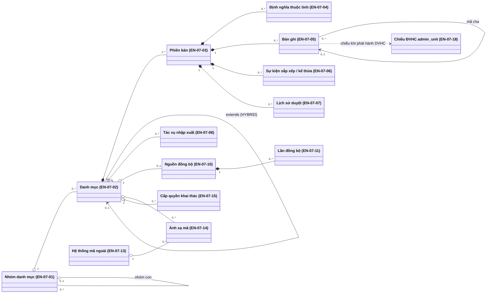
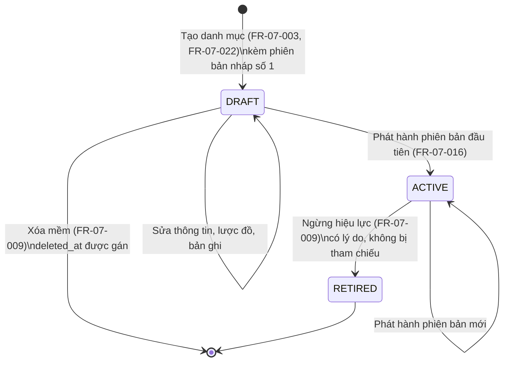
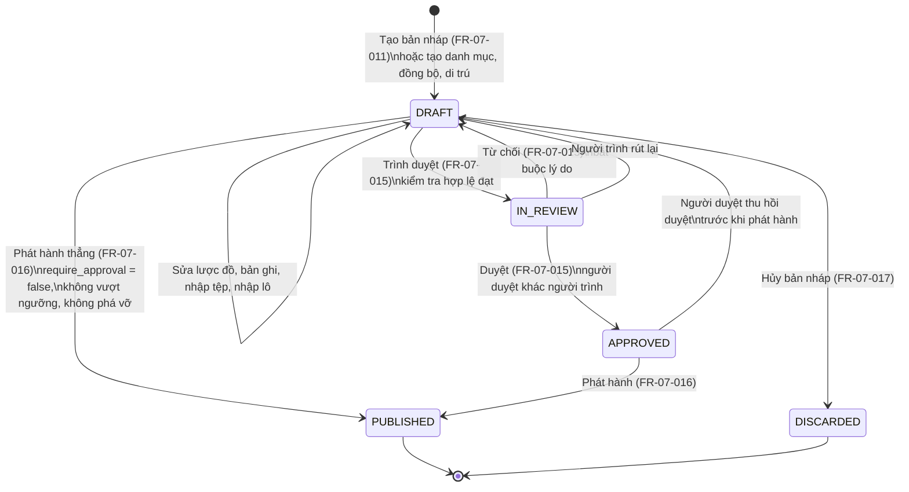
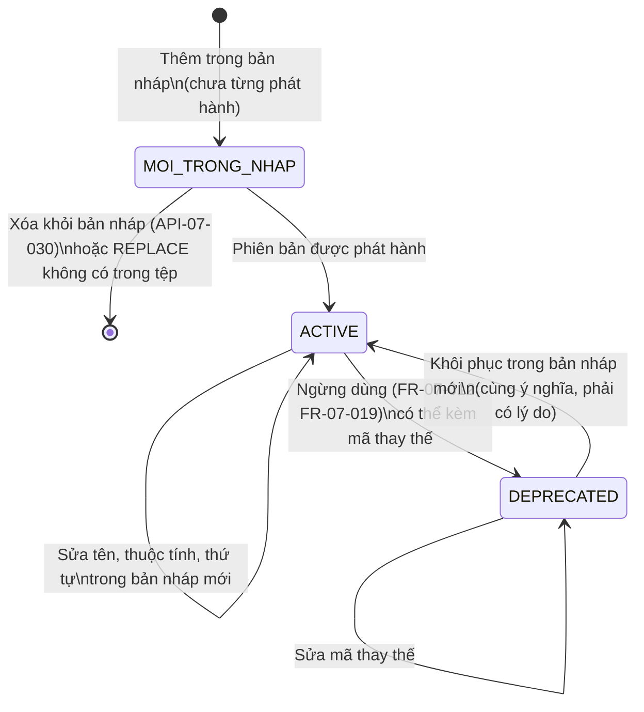
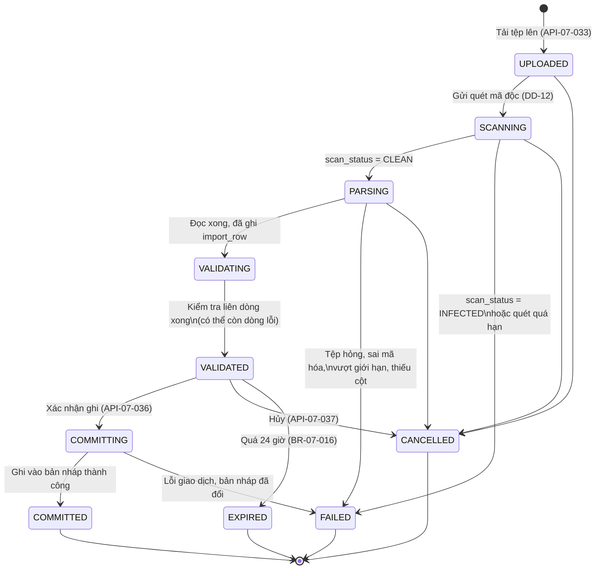
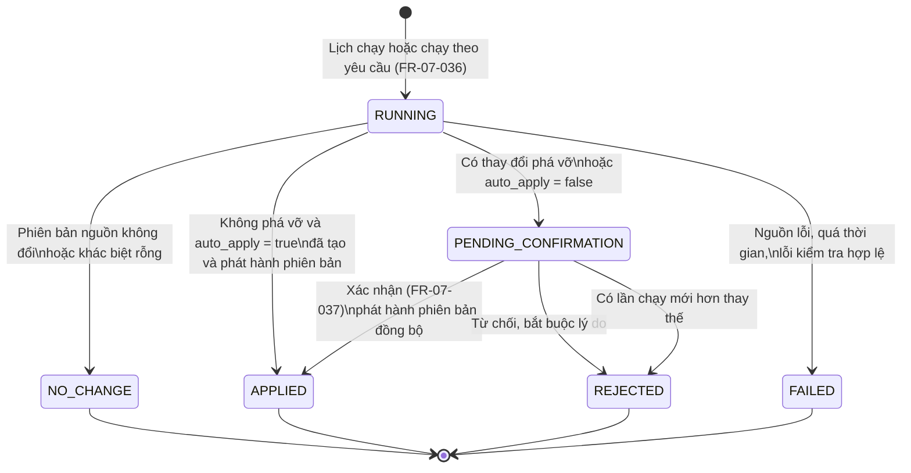

# D02-03-PH07 · Đặc tả chức năng phân hệ PH-07 Danh mục dùng chung

## Tóm tắt cho hội đồng thẩm định

PH-07 Danh mục dùng chung thay thế khối "Danh mục dùng chung Aita" của LGSP cũ. Phân hệ là nơi duy nhất trong tỉnh quản lý các bảng mã dùng chung (dân tộc, giới tính, đơn vị hành chính, lĩnh vực thủ tục, đơn vị tổ chức…) và cung cấp chúng cho các hệ thống thông tin (HTTT) của tỉnh qua API, sự kiện và tệp. Phân hệ thuộc đợt MVP vì danh mục là khối được chuyển đổi đầu tiên theo kế hoạch strangler (D06-01).

Phạm vi phủ hệ cũ: toàn bộ 19 chức năng của Aita (LGC-DMDC-001…019), chức năng danh mục quốc gia trên NGSP (LGC-NGSP-006) và phần chuyển đổi mã trên bus (LGC-BUS-036) đều có FR tương ứng (mục 9.1). Một chức năng bị thay thế vì lý do an toàn thông tin: "API truy vấn CSDL tùy chọn" của Aita cho phép gửi câu SQL tự do, được thay bằng truy vấn có cấu trúc có giới hạn (FR-07-032, BR-07-018).

Điểm mới so với hệ cũ:
- Mỗi danh mục có phiên bản và ngày hiệu lực. HTTT tra được mã tại một thời điểm bất kỳ, kể cả trước sắp xếp đơn vị hành chính ngày 01/7/2025.
- Mọi thay đổi đi qua bản nháp, có duyệt bốn mắt và được ghi kiểm toán.
- Nhập Excel, CSV có bước xem trước và báo lỗi theo từng dòng; xuất theo từng phiên bản.
- Danh mục quốc gia được đồng bộ định kỳ qua PH-14 và đối chiếu khác biệt; thay đổi phá vỡ phải có người xác nhận.
- Có bảng ánh xạ mã giữa danh mục chuẩn và mã riêng của từng HTTT.
- Có danh mục đơn vị hành chính với lịch sử sáp nhập, chia tách và công cụ chuyển mã cũ sang mới.
- Dùng chung cho nhiều tỉnh: danh mục toàn quốc quản lý một lần, mỗi tỉnh có danh mục riêng và phần bổ sung địa phương.

Căn cứ pháp lý chính ở mục 1.6. Phạm vi MVP ở mục 9.3, tiêu chí chấp nhận cấp phân hệ ở mục 13. Các phần còn lại dành cho đội kỹ thuật.

## 1. Mục đích, phạm vi và người đọc

### 1.1. Mục đích

Tài liệu này đặc tả đầy đủ các yêu cầu chức năng (functional requirements) của phân hệ PH-07 Danh mục dùng chung (Reference Data Management, viết tắt RDM) thuộc sản phẩm Datahub, nền tảng tích hợp và chia sẻ dữ liệu cấp tỉnh thế hệ mới thay thế LGSP cũ. Mục tiêu của tài liệu là để đội phát triển có thể lập trình ngay mà không phải đoán ý nghiệp vụ, để đội kiểm thử có thể viết ca kiểm thử dương tính và âm tính cho từng yêu cầu, và để chủ đầu tư có căn cứ nghiệm thu từng chức năng so với hệ cũ Aita Information.

Mỗi yêu cầu chức năng được viết theo mẫu thống nhất tại [D00-01 §4.3](../../00-chung/D00-01-thuat-ngu-quy-uoc.md), dùng kiểu dữ liệu chuẩn `T-*` tại D00-01 §5 và hệ mã truy vết tại D00-01 §3. Các chức năng dùng chung cho mọi phân hệ (xác thực, phân trang, xuất nhập chung, kiểm toán, thông báo, hộp "Việc của tôi") đã được đặc tả ở [D02-02 SRS §4](../D02-02-srs.md); tài liệu này chỉ ghi "Tuân thủ FR-00-nnn" và không viết lại, nhằm tránh hai nguồn sự thật mâu thuẫn nhau.

### 1.2. Phạm vi

Phạm vi của PH-07 gồm toàn bộ vòng đời của danh mục dùng chung trong Datahub: khai báo danh mục và lược đồ thuộc tính động; soạn bản nháp; nhập xuất Excel, CSV và API; kiểm tra hợp lệ; so sánh khác biệt; trình duyệt, phê duyệt và phát hành phiên bản có hiệu lực theo khoảng ngày; cung cấp dữ liệu danh mục cho các hệ thống thông tin (HTTT) qua API tra cứu, API truy vấn có cấu trúc, ảnh chụp tệp và sự kiện; đồng bộ với danh mục dùng chung quốc gia qua Nền tảng tích hợp, chia sẻ dữ liệu quốc gia (NDXP) thông qua PH-14; ánh xạ mã giữa danh mục và hệ thống mã ngoài; quản lý danh mục đơn vị hành chính (ĐVHC) theo mô hình chính quyền hai cấp từ ngày 01/7/2025 kèm lịch sử ba cấp và công cụ chuyển mã; chia sẻ danh mục toàn quốc giữa các tenant; và di trú dữ liệu từ hệ cũ Aita.

Ngoài phạm vi của tài liệu này là dữ liệu chủ (công dân, tổ chức, địa chỉ) thuộc PH-06, quy tắc chất lượng dữ liệu thuộc PH-08, chuyển đổi định dạng bản tin trong luồng tích hợp thuộc PH-04 (PH-04 chỉ gọi API chuyển mã của PH-07), và cơ chế kết nối kỹ thuật với NDXP thuộc PH-14 (PH-07 chỉ gọi qua cổng tiếp hợp mà PH-14 cung cấp).

### 1.3. Người đọc và cách đọc

Bảng sau giúp từng nhóm người đọc biết phần nào của tài liệu là trọng tâm với mình, để không phải đọc tuần tự hơn ba nghìn dòng.

| Người đọc | Phần nên đọc kỹ | Mục đích sử dụng |
|---|---|---|
| Chủ đầu tư, lãnh đạo Sở | Mục 2, mục 3, mục 9, mục 11 | Xác nhận phạm vi, đối chiếu với hệ cũ, trả lời câu hỏi mở |
| Phân tích nghiệp vụ, chủ sản phẩm | Toàn bộ, đặc biệt mục 4, 5, 6 | Làm cơ sở cho use case D02-04-PH07 và user story D02-05-PH07 |
| Kiến trúc sư, trưởng nhóm phát triển | Mục 4, 5, 7, 8, 10 | Thiết kế SDD D03-02-PH07, CSDL D03-03-PH07, API D03-04-PH07 |
| Lập trình viên backend `dh-data` | Mục 5 (từng FR), mục 6, mục 8 | Lập trình, viết kiểm thử đơn vị |
| Lập trình viên giao diện `dh-console` | Mục 4, mục 5 nhóm A, B, C, G | Màn hình D03-06-PH07 |
| Kiểm thử viên | Mục 5 (ngoại lệ, hậu điều kiện), mục 6, mục 7 | Ca kiểm thử D05-02-PH07 |
| Đội di trú | Mục 2.2, FR-07-051, mục 6 | Kịch bản di trú Aita |

### 1.4. Tài liệu liên quan

Các tài liệu dưới đây là nền tảng hoặc tài liệu anh em của FRS này; khi có mâu thuẫn, thứ tự ưu tiên là D02-08 và D02-07 (tài liệu chung đã ban hành), sau đó tới FRS này, sau đó tới tài liệu thiết kế.

| Mã | Tài liệu | Quan hệ |
|---|---|---|
| D00-01 | [Thuật ngữ và quy ước chung](../../00-chung/D00-01-thuat-ngu-quy-uoc.md) | Mẫu FR, kiểu dữ liệu, quy ước đặt tên |
| D00-03 | [Ma trận truy vết](../../00-chung/D00-03-ma-tran-truy-vet.md) | Nguồn của các mục LGC-DMDC-001…019, LGC-NGSP-006, LGC-BUS-036 |
| D02-01 | [BRD](../D02-01-brd.md) | REQ-07, REQ-20, REQ-22, BP-03, BP-08, BO-05, KPI-10, KPI-11 |
| D02-02 | [SRS chung](../D02-02-srs.md) | FR-00 và NFR-00 dùng chung |
| D02-07 | [Từ điển dữ liệu chung](../D02-07-tu-dien-du-lieu.md) | DD-07 ĐVHC, DD-11 outbox, DD-12 tệp, DD-14 tham số |
| D02-08 | [Ma trận phân quyền](../D02-08-ma-tran-phan-quyen.md) | Vai trò và quyền PERM-07 |
| D03-01 | [SAD](../../03-thiet-ke/D03-01-sad.md) | Phân loại dữ liệu §8.2, outbox §7.3, quy ước API §7.2 |
| D03-10 | [Thiết kế đa tenant](../../03-thiet-ke/D03-10-thiet-ke-da-tenant.md) | RLS, tenant `COMMON` và `PLATFORM` |
| D02-06-PH07 | [DFD PH-07](../dfd/D02-06-PH07-dfd-danh-muc.md) | Luồng dữ liệu của chính các FR trong tài liệu này |
| D02-04-PH07 | [Use case PH-07](../use-case/D02-04-PH07-use-case-danh-muc.md) | Kịch bản người dùng |
| D02-05-PH07 | [User story PH-07](../user-story/D02-05-PH07-user-story-danh-muc.md) | Hạng mục tồn đọng |
| D03-02-PH07 | [SDD PH-07](../../03-thiet-ke/sdd/D03-02-PH07-sdd-danh-muc.md) | Thiết kế chi tiết |
| D03-03-PH07 | [CSDL PH-07](../../03-thiet-ke/csdl/D03-03-PH07-csdl-danh-muc.md) | Bảng EN-07-01…19 |
| D03-04-PH07 | [API PH-07](../../03-thiet-ke/api/D03-04-PH07-api-danh-muc.md) | API-07-001…076, EVT-07-01…10, ERR-07 |
| D03-06-PH07 | [Màn hình PH-07](../../03-thiet-ke/uiux/D03-06-PH07-man-hinh-danh-muc.md) | UI-07-01…13 |
| D05-02-PH07 | [Ca kiểm thử PH-07](../../05-kiem-thu/test-case/D05-02-PH07-test-case.md) | TC-07 |
| ADR-050…058 | Quyết định kiến trúc PH-07 | Thuộc tính động jsonb, phiên bản copy-on-write, HYBRID, phân phối, DSL truy vấn, ĐVHC, nhập tệp, đồng bộ quốc gia, máy trạng thái duyệt nội bộ |

### 1.5. Quy ước riêng của tài liệu

Trong tài liệu này, "danh mục" (tiếng Anh dùng trong mã nguồn là *catalog*) là một tập mã có cấu trúc dùng chung, ví dụ danh mục dân tộc hay danh mục ĐVHC; "bản ghi" (*item*) là một dòng của danh mục, có mã, tên và các thuộc tính; "phiên bản" (*version*) là một ảnh chụp đầy đủ của danh mục gồm lược đồ và bản ghi. Ký hiệu `{c}` trong đường dẫn API là mã danh mục, `{v}` là số phiên bản hoặc các từ khóa `current` (phiên bản đang hiệu lực) và `draft` (phiên bản đang mở). Thời điểm hiển thị theo giờ Việt Nam (UTC+7); mọi phép so sánh ngày hiệu lực dùng ngày theo giờ Việt Nam trừ khi ghi khác. Mọi ví dụ dùng tenant giả lập `T68` (Lâm Đồng) và người dùng giả lập; không có dữ liệu cá nhân thật.

### 1.6. Căn cứ pháp lý riêng của PH-07

Bảng dưới đây liệt kê các văn bản chi phối trực tiếp yêu cầu của PH-07. Danh sách chung của dự án ở D00-01 §7; khi tra cứu ngày 21/11/2026, một số văn bản trong danh sách chung đã được thay thế, nên PH-07 viện dẫn văn bản hiện hành làm căn cứ chính và ghi văn bản cũ ở cột "Kế thừa, chuyển tiếp". Những điểm chưa đối chiếu Công báo được ghi thành câu hỏi mở (Q07-01, Q07-11), không khẳng định.

| Văn bản hiện hành | Nội dung chi phối PH-07 | FR, BR liên quan | Kế thừa, chuyển tiếp |
|---|---|---|---|
| Luật Dữ liệu số 60/2024/QH15 (CMP-LAW-01) và Nghị định 165/2025/NĐ-CP | Dữ liệu chủ, dữ liệu danh mục dùng chung là thành phần quản trị dữ liệu; phân loại dữ liệu | FR-07-008, BR-07-019 | — |
| Nghị định 278/2025/NĐ-CP về kết nối, chia sẻ dữ liệu bắt buộc | Kết nối danh mục quốc gia qua Nền tảng chia sẻ, điều phối dữ liệu của Trung tâm Dữ liệu quốc gia (NDXP, Agent Node đặt tại tỉnh); thời hạn chuẩn hóa 31/12/2026 | FR-07-035…039, BR-07-009, BR-07-017 | Thay thế toàn bộ Nghị định 47/2020/NĐ-CP (CMP-LAW-03) |
| Luật Bảo vệ dữ liệu cá nhân số 91/2025/QH15 (hiệu lực 01/01/2026) và Nghị định 356/2025/NĐ-CP | Danh mục không chứa dữ liệu cá nhân, để không phải áp biện pháp bảo vệ và đánh giá tác động cho dữ liệu được nhân bản rộng | BR-07-025, FR-07-005, FR-07-022, FR-07-051 | Nghị định 356/2025 thay Nghị định 13/2023/NĐ-CP (CMP-LAW-04, 05) |
| Luật An ninh mạng số 116/2025/QH15 và Nghị định 331/2026/NĐ-CP | Kiểm toán thao tác ghi, quét mã độc tệp tải lên, lưu trữ trong nước; cấp độ HTTT theo D03-07 | FR-07-050, BR-07-041, NFR-07-015 | Kế nhiệm Nghị định 85/2016/NĐ-CP (CMP-LAW-06); tiêu chuẩn kỹ thuật theo TCVN 14423:2026 thay TCVN 11930:2017 |
| Quyết định 19/2025/QĐ-TTg ban hành Bảng danh mục và mã số ĐVHC Việt Nam; Nghị quyết 202/2025/QH15 và các nghị quyết của UBTVQH về sắp xếp ĐVHC năm 2025 | Mã, tên, cấp ĐVHC và quan hệ kế thừa sau sắp xếp | FR-07-044…047, BR-07-021, BR-07-022 | Mã ĐVHC trước 01/7/2025 vẫn được tra theo thời điểm |
| Công văn 631/THH-THHT ngày 21/5/2020 (CMP-LAW-09) | Yêu cầu chức năng danh mục dùng chung của LGSP | Mục 9.1 | Giữ làm căn cứ đối chiếu phủ chức năng hệ cũ |

## 2. Bối cảnh nghiệp vụ

### 2.1. Vai trò của danh mục dùng chung trong Datahub

Danh mục dùng chung là "từ vựng" mà các HTTT của tỉnh dùng để hiểu nhau. Khi hệ thống một cửa điện tử gửi hồ sơ sang hệ thống quản lý văn bản, trường "dân tộc" chỉ có nghĩa nếu hai bên dùng cùng một bảng mã dân tộc; trường "nơi cư trú" chỉ có nghĩa nếu hai bên dùng cùng một bảng mã ĐVHC và cùng hiểu mã đó tại cùng một thời điểm. Nếu mỗi hệ thống giữ một bản danh mục riêng và tự cập nhật, sai lệch sẽ phát sinh ngay sau lần thay đổi đầu tiên, và việc đối chiếu dữ liệu giữa các hệ thống trở thành công việc thủ công tốn kém. Vì lý do đó, BRD đặt mục tiêu BO-05 "Danh mục dùng chung thống nhất, đồng bộ với quốc gia", đo bằng KPI-10 (100% danh mục bắt buộc được quản lý tập trung và có phiên bản) và KPI-11 (độ trễ đồng bộ danh mục quốc gia sau khi quốc gia ban hành không quá 24 giờ).

PH-07 vì vậy vừa là công cụ quản trị cho cán bộ quản lý danh mục, vừa là dịch vụ cung cấp dữ liệu tham chiếu có độ sẵn sàng cao cho mọi HTTT và cho các phân hệ khác của Datahub. PH-04 (luồng tích hợp) và runtime `dh-runtime` tra mã danh mục trong lúc chuyển đổi bản tin; PH-20 dùng danh mục ĐVHC để khai báo tenant và tổ chức; PH-08 dùng danh mục làm miền giá trị cho quy tắc chất lượng. Do đó yêu cầu về hiệu năng và tính sẵn sàng của phần khai thác (nhóm D) cao hơn hẳn phần quản trị, và thiết kế phân phối qua bộ đệm và ảnh chụp (ADR-053) là hệ quả trực tiếp.

### 2.2. Hệ cũ Aita Information và các hạn chế

Hệ cũ Aita Information (do nhà thầu trước xây dựng năm 2021, chạy trên Spring Boot với giao diện Angular) quản lý danh mục theo mô hình thực thể – thuộc tính – giá trị (Entity–Attribute–Value, EAV) gồm bốn bảng. Bảng dưới đây tóm tắt cấu trúc thực tế của bốn bảng đó, được đối chiếu giữa tài liệu thiết kế CSDL v1.1 và các câu lệnh SQL trong tài liệu thiết kế chi tiết v1.7; hai tài liệu không khớp nhau ở một số cột, và cột thực tế là cột xuất hiện trong câu lệnh SQL.

| Bảng Aita | Cột thực tế | Ý nghĩa | Ghi chú đối chiếu |
|---|---|---|---|
| `category` | `id int(10)`, `name varchar(500)`, `category_code varchar(500)`, `is_update int(10)` | Danh mục | `is_update = 1` nghĩa là danh mục được cập nhật từ NGSP; giá trị khác là danh mục tạo tại chỗ hoặc đã sửa |
| `category_fields` | `id`, `category_id`, `name varchar(1000)`, `data`, `jhi_order`, `status int(10)` | Thuộc tính của danh mục | Tài liệu CSDL ghi cột `Order`; SQL dùng `jhi_order`; cột `data` không được mô tả ý nghĩa |
| `category_details` | `id`, `category_id` | Bản ghi (chỉ là một định danh, không có mã, không có tên) | Mã và tên bản ghi nằm trong các giá trị |
| `category_details_value` | `id`, `category_id` (theo tài liệu CSDL), `category_details_id`, `category_fields_id`, `value varchar(2000)` | Giá trị của một thuộc tính trên một bản ghi | Tài liệu CSDL thiếu cột `category_fields_id`; SQL thực tế có cột này |

Mô hình này linh hoạt ở chỗ cho phép mỗi danh mục có bộ thuộc tính tùy ý, nhưng có các hạn chế nghiêm trọng đã được nêu trong BRD và kiểm kê LGC-DMDC. Thứ nhất, mọi giá trị là chuỗi tối đa 2.000 ký tự, không có kiểu dữ liệu, không có ràng buộc bắt buộc, duy nhất hay miền giá trị, nên dữ liệu sai lọt vào mà không bị phát hiện. Thứ hai, bản ghi không có mã nghiệp vụ riêng; "mã" chỉ là giá trị của một thuộc tính mà người dùng quy ước, nên không có gì bảo đảm mã là duy nhất. Thứ ba, không có phiên bản và ngày hiệu lực: sửa một bản ghi là ghi đè, xóa là mất hẳn, nên không trả lời được câu hỏi "tại ngày 15/3/2025 mã này có nghĩa là gì", trong khi đây là câu hỏi bắt buộc với dữ liệu ĐVHC sau sắp xếp năm 2025. Thứ tư, không có quy trình duyệt, ai có quyền sửa là sửa thẳng vào dữ liệu đang được các HTTT dùng. Thứ năm, đồng bộ với danh mục quốc gia qua NGSP là thao tác thủ công, cờ `is_update` chỉ cho biết nguồn chứ không ngăn sửa. Thứ sáu, truy vấn theo giá trị thuộc tính phải nối bảng giá trị nhiều lần (mỗi thuộc tính một lần nối), hiệu năng kém khi danh mục lớn. Cuối cùng, khuôn tệp nhập rất cứng (ô A2 là tên danh mục, dòng 4 từ ô B4 là tên thuộc tính, từ dòng 5 là bản ghi, CSV phải mã hóa UTF-16) và không có bước xem trước lỗi, nên một dòng sai làm hỏng cả lần nhập hoặc tệ hơn là ghi một phần.

Các chức năng của Aita được kiểm kê thành 19 mục LGC-DMDC-001…019 trong D00-03 §4.5; cộng với LGC-NGSP-006 (kết nối danh mục quốc gia qua NGSP) và một phần LGC-BUS-036 (chuyển đổi ngữ nghĩa dữ liệu trong luồng). Mục 9 của tài liệu này chứng minh mọi mục LGC đều được ít nhất một FR phủ.

### 2.3. Yêu cầu mới

Ngoài việc thay thế đầy đủ chức năng của Aita, PH-07 đáp ứng các yêu cầu mới sau, mỗi yêu cầu xuất phát từ một nhu cầu nghiệp vụ cụ thể. Danh mục có lược đồ thuộc tính có kiểu, ràng buộc, kiểm tra theo JSON Schema, để dữ liệu sai bị chặn ngay khi nhập. Danh mục có phiên bản bất biến và hiệu lực theo khoảng ngày, để mọi HTTT tra được ý nghĩa của mã tại bất kỳ thời điểm nào và để kiểm toán truy ngược được ai đã thay đổi gì. Thay đổi đi qua bản nháp, so sánh khác biệt và duyệt bốn mắt, để không còn tình trạng sửa thẳng vào dữ liệu đang dùng (quy trình BP-03 của BRD). Nhập tệp chạy nền, có xem trước và báo lỗi theo dòng, cột, ghi theo kiểu tất cả hoặc không (FR-00-032). Danh mục quốc gia được đồng bộ tự động, phát hiện thay đổi trong 24 giờ, thay đổi phá vỡ phải được con người xác nhận. Có bảng ánh xạ mã giữa danh mục chuẩn và mã riêng của từng HTTT, để luồng tích hợp chuyển mã tự động thay vì viết cứng trong mã nguồn. Có API truy vấn có cấu trúc thay cho "API truy vấn CSDL tùy chọn" của Aita (LGC-DMDC-016), vì cho phép chạy câu SQL tự do là lỗ hổng an toàn thông tin nghiêm trọng.

### 2.4. Sắp xếp đơn vị hành chính năm 2025

Năm 2025, Việt Nam thực hiện sắp xếp ĐVHC quy mô lớn và chuyển sang mô hình chính quyền địa phương hai cấp (tỉnh và xã), bỏ cấp huyện. Theo Nghị quyết số 202/2025/QH15 về sắp xếp ĐVHC cấp tỉnh, cả nước còn 34 đơn vị hành chính cấp tỉnh (28 tỉnh và 6 thành phố trực thuộc trung ương). Các nghị quyết của Ủy ban Thường vụ Quốc hội năm 2025 sắp xếp ĐVHC cấp xã của từng tỉnh, và Quyết định số 19/2025/QĐ-TTg của Thủ tướng Chính phủ ban hành Bảng danh mục và mã số ĐVHC Việt Nam với 3.321 đơn vị cấp xã, hiệu lực từ ngày 01/7/2025. Mã cấp tỉnh có hai chữ số, mã cấp xã có năm chữ số.

> **Câu hỏi mở Q07-01:** Số hiệu, ngày ban hành và ngày hiệu lực của Nghị quyết 202/2025/QH15, Quyết định 19/2025/QĐ-TTg và danh sách các nghị quyết của UBTVQH về sắp xếp cấp xã cần được đối chiếu với Công báo trước khi phát hành bản 1.0; đồng thời cần xác nhận tổng số 3.321 đơn vị cấp xã là số tại ngày 01/7/2025 hay đã có điều chỉnh sau đó.

Sự kiện này có ba hệ quả trực tiếp cho PH-07. Thứ nhất, danh mục ĐVHC phải giữ được cả cấu trúc ba cấp cũ (tỉnh, huyện, xã, trước 01/7/2025) và hai cấp mới, vì dữ liệu hồ sơ phát sinh trước ngày 01/7/2025 vẫn mang mã cũ và vẫn phải tra được tên, cấp hành chính tại thời điểm phát sinh. Thứ hai, phải ghi lại quan hệ kế thừa nhiều – nhiều giữa đơn vị cũ và đơn vị mới (một xã mới hình thành từ nhiều xã cũ, một xã cũ có thể bị chia về nhiều xã mới), kèm căn cứ pháp lý. Thứ ba, phải cung cấp công cụ chuyển mã cũ sang mới và tra ngược, và khi một mã cũ bị chia về nhiều đơn vị mới thì công cụ không được tự đoán mà phải trả về danh sách ứng viên để con người hoặc hệ thống nghiệp vụ quyết định dựa trên địa chỉ chi tiết. Bản thân tenant cũng chịu ảnh hưởng: các tỉnh sáp nhập kéo theo sáp nhập tenant (PH-20, BP-08), và danh mục địa phương của các tenant cũ phải được kế thừa.

### 2.5. Đa tenant và ba loại nguồn danh mục

Datahub phục vụ nhiều tỉnh trên một nền tảng (REQ-20). Theo D03-10, dữ liệu mỗi tỉnh được cách ly bằng cột `tenant_id` và chính sách bảo mật mức dòng (Row-Level Security, RLS) của PostgreSQL. Danh mục toàn quốc như ĐVHC, dân tộc, quốc tịch, giới tính và các danh mục đồng bộ từ NDXP không thuộc riêng tỉnh nào; chúng được lưu một lần với `tenant_id = 'COMMON'`, mọi tenant đọc được, và chỉ tenant `PLATFORM` (quản trị nền tảng) được ghi. Cách làm này tránh 34 bản sao của cùng một danh mục quốc gia, tránh sai lệch giữa các tỉnh, và giảm chi phí đồng bộ xuống còn một lần cho cả nước.

Tuy nhiên, tỉnh thường có nhu cầu bổ sung mã địa phương vào danh mục quốc gia (ví dụ bổ sung loại hình đặc thù chưa có trong danh mục quốc gia). Nếu cho tỉnh sửa trực tiếp danh mục `COMMON` thì phá vỡ tính thống nhất; nếu bắt tỉnh sao chép sang danh mục riêng thì mất liên kết với bản quốc gia khi quốc gia cập nhật. Giải pháp (ADR-052) là danh mục HYBRID: tenant tỉnh tạo danh mục có `source_type = HYBRID`, `extends_catalog_id` trỏ tới danh mục `COMMON`, và chỉ chứa các bản ghi bổ sung có mã thuộc dải mã địa phương (`local_code_pattern`). Khi tra cứu, PH-07 trả về hợp của phiên bản `COMMON` đang hiệu lực và các bản ghi bổ sung, nên HTTT thấy một danh mục liền mạch. Ba loại nguồn được định nghĩa như sau: `LOCAL` là danh mục tỉnh tự quản hoàn toàn; `NATIONAL` là danh mục đồng bộ từ NDXP, chỉ đọc với người dùng và chỉ được cập nhật qua đồng bộ; `HYBRID` là danh mục mở rộng một danh mục `COMMON` hoặc `NATIONAL`.

## 3. Tác nhân, vai trò và quyền

### 3.1. Tác nhân

PH-07 có tác nhân con người và tác nhân máy. Bảng dưới liệt kê từng tác nhân, vai trò tương ứng theo [D02-08](../D02-08-ma-tran-phan-quyen.md) và công việc điển hình của họ trong PH-07.

| Tác nhân | Vai trò D02-08 | Phạm vi | Công việc điển hình trong PH-07 |
|---|---|---|---|
| Cán bộ quản lý danh mục của sở, ngành | `ROLE-DATA_STEWARD` (DS) | Tổ chức hoặc tenant; ký hiệu ○ nghĩa là chỉ trên danh mục có `owner_org_id` là tổ chức của mình | Tạo danh mục, khai báo lược đồ, soạn bản nháp, nhập xuất tệp, ghi ánh xạ, trình duyệt |
| Lãnh đạo phòng, đơn vị duyệt danh mục | `ROLE-DATA_APPROVER` (DA) | Tenant | Xem khác biệt, duyệt hoặc từ chối, phát hành; chạy và xác nhận đồng bộ quốc gia |
| Quản trị Datahub của tỉnh | `ROLE-TENANT_ADMIN` (TA) | Tenant | Quản lý mọi danh mục trong tenant (trừ duyệt, phát hành), ngừng hiệu lực, cấu hình tham số, cấp quyền khai thác danh mục hạn chế |
| Quản trị nền tảng | `ROLE-PLATFORM_ADMIN` (PA) | Tenant `PLATFORM`, ghi danh mục `COMMON` | Quản lý và phát hành danh mục `COMMON`, ĐVHC, đồng bộ quốc gia cho `COMMON`, nạp gói danh mục nền cho tenant mới, chạy di trú |
| Kỹ sư tích hợp | `ROLE-INTEGRATION_ENGINEER` (IE) | Tenant hoặc không gian làm việc | Xem danh mục và lược đồ, thử API tra cứu và truy vấn, quản lý ánh xạ mã dùng trong luồng |
| Nhà phát triển | `ROLE-DEVELOPER` | Ứng dụng được giao | Đọc tài liệu, lược đồ, thử API trên cổng nhà phát triển |
| Người xem | `ROLE-VIEWER` (VW) | Tenant | Xem, xuất danh mục |
| Kiểm toán, thanh tra | `ROLE-AUDITOR` (AU) | Tenant, chỉ đọc | Xem lịch sử thay đổi, xuất bằng chứng |
| HTTT thành viên (máy) | Client OAuth2 `client_credentials`, scope `rdm.read`, `rdm.query`, `rdm.write` | Tenant của HTTT | Tra cứu, truy vấn, tải ảnh chụp, nhận sự kiện, nhập lô vào bản nháp |
| PH-14 Kết nối quốc gia | Dịch vụ nội bộ | Nền tảng | Cổng tiếp hợp NDXP danh mục dùng chung |
| PH-20 Quản lý tenant | Dịch vụ nội bộ | Nền tảng | Gọi nạp gói danh mục nền khi khởi tạo tenant |
| Bộ lập lịch PH-07 | Tác vụ nền | Theo tenant | Chạy đồng bộ định kỳ, dọn bảng tạm, hết hạn tác vụ nhập |

### 3.2. Quyền PH-07 theo D02-08

Bảng dưới đây trích ma trận D02-08 §3.1 cho PH-07 và giải thích ý nghĩa nghiệp vụ của từng quyền khi áp vào các FR. Ký hiệu ● là được phép trong phạm vi vai trò, ○ là chỉ với danh mục do tổ chức mình làm chủ, — là không được phép.

| Quyền | Ý nghĩa trong PH-07 | PA | TA | DS | DA | IE | VW | AU | Các vai trò khác |
|---|---|---|---|---|---|---|---|---|---|
| `PERM-07-read` | Xem danh mục, lược đồ, phiên bản, bản ghi, tác vụ, lần đồng bộ, ánh xạ, lịch sử | ● | ● | ● | ● | ● | ● | ● | ● |
| `PERM-07-create` / `PERM-07-update` | Tạo, sửa danh mục, nhóm, lược đồ, bản ghi trên bản nháp, nhập tệp, nhập lô, ghi sự kiện sắp xếp ĐVHC, hủy bản nháp | ● (COMMON) | ● | ○ | — | — | — | — | — |
| `PERM-07-submit` | Trình duyệt phiên bản | ● (COMMON) | ● | ○ | — | — | — | — | — |
| `PERM-07-publish` | Duyệt và phát hành phiên bản (gồm phát hành thẳng khi không cần duyệt) | ● (COMMON) | — | — | ● | — | — | — | — |
| `PERM-07-export` | Xuất danh mục ra tệp | ● | ● | ● | ● | ● | ● | ● | ● |
| `PERM-07-sync` | Cấu hình nguồn, chạy đồng bộ, xác nhận hoặc từ chối thay đổi từ nguồn quốc gia | ● | ● | — | ● | — | — | — | — |

Ma trận này có hai điểm cần lưu ý. Thứ nhất, `ROLE-TENANT_ADMIN` không có `PERM-07-publish`: quản trị tỉnh quản lý được mọi danh mục nhưng không tự phát hành, vì phát hành là quyết định nghiệp vụ thuộc người duyệt danh mục. Thứ hai, D02-08 §4 cấm gán đồng thời DATA_STEWARD và DATA_APPROVER cho cùng một người trong cùng tenant; ngoài ra nguyên tắc bốn mắt (FR-00-071) áp dụng cho từng phiên bản: người có `PERM-07-publish` không được duyệt hoặc phát hành phiên bản do chính mình trình hoặc chính mình sửa lần cuối (BR-07-011).

### 3.3. Quyền đề xuất bổ sung D02-08

Một số thao tác của PH-07 chưa có quyền tương ứng trong D02-08. Nhóm PH-07 đề xuất bổ sung các quyền sau vào D02-08; trong thời gian chờ luồng lõi gộp, mã nguồn kiểm tra đúng các mã quyền này để không phải sửa lại khi D02-08 được cập nhật.

| Quyền đề xuất | Ý nghĩa | PA | TA | DS | DA | IE | Lý do đề xuất |
|---|---|---|---|---|---|---|---|
| `PERM-07-retire` | Ngừng hiệu lực danh mục đã phát hành | ● (COMMON) | ● | — | — | — | Thao tác ảnh hưởng mọi HTTT đang dùng, cần tách khỏi quyền sửa thông thường (đề xuất bổ sung D02-08) |
| `PERM-07-mapping` | Quản lý hệ thống mã ngoài và bảng ánh xạ mã | ● | ● | ● | — | ● | Kỹ sư tích hợp là người hiểu mã của HTTT nhưng không có quyền sửa danh mục (đề xuất bổ sung D02-08) |
| `PERM-07-grant` | Cấp, thu hồi quyền khai thác danh mục `RESTRICTED` cho HTTT | ● | ● | — | — | — | Là quyết định kiểm soát truy cập, thuộc quản trị tỉnh (đề xuất bổ sung D02-08) |
| `PERM-07-configure` | Đọc, ghi tham số `07.rdm.*` của tenant qua PH-18 | ● | ● | — | — | — | Tham số ảnh hưởng chính sách duyệt (đề xuất bổ sung D02-08) |
| `PERM-07-sync` cho DS (○) | Cho DS chạy đồng bộ theo yêu cầu và xem khác biệt với danh mục mình làm chủ, nhưng không xác nhận thay đổi phá vỡ | — | — | ○ | — | — | Khung PH-07 ban đầu giao đồng bộ cho DS; D02-08 hiện chỉ cho PA, TA, DA (đề xuất bổ sung D02-08, xem Q07-02) |

> **Câu hỏi mở Q07-02:** D02-08 không cấp `PERM-07-sync` cho DATA_STEWARD, trong khi thực tế người theo dõi danh mục quốc gia hằng ngày là cán bộ quản lý danh mục. Đề nghị chủ đầu tư quyết định có cấp `PERM-07-sync` phạm vi ○ cho DS (chỉ chạy và xem, không xác nhận thay đổi phá vỡ) hay giữ như D02-08. Trong khi chờ, FRS này theo D02-08.

### 3.4. Scope của HTTT thành viên

HTTT gọi PH-07 bằng token `client_credentials` hoặc mTLS qua gateway. Bảng dưới đây định nghĩa ba scope và điều kiện cấp; scope được sinh tự động theo D02-08 §5, không cấp tay.

| Scope | Cho phép | Được cấp khi |
|---|---|---|
| `rdm.read` | API-07-033, 041…046, 048…050 (danh sách danh mục, tra một mã, tra lô, lấy toàn bộ, cây, tìm kiếm, delta, lược đồ, ảnh chụp, dòng lịch sử), API-07-051 (chuyển mã ĐVHC), API-07-070 (chuyển mã ánh xạ) | Mặc định cho mọi HTTT `ACTIVE` |
| `rdm.query` | API-07-047 (truy vấn có cấu trúc) | Khi HTTT đăng ký sử dụng API truy vấn danh mục được duyệt ở PH-02 |
| `rdm.write` | API-07-031 (nhập lô vào bản nháp của danh mục được giao) | Khi HTTT được khai báo là nguồn dữ liệu của một danh mục cụ thể; chỉ ghi bản nháp, không trình, không phát hành |

> **Câu hỏi mở Q07-03:** D02-08 §5 viết scope dạng `rdm:read` (dấu hai chấm), còn khung PH-07 thống nhất dạng `rdm.read`. Cần luồng lõi chốt một ký pháp duy nhất cho toàn bộ scope của Datahub; FRS này dùng `rdm.read`, `rdm.query`, `rdm.write`.

## 4. Khái niệm và mô hình nghiệp vụ

### 4.1. Tổng quan mô hình

Sơ đồ dưới đây trình bày các khái niệm nghiệp vụ chính của PH-07 và quan hệ giữa chúng. Sơ đồ ở mức nghiệp vụ, không phải lược đồ CSDL; mỗi khái niệm được ghi kèm mã thực thể EN tương ứng để người đọc tra sang D03-03-PH07.



Sơ đồ cho thấy danh mục là trung tâm, nhưng đơn vị dữ liệu bất biến là phiên bản: thuộc tính, bản ghi, sự kiện kế thừa và lịch sử duyệt đều gắn với một phiên bản cụ thể chứ không gắn trực tiếp với danh mục. Đây là hệ quả của mô hình ảnh chụp đầy đủ (copy-on-write, ADR-051): khi tạo bản nháp mới, toàn bộ lược đồ và bản ghi của phiên bản hiện hành được sao chép sang phiên bản nháp, người dùng sửa trên bản sao, và phiên bản cũ không bao giờ bị động tới. Cách làm này tốn dung lượng hơn so với lưu khác biệt, nhưng đổi lại mọi phép tra cứu theo thời điểm chỉ là chọn đúng phiên bản rồi đọc thẳng, không phải dựng lại trạng thái từ chuỗi khác biệt; với quy mô danh mục (tối đa 200.000 bản ghi mỗi danh mục, NFR-07-011) chi phí lưu trữ là chấp nhận được. Các thực thể vận hành (tác vụ nhập xuất, nguồn và lần đồng bộ, ánh xạ, cấp quyền) gắn với danh mục, vì chúng tồn tại xuyên qua nhiều phiên bản.

### 4.2. Danh mục

Danh mục là một tập mã có cùng ý nghĩa nghiệp vụ, do một cơ quan chủ quản chịu trách nhiệm nội dung. Mỗi danh mục có mã (`code`, kiểu `T-CODE`, duy nhất trong tenant và không trùng mã danh mục `COMMON` đang hoạt động, BR-07-001), tên, mô tả, nhóm, cơ quan chủ quản (`owner_org_id`, tham chiếu logic tới tổ chức DD-02 của PH-20), nguồn (`source_type`), mức phân loại (`classification`), trạng thái (`status`), cấu hình phân cấp (`is_hierarchical`, `max_depth`, `level_names`), dải mã địa phương (`local_code_pattern`), danh mục gốc nếu là HYBRID (`extends_catalog_id`), chính sách duyệt (`require_approval`) và con trỏ tới phiên bản đang hiệu lực (`current_version_id`). Mã danh mục là định danh mà HTTT dùng trong đường dẫn API, nên mã không được đổi sau khi danh mục đã phát hành lần đầu (BR-07-040, đề xuất mới); đổi mã sẽ làm gãy mọi HTTT đang gọi.

### 4.3. Nhóm danh mục

Nhóm danh mục là cây phân loại giúp người dùng tìm danh mục trong danh sách hàng trăm danh mục, ví dụ nhóm "Hành chính" gồm nhóm con "Đơn vị hành chính", "Cơ quan nhà nước". Nhóm chỉ có ý nghĩa tổ chức hiển thị, không ảnh hưởng tới quyền hay tra cứu. Tenant `COMMON` có cây nhóm riêng cho danh mục toàn quốc; tenant tỉnh thấy cả cây nhóm `COMMON` (chỉ đọc) và cây nhóm của mình.

### 4.4. Lược đồ thuộc tính động và kiểu dữ liệu

Mỗi phiên bản có một lược đồ gồm các định nghĩa thuộc tính (`attribute_def`). Ngoài các trường hệ thống cố định (mã, tên, mã cha, thứ tự, trạng thái, mã thay thế, khoảng hiệu lực của bản ghi), mỗi danh mục có thể khai báo tối đa 100 thuộc tính động (NFR-07-011). Giá trị thuộc tính động được lưu trong cột `attrs` kiểu `jsonb` của bản ghi và được kiểm tra bằng JSON Schema sinh tự động từ lược đồ (ADR-050), thay cho mô hình EAV của Aita. Mã thuộc tính (`code`) là khóa trong `attrs`, viết theo dạng chữ thường có gạch dưới (snake_case, mẫu `^[a-z][a-z0-9_]{0,62}$`) để thuận tiện cho JSON; nhãn (`label`) là tên tiếng Việt hiển thị.

Bảng dưới đây định nghĩa mười một kiểu dữ liệu được phép cho thuộc tính động, cách biểu diễn trong JSON, cách nhập trong tệp và ràng buộc nào áp dụng được cho từng kiểu. Bảng này là căn cứ để sinh JSON Schema và để kiểm tra hợp lệ khi nhập tệp.

| Kiểu `data_type` | Ý nghĩa | Biểu diễn JSON | Cách ghi trong tệp nhập | Ràng buộc áp dụng được |
|---|---|---|---|---|
| `STRING` | Chuỗi ngắn một dòng | `string` | Văn bản | `max_length` (1…2.000, mặc định 255), `pattern`, `required`, `unique_in_version`, `default_value` |
| `TEXT` | Văn bản dài, nhiều dòng | `string` | Văn bản, cho phép xuống dòng | `max_length` (1…4.000, mặc định 4.000), `required` |
| `INTEGER` | Số nguyên 64 bit | `integer` | Chữ số, có thể có dấu trừ; không chấp nhận dấu phân cách hàng nghìn | `min_value`, `max_value`, `required`, `unique_in_version`, `default_value` |
| `DECIMAL` | Số thập phân chính xác | `string` theo mẫu số thập phân (tránh mất chính xác của số thực JSON) | Dấu chấm thập phân; trong xlsx chấp nhận ô kiểu số | `min_value`, `max_value`, `max_length` dùng làm tổng số chữ số (mặc định 19), `required` |
| `BOOLEAN` | Đúng hoặc sai | `boolean` | `TRUE`/`FALSE`, `Có`/`Không`, `1`/`0` (không phân biệt hoa thường) | `required`, `default_value` |
| `DATE` | Ngày | `string`, `format: date` (`yyyy-MM-dd`) | `dd/MM/yyyy` hoặc `yyyy-MM-dd`, hoặc ô kiểu ngày trong xlsx | `min_value`, `max_value` (dạng ngày), `required` |
| `DATETIME` | Thời điểm | `string`, `format: date-time`, lưu UTC | `dd/MM/yyyy HH:mm:ss` (hiểu là giờ Việt Nam) hoặc ISO 8601 có múi giờ | `min_value`, `max_value`, `required` |
| `ENUM` | Một giá trị trong tập liệt kê | `string`, `enum` | Mã giá trị (không phải nhãn); sheet `GiaTriHopLe` liệt kê | `enum_values` (mảng `{value, label}`, 1…500 phần tử), `required`, `default_value` |
| `CATALOG_REF` | Tham chiếu tới mã của một danh mục khác | `string` (mã bản ghi) | Mã bản ghi của danh mục được tham chiếu | `ref_catalog_code` (bắt buộc), `required`; giá trị phải tồn tại và `ACTIVE` trong phiên bản hiệu lực của danh mục đích tại ngày `effective_from` của phiên bản đang soạn |
| `URI` | Địa chỉ tài nguyên | `string`, `format: uri` | Văn bản | `max_length` (≤ 2.048), `required` |
| `EMAIL` | Địa chỉ thư điện tử của cơ quan | `string`, `format: email` | Văn bản | `required`; chỉ dùng cho hộp thư công vụ của cơ quan, không cho thư cá nhân (BR-07-025) |

Ý nghĩa của từng ràng buộc như sau. `required` bắt buộc mọi bản ghi `ACTIVE` phải có giá trị khác rỗng; bản ghi `DEPRECATED` được miễn để không chặn việc ngừng dùng bản ghi cũ thiếu dữ liệu. `unique_in_version` bắt buộc giá trị (sau khi chuẩn hóa: cắt khoảng trắng hai đầu, so sánh không phân biệt hoa thường với chuỗi) không trùng giữa các bản ghi trong cùng phiên bản, giá trị rỗng không tính là trùng. `max_length` giới hạn số ký tự Unicode (đếm theo điểm mã sau chuẩn hóa NFC), không phải số byte. `pattern` là biểu thức chính quy theo cú pháp ECMA-262 được neo hai đầu, độ dài biểu thức tối đa 500 ký tự, và được thử biên dịch khi khai báo để chặn biểu thức gây quay lui thảm họa (thời gian khớp thử trên chuỗi 2.000 ký tự phải dưới 50 ms). `min_value` và `max_value` là cận đóng. `enum_values` là danh sách giá trị cho phép, mỗi giá trị theo mẫu `T-CODE` và có nhãn tiếng Việt. `default_value` được điền khi bản ghi mới không có giá trị; giá trị mặc định phải tự hợp lệ với chính ràng buộc của thuộc tính. `queryable` cho phép thuộc tính xuất hiện trong bộ lọc của API truy vấn có cấu trúc (BR-07-018) và kéo theo việc tạo chỉ mục biểu thức trên `attrs`, vì vậy mỗi danh mục giới hạn tối đa 10 thuộc tính `queryable` (tham số `07.rdm.max-queryable-attributes`). `searchable` đưa giá trị thuộc tính vào chỉ mục tìm kiếm không dấu cùng với tên bản ghi. `status = HIDDEN` ẩn thuộc tính khỏi giao diện, tệp xuất và API khai thác nhưng vẫn giữ giá trị, tương đương trạng thái thuộc tính của Aita (LGC-DMDC-018).

Danh mục không được chứa dữ liệu cá nhân (BR-07-025). Khi khai báo thuộc tính, hệ thống từ chối mức phân loại Nhạy cảm và cảnh báo (phải xác nhận) nếu mã hoặc nhãn thuộc tính chứa các từ gợi ý dữ liệu cá nhân như "số định danh", "CCCD", "CMND", "ngày sinh", "số điện thoại cá nhân", "địa chỉ thường trú", "họ tên công dân". Danh sách từ gợi ý là tham số `07.rdm.pii-keywords` để quản trị nền tảng cập nhật.

### 4.5. Phiên bản và hiệu lực theo khoảng ngày

Phiên bản là ảnh chụp đầy đủ của danh mục tại một thời điểm, gồm lược đồ và toàn bộ bản ghi. Số phiên bản (`version_no`) tăng dần từ 1 trong mỗi danh mục và không bao giờ tái sử dụng kể cả khi một bản nháp bị hủy. Mỗi phiên bản đã phát hành có khoảng hiệu lực nửa mở `[effective_from, effective_to)`: phiên bản có hiệu lực từ đầu ngày `effective_from` (00:00 giờ Việt Nam) đến hết ngày liền trước `effective_to`; `effective_to` rỗng nghĩa là còn hiệu lực vô thời hạn. Khoảng hiệu lực của các phiên bản đã phát hành không chồng lấn; khi phát hành phiên bản mới, `effective_to` của phiên bản đang có `effective_to` rỗng được gán bằng `effective_from` của phiên bản mới (BR-07-007). Nhờ quy tắc này, với mọi ngày bất kỳ có tối đa một phiên bản hiệu lực, và phép tra cứu theo thời điểm (BR-07-008) luôn cho kết quả xác định.

Ba nhãn "Đang hiệu lực", "Sắp hiệu lực" và "Hết hiệu lực" không phải trạng thái lưu trong CSDL mà được tính từ khoảng hiệu lực so với ngày hiện tại: "Sắp hiệu lực" khi `effective_from` lớn hơn hôm nay; "Đang hiệu lực" khi hôm nay nằm trong khoảng; "Hết hiệu lực" khi `effective_to` nhỏ hơn hoặc bằng hôm nay. Lý do không lưu nhãn này là để tránh phải có tác vụ nền chuyển trạng thái lúc nửa đêm, vốn dễ sai khi tác vụ trễ hoặc lỗi. Con trỏ `current_version_id` của danh mục được tính lại khi phát hành và khi bước sang ngày mới (tác vụ nền đầu ngày chỉ làm mới con trỏ và bộ đệm, không đổi dữ liệu); kể cả khi tác vụ này trễ, API khai thác vẫn chọn phiên bản theo khoảng hiệu lực chứ không theo con trỏ.

### 4.6. Bản ghi

Bản ghi là một dòng của danh mục trong một phiên bản. Trường hệ thống của bản ghi gồm: mã (`code`, `T-CODE`, lưu chữ hoa, duy nhất trong phiên bản theo so sánh không phân biệt hoa thường, BR-07-002); tên (`name`, `T-NAME`); tên tìm kiếm (`name_search`, cột sinh tự động: chữ thường, bỏ dấu tiếng Việt, đổi "đ" thành "d"); mã cha (`parent_code`); độ sâu (`depth`, 1 cho gốc); đường dẫn tổ tiên (`path`, mảng mã từ gốc tới cha); tên cấp (`level_name`, lấy từ `level_names[depth-1]` của danh mục); thứ tự (`sort_order`); trạng thái (`status`); mã thay thế (`replaced_by`, mảng mã); khoảng hiệu lực riêng của bản ghi (`valid_from`, `valid_to`, tùy chọn, dùng khi một bản ghi chỉ có hiệu lực trong một phần khoảng của phiên bản); thuộc tính động (`attrs`); cờ bản ghi mở rộng địa phương (`is_local_extension`, chỉ cho HYBRID); và tham chiếu hệ cũ (`legacy_ref`).

Mã bản ghi giữ nguyên ý nghĩa qua các phiên bản: cùng một mã ở phiên bản 3 và phiên bản 4 là cùng một đối tượng nghiệp vụ. Vì vậy mã bản ghi không được đổi; nếu nghiệp vụ cần đổi mã, người dùng ngừng dùng mã cũ, thêm mã mới và ghi `replaced_by` (với ĐVHC thì ghi sự kiện `RECODE`). Mã đã từng phát hành không được gán lại cho đối tượng khác (BR-07-021 với ĐVHC và BR-07-040 với mọi danh mục).

### 4.7. Phân cấp

Danh mục phân cấp (`is_hierarchical = true`) tổ chức bản ghi thành cây (hoặc rừng nhiều gốc) theo mã cha. Mã cha phải tồn tại trong cùng phiên bản, cây không được có vòng, độ sâu không vượt `max_depth` (tối đa 10), và bản ghi `ACTIVE` không được có cha `DEPRECATED` (BR-07-014). Hệ thống tự tính `depth`, `path` và `level_name` mỗi khi mã cha thay đổi, người dùng không nhập các trường này. Tên cấp (`level_names`) là mảng nhãn theo độ sâu, ví dụ `["Tỉnh", "Xã"]` cho ĐVHC hiện hành; phiên bản lịch sử của ĐVHC trước 01/7/2025 dùng `["Tỉnh", "Huyện", "Xã"]`. Vì tên cấp có thể khác nhau giữa các phiên bản, `level_names` được chụp vào phiên bản khi phát hành (trong `stats` của phiên bản) để tra cứu lịch sử hiển thị đúng tên cấp tại thời điểm đó.

### 4.8. Ngừng dùng và kế thừa

Bản ghi đã từng phát hành không bị xóa (BR-07-003). Khi một mã không còn dùng, người dùng chuyển bản ghi sang `DEPRECATED` trong bản nháp và có thể ghi danh sách mã thay thế `replaced_by`. Bản ghi ngừng dùng vẫn được tra cứu, kết quả trả kèm trạng thái và mã thay thế (BR-07-004), để HTTT đang lưu dữ liệu cũ vẫn hiểu được mã và biết chuyển sang mã nào. Với danh mục ĐVHC, quan hệ kế thừa phong phú hơn nên được ghi thành sự kiện sắp xếp (`item_succession`) có loại sự kiện, danh sách mã nguồn, danh sách mã đích, ngày hiệu lực và căn cứ pháp lý; `replaced_by` của bản ghi ĐVHC được hệ thống tự điền từ sự kiện sắp xếp.

### 4.9. Nguồn danh mục và quyền cập nhật

Nguồn danh mục quyết định ai được sửa. Danh mục `LOCAL` do tenant tự quản theo quy trình bản nháp – duyệt – phát hành. Danh mục `NATIONAL` chỉ được cập nhật qua đồng bộ từ NDXP (BR-07-009); mọi API sửa trả `ERR-07-003`, kể cả với quản trị tỉnh, để bảo đảm bản trong Datahub luôn trùng bản quốc gia. Danh mục `HYBRID` có lược đồ và bản ghi gốc kế thừa từ danh mục gốc (chỉ đọc), và chỉ chứa bản ghi bổ sung có mã khớp `local_code_pattern`, không trùng mã của danh mục gốc (BR-07-010). Danh mục thuộc tenant `COMMON` chỉ tenant `PLATFORM` được ghi, bất kể nguồn.

### 4.10. Phân loại dữ liệu danh mục

Mỗi danh mục có một mức phân loại theo SAD §8.2. `PUBLIC` (Công khai, mặc định) áp dụng cho hầu hết danh mục; mọi HTTT `ACTIVE` có scope `rdm.read` đều tra được. `INTERNAL` (Nội bộ) áp dụng cho danh mục chỉ dùng trong cơ quan nhà nước; HTTT tra được nhưng không xuất hiện trên cổng nhà phát triển công khai. `RESTRICTED` (Hạn chế) áp dụng cho danh mục có thông tin đầu mối hoặc nội dung chưa công bố; chỉ HTTT được cấp quyền trên đúng danh mục đó mới khai thác được (BR-07-019, FR-07-052), giao diện hiển thị theo quyền và nhật ký che một phần. Mức Nhạy cảm bị cấm trong danh mục (BR-07-025), vì danh mục là dữ liệu tham chiếu được nhân bản rộng rãi vào bộ đệm, ảnh chụp và HTTT, không thể áp các biện pháp bảo vệ của dữ liệu nhạy cảm.

### 4.11. Sơ đồ trạng thái danh mục

Sơ đồ sau mô tả vòng đời của một danh mục (`catalog.status`).



Danh mục bắt đầu ở `DRAFT` khi được tạo và luôn có sẵn phiên bản nháp số 1. Danh mục chỉ được xóa (xóa mềm) khi còn `DRAFT`, tức là chưa từng có phiên bản nào được phát hành, vì khi đó chưa HTTT nào có thể đã dùng nó. Khi phiên bản đầu tiên được phát hành, danh mục chuyển sang `ACTIVE` và không bao giờ quay về `DRAFT`; các lần phát hành tiếp theo không đổi trạng thái danh mục. Danh mục `ACTIVE` có thể bị ngừng hiệu lực thành `RETIRED`, lúc đó phiên bản hiện hành được đóng khoảng hiệu lực tại ngày ngừng, API khai thác trả `ERR-07-031` (HTTP 410) cho tra cứu tại thời điểm sau ngày ngừng nhưng vẫn trả dữ liệu cho tra cứu tại thời điểm trước đó, để dữ liệu lịch sử vẫn hiểu được. `RETIRED` là trạng thái cuối; không có thao tác kích hoạt lại, vì nhu cầu đó được đáp ứng bằng cách tạo danh mục mới, tránh nhầm lẫn cho HTTT đã xử lý sự kiện ngừng hiệu lực.

### 4.12. Sơ đồ trạng thái phiên bản

Sơ đồ sau mô tả vòng đời của một phiên bản (`catalog_version.status`), là trọng tâm của quy trình BP-03.



Mỗi danh mục có tối đa một phiên bản mở, tức là ở một trong ba trạng thái `DRAFT`, `IN_REVIEW`, `APPROVED` (BR-07-005); quy tắc này tránh hai nhóm cùng soạn hai bản nháp rồi ghi đè lên nhau. Chỉ ở `DRAFT` mới sửa được nội dung; sang `IN_REVIEW` thì nội dung bị khóa để người duyệt duyệt đúng cái họ thấy. Bị từ chối, phiên bản quay về `DRAFT` và lý do được lưu ở lịch sử duyệt (`version_review`). Người trình được rút lại phiên bản đang chờ duyệt về `DRAFT` (ví dụ phát hiện sai sót), và người duyệt được thu hồi quyết định duyệt khi phiên bản còn `APPROVED`, vì giữa lúc duyệt và lúc phát hành có thể có thông tin mới. Lối tắt `DRAFT` sang `PUBLISHED` chỉ mở khi danh mục cấu hình không cần duyệt và thay đổi không vượt ngưỡng, không phá vỡ (BR-07-012, BR-07-026); người phát hành vẫn phải có `PERM-07-publish` và không phải người sửa cuối (bốn mắt). Phiên bản đồng bộ quốc gia được tự phát hành khi không phá vỡ và nguồn bật `auto_apply` (FR-07-037); trường hợp này chủ thể phát hành là tác nhân hệ thống và ghi kiểm toán như vậy. `PUBLISHED` và `DISCARDED` là trạng thái cuối, phiên bản đã phát hành là bất biến (BR-07-006).

### 4.13. Sơ đồ trạng thái bản ghi

Sơ đồ sau mô tả vòng đời của một mã bản ghi xuyên qua các phiên bản. Vì bản ghi được sao chép sang từng phiên bản, "trạng thái" ở đây là trạng thái của cùng một mã trong phiên bản nháp so với phiên bản trước.



Trạng thái lưu của bản ghi chỉ có `ACTIVE` và `DEPRECATED`; "mới trong nháp" là trạng thái suy ra (bản ghi `ACTIVE` trong bản nháp mà mã chưa xuất hiện ở bất kỳ phiên bản đã phát hành nào). Chỉ bản ghi mới trong nháp mới xóa được; bản ghi đã từng phát hành chỉ ngừng dùng được (BR-07-003, `ERR-07-013`). Cho phép khôi phục một mã đã ngừng dùng vì có trường hợp ngừng nhầm, nhưng chỉ khi mã giữ đúng ý nghĩa cũ; khôi phục được phân loại là thay đổi không phá vỡ và phải có ghi chú lý do trong `change_note` của phiên bản.

### 4.14. Sơ đồ trạng thái tác vụ nhập và xuất

Tác vụ nhập (`import_job` với `job_type = IMPORT`) đi qua các trạng thái sau. Đây là trạng thái đề xuất của FRS; D03-03-PH07 dùng đúng tập giá trị này cho ràng buộc `CHECK`.



Tác vụ nhập có hai pha tách biệt (ADR-056). Pha một gồm `UPLOADED`, `SCANNING`, `PARSING`, `VALIDATING` và kết thúc ở `VALIDATED` với kết quả xem trước; pha này không đụng tới bản nháp nên người dùng có thể thử nhiều lần mà không có rủi ro. Tệp chỉ được phân tích khi kết quả quét mã độc là `CLEAN` (DD-12, BR-07-041 đề xuất mới). Pha hai bắt đầu khi người dùng xác nhận: `COMMITTING` ghi toàn bộ dòng hợp lệ vào bản nháp trong một giao dịch, thành công thì `COMMITTED`, thất bại thì `FAILED` và bản nháp không thay đổi gì. Kết quả xem trước hết hạn sau 24 giờ (`EXPIRED`), vì sau thời gian đó bản nháp có khả năng đã bị sửa và kết quả kiểm tra không còn đúng. Tác vụ xuất (`job_type = EXPORT`) đơn giản hơn với các trạng thái `QUEUED`, `RUNNING`, `COMPLETED`, `FAILED` và `EXPIRED` (tệp kết quả hết hạn tải sau 24 giờ, FR-00-031); sơ đồ của tác vụ xuất không vẽ riêng vì là chuỗi tuyến tính.

### 4.15. Sơ đồ trạng thái lần đồng bộ

Lần đồng bộ quốc gia (`sync_run.status`) đi qua các trạng thái sau.



Mỗi lần chạy bắt đầu ở `RUNNING`, gọi PH-14 để lấy metadata và dữ liệu, rồi tính khác biệt với phiên bản hiện hành của danh mục trong Datahub. Khi không có khác biệt, lần chạy kết thúc ở `NO_CHANGE` mà không tạo phiên bản. Khi chỉ có thay đổi không phá vỡ và nguồn bật `auto_apply`, hệ thống tạo phiên bản với `origin = SYNC` và phát hành ngay, kết thúc `APPLIED`. Khi có thay đổi phá vỡ, hoặc nguồn tắt `auto_apply`, lần chạy dừng ở `PENDING_CONFIRMATION` chờ người có `PERM-07-sync` xác nhận hoặc từ chối (BR-07-017); trong khi chờ, phiên bản đồng bộ tồn tại dưới dạng bản nháp `origin = SYNC` và chiếm suất phiên bản mở của danh mục. Nếu một lần chạy mới phát hiện phiên bản nguồn mới hơn trong lúc lần trước còn chờ, lần trước bị chuyển `REJECTED` với lý do "được thay thế bởi lần chạy {runId}" và bản nháp được tính lại, để người xác nhận luôn xem khác biệt với dữ liệu nguồn mới nhất.

### 4.16. Thuật ngữ bổ sung

Bảng dưới đây liệt kê các thuật ngữ riêng của PH-07 chưa có trong D00-01; luồng lõi sẽ gộp vào D00-01 §2.

| Thuật ngữ | Định nghĩa |
|---|---|
| Danh mục gốc (base catalog) | Danh mục `COMMON` hoặc `NATIONAL` được một danh mục HYBRID mở rộng |
| Dải mã địa phương (local code range) | Biểu thức chính quy mà mã bản ghi bổ sung của danh mục HYBRID phải khớp, ví dụ `^68L[0-9]{3}$` |
| Thay đổi phá vỡ (breaking change) | Thay đổi có thể làm HTTT đang dùng danh mục bị lỗi hoặc hiểu sai: ngừng dùng mã, đổi mã cha, xóa thuộc tính, đổi kiểu thuộc tính, thu hẹp ràng buộc |
| Ngưỡng thay đổi lớn | Tỷ lệ số bản ghi bị thêm, sửa hoặc ngừng dùng trên tổng số bản ghi của phiên bản gốc, vượt ngưỡng thì bắt buộc duyệt |
| Ảnh chụp (snapshot) | Tệp JSON nén gzip và tệp CSV chứa toàn bộ bản ghi của một phiên bản đã phát hành, lưu ở kho đối tượng |
| Sự kiện sắp xếp (succession event) | Bản ghi quan hệ kế thừa giữa các mã ĐVHC cũ và mới, có loại, căn cứ pháp lý, ngày hiệu lực |
| Hệ thống mã ngoài (code system) | Bộ mã riêng của một HTTT hoặc một cơ quan, cần ánh xạ sang mã danh mục chuẩn |
| Độ phủ ánh xạ | Tỷ lệ bản ghi `ACTIVE` của danh mục có ít nhất một ánh xạ không tạm thời sang một hệ thống mã |

## 5. Đặc tả chi tiết yêu cầu chức năng

### 5.0. Cách đọc đặc tả và quy định chung cho mọi FR

Mỗi FR dưới đây gồm một bảng tóm tắt theo mẫu D00-01 §4.3, tiếp theo là bảng đầu vào, danh sách bước xử lý đánh số và bảng ngoại lệ. Bước xử lý được viết để kiểm thử viên kiểm chứng được từng bước; các bước kiểm tra quyền và tenant chung không lặp lại ở mọi FR mà được quy định một lần trong mục này.

Các quy định sau áp dụng cho mọi FR của PH-07 trừ khi FR ghi khác. Tenant được xác định từ ngữ cảnh xác thực, không lấy từ tham số do client gửi (tuân thủ FR-00-010); mọi truy vấn chạy dưới RLS với `app.tenant_id` của phiên làm việc. Đối tượng thuộc tenant khác hoặc thuộc tổ chức khác (với vai trò phạm vi ○) trả `404` thay vì `403`, để không lộ sự tồn tại của đối tượng (D02-08 §7, FR-00-011). Thao tác tạo nhận tiêu đề `Idempotency-Key` (chuỗi 8…64 ký tự, lưu 24 giờ); gửi lại cùng khóa và cùng nội dung trả lại kết quả cũ, cùng khóa khác nội dung trả `ERR-07-022`. Thao tác sửa, xóa, chuyển trạng thái yêu cầu tiêu đề `If-Match` chứa ETag (giá trị cột `version` của đối tượng); không khớp trả `ERR-07-018` (HTTP 412, tuân thủ FR-00-052); thiếu tiêu đề trả `428 Precondition Required`. Lỗi trả theo RFC 9457 với trường `type`, `title`, `status`, `detail`, `instance`, `code` (mã `ERR-07-nnn`), `traceId` và với lỗi hợp lệ thì thêm mảng `errors` gồm `{field, code, message}`; thông điệp tiếng Việt nói rõ sai gì và cách sửa (tuân thủ FR-00-080). Thao tác ghi trên danh mục `NATIONAL` (trừ qua đồng bộ) hoặc trên danh mục `COMMON` khi tenant hiện hành không phải `PLATFORM` trả `ERR-07-003`. Thao tác ghi trên danh mục `RETIRED` trả `ERR-07-031`. Mọi thao tác ghi thành công sinh bản ghi kiểm toán qua PH-13 theo FR-00-040, FR-00-041 với các trường chung: thời điểm, tenant, chủ thể (người hoặc máy), địa chỉ nguồn, hành động, loại đối tượng, mã đối tượng, giá trị trước và sau (chỉ các trường thay đổi), kết quả, lý do, `traceId`; cột "Kiểm toán" của từng FR chỉ ghi phần riêng. Sự kiện được ghi vào bảng outbox trong cùng giao dịch với thay đổi dữ liệu (SAD §7.3, DD-11), nên sự kiện không bao giờ phát ra cho một thay đổi bị hủy và không bao giờ mất khi thay đổi đã ghi.

Kiểu dữ liệu chuẩn dùng trong bảng đầu vào theo D00-01 §5. Ngoài ra FRS dùng các kiểu bổ trợ sau: `T-INT` là số nguyên 32 bit, `T-ATTR-CODE` là mã thuộc tính theo mẫu `^[a-z][a-z0-9_]{0,62}$`, `T-REGEX` là biểu thức chính quy ECMA-262 tối đa 500 ký tự, `T-FILE` là tệp đính kèm dạng multipart.

### 5.1. Nhóm A — Danh mục và lược đồ

#### FR-07-001 · Liệt kê danh mục, đếm số lượng, lọc theo nhóm, nguồn, trạng thái, phân loại

Chức năng này là màn hình đầu tiên của PH-07 và là API cho HTTT biết có những danh mục nào. Nó thay chức năng "danh sách danh mục, số lượng danh mục" của Aita và bổ sung bộ lọc theo các thuộc tính mới.

| Trường | Nội dung |
|---|---|
| Mã, tên | FR-07-001 · Liệt kê danh mục, đếm số lượng, lọc theo nhóm, nguồn, trạng thái, phân loại |
| Mức ưu tiên | M |
| Truy vết | REQ-07; LGC-DMDC-001 |
| Tác nhân, quyền | Mọi vai trò có `PERM-07-read`; HTTT với scope `rdm.read` (qua FR-07-033) |
| Tiền điều kiện | Người dùng đã đăng nhập và chọn tenant làm việc (FR-00-004) |
| Đầu ra | Trang kết quả gồm `items[]` (mã, tên, nhóm, nguồn, phân loại, trạng thái, cơ quan chủ quản, số phiên bản hiện hành, ngày hiệu lực hiện hành, số bản ghi hiện hành, có phiên bản mở hay không, tenant sở hữu `COMMON` hay tenant hiện hành), `page`, `size`, `totalElements`, `totalPages`; và khối `facets` đếm số danh mục theo từng giá trị của nguồn, trạng thái, phân loại và theo nhóm |
| Hậu điều kiện | Không thay đổi dữ liệu |
| Sự kiện phát ra | Không |
| Kiểm toán | Không ghi kiểm toán cho thao tác xem danh sách (danh mục không chứa dữ liệu Nhạy cảm, FR-00-040 không yêu cầu) |

Đầu vào là các tham số truy vấn của API-07-001; giao diện UI-07-01 giữ chúng trên URL theo FR-00-022.

| Tham số | Kiểu | Bắt buộc | Ràng buộc | Ví dụ |
|---|---|---|---|---|
| `q` | T-NAME | Không | Tìm không dấu, không phân biệt hoa thường trên mã và tên danh mục (FR-00-020); 1…100 ký tự | `dan toc` |
| `groupId` | T-ID | Không | Lọc theo nhóm và mọi nhóm con của nó | `0193…a1` |
| `sourceType` | T-ENUM[] | Không | Một hoặc nhiều trong `LOCAL`, `NATIONAL`, `HYBRID` | `NATIONAL,HYBRID` |
| `status` | T-ENUM[] | Không | `DRAFT`, `ACTIVE`, `RETIRED`; mặc định `DRAFT,ACTIVE` | `ACTIVE` |
| `classification` | T-ENUM[] | Không | `PUBLIC`, `INTERNAL`, `RESTRICTED` | `PUBLIC` |
| `scope` | T-ENUM | Không | `ALL` (mặc định), `TENANT` (chỉ của tenant), `COMMON` (chỉ toàn quốc) | `ALL` |
| `ownerOrgId` | T-ID | Không | Lọc theo cơ quan chủ quản | |
| `hasOpenVersion` | T-BOOL | Không | Chỉ danh mục đang có phiên bản mở | `true` |
| `page`, `size` | T-INT | Không | `page` ≥ 0; `size` ∈ {10, 20, 50, 100, 200}, mặc định 20 (FR-00-021) | `0`, `20` |
| `sort` | T-CODE | Không | `code`, `name`, `updatedAt`, `itemCount`, kèm `,asc` hoặc `,desc`; mặc định `name,asc` | `updatedAt,desc` |

Xử lý gồm các bước sau.

1. Hệ thống kiểm tra tham số; tham số sai miền giá trị trả `400` với mảng `errors`.
2. Hệ thống truy vấn danh mục của tenant hiện hành và của tenant `COMMON` (theo `scope`), loại bỏ danh mục đã xóa mềm (`deleted_at` khác rỗng).
3. Với người dùng chỉ có `PERM-07-read`, danh mục ở trạng thái `DRAFT` (chưa phát hành) chỉ hiện cho người có `PERM-07-create`/`update` trên danh mục đó hoặc `PERM-07-publish`; người xem thông thường chỉ thấy `ACTIVE` và `RETIRED`. Danh mục `RESTRICTED` hiện tên và mã cho mọi người có `PERM-07-read` trong tenant (giao diện quản trị), vì hạn chế áp dụng cho khai thác dữ liệu của HTTT chứ không cho cán bộ trong tenant.
4. Hệ thống áp các bộ lọc, trong đó `q` so khớp trên cột chuẩn hóa không dấu của mã và tên.
5. Hệ thống tính `facets` trên cùng tập kết quả trước khi phân trang, để người dùng thấy số lượng theo từng giá trị lọc (đáp ứng "số lượng danh mục" của LGC-DMDC-001).
6. Hệ thống sắp xếp, phân trang và trả kết quả.

Các ngoại lệ của FR-07-001 được liệt kê trong bảng sau.

| Điều kiện | Mã lỗi | HTTP | Hành vi |
|---|---|---|---|
| Tham số sai kiểu hoặc ngoài miền | — (lỗi hợp lệ chung) | 400 | Trả `errors` theo tham số |
| `size` > 200 | ERR-07-026 | 400 | Từ chối, gợi ý dùng phân trang |
| `groupId` không tồn tại trong tenant hoặc `COMMON` | — | 200 | Trả danh sách rỗng, không báo lỗi (tránh lộ nhóm của tenant khác) |

#### FR-07-002 · Xem chi tiết danh mục: thông tin, thuộc tính, phiên bản, bản ghi

Chức năng này cung cấp toàn bộ thông tin của một danh mục trên một màn hình nhiều tab (UI-07-02), thay chức năng xem chi tiết của Aita (tên, danh sách thuộc tính, danh sách bản ghi) và bổ sung phiên bản, ánh xạ, đồng bộ, lịch sử.

| Trường | Nội dung |
|---|---|
| Mã, tên | FR-07-002 · Xem chi tiết danh mục: thông tin, thuộc tính, phiên bản, bản ghi |
| Mức ưu tiên | M |
| Truy vết | REQ-07; LGC-DMDC-003 |
| Tác nhân, quyền | Mọi vai trò có `PERM-07-read` |
| Tiền điều kiện | Danh mục tồn tại, chưa bị xóa mềm, thuộc tenant hiện hành hoặc `COMMON` |
| Đầu ra | Khối thông tin danh mục (mọi trường của EN-07-02 trừ `legacy_ref` chỉ hiện cho PA), danh sách phiên bản (số, trạng thái, nhãn hiệu lực tính toán, ngày hiệu lực, số bản ghi, thống kê thay đổi, người phát hành), lược đồ thuộc tính của phiên bản được chọn, trang bản ghi của phiên bản được chọn; với danh mục HYBRID thêm thông tin danh mục gốc và số bản ghi bổ sung; ETag của danh mục |
| Hậu điều kiện | Không thay đổi dữ liệu |
| Sự kiện phát ra | Không |
| Kiểm toán | Không |

Đầu vào gồm mã danh mục trên đường dẫn và các tham số chọn phiên bản, phân trang bản ghi; bảng dưới mô tả chi tiết.

| Tham số | Kiểu | Bắt buộc | Ràng buộc | Ví dụ |
|---|---|---|---|---|
| `{c}` | T-CODE | Có | Mã danh mục, không phân biệt hoa thường | `DAN_TOC` |
| `{v}` (API-07-013, 022, 026) | T-INT hoặc từ khóa | Không | Số phiên bản, `current` (mặc định) hoặc `draft` | `current` |
| `q` (bản ghi) | T-NAME | Không | Tìm không dấu trên mã, tên, thuộc tính `searchable` | `kinh` |
| `status` (bản ghi) | T-ENUM[] | Không | `ACTIVE`, `DEPRECATED`; mặc định cả hai | `ACTIVE` |
| `parentCode` (bản ghi) | T-CODE | Không | Lọc con trực tiếp | `68` |
| `changeType` (bản ghi, chỉ với `draft`) | T-ENUM[] | Không | `ADDED`, `CHANGED`, `DEPRECATED`, `UNCHANGED` so với phiên bản gốc của bản nháp | `ADDED,CHANGED` |
| `page`, `size`, `sort` | T-INT, T-CODE | Không | Như FR-07-001; `sort` theo `sortOrder` (mặc định), `code`, `name` | |

Xử lý gồm các bước sau.

1. Hệ thống tìm danh mục theo mã chuẩn hóa chữ hoa trong tenant hiện hành, nếu không có thì tìm trong `COMMON`; không thấy trả `ERR-07-001`.
2. Hệ thống áp quy tắc hiển thị danh mục `DRAFT` như bước 3 của FR-07-001; người không đủ quyền nhận `ERR-07-001`.
3. Hệ thống xác định phiên bản: `current` là phiên bản có khoảng hiệu lực chứa ngày hôm nay; nếu danh mục chưa có phiên bản phát hành thì `current` trỏ tới bản nháp số 1 cho người có quyền soạn; `draft` là phiên bản mở; không có trả `ERR-07-006`.
4. Hệ thống trả thông tin danh mục kèm ETag, danh sách phiên bản sắp theo `version_no` giảm dần, lược đồ thuộc tính của phiên bản chọn sắp theo `sort_order` (thuộc tính `HIDDEN` chỉ hiện với người có quyền soạn, có đánh dấu).
5. Hệ thống trả trang bản ghi của phiên bản chọn. Với bản nháp, mỗi bản ghi kèm `changeType` so với phiên bản gốc để giao diện tô màu thay đổi.
6. Với danh mục HYBRID, trang bản ghi là hợp của bản ghi của phiên bản hiệu lực của danh mục gốc (đánh dấu `inherited = true`, chỉ đọc) và bản ghi bổ sung (`is_local_extension = true`).

Các ngoại lệ được liệt kê trong bảng sau.

| Điều kiện | Mã lỗi | HTTP | Hành vi |
|---|---|---|---|
| Không tìm thấy danh mục hoặc không đủ quyền xem bản nháp | ERR-07-001 | 404 | |
| Không tìm thấy phiên bản yêu cầu | ERR-07-006 | 404 | |
| `size` > 200 | ERR-07-026 | 400 | |

#### FR-07-003 · Tạo danh mục thủ công

Chức năng này cho phép cán bộ quản lý danh mục tạo một danh mục mới qua trình hướng dẫn ba bước (UI-07-03): thông tin chung, lược đồ thuộc tính, cấu hình phân cấp và nguồn. Danh mục mới luôn kèm phiên bản nháp số 1 để người dùng nhập bản ghi ngay.

| Trường | Nội dung |
|---|---|
| Mã, tên | FR-07-003 · Tạo danh mục thủ công |
| Mức ưu tiên | M |
| Truy vết | REQ-07; LGC-DMDC-004 |
| Tác nhân, quyền | DS (○, tổ chức chủ quản phải là tổ chức của người dùng), TA, PA (với `COMMON`); `PERM-07-create` |
| Tiền điều kiện | Tenant hiện hành ở trạng thái hoạt động; nếu tạo danh mục `COMMON` thì tenant hiện hành là `PLATFORM` |
| Đầu ra | `201 Created`, tiêu đề `Location: /api/rdm/v1/catalogs/{code}`, thân là chi tiết danh mục (như FR-07-002) kèm `draftVersionNo = 1`; ETag |
| Hậu điều kiện | Một bản ghi `catalog` trạng thái `DRAFT`; một `catalog_version` số 1 trạng thái `DRAFT`, `origin = MANUAL`, `item_count = 0`; các `attribute_def` của phiên bản 1 nếu có khai báo; `current_version_id` rỗng |
| Sự kiện phát ra | EVT-07-01 `{tenant}.rdm.catalog.created.v1` với `catalogCode`, `name`, `sourceType`, `classification`, `ownerOrgId` |
| Kiểm toán | Hành động `RDM_CATALOG_CREATE`, đối tượng `catalog/{code}`, giá trị sau là toàn bộ thông tin danh mục và danh sách mã thuộc tính |

Đầu vào là thân yêu cầu JSON của API-07-002; bảng dưới mô tả từng trường.

| Trường | Kiểu | Bắt buộc | Ràng buộc | Ví dụ |
|---|---|---|---|---|
| `code` | T-CODE | Có | Mẫu `^[A-Z0-9][A-Z0-9_.-]{0,63}$` sau khi đổi chữ hoa; duy nhất trong tenant, không trùng mã danh mục `COMMON` `ACTIVE` (BR-07-001); không dùng tiền tố dành riêng `SYS_`, `COMMON_` | `LOAI_HINH_CSKD` |
| `name` | T-NAME | Có | 1…255 ký tự sau cắt khoảng trắng, chuẩn hóa NFC | `Loại hình cơ sở kinh doanh` |
| `description` | T-TEXT | Không | ≤ 4.000 ký tự | |
| `groupId` | T-ID | Không | Nhóm tồn tại trong tenant (hoặc `COMMON` nếu tạo danh mục `COMMON`) | |
| `ownerOrgId` | T-ID | Có | Tổ chức tồn tại và hoạt động trong tenant (kiểm tra qua API module PH-20); với DS phải là tổ chức của người dùng | |
| `sourceType` | T-ENUM | Có | `LOCAL` hoặc `HYBRID`; `NATIONAL` chỉ tạo qua FR-07-038 | `LOCAL` |
| `extendsCatalogCode` | T-CODE | Khi `HYBRID` | Danh mục `COMMON` hoặc `NATIONAL` đang `ACTIVE`; không được là HYBRID khác | `DAN_TOC` |
| `localCodePattern` | T-REGEX | Khi `HYBRID` | Biên dịch được; không khớp bất kỳ mã nào đang có của danh mục gốc | `^68L[0-9]{3}$` |
| `classification` | T-ENUM | Không | `PUBLIC` (mặc định), `INTERNAL`, `RESTRICTED` | `PUBLIC` |
| `isHierarchical` | T-BOOL | Không | Mặc định `false` | `false` |
| `maxDepth` | T-INT | Khi phân cấp | 2…10 | `3` |
| `levelNames` | T-JSON (mảng T-NAME) | Không | Số phần tử bằng `maxDepth`; mỗi phần tử 1…50 ký tự | `["Ngành","Nhóm","Loại"]` |
| `requireApproval` | T-BOOL | Không | Mặc định `true` | `true` |
| `attributes` | Mảng đối tượng thuộc tính | Không | Tối đa 100 phần tử, mỗi phần tử theo đầu vào của FR-07-005 | |
| `effectiveFrom` | T-DATE | Không | Ngày hiệu lực dự kiến của phiên bản 1, ≥ hôm nay | `2027-01-01` |

Xử lý gồm các bước sau.

1. Hệ thống chuẩn hóa `code` sang chữ hoa, cắt khoảng trắng hai đầu của các trường văn bản và chuẩn hóa NFC.
2. Hệ thống kiểm tra quyền: người dùng có `PERM-07-create`; nếu là DS thì `ownerOrgId` thuộc tổ chức của người dùng; nếu tenant là `PLATFORM` thì danh mục được tạo với `tenant_id = 'COMMON'`.
3. Hệ thống kiểm tra tính duy nhất của `code` trong tenant và trong `COMMON` (với danh mục `ACTIVE` hoặc `DRAFT`); trùng trả `ERR-07-002`. Mã của danh mục đã xóa mềm được giải phóng sau 30 ngày lưu giữ (FR-00-051).
4. Hệ thống kiểm tra các trường theo bảng đầu vào; với `HYBRID`, kiểm tra danh mục gốc và biểu thức dải mã: thử khớp biểu thức với mọi mã của phiên bản hiệu lực của danh mục gốc, nếu có mã khớp thì trả `ERR-07-012` kèm tối đa 10 mã khớp làm ví dụ, vì dải mã địa phương chồng lên mã quốc gia sẽ gây xung đột khi quốc gia bổ sung mã.
5. Hệ thống kiểm tra từng thuộc tính theo FR-07-005 (kiểu, ràng buộc, cấm dữ liệu nhạy cảm, tối đa 10 `queryable`).
6. Hệ thống tạo trong một giao dịch: bản ghi `catalog` với `status = DRAFT`; `catalog_version` số 1 `DRAFT`; các `attribute_def` gắn với phiên bản 1; bản ghi outbox EVT-07-01.
7. Với danh mục HYBRID, phiên bản 1 không sao chép bản ghi của danh mục gốc; lược đồ được sao chép từ phiên bản hiệu lực của danh mục gốc và đánh dấu `inherited` (chỉ được thêm thuộc tính mới, không sửa thuộc tính kế thừa).
8. Hệ thống ghi kiểm toán và trả `201`.

Các ngoại lệ của FR-07-003 được liệt kê trong bảng sau.

| Điều kiện | Mã lỗi | HTTP | Hành vi |
|---|---|---|---|
| Mã danh mục trùng | ERR-07-002 | 409 | Không tạo gì; thông điệp nêu danh mục trùng thuộc tenant hay `COMMON` |
| Tenant không phải `PLATFORM` mà yêu cầu tạo danh mục `COMMON`, hoặc `sourceType = NATIONAL` | ERR-07-003 | 403 | |
| Danh mục gốc không tồn tại hoặc không `ACTIVE` | ERR-07-001 | 404 | |
| Dải mã địa phương chồng lên mã của danh mục gốc | ERR-07-012 | 422 | Trả ví dụ mã khớp |
| Thuộc tính không hợp lệ | ERR-07-009 | 422 | `errors` chỉ rõ chỉ số thuộc tính và ràng buộc sai |
| Thuộc tính mức Nhạy cảm hoặc gợi ý dữ liệu cá nhân chưa xác nhận | ERR-07-036 | 422 | |
| `Idempotency-Key` đã dùng với nội dung khác | ERR-07-022 | 409 | |
| DS chọn tổ chức chủ quản không phải tổ chức mình | — | 403 | Lỗi phân quyền chung |

#### FR-07-004 · Cập nhật thông tin danh mục

Chức năng này cho phép sửa các thông tin mô tả và chính sách của danh mục (tên, mô tả, đơn vị chủ quản, nhóm, chính sách duyệt, phân loại). Khác với Aita chỉ cho sửa tên, các thông tin này không thuộc phiên bản nên sửa trực tiếp, không cần bản nháp; nhưng mỗi lần sửa đều được ghi kiểm toán và phát sự kiện.

| Trường | Nội dung |
|---|---|
| Mã, tên | FR-07-004 · Cập nhật thông tin danh mục (tên, mô tả, đơn vị chủ quản, nhóm, chính sách duyệt) |
| Mức ưu tiên | M |
| Truy vết | REQ-07; LGC-DMDC-009 |
| Tác nhân, quyền | DS (○), TA, PA (`COMMON`); `PERM-07-update`. Đổi `requireApproval` từ `true` sang `false` và đổi `classification` cần TA hoặc PA |
| Tiền điều kiện | Danh mục tồn tại, không `RETIRED`, không `NATIONAL` (riêng danh mục `NATIONAL` chỉ cho sửa `groupId`, `description`, `classification` vì đây là thông tin quản lý tại chỗ, không phải nội dung quốc gia) |
| Đầu ra | `200` với chi tiết danh mục mới và ETag mới |
| Hậu điều kiện | Các trường được gửi được cập nhật; `version` của danh mục tăng 1; nếu đổi `name` thì tên mới hiển thị ở mọi phiên bản (tên danh mục không thuộc phiên bản) |
| Sự kiện phát ra | EVT-07-02 `{tenant}.rdm.catalog.updated.v1` với `catalogCode` và danh sách trường đã đổi |
| Kiểm toán | Hành động `RDM_CATALOG_UPDATE`, giá trị trước và sau của các trường thay đổi |

Đầu vào là thân JSON Merge Patch (RFC 7396) của API-07-004; chỉ các trường dưới đây được phép, trường khác bị từ chối.

| Trường | Kiểu | Bắt buộc | Ràng buộc | Ví dụ |
|---|---|---|---|---|
| `name` | T-NAME | Không | 1…255 ký tự | `Danh mục loại hình cơ sở kinh doanh` |
| `description` | T-TEXT | Không | ≤ 4.000 | |
| `groupId` | T-ID | Không | Nhóm tồn tại; `null` để bỏ nhóm | |
| `ownerOrgId` | T-ID | Không | Tổ chức hoạt động; DS không được chuyển sang tổ chức khác (chỉ TA, PA) | |
| `requireApproval` | T-BOOL | Không | Đổi sang `false` cần TA hoặc PA; không đổi được khi đang có phiên bản `IN_REVIEW` | `false` |
| `classification` | T-ENUM | Không | Hạ mức từ `RESTRICTED` xuống mức thấp hơn cần TA và lý do | `INTERNAL` |
| `reason` | T-TEXT | Khi đổi `requireApproval` hoặc `classification` | 10…1.000 ký tự | `Theo Quyết định 123/QĐ-UBND` |

Các trường `code`, `sourceType`, `extendsCatalogCode`, `isHierarchical`, `maxDepth`, `levelNames`, `localCodePattern` không sửa được qua chức năng này; cấu hình phân cấp và nguồn có chức năng riêng (FR-07-007, FR-07-008) vì chúng ảnh hưởng tới dữ liệu.

Xử lý gồm các bước sau.

1. Hệ thống kiểm tra `If-Match` khớp `version` của danh mục.
2. Hệ thống kiểm tra quyền theo từng trường được gửi như mô tả ở cột ràng buộc.
3. Hệ thống kiểm tra trạng thái danh mục và nguồn.
4. Hệ thống kiểm tra giá trị từng trường; nếu đổi `classification` lên `RESTRICTED`, hệ thống cảnh báo trong phản hồi số HTTT đã khai thác danh mục trong 30 ngày qua (lấy từ chỉ số `rdm_lookup_total`) mà chưa được cấp quyền, vì các HTTT này sẽ bị từ chối ngay sau thay đổi.
5. Hệ thống cập nhật, tăng `version`, ghi outbox EVT-07-02 và kiểm toán trong một giao dịch.
6. Nếu `classification` thay đổi, hệ thống làm mới bộ đệm chính sách truy cập của danh mục trên mọi pod qua sự kiện nội bộ.

Các ngoại lệ được liệt kê trong bảng sau.

| Điều kiện | Mã lỗi | HTTP | Hành vi |
|---|---|---|---|
| ETag không khớp | ERR-07-018 | 412 | Giao diện hiện khác biệt và cho chọn tải lại (FR-00-052) |
| Danh mục `RETIRED` | ERR-07-031 | 410 | |
| Danh mục `NATIONAL` hoặc `COMMON` (tenant không phải `PLATFORM`) với trường không được phép | ERR-07-003 | 403 | |
| Đổi `requireApproval` khi có phiên bản `IN_REVIEW` | ERR-07-004 | 409 | |
| Thiếu `reason` khi bắt buộc | — | 400 | Lỗi hợp lệ chung |

#### FR-07-005 · Khai báo thuộc tính động có kiểu và ràng buộc

Chức năng này cho phép thêm thuộc tính động vào lược đồ của bản nháp. Đây là nâng cấp quan trọng nhất so với Aita, nơi thuộc tính chỉ có tên; ở Datahub mỗi thuộc tính có kiểu, ràng buộc và cờ khai thác, nhờ đó dữ liệu được kiểm tra chặt và HTTT nhận được JSON Schema chính xác.

| Trường | Nội dung |
|---|---|
| Mã, tên | FR-07-005 · Khai báo thuộc tính động có kiểu và ràng buộc |
| Mức ưu tiên | M |
| Truy vết | REQ-07; LGC-DMDC-004, LGC-DMDC-018 |
| Tác nhân, quyền | DS (○), TA, PA (`COMMON`); `PERM-07-update` |
| Tiền điều kiện | Danh mục có phiên bản `DRAFT` (`{v}` là `draft` hoặc số của bản nháp); danh mục không `NATIONAL`; số thuộc tính hiện có < 100 |
| Đầu ra | `201` với định nghĩa thuộc tính đã tạo; ETag mới của phiên bản |
| Hậu điều kiện | Một `attribute_def` mới gắn với bản nháp; `schema_hash` của bản nháp được tính lại; nếu có `default_value` thì mọi bản ghi `ACTIVE` hiện có trong bản nháp được điền giá trị mặc định; `version` của phiên bản tăng 1 |
| Sự kiện phát ra | Không (sự kiện phát khi phát hành) |
| Kiểm toán | Hành động `RDM_ATTRIBUTE_CREATE`, đối tượng `catalog/{c}/version/{n}/attribute/{code}`, giá trị sau là định nghĩa thuộc tính |

Đầu vào là thân JSON của API-07-023; bảng dưới mô tả từng trường và ý nghĩa ràng buộc đã nêu ở mục 4.4.

| Trường | Kiểu | Bắt buộc | Ràng buộc | Ví dụ |
|---|---|---|---|---|
| `code` | T-ATTR-CODE | Có | Duy nhất trong phiên bản; không trùng tên trường hệ thống (`code`, `name`, `parent_code`, `sort_order`, `status`, `replaced_by`, `valid_from`, `valid_to`, `depth`, `path`, `level_name`) | `loai_hinh` |
| `label` | T-NAME | Có | 1…255 ký tự, duy nhất trong phiên bản (không phân biệt hoa thường, dấu) vì dùng làm tiêu đề cột trong tệp | `Loại hình` |
| `dataType` | T-ENUM | Có | Một trong 11 kiểu ở mục 4.4 | `ENUM` |
| `required` | T-BOOL | Không | Mặc định `false`. Nếu `true` mà bản nháp đã có bản ghi `ACTIVE` thì phải có `defaultValue`, nếu không thì `ERR-07-014` | `true` |
| `uniqueInVersion` | T-BOOL | Không | Mặc định `false`; chỉ cho `STRING`, `INTEGER`, `URI`, `EMAIL`, `CATALOG_REF` | `false` |
| `maxLength` | T-INT | Không | Theo kiểu, xem mục 4.4 | `100` |
| `pattern` | T-REGEX | Không | Chỉ cho `STRING`; biên dịch được, thử khớp ≤ 50 ms | `^[0-9]{5}$` |
| `minValue`, `maxValue` | Chuỗi theo kiểu | Không | Cho `INTEGER`, `DECIMAL`, `DATE`, `DATETIME`; `minValue` ≤ `maxValue` | `0`, `100` |
| `enumValues` | T-JSON | Khi `ENUM` | Mảng 1…500 phần tử `{value: T-CODE, label: T-NAME}`, `value` duy nhất | `[{"value":"PHUONG","label":"Phường"}]` |
| `refCatalogCode` | T-CODE | Khi `CATALOG_REF` | Danh mục tồn tại, `ACTIVE`, trong tenant hoặc `COMMON`; không tự tham chiếu chính danh mục đang soạn | `DVHC` |
| `defaultValue` | Chuỗi theo kiểu | Không | Phải hợp lệ với chính ràng buộc của thuộc tính | `XA` |
| `sortOrder` | T-INT | Không | Mặc định lớn nhất hiện có + 10 | `30` |
| `queryable` | T-BOOL | Không | Mặc định `false`; tối đa 10 thuộc tính `queryable` mỗi danh mục; không cho `TEXT` | `true` |
| `searchable` | T-BOOL | Không | Mặc định `false`; chỉ cho `STRING`, `TEXT` | `false` |
| `description` | T-TEXT | Không | ≤ 4.000 | |
| `dataClass` | T-ENUM | Không | `PUBLIC`, `INTERNAL`, `RESTRICTED`; không nhận `SENSITIVE`; mặc định bằng phân loại của danh mục | `PUBLIC` |
| `piiAcknowledged` | T-BOOL | Không | Người dùng xác nhận thuộc tính không chứa dữ liệu cá nhân khi hệ thống cảnh báo từ gợi ý | `true` |

Xử lý gồm các bước sau.

1. Hệ thống xác định bản nháp; phiên bản không ở `DRAFT` trả `ERR-07-004`.
2. Hệ thống kiểm tra `If-Match` với `version` của phiên bản.
3. Hệ thống kiểm tra `code`, `label` duy nhất và không trùng trường hệ thống.
4. Hệ thống kiểm tra tổ hợp kiểu – ràng buộc theo bảng mục 4.4; ràng buộc không áp dụng được cho kiểu đã chọn bị từ chối (không âm thầm bỏ qua), vì bỏ qua sẽ làm người dùng tưởng ràng buộc có hiệu lực.
5. Hệ thống kiểm tra `dataClass` khác `SENSITIVE`, và so `code`, `label` với danh sách từ gợi ý dữ liệu cá nhân `07.rdm.pii-keywords` (so khớp không dấu, không phân biệt hoa thường); nếu khớp mà `piiAcknowledged` khác `true` thì trả `ERR-07-036` kèm từ khớp.
6. Hệ thống kiểm tra giới hạn số thuộc tính (100) và số thuộc tính `queryable` (theo `07.rdm.max-queryable-attributes`, mặc định 10).
7. Nếu `required = true` và bản nháp có bản ghi `ACTIVE`, hệ thống yêu cầu `defaultValue` và điền giá trị mặc định cho mọi bản ghi `ACTIVE` chưa có giá trị; nếu `uniqueInVersion = true` mà có giá trị mặc định thì chỉ chấp nhận khi bản nháp có tối đa một bản ghi `ACTIVE`.
8. Hệ thống tạo `attribute_def`, tính lại `schema_hash` (SHA-256 của dạng chuẩn JSON Schema), tăng `version` của phiên bản, ghi kiểm toán, tất cả trong một giao dịch.

Các ngoại lệ được liệt kê trong bảng sau.

| Điều kiện | Mã lỗi | HTTP | Hành vi |
|---|---|---|---|
| Phiên bản không phải `DRAFT` | ERR-07-004 | 409 | |
| Danh mục `NATIONAL` hoặc `COMMON` với tenant tỉnh | ERR-07-003 | 403 | |
| `code` hoặc `label` trùng; kiểu và ràng buộc không tương thích; regex lỗi hoặc quá chậm; `enumValues` trùng | ERR-07-009 | 422 | `errors` chỉ rõ trường |
| Thêm thuộc tính bắt buộc không có giá trị mặc định khi đã có bản ghi | ERR-07-014 | 422 | |
| Mức Nhạy cảm hoặc tên gợi ý dữ liệu cá nhân chưa xác nhận | ERR-07-036 | 422 | |
| Vượt 100 thuộc tính hoặc vượt số `queryable` | ERR-07-009 | 422 | |
| ETag không khớp | ERR-07-018 | 412 | |

#### FR-07-006 · Sửa, ẩn, xóa, sắp thứ tự thuộc tính trong bản nháp có kiểm tra tương thích

Chức năng này cho phép thay đổi lược đồ của bản nháp. Vì thay đổi lược đồ có thể làm HTTT đang dùng danh mục bị lỗi, hệ thống kiểm tra tương thích với dữ liệu hiện có và phân loại thay đổi phá vỡ ngay khi sửa, để người dùng biết trước rằng phiên bản sẽ phải qua duyệt.

| Trường | Nội dung |
|---|---|
| Mã, tên | FR-07-006 · Sửa, ẩn, xóa, sắp thứ tự thuộc tính trong bản nháp có kiểm tra tương thích |
| Mức ưu tiên | M |
| Truy vết | REQ-07; LGC-DMDC-010, LGC-DMDC-018 |
| Tác nhân, quyền | DS (○), TA, PA (`COMMON`); `PERM-07-update` |
| Tiền điều kiện | Bản nháp `DRAFT`; thuộc tính tồn tại trong bản nháp; với HYBRID chỉ sửa được thuộc tính không kế thừa |
| Đầu ra | `200` (sửa, sắp thứ tự) hoặc `204` (xóa); phản hồi kèm `compatibility`: `{breaking: bool, reasons: [..], affectedItems: n}` |
| Hậu điều kiện | Định nghĩa thuộc tính được cập nhật hoặc xóa khỏi bản nháp; giá trị trong `attrs` của bản ghi bản nháp được chuyển đổi (đổi kiểu) hoặc xóa khóa (xóa thuộc tính); `schema_hash` tính lại; `stats.breaking` của bản nháp được cập nhật |
| Sự kiện phát ra | Không |
| Kiểm toán | `RDM_ATTRIBUTE_UPDATE` / `RDM_ATTRIBUTE_DELETE` / `RDM_ATTRIBUTE_REORDER`, giá trị trước, sau và kết luận tương thích |

Đầu vào của thao tác sửa (API-07-024) là JSON Merge Patch gồm các trường như FR-07-005 trừ `code`; thao tác sắp thứ tự là một danh sách `[{code, sortOrder}]` gửi cùng API-07-024 với `attrCode = _order`; thao tác xóa (API-07-025) không có thân. Bảng dưới đây là quy tắc tương thích, quyết định thay đổi nào được phép, thay đổi nào là phá vỡ (BR-07-013) và khi nào hệ thống chặn.

| Thay đổi | Điều kiện được phép | Phá vỡ? | Hành vi với dữ liệu |
|---|---|---|---|
| Sửa `label`, `description`, `sortOrder` | Luôn | Không | Không đổi dữ liệu |
| Đổi `status` sang `HIDDEN` | Luôn | Có (HTTT mất trường) | Giữ giá trị |
| Đổi `status` từ `HIDDEN` sang `ACTIVE` | Luôn | Không | |
| Bật `required` | Mọi bản ghi `ACTIVE` có giá trị, hoặc có `defaultValue` để điền | Có (thu hẹp) | Điền mặc định |
| Tắt `required` | Luôn | Không | |
| Bật `uniqueInVersion` | Không có giá trị trùng | Có | |
| Giảm `maxLength`, thêm hoặc đổi `pattern`, tăng `minValue`, giảm `maxValue`, bỏ phần tử `enumValues` | Mọi giá trị hiện có thỏa ràng buộc mới | Có (thu hẹp) | Không đổi |
| Tăng `maxLength`, bỏ `pattern`, nới khoảng giá trị, thêm phần tử `enumValues` | Luôn | Không | |
| Đổi `dataType` | Mọi giá trị hiện có chuyển đổi được theo bảng chuyển đổi kiểu dưới đây | Có | Chuyển đổi giá trị trong cùng giao dịch |
| Đổi `refCatalogCode` | Mọi giá trị hiện có tồn tại trong danh mục đích mới | Có | |
| Bật hoặc tắt `queryable`, `searchable` | Giới hạn số `queryable` | Không | Tạo hoặc xóa chỉ mục khi phát hành |
| Xóa thuộc tính | Thuộc tính tồn tại ở phiên bản gốc: luôn được nhưng là phá vỡ; thuộc tính mới thêm trong nháp: luôn được | Có nếu đã từng phát hành | Xóa khóa khỏi `attrs` của bản ghi bản nháp |

Bảng chuyển đổi kiểu xác định cặp kiểu nào đổi được và cách chuyển giá trị; cặp không có trong bảng bị từ chối với `ERR-07-014`.

| Từ | Sang | Quy tắc chuyển giá trị |
|---|---|---|
| `STRING` | `TEXT` | Giữ nguyên |
| `TEXT` | `STRING` | Được nếu mọi giá trị ≤ `maxLength` mới và không chứa xuống dòng |
| `STRING` | `INTEGER`, `DECIMAL`, `DATE`, `DATETIME`, `BOOLEAN`, `URI`, `EMAIL` | Được nếu mọi giá trị khác rỗng phân tích được theo quy tắc nhập tệp của kiểu đích (mục 4.4) |
| `STRING` | `ENUM` | Được nếu tập giá trị khác rỗng là tập con của `enumValues` mới (so khớp sau chuẩn hóa `T-CODE`) |
| `STRING` | `CATALOG_REF` | Được nếu mọi giá trị là mã tồn tại trong danh mục đích |
| `INTEGER` | `DECIMAL`, `STRING` | Giữ giá trị, đổi biểu diễn |
| `DECIMAL` | `INTEGER` | Được nếu mọi giá trị không có phần thập phân khác 0 |
| `DATE` | `DATETIME` | Ghép 00:00:00 giờ Việt Nam |
| `ENUM`, `CATALOG_REF`, `BOOLEAN`, `DATE`, `DATETIME`, `URI`, `EMAIL` | `STRING` | Giữ dạng chuỗi chuẩn |

Xử lý gồm các bước sau.

1. Hệ thống kiểm tra bản nháp ở `DRAFT`, `If-Match` của phiên bản, quyền và thuộc tính không phải thuộc tính kế thừa của HYBRID.
2. Hệ thống tính tập thay đổi giữa định nghĩa cũ và mới.
3. Với mỗi thay đổi, hệ thống quét toàn bộ bản ghi của bản nháp để kiểm tra điều kiện được phép theo bảng tương thích; dừng sớm khi gặp 100 vi phạm đầu tiên.
4. Nếu có vi phạm, hệ thống trả `ERR-07-014` với `errors` gồm tối đa 100 mục `{itemCode, value, reason}` và không thay đổi gì.
5. Nếu được phép, hệ thống áp thay đổi định nghĩa và chuyển đổi dữ liệu trong cùng một giao dịch.
6. Hệ thống đánh giá thay đổi là phá vỡ hay không so với phiên bản gốc của bản nháp (không so với trạng thái nháp trước đó, để việc sửa đi sửa lại trong nháp không tạo phá vỡ giả); cập nhật `stats.breaking` và trả khối `compatibility`.
7. Hệ thống tính lại `schema_hash`, tăng `version` của phiên bản và ghi kiểm toán.

Các ngoại lệ được liệt kê trong bảng sau.

| Điều kiện | Mã lỗi | HTTP | Hành vi |
|---|---|---|---|
| Không thấy thuộc tính | ERR-07-009 | 422 | `errors[0].field = attrCode` |
| Phiên bản không `DRAFT` | ERR-07-004 | 409 | |
| Dữ liệu hiện có không tương thích | ERR-07-014 | 422 | Liệt kê vi phạm |
| Sửa thuộc tính kế thừa của HYBRID, danh mục `NATIONAL` | ERR-07-003 | 403 | |
| ETag không khớp | ERR-07-018 | 412 | |

#### FR-07-007 · Cấu hình phân cấp

Chức năng này bật, tắt và cấu hình phân cấp của danh mục: danh mục có phải dạng cây không, số cấp tối đa, tên từng cấp. Vì cấu hình phân cấp ràng buộc dữ liệu bản ghi, thay đổi được kiểm tra trên bản nháp và có hiệu lực khi bản nháp phát hành.

| Trường | Nội dung |
|---|---|
| Mã, tên | FR-07-007 · Cấu hình phân cấp (cây theo mã cha, số cấp tối đa, tên cấp) |
| Mức ưu tiên | M |
| Truy vết | REQ-07; LGC-DMDC-002 |
| Tác nhân, quyền | DS (○), TA, PA (`COMMON`); `PERM-07-update` |
| Tiền điều kiện | Danh mục có bản nháp `DRAFT`; danh mục không `NATIONAL`, không HYBRID (HYBRID kế thừa cấu hình phân cấp của danh mục gốc) |
| Đầu ra | `200` với cấu hình mới và kết quả kiểm tra cây |
| Hậu điều kiện | Cấu hình phân cấp được ghi vào bản nháp (trường `stats.hierarchy` của phiên bản) và đồng bộ lên `catalog` khi phát hành; `depth`, `path`, `level_name` của bản ghi bản nháp được tính lại |
| Sự kiện phát ra | Không |
| Kiểm toán | `RDM_HIERARCHY_UPDATE`, giá trị trước và sau |

Đầu vào là các trường cấu hình phân cấp gửi qua API-07-004 với tiền tố `hierarchy` (áp vào bản nháp) hoặc ở bước 3 của trình hướng dẫn tạo danh mục; bảng dưới mô tả.

| Trường | Kiểu | Bắt buộc | Ràng buộc | Ví dụ |
|---|---|---|---|---|
| `hierarchy.isHierarchical` | T-BOOL | Có | | `true` |
| `hierarchy.maxDepth` | T-INT | Khi `true` | 2…10 (BR-07-014) | `2` |
| `hierarchy.levelNames` | Mảng T-NAME | Không | Độ dài = `maxDepth` | `["Tỉnh","Xã"]` |

Xử lý gồm các bước sau.

1. Hệ thống kiểm tra quyền, bản nháp, nguồn.
2. Nếu tắt phân cấp: mọi bản ghi phải có `parent_code` rỗng, nếu không trả `ERR-07-010` kèm số bản ghi có mã cha; người dùng phải xóa mã cha trước (hoặc nhập lại tệp với cột `MA_CHA` trống). Tắt phân cấp là thay đổi phá vỡ.
3. Nếu bật hoặc đổi `maxDepth`: hệ thống dựng cây từ `parent_code` của bản nháp, kiểm tra mã cha tồn tại, không vòng, độ sâu ≤ `maxDepth`; giảm `maxDepth` dưới độ sâu thực tế trả `ERR-07-011` kèm danh sách bản ghi vượt cấp. Giảm `maxDepth` là thay đổi phá vỡ; tăng thì không.
4. Hệ thống tính lại `depth`, `path`, `level_name` cho mọi bản ghi và lưu.
5. Hệ thống tăng `version` của bản nháp và ghi kiểm toán.

Các ngoại lệ được liệt kê trong bảng sau.

| Điều kiện | Mã lỗi | HTTP | Hành vi |
|---|---|---|---|
| Còn bản ghi có mã cha khi tắt phân cấp, mã cha không tồn tại, có vòng | ERR-07-010 | 422 | Liệt kê tối đa 100 bản ghi |
| Độ sâu thực tế vượt `maxDepth` mới | ERR-07-011 | 422 | |
| Danh mục HYBRID hoặc `NATIONAL` | ERR-07-003 | 403 | |
| Không có bản nháp | ERR-07-006 | 404 | Gợi ý tạo bản nháp (FR-07-011) |

#### FR-07-008 · Thiết lập nguồn và quyền cập nhật

Chức năng này thiết lập nguồn của danh mục (LOCAL, NATIONAL, HYBRID) và dải mã địa phương, thay cho cờ `Is_update` của Aita vốn chỉ cho biết nguồn mà không ngăn sửa (LGC-DMDC-017). Ở Datahub, nguồn quyết định trực tiếp ai được ghi và qua kênh nào.

| Trường | Nội dung |
|---|---|
| Mã, tên | FR-07-008 · Thiết lập nguồn và quyền cập nhật (LOCAL/NATIONAL/HYBRID, dải mã địa phương) |
| Mức ưu tiên | M |
| Truy vết | REQ-07; LGC-DMDC-017 |
| Tác nhân, quyền | TA, PA (`COMMON`); `PERM-07-update`. DS chỉ được đặt khi tạo danh mục (FR-07-003) |
| Tiền điều kiện | Danh mục tồn tại, không `RETIRED`, không có phiên bản `IN_REVIEW` hoặc `APPROVED` |
| Đầu ra | `200` với thông tin danh mục mới |
| Hậu điều kiện | `source_type`, `local_code_pattern`, `extends_catalog_id` được cập nhật theo bảng chuyển nguồn dưới đây |
| Sự kiện phát ra | EVT-07-02 với trường `sourceType` trong danh sách trường đã đổi |
| Kiểm toán | `RDM_CATALOG_SOURCE_CHANGE`, giá trị trước, sau, lý do |

Đầu vào gồm các trường `sourceType`, `localCodePattern`, `reason` (bắt buộc, 10…1.000 ký tự) gửi qua API-07-004. Bảng dưới đây quy định các chuyển đổi nguồn được phép, vì không phải mọi chuyển đổi đều có ý nghĩa nghiệp vụ.

| Từ | Sang | Điều kiện | Hệ quả |
|---|---|---|---|
| `LOCAL` | `NATIONAL` | Chỉ qua FR-07-038 khi đăng ký nguồn đồng bộ và lần đồng bộ đầu tiên được xác nhận | Danh mục trở thành chỉ đọc; phiên bản đồng bộ đầu tiên được so sánh với phiên bản `LOCAL` cuối |
| `NATIONAL` | `LOCAL` | Nguồn đồng bộ bị tắt; cần PA (với `COMMON`) hoặc TA và lý do (ví dụ quốc gia ngừng cung cấp danh mục) | Danh mục trở thành tự quản; lịch sử phiên bản giữ nguyên |
| `LOCAL` | `HYBRID` | Không được | Phải tạo danh mục HYBRID mới, vì bản ghi `LOCAL` hiện có không phân biệt được bản ghi nào là bổ sung |
| `HYBRID` | `LOCAL` | Không được | Như trên |
| Bất kỳ | Bất kỳ, chỉ đổi `localCodePattern` (HYBRID) | Mọi bản ghi bổ sung hiện có vẫn khớp biểu thức mới và biểu thức mới không khớp mã nào của danh mục gốc | Thay đổi thu hẹp dải là phá vỡ |

Xử lý gồm các bước sau.

1. Hệ thống kiểm tra quyền, `If-Match`, trạng thái danh mục và phiên bản mở.
2. Hệ thống kiểm tra cặp chuyển đổi có trong bảng trên; nếu không trả `ERR-07-004` với thông điệp nêu cách làm thay thế.
3. Với đổi `localCodePattern`, hệ thống kiểm tra mọi bản ghi bổ sung (của mọi phiên bản đã phát hành và bản nháp) khớp biểu thức mới; vi phạm trả `ERR-07-012`.
4. Hệ thống cập nhật, ghi outbox EVT-07-02 và kiểm toán.

Các ngoại lệ được liệt kê trong bảng sau.

| Điều kiện | Mã lỗi | HTTP | Hành vi |
|---|---|---|---|
| Chuyển nguồn không được phép, hoặc có phiên bản đang chờ duyệt | ERR-07-004 | 409 | |
| Bản ghi bổ sung không khớp dải mới hoặc dải chồng mã gốc | ERR-07-012 | 422 | |
| Tenant tỉnh sửa danh mục `COMMON` | ERR-07-003 | 403 | |

#### FR-07-009 · Xóa danh mục chưa phát hành; ngừng hiệu lực danh mục đã phát hành

Chức năng này thay chức năng "xóa danh mục" của Aita, vốn xóa hẳn dữ liệu kể cả khi HTTT đang dùng. Ở Datahub, danh mục chưa từng phát hành được xóa mềm; danh mục đã phát hành chỉ được ngừng hiệu lực, giữ nguyên lịch sử để dữ liệu cũ vẫn tra được.

| Trường | Nội dung |
|---|---|
| Mã, tên | FR-07-009 · Xóa danh mục chưa phát hành; ngừng hiệu lực danh mục đã phát hành |
| Mức ưu tiên | M |
| Truy vết | REQ-07; LGC-DMDC-012 |
| Tác nhân, quyền | Xóa: DS (○), TA, PA (`COMMON`) với `PERM-07-update`. Ngừng hiệu lực: TA, PA (`COMMON`) với `PERM-07-retire` (đề xuất bổ sung D02-08) |
| Tiền điều kiện | Xóa: `catalog.status = DRAFT`. Ngừng hiệu lực: `catalog.status = ACTIVE`, không có phiên bản mở ở `IN_REVIEW`/`APPROVED` |
| Đầu ra | Xóa: `204`. Ngừng hiệu lực: `200` với danh mục trạng thái `RETIRED` |
| Hậu điều kiện | Xóa: `deleted_at` được gán, phiên bản nháp chuyển `DISCARDED`, tác vụ nhập đang mở bị hủy; dữ liệu giữ 30 ngày rồi xóa vật lý (FR-00-051). Ngừng hiệu lực: `status = RETIRED`; `effective_to` của phiên bản hiện hành được gán bằng `retireDate`; bản nháp `DRAFT` (nếu có) chuyển `DISCARDED`; nguồn đồng bộ (nếu có) bị tắt; bộ đệm được làm mới |
| Sự kiện phát ra | Ngừng hiệu lực: EVT-07-03 `{tenant}.rdm.catalog.retired.v1` với `catalogCode`, `retireDate`, `reason`, `replacementCatalogCode`. Xóa: không phát (danh mục chưa từng công bố cho HTTT) |
| Kiểm toán | `RDM_CATALOG_DELETE` hoặc `RDM_CATALOG_RETIRE`, kèm lý do |

Đầu vào của thao tác ngừng hiệu lực (API-07-006) được mô tả trong bảng sau; thao tác xóa (API-07-005) chỉ cần `If-Match` và xác nhận ở giao diện (FR-00-050).

| Trường | Kiểu | Bắt buộc | Ràng buộc | Ví dụ |
|---|---|---|---|---|
| `retireDate` | T-DATE | Có | ≥ hôm nay; > `effective_from` của phiên bản hiện hành | `2027-01-01` |
| `reason` | T-TEXT | Có | 10…1.000 ký tự (FR-00-050) | `Thay bằng danh mục LOAI_HINH_DN_2027` |
| `legalBasis` | T-TEXT | Không | ≤ 1.000 | `Quyết định 45/QĐ-UBND ngày 01/12/2026` |
| `replacementCatalogCode` | T-CODE | Không | Danh mục tồn tại, `ACTIVE` | `LOAI_HINH_DN_2027` |

Xử lý của thao tác ngừng hiệu lực gồm các bước sau.

1. Hệ thống kiểm tra quyền `PERM-07-retire`, `If-Match`, trạng thái danh mục.
2. Hệ thống kiểm tra danh mục không bị thuộc tính `CATALOG_REF` của phiên bản hiệu lực của bất kỳ danh mục `ACTIVE` nào khác (trong tenant và, với danh mục `COMMON`, ở mọi tenant) tham chiếu (BR-07-020); nếu có trả `ERR-07-032` kèm danh sách danh mục tham chiếu.
3. Hệ thống kiểm tra danh mục không là danh mục gốc của danh mục HYBRID `ACTIVE` nào; nếu có trả `ERR-07-032`.
4. Hệ thống cảnh báo (không chặn) số bảng ánh xạ và số HTTT đã tra cứu danh mục trong 30 ngày, để người dùng cân nhắc.
5. Hệ thống trong một giao dịch: gán `effective_to` của phiên bản hiện hành, hủy bản nháp nếu có, tắt nguồn đồng bộ, đổi `status = RETIRED`, ghi outbox EVT-07-03 và kiểm toán.
6. Từ ngày `retireDate`, API khai thác trả `ERR-07-031` cho tra cứu tại thời điểm ≥ `retireDate`; tra cứu tại thời điểm trước đó vẫn trả dữ liệu lịch sử.

Xử lý của thao tác xóa gồm các bước sau.

1. Hệ thống kiểm tra quyền, `If-Match`, `status = DRAFT`.
2. Hệ thống gán `deleted_at`, chuyển bản nháp sang `DISCARDED`, hủy tác vụ nhập chưa kết thúc, ghi kiểm toán.

Các ngoại lệ được liệt kê trong bảng sau.

| Điều kiện | Mã lỗi | HTTP | Hành vi |
|---|---|---|---|
| Xóa danh mục đã phát hành | ERR-07-048 | 409 | Thông điệp hướng dẫn dùng ngừng hiệu lực |
| Ngừng hiệu lực danh mục đang bị tham chiếu | ERR-07-032 | 409 | Liệt kê danh mục tham chiếu |
| Danh mục đã `RETIRED` | ERR-07-031 | 410 | |
| Có phiên bản đang chờ duyệt hoặc đã duyệt | ERR-07-004 | 409 | |
| `retireDate` không hợp lệ | ERR-07-017 | 422 | |
| Danh mục `NATIONAL` đang đồng bộ, tenant tỉnh với `COMMON` | ERR-07-003 | 403 | Danh mục `NATIONAL` phải chuyển về `LOCAL` hoặc PA ngừng ở `COMMON` |

#### FR-07-010 · Quản lý nhóm danh mục

Chức năng này quản lý cây nhóm danh mục để phân loại danh mục khi hiển thị (mục 4.3).

| Trường | Nội dung |
|---|---|
| Mã, tên | FR-07-010 · Quản lý nhóm danh mục (cây phân loại danh mục) |
| Mức ưu tiên | S |
| Truy vết | REQ-07; mới |
| Tác nhân, quyền | Xem: `PERM-07-read`. Tạo, sửa, xóa: TA, PA (`COMMON`) với `PERM-07-create`/`update`; DS không quản lý nhóm vì nhóm dùng chung cho mọi tổ chức trong tỉnh |
| Tiền điều kiện | Không |
| Đầu ra | API-07-007 trả cây nhóm (tenant và `COMMON`) kèm số danh mục mỗi nhóm; API-07-008, 009 trả nhóm; API-07-010 trả `204` |
| Hậu điều kiện | `catalog_group` được tạo, sửa hoặc xóa mềm |
| Sự kiện phát ra | Không |
| Kiểm toán | `RDM_GROUP_CREATE` / `UPDATE` / `DELETE` |

Đầu vào của thao tác tạo, sửa được mô tả trong bảng sau.

| Trường | Kiểu | Bắt buộc | Ràng buộc | Ví dụ |
|---|---|---|---|---|
| `code` | T-CODE | Có (tạo) | Duy nhất trong tenant; không sửa sau khi tạo | `HANH_CHINH` |
| `name` | T-NAME | Có | 1…255 | `Hành chính` |
| `parentId` | T-ID | Không | Nhóm tồn tại cùng tenant; không tạo vòng; độ sâu ≤ 5 | |
| `sortOrder` | T-INT | Không | Mặc định 0 | `10` |
| `description` | T-TEXT | Không | ≤ 4.000 | |

Xử lý gồm các bước sau.

1. Khi tạo, hệ thống kiểm tra mã duy nhất, nhóm cha tồn tại, độ sâu ≤ 5.
2. Khi sửa `parentId`, hệ thống kiểm tra nhóm cha mới không phải chính nó hoặc hậu duệ của nó.
3. Khi xóa, hệ thống kiểm tra nhóm không còn danh mục (kể cả danh mục `RETIRED`) và không còn nhóm con; nếu còn trả `ERR-07-037`.
4. Hệ thống ghi kiểm toán.

Các ngoại lệ được liệt kê trong bảng sau.

| Điều kiện | Mã lỗi | HTTP | Hành vi |
|---|---|---|---|
| Mã nhóm trùng, nhóm cha tạo vòng hoặc vượt độ sâu | ERR-07-039 | 409 | |
| Nhóm còn danh mục hoặc nhóm con | ERR-07-037 | 409 | |
| Tenant tỉnh sửa nhóm `COMMON` | ERR-07-003 | 403 | |

### 5.2. Nhóm B — Bản ghi và phiên bản

#### FR-07-011 · Tạo bản nháp phiên bản mới từ phiên bản hiện hành

Chức năng này mở một bản nháp để soạn thay đổi. Bản nháp là bản sao đầy đủ của phiên bản gốc (copy-on-write), nên người dùng sửa thoải mái mà HTTT vẫn đọc phiên bản đang hiệu lực không bị ảnh hưởng. Đây là điểm khác căn bản với Aita, nơi mọi sửa đổi đi thẳng vào dữ liệu đang dùng.

| Trường | Nội dung |
|---|---|
| Mã, tên | FR-07-011 · Tạo bản nháp phiên bản mới từ phiên bản hiện hành |
| Mức ưu tiên | M |
| Truy vết | REQ-07, BP-03; LGC-DMDC-011 |
| Tác nhân, quyền | DS (○), TA, PA (`COMMON`); `PERM-07-create`. Nội bộ: tiến trình đồng bộ (FR-07-036), nhập lô API (FR-07-023, tự mở nháp nếu cấu hình cho phép) |
| Tiền điều kiện | Danh mục `ACTIVE`; không `NATIONAL` (trừ tiến trình đồng bộ); không có phiên bản mở (BR-07-005) |
| Đầu ra | `201` với chi tiết phiên bản nháp: `versionNo` mới, `baseVersionNo`, `status = DRAFT`, `itemCount`, ETag |
| Hậu điều kiện | Một `catalog_version` mới `DRAFT` với `version_no = max + 1`, `origin` theo nguồn tạo; mọi `attribute_def` và `catalog_item` của phiên bản gốc được sao chép sang phiên bản mới (định danh mới, cùng mã); với ĐVHC, không sao chép `item_succession` (sự kiện sắp xếp thuộc phiên bản ghi nhận) |
| Sự kiện phát ra | Không |
| Kiểm toán | `RDM_VERSION_CREATE`, `baseVersionNo`, `versionNo`, `origin` |

Đầu vào của API-07-012 được mô tả trong bảng sau.

| Trường | Kiểu | Bắt buộc | Ràng buộc | Ví dụ |
|---|---|---|---|---|
| `baseVersionNo` | T-INT | Không | Phiên bản đã phát hành của danh mục; mặc định là phiên bản có `effective_from` lớn nhất (kể cả phiên bản sắp hiệu lực), không phải phiên bản đang hiệu lực, để không làm mất thay đổi đã phát hành nhưng chưa tới ngày | `4` |
| `effectiveFrom` | T-DATE | Không | Ngày hiệu lực dự kiến; > `effective_from` của phiên bản gốc | `2027-01-01` |
| `changeNote` | T-TEXT | Không | ≤ 4.000 | `Bổ sung loại hình mới theo QĐ 12` |

Xử lý gồm các bước sau.

1. Hệ thống khóa dòng danh mục (`SELECT … FOR UPDATE`) để tuần tự hóa các yêu cầu tạo bản nháp đồng thời.
2. Hệ thống kiểm tra không có phiên bản ở `DRAFT`, `IN_REVIEW`, `APPROVED`; có thì trả `ERR-07-005` kèm số phiên bản đang mở và người đang soạn.
3. Hệ thống xác định phiên bản gốc theo `baseVersionNo` hoặc mặc định; nếu người dùng chọn một phiên bản cũ hơn phiên bản mới nhất, hệ thống cảnh báo rằng các thay đổi của phiên bản mới hơn sẽ không có trong bản nháp và sẽ hiện thành khác biệt khi so sánh.
4. Hệ thống tạo `catalog_version` mới và sao chép thuộc tính, bản ghi bằng câu lệnh `INSERT … SELECT` trong cùng giao dịch; với danh mục 200.000 bản ghi, thao tác phải xong trong 10 giây (NFR-07-011). Nếu dự kiến vượt 3 giây, giao diện hiện tiến độ (FR-00-054).
5. Hệ thống đặt `stats` của bản nháp về `{added: 0, changed: 0, deprecated: 0, breaking: false}` và ghi kiểm toán.

Các ngoại lệ được liệt kê trong bảng sau.

| Điều kiện | Mã lỗi | HTTP | Hành vi |
|---|---|---|---|
| Đã có phiên bản mở | ERR-07-005 | 409 | Trả số phiên bản mở |
| Danh mục chưa phát hành (đã có nháp số 1) | ERR-07-005 | 409 | |
| Danh mục `NATIONAL` hoặc `COMMON` với tenant tỉnh | ERR-07-003 | 403 | |
| Danh mục `RETIRED` | ERR-07-031 | 410 | |
| `baseVersionNo` không phải phiên bản đã phát hành | ERR-07-006 | 404 | |
| `effectiveFrom` không lớn hơn phiên bản gốc | ERR-07-017 | 422 | |

#### FR-07-012 · Thêm, sửa, ngừng dùng bản ghi trên bản nháp

Chức năng này là thao tác soạn thảo hằng ngày trên bản nháp (UI-07-05): thêm bản ghi, sửa tên, mã cha, thứ tự, thuộc tính, ngừng dùng bản ghi, và xóa bản ghi mới thêm. Nó thay chức năng cập nhật danh sách bản ghi của Aita, với khác biệt là bản ghi đã từng phát hành không bị xóa.

| Trường | Nội dung |
|---|---|
| Mã, tên | FR-07-012 · Thêm, sửa, ngừng dùng bản ghi trên bản nháp |
| Mức ưu tiên | M |
| Truy vết | REQ-07, BP-03; LGC-DMDC-011 |
| Tác nhân, quyền | DS (○), TA, PA (`COMMON`); `PERM-07-update` |
| Tiền điều kiện | Bản nháp `DRAFT`; danh mục không `NATIONAL`; với HYBRID chỉ thao tác trên bản ghi bổ sung |
| Đầu ra | Thêm: `201` với bản ghi. Sửa: `200`. Ngừng dùng: `200`. Xóa: `204`. Mọi phản hồi kèm ETag mới của bản nháp và `stats` cập nhật |
| Hậu điều kiện | Bản ghi được thêm, sửa, chuyển `DEPRECATED` hoặc xóa trong bản nháp; `depth`, `path`, `level_name` tính lại cho bản ghi và cây con khi mã cha đổi; `item_count`, `stats` của bản nháp cập nhật; `updated_by` của bản nháp là người thao tác (dùng cho bốn mắt) |
| Sự kiện phát ra | Không |
| Kiểm toán | `RDM_ITEM_CREATE` / `RDM_ITEM_UPDATE` / `RDM_ITEM_DEPRECATE` / `RDM_ITEM_DELETE`, đối tượng `catalog/{c}/version/{n}/item/{code}`, giá trị trước và sau các trường thay đổi |

Đầu vào của thao tác thêm (API-07-027) và sửa (API-07-028, JSON Merge Patch) được mô tả trong bảng sau.

| Trường | Kiểu | Bắt buộc | Ràng buộc | Ví dụ |
|---|---|---|---|---|
| `code` | T-CODE | Có (thêm); không sửa được | Chuẩn hóa chữ hoa; duy nhất trong bản nháp (BR-07-002); với HYBRID khớp `local_code_pattern` và không trùng mã danh mục gốc (BR-07-010); không trùng mã đã từng phát hành rồi bị xóa khỏi lịch sử (không có, vì không xóa) | `68L001` |
| `name` | T-NAME | Có | 1…255 ký tự | `Hợp tác xã nông nghiệp công nghệ cao` |
| `parentCode` | T-CODE | Không | Chỉ khi phân cấp; tồn tại trong bản nháp; không vòng; độ sâu ≤ `max_depth`; cha phải `ACTIVE` nếu bản ghi `ACTIVE` (BR-07-014) | `68L000` |
| `sortOrder` | T-INT | Không | Mặc định lớn nhất trong cùng cha + 10 | `20` |
| `validFrom`, `validTo` | T-DATE | Không | `validFrom` < `validTo`; nằm trong khoảng hiệu lực của phiên bản | |
| `attrs` | T-JSON | Theo lược đồ | Đối tượng có khóa là mã thuộc tính; kiểm tra theo JSON Schema của bản nháp | `{"loai_hinh":"HTX"}` |

Đầu vào của thao tác ngừng dùng (API-07-029) được mô tả trong bảng sau; thao tác xóa (API-07-030) không có thân.

| Trường | Kiểu | Bắt buộc | Ràng buộc | Ví dụ |
|---|---|---|---|---|
| `replacedBy` | Mảng T-CODE | Không | 0…50 mã; mỗi mã tồn tại và `ACTIVE` trong bản nháp; không chứa chính nó | `["68L010"]` |
| `reason` | T-TEXT | Không | ≤ 1.000 | `Gộp vào loại hình 68L010` |
| `cascade` | T-BOOL | Không | Mặc định `false`; `true` thì ngừng dùng cả cây con (vì BR-07-014 cấm con `ACTIVE` có cha `DEPRECATED`) | `false` |

Xử lý gồm các bước sau.

1. Hệ thống kiểm tra bản nháp ở `DRAFT`, `If-Match` với `version` của bản nháp (khóa lạc quan theo phiên bản, đơn giản hơn khóa theo từng bản ghi và đủ dùng vì một bản nháp thường do một người soạn; với bảng sửa trực tiếp, giao diện gửi `If-Match` theo `version` của bản ghi để hai người sửa hai bản ghi khác nhau không xung đột, xem Q07-04).
2. Hệ thống chuẩn hóa mã và tên, áp giá trị mặc định cho thuộc tính thiếu.
3. Hệ thống kiểm tra hợp lệ bản ghi theo FR-07-013 (kiểm tra mức bản ghi: kiểu, bắt buộc, mẫu, miền, tham chiếu, mã cha, vòng, độ sâu, duy nhất).
4. Khi ngừng dùng: nếu bản ghi có con `ACTIVE` và `cascade = false` thì trả `ERR-07-010` với danh sách con; nếu `cascade = true` thì ngừng dùng cả cây con. Ngừng dùng là thay đổi phá vỡ.
5. Khi xóa: nếu mã đã xuất hiện ở bất kỳ phiên bản đã phát hành nào thì trả `ERR-07-013`; nếu bản ghi có con trong bản nháp thì trả `ERR-07-010`.
6. Khi sửa `parentCode`: hệ thống kiểm tra không vòng (cha mới không thuộc cây con của bản ghi), tính lại `depth`, `path` cho bản ghi và toàn bộ cây con, kiểm tra độ sâu cây con sau khi dời không vượt `max_depth`. Đổi mã cha của bản ghi đã từng phát hành là thay đổi phá vỡ.
7. Hệ thống ghi thay đổi, cập nhật `stats` (đếm lại theo so sánh với phiên bản gốc), tăng `version` của bản nháp, ghi kiểm toán, trong một giao dịch.

> **Câu hỏi mở Q07-04:** Cần xác nhận với người dùng có nhu cầu nhiều người cùng soạn một bản nháp đồng thời hay không. Nếu có, khóa lạc quan theo từng bản ghi (cột `version` của `catalog_item`) được dùng cho sửa bản ghi, còn khóa theo phiên bản chỉ dùng cho thao tác lược đồ và chuyển trạng thái; FRS đề xuất phương án này làm mặc định.

Các ngoại lệ được liệt kê trong bảng sau.

| Điều kiện | Mã lỗi | HTTP | Hành vi |
|---|---|---|---|
| Mã trùng trong bản nháp | ERR-07-008 | 409 | |
| Thuộc tính sai lược đồ | ERR-07-009 | 422 | `errors` theo thuộc tính |
| Mã cha không tồn tại, tạo vòng, cha `DEPRECATED`, còn con `ACTIVE` khi ngừng dùng không cascade | ERR-07-010 | 422 | |
| Vượt `max_depth` | ERR-07-011 | 422 | |
| Mã ngoài dải địa phương hoặc trùng mã gốc (HYBRID) | ERR-07-012 | 422 | |
| Xóa bản ghi đã từng phát hành | ERR-07-013 | 409 | Hướng dẫn dùng ngừng dùng |
| Bản nháp không `DRAFT` | ERR-07-004 | 409 | |
| Danh mục `NATIONAL`, sửa bản ghi kế thừa của HYBRID | ERR-07-003 | 403 | |
| Không tìm thấy mã bản ghi trong bản nháp | ERR-07-007 | 404 | |
| ETag không khớp | ERR-07-018 | 412 | |

#### FR-07-013 · Kiểm tra hợp lệ bản ghi theo lược đồ

Chức năng này là bộ kiểm tra dùng chung cho mọi đường ghi dữ liệu (nhập tay, nhập tệp, nhập lô API, đồng bộ, di trú) và có thể được gọi tường minh để kiểm tra toàn bộ bản nháp trước khi trình (API-07-016). Dùng một bộ kiểm tra duy nhất bảo đảm cùng một bản ghi cho cùng một kết luận dù đi qua kênh nào.

| Trường | Nội dung |
|---|---|
| Mã, tên | FR-07-013 · Kiểm tra hợp lệ bản ghi theo lược đồ (kiểu, bắt buộc, duy nhất, mã cha, vòng, độ sâu) |
| Mức ưu tiên | M |
| Truy vết | REQ-07, BP-03; mới |
| Tác nhân, quyền | Gọi tường minh: người có `PERM-07-update` hoặc `PERM-07-publish`; gọi ngầm: mọi FR ghi bản ghi |
| Tiền điều kiện | Phiên bản tồn tại (kiểm tra được cả phiên bản đã phát hành để chẩn đoán, nhưng không sửa) |
| Đầu ra | `200` với `{valid: bool, errorCount, warningCount, errors: [{itemCode, field, code, message, severity}], checkedAt}`; tối đa 1.000 lỗi trong phản hồi, đầy đủ tải qua `?format=xlsx` |
| Hậu điều kiện | Kết quả kiểm tra gần nhất được lưu vào `stats.validation` của phiên bản kèm `version` của phiên bản tại thời điểm kiểm tra; thao tác trình duyệt dùng kết quả này nếu `version` không đổi |
| Sự kiện phát ra | Không |
| Kiểm toán | Không ghi kiểm toán cho kiểm tra (không thay đổi dữ liệu nghiệp vụ) |

Đầu vào của API-07-016 gồm `{c}`, `{v}` và tùy chọn `level` (`ITEM`, `FULL`, mặc định `FULL`). Bảng dưới đây là danh mục các quy tắc kiểm tra, mã quy tắc dùng trong trường `errors[].code` (để giao diện và báo cáo lỗi nhập tệp hiển thị nhất quán), mức nghiêm trọng và mức kiểm tra.

| Mã quy tắc | Nội dung kiểm tra | Mức | Phạm vi |
|---|---|---|---|
| `CODE_REQUIRED` | Mã khác rỗng | Lỗi | Bản ghi |
| `CODE_FORMAT` | Mã khớp mẫu T-CODE sau chuẩn hóa chữ hoa | Lỗi | Bản ghi |
| `CODE_DUPLICATE` | Mã không trùng trong phiên bản (so sánh không phân biệt hoa thường, BR-07-002) | Lỗi | Liên bản ghi |
| `CODE_OUT_OF_RANGE` | HYBRID: mã khớp `local_code_pattern`, không trùng mã gốc (BR-07-010) | Lỗi | Bản ghi |
| `NAME_REQUIRED`, `NAME_TOO_LONG` | Tên khác rỗng, ≤ 255 ký tự | Lỗi | Bản ghi |
| `ATTR_REQUIRED` | Thuộc tính `required` có giá trị với bản ghi `ACTIVE` | Lỗi | Bản ghi |
| `ATTR_TYPE` | Giá trị đúng kiểu (mục 4.4) | Lỗi | Bản ghi |
| `ATTR_MAX_LENGTH`, `ATTR_PATTERN`, `ATTR_RANGE`, `ATTR_ENUM` | Giá trị thỏa ràng buộc | Lỗi | Bản ghi |
| `ATTR_UNKNOWN` | Khóa trong `attrs` không có trong lược đồ | Lỗi khi nhập API; cảnh báo và bỏ qua khi nhập tệp có cột thừa | Bản ghi |
| `ATTR_UNIQUE` | Thuộc tính `unique_in_version` không trùng | Lỗi | Liên bản ghi |
| `ATTR_REF_NOT_FOUND` | Giá trị `CATALOG_REF` tồn tại và `ACTIVE` trong phiên bản hiệu lực của danh mục đích tại `effective_from` của phiên bản đang kiểm tra | Lỗi | Liên danh mục |
| `PARENT_NOT_FOUND` | Mã cha tồn tại trong phiên bản | Lỗi | Liên bản ghi |
| `PARENT_CYCLE` | Không có vòng | Lỗi | Liên bản ghi |
| `PARENT_DEPRECATED` | Bản ghi `ACTIVE` không có cha `DEPRECATED` | Lỗi | Liên bản ghi |
| `DEPTH_EXCEEDED` | Độ sâu ≤ `max_depth` | Lỗi | Liên bản ghi |
| `PARENT_NOT_ALLOWED` | Danh mục không phân cấp thì mã cha rỗng | Lỗi | Bản ghi |
| `REPLACED_BY_INVALID` | Mã thay thế tồn tại, `ACTIVE`, khác chính nó | Lỗi | Liên bản ghi |
| `VALIDITY_RANGE` | `validFrom` < `validTo` và nằm trong khoảng hiệu lực phiên bản | Lỗi | Bản ghi |
| `NAME_DUPLICATE_SIBLING` | Hai bản ghi `ACTIVE` cùng cha trùng tên (không dấu, không phân biệt hoa thường) | Cảnh báo | Liên bản ghi |
| `EMPTY_VERSION` | Phiên bản có ít nhất một bản ghi `ACTIVE` | Lỗi (chỉ khi trình, phát hành) | Phiên bản |
| `PII_SUSPECT` | Giá trị thuộc tính khớp mẫu số định danh cá nhân 12 chữ số hoặc số điện thoại di động | Cảnh báo | Bản ghi |

Xử lý của kiểm tra toàn bộ (`FULL`) gồm các bước sau.

1. Hệ thống sinh (hoặc lấy từ bộ đệm theo `schema_hash`) JSON Schema của phiên bản.
2. Hệ thống duyệt luồng mọi bản ghi theo lô 5.000, áp các quy tắc phạm vi "Bản ghi".
3. Hệ thống chạy các quy tắc liên bản ghi bằng truy vấn tập hợp trên CSDL (đếm trùng mã, trùng giá trị duy nhất; dựng cây bằng truy vấn đệ quy giới hạn độ sâu `max_depth + 1` để phát hiện vòng và vượt cấp).
4. Hệ thống kiểm tra tham chiếu `CATALOG_REF` bằng một truy vấn nối với phiên bản hiệu lực của từng danh mục đích.
5. Hệ thống tổng hợp kết quả, lưu vào `stats.validation` cùng `version` của phiên bản, trả phản hồi.
6. Kiểm tra toàn bộ trên bản nháp 200.000 bản ghi phải xong trong 30 giây; nếu dự kiến vượt 3 giây, API trả `202` kèm đường dẫn theo dõi tiến độ (FR-00-054).

Các ngoại lệ được liệt kê trong bảng sau.

| Điều kiện | Mã lỗi | HTTP | Hành vi |
|---|---|---|---|
| Không tìm thấy phiên bản | ERR-07-006 | 404 | |
| Gọi ngầm từ FR ghi mà bản ghi sai | ERR-07-009, 010, 011, 012, 008 | 422/409 | Theo quy tắc vi phạm đầu tiên nhóm theo mã lỗi; `errors` chứa toàn bộ vi phạm của bản ghi |

#### FR-07-014 · So sánh khác biệt giữa hai phiên bản, phân loại phá vỡ và không phá vỡ

Chức năng này tính và hiển thị khác biệt giữa hai phiên bản bất kỳ của cùng danh mục, đồng thời phân loại từng thay đổi là phá vỡ hay không phá vỡ. Đây là căn cứ để người duyệt quyết định (UI-07-07), để áp quy tắc bắt buộc duyệt (BR-07-012), để tính sự kiện phát hành và delta (FR-07-031), và để đồng bộ quốc gia quyết định tự áp dụng hay chờ xác nhận (FR-07-037). Vì có nhiều nơi dùng, thuật toán được đặc tả chính xác dưới đây.

| Trường | Nội dung |
|---|---|
| Mã, tên | FR-07-014 · So sánh khác biệt giữa hai phiên bản, phân loại phá vỡ/không phá vỡ |
| Mức ưu tiên | M |
| Truy vết | REQ-07, BP-03; mới |
| Tác nhân, quyền | Mọi người có `PERM-07-read`; nội bộ: FR-07-015, 016, 031, 036 |
| Tiền điều kiện | Hai phiên bản tồn tại và thuộc cùng danh mục |
| Đầu ra | `200` với khối `summary` và trang `changes` như mô tả ở bước 7; `?format=xlsx` trả tệp khác biệt |
| Hậu điều kiện | Khi so bản nháp với phiên bản gốc, `stats` của bản nháp được cập nhật |
| Sự kiện phát ra | Không |
| Kiểm toán | Không |

Đầu vào của API-07-021 được mô tả trong bảng sau.

| Tham số | Kiểu | Bắt buộc | Ràng buộc | Ví dụ |
|---|---|---|---|---|
| `{v}` | T-INT hoặc `draft`, `current` | Có | Phiên bản "sau" | `draft` |
| `against` | T-INT hoặc `current`, `base` | Không | Phiên bản "trước"; mặc định `base` (phiên bản gốc của bản nháp) hoặc phiên bản liền trước | `current` |
| `changeType` | T-ENUM[] | Không | Lọc `ADDED`, `CHANGED`, `DEPRECATED`, `REACTIVATED`, `REMOVED`, `ATTRIBUTE_*` | |
| `breakingOnly` | T-BOOL | Không | Chỉ thay đổi phá vỡ | `true` |
| `page`, `size` | T-INT | Không | `size` ≤ 200 | |

Thuật toán tính khác biệt gồm hai phần, khác biệt lược đồ và khác biệt bản ghi, và được thực hiện như sau.

1. **Ghép lược đồ.** Hệ thống ghép thuộc tính của hai phiên bản theo `code`. Thuộc tính chỉ có ở phiên bản sau là `ATTRIBUTE_ADDED`; chỉ có ở phiên bản trước là `ATTRIBUTE_REMOVED`; có ở cả hai thì so từng trường định nghĩa và sinh `ATTRIBUTE_TYPE_CHANGED` nếu `data_type` đổi, `ATTRIBUTE_CONSTRAINT_CHANGED` nếu ràng buộc đổi, `ATTRIBUTE_META_CHANGED` nếu chỉ nhãn, mô tả, thứ tự, cờ `queryable`, `searchable` đổi.
2. **Ghép bản ghi.** Hệ thống ghép bản ghi theo mã chuẩn hóa chữ hoa bằng một phép nối ngoài đầy đủ (full outer join) trên CSDL, không nạp toàn bộ vào bộ nhớ.
3. **Phân loại từng cặp bản ghi.** Mã chỉ có ở phiên bản sau là `ADDED`. Mã chỉ có ở phiên bản trước là `REMOVED` (chỉ xảy ra khi so phiên bản không liền kề có bản ghi mới thêm rồi bị xóa trong nháp, hoặc khi so với dữ liệu nguồn quốc gia). Mã có ở cả hai: nếu trạng thái từ `ACTIVE` sang `DEPRECATED` là `DEPRECATED`; từ `DEPRECATED` sang `ACTIVE` là `REACTIVATED`; ngược lại so các trường `name`, `parent_code`, `sort_order`, `replaced_by`, `valid_from`, `valid_to` và từng khóa trong `attrs` (chỉ khóa của thuộc tính có ở cả hai phiên bản; khóa của thuộc tính bị thêm hoặc xóa đã được tính ở bước 1, không tính lặp lại cho từng bản ghi); có ít nhất một trường khác là `CHANGED` kèm danh sách trường thay đổi và giá trị trước, sau; không trường nào khác là `UNCHANGED` (không trả về trừ khi yêu cầu).
4. **So sánh giá trị.** Chuỗi so sau chuẩn hóa NFC và cắt khoảng trắng hai đầu, phân biệt hoa thường (đổi hoa thường của tên là một thay đổi có ý nghĩa hiển thị). Số thập phân so theo giá trị (`1.50` bằng `1.5`). Ngày giờ so theo thời điểm UTC. Mảng `replaced_by` so như tập hợp không thứ tự. Giá trị rỗng, `null` và khóa vắng mặt được coi là bằng nhau.
5. **Phân loại phá vỡ.** Mỗi thay đổi được gắn cờ `breaking` theo bảng phân loại dưới đây (mục 3 §18 của khung chung và BR-07-013).
6. **Tổng hợp.** Hệ thống đếm `added`, `changed`, `deprecated`, `reactivated`, `removed`, `attributeChanges`, `breakingCount`, tính `changeRatio = (added + changed + deprecated + reactivated + removed) / max(1, itemCount của phiên bản trước)` và `breaking = breakingCount > 0`.
7. **Trả kết quả.** `summary` gồm các số đếm trên, `changeRatio`, `breaking`, `largeChange = changeRatio > ngưỡng` (tham số `07.rdm.large-change-threshold-percent`, mặc định 10); `changes` là trang các mục `{itemCode, changeType, breaking, fields: [{field, before, after}], breakingReasons}`, sắp xếp phá vỡ trước, sau đó theo mã.

Bảng phân loại phá vỡ dưới đây là nguồn sự thật duy nhất cho mọi nơi cần quyết định phá vỡ; mỗi dòng có lý do để người duyệt hiểu vì sao hệ thống cảnh báo.

| Thay đổi | Phá vỡ | Lý do |
|---|---|---|
| `ADDED` bản ghi | Không | HTTT cũ không biết mã mới nhưng không lỗi với dữ liệu hiện có |
| `CHANGED` tên, `sort_order`, thuộc tính giá trị | Không | Ý nghĩa mã giữ nguyên |
| `CHANGED` `parent_code` của bản ghi đã từng phát hành | Có | HTTT lọc theo cha hoặc hiển thị cây sẽ sai |
| `CHANGED` `valid_to` rút ngắn | Có | Mã hết hiệu lực sớm hơn dự kiến |
| `DEPRECATED` | Có | HTTT đang dùng mã phải chuyển sang mã khác |
| `REACTIVATED` | Không | Mã trở lại dùng được với nghĩa cũ |
| `REMOVED` | Có | Mã biến mất |
| `ATTRIBUTE_ADDED` không bắt buộc | Không | |
| `ATTRIBUTE_ADDED` bắt buộc | Có | HTTT gửi dữ liệu lên (nhập lô API) sẽ thiếu trường |
| `ATTRIBUTE_REMOVED`, thuộc tính chuyển `HIDDEN` | Có | HTTT đọc trường sẽ không còn giá trị |
| `ATTRIBUTE_TYPE_CHANGED` | Có | Bộ phân tích JSON của HTTT có thể lỗi |
| `ATTRIBUTE_CONSTRAINT_CHANGED` thu hẹp (giảm độ dài, thêm mẫu, thu hẹp khoảng, bỏ giá trị liệt kê, bật bắt buộc, bật duy nhất) | Có | Dữ liệu HTTT gửi lên hợp lệ trước đây có thể bị từ chối |
| `ATTRIBUTE_CONSTRAINT_CHANGED` nới rộng | Không | |
| `ATTRIBUTE_META_CHANGED` | Không | |
| Tắt phân cấp, giảm `max_depth`, thu hẹp `local_code_pattern` | Có | |

Các ngoại lệ được liệt kê trong bảng sau.

| Điều kiện | Mã lỗi | HTTP | Hành vi |
|---|---|---|---|
| Phiên bản không tồn tại hoặc khác danh mục | ERR-07-006 | 404 | |
| `size` > 200 | ERR-07-026 | 400 | |

#### FR-07-015 · Trình duyệt, duyệt, từ chối phiên bản

Chức năng này hiện thực máy trạng thái duyệt bốn mắt của PH-07 (quyết định nền §16): người soạn trình bản nháp, người duyệt khác người soạn xem khác biệt rồi duyệt hoặc từ chối. Việc chờ duyệt được đăng vào hộp "Việc của tôi" của PH-12 qua sự kiện, không dùng Flowable ở MVP vì luồng duyệt danh mục đơn giản, cố định và cần phản hồi nhanh.

| Trường | Nội dung |
|---|---|
| Mã, tên | FR-07-015 · Trình duyệt, duyệt, từ chối phiên bản (bốn mắt, ngưỡng thay đổi lớn) |
| Mức ưu tiên | M |
| Truy vết | REQ-07, BP-03; mới; tuân thủ FR-00-070, FR-00-071, FR-00-072 |
| Tác nhân, quyền | Trình, rút lại: DS (○), TA, PA (`COMMON`) với `PERM-07-submit`. Duyệt, từ chối, thu hồi duyệt: DA, PA (`COMMON`) với `PERM-07-publish` |
| Tiền điều kiện | Trình: bản nháp `DRAFT`, kiểm tra hợp lệ không có lỗi. Duyệt, từ chối: phiên bản `IN_REVIEW`. Thu hồi duyệt: phiên bản `APPROVED` |
| Đầu ra | `200` với phiên bản ở trạng thái mới, `diffSummary` |
| Hậu điều kiện | Trình: `status = IN_REVIEW`, `submitted_by/at` được gán, một dòng `version_review` `SUBMIT` kèm `diff_stats`. Duyệt: `status = APPROVED`, `approved_by/at`, dòng `APPROVE`. Từ chối: `status = DRAFT`, dòng `REJECT` kèm lý do. Rút lại hoặc thu hồi duyệt: `status = DRAFT`, dòng `version_review` hành động `SUBMIT` hoặc `APPROVE` kèm ghi chú "rút lại"/"thu hồi" |
| Sự kiện phát ra | Trình: EVT-07-04 `{tenant}.rdm.catalog.submitted.v1` (để PH-12 tạo việc cho người có `PERM-07-publish` phù hợp). Từ chối: EVT-07-06 `{tenant}.rdm.catalog.rejected.v1` (để PH-12 đóng việc, báo người trình). Duyệt: không có sự kiện riêng; PH-12 đóng việc khi nhận EVT-07-05 lúc phát hành hoặc qua lời gọi trực tiếp API đóng việc (xem Q07-05) |
| Kiểm toán | `RDM_VERSION_SUBMIT` / `APPROVE` / `REJECT` / `WITHDRAW` / `UNAPPROVE`, kèm ý kiến, `diff_stats` |

> **Câu hỏi mở Q07-05:** Khung chung không cấp sự kiện riêng cho thao tác duyệt (approved). Cần thống nhất với PH-12 cách đóng việc chờ duyệt khi phiên bản được duyệt mà chưa phát hành: dùng thêm sự kiện `{tenant}.rdm.catalog.approved.v1` (đề xuất mã EVT-07-11) hay PH-07 gọi API đóng việc của PH-12. FRS đề xuất thêm EVT-07-11 để thống nhất cơ chế.

Đầu vào của các thao tác (API-07-017, 018, 019) được mô tả trong bảng sau.

| Trường | Kiểu | Bắt buộc | Ràng buộc | Ví dụ |
|---|---|---|---|---|
| `comment` | T-TEXT | Có với duyệt và từ chối (FR-00-072); không bắt buộc khi trình | Từ chối: 10…4.000 ký tự; duyệt: 1…4.000 | `Đồng ý, đề nghị phát hành từ 01/01/2027` |
| `effectiveFrom` | T-DATE | Không (trình) | Cập nhật ngày hiệu lực dự kiến | `2027-01-01` |
| `legalBasis` | T-TEXT | Không (trình) | ≤ 1.000 | `Quyết định 12/QĐ-SKHĐT` |
| `action` | T-ENUM | Có với API-07-017 khi rút lại | `SUBMIT` (mặc định), `WITHDRAW` | |
| `action` | T-ENUM | Có với API-07-018 khi thu hồi | `APPROVE` (mặc định), `UNAPPROVE` | |

Xử lý của thao tác trình gồm các bước sau.

1. Hệ thống kiểm tra quyền `PERM-07-submit` (DS chỉ với danh mục của tổ chức mình), `If-Match`, `status = DRAFT`.
2. Hệ thống dùng kết quả kiểm tra hợp lệ trong `stats.validation` nếu `version` không đổi kể từ lần kiểm tra; ngược lại chạy FR-07-013 mức `FULL`. Còn lỗi thì trả `ERR-07-009` kèm số lỗi và đường dẫn tải báo cáo.
3. Hệ thống tính khác biệt với phiên bản gốc theo FR-07-014; khác biệt rỗng (không có thay đổi nào) thì từ chối với `ERR-07-004` và thông điệp "Bản nháp không có thay đổi so với phiên bản gốc".
4. Hệ thống chuyển `status = IN_REVIEW`, gán `submitted_by/at`, ghi `version_review` (`SUBMIT`, `diff_stats`), ghi outbox EVT-07-04 với `catalogCode`, `versionNo`, `submittedBy`, `diffSummary`, `ownerOrgId`, `requiredPermission = PERM-07-publish`, và kiểm toán.

Xử lý của thao tác duyệt gồm các bước sau.

1. Hệ thống kiểm tra quyền `PERM-07-publish`, `If-Match`, `status = IN_REVIEW`.
2. Hệ thống kiểm tra bốn mắt (BR-07-011): người duyệt khác `submitted_by` và khác người sửa nội dung cuối cùng của bản nháp (`updated_by` của phiên bản và người sửa cuối của mọi bản ghi, thuộc tính trong bản nháp); vi phạm trả `ERR-07-015`. Kiểm tra được thực hiện trên tập người đã sửa bản nháp (lấy từ cột `updated_by` của bản ghi và thuộc tính thuộc bản nháp) vì người đã đóng góp nội dung cũng không được tự duyệt.
3. Hệ thống chuyển `status = APPROVED`, gán `approved_by/at`, ghi `version_review` (`APPROVE`, ý kiến) và kiểm toán.

Xử lý của thao tác từ chối gồm các bước sau.

1. Hệ thống kiểm tra quyền, `If-Match`, `status = IN_REVIEW`, ý kiến từ 10 ký tự.
2. Hệ thống kiểm tra bốn mắt như thao tác duyệt (người trình không tự từ chối; người trình muốn sửa thì dùng rút lại).
3. Hệ thống chuyển `status = DRAFT`, xóa `submitted_by/at`, ghi `version_review` (`REJECT`, lý do), ghi outbox EVT-07-06 và kiểm toán.

Xử lý của thao tác rút lại và thu hồi duyệt: người trình (hoặc TA) rút lại khi `IN_REVIEW`; người duyệt đã duyệt (hoặc người khác có `PERM-07-publish`) thu hồi khi `APPROVED`; cả hai đưa phiên bản về `DRAFT`, ghi `version_review` và ghi outbox EVT-07-06 với `reason = WITHDRAWN` hoặc `UNAPPROVED` để PH-12 đóng việc.

Các ngoại lệ được liệt kê trong bảng sau.

| Điều kiện | Mã lỗi | HTTP | Hành vi |
|---|---|---|---|
| Phiên bản không ở trạng thái cho phép, bản nháp không có thay đổi | ERR-07-004 | 409 | |
| Bản nháp còn lỗi hợp lệ | ERR-07-009 | 422 | Trả số lỗi, liên kết báo cáo |
| Người duyệt là người trình hoặc người sửa nội dung | ERR-07-015 | 403 | |
| Từ chối không có lý do đủ dài | — | 400 | Lỗi hợp lệ chung |
| ETag không khớp | ERR-07-018 | 412 | |

#### FR-07-016 · Phát hành phiên bản với ngày hiệu lực và căn cứ pháp lý

Chức năng này đưa một phiên bản vào sử dụng: gán khoảng hiệu lực, đóng phiên bản trước, sinh ảnh chụp, làm mới bộ đệm và phát sự kiện cho HTTT. Đây là thao tác quan trọng nhất về tính đúng đắn của PH-07, vì sau khi phát hành phiên bản trở thành bất biến.

| Trường | Nội dung |
|---|---|
| Mã, tên | FR-07-016 · Phát hành phiên bản với ngày hiệu lực và căn cứ pháp lý |
| Mức ưu tiên | M |
| Truy vết | REQ-07, BP-03; mới |
| Tác nhân, quyền | DA, PA (`COMMON`) với `PERM-07-publish`; tiến trình đồng bộ (tác nhân hệ thống) khi `auto_apply`; tiến trình di trú và nạp gói nền (tác nhân hệ thống, PA khởi chạy) |
| Tiền điều kiện | Phiên bản `APPROVED`; hoặc `DRAFT` khi danh mục `require_approval = false`, thay đổi không vượt ngưỡng và không phá vỡ (BR-07-026); kiểm tra hợp lệ không lỗi; danh mục không `RETIRED` |
| Đầu ra | `200` với phiên bản `PUBLISHED`, `effectiveFrom`, `effectiveTo`, `snapshotUri`, nhãn hiệu lực |
| Hậu điều kiện | Phiên bản `PUBLISHED`, bất biến; `published_by/at`, `effective_from`, `legal_basis` gán; phiên bản đã phát hành có `effective_to` rỗng trước đó được gán `effective_to = effective_from` mới (BR-07-007); `catalog.status = ACTIVE` (nếu là lần đầu); `current_version_id` cập nhật nếu phiên bản mới có hiệu lực từ hôm nay; ảnh chụp JSON.gz và CSV được ghi lên kho đối tượng; với danh mục `DVHC`, bảng chiếu `admin_unit` (EN-07-18) được làm mới trong cùng giao dịch; chỉ mục biểu thức cho thuộc tính `queryable` mới được tạo |
| Sự kiện phát ra | EVT-07-05 `{tenant}.rdm.catalog.published.v1` với `catalogCode`, `versionNo`, `effectiveFrom`, `effectiveTo` của phiên bản trước, `stats`, `breaking`, `snapshotUri`, `schemaHash`; với `DVHC` có sự kiện sắp xếp thì thêm EVT-07-10 `common.rdm.adminunit.reorganized.v1` |
| Kiểm toán | `RDM_VERSION_PUBLISH`, `versionNo`, `effectiveFrom`, `legalBasis`, `stats`, `breaking`, kênh (`APPROVED` hay `DIRECT`) |

Đầu vào của API-07-020 được mô tả trong bảng sau; các trường cũng có thể đã được gán trước qua API-07-014.

| Trường | Kiểu | Bắt buộc | Ràng buộc | Ví dụ |
|---|---|---|---|---|
| `effectiveFrom` | T-DATE | Có (nếu chưa gán) | ≥ hôm nay (BR-07-027), trừ `origin` là `SYNC` hoặc `MIGRATION` được hồi tố có lý do; > `effective_from` của mọi phiên bản đã phát hành (BR-07-007) | `2027-01-01` |
| `legalBasis` | T-TEXT | Có với danh mục `require_approval = true`; không bắt buộc với danh mục khác | ≤ 1.000 ký tự; số hiệu, ngày, cơ quan ban hành văn bản | `Quyết định 12/QĐ-SKHĐT ngày 20/12/2026` |
| `changeNote` | T-TEXT | Không | ≤ 4.000 | |
| `retroactiveReason` | T-TEXT | Khi hồi tố | 10…1.000 | `Đồng bộ phiên bản quốc gia ban hành ngày 15/11/2026` |

Xử lý gồm các bước sau.

1. Hệ thống kiểm tra quyền `PERM-07-publish` và `If-Match`.
2. Hệ thống kiểm tra trạng thái: nếu `APPROVED` thì tiếp; nếu `DRAFT` thì kiểm tra `require_approval = false`, tính khác biệt (FR-07-014) và yêu cầu `largeChange = false` và `breaking = false` (BR-07-012, BR-07-026), vi phạm trả `ERR-07-016` kèm `summary`; trạng thái khác trả `ERR-07-004`.
3. Hệ thống kiểm tra bốn mắt: người phát hành khác người sửa nội dung cuối và khác người trình (BR-07-011); với phát hành thẳng từ `DRAFT`, người phát hành khác mọi người đã sửa bản nháp. Tác nhân hệ thống (đồng bộ, di trú, nạp gói nền) được miễn, vì không có người soạn.
4. Hệ thống kiểm tra ngày hiệu lực theo BR-07-007 và BR-07-027; vi phạm trả `ERR-07-017`.
5. Hệ thống chạy lại kiểm tra hợp lệ nếu `version` của phiên bản khác với lần kiểm tra lưu trong `stats.validation` (trường hợp không xảy ra với `APPROVED` vì nội dung bị khóa, nhưng kiểm tra để phòng thủ) và kiểm tra lại tham chiếu `CATALOG_REF` tại ngày `effectiveFrom` (danh mục đích có thể đã đổi từ lúc duyệt).
6. Hệ thống trong một giao dịch, sau khi khóa dòng danh mục: gán `effective_to` cho phiên bản đã phát hành có `effective_to` rỗng và `effective_from` nhỏ hơn; chuyển phiên bản sang `PUBLISHED`, gán các trường phát hành và `stats` cuối cùng; cập nhật `catalog.status` và `current_version_id`; với `DVHC`, làm mới bảng chiếu `admin_unit` (FR-07-044); ghi `version_review` `PUBLISH`; ghi outbox EVT-07-05 (và EVT-07-10 nếu có sự kiện sắp xếp); ghi kiểm toán.
7. Sau khi giao dịch cam kết, tác vụ nền sinh ảnh chụp: tệp `s3://dh-{tenant}-rdm/snapshots/{catalogCode}/{versionNo}.json.gz` (mảng bản ghi theo thứ tự mã, kèm khối `meta` gồm lược đồ, `schemaHash`, khoảng hiệu lực, `sha256` của nội dung) và tệp `.csv.gz` cùng tên; ghi `snapshot_uri` vào phiên bản (cột kỹ thuật cho phép ghi sau phát hành, không thuộc nội dung bất biến). Nếu sinh ảnh chụp lỗi, tác vụ thử lại theo lũy thừa tối đa 5 lần và cảnh báo vận hành; API khai thác vẫn phục vụ từ CSDL trong thời gian đó.
8. Bộ đệm L1 và L2 được làm mới con trỏ phiên bản hiệu lực khi các pod nhận EVT-07-05 (ADR-053); dữ liệu của phiên bản mới được nạp lười theo khóa `version_id`.
9. Toàn bộ thao tác với phiên bản 50.000 bản ghi kể cả ảnh chụp xong trong 30 giây; sự kiện lên Kafka trong 5 giây sau cam kết (NFR-07-007).

Bảng dưới đây minh họa quy tắc khoảng hiệu lực khi phát hành, vì đây là điểm dễ sai nhất khi có phiên bản sắp hiệu lực.

| Tình huống | Trước khi phát hành | Phát hành v5 với `effectiveFrom` | Sau khi phát hành |
|---|---|---|---|
| Thông thường | v4 `[2026-01-01, ∅)` | `2027-01-01` | v4 `[2026-01-01, 2027-01-01)`, v5 `[2027-01-01, ∅)` |
| Có phiên bản sắp hiệu lực | v3 `[2026-01-01, 2026-12-01)`, v4 `[2026-12-01, ∅)` (hôm nay 21/11/2026) | `2027-01-01` | v4 `[2026-12-01, 2027-01-01)`, v5 `[2027-01-01, ∅)` |
| Ngày không hợp lệ | v4 `[2026-12-01, ∅)` | `2026-11-25` | Từ chối `ERR-07-017` vì nhỏ hơn `effective_from` của v4 |
| Hồi tố đồng bộ | v4 `[2026-01-01, ∅)` | `2026-11-15`, `origin = SYNC` | v4 `[2026-01-01, 2026-11-15)`, v5 `[2026-11-15, ∅)`; ghi lý do hồi tố |

Các ngoại lệ được liệt kê trong bảng sau.

| Điều kiện | Mã lỗi | HTTP | Hành vi |
|---|---|---|---|
| Phiên bản không `APPROVED` (hoặc `DRAFT` hợp lệ) | ERR-07-004 | 409 | |
| Phát hành thẳng nhưng vượt ngưỡng hoặc phá vỡ | ERR-07-016 | 409 | Hướng dẫn trình duyệt |
| Người phát hành là người trình hoặc người sửa | ERR-07-015 | 403 | |
| Ngày hiệu lực sai, hồi tố không có lý do | ERR-07-017 | 422 | |
| Còn lỗi hợp lệ, tham chiếu `CATALOG_REF` không còn | ERR-07-009 | 422 | |
| Thiếu căn cứ pháp lý khi bắt buộc | — | 400 | |
| ETag không khớp | ERR-07-018 | 412 | |

#### FR-07-017 · Hủy bản nháp

Chức năng này bỏ một bản nháp không dùng nữa, giải phóng suất phiên bản mở để tạo bản nháp khác.

| Trường | Nội dung |
|---|---|
| Mã, tên | FR-07-017 · Hủy bản nháp |
| Mức ưu tiên | M |
| Truy vết | REQ-07; mới |
| Tác nhân, quyền | DS (○), TA, PA (`COMMON`) với `PERM-07-update` |
| Tiền điều kiện | Phiên bản `DRAFT` (phiên bản `IN_REVIEW` phải rút lại trước, `APPROVED` phải thu hồi duyệt trước); không phải nháp số 1 của danh mục chưa phát hành (trường hợp đó dùng xóa danh mục, FR-07-009); không phải bản nháp đồng bộ đang gắn với lần đồng bộ `PENDING_CONFIRMATION` (dùng từ chối đồng bộ, FR-07-037) |
| Đầu ra | `204` |
| Hậu điều kiện | `status = DISCARDED`; số phiên bản không được tái sử dụng; bản ghi và thuộc tính của phiên bản bị xóa vật lý sau 7 ngày bởi tác vụ dọn dẹp (phiên bản `DISCARDED` vẫn giữ dòng `catalog_version` và `version_review` để kiểm toán); tác vụ nhập đang ở `VALIDATED` của bản nháp chuyển `CANCELLED` |
| Sự kiện phát ra | Không |
| Kiểm toán | `RDM_VERSION_DISCARD`, `versionNo`, lý do, `stats` tại thời điểm hủy |

Đầu vào của API-07-015 gồm `{c}`, `{v}`, tiêu đề `If-Match` và tham số `reason` (T-TEXT, không bắt buộc, ≤ 1.000 ký tự).

Xử lý gồm các bước sau.

1. Hệ thống kiểm tra quyền, `If-Match`, trạng thái và các điều kiện loại trừ ở tiền điều kiện.
2. Hệ thống chuyển `status = DISCARDED`, ghi `version_review` (`DISCARD`), hủy tác vụ nhập liên quan, ghi kiểm toán.
3. Giao diện yêu cầu xác nhận trước khi gọi (FR-00-050), hiển thị số thay đổi sẽ mất.

Các ngoại lệ được liệt kê trong bảng sau.

| Điều kiện | Mã lỗi | HTTP | Hành vi |
|---|---|---|---|
| Phiên bản không `DRAFT`, là nháp số 1 chưa phát hành, hoặc gắn với đồng bộ chờ xác nhận | ERR-07-004 | 409 | Thông điệp chỉ cách làm đúng |
| ETag không khớp | ERR-07-018 | 412 | |

#### FR-07-018 · Hiển thị bản ghi dạng bảng và dạng cây

Chức năng này hiển thị bản ghi của một phiên bản trên giao diện quản trị dưới hai dạng (UI-07-02 tab Bản ghi, UI-07-05), thay chức năng hiển thị dạng cây của Aita (LGC-DMDC-002) và bổ sung dạng bảng có lọc, sắp xếp, tô màu thay đổi.

| Trường | Nội dung |
|---|---|
| Mã, tên | FR-07-018 · Hiển thị bản ghi dạng bảng và dạng cây |
| Mức ưu tiên | M |
| Truy vết | REQ-07; LGC-DMDC-002 |
| Tác nhân, quyền | Mọi người có `PERM-07-read` |
| Tiền điều kiện | Phiên bản tồn tại |
| Đầu ra | Dạng bảng: trang bản ghi (API-07-026) với cột cố định và cột thuộc tính động theo `sort_order`, ẩn thuộc tính `HIDDEN`. Dạng cây: các nút gốc và con trực tiếp được nạp lười theo nút khi mở rộng (API-07-026 với `parentCode`), mỗi nút có `childCount` |
| Hậu điều kiện | Không thay đổi dữ liệu |
| Sự kiện phát ra | Không |
| Kiểm toán | Không |

Đầu vào là tham số của API-07-026: `{c}`, `{v}`, `view` (`table`, `tree`), `parentCode` (với `tree`, rỗng để lấy gốc), `q`, `status`, `changeType`, `attrs.{code}` (lọc bằng giá trị chính xác trên thuộc tính bất kỳ, chỉ trong giao diện quản trị), `page`, `size` (≤ 200), `sort`.

Xử lý gồm các bước sau.

1. Dạng bảng: hệ thống trả trang bản ghi theo bộ lọc; tìm `q` không dấu trên mã, tên và thuộc tính `searchable`; sắp xếp mặc định theo `path` rồi `sort_order` để bản ghi cùng nhánh đứng liền nhau.
2. Dạng cây: hệ thống trả các nút con trực tiếp của `parentCode`, mỗi nút kèm `childCount` (đếm con `ACTIVE` và `DEPRECATED`) để giao diện vẽ nút mở rộng; nút `DEPRECATED` hiển thị gạch ngang.
3. Khi `q` có giá trị ở dạng cây, hệ thống trả các nút khớp kèm toàn bộ tổ tiên (từ `path`) để giao diện mở sẵn nhánh chứa kết quả.
4. Với bản nháp, mỗi bản ghi kèm `changeType` để tô màu (thêm xanh lá, sửa vàng, ngừng dùng đỏ) theo design system.
5. Danh mục 200.000 bản ghi hiển thị trang đầu trong ≤ 1,5 giây (NFR-00-003).

Các ngoại lệ được liệt kê trong bảng sau.

| Điều kiện | Mã lỗi | HTTP | Hành vi |
|---|---|---|---|
| Không tìm thấy danh mục hoặc phiên bản | ERR-07-001, ERR-07-006 | 404 | |
| `view = tree` với danh mục không phân cấp | — | 400 | |

#### FR-07-019 · Ghi mã thay thế và quan hệ kế thừa cho bản ghi ngừng dùng

Chức năng này ghi và hiển thị quan hệ "mã cũ được thay bằng mã nào" để HTTT tự chuyển dữ liệu. Với danh mục thông thường, quan hệ nằm ở trường `replaced_by` của bản ghi; với ĐVHC, quan hệ được suy ra từ sự kiện sắp xếp (FR-07-045).

| Trường | Nội dung |
|---|---|
| Mã, tên | FR-07-019 · Ghi mã thay thế và quan hệ kế thừa cho bản ghi ngừng dùng |
| Mức ưu tiên | M |
| Truy vết | REQ-07; mới |
| Tác nhân, quyền | Ghi: DS (○), TA, PA (`COMMON`) với `PERM-07-update`. Xem: `PERM-07-read`, HTTT `rdm.read` |
| Tiền điều kiện | Bản nháp `DRAFT`; bản ghi `DEPRECATED` trong bản nháp (hoặc đang được ngừng dùng qua API-07-029) |
| Đầu ra | Bản ghi với `replacedBy` mới |
| Hậu điều kiện | `replaced_by` của bản ghi được cập nhật; sửa `replaced_by` của bản ghi đã ngừng dùng ở phiên bản trước là thay đổi không phá vỡ |
| Sự kiện phát ra | Không (đi kèm EVT-07-05 khi phát hành) |
| Kiểm toán | `RDM_ITEM_UPDATE` với trường `replacedBy` |

Đầu vào là trường `replacedBy` (mảng T-CODE, 0…50 phần tử) gửi qua API-07-029 hoặc API-07-028 với bản ghi `DEPRECATED`.

Xử lý gồm các bước sau.

1. Hệ thống kiểm tra mỗi mã trong `replacedBy` tồn tại, `ACTIVE` trong bản nháp và khác mã của chính bản ghi.
2. Hệ thống kiểm tra không tạo chuỗi thay thế vòng (A thay bằng B, B thay bằng A) bằng cách đi theo `replaced_by` của các bản ghi `DEPRECATED` tối đa 10 bước.
3. Với danh mục `DVHC`, trường `replaced_by` không nhập tay được mà được tính lại từ sự kiện sắp xếp của bản nháp mỗi khi sự kiện thay đổi (FR-07-045); nhập tay trả `ERR-07-035`.
4. Khi tra cứu (FR-07-026, 027), bản ghi `DEPRECATED` trả kèm `replacedBy` và, nếu yêu cầu `resolveReplacement = true`, trả thêm bản ghi thay thế cuối cùng sau khi đi hết chuỗi (tối đa 10 bước).

Các ngoại lệ được liệt kê trong bảng sau.

| Điều kiện | Mã lỗi | HTTP | Hành vi |
|---|---|---|---|
| Mã thay thế không tồn tại, không `ACTIVE`, trùng chính nó, tạo vòng | ERR-07-009 | 422 | `errors[].code = REPLACED_BY_INVALID` |
| Nhập tay `replacedBy` cho ĐVHC | ERR-07-035 | 422 | Hướng dẫn ghi sự kiện sắp xếp |

### 5.3. Nhóm C — Nhập và xuất

Nhóm C thay các chức năng nhập xuất Excel, CSV và API của Aita (LGC-DMDC-005…008, 013, 014). Thiết kế tuân thủ FR-00-030…034 (xuất nhập dùng chung) và ADR-056 (nhập tệp hai pha). Mục 5.3.0 đặc tả khuôn mẫu tệp và quy tắc ghép cột dùng chung cho FR-07-020, 021, 022, 024; các FR sau đó chỉ tham chiếu.

#### 5.3.0. Khuôn mẫu tệp và quy tắc chung

**Khuôn chuẩn xlsx.** Tệp mẫu do hệ thống sinh theo lược đồ của phiên bản (FR-07-020) gồm ba sheet. Sheet `HuongDan` chứa hướng dẫn tiếng Việt: tên và mã danh mục, số phiên bản, `schemaHash`, ngày sinh tệp, ý nghĩa từng cột, kiểu, bắt buộc, ràng buộc, định dạng ngày, các chế độ nhập. Sheet `DuLieu` chứa dữ liệu với cấu trúc cố định: dòng 1 là nhãn tiếng Việt của cột (in đậm, cố định khi cuộn, cột bắt buộc có dấu `*`), dòng 2 là mã cột (dòng ẩn và khóa, dùng làm khóa ghép cột chính xác), dữ liệu bắt đầu từ dòng 3. Sheet `GiaTriHopLe` liệt kê giá trị hợp lệ của mọi thuộc tính `ENUM` (cột mã giá trị, cột nhãn) và, với danh mục ≤ 5.000 bản ghi, danh sách mã cha hợp lệ; các cột tương ứng của `DuLieu` có kiểm tra dữ liệu (data validation) dạng danh sách trỏ tới sheet này, để người nhập chọn thay vì gõ.

Bảng dưới đây liệt kê các cột cố định theo đúng thứ tự xuất hiện ở đầu sheet `DuLieu`, trước các cột thuộc tính động.

| Thứ tự | Mã cột (dòng 2) | Nhãn (dòng 1) | Bắt buộc | Ý nghĩa và định dạng |
|---|---|---|---|---|
| 1 | `MA` | Mã * | Có | Mã bản ghi, T-CODE; hệ thống chuẩn hóa chữ hoa, cắt khoảng trắng |
| 2 | `TEN` | Tên * | Có | Tên bản ghi, ≤ 255 ký tự |
| 3 | `MA_CHA` | Mã cha | Không | Chỉ có khi danh mục phân cấp; mã bản ghi cha trong cùng tệp hoặc trong bản nháp |
| 4 | `THU_TU` | Thứ tự | Không | Số nguyên; rỗng thì hệ thống tự gán theo thứ tự dòng (bước 10) |
| 5 | `TRANG_THAI` | Trạng thái | Không | `ACTIVE` hoặc `DEPRECATED` (chấp nhận "Đang dùng"/"Ngừng dùng"); rỗng là `ACTIVE` |
| 6 | `MA_THAY_THE` | Mã thay thế | Không | Danh sách mã ngăn cách bằng dấu chấm phẩy `;`; chỉ có ý nghĩa khi `DEPRECATED` |
| 7 | `HIEU_LUC_TU` | Hiệu lực từ | Không | Ngày `dd/MM/yyyy` hoặc ô ngày; ánh xạ `valid_from` |
| 8 | `HIEU_LUC_DEN` | Hiệu lực đến | Không | Ngày; ánh xạ `valid_to` |
| 9… | Mã thuộc tính (`attribute_def.code`) | Nhãn thuộc tính, kèm `*` nếu bắt buộc | Theo lược đồ | Theo kiểu thuộc tính (mục 4.4); thuộc tính `HIDDEN` không có trong tệp mẫu nhưng vẫn nhận nếu có trong tệp |

**Khuôn chuẩn CSV.** Tệp CSV theo RFC 4180, mã hóa UTF-8 có BOM (để Excel mở đúng tiếng Việt, FR-00-030), dấu phân cách dấu phẩy, ký tự bao chuỗi là dấu nháy kép, dòng đầu tiên là mã cột (không phải nhãn) theo đúng tên ở bảng trên; không có dòng nhãn, vì CSV chủ yếu dùng cho trao đổi máy. Khi nhập, hệ thống cũng chấp nhận dòng đầu là nhãn tiếng Việt (ghép theo quy tắc ghép cột).

**Khuôn hệ cũ Aita (`LEGACY_AITA`).** Để cán bộ dùng lại tệp đã có từ hệ cũ (LGC-DMDC-005), hệ thống nhận khuôn Aita: ô A2 chứa tên danh mục; dòng 4, bắt đầu từ ô B4, chứa tên thuộc tính (không được để trống ô nào giữa chừng; gặp ô trống đầu tiên là hết danh sách thuộc tính); từ dòng 5 trở đi là bản ghi, cột A bị bỏ qua (thường là số thứ tự), giá trị từ cột B trở đi ứng với thuộc tính cùng cột. Với CSV khuôn Aita, mã hóa là UTF-16 (LE hoặc BE, có hoặc không có BOM), dấu phân cách được tự nhận giữa dấu phẩy và ký tự tab, và các dòng 1, 3 không mang dữ liệu. Vì khuôn Aita không có cột mã, cột tên riêng, hệ thống yêu cầu người dùng chỉ định ở bước ghép cột thuộc tính nào đóng vai trò `MA`, `TEN` và (nếu có) `MA_CHA`; mặc định hệ thống đề xuất theo quy tắc ghép cột dưới đây. Hệ thống tự nhận khuôn Aita khi ô A2 khác rỗng, dòng 1 không chứa mã cột chuẩn và dòng 4 có ít nhất một ô từ B4 khác rỗng; người dùng cũng có thể chọn khuôn tường minh qua tham số `template`.

**Nhận dạng định dạng và mã hóa.** Hệ thống không tin phần mở rộng tên tệp mà kiểm tra nội dung (DD-12): tệp bắt đầu bằng chữ ký ZIP và có `[Content_Types].xml` của bảng tính là xlsx; tệp `xls` (định dạng nhị phân cũ) bị từ chối với hướng dẫn lưu lại dưới dạng xlsx; tệp văn bản được nhận mã hóa theo thứ tự: BOM UTF-8 (`EF BB BF`), BOM UTF-16 LE (`FF FE`), BOM UTF-16 BE (`FE FF`); không có BOM thì thử giải mã UTF-8 nghiêm ngặt trên 64 KB đầu; nếu có nhiều byte `00` ở vị trí chẵn hoặc lẻ thì là UTF-16 không BOM; nếu không giải mã được thì từ chối `ERR-07-019` với gợi ý lưu lại bằng UTF-8. Mã hóa Windows-1258 và TCVN3 không được hỗ trợ vì dễ hỏng tiếng Việt; hệ thống phát hiện dấu hiệu TCVN3 (các byte đặc trưng của phông `.Vn`) để báo lỗi rõ ràng thay vì nhập chữ sai.

**Giới hạn.** Tệp tối đa 50 MB (tham số `07.rdm.import-max-file-mb`) và 200.000 dòng dữ liệu (tham số `07.rdm.import-max-rows`); số cột tối đa 120; độ dài một ô tối đa 4.000 ký tự; tệp xlsx được đọc theo luồng (SAX), từ chối tệp có tỷ lệ nén bất thường (> 100 lần) để chống bom nén; công thức trong ô được đọc giá trị đã tính lưu sẵn, không tính lại; ô gộp chỉ lấy giá trị ở ô đầu.

**Quy tắc ghép cột.** Ghép cột là việc xác định mỗi cột của tệp ứng với trường nào của bản ghi. Hệ thống đề xuất ghép tự động theo thứ tự ưu tiên trong bảng dưới đây, dừng ở quy tắc đầu tiên khớp cho từng cột; người dùng xem và chỉnh ở bước 2 của trình hướng dẫn nhập (UI-07-06), kết quả lưu vào `import_job.column_mapping`.

| Ưu tiên | Quy tắc | Ví dụ |
|---|---|---|
| 1 | Dòng 2 của sheet `DuLieu` (khuôn chuẩn) hoặc dòng tiêu đề CSV trùng chính xác mã cột cố định hoặc mã thuộc tính (không phân biệt hoa thường) | `loai_hinh` → thuộc tính `loai_hinh` |
| 2 | Nhãn cột sau chuẩn hóa (bỏ dấu `*`, bỏ dấu tiếng Việt, chữ thường, gộp khoảng trắng) trùng nhãn chuẩn hóa của cột cố định hoặc thuộc tính | "Loại hình *" → `loai_hinh` |
| 3 | Nhãn chuẩn hóa thuộc danh sách đồng nghĩa của cột cố định: `MA` ← "ma", "ma so", "code", "ma danh muc"; `TEN` ← "ten", "ten goi", "name", "ten danh muc"; `MA_CHA` ← "ma cha", "ma cap tren", "parent", "parent code"; `THU_TU` ← "stt", "thu tu", "order" (riêng "stt" chỉ ghép khi cột có giá trị số tăng dần) | "Mã số" → `MA` |
| 4 | Với tạo danh mục mới, cột không khớp được đề xuất thành thuộc tính mới với mã sinh từ nhãn (bỏ dấu, chữ thường, khoảng trắng thành `_`, thêm hậu tố số nếu trùng) và kiểu suy ra theo quy tắc suy kiểu (FR-07-051 bước 6) | "Ghi chú" → thuộc tính mới `ghi_chu`, `TEXT` |
| 5 | Cột còn lại không ghép: với nhập vào danh mục có sẵn, cột bị bỏ qua và báo cảnh báo `ATTR_UNKNOWN` | |

Sau khi ghép, hệ thống kiểm tra: cột `MA` và `TEN` phải được ghép; mọi thuộc tính `required` phải được ghép (trừ khi có `default_value`); không có hai cột ghép vào cùng một trường. Vi phạm trả `ERR-07-019` với thông điệp liệt kê cột thiếu hoặc trùng.

**Chuẩn hóa giá trị ô.** Mọi giá trị được cắt khoảng trắng hai đầu và chuẩn hóa NFC; ký tự điều khiển (trừ xuống dòng trong `TEXT`) bị loại; ô chỉ chứa khoảng trắng được coi là rỗng. Giá trị bắt đầu bằng `=`, `+`, `-`, `@` trong cột văn bản được giữ nguyên khi nhập, nhưng khi xuất được thêm dấu nháy đơn ở đầu để chống chèn công thức (CSV injection). Ô kiểu số trong xlsx ứng với cột `T-CODE` hoặc `STRING` được đổi về chuỗi không có phần thập phân `.0` và giữ số 0 đầu nếu định dạng ô là văn bản; nếu ô là số và mất số 0 đầu (ví dụ mã tỉnh `01` thành `1`), hệ thống cảnh báo `CODE_LEADING_ZERO` khi độ dài mã khác độ dài phổ biến trong cột.

#### FR-07-020 · Tải tệp mẫu Excel/CSV sinh theo lược đồ của danh mục

Chức năng này sinh tệp mẫu khớp chính xác lược đồ của một phiên bản, để người dùng điền dữ liệu đúng ngay từ đầu (tuân thủ FR-00-033).

| Trường | Nội dung |
|---|---|
| Mã, tên | FR-07-020 · Tải tệp mẫu Excel/CSV sinh theo lược đồ của danh mục |
| Mức ưu tiên | M |
| Truy vết | REQ-07; tuân thủ FR-00-033 |
| Tác nhân, quyền | Mọi người có `PERM-07-read` |
| Tiền điều kiện | Danh mục tồn tại; phiên bản chọn tồn tại |
| Đầu ra | Tệp `{catalogCode}_v{n}_mau.xlsx` hoặc `.csv` theo khuôn chuẩn mục 5.3.0; tùy chọn `includeData = true` điền sẵn bản ghi hiện có (để sửa rồi nhập lại với chế độ UPSERT hoặc REPLACE) |
| Hậu điều kiện | Không thay đổi dữ liệu |
| Sự kiện phát ra | Không |
| Kiểm toán | Có khi `includeData = true` (coi như xuất dữ liệu, FR-00-040): `RDM_TEMPLATE_DOWNLOAD` với số bản ghi |

Đầu vào của API-07-032 được mô tả trong bảng sau.

| Tham số | Kiểu | Bắt buộc | Ràng buộc | Ví dụ |
|---|---|---|---|---|
| `format` | T-ENUM | Không | `xlsx` (mặc định), `csv` | `xlsx` |
| `version` | T-INT hoặc từ khóa | Không | `draft` (mặc định nếu có), `current` | `draft` |
| `includeData` | T-BOOL | Không | Mặc định `false`; nếu `true` mà vượt 10.000 bản ghi thì chuyển sang tác vụ xuất nền (FR-07-024) | `false` |

Xử lý gồm các bước sau.

1. Hệ thống lấy lược đồ phiên bản, loại thuộc tính `HIDDEN`, sắp theo `sort_order`.
2. Hệ thống dựng sheet `HuongDan`, `DuLieu` (dòng 1 nhãn, dòng 2 mã ẩn và khóa, định dạng cột văn bản cho `MA`, `MA_CHA`, các cột `STRING`, `ENUM`, `CATALOG_REF` để Excel không làm mất số 0 đầu; định dạng ngày cho cột ngày), `GiaTriHopLe` và kiểm tra dữ liệu.
3. Với CSV, hệ thống ghi BOM UTF-8 và dòng mã cột.
4. Hệ thống trả tệp với tiêu đề `Content-Disposition` và `ETag` bằng `schemaHash` (cho phép bộ đệm trình duyệt).

Các ngoại lệ được liệt kê trong bảng sau.

| Điều kiện | Mã lỗi | HTTP | Hành vi |
|---|---|---|---|
| Không tìm thấy danh mục, phiên bản | ERR-07-001, ERR-07-006 | 404 | |
| `format` không hỗ trợ | — | 400 | |

#### FR-07-021 · Nhập bản ghi từ Excel/CSV vào bản nháp

Chức năng này nhập hàng loạt bản ghi từ tệp vào bản nháp của danh mục có sẵn, chạy nền, có xem trước và báo lỗi theo dòng, cột trước khi ghi (tuân thủ FR-00-032), với bốn chế độ nhập. Nó thay hai dịch vụ nhập Excel và CSV của Aita (LGC-DMDC-006, 007), vốn ghi thẳng và không có xem trước.

| Trường | Nội dung |
|---|---|
| Mã, tên | FR-07-021 · Nhập bản ghi từ Excel/CSV vào bản nháp (nền, xem trước, lỗi theo dòng, chế độ UPSERT/REPLACE/APPEND) |
| Mức ưu tiên | M |
| Truy vết | REQ-07, BP-03; LGC-DMDC-006, LGC-DMDC-007; tuân thủ FR-00-032, FR-00-054 |
| Tác nhân, quyền | DS (○), TA, PA (`COMMON`) với `PERM-07-update` |
| Tiền điều kiện | Danh mục không `NATIONAL`, không `RETIRED`; có bản nháp `DRAFT` hoặc người dùng chọn tự tạo bản nháp (`createDraft = true`, áp FR-07-011); không có tác vụ nhập khác của cùng danh mục ở trạng thái chưa kết thúc từ `UPLOADED` tới `COMMITTING` (một tác vụ nhập đang hoạt động mỗi danh mục, tránh hai lần nhập chồng nhau) |
| Đầu ra | Pha 1: `202 Accepted` với `jobId` và `Location: /api/rdm/v1/import-jobs/{jobId}`; khi xong, API-07-034 trả `status = VALIDATED`, `summary` gồm `totalRows`, `validRows`, `errorRows`, `warningRows`, số dòng theo `action` (`INSERT`, `UPDATE`, `DEPRECATE`, `UNCHANGED`, `DELETE_DRAFT`), `columnMapping`, `encoding`, `expiresAt`; API-07-035 trả dòng xem trước và lỗi. Pha 2: `200` với `status = COMMITTED` và thống kê bản nháp sau khi ghi |
| Hậu điều kiện | Pha 1: `file_object` (DD-12) và `import_job`, các dòng `import_row` được tạo; bản nháp không đổi. Pha 2: bản nháp được cập nhật theo chế độ nhập; `import_job.status = COMMITTED`; `version` và `stats` của bản nháp cập nhật; `origin` của bản nháp giữ nguyên nếu đã có, `IMPORT` nếu bản nháp được tạo bởi lần nhập này |
| Sự kiện phát ra | EVT-07-07 `{tenant}.rdm.import.completed.v1` khi tác vụ kết thúc pha 1 (`VALIDATED` hoặc `FAILED`) và khi kết thúc pha 2 (`COMMITTED` hoặc `FAILED`), với `jobId`, `catalogCode`, `status`, `summary`; PH-12 dùng sự kiện này để thông báo người dùng (FR-00-060) |
| Kiểm toán | `RDM_IMPORT_UPLOAD` (tên tệp, kích thước, `sha256`, chế độ), `RDM_IMPORT_COMMIT` (thống kê, `skipErrors`), `RDM_IMPORT_CANCEL` |

Đầu vào của API-07-033 là yêu cầu multipart gồm tệp và các tham số trong bảng sau.

| Trường | Kiểu | Bắt buộc | Ràng buộc | Ví dụ |
|---|---|---|---|---|
| `file` | T-FILE | Có | xlsx hoặc csv; ≤ 50 MB; ≤ 200.000 dòng | `loai_hinh.xlsx` |
| `catalogCode` | T-CODE | Có | Danh mục tồn tại | `LOAI_HINH_CSKD` |
| `mode` | T-ENUM | Không | `UPSERT` (mặc định), `REPLACE`, `APPEND` | `UPSERT` |
| `template` | T-ENUM | Không | `AUTO` (mặc định), `STANDARD`, `LEGACY_AITA` | `AUTO` |
| `sheetName` | T-NAME | Không | Mặc định `DuLieu`; nếu không có thì sheet đầu tiên | |
| `headerRow`, `firstDataRow` | T-INT | Không | Ghi đè vị trí dòng tiêu đề và dòng dữ liệu đầu cho tệp không theo khuôn; 1…50 | `1`, `2` |
| `columnMapping` | T-JSON | Không | `{ "tên cột trong tệp": "mã trường" }`; ghi đè đề xuất tự động | |
| `createDraft` | T-BOOL | Không | Tự tạo bản nháp nếu chưa có | `true` |
| `options.emptyMeansNull` | T-BOOL | Không | Mặc định `false`: ô rỗng ở chế độ UPSERT nghĩa là "giữ giá trị cũ"; `true` nghĩa là "xóa giá trị" | `false` |
| `options.autoSortOrder` | T-BOOL | Không | Mặc định `true`: tự gán `sort_order` theo thứ tự dòng cho dòng `INSERT` không có `THU_TU` | `true` |
| `Idempotency-Key` (tiêu đề) | Chuỗi | Không | Tránh tải lên trùng khi mạng chập chờn | |

Đầu vào của API-07-036 (commit) gồm `skipErrors` (T-BOOL, mặc định `false`) và `If-Match` bằng ETag của tác vụ.

Bảng dưới đây là bảng hành vi của từng chế độ nhập theo từng trường hợp của một mã trong tệp so với bản nháp. Đây là đặc tả chuẩn để lập trình và kiểm thử; "đã từng phát hành" nghĩa là mã xuất hiện ở ít nhất một phiên bản `PUBLISHED`.

| Trường hợp | `UPSERT` | `REPLACE` | `APPEND` |
|---|---|---|---|
| Mã có trong tệp, chưa có trong bản nháp | `INSERT` | `INSERT` | `INSERT` |
| Mã có trong tệp và trong bản nháp, giá trị khác | `UPDATE` các cột có trong tệp; cột không ghép giữ nguyên; ô rỗng giữ nguyên (trừ `emptyMeansNull`) | `UPDATE` toàn bộ: cột không ghép giữ nguyên, ô rỗng nghĩa là xóa giá trị | Lỗi dòng `CODE_DUPLICATE` |
| Mã có trong tệp và trong bản nháp, giá trị giống | `UNCHANGED` | `UNCHANGED` | Lỗi dòng `CODE_DUPLICATE` |
| Mã có trong tệp với `TRANG_THAI = DEPRECATED`, bản nháp đang `ACTIVE` | `DEPRECATE` (kèm `MA_THAY_THE`) | `DEPRECATE` | Lỗi dòng `CODE_DUPLICATE` |
| Mã có trong tệp với `ACTIVE`, bản nháp đang `DEPRECATED` | `UPDATE` (khôi phục, cảnh báo) | `UPDATE` (khôi phục, cảnh báo) | Lỗi dòng |
| Mã có trong bản nháp, không có trong tệp, đã từng phát hành | Không đổi | `DEPRECATE` (BR-07-003, không xóa) | Không đổi |
| Mã có trong bản nháp, không có trong tệp, mới trong nháp | Không đổi | `DELETE_DRAFT` (xóa khỏi bản nháp) | Không đổi |
| Mã trong bản nháp đã `DEPRECATED`, không có trong tệp | Không đổi | Không đổi | Không đổi |
| Mã xuất hiện hai lần trong tệp | Cả hai dòng lỗi `CODE_DUPLICATE` | Như `UPSERT` | Như `UPSERT` |
| Danh mục HYBRID, mã không khớp dải địa phương | Lỗi dòng `CODE_OUT_OF_RANGE` | Như `UPSERT`; `REPLACE` chỉ tác động bản ghi bổ sung, không bao giờ tác động bản ghi kế thừa | Như `UPSERT` |

Chế độ `REPLACE` có tác động lớn (có thể ngừng dùng hàng loạt), nên bước xem trước hiển thị nổi bật số bản ghi sẽ bị ngừng dùng và giao diện yêu cầu xác nhận lần hai khi số này vượt ngưỡng thay đổi lớn. `CREATE_CATALOG` là chế độ thứ tư, chỉ dùng trong FR-07-022.

Xử lý pha 1 gồm các bước sau.

1. Hệ thống kiểm tra quyền, danh mục, bản nháp (hoặc tạo bản nháp nếu `createDraft`), không có tác vụ nhập đang hoạt động; ghi nhận `version` hiện tại của bản nháp vào `import_job.options.draftVersionAtParse` để đối chiếu khi commit (BR-07-016).
2. Hệ thống kiểm tra kích thước trước khi nhận hết luồng tải lên (từ tiêu đề `Content-Length` và đếm byte khi nhận), vượt thì ngắt và trả `ERR-07-019`.
3. Hệ thống ghi tệp vào kho đối tượng (`s3://dh-{tenant}-rdm/imports/{jobId}/{sha256}`), tạo `file_object` với `scan_status = PENDING`, tạo `import_job` `UPLOADED`, trả `202`.
4. Tác vụ nền chuyển `SCANNING`, gửi quét mã độc; quá 10 phút chưa có kết quả hoặc kết quả `INFECTED` thì `FAILED` với `error_message` tương ứng (tệp nhiễm bị cách ly, không phân tích).
5. Khi `CLEAN`, tác vụ chuyển `PARSING`: nhận dạng định dạng, mã hóa, khuôn (mục 5.3.0), ghi `encoding`, `template`; đọc dòng tiêu đề, áp quy tắc ghép cột, kiểm tra cột bắt buộc; lỗi ở mức tệp (sai định dạng, mã hóa, vượt giới hạn, thiếu cột) thì `FAILED` với `ERR-07-019` trong `error_message`.
6. Tác vụ đọc luồng từng dòng dữ liệu, bỏ dòng trống hoàn toàn, chuẩn hóa giá trị, chuyển kiểu theo lược đồ, áp kiểm tra mức bản ghi (FR-07-013), và ghi `import_row` theo lô 5.000 với `row_no` (số dòng thật trong tệp để người dùng tìm), `item_code`, `payload`, `valid`, `errors`. Vượt 200.000 dòng thì dừng và `FAILED`.
7. Tác vụ chuyển `VALIDATING`: chạy kiểm tra liên dòng trên tập hợp nhất của bản nháp và tệp (trùng mã trong tệp, trùng giá trị duy nhất, mã cha tồn tại trong tệp hoặc bản nháp, vòng, độ sâu, mã thay thế, cha `DEPRECATED`), sau đó xác định `action` cho từng dòng theo bảng hành vi; với `REPLACE`, tác vụ thêm các dòng ảo (`row_no = 0`) cho bản ghi sẽ bị ngừng dùng hoặc xóa khỏi nháp để xem trước đầy đủ.
8. Tác vụ tính `summary`, gán `expires_at = now + 24 giờ`, chuyển `VALIDATED`, ghi outbox EVT-07-07 và thông báo cho người tải lên.
9. Toàn bộ pha 1 với 100.000 dòng xong trong 2 phút (NFR-07-005, NFR-00-008).

Xử lý pha 2 (commit) gồm các bước sau.

1. Hệ thống kiểm tra quyền (người commit phải có `PERM-07-update` trên danh mục, không bắt buộc là người tải lên), `If-Match` của tác vụ, `status = VALIDATED`, chưa hết hạn; sai trả `ERR-07-020`.
2. Hệ thống kiểm tra `version` hiện tại của bản nháp bằng `draftVersionAtParse` (BR-07-016); khác nghĩa là bản nháp đã bị sửa sau khi phân tích, trả `ERR-07-020` với hướng dẫn chạy lại kiểm tra (API-07-033 với cùng tệp, hệ thống nhận ra `sha256` và cho phép tạo tác vụ mới mà không phải tải lại).
3. Nếu `errorRows > 0` và `skipErrors = false`, trả `ERR-07-021` (BR-07-015); nếu `skipErrors = true`, chỉ ghi dòng hợp lệ, nhưng nếu dòng lỗi là mã cha của dòng hợp lệ thì dòng con cũng bị loại (hệ thống tính lại tập loại trừ theo cây và báo số dòng bị loại thêm).
4. Hệ thống chuyển `COMMITTING` và trong một giao dịch duy nhất: áp mọi `action` vào bản nháp bằng lệnh tập hợp (`INSERT … SELECT`, `UPDATE … FROM`) từ `import_row`, tính lại `depth`, `path`, `level_name` cho các nhánh bị ảnh hưởng, tăng `version` của bản nháp, cập nhật `stats`, gán `updated_by` của bản nháp là người commit, chuyển `COMMITTED`, ghi outbox EVT-07-07 và kiểm toán. Lỗi bất kỳ thì hoàn tác toàn bộ, tác vụ `FAILED` với lý do, bản nháp giữ nguyên (tất cả hoặc không).
5. Commit 100.000 dòng xong trong 60 giây (NFR-07-005).

Các ngoại lệ được liệt kê trong bảng sau.

| Điều kiện | Mã lỗi | HTTP | Hành vi |
|---|---|---|---|
| Tệp sai định dạng, mã hóa, vượt kích thước hoặc số dòng, thiếu cột bắt buộc, tệp nhiễm mã độc | ERR-07-019 | 422 (đồng bộ) hoặc tác vụ `FAILED` | `error_message` tiếng Việt cụ thể |
| Đã có tác vụ nhập đang hoạt động cho danh mục | ERR-07-020 | 409 | Trả `jobId` đang hoạt động |
| Commit khi tác vụ hết hạn, đã commit, đã hủy, hoặc bản nháp đã đổi | ERR-07-020 | 409 | |
| Còn dòng lỗi mà không chọn bỏ qua | ERR-07-021 | 422 | |
| Không có bản nháp và không chọn tạo | ERR-07-006 | 404 | |
| Danh mục `NATIONAL`, `COMMON` (tenant tỉnh) | ERR-07-003 | 403 | |
| `Idempotency-Key` dùng lại với tệp khác | ERR-07-022 | 409 | |

#### FR-07-022 · Tạo danh mục mới từ tệp, hỗ trợ khuôn hệ cũ Aita

Chức năng này tạo một danh mục mới cùng lược đồ và bản ghi từ một tệp, theo chế độ `CREATE_CATALOG`. Nó thay chức năng tạo danh mục từ tệp xlsx, csv của Aita (LGC-DMDC-005) và nhận cả khuôn chuẩn lẫn khuôn Aita, để cán bộ dùng lại ngay các tệp đã có.

| Trường | Nội dung |
|---|---|
| Mã, tên | FR-07-022 · Tạo danh mục mới từ tệp, hỗ trợ khuôn hệ cũ Aita |
| Mức ưu tiên | M |
| Truy vết | REQ-07; LGC-DMDC-005 |
| Tác nhân, quyền | DS (○), TA, PA (`COMMON`) với `PERM-07-create` |
| Tiền điều kiện | Như FR-07-003 |
| Đầu ra | Pha 1: như FR-07-021, thêm khối `proposedCatalog` (mã, tên lấy từ ô A2 với khuôn Aita hoặc tên tệp với khuôn chuẩn) và `proposedAttributes` (mã, nhãn, kiểu suy ra, bắt buộc suy ra, độ dài tối đa quan sát, số giá trị khác nhau). Pha 2: `201` với danh mục mới ở trạng thái `DRAFT` và bản nháp số 1 chứa bản ghi |
| Hậu điều kiện | Như FR-07-003 cộng bản ghi của bản nháp số 1; `catalog_version.origin = IMPORT`; với khuôn Aita, mỗi thuộc tính có nhãn gốc lưu trong `description` |
| Sự kiện phát ra | EVT-07-07 (pha 1, pha 2) và EVT-07-01 (khi danh mục được tạo ở pha 2) |
| Kiểm toán | `RDM_IMPORT_UPLOAD`, `RDM_CATALOG_CREATE` (kênh `IMPORT`), `RDM_IMPORT_COMMIT` |

Đầu vào của API-07-033 với `mode = CREATE_CATALOG` gồm tệp, `template`, và khối `catalog` chứa các trường của FR-07-003 trừ `attributes`. Ở pha 1, `catalog.code` và `catalog.name` có thể bỏ trống để hệ thống đề xuất; ở pha 2 (API-07-036), người dùng gửi `catalog` đầy đủ và `attributes` đã chỉnh (kiểu, bắt buộc, `queryable`) kèm `columnMapping` cuối cùng.

Xử lý gồm các bước sau.

1. Pha 1 thực hiện như bước 1…6 của FR-07-021 nhưng không cần bản nháp; khi chưa có lược đồ, mọi cột ngoài cột cố định được đề xuất thành thuộc tính mới theo quy tắc ghép cột ưu tiên 4.
2. Với khuôn Aita, hệ thống lấy tên danh mục từ ô A2 (cắt còn 255 ký tự, cảnh báo nếu cắt), lấy tên thuộc tính từ dòng 4 cột B trở đi, đề xuất cột `MA` là thuộc tính đầu tiên có nhãn chuẩn hóa thuộc danh sách đồng nghĩa của `MA`; nếu không có thì đề xuất cột B; đề xuất `TEN` tương tự, nếu không có thì đề xuất cột C. Người dùng bắt buộc xác nhận cặp cột `MA`, `TEN` trước khi commit, vì Aita không phân biệt mã và tên ở mức mô hình.
3. Hệ thống suy kiểu mỗi thuộc tính theo quy tắc suy kiểu của FR-07-051 bước 6 trên toàn bộ giá trị của cột, đề xuất `required = true` khi mọi dòng có giá trị, đề xuất `maxLength` bằng độ dài lớn nhất quan sát làm tròn lên bội số 50 (tối thiểu 50, tối đa 2.000), đề xuất `ENUM` khi cột có ≤ 20 giá trị khác nhau trên ≥ 100 dòng.
4. Hệ thống kiểm tra trùng mã sau chuẩn hóa chữ hoa và báo lỗi dòng `CODE_DUPLICATE` cho mọi dòng trùng; mã không khớp mẫu T-CODE (có dấu, khoảng trắng) được đề xuất chuẩn hóa (bỏ dấu, chữ hoa, khoảng trắng thành `_`) và báo cảnh báo `CODE_NORMALIZED` kèm mã gốc, mã gốc được lưu trong `legacy_ref` của bản ghi.
5. Pha 2: hệ thống kiểm tra khối `catalog` theo FR-07-003, kiểm tra lại toàn bộ dòng với lược đồ người dùng đã chỉnh (vì đổi kiểu có thể làm dòng hợp lệ thành lỗi; nếu kết quả khác pha 1, trả `ERR-07-020` và yêu cầu xem lại), rồi trong một giao dịch tạo danh mục, phiên bản 1, thuộc tính và bản ghi, chuyển tác vụ `COMMITTED`, ghi outbox EVT-07-01 và EVT-07-07.

Các ngoại lệ gồm mọi ngoại lệ của FR-07-003 và FR-07-021, thêm các trường hợp trong bảng sau.

| Điều kiện | Mã lỗi | HTTP | Hành vi |
|---|---|---|---|
| Khuôn Aita mà ô A2 rỗng hoặc dòng 4 không có tên thuộc tính | ERR-07-019 | 422 | Thông điệp chỉ rõ ô thiếu |
| Không xác định được cột `MA` hoặc `TEN` | ERR-07-019 | 422 | |
| Lược đồ chỉnh ở pha 2 làm thay đổi kết quả kiểm tra | ERR-07-020 | 409 | Hệ thống chạy lại kiểm tra và trả kết quả mới |
| Số cột vượt 100 thuộc tính | ERR-07-019 | 422 | |

#### FR-07-023 · Nhập bản ghi qua API theo lô, idempotent

Chức năng này cho phép HTTT nguồn hoặc công cụ tự động đẩy thay đổi bản ghi vào bản nháp qua API, thay API thêm danh mục, thuộc tính, bản ghi của Aita (LGC-DMDC-008). Khác Aita, API chỉ ghi vào bản nháp; việc trình và phát hành vẫn do con người làm, để HTTT không thể tự ý thay đổi dữ liệu đang được các hệ thống khác dùng.

| Trường | Nội dung |
|---|---|
| Mã, tên | FR-07-023 · Nhập bản ghi qua API theo lô, idempotent |
| Mức ưu tiên | M |
| Truy vết | REQ-07; LGC-DMDC-008 |
| Tác nhân, quyền | Người dùng có `PERM-07-update` (DS ○, TA, PA); HTTT có scope `rdm.write` và được khai báo là nguồn của danh mục (danh sách HTTT nguồn lưu trong `catalog_access_grant` với scope `rdm.write`) |
| Tiền điều kiện | Danh mục không `NATIONAL`, không `RETIRED`; có bản nháp `DRAFT`, hoặc `createDraftIfMissing = true` |
| Đầu ra | `200` với `results[]` theo thứ tự thao tác gửi lên: `{index, op, code, status: APPLIED/UNCHANGED/FAILED, errors}`, `summary`, ETag mới của bản nháp; `207 Multi-Status` không dùng, kết quả từng thao tác nằm trong thân |
| Hậu điều kiện | Với `atomic = true` (mặc định): tất cả thao tác được áp hoặc không thao tác nào; với `atomic = false`: thao tác hợp lệ được áp, thao tác lỗi được báo |
| Sự kiện phát ra | Không |
| Kiểm toán | `RDM_ITEM_BATCH`, chủ thể (người hoặc HTTT), số thao tác theo loại, `Idempotency-Key` |

Đầu vào của API-07-031 được mô tả trong bảng sau.

| Trường | Kiểu | Bắt buộc | Ràng buộc | Ví dụ |
|---|---|---|---|---|
| `Idempotency-Key` (tiêu đề) | Chuỗi 8…64 | Có | Lưu kết quả 24 giờ; gửi lại cùng khóa trả nguyên kết quả cũ | `b7e1…` |
| `If-Match` (tiêu đề) | ETag | Không | Nếu có thì phải khớp `version` bản nháp | |
| `operations` | Mảng | Có | 1…5.000 phần tử (tham số `07.rdm.batch-max-ops`) | |
| `operations[].op` | T-ENUM | Có | `UPSERT`, `INSERT`, `UPDATE`, `DEPRECATE`, `DELETE` (chỉ bản ghi mới trong nháp) | `UPSERT` |
| `operations[].code` | T-CODE | Có | | `68L001` |
| `operations[].item` | Đối tượng | Với `UPSERT`, `INSERT`, `UPDATE` | Trường như FR-07-012 | |
| `operations[].replacedBy` | Mảng T-CODE | Không | Với `DEPRECATE` | |
| `atomic` | T-BOOL | Không | Mặc định `true` | `true` |
| `createDraftIfMissing` | T-BOOL | Không | Mặc định `false`; HTTT chỉ được dùng nếu cấu hình danh mục cho phép | `false` |
| `dryRun` | T-BOOL | Không | `true` chỉ kiểm tra, không ghi | `false` |

Xử lý gồm các bước sau.

1. Hệ thống kiểm tra `Idempotency-Key`: đã có với cùng băm nội dung thì trả kết quả lưu; khác băm trả `ERR-07-022`.
2. Hệ thống kiểm tra số thao tác ≤ giới hạn, vượt trả `ERR-07-026`; kiểm tra quyền và nguồn của HTTT.
3. Hệ thống khóa bản nháp (khóa tư vấn theo `version_id`) để tuần tự hóa các lô đồng thời của cùng bản nháp.
4. Hệ thống áp tuần tự từng thao tác trong bộ nhớ trên tập bản ghi bị ảnh hưởng, kiểm tra mức bản ghi; sau đó chạy kiểm tra liên bản ghi trên tập hợp nhất.
5. Nếu `atomic = true` và có lỗi, hệ thống không ghi gì và trả `422` với `ERR-07-009` (hoặc mã lỗi tương ứng) kèm `results`; nếu `atomic = false`, ghi các thao tác hợp lệ (loại thao tác phụ thuộc vào thao tác lỗi, ví dụ con của bản ghi lỗi).
6. Nếu `dryRun = true`, hệ thống dừng sau bước 5 mà không ghi.
7. Hệ thống ghi trong một giao dịch, tăng `version` bản nháp, cập nhật `stats`, lưu kết quả theo `Idempotency-Key`, ghi kiểm toán.
8. Lô 5.000 thao tác xử lý xong trong 10 giây.

Các ngoại lệ được liệt kê trong bảng sau.

| Điều kiện | Mã lỗi | HTTP | Hành vi |
|---|---|---|---|
| Lô vượt kích thước | ERR-07-026 | 400 | |
| Khóa idempotent dùng lại với nội dung khác | ERR-07-022 | 409 | |
| Lỗi hợp lệ ở chế độ nguyên tử | ERR-07-009 (và mã cụ thể trong `results`) | 422 | |
| Không có bản nháp | ERR-07-006 | 404 | |
| HTTT không phải nguồn của danh mục | — | 403 | |
| ETag không khớp | ERR-07-018 | 412 | |

#### FR-07-024 · Xuất phiên bản ra Excel, CSV, JSON

Chức năng này xuất toàn bộ hoặc một phần bản ghi của một phiên bản ra tệp, thay các chức năng xuất Excel, CSV của Aita (LGC-DMDC-013, 014) và bổ sung JSON, xuất theo phiên bản và theo thời điểm, xuất nền khi lớn (tuân thủ FR-00-030, FR-00-031).

| Trường | Nội dung |
|---|---|
| Mã, tên | FR-07-024 · Xuất phiên bản ra Excel, CSV, JSON (nền khi > 10.000 dòng) |
| Mức ưu tiên | M |
| Truy vết | REQ-07; LGC-DMDC-013, LGC-DMDC-014; tuân thủ FR-00-030, FR-00-031 |
| Tác nhân, quyền | Mọi vai trò có `PERM-07-export` |
| Tiền điều kiện | Phiên bản tồn tại; danh mục `RESTRICTED` chỉ xuất bởi người trong tenant có `PERM-07-export` (không xuất qua cổng nhà phát triển) |
| Đầu ra | ≤ 10.000 dòng và không có tiêu đề `Prefer: respond-async`: `200` trả tệp trực tiếp. Ngược lại: `202` với `jobId`; khi xong, API-07-039 trả URL ký sẵn có hạn 24 giờ |
| Hậu điều kiện | Với xuất nền: `import_job` `job_type = EXPORT`, `file_object` kết quả có `expires_at` 24 giờ |
| Sự kiện phát ra | EVT-07-08 `{tenant}.rdm.export.completed.v1` khi xuất nền kết thúc |
| Kiểm toán | `RDM_EXPORT` với danh mục, phiên bản, định dạng, số dòng, bộ lọc (FR-00-040 yêu cầu kiểm toán xuất dữ liệu) |

Đầu vào của API-07-038 được mô tả trong bảng sau.

| Trường | Kiểu | Bắt buộc | Ràng buộc | Ví dụ |
|---|---|---|---|---|
| `catalogCode` | T-CODE | Có | | `DVHC` |
| `version` | T-INT hoặc từ khóa | Không | `current` (mặc định), `draft`, số phiên bản | `current` |
| `at` | T-DATE | Không | Thay cho `version`: phiên bản hiệu lực tại ngày | `2025-06-30` |
| `format` | T-ENUM | Không | `XLSX` (mặc định), `CSV`, `JSON` | `XLSX` |
| `template` | T-ENUM | Không | `STANDARD` (mặc định), `LEGACY_AITA` (để nạp ngược vào hệ cũ trong giai đoạn chạy song song) | `STANDARD` |
| `filter` | T-JSON | Không | Bộ lọc như FR-07-018 (`q`, `status`, `parentCode` kèm cây con) | |
| `includeDeprecated` | T-BOOL | Không | Mặc định `true` | `true` |
| `includeHidden` | T-BOOL | Không | Chỉ người có `PERM-07-update`; mặc định `false` | |

Xử lý gồm các bước sau.

1. Hệ thống xác định phiên bản, đếm số dòng theo bộ lọc.
2. Nếu ≤ 10.000 và không yêu cầu bất đồng bộ, hệ thống sinh tệp theo luồng và trả trực tiếp; ngược lại tạo tác vụ `QUEUED` và trả `202`.
3. Tác vụ chuyển `RUNNING`, sinh tệp theo luồng: xlsx theo khuôn chuẩn (sheet `HuongDan`, `DuLieu` có dòng mã cột, `GiaTriHopLe`), để tệp xuất nhập lại được ngay; CSV UTF-8 BOM; JSON gồm `meta` (danh mục, phiên bản, khoảng hiệu lực, `schemaHash`, thời điểm xuất) và mảng `items`; khuôn `LEGACY_AITA` ghi tên danh mục ô A2, tên thuộc tính dòng 4 từ cột B, bản ghi từ dòng 5, CSV mã hóa UTF-16 LE có BOM.
4. Giá trị văn bản bắt đầu bằng `=`, `+`, `-`, `@` được thêm dấu nháy đơn (chống chèn công thức).
5. Tác vụ ghi tệp kết quả lên kho đối tượng, tạo `file_object` (`expires_at` 24 giờ), chuyển `COMPLETED`, ghi outbox EVT-07-08, thông báo người yêu cầu.
6. Xuất 100.000 dòng xlsx xong trong 60 giây (NFR-07-006).
7. Tác vụ dọn dẹp chuyển tác vụ quá hạn sang `EXPIRED` và xóa tệp.

Các ngoại lệ được liệt kê trong bảng sau.

| Điều kiện | Mã lỗi | HTTP | Hành vi |
|---|---|---|---|
| Không tìm thấy danh mục, phiên bản, hoặc không có phiên bản hiệu lực tại `at` | ERR-07-001, ERR-07-006 | 404 | |
| Tải tệp đã hết hạn | ERR-07-020 | 409 | Hướng dẫn xuất lại |
| Danh mục đã ngừng hiệu lực và `at` sau ngày ngừng | ERR-07-031 | 410 | |

#### FR-07-025 · Xem lịch sử tác vụ nhập xuất và tải báo cáo lỗi

Chức năng này cho người dùng theo dõi các tác vụ nhập, xuất và tải báo cáo lỗi chi tiết (UI-07-08).

| Trường | Nội dung |
|---|---|
| Mã, tên | FR-07-025 · Xem lịch sử tác vụ nhập xuất và tải báo cáo lỗi |
| Mức ưu tiên | M |
| Truy vết | REQ-07; mới |
| Tác nhân, quyền | `PERM-07-read`; người dùng thấy tác vụ của mình; TA, PA, DA thấy mọi tác vụ trong tenant; DS thấy tác vụ trên danh mục tổ chức mình |
| Tiền điều kiện | Không |
| Đầu ra | API-07-040: trang tác vụ (loại, danh mục, phiên bản, chế độ, định dạng, khuôn, trạng thái, người tạo, thời điểm bắt đầu, kết thúc, thống kê). API-07-035: trang dòng (`valid`, `action`, `errors`) hoặc tệp báo cáo lỗi xlsx khi `format=xlsx`: bản sao dữ liệu gốc thêm cột "Lỗi" và "Hành động", ô lỗi tô đỏ với chú thích, để người dùng sửa ngay trên tệp và nhập lại |
| Hậu điều kiện | Không thay đổi dữ liệu |
| Sự kiện phát ra | Không |
| Kiểm toán | Tải báo cáo lỗi: `RDM_IMPORT_REPORT_DOWNLOAD` |

Đầu vào của API-07-040 gồm `jobType`, `catalogCode`, `status[]`, `createdBy` (chỉ cho vai trò xem mọi tác vụ), `from`, `to`, `page`, `size`; của API-07-035 gồm `valid`, `action[]`, `page`, `size`, `format`.

Xử lý gồm các bước sau.

1. Hệ thống áp phạm vi xem theo vai trò, lọc, phân trang.
2. Báo cáo lỗi xlsx được sinh từ `import_row` và tệp gốc (nếu tệp gốc còn trong kho, ngược lại từ `payload`), giữ đúng số dòng gốc.
3. Dòng `import_row` và tệp gốc được giữ 7 ngày rồi xóa bởi tác vụ dọn dẹp (EN-07-09); bản ghi `import_job` giữ 12 tháng để tra lịch sử.

Các ngoại lệ được liệt kê trong bảng sau.

| Điều kiện | Mã lỗi | HTTP | Hành vi |
|---|---|---|---|
| Tác vụ không tồn tại hoặc ngoài phạm vi xem | — | 404 | |
| Dòng đã bị dọn sau 7 ngày | ERR-07-020 | 409 | Thông báo báo cáo không còn |

### 5.4. Nhóm D — Khai thác

Nhóm D phục vụ HTTT và các phân hệ khác. Đây là phần có yêu cầu hiệu năng và sẵn sàng cao nhất (NFR-07-001…010), nên mọi FR trong nhóm tuân theo các quy định chung sau, không lặp lại ở từng FR.

Phiên bản được chọn theo thời điểm: tham số `at` (T-DATE, mặc định là ngày hiện tại theo giờ Việt Nam) chọn phiên bản đã phát hành có `effective_from ≤ at < effective_to` (BR-07-008); không có phiên bản nào thỏa mãn thì trả `ERR-07-006`; danh mục `RETIRED` với `at` từ ngày ngừng trở đi trả `ERR-07-031`. Tham số `version` (số phiên bản) thay cho `at` khi HTTT muốn ghim một phiên bản cụ thể. Bản nháp không bao giờ được khai thác qua nhóm D. Phản hồi luôn kèm tiêu đề `X-Catalog-Version` (số phiên bản đã dùng) và `ETag` dạng `"{versionId}:{hash tham số}"`; vì phiên bản đã phát hành là bất biến, phản hồi với `version` cố định được đặt `Cache-Control: public, max-age=86400, immutable`, còn phản hồi theo `at` mặc định đặt `max-age=300` vì phiên bản hiệu lực có thể đổi khi sang ngày. Yêu cầu có `If-None-Match` khớp trả `304`. Với danh mục HYBRID, kết quả là hợp của phiên bản hiệu lực của danh mục gốc tại `at` và phiên bản hiệu lực của danh mục HYBRID tại `at`, bản ghi bổ sung mang `isLocalExtension = true`. Danh mục `RESTRICTED` chỉ HTTT có quyền khai thác (FR-07-052) mới truy cập được, HTTT khác nhận `ERR-07-030`. Mọi lượt khai thác được đếm vào chỉ số `rdm_lookup_total{catalog,result}` (NFR-07-014) nhưng không ghi kiểm toán từng lượt, vì khối lượng rất lớn và dữ liệu không nhạy cảm; nhật ký truy cập ở gateway (PH-03) đã ghi ai gọi gì. Dữ liệu được phục vụ từ bộ đệm hai tầng theo ADR-053; khi PostgreSQL ngừng, phục vụ tiếp từ bộ đệm và ảnh chụp (NFR-07-010).

Bản ghi trả về qua nhóm D có cấu trúc thống nhất sau (tên trường camelCase): `code`, `name`, `parentCode`, `depth`, `levelName`, `path`, `sortOrder`, `status`, `replacedBy`, `validFrom`, `validTo`, `attrs` (chỉ thuộc tính `ACTIVE`, không có `HIDDEN`), `isLocalExtension`. Tham số `fields` cho phép chọn một tập con trường (ví dụ `fields=code,name,attrs.loai_hinh`) để giảm kích thước phản hồi.

#### FR-07-026 · Tra cứu một mã tại thời điểm

Chức năng này trả bản ghi của một mã trong danh mục tại một thời điểm. Đây là thao tác được gọi nhiều nhất của Datahub (luồng tích hợp tra mã trên mỗi bản tin), nên được tối ưu cho độ trễ p95 ≤ 20 ms (NFR-07-001).

| Trường | Nội dung |
|---|---|
| Mã, tên | FR-07-026 · Tra cứu một mã tại thời điểm |
| Mức ưu tiên | M |
| Truy vết | REQ-07; LGC-DMDC-015 |
| Tác nhân, quyền | HTTT scope `rdm.read`; người dùng `PERM-07-read`; nội bộ: PH-04, `dh-runtime` (tra từ ảnh chụp trong bộ nhớ, ADR-053) |
| Tiền điều kiện | Danh mục `ACTIVE` hoặc `RETIRED` (với `at` trước ngày ngừng) |
| Đầu ra | `200` với bản ghi; bản ghi `DEPRECATED` trả bình thường kèm `status` và `replacedBy` (BR-07-004); tùy chọn `resolveReplacement = true` thêm khối `replacement` là bản ghi thay thế cuối chuỗi (khi `replacedBy` có đúng một mã) |
| Hậu điều kiện | Không thay đổi dữ liệu |
| Sự kiện phát ra | Không |
| Kiểm toán | Không (xem quy định chung nhóm D) |

Đầu vào của API-07-042 được mô tả trong bảng sau.

| Tham số | Kiểu | Bắt buộc | Ràng buộc | Ví dụ |
|---|---|---|---|---|
| `{c}` | T-CODE | Có | | `DAN_TOC` |
| `{itemCode}` | T-CODE | Có | So sánh không phân biệt hoa thường | `01` |
| `at` | T-DATE | Không | Mặc định hôm nay | `2025-06-30` |
| `version` | T-INT | Không | Loại trừ với `at` | |
| `fields` | Chuỗi | Không | Danh sách trường | `code,name` |
| `resolveReplacement` | T-BOOL | Không | Mặc định `false` | |

Xử lý gồm các bước sau.

1. Gateway xác thực token và scope; PH-07 xác định tenant của HTTT.
2. Hệ thống xác định danh mục trong tenant hoặc `COMMON` (bộ đệm L1 ánh xạ mã danh mục sang định danh, làm mới theo sự kiện).
3. Hệ thống kiểm tra phân loại `RESTRICTED` và quyền khai thác.
4. Hệ thống xác định `versionId` hiệu lực tại `at` từ bảng khoảng hiệu lực trong bộ đệm.
5. Hệ thống tra khóa `(versionId, code)` ở L1, trượt thì L2, trượt nữa thì CSDL (và nạp lại cả L2, L1); với HYBRID tra danh mục bổ sung trước rồi đến danh mục gốc.
6. Không thấy mã trả `ERR-07-007` (kết quả âm tính cũng được đệm 60 giây để chống tấn công dò mã làm quá tải CSDL).
7. Hệ thống trả bản ghi, `ETag`, `X-Catalog-Version`.

Các ngoại lệ được liệt kê trong bảng sau.

| Điều kiện | Mã lỗi | HTTP | Hành vi |
|---|---|---|---|
| Không tìm thấy danh mục | ERR-07-001 | 404 | |
| Không có phiên bản hiệu lực tại `at` | ERR-07-006 | 404 | |
| Không tìm thấy mã tại thời điểm | ERR-07-007 | 404 | Thân lỗi kèm `catalogVersion` đã tra |
| Danh mục ngừng hiệu lực tại `at` | ERR-07-031 | 410 | Kèm `retiredAt`, `replacementCatalogCode` |
| HTTT không được cấp quyền danh mục hạn chế | ERR-07-030 | 403 | |

#### FR-07-027 · Tra cứu lô tối đa 500 mã

Chức năng này tra nhiều mã trong một lượt gọi, giảm số vòng mạng cho HTTT cần kiểm tra cả danh sách mã (ví dụ kiểm tra một tệp hồ sơ).

| Trường | Nội dung |
|---|---|
| Mã, tên | FR-07-027 · Tra cứu lô tối đa 500 mã |
| Mức ưu tiên | M |
| Truy vết | REQ-07; LGC-DMDC-015 |
| Tác nhân, quyền | Như FR-07-026 |
| Tiền điều kiện | Như FR-07-026 |
| Đầu ra | `200` với `found` (ánh xạ mã → bản ghi, theo mã chuẩn hóa chữ hoa) và `notFound` (mảng mã không tìm thấy); thứ tự không đảm bảo; `X-Catalog-Version` |
| Hậu điều kiện | Không thay đổi |
| Sự kiện phát ra | Không |
| Kiểm toán | Không |

Đầu vào của API-07-043 là thân JSON gồm `codes` (mảng T-CODE, 1…500 phần tử, trùng lặp được gộp), `at`, `version`, `fields`, `resolveReplacement`, `includeDeprecated` (mặc định `true`; `false` thì mã `DEPRECATED` được trả trong `notFound` kèm lý do).

Xử lý gồm các bước sau.

1. Hệ thống kiểm tra kích thước lô, vượt 500 (tham số `07.rdm.lookup-batch-max`) trả `ERR-07-026`.
2. Hệ thống xác định phiên bản như FR-07-026 một lần cho cả lô.
3. Hệ thống tra L1 cho từng mã, gom các mã trượt tra L2 bằng một lệnh `MGET`, các mã còn trượt tra CSDL bằng một truy vấn `code = ANY(?)`.
4. Hệ thống trả kết quả với p95 ≤ 150 ms (NFR-07-002).

Các ngoại lệ gồm các ngoại lệ của FR-07-026 trừ `ERR-07-007` (mã không thấy nằm trong `notFound`, không phải lỗi), thêm `ERR-07-026` (HTTP 400) khi lô vượt giới hạn.

#### FR-07-028 · Lấy toàn bộ bản ghi theo phiên bản

Chức năng này cho HTTT nạp toàn bộ danh mục về bộ nhớ hoặc CSDL riêng của mình, qua phân trang con trỏ hoặc tải ảnh chụp, với ETag để chỉ tải lại khi có phiên bản mới.

| Trường | Nội dung |
|---|---|
| Mã, tên | FR-07-028 · Lấy toàn bộ bản ghi theo phiên bản (con trỏ, ETag, tải ảnh chụp) |
| Mức ưu tiên | M |
| Truy vết | REQ-07; LGC-DMDC-015 |
| Tác nhân, quyền | Như FR-07-026 |
| Tiền điều kiện | Như FR-07-026 |
| Đầu ra | API-07-041: `{items: [...], nextCursor, catalogVersion, schemaHash}`; `nextCursor` rỗng khi hết. API-07-049: `302 Found` tới URL ký sẵn của ảnh chụp (hạn 15 phút), kèm tiêu đề `Digest` SHA-256 |
| Hậu điều kiện | Không thay đổi |
| Sự kiện phát ra | Không |
| Kiểm toán | Không |

Đầu vào của API-07-041 gồm `at`, `version`, `cursor` (chuỗi mờ mã hóa `versionId` và mã cuối cùng đã trả, có chữ ký HMAC để chống giả mạo), `limit` (1…1.000, mặc định 500), `fields`, `includeDeprecated` (mặc định `true`), `parentCode`; của API-07-049 gồm `{v}` (số phiên bản hoặc `current`) và `format` (`json`, `csv`).

Xử lý gồm các bước sau.

1. Lần gọi đầu (không có `cursor`), hệ thống xác định phiên bản như FR-07-026 và ghim nó vào con trỏ; các lần gọi tiếp theo dùng phiên bản trong con trỏ, kể cả khi trong lúc đó phiên bản mới được phát hành, để HTTT không nhận một nửa dữ liệu cũ, một nửa dữ liệu mới.
2. Hệ thống trả trang sắp theo mã tăng dần với phân trang theo khóa (keyset, `code > lastCode`), không dùng `OFFSET`; một trang 1.000 bản ghi p95 ≤ 300 ms (NFR-07-003).
3. Với API-07-049, hệ thống kiểm tra quyền như FR-07-026 rồi trả URL ký sẵn tới ảnh chụp trên kho đối tượng; nếu ảnh chụp chưa sẵn sàng (vừa phát hành, đang sinh), trả `503` với `Retry-After: 30`.
4. HTTT gửi `If-None-Match` với ETag lần trước; phiên bản không đổi thì nhận `304`.

Các ngoại lệ gồm các ngoại lệ của FR-07-026 trừ `ERR-07-007`, thêm: con trỏ sai chữ ký hoặc trỏ tới phiên bản không còn (`400`, `ERR-07-023`); `limit` vượt 1.000 (`ERR-07-026`, 400).

#### FR-07-029 · Lấy cây hoặc nhánh con

Chức năng này trả danh mục phân cấp dưới dạng cây lồng nhau, phục vụ HTTT hiển thị bộ chọn phân cấp (ví dụ chọn tỉnh rồi chọn xã).

| Trường | Nội dung |
|---|---|
| Mã, tên | FR-07-029 · Lấy cây hoặc nhánh con |
| Mức ưu tiên | M |
| Truy vết | REQ-07; LGC-DMDC-002, LGC-DMDC-015 |
| Tác nhân, quyền | Như FR-07-026 |
| Tiền điều kiện | Danh mục phân cấp |
| Đầu ra | `200` với `nodes`: mảng nút `{code, name, levelName, status, attrs?, children: [...]}` lồng tối đa `depth` cấp tính từ `root`; nút có con chưa trả (do giới hạn `depth`) mang `hasChildren = true` |
| Hậu điều kiện | Không thay đổi |
| Sự kiện phát ra | Không |
| Kiểm toán | Không |

Đầu vào của API-07-044 gồm `root` (T-CODE, rỗng là mọi gốc), `depth` (1…10, mặc định 1), `at`, `version`, `fields`, `includeDeprecated` (mặc định `false` cho cây, vì bộ chọn không nên hiện mã ngừng dùng).

Xử lý gồm các bước sau.

1. Hệ thống xác định phiên bản, kiểm tra danh mục phân cấp (không thì `400`).
2. Hệ thống lấy các bản ghi có `path` bắt đầu bằng đường dẫn của `root` và `depth` ≤ độ sâu của `root` + `depth`, dựng cây trong bộ nhớ, sắp các nút con theo `sort_order` rồi mã.
3. Tổng số nút trả về giới hạn 10.000; vượt thì trả `ERR-07-024` (HTTP 422) gợi ý giảm `depth`.

Các ngoại lệ gồm các ngoại lệ của FR-07-026 (với `root` không tồn tại là `ERR-07-007`) và `ERR-07-024` khi cây quá lớn.

#### FR-07-030 · Tìm kiếm không dấu trong danh mục

Chức năng này hỗ trợ ô tìm kiếm có gợi ý (autocomplete) trên giao diện HTTT, tìm theo tên không dấu, không phân biệt hoa thường (tuân thủ tinh thần FR-00-020).

| Trường | Nội dung |
|---|---|
| Mã, tên | FR-07-030 · Tìm kiếm không dấu trong danh mục |
| Mức ưu tiên | S |
| Truy vết | REQ-07; FR-00-020 |
| Tác nhân, quyền | Như FR-07-026 |
| Tiền điều kiện | Danh mục tồn tại |
| Đầu ra | `200` với tối đa `limit` bản ghi xếp theo độ liên quan: khớp mã chính xác, mã bắt đầu bằng, tên bắt đầu bằng, tên chứa từ, thuộc tính `searchable` chứa |
| Hậu điều kiện | Không thay đổi |
| Sự kiện phát ra | Không |
| Kiểm toán | Không |

Đầu vào của API-07-045 gồm `q` (2…100 ký tự), `limit` (1…50, mặc định 20), `at`, `parentCode` (giới hạn trong nhánh), `includeDeprecated` (mặc định `false`), `fields`.

Xử lý gồm các bước sau.

1. Hệ thống chuẩn hóa `q` (chữ thường, bỏ dấu, "đ" thành "d", gộp khoảng trắng).
2. Hệ thống tìm trên `name_search` và giá trị chuẩn hóa của thuộc tính `searchable` bằng chỉ mục trigram, xếp hạng theo thứ tự đã nêu ở đầu ra, cùng hạng thì theo độ tương đồng trigram rồi `sort_order`.
3. Ví dụ: `q = "da lat"` khớp bản ghi tên "Phường Đà Lạt" (mã giả định); `q = "dak"` khớp "Đắk…" nhờ bỏ dấu.
4. p95 ≤ 100 ms với danh mục 200.000 bản ghi.

Các ngoại lệ gồm các ngoại lệ của FR-07-026 trừ `ERR-07-007`, thêm `400` khi `q` ngắn hơn 2 ký tự.

#### FR-07-031 · Lấy thay đổi kể từ một phiên bản (delta)

Chức năng này cho HTTT đã có bản sao danh mục chỉ tải phần thay đổi thay vì tải lại toàn bộ.

| Trường | Nội dung |
|---|---|
| Mã, tên | FR-07-031 · Lấy thay đổi kể từ một phiên bản (delta) |
| Mức ưu tiên | M |
| Truy vết | REQ-07; LGC-DMDC-015 |
| Tác nhân, quyền | Như FR-07-026 |
| Tiền điều kiện | `sinceVersion` là phiên bản đã phát hành của danh mục |
| Đầu ra | `200` với `fromVersion`, `toVersion`, `schemaChanged` (bool), `schemaChanges[]`, `changes[]`: `{code, changeType: ADDED/CHANGED/DEPRECATED/REACTIVATED/REMOVED, item (trạng thái sau), changedFields}`, phân trang con trỏ; `fullReloadRecommended = true` khi tổng thay đổi vượt 50% số bản ghi |
| Hậu điều kiện | Không thay đổi |
| Sự kiện phát ra | Không |
| Kiểm toán | Không |

Đầu vào của API-07-046 gồm `sinceVersion` (T-INT, bắt buộc), `toVersion` (mặc định phiên bản hiệu lực hôm nay; có thể là phiên bản sắp hiệu lực để HTTT chuẩn bị trước), `cursor`, `limit` (≤ 1.000).

Xử lý gồm các bước sau.

1. Hệ thống kiểm tra `sinceVersion` < `toVersion`, cả hai đã phát hành; `sinceVersion` = `toVersion` trả danh sách rỗng.
2. Hệ thống tính khác biệt giữa hai phiên bản theo thuật toán FR-07-014 (khác biệt trực tiếp giữa hai ảnh chụp, không cộng dồn qua các phiên bản trung gian, nên kết quả đúng kể cả khi một mã được thêm rồi ngừng dùng ở giữa).
3. Kết quả khác biệt giữa hai phiên bản được đệm theo khóa `(sinceVersionId, toVersionId)` vì cả hai bất biến.
4. Hệ thống trả trang thay đổi theo mã tăng dần.

Các ngoại lệ gồm các ngoại lệ của FR-07-026, thêm `ERR-07-006` khi `sinceVersion` không tồn tại hoặc không phát hành.

#### FR-07-032 · API truy vấn có cấu trúc

Chức năng này thay "API truy vấn CSDL tùy chọn" của Aita (LGC-DMDC-016). Aita cho phép gửi câu truy vấn gần như tự do, là nguy cơ chèn SQL và lộ dữ liệu. Datahub thay bằng ngôn ngữ truy vấn đặc thù (Domain-Specific Language, DSL) dạng JSON, chỉ trên trường hệ thống và thuộc tính được đánh dấu `queryable`, được dịch sang SQL tham số hóa trên `jsonb` (ADR-054, BR-07-018). Cách làm này giữ được nhu cầu nghiệp vụ (lọc danh mục theo thuộc tính, chọn trường, sắp xếp, phân trang) mà không mở cửa cho truy vấn tùy ý.

| Trường | Nội dung |
|---|---|
| Mã, tên | FR-07-032 · API truy vấn có cấu trúc (lọc, chọn trường, sắp xếp, phân trang) |
| Mức ưu tiên | M |
| Truy vết | REQ-07; LGC-DMDC-016 |
| Tác nhân, quyền | HTTT scope `rdm.query`; người dùng `PERM-07-read` qua trình thử API (UI-07-12) |
| Tiền điều kiện | Danh mục có phiên bản hiệu lực; trường được lọc hoặc sắp xếp là trường hệ thống hoặc thuộc tính `queryable` |
| Đầu ra | `200` với `items` (chỉ các trường trong `select`), `nextCursor`, `catalogVersion`, `took` (mili giây) |
| Hậu điều kiện | Không thay đổi |
| Sự kiện phát ra | Không |
| Kiểm toán | Không ghi kiểm toán từng lượt; truy vấn bị từ chối được đếm vào `rdm_query_rejected_total{reason}` |

Đầu vào của API-07-047 là thân JSON với các trường trong bảng sau.

| Trường | Kiểu | Bắt buộc | Ràng buộc | Ví dụ |
|---|---|---|---|---|
| `at` | T-DATE | Không | Như quy định chung | `2026-11-21` |
| `version` | T-INT | Không | Loại trừ với `at` | |
| `filter` | Biểu thức | Không | Theo ngữ pháp dưới đây | |
| `select` | Mảng chuỗi | Không | Trường hệ thống hoặc `attrs.{code}` (bất kỳ thuộc tính `ACTIVE`, không cần `queryable`); mặc định mọi trường | `["code","name"]` |
| `sort` | Mảng `{field, dir}` | Không | ≤ 3 phần tử; trường hệ thống hoặc thuộc tính `queryable`; `dir` ∈ `asc`, `desc`; mặc định `code asc`; luôn thêm `code` làm khóa phụ để phân trang ổn định | `[{"field":"sortOrder","dir":"asc"}]` |
| `limit` | T-INT | Không | 1…1.000, mặc định 100 | `200` |
| `cursor` | Chuỗi | Không | Con trỏ từ trang trước, ký HMAC, gắn với băm của `filter` và `sort` | |
| `includeDeprecated` | T-BOOL | Không | Mặc định `false` | `false` |

Ngữ pháp của biểu thức lọc được đặc tả dưới dạng EBNF như sau.

```text
filter     = condition | group ;
group      = "{" ( "\"and\"" | "\"or\"" ) ":" "[" filter { "," filter } "]" "}"
           | "{" "\"not\"" ":" filter "}" ;
condition  = "{" "\"field\"" ":" field "," "\"op\"" ":" op [ "," "\"value\"" ":" value ] "}" ;
field      = "code" | "name" | "parentCode" | "depth" | "status" | "sortOrder"
           | "validFrom" | "validTo" | "attrs." attr-code ;
op         = "eq" | "ne" | "in" | "nin" | "lt" | "lte" | "gt" | "gte" | "between"
           | "contains" | "startsWith" | "isNull" | "isNotNull" ;
value      = scalar | "[" scalar { "," scalar } "]" ;
scalar     = string | number | boolean ;
```

Bảng dưới đây định nghĩa ngữ nghĩa từng toán tử, kiểu trường áp dụng được và dạng SQL tham số hóa mà bộ dịch sinh ra; `{f}` là biểu thức trường (cột hệ thống, hoặc `(attrs->>'code')::kiểu` với thuộc tính động), `?` là tham số ràng buộc.

| Toán tử | Ý nghĩa | Kiểu trường áp dụng | `value` | SQL sinh ra |
|---|---|---|---|---|
| `eq`, `ne` | Bằng, khác | Mọi kiểu | Vô hướng | `{f} = ?`, `{f} IS DISTINCT FROM ?` |
| `in`, `nin` | Thuộc, không thuộc tập | Mọi kiểu trừ `TEXT` | Mảng 1…500 phần tử | `{f} = ANY(?)`, `NOT ({f} = ANY(?))` |
| `lt`, `lte`, `gt`, `gte` | So sánh thứ tự | `INTEGER`, `DECIMAL`, `DATE`, `DATETIME`, `depth`, `sortOrder`, `validFrom`, `validTo`, `code` | Vô hướng | `{f} < ?` … |
| `between` | Trong khoảng đóng | Như trên | Mảng đúng 2 phần tử | `{f} BETWEEN ? AND ?` |
| `contains` | Chứa chuỗi con, không dấu, không phân biệt hoa thường | `name`, `STRING`, `TEXT` | Chuỗi 2…100 ký tự | `unaccent_lower({f}) LIKE '%' \|\| ? \|\| '%'` với `?` đã chuẩn hóa và thoát ký tự `%`, `_` |
| `startsWith` | Bắt đầu bằng (phân biệt dấu với `code`, không dấu với tên) | `code`, `name`, `parentCode`, `STRING` | Chuỗi 1…100 | `{f} LIKE ? \|\| '%'` |
| `isNull`, `isNotNull` | Rỗng, khác rỗng | Mọi kiểu | Không có | `{f} IS NULL` |

Các giới hạn của DSL được liệt kê trong bảng sau, cùng lý do và mã lỗi khi vượt.

| Giới hạn | Giá trị | Lý do | Vượt thì |
|---|---|---|---|
| Số điều kiện lá | ≤ 20 | Giới hạn độ phức tạp kế hoạch truy vấn | ERR-07-024 |
| Độ lồng nhóm | ≤ 3 cấp | Như trên | ERR-07-024 |
| Phần tử của `in`, `nin` | ≤ 500 | Như tra lô | ERR-07-024 |
| `limit` | ≤ 1.000 | Kích thước phản hồi | ERR-07-024 |
| Thời gian chạy | ≤ 2 giây (`statement_timeout` của giao dịch chỉ đọc) | Bảo vệ CSDL dùng chung | ERR-07-024 |
| Kích thước thân yêu cầu | ≤ 64 KB | Chống lạm dụng | ERR-07-023 |
| Tốc độ gọi | Theo gói sử dụng ở gateway | | `429` từ gateway |

Ví dụ dưới đây lấy các xã, phường thuộc một tỉnh có tên chứa "lâm", chọn ba trường và sắp theo thứ tự; giả định danh mục `DVHC` khai báo thuộc tính `loai_hinh` là `queryable`.

```json
{ "at": "2026-11-21",
  "filter": { "and": [
      { "field": "attrs.loai_hinh", "op": "in", "value": ["PHUONG", "XA"] },
      { "field": "parentCode", "op": "eq", "value": "68" },
      { "or": [ { "field": "name", "op": "contains", "value": "lâm" } ] } ] },
  "select": ["code", "name", "attrs.loai_hinh"],
  "sort": [ { "field": "sortOrder", "dir": "asc" } ],
  "limit": 200, "cursor": null, "includeDeprecated": false }
```

Bộ dịch sinh câu lệnh tương đương sau (minh họa, tên cột theo D03-03-PH07); mọi giá trị đều là tham số ràng buộc, không bao giờ nối chuỗi.

```sql
SELECT code, name, attrs->'loai_hinh' AS "attrs.loai_hinh"
FROM ph07_rdm.catalog_item
WHERE version_id = $1 AND status = 'ACTIVE'
  AND (attrs->>'loai_hinh') = ANY($2)
  AND parent_code = $3
  AND (unaccent_lower(name) LIKE '%' || $4 || '%')
  AND (sort_order, code) > ($5, $6)   -- chỉ khi có con trỏ
ORDER BY sort_order ASC, code ASC
LIMIT 201;
```

Xử lý gồm các bước sau.

1. Hệ thống kiểm tra kích thước thân, phân tích JSON theo JSON Schema của DSL; sai cú pháp (khóa lạ, toán tử lạ, `value` sai dạng) trả `ERR-07-023` với đường dẫn JSON Pointer tới phần sai.
2. Hệ thống xác định phiên bản, quyền khai thác (`rdm.query`, `RESTRICTED`).
3. Hệ thống kiểm tra từng trường trong `filter` và `sort` là trường hệ thống hoặc thuộc tính `queryable` `ACTIVE` của phiên bản; vi phạm trả `ERR-07-025` nêu tên trường (BR-07-018).
4. Hệ thống kiểm tra toán tử phù hợp kiểu trường, chuyển `value` sang kiểu của trường (chuỗi ngày sang ngày, số sang số); không chuyển được trả `ERR-07-023`.
5. Hệ thống đếm điều kiện, độ lồng, kích thước `in`; vượt trả `ERR-07-024`.
6. Hệ thống dịch sang SQL tham số hóa như ví dụ, luôn kèm điều kiện `version_id` và RLS; với HYBRID dịch thành `UNION ALL` của hai phiên bản.
7. Hệ thống chạy trong giao dịch chỉ đọc với `statement_timeout = 2s`, trên bản sao đọc (read replica) nếu có; quá thời gian trả `ERR-07-024` với lý do `TIMEOUT`.
8. Hệ thống lấy `limit + 1` dòng để biết còn trang sau, sinh `nextCursor`, trả kết quả; p95 ≤ 500 ms trên danh mục 100.000 bản ghi (NFR-07-004).

Các ngoại lệ được liệt kê trong bảng sau.

| Điều kiện | Mã lỗi | HTTP | Hành vi |
|---|---|---|---|
| Biểu thức sai cú pháp, giá trị sai kiểu, con trỏ sai | ERR-07-023 | 400 | Chỉ ra vị trí lỗi |
| Vượt giới hạn điều kiện, độ lồng, phần tử, thời gian | ERR-07-024 | 422 | `reason` ∈ `TOO_MANY_CONDITIONS`, `TOO_DEEP`, `IN_TOO_LARGE`, `LIMIT_TOO_LARGE`, `TIMEOUT` |
| Trường không `queryable` | ERR-07-025 | 400 | Liệt kê trường `queryable` hợp lệ |
| HTTT thiếu scope `rdm.query` | — | 403 | |
| Danh mục hạn chế chưa cấp quyền | ERR-07-030 | 403 | |

#### FR-07-033 · Liệt kê danh mục và lấy lược đồ qua API

Chức năng này cho HTTT khám phá danh mục sẵn có và lấy lược đồ máy đọc được (JSON Schema) để sinh mã kiểm tra dữ liệu phía HTTT.

| Trường | Nội dung |
|---|---|
| Mã, tên | FR-07-033 · Liệt kê danh mục và lấy lược đồ (metadata, JSON Schema) qua API |
| Mức ưu tiên | M |
| Truy vết | REQ-07; LGC-DMDC-015 |
| Tác nhân, quyền | HTTT `rdm.read`; người dùng `PERM-07-read`; `ROLE-DEVELOPER` trên cổng nhà phát triển (chỉ danh mục `PUBLIC`) |
| Tiền điều kiện | Không |
| Đầu ra | API-07-001 (với HTTT): danh sách danh mục `ACTIVE` mà HTTT được khai thác, kèm phiên bản hiệu lực, `schemaHash`, số bản ghi; không trả danh mục `DRAFT`. API-07-048: `{catalog: {...}, version: {...}, attributes: [...], jsonSchema: {...}, levelNames}` |
| Hậu điều kiện | Không thay đổi |
| Sự kiện phát ra | Không |
| Kiểm toán | Không |

Đầu vào của API-07-048 gồm `{c}`, `version` hoặc `at`. JSON Schema sinh theo chuẩn JSON Schema 2020-12, gồm `$id` = `urn:datahub:rdm:{tenant}:{catalogCode}:v{n}`, các thuộc tính hệ thống và khối `attrs` với `properties` sinh từ `attribute_def` theo bảng kiểu ở mục 4.4 (`required` sinh từ thuộc tính bắt buộc; `additionalProperties: false`).

Xử lý gồm các bước sau.

1. Hệ thống lọc danh sách theo quyền khai thác của chủ thể (danh mục `RESTRICTED` chỉ hiện với HTTT được cấp quyền; danh mục `INTERNAL` không hiện trên cổng nhà phát triển).
2. Hệ thống sinh hoặc lấy JSON Schema từ bộ đệm theo `schemaHash`; phản hồi đặt `ETag` bằng `schemaHash`.

Các ngoại lệ gồm `ERR-07-001`, `ERR-07-006`, `ERR-07-030` như FR-07-026.

#### FR-07-034 · Phát sự kiện thay đổi danh mục

Chức năng này đẩy thông báo thay đổi danh mục tới HTTT và phân hệ đã đăng ký, để họ làm mới bản sao ngay khi có phiên bản mới thay vì phải thăm dò định kỳ (BP-03: "phát sự kiện thay đổi tới các HTTT đã đăng ký").

| Trường | Nội dung |
|---|---|
| Mã, tên | FR-07-034 · Phát sự kiện thay đổi danh mục |
| Mức ưu tiên | M |
| Truy vết | REQ-07, BP-03 |
| Tác nhân, quyền | Hệ thống phát; HTTT nhận qua PH-10 (đăng ký topic được duyệt, scope `topic:{tên}:subscribe`) |
| Tiền điều kiện | Thay đổi dữ liệu đã cam kết |
| Đầu ra | Bản tin CloudEvents 1.0 trên Kafka theo bảng sự kiện EVT-07-01…10 |
| Hậu điều kiện | Mỗi sự kiện có đúng một dòng outbox; Debezium đưa lên Kafka; topic theo `{tenant}.rdm.{thực-thể}.{sự-kiện}.v1` (tenant viết thường, `COMMON` dùng `common`) |
| Sự kiện phát ra | EVT-07-01…10 |
| Kiểm toán | Không riêng (thao tác gốc đã kiểm toán) |

Bảng dưới đây liệt kê các sự kiện, thời điểm phát và nội dung chính; lược đồ chi tiết nằm ở `asyncapi-rdm.yaml` của D03-04-PH07.

| Mã | Topic | Phát khi | Nội dung `data` chính |
|---|---|---|---|
| EVT-07-01 | `{tenant}.rdm.catalog.created.v1` | FR-07-003, 022, 038 | `catalogCode`, `name`, `sourceType`, `classification`, `ownerOrgId` |
| EVT-07-02 | `{tenant}.rdm.catalog.updated.v1` | FR-07-004, 008 | `catalogCode`, `changedFields` |
| EVT-07-03 | `{tenant}.rdm.catalog.retired.v1` | FR-07-009 | `catalogCode`, `retireDate`, `reason`, `replacementCatalogCode` |
| EVT-07-04 | `{tenant}.rdm.catalog.submitted.v1` | FR-07-015 trình | `catalogCode`, `versionNo`, `submittedBy`, `diffSummary`, `ownerOrgId` |
| EVT-07-05 | `{tenant}.rdm.catalog.published.v1` | FR-07-016, 037 | `catalogCode`, `versionNo`, `effectiveFrom`, `stats`, `breaking`, `snapshotUri`, `schemaHash` |
| EVT-07-06 | `{tenant}.rdm.catalog.rejected.v1` | FR-07-015 từ chối, rút lại, thu hồi | `catalogCode`, `versionNo`, `reason`, `rejectedBy` |
| EVT-07-07 | `{tenant}.rdm.import.completed.v1` | FR-07-021, 022 | `jobId`, `catalogCode`, `status`, `summary` |
| EVT-07-08 | `{tenant}.rdm.export.completed.v1` | FR-07-024 | `jobId`, `catalogCode`, `status`, `rowCount` |
| EVT-07-09 | `{tenant}.rdm.sync.completed.v1` | FR-07-036, 037 | `runId`, `catalogCode`, `status`, `diffStats`, `hasBreaking` |
| EVT-07-10 | `common.rdm.adminunit.reorganized.v1` | FR-07-016 với `DVHC` có sự kiện sắp xếp | `versionNo`, `effectiveFrom`, `events[]` (loại, mã nguồn, mã đích, căn cứ) |

Xử lý gồm các bước sau.

1. Thao tác nghiệp vụ ghi dòng outbox theo DD-11 (`event_id` UUID v7, `event_type` dạng `vn.datahub.rdm.catalog.published.v1`, `topic`, `aggregate_type = catalog`, `aggregate_id = {tenant}:{catalogCode}`, `payload`, `trace_id`, `occurred_at`, `tenant_id`) trong cùng giao dịch.
2. Debezium đọc WAL và đưa lên Kafka, khóa phân vùng là `aggregate_id` để sự kiện của cùng danh mục giữ thứ tự.
3. Sự kiện không chứa dữ liệu bản ghi (chỉ siêu dữ liệu và `snapshotUri`), để bản tin nhỏ và để HTTT lấy dữ liệu qua API có kiểm soát quyền.
4. Sự kiện tới Kafka trong ≤ 5 giây sau cam kết (NFR-07-007); consumer dùng `event_id` để chống trùng.
5. Sự kiện của danh mục `COMMON` phát trên topic `common.rdm.*` mà mọi tenant được đăng ký đọc.

Ngoại lệ: không có ngoại lệ trả cho người dùng; lỗi đẩy của Debezium được giám sát ở PH-18 và không làm mất sự kiện vì outbox giữ tới khi được đọc.

### 5.5. Nhóm E — Đồng bộ danh mục quốc gia

Nhóm E thay chức năng "kết nối danh mục quốc gia qua NGSP" của Aita (LGC-DMDC-019, LGC-NGSP-006), vốn là thao tác ghi đè thủ công gắn cờ `is_update`. Ở Datahub, mọi giao tiếp với Nền tảng tích hợp, chia sẻ dữ liệu quốc gia (NDXP) đi qua cổng tiếp hợp `NDXP_DMDC` do PH-14 cung cấp (ADR-057): PH-07 không tự giữ thông tin kết nối, chứng thư hay khóa của NDXP, mà chỉ gọi bốn chức năng của cổng tiếp hợp là liệt kê danh mục quốc gia, lấy cấu trúc danh mục, lấy dữ liệu danh mục (phân trang phía nguồn) và gửi đề xuất bổ sung. Cách tách này giữ PH-07 độc lập với sự thay đổi giao thức của NDXP, và để PH-14 áp chung chính sách thử lại, ngắt mạch, ghi nhật ký kết nối cho mọi phân hệ.

Các quy định chung sau áp dụng cho mọi FR của nhóm E. Danh mục có nguồn đồng bộ là danh mục `NATIONAL`, hoặc danh mục `COMMON` do tenant `PLATFORM` quản lý; danh mục `HYBRID` không có nguồn đồng bộ riêng mà kế thừa thay đổi từ danh mục gốc. Mỗi danh mục có tối đa một nguồn đồng bộ cho mỗi nhà cung cấp (ràng buộc `uq_sync_source_catalog`). Một nguồn không bao giờ có hai lần chạy `RUNNING` cùng lúc (chỉ mục duy nhất `uq_sync_run_running` và khóa phân tán theo `source_id`). Thay đổi do đồng bộ đưa vào luôn đi qua phiên bản `origin = SYNC` và các quy tắc phiên bản thông thường (BR-07-003, BR-07-005, BR-07-006, BR-07-007); đồng bộ không bao giờ xóa bản ghi mà chuyển mã bị nguồn loại bỏ sang `DEPRECATED`. Mọi lỗi từ cổng tiếp hợp được che thông tin kỹ thuật nhạy cảm (địa chỉ máy chủ, chứng thư) trước khi lưu vào `sync_run.error_message` hoặc trả cho người dùng.

#### FR-07-035 · Cấu hình nguồn đồng bộ danh mục quốc gia

Chức năng này khai báo một danh mục của Datahub được đồng bộ từ danh mục nào trên NDXP, theo lịch nào, có tự áp dụng thay đổi không phá vỡ hay không, và ánh xạ trường nguồn sang thuộc tính cục bộ ra sao. Đây là phần cấu hình tách khỏi lần chạy, để người vận hành chỉnh lịch hoặc tắt nguồn mà không động tới dữ liệu.

| Trường | Nội dung |
|---|---|
| Mã, tên | FR-07-035 · Cấu hình nguồn đồng bộ danh mục quốc gia |
| Mức ưu tiên | M |
| Truy vết | REQ-07, BP-03, KPI-11; LGC-DMDC-019, LGC-NGSP-006 |
| Tác nhân, quyền | Xem: `PERM-07-read`. Tạo, sửa, bật, tắt: PA (`COMMON`), TA, DA với `PERM-07-sync` |
| Tiền điều kiện | Danh mục tồn tại, không `RETIRED`, `source_type = NATIONAL` (hoặc danh mục `COMMON` với tenant `PLATFORM`); kết nối `NDXP_DMDC` của tenant (hoặc của nền tảng) đã cấu hình ở PH-14 |
| Đầu ra | API-07-055: trang danh sách nguồn kèm trạng thái lần chạy cuối, `lastSuccessAt`, `remoteVersion`, `nextRunAt` tính từ `scheduleCron`. API-07-056, 057: nguồn đồng bộ với ETag |
| Hậu điều kiện | `sync_source` (EN-07-10) được tạo hoặc cập nhật; bộ lập lịch nạp lại lịch của nguồn trong ≤ 60 giây |
| Sự kiện phát ra | Không (thay đổi cấu hình không ảnh hưởng bên khai thác) |
| Kiểm toán | `RDM_SYNC_SOURCE_CREATE`, `RDM_SYNC_SOURCE_UPDATE` với giá trị trước và sau của `scheduleCron`, `autoApply`, `enabled`, `fieldMapping` |

Đầu vào của thao tác tạo (API-07-056) và sửa (API-07-057) được mô tả trong bảng sau. Khi tạo nguồn cho một danh mục quốc gia chưa có trong Datahub, thao tác tạo đồng thời danh mục theo FR-07-038.

| Trường | Kiểu | Bắt buộc | Ràng buộc | Ví dụ |
|---|---|---|---|---|
| `catalogCode` | T-CODE | Có (tạo) | Danh mục tồn tại và thỏa tiền điều kiện; không sửa sau khi tạo | `LOAI_HINH_TC_QG` |
| `provider` | T-ENUM | Không | Chỉ `NDXP_DMDC` ở MVP | `NDXP_DMDC` |
| `remoteCode` | Chuỗi | Có (tạo) | 1…128 ký tự; phải tồn tại trên NDXP (kiểm tra qua cổng tiếp hợp khi tạo); không sửa sau khi tạo | `DM_LOAIHINH_TC` |
| `scheduleCron` | Chuỗi | Không | Biểu thức cron 6 trường theo giờ Việt Nam; tần suất không dày hơn 1 lần mỗi giờ; mặc định lấy từ `07.rdm.sync-default-cron` (01:00 hằng ngày) | `0 0 1 * * *` |
| `autoApply` | T-BOOL | Không | Mặc định `true`; `false` thì mọi thay đổi đều chờ xác nhận | `true` |
| `enabled` | T-BOOL | Không | Mặc định `true` | |
| `fieldMapping` | Đối tượng | Không | Ánh xạ `{trườngNguồn: mãThuộcTính}`; trường nguồn bắt buộc phải có ánh xạ cho mã và tên bản ghi (`code`, `name`); mã thuộc tính phải tồn tại trong lược đồ phiên bản hiện hành hoặc bản nháp | `{"MA": "code", "TEN": "name", "GHICHU": "ghi_chu"}` |

Xử lý gồm các bước sau.

1. Hệ thống kiểm tra quyền `PERM-07-sync` và tiền điều kiện của danh mục; danh mục `LOCAL` hoặc `HYBRID` trả `ERR-07-003` kèm hướng dẫn đổi nguồn ở FR-07-008 trước.
2. Khi tạo, hệ thống gọi cổng tiếp hợp lấy cấu trúc danh mục từ xa theo `remoteCode`; không tồn tại trả `ERR-07-028` với chi tiết "không tìm thấy danh mục trên nền tảng quốc gia"; cổng tiếp hợp không sẵn sàng cũng trả `ERR-07-028` (HTTP 502).
3. Hệ thống kiểm tra `scheduleCron` hợp lệ và không dày hơn một giờ; kiểm tra `fieldMapping` đủ hai trường bắt buộc và trỏ tới thuộc tính có thật; nếu `fieldMapping` rỗng, hệ thống tự đề xuất ánh xạ theo tên trường (so khớp không dấu giữa tên trường nguồn và mã, nhãn thuộc tính) và trả đề xuất trong phản hồi để giao diện cho người dùng xác nhận.
4. Hệ thống lưu `sync_source`, ghi kiểm toán, báo bộ lập lịch nạp lại lịch.
5. Khi sửa `fieldMapping`, hệ thống đặt `remote_version = NULL` để lần chạy kế tiếp tính lại toàn bộ khác biệt thay vì bỏ qua vì phiên bản nguồn không đổi.
6. Khi tắt (`enabled = false`), lần chạy đang `RUNNING` vẫn chạy tới hết; lần chạy `PENDING_CONFIRMATION` vẫn được xác nhận hoặc từ chối được.

Các ngoại lệ được liệt kê trong bảng sau.

| Điều kiện | Mã lỗi | HTTP | Hành vi |
|---|---|---|---|
| Danh mục không phải `NATIONAL` (hoặc `COMMON` với `PLATFORM`) | ERR-07-003 | 403 | Hướng dẫn đổi nguồn |
| Danh mục đã có nguồn của cùng nhà cung cấp | ERR-07-002 | 409 | Chi tiết "danh mục đã có nguồn đồng bộ", liên kết tới nguồn |
| `remoteCode` không tồn tại hoặc cổng tiếp hợp lỗi | ERR-07-028 | 502 | |
| Cron sai cú pháp, quá dày; `fieldMapping` thiếu `code`, `name` hoặc trỏ tới thuộc tính không có | ERR-07-009 | 422 | `errors[]` theo trường |
| Danh mục `RETIRED` | ERR-07-031 | 410 | |
| ETag không khớp | ERR-07-018 | 412 | |

#### FR-07-036 · Chạy đồng bộ theo lịch hoặc theo yêu cầu và tính khác biệt

Chức năng này là lõi của nhóm E: lấy dữ liệu danh mục từ NDXP, chuyển sang mô hình cục bộ, so với phiên bản hiện hành, phân loại từng thay đổi phá vỡ hay không phá vỡ, rồi quyết định tự áp dụng hay chờ xác nhận. Chức năng được thiết kế để phần lớn lần chạy kết thúc rẻ ở `NO_CHANGE` mà không tạo phiên bản, vì danh mục quốc gia ít thay đổi so với tần suất chạy hằng ngày.

| Trường | Nội dung |
|---|---|
| Mã, tên | FR-07-036 · Chạy đồng bộ theo lịch hoặc theo yêu cầu và tính khác biệt |
| Mức ưu tiên | M |
| Truy vết | REQ-07, BP-03, KPI-11; LGC-DMDC-019, LGC-NGSP-006 |
| Tác nhân, quyền | Bộ lập lịch PH-07 (tác nhân hệ thống `system:rdm-sync`); chạy theo yêu cầu: PA (`COMMON`), TA, DA với `PERM-07-sync`; xem lịch sử và chi tiết: `PERM-07-read` |
| Tiền điều kiện | Nguồn `enabled = true` (chạy theo lịch) hoặc nguồn tồn tại (chạy theo yêu cầu, kể cả khi đang tắt); không có lần chạy `RUNNING` của cùng nguồn |
| Đầu ra | API-07-058: `202` với `runId` và `Location` tới API-07-060. API-07-059: trang lịch sử lần chạy. API-07-060: lần chạy với `status`, `trigger`, `remoteVersion`, `diffStats` (`added`, `changed`, `removed`, `attributeAdded`, `attributeRemoved`, `attributeTypeChanged`, `invalid`), `hasBreaking`, `resultVersionNo`, `startedAt`, `finishedAt`, `errorMessage`, và trang `changes` (từng `sync_change` với `itemCode`, `changeType`, `breaking`, `before`, `after`) |
| Hậu điều kiện | Một `sync_run` (EN-07-11) với trạng thái kết thúc rõ ràng; các `sync_change` (EN-07-12) của lần chạy; với `APPLIED` có phiên bản `origin = SYNC` đã `PUBLISHED`; với `PENDING_CONFIRMATION` có bản nháp `origin = SYNC` chiếm suất phiên bản mở; `sync_source.last_run_id`, và khi thành công `last_success_at`, `remote_version` được cập nhật |
| Sự kiện phát ra | EVT-07-09 `{tenant}.rdm.sync.completed.v1` ở mọi trạng thái kết thúc trừ `NO_CHANGE` (chỉ đếm vào chỉ số để không làm ồn bên nhận); kèm EVT-07-05 khi `APPLIED` |
| Kiểm toán | `RDM_SYNC_RUN` với `trigger`, `status`, `diffStats`; chạy theo yêu cầu ghi chủ thể là người bấm |

Đầu vào của API-07-058 gồm `{sourceId}` và thân tùy chọn `{"force": true}` để bỏ qua so sánh `remoteVersion` (ép tính lại khác biệt); API-07-059 nhận bộ lọc `sourceId`, `catalogCode`, `status`, `trigger`, `from`, `to`, `page`, `size`; API-07-060 nhận `{runId}` cùng `breaking`, `changeType`, `page`, `size` để phân trang danh sách thay đổi.

Xử lý gồm các bước sau.

1. Bộ lập lịch quét mỗi phút các nguồn đến hạn theo `scheduleCron` của từng tenant; với mỗi nguồn, hệ thống giữ khóa phân tán theo `source_id` (không giữ được thì bỏ qua lượt này) và tạo `sync_run` với `status = RUNNING`, `trigger = SCHEDULE` hoặc `MANUAL`. Chạy theo yêu cầu khi nguồn đang chạy trả `409` kèm `runId` của lần đang chạy.
2. Hệ thống gọi cổng tiếp hợp lấy siêu dữ liệu danh mục từ xa: phiên bản hoặc thời điểm cập nhật (`remoteVersion`), ngày hiệu lực, căn cứ pháp lý nếu nguồn cung cấp, danh sách trường và kiểu trường.
3. Nếu `remoteVersion` trùng `sync_source.remote_version` và không có `force`, lần chạy kết thúc `NO_CHANGE`; cập nhật `last_success_at`, nhả khóa.
4. Hệ thống lấy toàn bộ dữ liệu từ xa theo trang của nguồn, chuyển từng bản ghi sang mô hình cục bộ theo `fieldMapping`: chuẩn hóa mã theo T-CODE (cắt khoảng trắng, chữ hoa), chuẩn hóa tên theo NFC, chuyển kiểu giá trị theo kiểu thuộc tính đích (quy tắc như nhập tệp FR-07-021). Trường nguồn chưa được ánh xạ bị bỏ qua và được liệt kê trong `diffStats.unmappedFields` để người cấu hình biết.
5. Hệ thống kiểm tra hợp lệ từng bản ghi đã chuyển theo lược đồ cục bộ (FR-07-013): mã trùng, trường bắt buộc rỗng, giá trị sai kiểu, mã cha không tồn tại. Bản ghi không hợp lệ được ghi `sync_change` loại tương ứng với ghi chú lỗi trong `after._errors` và đếm vào `diffStats.invalid`.
6. Hệ thống tính khác biệt giữa tập bản ghi từ xa và phiên bản hiện hành theo thuật toán của FR-07-014, với ánh xạ loại thay đổi: mã có ở xa không có ở cục bộ là `ADDED`; có ở cả hai nhưng khác tên, mã cha, thứ tự hoặc thuộc tính là `CHANGED`; có ở cục bộ (`ACTIVE`) không có ở xa là `REMOVED`; trường từ xa mới (đã ánh xạ) là `ATTRIBUTE_ADDED`; thuộc tính cục bộ được ánh xạ mà nguồn không còn là `ATTRIBUTE_REMOVED`; kiểu trường đổi là `ATTRIBUTE_TYPE_CHANGED`. Cờ `breaking` theo bảng phân loại của FR-07-014: `REMOVED`, đổi mã cha, `ATTRIBUTE_REMOVED`, `ATTRIBUTE_TYPE_CHANGED` thu hẹp là phá vỡ; `ADDED`, đổi tên, đổi thứ tự, `ATTRIBUTE_ADDED` không bắt buộc là không phá vỡ.
7. Nếu khác biệt rỗng (mọi bản ghi trùng khớp), lần chạy kết thúc `NO_CHANGE`, cập nhật `remote_version` và `last_success_at`.
8. Hệ thống quyết định nhánh theo BR-07-017: nếu `autoApply = true`, không có thay đổi phá vỡ, `diffStats.invalid = 0` và tỷ lệ thay đổi không vượt `07.rdm.large-change-threshold-percent` (BR-07-012) thì đi nhánh tự áp dụng (bước 9); ngược lại đi nhánh chờ xác nhận (bước 10).
9. Nhánh tự áp dụng: hệ thống tạo bản nháp `origin = SYNC` từ phiên bản hiện hành (FR-07-011), áp các thay đổi (`REMOVED` thành `DEPRECATED`, giữ `replaced_by` nếu nguồn cung cấp mã thay thế), đặt `effective_from` là ngày hiệu lực do nguồn cung cấp, hoặc ngày chạy nếu nguồn không có (cho phép hồi tố với lý do "đồng bộ phiên bản quốc gia ban hành ngày …", BR-07-027), `legal_basis` từ siêu dữ liệu nguồn, `change_note` "Đồng bộ tự động từ NDXP, lần chạy {runId}"; phát hành theo FR-07-016 dưới danh nghĩa `system:rdm-sync` (miễn BR-07-011). Lần chạy kết thúc `APPLIED` với `result_version_id`.
10. Nhánh chờ xác nhận: hệ thống tạo bản nháp `origin = SYNC` như bước 9 nhưng không phát hành; nếu danh mục đang có bản nháp `origin = SYNC` của lần chạy trước còn `PENDING_CONFIRMATION`, lần chạy cũ chuyển `REJECTED` với lý do "Được thay thế bởi lần chạy {runId}" và bản nháp cũ được hủy trước khi tạo bản nháp mới. Lần chạy kết thúc `PENDING_CONFIRMATION`, `has_breaking` phản ánh có thay đổi phá vỡ hay không; hộp "Việc của tôi" (FR-00-070) nhận việc "Xác nhận thay đổi từ nguồn quốc gia" cho người có `PERM-07-sync` của tenant, qua EVT-07-09.
11. Lỗi ở bất kỳ bước nào từ 2 đến 6 làm lần chạy kết thúc `FAILED` với `error_message` đã che; dữ liệu danh mục không thay đổi. Nếu hai lần chạy định kỳ liên tiếp của cùng nguồn thất bại, hoặc `last_success_at` cũ hơn 24 giờ, hệ thống phát cảnh báo vận hành qua chỉ số `rdm_sync_last_success_timestamp` (NFR-07-013, NFR-07-014).
12. Hệ thống nhả khóa, cập nhật `sync_source.last_run_id`, ghi kiểm toán và phát sự kiện theo bảng tóm tắt.

Bảng dưới đây tóm tắt quyết định của bước 8, vì đây là điểm cần kiểm thử kỹ nhất của nhóm E.

| Có thay đổi phá vỡ | Có bản ghi không hợp lệ | Vượt ngưỡng thay đổi lớn | `autoApply` | Kết quả |
|---|---|---|---|---|
| Không | Không | Không | `true` | `APPLIED` (tự phát hành) |
| Không | Không | Không | `false` | `PENDING_CONFIRMATION`, `has_breaking = false` |
| Không | Không | Có | Bất kỳ | `PENDING_CONFIRMATION`, `has_breaking = false` |
| Không | Có | Bất kỳ | Bất kỳ | `PENDING_CONFIRMATION`, người xác nhận chọn bỏ qua bản ghi lỗi hoặc từ chối |
| Có | Bất kỳ | Bất kỳ | Bất kỳ | `PENDING_CONFIRMATION`, `has_breaking = true` |

Các ngoại lệ được liệt kê trong bảng sau.

| Điều kiện | Mã lỗi | HTTP | Hành vi |
|---|---|---|---|
| Không tìm thấy nguồn hoặc lần chạy | ERR-07-045 | 404 | |
| Nguồn đang có lần chạy `RUNNING` (theo yêu cầu) | ERR-07-005 | 409 | Kèm `runId` của lần đang chạy |
| Cổng tiếp hợp PH-14 lỗi, quá thời gian (mặc định 120 giây mỗi trang) | ERR-07-028 | 502 | Lần chạy `FAILED`; theo lịch thì thử lại ở lượt kế tiếp |
| Danh mục có bản nháp do người dùng tạo (chỉ có thể với `COMMON` do `PLATFORM` quản lý) | ERR-07-005 | 409 | Lần chạy `FAILED` với lý do "danh mục đang có bản nháp {versionNo}"; người dùng hủy hoặc phát hành bản nháp trước |
| Danh mục `RETIRED` | ERR-07-031 | 410 | Nguồn tự tắt |

> **Câu hỏi mở Q07-06:** NDXP có cung cấp trường phiên bản (hoặc thời điểm cập nhật) tin cậy ở mức danh mục để bước 3 bỏ qua lần chạy không đổi không? Nếu không, mỗi lần chạy phải tải toàn bộ dữ liệu và so sánh băm nội dung, tốn băng thông với danh mục lớn (ví dụ danh mục ngành kinh tế). Đề xuất tạm: dùng băm SHA-256 của dữ liệu đã chuẩn hóa làm `remoteVersion` khi nguồn không cung cấp.

#### FR-07-037 · Xác nhận hoặc từ chối thay đổi từ nguồn quốc gia

Chức năng này cho người có thẩm quyền xem chi tiết khác biệt của một lần đồng bộ đang chờ và quyết định áp dụng hay không, đáp ứng yêu cầu "thay đổi phá vỡ phải được con người xác nhận" (BR-07-017). Đây là điểm khác căn bản với Aita, nơi mã bị quốc gia loại bỏ biến mất khỏi danh mục tỉnh mà không ai biết.

| Trường | Nội dung |
|---|---|
| Mã, tên | FR-07-037 · Xác nhận hoặc từ chối thay đổi từ nguồn quốc gia |
| Mức ưu tiên | M |
| Truy vết | REQ-07, BP-03; mới |
| Tác nhân, quyền | PA (`COMMON`), TA, DA với `PERM-07-sync`; phát hành ngay khi xác nhận cần thêm `PERM-07-publish` (DA, PA) |
| Tiền điều kiện | Lần chạy `PENDING_CONFIRMATION`; bản nháp `origin = SYNC` của lần chạy còn `DRAFT` |
| Đầu ra | `200` với lần chạy ở trạng thái mới; khi xác nhận kèm phiên bản kết quả (`PUBLISHED`, hoặc `IN_REVIEW` khi danh mục `require_approval = true` và người xác nhận không có `PERM-07-publish`) |
| Hậu điều kiện | Xác nhận: `confirmed_by`, `confirmed_at` được ghi; thay đổi được áp dụng theo lựa chọn; lần chạy `APPLIED`; `sync_source.remote_version` và `last_success_at` cập nhật. Từ chối: lần chạy `REJECTED` có lý do; bản nháp `origin = SYNC` chuyển `DISCARDED`; danh mục giữ nguyên |
| Sự kiện phát ra | EVT-07-09 với trạng thái mới; EVT-07-05 khi phiên bản được phát hành; EVT-07-04 khi phiên bản được chuyển sang chờ duyệt |
| Kiểm toán | `RDM_SYNC_ACCEPT` hoặc `RDM_SYNC_REJECT` với `runId`, `diffStats`, ghi chú hoặc lý do, danh sách mã bị bỏ qua |

Đầu vào của API-07-061 (xác nhận) và API-07-062 (từ chối) được mô tả trong bảng sau.

| Trường | Kiểu | Bắt buộc | Ràng buộc | Ví dụ |
|---|---|---|---|---|
| `note` | T-TEXT | Có với xác nhận khi `hasBreaking = true` | 10…1.000 ký tự | `Đã rà soát, các mã bị loại không còn HTTT nào dùng` |
| `skipInvalid` | T-BOOL | Không | Mặc định `false`; `true` để áp dụng phần hợp lệ và bỏ bản ghi lỗi | `true` |
| `excludeItemCodes` | T-CODE[] | Không | ≤ 1.000 mã; chỉ được chọn mã thuộc thay đổi `ADDED` hoặc `CHANGED` không phá vỡ (không được giữ lại mã nguồn đã loại để tránh lệch với quốc gia) | `["0123"]` |
| `effectiveFrom` | T-DATE | Không | Mặc định ngày hiệu lực của nguồn hoặc ngày xác nhận; theo BR-07-007 | `2026-12-01` |
| `publishNow` | T-BOOL | Không | Mặc định `true`; cần `PERM-07-publish`; `false` hoặc thiếu quyền thì phiên bản được trình duyệt | `true` |
| `reason` (từ chối) | T-TEXT | Có | 10…1.000 ký tự | `Chờ văn bản hướng dẫn của Bộ` |

Xử lý của thao tác xác nhận gồm các bước sau.

1. Hệ thống kiểm tra quyền, `If-Match` của lần chạy, trạng thái `PENDING_CONFIRMATION`; trạng thái khác trả `ERR-07-029`.
2. Hệ thống kiểm tra phiên bản hiện hành của danh mục không đổi kể từ lần chạy (so `base_version_id` của bản nháp với `current_version_id`); nếu đã đổi (ví dụ một lần đồng bộ khác được áp dụng), trả `ERR-07-029` với gợi ý chạy lại.
3. Nếu `diffStats.invalid > 0` và `skipInvalid = false`, trả `ERR-07-021` kèm số bản ghi lỗi; nếu `skipInvalid = true`, hệ thống loại bản ghi lỗi khỏi bản nháp, và nếu bản ghi lỗi là cha của bản ghi hợp lệ thì loại cả nhánh con và ghi rõ trong phản hồi.
4. Hệ thống loại các mã trong `excludeItemCodes` khỏi tập thay đổi được áp dụng (bản ghi giữ như phiên bản hiện hành).
5. Hệ thống ghi `confirmed_by`, `confirmed_at`, chạy lại kiểm tra hợp lệ toàn bản nháp (FR-07-013).
6. Nếu `publishNow = true` và người xác nhận có `PERM-07-publish`, hệ thống phát hành bản nháp theo FR-07-016 dưới danh nghĩa người xác nhận, áp bốn mắt so với người đã bấm chạy lần đồng bộ `MANUAL` (BR-07-011); lần chạy chuyển `APPLIED`. Ngược lại, hệ thống trình duyệt bản nháp theo FR-07-015 dưới danh nghĩa người xác nhận (người duyệt phải khác người xác nhận); lần chạy chuyển `APPLIED` khi phiên bản được phát hành sau đó, và trong thời gian chờ giữ trạng thái `PENDING_CONFIRMATION` với `confirmed_by` đã ghi.
7. Hệ thống cập nhật `sync_source`, ghi kiểm toán, phát sự kiện.

Xử lý của thao tác từ chối gồm các bước sau.

1. Hệ thống kiểm tra quyền, `If-Match`, trạng thái.
2. Hệ thống chuyển lần chạy `REJECTED`, hủy bản nháp `origin = SYNC` (FR-07-017, cho phép riêng với bản nháp đồng bộ), giữ `sync_source.remote_version` cũ để lần chạy kế tiếp phát hiện lại cùng thay đổi; lần chờ mới hiển thị liên kết tới lần bị từ chối gần nhất để người xử lý không phải đọc lại từ đầu.
3. Hệ thống ghi kiểm toán, phát EVT-07-09, đóng việc trong hộp "Việc của tôi".

Giao diện chi tiết lần chạy (UI-07-09) hiển thị kèm mỗi mã bị `REMOVED` số lượt tra cứu của từng HTTT trong 30 ngày gần nhất (lấy từ chỉ số `rdm_lookup_total` theo `catalog`, `item`, `client` được tổng hợp sẵn), để người xác nhận đánh giá tác động trước khi chấp nhận.

Các ngoại lệ được liệt kê trong bảng sau.

| Điều kiện | Mã lỗi | HTTP | Hành vi |
|---|---|---|---|
| Lần chạy không ở `PENDING_CONFIRMATION`, hoặc phiên bản hiện hành đã đổi | ERR-07-029 | 409 | Hướng dẫn tải lại |
| Có bản ghi lỗi mà không chọn bỏ qua | ERR-07-021 | 422 | Kèm số bản ghi lỗi |
| Thiếu ghi chú khi có thay đổi phá vỡ, thiếu lý do từ chối | ERR-07-009 | 422 | |
| `excludeItemCodes` chứa mã thuộc thay đổi phá vỡ | ERR-07-009 | 422 | `errors[].code = EXCLUDE_NOT_ALLOWED` |
| Người phát hành trùng người kích hoạt lần chạy `MANUAL` | ERR-07-015 | 403 | Gợi ý bỏ chọn phát hành ngay để trình duyệt |
| ETag không khớp | ERR-07-018 | 412 | |

#### FR-07-038 · Khám phá danh mục quốc gia và đăng ký đồng bộ

Chức năng này cho người dùng duyệt danh sách danh mục mà NDXP đang cung cấp, biết danh mục nào đã có trong Datahub (ở `COMMON` hoặc trong tenant), và đăng ký đồng bộ một danh mục mới chỉ bằng vài thao tác. Nó thay việc cán bộ phải tự tra cứu trên cổng quốc gia rồi nhập tay như ở Aita.

| Trường | Nội dung |
|---|---|
| Mã, tên | FR-07-038 · Khám phá danh mục quốc gia và đăng ký đồng bộ |
| Mức ưu tiên | M |
| Truy vết | REQ-07; LGC-NGSP-006 |
| Tác nhân, quyền | PA (`COMMON`), TA, DA với `PERM-07-sync` |
| Tiền điều kiện | Kết nối `NDXP_DMDC` hoạt động |
| Đầu ra | API-07-063: trang danh mục quốc gia gồm `remoteCode`, `remoteName`, cơ quan ban hành, `remoteVersion`, ngày cập nhật, số bản ghi (nếu nguồn cung cấp), và `localStatus` ∈ `IN_COMMON` (đã có ở `COMMON`, kèm mã danh mục), `IN_TENANT` (đã có nguồn trong tenant), `AVAILABLE`. Đăng ký: danh mục mới `NATIONAL` trạng thái `DRAFT` cùng nguồn đồng bộ và lần chạy đầu |
| Hậu điều kiện | Danh mục (EN-07-02) và phiên bản nháp số 1 được tạo với lược đồ suy từ cấu trúc từ xa; `sync_source` được tạo với `autoApply` theo lựa chọn; lần chạy đầu được khởi động với `trigger = MANUAL` và luôn dừng ở `PENDING_CONFIRMATION` (lần đầu không tự áp dụng) |
| Sự kiện phát ra | EVT-07-01 khi danh mục được tạo; EVT-07-09 khi lần chạy đầu kết thúc |
| Kiểm toán | `RDM_CATALOG_CREATE` (`origin = SYNC`), `RDM_SYNC_SOURCE_CREATE` |

Đầu vào của API-07-063 gồm `q` (tìm không dấu trên mã và tên từ xa), `localStatus`, `page`, `size`. Đăng ký dùng API-07-056 với thân mở rộng gồm các trường của FR-07-035 cộng khối `createCatalog` (`code`, `name`, `groupId`, `ownerOrgId`, `classification`, `isHierarchical`) khi danh mục chưa tồn tại.

Xử lý gồm các bước sau.

1. Hệ thống gọi cổng tiếp hợp liệt kê danh mục từ xa (kết quả được đệm 1 giờ theo tenant để không gọi NDXP mỗi lần người dùng lật trang), đối chiếu `remoteCode` với `sync_source` của tenant và của `COMMON` để gán `localStatus`.
2. Với tenant tỉnh, danh mục có `localStatus = IN_COMMON` hiển thị kèm khuyến nghị "đã có trong danh mục dùng chung toàn quốc, không cần đăng ký riêng"; nếu người dùng vẫn đăng ký, hệ thống yêu cầu lý do và ghi vào `description` của danh mục (xem Q07-24 ở D02-04-PH07).
3. Khi đăng ký, hệ thống lấy cấu trúc từ xa, đề xuất mã danh mục cục bộ (chuẩn hóa `remoteCode` theo T-CODE), đề xuất lược đồ (mỗi trường từ xa một thuộc tính, kiểu theo kiểu từ xa, không rõ thì `STRING`) và `fieldMapping`; người dùng xác nhận hoặc chỉnh trên giao diện.
4. Hệ thống trong một giao dịch tạo danh mục `NATIONAL` (FR-07-003, với `require_approval` theo lựa chọn), thuộc tính của bản nháp số 1, `sync_source`; ghi outbox EVT-07-01; rồi khởi động lần chạy đầu theo FR-07-036 với cờ "lần đầu" buộc đi nhánh chờ xác nhận.
5. Người dùng xem dữ liệu của lần chạy đầu và xác nhận theo FR-07-037; phiên bản 1 được phát hành, danh mục chuyển `ACTIVE`.

Các ngoại lệ được liệt kê trong bảng sau.

| Điều kiện | Mã lỗi | HTTP | Hành vi |
|---|---|---|---|
| Cổng tiếp hợp lỗi | ERR-07-028 | 502 | Danh sách hiển thị từ bộ đệm nếu còn, kèm thời điểm lấy |
| Mã danh mục đề xuất trùng | ERR-07-002 | 409 | Người dùng chọn mã khác |
| Danh mục từ xa đã được đăng ký trong tenant | ERR-07-002 | 409 | Liên kết tới nguồn hiện có |
| Lược đồ đề xuất có thuộc tính gợi ý dữ liệu cá nhân | ERR-07-036 | 422 | Người dùng bỏ thuộc tính hoặc không ánh xạ trường đó |

#### FR-07-039 · Đề xuất bổ sung bản ghi lên danh mục quốc gia

Chức năng này cho tỉnh gửi đề nghị bổ sung mã địa phương (thường là bản ghi bổ sung của danh mục HYBRID) lên cơ quan quản lý danh mục quốc gia qua NDXP, thay vì gửi công văn giấy rồi chờ. Mức ưu tiên C vì phụ thuộc NDXP có chức năng nhận đề xuất ổn định (Q07-29 ở D02-04-PH07).

| Trường | Nội dung |
|---|---|
| Mã, tên | FR-07-039 · Đề xuất bổ sung bản ghi lên danh mục quốc gia |
| Mức ưu tiên | C |
| Truy vết | REQ-07; mới |
| Tác nhân, quyền | TA, DA, PA với `PERM-07-sync` |
| Tiền điều kiện | Danh mục là `HYBRID` có gốc là danh mục `NATIONAL` hoặc `COMMON` có nguồn đồng bộ; bản ghi được đề xuất là bản ghi bổ sung `ACTIVE` trong phiên bản đã phát hành; cổng tiếp hợp hỗ trợ chức năng đề xuất |
| Đầu ra | `202` với đề xuất gồm `proposalId`, `remoteReference` (mã tham chiếu do NDXP trả), `status` ∈ `SUBMITTED`, `ACCEPTED`, `REJECTED`, `UNKNOWN`, danh sách mã đề xuất |
| Hậu điều kiện | Đề xuất được lưu (trong `import_job` với `job_type = PROPOSAL`, xem Q07-07) và gửi qua cổng tiếp hợp; trạng thái được làm mới ở mỗi lần chạy đồng bộ của nguồn gốc |
| Sự kiện phát ra | Không |
| Kiểm toán | `RDM_PROPOSAL_SUBMIT` với danh sách mã và `remoteReference` |

Đầu vào của API-07-074 gồm `itemCodes` (T-CODE[], 1…100), `justification` (T-TEXT, 20…4.000 ký tự, nêu căn cứ nghiệp vụ), `contact` (đơn vị, đầu mối công vụ; không chứa số điện thoại cá nhân theo BR-07-025) và `attachments` (tối đa 5 tệp PDF qua `file_object`).

Xử lý gồm các bước sau.

1. Hệ thống kiểm tra danh mục, quyền, mỗi mã là bản ghi bổ sung `ACTIVE`, chưa nằm trong một đề xuất đang `SUBMITTED`.
2. Hệ thống chuyển dữ liệu bản ghi về cấu trúc trường từ xa theo chiều ngược của `fieldMapping` của nguồn gốc và gửi qua cổng tiếp hợp.
3. Hệ thống lưu đề xuất với `remoteReference`; ở mỗi lần đồng bộ nguồn gốc, nếu dữ liệu từ xa xuất hiện bản ghi có mã hoặc tên trùng mã đề xuất, đề xuất chuyển `ACCEPTED` và cán bộ được nhắc xử lý trùng (ngừng dùng bản ghi bổ sung, ghi `replaced_by` sang mã quốc gia).

Các ngoại lệ được liệt kê trong bảng sau.

| Điều kiện | Mã lỗi | HTTP | Hành vi |
|---|---|---|---|
| Danh mục không phải HYBRID gốc quốc gia, mã không phải bản ghi bổ sung | ERR-07-003 | 403 | |
| Cổng tiếp hợp không hỗ trợ hoặc lỗi | ERR-07-028 | 502 | Đề xuất không được lưu |
| Vượt 100 mã | ERR-07-026 | 400 | |

> **Câu hỏi mở Q07-07:** FRS tạm lưu đề xuất bổ sung trong `import_job` với loại `PROPOSAL` để không thêm bảng cho một chức năng mức C. Nếu NDXP có quy trình xử lý đề xuất nhiều bước (tiếp nhận, thẩm định, ban hành) cần theo dõi chi tiết, D03-03-PH07 nên tách bảng `national_proposal` riêng.


### 5.6. Nhóm F — Hệ thống mã ngoài và ánh xạ mã

Nhóm F đưa chức năng chuyển đổi ngữ nghĩa dữ liệu của bus cũ (một phần LGC-BUS-036), vốn là các bảng ánh xạ rời rạc gắn với từng luồng tích hợp, về một nơi quản lý chung. Một hệ thống mã ngoài (code system) là bộ mã riêng của một HTTT hoặc một cơ quan cho cùng khái niệm mà danh mục chuẩn biểu diễn, ví dụ mã dân tộc kiểu số của phần mềm hộ tịch. Bảng ánh xạ gắn một danh mục với một hệ thống mã, mỗi dòng nối một mã danh mục với một mã ngoài, có quan hệ ngữ nghĩa, khoảng hiệu lực và cờ tạm thời.

Ánh xạ là dữ liệu của tenant, không phải nội dung của danh mục: ánh xạ không có phiên bản, không qua duyệt, có hiệu lực ngay khi lưu, và được ghi cả cho danh mục `COMMON` mà không vi phạm BR-07-009 (bản ghi `code_mapping` mang `tenant_id` của tenant lập ánh xạ). Lý do không đưa ánh xạ vào vòng đời phiên bản là ánh xạ thay đổi theo nhịp của HTTT đối tác, không theo nhịp ban hành danh mục, và một ánh xạ sai chỉ ảnh hưởng luồng tích hợp với HTTT đó; đổi lại mọi thay đổi ánh xạ đều được kiểm toán đầy đủ giá trị trước và sau. Hệ thống mã toàn quốc (ví dụ bộ mã của một bộ, ngành dùng chung cho mọi tỉnh) được quản trị nền tảng khai báo ở `COMMON`.

#### FR-07-040 · Quản lý hệ thống mã ngoài

Chức năng này khai báo các hệ thống mã ngoài mà tenant cần ánh xạ, gắn với HTTT thành viên (nếu có) để biết bộ mã thuộc về ai.

| Trường | Nội dung |
|---|---|
| Mã, tên | FR-07-040 · Quản lý hệ thống mã ngoài |
| Mức ưu tiên | M |
| Truy vết | REQ-07; LGC-BUS-036 |
| Tác nhân, quyền | Xem: `PERM-07-read`, HTTT `rdm.read`. Tạo, sửa, ngừng: PA (`COMMON`), TA, DS, IE với `PERM-07-mapping` (đề xuất bổ sung D02-08) |
| Tiền điều kiện | Không |
| Đầu ra | API-07-064: trang hệ thống mã (tenant và `COMMON`) với số danh mục đã ánh xạ, số dòng ánh xạ. API-07-065, 066: hệ thống mã kèm ETag |
| Hậu điều kiện | `code_system` (EN-07-13) được tạo hoặc cập nhật |
| Sự kiện phát ra | Không |
| Kiểm toán | `RDM_CODE_SYSTEM_CREATE`, `RDM_CODE_SYSTEM_UPDATE` |

Đầu vào của thao tác tạo, sửa được mô tả trong bảng sau.

| Trường | Kiểu | Bắt buộc | Ràng buộc | Ví dụ |
|---|---|---|---|---|
| `code` | Chuỗi | Có (tạo) | Mẫu `^[A-Z0-9][A-Z0-9_.-]{0,63}$`; duy nhất trong tenant và không trùng hệ thống mã `COMMON`; không sửa sau khi tạo | `HT_HOTICH` |
| `name` | T-NAME | Có | 1…255 | `Bộ mã của phần mềm hộ tịch` |
| `owner` | T-NAME | Không | Cơ quan sở hữu bộ mã | `Sở Tư pháp` |
| `memberSystemId` | T-ID | Không | HTTT thành viên `ACTIVE` của tenant, tra ở PH-01 | |
| `description` | T-TEXT | Không | ≤ 4.000 | |
| `status` | T-ENUM | Không (sửa) | `ACTIVE`, `RETIRED` | `ACTIVE` |

Xử lý gồm các bước sau.

1. Hệ thống kiểm tra quyền, mã hợp lệ và duy nhất; nếu có `memberSystemId`, gọi PH-01 xác nhận HTTT tồn tại trong tenant (không tồn tại trả lỗi hợp lệ theo trường).
2. Hệ thống lưu, ghi kiểm toán.
3. Khi chuyển `status = RETIRED`, bảng ánh xạ của hệ thống mã giữ nguyên để tra lịch sử, nhưng API chuyển mã (FR-07-042) trả `NOT_MAPPED` kèm lý do "hệ thống mã đã ngừng" cho thời điểm sau ngày ngừng, và không cho thêm ánh xạ mới.

Các ngoại lệ được liệt kê trong bảng sau.

| Điều kiện | Mã lỗi | HTTP | Hành vi |
|---|---|---|---|
| Mã trùng | ERR-07-002 | 409 | Chi tiết "mã hệ thống mã đã được dùng" |
| Tenant tỉnh sửa hệ thống mã `COMMON` | ERR-07-003 | 403 | |
| Không tìm thấy hệ thống mã | ERR-07-045 | 404 | |
| Dữ liệu không hợp lệ | ERR-07-009 | 422 | |
| ETag không khớp | ERR-07-018 | 412 | |

#### FR-07-041 · Quản lý bảng ánh xạ mã giữa danh mục và hệ thống mã ngoài

Chức năng này lập và duy trì bảng ánh xạ giữa mã của một danh mục và mã của một hệ thống mã ngoài, bằng thao tác trên bảng, ghi lô qua API hoặc tải tệp hai cột.

| Trường | Nội dung |
|---|---|
| Mã, tên | FR-07-041 · Quản lý bảng ánh xạ mã giữa danh mục và hệ thống mã ngoài |
| Mức ưu tiên | M |
| Truy vết | REQ-07; LGC-BUS-036 |
| Tác nhân, quyền | Xem: `PERM-07-read`, HTTT `rdm.read`. Ghi, xóa: PA, TA, DS, IE với `PERM-07-mapping` |
| Tiền điều kiện | Danh mục có ít nhất một phiên bản `PUBLISHED`; hệ thống mã `ACTIVE` |
| Đầu ra | API-07-067: trang ánh xạ của danh mục, lọc theo `codeSystem`, `itemCode`, `externalCode`, `relation`, `provisional`, `at` (chỉ ánh xạ hiệu lực tại ngày), `unmapped=true` (liệt kê mã danh mục chưa có ánh xạ). API-07-068: kết quả từng dòng (`CREATED`, `UPDATED`, `UNCHANGED`, `FAILED` kèm lỗi) và độ phủ mới. API-07-069: `204` |
| Hậu điều kiện | `code_mapping` (EN-07-14) được thêm, sửa hoặc xóa trong một giao dịch cho cả lô; bộ đệm chuyển mã của cặp (danh mục, hệ thống mã) bị vô hiệu |
| Sự kiện phát ra | Không |
| Kiểm toán | `RDM_MAPPING_UPSERT` (số dòng, danh sách dòng thay đổi với giá trị trước và sau), `RDM_MAPPING_DELETE` |

Đầu vào của API-07-068 là thân JSON với `mode` (`UPSERT` mặc định: chỉ thêm và sửa các dòng gửi lên; `REPLACE`: thay toàn bộ ánh xạ của cặp danh mục, hệ thống mã bằng tập gửi lên) và mảng `mappings` (1…5.000 phần tử, tham số `07.rdm.batch-max-ops`), mỗi phần tử gồm các trường sau.

| Trường | Kiểu | Bắt buộc | Ràng buộc | Ví dụ |
|---|---|---|---|---|
| `id` | T-ID | Không | Có thì sửa dòng đó; không có thì khớp theo (`itemCode`, `externalCode`, `validFrom`) | |
| `itemCode` | T-CODE | Có | Tồn tại trong phiên bản hiệu lực của danh mục tại `validFrom` (hoặc hôm nay); với HYBRID gồm cả mã gốc | `KINH` |
| `externalCode` | Chuỗi | Có | 1…128 ký tự, giữ nguyên hoa thường | `01` |
| `externalLabel` | T-NAME | Không | Nhãn của mã ngoài, phục vụ đối chiếu | `Kinh` |
| `relation` | T-ENUM | Không | `EQUAL` (mặc định), `BROADER` (mã ngoài rộng hơn), `NARROWER` (mã ngoài hẹp hơn), `RELATED` | `EQUAL` |
| `provisional` | T-BOOL | Không | Mặc định `false` | |
| `reason` | T-TEXT | Có khi `provisional = true` | 10…1.000 ký tự (BR-07-024) | `Chờ Bộ ban hành mã chính thức` |
| `validFrom`, `validTo` | T-DATE | Không | Nửa mở `[validFrom, validTo)`; rỗng là không giới hạn; `validTo > validFrom` | `2026-01-01` |

Xử lý gồm các bước sau.

1. Hệ thống kiểm tra quyền, `If-Match` (ETag của bảng ánh xạ là giá trị lớn nhất của cột `version` trong cặp danh mục, hệ thống mã, để hai người cùng sửa bảng phát hiện được xung đột), kích thước lô.
2. Với từng dòng, hệ thống kiểm tra `itemCode` tồn tại tại thời điểm `validFrom`; mã không tồn tại ghi lỗi `ERR-07-007` vào kết quả của dòng.
3. Hệ thống kiểm tra BR-07-023: trong cùng hệ thống mã và cùng khoảng hiệu lực giao nhau, mỗi mã ngoài chỉ trỏ tới một mã danh mục (ràng buộc loại trừ `ex_code_mapping_external`); vi phạm ghi lỗi `ERR-07-033`. Ngược lại, một mã danh mục được phép có nhiều mã ngoài (trường hợp bộ mã ngoài chi tiết hơn).
4. Hệ thống kiểm tra BR-07-024; vi phạm ghi lỗi `ERR-07-034`.
5. Nếu mọi dòng hợp lệ, hệ thống ghi cả lô trong một giao dịch; nếu có dòng lỗi, không ghi dòng nào và trả `422` với kết quả từng dòng (tất cả hoặc không, nhất quán với nhập lô FR-07-023), trừ khi `continueOnError = true` thì ghi các dòng hợp lệ và trả `200` với kết quả hỗn hợp.
6. Với `mode = REPLACE`, các dòng hiện có không nằm trong tập gửi lên bị xóa trong cùng giao dịch; phản hồi liệt kê số dòng bị xóa.
7. Hệ thống tính lại độ phủ (FR-07-043), vô hiệu bộ đệm chuyển mã, ghi kiểm toán.
8. Nhập ánh xạ từ tệp hai cột (mã danh mục, mã ngoài, tùy chọn quan hệ, hiệu lực) dùng cơ chế tác vụ nhập hai pha của FR-07-021 với `mode = MAPPING`, pha hai gọi logic của bước 2–7.

Các ngoại lệ được liệt kê trong bảng sau.

| Điều kiện | Mã lỗi | HTTP | Hành vi |
|---|---|---|---|
| Mã danh mục không tồn tại tại ngày hiệu lực | ERR-07-007 | 422 | Lỗi theo dòng |
| Mã ngoài trùng trong khoảng hiệu lực giao nhau | ERR-07-033 | 422 | Lỗi theo dòng, chỉ ra mã danh mục đang giữ mã ngoài |
| Ánh xạ tạm thời thiếu lý do | ERR-07-034 | 422 | Lỗi theo dòng |
| Lô vượt giới hạn | ERR-07-026 | 400 | |
| Xóa ánh xạ không tồn tại | ERR-07-027 | 404 | |
| Danh mục chưa có phiên bản phát hành, hệ thống mã `RETIRED` | ERR-07-004 | 409 | |
| ETag không khớp | ERR-07-018 | 412 | |

#### FR-07-042 · Chuyển mã qua bảng ánh xạ

Chức năng này là API cho luồng tích hợp (PH-04, `dh-runtime`) và HTTT chuyển một danh sách mã theo hai chiều: từ mã ngoài sang mã danh mục và ngược lại, tại một thời điểm. Nó thay cho việc viết cứng bảng chuyển mã trong từng luồng.

| Trường | Nội dung |
|---|---|
| Mã, tên | FR-07-042 · Chuyển mã qua bảng ánh xạ |
| Mức ưu tiên | M |
| Truy vết | REQ-07; LGC-BUS-036 |
| Tác nhân, quyền | HTTT `rdm.read`; người dùng `PERM-07-read`; nội bộ PH-04 và `dh-runtime` (tra từ ảnh chụp bảng ánh xạ trong bộ nhớ, như ADR-053) |
| Tiền điều kiện | Hệ thống mã và danh mục tồn tại |
| Đầu ra | `200` với mảng kết quả cùng thứ tự đầu vào; mỗi phần tử gồm `input`, `status` ∈ `MAPPED`, `MULTIPLE`, `NOT_MAPPED`, và tùy chiều: `itemCode`, `itemName`, `itemStatus` (chiều `TO_CATALOG`) hoặc `externalCodes[]` với `relation`, `provisional` (chiều `FROM_CATALOG`); khối `stats` đếm theo trạng thái |
| Hậu điều kiện | Không thay đổi dữ liệu |
| Sự kiện phát ra | Không |
| Kiểm toán | Không (như quy định chung nhóm D); đếm `rdm_translate_total{catalog,codeSystem,result}` |

Đầu vào của API-07-070 là thân JSON gồm `catalog` (T-CODE), `codeSystem` (mã hệ thống mã), `direction` (`TO_CATALOG` hoặc `FROM_CATALOG`), `at` (T-DATE, mặc định hôm nay), `codes` (1…500 phần tử, tham số `07.rdm.lookup-batch-max`), `includeProvisional` (mặc định `true`), `preferRelation` (mặc định `EQUAL`).

Xử lý gồm các bước sau.

1. Hệ thống kiểm tra kích thước lô, quyền khai thác danh mục `RESTRICTED` (FR-07-052).
2. Hệ thống nạp bảng ánh xạ hiệu lực tại `at` của cặp (danh mục, hệ thống mã) từ bộ đệm (khóa gồm tenant, danh mục, hệ thống mã, ngày), trượt thì truy vấn CSDL và nạp đệm.
3. Chiều `TO_CATALOG`: với mỗi mã ngoài, tìm ánh xạ hiệu lực tại `at`; theo BR-07-023 có tối đa một, trả `MAPPED` kèm bản ghi danh mục tại `at` (tên, trạng thái; nếu bản ghi đã `DEPRECATED`, kèm `replacedBy` như FR-07-026); không có trả `NOT_MAPPED`.
4. Chiều `FROM_CATALOG`: với mỗi mã danh mục, trả mọi mã ngoài hiệu lực; một mã thì `MAPPED`, nhiều mã thì `MULTIPLE` và sắp xếp ưu tiên `preferRelation`, ánh xạ không tạm thời trước; không có thì `NOT_MAPPED`.
5. Khi `includeProvisional = false`, ánh xạ tạm thời bị bỏ qua.
6. Hệ thống trả kết quả với p95 ≤ 150 ms cho lô 500 mã (tương đương NFR-07-002).

Các ngoại lệ được liệt kê trong bảng sau.

| Điều kiện | Mã lỗi | HTTP | Hành vi |
|---|---|---|---|
| Không tìm thấy danh mục | ERR-07-001 | 404 | |
| Không tìm thấy hệ thống mã | ERR-07-045 | 404 | |
| Lô vượt 500 | ERR-07-026 | 400 | |
| HTTT chưa được cấp quyền danh mục hạn chế | ERR-07-030 | 403 | |

#### FR-07-043 · Báo cáo độ phủ ánh xạ

Chức năng này cho biết bảng ánh xạ đã đầy đủ và còn đúng tới đâu, để cán bộ biết việc còn phải làm trước khi đưa luồng tích hợp vào chạy thật.

| Trường | Nội dung |
|---|---|
| Mã, tên | FR-07-043 · Báo cáo độ phủ ánh xạ |
| Mức ưu tiên | S |
| Truy vết | REQ-07; mới |
| Tác nhân, quyền | `PERM-07-read` |
| Tiền điều kiện | Danh mục có phiên bản `PUBLISHED`; hệ thống mã tồn tại |
| Đầu ra | API-07-071: `totalActiveItems`, `mappedItems` (có ít nhất một ánh xạ không tạm thời hiệu lực tại `at`), `provisionalItems`, `coverageRatio`, và ba danh sách phân trang: `unmapped` (mã `ACTIVE` chưa có ánh xạ), `provisional`, `staleMappings` (ánh xạ trỏ tới mã đã `DEPRECATED`, kèm `replacedBy` gợi ý chuyển) |
| Hậu điều kiện | Không thay đổi dữ liệu; chỉ số `rdm_mapping_coverage_ratio{catalog,codeSystem}` được cập nhật |
| Sự kiện phát ra | Không |
| Kiểm toán | Không |

Đầu vào gồm `{c}`, `{csCode}`, `at` (mặc định hôm nay), `list` (`unmapped`, `provisional`, `stale`), `page`, `size`.

Xử lý gồm các bước sau.

1. Hệ thống lấy tập mã `ACTIVE` của phiên bản hiệu lực tại `at` (với HYBRID gồm cả mã gốc) và tập ánh xạ hiệu lực tại `at`.
2. Hệ thống tính các chỉ tiêu theo định nghĩa độ phủ ở mục 4.16.
3. Với ánh xạ trỏ tới mã `DEPRECATED` có đúng một `replacedBy`, hệ thống gợi ý thao tác "Chuyển ánh xạ sang mã thay thế"; giao diện gọi API-07-068 với dòng đóng `validTo` ánh xạ cũ và thêm ánh xạ mới.
4. Khi danh mục phát hành phiên bản mới (EVT-07-05), hệ thống tính lại độ phủ của mọi hệ thống mã đã ánh xạ với danh mục và, nếu có ánh xạ mới trở nên cũ, tạo việc cho người có `PERM-07-mapping` trong hộp "Việc của tôi".

Các ngoại lệ gồm `ERR-07-001`, `ERR-07-006`, `ERR-07-045` như các FR trước.

### 5.7. Nhóm G — Đơn vị hành chính

Nhóm G đặc tả danh mục đơn vị hành chính (mã `DVHC`, thuộc `COMMON`), là danh mục quan trọng nhất của Datahub vì được gần như mọi HTTT và nhiều phân hệ (PH-20 khai báo tổ chức và địa bàn, PH-06 chuẩn hóa địa chỉ, PH-08 kiểm tra chất lượng) dùng. Nhóm này không phải một cơ chế riêng mà là cách áp mô hình chung của PH-07 (phiên bản, hiệu lực, kế thừa) cho bối cảnh sắp xếp ĐVHC năm 2025 (mục 2.4), cộng thêm ba năng lực đặc thù: sự kiện sắp xếp có căn cứ pháp lý, chuyển mã cũ sang mới tại thời điểm, và bảng chiếu `admin_unit` có định danh ổn định cho các phân hệ tham chiếu bằng khóa ngoại logic (ADR-055, DD-07 của D02-07).

Mọi thao tác ghi của nhóm G chỉ do tenant `PLATFORM` thực hiện (BR-07-009); tenant tỉnh chỉ xem, tra cứu và chuyển mã. Danh mục `DVHC` luôn có `require_approval = true`, nên mọi phiên bản phải qua duyệt bốn mắt trong tenant `PLATFORM`.

#### FR-07-044 · Quản lý danh mục ĐVHC hai cấp kèm lịch sử ba cấp

Chức năng này bảo đảm danh mục `DVHC` biểu diễn đúng cả cơ cấu ba cấp trước ngày 01/7/2025 (tỉnh, huyện, xã) và hai cấp từ ngày đó (tỉnh, xã), và mọi tra cứu theo thời điểm trả đúng tên, cấp, đơn vị cha tại thời điểm đó.

| Trường | Nội dung |
|---|---|
| Mã, tên | FR-07-044 · Quản lý danh mục ĐVHC hai cấp kèm lịch sử ba cấp |
| Mức ưu tiên | M |
| Truy vết | REQ-07; mới (sắp xếp ĐVHC 2025); DD-07 |
| Tác nhân, quyền | Ghi: PA với `PERM-07-create`/`update` (tenant `PLATFORM`). Duyệt, phát hành: DA hoặc PA khác người soạn trong tenant `PLATFORM`. Xem, tra cứu: mọi tenant |
| Tiền điều kiện | Gói nền đã nạp danh mục `DVHC` với lược đồ chuẩn (mục dưới) |
| Đầu ra | Danh mục `DVHC` với các phiên bản lịch sử và hiện hành; bảng chiếu `admin_unit` (EN-07-18) phản ánh mọi đơn vị từng tồn tại với khoảng hiệu lực |
| Hậu điều kiện | Sau mỗi lần phát hành phiên bản `DVHC`, `admin_unit` được làm mới trong cùng giao dịch (hàm `f_refresh_admin_unit`); định danh `admin_unit.id` của một đơn vị không đổi qua các phiên bản chừng nào mã và đơn vị còn là một |
| Sự kiện phát ra | EVT-07-05 khi phát hành; EVT-07-10 khi phiên bản có sự kiện sắp xếp |
| Kiểm toán | Như FR-07-016 |

Lược đồ chuẩn của danh mục `DVHC` được cố định trong gói nền và không cho tenant sửa, vì các phân hệ khác dựa vào nó. Bảng sau mô tả trường hệ thống và thuộc tính động.

| Trường | Kiểu | Ý nghĩa | Ràng buộc |
|---|---|---|---|
| `code` | T-CODE | Mã ĐVHC theo bảng mã quốc gia | Tỉnh 2 chữ số; huyện 3 chữ số (chỉ ở phiên bản trước 01/7/2025); xã 5 chữ số; mẫu `^[0-9]{2}([0-9]{1}\|[0-9]{3})?$` |
| `name` | T-NAME | Tên đầy đủ, gồm loại đơn vị | Ví dụ "Phường Xuân Hương - Đà Lạt" |
| `parent_code` | T-CODE | Mã đơn vị cha | Xã thuộc tỉnh (hai cấp) hoặc thuộc huyện (ba cấp) |
| `level_name` | — | Tên cấp do hệ thống điền | `level_names` = `["Tỉnh", "Xã"]` hiện hành, `["Tỉnh", "Huyện", "Xã"]` lịch sử |
| `attrs.unit_type` | `ENUM` | Loại đơn vị | `TINH`, `THANH_PHO` (cấp tỉnh); `QUAN`, `HUYEN`, `THI_XA`, `THANH_PHO` (cấp huyện cũ); `XA`, `PHUONG`, `DAC_KHU`, `THI_TRAN` (cấp xã) |
| `attrs.level` | `ENUM` | Cấp hành chính | `PROVINCE`, `DISTRICT`, `COMMUNE` |
| `attrs.short_name` | `STRING` | Tên không kèm loại đơn vị | Phục vụ hiển thị gọn và tìm kiếm |
| `attrs.legal_basis_ref` | `STRING` | Văn bản thành lập hoặc sắp xếp gần nhất | |
| `attrs.area_km2`, `attrs.population` | `DECIMAL`, `INTEGER` | Diện tích, quy mô dân số theo văn bản sắp xếp | Không bắt buộc; không phải dữ liệu cá nhân |

Xử lý gồm các bước sau.

1. Gói nền nạp hai phiên bản: phiên bản lịch sử ba cấp hiệu lực tới hết ngày 30/6/2025 (`effective_to = 2025-07-01`) và phiên bản hai cấp hiệu lực từ ngày 01/7/2025, cùng các sự kiện sắp xếp của đợt 2025 gắn với phiên bản hai cấp (FR-07-045). Hai phiên bản được nạp với `origin = MIGRATION` cho phép hồi tố (BR-07-027).
2. Mọi thay đổi sau đó (sắp xếp mới, đổi tên) được làm bằng bản nháp và sự kiện sắp xếp theo FR-07-045, qua duyệt và phát hành như mọi danh mục.
3. Khi phát hành, hệ thống làm mới `admin_unit`: đơn vị mới được thêm với `effective_from`; đơn vị bị sáp nhập, giải thể hoặc đổi mã được đóng `effective_to` và ghi `successor_ids` từ sự kiện sắp xếp; đơn vị đổi tên giữ nguyên dòng và cập nhật tên hiện hành (tên lịch sử tra qua phiên bản); đơn vị không đổi giữ nguyên dòng và định danh.
4. Ràng buộc BR-07-021 được kiểm tra hai lớp: trong nghiệp vụ khi ghi sự kiện sắp xếp (FR-07-045), và trong CSDL bằng ràng buộc loại trừ `ex_admin_unit_code` (không tồn tại hai dòng cùng mã có khoảng hiệu lực giao nhau); vi phạm lớp CSDL làm hỏng giao dịch phát hành và trả `ERR-07-035`.
5. Tra cứu theo thời điểm dùng quy tắc chung của nhóm D: `at = 2025-06-30` trả phiên bản ba cấp, `at = 2025-07-01` trả phiên bản hai cấp.

Các ngoại lệ được liệt kê trong bảng sau.

| Điều kiện | Mã lỗi | HTTP | Hành vi |
|---|---|---|---|
| Tenant không phải `PLATFORM` ghi `DVHC` | ERR-07-003 | 403 | |
| Sửa lược đồ chuẩn của `DVHC` | ERR-07-003 | 403 | Chi tiết "lược đồ ĐVHC do nền tảng cố định" |
| Mã gán lại cho đơn vị khác trong khoảng giao nhau | ERR-07-035 | 422 | |
| Phát hành không qua duyệt | ERR-07-016 | 409 | |

#### FR-07-045 · Ghi nhận sự kiện sắp xếp ĐVHC

Chức năng này ghi một sự kiện sắp xếp (sáp nhập, chia tách, đổi tên, giải thể, thành lập, đổi mã) vào bản nháp của danh mục `DVHC` kèm căn cứ pháp lý và ngày hiệu lực, và tự áp hệ quả của sự kiện lên bản ghi của bản nháp, để người soạn không phải sửa tay từng bản ghi và để quan hệ kế thừa luôn khớp với trạng thái bản ghi.

| Trường | Nội dung |
|---|---|
| Mã, tên | FR-07-045 · Ghi nhận sự kiện sắp xếp ĐVHC |
| Mức ưu tiên | M |
| Truy vết | REQ-07; mới; ADR-055 |
| Tác nhân, quyền | Ghi, xóa: PA với `PERM-07-update` (tenant `PLATFORM`). Xem: mọi tenant (API-07-052) |
| Tiền điều kiện | Danh mục `DVHC` có bản nháp `DRAFT` |
| Đầu ra | API-07-053: `201` với sự kiện (`id`, `eventType`, `fromCodes`, `toCodes`, `effectiveDate`, `legalBasis`, `note`) và danh sách bản ghi bản nháp bị tác động. API-07-052: danh sách sự kiện của một phiên bản. API-07-054: `204` |
| Hậu điều kiện | `item_succession` (EN-07-06) được ghi; bản ghi của bản nháp được cập nhật theo bảng hệ quả dưới đây; `replaced_by` của bản ghi nguồn được tính lại |
| Sự kiện phát ra | Không (EVT-07-10 phát khi phiên bản được phát hành) |
| Kiểm toán | `RDM_SUCCESSION_CREATE`, `RDM_SUCCESSION_DELETE` với nội dung sự kiện |

Đầu vào của API-07-053 được mô tả trong bảng sau.

| Trường | Kiểu | Bắt buộc | Ràng buộc | Ví dụ |
|---|---|---|---|---|
| `eventType` | T-ENUM | Có | `MERGE`, `SPLIT`, `RENAME`, `ABOLISH`, `ESTABLISH`, `RECODE` | `MERGE` |
| `fromCodes` | T-CODE[] | Theo loại | Bản số theo bảng dưới; mỗi mã `ACTIVE` trong phiên bản hiệu lực ngày liền trước `effectiveDate` | `["24811", "24814"]` |
| `toCodes` | T-CODE[] | Theo loại | Mã đích; có thể là mã nguồn (đơn vị nguồn tiếp tục tồn tại và nhận thêm địa bàn) hoặc mã mới | `["24811"]` |
| `newUnits` | Mảng | Khi có mã đích mới | Mỗi phần tử gồm `code`, `name`, `parentCode`, `unitType`, `shortName` | |
| `effectiveDate` | T-DATE | Có | Bằng `effective_from` của bản nháp (một phiên bản ứng với một ngày hiệu lực) | `2027-01-01` |
| `legalBasis` | T-TEXT | Có | 10…1.000 ký tự: số hiệu, ngày, cơ quan ban hành | `Nghị quyết số …/NQ-UBTVQH15 ngày …` |
| `legalBasisFileId` | T-ID | Không | `file_object` PDF đã quét sạch | |
| `note` | T-TEXT | Có với `SPLIT` | Mô tả phần địa bàn chuyển về từng đích, ≤ 4.000 ký tự | |

Bản số và hệ quả của từng loại sự kiện được quy định trong bảng sau; bản số trùng với ràng buộc `ck_item_succession_cardinality` của CSDL.

| Loại | Nguồn | Đích | Hệ quả trên bản nháp |
|---|---|---|---|
| `MERGE` (sáp nhập) | ≥ 2 | 1 | Nguồn khác đích chuyển `DEPRECATED`, `replaced_by = [đích]`, `valid_to = effectiveDate`; đích mới được thêm với `valid_from = effectiveDate`; con của nguồn bị ngừng được gán cha là đích |
| `SPLIT` (chia tách) | ≥ 1 | ≥ 2 | Nguồn không nằm trong đích chuyển `DEPRECATED`, `replaced_by = đích`; đích mới được thêm; con của nguồn phải được người soạn gán cha mới (hệ thống liệt kê và chặn trình duyệt nếu chưa gán) |
| `RENAME` (đổi tên) | 1 | Chính nguồn | Bản ghi giữ mã, đổi `name`, `short_name`, `unit_type` theo `newUnits[0]`; không ngừng dùng |
| `RECODE` (đổi mã) | 1 | 1, khác nguồn | Nguồn chuyển `DEPRECATED`, `replaced_by = [đích]`; đích được thêm với cùng tên, cùng cha; con được gán cha là đích |
| `ABOLISH` (giải thể, bãi bỏ) | ≥ 1 | 0 | Nguồn chuyển `DEPRECATED`, `replaced_by` rỗng; con phải được gán cha mới (trường hợp bỏ cấp huyện năm 2025) |
| `ESTABLISH` (thành lập) | 0 | ≥ 1 | Đích mới được thêm |

Xử lý gồm các bước sau.

1. Hệ thống kiểm tra quyền, bản nháp `DRAFT`, `effectiveDate` bằng `effective_from` của bản nháp (nếu bản nháp chưa có `effective_from`, gán bằng `effectiveDate` của sự kiện đầu tiên).
2. Hệ thống kiểm tra bản số theo loại; mỗi mã nguồn tồn tại và `ACTIVE` trong phiên bản hiệu lực tại ngày liền trước `effectiveDate`; mỗi mã đích mới chưa từng được dùng cho đơn vị khác có khoảng hiệu lực giao nhau với `[effectiveDate, ∞)` (BR-07-021, tra trên `admin_unit` và trên các bản ghi đã thêm trong bản nháp); mã đích hợp lệ theo mẫu của cấp.
3. Hệ thống kiểm tra một mã nguồn không xuất hiện ở hai sự kiện của cùng bản nháp (trừ `RENAME` đi kèm sự kiện khác của cùng mã đích), để hệ quả không chồng chéo.
4. Hệ thống ghi `item_succession` và áp hệ quả theo bảng trên vào bản ghi của bản nháp trong cùng giao dịch, rồi tính lại phân cấp (`depth`, `path`) của các nhánh bị tác động.
5. Khi xóa sự kiện (API-07-054), hệ thống hoàn tác hệ quả: khôi phục bản ghi nguồn về trạng thái như phiên bản gốc của bản nháp, xóa bản ghi đích mới do sự kiện thêm (nếu chưa bị sửa thêm; nếu đã sửa thì hỏi xác nhận), tính lại phân cấp.
6. Khi trình duyệt (FR-07-015), hệ thống kiểm tra mọi đơn vị con của đơn vị bị ngừng đã có cha `ACTIVE` (BR-07-014) và mọi sự kiện `SPLIT` có `note`.

Các ngoại lệ được liệt kê trong bảng sau.

| Điều kiện | Mã lỗi | HTTP | Hành vi |
|---|---|---|---|
| Bản số sai, mã nguồn không tồn tại hoặc không `ACTIVE`, mã đích đã dùng cho đơn vị khác, thiếu căn cứ, ngày hiệu lực không khớp bản nháp, mã nguồn trùng giữa hai sự kiện | ERR-07-035 | 422 | `detail` nêu lý do cụ thể như UC-07-12 E1 |
| Bản nháp không `DRAFT`; xóa sự kiện của phiên bản đã phát hành | ERR-07-004 | 409 | Hướng dẫn ghi sự kiện đính chính ở phiên bản sau |
| Tenant không phải `PLATFORM` | ERR-07-003 | 403 | |
| Không tìm thấy sự kiện | ERR-07-045 | 404 | |

#### FR-07-046 · Chuyển đổi mã ĐVHC cũ sang mới và tra ngược

Chức năng này trả lời câu hỏi "mã ĐVHC cũ X, có hiệu lực tại ngày lập hồ sơ D1, tương ứng với đơn vị nào tại ngày D2", và chiều ngược "đơn vị mới Y tại ngày D2 được hình thành từ những đơn vị cũ nào tại ngày D1". Đây là chức năng được gọi nhiều trong giai đoạn 2025–2027 khi các HTTT chuẩn hóa dữ liệu phát sinh trước sắp xếp.

| Trường | Nội dung |
|---|---|
| Mã, tên | FR-07-046 · Chuyển đổi mã ĐVHC cũ sang mới và tra ngược |
| Mức ưu tiên | M |
| Truy vết | REQ-07; mới |
| Tác nhân, quyền | HTTT `rdm.read`; người dùng `PERM-07-read` (UI-07-11 tab "Công cụ chuyển mã") |
| Tiền điều kiện | Danh mục `DVHC` có phiên bản hiệu lực tại các thời điểm được hỏi |
| Đầu ra | `200` với mảng kết quả cùng thứ tự đầu vào, mỗi phần tử gồm `input` (`code`, `asOf`), `status` ∈ `MAPPED`, `UNCHANGED`, `AMBIGUOUS`, `NOT_FOUND`, `newCode`, `newName`, `newPath` (mã tỉnh, xã), `candidates[]` (khi `AMBIGUOUS`: mã, tên, ghi chú địa bàn từ sự kiện `SPLIT`), `events[]` (chuỗi sự kiện đã đi qua: loại, ngày, căn cứ), `note`; khối `stats` đếm theo trạng thái |
| Hậu điều kiện | Không thay đổi dữ liệu |
| Sự kiện phát ra | Không |
| Kiểm toán | Không; đếm `rdm_adminunit_convert_total{direction,status}` |

Đầu vào của API-07-051 là thân JSON gồm `direction` (`OLD_TO_NEW` mặc định, hoặc `NEW_TO_OLD`), `at` (T-DATE, thời điểm đích, mặc định hôm nay) và `codes` (1…1.000 phần tử, mỗi phần tử gồm `code` và `asOf` là ngày mã có hiệu lực; thiếu `asOf` thì mặc định `2025-06-30`, ngày cuối của cơ cấu ba cấp).

Xử lý theo chiều `OLD_TO_NEW` gồm các bước sau, đúng sơ đồ hoạt động của UC-07-12.

1. Hệ thống tìm bản ghi có mã `code` hiệu lực tại `asOf` (phiên bản hiệu lực tại `asOf`); không có thì `NOT_FOUND`.
2. Hệ thống khởi tạo tập hiện tại `T = {code}` và lần lượt áp các sự kiện sắp xếp có `effective_date` trong khoảng `(asOf, at]` theo thứ tự ngày tăng dần: phần tử của `T` nằm trong `from_codes` của sự kiện được thay bằng `to_codes` (với `ABOLISH`, phần tử bị bỏ khỏi `T`); bản ghi `DEPRECATED` có `replaced_by` mà không có sự kiện tương ứng (dữ liệu cũ) cũng được đi theo `replaced_by`.
3. Hệ thống dừng khi không còn sự kiện áp được, hoặc sau 50 bước (phòng dữ liệu nạp sai tạo vòng), khi đó trả `NOT_FOUND` kèm ghi chú và ghi cảnh báo vận hành.
4. Kết luận theo số phần tử của `T`: một phần tử bằng `code` là `UNCHANGED`; một phần tử khác `code` là `MAPPED`; nhiều phần tử là `AMBIGUOUS` với `candidates` (không bao giờ tự chọn, BR-07-022); không phần tử là `NOT_FOUND` kèm ghi chú "đơn vị đã bị giải thể hoặc bãi bỏ cấp, xem đơn vị cha cũ" và, với cấp huyện bị bỏ năm 2025, kèm `newPath` của tỉnh mới tương ứng.
5. Hệ thống kiểm tra mỗi phần tử kết quả hiệu lực tại `at` và điền tên, đường dẫn tại `at`.

Chiều `NEW_TO_OLD` đi ngược: từ mã hiệu lực tại `at`, áp ngược các sự kiện có `effective_date` trong `(asOf, at]` theo thứ tự ngày giảm dần (thay phần tử thuộc `to_codes` bằng `from_codes`); một kết quả là `MAPPED`, nhiều là `AMBIGUOUS` (trường hợp thường gặp với sáp nhập). Hai chiều dùng chung đồ thị kế thừa nạp sẵn trong bộ nhớ theo phiên bản `DVHC` (làm mới khi nhận EVT-07-10), nên lô 1.000 mã đạt p95 ≤ 300 ms.

Chuyển mã bằng tệp trên giao diện (UC-07-12 luồng B1b) dùng tác vụ nhập hai pha với `mode = ADMIN_UNIT_CONVERT`: pha một quét, phân tích tệp một cột mã (tùy chọn cột ngày); pha hai không ghi vào danh mục mà sinh tệp kết quả cùng định dạng có thêm các cột "Mã mới", "Tên mới", "Trạng thái", "Ứng viên", lưu 24 giờ như tệp xuất (FR-07-024).

Các ngoại lệ được liệt kê trong bảng sau.

| Điều kiện | Mã lỗi | HTTP | Hành vi |
|---|---|---|---|
| Lô vượt 1.000 | ERR-07-026 | 400 | |
| `asOf` sau `at` với chiều `OLD_TO_NEW` (hoặc ngược lại) | ERR-07-009 | 422 | Theo phần tử |
| Không có phiên bản `DVHC` hiệu lực tại `at` | ERR-07-006 | 404 | |

#### FR-07-047 · Xem dòng lịch sử của một bản ghi

Chức năng này trả toàn bộ lịch sử của một mã qua các phiên bản: các khoảng thời gian mã tồn tại, tên và đơn vị cha trong từng khoảng, các sự kiện kế thừa vào và ra. Dù được thiết kế trước hết cho ĐVHC, chức năng áp dụng cho mọi danh mục (với danh mục thường, sự kiện được suy từ `replaced_by`).

| Trường | Nội dung |
|---|---|
| Mã, tên | FR-07-047 · Xem dòng lịch sử của một bản ghi |
| Mức ưu tiên | M |
| Truy vết | REQ-07; mới |
| Tác nhân, quyền | HTTT `rdm.read`; người dùng `PERM-07-read` |
| Tiền điều kiện | Danh mục tồn tại; mã từng xuất hiện ở ít nhất một phiên bản đã phát hành |
| Đầu ra | API-07-050: `code`, `segments[]` (mỗi đoạn gồm `from`, `to`, `versionNoFrom`, `versionNoTo`, `name`, `parentCode`, `levelName`, `status`, `attrsChanged[]`), `predecessors[]` và `successors[]` (mã, tên, loại sự kiện, ngày, căn cứ) |
| Hậu điều kiện | Không thay đổi dữ liệu |
| Sự kiện phát ra | Không |
| Kiểm toán | Không |

Đầu vào gồm `{c}`, `{itemCode}`, `from`, `to` (giới hạn khoảng thời gian, mặc định toàn bộ), `depth` (số bước kế thừa trước và sau cần trả, 1…5, mặc định 1).

Xử lý gồm các bước sau.

1. Hệ thống lấy các phiên bản đã phát hành theo thứ tự `effective_from` và giá trị của bản ghi trong từng phiên bản; gộp các phiên bản liên tiếp có cùng tên, cha, trạng thái, thuộc tính thành một đoạn.
2. Hệ thống lấy sự kiện kế thừa có mã trong `to_codes` (tiền nhiệm) hoặc `from_codes` (kế nhiệm); với danh mục thường dùng `replaced_by` của bản ghi `DEPRECATED` trỏ tới hoặc từ mã.
3. Hệ thống đi tiếp theo `depth` bước và trả kết quả; kết quả được đệm theo `(catalog, itemCode, latestVersionId)` vì chỉ đổi khi có phiên bản mới.

Các ngoại lệ gồm `ERR-07-001`, `ERR-07-007` (mã chưa từng xuất hiện), `ERR-07-030` như nhóm D.


### 5.8. Nhóm H — Đa tenant, nền tảng và quản trị

Nhóm H gồm các chức năng không thuộc một bước cụ thể của vòng đời danh mục nhưng là điều kiện để PH-07 vận hành như một sản phẩm cho nhiều tỉnh: chia sẻ danh mục toàn quốc và mở rộng địa phương, nạp gói danh mục nền khi khởi tạo tenant, lịch sử và kiểm toán, di trú từ hệ cũ, khai thác danh mục hạn chế và tham số của phân hệ theo tenant.

#### FR-07-048 · Chia sẻ danh mục toàn quốc giữa các tenant và mở rộng HYBRID

Chức năng này quy định cách một danh mục `COMMON` được mọi tenant dùng như danh mục của chính mình mà không có bản sao, và cách tenant mở rộng nó bằng danh mục HYBRID (ADR-052). Đây là chức năng xuyên suốt: không có API riêng mà là hành vi của các API nhóm A, B, D khi gặp danh mục `COMMON` hoặc `HYBRID`.

| Trường | Nội dung |
|---|---|
| Mã, tên | FR-07-048 · Chia sẻ danh mục toàn quốc giữa các tenant và mở rộng HYBRID |
| Mức ưu tiên | M |
| Truy vết | REQ-07, REQ-20; LGC-DMDC-017 |
| Tác nhân, quyền | Ghi danh mục `COMMON`: PA trong tenant `PLATFORM`. Đọc: mọi tenant. Tạo HYBRID: DS (○), TA với `PERM-07-create` |
| Tiền điều kiện | Danh mục `COMMON` `ACTIVE` (để mở rộng) |
| Đầu ra | Danh mục `COMMON` hiện trong danh sách và tra cứu của mọi tenant, gắn nhãn "Dùng chung toàn quốc"; danh mục HYBRID trả hợp của gốc và bổ sung |
| Hậu điều kiện | Không có dữ liệu của danh mục `COMMON` bị nhân bản vào tenant; danh mục HYBRID chỉ chứa bản ghi bổ sung |
| Sự kiện phát ra | Sự kiện của danh mục `COMMON` phát trên topic `common.rdm.*`; sự kiện của HYBRID phát trên topic của tenant; khi gốc phát hành phiên bản mới, danh mục HYBRID **không** phát EVT-07-05 riêng (HTTT đăng ký cả hai topic nếu cần) |
| Kiểm toán | Như các FR ghi tương ứng; kiểm toán ghi `tenant_id` của chủ thể và `tenant_id` của đối tượng khi khác nhau |

Các quy tắc của chức năng được quy định như sau.

1. **Lưu một lần.** Danh mục toàn quốc lưu với `tenant_id = 'COMMON'`. Chính sách RLS cho phép mọi tenant đọc dòng `COMMON` và chỉ phiên làm việc có `app.tenant_id = 'PLATFORM'` ghi dòng `COMMON` (D03-10). Kiểm tra ở tầng ứng dụng (`ERR-07-003`) chạy trước để người dùng nhận thông điệp rõ ràng thay vì lỗi RLS.
2. **Không trùng mã.** Mã danh mục của tenant không được trùng mã danh mục `COMMON` đang `ACTIVE` hoặc `DRAFT` (BR-07-001); khi nền tảng tạo danh mục `COMMON` mới có mã trùng danh mục của một tenant, thao tác bị từ chối với danh sách tenant trùng để nền tảng chọn mã khác hoặc phối hợp hợp nhất (xem Q07-08).
3. **Nhóm và hiển thị.** Tenant thấy cây nhóm `COMMON` (chỉ đọc) bên cạnh cây nhóm của mình; bộ lọc `scope` của FR-07-001 tách được hai loại.
4. **Dữ liệu của tenant trên danh mục `COMMON`.** Ánh xạ mã (FR-07-041), cấp quyền khai thác (FR-07-052, nếu danh mục `COMMON` là `RESTRICTED`), lịch sử khai thác là dữ liệu của tenant, mang `tenant_id` của tenant, không ghi vào danh mục `COMMON`.
5. **Tạo HYBRID.** Tenant tạo danh mục `source_type = HYBRID` với `extends_catalog_id` trỏ tới danh mục `COMMON` hoặc `NATIONAL` của chính tenant; danh mục gốc phải `ACTIVE`; `local_code_pattern` bắt buộc, mặc định từ tham số `07.rdm.hybrid-default-pattern` (ví dụ `^68\.[A-Z0-9_]{1,20}$` với tenant T68) và không được khớp mã nào của gốc ở bất kỳ phiên bản đã phát hành nào. Lược đồ của HYBRID là lược đồ của gốc (chỉ đọc) cộng tối đa 20 thuộc tính riêng không bắt buộc.
6. **Bản ghi bổ sung.** Mỗi bản ghi của HYBRID có `is_local_extension = true`, mã khớp `local_code_pattern` và không trùng mã của gốc (BR-07-010); mã cha có thể là mã của gốc tại phiên bản hiệu lực hoặc mã bổ sung.
7. **Khai thác hợp.** Tra cứu trên HYBRID tại `at` trả hợp của phiên bản gốc hiệu lực tại `at` và phiên bản HYBRID hiệu lực tại `at`; nếu có trùng mã (chỉ xảy ra khi gốc sau này thêm đúng mã bổ sung), bản ghi gốc được ưu tiên và bản ghi bổ sung bị ẩn khỏi kết quả, kèm cảnh báo vận hành.
8. **Gốc thay đổi.** Khi gốc phát hành phiên bản mới, hệ thống kiểm tra mọi danh mục HYBRID mở rộng nó: mã gốc mới trùng mã bổ sung, hoặc mã cha của bản ghi bổ sung bị ngừng dùng; với mỗi trường hợp, hệ thống tạo việc trong hộp "Việc của tôi" cho cán bộ quản lý danh mục HYBRID và ghi cờ `baseConflict` trên danh mục cho tới khi được xử lý bằng một phiên bản mới của HYBRID.
9. **Gốc ngừng hiệu lực.** Gốc không ngừng hiệu lực được khi còn HYBRID `ACTIVE` mở rộng nó (FR-07-009 bước 3); quản trị nền tảng thấy danh sách tenant có HYBRID để phối hợp.

Các ngoại lệ được liệt kê trong bảng sau.

| Điều kiện | Mã lỗi | HTTP | Hành vi |
|---|---|---|---|
| Tenant tỉnh ghi danh mục `COMMON` | ERR-07-003 | 403 | Gợi ý tạo danh mục HYBRID |
| Mã danh mục trùng `COMMON` | ERR-07-002 | 409 | |
| Gốc không tồn tại, không `ACTIVE` | ERR-07-001, ERR-07-031 | 404, 410 | |
| Mã bổ sung ngoài dải, dải khớp mã gốc | ERR-07-012 | 422 | |
| Mã bổ sung trùng mã gốc | ERR-07-008 | 409 | |
| Sửa bản ghi của gốc qua HYBRID | ERR-07-003 | 403 | |

> **Câu hỏi mở Q07-08:** Khi nền tảng muốn nâng một danh mục mà nhiều tỉnh đang tự quản (ví dụ danh mục lĩnh vực thủ tục hành chính) lên `COMMON`, quy trình hợp nhất là gì: tỉnh chuyển danh mục của mình thành HYBRID của danh mục `COMMON` mới (giữ mã bổ sung), hay ngừng hiệu lực danh mục tỉnh và chuyển ánh xạ? Cần quy tắc để HTTT không phải đổi mã danh mục trong đường dẫn API.

#### FR-07-049 · Nạp gói danh mục nền khi khởi tạo tenant

Chức năng này là API nền tảng mà PH-20 gọi trong quy trình khởi tạo tenant (BP-08) để tỉnh mới có ngay danh mục địa phương khởi đầu và cấu hình PH-07 mặc định. Danh mục toàn quốc không cần nạp vì đã dùng được qua `COMMON`.

| Trường | Nội dung |
|---|---|
| Mã, tên | FR-07-049 · Nạp gói danh mục nền khi khởi tạo tenant |
| Mức ưu tiên | M |
| Truy vết | REQ-20, BP-08; mới |
| Tác nhân, quyền | Client dịch vụ PH-20 (scope nền tảng `platform.tenant.provision`, giả định) hoặc PA; API ở tiền tố `/api/platform/rdm/v1` không mở ra cổng công khai |
| Tiền điều kiện | Tenant đã được PH-20 tạo, ở trạng thái khởi tạo; gói nền phiên bản `packageVersion` đã được nền tảng phát hành (tệp gói ở kho đối tượng của `PLATFORM`) |
| Đầu ra | API-07-073: `200` với `packageVersion`, `status` ∈ `COMPLETED`, `PARTIAL`, `catalogs[]` (mã, phiên bản, số bản ghi, kết quả), `parameters[]` (khóa đã ghi), `commonAvailable[]` (danh mục `COMMON` bắt buộc đọc được), `warnings[]` |
| Hậu điều kiện | Tham số mặc định `07.rdm.*` của tenant được ghi ở PH-18; nhóm danh mục mặc định được tạo; mỗi danh mục địa phương trong gói có phiên bản 1 `PUBLISHED`, `origin = IMPORT`, `published_by = system:rdm-seed`, `change_note = "Gói danh mục nền {packageVersion}"`; tiến độ nạp lưu theo `(tenantId, packageVersion)` |
| Sự kiện phát ra | EVT-07-01 và EVT-07-05 cho từng danh mục được tạo |
| Kiểm toán | `RDM_TENANT_SEED` với `packageVersion`, kết quả, danh sách danh mục |

Gói nền là một tệp nén có tệp kê khai `manifest.json` (phiên bản gói, danh sách nhóm, danh sách danh mục với mã, tên, lược đồ, tệp dữ liệu CSV, `requireApproval`, `classification`, danh sách danh mục `COMMON` bắt buộc, giá trị mặc định của tham số). Nội dung gói do nền tảng quản lý cấu hình như mã nguồn: thay đổi gói qua yêu cầu hợp nhất có duyệt, gói được ký băm SHA-256 và hệ thống từ chối gói có băm không khớp.

Đầu vào của API-07-073 gồm `{tenantId}`, tiêu đề `Idempotency-Key` bắt buộc (khuyến nghị `seed-{tenantId}-{packageVersion}`) và thân `{"packageVersion": "2026.11", "dryRun": false, "include": [...]}` (`include` tùy chọn giới hạn danh mục cần nạp, dùng khi nạp bổ sung).

Xử lý gồm các bước sau.

1. Hệ thống kiểm tra chủ thể là client dịch vụ PH-20 hoặc PA, tenant tồn tại và ở trạng thái khởi tạo (hỏi PH-20), gói tồn tại và băm khớp.
2. Hệ thống tra tiến độ theo `(tenantId, packageVersion)`: đã `COMPLETED` thì trả lại kết quả đã lưu; đang dở dang thì tiếp tục từ danh mục chưa xong.
3. Hệ thống ghi tham số mặc định của tenant qua API PH-18 (chỉ khóa chưa có giá trị, không ghi đè tham số tenant đã chỉnh).
4. Hệ thống tạo nhóm danh mục mặc định (bỏ qua nhóm đã có cùng mã).
5. Với mỗi danh mục trong gói: trong một giao dịch riêng, dưới ngữ cảnh `app.tenant_id` của tenant đích, tạo danh mục (FR-07-003), phiên bản 1 với lược đồ và bản ghi từ tệp CSV, kiểm tra hợp lệ (FR-07-013), phát hành ngay với `effective_from` là ngày nạp (miễn bốn mắt vì tác nhân hệ thống, BR-07-011); ghi tiến độ của danh mục. Lỗi của một danh mục chỉ hoàn tác danh mục đó.
6. Hệ thống kiểm tra tenant đọc được các danh mục `COMMON` bắt buộc trong kê khai; thiếu thì thêm cảnh báo (không chặn).
7. Hệ thống trả kết quả; `status = PARTIAL` khi có danh mục lỗi (HTTP 200 kèm danh sách lỗi, để PH-20 gọi lại và đi bước 2).
8. Với `dryRun = true`, hệ thống chạy bước 1, 6 và kiểm tra hợp lệ dữ liệu gói, không ghi gì.

Khi nền tảng phát hành gói phiên bản mới cho tenant đã có, PA gọi lại API-07-073 với `packageVersion` mới: danh mục chưa có được tạo như trên; danh mục đã có mà tenant chưa sửa (phiên bản hiện hành vẫn là phiên bản do `system:rdm-seed` phát hành) được cập nhật bằng một bản nháp mới chờ tenant duyệt; danh mục tenant đã sửa không bị động tới, hệ thống chỉ sinh báo cáo khác biệt để tenant tự quyết định (Q07-28 ở D02-04-PH07).

Các ngoại lệ được liệt kê trong bảng sau.

| Điều kiện | Mã lỗi | HTTP | Hành vi |
|---|---|---|---|
| Chủ thể không phải PH-20 hoặc PA | ERR-07-046 | 403 | |
| Tenant không tồn tại | ERR-07-045 | 404 | |
| Tenant không ở trạng thái cho phép nạp | ERR-07-048 | 409 | |
| Gói không tồn tại, băm không khớp, dữ liệu gói không hợp lệ | ERR-07-019 | 422 | Không ghi gì |
| Cùng `Idempotency-Key` khác nội dung | ERR-07-022 | 409 | |
| PH-18 không sẵn sàng khi ghi tham số | ERR-07-047 | 503 | Không tạo danh mục nào; PH-20 thử lại |

#### FR-07-050 · Lịch sử thay đổi và kiểm toán

Chức năng này cho người dùng và kiểm toán viên xem ai đã làm gì, khi nào, trên một danh mục, và bảo đảm mọi thao tác ghi của PH-07 sinh bản ghi kiểm toán đầy đủ theo FR-00-040, FR-00-041. Nó thay hoàn toàn tình trạng không có lịch sử của Aita.

| Trường | Nội dung |
|---|---|
| Mã, tên | FR-07-050 · Lịch sử thay đổi và kiểm toán |
| Mức ưu tiên | M |
| Truy vết | REQ-07; FR-00-040…042; mới |
| Tác nhân, quyền | `PERM-07-read` xem lịch sử của danh mục mình thấy; `ROLE-AUDITOR` xem mọi danh mục của tenant và xuất bằng chứng |
| Tiền điều kiện | Danh mục tồn tại (kể cả `RETIRED` và đã xóa mềm trong 30 ngày, với AU) |
| Đầu ra | API-07-072: trang con trỏ các mục lịch sử, mỗi mục gồm `occurredAt`, `actor` (tên hiển thị, loại người, máy hoặc hệ thống), `action` (mã hành động `RDM_*`), `objectType`, `objectRef` (mã danh mục, số phiên bản, mã bản ghi, mã tác vụ), `summary` tiếng Việt, `changes[]` (trường, giá trị trước, sau; đã che theo phân loại), `result`, `reason`, `traceId` |
| Hậu điều kiện | Không thay đổi dữ liệu |
| Sự kiện phát ra | Không |
| Kiểm toán | Xuất lịch sử (định dạng CSV, JSON) được ghi `RDM_HISTORY_EXPORT` |

Đầu vào của API-07-072 gồm `{c}`, `from`, `to` (mặc định 90 ngày gần nhất, tối đa 3 năm mỗi lần truy vấn), `action[]`, `actor`, `versionNo`, `itemCode`, `cursor`, `limit` (≤ 200).

Lịch sử của PH-07 có hai nguồn, mỗi nguồn trả lời một câu hỏi khác nhau, và API-07-072 gộp hai nguồn thành một dòng thời gian.

| Nguồn | Nội dung | Thời hạn | Vai trò |
|---|---|---|---|
| Kiểm toán PH-13 (FR-00-040) | Mọi thao tác ghi: chủ thể, thời điểm, địa chỉ nguồn, hành động, giá trị trước, sau, kết quả, `traceId` | Theo chính sách lưu kiểm toán của nền tảng (tối thiểu 5 năm) | Bằng chứng kiểm toán, không sửa được |
| Dữ liệu PH-07 | Phiên bản (người tạo, trình, duyệt, phát hành, ngày hiệu lực, căn cứ), `version_review`, `sync_run`, `import_job` | Vĩnh viễn với phiên bản đã phát hành; theo hạn dọn dẹp với tác vụ | Nội dung nghiệp vụ: phiên bản nào có gì, vì sao thay đổi |

Danh mục mã hành động kiểm toán của PH-07 gồm: `RDM_CATALOG_CREATE`, `RDM_CATALOG_UPDATE`, `RDM_CATALOG_SOURCE_CHANGE`, `RDM_CATALOG_DELETE`, `RDM_CATALOG_RETIRE`, `RDM_GROUP_CREATE`, `RDM_GROUP_UPDATE`, `RDM_GROUP_DELETE`, `RDM_ATTRIBUTE_CREATE`, `RDM_ATTRIBUTE_UPDATE`, `RDM_ATTRIBUTE_DELETE`, `RDM_VERSION_CREATE`, `RDM_VERSION_UPDATE`, `RDM_VERSION_DISCARD`, `RDM_VERSION_SUBMIT`, `RDM_VERSION_WITHDRAW`, `RDM_VERSION_APPROVE`, `RDM_VERSION_REVOKE`, `RDM_VERSION_REJECT`, `RDM_VERSION_PUBLISH`, `RDM_ITEM_CREATE`, `RDM_ITEM_UPDATE`, `RDM_ITEM_DEPRECATE`, `RDM_ITEM_DELETE`, `RDM_ITEM_BATCH`, `RDM_IMPORT_UPLOAD`, `RDM_IMPORT_COMMIT`, `RDM_IMPORT_CANCEL`, `RDM_EXPORT`, `RDM_SYNC_SOURCE_CREATE`, `RDM_SYNC_SOURCE_UPDATE`, `RDM_SYNC_RUN`, `RDM_SYNC_ACCEPT`, `RDM_SYNC_REJECT`, `RDM_PROPOSAL_SUBMIT`, `RDM_CODE_SYSTEM_CREATE`, `RDM_CODE_SYSTEM_UPDATE`, `RDM_MAPPING_UPSERT`, `RDM_MAPPING_DELETE`, `RDM_SUCCESSION_CREATE`, `RDM_SUCCESSION_DELETE`, `RDM_ACCESS_GRANT_REPLACE`, `RDM_TENANT_SEED`, `RDM_MIGRATION_RUN`, `RDM_HISTORY_EXPORT`, `RDM_PARAMETER_UPDATE` (ghi bởi PH-18, PH-07 đọc lại).

Xử lý gồm các bước sau.

1. Mỗi thao tác ghi gửi bản ghi kiểm toán tới PH-13 qua cơ chế outbox chung (không gọi đồng bộ), nên kiểm toán không bao giờ mất khi thao tác đã cam kết và không làm chậm thao tác. Với thao tác lô (nhập tệp, nhập lô, ghi ánh xạ), một bản ghi kiểm toán tóm tắt được ghi kèm danh sách thay đổi chi tiết dạng tệp đính kèm trên kho đối tượng khi vượt 500 thay đổi, để bản ghi kiểm toán không quá lớn.
2. Khi đọc, hệ thống truy vấn PH-13 theo `objectRef` thuộc danh mục và nối với dữ liệu phiên bản của PH-07 theo thời gian; PH-13 không sẵn sàng thì trả `ERR-07-047` kèm phần dữ liệu PH-07 và cờ `partial = true`.
3. Giá trị trước, sau của danh mục `RESTRICTED` được che một phần với người không có `PERM-07-grant` hoặc vai trò AU (giữ mã, che nhãn và thuộc tính), theo mục 4.10.
4. Thao tác đọc của HTTT không được kiểm toán từng lượt (quy định chung nhóm D) nhưng được đếm theo HTTT, danh mục, ngày ở chỉ số tổng hợp để phục vụ FR-07-037 và FR-07-009 (cảnh báo tác động).

Các ngoại lệ được liệt kê trong bảng sau.

| Điều kiện | Mã lỗi | HTTP | Hành vi |
|---|---|---|---|
| Khoảng thời gian vượt 3 năm, `from` sau `to` | ERR-07-009 | 422 | |
| PH-13 không sẵn sàng | ERR-07-047 | 503 | Trả kèm phần dữ liệu PH-07 nếu có |
| Không tìm thấy danh mục | ERR-07-001 | 404 | |

#### FR-07-051 · Di trú dữ liệu danh mục từ hệ cũ Aita

Chức năng này chuyển toàn bộ danh mục, thuộc tính và bản ghi từ mô hình EAV bốn bảng của Aita (mục 2.2) sang mô hình của Datahub, theo khung di trú chung FR-00-090…092 (chạy thử, đối soát, chạy thật, chạy lại được). Thiết kế cốt lõi là di trú không ghi thẳng vào bảng mà gọi đúng các API nghiệp vụ (tạo danh mục, nhập lô, trình, duyệt, phát hành), để mọi kiểm tra hợp lệ, kiểm toán và quy tắc phiên bản áp dụng cho dữ liệu di trú như cho mọi thay đổi khác.

| Trường | Nội dung |
|---|---|
| Mã, tên | FR-07-051 · Di trú dữ liệu danh mục từ hệ cũ Aita |
| Mức ưu tiên | M |
| Truy vết | REQ-22; LGC-DMDC-001…019 (toàn bộ dữ liệu); FR-00-090…092 |
| Tác nhân, quyền | TA chạy công cụ di trú (`PERM-07-create`/`update` trong tenant); DS rà soát lược đồ đề xuất của danh mục thuộc tổ chức mình; DA duyệt phát hành; PA với danh mục được đề xuất đưa vào `COMMON` |
| Tiền điều kiện | Bản kết xuất CSDL Aita (MySQL) hoặc kết nối chỉ đọc tới bản sao, đã đưa vào vùng di trú của tenant; tenant đã nạp gói nền (FR-07-049) |
| Đầu ra | Báo cáo chạy thử (mỗi danh mục Aita một dòng: đề xuất, lược đồ, số dòng, vấn đề); khi chạy thật: danh mục Datahub với `legacy_ref`, bản ghi với `legacy_ref`, thuộc tính với `legacy_field_id`; biên bản đối soát PDF và Excel |
| Hậu điều kiện | Mỗi danh mục Aita được xử lý theo đúng một quyết định: tạo mới `LOCAL`, dùng `COMMON` kèm ánh xạ, tạo HYBRID cho phần bổ sung, đăng ký đồng bộ quốc gia, hoặc bỏ qua có lý do; phiên bản 1 của danh mục tạo mới có `origin = MIGRATION`; dữ liệu Aita không bị thay đổi |
| Sự kiện phát ra | Như các API được gọi (EVT-07-01, 04, 05) |
| Kiểm toán | `RDM_MIGRATION_RUN` (chế độ, phạm vi, kết quả) và kiểm toán của từng API được gọi với chủ thể là người chạy công cụ |

Xử lý gồm các bước sau.

1. **Đọc nguồn.** Công cụ đọc bốn bảng `category`, `category_fields`, `category_details`, `category_details_value` theo cột thực tế ở mục 2.2 (`jhi_order` thay cho `Order`, có `category_fields_id`). Bản kết xuất thiếu bảng hoặc thiếu cột thì dừng với báo cáo lỗi, không ghi gì.
2. **Dựng bảng.** Với mỗi `category`, công cụ dựng một bảng hai chiều: dòng là `category_details`, cột là `category_fields` sắp theo `jhi_order` rồi `id`, ô là `category_details_value.value`. Thuộc tính có `status` khác hoạt động được đánh dấu để đề xuất `HIDDEN` (LGC-DMDC-018).
3. **Đề xuất mã danh mục.** Lấy `category_code` nếu khớp T-CODE sau chuẩn hóa; không thì sinh từ `name` (bỏ dấu, chữ hoa, khoảng trắng thành `_`, cắt 64 ký tự); trùng thì thêm hậu tố số.
4. **Đề xuất cột mã và cột tên bản ghi.** Cột mã là cột đầu tiên (theo thứ tự) có nhãn thuộc danh sách đồng nghĩa (`mã`, `ma`, `code`, `mã số`, `ký hiệu`) và có giá trị không rỗng, duy nhất sau chuẩn hóa chữ hoa ở mọi dòng; không có thì cột đầu tiên thỏa điều kiện duy nhất; vẫn không có thì sinh mã `{MÃ_DANH_MỤC}_{details.id}` và đánh dấu vấn đề "mã sinh tự động" (Q07-28 ở D02-04-PH07). Cột tên là cột có nhãn thuộc danh sách đồng nghĩa (`tên`, `ten`, `name`, `tên gọi`), không có thì cột kế tiếp cột mã.
5. **Đề xuất cột cha.** Cột có nhãn thuộc (`mã cha`, `ma_cha`, `parent`, `cấp trên`) mà mọi giá trị khác rỗng đều là mã của dòng khác thì đề xuất bật phân cấp với `parent_code` từ cột đó.
6. **Suy kiểu thuộc tính.** Với mỗi cột còn lại, công cụ suy kiểu trên toàn bộ giá trị khác rỗng theo thứ tự ưu tiên trong bảng dưới; kiểu đầu tiên mà mọi giá trị đều khớp được chọn; không kiểu nào khớp thì `STRING` (hoặc `TEXT` khi có giá trị dài hơn 2.000 ký tự hoặc có xuống dòng). Quy tắc này cũng là quy tắc suy kiểu của FR-07-022.

| Thứ tự | Kiểu | Điều kiện mọi giá trị khác rỗng | Ghi chú |
|---|---|---|---|
| 1 | `BOOLEAN` | Thuộc {`true`, `false`, `có`, `không`, `1`, `0`, `x`, rỗng} không phân biệt hoa thường, và có ít nhất hai giá trị khác nhau | Tránh nhận nhầm cột toàn `1` |
| 2 | `INTEGER` | Khớp `^-?[0-9]{1,18}$`, không có số 0 đứng đầu (trừ chính `0`) | Có số 0 đứng đầu thì là mã, để `STRING` |
| 3 | `DECIMAL` | Khớp số thập phân với dấu chấm hoặc dấu phẩy thập phân thống nhất trong cột | |
| 4 | `DATE` | Khớp `dd/MM/yyyy`, `d/M/yyyy` hoặc `yyyy-MM-dd` và là ngày có thật | |
| 5 | `DATETIME` | Khớp các mẫu ngày ở trên kèm `HH:mm` hoặc `HH:mm:ss` | Hiểu là giờ Việt Nam |
| 6 | `EMAIL` | Khớp mẫu thư điện tử | Kèm cảnh báo kiểm tra BR-07-025 |
| 7 | `URI` | Bắt đầu bằng `http://` hoặc `https://` và phân tích được | |
| 8 | `ENUM` | Số giá trị khác nhau ≤ 20 trên ≥ 100 dòng, mỗi giá trị ≤ 64 ký tự | Giá trị chuẩn hóa thành mã T-CODE, nhãn là giá trị gốc |
| 9 | `CATALOG_REF` | Mọi giá trị là mã của một danh mục khác cùng đợt di trú hoặc `COMMON` (khớp ≥ 98% và phần còn lại rỗng) | Chỉ đề xuất, cán bộ phải xác nhận |
| 10 | `STRING` | Mặc định | `maxLength` theo quy tắc của FR-07-022 bước 3 |

7. **Đối chiếu `COMMON`.** Công cụ so tên chuẩn hóa không dấu và tập mã của danh mục Aita với danh mục `COMMON`: trùng tên và tập mã giao nhau ≥ 90% thì đề xuất "dùng `COMMON` kèm ánh xạ" (mã khác biệt đưa vào bảng ánh xạ với hệ thống mã `AITA_{tenant}`); tập mã Aita là tập cha thực sự của `COMMON` thì đề xuất HYBRID cho phần dư; `is_update = 1` thì đề xuất đăng ký đồng bộ quốc gia (FR-07-038).
8. **Kiểm tra dữ liệu cá nhân.** Thuộc tính có nhãn hoặc giá trị gợi ý dữ liệu cá nhân (danh sách `07.rdm.pii-keywords`, mẫu số định danh 12 chữ số, mẫu số điện thoại di động) được đánh dấu vấn đề, đề xuất loại bỏ (BR-07-025).
9. **Báo cáo chạy thử.** Công cụ sinh báo cáo và hiển thị như một tác vụ nhập loại `MIGRATION` trên UI-07-08; cán bộ quản lý danh mục chỉnh đề xuất của danh mục thuộc tổ chức mình (mã, kiểu, bỏ thuộc tính, quyết định); quản trị tỉnh chốt cấu hình. Chạy thử không ghi gì vào danh mục.
10. **Chạy thật.** Với mỗi danh mục "tạo mới", công cụ gọi API-07-002 (tạo danh mục kèm lược đồ, `legacyRef = category.id`), API-07-031 theo lô 5.000 với `Idempotency-Key = mig-{tenant}-{category.id}-{số lô}`, API-07-014 đặt `effective_from` (ngày ban hành danh mục nếu cán bộ cung cấp, hoặc ngày chuyển đổi; cho phép hồi tố với `origin = MIGRATION`, BR-07-027) và `change_note = "Di trú từ hệ cũ Aita"`, rồi API-07-017 trình duyệt. Mỗi danh mục độc lập; lỗi một danh mục không dừng các danh mục khác.
11. **Duyệt theo lô.** Người duyệt xem biên bản đối soát chạy thật rồi duyệt, phát hành nhiều phiên bản di trú cùng lúc trên UI-07-07; bốn mắt áp dụng (người duyệt khác người chạy công cụ, BR-07-011).
12. **Đối soát.** Công cụ so sánh giữa Aita và Datahub: số danh mục theo quyết định, số thuộc tính, số bản ghi, số ô có giá trị, và băm SHA-256 của từng ô sau chuẩn hóa (cắt khoảng trắng, NFC); xuất biên bản; danh mục lệch được tô đỏ và không được ký cho tới khi giải trình hoặc chạy lại.
13. **Chạy lại.** Danh mục đã có `legacy_ref` được bỏ qua, hoặc nạp bổ sung bản ghi còn thiếu nhờ `Idempotency-Key`; bản ghi đã có `legacy_ref` không bị nạp trùng.

Các ngoại lệ được liệt kê trong bảng sau.

| Điều kiện | Mã lỗi | HTTP | Hành vi |
|---|---|---|---|
| Bản kết xuất hỏng, thiếu bảng hoặc cột | — | — | Công cụ dừng, báo cáo lỗi, không gọi API |
| Mã danh mục trùng | ERR-07-002 | 409 | Đề nghị mã khác, chờ cán bộ chốt |
| Lô bản ghi vi phạm lược đồ | ERR-07-009, ERR-07-008, ERR-07-010 | 422, 409 | Ghi lỗi theo dòng vào báo cáo, giữ bản nháp, cán bộ sửa rồi chạy lại |
| Thuộc tính gợi ý dữ liệu cá nhân | ERR-07-036 | 422 | Cán bộ loại thuộc tính; biên bản ghi nhận |
| Đối soát lệch | — | — | Biên bản đánh dấu, không ký |

#### FR-07-052 · Khai thác danh mục hạn chế và cấp quyền khai thác

Chức năng này kiểm soát HTTT nào được khai thác danh mục có mức phân loại `RESTRICTED` (mục 4.10, BR-07-019), và cho quản trị tỉnh cấp, thu hồi quyền đó theo từng danh mục.

| Trường | Nội dung |
|---|---|
| Mã, tên | FR-07-052 · Khai thác danh mục hạn chế và cấp quyền khai thác |
| Mức ưu tiên | M |
| Truy vết | REQ-07; SAD §8.2; mới |
| Tác nhân, quyền | Xem danh sách cấp quyền: `PERM-07-read`. Thay danh sách: TA, PA (`COMMON`) với `PERM-07-grant` (đề xuất bổ sung D02-08) |
| Tiền điều kiện | Danh mục tồn tại; cấp quyền chỉ có ý nghĩa với danh mục `RESTRICTED` (với mức khác, API chấp nhận nhưng cảnh báo "không có tác dụng") |
| Đầu ra | API-07-075 GET: danh sách cấp quyền (`memberSystemId`, tên HTTT tra PH-01, `scopes`, `grantedBy`, `grantedAt`, `expiresAt`). API-07-075 PUT: danh sách mới kèm ETag |
| Hậu điều kiện | `catalog_access_grant` (EN-07-15) phản ánh đúng danh sách gửi lên; bộ đệm quyền khai thác của danh mục bị vô hiệu ở mọi pod trong ≤ 10 giây |
| Sự kiện phát ra | Không |
| Kiểm toán | `RDM_ACCESS_GRANT_REPLACE` với danh sách thêm, bớt, đổi |

Đầu vào của API-07-075 PUT là mảng `grants` (0…500 phần tử), mỗi phần tử gồm `memberSystemId` (T-ID, HTTT `ACTIVE` của tenant), `scopes` (tập con khác rỗng của `rdm.read`, `rdm.query`), `expiresAt` (T-TS, tùy chọn, sau thời điểm hiện tại); kèm `If-Match` và `reason` (10…1.000 ký tự).

Xử lý gồm các bước sau.

1. **Khai thác.** Với mọi API nhóm D, FR-07-042, FR-07-047 trên danh mục `RESTRICTED`, sau khi gateway xác thực token, hệ thống lấy `member_system_id` của client từ token (claim do PH-01 gán khi cấp client) và tra cấp quyền hiệu lực (chưa hết hạn) có scope tương ứng; không có trả `ERR-07-030`. Kết quả tra được đệm 60 giây theo `(catalogId, memberSystemId)` và bị vô hiệu ngay khi danh sách thay đổi.
2. **Người dùng trong tenant.** Cán bộ có `PERM-07-read` trong tenant xem được danh mục `RESTRICTED` trên giao diện quản trị (FR-07-001 bước 3), vì hạn chế áp cho khai thác của HTTT; xuất tệp (FR-07-024) của danh mục `RESTRICTED` cần `PERM-07-export` và được kiểm toán với cờ `restricted = true`.
3. **Danh mục `COMMON` hạn chế.** Cấp quyền của tenant trên danh mục `COMMON` mang `tenant_id` của tenant và chỉ có tác dụng với HTTT của tenant đó; nền tảng cấp quyền cho HTTT cấp quốc gia bằng cấp quyền của `COMMON`.
4. **Thay danh sách.** Hệ thống kiểm tra quyền, `If-Match`, mỗi HTTT tồn tại và `ACTIVE` (PH-01), không trùng HTTT trong danh sách; thay toàn bộ danh sách trong một giao dịch; ghi kiểm toán với phần khác biệt; vô hiệu bộ đệm.
5. **Hết hạn và thu hồi.** Cấp quyền quá `expiresAt` không còn hiệu lực mà không cần tác vụ nền; HTTT bị PH-01 chuyển `SUSPENDED` hoặc `REVOKED` thì mọi cấp quyền của nó mất tác dụng ngay (PH-01 phát sự kiện, PH-07 vô hiệu bộ đệm).
6. **Hạ mức phân loại.** Đổi danh mục từ `RESTRICTED` sang mức khác (FR-07-004) không xóa danh sách cấp quyền, để nâng lại mức không mất cấu hình; ngược lại nâng lên `RESTRICTED` làm mọi HTTT chưa được cấp mất quyền ngay, nên giao diện bắt buộc xác nhận và hiển thị số HTTT đã khai thác danh mục trong 30 ngày.

Các ngoại lệ được liệt kê trong bảng sau.

| Điều kiện | Mã lỗi | HTTP | Hành vi |
|---|---|---|---|
| HTTT chưa được cấp quyền khai thác | ERR-07-030 | 403 | Thông điệp không nêu danh sách HTTT được cấp |
| HTTT không tồn tại, không `ACTIVE`, trùng trong danh sách, scope sai | ERR-07-009 | 422 | |
| Tenant tỉnh thay danh sách của `COMMON` cho HTTT quốc gia | ERR-07-003 | 403 | |
| ETag không khớp | ERR-07-018 | 412 | |

#### FR-07-053 · Tham số PH-07 theo tenant

Chức năng này cho quản trị tỉnh điều chỉnh các ngưỡng và giới hạn của PH-07 cho phù hợp với tỉnh mình trong khung do nền tảng cho phép. Tham số không lưu ở PH-07 mà ở kho tham số chung của PH-18 (`ph18_ops.config_param`, namespace `07.rdm`, ánh xạ DD-14); vì vậy API-07-076 của khung ban đầu được bỏ và giao diện dùng màn tham số chung của PH-18 (UI-07-13).

| Trường | Nội dung |
|---|---|
| Mã, tên | FR-07-053 · Tham số PH-07 theo tenant |
| Mức ưu tiên | S |
| Truy vết | REQ-07, REQ-20; DD-14 |
| Tác nhân, quyền | TA, PA với `PERM-07-configure` (đề xuất bổ sung D02-08); PA đặt giá trị mặc định và miền cho phép của nền tảng |
| Tiền điều kiện | Không |
| Đầu ra | Giá trị hiệu lực của từng khóa `07.rdm.*` cho tenant (giá trị tenant nếu có, nếu không là mặc định nền tảng) |
| Hậu điều kiện | Giá trị được lưu ở PH-18; các pod PH-07 nhận sự kiện thay đổi tham số của PH-18 và áp dụng trong ≤ 60 giây mà không cần khởi động lại |
| Sự kiện phát ra | Sự kiện thay đổi tham số do PH-18 phát |
| Kiểm toán | `RDM_PARAMETER_UPDATE` do PH-18 ghi |

Danh sách khóa, kiểu, giá trị mặc định và miền cho phép được quy định ở mục 7.1. Xử lý gồm các bước sau.

1. PH-07 đăng ký với PH-18 lược đồ tham số của namespace `07.rdm` (khóa, kiểu, mặc định, miền, mô tả tiếng Việt, mức áp dụng `PLATFORM` hoặc `TENANT`) khi khởi động; PH-18 dùng lược đồ này để dựng biểu mẫu và kiểm tra giá trị.
2. PH-07 đọc tham số qua thư viện cấu hình chung với bộ đệm 60 giây theo tenant, làm mới ngay khi nhận sự kiện thay đổi.
3. Thay đổi tham số chỉ áp dụng cho thao tác bắt đầu sau thời điểm áp dụng; tác vụ đang chạy giữ giá trị lúc bắt đầu (ghi vào `options` của tác vụ) để kết quả nhất quán.
4. Tham số mức `PLATFORM` (ví dụ giới hạn cứng kích thước tệp) tenant chỉ đọc; tenant đặt giá trị ngoài miền nhận lỗi kiểm tra của PH-18.

Các ngoại lệ do PH-18 trả theo quy ước lỗi của PH-18; PH-18 không sẵn sàng thì PH-07 tiếp tục dùng giá trị đệm gần nhất, hoặc giá trị mặc định đóng gói nếu chưa từng đọc được.


## 6. Quy tắc nghiệp vụ

Bảng dưới đây là danh sách chính thức các quy tắc nghiệp vụ của PH-07. Mỗi quy tắc có phát biểu kiểm chứng được, lý do tồn tại (để khi gặp trường hợp chưa được đặc tả, người đọc suy ra được cách xử lý đúng tinh thần), các FR áp dụng và mã lỗi khi vi phạm. Quy tắc được kiểm tra ở tầng ứng dụng để trả thông điệp rõ ràng; những quy tắc ghi "có lớp CSDL" còn được CSDL chặn bằng ràng buộc hoặc trigger (D03-03-PH07), để không thể vi phạm kể cả khi có lỗi lập trình. Mã BR-07-028…039 được để trống cho quy tắc bổ sung sau; BR-07-040 và BR-07-041 là hai quy tắc mới phát sinh khi viết FRS.

| Mã | Phát biểu | Lý do | FR áp dụng | Lỗi khi vi phạm |
|---|---|---|---|---|
| BR-07-001 | Mã danh mục (T-CODE) là duy nhất trong tenant và không trùng mã của danh mục `COMMON` đang `DRAFT` hoặc `ACTIVE` | HTTT dùng mã danh mục trong đường dẫn API; trùng mã giữa tenant và `COMMON` làm tra cứu mơ hồ | 003, 022, 038, 048, 049, 051 | ERR-07-002 (có lớp CSDL trong tenant) |
| BR-07-002 | Mã bản ghi là duy nhất trong một phiên bản, so sánh không phân biệt hoa thường, lưu dạng chữ hoa đã chuẩn hóa | Mã là khóa tra cứu; `ab` và `AB` là hai mã khác nhau sẽ gây lỗi ở HTTT so sánh không phân biệt hoa thường | 012, 021, 022, 023, 036, 048, 051 | ERR-07-008 (có lớp CSDL) |
| BR-07-003 | Bản ghi đã xuất hiện trong một phiên bản đã phát hành không bị xóa ở các phiên bản sau, chỉ chuyển `DEPRECATED`; đồng bộ chuyển mã bị nguồn loại thành `DEPRECATED` | Dữ liệu nghiệp vụ của HTTT có thể đang mang mã đó; xóa mã làm dữ liệu cũ không còn hiểu được | 012, 021, 023, 036, 037, 045 | ERR-07-013 |
| BR-07-004 | Bản ghi `DEPRECATED` vẫn tra cứu và xuất được, kết quả luôn kèm `status` và `replacedBy` | HTTT phải biết mã cũ nghĩa là gì và chuyển sang mã nào | 019, 024, 026, 027, 028, 042 | — |
| BR-07-005 | Mỗi danh mục có tối đa một phiên bản mở (`DRAFT`, `IN_REVIEW` hoặc `APPROVED`) | Tránh hai nhóm cùng soạn hai bản nháp rồi ghi đè nhau | 003, 011, 023, 036, 038 | ERR-07-005 (có lớp CSDL) |
| BR-07-006 | Phiên bản `PUBLISHED` là bất biến: không sửa thuộc tính, bản ghi, sự kiện sắp xếp, khoảng `effective_from`; chỉ cột kỹ thuật (`snapshot_uri`, `effective_to` khi phát hành phiên bản kế tiếp hoặc ngừng hiệu lực) được ghi | Mọi tra cứu theo thời điểm, ảnh chụp, bộ đệm và kiểm toán dựa trên giả định phiên bản không đổi | 012, 016, 045 và mọi FR ghi | ERR-07-004 (có lớp CSDL) |
| BR-07-007 | Khoảng hiệu lực `[effective_from, effective_to)` của các phiên bản đã phát hành không chồng lấn; `effective_from` của phiên bản mới lớn hơn `effective_from` của mọi phiên bản đã phát hành; khi phát hành, phiên bản đang có `effective_to` rỗng được đóng bằng `effective_from` mới | Bảo đảm mỗi ngày có tối đa một phiên bản hiệu lực | 016, 036, 037, 044 | ERR-07-017 (có lớp CSDL) |
| BR-07-008 | Tra cứu theo thời điểm `at` chọn phiên bản đã phát hành có `effective_from ≤ at < effective_to`; không có thì báo không có phiên bản hiệu lực; bản nháp không bao giờ được khai thác | Kết quả tra cứu xác định và tái lập được | 026…033, 042, 046, 047 | ERR-07-006 |
| BR-07-009 | Danh mục `NATIONAL` chỉ được cập nhật qua đồng bộ; danh mục thuộc `COMMON` chỉ tenant `PLATFORM` được ghi; với tenant tỉnh, cả hai là chỉ đọc | Bản trong Datahub phải trùng bản quốc gia; danh mục toàn quốc phải thống nhất giữa các tỉnh | Mọi FR ghi; 035, 044, 045, 048 | ERR-07-003 (có lớp CSDL qua RLS với `COMMON`) |
| BR-07-010 | Bản ghi của danh mục HYBRID là bản ghi bổ sung: mã khớp `local_code_pattern` và không trùng mã của danh mục gốc ở bất kỳ phiên bản đã phát hành nào | Phần bổ sung không được che hoặc giả mạo mã quốc gia | 008, 012, 021, 048 | ERR-07-012, ERR-07-008 |
| BR-07-011 | Bốn mắt: người duyệt, phát hành một phiên bản phải khác người trình và khác mọi người đã sửa nội dung phiên bản đó; người phát hành khi xác nhận đồng bộ phải khác người kích hoạt lần chạy thủ công. Ngoại lệ: tác nhân hệ thống (`system:rdm-sync`, `system:rdm-seed`) khi tự áp dụng đồng bộ và nạp gói nền | FR-00-071; không ai tự ý đưa thay đổi của mình vào dữ liệu đang dùng | 015, 016, 037, 049, 051 | ERR-07-015 |
| BR-07-012 | Phiên bản có thay đổi phá vỡ, hoặc có tỷ lệ bản ghi thêm, sửa, ngừng dùng trên tổng số bản ghi phiên bản gốc vượt `07.rdm.large-change-threshold-percent`, bắt buộc qua duyệt kể cả khi danh mục `require_approval = false`; với đồng bộ thì bắt buộc chờ xác nhận | Thay đổi lớn hoặc phá vỡ có rủi ro cao cho HTTT | 014, 015, 016, 036 | ERR-07-016 |
| BR-07-013 | Thay đổi lược đồ trên bản nháp phải tương thích với giá trị hiện có của bản nháp (đổi kiểu, thu hẹp ràng buộc, thêm thuộc tính bắt buộc không có mặc định); thay đổi lược đồ được phân loại phá vỡ theo bảng của FR-07-014 | Không để bản nháp có dữ liệu vi phạm chính lược đồ của nó | 005, 006, 014, 021 | ERR-07-014 |
| BR-07-014 | Với danh mục phân cấp: mã cha tồn tại trong cùng phiên bản, cây không có vòng, độ sâu không vượt `max_depth` (≤ 10), bản ghi `ACTIVE` không có cha `DEPRECATED` | Cây hợp lệ là điều kiện để tra cây, nhánh và dòng lịch sử đúng | 007, 012, 021, 023, 045 | ERR-07-010, ERR-07-011 |
| BR-07-015 | Nhập tệp ghi theo kiểu tất cả hoặc không; chỉ khi người dùng chủ động chọn bỏ qua dòng lỗi mới ghi phần hợp lệ, và khi đó dòng hợp lệ phụ thuộc dòng lỗi (con của bản ghi lỗi) cũng bị bỏ | FR-00-032; tránh ghi một phần mà người dùng không biết | 021, 022 | ERR-07-021 |
| BR-07-016 | Kết quả xem trước của tác vụ nhập chỉ có giá trị trong 24 giờ và chỉ khi bản nháp chưa bị sửa kể từ lúc phân tích | Kết quả kiểm tra phụ thuộc trạng thái bản nháp | 021, 022 | ERR-07-020 |
| BR-07-017 | Đồng bộ chỉ tự áp dụng khi nguồn bật `auto_apply`, không có thay đổi phá vỡ, không có bản ghi không hợp lệ và không vượt ngưỡng thay đổi lớn; mọi trường hợp khác chờ người có `PERM-07-sync` xác nhận; lần đồng bộ đầu tiên của một nguồn luôn chờ xác nhận | Không thay đổi phá vỡ nào được áp dụng mà không có người chịu trách nhiệm | 036, 037, 038 | ERR-07-029 |
| BR-07-018 | Truy vấn có cấu trúc chỉ lọc, sắp xếp trên trường hệ thống và thuộc tính `queryable`; không bao giờ chạy câu SQL do client gửi; truy vấn bị giới hạn số điều kiện, độ lồng, số giá trị và thời gian chạy | Thay "API truy vấn CSDL tùy chọn" của Aita, vốn là lỗ hổng an toàn thông tin | 032 | ERR-07-023, ERR-07-024, ERR-07-025 |
| BR-07-019 | Danh mục `RESTRICTED` chỉ HTTT được cấp quyền khai thác còn hiệu lực trên đúng danh mục đó mới khai thác được qua API | Nội dung hạn chế không được lộ qua kênh máy | 026…033, 042, 052 | ERR-07-030 |
| BR-07-020 | Danh mục không ngừng hiệu lực được khi đang bị thuộc tính `CATALOG_REF` của phiên bản hiệu lực của danh mục `ACTIVE` khác tham chiếu, hoặc đang là gốc của danh mục HYBRID `ACTIVE` | Ngừng hiệu lực làm gãy kiểm tra hợp lệ của danh mục phụ thuộc | 009, 048 | ERR-07-032 |
| BR-07-021 | Với ĐVHC, một mã không được gán cho hai đơn vị khác nhau trong hai khoảng thời gian giao nhau | Mã ĐVHC là khóa trong dữ liệu nghiệp vụ nhiều năm; gán lại mã làm dữ liệu lịch sử bị hiểu sai | 044, 045 | ERR-07-035 (có lớp CSDL) |
| BR-07-022 | Khi chuyển mã ĐVHC cho kết quả nhiều ứng viên, hệ thống trả danh sách ứng viên, không bao giờ tự chọn | Chỉ hệ thống nghiệp vụ có địa chỉ chi tiết mới quyết định đúng | 046 | — |
| BR-07-023 | Trong một hệ thống mã và một khoảng hiệu lực, mỗi mã ngoài trỏ tới đúng một mã danh mục; một mã danh mục được có nhiều mã ngoài | Chuyển mã chiều vào phải cho kết quả xác định | 041, 042 | ERR-07-033 (có lớp CSDL) |
| BR-07-024 | Ánh xạ tạm thời phải có lý do | Ánh xạ tạm thời là nợ nghiệp vụ cần theo dõi | 041 | ERR-07-034 (có lớp CSDL) |
| BR-07-025 | Danh mục không chứa dữ liệu cá nhân: không có mức phân loại Nhạy cảm; thuộc tính có mã, nhãn gợi ý dữ liệu cá nhân bị từ chối hoặc phải xác nhận; thư điện tử chỉ là hộp thư công vụ | Danh mục được nhân bản rộng vào bộ đệm, ảnh chụp, HTTT; không áp được biện pháp bảo vệ dữ liệu cá nhân theo Luật Bảo vệ dữ liệu cá nhân số 91/2025/QH15 và Nghị định 356/2025/NĐ-CP | 003, 005, 022, 038, 039, 051 | ERR-07-036 |
| BR-07-026 | Phát hành thẳng từ `DRAFT` chỉ khi danh mục `require_approval = false`, không có thay đổi phá vỡ, không vượt ngưỡng thay đổi lớn | Lối tắt chỉ dành cho thay đổi nhỏ, rủi ro thấp | 015, 016 | ERR-07-016 |
| BR-07-027 | `effective_from` của phiên bản không sớm hơn hôm nay (giờ Việt Nam) và không xa hơn `07.rdm.max-future-effective-days`; ngoại lệ: phiên bản `origin = SYNC` hoặc `MIGRATION` được hồi tố khi có lý do | Hồi tố làm thay đổi kết quả tra cứu quá khứ mà HTTT đã dùng; chỉ chấp nhận khi phản ánh văn bản đã có hiệu lực | 016, 036, 037, 044, 049, 051 | ERR-07-017 |
| BR-07-040 | Mã danh mục không đổi sau khi danh mục đã phát hành lần đầu; mã bản ghi đã từng phát hành không được gán cho đối tượng nghiệp vụ khác ở phiên bản sau | Đổi mã làm gãy HTTT đang gọi; tái dùng mã làm dữ liệu cũ bị hiểu sai | 004, 012 | ERR-07-004, ERR-07-008 |
| BR-07-041 | Tệp tải lên chỉ được phân tích khi kết quả quét mã độc là `CLEAN` | DD-12; tệp từ người dùng là đầu vào không tin cậy | 021, 022, 039, 046, 051 | ERR-07-038 |

## 7. Tham số và yêu cầu phi chức năng

### 7.1. Tham số PH-07

Bảng sau là danh sách chính thức tham số của namespace `07.rdm` lưu ở PH-18 (FR-07-053). Cột "Mức" cho biết ai đặt được: `PLATFORM` là chỉ quản trị nền tảng (giới hạn cứng), `TENANT` là quản trị tỉnh đặt được trong miền cho phép. Các tài liệu khác trong bộ PH-07 phải dùng đúng tên khóa trong bảng này; các tên khác từng xuất hiện trong bản nháp (`07.rdm.import-max-file-mb`, `07.rdm.import-max-bytes`) được thay bằng `07.rdm.import-max-mb`.

| Khóa | Kiểu | Mặc định | Miền | Mức | Dùng ở |
|---|---|---|---|---|---|
| `07.rdm.large-change-threshold-percent` | Số nguyên (%) | 10 | 1…100 | TENANT | BR-07-012; FR-07-014, 016, 036 |
| `07.rdm.max-future-effective-days` | Số nguyên (ngày) | 365 | 30…1.825 | TENANT | BR-07-027; FR-07-016 |
| `07.rdm.batch-max-ops` | Số nguyên | 5.000 | 1…5.000 | PLATFORM | FR-07-023, 041 |
| `07.rdm.batch-rate-per-minute` | Số nguyên | 10 | 1…60 | TENANT | FR-07-023 (số lô mỗi phút mỗi HTTT) |
| `07.rdm.lookup-batch-max` | Số nguyên | 500 | 1…500 | PLATFORM | FR-07-027, 042 |
| `07.rdm.import-max-rows` | Số nguyên | 200.000 | 1…200.000 | PLATFORM | FR-07-021, 022 |
| `07.rdm.import-max-mb` | Số nguyên (MB) | 50 | 1…50 | PLATFORM | FR-07-021, 022, 046 |
| `07.rdm.import-preview-ttl-hours` | Số nguyên (giờ) | 24 | 1…72 | PLATFORM | BR-07-016 |
| `07.rdm.export-sync-max-rows` | Số nguyên | 10.000 | 1…50.000 | PLATFORM | FR-07-024 (ngưỡng xuất đồng bộ hay chạy nền) |
| `07.rdm.max-queryable-attributes` | Số nguyên | 10 | 1…20 | PLATFORM | FR-07-005, 032 |
| `07.rdm.query-timeout-ms` | Số nguyên (ms) | 2.000 | 500…5.000 | PLATFORM | BR-07-018; FR-07-032 |
| `07.rdm.hybrid-default-pattern` | Chuỗi (biểu thức chính quy) | `^{mã tỉnh}\.[A-Z0-9_]{1,20}$` | Biểu thức hợp lệ, neo hai đầu | TENANT | FR-07-048 |
| `07.rdm.pii-keywords` | Danh sách chuỗi | Danh sách gợi ý ở mục 4.4 | 1…500 phần tử | PLATFORM | BR-07-025 |
| `07.rdm.sync-default-cron` | Chuỗi (cron 6 trường) | `0 0 1 * * *` | Không dày hơn một giờ | TENANT | FR-07-035 |
| `07.rdm.sync-stale-alert-days` | Số nguyên (ngày) | 7 | 1…30 | TENANT | FR-07-036 (cảnh báo trên giao diện) |
| `07.rdm.version-online-retention-years` | Số nguyên (năm) | 5 | 3…20 | PLATFORM | Lưu trữ bản ghi của phiên bản cũ (D03-03-PH07) |

### 7.2. Yêu cầu phi chức năng riêng của PH-07

Các yêu cầu phi chức năng chung (thời gian phản hồi giao diện, khả năng truy cập, bảo mật chung) ở D02-02 §5 (NFR-00) áp dụng cho PH-07. Bảng sau là các yêu cầu riêng, đo ở môi trường PERF với cấu hình ở D05-02-PH07 §1.3; ngưỡng thời gian là phân vị 95 đo tại gateway trừ khi ghi khác.

| Mã | Yêu cầu | Ngưỡng | Đo bằng |
|---|---|---|---|
| NFR-07-001 | Thời gian tra một mã (FR-07-026) | p95 ≤ 20 ms, p99 ≤ 50 ms với bộ đệm ấm | k6, 5.000 lượt/giây |
| NFR-07-002 | Thời gian tra lô 500 mã (FR-07-027), chuyển mã lô 500 (FR-07-042) | p95 ≤ 150 ms | k6 |
| NFR-07-003 | Thời gian lấy một trang 1.000 bản ghi (FR-07-028) | p95 ≤ 300 ms | k6 |
| NFR-07-004 | Truy vấn có cấu trúc trên danh mục 100.000 bản ghi (FR-07-032) | p95 ≤ 500 ms; truy vấn quá 2 giây bị ngắt | k6, `rdm_query_duration_seconds` |
| NFR-07-005 | Nhập tệp 100.000 dòng (FR-07-021) | Có xem trước ≤ 2 phút từ lúc tải lên; commit ≤ 60 giây | Kiểm thử hiệu năng tác vụ nền |
| NFR-07-006 | Xuất 100.000 dòng ra xlsx (FR-07-024) | ≤ 60 giây; xuất đồng bộ ≤ 10.000 dòng trả ≤ 5 giây | Kiểm thử hiệu năng tác vụ nền |
| NFR-07-007 | Phát hành phiên bản 50.000 bản ghi kể cả sinh ảnh chụp (FR-07-016); độ trễ sự kiện | ≤ 30 giây; sự kiện lên Kafka ≤ 5 giây sau cam kết | Kiểm thử tích hợp có đo thời gian |
| NFR-07-008 | Thông lượng khai thác | ≥ 5.000 lượt/giây mỗi tenant; ≥ 20.000 lượt/giây toàn cụm với 3 bản sao `dh-data` | k6 |
| NFR-07-009 | Tỷ lệ trúng bộ đệm khai thác | ≥ 95% ở trạng thái ổn định; phục hồi ≥ 95% trong 10 phút sau khi khởi động lại toàn bộ pod | `rdm_cache_hit_ratio` |
| NFR-07-010 | Sẵn sàng khai thác | ≥ 99,9% theo tháng; tra cứu tiếp tục ít nhất 24 giờ khi PostgreSQL ngừng (phục vụ từ bộ đệm L2 và ảnh chụp); tra cứu trong data plane (`dh-runtime`) không phụ thuộc control plane | Kiểm thử hỗn loạn (Chaos Mesh) |
| NFR-07-011 | Quy mô | 34 tenant; mỗi tenant 1.000 danh mục; mỗi danh mục tới 200.000 bản ghi và 100 thuộc tính động; bản nháp 200.000 bản ghi sửa được trên giao diện (phân trang máy chủ, cuộn ảo) | Dữ liệu PERF |
| NFR-07-012 | Tài nguyên | Bộ đệm L1 ≤ 256 MB mỗi pod; pod `dh-data` giới hạn 2 GB bộ nhớ không bị OOM khi nhập, xuất, phát hành danh mục lớn nhất | Giám sát pod khi chạy NFR-07-005…007 |
| NFR-07-013 | Độ tươi của danh mục quốc gia | Thay đổi trên NDXP được phát hiện ≤ 24 giờ (KPI-11); cảnh báo khi `last_success_at` quá 24 giờ | `rdm_sync_last_success_timestamp` |
| NFR-07-014 | Quan sát | Có tối thiểu các chỉ số `rdm_lookup_total{catalog,result}`, `rdm_lookup_duration_seconds`, `rdm_cache_hit_ratio{tier}`, `rdm_query_rejected_total{reason}`, `rdm_query_duration_seconds`, `rdm_import_job_total{status}`, `rdm_publish_duration_seconds`, `rdm_sync_run_total{status}`, `rdm_sync_last_success_timestamp{source}`, `rdm_mapping_coverage_ratio{catalog,codeSystem}`, `rdm_translate_total{result}`, `rdm_adminunit_convert_total{direction,status}`, `rdm_snapshot_failures_total`; vết OpenTelemetry cho mọi API và tác vụ nền | Kiểm tra cấu hình Grafana |
| NFR-07-015 | Kiểm toán | 100% thao tác ghi có bản ghi kiểm toán đủ trường FR-00-041; không mất bản ghi kiểm toán khi PH-13 ngừng (đệm qua outbox) | Kiểm thử TS-07-21 |

## 8. Mã lỗi, sự kiện và danh mục API

### 8.1. Mã lỗi ERR-07

Bảng dưới đây là danh mục chính thức mã lỗi của PH-07, dùng chung cho FRS, API, giao diện và kiểm thử. Câu hiển thị cho người dùng nằm ở D03-06-PH07 §5.3; bảng này nêu điều kiện kỹ thuật và mã HTTP. Mã ERR-07-001…037 thuộc khung ban đầu; ERR-07-038…048 là mã bổ sung. Trong bản nháp trước, mã ERR-07-040 và ERR-07-041 từng được dùng cho "tệp nhiễm mã độc" (D02-04-PH07) và "nhóm danh mục trùng, vòng" (FR-07-010) trong khi D03-04-PH07 đã cấp hai mã đó cho lỗi xác thực và thiếu `If-Match`; bảng này giữ phân bổ của D03-04-PH07 vì là hợp đồng sinh mã, và chuyển hai nghĩa kia sang ERR-07-038 và ERR-07-039.

| Mã | HTTP | Điều kiện |
|---|---|---|
| ERR-07-001 | 404 | Không tìm thấy danh mục (hoặc thuộc tenant khác) |
| ERR-07-002 | 409 | Mã đã được dùng: mã danh mục, mã hệ thống mã, nguồn đồng bộ trùng |
| ERR-07-003 | 403 | Danh mục hoặc đối tượng chỉ đọc với chủ thể (`NATIONAL`, `COMMON` với tenant tỉnh, bản ghi gốc qua HYBRID, lược đồ ĐVHC) |
| ERR-07-004 | 409 | Phiên bản hoặc tác vụ không ở trạng thái cho phép thao tác |
| ERR-07-005 | 409 | Đã có phiên bản mở; nguồn đang có lần chạy đồng bộ |
| ERR-07-006 | 404 | Không tìm thấy phiên bản, hoặc không có phiên bản hiệu lực tại thời điểm |
| ERR-07-007 | 404 | Không tìm thấy mã bản ghi tại thời điểm |
| ERR-07-008 | 409 | Mã bản ghi trùng trong phiên bản hoặc trùng mã gốc của HYBRID |
| ERR-07-009 | 422 | Dữ liệu không hợp lệ theo lược đồ hoặc theo ràng buộc của trường, kèm `errors[]` |
| ERR-07-010 | 422 | Mã cha không tồn tại hoặc tạo vòng |
| ERR-07-011 | 422 | Vượt độ sâu tối đa |
| ERR-07-012 | 422 | Mã bổ sung nằm ngoài dải mã địa phương, hoặc dải chồng mã gốc |
| ERR-07-013 | 409 | Xóa bản ghi đã từng phát hành |
| ERR-07-014 | 422 | Thay đổi thuộc tính không tương thích với giá trị hiện có |
| ERR-07-015 | 403 | Vi phạm bốn mắt |
| ERR-07-016 | 409 | Phát hành thẳng nhưng có thay đổi lớn hoặc phá vỡ, phải qua duyệt |
| ERR-07-017 | 422 | Ngày hiệu lực không hợp lệ |
| ERR-07-018 | 412 | ETag không khớp (`If-Match`) |
| ERR-07-019 | 422 | Tệp không hợp lệ: định dạng, mã hóa, kích thước, số dòng, khuôn, gói nền hỏng |
| ERR-07-020 | 409 | Tác vụ nhập không còn ghi được (hết hạn, bản nháp đã đổi, lược đồ chỉnh làm đổi kết quả) |
| ERR-07-021 | 422 | Còn dòng hoặc bản ghi lỗi mà không chọn bỏ qua |
| ERR-07-022 | 409 | `Idempotency-Key` đã dùng với nội dung khác |
| ERR-07-023 | 400 | Biểu thức truy vấn sai cú pháp |
| ERR-07-024 | 400 | Truy vấn vượt giới hạn độ phức tạp hoặc thời gian |
| ERR-07-025 | 400 | Thuộc tính không cho phép truy vấn |
| ERR-07-026 | 400 | Số lượng vượt mức tối đa một lần (lô, trang) |
| ERR-07-027 | 404 | Không tìm thấy ánh xạ |
| ERR-07-028 | 502 | Nguồn quốc gia (qua PH-14) không phản hồi hoặc trả lỗi |
| ERR-07-029 | 409 | Lần đồng bộ không còn chờ xác nhận, hoặc phiên bản gốc đã đổi |
| ERR-07-030 | 403 | HTTT chưa được cấp quyền khai thác danh mục hạn chế |
| ERR-07-031 | 410 | Danh mục đã ngừng hiệu lực (tại thời điểm tra) |
| ERR-07-032 | 409 | Danh mục đang bị tham chiếu nên không ngừng hiệu lực được |
| ERR-07-033 | 422 | Mã ngoài đã ánh xạ tới mã khác trong khoảng hiệu lực giao nhau |
| ERR-07-034 | 422 | Ánh xạ tạm thời thiếu lý do |
| ERR-07-035 | 422 | Sự kiện sắp xếp ĐVHC không hợp lệ; nhập tay `replacedBy` cho ĐVHC |
| ERR-07-036 | 422 | Thuộc tính hoặc dữ liệu gợi ý dữ liệu cá nhân, mức Nhạy cảm |
| ERR-07-037 | 409 | Nhóm còn danh mục hoặc nhóm con nên không xóa được |
| ERR-07-038 | 422 | Tệp không vượt qua quét mã độc (`scan_status = INFECTED`) hoặc quét quá hạn (mới; thay ERR-07-040 của bản nháp D02-04-PH07) |
| ERR-07-039 | 409 | Mã nhóm danh mục trùng, nhóm cha tạo vòng hoặc vượt độ sâu 5 (mới; thay ERR-07-041 của bản nháp FR-07-010) |
| ERR-07-040 | 400 | Thiếu tiêu đề `If-Match` trên thao tác bắt buộc (quy ước 428 được quy về 400 cho thống nhất client) |
| ERR-07-041 | 401 | Thiếu token, token không hợp lệ hoặc hết hạn |
| ERR-07-042 | 413 | Thân yêu cầu hoặc tệp vượt kích thước tối đa |
| ERR-07-043 | 415 | Kiểu nội dung không hỗ trợ |
| ERR-07-044 | 429 | Vượt giới hạn tần suất |
| ERR-07-045 | 404 | Không tìm thấy tài nguyên khác: tác vụ, nguồn, lần chạy, hệ thống mã, sự kiện sắp xếp, tenant |
| ERR-07-046 | 403 | Không đủ quyền (khi PH-07 tự trả, ngoài lỗi phân quyền chung của gateway) |
| ERR-07-047 | 503 | Tài nguyên tạm chưa sẵn sàng (ảnh chụp đang sinh) hoặc phân hệ phụ thuộc (PH-13, PH-18) không sẵn sàng |
| ERR-07-048 | 409 | Danh mục hoặc tenant không ở trạng thái cho phép thao tác (xóa danh mục `ACTIVE`, ngừng hiệu lực danh mục `DRAFT`, nạp gói cho tenant không ở trạng thái khởi tạo) (mới; trả lời Q07-76 của D05-02-PH07) |

Hai điều chỉnh sau áp dụng cho các FR đã viết ở trên kể từ bản này: FR-07-009 dùng ERR-07-048 (thay ERR-07-004) cho "xóa danh mục đã phát hành" và "ngừng hiệu lực danh mục chưa phát hành", vì ERR-07-004 dành cho trạng thái phiên bản; FR-07-010 dùng ERR-07-039 cho nhóm trùng, vòng hoặc vượt độ sâu.

### 8.2. Sự kiện EVT-07

Danh mục sự kiện EVT-07-01…10 và quy tắc phát được quy định ở FR-07-034; lược đồ chi tiết ở `asyncapi-rdm.yaml` của D03-04-PH07. Mã EVT-07-11 được giữ chỗ cho sự kiện "phiên bản đã được duyệt" (`{tenant}.rdm.catalog.approved.v1`) nếu PH-12 cần đóng việc chờ duyệt khi phiên bản được duyệt mà chưa phát hành (Q07-05).

### 8.3. Danh mục API theo FR

Bảng dưới đây gom API-07-001…076 theo FR để đội phát triển chia việc theo lát dọc; chi tiết hợp đồng ở `openapi-rdm.yaml`.

| Nhóm | API | FR |
|---|---|---|
| Danh mục, nhóm | API-07-001…006; API-07-007…010 | FR-07-001…004, 008, 009; FR-07-010 |
| Phiên bản | API-07-011…021 | FR-07-002, 011, 013…017 |
| Thuộc tính | API-07-022…025 | FR-07-005, 006 |
| Bản ghi quản trị | API-07-026…031 | FR-07-002, 012, 018, 019, 023 |
| Nhập xuất | API-07-032…040 | FR-07-020…025 |
| Khai thác, truy vấn | API-07-041…049 | FR-07-026…033 |
| ĐVHC | API-07-050…054 | FR-07-045…047 |
| Đồng bộ | API-07-055…063, 074 | FR-07-035…039 |
| Ánh xạ | API-07-064…071 | FR-07-040…043 |
| Kiểm toán, quyền khai thác | API-07-072, 075 | FR-07-050, 052 |
| Nền tảng | API-07-073 | FR-07-049 |
| Tham số | API-07-076 (bỏ, dùng PH-18) | FR-07-053 |

## 9. Truy vết

### 9.1. Chức năng hệ cũ sang FR

Bảng sau chứng minh mọi chức năng của Aita được kiểm kê ở D00-03 §4.5 (và hai mục liên quan của NGSP, bus) đều được ít nhất một FR phủ, và cho biết mức thay đổi so với hệ cũ.

| Mã LGC | Chức năng hệ cũ | FR phủ | Mức |
|---|---|---|---|
| LGC-DMDC-001 | Danh sách danh mục, số lượng danh mục | FR-07-001 | Giữ nguyên, thêm bộ lọc và `facets` |
| LGC-DMDC-002 | Hiển thị dữ liệu danh mục dạng cây | FR-07-007, 018, 029 | Giữ nguyên |
| LGC-DMDC-003 | Xem chi tiết danh mục | FR-07-002 | Giữ nguyên, thêm phiên bản, ánh xạ, lịch sử |
| LGC-DMDC-004 | Tạo danh mục bằng nhập tay | FR-07-003, 005 | Nâng cấp: thuộc tính có kiểu và ràng buộc |
| LGC-DMDC-005 | Tạo danh mục từ tệp theo khuôn Aita | FR-07-022 | Nâng cấp: thêm khuôn chuẩn, UTF-8, xem trước |
| LGC-DMDC-006 | Nhập dữ liệu từ Excel | FR-07-020, 021 | Nâng cấp: chạy nền, hai pha |
| LGC-DMDC-007 | Nhập dữ liệu từ CSV | FR-07-021 | Nâng cấp |
| LGC-DMDC-008 | Nhập dữ liệu qua API | FR-07-023 | Nâng cấp: lô, lũy đẳng |
| LGC-DMDC-009 | Cập nhật tên danh mục | FR-07-004 | Giữ nguyên |
| LGC-DMDC-010 | Cập nhật danh sách thuộc tính | FR-07-006 | Nâng cấp: trên bản nháp, kiểm tra tương thích |
| LGC-DMDC-011 | Cập nhật danh sách bản ghi | FR-07-011, 012 | Nâng cấp: bản nháp, phát hành |
| LGC-DMDC-012 | Xóa danh mục | FR-07-009 | Nâng cấp: xóa mềm hoặc ngừng hiệu lực |
| LGC-DMDC-013 | Xuất Excel | FR-07-024 | Giữ nguyên, theo phiên bản |
| LGC-DMDC-014 | Xuất CSV | FR-07-024 | Giữ nguyên |
| LGC-DMDC-015 | Khai thác qua API | FR-07-026…031, 033 | Nâng cấp: tra theo thời điểm, lô, delta, ảnh chụp |
| LGC-DMDC-016 | API truy vấn CSDL tùy chọn | FR-07-032 | Thay thế bằng truy vấn có cấu trúc, cấm SQL tự do |
| LGC-DMDC-017 | Cờ cập nhật `is_update` | FR-07-008, 048 | Nâng cấp: nguồn quyết định quyền ghi |
| LGC-DMDC-018 | Thứ tự và trạng thái thuộc tính | FR-07-005, 006 | Giữ nguyên |
| LGC-DMDC-019 | Kết nối danh mục quốc gia qua NGSP | FR-07-035…039 | Nâng cấp: đồng bộ định kỳ, đối chiếu, xác nhận |
| LGC-NGSP-006 | Danh mục dùng chung quốc gia trên NGSP | FR-07-035, 036, 038, 039 | Giữ nguyên chức năng, qua PH-14 |
| LGC-BUS-036 | Chuyển đổi dữ liệu trên bus (phần ngữ nghĩa) | FR-07-040…042 | Nâng cấp: bảng ánh xạ dùng chung |

### 9.2. FR sang use case, màn hình và kiểm thử

Bảng sau tóm tắt truy vết xuôi của từng FR; truy vết chi tiết tới từng test case ở D05-02-PH07 §8.

| FR | Mức | UC | UI | TS (D05-02-PH07) |
|---|---|---|---|---|
| FR-07-001, 002 | M | UC-07-01 | UI-07-01, 02 | TS-07-01 |
| FR-07-003, 004 | M | UC-07-01 | UI-07-03 | TS-07-01 |
| FR-07-005, 006, 007 | M | UC-07-01 | UI-07-04 | TS-07-03 |
| FR-07-008 | M | UC-07-01, 17 | UI-07-03 | TS-07-04 |
| FR-07-009 | M | UC-07-14 | UI-07-02 | TS-07-01 |
| FR-07-010 | S | — | UI-07-01 | TS-07-02 |
| FR-07-011, 012, 013, 017, 018, 019 | M | UC-07-02 | UI-07-05 | TS-07-05 |
| FR-07-014 | M | UC-07-06 | UI-07-07 | TS-07-06 |
| FR-07-015, 016 | M | UC-07-06, 07 | UI-07-07 | TS-07-07 |
| FR-07-020, 021 | M | UC-07-03 | UI-07-06 | TS-07-08 |
| FR-07-022 | M | UC-07-04 | UI-07-06 | TS-07-09 |
| FR-07-023 | M | UC-07-05 | — | TS-07-10 |
| FR-07-024, 025 | M | UC-07-08 | UI-07-02, 08 | TS-07-11 |
| FR-07-026…031, 033 | M (030: S) | UC-07-09 | UI-07-12 | TS-07-12 |
| FR-07-032 | M | UC-07-10 | UI-07-12 | TS-07-13 |
| FR-07-034 | M | — | — | TS-07-14 |
| FR-07-035…038 | M | UC-07-11 | UI-07-09 | TS-07-15 |
| FR-07-039 | C | UC-07-11 | UI-07-09 | TS-07-15 |
| FR-07-040…042 | M | UC-07-13 | UI-07-10 | TS-07-16 |
| FR-07-043 | S | UC-07-13 | UI-07-10 | TS-07-16 |
| FR-07-044…047 | M | UC-07-12 | UI-07-11 | TS-07-17 |
| FR-07-048 | M | UC-07-17 | UI-07-01, 03 | TS-07-04, TS-07-18 |
| FR-07-049 | M | UC-07-15 | — | TS-07-18 |
| FR-07-050 | M | Mọi UC ghi | UI-07-02 tab Lịch sử | TS-07-21 |
| FR-07-051 | M | UC-07-16 | UI-07-08 | TS-07-22 |
| FR-07-052 | M | — | UI-07-02 tab Quyền khai thác | TS-07-23 |
| FR-07-053 | S | Luồng phụ UC (D02-04-PH07 §7.1) | UI-07-13 | TS-07-24 |

### 9.3. Phạm vi MVP

PH-07 thuộc đợt MVP (D02-01 §8.3) vì là một trong bốn khối hệ cũ (DMDC) phải thay thế được ngay. Quy ước của FRS: FR mức M thuộc MVP; FR mức S thuộc đợt 2 nhưng mô hình dữ liệu và API được chừa sẵn ở MVP; FR mức C chỉ làm khi điều kiện bên ngoài sẵn sàng. Bảng sau liệt kê phần không thuộc MVP; mọi FR còn lại trong mục 5 thuộc MVP.

| FR | Mức | Đợt | Lý do |
|---|---|---|---|
| FR-07-010 Nhóm danh mục | S | Đợt 2 | MVP hiển thị danh mục phẳng có bộ lọc; nhóm chỉ là tiện ích sắp xếp |
| FR-07-030 Tìm kiếm không dấu | S | Đợt 2 | MVP tìm theo mã và tiền tố tên; tìm không dấu cần chỉ mục bổ sung |
| FR-07-043 Báo cáo độ phủ ánh xạ | S | Đợt 2 | Cần dữ liệu ánh xạ tích lũy sau một thời gian vận hành |
| FR-07-053 Tham số PH-07 theo tenant | S | Đợt 2 | MVP đặt tham số bằng cấu hình triển khai của PH-18 |
| FR-07-039 Đề xuất bổ sung danh mục quốc gia | C | Khi NDXP mở chức năng đề xuất | Phụ thuộc giả định thứ nhất ở mục 10.2 |

Toàn bộ chức năng nhập, xuất Excel và CSV của Aita (LGC-DMDC-005…008, 013, 014; FR-07-020…025) thuộc MVP, vì đây là khoảng trống đã phát hiện ở repo gốc và là thao tác hằng ngày của cán bộ quản lý danh mục.

## 10. Phụ thuộc, giả định và ràng buộc

### 10.1. Phụ thuộc với phân hệ khác

PH-07 phụ thuộc và được phụ thuộc bởi các phân hệ sau. Mỗi phụ thuộc ghi rõ hướng, cơ chế và hành vi của PH-07 khi phân hệ kia không sẵn sàng, vì phần khai thác của PH-07 phải sẵn sàng cao hơn phần lớn các phân hệ nó phụ thuộc.

| Phân hệ | Hướng | Cơ chế | Khi không sẵn sàng |
|---|---|---|---|
| PH-01 Kết nối thành viên | PH-07 dùng | Tra HTTT thành viên (`member_system_id`) cho hệ thống mã và cấp quyền khai thác; nhận sự kiện HTTT bị đình chỉ | Không lưu được hệ thống mã, cấp quyền mới; khai thác dùng bộ đệm quyền |
| PH-03 Gateway (APISIX) | PH-07 dùng | Xác thực token, scope, giới hạn tần suất, nhật ký truy cập | Toàn bộ API ngừng (ngoài phạm vi PH-07) |
| PH-04 Luồng tích hợp, `dh-runtime` | Dùng PH-07 | Tra mã, chuyển mã từ ảnh chụp trong bộ nhớ (ADR-053) | — |
| PH-06 Dữ liệu chủ | Dùng PH-07 | Danh mục làm miền giá trị, `admin_unit` cho địa chỉ | — |
| PH-08 Chất lượng dữ liệu | Dùng PH-07 | Danh mục làm miền giá trị của quy tắc | — |
| PH-10 Sự kiện | Dùng PH-07 | Đăng ký topic `*.rdm.*` cho HTTT | — |
| PH-12 Quy trình, hộp "Việc của tôi" | Dùng sự kiện PH-07 | Tạo, đóng việc chờ duyệt, chờ xác nhận đồng bộ | Việc chưa được tạo; người dùng vẫn thấy trên UI-07-07, 09 |
| PH-13 Kiểm toán | PH-07 dùng | Ghi qua outbox; đọc cho API-07-072 | Ghi vẫn tiếp tục (outbox giữ); đọc lịch sử trả một phần (ERR-07-047) |
| PH-14 Kết nối quốc gia | PH-07 dùng | Cổng tiếp hợp `NDXP_DMDC` | Đồng bộ `FAILED`, thử lại lượt sau (ERR-07-028) |
| PH-18 Vận hành, tham số | PH-07 dùng | Kho tham số `07.rdm.*`, cảnh báo | Dùng giá trị đệm hoặc mặc định đóng gói |
| PH-20 Quản lý tenant | Hai chiều | PH-20 gọi nạp gói nền; PH-07 cung cấp ĐVHC cho địa bàn tenant, tổ chức | — |

### 10.2. Giả định

FRS dựa trên các giả định sau; nếu giả định sai, các FR liên quan phải xem lại. Thứ nhất, NDXP cung cấp qua PH-14 bốn chức năng danh mục như NGSP cũ (liệt kê, cấu trúc, dữ liệu, đề xuất), chức năng đề xuất có thể chưa ổn định (FR-07-039 mức C). Thứ hai, bảng mã ĐVHC theo Quyết định 19/2025/QĐ-TTg và các nghị quyết sắp xếp năm 2025 có thể lấy được dưới dạng dữ liệu máy đọc để nạp gói nền (Q07-01, Q07-25). Thứ ba, PH-01 gán `member_system_id` vào token của client HTTT để PH-07 kiểm tra quyền khai thác mà không phải gọi PH-01 trong mỗi lượt tra. Thứ tư, PH-18 cung cấp kho tham số có lược đồ và sự kiện thay đổi (DD-14). Thứ năm, dịch vụ quét mã độc theo DD-12 có trong cụm.

### 10.3. Ràng buộc

FRS chịu các ràng buộc sau từ tài liệu nền: phân quyền theo D02-08 (kể cả khi FRS đề xuất bổ sung quyền, mã nguồn kiểm tra mã quyền mới nhưng cấu hình vai trò mặc định theo D02-08 cho tới khi được gộp); đa tenant theo D03-10 (RLS, `COMMON`, `PLATFORM`); quy ước API, outbox theo SAD §7.2, §7.3; phân loại dữ liệu theo SAD §8.2; cấm dữ liệu cá nhân trong danh mục theo BR-07-025 và Luật 91/2025/QH15, Nghị định 356/2025/NĐ-CP; kết nối quốc gia theo Nghị định 278/2025/NĐ-CP (mục 1.6).

## 11. Câu hỏi mở

Bảng dưới tổng hợp các câu hỏi mở phát sinh trong FRS. Câu hỏi của các tài liệu khác trong bộ PH-07 được quản lý ở chính tài liệu đó (D02-04-PH07 §9: Q07-20…29; D03-02-PH07: Q07-30…64; D03-06-PH07: Q07-65…74; D05-02-PH07: Q07-75…89).

| Mã | Câu hỏi | Mục | Đề xuất tạm |
|---|---|---|---|
| Q07-01 | Số hiệu, ngày hiệu lực chính xác của Nghị quyết 202/2025/QH15, Quyết định 19/2025/QĐ-TTg, các nghị quyết UBTVQH sắp xếp cấp xã; tổng số 3.321 đơn vị cấp xã | 2.4 | Đối chiếu Công báo trước bản 1.0 |
| Q07-02 | Có cấp `PERM-07-sync` phạm vi ○ cho DATA_STEWARD không | 3.3 | Theo D02-08 (không cấp) cho tới khi chủ đầu tư quyết định |
| Q07-03 | Ký pháp scope `rdm.read` hay `rdm:read` | 3.4 | Dùng `rdm.read` |
| Q07-04 | Có cần nhiều người cùng soạn một bản nháp đồng thời | FR-07-012 | Khóa lạc quan theo bản ghi |
| Q07-05 | Sự kiện riêng cho thao tác duyệt để PH-12 đóng việc | FR-07-015 | Giữ chỗ EVT-07-11 |
| Q07-06 | NDXP có trường phiên bản tin cậy ở mức danh mục không | FR-07-036 | Dùng băm nội dung khi không có |
| Q07-07 | Lưu đề xuất bổ sung quốc gia ở bảng riêng hay `import_job` | FR-07-039 | `import_job` loại `PROPOSAL` ở MVP |
| Q07-08 | Quy trình nâng danh mục nhiều tỉnh tự quản lên `COMMON` | FR-07-048 | Tỉnh chuyển thành HYBRID của danh mục `COMMON` mới |
| Q07-09 | Mã lỗi ERR-07-038, 039, 048 mới và việc giữ phân bổ ERR-07-040…047 của D03-04-PH07 có được nhóm lõi chấp thuận | 8.1 | Áp dụng như bảng 8.1 |
| Q07-10 | Thời hạn lưu trực tuyến bản ghi của phiên bản đã hết hiệu lực (mặc định 5 năm) có đáp ứng yêu cầu lưu trữ hồ sơ điện tử của tỉnh | 7.1 | 5 năm trực tuyến, sau đó chỉ còn ảnh chụp trên kho đối tượng |
| Q07-11 | Thông tư 12/2022/TT-BTTTT đã có văn bản Bộ Công an thay thế chưa; số hiệu Nghị định 165/2025/NĐ-CP và hiệu lực của Nghị định 278/2025/NĐ-CP cần đối chiếu Công báo | 1.6 | Viện dẫn như mục 1.6, đánh dấu cần xác minh |


## 12. Danh sách màn hình ở mức chức năng

Bảng dưới đây nêu các màn hình của PH-07 và hành vi ở mức chức năng: màn hình dùng để làm gì, ai dùng, FR nào được thực hiện trên đó. Bố cục, trường, trạng thái và thông điệp chi tiết nằm ở D03-06-PH07. Cột "Màn hệ cũ" cho biết màn tương ứng của Aita được giữ chức năng, gộp lại hay là màn mới.

| UI | Màn hình | Người dùng chính | Hành vi chức năng | FR | Màn hệ cũ |
|---|---|---|---|---|---|
| UI-07-01 | Danh sách danh mục | Mọi vai trò có `PERM-07-read` | Lọc theo nhóm, nguồn, trạng thái, phân loại; đếm theo nhóm; mở chi tiết; tạo danh mục mới hoặc tạo từ tệp | 001, 010 | Giữ: màn danh sách và cây danh mục của Aita |
| UI-07-02 | Chi tiết danh mục | Mọi vai trò có `PERM-07-read` | Xem thông tin, lược đồ, bản ghi theo phiên bản hoặc thời điểm, lịch sử phiên bản, ánh xạ, quyền khai thác, lịch sử thao tác; xuất tệp; ngừng hiệu lực | 002, 009, 018, 019, 024, 050, 052 | Giữ và mở rộng: màn xem chi tiết danh mục |
| UI-07-03 | Tạo, sửa thông tin danh mục | DATA_STEWARD, TENANT_ADMIN | Khai báo mã, tên, nhóm, nguồn, phân loại, phân cấp, chính sách duyệt | 003, 004, 008, 048 | Giữ: màn tạo danh mục nhập tay |
| UI-07-04 | Trình sửa lược đồ thuộc tính | DATA_STEWARD | Thêm, sửa, sắp xếp thuộc tính động trên bản nháp; cảnh báo thay đổi phá vỡ | 005, 006, 007, 014 | Giữ: màn cập nhật danh sách thuộc tính |
| UI-07-05 | Trình sửa bản ghi bản nháp | DATA_STEWARD | Sửa tại ô kiểu bảng tính hoặc dạng cây; kiểm tra hợp lệ tức thời; ngừng dùng bản ghi kèm mã thay thế | 011, 012, 013, 017 | Thiết kế lại: thay hộp thoại sửa từng bản ghi |
| UI-07-06 | Trình hướng dẫn nhập tệp | DATA_STEWARD | Tải tệp, ánh xạ cột, xem trước và lỗi theo dòng, xác nhận ghi; tải khuôn mẫu | 020, 021, 022, 046, 051 | Giữ chức năng, thiết kế lại: nhập Excel, CSV, tạo danh mục từ tệp |
| UI-07-07 | So sánh, duyệt và phát hành | DATA_STEWARD (trình), DATA_APPROVER (duyệt, phát hành) | So sánh hai phiên bản, phân loại phá vỡ, trình, duyệt, từ chối, phát hành với ngày hiệu lực và căn cứ pháp lý | 014, 015, 016 | Mới |
| UI-07-08 | Tác vụ nhập xuất | DATA_STEWARD | Theo dõi tiến độ, tải kết quả, tải báo cáo lỗi, hủy tác vụ | 021, 024, 025 | Mới (hệ cũ chạy đồng bộ, không có tác vụ nền) |
| UI-07-09 | Đồng bộ quốc gia | DATA_STEWARD, TENANT_ADMIN | Khai báo nguồn, xem lịch, chạy thủ công, xem khác biệt, xác nhận hoặc từ chối lần đồng bộ | 035…039 | Thay thế: màn kết nối danh mục quốc gia qua NGSP |
| UI-07-10 | Ánh xạ mã | DATA_STEWARD, INTEGRATION_ENGINEER | Khai báo hệ thống mã của HTTT, sửa bảng ánh xạ, nhập lô, xem độ phủ | 040…043 | Mới (thay phần chuyển đổi mã viết tay trên bus) |
| UI-07-11 | Đơn vị hành chính | Mọi vai trò có `PERM-07-read` | Tra cứu theo thời điểm, xem dòng thời gian sắp xếp, chuyển mã cũ sang mới và ngược lại | 044…047 | Mới |
| UI-07-12 | Thử truy vấn API | INTEGRATION_ENGINEER, DATA_STEWARD | Soạn truy vấn có cấu trúc, xem kết quả và câu lệnh gọi API tương ứng | 026…033 | Thay thế: màn API truy vấn CSDL tùy chọn |
| UI-07-13 | Tham số PH-07 | TENANT_ADMIN, PLATFORM_ADMIN | Xem, đặt tham số `07.rdm.*` trong miền cho phép | 053 | Mới |

Chức năng nạp gói nền cho tenant mới (FR-07-049) và nhập lô qua API (FR-07-023) không có màn riêng: chức năng thứ nhất được gọi từ màn khởi tạo tenant của PH-20, chức năng thứ hai chỉ dành cho máy.

## 13. Tiêu chí chấp nhận cấp phân hệ

PH-07 được nghiệm thu khi đạt đủ các tiêu chí dưới đây. Mỗi tiêu chí có cách kiểm chứng cụ thể; kịch bản chi tiết ở D05-02-PH07 và kế hoạch UAT ở D05-05.

| Mã | Tiêu chí | Kiểm chứng |
|---|---|---|
| AC-07-01 | 100% mục LGC-DMDC-001…019, LGC-NGSP-006, LGC-BUS-036 có kết luận ở mục 9.1, và mọi mục được giữ hoặc nâng cấp có ít nhất một test case đạt | Báo cáo độ phủ D00-03; kết quả chạy D05-02-PH07 |
| AC-07-02 | Mọi FR mức M có ít nhất một test case dương tính và một test case âm tính đạt; không còn lỗi mức nghiêm trọng hoặc cao | Ma trận truy vết D05-02-PH07 §8; sổ lỗi |
| AC-07-03 | Đạt NFR-07-001…015 ở môi trường PERF | Báo cáo kiểm thử hiệu năng D05-03 |
| AC-07-04 | Không rò dữ liệu giữa tenant: người dùng, HTTT của tenant A không đọc, ghi được danh mục của tenant B qua mọi API và màn hình | Kịch bản cách ly tenant D05-01, TS-07-19 |
| AC-07-05 | Truy vấn có cấu trúc không chạy được câu SQL do client gửi và từ chối mọi truy vấn vượt giới hạn | Kiểm thử bảo mật D05-04, TS-07-13 |
| AC-07-06 | Dữ liệu danh mục của Aita tại tỉnh triển khai đầu tiên được di trú đủ: số danh mục, số bản ghi, checksum mã và tên khớp với hệ cũ | Biên bản đối soát sau di trú D06-01 |
| AC-07-07 | Trong giai đoạn chạy song song, kết quả tra mã của Datahub khớp với Aita trên lưu lượng thật (shadow traffic) ở ít nhất 99,9% lượt tra, các lượt lệch đều giải thích được | Báo cáo so sánh D05-01 |
| AC-07-08 | Tra cứu ĐVHC theo thời điểm trả đúng mã, tên, cấp trước và sau ngày 01/7/2025 cho bộ mẫu ít nhất 200 đơn vị, kể cả trường hợp chia tách cho nhiều ứng viên | TS-07-17 |
| AC-07-09 | 100% thao tác ghi có bản ghi kiểm toán đủ trường | TS-07-21 |
| AC-07-10 | Giao diện PH-07 đạt WCAG 2.2 AA trên các màn UI-07-01…12 | Kiểm thử khả năng truy cập D05-02-PH07 §6 |
| AC-07-11 | Hợp đồng `openapi-rdm.yaml`, `asyncapi-rdm.yaml` qua lint, và mã nguồn khớp hợp đồng (kiểm thử contract đạt) | Cổng CI D04-02 |
