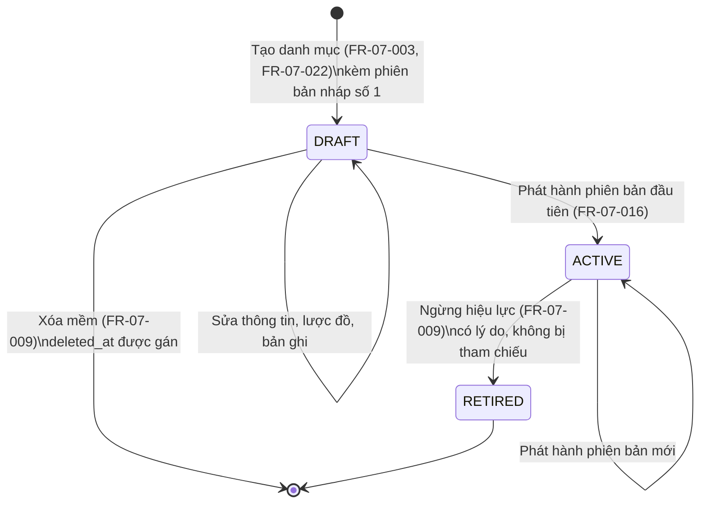
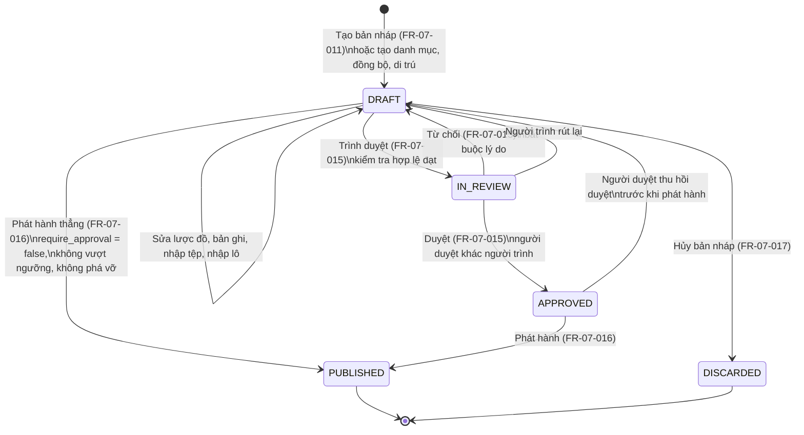
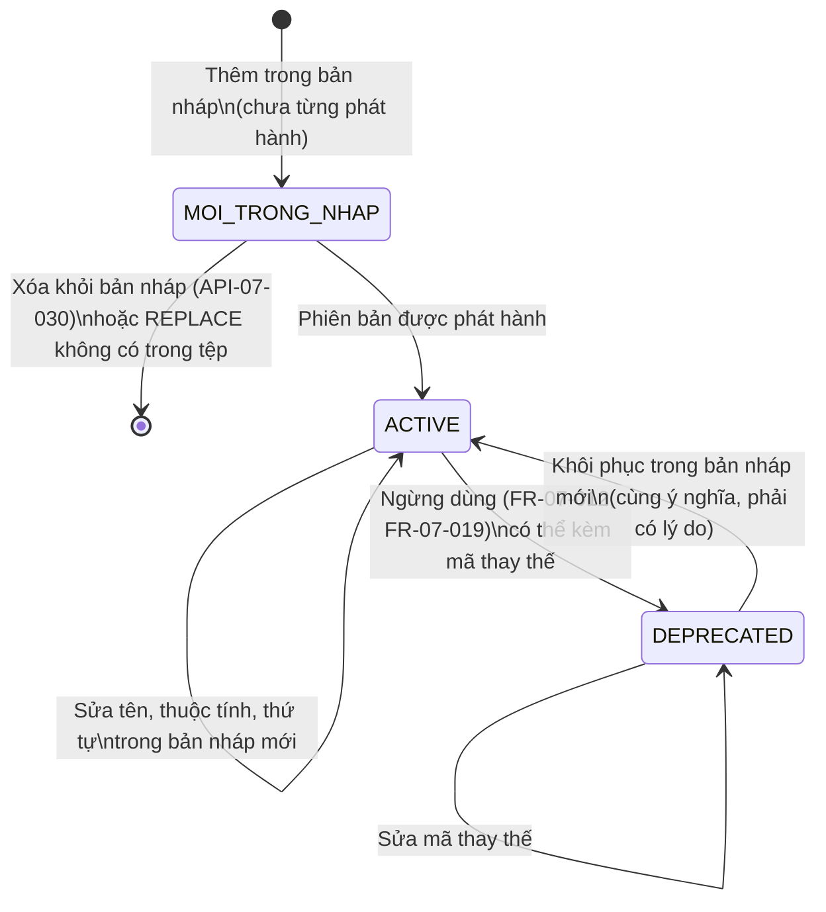
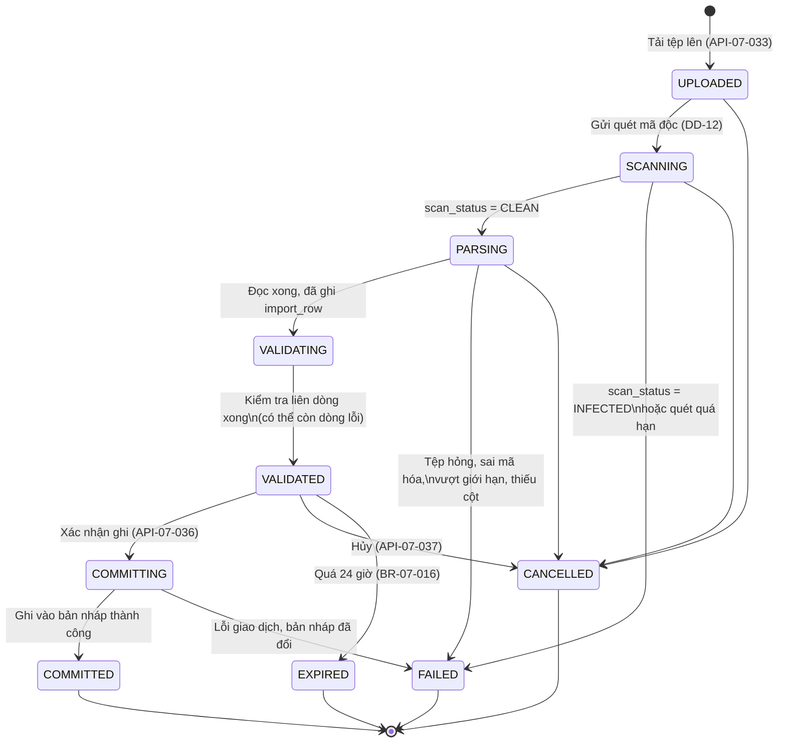
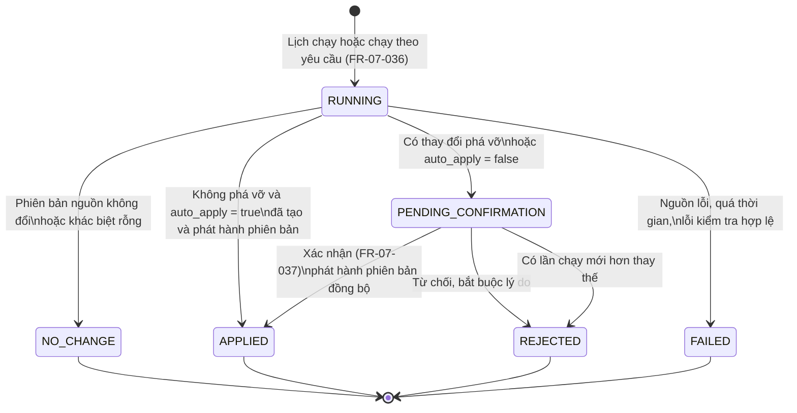

# D02-03-PH07 · Đặc tả chức năng phân hệ PH-07 Danh mục dùng chung

## 1. Mục đích, phạm vi và người đọc

### 1.1. Mục đích

Tài liệu này đặc tả đầy đủ các yêu cầu chức năng (functional requirements) của phân hệ PH-07 Danh mục dùng chung (Reference Data Management, viết tắt RDM) thuộc sản phẩm Datahub, nền tảng tích hợp và chia sẻ dữ liệu cấp tỉnh thế hệ mới thay thế LGSP cũ. Mục tiêu của tài liệu là để đội phát triển có thể lập trình ngay mà không phải đoán ý nghiệp vụ, để đội kiểm thử có thể viết ca kiểm thử dương tính và âm tính cho từng yêu cầu, và để chủ đầu tư có căn cứ nghiệm thu từng chức năng so với hệ cũ Aita Information.

Mỗi yêu cầu chức năng được viết theo mẫu thống nhất tại [D00-01 §4.3](../../00-chung/D00-01-thuat-ngu-quy-uoc.md), dùng kiểu dữ liệu chuẩn `T-*` tại D00-01 §5 và hệ mã truy vết tại D00-01 §3. Các chức năng dùng chung cho mọi phân hệ (xác thực, phân trang, xuất nhập chung, kiểm toán, thông báo, hộp "Việc của tôi") đã được đặc tả ở [D02-02 SRS §4](../D02-02-srs.md); tài liệu này chỉ ghi "Tuân thủ FR-00-nnn" và không viết lại, nhằm tránh hai nguồn sự thật mâu thuẫn nhau.

### 1.2. Phạm vi

Phạm vi của PH-07 gồm toàn bộ vòng đời của danh mục dùng chung trong Datahub: khai báo danh mục và lược đồ thuộc tính động; soạn bản nháp; nhập xuất Excel, CSV và API; kiểm tra hợp lệ; so sánh khác biệt; trình duyệt, phê duyệt và phát hành phiên bản có hiệu lực theo khoảng ngày; cung cấp dữ liệu danh mục cho các hệ thống thông tin (HTTT) qua API tra cứu, API truy vấn có cấu trúc, ảnh chụp tệp và sự kiện; đồng bộ với danh mục dùng chung quốc gia qua Nền tảng tích hợp, chia sẻ dữ liệu quốc gia (NDXP) thông qua PH-14; ánh xạ mã giữa danh mục và hệ thống mã ngoài; quản lý danh mục đơn vị hành chính (ĐVHC) theo mô hình chính quyền hai cấp từ ngày 01/7/2025 kèm lịch sử ba cấp và công cụ chuyển mã; chia sẻ danh mục toàn quốc giữa các tenant; và di trú dữ liệu từ hệ cũ Aita.

Ngoài phạm vi của tài liệu này là dữ liệu chủ (công dân, tổ chức, địa chỉ) thuộc PH-06, quy tắc chất lượng dữ liệu thuộc PH-08, chuyển đổi định dạng bản tin trong luồng tích hợp thuộc PH-04 (PH-04 chỉ gọi API chuyển mã của PH-07), và cơ chế kết nối kỹ thuật với NDXP thuộc PH-14 (PH-07 chỉ gọi qua cổng tiếp hợp mà PH-14 cung cấp).

### 1.3. Người đọc và cách đọc

Bảng sau giúp từng nhóm người đọc biết phần nào của tài liệu là trọng tâm với mình, để không phải đọc tuần tự hơn ba nghìn dòng.

| Người đọc | Phần nên đọc kỹ | Mục đích sử dụng |
|---|---|---|
| Chủ đầu tư, lãnh đạo Sở | Mục 2, mục 3, mục 9, mục 11 | Xác nhận phạm vi, đối chiếu với hệ cũ, trả lời câu hỏi mở |
| Phân tích nghiệp vụ, chủ sản phẩm | Toàn bộ, đặc biệt mục 4, 5, 6 | Làm cơ sở cho use case D02-04-PH07 và user story D02-05-PH07 |
| Kiến trúc sư, trưởng nhóm phát triển | Mục 4, 5, 7, 8, 10 | Thiết kế SDD D03-02-PH07, CSDL D03-03-PH07, API D03-04-PH07 |
| Lập trình viên backend `dh-data` | Mục 5 (từng FR), mục 6, mục 8 | Lập trình, viết kiểm thử đơn vị |
| Lập trình viên giao diện `dh-console` | Mục 4, mục 5 nhóm A, B, C, G | Màn hình D03-06-PH07 |
| Kiểm thử viên | Mục 5 (ngoại lệ, hậu điều kiện), mục 6, mục 7 | Ca kiểm thử D05-02-PH07 |
| Đội di trú | Mục 2.2, FR-07-051, mục 6 | Kịch bản di trú Aita |

### 1.4. Tài liệu liên quan

Các tài liệu dưới đây là nền tảng hoặc tài liệu anh em của FRS này; khi có mâu thuẫn, thứ tự ưu tiên là D02-08 và D02-07 (tài liệu chung đã ban hành), sau đó tới FRS này, sau đó tới tài liệu thiết kế.

| Mã | Tài liệu | Quan hệ |
|---|---|---|
| D00-01 | [Thuật ngữ và quy ước chung](../../00-chung/D00-01-thuat-ngu-quy-uoc.md) | Mẫu FR, kiểu dữ liệu, quy ước đặt tên |
| D00-03 | [Ma trận truy vết](../../00-chung/D00-03-ma-tran-truy-vet.md) | Nguồn của các mục LGC-DMDC-001…019, LGC-NGSP-006, LGC-BUS-036 |
| D02-01 | [BRD](../D02-01-brd.md) | REQ-07, REQ-20, REQ-22, BP-03, BP-08, BO-05, KPI-10, KPI-11 |
| D02-02 | [SRS chung](../D02-02-srs.md) | FR-00 và NFR-00 dùng chung |
| D02-07 | [Từ điển dữ liệu chung](../D02-07-tu-dien-du-lieu.md) | DD-07 ĐVHC, DD-11 outbox, DD-12 tệp, DD-14 tham số |
| D02-08 | [Ma trận phân quyền](../D02-08-ma-tran-phan-quyen.md) | Vai trò và quyền PERM-07 |
| D03-01 | [SAD](../../03-thiet-ke/D03-01-sad.md) | Phân loại dữ liệu §8.2, outbox §7.3, quy ước API §7.2 |
| D03-10 | [Thiết kế đa tenant](../../03-thiet-ke/D03-10-thiet-ke-da-tenant.md) | RLS, tenant `COMMON` và `PLATFORM` |
| D02-06-PH07 | [DFD PH-07](../dfd/D02-06-PH07-dfd-danh-muc.md) | Luồng dữ liệu của chính các FR trong tài liệu này |
| D02-04-PH07 | [Use case PH-07](../use-case/D02-04-PH07-use-case-danh-muc.md) | Kịch bản người dùng |
| D02-05-PH07 | [User story PH-07](../user-story/D02-05-PH07-user-story-danh-muc.md) | Hạng mục tồn đọng |
| D03-02-PH07 | [SDD PH-07](../../03-thiet-ke/sdd/D03-02-PH07-sdd-danh-muc.md) | Thiết kế chi tiết |
| D03-03-PH07 | [CSDL PH-07](../../03-thiet-ke/csdl/D03-03-PH07-csdl-danh-muc.md) | Bảng EN-07-01…19 |
| D03-04-PH07 | [API PH-07](../../03-thiet-ke/api/D03-04-PH07-api-danh-muc.md) | API-07-001…076, EVT-07-01…10, ERR-07 |
| D03-06-PH07 | [Màn hình PH-07](../../03-thiet-ke/uiux/D03-06-PH07-man-hinh-danh-muc.md) | UI-07-01…13 |
| D05-02-PH07 | [Ca kiểm thử PH-07](../../05-kiem-thu/test-case/D05-02-PH07-test-case.md) | TC-07 |
| ADR-050…057 | Quyết định kiến trúc PH-07 | Thuộc tính động jsonb, phiên bản copy-on-write, HYBRID, phân phối, DSL truy vấn, ĐVHC, nhập tệp, đồng bộ quốc gia |

### 1.5. Quy ước riêng của tài liệu

Trong tài liệu này, "danh mục" (tiếng Anh dùng trong mã nguồn là *catalog*) là một tập mã có cấu trúc dùng chung, ví dụ danh mục dân tộc hay danh mục ĐVHC; "bản ghi" (*item*) là một dòng của danh mục, có mã, tên và các thuộc tính; "phiên bản" (*version*) là một ảnh chụp đầy đủ của danh mục gồm lược đồ và bản ghi. Ký hiệu `{c}` trong đường dẫn API là mã danh mục, `{v}` là số phiên bản hoặc các từ khóa `current` (phiên bản đang hiệu lực) và `draft` (phiên bản đang mở). Thời điểm hiển thị theo giờ Việt Nam (UTC+7); mọi phép so sánh ngày hiệu lực dùng ngày theo giờ Việt Nam trừ khi ghi khác. Mọi ví dụ dùng tenant giả lập `T68` (Lâm Đồng) và người dùng giả lập; không có dữ liệu cá nhân thật.

## 2. Bối cảnh nghiệp vụ

### 2.1. Vai trò của danh mục dùng chung trong Datahub

Danh mục dùng chung là "từ vựng" mà các HTTT của tỉnh dùng để hiểu nhau. Khi hệ thống một cửa điện tử gửi hồ sơ sang hệ thống quản lý văn bản, trường "dân tộc" chỉ có nghĩa nếu hai bên dùng cùng một bảng mã dân tộc; trường "nơi cư trú" chỉ có nghĩa nếu hai bên dùng cùng một bảng mã ĐVHC và cùng hiểu mã đó tại cùng một thời điểm. Nếu mỗi hệ thống giữ một bản danh mục riêng và tự cập nhật, sai lệch sẽ phát sinh ngay sau lần thay đổi đầu tiên, và việc đối chiếu dữ liệu giữa các hệ thống trở thành công việc thủ công tốn kém. Vì lý do đó, BRD đặt mục tiêu BO-05 "Danh mục dùng chung thống nhất, đồng bộ với quốc gia", đo bằng KPI-10 (100% danh mục bắt buộc được quản lý tập trung và có phiên bản) và KPI-11 (độ trễ đồng bộ danh mục quốc gia sau khi quốc gia ban hành không quá 24 giờ).

PH-07 vì vậy vừa là công cụ quản trị cho cán bộ quản lý danh mục, vừa là dịch vụ cung cấp dữ liệu tham chiếu có độ sẵn sàng cao cho mọi HTTT và cho các phân hệ khác của Datahub. PH-04 (luồng tích hợp) và runtime `dh-runtime` tra mã danh mục trong lúc chuyển đổi bản tin; PH-20 dùng danh mục ĐVHC để khai báo tenant và tổ chức; PH-08 dùng danh mục làm miền giá trị cho quy tắc chất lượng. Do đó yêu cầu về hiệu năng và tính sẵn sàng của phần khai thác (nhóm D) cao hơn hẳn phần quản trị, và thiết kế phân phối qua bộ đệm và ảnh chụp (ADR-053) là hệ quả trực tiếp.

### 2.2. Hệ cũ Aita Information và các hạn chế

Hệ cũ Aita Information (do nhà thầu trước xây dựng năm 2021, chạy trên Spring Boot với giao diện Angular) quản lý danh mục theo mô hình thực thể – thuộc tính – giá trị (Entity–Attribute–Value, EAV) gồm bốn bảng. Bảng dưới đây tóm tắt cấu trúc thực tế của bốn bảng đó, được đối chiếu giữa tài liệu thiết kế CSDL v1.1 và các câu lệnh SQL trong tài liệu thiết kế chi tiết v1.7; hai tài liệu không khớp nhau ở một số cột, và cột thực tế là cột xuất hiện trong câu lệnh SQL.

| Bảng Aita | Cột thực tế | Ý nghĩa | Ghi chú đối chiếu |
|---|---|---|---|
| `category` | `id int(10)`, `name varchar(500)`, `category_code varchar(500)`, `is_update int(10)` | Danh mục | `is_update = 1` nghĩa là danh mục được cập nhật từ NGSP; giá trị khác là danh mục tạo tại chỗ hoặc đã sửa |
| `category_fields` | `id`, `category_id`, `name varchar(1000)`, `data`, `jhi_order`, `status int(10)` | Thuộc tính của danh mục | Tài liệu CSDL ghi cột `Order`; SQL dùng `jhi_order`; cột `data` không được mô tả ý nghĩa |
| `category_details` | `id`, `category_id` | Bản ghi (chỉ là một định danh, không có mã, không có tên) | Mã và tên bản ghi nằm trong các giá trị |
| `category_details_value` | `id`, `category_id` (theo tài liệu CSDL), `category_details_id`, `category_fields_id`, `value varchar(2000)` | Giá trị của một thuộc tính trên một bản ghi | Tài liệu CSDL thiếu cột `category_fields_id`; SQL thực tế có cột này |

Mô hình này linh hoạt ở chỗ cho phép mỗi danh mục có bộ thuộc tính tùy ý, nhưng có các hạn chế nghiêm trọng đã được nêu trong BRD và kiểm kê LGC-DMDC. Thứ nhất, mọi giá trị là chuỗi tối đa 2.000 ký tự, không có kiểu dữ liệu, không có ràng buộc bắt buộc, duy nhất hay miền giá trị, nên dữ liệu sai lọt vào mà không bị phát hiện. Thứ hai, bản ghi không có mã nghiệp vụ riêng; "mã" chỉ là giá trị của một thuộc tính mà người dùng quy ước, nên không có gì bảo đảm mã là duy nhất. Thứ ba, không có phiên bản và ngày hiệu lực: sửa một bản ghi là ghi đè, xóa là mất hẳn, nên không trả lời được câu hỏi "tại ngày 15/3/2025 mã này có nghĩa là gì", trong khi đây là câu hỏi bắt buộc với dữ liệu ĐVHC sau sắp xếp năm 2025. Thứ tư, không có quy trình duyệt, ai có quyền sửa là sửa thẳng vào dữ liệu đang được các HTTT dùng. Thứ năm, đồng bộ với danh mục quốc gia qua NGSP là thao tác thủ công, cờ `is_update` chỉ cho biết nguồn chứ không ngăn sửa. Thứ sáu, truy vấn theo giá trị thuộc tính phải nối bảng giá trị nhiều lần (mỗi thuộc tính một lần nối), hiệu năng kém khi danh mục lớn. Cuối cùng, khuôn tệp nhập rất cứng (ô A2 là tên danh mục, dòng 4 từ ô B4 là tên thuộc tính, từ dòng 5 là bản ghi, CSV phải mã hóa UTF-16) và không có bước xem trước lỗi, nên một dòng sai làm hỏng cả lần nhập hoặc tệ hơn là ghi một phần.

Các chức năng của Aita được kiểm kê thành 19 mục LGC-DMDC-001…019 trong D00-03 §4.5; cộng với LGC-NGSP-006 (kết nối danh mục quốc gia qua NGSP) và một phần LGC-BUS-036 (chuyển đổi ngữ nghĩa dữ liệu trong luồng). Mục 9 của tài liệu này chứng minh mọi mục LGC đều được ít nhất một FR phủ.

### 2.3. Yêu cầu mới

Ngoài việc thay thế đầy đủ chức năng của Aita, PH-07 đáp ứng các yêu cầu mới sau, mỗi yêu cầu xuất phát từ một nhu cầu nghiệp vụ cụ thể. Danh mục có lược đồ thuộc tính có kiểu, ràng buộc, kiểm tra theo JSON Schema, để dữ liệu sai bị chặn ngay khi nhập. Danh mục có phiên bản bất biến và hiệu lực theo khoảng ngày, để mọi HTTT tra được ý nghĩa của mã tại bất kỳ thời điểm nào và để kiểm toán truy ngược được ai đã thay đổi gì. Thay đổi đi qua bản nháp, so sánh khác biệt và duyệt bốn mắt, để không còn tình trạng sửa thẳng vào dữ liệu đang dùng (quy trình BP-03 của BRD). Nhập tệp chạy nền, có xem trước và báo lỗi theo dòng, cột, ghi theo kiểu tất cả hoặc không (FR-00-032). Danh mục quốc gia được đồng bộ tự động, phát hiện thay đổi trong 24 giờ, thay đổi phá vỡ phải được con người xác nhận. Có bảng ánh xạ mã giữa danh mục chuẩn và mã riêng của từng HTTT, để luồng tích hợp chuyển mã tự động thay vì viết cứng trong mã nguồn. Có API truy vấn có cấu trúc thay cho "API truy vấn CSDL tùy chọn" của Aita (LGC-DMDC-016), vì cho phép chạy câu SQL tự do là lỗ hổng an toàn thông tin nghiêm trọng.

### 2.4. Sắp xếp đơn vị hành chính năm 2025

Năm 2025, Việt Nam thực hiện sắp xếp ĐVHC quy mô lớn và chuyển sang mô hình chính quyền địa phương hai cấp (tỉnh và xã), bỏ cấp huyện. Theo Nghị quyết số 202/2025/QH15 về sắp xếp ĐVHC cấp tỉnh, cả nước còn 34 đơn vị hành chính cấp tỉnh (28 tỉnh và 6 thành phố trực thuộc trung ương). Các nghị quyết của Ủy ban Thường vụ Quốc hội năm 2025 sắp xếp ĐVHC cấp xã của từng tỉnh, và Quyết định số 19/2025/QĐ-TTg của Thủ tướng Chính phủ ban hành Bảng danh mục và mã số ĐVHC Việt Nam với 3.321 đơn vị cấp xã, hiệu lực từ ngày 01/7/2025. Mã cấp tỉnh có hai chữ số, mã cấp xã có năm chữ số.

> **Câu hỏi mở Q07-01:** Số hiệu, ngày ban hành và ngày hiệu lực của Nghị quyết 202/2025/QH15, Quyết định 19/2025/QĐ-TTg và danh sách các nghị quyết của UBTVQH về sắp xếp cấp xã cần được đối chiếu với Công báo trước khi phát hành bản 1.0; đồng thời cần xác nhận tổng số 3.321 đơn vị cấp xã là số tại ngày 01/7/2025 hay đã có điều chỉnh sau đó.

Sự kiện này có ba hệ quả trực tiếp cho PH-07. Thứ nhất, danh mục ĐVHC phải giữ được cả cấu trúc ba cấp cũ (tỉnh, huyện, xã, trước 01/7/2025) và hai cấp mới, vì dữ liệu hồ sơ phát sinh trước ngày 01/7/2025 vẫn mang mã cũ và vẫn phải tra được tên, cấp hành chính tại thời điểm phát sinh. Thứ hai, phải ghi lại quan hệ kế thừa nhiều – nhiều giữa đơn vị cũ và đơn vị mới (một xã mới hình thành từ nhiều xã cũ, một xã cũ có thể bị chia về nhiều xã mới), kèm căn cứ pháp lý. Thứ ba, phải cung cấp công cụ chuyển mã cũ sang mới và tra ngược, và khi một mã cũ bị chia về nhiều đơn vị mới thì công cụ không được tự đoán mà phải trả về danh sách ứng viên để con người hoặc hệ thống nghiệp vụ quyết định dựa trên địa chỉ chi tiết. Bản thân tenant cũng chịu ảnh hưởng: các tỉnh sáp nhập kéo theo sáp nhập tenant (PH-20, BP-08), và danh mục địa phương của các tenant cũ phải được kế thừa.

### 2.5. Đa tenant và ba loại nguồn danh mục

Datahub phục vụ nhiều tỉnh trên một nền tảng (REQ-20). Theo D03-10, dữ liệu mỗi tỉnh được cách ly bằng cột `tenant_id` và chính sách bảo mật mức dòng (Row-Level Security, RLS) của PostgreSQL. Danh mục toàn quốc như ĐVHC, dân tộc, quốc tịch, giới tính và các danh mục đồng bộ từ NDXP không thuộc riêng tỉnh nào; chúng được lưu một lần với `tenant_id = 'COMMON'`, mọi tenant đọc được, và chỉ tenant `PLATFORM` (quản trị nền tảng) được ghi. Cách làm này tránh 34 bản sao của cùng một danh mục quốc gia, tránh sai lệch giữa các tỉnh, và giảm chi phí đồng bộ xuống còn một lần cho cả nước.

Tuy nhiên, tỉnh thường có nhu cầu bổ sung mã địa phương vào danh mục quốc gia (ví dụ bổ sung loại hình đặc thù chưa có trong danh mục quốc gia). Nếu cho tỉnh sửa trực tiếp danh mục `COMMON` thì phá vỡ tính thống nhất; nếu bắt tỉnh sao chép sang danh mục riêng thì mất liên kết với bản quốc gia khi quốc gia cập nhật. Giải pháp (ADR-052) là danh mục HYBRID: tenant tỉnh tạo danh mục có `source_type = HYBRID`, `extends_catalog_id` trỏ tới danh mục `COMMON`, và chỉ chứa các bản ghi bổ sung có mã thuộc dải mã địa phương (`local_code_pattern`). Khi tra cứu, PH-07 trả về hợp của phiên bản `COMMON` đang hiệu lực và các bản ghi bổ sung, nên HTTT thấy một danh mục liền mạch. Ba loại nguồn được định nghĩa như sau: `LOCAL` là danh mục tỉnh tự quản hoàn toàn; `NATIONAL` là danh mục đồng bộ từ NDXP, chỉ đọc với người dùng và chỉ được cập nhật qua đồng bộ; `HYBRID` là danh mục mở rộng một danh mục `COMMON` hoặc `NATIONAL`.

## 3. Tác nhân, vai trò và quyền

### 3.1. Tác nhân

PH-07 có tác nhân con người và tác nhân máy. Bảng dưới liệt kê từng tác nhân, vai trò tương ứng theo [D02-08](../D02-08-ma-tran-phan-quyen.md) và công việc điển hình của họ trong PH-07.

| Tác nhân | Vai trò D02-08 | Phạm vi | Công việc điển hình trong PH-07 |
|---|---|---|---|
| Cán bộ quản lý danh mục của sở, ngành | `ROLE-DATA_STEWARD` (DS) | Tổ chức hoặc tenant; ký hiệu ○ nghĩa là chỉ trên danh mục có `owner_org_id` là tổ chức của mình | Tạo danh mục, khai báo lược đồ, soạn bản nháp, nhập xuất tệp, ghi ánh xạ, trình duyệt |
| Lãnh đạo phòng, đơn vị duyệt danh mục | `ROLE-DATA_APPROVER` (DA) | Tenant | Xem khác biệt, duyệt hoặc từ chối, phát hành; chạy và xác nhận đồng bộ quốc gia |
| Quản trị Datahub của tỉnh | `ROLE-TENANT_ADMIN` (TA) | Tenant | Quản lý mọi danh mục trong tenant (trừ duyệt, phát hành), ngừng hiệu lực, cấu hình tham số, cấp quyền khai thác danh mục hạn chế |
| Quản trị nền tảng | `ROLE-PLATFORM_ADMIN` (PA) | Tenant `PLATFORM`, ghi danh mục `COMMON` | Quản lý và phát hành danh mục `COMMON`, ĐVHC, đồng bộ quốc gia cho `COMMON`, nạp gói danh mục nền cho tenant mới, chạy di trú |
| Kỹ sư tích hợp | `ROLE-INTEGRATION_ENGINEER` (IE) | Tenant hoặc không gian làm việc | Xem danh mục và lược đồ, thử API tra cứu và truy vấn, quản lý ánh xạ mã dùng trong luồng |
| Nhà phát triển | `ROLE-DEVELOPER` | Ứng dụng được giao | Đọc tài liệu, lược đồ, thử API trên cổng nhà phát triển |
| Người xem | `ROLE-VIEWER` (VW) | Tenant | Xem, xuất danh mục |
| Kiểm toán, thanh tra | `ROLE-AUDITOR` (AU) | Tenant, chỉ đọc | Xem lịch sử thay đổi, xuất bằng chứng |
| HTTT thành viên (máy) | Client OAuth2 `client_credentials`, scope `rdm.read`, `rdm.query`, `rdm.write` | Tenant của HTTT | Tra cứu, truy vấn, tải ảnh chụp, nhận sự kiện, nhập lô vào bản nháp |
| PH-14 Kết nối quốc gia | Dịch vụ nội bộ | Nền tảng | Cổng tiếp hợp NDXP danh mục dùng chung |
| PH-20 Quản lý tenant | Dịch vụ nội bộ | Nền tảng | Gọi nạp gói danh mục nền khi khởi tạo tenant |
| Bộ lập lịch PH-07 | Tác vụ nền | Theo tenant | Chạy đồng bộ định kỳ, dọn bảng tạm, hết hạn tác vụ nhập |

### 3.2. Quyền PH-07 theo D02-08

Bảng dưới đây trích ma trận D02-08 §3.1 cho PH-07 và giải thích ý nghĩa nghiệp vụ của từng quyền khi áp vào các FR. Ký hiệu ● là được phép trong phạm vi vai trò, ○ là chỉ với danh mục do tổ chức mình làm chủ, — là không được phép.

| Quyền | Ý nghĩa trong PH-07 | PA | TA | DS | DA | IE | VW | AU | Các vai trò khác |
|---|---|---|---|---|---|---|---|---|---|
| `PERM-07-read` | Xem danh mục, lược đồ, phiên bản, bản ghi, tác vụ, lần đồng bộ, ánh xạ, lịch sử | ● | ● | ● | ● | ● | ● | ● | ● |
| `PERM-07-create` / `PERM-07-update` | Tạo, sửa danh mục, nhóm, lược đồ, bản ghi trên bản nháp, nhập tệp, nhập lô, ghi sự kiện sắp xếp ĐVHC, hủy bản nháp | ● (COMMON) | ● | ○ | — | — | — | — | — |
| `PERM-07-submit` | Trình duyệt phiên bản | ● (COMMON) | ● | ○ | — | — | — | — | — |
| `PERM-07-publish` | Duyệt và phát hành phiên bản (gồm phát hành thẳng khi không cần duyệt) | ● (COMMON) | — | — | ● | — | — | — | — |
| `PERM-07-export` | Xuất danh mục ra tệp | ● | ● | ● | ● | ● | ● | ● | ● |
| `PERM-07-sync` | Cấu hình nguồn, chạy đồng bộ, xác nhận hoặc từ chối thay đổi từ nguồn quốc gia | ● | ● | — | ● | — | — | — | — |

Ma trận này có hai điểm cần lưu ý. Thứ nhất, `ROLE-TENANT_ADMIN` không có `PERM-07-publish`: quản trị tỉnh quản lý được mọi danh mục nhưng không tự phát hành, vì phát hành là quyết định nghiệp vụ thuộc người duyệt danh mục. Thứ hai, D02-08 §4 cấm gán đồng thời DATA_STEWARD và DATA_APPROVER cho cùng một người trong cùng tenant; ngoài ra nguyên tắc bốn mắt (FR-00-071) áp dụng cho từng phiên bản: người có `PERM-07-publish` không được duyệt hoặc phát hành phiên bản do chính mình trình hoặc chính mình sửa lần cuối (BR-07-011).

### 3.3. Quyền đề xuất bổ sung D02-08

Một số thao tác của PH-07 chưa có quyền tương ứng trong D02-08. Nhóm PH-07 đề xuất bổ sung các quyền sau vào D02-08; trong thời gian chờ luồng lõi gộp, mã nguồn kiểm tra đúng các mã quyền này để không phải sửa lại khi D02-08 được cập nhật.

| Quyền đề xuất | Ý nghĩa | PA | TA | DS | DA | IE | Lý do đề xuất |
|---|---|---|---|---|---|---|---|
| `PERM-07-retire` | Ngừng hiệu lực danh mục đã phát hành | ● (COMMON) | ● | — | — | — | Thao tác ảnh hưởng mọi HTTT đang dùng, cần tách khỏi quyền sửa thông thường (đề xuất bổ sung D02-08) |
| `PERM-07-mapping` | Quản lý hệ thống mã ngoài và bảng ánh xạ mã | ● | ● | ● | — | ● | Kỹ sư tích hợp là người hiểu mã của HTTT nhưng không có quyền sửa danh mục (đề xuất bổ sung D02-08) |
| `PERM-07-grant` | Cấp, thu hồi quyền khai thác danh mục `RESTRICTED` cho HTTT | ● | ● | — | — | — | Là quyết định kiểm soát truy cập, thuộc quản trị tỉnh (đề xuất bổ sung D02-08) |
| `PERM-07-configure` | Đọc, ghi tham số `07.rdm.*` của tenant qua PH-18 | ● | ● | — | — | — | Tham số ảnh hưởng chính sách duyệt (đề xuất bổ sung D02-08) |
| `PERM-07-sync` cho DS (○) | Cho DS chạy đồng bộ theo yêu cầu và xem khác biệt với danh mục mình làm chủ, nhưng không xác nhận thay đổi phá vỡ | — | — | ○ | — | — | Khung PH-07 ban đầu giao đồng bộ cho DS; D02-08 hiện chỉ cho PA, TA, DA (đề xuất bổ sung D02-08, xem Q07-02) |

> **Câu hỏi mở Q07-02:** D02-08 không cấp `PERM-07-sync` cho DATA_STEWARD, trong khi thực tế người theo dõi danh mục quốc gia hằng ngày là cán bộ quản lý danh mục. Đề nghị chủ đầu tư quyết định có cấp `PERM-07-sync` phạm vi ○ cho DS (chỉ chạy và xem, không xác nhận thay đổi phá vỡ) hay giữ như D02-08. Trong khi chờ, FRS này theo D02-08.

### 3.4. Scope của HTTT thành viên

HTTT gọi PH-07 bằng token `client_credentials` hoặc mTLS qua gateway. Bảng dưới đây định nghĩa ba scope và điều kiện cấp; scope được sinh tự động theo D02-08 §5, không cấp tay.

| Scope | Cho phép | Được cấp khi |
|---|---|---|
| `rdm.read` | API-07-033, 041…046, 048…050 (danh sách danh mục, tra một mã, tra lô, lấy toàn bộ, cây, tìm kiếm, delta, lược đồ, ảnh chụp, dòng lịch sử), API-07-051 (chuyển mã ĐVHC), API-07-070 (chuyển mã ánh xạ) | Mặc định cho mọi HTTT `ACTIVE` |
| `rdm.query` | API-07-047 (truy vấn có cấu trúc) | Khi HTTT đăng ký sử dụng API truy vấn danh mục được duyệt ở PH-02 |
| `rdm.write` | API-07-031 (nhập lô vào bản nháp của danh mục được giao) | Khi HTTT được khai báo là nguồn dữ liệu của một danh mục cụ thể; chỉ ghi bản nháp, không trình, không phát hành |

> **Câu hỏi mở Q07-03:** D02-08 §5 viết scope dạng `rdm:read` (dấu hai chấm), còn khung PH-07 thống nhất dạng `rdm.read`. Cần luồng lõi chốt một ký pháp duy nhất cho toàn bộ scope của Datahub; FRS này dùng `rdm.read`, `rdm.query`, `rdm.write`.

## 4. Khái niệm và mô hình nghiệp vụ

### 4.1. Tổng quan mô hình

Sơ đồ dưới đây trình bày các khái niệm nghiệp vụ chính của PH-07 và quan hệ giữa chúng. Sơ đồ ở mức nghiệp vụ, không phải lược đồ CSDL; mỗi khái niệm được ghi kèm mã thực thể EN tương ứng để người đọc tra sang D03-03-PH07.

Sơ đồ cho thấy danh mục là trung tâm, nhưng đơn vị dữ liệu bất biến là phiên bản: thuộc tính, bản ghi, sự kiện kế thừa và lịch sử duyệt đều gắn với một phiên bản cụ thể chứ không gắn trực tiếp với danh mục. Đây là hệ quả của mô hình ảnh chụp đầy đủ (copy-on-write, ADR-051): khi tạo bản nháp mới, toàn bộ lược đồ và bản ghi của phiên bản hiện hành được sao chép sang phiên bản nháp, người dùng sửa trên bản sao, và phiên bản cũ không bao giờ bị động tới. Cách làm này tốn dung lượng hơn so với lưu khác biệt, nhưng đổi lại mọi phép tra cứu theo thời điểm chỉ là chọn đúng phiên bản rồi đọc thẳng, không phải dựng lại trạng thái từ chuỗi khác biệt; với quy mô danh mục (tối đa 200.000 bản ghi mỗi danh mục, NFR-07-011) chi phí lưu trữ là chấp nhận được. Các thực thể vận hành (tác vụ nhập xuất, nguồn và lần đồng bộ, ánh xạ, cấp quyền) gắn với danh mục, vì chúng tồn tại xuyên qua nhiều phiên bản.

### 4.2. Danh mục

Danh mục là một tập mã có cùng ý nghĩa nghiệp vụ, do một cơ quan chủ quản chịu trách nhiệm nội dung. Mỗi danh mục có mã (`code`, kiểu `T-CODE`, duy nhất trong tenant và không trùng mã danh mục `COMMON` đang hoạt động, BR-07-001), tên, mô tả, nhóm, cơ quan chủ quản (`owner_org_id`, tham chiếu logic tới tổ chức DD-02 của PH-20), nguồn (`source_type`), mức phân loại (`classification`), trạng thái (`status`), cấu hình phân cấp (`is_hierarchical`, `max_depth`, `level_names`), dải mã địa phương (`local_code_pattern`), danh mục gốc nếu là HYBRID (`extends_catalog_id`), chính sách duyệt (`require_approval`) và con trỏ tới phiên bản đang hiệu lực (`current_version_id`). Mã danh mục là định danh mà HTTT dùng trong đường dẫn API, nên mã không được đổi sau khi danh mục đã phát hành lần đầu (BR-07-040, đề xuất mới); đổi mã sẽ làm gãy mọi HTTT đang gọi.

### 4.3. Nhóm danh mục

Nhóm danh mục là cây phân loại giúp người dùng tìm danh mục trong danh sách hàng trăm danh mục, ví dụ nhóm "Hành chính" gồm nhóm con "Đơn vị hành chính", "Cơ quan nhà nước". Nhóm chỉ có ý nghĩa tổ chức hiển thị, không ảnh hưởng tới quyền hay tra cứu. Tenant `COMMON` có cây nhóm riêng cho danh mục toàn quốc; tenant tỉnh thấy cả cây nhóm `COMMON` (chỉ đọc) và cây nhóm của mình.

### 4.4. Lược đồ thuộc tính động và kiểu dữ liệu

Mỗi phiên bản có một lược đồ gồm các định nghĩa thuộc tính (`attribute_def`). Ngoài các trường hệ thống cố định (mã, tên, mã cha, thứ tự, trạng thái, mã thay thế, khoảng hiệu lực của bản ghi), mỗi danh mục có thể khai báo tối đa 100 thuộc tính động (NFR-07-011). Giá trị thuộc tính động được lưu trong cột `attrs` kiểu `jsonb` của bản ghi và được kiểm tra bằng JSON Schema sinh tự động từ lược đồ (ADR-050), thay cho mô hình EAV của Aita. Mã thuộc tính (`code`) là khóa trong `attrs`, viết theo dạng chữ thường có gạch dưới (snake_case, mẫu `^[a-z][a-z0-9_]{0,62}$`) để thuận tiện cho JSON; nhãn (`label`) là tên tiếng Việt hiển thị.

Bảng dưới đây định nghĩa mười một kiểu dữ liệu được phép cho thuộc tính động, cách biểu diễn trong JSON, cách nhập trong tệp và ràng buộc nào áp dụng được cho từng kiểu. Bảng này là căn cứ để sinh JSON Schema và để kiểm tra hợp lệ khi nhập tệp.

| Kiểu `data_type` | Ý nghĩa | Biểu diễn JSON | Cách ghi trong tệp nhập | Ràng buộc áp dụng được |
|---|---|---|---|---|
| `STRING` | Chuỗi ngắn một dòng | `string` | Văn bản | `max_length` (1…2.000, mặc định 255), `pattern`, `required`, `unique_in_version`, `default_value` |
| `TEXT` | Văn bản dài, nhiều dòng | `string` | Văn bản, cho phép xuống dòng | `max_length` (1…4.000, mặc định 4.000), `required` |
| `INTEGER` | Số nguyên 64 bit | `integer` | Chữ số, có thể có dấu trừ; không chấp nhận dấu phân cách hàng nghìn | `min_value`, `max_value`, `required`, `unique_in_version`, `default_value` |
| `DECIMAL` | Số thập phân chính xác | `string` theo mẫu số thập phân (tránh mất chính xác của số thực JSON) | Dấu chấm thập phân; trong xlsx chấp nhận ô kiểu số | `min_value`, `max_value`, `max_length` dùng làm tổng số chữ số (mặc định 19), `required` |
| `BOOLEAN` | Đúng hoặc sai | `boolean` | `TRUE`/`FALSE`, `Có`/`Không`, `1`/`0` (không phân biệt hoa thường) | `required`, `default_value` |
| `DATE` | Ngày | `string`, `format: date` (`yyyy-MM-dd`) | `dd/MM/yyyy` hoặc `yyyy-MM-dd`, hoặc ô kiểu ngày trong xlsx | `min_value`, `max_value` (dạng ngày), `required` |
| `DATETIME` | Thời điểm | `string`, `format: date-time`, lưu UTC | `dd/MM/yyyy HH:mm:ss` (hiểu là giờ Việt Nam) hoặc ISO 8601 có múi giờ | `min_value`, `max_value`, `required` |
| `ENUM` | Một giá trị trong tập liệt kê | `string`, `enum` | Mã giá trị (không phải nhãn); sheet `GiaTriHopLe` liệt kê | `enum_values` (mảng `{value, label}`, 1…500 phần tử), `required`, `default_value` |
| `CATALOG_REF` | Tham chiếu tới mã của một danh mục khác | `string` (mã bản ghi) | Mã bản ghi của danh mục được tham chiếu | `ref_catalog_code` (bắt buộc), `required`; giá trị phải tồn tại và `ACTIVE` trong phiên bản hiệu lực của danh mục đích tại ngày `effective_from` của phiên bản đang soạn |
| `URI` | Địa chỉ tài nguyên | `string`, `format: uri` | Văn bản | `max_length` (≤ 2.048), `required` |
| `EMAIL` | Địa chỉ thư điện tử của cơ quan | `string`, `format: email` | Văn bản | `required`; chỉ dùng cho hộp thư công vụ của cơ quan, không cho thư cá nhân (BR-07-025) |

Ý nghĩa của từng ràng buộc như sau. `required` bắt buộc mọi bản ghi `ACTIVE` phải có giá trị khác rỗng; bản ghi `DEPRECATED` được miễn để không chặn việc ngừng dùng bản ghi cũ thiếu dữ liệu. `unique_in_version` bắt buộc giá trị (sau khi chuẩn hóa: cắt khoảng trắng hai đầu, so sánh không phân biệt hoa thường với chuỗi) không trùng giữa các bản ghi trong cùng phiên bản, giá trị rỗng không tính là trùng. `max_length` giới hạn số ký tự Unicode (đếm theo điểm mã sau chuẩn hóa NFC), không phải số byte. `pattern` là biểu thức chính quy theo cú pháp ECMA-262 được neo hai đầu, độ dài biểu thức tối đa 500 ký tự, và được thử biên dịch khi khai báo để chặn biểu thức gây quay lui thảm họa (thời gian khớp thử trên chuỗi 2.000 ký tự phải dưới 50 ms). `min_value` và `max_value` là cận đóng. `enum_values` là danh sách giá trị cho phép, mỗi giá trị theo mẫu `T-CODE` và có nhãn tiếng Việt. `default_value` được điền khi bản ghi mới không có giá trị; giá trị mặc định phải tự hợp lệ với chính ràng buộc của thuộc tính. `queryable` cho phép thuộc tính xuất hiện trong bộ lọc của API truy vấn có cấu trúc (BR-07-018) và kéo theo việc tạo chỉ mục biểu thức trên `attrs`, vì vậy mỗi danh mục giới hạn tối đa 10 thuộc tính `queryable` (tham số `07.rdm.max-queryable-attributes`). `searchable` đưa giá trị thuộc tính vào chỉ mục tìm kiếm không dấu cùng với tên bản ghi. `status = HIDDEN` ẩn thuộc tính khỏi giao diện, tệp xuất và API khai thác nhưng vẫn giữ giá trị, tương đương trạng thái thuộc tính của Aita (LGC-DMDC-018).

Danh mục không được chứa dữ liệu cá nhân (BR-07-025). Khi khai báo thuộc tính, hệ thống từ chối mức phân loại Nhạy cảm và cảnh báo (phải xác nhận) nếu mã hoặc nhãn thuộc tính chứa các từ gợi ý dữ liệu cá nhân như "số định danh", "CCCD", "CMND", "ngày sinh", "số điện thoại cá nhân", "địa chỉ thường trú", "họ tên công dân". Danh sách từ gợi ý là tham số `07.rdm.pii-keywords` để quản trị nền tảng cập nhật.

### 4.5. Phiên bản và hiệu lực theo khoảng ngày

Phiên bản là ảnh chụp đầy đủ của danh mục tại một thời điểm, gồm lược đồ và toàn bộ bản ghi. Số phiên bản (`version_no`) tăng dần từ 1 trong mỗi danh mục và không bao giờ tái sử dụng kể cả khi một bản nháp bị hủy. Mỗi phiên bản đã phát hành có khoảng hiệu lực nửa mở `[effective_from, effective_to)`: phiên bản có hiệu lực từ đầu ngày `effective_from` (00:00 giờ Việt Nam) đến hết ngày liền trước `effective_to`; `effective_to` rỗng nghĩa là còn hiệu lực vô thời hạn. Khoảng hiệu lực của các phiên bản đã phát hành không chồng lấn; khi phát hành phiên bản mới, `effective_to` của phiên bản đang có `effective_to` rỗng được gán bằng `effective_from` của phiên bản mới (BR-07-007). Nhờ quy tắc này, với mọi ngày bất kỳ có tối đa một phiên bản hiệu lực, và phép tra cứu theo thời điểm (BR-07-008) luôn cho kết quả xác định.

Ba nhãn "Đang hiệu lực", "Sắp hiệu lực" và "Hết hiệu lực" không phải trạng thái lưu trong CSDL mà được tính từ khoảng hiệu lực so với ngày hiện tại: "Sắp hiệu lực" khi `effective_from` lớn hơn hôm nay; "Đang hiệu lực" khi hôm nay nằm trong khoảng; "Hết hiệu lực" khi `effective_to` nhỏ hơn hoặc bằng hôm nay. Lý do không lưu nhãn này là để tránh phải có tác vụ nền chuyển trạng thái lúc nửa đêm, vốn dễ sai khi tác vụ trễ hoặc lỗi. Con trỏ `current_version_id` của danh mục được tính lại khi phát hành và khi bước sang ngày mới (tác vụ nền đầu ngày chỉ làm mới con trỏ và bộ đệm, không đổi dữ liệu); kể cả khi tác vụ này trễ, API khai thác vẫn chọn phiên bản theo khoảng hiệu lực chứ không theo con trỏ.

### 4.6. Bản ghi

Bản ghi là một dòng của danh mục trong một phiên bản. Trường hệ thống của bản ghi gồm: mã (`code`, `T-CODE`, lưu chữ hoa, duy nhất trong phiên bản theo so sánh không phân biệt hoa thường, BR-07-002); tên (`name`, `T-NAME`); tên tìm kiếm (`name_search`, cột sinh tự động: chữ thường, bỏ dấu tiếng Việt, đổi "đ" thành "d"); mã cha (`parent_code`); độ sâu (`depth`, 1 cho gốc); đường dẫn tổ tiên (`path`, mảng mã từ gốc tới cha); tên cấp (`level_name`, lấy từ `level_names[depth-1]` của danh mục); thứ tự (`sort_order`); trạng thái (`status`); mã thay thế (`replaced_by`, mảng mã); khoảng hiệu lực riêng của bản ghi (`valid_from`, `valid_to`, tùy chọn, dùng khi một bản ghi chỉ có hiệu lực trong một phần khoảng của phiên bản); thuộc tính động (`attrs`); cờ bản ghi mở rộng địa phương (`is_local_extension`, chỉ cho HYBRID); và tham chiếu hệ cũ (`legacy_ref`).

Mã bản ghi giữ nguyên ý nghĩa qua các phiên bản: cùng một mã ở phiên bản 3 và phiên bản 4 là cùng một đối tượng nghiệp vụ. Vì vậy mã bản ghi không được đổi; nếu nghiệp vụ cần đổi mã, người dùng ngừng dùng mã cũ, thêm mã mới và ghi `replaced_by` (với ĐVHC thì ghi sự kiện `RECODE`). Mã đã từng phát hành không được gán lại cho đối tượng khác (BR-07-021 với ĐVHC và BR-07-040 với mọi danh mục).

### 4.7. Phân cấp

Danh mục phân cấp (`is_hierarchical = true`) tổ chức bản ghi thành cây (hoặc rừng nhiều gốc) theo mã cha. Mã cha phải tồn tại trong cùng phiên bản, cây không được có vòng, độ sâu không vượt `max_depth` (tối đa 10), và bản ghi `ACTIVE` không được có cha `DEPRECATED` (BR-07-014). Hệ thống tự tính `depth`, `path` và `level_name` mỗi khi mã cha thay đổi, người dùng không nhập các trường này. Tên cấp (`level_names`) là mảng nhãn theo độ sâu, ví dụ `["Tỉnh", "Xã"]` cho ĐVHC hiện hành; phiên bản lịch sử của ĐVHC trước 01/7/2025 dùng `["Tỉnh", "Huyện", "Xã"]`. Vì tên cấp có thể khác nhau giữa các phiên bản, `level_names` được chụp vào phiên bản khi phát hành (trong `stats` của phiên bản) để tra cứu lịch sử hiển thị đúng tên cấp tại thời điểm đó.

### 4.8. Ngừng dùng và kế thừa

Bản ghi đã từng phát hành không bị xóa (BR-07-003). Khi một mã không còn dùng, người dùng chuyển bản ghi sang `DEPRECATED` trong bản nháp và có thể ghi danh sách mã thay thế `replaced_by`. Bản ghi ngừng dùng vẫn được tra cứu, kết quả trả kèm trạng thái và mã thay thế (BR-07-004), để HTTT đang lưu dữ liệu cũ vẫn hiểu được mã và biết chuyển sang mã nào. Với danh mục ĐVHC, quan hệ kế thừa phong phú hơn nên được ghi thành sự kiện sắp xếp (`item_succession`) có loại sự kiện, danh sách mã nguồn, danh sách mã đích, ngày hiệu lực và căn cứ pháp lý; `replaced_by` của bản ghi ĐVHC được hệ thống tự điền từ sự kiện sắp xếp.

### 4.9. Nguồn danh mục và quyền cập nhật

Nguồn danh mục quyết định ai được sửa. Danh mục `LOCAL` do tenant tự quản theo quy trình bản nháp – duyệt – phát hành. Danh mục `NATIONAL` chỉ được cập nhật qua đồng bộ từ NDXP (BR-07-009); mọi API sửa trả `ERR-07-003`, kể cả với quản trị tỉnh, để bảo đảm bản trong Datahub luôn trùng bản quốc gia. Danh mục `HYBRID` có lược đồ và bản ghi gốc kế thừa từ danh mục gốc (chỉ đọc), và chỉ chứa bản ghi bổ sung có mã khớp `local_code_pattern`, không trùng mã của danh mục gốc (BR-07-010). Danh mục thuộc tenant `COMMON` chỉ tenant `PLATFORM` được ghi, bất kể nguồn.

### 4.10. Phân loại dữ liệu danh mục

Mỗi danh mục có một mức phân loại theo SAD §8.2. `PUBLIC` (Công khai, mặc định) áp dụng cho hầu hết danh mục; mọi HTTT `ACTIVE` có scope `rdm.read` đều tra được. `INTERNAL` (Nội bộ) áp dụng cho danh mục chỉ dùng trong cơ quan nhà nước; HTTT tra được nhưng không xuất hiện trên cổng nhà phát triển công khai. `RESTRICTED` (Hạn chế) áp dụng cho danh mục có thông tin đầu mối hoặc nội dung chưa công bố; chỉ HTTT được cấp quyền trên đúng danh mục đó mới khai thác được (BR-07-019, FR-07-052), giao diện hiển thị theo quyền và nhật ký che một phần. Mức Nhạy cảm bị cấm trong danh mục (BR-07-025), vì danh mục là dữ liệu tham chiếu được nhân bản rộng rãi vào bộ đệm, ảnh chụp và HTTT, không thể áp các biện pháp bảo vệ của dữ liệu nhạy cảm.

### 4.11. Sơ đồ trạng thái danh mục

Sơ đồ sau mô tả vòng đời của một danh mục (`catalog.status`).

Danh mục bắt đầu ở `DRAFT` khi được tạo và luôn có sẵn phiên bản nháp số 1. Danh mục chỉ được xóa (xóa mềm) khi còn `DRAFT`, tức là chưa từng có phiên bản nào được phát hành, vì khi đó chưa HTTT nào có thể đã dùng nó. Khi phiên bản đầu tiên được phát hành, danh mục chuyển sang `ACTIVE` và không bao giờ quay về `DRAFT`; các lần phát hành tiếp theo không đổi trạng thái danh mục. Danh mục `ACTIVE` có thể bị ngừng hiệu lực thành `RETIRED`, lúc đó phiên bản hiện hành được đóng khoảng hiệu lực tại ngày ngừng, API khai thác trả `ERR-07-031` (HTTP 410) cho tra cứu tại thời điểm sau ngày ngừng nhưng vẫn trả dữ liệu cho tra cứu tại thời điểm trước đó, để dữ liệu lịch sử vẫn hiểu được. `RETIRED` là trạng thái cuối; không có thao tác kích hoạt lại, vì nhu cầu đó được đáp ứng bằng cách tạo danh mục mới, tránh nhầm lẫn cho HTTT đã xử lý sự kiện ngừng hiệu lực.

### 4.12. Sơ đồ trạng thái phiên bản

Sơ đồ sau mô tả vòng đời của một phiên bản (`catalog_version.status`), là trọng tâm của quy trình BP-03.

Mỗi danh mục có tối đa một phiên bản mở, tức là ở một trong ba trạng thái `DRAFT`, `IN_REVIEW`, `APPROVED` (BR-07-005); quy tắc này tránh hai nhóm cùng soạn hai bản nháp rồi ghi đè lên nhau. Chỉ ở `DRAFT` mới sửa được nội dung; sang `IN_REVIEW` thì nội dung bị khóa để người duyệt duyệt đúng cái họ thấy. Bị từ chối, phiên bản quay về `DRAFT` và lý do được lưu ở lịch sử duyệt (`version_review`). Người trình được rút lại phiên bản đang chờ duyệt về `DRAFT` (ví dụ phát hiện sai sót), và người duyệt được thu hồi quyết định duyệt khi phiên bản còn `APPROVED`, vì giữa lúc duyệt và lúc phát hành có thể có thông tin mới. Lối tắt `DRAFT` sang `PUBLISHED` chỉ mở khi danh mục cấu hình không cần duyệt và thay đổi không vượt ngưỡng, không phá vỡ (BR-07-012, BR-07-026); người phát hành vẫn phải có `PERM-07-publish` và không phải người sửa cuối (bốn mắt). Phiên bản đồng bộ quốc gia được tự phát hành khi không phá vỡ và nguồn bật `auto_apply` (FR-07-037); trường hợp này chủ thể phát hành là tác nhân hệ thống và ghi kiểm toán như vậy. `PUBLISHED` và `DISCARDED` là trạng thái cuối, phiên bản đã phát hành là bất biến (BR-07-006).

### 4.13. Sơ đồ trạng thái bản ghi

Sơ đồ sau mô tả vòng đời của một mã bản ghi xuyên qua các phiên bản. Vì bản ghi được sao chép sang từng phiên bản, "trạng thái" ở đây là trạng thái của cùng một mã trong phiên bản nháp so với phiên bản trước.

Trạng thái lưu của bản ghi chỉ có `ACTIVE` và `DEPRECATED`; "mới trong nháp" là trạng thái suy ra (bản ghi `ACTIVE` trong bản nháp mà mã chưa xuất hiện ở bất kỳ phiên bản đã phát hành nào). Chỉ bản ghi mới trong nháp mới xóa được; bản ghi đã từng phát hành chỉ ngừng dùng được (BR-07-003, `ERR-07-013`). Cho phép khôi phục một mã đã ngừng dùng vì có trường hợp ngừng nhầm, nhưng chỉ khi mã giữ đúng ý nghĩa cũ; khôi phục được phân loại là thay đổi không phá vỡ và phải có ghi chú lý do trong `change_note` của phiên bản.

### 4.14. Sơ đồ trạng thái tác vụ nhập và xuất

Tác vụ nhập (`import_job` với `job_type = IMPORT`) đi qua các trạng thái sau. Đây là trạng thái đề xuất của FRS; D03-03-PH07 dùng đúng tập giá trị này cho ràng buộc `CHECK`.

Tác vụ nhập có hai pha tách biệt (ADR-056). Pha một gồm `UPLOADED`, `SCANNING`, `PARSING`, `VALIDATING` và kết thúc ở `VALIDATED` với kết quả xem trước; pha này không đụng tới bản nháp nên người dùng có thể thử nhiều lần mà không có rủi ro. Tệp chỉ được phân tích khi kết quả quét mã độc là `CLEAN` (DD-12, BR-07-041 đề xuất mới). Pha hai bắt đầu khi người dùng xác nhận: `COMMITTING` ghi toàn bộ dòng hợp lệ vào bản nháp trong một giao dịch, thành công thì `COMMITTED`, thất bại thì `FAILED` và bản nháp không thay đổi gì. Kết quả xem trước hết hạn sau 24 giờ (`EXPIRED`), vì sau thời gian đó bản nháp có khả năng đã bị sửa và kết quả kiểm tra không còn đúng. Tác vụ xuất (`job_type = EXPORT`) đơn giản hơn với các trạng thái `QUEUED`, `RUNNING`, `COMPLETED`, `FAILED` và `EXPIRED` (tệp kết quả hết hạn tải sau 24 giờ, FR-00-031); sơ đồ của tác vụ xuất không vẽ riêng vì là chuỗi tuyến tính.

### 4.15. Sơ đồ trạng thái lần đồng bộ

Lần đồng bộ quốc gia (`sync_run.status`) đi qua các trạng thái sau.

Mỗi lần chạy bắt đầu ở `RUNNING`, gọi PH-14 để lấy metadata và dữ liệu, rồi tính khác biệt với phiên bản hiện hành của danh mục trong Datahub. Khi không có khác biệt, lần chạy kết thúc ở `NO_CHANGE` mà không tạo phiên bản. Khi chỉ có thay đổi không phá vỡ và nguồn bật `auto_apply`, hệ thống tạo phiên bản với `origin = SYNC` và phát hành ngay, kết thúc `APPLIED`. Khi có thay đổi phá vỡ, hoặc nguồn tắt `auto_apply`, lần chạy dừng ở `PENDING_CONFIRMATION` chờ người có `PERM-07-sync` xác nhận hoặc từ chối (BR-07-017); trong khi chờ, phiên bản đồng bộ tồn tại dưới dạng bản nháp `origin = SYNC` và chiếm suất phiên bản mở của danh mục. Nếu một lần chạy mới phát hiện phiên bản nguồn mới hơn trong lúc lần trước còn chờ, lần trước bị chuyển `REJECTED` với lý do "được thay thế bởi lần chạy {runId}" và bản nháp được tính lại, để người xác nhận luôn xem khác biệt với dữ liệu nguồn mới nhất.

### 4.16. Thuật ngữ bổ sung

Bảng dưới đây liệt kê các thuật ngữ riêng của PH-07 chưa có trong D00-01; luồng lõi sẽ gộp vào D00-01 §2.

| Thuật ngữ | Định nghĩa |
|---|---|
| Danh mục gốc (base catalog) | Danh mục `COMMON` hoặc `NATIONAL` được một danh mục HYBRID mở rộng |
| Dải mã địa phương (local code range) | Biểu thức chính quy mà mã bản ghi bổ sung của danh mục HYBRID phải khớp, ví dụ `^68L[0-9]{3}$` |
| Thay đổi phá vỡ (breaking change) | Thay đổi có thể làm HTTT đang dùng danh mục bị lỗi hoặc hiểu sai: ngừng dùng mã, đổi mã cha, xóa thuộc tính, đổi kiểu thuộc tính, thu hẹp ràng buộc |
| Ngưỡng thay đổi lớn | Tỷ lệ số bản ghi bị thêm, sửa hoặc ngừng dùng trên tổng số bản ghi của phiên bản gốc, vượt ngưỡng thì bắt buộc duyệt |
| Ảnh chụp (snapshot) | Tệp JSON nén gzip và tệp CSV chứa toàn bộ bản ghi của một phiên bản đã phát hành, lưu ở kho đối tượng |
| Sự kiện sắp xếp (succession event) | Bản ghi quan hệ kế thừa giữa các mã ĐVHC cũ và mới, có loại, căn cứ pháp lý, ngày hiệu lực |
| Hệ thống mã ngoài (code system) | Bộ mã riêng của một HTTT hoặc một cơ quan, cần ánh xạ sang mã danh mục chuẩn |
| Độ phủ ánh xạ | Tỷ lệ bản ghi `ACTIVE` của danh mục có ít nhất một ánh xạ không tạm thời sang một hệ thống mã |

