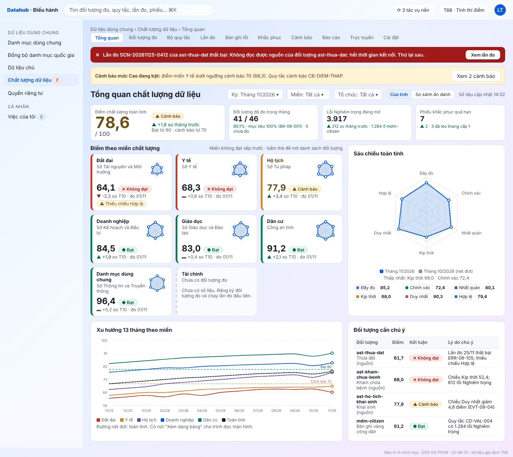
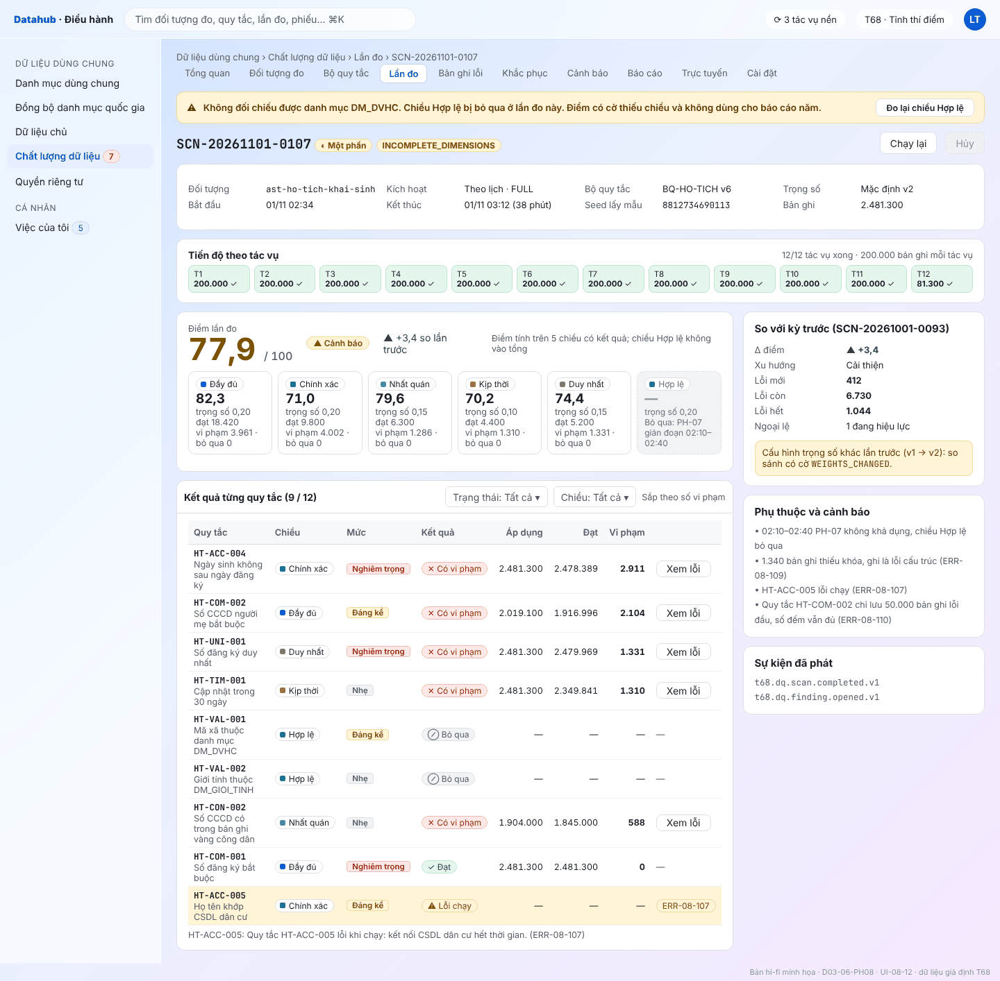

# D02-03-PH08 · Đặc tả yêu cầu chức năng Chất lượng dữ liệu

## Tóm tắt cho hội đồng thẩm định

**Mục tiêu.** PH-08 trả lời câu hỏi mà lãnh đạo tỉnh và từng sở ngành đều phải trả lời được trước hạn chuẩn hóa dữ liệu 31/12/2026: "Dữ liệu của chúng ta tốt đến mức nào, chỗ nào sai, ai phải sửa và đã sửa được bao nhiêu?". Phân hệ cung cấp cho sở ngành một bộ công cụ tự làm: khai báo dữ liệu cần đo (bản ghi vàng ở PH-06, danh mục ở PH-07, bảng dữ liệu ở CSDL của HTTT, bản tin trên luồng PH-04), viết quy tắc kiểm tra theo sáu chiều chất lượng, đo định kỳ hằng tháng, chấm điểm có trọng số, chỉ ra đúng bản ghi lỗi, giao phiếu khắc phục cho đơn vị chủ quản, đo lại để xác nhận đã sửa, và phát hành báo cáo chất lượng chính thức hằng năm có duyệt.

**Phạm vi.** 61 yêu cầu chức năng chia mười nhóm: miền và đối tượng đo; hồ sơ dữ liệu; quy tắc; lịch và đo theo lô; kiểm tra trực tuyến; bản ghi lỗi; khắc phục; cảnh báo; bảng điều khiển và báo cáo; quản trị. Khung đo là sáu chiều bắt buộc: đầy đủ (`COMPLETENESS`), chính xác (`ACCURACY`), nhất quán (`CONSISTENCY`), kịp thời (`TIMELINESS`), duy nhất (`UNIQUENESS`), hợp lệ (`VALIDITY`). Phân hệ chạy trong DU `dh-data` (Spring Boot 4 + Modulith, package `vn.datahub.data.dq`), lưu trạng thái ở schema `ph08_dq` của cụm `pg-core`, Đợt 3.

**Căn cứ pháp lý.** CMP-LAW-01 (Luật Dữ liệu số 60/2024/QH15: quản trị, chất lượng và phân loại dữ liệu); CMP-LAW-02 (NĐ 165/2025/NĐ-CP quy định chi tiết Luật Dữ liệu); CMP-LAW-03 (NĐ 278/2025/NĐ-CP về kết nối, chia sẻ dữ liệu, thay toàn bộ NĐ 47/2020/NĐ-CP mà SRS cũ viện dẫn, đặt hạn chuẩn hóa 31/12/2026); CMP-LAW-05 và CMP-LAW-04 (Luật BVDLCN 91/2025/QH15, NĐ 356/2025/NĐ-CP: không để lộ dữ liệu cá nhân trong bản ghi lỗi và báo cáo). Điều khoản cụ thể về nghĩa vụ đánh giá chất lượng định kỳ chưa được đối chiếu Công báo, ghi ở Q08-01.

**Những điểm hội đồng cần lưu ý.**

1. PH-08 **đo và giao việc, không sửa dữ liệu**. Dữ liệu sai được sửa tại HTTT nguồn bởi đơn vị chủ quản; lỗi ở bản ghi vàng chuyển sang hàng đợi người quản lý dữ liệu của PH-06. PH-08 chỉ đọc dữ liệu qua khung nhìn hợp đồng chỉ đọc (PH-06) hoặc kết nối chỉ đọc (PH-05), không bao giờ đọc CSDL control của Datahub (BR-08-004, BR-08-005).
2. Chiều **hợp lệ** luôn đối chiếu danh mục PH-07; PH-08 không giữ bảng mã riêng, nên mọi đơn vị đo theo cùng một nguồn chân lý danh mục (BR-08-003).
3. **Bản ghi lỗi không chứa dữ liệu cá nhân dạng rõ.** Giá trị của trường mức Nhạy cảm theo phân loại PH-09 chỉ lưu dạng đã che hoặc băm; xuất bản ghi lỗi có trường Nhạy cảm cần chủ quản chấp thuận (BR-08-012, BR-08-027).
4. **Báo cáo chính thức hằng năm có điều kiện cứng**: mỗi đối tượng đo trong phạm vi có ít nhất một lần đo toàn bộ (`FULL`) thành công trong năm, ảnh chụp điểm đại diện không thiếu chiều, không dùng mẫu; báo cáo qua duyệt bốn mắt rồi mới công bố, sau công bố không sửa được (BR-08-009, BR-08-010).
5. Kiểm tra trực tuyến trên luồng PH-04 là **tùy chọn theo đối tượng đo**, ngân sách p95 ≤ 50 ms; khi phụ thuộc lỗi, miền tự chọn cho qua (`FAIL_OPEN`) hay chặn (`FAIL_CLOSED`) để không biến PH-08 thành điểm nghẽn của trục tích hợp (BR-08-016, BR-08-018).

**Con số chính.**

| Chỉ số | Giá trị |
|---|---|
| Yêu cầu chức năng | 61 (M: 36, S: 21, C: 4) |
| Quy tắc nghiệp vụ | 35 (BR-08-001…035) |
| Yêu cầu phi chức năng | 20 (NFR-08-001…020) |
| Màn hình | 20 (UI-08-01…20) |
| API | 131 operation dự kiến (API-08-001…131), tiền tố `/api/dq/v1` |
| Sự kiện | 14 phát (EVT-08-01…14), 8 loại tiêu thụ từ PH-06, PH-07 |
| Mã lỗi | 55 control (ERR-08-001…055), 19 runtime (ERR-08-101…119); `401`, `403`, `428` dùng ERR-00-401, ERR-00-403, ERR-00-428 |
| Thực thể mức logic | 33 (EN-08-01…33) |
| Tham số theo tenant | 43 khóa (mục 8.2) |
| Chức năng hệ cũ được phủ | Hệ cũ không có chức năng chất lượng dữ liệu; 6 mục `LGC` liên quan gián tiếp |
| FR của SRS cũ được phủ | 16/16 (bảng ánh xạ ở mục 11.3) |

: Con số chính của PH-08

## 1. Giới thiệu

### 1.1. Mục đích của tài liệu

Tài liệu đặc tả đầy đủ hành vi của PH-08 Chất lượng dữ liệu cho ba nhóm người đọc. Hội đồng thẩm định dùng tài liệu để đánh giá sự cần thiết, mức đáp ứng nghĩa vụ đánh giá chất lượng dữ liệu và bảo vệ dữ liệu cá nhân. Kỹ sư dùng tài liệu làm đầu vào cho D03-02-PH08 (thiết kế chi tiết), D03-03-PH08 (CSDL), D03-04-PH08 (API) và D03-06-PH08 (màn hình). Kiểm thử viên dùng luồng xử lý, ngoại lệ, công thức điểm và ngưỡng để viết ca ở D05-02-PH08.

Mỗi chức năng đặc tả theo khung 17 mục của K-TRINH-BAY §4. Phụ lục A là nguồn chuẩn của mọi giá trị liệt kê (enum) dùng trong bộ bảy tập PH-08; mục 9.4 là nguồn chuẩn của danh mục API mà tập API phải dùng đúng mã. Phụ lục B ghi các đề nghị sửa tài liệu chung và tài liệu phân hệ khác mà tập này kéo theo.

### 1.2. Phạm vi

PH-08 chịu trách nhiệm mười nhóm việc dưới đây; mỗi nhóm ứng với một mục ở chương 6.

| # | Trách nhiệm | Nhóm FR |
|---|---|---|
| 1 | Khai báo miền chất lượng, chủ quản, đối tượng đo bốn loại, phần tử dữ liệu trọng yếu | A (001–007) |
| 2 | Lập hồ sơ dữ liệu theo cột, gợi ý quy tắc, nhận chỉ số hồ sơ từ PH-05 | B (008–011) |
| 3 | Soạn bộ quy tắc sáu chiều có phiên bản, chạy thử, duyệt bốn mắt, trọng số và ngưỡng | C (012–022) |
| 4 | Lập lịch và chạy đo theo lô, tăng dần theo sự kiện, đối chiếu PH-07, chấm điểm, so kỳ | D (023–031) |
| 5 | Kiểm tra trực tuyến một bản ghi cho PH-04 và PH-06, thống kê theo phút | E (032–035) |
| 6 | Ghi bản ghi lỗi có dấu vân tay, che giá trị, tra cứu, xuất có duyệt, ngoại lệ có hạn | F (036–040) |
| 7 | Phiếu khắc phục giao chủ quản, SLA, leo thang, đo lại kiểm chứng, chuyển PH-06 | G (041–046) |
| 8 | Quy tắc cảnh báo, phát qua kênh thông báo PH-13, xác nhận, tắt tiếng | H (047–049) |
| 9 | Bảng điều khiển, thẻ điểm, báo cáo kỳ, báo cáo chính thức năm, xuất, phân phối, đẩy KPI | I (050–057) |
| 10 | Tham số tenant, lưu giữ, nhật ký kiểm toán, so sánh liên tenant ẩn danh | J (058–061) |

: Trách nhiệm của PH-08 theo nhóm chức năng

Những việc sau nằm ngoài phạm vi PH-08 dù có liên quan; bảng ghi phân hệ chịu trách nhiệm để tránh làm trùng.

| Việc ngoài phạm vi | Phân hệ chịu trách nhiệm |
|---|---|
| Lưu trữ, đối sánh, hợp nhất bản ghi vàng; hàng đợi người quản lý dữ liệu | PH-06 |
| Quản lý bảng mã, danh mục, phiên bản danh mục | PH-07 |
| Sửa dữ liệu nguồn tại HTTT thành viên | Đơn vị chủ quản HTTT |
| Che, ẩn danh hóa khi trả dữ liệu; phân loại trường dữ liệu | PH-09 |
| Tổng hợp KPI chuyển đổi số, báo cáo chỉ tiêu | PH-16 |
| Điều phối luồng tích hợp, quyết định đi tiếp hay vào DLQ | PH-04 |
| Gửi thông báo qua thư, tin nhắn, trong ứng dụng | PH-13 (kênh thông báo chung) |
| Quản lý kết nối CSDL nguồn và tài khoản kết nối | PH-05 |
| Chạy job nền dùng chung, lập lịch toàn nền tảng | PH-18 |

: Việc ngoài phạm vi PH-08 và phân hệ chịu trách nhiệm

### 1.3. Đối tượng sử dụng và cách đọc

Tài liệu dài vì đặc tả đến từng mã lỗi; bảng dưới chỉ cho mỗi nhóm người đọc phần cần đọc trước.

| Người đọc | Đọc phần | Mục đích |
|---|---|---|
| Hội đồng thẩm định | Tóm tắt, chương 2, 3.3, 7, 11, 13, 14 | Đánh giá sự cần thiết, tuân thủ, rủi ro |
| Cán bộ quản lý dữ liệu, chủ quản | Chương 2.5, 4, 6 (mục đích, luồng chính, kết quả), 10 | Hiểu quy trình đo, khắc phục, báo cáo |
| Kỹ sư `dh-data` | Chương 2.4, 4, 6, 8, 9, Phụ lục A | Thiết kế, lập trình, cấu hình |
| Kiểm thử viên | Chương 6 (luồng ngoại lệ, quy tắc), 7, 8, 9, 14 | Viết ca kiểm thử, dữ liệu thử |
| Người viết tập UC, SDD, CSDL, API, MH, TC của PH-08 | Chương 4, 9, Phụ lục A, B | Dùng đúng mã, enum, đường dẫn |

: Người đọc và phần nên đọc của FRS PH-08

### 1.4. Thuật ngữ và chữ viết tắt

Tài liệu dùng nhiều thuật ngữ về đo lường chất lượng dữ liệu; bảng dưới giải thích từng thuật ngữ để mọi chương hiểu thống nhất.

| Thuật ngữ, viết tắt | Giải thích |
|---|---|
| Chất lượng dữ liệu (data quality, DQ) | Mức dữ liệu phù hợp mục đích sử dụng, đo theo sáu chiều |
| Chiều chất lượng (dimension) | Một khía cạnh đo: đầy đủ, chính xác, nhất quán, kịp thời, duy nhất, hợp lệ |
| Miền chất lượng (quality domain) | Nhóm nghiệp vụ dùng để gom đối tượng đo và giao trách nhiệm, ví dụ "Dân cư", "Doanh nghiệp", "Đất đai" |
| Đối tượng đo (asset) | Một tập dữ liệu cụ thể được đo: domain PH-06, danh mục PH-07, bảng hoặc khung nhìn của HTTT, loại bản tin trên luồng |
| Phần tử dữ liệu trọng yếu (critical data element, CDE) | Trường mà sai sót gây hậu quả nghiệp vụ lớn, ví dụ số định danh, mã ĐVHC; bắt buộc có quy tắc |
| Hồ sơ dữ liệu (profiling) | Thống kê mô tả từng cột: tỷ lệ trống, số giá trị khác nhau, khoảng, mẫu phổ biến |
| Quy tắc (rule) | Một phép kiểm tra gắn một chiều, một toán tử, tham số và mức nghiêm trọng |
| Bộ quy tắc (rule set) | Tập quy tắc áp cho một đối tượng đo, có phiên bản và duyệt |
| Lần đo (scan) | Một lượt áp bộ quy tắc lên đối tượng đo, sinh kết quả, điểm và bản ghi lỗi |
| Ảnh chụp điểm (score snapshot) | Kết quả điểm bất biến của một lần đo, gồm điểm tổng và điểm từng chiều |
| Bản ghi lỗi (finding) | Một bản ghi vi phạm một quy tắc, nhận diện bằng dấu vân tay |
| Dấu vân tay (fingerprint) | Giá trị băm của tenant, đối tượng, mã quy tắc, khóa bản ghi; dùng biết lỗi mới, còn, hết qua các kỳ |
| Ngoại lệ chấp nhận (waiver) | Quyết định có hạn cho phép một nhóm lỗi không tính vào điểm, có lý do và có duyệt |
| Phiếu khắc phục (issue) | Việc giao đơn vị chủ quản sửa một nhóm lỗi, có SLA |
| Đo lại kiểm chứng (verify scan) | Lần đo phạm vi hẹp sau khi chủ quản báo đã sửa, để xác nhận lỗi hết |
| Đẩy xuống (pushdown) | Dịch quy tắc tập hợp thành câu SQL chạy ngay tại CSDL được đo thay vì kéo dữ liệu về |
| CEL (Common Expression Language) | Ngôn ngữ biểu thức an toàn, không có vòng lặp, dùng cho quy tắc mức bản ghi; thư viện `cel-java` |
| DataSketches | Thư viện Apache ước lượng số giá trị khác nhau (HLL, HyperLogLog) và phân vị trên dữ liệu lớn |
| STRICT, ADVISORY | Chế độ kiểm tra trực tuyến chặn (trả không đạt khi có lỗi nặng) hoặc chỉ khuyến nghị |
| FAIL_OPEN, FAIL_CLOSED | Cho qua hoặc chặn bản tin khi PH-08 hay phụ thuộc của nó không trả lời kịp |
| SLA (service level agreement) | Thời hạn xử lý cam kết, ở đây tính bằng ngày làm việc |
| Khung nhìn hợp đồng (contract view) | Khung nhìn chỉ đọc mà PH-06 cấp riêng cho PH-08, ổn định theo phiên bản mô hình |
| ĐVHC, CCCD, MST | Đơn vị hành chính (PH-07); số định danh cá nhân 12 chữ số; mã số thuế |
| DS, DA, DO, TA, TO, SO, AU, VW, PA | Vai trò ở mục 3.1 theo D02-08 |
| p95, p99 | Phân vị 95, 99 của số đo |

: Thuật ngữ và chữ viết tắt của PH-08

### 1.5. Tài liệu tham chiếu

Tài liệu dựa trên các văn bản pháp lý và tài liệu dự án dưới đây; mã `CMP-LAW` theo D00-01 §7.

| Mã, tài liệu | Nội dung dùng ở tập này |
|---|---|
| CMP-LAW-01 Luật Dữ liệu 60/2024/QH15 | Quản trị dữ liệu, bảo đảm chất lượng, phân loại dữ liệu (điều khoản cụ thể: Q08-01) |
| CMP-LAW-02 NĐ 165/2025/NĐ-CP | Quy định chi tiết Luật Dữ liệu về quản trị, chất lượng (Q08-01) |
| CMP-LAW-03 NĐ 278/2025/NĐ-CP | Kết nối, chia sẻ dữ liệu; hạn chuẩn hóa 31/12/2026; thay NĐ 47/2020 (nghĩa vụ đánh giá định kỳ ở SRS cũ) |
| CMP-LAW-05 Luật BVDLCN 91/2025/QH15, CMP-LAW-04 NĐ 356/2025/NĐ-CP | Không để lộ dữ liệu cá nhân trong bản ghi lỗi, bản xuất, báo cáo |
| CMP-LAW-06 NĐ 331/2026, CMP-LAW-08 TCVN 14423:2026 | Nhật ký kiểm toán, kiểm soát truy cập cấp độ 3 |
| D02-01 BRD | REQ-08 (mức S ở BRD), BO-05 |
| D02-02 SRS | FR-00 dùng chung: tenant, danh sách, xuất, kiểm toán, bốn mắt, thông báo |
| D02-08 Ma trận phân quyền | Vai trò `ROLE-*`, quyền PERM-08-rule-admin đã có |
| D02-03-PH06, D02-03-PH07, D02-03-PH05, D02-03-PH04 | Bản ghi vàng và sự kiện; danh mục và tra mã; kết nối chỉ đọc và Kamelet; luồng tích hợp |
| ADR-001, ADR-003, ADR-004, ADR-046, ADR-053, ADR-067 | Modulith; RLS đa tenant; Kafka; bốn mắt; ảnh chụp danh mục; truy cập CSDL trực tiếp có kiểm soát |
| ADR đề xuất 085, 086, 087 (chưa có tệp) | Thực thi quy tắc SQL đẩy xuống và CEL; lưu bản ghi lỗi có dấu vân tay, che, phân vùng; truy cập dữ liệu đo qua khung nhìn hợp đồng và kết nối PH-05 chỉ đọc |
| `docs/07-srs/SRS-PH-08-dq.md` (SRS cũ, bản 1.0) | 16 FR repo, công thức điểm, toán tử, trọng số, NFR hiệu năng, kịch bản AT |

: Tài liệu tham chiếu của FRS PH-08

### 1.6. Cấu trúc tài liệu

Chương 2 nêu bối cảnh, mục tiêu, vị trí kiến trúc và quy trình. Chương 3 nêu tác nhân và quyền. Chương 4 mô tả khái niệm, thực thể và máy trạng thái. Chương 5 liệt kê 61 chức năng; chương 6 đặc tả từng chức năng theo khối 17 mục. Chương 7 gom quy tắc nghiệp vụ, chương 8 yêu cầu phi chức năng và tham số, chương 9 mã lỗi, thông báo, sự kiện và danh mục API. Chương 10 liệt kê màn hình và thuyết minh hai giao diện tiêu biểu. Chương 11 truy vết hệ cũ, REQ và FR repo. Chương 12 đến 14 nêu phụ thuộc, câu hỏi mở và tiêu chí chấp nhận. Chương 15 là nhật ký hấp thụ đề nghị của bản 0.2. Phụ lục A là nguồn chuẩn enum, Phụ lục B là đề nghị đồng bộ.

## 2. Tổng quan phân hệ

### 2.1. Bối cảnh và vấn đề cần giải quyết

Dữ liệu trên trục tích hợp của tỉnh đến từ hàng trăm HTTT do nhiều đơn vị xây dựng ở nhiều thời kỳ (giả định GĐ-06: tỉnh `T01` quy mô vừa, 200 HTTT). Không ai biết chắc tỷ lệ hồ sơ thiếu số định danh, mã ĐVHC còn dùng mã cũ trước sắp xếp năm 2025, hay cùng một doanh nghiệp có mã số thuế khác nhau ở hai hệ. Luật Dữ liệu và NĐ 278/2025 đòi cơ quan nhà nước chuẩn hóa và bảo đảm chất lượng dữ liệu, có hạn 31/12/2026; D01-02 đã chốt: "Dự án cung cấp công cụ chất lượng dữ liệu (PH-08) để sở ngành tự làm". Bảng dưới nêu hạn chế hiện nay và cách PH-08 khắc phục.

| Hạn chế hiện nay | Hệ quả | Cách PH-08 khắc phục |
|---|---|---|
| Hệ cũ (Viettel 2021) không có chức năng đo chất lượng; kiểm tra chỉ ở bước nhập danh mục | Lỗi tích lũy nhiều năm, chỉ lộ ra khi liên thông thất bại | Đo định kỳ hằng tháng theo sáu chiều, phát hiện suy giảm sớm (FR-08-023, FR-08-029) |
| Mỗi đơn vị tự kiểm bằng bảng tính, tiêu chí khác nhau | Không so được giữa các sở, báo cáo không tin cậy | Bộ quy tắc mẫu dùng chung ở `COMMON`, công thức điểm thống nhất (FR-08-015, FR-08-028) |
| Báo cáo chỉ có con số tổng, không chỉ ra bản ghi nào sai | Báo cáo "nằm trong ngăn kéo", không ai sửa | Bản ghi lỗi đến từng khóa, phiếu khắc phục có SLA, đo lại kiểm chứng (nhóm F, G) |
| Kiểm tra mã danh mục bằng bảng mã chép tay | Bảng mã lệch phiên bản, đặc biệt sau sắp xếp ĐVHC | Chiều hợp lệ luôn đối chiếu PH-07 theo phiên bản hiệu lực (FR-08-027) |
| Dữ liệu sai đi thẳng vào luồng liên thông | Hệ nhận phải tự lọc, lỗi lan rộng | Kiểm tra trực tuyến tùy chọn trên luồng PH-04 và cổng chất lượng cho PH-06 (nhóm E) |

: Hạn chế hiện nay, hệ quả và cách PH-08 khắc phục

### 2.2. Mục tiêu của phân hệ

Năm mục tiêu dưới đây đo được và gắn với yêu cầu phi chức năng hoặc tiêu chí chấp nhận ở chương 14.

| # | Mục tiêu | Chỉ tiêu | Gắn với |
|---|---|---|---|
| 1 | Mọi đối tượng đo `ACTIVE` được đo ít nhất một lần mỗi tháng | 100% đối tượng có lần đo `SUCCEEDED` hoặc `PARTIAL` trong tháng | BR-08-001, FR-08-023 |
| 2 | Đo đủ lớn trong khung giờ thấp điểm | FULL 1 triệu bản ghi, 30 quy tắc ≤ 60 phút | NFR-08-003 |
| 3 | Kiểm tra trực tuyến không làm chậm trục tích hợp | p95 ≤ 50 ms, p99 ≤ 100 ms, ≥ 2.000 bản ghi/giây | NFR-08-001, NFR-08-002 |
| 4 | Lỗi được sửa trong hạn | ≥ 80% phiếu `CRITICAL` đạt `VERIFIED` trong SLA (giả định, đo từ tháng thứ ba) | BR-08-015, FR-08-042 |
| 5 | Điểm tái lập được để thanh tra | Cùng dữ liệu, quy tắc, trọng số cho cùng điểm, sai số ≤ 0,01 | NFR-08-007 |

: Mục tiêu đo được của PH-08

### 2.3. Vị trí trong kiến trúc

PH-08 nằm trong DU `dh-data` cùng PH-06, PH-07, PH-09 ở vùng ứng dụng nội bộ. PH-08 đứng **bên cạnh** đường dữ liệu chính: đo theo lô thì đọc dữ liệu qua đường chỉ đọc, kiểm tra trực tuyến thì chỉ được gọi khi đối tượng đo bật chế độ này.

```{.mermaid caption="Vị trí PH-08 trong kiến trúc Datahub"}
flowchart TB
  subgraph DATA["DU dh-data"]
    DQ["PH-08 Chất lượng dữ liệu<br/>vn.datahub.data.dq"]
    MDM["PH-06 Dữ liệu chủ"]
    RDM["PH-07 Danh mục"]
    PRV["PH-09 Quyền riêng tư"]
  end
  PG[("pg-core<br/>schema ph08_dq")]
  REP[("Bản sao chỉ đọc<br/>khung nhìn hợp đồng PH-06")]
  SRC[("CSDL HTTT<br/>qua kết nối PH-05 chỉ đọc")]
  RT["PH-04 dh-runtime<br/>Kamelet dh-dq-check"]
  K["Kafka"]
  OBS["PH-13 thông báo, giám sát"]
  KPI["PH-16 Báo cáo chỉ tiêu"]
  JOB["Bộ lập lịch nội bộ ScheduleDispatcher"]
  DQ --> PG
  DQ -->|"đọc"| REP
  DQ -->|"đọc"| SRC
  DQ -->|"tra mã"| RDM
  DQ -->|"phân loại"| PRV
  RT -->|"checks:evaluate"| DQ
  MDM -->|"cổng chất lượng"| DQ
  JOB --> DQ
  DQ --> K
  K --> OBS
  K --> KPI
  MDM -->|"EVT-06"| K
```

Hình cho thấy PH-08 chỉ ghi vào schema của mình và Kafka; mọi mũi tên tới dữ liệu được đo là đọc. PH-04 và PH-06 là bên gọi PH-08 (trực tuyến), PH-13 và PH-16 là bên nhận kết quả qua sự kiện. Lịch đo do bộ lập lịch nội bộ của PH-08 kích hoạt; PH-18 chỉ là phụ thuộc mềm.

### 2.4. Kiến trúc thành phần và công nghệ

PH-08 là một mô-đun Modulith trong `dh-data` gồm chín thành phần nội bộ. **Danh mục đo** (`dq-catalog`) quản lý miền, đối tượng đo, trường và CDE. **Hồ sơ** (`dq-profile`) chạy thống kê cột bằng Apache DataSketches (HLL cho số giá trị khác nhau, KLL cho phân vị). **Quy tắc** (`dq-rule`) lưu bộ quy tắc có phiên bản, biên dịch biểu thức CEL bằng `cel-java` và dịch quy tắc tập hợp sang SQL có danh sách cho phép (ADR đề xuất 085). **Điều phối đo** (`dq-scan`) tự lập lịch bằng `ScheduleDispatcher` nội bộ (quét mỗi phút dưới khóa ShedLock; PH-18 là phụ thuộc mềm, chỉ kích hoạt thêm qua API-08-059), chia lần đo thành tác vụ theo dải khóa và giao cho **bộ thực thi** (`dq-worker`, cùng ảnh `dh-data` chạy hồ sơ `worker`, mở rộng ngang). **Trực tuyến** (`dq-inline`) phục vụ `POST /api/dq/v1/checks:evaluate` với bộ đệm quy tắc trong bộ nhớ. **Bản ghi lỗi** (`dq-finding`) ghi lỗi có dấu vân tay vào bảng phân vùng theo tháng (ADR đề xuất 086). **Khắc phục, cảnh báo** (`dq-remediation`, `dq-alert`) và **báo cáo** (`dq-report`, dựng PDF bằng OpenHTMLtoPDF, XLSX bằng Apache POI) hoàn thiện vòng.

Truy cập dữ liệu đo theo ADR đề xuất 087: bản ghi vàng đọc qua khung nhìn hợp đồng `ph06_mdm.v_dq_{domain}` trên bản sao chỉ đọc với vai trò CSDL `dq_reader`; danh mục đọc qua API PH-07 (FR-07-028, FR-07-027) và ảnh chụp danh mục (ADR-053); bảng của HTTT đọc qua kết nối PH-05 có cờ chỉ đọc, tài khoản theo Q359 và ADR-067, câu SQL chỉ `SELECT` có `statement_timeout`. Không dùng Great Expectations hay Soda (Python) để giữ một stack Java.

```{.mermaid caption="Trình tự luồng chính một lần đo theo lịch"}
sequenceDiagram
  participant J as ScheduleDispatcher nội bộ
  participant S as dq-scan
  participant W as dq-worker
  participant D as Nguồn đo (khung nhìn, kết nối)
  participant R as PH-07
  participant F as dq-finding
  participant K as Kafka
  J->>S: Kích hoạt lịch (trigger SCHEDULE)
  S->>S: Nạp phiên bản quy tắc ACTIVE và trọng số hiệu lực
  S->>W: Giao tác vụ theo dải khóa
  W->>D: SQL đẩy xuống và đọc theo con trỏ
  W->>R: Tải ảnh chụp danh mục, tra lô mã
  W->>F: Ghi bản ghi lỗi có dấu vân tay
  W-->>S: Kết quả quy tắc theo tác vụ
  S->>S: Gộp kết quả, chấm điểm, so kỳ
  S->>K: EVT-08-02 scan.completed
```

Hình cho thấy bộ thực thi là nơi duy nhất chạm dữ liệu được đo; điều phối chỉ gộp số đếm. Điểm được tính một lần sau khi mọi tác vụ kết thúc nên không có điểm "nửa chừng".

### 2.5. Quy trình nghiệp vụ liên quan

Bộ quy trình BP-01…09 của D02-01 chưa có quy trình riêng cho chất lượng dữ liệu; tài liệu đề nghị bổ sung BP-10 "Đánh giá và cải thiện chất lượng dữ liệu" (Phụ lục B). PH-08 tham gia các quy trình sẵn có như bảng dưới.

| Quy trình | Bước có PH-08 |
|---|---|
| BP-02 Xây dựng và phát hành luồng tích hợp | Kỹ sư tích hợp thêm bước Kamelet `dh-dq-check` vào luồng (FR-08-033) |
| BP-03 Phát hành và đồng bộ danh mục | Sau khi danh mục phát hành, PH-08 đo lại danh mục và các đối tượng có quy tắc hợp lệ trỏ tới nó (FR-08-025) |
| BP-07 Giám sát, xử lý sự cố, báo cáo | Cảnh báo chất lượng qua PH-13 (FR-08-048), KPI sang PH-16 (FR-08-057) |
| BP-10 (đề nghị) Đánh giá và cải thiện chất lượng dữ liệu | Khai báo, soạn quy tắc, đo hằng tháng, khắc phục, báo cáo năm |

: Quy trình nghiệp vụ có PH-08 tham gia

```{.mermaid caption="Vòng đo, khắc phục và báo cáo điển hình"}
flowchart TB
  A["Khai báo miền, đối tượng đo, CDE"] --> B["Hồ sơ dữ liệu, gợi ý quy tắc"]
  B --> C["Soạn bộ quy tắc, chạy thử"]
  C --> D["Duyệt bốn mắt, kích hoạt"]
  D --> E["Đo hằng tháng, chấm điểm"]
  E --> F["Bản ghi lỗi, so kỳ"]
  F --> G["Phiếu khắc phục giao chủ quản"]
  G --> H["Chủ quản sửa ở nguồn"]
  H --> I["Đo lại kiểm chứng"]
  I -->|"còn lỗi"| G
  I --> J["Báo cáo kỳ, báo cáo năm"]
  E --> J
```

Hình cho thấy vòng khép kín: lỗi chỉ được coi là hết khi lần đo kiểm chứng không còn thấy dấu vân tay của nó, không phải khi chủ quản tự báo đã sửa.

### 2.6. Chức năng hệ cũ được phủ

Hệ cũ không có chức năng chất lượng dữ liệu nên D00-03 không có `LGC` nào ghi PH-08 làm chính. Sáu mục liên quan gián tiếp dưới đây có kết luận đầy đủ ở mục 11.1.

| Mã | Chức năng hệ cũ | Vai trò của PH-08 |
|---|---|---|
| LGC-DMDC-006 | Nhập danh mục từ Excel | Đo chất lượng danh mục sau nhập (FR-08-003, FR-08-025) |
| LGC-DMDC-007 | Nhập danh mục từ CSV | Như trên |
| LGC-DMDC-008 | Nhập danh mục qua API | Như trên |
| LGC-BUS-027 | Thống kê theo endpoint, lỗi xảy ra | Thống kê lỗi kiểm tra trực tuyến theo luồng (FR-08-034) |
| LGC-NGSP-003 | Tra cứu BHXH hộ gia đình | Nguồn đối chiếu chiều nhất quán (FR-08-013) |
| LGC-NGSP-005 | Dữ liệu đăng ký doanh nghiệp | Nguồn đối chiếu chiều nhất quán (FR-08-013) |

: Chức năng hệ cũ liên quan gián tiếp tới PH-08

## 3. Tác nhân, vai trò và quyền

### 3.1. Tác nhân

Bảng dưới liệt kê người và hệ thống tương tác với PH-08, kèm việc chính của từng bên để các yêu cầu sau gán đúng tác nhân.

| Tác nhân | Loại | Mô tả | Tương tác chính |
|---|---|---|---|
| Cán bộ quản lý dữ liệu (DS, ROLE-DATA_STEWARD) | Người | Cán bộ chất lượng dữ liệu của sở hoặc trung tâm dữ liệu tỉnh | Khai báo đối tượng đo, soạn quy tắc, chạy đo, mở phiếu, soạn báo cáo |
| Người duyệt dữ liệu (DA, ROLE-DATA_APPROVER) | Người | Lãnh đạo phụ trách dữ liệu được giao | Duyệt bộ quy tắc, trọng số ngưỡng, ngoại lệ, công bố báo cáo, xuất lỗi |
| Chủ quản dữ liệu (DO, ROLE-DATA_OWNER) | Người | Đại diện đơn vị chủ quản HTTT hoặc CSDL | Nhận phiếu, sửa tại nguồn, báo đã sửa, chấp thuận xuất lỗi có trường Nhạy cảm |
| Quản trị tenant (TA, ROLE-TENANT_ADMIN) | Người | Quản trị Datahub của tỉnh | Tham số, lưu giữ, khai báo miền |
| Vận hành tenant (TO, ROLE-TENANT_OPERATOR) | Người | Cán bộ trực | Theo dõi, hủy, chạy lại lần đo |
| Cán bộ ATTT (SO, ROLE-SECURITY_OFFICER) | Người | ATTT của tỉnh | Xem nhật ký kiểm toán, bản ghi lỗi đã che |
| Lãnh đạo, người xem (VW), Kiểm toán (AU) | Người | Lãnh đạo tỉnh, sở; thanh tra | Xem bảng điều khiển, báo cáo đã công bố; AU xem nhật ký |
| Quản trị nền tảng (PA, ROLE-PLATFORM_ADMIN) | Người | Đơn vị vận hành nền tảng | Thư viện quy tắc mẫu `COMMON`, trần tham số, so sánh liên tenant |
| PH-04 `dh-runtime` | Hệ thống | Lõi tích hợp | Gọi kiểm tra trực tuyến qua Kamelet `dh-dq-check` (scope `dq.check`) |
| PH-06 | Hệ thống | Dữ liệu chủ | Cấp khung nhìn hợp đồng, phát EVT-06, gọi cổng chất lượng (`dq.check`), nhận lỗi chuyển hàng đợi |
| PH-07 | Hệ thống | Danh mục | Tra mã theo phiên bản, ảnh chụp danh mục, phát sự kiện phát hành |
| PH-05 | Hệ thống | Bộ điều hợp | Cấp kết nối chỉ đọc, đẩy chỉ số hồ sơ nguồn |
| PH-09 | Hệ thống | Quyền riêng tư | Cung cấp phân loại trường, chính sách che |
| PH-13, PH-16, PH-18 | Hệ thống | Giám sát, KPI, job | Nhận cảnh báo và chỉ số; nhận KPI; PH-18 tùy chọn kích hoạt thêm lần đo theo yêu cầu và xử lý lại DLQ |
| HTTT thành viên | Hệ thống | Hệ của sở, ngành | Đọc thẻ điểm của dữ liệu mình (scope `dq.read`) |

: Tác nhân của PH-08

### 3.2. Ma trận quyền

D02-08 §3.2 hiện chỉ có PERM-08-rule-admin (DS, TA). Mười quyền còn lại là đề nghị mới, ghi ở Phụ lục B "Đề nghị đồng bộ D02-08". Ký hiệu theo D02-08: ● có quyền, ○ chỉ với đối tượng thuộc tổ chức của mình, — không.

| Quyền | Ý nghĩa | PA | TA | TO | SO | DS | DA | DO | VW | AU |
|---|---|---|---|---|---|---|---|---|---|---|
| PERM-08-read | Xem bảng điều khiển, thẻ điểm, đối tượng đo, quy tắc, lần đo, báo cáo đã công bố | ● | ● | ● | ● | ● | ● | ○ | ● (tổng hợp) | ● |
| PERM-08-asset | Khai báo miền, đối tượng đo, CDE, chạy hồ sơ | — | ● | — | — | ● | — | — | — | — |
| PERM-08-rule-admin | Soạn quy tắc, trọng số, ngưỡng, cảnh báo, gửi duyệt | ● (mẫu `COMMON`) | ● | — | — | ● | — | — | — | — |
| PERM-08-approve | Duyệt bộ quy tắc, trọng số ngưỡng, ngoại lệ, công bố báo cáo | — | — | — | — | — | ● | — | — | — |
| PERM-08-run | Lập lịch, chạy, hủy, chạy lại lần đo | — | ● | ● | — | ● | — | — | — | — |
| PERM-08-finding-read | Xem chi tiết bản ghi lỗi (giá trị đã che) | — | — | — | ● | ● | ● | ○ | — | — |
| PERM-08-remediate | Nhận, xử lý, cập nhật phiếu khắc phục | — | ● | — | — | ● | — | ○ | — | — |
| PERM-08-report | Soạn, sinh, xuất báo cáo | — | ● | — | — | ● | — | — | — | — |
| PERM-08-export | Xuất bản ghi lỗi (có trường Nhạy cảm cần DO chấp thuận) | — | — | — | — | ● | ● | — | — | — |
| PERM-08-config | Tham số tenant, lưu giữ | ● (trần) | ● | — | — | — | — | — | — | — |
| PERM-08-audit-read | Xem nhật ký kiểm toán PH-08 | — | — | — | ● | — | — | — | — | ● |

: Ma trận quyền của PH-08

VW chỉ thấy số liệu tổng hợp (điểm, xu hướng, số lỗi), không mở được danh sách bản ghi lỗi. DO thấy đối tượng đo, lỗi, phiếu của tổ chức mình (tổ chức chủ quản ghi ở miền hoặc đối tượng đo); truy cập ngoài phạm vi trả ERR-08-032. Thiếu quyền chức năng trả `403` với mã nền ERR-00-403, chưa xác thực trả `401` với ERR-00-401, thiếu `If-Match` trả `428` với ERR-00-428.

### 3.3. Tách nhiệm vụ và tài khoản máy

Bốn mắt (FR-00-071, ADR-046) áp dụng cho: kích hoạt phiên bản bộ quy tắc (FR-08-017), cấu hình trọng số và ngưỡng (FR-08-021), ngoại lệ chấp nhận (FR-08-040), công bố báo cáo kỳ và năm (FR-08-053), xuất bản ghi lỗi có trường Nhạy cảm (FR-08-039, DO chấp thuận). Người soạn hoặc người gửi duyệt không được duyệt (ERR-08-005). Thêm hai tách vai trò riêng của PH-08: người đo (DS) không phải người sửa (DO), và DO không tự xác nhận phiếu đã sửa (BR-08-014).

Phân hệ và HTTT gọi PH-08 bằng token dịch vụ. Scope `dq.check` cấp cho PH-04 (`dh-runtime`) và PH-06 để gọi kiểm tra trực tuyến; scope `dq.read` cấp cho PH-16 và HTTT đọc thẻ điểm dữ liệu của mình. PH-05 đẩy chỉ số hồ sơ qua API nội bộ bằng tài khoản dịch vụ `dh-integration` với scope `dq.ingest` (chỉ gọi được API-08-024). Bộ thực thi đo dùng vai trò CSDL `dq_reader` chỉ có quyền `SELECT` trên khung nhìn hợp đồng do PH-06 cấp; với nguồn HTTT dùng tài khoản của kết nối PH-05 được cấp cho PH-08.

## 4. Khái niệm và mô hình nghiệp vụ

### 4.1. Khái niệm nghiệp vụ

PH-08 tổ chức việc đo theo ba tầng. **Miền chất lượng** là tầng giao trách nhiệm: mỗi miền có một tổ chức chủ quản (DO) và một cán bộ phụ trách (DS). **Đối tượng đo** là tầng kỹ thuật: một tập dữ liệu cụ thể có khóa bản ghi và danh sách trường. **Bộ quy tắc** là tầng đo: mỗi đối tượng đo có một bộ quy tắc, mỗi lúc có tối đa một phiên bản `ACTIVE`.

Sáu chiều là khung bắt buộc; mỗi quy tắc thuộc đúng một chiều và dùng một toán tử thuộc chiều đó. Bảng dưới là nguồn chuẩn của toán tử theo chiều (enum `operator`, Phụ lục A), kế thừa và mở rộng bảng toán tử của SRS cũ.

| Chiều | Câu hỏi kiểm tra | Toán tử | Ví dụ |
|---|---|---|---|
| `COMPLETENESS` (đầy đủ) | Trường bắt buộc có trống? | `NOT_NULL`, `NOT_EMPTY`, `REQUIRED_IF` | `soDinhDanh` không trống |
| `ACCURACY` (chính xác) | Giá trị đúng định dạng, đúng khoảng? | `REGEX`, `LENGTH`, `RANGE`, `CHECKSUM`, `TYPE` | MST 10 hoặc 13 chữ số, chữ số kiểm tra đúng |
| `CONSISTENCY` (nhất quán) | Các trường, các nguồn có mâu thuẫn? | `EQ_SOURCE`, `EQ_FIELDS`, `CROSS_ENTITY` | Ngày sinh ở hộ tịch và BHXH trùng nhau |
| `TIMELINESS` (kịp thời) | Dữ liệu còn tươi? | `MAX_AGE_DAYS`, `UPDATED_AFTER` | `ngayCapNhat` trong 30 ngày |
| `UNIQUENESS` (duy nhất) | Có bản ghi trùng? | `UNIQUE_IN_ASSET`, `UNIQUE_COMPOSITE` | Một CCCD ứng một bản ghi vàng |
| `VALIDITY` (hợp lệ) | Mã danh mục có tồn tại, còn hiệu lực? | `IN_RDM`, `IN_RDM_VERSION` | `maDonViHanhChinh` có trong `DVHC` hiện hành |
| Mọi chiều (nâng cao) | Điều kiện không diễn đạt được bằng toán tử trên | `CEL_EXPRESSION` (mức bản ghi), `SQL_PREDICATE` (mức tập, chỉ lô) | `ngayCap >= ngaySinh + 14 năm` |

: Toán tử theo chiều chất lượng

**Công thức điểm.** Với mỗi quy tắc r trong lần đo, `pass_r` là số bản ghi đạt, `fail_r` số vi phạm, bản ghi thuộc ngoại lệ `ACTIVE` và bản ghi có kết quả `SKIPPED` hoặc `ERROR` không tính vào mẫu số. Điểm chiều d theo phương pháp mặc định `POOLED` (kế thừa SRS cũ): `score_d = 100 × Σ pass_r / Σ (pass_r + fail_r)` trên các quy tắc của chiều d; phương pháp `RULE_AVERAGE` (tham số) lấy trung bình có trọng số `rule.weight` của điểm từng quy tắc. Điểm tổng `score = Σ score_d × w_d / Σ w_d` trên các chiều có điểm; khi đủ sáu chiều thì `Σ w_d = 1` và công thức trở về `Σ score_d × w_d`. Thiếu chiều nào (không có quy tắc, hoặc mọi quy tắc `SKIPPED`) thì chiều đó điểm rỗng và ảnh chụp gắn cờ `INCOMPLETE_DIMENSIONS`. Làm tròn hai chữ số thập phân ở bước cuối (NFR-08-007).

**Trọng số mặc định** (giả định GD-05 của SRS cũ, áp khi tenant chưa cấu hình): đầy đủ 0,20; chính xác 0,20; nhất quán 0,15; kịp thời 0,10; duy nhất 0,15; hợp lệ 0,20; tổng 1,0 dung sai 0,001. **Kết luận** (`verdict`): `PASS` khi điểm ≥ ngưỡng đạt (mặc định 80), `WARN` khi ≥ ngưỡng cảnh báo (mặc định 70), còn lại `FAIL`. **Xu hướng** (`trend`): Δ so với ảnh chụp liền trước > +1,0 là `IMPROVED`, < −1,0 là `DEGRADED`, còn lại `STABLE`; không có kỳ trước là `BASELINE`.

### 4.2. Thực thể

Bảng dưới mô tả 33 thực thể mức logic; tên bảng vật lý trong schema `ph08_dq`, cột chi tiết ở D03-03-PH08. Mọi bảng có `id`, `tenant_id` (RLS, ADR-003), `created_*`, `updated_*`, `version`.

| Mã | Thực thể (bảng) | Thuộc tính chính |
|---|---|---|
| EN-08-01 | Miền chất lượng (`dq_domain`) | `domainCode`, `name`, `ownerOrgId` (DO), `stewardUserId` (DS), `status` |
| EN-08-02 | Đối tượng đo (`dq_asset`) | `assetCode`, `domainCode`, `assetType`, `sourceRef` (domain PH-06, mã danh mục, kết nối và bảng, loại bản tin), `recordKey[]`, `status`, `incrementalEnabled`, `updatedAtField` (nguồn HTTT), cấu hình trực tuyến (`inlineEnabled`, `inlineMode`, `onDependencyFailure`, `timeoutMs`, `gateEnabled`) |
| EN-08-03 | Trường, CDE (`dq_asset_field`) | `fieldPath`, `dataType`, `isCde`, `dataClass` (PH-09), `valueMode`, `sourceFieldRef` |
| EN-08-04 | Lần hồ sơ (`dq_profile_run`) | `runId`, `assetCode`, `mode`, `sampleSize`, `status`, `rowCount` |
| EN-08-05 | Thống kê cột (`dq_profile_column`) | `fieldPath`, `nullRatio`, `distinctEstimate`, `min`, `max`, `quantiles`, `topPatterns`, `inferredType` |
| EN-08-06 | Bộ quy tắc (`dq_rule_set`) | `ruleSetCode`, `assetCode`, `activeVersion` |
| EN-08-07 | Phiên bản bộ quy tắc (`dq_rule_set_version`) | `version`, `status`, `effectiveFrom`, `submittedBy`, `approvedBy`, `lastDryRunId`, `dryRunContentHash`, `dryRunAt`, `changeNote` |
| EN-08-08 | Quy tắc (`dq_rule`) | `ruleCode`, `dimension`, `operator`, `target` (trường hoặc tổ hợp), `params` (JSONB), `severity`, `execMode`, `weight`, `message`, `enabled`, `templateRef`, `source` |
| EN-08-09 | Quy tắc mẫu (`dq_rule_template`) | `templateCode`, `dimension`, `operator`, `paramsSchema`, `defaultParams`, `version`, chỉ ở `COMMON` hoặc tenant |
| EN-08-10 | Cấu hình trọng số, ngưỡng (`dq_weight_config`) | `scope` (tenant, miền, đối tượng), sáu `w_*`, `passThreshold`, `warnThreshold`, `status`, `effectiveFrom` |
| EN-08-11 | Lịch đo (`dq_schedule`) | `scheduleId`, `target` (đối tượng hoặc miền), `cron`, `scanMode`, `sampleSize`, `status` |
| EN-08-12 | Lần đo (`dq_scan_job`) | `scanId`, `assetCode`, `ruleSetVersion`, `weightConfigId`, `scanMode`, `trigger`, `sampleSeed`, `status`, `progress`, `rowsTotal`, `rowsProcessed`, `idempotencyKey`, `flags[]` |
| EN-08-13 | Tác vụ phân mảnh (`dq_scan_task`) | `taskNo`, `keyRangeFrom`, `keyRangeTo`, `status`, `attempt`, `workerId`, `heartbeatAt`, `notBefore` |
| EN-08-14 | Kết quả quy tắc (`dq_rule_result`) | `ruleCode`, `status`, `passCount`, `failCount`, `skippedCount`, `errorDetail` |
| EN-08-15 | Ảnh chụp điểm (`dq_score_snapshot`) | `snapshotId`, `scanId`, `score`, `verdict`, `trend`, `delta`, `flags[]`, `previousSnapshotId` |
| EN-08-16 | Điểm chiều (`dq_score_dimension`) | `dimension`, `score`, `weight`, `passCount`, `failCount`, `skippedCount` |
| EN-08-17 | Bản ghi lỗi (`dq_finding`) | `fingerprint`, `assetCode`, `ruleCode`, `recordKey`, `dimension`, `severity`, `maskedValue`, `firstSeenScanId`, `lastSeenScanId`, `status`, `issueCode`, phân vùng theo tháng |
| EN-08-18 | Ngoại lệ (`dq_waiver`) | `waiverId`, `scope` (`FINDINGS`, `RULE_FILTER`), quy tắc, `filter`, `reason`, `validUntil`, `status` |
| EN-08-19 | Phiếu khắc phục (`dq_issue`) | `issueCode` (`DQ-2026-000142`), `assetCode`, `ownerOrgId`, `severity`, `dueDate`, `status`, `rejectType`, `findingCount`, `verifyScanId` |
| EN-08-20 | Hoạt động phiếu (`dq_issue_activity`) | `type`, `actor`, `comment`, `attachmentRef`, `fromStatus`, `toStatus` |
| EN-08-21 | Quy tắc cảnh báo (`dq_alert_rule`) | `alertRuleCode`, `condition`, `scope`, `severity`, `recipients`, `enabled` |
| EN-08-22 | Cảnh báo (`dq_alert`) | `alertId`, `alertRuleCode`, `status`, `firedAt`, `silencedUntil` |
| EN-08-23 | Báo cáo (`dq_report`) | `reportCode`, `reportType`, `period`, `scope`, `status`, `content` (JSONB bất biến khi công bố), `contentHash`, `signatureRef` |
| EN-08-24 | Đăng ký nhận báo cáo (`dq_report_subscription`) | `subscriber`, `scope`, `reportType`, `channel` |
| EN-08-25 | Thống kê trực tuyến (`dq_inline_stat`) | `minute`, `assetCode`, `caller`, `passCount`, `warnCount`, `failCount`, `degradedCount`, `p95Ms` |
| EN-08-26 | Tham số tenant (`dq_tenant_setting`) | `key`, `value`, `updatedBy` |
| EN-08-27 | Hộp gửi sự kiện (`outbox_event`) | Theo SAD §7.3 |
| EN-08-28 | Hộp nhận sự kiện (`inbox_event`) | Khử trùng EVT-06, EVT-07 theo `eventId` |
| EN-08-29 | Yêu cầu xuất (`dq_export_request`) | `exportId`, `kind` (`FINDINGS`, `REPORT`), `reportCode`, `filter`, `containsSensitive`, `status`, `fileRef`, `expiresAt` |
| EN-08-30 | Chính sách lưu giữ (`dq_retention_policy`, `dq_retention_run`) | `objectType`, `retentionDays`, `action` (`DROP_PARTITION`, `DELETE`, `ARCHIVE_COLD`, `ANONYMIZE`); lịch sử dọn (API-08-125) |
| EN-08-31 | Bộ đệm đo tăng dần (`dq_incremental_buffer`) | `assetCode`, `windowStart`, `windowEnd`, `keys[]` (tối đa 100.000 khóa mỗi cửa sổ), `eventCount`, `status` |
| EN-08-32 | Điểm hiện hành (`dq_score_current`) | `assetCode`, `fullSnapshotId`, `currentScore`, `incrementalScanId`, `asOf`; ảnh chụp "điểm hiện hành" của FR-08-025 bước 5 |
| EN-08-33 | Mục ngoại lệ (`dq_waiver_item`) | `waiverId`, `fingerprint`; danh sách dấu vân tay của ngoại lệ phạm vi `FINDINGS` |

: Thực thể mức logic của PH-08

### 4.3. Máy trạng thái phiên bản bộ quy tắc

Phiên bản bộ quy tắc là đối tượng có kiểm soát thay đổi chặt nhất vì nó quyết định điểm của mọi lần đo sau.

```{.mermaid caption="Máy trạng thái phiên bản bộ quy tắc"}
stateDiagram-v2
  [*] --> DRAFT : tạo, sao chép, nhập
  DRAFT --> PENDING_APPROVAL : gửi duyệt (đã chạy thử)
  PENDING_APPROVAL --> DRAFT : từ chối, rút
  PENDING_APPROVAL --> APPROVED : DA duyệt, hiệu lực tương lai
  PENDING_APPROVAL --> ACTIVE : DA duyệt, hiệu lực ngay
  APPROVED --> ACTIVE : tới effectiveFrom
  ACTIVE --> SUPERSEDED : phiên bản mới ACTIVE
  ACTIVE --> RETIRED : ngừng bộ quy tắc
  SUPERSEDED --> [*]
  RETIRED --> [*]
```

`DRAFT` sửa được; `PENDING_APPROVAL` khóa nội dung; `APPROVED` là trạng thái thêm vào enum để hỗ trợ kích hoạt hẹn giờ (FR-08-018); `ACTIVE` mỗi bộ chỉ một; `SUPERSEDED` và `RETIRED` chỉ đọc, giữ để tái lập điểm cũ.

### 4.4. Máy trạng thái lần đo

Lần đo đi qua sáu trạng thái; `PARTIAL` là kết quả có điểm nhưng không trọn vẹn.

```{.mermaid caption="Máy trạng thái lần đo"}
stateDiagram-v2
  [*] --> QUEUED : lịch, thủ công, sự kiện, năm, kiểm chứng
  QUEUED --> RUNNING : có bộ thực thi rảnh
  QUEUED --> CANCELLED : hủy, quá hạn chờ
  RUNNING --> SUCCEEDED : mọi tác vụ xong, mọi quy tắc PASSED hoặc FAILED
  RUNNING --> PARTIAL : có quy tắc SKIPPED, ERROR hoặc tác vụ lỗi sau thử lại
  RUNNING --> FAILED : nguồn không khả dụng, quá thời gian
  RUNNING --> CANCELLED : hủy
  FAILED --> QUEUED : chạy lại (lần đo mới cùng tham số)
```

`SUCCEEDED` và `PARTIAL` có ảnh chụp điểm; `PARTIAL` mang cờ `INCOMPLETE_DIMENSIONS` khi có chiều mất điểm hoàn toàn. `FAILED` không có điểm (không bịa điểm). Chạy lại tạo lần đo mới tham chiếu `rerunOf`, không sửa lần đo cũ.

### 4.5. Máy trạng thái bản ghi lỗi và ngoại lệ

Bản ghi lỗi sống qua nhiều lần đo nhờ dấu vân tay; ngoại lệ có hạn tác động lên trạng thái lỗi.

```{.mermaid caption="Máy trạng thái bản ghi lỗi"}
stateDiagram-v2
  [*] --> OPEN : lần đầu thấy dấu vân tay
  OPEN --> IN_REMEDIATION : gắn vào phiếu
  OPEN --> WAIVED : ngoại lệ ACTIVE phủ lỗi
  IN_REMEDIATION --> RESOLVED : lần đo sau không thấy
  OPEN --> RESOLVED : lần đo sau không thấy
  WAIVED --> OPEN : ngoại lệ hết hạn, bị thu hồi
  RESOLVED --> OPEN : xuất hiện lại (reopenCount tăng)
```

Lỗi chỉ `RESOLVED` khi một lần đo có phủ quy tắc đó và bản ghi đó không còn thấy lỗi (BR-08-034); lần đo `SAMPLE` chỉ giải quyết lỗi của bản ghi nằm trong mẫu. Bản ghi bị xóa ở nguồn cũng chuyển `RESOLVED` với lý do `RECORD_REMOVED`.

```{.mermaid caption="Máy trạng thái ngoại lệ chấp nhận"}
stateDiagram-v2
  [*] --> PENDING_APPROVAL : DS đề nghị
  PENDING_APPROVAL --> ACTIVE : DA duyệt
  PENDING_APPROVAL --> REJECTED : DA từ chối
  ACTIVE --> EXPIRED : quá validUntil
  ACTIVE --> REVOKED : DS, DA thu hồi
```

Ngoại lệ không bao giờ vô thời hạn (tối đa `08.waiver.max-days`, mặc định 180 ngày); hết hạn thì lỗi tự quay lại `OPEN` và được tính điểm từ lần đo kế tiếp.

### 4.6. Máy trạng thái phiếu khắc phục

Phiếu tách vai trò rõ: DO làm các bước sửa, chỉ hệ thống hoặc DS xác nhận kết quả.

```{.mermaid caption="Máy trạng thái phiếu khắc phục"}
stateDiagram-v2
  [*] --> OPEN : DS mở, tự mở theo ngưỡng
  OPEN --> ASSIGNED : giao tổ chức chủ quản
  ASSIGNED --> IN_PROGRESS : DO nhận việc
  ASSIGNED --> REJECTED : DO từ chối kèm lý do
  REJECTED --> ASSIGNED : DS giao lại, chuyển
  REJECTED --> CANCELLED : DS hủy
  IN_PROGRESS --> FIXED : DO báo đã sửa
  FIXED --> VERIFIED : đo kiểm chứng sạch
  FIXED --> REOPENED : đo kiểm chứng còn lỗi
  REOPENED --> IN_PROGRESS : DO nhận lại
  OPEN --> CANCELLED : DS hủy
  VERIFIED --> [*]
  CANCELLED --> [*]
```

`FIXED` không phải kết thúc: phiếu chỉ đóng ở `VERIFIED` sau lần đo `VERIFY`. Đo kiểm chứng lỗi kỹ thuật giữ phiếu ở `FIXED` (không tự `REOPENED`, BR-08-014). Quá hạn là cờ `overdue` trên phiếu, không phải trạng thái.

### 4.7. Máy trạng thái báo cáo và cảnh báo

Báo cáo có duyệt bốn mắt trước khi công bố; cảnh báo có xác nhận và tắt tiếng.

```{.mermaid caption="Máy trạng thái báo cáo chất lượng"}
stateDiagram-v2
  [*] --> DRAFT : sinh báo cáo
  DRAFT --> IN_REVIEW : gửi duyệt
  IN_REVIEW --> DRAFT : DA từ chối
  IN_REVIEW --> PUBLISHED : DA duyệt, công bố
  PUBLISHED --> WITHDRAWN : DA thu hồi kèm lý do
```

`PUBLISHED` bất biến: nội dung JSON được băm `contentHash` và ký số tùy chọn; sai sót xử lý bằng thu hồi và phát hành báo cáo mới tham chiếu `supersedes`.

```{.mermaid caption="Máy trạng thái cảnh báo chất lượng"}
stateDiagram-v2
  [*] --> FIRING : điều kiện thỏa
  FIRING --> ACKNOWLEDGED : người nhận xác nhận
  FIRING --> SILENCED : tắt tiếng có hạn
  SILENCED --> FIRING : hết hạn mà điều kiện còn
  ACKNOWLEDGED --> RESOLVED : điều kiện hết
  FIRING --> RESOLVED : điều kiện hết
  SILENCED --> RESOLVED : điều kiện hết
```

Đối tượng đo và lần hồ sơ có vòng đời đơn giản: đối tượng đo `DRAFT` → `ACTIVE` ↔ `SUSPENDED` → `RETIRED`; lần hồ sơ `QUEUED` → `RUNNING` → `SUCCEEDED` hoặc `FAILED`.

## 5. Danh sách chức năng

Bảng dưới liệt kê 61 chức năng theo mười nhóm, kèm mức ưu tiên và màn hình chính. Mọi chức năng thuộc Đợt 3.

| Mã | Nhóm | Chức năng | Mức | Đợt | Màn hình |
|---|---|---|---|---|---|
| FR-08-001 | A | Khai báo miền chất lượng, chủ quản, cán bộ phụ trách | M | 3 | UI-08-19 |
| FR-08-002 | A | Đăng ký đối tượng đo từ domain PH-06 | M | 3 | UI-08-03 |
| FR-08-003 | A | Đăng ký đối tượng đo từ danh mục PH-07 | M | 3 | UI-08-03 |
| FR-08-004 | A | Đăng ký đối tượng đo nguồn qua kết nối PH-05 chỉ đọc | S | 3 | UI-08-03 |
| FR-08-005 | A | Khai báo phần tử dữ liệu trọng yếu, lấy phân loại PH-09 | M | 3 | UI-08-04 |
| FR-08-006 | A | Liệt kê, tìm, xem đối tượng đo | M | 3 | UI-08-02, UI-08-04 |
| FR-08-007 | A | Ngừng, khôi phục đối tượng đo | M | 3 | UI-08-04 |
| FR-08-008 | B | Chạy hồ sơ dữ liệu | S | 3 | UI-08-05 |
| FR-08-009 | B | Xem hồ sơ dữ liệu theo cột | S | 3 | UI-08-05 |
| FR-08-010 | B | Gợi ý quy tắc từ hồ sơ | C | 3 | UI-08-05 |
| FR-08-011 | B | Nhận chỉ số hồ sơ từ PH-05 | C | 3 | UI-08-05 |
| FR-08-012 | C | Tạo bộ quy tắc phiên bản nháp | M | 3 | UI-08-06, UI-08-07 |
| FR-08-013 | C | Định nghĩa quy tắc theo chiều và toán tử | M | 3 | UI-08-07, UI-08-08 |
| FR-08-014 | C | Quy tắc biểu thức CEL và vị từ SQL có kiểm soát | S | 3 | UI-08-08 |
| FR-08-015 | C | Thư viện quy tắc mẫu ở `COMMON` | S | 3 | UI-08-06, UI-08-08 |
| FR-08-016 | C | Chạy thử quy tắc trên mẫu | M | 3 | UI-08-08 |
| FR-08-017 | C | Gửi duyệt, duyệt, từ chối bộ quy tắc | M | 3 | UI-08-09 |
| FR-08-018 | C | Kích hoạt, thay thế, ngừng phiên bản bộ quy tắc | M | 3 | UI-08-09 |
| FR-08-019 | C | So sánh phiên bản, xem lịch sử | S | 3 | UI-08-09 |
| FR-08-020 | C | Sao chép, nhập, xuất bộ quy tắc YAML, JSON | S | 3 | UI-08-06 |
| FR-08-021 | C | Cấu hình trọng số và ngưỡng có phiên bản, có duyệt | M | 3 | UI-08-10 |
| FR-08-022 | C | Liệt kê, tìm quy tắc | M | 3 | UI-08-06 |
| FR-08-023 | D | Lập lịch đo | M | 3 | UI-08-11 |
| FR-08-024 | D | Chạy đo theo yêu cầu | M | 3 | UI-08-11, UI-08-04 |
| FR-08-025 | D | Đo tăng dần theo sự kiện PH-06, PH-07 | S | 3 | UI-08-11 |
| FR-08-026 | D | Thực thi quy tắc theo lô | M | 3 | UI-08-12 |
| FR-08-027 | D | Đối chiếu danh mục PH-07 cho chiều hợp lệ | M | 3 | UI-08-12 |
| FR-08-028 | D | Tính điểm có trọng số | M | 3 | UI-08-12, UI-08-04 |
| FR-08-029 | D | So kỳ trước, xu hướng | M | 3 | UI-08-04, UI-08-12 |
| FR-08-030 | D | Theo dõi tiến độ, hủy, chạy lại lần đo | M | 3 | UI-08-11, UI-08-12 |
| FR-08-031 | D | Xử lý phụ thuộc không khả dụng | M | 3 | UI-08-12 |
| FR-08-032 | E | API kiểm tra trực tuyến bản ghi | S | 3 | UI-08-20 |
| FR-08-033 | E | Bước kiểm tra chất lượng trong luồng PH-04 | S | 3 | UI-08-20 |
| FR-08-034 | E | Thống kê kiểm tra trực tuyến | S | 3 | UI-08-20 |
| FR-08-035 | E | Cổng chất lượng đầu vào cho PH-06 | C | 3 | UI-08-20 |
| FR-08-036 | F | Ghi bản ghi lỗi, dấu vân tay, che giá trị | M | 3 | UI-08-13 |
| FR-08-037 | F | Tra cứu, lọc bản ghi lỗi | M | 3 | UI-08-13 |
| FR-08-038 | F | Xem chi tiết bản ghi lỗi, nguồn gốc | M | 3 | UI-08-14 |
| FR-08-039 | F | Xuất bản ghi lỗi có duyệt khi có trường Nhạy cảm | S | 3 | UI-08-13 |
| FR-08-040 | F | Ngoại lệ chấp nhận có hạn, có duyệt | S | 3 | UI-08-14 |
| FR-08-041 | G | Mở phiếu khắc phục từ nhóm lỗi | M | 3 | UI-08-13, UI-08-15 |
| FR-08-042 | G | Phân công cho tổ chức chủ quản, SLA | M | 3 | UI-08-15, UI-08-16 |
| FR-08-043 | G | Cập nhật tiến độ, trao đổi trên phiếu | M | 3 | UI-08-16 |
| FR-08-044 | G | Xác nhận đã sửa và đo lại kiểm chứng | M | 3 | UI-08-16 |
| FR-08-045 | G | Từ chối, chuyển, leo thang phiếu quá hạn | S | 3 | UI-08-15, UI-08-16 |
| FR-08-046 | G | Chuyển lỗi bản ghi vàng sang hàng đợi PH-06 | S | 3 | UI-08-16 |
| FR-08-047 | H | Khai báo quy tắc cảnh báo | S | 3 | UI-08-17 |
| FR-08-048 | H | Phát cảnh báo qua kênh thông báo PH-13 | S | 3 | UI-08-17 |
| FR-08-049 | H | Xác nhận, tắt tiếng cảnh báo | S | 3 | UI-08-17 |
| FR-08-050 | I | Bảng điều khiển chất lượng tenant | M | 3 | UI-08-01 |
| FR-08-051 | I | Thẻ điểm theo đối tượng đo, miền, tổ chức | M | 3 | UI-08-04, UI-08-01 |
| FR-08-052 | I | Sinh báo cáo kỳ | M | 3 | UI-08-18 |
| FR-08-053 | I | Duyệt và công bố báo cáo | M | 3 | UI-08-18 |
| FR-08-054 | I | Báo cáo chính thức hằng năm | M | 3 | UI-08-18 |
| FR-08-055 | I | Xuất báo cáo PDF, XLSX, ký số | S | 3 | UI-08-18 |
| FR-08-056 | I | Phân phối báo cáo, đăng ký nhận | S | 3 | UI-08-18 |
| FR-08-057 | I | Đẩy chỉ số sang PH-16, PH-13 | S | 3 | UI-08-19 |
| FR-08-058 | J | Tham số chất lượng theo tenant | M | 3 | UI-08-19 |
| FR-08-059 | J | Lưu giữ và dọn dữ liệu đo | M | 3 | UI-08-19 |
| FR-08-060 | J | Nhật ký kiểm toán PH-08 | M | 3 | UI-08-04, UI-08-19 |
| FR-08-061 | J | So sánh liên tenant tổng hợp ẩn danh | C | 3 | UI-08-01 |

: Danh sách chức năng của PH-08

## 6. Đặc tả chi tiết chức năng

### 6.1. Cách đọc bảng đặc tả

Mỗi chức năng được đặc tả bằng một bảng hai cột gồm 17 mục cố định, kết hợp 12 trường kỹ thuật của D00-01 §4.3 và các mục của mẫu thuyết minh. Mục không áp dụng ghi "Không" để người đọc biết đã được xét.

| Mục | Nội dung | Nguồn |
|---|---|---|
| Mục đích | Chức năng giúp ai làm được việc gì, vì sao cần | Mẫu thuyết minh |
| Tác nhân, quyền | Vai trò thực hiện và `PERM` hoặc scope | D00-01 §4.3 |
| Mức ưu tiên, đợt | M, S, C; đợt phát hành | D00-01 §4.3, mẫu |
| Truy vết | REQ, LGC, FR repo, Q | D00-01 §4.3 |
| Tiền điều kiện | Trạng thái phải đúng trước khi chạy | D00-01 §4.3 |
| Kích hoạt | Thao tác hoặc sự kiện khởi động | Mẫu thuyết minh |
| Đầu vào | Tham số, trường nhập (bảng riêng khi từ 5 trường) | D00-01 §4.3 |
| Luồng xử lý chính | Bước đánh số, bước kiểm tra ghi mã lỗi | Cả hai |
| Luồng thay thế | Nhánh hợp lệ khác | Mẫu thuyết minh |
| Luồng ngoại lệ | Mã lỗi, HTTP, câu thông báo | Cả hai |
| Đầu ra | Mã HTTP, trường trả về | D00-01 §4.3 |
| Kết quả | Điều người dùng nhận được | Mẫu thuyết minh |
| Hậu điều kiện | Trạng thái dữ liệu sau khi xong | D00-01 §4.3 |
| Sự kiện phát ra | `EVT` | D00-01 §4.3 |
| Kiểm toán | Có ghi không, trường được ghi | D00-01 §4.3 |
| Quy tắc nghiệp vụ | `BR` áp dụng | Cả hai |
| Màn hình, API | `UI`, `API` | Mẫu thuyết minh |

: Các mục của bảng đặc tả chức năng PH-08

Ví dụ dùng tenant `T68`, miền `DAN_CU` (chủ quản Công an tỉnh), `DOANH_NGHIEP` (chủ quản Sở Tài chính), `DAT_DAI` (chủ quản Sở Nông nghiệp và Môi trường); đối tượng đo `mdm-citizen` (domain `CITIZEN` của PH-06), `rdm-dvhc` (danh mục `DVHC` của PH-07), `src-hotich-khaisinh` (bảng `khai_sinh` của HTTT hộ tịch qua kết nối PH-05 `hotich-pg-ro`). Dữ liệu là giả lập, CCCD dùng dải `0010990xxxxx` không có thật. Mọi API dùng tiền tố `/api/dq/v1`; mã API trong cột "Màn hình, API" tra ở mục 9.4.

### 6.2. Nhóm A · Miền và đối tượng đo

Nhóm A trả lời câu hỏi "đo cái gì và ai chịu trách nhiệm". Miền chất lượng gắn với một tổ chức chủ quản và một cán bộ phụ trách; đối tượng đo thuộc một miền, chỉ tới một trong bốn loại nguồn và khai báo khóa bản ghi để mọi lỗi chỉ được đến đúng bản ghi. CDE đánh dấu trường quan trọng nhất và kéo phân loại dữ liệu từ PH-09 để quyết định cách che giá trị trong bản ghi lỗi.

```{.mermaid caption="Quan hệ giữa các chức năng nhóm A"}
flowchart TB
  F001["FR-08-001 Miền, chủ quản"] --> F002["FR-08-002 Từ domain PH-06"]
  F001 --> F003["FR-08-003 Từ danh mục PH-07"]
  F001 --> F004["FR-08-004 Từ nguồn PH-05"]
  F002 --> F005["FR-08-005 Trường, CDE, PH-09"]
  F003 --> F005
  F004 --> F005
  F005 --> F006["FR-08-006 Liệt kê, xem"]
  F006 --> F007["FR-08-007 Ngừng, khôi phục"]
  F005 --> C["Nhóm C soạn quy tắc"]
```

Hình cho thấy mọi đường đăng ký đối tượng đo đều hội tụ ở bước khai báo trường và CDE; chỉ đối tượng đã qua bước này mới được kích hoạt và mới soạn được quy tắc.

#### FR-08-001 · Khai báo miền chất lượng, chủ quản, cán bộ phụ trách

::: dac-ta
**Mục đích.** Cho quản trị tỉnh và cán bộ quản lý dữ liệu chia dữ liệu cần đo thành các miền nghiệp vụ, mỗi miền có tổ chức chủ quản nhận phiếu khắc phục và báo cáo, có cán bộ phụ trách soạn quy tắc, để không có lỗi nào "vô chủ".

**Tác nhân, quyền.** TA, DS (`PERM-08-asset`); xem bằng `PERM-08-read`.

**Mức ưu tiên, đợt.** M · Đợt 3.

**Truy vết.** REQ-08; FR repo 001 (quản lý miền dữ liệu, gán chủ quản); giả định GD-03 của SRS cũ.

**Tiền điều kiện.** Tổ chức chủ quản tồn tại ở PH-20 (DD-02) và ở trạng thái hoạt động; cán bộ phụ trách là người dùng của tenant có vai trò DS.

**Kích hoạt.** Bấm "+ Miền chất lượng" ở UI-08-19 tab "Miền", hoặc sửa một miền có sẵn.

**Đầu vào.** Theo bảng dữ liệu vào của FR-08-001; `If-Match` khi sửa.

**Luồng xử lý chính.**

1. Người dùng nhập mã, tên, tổ chức chủ quản, cán bộ phụ trách rồi bấm "Lưu".
2. Hệ thống kiểm mã theo mẫu `^[A-Z][A-Z0-9_]{2,31}$` và chưa dùng trong tenant (sai mẫu: ERR-08-003; trùng: ERR-08-002).
3. Hệ thống kiểm tổ chức chủ quản tồn tại ở PH-20 và cán bộ phụ trách có vai trò DS trong tenant (không đạt: ERR-08-008).
4. Hệ thống lưu miền ở trạng thái `ACTIVE`, ghi kiểm toán; khi sửa tổ chức chủ quản, phiếu đang mở của miền không tự chuyển mà hiện gợi ý "Chuyển phiếu đang mở" (FR-08-045).

**Luồng thay thế.** Ngừng miền (`status = INACTIVE`) chỉ khi miền không còn đối tượng đo `ACTIVE`; nếu còn, hệ thống liệt kê đối tượng cần ngừng trước.

**Luồng ngoại lệ.**

- Mã đã dùng: ERR-08-002 (409); "Mã {mã} đã được dùng. Chọn mã khác."
- Mã sai mẫu: ERR-08-003 (400); "Mã miền chỉ gồm chữ in hoa, số và gạch dưới, 3 đến 32 ký tự."
- Thiếu hoặc sai chủ quản, cán bộ phụ trách: ERR-08-008 (422); "Miền {mã} cần tổ chức chủ quản và cán bộ phụ trách hợp lệ trước khi dùng."
- Ngừng miền còn đối tượng đo `ACTIVE`: ERR-08-006 (409); "Miền còn {n} đối tượng đo đang hoạt động. Ngừng các đối tượng này trước."
- Sửa đồng thời: ERR-08-004 (409); "Miền đã được người khác sửa. Tải lại để xem thay đổi."

**Đầu ra.** `201` (tạo) hoặc `200` (sửa); `domainCode`, `name`, `ownerOrgId`, `ownerOrgName`, `stewardUserId`, `status`, `assetCount`, `ETag`; tiêu đề `Location`.

**Kết quả.** Miền xuất hiện ở danh sách, sẵn sàng nhận đối tượng đo; chủ quản thấy miền trong thẻ điểm của tổ chức mình.

**Hậu điều kiện.** Miền `ACTIVE` hoặc `INACTIVE`; không đổi đối tượng đo, phiếu hiện có.

**Sự kiện phát ra.** Không.

**Kiểm toán.** Có: người thao tác, mã miền, giá trị trước và sau của chủ quản, cán bộ phụ trách, trạng thái.

**Quy tắc nghiệp vụ.** BR-08-007 (không áp bốn mắt cho miền), BR-08-026.

**Màn hình, API.** UI-08-19 tab "Miền"; API-08-001, API-08-002, API-08-003, API-08-004.
:::

| Trường | Kiểu | Bắt buộc | Ràng buộc | Ví dụ |
|---|---|---|---|---|
| `domainCode` | T-CODE | Có | `^[A-Z][A-Z0-9_]{2,31}$`, duy nhất trong tenant | `DAN_CU` |
| `name` | T-NAME | Có | 1…255 ký tự | `Dân cư và hộ tịch` |
| `description` | T-TEXT | Không | ≤ 2.000 ký tự | `Dữ liệu công dân, khai sinh, khai tử` |
| `ownerOrgId` | T-ID | Có | Tổ chức hoạt động ở PH-20 | `org-ca-tinh` |
| `stewardUserId` | T-ID | Có | Người dùng có vai trò DS | `u-0142` |
| `status` | enum | Không | `ACTIVE`, `INACTIVE`; mặc định `ACTIVE` | `ACTIVE` |

: Dữ liệu vào của FR-08-001

#### FR-08-002 · Đăng ký đối tượng đo từ domain PH-06

::: dac-ta
**Mục đích.** Cho cán bộ quản lý dữ liệu đo chất lượng bản ghi vàng của một domain PH-06 (công dân, tổ chức, địa chỉ) mà không phải biết cấu trúc bảng vật lý, nhờ khung nhìn hợp đồng do PH-06 cấp.

**Tác nhân, quyền.** DS, TA (`PERM-08-asset`).

**Mức ưu tiên, đợt.** M · Đợt 3.

**Truy vết.** REQ-08, REQ-06; FR repo 005 (quét bản ghi vàng); ADR đề xuất 087; Q08-08.

**Tiền điều kiện.** Miền `ACTIVE` (FR-08-001); domain PH-06 ở `ACTIVE` và đã có khung nhìn hợp đồng `ph06_mdm.v_dq_{domain}` cấp cho vai trò `dq_reader`.

**Kích hoạt.** Wizard UI-08-03, chọn loại "Domain dữ liệu chủ".

**Đầu vào.** Theo bảng dữ liệu vào của FR-08-002.

**Luồng xử lý chính.**

1. Hệ thống liệt kê domain PH-06 `ACTIVE` của tenant kèm phiên bản mô hình và trạng thái khung nhìn hợp đồng (API-08-016).
2. Người dùng chọn domain, miền chất lượng, mã đối tượng đo; hệ thống kiểm mã chưa dùng (ERR-08-002) và domain có khung nhìn hợp đồng (không có: ERR-08-009).
3. Hệ thống đọc lược đồ khung nhìn (tên cột, kiểu, phân loại PH-06 đã gán), đề xuất khóa bản ghi là `goldenId` và danh sách trường; người dùng bỏ chọn trường không đo.
4. Hệ thống lưu đối tượng đo ở `DRAFT` với `assetType = MDM_DOMAIN`, `sourceRef = {domainCode, modelVersion}`, chép danh sách trường sang EN-08-03 và chuyển sang bước khai báo CDE (FR-08-005).
5. Người dùng bấm "Kích hoạt" sau khi có ít nhất một CDE; hệ thống kiểm miền có chủ quản (ERR-08-008), chuyển `ACTIVE`.

**Luồng thay thế.** Khi PH-06 kích hoạt phiên bản mô hình mới (EVT-06-10), hệ thống so lược đồ: trường mới hiện ở trạng thái "chưa đo"; trường bị ẩn làm quy tắc tham chiếu nó chuyển `ERROR` ở lần đo sau (ERR-08-116) và cảnh báo DS.

**Luồng ngoại lệ.**

- Domain không `ACTIVE` hoặc chưa có khung nhìn hợp đồng: ERR-08-009 (422); "Domain {mã} chưa sẵn sàng cho đo chất lượng. Đề nghị PH-06 cấp khung nhìn hợp đồng."
- Mã đã dùng: ERR-08-002 (409); "Mã {mã} đã được dùng. Chọn mã khác."
- Kích hoạt khi miền chưa có chủ quản: ERR-08-008 (422); "Miền {mã} cần tổ chức chủ quản và cán bộ phụ trách hợp lệ trước khi dùng."
- Kích hoạt khi chưa có CDE: ERR-08-006 (409); "Đối tượng đo cần ít nhất một phần tử dữ liệu trọng yếu trước khi kích hoạt."

**Đầu ra.** `201`; `assetCode`, `assetType`, `status`, `fields[]`, `recordKey`; `Location`, `ETag`.

**Kết quả.** Bản ghi vàng của domain trở thành đối tượng đo; DS soạn được quy tắc trên các trường đã chọn.

**Hậu điều kiện.** Đối tượng đo `DRAFT` hoặc `ACTIVE`; không có thay đổi ở PH-06.

**Sự kiện phát ra.** Không.

**Kiểm toán.** Có: người thao tác, `assetCode`, `sourceRef`, danh sách trường, lần kích hoạt.

**Quy tắc nghiệp vụ.** BR-08-004, BR-08-005, BR-08-031.

**Màn hình, API.** UI-08-03 bước 1–3; API-08-016, API-08-006, API-08-008, API-08-009.
:::

| Trường | Kiểu | Bắt buộc | Ràng buộc | Ví dụ |
|---|---|---|---|---|
| `assetCode` | T-CODE | Có | `^[a-z][a-z0-9-]{2,62}$`, duy nhất trong tenant | `mdm-citizen` |
| `name` | T-NAME | Có | 1…255 ký tự | `Bản ghi vàng công dân` |
| `domainCode` | T-CODE | Có | Miền `ACTIVE` | `DAN_CU` |
| `assetType` | enum | Có | `MDM_DOMAIN` | `MDM_DOMAIN` |
| `sourceRef.mdmDomain` | T-CODE | Có | Domain PH-06 `ACTIVE` | `CITIZEN` |
| `fields[]` | danh sách | Có | ≥ 1 trường của khung nhìn | `["citizenId","fullName","birthDate","adminUnitCode"]` |
| `recordKey[]` | danh sách | Có | Mặc định `goldenId` | `["goldenId"]` |

: Dữ liệu vào của FR-08-002

```{.mermaid caption="Trình tự đăng ký đối tượng đo từ domain PH-06"}
sequenceDiagram
  actor DS
  participant C as dq-catalog
  participant M as PH-06
  participant P as PH-09
  DS->>C: Chọn domain CITIZEN (API-08-016)
  C->>M: Lấy lược đồ khung nhìn hợp đồng
  M-->>C: Cột, kiểu, phiên bản mô hình
  C->>P: Lấy phân loại trường
  P-->>C: dataClass từng trường
  C-->>DS: Đề xuất khóa goldenId và danh sách trường
  DS->>C: Lưu đối tượng đo (API-08-006)
```

Hình cho thấy PH-08 lấy lược đồ và phân loại ngay khi đăng ký, nên cách che giá trị trong bản ghi lỗi được quyết định trước lần đo đầu tiên.

#### FR-08-003 · Đăng ký đối tượng đo từ danh mục PH-07

::: dac-ta
**Mục đích.** Cho cán bộ quản lý danh mục đo chất lượng chính danh mục dùng chung (thiếu tên, trùng mã, mã cha không tồn tại, bản ghi hết hiệu lực vẫn dùng), nhất là sau khi nhập từ Excel, CSV hoặc API.

**Tác nhân, quyền.** DS, TA (`PERM-08-asset`).

**Mức ưu tiên, đợt.** M · Đợt 3.

**Truy vết.** REQ-08, REQ-07; LGC-DMDC-006, LGC-DMDC-007, LGC-DMDC-008 (gián tiếp).

**Tiền điều kiện.** Miền `ACTIVE`; danh mục PH-07 tồn tại, có ít nhất một phiên bản đã phát hành, người dùng có quyền đọc danh mục (danh mục hạn chế cần quyền khai thác theo FR-07-052).

**Kích hoạt.** Wizard UI-08-03, chọn loại "Danh mục dùng chung".

**Đầu vào.** Theo bảng dữ liệu vào của FR-08-003.

**Luồng xử lý chính.**

1. Hệ thống liệt kê danh mục PH-07 của tenant và `COMMON` (API-08-017, gọi API liệt kê của PH-07).
2. Người dùng chọn danh mục, cách chọn phiên bản đo (`LATEST_PUBLISHED` mặc định hoặc phiên bản cố định); hệ thống kiểm danh mục đã phát hành (ERR-08-010).
3. Hệ thống lấy lược đồ danh mục (thuộc tính động, `parentCode`, hiệu lực) qua API PH-07, đề xuất khóa bản ghi `code` và trường đo.
4. Hệ thống lưu đối tượng đo `DRAFT` với `assetType = RDM_CATALOG`, chuyển sang khai báo CDE; kích hoạt như FR-08-002 bước 5.

**Luồng thay thế.** Danh mục của `COMMON` chỉ được đăng ký đo bởi PA hoặc khi tenant có bản mở rộng `HYBRID` (FR-07-048); tenant thường đo phần mở rộng của mình.

**Luồng ngoại lệ.**

- Danh mục không tồn tại hoặc chưa phát hành: ERR-08-010 (422); "Danh mục {mã} chưa phát hành ở PH-07."
- Danh mục hạn chế chưa được cấp quyền khai thác: ERR-08-032 (403); "Anh/chị chưa có quyền khai thác danh mục {mã}."
- Mã đã dùng: ERR-08-002 (409); "Mã {mã} đã được dùng. Chọn mã khác."

**Đầu ra.** `201`; như FR-08-002, `sourceRef = {catalogCode, versionPolicy, versionNo}`.

**Kết quả.** Danh mục trở thành đối tượng đo; mỗi lần PH-07 phát hành phiên bản mới, lần đo tăng dần có thể tự chạy (FR-08-025).

**Hậu điều kiện.** Đối tượng đo `DRAFT` hoặc `ACTIVE`.

**Sự kiện phát ra.** Không.

**Kiểm toán.** Có: như FR-08-002.

**Quy tắc nghiệp vụ.** BR-08-003, BR-08-031.

**Màn hình, API.** UI-08-03; API-08-017, API-08-006, API-08-009.
:::

| Trường | Kiểu | Bắt buộc | Ràng buộc | Ví dụ |
|---|---|---|---|---|
| `assetCode` | T-CODE | Có | Như FR-08-002 | `rdm-dvhc` |
| `domainCode` | T-CODE | Có | Miền `ACTIVE` | `HANH_CHINH` |
| `assetType` | enum | Có | `RDM_CATALOG` | `RDM_CATALOG` |
| `sourceRef.catalogCode` | T-CODE | Có | Danh mục PH-07 đã phát hành | `DVHC` |
| `sourceRef.versionPolicy` | enum | Có | `LATEST_PUBLISHED`, `FIXED` | `LATEST_PUBLISHED` |
| `sourceRef.versionNo` | T-INT | Khi `FIXED` | Phiên bản đã phát hành | `12` |
| `fields[]` | danh sách | Có | ≥ 1 | `["code","name","parentCode","effectiveFrom"]` |

: Dữ liệu vào của FR-08-003

#### FR-08-004 · Đăng ký đối tượng đo nguồn qua kết nối PH-05 chỉ đọc

::: dac-ta
**Mục đích.** Cho sở ngành đo chất lượng ngay tại CSDL của HTTT mình (trước khi dữ liệu lên PH-06), để sửa lỗi ở gốc, đúng tinh thần "sở ngành tự làm" của D01-02.

**Tác nhân, quyền.** DS, TA (`PERM-08-asset`); kết nối phải được PH-05 cấp sử dụng cho PH-08.

**Mức ưu tiên, đợt.** S · Đợt 3.

**Truy vết.** REQ-08, REQ-05; Q359; ADR-067; ADR đề xuất 087; FR repo 005 (ràng buộc RB-05 cũ được nới có kiểm soát).

**Tiền điều kiện.** Kết nối PH-05 loại CSDL ở `ACTIVE`, cờ `readOnly = true`, có cấp sử dụng cho `dh-data/dq`; tài khoản kết nối chỉ có quyền `SELECT`.

**Kích hoạt.** Wizard UI-08-03, chọn loại "Bảng của HTTT".

**Đầu vào.** Theo bảng dữ liệu vào của FR-08-004.

**Luồng xử lý chính.**

1. Hệ thống liệt kê kết nối PH-05 đủ điều kiện (không đủ: ERR-08-011).
2. Người dùng chọn kết nối; hệ thống gọi khám phá lược đồ qua PH-05 (API-08-018), trả schema, bảng, khung nhìn, cột, kiểu, ước lượng số dòng.
3. Hệ thống chặn bảng thuộc CSDL control của Datahub (mọi schema `ph{nn}_*` trên cụm `pg-core`, `pg-payment`) và bảng không tồn tại (ERR-08-012).
4. Người dùng chọn bảng, khóa bản ghi (một hoặc nhiều cột), cột dấu thời gian cập nhật (dùng cho `TIMELINESS` và đo tăng dần), cửa sổ giờ được phép đo; hệ thống kiểm khóa có trong bảng (ERR-08-013).
5. Hệ thống lưu `DRAFT` với `assetType = SOURCE_DATASET`; kích hoạt như FR-08-002 bước 5.

**Luồng thay thế.** Bảng không có khóa duy nhất: cho chọn tổ hợp cột; hồ sơ dữ liệu (FR-08-008) cảnh báo nếu tổ hợp không duy nhất.

**Luồng ngoại lệ.**

- Kết nối không đủ điều kiện: ERR-08-011 (422); "Kết nối {mã} không phải kết nối chỉ đọc được cấp cho chất lượng dữ liệu."
- Bảng cấm hoặc không tồn tại: ERR-08-012 (422); "Không đo được bảng {tên}. Bảng không tồn tại hoặc thuộc CSDL quản trị của Datahub."
- Khóa không hợp lệ: ERR-08-013 (422); "Khóa bản ghi {cột} không có trong bảng {tên}."

**Đầu ra.** `201`; `assetCode`, `sourceRef = {connectionCode, schema, table}`, `recordKey[]`, `updatedAtField`, `scanWindow`.

**Kết quả.** Bảng của HTTT trở thành đối tượng đo; lần đo chạy trong cửa sổ giờ thấp điểm để không ảnh hưởng HTTT.

**Hậu điều kiện.** Đối tượng đo `DRAFT` hoặc `ACTIVE`; PH-08 không lưu thông tin đăng nhập kết nối (bí mật ở OpenBao, ADR-012).

**Sự kiện phát ra.** Không.

**Kiểm toán.** Có: người thao tác, kết nối, bảng, khóa, cửa sổ giờ.

**Quy tắc nghiệp vụ.** BR-08-004, BR-08-005, BR-08-025.

**Màn hình, API.** UI-08-03; API-08-018, API-08-006, API-08-009.
:::

| Trường | Kiểu | Bắt buộc | Ràng buộc | Ví dụ |
|---|---|---|---|---|
| `assetCode` | T-CODE | Có | Như FR-08-002 | `src-hotich-khaisinh` |
| `sourceRef.connectionCode` | T-CODE | Có | Kết nối PH-05 chỉ đọc | `hotich-pg-ro` |
| `sourceRef.schema`, `sourceRef.table` | T-CODE | Có | Không thuộc CSDL control | `public`, `khai_sinh` |
| `recordKey[]` | danh sách | Có | Cột có trong bảng | `["so_dang_ky"]` |
| `updatedAtField` | T-CODE | Không | Cột kiểu thời gian | `ngay_cap_nhat` |
| `scanWindow` | chuỗi | Không | `HH:mm-HH:mm`, mặc định theo `08.scan.window` | `22:00-05:00` |

: Dữ liệu vào của FR-08-004

```{.mermaid caption="Trình tự đăng ký đối tượng đo nguồn qua PH-05"}
sequenceDiagram
  actor DS
  participant C as dq-catalog
  participant A as PH-05
  participant H as CSDL HTTT
  DS->>C: Chọn kết nối hotich-pg-ro
  C->>A: Kiểm cấp sử dụng và cờ chỉ đọc
  A->>H: Đọc information_schema
  H-->>A: Bảng, cột, kiểu
  A-->>C: Lược đồ
  C-->>DS: Danh sách bảng đã lọc bảng cấm
  DS->>C: Lưu đối tượng đo (API-08-006)
```

Hình cho thấy PH-08 không tự mở kết nối khám phá: mọi truy cập CSDL nguồn đi qua PH-05 và tài khoản chỉ đọc được cấp.

#### FR-08-005 · Khai báo phần tử dữ liệu trọng yếu, lấy phân loại PH-09

::: dac-ta
**Mục đích.** Đánh dấu các trường quan trọng nhất (CDE) để bắt buộc có quy tắc, đưa lên đầu thẻ điểm, và lấy phân loại PH-09 để quyết định che giá trị trong bản ghi lỗi.

**Tác nhân, quyền.** DS, TA (`PERM-08-asset`).

**Mức ưu tiên, đợt.** M · Đợt 3.

**Truy vết.** REQ-08, REQ-09; FR repo 006 (giá trị đã che); RB-07 của SRS cũ.

**Tiền điều kiện.** Đối tượng đo `DRAFT` hoặc `ACTIVE`.

**Kích hoạt.** Bước 4 wizard UI-08-03; tab "Trường, CDE" ở UI-08-04.

**Đầu vào.** `fieldPath`, `isCde` (T-BOOL), `businessName`, `valueMode` (`HASH_ONLY`, `MASKED`, `PLAIN`, gợi ý theo phân loại), `If-Match`.

**Luồng xử lý chính.**

1. Hệ thống hiển thị danh sách trường với phân loại PH-09 hiện hành (`PUBLIC`, `INTERNAL`, `RESTRICTED`, `SENSITIVE` theo DD-08), lấy qua API PH-09 hoặc từ PH-06 với `MDM_DOMAIN`.
2. Người dùng đánh dấu CDE, đặt tên nghiệp vụ; hệ thống kiểm trường thuộc lược đồ (ERR-08-014).
3. Hệ thống đặt `valueMode` tối thiểu theo phân loại: `SENSITIVE` buộc `HASH_ONLY`, `RESTRICTED` buộc ít nhất `MASKED`; người dùng chỉ được chặt hơn, không lỏng hơn.
4. Với CDE có trường chưa được PH-09 phân loại, hệ thống gửi đề xuất phân loại sang PH-09 (trạng thái đề xuất) và tạm coi là `SENSITIVE` tới khi xác nhận (ERR-08-047 cảnh báo khi kích hoạt).
5. Hệ thống lưu, tính độ phủ CDE (số CDE có ít nhất một quy tắc `COMPLETENESS` hoặc `VALIDITY` `ACTIVE`) để hiển thị ở thẻ điểm.

**Luồng thay thế.** Đồng bộ lại phân loại (API-08-015) khi PH-09 đổi phân loại; nâng lên `SENSITIVE` làm hệ thống che lại các bản ghi lỗi hiện có của trường (job nền, FR-08-036).

**Luồng ngoại lệ.**

- Trường không thuộc lược đồ: ERR-08-014 (422); "Trường {đường dẫn} không có trong đối tượng đo {mã}."
- Đặt che lỏng hơn phân loại: ERR-08-003 (400); "Trường {đường dẫn} mức {phân loại} phải che ít nhất ở chế độ {chế độ}."
- Kích hoạt khi CDE chưa được PH-09 xác nhận phân loại: ERR-08-047 (422); "Trường {đường dẫn} chưa có phân loại xác nhận ở PH-09. Giá trị sẽ được che như dữ liệu Nhạy cảm."

**Đầu ra.** `200`; `fields[]` gồm `fieldPath`, `isCde`, `dataClass`, `classificationStatus`, `valueMode`; `cdeCoverage`.

**Kết quả.** CDE hiện biểu tượng ở mọi màn; thẻ điểm hiện "Độ phủ CDE {x}/{y}".

**Hậu điều kiện.** EN-08-03 cập nhật; bản ghi lỗi sau dùng chế độ che mới.

**Sự kiện phát ra.** Không.

**Kiểm toán.** Có: trường, cờ CDE, chế độ che trước và sau.

**Quy tắc nghiệp vụ.** BR-08-012, BR-08-031.

**Màn hình, API.** UI-08-03 bước 4; UI-08-04 tab "Trường, CDE"; API-08-013, API-08-014, API-08-015.
:::

```{.mermaid caption="Trình tự lấy phân loại PH-09 cho CDE"}
sequenceDiagram
  actor DS
  participant C as dq-catalog
  participant P as PH-09
  participant F as dq-finding
  DS->>C: Đánh dấu CDE citizenId
  C->>P: Tra phân loại trường
  P-->>C: SENSITIVE, đã xác nhận
  C->>C: Đặt valueMode HASH_ONLY
  P-->>C: Sự kiện đổi phân loại (về sau)
  C->>F: Che lại bản ghi lỗi của trường
```

Hình cho thấy phân loại đi một chiều từ PH-09 sang PH-08; PH-08 không tự hạ mức che dù người dùng yêu cầu.

#### FR-08-006 · Liệt kê, tìm, xem đối tượng đo

::: dac-ta
**Mục đích.** Cho mọi người có quyền xem nhanh tỉnh đang đo những gì, điểm hiện tại, lần đo gần nhất và lỗi mở, để chọn đối tượng cần xử lý.

**Tác nhân, quyền.** Mọi vai trò có `PERM-08-read` (DO chỉ thấy đối tượng thuộc tổ chức mình); HTTT có scope `dq.read` chỉ xem đối tượng của mình.

**Mức ưu tiên, đợt.** M · Đợt 3.

**Truy vết.** REQ-08; FR-00-020, FR-00-021, FR-00-023.

**Tiền điều kiện.** Người dùng đã đăng nhập và chọn tenant (FR-00-004).

**Kích hoạt.** Mở UI-08-02; bấm một dòng mở UI-08-04.

**Đầu vào.** `q` (mã, tên, không dấu), `domainCode[]`, `assetType[]`, `status[]`, `verdict[]`, `ownerOrgId`, `hasCde`, `page`, `size` ≤ 100, `sort` (`score`, `lastScanAt`, `openFindings`).

**Luồng xử lý chính.**

1. Hệ thống kiểm tham số (sai: ERR-08-045).
2. Hệ thống truy vấn đối tượng đo của tenant theo bộ lọc, áp phạm vi tổ chức với DO, kèm điểm của ảnh chụp mới nhất, kết luận, xu hướng, số lỗi mở theo mức, độ phủ CDE.
3. Với chi tiết, hệ thống trả thêm nguồn, khóa, trường, bộ quy tắc và phiên bản `ACTIVE`, lịch đo, năm lần đo gần nhất, liên kết lịch sử kiểm toán.

**Luồng thay thế.** Xuất danh sách ra XLSX hoặc CSV theo bộ lọc (FR-00-030); không chứa giá trị dữ liệu.

**Luồng ngoại lệ.**

- Không tìm thấy hoặc thuộc tenant khác: ERR-08-001 (404); "Không tìm thấy {đối tượng} {mã} trong tỉnh đang làm việc."
- DO xem đối tượng của tổ chức khác: ERR-08-032 (403); "Đối tượng {mã} không thuộc tổ chức của anh/chị."
- Tham số sai: ERR-08-045 (422); "Tham số {tên} không hợp lệ: {chi tiết}."

**Đầu ra.** `200`; `items[]` (`assetCode`, `name`, `assetType`, `domainCode`, `status`, `score`, `verdict`, `trend`, `lastScanAt`, `openFindings{CRITICAL,MAJOR,MINOR}`, `cdeCoverage`), `page`, `totalElements`, `facets`; chi tiết có `ETag`.

**Kết quả.** Người dùng thấy danh sách có màu kết luận, lọc được đối tượng `FAIL` hoặc có lỗi `CRITICAL`.

**Hậu điều kiện.** Không thay đổi dữ liệu.

**Sự kiện phát ra.** Không.

**Kiểm toán.** Không (không có giá trị dữ liệu).

**Quy tắc nghiệp vụ.** BR-08-026.

**Màn hình, API.** UI-08-02, UI-08-04; API-08-005, API-08-007.
:::

#### FR-08-007 · Ngừng, khôi phục đối tượng đo

::: dac-ta
**Mục đích.** Cho tạm dừng đo một đối tượng khi nguồn đang bảo trì hoặc di trú, và ngừng hẳn khi nguồn bị bỏ, mà không mất lịch sử điểm.

**Tác nhân, quyền.** DS, TA (`PERM-08-asset`).

**Mức ưu tiên, đợt.** M · Đợt 3.

**Truy vết.** REQ-08; FR-00-050, FR-00-051.

**Tiền điều kiện.** Đối tượng `ACTIVE` (tạm ngừng, ngừng) hoặc `SUSPENDED` (khôi phục, ngừng).

**Kích hoạt.** Nút "Tạm ngừng", "Khôi phục", "Ngừng" ở UI-08-04; tự động khi PH-06 ngừng domain hoặc PH-05 thu hồi kết nối.

**Đầu vào.** `reason` (≥ 20 ký tự), `If-Match`; với ngừng: `closeOpenIssues` (T-BOOL, mặc định `false`).

**Luồng xử lý chính.**

1. Người dùng chọn thao tác, nhập lý do; hệ thống kiểm lý do (ERR-08-007) và trạng thái cho phép (ERR-08-006).
2. Tạm ngừng: hệ thống chuyển `SUSPENDED`, tạm dừng lịch, hủy lần đo `QUEUED`, tắt kiểm tra trực tuyến (bên gọi nhận ERR-08-102 và tự áp `onDependencyFailure`).
3. Khôi phục: hệ thống chuyển `ACTIVE`, bật lại lịch; lần đo kế tiếp so kỳ với ảnh chụp cuối trước khi tạm ngừng.
4. Ngừng: hệ thống chuyển `RETIRED`, xóa lịch, ngừng bộ quy tắc; phiếu đang mở chuyển `CANCELLED` nếu `closeOpenIssues = true`, nếu không thì giữ và cảnh báo.

**Luồng thay thế.** Hệ thống tự tạm ngừng khi nguồn biến mất; lý do ghi "Tự động: {nguyên nhân}" và DS nhận thông báo.

**Luồng ngoại lệ.**

- Thiếu lý do: ERR-08-007 (422); "Nhập lý do (tối thiểu 20 ký tự)."
- Trạng thái không cho thao tác: ERR-08-006 (409); "Không thể {thao tác} khi đối tượng đang ở trạng thái {trạng thái}."
- Đang có lần đo `RUNNING`: ERR-08-028 (409); "Đối tượng đang có lần đo {mã} chạy. Hủy lần đo hoặc đợi xong."

**Đầu ra.** `200`; `assetCode`, `status`, `cancelledScans[]`, `affectedIssues`.

**Kết quả.** Đối tượng không còn xuất hiện trong lịch; lịch sử điểm, báo cáo cũ giữ nguyên.

**Hậu điều kiện.** `SUSPENDED` hoặc `RETIRED`; dữ liệu đo theo chính sách lưu giữ (FR-08-059).

**Sự kiện phát ra.** Không.

**Kiểm toán.** Có: thao tác, lý do, trạng thái trước và sau, lần đo bị hủy.

**Quy tắc nghiệp vụ.** BR-08-020, BR-08-028.

**Màn hình, API.** UI-08-04; API-08-010, API-08-011, API-08-012.
:::

### 6.3. Nhóm B · Hồ sơ dữ liệu

Hồ sơ dữ liệu giúp người soạn quy tắc nhìn dữ liệu trước khi đặt luật: cột nào hay trống, giá trị nào phổ biến, khoảng nào bất thường. Hồ sơ dùng ước lượng (HLL, KLL) nên chạy nhanh trên bảng lớn; nó không thay lần đo và không tính điểm. Vòng đời lần hồ sơ ở mục 4.7.

```{.mermaid caption="Quan hệ giữa các chức năng nhóm B"}
flowchart LR
  F008["FR-08-008 Chạy hồ sơ"] --> F009["FR-08-009 Xem theo cột"]
  F011["FR-08-011 Chỉ số PH-05"] --> F009
  F009 --> F010["FR-08-010 Gợi ý quy tắc"]
  F010 --> C["FR-08-013 Quy tắc nháp"]
```

Hình cho thấy gợi ý quy tắc chỉ tạo quy tắc nháp; người soạn vẫn phải chạy thử và gửi duyệt như mọi quy tắc khác.

#### FR-08-008 · Chạy hồ sơ dữ liệu

::: dac-ta
**Mục đích.** Thu thống kê mô tả từng cột của đối tượng đo để người soạn quy tắc biết dữ liệu thật trông thế nào.

**Tác nhân, quyền.** DS, TA (`PERM-08-asset`).

**Mức ưu tiên, đợt.** S · Đợt 3.

**Truy vết.** REQ-08; Q08-13.

**Tiền điều kiện.** Đối tượng `DRAFT` hoặc `ACTIVE`, loại khác `FLOW_MESSAGE`; không có lần hồ sơ `RUNNING` cùng đối tượng.

**Kích hoạt.** Nút "Chạy hồ sơ" ở UI-08-05; tự chạy một lần khi kích hoạt đối tượng mới (tham số `08.profile.on-activate`, mặc định bật).

**Đầu vào.** `mode` (`FULL`, `SAMPLE`), `sampleSize` (100…1.000.000, mặc định 100.000), `fields[]` (mặc định mọi trường, ≤ `08.profile.max-columns` = 200).

**Luồng xử lý chính.**

1. Hệ thống kiểm loại đối tượng (ERR-08-050), kích thước mẫu (ERR-08-030), không trùng lần chạy (ERR-08-028).
2. Hệ thống tạo lần hồ sơ `QUEUED`, trả `202`; bộ thực thi chạy trong cửa sổ giờ của đối tượng.
3. Với mỗi cột, bộ thực thi tính bằng SQL đẩy xuống khi được (đếm, trống, min, max, độ dài) và bằng DataSketches trên luồng dòng (số giá trị khác nhau HLL sai số ≤ 2%, phân vị KLL p1, p25, p50, p75, p99, 20 mẫu ký tự phổ biến dạng `9999-99-99`, 20 giá trị phổ biến với cột không Nhạy cảm).
4. Hệ thống suy kiểu (`inferredType`) và kiểm độ duy nhất của khóa bản ghi; khóa không duy nhất ghi cảnh báo.
5. Hệ thống lưu EN-08-04, EN-08-05, chuyển `SUCCEEDED`, thông báo người chạy.

**Luồng thay thế.** Cột `SENSITIVE` không lưu giá trị phổ biến, chỉ lưu mẫu ký tự và số đếm.

**Luồng ngoại lệ.**

- Loại đối tượng không hỗ trợ: ERR-08-050 (422); "Đối tượng loại bản tin trên luồng không chạy hồ sơ hoặc đo theo lô."
- Kích thước mẫu sai: ERR-08-030 (422); "Kích thước mẫu phải từ 100 đến 1.000.000 bản ghi."
- Đang chạy: ERR-08-028 (409); "Đối tượng đang có lần chạy {mã}. Đợi lần này xong."
- Lỗi nguồn khi chạy: ERR-08-111 (hiển thị ở UI-08-05 và PH-13); "Lần hồ sơ {mã} thất bại: {nguyên nhân}."

**Đầu ra.** `202`; `runId`, `status = QUEUED`; `Location` tới API-08-021.

**Kết quả.** Sau vài phút, tab "Hồ sơ" hiện thống kê từng cột.

**Hậu điều kiện.** Lần hồ sơ `SUCCEEDED` hoặc `FAILED`; không đổi điểm.

**Sự kiện phát ra.** Không.

**Kiểm toán.** Có: người chạy, chế độ, cỡ mẫu.

**Quy tắc nghiệp vụ.** BR-08-012, BR-08-025.

**Màn hình, API.** UI-08-05; API-08-019, API-08-020, API-08-021.
:::

#### FR-08-009 · Xem hồ sơ dữ liệu theo cột

::: dac-ta
**Mục đích.** Trình bày hồ sơ dễ đọc: mỗi cột một thẻ có thanh tỷ lệ trống, biểu đồ phân bố, mẫu phổ biến, so với lần hồ sơ trước.

**Tác nhân, quyền.** DS, TA, DA (`PERM-08-read`); giá trị phổ biến cần `PERM-08-finding-read`.

**Mức ưu tiên, đợt.** S · Đợt 3.

**Truy vết.** REQ-08.

**Tiền điều kiện.** Có ít nhất một lần hồ sơ `SUCCEEDED` hoặc chỉ số từ PH-05 (FR-08-011).

**Kích hoạt.** Mở UI-08-05.

**Đầu vào.** `runId` (mặc định mới nhất), `compareTo` (lần trước, tùy chọn), `fieldPath`.

**Luồng xử lý chính.**

1. Hệ thống lấy lần hồ sơ (không có: ERR-08-001).
2. Hệ thống trả thống kê từng cột, tô cảnh báo khi tỷ lệ trống ở CDE > 5%, khóa không duy nhất, kiểu suy khác kiểu khai báo.
3. Khi có `compareTo`, hệ thống tính chênh lệch tỷ lệ trống, số giá trị khác nhau và đánh dấu cột thay đổi > 10 điểm phần trăm.

**Luồng thay thế.** Nguồn chỉ có chỉ số PH-05: chỉ hiện tỷ lệ thiếu theo trường, ghi nguồn "PH-05".

**Luồng ngoại lệ.**

- Chưa có hồ sơ: ERR-08-001 (404); "Chưa có hồ sơ dữ liệu cho đối tượng {mã}. Bấm Chạy hồ sơ."

**Đầu ra.** `200`; `columns[]` (`fieldPath`, `nullRatio`, `distinctEstimate`, `min`, `max`, `quantiles`, `topPatterns`, `topValues` khi được phép, `inferredType`, `warnings[]`), `diff[]`.

**Kết quả.** Người soạn biết ngay trường nào cần quy tắc đầy đủ, trường nào cần quy tắc định dạng.

**Hậu điều kiện.** Không thay đổi dữ liệu.

**Sự kiện phát ra.** Không.

**Kiểm toán.** Có khi trả `topValues` (xem giá trị dữ liệu): người xem, đối tượng, cột.

**Quy tắc nghiệp vụ.** BR-08-012.

**Màn hình, API.** UI-08-05; API-08-021, API-08-022.
:::

#### FR-08-010 · Gợi ý quy tắc từ hồ sơ

::: dac-ta
**Mục đích.** Rút ngắn thời gian soạn quy tắc cho sở ngành ít kinh nghiệm: hệ thống đề xuất quy tắc nháp từ hồ sơ và từ thư viện mẫu.

**Tác nhân, quyền.** DS (`PERM-08-rule-admin`).

**Mức ưu tiên, đợt.** C · Đợt 3.

**Truy vết.** REQ-08.

**Tiền điều kiện.** Lần hồ sơ `SUCCEEDED`; bộ quy tắc của đối tượng có phiên bản `DRAFT` hoặc tạo mới.

**Kích hoạt.** Nút "Gợi ý quy tắc" ở UI-08-05.

**Đầu vào.** `runId`, `fields[]` (mặc định CDE), `minConfidence` (0…1, mặc định 0,8).

**Luồng xử lý chính.**

1. Hệ thống áp luật gợi ý: tỷ lệ trống < 1% → `NOT_NULL`; 99% giá trị khớp một mẫu → `REGEX` theo mẫu; số giá trị khác nhau = số dòng → `UNIQUE_IN_ASSET`; tên cột khớp mẫu thư viện (`cccd`, `mst`, `email`, `so_dien_thoai`, `ma_dvhc`) → quy tắc mẫu tương ứng; phân vị p1, p99 → `RANGE` đề xuất.
2. Hệ thống tính độ tin cậy từng gợi ý, lọc theo `minConfidence`.
3. Người dùng chọn gợi ý; hệ thống thêm vào phiên bản nháp với `source = SUGGESTED` (không có nháp: tạo nháp theo FR-08-012; đã có nháp của người khác: ERR-08-022).

**Luồng thay thế.** Người dùng sửa tham số trước khi thêm.

**Luồng ngoại lệ.**

- Bộ quy tắc đang có nháp của người khác: ERR-08-022 (409); "Bộ quy tắc {mã} đang có bản nháp phiên bản {n} do {người} tạo."
- Hồ sơ không tồn tại: ERR-08-001 (404); "Không tìm thấy lần hồ sơ {mã}."

**Đầu ra.** `200`; `suggestions[]` (`dimension`, `operator`, `target`, `params`, `confidence`, `evidence`); sau khi thêm, `ruleCodes[]`.

**Kết quả.** Bản nháp có sẵn bộ quy tắc khởi điểm để chạy thử.

**Hậu điều kiện.** Quy tắc mới ở phiên bản `DRAFT`.

**Sự kiện phát ra.** Không.

**Kiểm toán.** Có: gợi ý được chấp nhận, người chấp nhận.

**Quy tắc nghiệp vụ.** BR-08-006.

**Màn hình, API.** UI-08-05, UI-08-07; API-08-023, API-08-031.
:::

#### FR-08-011 · Nhận chỉ số hồ sơ từ PH-05

::: dac-ta
**Mục đích.** Tận dụng tỷ lệ thiếu theo trường mà PH-05 đã đo khi chuẩn hóa bản tin (FR-05-041), để có hồ sơ nguồn mà không phải quét lại CSDL HTTT.

**Tác nhân, quyền.** PH-05 (`dh-integration`, tài khoản dịch vụ, scope `dq.ingest`, API nội bộ).

**Mức ưu tiên, đợt.** C · Đợt 3.

**Truy vết.** REQ-08, REQ-05; FR-05-041.

**Tiền điều kiện.** Bộ điều hợp PH-05 gắn với một đối tượng đo (`sourceRef.connectionCode` hoặc `adapterCode`).

**Kích hoạt.** PH-05 gửi lô chỉ số mỗi giờ.

**Đầu vào.** `adapterCode`, `windowFrom`, `windowTo`, `records`, `fields[]` (`fieldPath`, `missingCount`, `specialValueCount`), `idempotencyKey`.

**Luồng xử lý chính.**

1. Hệ thống xác thực tài khoản dịch vụ, kiểm lược đồ lô (sai: ERR-08-118, `422`).
2. Hệ thống tra đối tượng đo gắn bộ điều hợp (không có: bỏ qua, trả `202` kèm `ignored = true`).
3. Hệ thống ghi chỉ số vào lần hồ sơ loại `EXTERNAL` theo cửa sổ, khử trùng theo `idempotencyKey`.

**Luồng thay thế.** Nhiều lô cùng cửa sổ: cộng dồn.

**Luồng ngoại lệ.**

- Lô sai định dạng: ERR-08-118 (422, hiển thị cho vận hành ở PH-13); "Lô chỉ số hồ sơ từ {bộ điều hợp} sai định dạng: {chi tiết}."

**Đầu ra.** `202`; `accepted`, `ignored`.

**Kết quả.** Tab "Hồ sơ" có thêm dòng "Từ PH-05" với tỷ lệ thiếu theo giờ.

**Hậu điều kiện.** EN-08-05 có thêm thống kê nguồn `EXTERNAL`.

**Sự kiện phát ra.** Không.

**Kiểm toán.** Không (dữ liệu tổng hợp, không có giá trị).

**Quy tắc nghiệp vụ.** Không.

**Màn hình, API.** UI-08-05; API-08-024.
:::

```{.mermaid caption="Trình tự PH-05 đẩy chỉ số hồ sơ sang PH-08"}
sequenceDiagram
  participant R as PH-05 dh-runtime
  participant A as PH-05 dh-integration
  participant P as dq-profile
  R->>A: Đếm giá trị thiếu theo trường mỗi bản tin
  A->>A: Gộp theo giờ
  A->>P: POST /internal/profile-metrics
  P->>P: Khử trùng theo idempotencyKey
  P-->>A: 202 accepted
```

Hình cho thấy PH-08 không đọc bản tin; nó chỉ nhận số đếm đã gộp nên không có dữ liệu cá nhân đi qua đường này.

### 6.4. Nhóm C · Quy tắc

Nhóm C là trái tim của phân hệ: quy tắc quyết định điểm. Mỗi đối tượng đo có một bộ quy tắc; mọi thay đổi đi qua phiên bản nháp, chạy thử trên mẫu, duyệt bốn mắt rồi mới kích hoạt (máy trạng thái ở mục 4.3). Trọng số và ngưỡng cũng có phiên bản và duyệt, áp cho lần đo sau thời điểm hiệu lực, không hồi tố.

```{.mermaid caption="Quan hệ giữa các chức năng nhóm C"}
flowchart TB
  F015["FR-08-015 Thư viện mẫu"] --> F013["FR-08-013 Quy tắc theo chiều"]
  F012["FR-08-012 Bộ quy tắc nháp"] --> F013
  F013 --> F014["FR-08-014 CEL, SQL"]
  F013 --> F016["FR-08-016 Chạy thử"]
  F014 --> F016
  F016 --> F017["FR-08-017 Duyệt bốn mắt"]
  F017 --> F018["FR-08-018 Kích hoạt, thay thế"]
  F018 --> F019["FR-08-019 Lịch sử, so sánh"]
  F020["FR-08-020 Sao chép, nhập, xuất"] --> F012
  F021["FR-08-021 Trọng số, ngưỡng"] --> D["Nhóm D chấm điểm"]
  F018 --> D
```

Hình cho thấy hai dòng kiểm soát song song là bộ quy tắc và trọng số; lần đo chỉ đọc phiên bản `ACTIVE` của cả hai và ghi lại mã phiên bản để tái lập.

#### FR-08-012 · Tạo bộ quy tắc phiên bản nháp

::: dac-ta
**Mục đích.** Mở một không gian soạn an toàn: mọi sửa đổi nằm ở bản nháp, phiên bản đang chạy không đổi cho tới khi bản nháp được duyệt.

**Tác nhân, quyền.** DS, TA (`PERM-08-rule-admin`).

**Mức ưu tiên, đợt.** M · Đợt 3.

**Truy vết.** REQ-08; FR repo 001 (bộ luật có phiên bản, `DRAFT` → `ACTIVE` → `SUPERSEDED`).

**Tiền điều kiện.** Đối tượng đo `DRAFT` hoặc `ACTIVE`; bộ quy tắc chưa có bản nháp đang mở.

**Kích hoạt.** "+ Bộ quy tắc" ở UI-08-06 (đối tượng chưa có bộ); "Tạo bản nháp" ở UI-08-07 (từ phiên bản `ACTIVE`).

**Đầu vào.** `ruleSetCode` (T-CODE, mặc định `{assetCode}-rules`), `assetCode`, `baseVersion` (mặc định phiên bản `ACTIVE`), `changeNote`.

**Luồng xử lý chính.**

1. Hệ thống kiểm đối tượng đo tồn tại (ERR-08-001), mỗi đối tượng một bộ quy tắc (ERR-08-002).
2. Hệ thống kiểm chưa có bản nháp (ERR-08-022).
3. Hệ thống sao chép quy tắc của `baseVersion` (nếu có) sang phiên bản mới số kế tiếp ở `DRAFT`, ghi người tạo.

**Luồng thay thế.** Bộ mới chưa có phiên bản nào: tạo phiên bản 1 rỗng.

**Luồng ngoại lệ.**

- Đã có bản nháp: ERR-08-022 (409); "Bộ quy tắc {mã} đang có bản nháp phiên bản {n} do {người} tạo."
- Đối tượng đã có bộ quy tắc: ERR-08-002 (409); "Đối tượng {mã} đã có bộ quy tắc {mã bộ}."

**Đầu ra.** `201`; `ruleSetCode`, `version`, `status = DRAFT`, `ruleCount`, `ETag`.

**Kết quả.** Người soạn có bản nháp để thêm, sửa, tắt quy tắc.

**Hậu điều kiện.** Phiên bản `ACTIVE` không đổi.

**Sự kiện phát ra.** Không.

**Kiểm toán.** Có: người tạo, phiên bản gốc.

**Quy tắc nghiệp vụ.** BR-08-006.

**Màn hình, API.** UI-08-06, UI-08-07; API-08-026, API-08-027, API-08-029, API-08-030.
:::

#### FR-08-013 · Định nghĩa quy tắc theo chiều và toán tử

::: dac-ta
**Mục đích.** Cho người soạn khai báo một phép kiểm tra cụ thể bằng biểu mẫu theo chiều, không cần viết mã, với toán tử và tham số được kiểm ngay khi lưu.

**Tác nhân, quyền.** DS, TA (`PERM-08-rule-admin`).

**Mức ưu tiên, đợt.** M · Đợt 3.

**Truy vết.** REQ-08; FR repo 002 (luật theo chiều, toán tử theo chiều, mức nghiêm trọng).

**Tiền điều kiện.** Phiên bản `DRAFT` của bộ quy tắc.

**Kích hoạt.** "+ Quy tắc" ở UI-08-07, mở ngăn kéo UI-08-08.

**Đầu vào.** Theo bảng dữ liệu vào của FR-08-013; tham số theo toán tử ở bảng tiếp theo.

**Luồng xử lý chính.**

1. Người dùng chọn chiều; hệ thống chỉ cho chọn toán tử thuộc chiều (mục 4.1, sai: ERR-08-015).
2. Người dùng chọn trường đích (một trường hoặc tổ hợp); hệ thống kiểm trường có trong đối tượng (ERR-08-014).
3. Hệ thống kiểm tham số theo lược đồ của toán tử (ERR-08-016): `REGEX` biên dịch được bằng RE2J (không lùi vô hạn), `RANGE` có `min ≤ max`, `MAX_AGE_DAYS` 1…3.650.
4. Với `VALIDITY`, hệ thống kiểm `catalogCode` có và đã phát hành ở PH-07 (thiếu: ERR-08-017; chưa phát hành: ERR-08-010).
5. Với `CONSISTENCY` dạng `EQ_SOURCE`, `CROSS_ENTITY`, hệ thống kiểm nguồn đối chiếu là đối tượng đo khác `ACTIVE` cùng tenant và có trường nối (thiếu: ERR-08-018).
6. Hệ thống gán `execMode` mặc định (`BOTH` cho toán tử mức bản ghi; `BATCH` bắt buộc cho `UNIQUE_*`, `CROSS_ENTITY`, `EQ_SOURCE`, `SQL_PREDICATE`), lưu quy tắc với `ruleCode` duy nhất trong bộ (trùng: ERR-08-002).

**Luồng thay thế.** Tắt quy tắc (`enabled = false`) thay vì xóa khi quy tắc đã có ở phiên bản trước; xóa thật chỉ với quy tắc mới thêm trong nháp.

**Luồng ngoại lệ.**

- Toán tử không thuộc chiều: ERR-08-015 (422); "Toán tử {toán tử} không dùng được cho chiều {chiều}."
- Tham số sai: ERR-08-016 (422); "Tham số {tên} của quy tắc {mã} không hợp lệ: {chi tiết}."
- Quy tắc hợp lệ thiếu danh mục: ERR-08-017 (422); "Quy tắc chiều Hợp lệ phải chọn danh mục PH-07 để đối chiếu."
- Thiếu nguồn đối chiếu: ERR-08-018 (422); "Quy tắc chiều Nhất quán phải chọn đối tượng đo và trường để đối chiếu."
- Trường không có: ERR-08-014 (422); "Trường {đường dẫn} không có trong đối tượng đo {mã}."

**Đầu ra.** `201` hoặc `200`; quy tắc đầy đủ, `ETag` của phiên bản.

**Kết quả.** Quy tắc hiện trong bảng của UI-08-07 với chip chiều và mức.

**Hậu điều kiện.** Phiên bản `DRAFT` có thêm hoặc sửa quy tắc; dấu chạy thử cũ bị vô hiệu (BR-08-006).

**Sự kiện phát ra.** Không.

**Kiểm toán.** Có: quy tắc trước và sau.

**Quy tắc nghiệp vụ.** BR-08-003, BR-08-006, BR-08-017.

**Màn hình, API.** UI-08-07, UI-08-08; API-08-031, API-08-032, API-08-033.
:::

| Trường | Kiểu | Bắt buộc | Ràng buộc | Ví dụ |
|---|---|---|---|---|
| `ruleCode` | T-CODE | Có | `^[A-Z0-9][A-Z0-9-]{2,63}$`, duy nhất trong bộ | `CD-ACC-001` |
| `dimension` | enum `dimension` | Có | Sáu chiều | `ACCURACY` |
| `operator` | enum `operator` | Có | Thuộc chiều | `REGEX` |
| `target` | danh sách trường | Có | Trường của đối tượng | `["citizenId"]` |
| `params` | JSON | Theo toán tử | Lược đồ ở bảng toán tử | `{"pattern":"^[0-9]{12}$"}` |
| `severity` | enum `severity` | Có | `CRITICAL`, `MAJOR`, `MINOR` | `CRITICAL` |
| `execMode` | enum | Không | `BATCH`, `INLINE`, `BOTH` | `BOTH` |
| `filter` | CEL | Không | Điều kiện áp quy tắc | `record.status == "ACTIVE"` |
| `weight` | số | Không | 0,1…10, mặc định 1 | `1` |
| `message` | T-TEXT | Có | ≤ 500 ký tự, không chứa giá trị | `Số định danh không đủ 12 chữ số` |

: Dữ liệu vào của FR-08-013

| Toán tử | Tham số | Mức thực thi |
|---|---|---|
| `NOT_NULL`, `NOT_EMPTY` | `treatAsEmpty[]` (mặc định `""`, `"N/A"`, `"-"`) | Bản ghi, đẩy xuống được |
| `REQUIRED_IF` | `condition` (CEL) | Bản ghi |
| `REGEX` | `pattern` (RE2) | Bản ghi, đẩy xuống khi CSDL hỗ trợ |
| `LENGTH` | `min`, `max` | Bản ghi, đẩy xuống được |
| `RANGE` | `min`, `max`, `inclusive` | Bản ghi, đẩy xuống được |
| `CHECKSUM` | `algorithm` (`MST_10`, `MST_13`, `LUHN`, `MOD11`) | Bản ghi |
| `TYPE` | `type` (`INTEGER`, `DECIMAL`, `DATE`, `DATETIME`, `EMAIL`, `PHONE_VN`) | Bản ghi |
| `EQ_FIELDS` | `otherField`, `comparator` | Bản ghi |
| `EQ_SOURCE` | `referenceAsset`, `joinOn`, `referenceField`, `tolerance` | Tập (lô) |
| `CROSS_ENTITY` | `referenceAsset`, `joinOn`, `expectation` (`EXISTS`, `NOT_EXISTS`) | Tập (lô) |
| `MAX_AGE_DAYS` | `days`, `field` (mặc định `updatedAtField`) | Bản ghi, đẩy xuống được |
| `UPDATED_AFTER` | `date` hoặc `relative` (ví dụ `P1Y`) | Bản ghi, đẩy xuống được |
| `UNIQUE_IN_ASSET` | `ignoreNull` | Tập, đẩy xuống (`GROUP BY … HAVING COUNT(*) > 1`) |
| `UNIQUE_COMPOSITE` | `fields[]`, `ignoreNull` | Tập, đẩy xuống |
| `IN_RDM` | `catalogCode`, `at` (`SCAN_TIME` hoặc trường ngày) | Bản ghi, tra PH-07 |
| `IN_RDM_VERSION` | `catalogCode`, `versionNo` | Bản ghi, tra PH-07 |
| `CEL_EXPRESSION` | `expression` | Bản ghi (FR-08-014) |
| `SQL_PREDICATE` | `predicate` | Tập, chỉ lô (FR-08-014) |

: Tham số và mức thực thi theo toán tử

Ghi chú: SRS cũ ghi toán tử `UNIQUE_IN_DOMAIN`; bản này đổi thành `UNIQUE_IN_ASSET` vì phạm vi duy nhất là đối tượng đo (một domain PH-06 là một đối tượng đo). CCCD không có chữ số kiểm tra công khai nên quy tắc chính xác cho CCCD dùng `REGEX` cộng kiểm mã tỉnh ba số đầu bằng `IN_RDM` và kiểm chữ số giới tính, thế kỷ khớp ngày sinh bằng `CEL_EXPRESSION` (Q08-16); `CHECKSUM` dùng cho MST.

#### FR-08-014 · Quy tắc biểu thức CEL và vị từ SQL có kiểm soát

::: dac-ta
**Mục đích.** Cho người soạn có kinh nghiệm viết điều kiện mà toán tử sẵn có không diễn đạt được, nhưng không mở cửa cho mã tùy ý chạy trên CSDL nguồn.

**Tác nhân, quyền.** DS, TA (`PERM-08-rule-admin`); `SQL_PREDICATE` cần cờ tenant `08.rule.sql-predicate-enabled` (mặc định tắt) và chỉ dùng cho `MDM_DOMAIN`, `SOURCE_DATASET`.

**Mức ưu tiên, đợt.** S · Đợt 3.

**Truy vết.** REQ-08; ADR đề xuất 085; ADR-067.

**Tiền điều kiện.** Phiên bản `DRAFT`.

**Kích hoạt.** Chọn toán tử `CEL_EXPRESSION` hoặc `SQL_PREDICATE` ở UI-08-08; nút "Kiểm tra biểu thức".

**Đầu vào.** `expression` (CEL, ≤ 2.000 ký tự) hoặc `predicate` (SQL, ≤ 2.000 ký tự), `target`, `dimension`, `severity`.

**Luồng xử lý chính.**

1. Với CEL, hệ thống biên dịch bằng `cel-java` với môi trường khai báo kiểu từ lược đồ đối tượng (`record.<trường>`), hàm cho phép: so sánh, chuỗi (`matches`, `size`, `startsWith`), ngày (`timestamp`, `duration`), `in`; kiểu trả phải là `bool` (sai: ERR-08-019).
2. Hệ thống ước lượng chi phí biểu thức (giới hạn `costLimit` 10.000 đơn vị của CEL) để chặn biểu thức quá nặng cho kiểm tra trực tuyến (ERR-08-019).
3. Với SQL, hệ thống phân tích cú pháp bằng JSqlParser: chỉ chấp nhận một biểu thức điều kiện (mệnh đề `WHERE`), cột của bảng đích và bảng đối chiếu khai báo; cấm DDL, DML, `;`, chú thích, truy vấn con tới bảng khác, hàm có tác dụng phụ (`pg_sleep`, `dblink`, `lo_*`), sai: ERR-08-020.
4. Hệ thống bọc vị từ trong câu `SELECT COUNT(*) FILTER (WHERE NOT (…))` có tham số hóa và `statement_timeout`, lưu dạng đã chuẩn hóa.

**Luồng thay thế.** Kiểm tra biểu thức không lưu (API-08-034) để người soạn thử nhanh.

**Luồng ngoại lệ.**

- CEL lỗi: ERR-08-019 (422); "Biểu thức không hợp lệ ở vị trí {dòng}:{cột}: {chi tiết}."
- SQL vi phạm: ERR-08-020 (422); "Vị từ SQL dùng {thành phần} không được phép. Chỉ được viết điều kiện trên cột của bảng đang đo."
- SQL chưa bật cho tenant: ERR-08-006 (409); "Quy tắc vị từ SQL chưa được bật cho tỉnh. Liên hệ quản trị."

**Đầu ra.** `200` (kiểm tra) hoặc `201`; `normalizedExpression`, `estimatedCost`, `execMode` cho phép.

**Kết quả.** Biểu thức hợp lệ được lưu như mọi quy tắc khác và chạy thử được.

**Hậu điều kiện.** Như FR-08-013.

**Sự kiện phát ra.** Không.

**Kiểm toán.** Có: biểu thức trước và sau.

**Quy tắc nghiệp vụ.** BR-08-017, BR-08-025.

**Màn hình, API.** UI-08-08; API-08-034, API-08-031, API-08-032.
:::

Ví dụ CEL cho quy tắc nhất quán ngày cấp CCCD: `!has(record.issueDate) || record.issueDate >= record.birthDate + duration("122640h")` (14 năm). Ví dụ vị từ SQL nhất quán trong bảng khai sinh: `ngay_dang_ky >= ngay_sinh`.

#### FR-08-015 · Thư viện quy tắc mẫu ở COMMON

::: dac-ta
**Mục đích.** Cung cấp quy tắc chuẩn dùng chung toàn quốc cho các trường phổ biến (CCCD, MST, số điện thoại, email, mã ĐVHC, ngày tháng) để mọi tỉnh, mọi sở kiểm cùng một cách và so sánh được.

**Tác nhân, quyền.** PA soạn mẫu ở `COMMON` (`PERM-08-rule-admin`); TA, DS soạn mẫu riêng của tenant; mọi người có `PERM-08-read` dùng mẫu.

**Mức ưu tiên, đợt.** S · Đợt 3.

**Truy vết.** REQ-08; Q08-16.

**Tiền điều kiện.** Không.

**Kích hoạt.** Tab "Thư viện mẫu" ở UI-08-06; nút "Từ mẫu" trong UI-08-08.

**Đầu vào.** `templateCode`, `name`, `dimension`, `operator`, `paramsSchema` (JSON Schema), `defaultParams`, `defaultSeverity`, `description`.

**Luồng xử lý chính.**

1. Người dùng duyệt thư viện theo chiều, từ khóa; hệ thống trả mẫu của `COMMON` và của tenant, mẫu tenant ghi nhãn "Của tỉnh".
2. Người dùng chọn mẫu, điền trường đích, chỉnh tham số trong lược đồ cho phép; hệ thống tạo quy tắc trong nháp với `templateRef = {templateCode, version}` (kiểm tham số: ERR-08-016).
3. PA sửa mẫu `COMMON`: hệ thống tạo phiên bản mẫu mới, không đổi quy tắc đã dùng phiên bản cũ; UI-08-07 hiện gợi ý "Có phiên bản mẫu mới".

**Luồng thay thế.** Tenant tạo mẫu riêng bằng sao chép mẫu `COMMON`.

**Luồng ngoại lệ.**

- Tenant sửa mẫu `COMMON`: ERR-00-403 (403); "Anh/chị không có quyền sửa mẫu dùng chung toàn quốc."
- Tham số ngoài lược đồ mẫu: ERR-08-016 (422); "Tham số {tên} của quy tắc {mã} không hợp lệ: {chi tiết}."

**Đầu ra.** `200` (danh sách), `201` (mẫu mới hoặc phiên bản mẫu mới).

**Kết quả.** Người soạn tạo quy tắc CCCD đúng chuẩn trong vài thao tác.

**Hậu điều kiện.** Mẫu có phiên bản; quy tắc giữ tham chiếu phiên bản mẫu.

**Sự kiện phát ra.** Không.

**Kiểm toán.** Có: người sửa mẫu, phiên bản.

**Quy tắc nghiệp vụ.** BR-08-032.

**Màn hình, API.** UI-08-06, UI-08-08; API-08-035, API-08-036.
:::

| Mẫu | Chiều, toán tử | Tham số mặc định |
|---|---|---|
| `TPL-CCCD-FORMAT` | `ACCURACY`, `REGEX` | `^[0-9]{12}$` |
| `TPL-CCCD-PROVINCE` | `VALIDITY`, `CEL_EXPRESSION` cộng tra `DVHC` cấp tỉnh | ba số đầu là mã tỉnh nơi đăng ký khai sinh |
| `TPL-CCCD-GENDER-CENTURY` | `CONSISTENCY`, `CEL_EXPRESSION` | số thứ tư khớp giới tính và thế kỷ năm sinh |
| `TPL-MST` | `ACCURACY`, `CHECKSUM` | `MST_10` hoặc `MST_13` |
| `TPL-PHONE-VN` | `ACCURACY`, `TYPE` | `PHONE_VN` (10 số, đầu số di động hiện hành) |
| `TPL-EMAIL` | `ACCURACY`, `TYPE` | `EMAIL` |
| `TPL-DVHC` | `VALIDITY`, `IN_RDM` | `catalogCode = DVHC`, `at = SCAN_TIME` |
| `TPL-DATE-NOT-FUTURE` | `ACCURACY`, `CEL_EXPRESSION` | `record.<trường> <= now` |
| `TPL-FRESH-30D` | `TIMELINESS`, `MAX_AGE_DAYS` | `days = 30` |

: Quy tắc mẫu nạp sẵn ở COMMON

#### FR-08-016 · Chạy thử quy tắc trên mẫu

::: dac-ta
**Mục đích.** Cho người soạn thấy trước quy tắc sẽ bắt được bao nhiêu lỗi, lỗi trông thế nào, trước khi gửi duyệt; tránh quy tắc sai làm cả tỉnh bị điểm thấp.

**Tác nhân, quyền.** DS, TA (`PERM-08-rule-admin`); xem ví dụ lỗi cần `PERM-08-finding-read`.

**Mức ưu tiên, đợt.** M · Đợt 3.

**Truy vết.** REQ-08; UI-08-02 cũ quy tắc tương tác 3 (xem trước trên một bản ghi mẫu).

**Tiền điều kiện.** Phiên bản `DRAFT` có ít nhất một quy tắc bật; đối tượng có nguồn khả dụng.

**Kích hoạt.** Nút "Chạy thử" ở UI-08-08 (một quy tắc) hoặc UI-08-07 (cả phiên bản).

**Đầu vào.** `ruleCodes[]` (mặc định mọi quy tắc), `sampleSize` (≤ `08.dryrun.max-rows` = 10.000), `sampleSeed` (tùy chọn), `recordKeys[]` (tùy chọn, ≤ 100 khóa chỉ định).

**Luồng xử lý chính.**

1. Hệ thống kiểm cỡ mẫu (ERR-08-031) và sinh `sampleSeed` nếu không có.
2. Bộ thực thi lấy mẫu ngẫu nhiên tái lập (`TABLESAMPLE` hoặc băm khóa theo seed) và áp quy tắc như đo thật nhưng không ghi bản ghi lỗi, không chấm điểm chính thức.
3. Hệ thống trả theo quy tắc: số đạt, vi phạm, lỗi kỹ thuật, tối đa 20 ví dụ khóa bản ghi vi phạm kèm giá trị đã che, thời gian chạy; ước tính điểm chiều trên mẫu.
4. Hệ thống ghi `lastDryRunId`, `dryRunAt` vào phiên bản cùng băm `dryRunContentHash` của phần nội dung ảnh hưởng kết quả đo (chiều, toán tử, trường, tham số, biểu thức, mức, chế độ chạy, bật, tắt, trọng số quy tắc); gửi duyệt cần dấu này khớp (FR-08-017). Chỉ sửa `name`, `description`, `message` thì băm không đổi, không phải chạy thử lại.

**Luồng thay thế.** Chạy thử trên danh sách khóa cụ thể để kiểm một trường hợp đã biết.

**Luồng ngoại lệ.**

- Vượt giới hạn: ERR-08-031 (422); "Chạy thử tối đa {n} bản ghi. Giảm kích thước mẫu."
- Nguồn không khả dụng: ERR-08-105 (503); "Không đọc được nguồn của đối tượng {mã}: {nguyên nhân}. Thử lại sau."
- Quy tắc lỗi khi chạy: ERR-08-107 (trả trong kết quả từng quy tắc); "Quy tắc {mã} lỗi khi chạy: {chi tiết}."

**Đầu ra.** `200`; `dryRunId`, `sampleSeed`, `results[]` (`ruleCode`, `passCount`, `failCount`, `errorCount`, `examples[]`, `durationMs`), `estimatedScores`.

**Kết quả.** Người soạn sửa tham số tới khi tỷ lệ vi phạm hợp lý rồi gửi duyệt.

**Hậu điều kiện.** Không có bản ghi lỗi, không có ảnh chụp; phiên bản có dấu chạy thử.

**Sự kiện phát ra.** Không.

**Kiểm toán.** Có: người chạy, quy tắc, cỡ mẫu, seed.

**Quy tắc nghiệp vụ.** BR-08-012, BR-08-019.

**Màn hình, API.** UI-08-08; API-08-037.
:::

```{.mermaid caption="Trình tự chạy thử bộ quy tắc trên mẫu"}
sequenceDiagram
  actor DS
  participant R as dq-rule
  participant W as dq-worker
  participant D as Nguồn đo
  DS->>R: Chạy thử 5.000 bản ghi (API-08-037)
  R->>W: Biên dịch quy tắc, seed
  W->>D: Lấy mẫu theo seed
  D-->>W: Bản ghi mẫu
  W-->>R: Số đếm, ví dụ đã che
  R-->>DS: Kết quả, ghi lastDryRunId
```

Hình cho thấy chạy thử dùng đúng bộ thực thi của lần đo thật, nên kết quả chạy thử dự báo sát lần đo đầu tiên.

#### FR-08-017 · Gửi duyệt, duyệt, từ chối bộ quy tắc

::: dac-ta
**Mục đích.** Bảo đảm mọi thay đổi cách đo được người thứ hai có thẩm quyền xem lại, vì quy tắc quyết định điểm công bố của cả tỉnh.

**Tác nhân, quyền.** DS, TA gửi duyệt (`PERM-08-rule-admin`); DA duyệt, từ chối (`PERM-08-approve`).

**Mức ưu tiên, đợt.** M · Đợt 3.

**Truy vết.** REQ-08; FR repo 001 (phê duyệt bộ luật, chặn bộ trống); FR-00-071, FR-00-072; ADR-046.

**Tiền điều kiện.** Phiên bản `DRAFT` có ít nhất một quy tắc bật; đã chạy thử trên nội dung hiện tại.

**Kích hoạt.** Nút "Gửi duyệt" ở UI-08-07; việc trong "Việc của tôi" (FR-00-070) cho DA.

**Đầu vào.** Gửi: `changeNote` (≥ 20 ký tự), `effectiveFrom` (tùy chọn). Duyệt: `decision` (`APPROVE`, `REJECT`), `comment` (≥ 20 ký tự khi từ chối), `If-Match`.

**Luồng xử lý chính.**

1. Người soạn gửi; hệ thống kiểm phiên bản không trống (ERR-08-021), có chạy thử khớp băm nội dung (ERR-08-053), CDE đều có ít nhất một quy tắc (thiếu chỉ cảnh báo).
2. Hệ thống chuyển `PENDING_APPROVAL`, khóa nội dung, tạo việc cho DA của tenant kèm bản so sánh với phiên bản `ACTIVE` (FR-08-019) và kết quả chạy thử.
3. DA mở việc; hệ thống kiểm DA khác người soạn và người gửi (ERR-08-005). Khi đối tượng không có DS riêng, TA (có `PERM-08-rule-admin`) là người soạn và người gửi; DA vẫn phải là người khác.
3a. Tenant cần ít nhất hai người giữ `PERM-08-approve` (DA và DA dự phòng do TA chỉ định); chỉ một người thì UI-08-19 cảnh báo và hệ thống nhắc TA qua PH-13 khi việc duyệt chờ quá 5 ngày làm việc. Không duyệt ngoài hệ thống (Q08-18).
4. Duyệt: hệ thống chuyển `ACTIVE` ngay hoặc `APPROVED` khi `effectiveFrom` ở tương lai (FR-08-018).
5. Từ chối: hệ thống đưa về `DRAFT` kèm ý kiến, thông báo người gửi.

**Luồng thay thế.** Người gửi rút yêu cầu trước khi DA quyết định (API-08-040 với `action = WITHDRAW`): về `DRAFT`, không tính là từ chối.

**Luồng ngoại lệ.**

- Bộ trống: ERR-08-021 (422); "Phiên bản {n} chưa có quy tắc nào đang bật."
- Chưa chạy thử nội dung hiện tại: ERR-08-053 (422); "Chạy thử phiên bản sau lần sửa cuối trước khi gửi duyệt."
- Tự duyệt: ERR-08-005 (403); "Anh/chị là người soạn hoặc gửi duyệt nên không được tự duyệt."
- Từ chối thiếu lý do: ERR-08-007 (422); "Nhập lý do (tối thiểu 20 ký tự)."
- Trạng thái đã đổi: ERR-08-006 (409); "Không thể duyệt khi phiên bản đang ở trạng thái {trạng thái}."

**Đầu ra.** `200`; `version`, `status`, `approvedBy`, `effectiveFrom`.

**Kết quả.** Bộ quy tắc mới chỉ có hiệu lực khi hai người đồng ý.

**Hậu điều kiện.** Phiên bản `ACTIVE`, `APPROVED` hoặc `DRAFT`.

**Sự kiện phát ra.** EVT-08-01 khi phiên bản thành `ACTIVE` (qua FR-08-018).

**Kiểm toán.** Có: người gửi, người duyệt, quyết định, ý kiến, băm nội dung.

**Quy tắc nghiệp vụ.** BR-08-006, BR-08-007.

**Màn hình, API.** UI-08-09; API-08-038, API-08-039, API-08-040.
:::

```{.mermaid caption="Trình tự duyệt bốn mắt bộ quy tắc"}
sequenceDiagram
  actor DS
  actor DA
  participant R as dq-rule
  participant I as dq-inline
  participant K as Kafka
  DS->>R: Gửi duyệt (API-08-038)
  R->>R: Kiểm không trống, dấu chạy thử khớp
  R-->>DA: Việc cần duyệt, bản so sánh
  DA->>R: Duyệt (API-08-039)
  R->>R: Kiểm DA khác người gửi
  R->>R: ACTIVE, phiên bản cũ SUPERSEDED
  R->>I: Làm mới bộ đệm quy tắc
  R->>K: EVT-08-01 ruleset.activated
```

Hình cho thấy ngay khi kích hoạt, bộ đệm của kiểm tra trực tuyến được làm mới (≤ 30 giây, NFR-08-005), nên luồng PH-04 dùng quy tắc mới mà không cần khởi động lại.

#### FR-08-018 · Kích hoạt, thay thế, ngừng phiên bản bộ quy tắc

::: dac-ta
**Mục đích.** Đưa phiên bản đã duyệt vào hiệu lực đúng thời điểm (ví dụ đầu tháng để so kỳ sạch), thay phiên bản cũ một cách nguyên tử và ngừng bộ quy tắc khi không còn đo.

**Tác nhân, quyền.** Hệ thống (hẹn giờ); DA (`PERM-08-approve`) kích hoạt sớm; DS, TA (`PERM-08-rule-admin`) ngừng bộ quy tắc có DA duyệt.

**Mức ưu tiên, đợt.** M · Đợt 3.

**Truy vết.** REQ-08; FR repo 001 (chặn hai phiên bản `ACTIVE`).

**Tiền điều kiện.** Phiên bản `APPROVED` (kích hoạt) hoặc bộ có phiên bản `ACTIVE` (ngừng).

**Kích hoạt.** Tới `effectiveFrom`; nút "Kích hoạt ngay" hoặc "Ngừng bộ quy tắc" ở UI-08-09.

**Đầu vào.** `version`, `reason` (khi ngừng, ≥ 20 ký tự).

**Luồng xử lý chính.**

1. Hệ thống kiểm phiên bản `APPROVED` (ERR-08-006).
2. Trong một giao dịch, hệ thống chuyển phiên bản cũ `ACTIVE` sang `SUPERSEDED` và phiên bản mới sang `ACTIVE`; ràng buộc duy nhất từng phần bảo đảm tối đa một `ACTIVE` mỗi bộ.
3. Lần đo `RUNNING` tiếp tục với phiên bản đã nạp lúc bắt đầu; lần đo `QUEUED` nạp phiên bản mới khi chạy.
4. Hệ thống phát EVT-08-01, làm mới bộ đệm trực tuyến.
5. Ngừng: hệ thống chuyển phiên bản `ACTIVE` sang `RETIRED`, tạm dừng lịch của đối tượng, tắt kiểm tra trực tuyến.

**Luồng thay thế.** Quy tắc đổi `ruleCode` giữa hai phiên bản: dấu vân tay lỗi cũ không nối tiếp; người soạn được cảnh báo ở bản so sánh.

**Luồng ngoại lệ.**

- Trạng thái không đúng: ERR-08-006 (409); "Không thể kích hoạt khi phiên bản đang ở trạng thái {trạng thái}."
- Ngừng thiếu lý do: ERR-08-007 (422); "Nhập lý do (tối thiểu 20 ký tự)."

**Đầu ra.** `200`; `activeVersion`, `supersededVersion`.

**Kết quả.** Từ lần đo kế tiếp, điểm tính theo phiên bản mới; lịch sử ghi rõ phiên bản nào dùng cho kỳ nào.

**Hậu điều kiện.** Đúng một phiên bản `ACTIVE` (hoặc không có khi ngừng).

**Sự kiện phát ra.** EVT-08-01.

**Kiểm toán.** Có: phiên bản trước và sau, người, thời điểm hiệu lực.

**Quy tắc nghiệp vụ.** BR-08-006, BR-08-008.

**Màn hình, API.** UI-08-09; API-08-041, API-08-042.
:::

#### FR-08-019 · So sánh phiên bản, xem lịch sử

::: dac-ta
**Mục đích.** Cho người duyệt và kiểm toán thấy chính xác hai phiên bản khác nhau ở đâu và phiên bản nào áp cho kỳ nào.

**Tác nhân, quyền.** Mọi vai trò có `PERM-08-read`.

**Mức ưu tiên, đợt.** S · Đợt 3.

**Truy vết.** REQ-08; FR-00-043.

**Tiền điều kiện.** Bộ quy tắc có ít nhất một phiên bản.

**Kích hoạt.** Mở UI-08-09; chọn hai phiên bản.

**Đầu vào.** `ruleSetCode`, `version`, `against` (mặc định phiên bản `ACTIVE`).

**Luồng xử lý chính.**

1. Hệ thống lấy hai phiên bản (ERR-08-001).
2. Hệ thống so theo `ruleCode`: thêm, bớt, tắt, đổi tham số, đổi mức, đổi chế độ thực thi; với thay đổi tham số hiển thị giá trị trước và sau.
3. Hệ thống ghép lịch sử: trạng thái từng phiên bản, người soạn, người duyệt, thời gian hiệu lực, các lần đo đã dùng.

**Luồng thay thế.** So bộ quy tắc của hai đối tượng cùng lược đồ (dùng trước khi sao chép).

**Luồng ngoại lệ.**

- Phiên bản không có: ERR-08-001 (404); "Không tìm thấy phiên bản {n} của bộ quy tắc {mã}."

**Đầu ra.** `200`; `changes[]` (`ruleCode`, `changeType`, `before`, `after`), `history[]`.

**Kết quả.** Người duyệt quyết định dựa trên thay đổi cụ thể, không phải đọc lại toàn bộ.

**Hậu điều kiện.** Không thay đổi dữ liệu.

**Sự kiện phát ra.** Không.

**Kiểm toán.** Không.

**Quy tắc nghiệp vụ.** BR-08-006.

**Màn hình, API.** UI-08-09; API-08-028, API-08-043.
:::

#### FR-08-020 · Sao chép, nhập, xuất bộ quy tắc YAML, JSON

::: dac-ta
**Mục đích.** Cho tỉnh dùng lại bộ quy tắc giữa các đối tượng cùng cấu trúc (ví dụ bảng khai sinh của hai huyện) và trao đổi bộ quy tắc giữa các tỉnh dưới dạng tệp.

**Tác nhân, quyền.** DS, TA (`PERM-08-rule-admin`).

**Mức ưu tiên, đợt.** S · Đợt 3.

**Truy vết.** REQ-08; FR repo 004 (nhập, xuất, sao chép bộ luật).

**Tiền điều kiện.** Đối tượng đích có bộ quy tắc không có bản nháp đang mở.

**Kích hoạt.** Menu "Sao chép", "Xuất", "Nhập" ở UI-08-06.

**Đầu vào.** Sao chép: `sourceRuleSet`, `sourceVersion`, `targetAsset`, `fieldMapping{}`. Xuất: `format` (`YAML`, `JSON`). Nhập: tệp ≤ 2 MB, `targetAsset`.

**Luồng xử lý chính.**

1. Sao chép: hệ thống kiểm mọi trường đích của quy tắc nguồn có trong đối tượng đích hoặc trong `fieldMapping` (ERR-08-026).
2. Nhập: hệ thống kiểm tệp theo lược đồ `dq-ruleset/v1` (sai: ERR-08-025 kèm đường dẫn phần tử lỗi), cỡ tệp (ERR-08-046).
3. Hệ thống tạo phiên bản `DRAFT` ở đối tượng đích, đánh dấu quy tắc có tham số đặc thù (ngưỡng ngày, mẫu riêng) "cần rà"; không bao giờ tự kích hoạt.
4. Xuất: hệ thống trả tệp gồm quy tắc, tham số, tham chiếu mẫu; không gồm dữ liệu, lỗi, điểm.

**Luồng thay thế.** Nhập tệp của tỉnh khác có `templateRef` không tồn tại: quy tắc vẫn nhập với tham số đầy đủ, bỏ tham chiếu mẫu.

**Luồng ngoại lệ.**

- Không tương thích: ERR-08-026 (422); "Đối tượng đích thiếu trường {danh sách}. Khai báo ánh xạ trường trước khi sao chép."
- Tệp sai lược đồ: ERR-08-025 (422); "Tệp không đúng định dạng bộ quy tắc ở {vị trí}: {chi tiết}."
- Tệp quá lớn: ERR-08-046 (413); "Tệp vượt {n} MB."
- Đã có bản nháp: ERR-08-022 (409); "Bộ quy tắc {mã} đang có bản nháp phiên bản {n} do {người} tạo."

**Đầu ra.** `201` (sao chép, nhập) kèm `version`, `rulesNeedingReview[]`; `200` tệp (xuất).

**Kết quả.** Bản nháp sẵn sàng chạy thử và gửi duyệt.

**Hậu điều kiện.** Phiên bản `DRAFT` mới ở đối tượng đích.

**Sự kiện phát ra.** Không.

**Kiểm toán.** Có: nguồn, đích, tệp (băm), số quy tắc.

**Quy tắc nghiệp vụ.** BR-08-006.

**Màn hình, API.** UI-08-06; API-08-044, API-08-045, API-08-046.
:::

#### FR-08-021 · Cấu hình trọng số và ngưỡng có phiên bản, có duyệt

::: dac-ta
**Mục đích.** Cho tỉnh thể hiện "chiều nào quan trọng hơn" và "bao nhiêu điểm là đạt" theo tác động nghiệp vụ, có kiểm soát để không ai hạ ngưỡng cho đẹp báo cáo.

**Tác nhân, quyền.** DS, TA soạn (`PERM-08-rule-admin`); DA duyệt (`PERM-08-approve`); DO được tham vấn (Q08-14).

**Mức ưu tiên, đợt.** M · Đợt 3.

**Truy vết.** REQ-08; FR repo 003 (trọng số, ngưỡng, tổng 1,0, không sửa điểm quá khứ).

**Tiền điều kiện.** Không có cấu hình nháp khác cùng phạm vi.

**Kích hoạt.** Mở UI-08-10, chọn phạm vi, "Tạo bản nháp".

**Đầu vào.** Theo bảng dữ liệu vào của FR-08-021.

**Luồng xử lý chính.**

1. Người soạn chọn phạm vi (tenant, miền hoặc đối tượng đo; phạm vi hẹp hơn ghi đè rộng hơn) và nhập sáu trọng số, hai ngưỡng.
2. Hệ thống kiểm mỗi trọng số 0…1 và `|Σ w − 1| ≤ 0,001` (ERR-08-023); `0 ≤ warn ≤ pass ≤ 100` (ERR-08-024).
3. Hệ thống cảnh báo (không chặn) khi trọng số một chiều bằng 0 mà đối tượng có quy tắc thuộc chiều đó.
4. Người soạn gửi duyệt; khi hạ ngưỡng đạt so với cấu hình hiện hành, lý do bắt buộc ≥ 20 ký tự (ERR-08-007).
5. DA duyệt (kiểm bốn mắt, ERR-08-005); hệ thống chuyển `ACTIVE` từ `effectiveFrom`, cấu hình cũ `SUPERSEDED` (khi cấu hình thôi dùng hẳn thì `RETIRED`). Miền không có DS riêng thì TA soạn và gửi, DA vẫn là người khác (FR-08-017 bước 3, 3a).

**Luồng thay thế.** Chưa có cấu hình nào: dùng trọng số mặc định 0,20/0,20/0,15/0,10/0,15/0,20, ngưỡng 80/70 (cấu hình hệ thống, phiên bản 0).

**Luồng ngoại lệ.**

- Tổng trọng số sai: ERR-08-023 (422); "Tổng trọng số sáu chiều phải bằng 1 (hiện là {tổng})."
- Ngưỡng sai: ERR-08-024 (422); "Ngưỡng cảnh báo phải nhỏ hơn hoặc bằng ngưỡng đạt và trong khoảng 0 đến 100."
- Hạ ngưỡng thiếu lý do: ERR-08-007 (422); "Nhập lý do (tối thiểu 20 ký tự)."
- Tự duyệt: ERR-08-005 (403); "Anh/chị là người soạn hoặc gửi duyệt nên không được tự duyệt."

**Đầu ra.** `201`, `200`; `configId`, `scope`, `weights{}`, `passThreshold`, `warnThreshold`, `status`, `effectiveFrom`.

**Kết quả.** Lần đo sau thời điểm hiệu lực chấm theo trọng số mới; điểm cũ giữ nguyên.

**Hậu điều kiện.** Một cấu hình `ACTIVE` mỗi phạm vi.

**Sự kiện phát ra.** Không.

**Kiểm toán.** Có: trọng số, ngưỡng trước và sau, lý do, người duyệt.

**Quy tắc nghiệp vụ.** BR-08-002, BR-08-007, BR-08-008, BR-08-023.

**Màn hình, API.** UI-08-10; API-08-047, API-08-048, API-08-049, API-08-050, API-08-051, API-08-052.
:::

| Trường | Kiểu | Bắt buộc | Ràng buộc | Ví dụ |
|---|---|---|---|---|
| `scope` | enum | Có | `TENANT`, `DOMAIN`, `ASSET` | `DOMAIN` |
| `scopeRef` | T-CODE | Khi không phải `TENANT` | Miền hoặc đối tượng tồn tại | `DAN_CU` |
| `weights.COMPLETENESS` … `weights.VALIDITY` | số (4 chữ số thập phân) | Có | 0…1, tổng 1 ± 0,001 | `0.25`, `0.20`, `0.15`, `0.05`, `0.15`, `0.20` |
| `passThreshold` | số | Có | 0…100 | `85` |
| `warnThreshold` | số | Có | 0…`passThreshold` | `75` |
| `effectiveFrom` | T-TS | Không | ≥ thời điểm duyệt | `2027-01-01T00:00:00+07:00` |
| `reason` | T-TEXT | Khi hạ ngưỡng | ≥ 20 ký tự | |

: Dữ liệu vào của FR-08-021

```{.mermaid caption="Trình tự duyệt bốn mắt trọng số và ngưỡng"}
sequenceDiagram
  actor DS
  actor DA
  participant W as dq-rule (trọng số)
  participant S as dq-scan
  DS->>W: Soạn và gửi duyệt (API-08-048, API-08-050)
  W->>W: Kiểm tổng 1 ± 0,001, ngưỡng
  W-->>DA: Việc cần duyệt
  DA->>W: Duyệt (API-08-051)
  W->>W: ACTIVE từ effectiveFrom
  S->>W: Lần đo sau đọc cấu hình hiệu lực
```

Hình cho thấy lần đo đọc cấu hình tại thời điểm bắt đầu và ghi `weightConfigId` vào lần đo; đó là cơ sở để so kỳ gắn cờ `WEIGHTS_CHANGED` khi hai kỳ dùng cấu hình khác nhau.

#### FR-08-022 · Liệt kê, tìm quy tắc

::: dac-ta
**Mục đích.** Cho người soạn và kiểm toán tìm nhanh quy tắc trên mọi đối tượng: quy tắc nào kiểm CCCD, quy tắc nào đang bắt nhiều lỗi nhất.

**Tác nhân, quyền.** Mọi vai trò có `PERM-08-read`.

**Mức ưu tiên, đợt.** M · Đợt 3.

**Truy vết.** REQ-08; FR-00-020…023.

**Tiền điều kiện.** Không.

**Kích hoạt.** Mở UI-08-06 tab "Quy tắc".

**Đầu vào.** `q`, `assetCode[]`, `dimension[]`, `operator[]`, `severity[]`, `execMode`, `status` (của phiên bản), `templateRef`, `page`, `size`, `sort` (`failRate`, `ruleCode`).

**Luồng xử lý chính.**

1. Hệ thống kiểm tham số (ERR-08-045).
2. Hệ thống truy vấn quy tắc của phiên bản `ACTIVE` (mặc định) hoặc theo `status`, kèm tỷ lệ vi phạm của lần đo gần nhất.
3. Hệ thống trả kết quả và facet theo chiều, mức.

**Luồng thay thế.** Lọc "quy tắc dùng mẫu cũ" để cập nhật hàng loạt.

**Luồng ngoại lệ.**

- Tham số sai: ERR-08-045 (422); "Tham số {tên} không hợp lệ: {chi tiết}."

**Đầu ra.** `200`; `items[]` (`ruleCode`, `assetCode`, `dimension`, `operator`, `severity`, `execMode`, `lastFailRate`, `templateRef`), `facets`.

**Kết quả.** Người dùng thấy toàn cảnh quy tắc của tỉnh.

**Hậu điều kiện.** Không thay đổi dữ liệu.

**Sự kiện phát ra.** Không.

**Kiểm toán.** Không.

**Quy tắc nghiệp vụ.** Không.

**Màn hình, API.** UI-08-06; API-08-025, API-08-053.
:::

### 6.5. Nhóm D · Lịch và đo theo lô

Nhóm D là xương sống của nghĩa vụ đánh giá định kỳ: lịch mặc định ngày 1 hằng tháng lúc 02:00, đo theo yêu cầu, đo tăng dần khi bản ghi vàng hay danh mục đổi, và đo năm bắt buộc `FULL`. Lần đo được chia thành tác vụ theo dải khóa để nhiều bộ thực thi chạy song song; điểm chỉ được tính khi mọi tác vụ kết thúc (máy trạng thái ở mục 4.4).

```{.mermaid caption="Quan hệ giữa các chức năng nhóm D"}
flowchart TB
  F023["FR-08-023 Lịch"] --> F026["FR-08-026 Thực thi lô"]
  F024["FR-08-024 Theo yêu cầu"] --> F026
  F025["FR-08-025 Tăng dần theo sự kiện"] --> F026
  F026 --> F027["FR-08-027 Đối chiếu PH-07"]
  F026 --> F031["FR-08-031 Phụ thuộc lỗi"]
  F027 --> F028["FR-08-028 Tính điểm"]
  F031 --> F028
  F028 --> F029["FR-08-029 So kỳ, xu hướng"]
  F030["FR-08-030 Tiến độ, hủy, chạy lại"] --> F026
  F029 --> FG["Nhóm F, G, I"]
```

Hình cho thấy ba cách kích hoạt đều đi vào một bộ thực thi duy nhất; khác nhau chỉ ở `scanMode` và `trigger` ghi trên lần đo.

#### FR-08-023 · Lập lịch đo

::: dac-ta
**Mục đích.** Bảo đảm mọi đối tượng được đo định kỳ mà không ai phải nhớ bấm, trong khung giờ không ảnh hưởng HTTT nguồn.

**Tác nhân, quyền.** DS, TA, TO (`PERM-08-run`).

**Mức ưu tiên, đợt.** M · Đợt 3.

**Truy vết.** REQ-08; FR repo 005 (cron ngày 1 hằng tháng 02:00); BR-08-001 cũ.

**Tiền điều kiện.** Đối tượng (hoặc mọi đối tượng của miền) `ACTIVE`, có bộ quy tắc `ACTIVE`.

**Kích hoạt.** "+ Lịch đo" ở UI-08-11; khi kích hoạt đối tượng mới, hệ thống tự tạo lịch theo `08.scan.default-cron`.

**Đầu vào.** `target` (`assetCode` hoặc `domainCode`), `cron` (Quartz, múi giờ `Asia/Ho_Chi_Minh`), `scanMode` (`FULL`, `SAMPLE`, `INCREMENTAL`), `sampleSize`, `enabled`.

**Luồng xử lý chính.**

1. Hệ thống kiểm biểu thức cron hợp lệ và không dày hơn `08.scan.min-interval-hours` (mặc định 24 giờ với `FULL`, 1 giờ với `INCREMENTAL`), sai: ERR-08-029.
2. Hệ thống kiểm không trùng lịch cùng đích, cùng chế độ (ERR-08-049) và cỡ mẫu (ERR-08-030).
3. Hệ thống lưu lịch ở `dq_schedule`; bộ lập lịch nội bộ `ScheduleDispatcher` (Quartz dưới khóa ShedLock, một bản sao kích hoạt) quét mỗi phút và, tới giờ, hệ thống tạo lần đo `trigger = SCHEDULE` cho từng đối tượng, dời giờ bắt đầu vào cửa sổ `scanWindow` nếu cần.
4. Hệ thống ghi `nextFireAt`, hiển thị ở UI-08-11.

**Luồng thay thế.** Tạm dừng, tiếp tục lịch (API-08-057, API-08-058) khi nguồn bảo trì.

**Luồng ngoại lệ.**

- Cron sai hoặc quá dày: ERR-08-029 (422); "Lịch {biểu thức} không hợp lệ hoặc dày hơn mức cho phép ({n} giờ một lần)."
- Lịch trùng: ERR-08-049 (409); "Đối tượng {mã} đã có lịch {chế độ} {biểu thức}."
- Chưa có bộ quy tắc `ACTIVE`: ERR-08-027 (422); "Đối tượng {mã} chưa có bộ quy tắc đang hiệu lực."

**Đầu ra.** `201`; `scheduleId`, `cron`, `nextFireAt`, `status`.

**Kết quả.** Đối tượng tự được đo hằng tháng; mục tiêu 1 ở 2.2 theo dõi được.

**Hậu điều kiện.** Lịch `ACTIVE` hoặc `PAUSED`.

**Sự kiện phát ra.** Không.

**Kiểm toán.** Có: lịch trước và sau.

**Quy tắc nghiệp vụ.** BR-08-001, BR-08-020, BR-08-025.

**Màn hình, API.** UI-08-11; API-08-054, API-08-055, API-08-056, API-08-057, API-08-058.
:::

#### FR-08-024 · Chạy đo theo yêu cầu

::: dac-ta
**Mục đích.** Cho cán bộ đo ngay khi cần (trước báo cáo quý, sau đợt làm sạch), kể cả đo năm bắt buộc `FULL`.

**Tác nhân, quyền.** DS, TA, TO (`PERM-08-run`).

**Mức ưu tiên, đợt.** M · Đợt 3.

**Truy vết.** REQ-08; FR repo 005 (đo theo yêu cầu, `FULL`, `SAMPLE`, seed, năm bắt buộc `FULL`).

**Tiền điều kiện.** Đối tượng `ACTIVE`, có bộ quy tắc `ACTIVE`; loại khác `FLOW_MESSAGE`.

**Kích hoạt.** Nút "Đo ngay" ở UI-08-04 hoặc UI-08-11.

**Đầu vào.** `assetCode` hoặc `domainCode`, `scanMode`, `sampleSize`, `sampleSeed` (tùy chọn), `trigger` (`MANUAL` mặc định, `ANNUAL` khi đo cho báo cáo năm; không nhận `EVENT`, `SCHEDULE`, `VERIFY` do hệ thống tạo), `reason`, `Idempotency-Key` (bắt buộc).

**Luồng xử lý chính.**

1. Hệ thống kiểm loại đối tượng (ERR-08-050), bộ quy tắc và trọng số hiệu lực (ERR-08-027).
2. Hệ thống kiểm `ANNUAL` bắt buộc `FULL` (ERR-08-030) và hạn mức `08.scan.manual-per-hour` (ERR-08-052).
3. Hệ thống kiểm chống trùng: đã có lần đo `QUEUED`, `RUNNING` cùng đối tượng thì xếp hàng hoặc từ chối theo `08.scan.duplicate-policy` (ERR-08-028).
4. Hệ thống tạo lần đo `QUEUED`, ghi phiên bản quy tắc, `weightConfigId`, `sampleSeed` (sinh ngẫu nhiên 64 bit nếu không có), trả `202`.

**Luồng thay thế.** Chạy cho cả miền: tạo một lần đo cho mỗi đối tượng `ACTIVE`, trả danh sách.

**Luồng ngoại lệ.**

- Không có bộ quy tắc hoặc trọng số: ERR-08-027 (422); "Đối tượng {mã} chưa có bộ quy tắc đang hiệu lực."
- Đo năm bằng mẫu: ERR-08-030 (422); "Lần đo cho báo cáo năm phải đo toàn bộ (FULL)."
- Trùng: ERR-08-028 (409); "Đối tượng đang có lần đo {mã} chạy. Hủy lần đo hoặc đợi xong."
- Vượt hạn mức: ERR-08-052 (429); "Đã đạt {n} lần đo theo yêu cầu trong một giờ. Thử lại sau {phút} phút."
- Khóa chống trùng dùng lại với thân khác: ERR-08-055 (409); "Khóa chống trùng này đã dùng cho một yêu cầu khác nội dung. Tạo khóa mới rồi gửi lại." Cùng khóa, cùng thân thì trả lại kết quả lần đầu, không tạo lần đo mới; áp cho mọi `POST` có `Idempotency-Key`.

**Đầu ra.** `202`; `scanId`, `status = QUEUED`, `estimatedRows`, `position` (thứ tự hàng đợi); `Location`.

**Kết quả.** Người dùng theo dõi tiến độ ở UI-08-12.

**Hậu điều kiện.** Lần đo `QUEUED`.

**Sự kiện phát ra.** Không (EVT-08-02 hoặc EVT-08-03 khi kết thúc).

**Kiểm toán.** Có: người, đối tượng, chế độ, seed, lý do.

**Quy tắc nghiệp vụ.** BR-08-010, BR-08-019, BR-08-020.

**Màn hình, API.** UI-08-04, UI-08-11; API-08-059.
:::

Ví dụ yêu cầu kích hoạt (kế thừa SRS cũ §5.3.1, đổi tên trường sang tiếng Anh theo D00-01 §6):

```json
{ "assetCode": "mdm-citizen", "scanMode": "FULL", "trigger": "MANUAL",
  "reason": "Rà soát trước báo cáo quý 3" }
```

#### FR-08-025 · Đo tăng dần theo sự kiện PH-06, PH-07

::: dac-ta
**Mục đích.** Phát hiện lỗi ngay khi bản ghi vàng hoặc danh mục thay đổi, không chờ kỳ tháng, mà chỉ đo phần đổi nên rẻ.

**Tác nhân, quyền.** Hệ thống; DS bật, tắt theo đối tượng (`PERM-08-run`).

**Mức ưu tiên, đợt.** S · Đợt 3.

**Truy vết.** REQ-08, REQ-06, REQ-07; LGC-DMDC-006, LGC-DMDC-007, LGC-DMDC-008 (gián tiếp).

**Tiền điều kiện.** Đối tượng `ACTIVE`, `incrementalEnabled = true` (bật bằng API-08-130, tắt bằng API-08-131); với `SOURCE_DATASET` cần `updatedAtField`.

**Kích hoạt.** Nhận EVT-06-01, EVT-06-02, EVT-06-03, EVT-06-04 (đổi bản ghi vàng), EVT-06-10 (mô hình domain kích hoạt), EVT-07-05 (danh mục phát hành), EVT-07-03 (danh mục ngừng), EVT-07-10 (sắp xếp ĐVHC); lịch `INCREMENTAL` với nguồn HTTT.

**Đầu vào.** Sự kiện (`eventId`, `goldenId[]` hoặc `catalogCode`, `versionNo`); cửa sổ gom `08.incremental.batch-window-minutes` (mặc định 15). Bật, tắt theo đối tượng: `assetCode`, `reason` (tùy chọn, ≥ 20 ký tự khi tắt), `If-Match`.

**Luồng xử lý chính.**

1. Hệ thống nhận sự kiện qua hộp nhận, khử trùng theo `eventId`.
2. Hệ thống gom khóa bản ghi đổi theo đối tượng trong cửa sổ 15 phút (tối đa 100.000 khóa, vượt thì chuyển `FULL` của đối tượng ở lần lịch kế tiếp).
3. Hết cửa sổ, hệ thống tạo lần đo `INCREMENTAL`, `trigger = EVENT` chỉ trên tập khóa đổi; quy tắc tập hợp (`UNIQUE_*`) chạy cho khóa đổi đối chiếu toàn tập.
4. Với EVT-07-05, EVT-07-10, hệ thống tạo lần đo `INCREMENTAL` cho mọi đối tượng có quy tắc `IN_RDM` trỏ danh mục đó (phát hiện mã vừa hết hiệu lực) và lần đo cho đối tượng `RDM_CATALOG` tương ứng.
5. Điểm của lần đo tăng dần cập nhật ảnh chụp "điểm hiện hành" (gộp với ảnh chụp đầy đủ gần nhất), gắn nhãn `INCREMENTAL`; không dùng cho báo cáo năm.

**Luồng thay thế.** EVT-06-10 đổi lược đồ: không đo, chỉ so lược đồ (FR-08-002 luồng thay thế).

**Luồng ngoại lệ.**

- Sự kiện sai lược đồ: ghi hộp nhận lỗi, cảnh báo vận hành ở PH-13 (ERR-08-118); "Sự kiện {loại} từ {nguồn} không xử lý được: {chi tiết}."
- Nguồn không khả dụng khi đo: như FR-08-031.

**Đầu ra.** Lần đo `INCREMENTAL`; không trả cho bên phát sự kiện. API-08-130, 131 trả `200` với `incrementalEnabled` mới; đối tượng chưa `ACTIVE` bị ERR-08-006, `FLOW_MESSAGE` bị ERR-08-050.

**Kết quả.** Bản ghi lỗi mới xuất hiện trong vòng khoảng 20 phút sau khi bản ghi vàng đổi.

**Hậu điều kiện.** Bản ghi lỗi cập nhật cho khóa đổi; ảnh chụp đầy đủ không bị thay.

**Sự kiện phát ra.** EVT-08-06 khi có lỗi mới.

**Kiểm toán.** Có với bật, tắt (người, đối tượng, lý do); không với việc đo (thao tác hệ thống, ghi nhật ký vận hành).

**Quy tắc nghiệp vụ.** BR-08-033, BR-08-034.

**Màn hình, API.** UI-08-11 (lọc `trigger = EVENT`), UI-08-04; API-08-130, API-08-131. Việc nhận sự kiện không có API.
:::

```{.mermaid caption="Trình tự đo tăng dần khi bản ghi vàng thay đổi"}
sequenceDiagram
  participant M as PH-06
  participant K as Kafka
  participant S as dq-scan
  participant W as dq-worker
  participant F as dq-finding
  M->>K: EVT-06-02 golden.updated
  K->>S: Nhận, khử trùng eventId
  S->>S: Gom khóa 15 phút
  S->>W: Lần đo INCREMENTAL trên khóa đổi
  W->>F: Cập nhật bản ghi lỗi
  F->>K: EVT-08-06 finding.opened (nếu có lỗi mới)
```

Hình cho thấy đo tăng dần không gọi lại PH-06 từng sự kiện; nó gom khóa và đọc một lần qua khung nhìn hợp đồng.

#### FR-08-026 · Thực thi quy tắc theo lô

::: dac-ta
**Mục đích.** Áp mọi quy tắc của phiên bản `ACTIVE` lên toàn bộ hoặc mẫu dữ liệu nhanh, đúng, không làm nặng nguồn, và sinh số đếm cùng bản ghi lỗi.

**Tác nhân, quyền.** Hệ thống (`dq-scan`, `dq-worker`).

**Mức ưu tiên, đợt.** M · Đợt 3.

**Truy vết.** REQ-08; FR repo 006 (thực thi sáu chiều, `SKIPPED`, thử lại 3 lần); ADR đề xuất 085.

**Tiền điều kiện.** Lần đo `QUEUED`; có bộ thực thi rảnh; trong cửa sổ giờ của đối tượng.

**Kích hoạt.** Điều phối lấy lần đo theo thứ tự ưu tiên (`ANNUAL`, `VERIFY` trước; rồi `MANUAL`, `SCHEDULE`, `EVENT`).

**Đầu vào.** Lần đo (đối tượng, phiên bản quy tắc, `scanMode`, `sampleSeed`, tập khóa khi `INCREMENTAL` hoặc `VERIFY`).

**Luồng xử lý chính.**

1. Điều phối chuyển `RUNNING`, đếm số bản ghi, chia tác vụ theo dải khóa (mặc định 200.000 bản ghi một tác vụ), lưu EN-08-13.
2. Điều phối phân loại quy tắc: nhóm đẩy xuống (toán tử có đánh dấu "đẩy xuống được" và `UNIQUE_*`, `SQL_PREDICATE`) dịch thành một câu `SELECT` có nhiều `COUNT(*) FILTER (WHERE …)` mỗi tác vụ; nhóm mức bản ghi (CEL, `CHECKSUM`, `IN_RDM`, `REQUIRED_IF`) chạy trên luồng dòng đọc bằng con trỏ (`fetchSize` 5.000).
3. Bộ thực thi chạy tác vụ: với quy tắc đẩy xuống, lấy số đếm và khóa vi phạm (giới hạn `08.finding.max-per-rule-task`, mặc định 50.000); với quy tắc mức bản ghi, đánh giá từng dòng; bản ghi thiếu khóa tạo lỗi `CRITICAL` cấu trúc và bỏ quy tắc còn lại trên dòng đó (ERR-08-109).
4. Lỗi tạm thời (kết nối, `statement_timeout`) thử lại tối đa 3 lần với lùi 30 giây, 2 phút, 5 phút; vẫn lỗi thì tác vụ `FAILED`, quy tắc ở tác vụ đó tính `ERROR` (ERR-08-107).
5. Bộ thực thi ghi bản ghi lỗi (FR-08-036) và kết quả từng quy tắc theo tác vụ; điều phối gộp số đếm vào EN-08-14 khi mọi tác vụ xong rồi gọi FR-08-028.
6. Lần đo `SUCCEEDED` khi mọi quy tắc `PASSED` hoặc `FAILED`; `PARTIAL` khi có `SKIPPED`, `ERROR`; `FAILED` khi nguồn không khả dụng ngay từ đầu hoặc quá `08.scan.max-duration-hours` (6 giờ, ERR-08-106).

**Luồng thay thế.** `SAMPLE`: chọn khóa theo `hash(sampleSeed, recordKey) mod N < k` để tái lập (NFR-08-008). `RDM_CATALOG`: đọc toàn bộ phiên bản danh mục qua API PH-07 (FR-07-028) thay cho SQL.

**Luồng ngoại lệ.**

- Quy tắc lỗi khi chạy: ERR-08-107 (UI-08-12, cột "Lỗi kỹ thuật"); "Quy tắc {mã} lỗi khi chạy: {chi tiết}."
- Quá thời gian: ERR-08-106 (UI-08-12, PH-13); "Lần đo {mã} vượt {n} giờ và đã dừng."
- Vượt trần lỗi: ERR-08-110 (UI-08-12); "Quy tắc {mã} có hơn {n} bản ghi lỗi. Chỉ lưu {n} bản ghi đầu, số đếm vẫn đủ."
- Lược đồ nguồn đổi: ERR-08-116 (UI-08-12, cảnh báo DS); "Trường {đường dẫn} không còn ở nguồn. Quy tắc {mã} không chạy được."

**Đầu ra.** Lần đo trạng thái cuối; `ruleResults[]` (`ruleCode`, `status`, `passCount`, `failCount`, `skippedCount`, `errorDetail`).

**Kết quả.** Cán bộ thấy số lỗi từng quy tắc và danh sách bản ghi lỗi.

**Hậu điều kiện.** EN-08-12, EN-08-13, EN-08-14, EN-08-17 cập nhật.

**Sự kiện phát ra.** EVT-08-02 (`SUCCEEDED`, `PARTIAL`), EVT-08-03 (`FAILED`), EVT-08-06.

**Kiểm toán.** Không (thao tác hệ thống); nhật ký vận hành có `traceId`.

**Quy tắc nghiệp vụ.** BR-08-004, BR-08-019, BR-08-025.

**Màn hình, API.** UI-08-12; API-08-061, API-08-064, API-08-067.
:::

```{.mermaid caption="Trình tự thực thi một tác vụ của lần đo"}
sequenceDiagram
  participant S as dq-scan
  participant W as dq-worker
  participant D as Nguồn đo
  participant R as PH-07
  participant F as dq-finding
  S->>W: Tác vụ dải khóa 1 đến 200.000
  W->>D: SELECT COUNT FILTER cho quy tắc đẩy xuống
  D-->>W: Số đếm, khóa vi phạm
  W->>D: Đọc dòng theo con trỏ
  W->>R: Tra mã chưa có trong ảnh chụp
  W->>W: Đánh giá CEL, CHECKSUM, IN_RDM
  W->>F: Ghi lỗi theo lô 1.000
  W-->>S: Kết quả tác vụ
```

Hình cho thấy mỗi tác vụ chạm nguồn hai lần (một câu tập hợp, một lượt đọc dòng), nên tải lên nguồn dự báo được và giới hạn được bằng `08.scan.max-concurrent-per-connection` (mặc định 2).

#### FR-08-027 · Đối chiếu danh mục PH-07 cho chiều hợp lệ

::: dac-ta
**Mục đích.** Kiểm mã danh mục trong dữ liệu có tồn tại và còn hiệu lực theo đúng nguồn chân lý PH-07, kể cả mã ĐVHC cũ sau sắp xếp.

**Tác nhân, quyền.** Hệ thống (`dq-worker`) với tài khoản dịch vụ đọc PH-07.

**Mức ưu tiên, đợt.** M · Đợt 3.

**Truy vết.** REQ-08, REQ-07; FR repo 006 (`IN_RDM`, `IN_RDM_VERSION`); FR-07-026, FR-07-027; ADR-053.

**Tiền điều kiện.** Quy tắc `IN_RDM` hoặc `IN_RDM_VERSION` trong phiên bản `ACTIVE`.

**Kích hoạt.** Bước 3 của FR-08-026; kiểm tra trực tuyến (FR-08-032).

**Đầu vào.** `catalogCode`, `versionNo` hoặc thời điểm `at`, tập giá trị cần tra.

**Luồng xử lý chính.**

1. Đầu lần đo, bộ thực thi tải ảnh chụp danh mục phiên bản hiệu lực (ADR-053) vào bộ nhớ dạng tập băm khi danh mục ≤ `08.rdm.snapshot-max-items` (mặc định 200.000 mã); ảnh chụp chỉ sống trong lần đo, không lưu bảng mã vào `ph08_dq`.
2. Danh mục lớn hơn: bộ thực thi gom giá trị khác nhau, tra lô tối đa 500 mã mỗi lần (FR-07-027), đệm kết quả trong lần đo.
3. Với `at` là trường ngày của bản ghi (ví dụ ngày đăng ký), bộ thực thi tra theo thời điểm (FR-07-026) để mã đúng tại thời điểm phát sinh không bị coi là lỗi.
4. Mã không có hoặc hết hiệu lực là vi phạm; lỗi ghi kèm gợi ý mã mới khi PH-07 có ánh xạ chuyển đổi ĐVHC (FR-07-046).
5. PH-07 không trả lời trong 100 ms mỗi lô (NFR-08-006) sau 3 lần thử: quy tắc `SKIPPED` (FR-08-031).

**Luồng thay thế.** Mã nằm trong danh mục hạn chế: dùng quyền khai thác của tài khoản dịch vụ PH-08 đã được cấp (FR-07-052).

**Luồng ngoại lệ.**

- PH-07 không khả dụng: ERR-08-108 (UI-08-12, cờ trên ảnh chụp); "Không đối chiếu được danh mục {mã}. Chiều Hợp lệ bị bỏ qua ở lần đo này."
- Danh mục đã ngừng: ERR-08-107 (UI-08-12); "Quy tắc {mã} lỗi khi chạy: danh mục {mã danh mục} đã ngừng."

**Đầu ra.** Số đếm đạt, vi phạm, bỏ qua cho từng quy tắc hợp lệ; gợi ý mã mới.

**Kết quả.** Báo cáo chỉ đúng bao nhiêu hồ sơ còn mã xã cũ và mã mới tương ứng.

**Hậu điều kiện.** Không ghi gì ở PH-07.

**Sự kiện phát ra.** Không.

**Kiểm toán.** Không.

**Quy tắc nghiệp vụ.** BR-08-003.

**Màn hình, API.** UI-08-12; API-08-064.
:::

```{.mermaid caption="Trình tự đối chiếu danh mục PH-07 trong lần đo"}
sequenceDiagram
  participant W as dq-worker
  participant C as Bộ đệm ảnh chụp
  participant R as PH-07
  W->>C: Có ảnh chụp DVHC phiên bản hiện hành?
  C->>R: Tải ảnh chụp (ADR-053)
  R-->>C: Tập mã, hiệu lực
  W->>C: Tra mã từng bản ghi
  C-->>W: Có hoặc không, mã mới gợi ý
  W->>R: Tra lô 500 mã khi danh mục lớn
```

Hình cho thấy PH-08 chỉ giữ bản sao tạm của danh mục trong thời gian đo; nguồn chân lý vẫn là PH-07 (BR-08-003).

#### FR-08-028 · Tính điểm có trọng số

::: dac-ta
**Mục đích.** Quy kết quả hàng triệu phép kiểm về một con số dễ hiểu cho từng chiều và cho đối tượng, theo công thức công khai, tái lập được.

**Tác nhân, quyền.** Hệ thống (`dq-scan`).

**Mức ưu tiên, đợt.** M · Đợt 3.

**Truy vết.** REQ-08; FR repo 007 (công thức, loại `SKIPPED`, cờ `INCOMPLETE_DIMENSIONS`, không ghi đè).

**Tiền điều kiện.** Mọi tác vụ của lần đo kết thúc; lần đo không `FAILED`.

**Kích hoạt.** Bước 5 của FR-08-026.

**Đầu vào.** Kết quả quy tắc gộp, cấu hình trọng số `weightConfigId`, danh sách ngoại lệ `ACTIVE` tại thời điểm đo.

**Luồng xử lý chính.**

1. Hệ thống trừ khỏi `failCount` các bản ghi lỗi thuộc ngoại lệ `ACTIVE` (không tính vào mẫu số, đếm riêng `waivedCount`).
2. Hệ thống tính điểm chiều theo công thức mục 4.1 (mặc định `POOLED`); chiều không có quy tắc hoặc mọi quy tắc `SKIPPED`, `ERROR` có điểm rỗng.
3. Hệ thống tính điểm tổng trên các chiều có điểm, chuẩn hóa trọng số; thiếu chiều thì gắn cờ `INCOMPLETE_DIMENSIONS`.
4. Hệ thống gán kết luận `PASS`, `WARN`, `FAIL` theo ngưỡng của cấu hình.
5. Hệ thống ghi ảnh chụp mới (không ghi đè ảnh chụp cũ) gồm điểm, kết luận, điểm sáu chiều, số đếm, `ruleSetVersion`, `weightConfigId`, và tính điểm thẻ điểm miền, tổ chức (trung bình có trọng số theo số bản ghi của đối tượng).

**Luồng thay thế.** Lần đo `INCREMENTAL`: điểm tính trên khóa đổi được gộp với ảnh chụp đầy đủ gần nhất thành "điểm hiện hành", không tạo ảnh chụp chính thức.

**Luồng ngoại lệ.**

- Không chiều nào có điểm vì mọi quy tắc bị bỏ qua: ảnh chụp có `score = null`, `verdict` rỗng, cờ `INCOMPLETE_DIMENSIONS`; ERR-08-108 (UI-08-12); "Không đối chiếu được danh mục {mã}. Chiều Hợp lệ bị bỏ qua ở lần đo này." kèm dòng "Không đủ dữ liệu để tính điểm cho lần đo {mã}."

**Đầu ra.** Ảnh chụp: `snapshotId`, `score`, `verdict`, `flags[]`, `dimensions[]` (`dimension`, `score`, `weight`, `passCount`, `failCount`, `skippedCount`, `waivedCount`).

**Kết quả.** Thẻ điểm hiện điểm mới, radar sáu chiều và kết luận màu.

**Hậu điều kiện.** Ảnh chụp bất biến.

**Sự kiện phát ra.** EVT-08-05 khi kết luận `FAIL` hoặc điểm dưới ngưỡng cảnh báo lần đầu (chuyển từ `PASS`, `WARN`).

**Kiểm toán.** Không (hệ thống); ảnh chụp tự là bằng chứng.

**Quy tắc nghiệp vụ.** BR-08-001, BR-08-002, BR-08-008, BR-08-009, BR-08-021, BR-08-022, BR-08-023.

**Màn hình, API.** UI-08-12, UI-08-04; API-08-065.
:::

Ví dụ ảnh chụp (kế thừa SRS cũ §5.3.2): điểm sáu chiều 91,2; 88,0; 79,5; 72,0; 96,0; 85,0 với trọng số mặc định cho điểm tổng `91,2×0,20 + 88,0×0,20 + 79,5×0,15 + 72,0×0,10 + 96,0×0,15 + 85,0×0,20 = 18,240 + 17,600 + 11,925 + 7,200 + 14,400 + 17,000 = 86,365`, làm tròn nửa lên 86,37, kết luận `PASS` với ngưỡng 80.

#### FR-08-029 · So kỳ trước, xu hướng

::: dac-ta
**Mục đích.** Cho biết chất lượng đang tốt lên hay xấu đi, lỗi nào mới, lỗi nào đã hết, để báo cáo hướng hành động.

**Tác nhân, quyền.** Hệ thống; người xem có `PERM-08-read`.

**Mức ưu tiên, đợt.** M · Đợt 3.

**Truy vết.** REQ-08; FR repo 008 (Δ điểm, lỗi mới, hết, còn; `BASELINE`; cảnh báo trọng số đổi).

**Tiền điều kiện.** Ảnh chụp mới vừa ghi.

**Kích hoạt.** Sau FR-08-028; mở UI-08-04 tab "Xu hướng".

**Đầu vào.** Ảnh chụp hiện tại; ảnh chụp liền trước của cùng đối tượng từ lần đo `SUCCEEDED` hoặc `PARTIAL`, `FULL` (hoặc cùng chế độ).

**Luồng xử lý chính.**

1. Hệ thống tìm ảnh chụp liền trước; không có thì `trend = BASELINE`.
2. Hệ thống tính Δ điểm tổng, Δ từng chiều; gán `IMPROVED`, `STABLE`, `DEGRADED` theo dải `08.trend.stable-band` (±1,0).
3. Hệ thống đếm lỗi mới (dấu vân tay chưa có), còn (có ở cả hai), hết (có kỳ trước, không có kỳ này) theo FR-08-036.
4. Hai kỳ khác `weightConfigId` thì gắn cờ `WEIGHTS_CHANGED`; khác phiên bản quy tắc thì ghi danh sách quy tắc thêm, bớt.
5. Δ ≤ −`08.trend.degraded-alert` (mặc định 5,0 điểm) thì phát EVT-08-04.

**Luồng thay thế.** Xem chuỗi 13 tháng (API-08-066) cho biểu đồ.

**Luồng ngoại lệ.**

- Không có ảnh chụp: ERR-08-001 (404); "Đối tượng {mã} chưa có lần đo nào thành công."

**Đầu ra.** `200`; `previousSnapshotId`, `delta`, `trend`, `dimensionDeltas[]`, `findingsNew`, `findingsPersisting`, `findingsResolved`, `flags[]`, `series[]`.

**Kết quả.** Thẻ điểm hiện mũi tên xu hướng, "+2,1 so với tháng trước", số lỗi mới, hết.

**Hậu điều kiện.** Ảnh chụp có `trend`, `delta`.

**Sự kiện phát ra.** EVT-08-04.

**Kiểm toán.** Không.

**Quy tắc nghiệp vụ.** BR-08-008, BR-08-024.

**Màn hình, API.** UI-08-04, UI-08-12; API-08-065, API-08-066.
:::

#### FR-08-030 · Theo dõi tiến độ, hủy, chạy lại lần đo

::: dac-ta
**Mục đích.** Cho cán bộ và vận hành thấy lần đo đang ở đâu, dừng được lần đo gây nặng nguồn, chạy lại lần đo lỗi.

**Tác nhân, quyền.** DS, TA, TO (`PERM-08-run`); xem bằng `PERM-08-read`.

**Mức ưu tiên, đợt.** M · Đợt 3.

**Truy vết.** REQ-08, REQ-18; FR repo 005 (ghi tiến độ); FR-00-054.

**Tiền điều kiện.** Lần đo tồn tại.

**Kích hoạt.** Mở UI-08-11, UI-08-12; nút "Hủy", "Chạy lại".

**Đầu vào.** `scanId`; hủy: `reason`; chạy lại: `onlyFailedTasks` (T-BOOL, mặc định `true` khi `PARTIAL`).

**Luồng xử lý chính.**

1. Hệ thống trả tiến độ: tác vụ xong trên tổng, bản ghi đã xử lý, ước lượng thời gian còn lại, quy tắc lỗi, cập nhật mỗi 10 giây.
2. Hủy: hệ thống kiểm trạng thái `QUEUED`, `RUNNING` (ERR-08-006), báo bộ thực thi dừng ở ranh giới lô, chuyển `CANCELLED`; không tạo ảnh chụp, bản ghi lỗi đã ghi của lần đo bị đánh dấu không tính.
3. Chạy lại: hệ thống tạo lần đo mới cùng tham số và seed, `rerunOf = scanId`; với `onlyFailedTasks` chỉ chạy tác vụ lỗi rồi gộp với kết quả tác vụ thành công của lần cũ.
4. Lần đo `QUEUED` quá `08.scan.queue-timeout-hours` (24 giờ) tự `CANCELLED` (ERR-08-119).

**Luồng thay thế.** Danh sách lần đo lọc theo đối tượng, trạng thái, `trigger`, khoảng ngày.

**Luồng ngoại lệ.**

- Trạng thái không cho thao tác: ERR-08-006 (409); "Không thể {thao tác} khi lần đo đang ở trạng thái {trạng thái}."
- Thiếu lý do hủy: ERR-08-007 (422); "Nhập lý do (tối thiểu 20 ký tự)."
- Hết hạn chờ: ERR-08-119 (UI-08-11); "Lần đo {mã} chờ quá {n} giờ và đã bị hủy."

**Đầu ra.** `200`; lần đo với `status`, `progress`, `tasks[]`; chạy lại trả `202` với `scanId` mới.

**Kết quả.** Vận hành kiểm soát được tải đo lên nguồn.

**Hậu điều kiện.** Lần đo cũ không bị sửa; lần đo mới `QUEUED`.

**Sự kiện phát ra.** EVT-08-03 khi `FAILED`; không phát khi `CANCELLED`.

**Kiểm toán.** Có: hủy, chạy lại, người, lý do.

**Quy tắc nghiệp vụ.** BR-08-009, BR-08-020.

**Màn hình, API.** UI-08-11, UI-08-12; API-08-060, API-08-061, API-08-062, API-08-063, API-08-067.
:::

#### FR-08-031 · Xử lý phụ thuộc không khả dụng

::: dac-ta
**Mục đích.** Bảo đảm khi PH-06, PH-07 hoặc nguồn HTTT gặp sự cố, PH-08 không bịa điểm, không treo, và người đọc báo cáo biết điểm thiếu chiều nào.

**Tác nhân, quyền.** Hệ thống.

**Mức ưu tiên, đợt.** M · Đợt 3.

**Truy vết.** REQ-08; SRS cũ §2.6 (phụ thuộc cứng, mềm), NFR repo 013, 014.

**Tiền điều kiện.** Lần đo `RUNNING`.

**Kích hoạt.** Lỗi kết nối, quá thời gian, circuit breaker mở khi gọi phụ thuộc.

**Đầu vào.** Loại phụ thuộc, lỗi, quy tắc bị ảnh hưởng.

**Luồng xử lý chính.**

1. Nguồn đo (khung nhìn PH-06, kết nối PH-05) không khả dụng ngay đầu lần đo sau 3 lần thử: lần đo `FAILED` (ERR-08-105), không ảnh chụp, phát EVT-08-03, cảnh báo vận hành.
2. Nguồn rớt giữa chừng: tác vụ lỗi; lần đo kết thúc `PARTIAL`, quy tắc ở tác vụ lỗi `ERROR`; điểm chỉ tính trên tác vụ thành công khi tỷ lệ bản ghi xử lý ≥ `08.scan.min-coverage` (mặc định 95%), dưới mức đó lần đo `FAILED`.
3. PH-07 không khả dụng: quy tắc hợp lệ `SKIPPED` (ERR-08-108); chiều `VALIDITY` điểm rỗng, cờ `INCOMPLETE_DIMENSIONS`.
4. PH-13 không nhận cảnh báo, PH-16 không nhận KPI: sự kiện nằm ở hộp gửi, thử lại; không ảnh hưởng lần đo.

**Luồng thay thế.** Chiều bị bỏ có quy tắc khác vẫn chạy được: chiều vẫn có điểm từ quy tắc còn lại, cờ chỉ bật khi cả chiều mất điểm.

**Luồng ngoại lệ.**

- Nguồn không khả dụng: ERR-08-105 (UI-08-12, PH-13); "Không đọc được nguồn của đối tượng {mã}: {nguyên nhân}. Thử lại sau."
- PH-07 không khả dụng: ERR-08-108 (UI-08-12); "Không đối chiếu được danh mục {mã}. Chiều Hợp lệ bị bỏ qua ở lần đo này."

**Đầu ra.** Lần đo `FAILED` hoặc `PARTIAL` kèm `dependencyIssues[]`.

**Kết quả.** Báo cáo ghi rõ "Kỳ này thiếu chiều Hợp lệ do PH-07 gián đoạn 02:10–02:40".

**Hậu điều kiện.** Không có điểm giả; ảnh chụp có cờ.

**Sự kiện phát ra.** EVT-08-03 (`FAILED`), EVT-08-02 (`PARTIAL`, có cờ).

**Kiểm toán.** Không (nhật ký vận hành).

**Quy tắc nghiệp vụ.** BR-08-001, BR-08-010.

**Màn hình, API.** UI-08-12; API-08-061.
:::

### 6.6. Nhóm E · Kiểm tra trực tuyến

Nhóm E cho phép chặn dữ liệu xấu trước khi nó lan: PH-04 gọi PH-08 trên bản tin đang đi qua, PH-06 gọi khi nhận bản ghi ứng viên. Chỉ quy tắc mức bản ghi chạy trực tuyến; quy tắc cần toàn tập (duy nhất, nhất quán chéo, vị từ SQL) chỉ chạy theo lô. PH-08 không quyết định số phận bản tin: nó trả kết luận, bên gọi áp chính sách của luồng.

```{.mermaid caption="Quan hệ giữa các chức năng nhóm E"}
flowchart LR
  F032["FR-08-032 API kiểm tra"] --> F033["FR-08-033 Kamelet PH-04"]
  F032 --> F035["FR-08-035 Cổng PH-06"]
  F032 --> F034["FR-08-034 Thống kê theo phút"]
```

Hình cho thấy một API dùng chung cho hai bên gọi; thống kê theo phút gom từ mọi lượt gọi.

#### FR-08-032 · API kiểm tra trực tuyến bản ghi

::: dac-ta
**Mục đích.** Cho phân hệ khác kiểm nhanh một bản ghi theo bộ quy tắc của đối tượng đo, trả kết luận và danh sách lỗi trong ngân sách thời gian chặt.

**Tác nhân, quyền.** PH-04, PH-06 với scope `dq.check`; DS cấu hình bằng `PERM-08-rule-admin`.

**Mức ưu tiên, đợt.** S · Đợt 3.

**Truy vết.** REQ-08; FR repo 009 (inline, `STRICT`, `ADVISORY`, fail-open, fail-closed).

**Tiền điều kiện.** Đối tượng `ACTIVE`, `inlineEnabled = true`, có quy tắc `INLINE` hoặc `BOTH` trong phiên bản `ACTIVE`.

**Kích hoạt.** `POST /api/dq/v1/checks:evaluate`.

**Đầu vào.** `assetCode`, `record` (JSON ≤ 64 KB), `mode` (`STRICT`, `ADVISORY`, mặc định theo cấu hình đối tượng), `dimensions[]` (mặc định sáu chiều), `failFast` (T-BOOL, tùy chọn: dừng ở quy tắc `CRITICAL` đầu tiên vi phạm để giảm độ trễ, mặc định `false`), `correlationId`, `caller` (`flowCode` hoặc `PH-06`).

**Luồng xử lý chính.**

1. Hệ thống kiểm token, scope (ERR-00-403), đối tượng bật trực tuyến (ERR-08-102), bản ghi đúng lược đồ và kích thước (ERR-08-101).
2. Hệ thống lấy quy tắc đã biên dịch từ bộ đệm bộ nhớ (làm mới khi EVT-08-01), lọc theo `dimensions[]` và `execMode`.
3. Hệ thống đánh giá quy tắc trong ngân sách `08.inline.timeout-ms` (mặc định 40 ms); tra mã `IN_RDM` từ bộ đệm hai tầng của PH-07 (ADR-053), không gọi mạng khi trúng bộ đệm.
4. Hệ thống quyết định: `STRICT` có lỗi `CRITICAL` hoặc `MAJOR` → `FAIL`; chỉ `MINOR` → `WARN`; không lỗi → `PASS`; `ADVISORY` luôn `PASS` hoặc `WARN` kèm danh sách lỗi.
5. Hết ngân sách hoặc PH-07 không trả lời: áp `onDependencyFailure` của đối tượng; `FAIL_OPEN` trả `PASS` kèm `degraded = true`, `FAIL_CLOSED` trả ERR-08-104 (503) hoặc ERR-08-103 (504).
6. Hệ thống cộng số đếm vào thống kê phút (FR-08-034); không ghi ảnh chụp; ghi bản ghi lỗi tạm chỉ khi `08.inline.persist-findings = true` (mặc định tắt).

**Luồng thay thế.** Kiểm lô tối đa 100 bản ghi (API-08-069), trả kết luận từng bản ghi.

**Luồng ngoại lệ.**

- Bản ghi sai lược đồ, quá lớn: ERR-08-101 (422); trả cho bên gọi, hiển thị ở nhật ký luồng PH-04 "Bản ghi không đúng lược đồ của đối tượng {mã}: {chi tiết}."
- Chưa bật trực tuyến: ERR-08-102 (404); "Đối tượng {mã} chưa bật kiểm tra trực tuyến."
- Hết ngân sách khi `FAIL_CLOSED`: ERR-08-103 (504); "Kiểm tra chất lượng vượt {n} ms."
- Phụ thuộc lỗi khi `FAIL_CLOSED`: ERR-08-104 (503); "Dịch vụ đối chiếu danh mục tạm thời không khả dụng."

**Đầu ra.** `200`; `verdict` (`PASS`, `WARN`, `FAIL`), `degraded`, `violations[]` (`ruleCode`, `dimension`, `severity`, `fieldPath`, `message`, không chứa giá trị), `evaluatedRules`, `durationMs`, `ruleSetVersion`.

**Kết quả.** Bên gọi quyết định đi tiếp, gắn cờ hoặc đưa vào DLQ theo chính sách luồng.

**Hậu điều kiện.** Thống kê phút tăng; không thay đổi dữ liệu khác.

**Sự kiện phát ra.** EVT-08-13 (gộp theo phút khi có `FAIL`).

**Kiểm toán.** Không theo từng lượt (khối lượng lớn); thống kê phút là bằng chứng.

**Quy tắc nghiệp vụ.** BR-08-016, BR-08-017, BR-08-018.

**Màn hình, API.** UI-08-20, UI-08-04 tab "Trực tuyến"; API-08-068, API-08-069, API-08-071, API-08-072.
:::

Ví dụ phản hồi không đạt (kế thừa SRS cũ §5.3.3, bỏ giá trị bản ghi khỏi phản hồi):

```json
{ "verdict": "FAIL", "degraded": false, "durationMs": 12, "ruleSetVersion": 4,
  "violations": [ { "ruleCode": "CD-ACC-001", "dimension": "ACCURACY",
    "severity": "CRITICAL", "fieldPath": "citizenId",
    "message": "Số định danh không đủ 12 chữ số" } ] }
```

```{.mermaid caption="Trình tự kiểm tra trực tuyến có phụ thuộc lỗi"}
sequenceDiagram
  participant B as Bên gọi (PH-04, PH-06)
  participant I as dq-inline
  participant C as Bộ đệm quy tắc
  participant R as PH-07 bộ đệm
  B->>I: checks:evaluate (scope dq.check)
  I->>C: Quy tắc đã biên dịch
  I->>R: Tra mã IN_RDM
  R-->>I: Không trả lời trong ngân sách
  I->>I: Áp onDependencyFailure
  I-->>B: PASS degraded (FAIL_OPEN) hoặc 503 (FAIL_CLOSED)
```

Hình cho thấy chính sách khi phụ thuộc lỗi do đối tượng đo khai báo trước, không do bên gọi tự đoán; bên gọi luôn nhận câu trả lời trong ngân sách.

#### FR-08-033 · Bước kiểm tra chất lượng trong luồng PH-04

::: dac-ta
**Mục đích.** Cho kỹ sư tích hợp thêm kiểm tra chất lượng vào luồng bằng một bước kéo thả, không viết mã gọi API.

**Tác nhân, quyền.** IE thiết kế luồng ở PH-04; runtime `dh-runtime` gọi với scope `dq.check`.

**Mức ưu tiên, đợt.** S · Đợt 3.

**Truy vết.** REQ-08, REQ-04; FR repo 009; Q08-09.

**Tiền điều kiện.** Kamelet `dh-dq-check` đã đăng ký ở danh mục Kamelet PH-05 (Phụ lục B); đối tượng đo loại `FLOW_MESSAGE` hoặc loại khác có bật trực tuyến.

**Kích hoạt.** Bản tin đi tới bước `dh-dq-check` của luồng.

**Đầu vào.** Thuộc tính Kamelet: `assetCode`, `mode`, `onFail` (`STOP_TO_DLQ`, `CONTINUE_WITH_HEADER`, `ROUTE_TO`), `onUnavailable` (theo `onDependencyFailure` của đối tượng, ghi đè được chặt hơn), `timeoutMs` (≤ 50).

**Luồng xử lý chính.**

1. Runtime chuyển thân bản tin (sau bước chuyển đổi JSON chuẩn) thành `record`, gọi API-08-068 với `caller = flowCode`, `correlationId` của bản tin.
2. Runtime đặt tiêu đề `dh-dq-verdict`, `dh-dq-violations` (mã quy tắc, không giá trị).
3. `FAIL`: runtime áp `onFail`; mặc định `STOP_TO_DLQ` với lý do `DQ_FAIL` để PH-18 xử lý lại sau khi sửa.
4. Lỗi kết nối, hết thời gian: runtime áp `onUnavailable`.

**Luồng thay thế.** `ADVISORY`: luôn đi tiếp, chỉ gắn tiêu đề.

**Luồng ngoại lệ.**

- PH-08 trả ERR-08-102: runtime ghi cảnh báo luồng "Bước kiểm tra chất lượng trỏ tới đối tượng {mã} chưa bật trực tuyến." và áp `onUnavailable`.
- Hết thời gian: ERR-08-103 (504) ở nhật ký luồng.

**Đầu ra.** Bản tin đi tiếp kèm tiêu đề hoặc vào DLQ.

**Kết quả.** Bản tin sai số định danh không tới được hệ nhận khi luồng bật `STRICT`.

**Hậu điều kiện.** Không đổi dữ liệu ở PH-08 ngoài thống kê.

**Sự kiện phát ra.** EVT-08-13 (qua FR-08-032).

**Kiểm toán.** Không (nhật ký luồng PH-04).

**Quy tắc nghiệp vụ.** BR-08-016, BR-08-018.

**Màn hình, API.** UI-08-20; API-08-068.
:::

```{.mermaid caption="Trình tự bước dh-dq-check trong luồng PH-04"}
sequenceDiagram
  participant S as Nguồn
  participant RT as dh-runtime luồng
  participant I as PH-08 dq-inline
  participant DLQ as DLQ PH-18
  participant T as Hệ nhận
  S->>RT: Bản tin
  RT->>I: checks:evaluate
  I-->>RT: FAIL, violations
  RT->>DLQ: Đưa vào DLQ lý do DQ_FAIL
  RT-->>T: (Không gửi)
```

Hình cho thấy bản tin bị chặn vẫn còn ở DLQ để xử lý lại, không bị mất; quyết định chặn là cấu hình của luồng.

#### FR-08-034 · Thống kê kiểm tra trực tuyến

::: dac-ta
**Mục đích.** Cho cán bộ và vận hành thấy tỷ lệ bản tin không đạt theo luồng, theo quy tắc, theo thời gian, để biết nguồn nào cần làm việc.

**Tác nhân, quyền.** DS, TA, TO (`PERM-08-read`).

**Mức ưu tiên, đợt.** S · Đợt 3.

**Truy vết.** REQ-08, REQ-13; LGC-BUS-027 (gián tiếp: thống kê lỗi theo endpoint).

**Tiền điều kiện.** Có lượt kiểm tra trực tuyến.

**Kích hoạt.** Mở UI-08-20.

**Đầu vào.** `assetCode[]`, `caller[]`, `from`, `to` (≤ 90 ngày với độ phân giải phút, ≤ 2 năm với ngày), `granularity` (`MINUTE`, `HOUR`, `DAY`).

**Luồng xử lý chính.**

1. Hệ thống gộp số đếm theo phút ở bộ nhớ, ghi EN-08-25 mỗi phút (một dòng mỗi đối tượng, bên gọi, phút).
2. Hệ thống trả chuỗi `PASS`, `WARN`, `FAIL`, `degraded`, p95 thời gian, top 10 quy tắc vi phạm.
3. Mỗi phút có `FAIL` hệ thống phát EVT-08-13 gộp (đối tượng, bên gọi, số lỗi, top quy tắc).

**Luồng thay thế.** Gộp ngày tự động sau 90 ngày, giữ 2 năm.

**Luồng ngoại lệ.**

- Khoảng thời gian quá dài: ERR-08-045 (422); "Khoảng thời gian tối đa {n} ngày với độ phân giải {độ phân giải}."

**Đầu ra.** `200`; `series[]`, `topRules[]`, `p95Ms`.

**Kết quả.** Màn hiện biểu đồ tỷ lệ không đạt, bấm vào quy tắc xem luồng gây lỗi.

**Hậu điều kiện.** Không thay đổi dữ liệu.

**Sự kiện phát ra.** EVT-08-13.

**Kiểm toán.** Không.

**Quy tắc nghiệp vụ.** BR-08-028.

**Màn hình, API.** UI-08-20; API-08-070.
:::

#### FR-08-035 · Cổng chất lượng đầu vào cho PH-06

::: dac-ta
**Mục đích.** Cho PH-06 từ chối hoặc đánh dấu bản ghi ứng viên kém chất lượng trước khi đối sánh, để bản ghi vàng không bị kéo xuống bởi một nguồn kém.

**Tác nhân, quyền.** PH-06 (scope `dq.check`); DS cấu hình cổng trên đối tượng `MDM_DOMAIN`.

**Mức ưu tiên, đợt.** C · Đợt 3.

**Truy vết.** REQ-08, REQ-06.

**Tiền điều kiện.** Đối tượng `MDM_DOMAIN` bật trực tuyến với `gateForSources[]` (danh sách nguồn PH-06 áp cổng).

**Kích hoạt.** PH-06 nhận ứng viên từ nguồn trong danh sách (FR-06-010…013).

**Đầu vào.** Như FR-08-032 với `caller = PH-06`, `sourceCode`.

**Luồng xử lý chính.**

1. PH-06 gọi API-08-068 sau bước kiểm lược đồ của mình.
2. PH-08 đánh giá như FR-08-032, chỉ quy tắc có `gate = true`.
3. PH-08 trả kết luận; PH-06 áp: `FAIL` → ứng viên `REJECTED` với lý do `DQ_GATE`; `WARN` → ứng viên đi tiếp kèm cờ chất lượng.
4. PH-08 thống kê theo nguồn PH-06 để báo cáo chất lượng nguồn. Ứng viên bị từ chối vì `DQ_GATE` không tạo bản ghi lỗi ở PH-08 (chỉ vào thống kê theo phút) và đi vào hàng đợi người quản lý dữ liệu chủ của PH-06 theo quy ước của PH-06 (Phụ lục B).

**Luồng thay thế.** `ADVISORY`: chỉ gắn cờ, không từ chối.

**Luồng ngoại lệ.**

- PH-08 hết ngân sách hoặc phụ thuộc lỗi: PH-06 áp `FAIL_OPEN` mặc định cho cổng (không chặn nạp dữ liệu chủ), thống kê `degraded`; khi đối tượng đặt `FAIL_CLOSED`, PH-06 nhận ERR-08-104 (503) và ghi ở nhật ký nạp "Dịch vụ đối chiếu danh mục tạm thời không khả dụng."

**Đầu ra.** Như FR-08-032.

**Kết quả.** Tỷ lệ ứng viên lỗi của từng nguồn hiện ở UI-08-20 và báo cáo kỳ.

**Hậu điều kiện.** Không đổi dữ liệu ở PH-08 ngoài thống kê.

**Sự kiện phát ra.** EVT-08-13.

**Kiểm toán.** Không (PH-06 ghi kiểm toán ứng viên bị từ chối).

**Quy tắc nghiệp vụ.** BR-08-016, BR-08-018.

**Màn hình, API.** UI-08-20; API-08-068, API-08-071.
:::

```{.mermaid caption="Trình tự cổng chất lượng đầu vào cho PH-06"}
sequenceDiagram
  participant H as HTTT nguồn
  participant M as PH-06
  participant I as PH-08 dq-inline
  H->>M: Bản ghi ứng viên
  M->>M: Kiểm lược đồ domain
  M->>I: checks:evaluate (gate)
  I-->>M: FAIL, violations
  M->>M: Ứng viên REJECTED lý do DQ_GATE
  M-->>H: Kết quả nạp kèm mã quy tắc vi phạm
```

Hình cho thấy nguồn nhận lại mã quy tắc vi phạm để sửa tại chỗ, đúng vai trò "đo và giao việc" của PH-08.

### 6.7. Nhóm F · Bản ghi lỗi

Bản ghi lỗi biến điểm số thành danh sách việc cụ thể: bản ghi nào, quy tắc nào, mức nào. Dấu vân tay `HMAC-SHA256` với khóa riêng từng tenant (OpenBao) trên `tenantId | assetCode | ruleCode | recordKey chuẩn hóa` giữ danh tính lỗi qua các kỳ nên biết lỗi mới, còn, hết (ADR đề xuất 086). Bảng lỗi phân vùng theo tháng, lưu giữ 13 tháng; giá trị trường Nhạy cảm không bao giờ lưu dạng rõ. Máy trạng thái lỗi và ngoại lệ ở mục 4.5.

```{.mermaid caption="Quan hệ giữa các chức năng nhóm F"}
flowchart LR
  F036["FR-08-036 Ghi lỗi"] --> F037["FR-08-037 Tra cứu"]
  F037 --> F038["FR-08-038 Chi tiết"]
  F037 --> F039["FR-08-039 Xuất có duyệt"]
  F038 --> F040["FR-08-040 Ngoại lệ"]
  F037 --> G["Nhóm G phiếu"]
```

Hình cho thấy tra cứu là cửa vào chung của ba hướng xử lý: xem chi tiết, xuất cho đơn vị, hoặc mở phiếu.

#### FR-08-036 · Ghi bản ghi lỗi, dấu vân tay, che giá trị

::: dac-ta
**Mục đích.** Lưu mỗi vi phạm đủ để chủ quản tìm đúng bản ghi cần sửa, theo dõi được qua các kỳ, mà không làm lộ dữ liệu cá nhân.

**Tác nhân, quyền.** Hệ thống (`dq-finding`).

**Mức ưu tiên, đợt.** M · Đợt 3.

**Truy vết.** REQ-08, REQ-09; FR repo 006 (finding, giá trị đã che); RB-07 của SRS cũ; ADR đề xuất 086; CMP-LAW-05.

**Tiền điều kiện.** Lần đo đang chạy sinh vi phạm.

**Kích hoạt.** Bước 5 của FR-08-026.

**Đầu vào.** `assetCode`, `ruleCode`, `recordKey`, `fieldPath`, giá trị vi phạm, `severity`, `dimension`, `scanId`.

**Luồng xử lý chính.**

1. Hệ thống chuẩn hóa khóa (cắt khoảng trắng, nối nhiều cột bằng `\u001f`), tính dấu vân tay.
2. Hệ thống che giá trị theo `valueMode` của trường: `HASH_ONLY` chỉ lưu HMAC-SHA256 với khóa theo tenant (OpenBao) để so khớp mà không đảo được, không lưu giá trị che; `MASKED` lưu giá trị đã che, giữ 2 ký tự đầu và 2 ký tự cuối (`00******34`); `PLAIN` lưu tối đa 255 ký tự và chỉ cho trường `PUBLIC`, `INTERNAL`.
3. Khóa bản ghi chứa trường Nhạy cảm (ví dụ khóa là CCCD) lưu `recordKeyHash`, hiển thị bản che; tra cứu theo khóa đầy đủ dùng HMAC.
4. Dấu vân tay chưa có: tạo lỗi `OPEN`, `firstSeenScanId`; đã có và đang `OPEN`, `IN_REMEDIATION`, `WAIVED`: cập nhật `lastSeenScanId`, `occurrences`; đang `RESOLVED`: mở lại `OPEN`, tăng `reopenCount`.
5. Sau khi lần đo xong, lỗi thuộc phạm vi lần đo (quy tắc và bản ghi đã được kiểm) mà không còn thấy: chuyển `RESOLVED` với `resolvedByScanId`; bản ghi đã xóa ở nguồn: `RESOLVED` lý do `RECORD_REMOVED`.
6. Hệ thống phát EVT-08-06 một lần mỗi lần đo, gộp số lỗi mới theo mức.

**Luồng thay thế.** Vượt `08.finding.max-per-scan` (1.000.000): chỉ lưu theo thứ tự mức nghiêm trọng, đánh dấu lần đo `TRUNCATED` (ERR-08-110); số đếm điểm vẫn đủ.

**Luồng ngoại lệ.**

- Vượt trần: ERR-08-110 (UI-08-12); "Quy tắc {mã} có hơn {n} bản ghi lỗi. Chỉ lưu {n} bản ghi đầu, số đếm vẫn đủ."

**Đầu ra.** Bản ghi lỗi trong EN-08-17; số mới, còn, hết của lần đo.

**Kết quả.** Danh sách lỗi đầy đủ ở UI-08-13 ngay khi lần đo xong.

**Hậu điều kiện.** Không có giá trị Nhạy cảm dạng rõ ở `ph08_dq` (NFR-08-016).

**Sự kiện phát ra.** EVT-08-06.

**Kiểm toán.** Không (hệ thống).

**Quy tắc nghiệp vụ.** BR-08-012, BR-08-013, BR-08-034.

**Màn hình, API.** UI-08-13; không có API ghi (nội bộ).
:::

#### FR-08-037 · Tra cứu, lọc bản ghi lỗi

::: dac-ta
**Mục đích.** Cho cán bộ và chủ quản đi từ điểm số xuống đúng nhóm bản ghi cần sửa, lọc theo chiều, mức, quy tắc, trạng thái.

**Tác nhân, quyền.** DS, DA, SO (`PERM-08-finding-read`); DO chỉ lỗi của tổ chức mình.

**Mức ưu tiên, đợt.** M · Đợt 3.

**Truy vết.** REQ-08; UI-08-05 cũ (bộ lọc, ẩn lỗi đã hết, gợi ý tạo phiếu).

**Tiền điều kiện.** Có bản ghi lỗi.

**Kích hoạt.** Mở UI-08-13; bấm số lỗi ở thẻ điểm.

**Đầu vào.** `assetCode[]`, `domainCode`, `dimension[]`, `severity[]`, `ruleCode[]`, `status[]` (mặc định `OPEN`, `IN_REMEDIATION`), `scanId`, `firstSeenFrom`, `firstSeenTo`, `hasIssue`, `recordKey` (gửi bằng `POST` khi là dữ liệu cá nhân), `groupBy` (`RULE`, `FIELD`, `SOURCE`), `page`, `size` ≤ 100.

**Luồng xử lý chính.**

1. Hệ thống kiểm tham số (ERR-08-045) và phạm vi tổ chức (ERR-08-032).
2. Hệ thống truy vấn theo phân vùng tháng phù hợp khoảng thời gian, trả bản ghi lỗi với giá trị đã che.
3. Với `groupBy`, hệ thống trả nhóm lỗi (API-08-078): số lỗi, mức cao nhất, có phiếu chưa; nhóm `CRITICAL` chưa có phiếu gắn gợi ý "Mở phiếu".

**Luồng thay thế.** Bộ lọc lưu được (FR-00-024).

**Luồng ngoại lệ.**

- Ngoài phạm vi tổ chức: ERR-08-032 (403); "Đối tượng {mã} không thuộc tổ chức của anh/chị."
- Tham số sai: ERR-08-045 (422); "Tham số {tên} không hợp lệ: {chi tiết}."

**Đầu ra.** `200`; `items[]` (`findingId`, `assetCode`, `recordKeyMasked`, `ruleCode`, `dimension`, `severity`, `fieldPath`, `maskedValue`, `status`, `firstSeenAt`, `lastSeenAt`, `issueCode`), `groups[]`, `facets`.

**Kết quả.** Chủ quản lọc được "lỗi CRITICAL chưa có phiếu của Sở mình".

**Hậu điều kiện.** Không thay đổi dữ liệu.

**Sự kiện phát ra.** Không.

**Kiểm toán.** Có khi lọc theo `recordKey` (tra theo cá nhân): người, tiêu chí đã băm.

**Quy tắc nghiệp vụ.** BR-08-012, BR-08-026.

**Màn hình, API.** UI-08-13; API-08-073 (`GET`), API-08-129 (`POST /findings:search`, khi tra theo `recordKey` là dữ liệu cá nhân), API-08-078.
:::

#### FR-08-038 · Xem chi tiết bản ghi lỗi, nguồn gốc

::: dac-ta
**Mục đích.** Cho người xử lý hiểu vì sao bản ghi bị coi là lỗi và giá trị đến từ nguồn nào, để giao đúng đơn vị sửa.

**Tác nhân, quyền.** Như FR-08-037; mở bản ghi vàng ở PH-06 cần `PERM-06-read`.

**Mức ưu tiên, đợt.** M · Đợt 3.

**Truy vết.** REQ-08, REQ-06; UI-08-05 cũ (liên kết PH-06).

**Tiền điều kiện.** Bản ghi lỗi tồn tại.

**Kích hoạt.** Bấm một dòng ở UI-08-13, mở ngăn kéo UI-08-14.

**Đầu vào.** `findingId`.

**Luồng xử lý chính.**

1. Hệ thống lấy lỗi (ERR-08-001), kiểm phạm vi (ERR-08-032).
2. Hệ thống trả quy tắc (chiều, toán tử, tham số, thông điệp), giá trị đã che, lịch sử xuất hiện qua các lần đo, phiếu, ngoại lệ liên quan.
3. Với `MDM_DOMAIN`, hệ thống gọi PH-06 lấy nguồn gốc thuộc tính (FR-06-043): nguồn nào cung cấp giá trị thắng; chủ quản đề xuất là chủ quản của nguồn đó.
4. Với `SOURCE_DATASET`, hệ thống trả kết nối, bảng, khóa để chủ quản tìm trong HTTT.

**Luồng thay thế.** Người có `PERM-09-unmask` xem giá trị đầy đủ của trường Nhạy cảm bằng cách đọc lại từ nguồn qua PH-09 (PH-08 không có giá trị rõ), nêu lý do (Q08-07).

**Luồng ngoại lệ.**

- Không tìm thấy: ERR-08-001 (404); "Không tìm thấy bản ghi lỗi {mã}."
- PH-06 không trả nguồn gốc: hiện "Chưa lấy được nguồn gốc từ PH-06, thử lại sau." (không mã lỗi, phần còn lại vẫn hiện).

**Đầu ra.** `200`; lỗi đầy đủ, `rule`, `history[]`, `lineage` (khi có), `suggestedOwnerOrgId`.

**Kết quả.** Người xử lý thấy "giá trị sai đến từ HTTT Hộ tịch, lần cập nhật 12/10/2026".

**Hậu điều kiện.** Không thay đổi dữ liệu.

**Sự kiện phát ra.** Không.

**Kiểm toán.** Có: người xem, `findingId` (xem dữ liệu đã che về một cá nhân).

**Quy tắc nghiệp vụ.** BR-08-012, BR-08-026.

**Màn hình, API.** UI-08-14; API-08-074.
:::

#### FR-08-039 · Xuất bản ghi lỗi có duyệt khi có trường Nhạy cảm

::: dac-ta
**Mục đích.** Cho chủ quản nhận danh sách lỗi dạng tệp để sửa hàng loạt trong HTTT, có kiểm soát khi danh sách liên quan dữ liệu cá nhân.

**Tác nhân, quyền.** DS, DA đề nghị (`PERM-08-export`); DO chấp thuận khi có trường Nhạy cảm.

**Mức ưu tiên, đợt.** S · Đợt 3.

**Truy vết.** REQ-08, REQ-09; NFR repo 018 (xuất có kiểm soát); FR-00-030, FR-00-031, FR-00-034.

**Tiền điều kiện.** Bộ lọc trả ít nhất một lỗi.

**Kích hoạt.** Nút "Xuất" ở UI-08-13.

**Đầu vào.** `filter` (như FR-08-037), `format` (`XLSX`, `CSV`), `columns[]`, `purpose` (≥ 20 ký tự khi có trường Nhạy cảm).

**Luồng xử lý chính.**

1. Hệ thống đếm lỗi theo bộ lọc, xác định có trường `SENSITIVE` hoặc `RESTRICTED` không.
2. Không có: hệ thống tạo yêu cầu `APPROVED`, chạy nền (FR-00-031), tệp có hạn tải `08.export.link-hours` (24 giờ).
3. Có: hệ thống tạo yêu cầu `PENDING_APPROVAL`, gửi việc cho DO của tổ chức chủ quản; DO khác người đề nghị (ERR-08-005) chấp thuận hoặc từ chối.
4. Tệp chỉ chứa giá trị đã che như trên màn (không bao giờ giá trị rõ); mỗi tệp có mã yêu cầu, người tải, thời điểm ở chân trang.

**Luồng thay thế.** Xuất ≤ 1.000 dòng không có trường Nhạy cảm tải ngay, không chạy nền.

**Luồng ngoại lệ.**

- Tải tệp chưa được chấp thuận hoặc đã hết hạn: ERR-08-041 (409); "Tệp xuất {mã} chưa được chấp thuận hoặc đã hết hạn tải."
- Tự chấp thuận: ERR-08-005 (403); "Anh/chị là người đề nghị xuất nên không được tự chấp thuận."
- Thiếu mục đích: ERR-08-007 (422); "Nhập lý do (tối thiểu 20 ký tự)."
- Sinh tệp lỗi: ERR-08-112 (thông báo trong ứng dụng); "Không tạo được tệp xuất {mã}. Thử lại sau."

**Đầu ra.** `202`; `exportId`, `status`, `containsSensitive`; tải bằng API-08-077 (`200`, tệp).

**Kết quả.** Chủ quản có tệp danh sách lỗi đã che để đối chiếu trong HTTT.

**Hậu điều kiện.** EN-08-29 có yêu cầu; tệp xóa sau hạn.

**Sự kiện phát ra.** Không.

**Kiểm toán.** Có: người đề nghị, người chấp thuận, bộ lọc, số dòng, người tải, lượt tải.

**Quy tắc nghiệp vụ.** BR-08-007, BR-08-027.

**Màn hình, API.** UI-08-13; API-08-075, API-08-076, API-08-077.
:::

```{.mermaid caption="Trình tự xuất bản ghi lỗi có trường Nhạy cảm"}
sequenceDiagram
  actor DS
  actor DO
  participant F as dq-finding
  participant J as Job nền
  DS->>F: Đề nghị xuất (API-08-075)
  F->>F: Phát hiện trường SENSITIVE
  F-->>DO: Việc cần chấp thuận
  DO->>F: Chấp thuận (API-08-076)
  F->>J: Sinh tệp đã che
  J-->>DS: Thông báo tệp sẵn sàng 24 giờ
```

Hình cho thấy chủ quản là người quyết định dữ liệu của mình có được đưa ra ngoài hệ thống hay không, kể cả ở dạng đã che.

#### FR-08-040 · Ngoại lệ chấp nhận có hạn, có duyệt

::: dac-ta
**Mục đích.** Cho phép tạm chấp nhận một nhóm lỗi có lý do chính đáng (dữ liệu lịch sử trước năm 2000 không có CCCD, chờ sắp xếp ĐVHC) để điểm phản ánh đúng phần có thể sửa, nhưng không che giấu vĩnh viễn.

**Tác nhân, quyền.** DS đề nghị (`PERM-08-rule-admin`); DA duyệt (`PERM-08-approve`).

**Mức ưu tiên, đợt.** S · Đợt 3.

**Truy vết.** REQ-08.

**Tiền điều kiện.** Lỗi `OPEN` hoặc quy tắc `ACTIVE`.

**Kích hoạt.** Nút "Đề nghị ngoại lệ" ở UI-08-14 (một lỗi) hoặc UI-08-13 (nhóm theo bộ lọc).

**Đầu vào.** `scope` (`FINDINGS` với danh sách dấu vân tay ≤ 100.000, hoặc `RULE_FILTER` với quy tắc và điều kiện CEL), `reason` (≥ 50 ký tự), `validUntil` (≤ hôm nay + `08.waiver.max-days`), `evidenceRef`.

**Luồng xử lý chính.**

1. Hệ thống kiểm phạm vi không rỗng, hạn trong trần (ERR-08-033), lý do (ERR-08-007).
2. Hệ thống tạo ngoại lệ `PENDING_APPROVAL`, gửi việc cho DA.
3. DA duyệt (bốn mắt, ERR-08-005): ngoại lệ `ACTIVE`, lỗi thuộc phạm vi chuyển `WAIVED`, không tính vào điểm từ lần đo kế tiếp; phát EVT-08-10.
4. Tới `validUntil`, hệ thống chuyển `EXPIRED`, lỗi về `OPEN`; 7 ngày trước hạn nhắc DS.
5. Thu hồi (API-08-083): `REVOKED`, lỗi về `OPEN`.

**Luồng thay thế.** DA từ chối: `REJECTED` kèm lý do.

**Luồng ngoại lệ.**

- Hạn quá trần: ERR-08-033 (422); "Ngoại lệ tối đa {n} ngày và phải có phạm vi lỗi cụ thể."
- Thiếu lý do: ERR-08-007 (422); "Nhập lý do (tối thiểu 50 ký tự)."
- Tự duyệt: ERR-08-005 (403); "Anh/chị là người đề nghị ngoại lệ nên không được tự duyệt."

**Đầu ra.** `201`, `200`; `waiverId`, `status`, `affectedFindings`, `validUntil`.

**Kết quả.** Thẻ điểm ghi "Có {n} lỗi được ngoại lệ đến {ngày}"; báo cáo liệt kê mọi ngoại lệ `ACTIVE`.

**Hậu điều kiện.** Lỗi `WAIVED` hoặc trở về `OPEN`.

**Sự kiện phát ra.** EVT-08-10.

**Kiểm toán.** Có: người đề nghị, người duyệt, phạm vi, hạn, lý do.

**Quy tắc nghiệp vụ.** BR-08-007, BR-08-021.

**Màn hình, API.** UI-08-14; API-08-079, API-08-080, API-08-081, API-08-082, API-08-083.
:::

```{.mermaid caption="Trình tự duyệt bốn mắt ngoại lệ chấp nhận"}
sequenceDiagram
  actor DS
  actor DA
  participant F as dq-finding
  participant S as dq-scan
  DS->>F: Đề nghị ngoại lệ (API-08-079)
  F-->>DA: Việc cần duyệt
  DA->>F: Duyệt (API-08-081)
  F->>F: Lỗi WAIVED, phát EVT-08-10
  S->>F: Lần đo sau đọc ngoại lệ ACTIVE
  F->>F: Hết hạn, lỗi về OPEN
```

Hình cho thấy ngoại lệ chỉ tác động tới điểm qua lần đo kế tiếp, không sửa ảnh chụp đã có (BR-08-009).

### 6.8. Nhóm G · Khắc phục

Nhóm G khép vòng: lỗi thành việc của đúng đơn vị, có hạn, có trao đổi, có xác nhận bằng số liệu. SLA mặc định theo mức nghiêm trọng là `CRITICAL` 5 ngày làm việc, `MAJOR` 15, `MINOR` 30 (giả định, khác SRS cũ là 15, 30, 60 vì vòng đo hằng tháng cần sửa lỗi nặng trong kỳ; Q08-04). Máy trạng thái phiếu ở mục 4.6.

```{.mermaid caption="Quan hệ giữa các chức năng nhóm G"}
flowchart TB
  F041["FR-08-041 Mở phiếu"] --> F042["FR-08-042 Giao, SLA"]
  F042 --> F043["FR-08-043 Tiến độ, trao đổi"]
  F043 --> F044["FR-08-044 Đã sửa, đo kiểm chứng"]
  F044 -->|"còn lỗi"| F043
  F042 --> F045["FR-08-045 Từ chối, chuyển, leo thang"]
  F041 --> F046["FR-08-046 Chuyển PH-06"]
```

Hình cho thấy nhánh chuyển PH-06 tách ngay từ lúc mở phiếu: lỗi do hợp nhất bản ghi vàng không giao cho HTTT nguồn.

#### FR-08-041 · Mở phiếu khắc phục từ nhóm lỗi

::: dac-ta
**Mục đích.** Chuyển một nhóm lỗi thành một việc có chủ, có hạn, thay cho gửi công văn kèm bảng tính.

**Tác nhân, quyền.** DS, TA (`PERM-08-remediate`); hệ thống tự mở theo ngưỡng.

**Mức ưu tiên, đợt.** M · Đợt 3.

**Truy vết.** REQ-08; FR repo 013 (mở ticket, ưu tiên theo mức cao nhất, tự mở theo ngưỡng, gộp không trùng).

**Tiền điều kiện.** Lỗi `OPEN` chưa thuộc phiếu mở.

**Kích hoạt.** Chọn nhiều dòng hoặc một nhóm ở UI-08-13, bấm "Mở phiếu"; tự động khi lần đo cho kết luận `FAIL` và số lỗi `CRITICAL` mới > `08.issue.auto-open-critical` (mặc định 100).

**Đầu vào.** `findingIds[]` hoặc `groupFilter`, `title`, `description`, `ownerOrgId` (mặc định chủ quản miền hoặc chủ quản đề xuất theo nguồn gốc), `severity` (mặc định mức cao nhất trong nhóm), `dueDate` (mặc định theo SLA).

**Luồng xử lý chính.**

1. Hệ thống kiểm lỗi chưa thuộc phiếu mở khác (ERR-08-034) và cùng một đối tượng đo.
2. Hệ thống cấp mã `DQ-{năm}-{6 số}`, gắn lỗi (chuyển `IN_REMEDIATION`), tính `dueDate` theo lịch ngày làm việc của tenant.
3. Phiếu tự mở được gộp theo (đối tượng, quy tắc): lỗi mới của cùng quy tắc gắn vào phiếu đang mở thay vì tạo phiếu mới.
4. Hệ thống chuyển phiếu `OPEN` rồi giao (FR-08-042), phát EVT-08-07.

**Luồng thay thế.** Lỗi thuộc `MDM_DOMAIN` do trùng bản ghi vàng (`UNIQUENESS`): hệ thống gợi ý chuyển PH-06 (FR-08-046) thay vì phiếu.

**Luồng ngoại lệ.**

- Lỗi đã thuộc phiếu khác: ERR-08-034 (409); "Có {n} bản ghi lỗi đã thuộc phiếu {mã}. Bỏ chọn hoặc gắn vào phiếu đó."
- Không có chủ quản: phiếu vào hàng đợi chung của DS miền, hiện "Phiếu chưa có tổ chức chủ quản, đang chờ cán bộ phụ trách giao."

**Đầu ra.** `201`; `issueCode`, `status`, `findingCount`, `dueDate`, `ownerOrgId`.

**Kết quả.** Chủ quản nhận việc trong "Việc của tôi" kèm liên kết danh sách lỗi.

**Hậu điều kiện.** Lỗi `IN_REMEDIATION`; phiếu `OPEN` hoặc `ASSIGNED`.

**Sự kiện phát ra.** EVT-08-07.

**Kiểm toán.** Có: người mở (hoặc hệ thống), lỗi, chủ quản, hạn.

**Quy tắc nghiệp vụ.** BR-08-015, BR-08-026, BR-08-035.

**Màn hình, API.** UI-08-13, UI-08-15; API-08-084.
:::

#### FR-08-042 · Phân công cho tổ chức chủ quản, SLA

::: dac-ta
**Mục đích.** Giao phiếu cho đúng tổ chức và người xử lý, theo dõi hạn để không phiếu nào bị bỏ quên.

**Tác nhân, quyền.** DS, TA (`PERM-08-remediate`) giao tổ chức; DO giao người trong tổ chức mình.

**Mức ưu tiên, đợt.** M · Đợt 3.

**Truy vết.** REQ-08; FR repo 013 (hạn xử lý), FR repo 014 (cờ quá hạn).

**Tiền điều kiện.** Phiếu `OPEN`, `REJECTED` hoặc `ASSIGNED`.

**Kích hoạt.** Tự động sau FR-08-041; nút "Giao" ở UI-08-16.

**Đầu vào.** `ownerOrgId`, `assigneeUserId` (tùy chọn), `dueDate` (đổi hạn cần lý do).

**Luồng xử lý chính.**

1. Hệ thống kiểm tổ chức hoạt động; đổi hạn so với SLA cần lý do (ERR-08-007).
2. Hệ thống chuyển `ASSIGNED`, tạo việc cho DO của tổ chức (FR-00-070), gửi thông báo qua PH-13.
3. Job hằng ngày 08:00 tính còn bao nhiêu ngày làm việc; còn 1 ngày nhắc người xử lý; quá hạn đặt cờ `overdue`, nhắc DO và DS, phát EVT-08-08.

**Luồng thay thế.** Hộp việc UI-08-15 lọc theo "Của tôi", "Của tổ chức", "Quá hạn", "Sắp hạn".

**Luồng ngoại lệ.**

- DO giao người ngoài tổ chức: ERR-08-032 (403); "Người được giao không thuộc tổ chức {tên}."
- Đổi hạn thiếu lý do: ERR-08-007 (422); "Nhập lý do (tối thiểu 20 ký tự)."

**Đầu ra.** `200`; phiếu với `status`, `ownerOrgId`, `assigneeUserId`, `dueDate`, `overdue`, `slaRemainingDays`.

**Kết quả.** Hộp việc của chủ quản hiện phiếu có đếm ngược hạn.

**Hậu điều kiện.** Phiếu `ASSIGNED`.

**Sự kiện phát ra.** EVT-08-08.

**Kiểm toán.** Có: giao, đổi hạn, lý do.

**Quy tắc nghiệp vụ.** BR-08-015.

**Màn hình, API.** UI-08-15, UI-08-16; API-08-085, API-08-086, API-08-087.
:::

#### FR-08-043 · Cập nhật tiến độ, trao đổi trên phiếu

::: dac-ta
**Mục đích.** Cho chủ quản và cán bộ trao đổi ngay trên phiếu (câu hỏi, bằng chứng, tiến độ), để lịch sử xử lý nằm một chỗ.

**Tác nhân, quyền.** DO, DS, TA (`PERM-08-remediate`).

**Mức ưu tiên, đợt.** M · Đợt 3.

**Truy vết.** REQ-08; FR repo 014 (cập nhật trạng thái, ghi chú, bằng chứng).

**Tiền điều kiện.** Phiếu không ở `VERIFIED`, `CANCELLED`.

**Kích hoạt.** Nút "Nhận việc", ô trao đổi, "Đính kèm" ở UI-08-16.

**Đầu vào.** `comment` (≤ 4.000 ký tự), `attachments[]` (≤ 5 tệp, ≤ 10 MB mỗi tệp, PDF, ảnh, XLSX), `progressPercent` (0…100).

**Luồng xử lý chính.**

1. DO bấm "Nhận việc": hệ thống chuyển `IN_PROGRESS` (từ `ASSIGNED` hoặc `REOPENED`, sai: ERR-08-006).
2. Người dùng gửi trao đổi; hệ thống lưu hoạt động `COMMENT`, quét mã độc tệp đính kèm (dịch vụ quét chung), thông báo bên còn lại.
3. Hệ thống cập nhật `progressPercent` và hiển thị số lỗi còn mở của phiếu theo lần đo gần nhất.

**Luồng thay thế.** Nhắc tên người trong trao đổi (`@`) gửi thông báo riêng.

**Luồng ngoại lệ.**

- Trạng thái không cho thao tác: ERR-08-006 (409); "Không thể cập nhật phiếu đang ở trạng thái {trạng thái}."
- Tệp quá lớn: ERR-08-046 (413); "Tệp vượt {n} MB."

**Đầu ra.** `201`; hoạt động mới; phiếu với `status`.

**Kết quả.** Mọi người thấy cùng một dòng thời gian xử lý.

**Hậu điều kiện.** EN-08-20 có thêm hoạt động.

**Sự kiện phát ra.** EVT-08-08 khi đổi trạng thái.

**Kiểm toán.** Có: đổi trạng thái; nội dung trao đổi lưu ở hoạt động.

**Quy tắc nghiệp vụ.** BR-08-014.

**Màn hình, API.** UI-08-16; API-08-088, API-08-089, API-08-097.
:::

#### FR-08-044 · Xác nhận đã sửa và đo lại kiểm chứng

::: dac-ta
**Mục đích.** Chỉ coi lỗi là đã sửa khi số liệu chứng minh, không dựa vào lời báo của chủ quản; đồng thời ghi nhận cải thiện cho báo cáo năm.

**Tác nhân, quyền.** DO báo đã sửa (`PERM-08-remediate`); hệ thống đo kiểm chứng; DS xác nhận thủ công khi cần (`PERM-08-remediate`).

**Mức ưu tiên, đợt.** M · Đợt 3.

**Truy vết.** REQ-08; FR repo 014 (không tự `VERIFIED`), FR repo 015 (đo lại, `VERIFIED`, `REOPENED`, thất bại kỹ thuật giữ nguyên).

**Tiền điều kiện.** Phiếu `IN_PROGRESS`.

**Kích hoạt.** DO bấm "Đã sửa" ở UI-08-16.

**Đầu vào.** `fixNote` (≥ 20 ký tự, bắt buộc), `fixedAt`, `evidence[]`; đo: `scope` (`ISSUE_RECORDS` mặc định, `FULL_ASSET`).

**Luồng xử lý chính.**

1. Hệ thống kiểm ghi chú (ERR-08-036), chuyển `FIXED`.
2. Hệ thống tạo lần đo `trigger = VERIFY` trên tập khóa bản ghi của phiếu (≤ 100.000; lớn hơn thì `FULL_ASSET`), ưu tiên cao; lần đo `VERIFY` luôn do hệ thống tạo khi báo đã sửa (API-08-090), không tạo qua API-08-059 (API này chỉ nhận `MANUAL`, `ANNUAL`); với `SOURCE_DATASET` chờ tối đa `08.verify.wait-source-minutes` (mặc định 0, đặt theo độ trễ bản sao chỉ đọc, Q08-19) để bản sao nhận bản sửa, tránh phiếu `REOPENED` oan; với `MDM_DOMAIN` chờ tối đa `08.verify.wait-mdm-minutes` (60) để PH-06 nhận cập nhật từ nguồn.
3. Lần đo xong: mọi lỗi của phiếu `RESOLVED` thì phiếu `VERIFIED`, ghi Δ điểm (nếu có ảnh chụp mới), phát EVT-08-09.
4. Còn lỗi: phiếu `REOPENED`, danh sách lỗi còn lại hiện trên phiếu, thông báo DO.
5. Lần đo kiểm chứng `FAILED` (kỹ thuật): phiếu giữ `FIXED`, hiện "Đo kiểm chứng lỗi kỹ thuật, sẽ thử lại" (ERR-08-115), hệ thống thử lại sau 1 giờ, tối đa 3 lần rồi giao DS.

**Luồng thay thế.** DS đo kiểm chứng lại theo yêu cầu (API-08-091 với `mode = SCAN`) hoặc xác nhận thủ công (`mode = MANUAL`) khi lỗi không đo lại được (nguồn đã ngừng) kèm lý do ≥ 50 ký tự; DO không được làm việc này (ERR-08-035).

**Luồng ngoại lệ.**

- Thiếu ghi chú: ERR-08-036 (422); "Mô tả việc đã sửa (tối thiểu 20 ký tự) trước khi báo đã sửa."
- DO tự xác nhận: ERR-08-035 (403); "Chủ quản không tự xác nhận phiếu. Hệ thống sẽ đo lại để kiểm chứng."
- Đo kiểm chứng lỗi: ERR-08-115 (UI-08-16); "Đo kiểm chứng phiếu {mã} lỗi kỹ thuật. Hệ thống sẽ thử lại."

**Đầu ra.** `202`; `verifyScanId`, phiếu `FIXED`; sau lần đo: `VERIFIED` hoặc `REOPENED`.

**Kết quả.** Chủ quản thấy kết quả kiểm chứng trong khoảng một giờ.

**Hậu điều kiện.** Lỗi `RESOLVED` hoặc vẫn `IN_REMEDIATION`.

**Sự kiện phát ra.** EVT-08-08, EVT-08-09.

**Kiểm toán.** Có: báo đã sửa, kết quả kiểm chứng, xác nhận thủ công.

**Quy tắc nghiệp vụ.** BR-08-014, BR-08-034.

**Màn hình, API.** UI-08-16; API-08-090 (báo đã sửa, tự tạo lần đo `VERIFY`), API-08-091 (đo lại hoặc xác nhận thủ công của DS).
:::

```{.mermaid caption="Trình tự xác nhận đã sửa và đo kiểm chứng"}
sequenceDiagram
  actor DO
  participant I as dq-remediation
  participant S as dq-scan
  participant F as dq-finding
  participant K as Kafka
  DO->>I: Đã sửa kèm ghi chú (API-08-090)
  I->>S: Lần đo VERIFY trên khóa của phiếu
  S->>F: Đối chiếu dấu vân tay
  F-->>I: Còn 0 lỗi
  I->>I: Phiếu VERIFIED
  I->>K: EVT-08-09 issue.verified
```

Hình cho thấy người duy nhất đưa phiếu tới `VERIFIED` là hệ thống sau lần đo; chủ quản chỉ báo đã sửa.

#### FR-08-045 · Từ chối, chuyển, leo thang phiếu quá hạn

::: dac-ta
**Mục đích.** Xử lý trường hợp phiếu giao nhầm đơn vị, lỗi không phải lỗi, hoặc phiếu quá hạn mà không ai làm.

**Tác nhân, quyền.** DO từ chối (`PERM-08-remediate`); DS, TA chuyển, hủy, leo thang; hệ thống tự leo thang.

**Mức ưu tiên, đợt.** S · Đợt 3.

**Truy vết.** REQ-08; FR repo 014 (quá hạn thông báo lãnh đạo); BR-08-011 cũ.

**Tiền điều kiện.** Phiếu `ASSIGNED`, `IN_PROGRESS` (từ chối); mọi trạng thái chưa kết thúc (chuyển, hủy).

**Kích hoạt.** Nút "Từ chối", "Chuyển", "Leo thang", "Hủy" ở UI-08-16; job hằng ngày.

**Đầu vào.** `reason` (≥ 20 ký tự), `rejectType` (`WRONG_OWNER`, `NOT_A_DEFECT`, `CANNOT_FIX`), `targetOrgId` (chuyển).

**Luồng xử lý chính.**

1. DO từ chối: hệ thống kiểm lý do (ERR-08-007), chuyển `REJECTED`, giao DS miền xem lại.
2. DS chuyển sang tổ chức khác: `ASSIGNED` cho tổ chức mới, hạn tính lại từ ngày chuyển; `NOT_A_DEFECT` gợi ý sửa quy tắc hoặc đề nghị ngoại lệ (FR-08-040).
3. Quá hạn `08.issue.escalate-after-overdue-days` (5 ngày làm việc): hệ thống leo thang cấp 1 (lãnh đạo tổ chức chủ quản qua PH-13); quá 10 ngày cấp 2 (DA của tenant); phát EVT-08-08 kèm `escalationLevel`.
4. DS hủy: `CANCELLED`, lỗi về `OPEN`.

**Luồng thay thế.** Leo thang thủ công trước hạn khi lỗi `CRITICAL` ảnh hưởng liên thông.

**Luồng ngoại lệ.**

- Thiếu lý do: ERR-08-007 (422); "Nhập lý do (tối thiểu 20 ký tự)."
- Trạng thái không cho thao tác: ERR-08-006 (409); "Không thể {thao tác} phiếu đang ở trạng thái {trạng thái}."

**Đầu ra.** `200`; phiếu với `status`, `escalationLevel`, `ownerOrgId`.

**Kết quả.** Phiếu không thể "chết" ở một đơn vị; lãnh đạo thấy danh sách quá hạn.

**Hậu điều kiện.** Phiếu `REJECTED`, `ASSIGNED`, `CANCELLED` hoặc giữ trạng thái với mức leo thang mới.

**Sự kiện phát ra.** EVT-08-08.

**Kiểm toán.** Có: thao tác, lý do, tổ chức trước và sau.

**Quy tắc nghiệp vụ.** BR-08-015.

**Màn hình, API.** UI-08-15, UI-08-16; API-08-092, API-08-093, API-08-094, API-08-096.
:::

#### FR-08-046 · Chuyển lỗi bản ghi vàng sang hàng đợi PH-06

::: dac-ta
**Mục đích.** Đưa lỗi do chính quá trình hợp nhất gây ra (trùng bản ghi vàng, giá trị thắng sai) tới người quản lý dữ liệu chủ, vì HTTT nguồn không sửa được.

**Tác nhân, quyền.** DS (`PERM-08-remediate`); PH-06 nhận qua API nội bộ.

**Mức ưu tiên, đợt.** S · Đợt 3.

**Truy vết.** REQ-08, REQ-06; khuyến nghị "rà hàng đợi stewardship PH-06" của SRS cũ.

**Tiền điều kiện.** Lỗi thuộc đối tượng `MDM_DOMAIN`.

**Kích hoạt.** Nút "Chuyển PH-06" ở UI-08-16 hoặc UI-08-14.

**Đầu vào.** `findingIds[]` hoặc `issueCode`, `reason`, `suggestedAction` (`REVIEW_DUPLICATE`, `REVIEW_SURVIVORSHIP`, `REVIEW_VALUE`).

**Luồng xử lý chính.**

1. Hệ thống kiểm đối tượng `MDM_DOMAIN` (ERR-08-051).
2. Hệ thống gọi PH-06 tạo mục hàng đợi (FR-06-027) cho từng `goldenId` với mã lý do `DQ_FINDING` (mã `DQ_GATE` chỉ dành cho ứng viên bị cổng chất lượng từ chối, FR-08-035), mã quy tắc và `suggestedAction`; mục đi vào hàng đợi người quản lý dữ liệu chủ của miền, SLA xử lý do PH-06 đặt theo hàng đợi của mình (PH-08 chỉ theo dõi bằng lần đo kế tiếp); PH-06 trả mã mục.
3. Hệ thống ghi liên kết mục PH-06 vào lỗi; phiếu (nếu có) chuyển `ASSIGNED` cho DS dữ liệu chủ, theo dõi bằng lần đo kế tiếp như mọi phiếu.

**Luồng thay thế.** PH-06 đã có mục mở cho `goldenId`: gắn thêm lý do, không tạo trùng. PH-06 từ chối nhận (lỗi do nguồn, không do hợp nhất): phiếu trả về DS kèm lý do để chuyển chủ quản (FR-08-045); sau khi PH-06 sửa, lần đo `VERIFY` chờ EVT-06-02 (FR-08-044).

**Luồng ngoại lệ.**

- Không phải `MDM_DOMAIN`: ERR-08-051 (422); "Chỉ lỗi của bản ghi vàng mới chuyển được sang hàng đợi dữ liệu chủ."
- PH-06 không khả dụng: ERR-08-105 (503); "Không đọc được nguồn của đối tượng {mã}: PH-06 không khả dụng. Thử lại sau."

**Đầu ra.** `200`; `stewardItemIds[]`.

**Kết quả.** Người quản lý dữ liệu chủ thấy mục cần xem xét kèm lý do từ PH-08.

**Hậu điều kiện.** Lỗi có liên kết mục PH-06.

**Sự kiện phát ra.** EVT-08-08 (khi có phiếu).

**Kiểm toán.** Có: lỗi, mục PH-06, người chuyển.

**Quy tắc nghiệp vụ.** BR-08-004, BR-08-026.

**Màn hình, API.** UI-08-16; API-08-095.
:::

```{.mermaid caption="Trình tự chuyển lỗi bản ghi vàng sang PH-06"}
sequenceDiagram
  actor DS
  participant I as dq-remediation
  participant M as PH-06 mdm-steward
  participant S as dq-scan
  DS->>I: Chuyển PH-06 (API-08-095)
  I->>M: Tạo mục hàng đợi lý do DQ_FINDING
  M-->>I: Mã mục
  M->>M: Người quản lý dữ liệu chủ hợp nhất, sửa
  S->>I: Lần đo sau không còn lỗi
```

Hình cho thấy PH-08 không tự hợp nhất hay sửa bản ghi vàng; nó chỉ chuyển việc và đo lại.

### 6.9. Nhóm H · Cảnh báo

Nhóm H cho cán bộ biết sớm khi chất lượng xấu đi mà không phải mở bảng điều khiển hằng ngày. PH-08 chỉ đánh giá điều kiện và phát sự kiện; gửi thư, tin nhắn, thông báo trong ứng dụng do kênh thông báo chung của PH-13 làm. Máy trạng thái cảnh báo ở mục 4.7.

```{.mermaid caption="Quan hệ giữa các chức năng nhóm H"}
flowchart LR
  F047["FR-08-047 Quy tắc cảnh báo"] --> F048["FR-08-048 Phát qua PH-13"]
  F048 --> F049["FR-08-049 Xác nhận, tắt tiếng"]
```

Hình cho thấy chuỗi ba bước tuyến tính; tắt tiếng không xóa cảnh báo mà chỉ ngừng nhắc trong thời hạn.

#### FR-08-047 · Khai báo quy tắc cảnh báo

::: dac-ta
**Mục đích.** Cho cán bộ đặt điều kiện cảnh báo theo nhu cầu (điểm dưới ngưỡng, giảm mạnh, lần đo lỗi, phiếu quá hạn, tỷ lệ không đạt trực tuyến tăng).

**Tác nhân, quyền.** DS, TA (`PERM-08-rule-admin`).

**Mức ưu tiên, đợt.** S · Đợt 3.

**Truy vết.** REQ-08, REQ-13; NFR repo 021 (cảnh báo job lỗi, giảm > 5, quá hạn, thiếu chiều).

**Tiền điều kiện.** Không.

**Kích hoạt.** "+ Quy tắc cảnh báo" ở UI-08-17.

**Đầu vào.** `alertRuleCode`, `condition` (`SCORE_BELOW`, `SCORE_DROP`, `SCAN_FAILED`, `INCOMPLETE_DIMENSIONS`, `ISSUE_OVERDUE`, `INLINE_FAIL_RATE`, `NEW_CRITICAL_FINDINGS`), `threshold`, `scope` (tenant, miền, đối tượng), `severity` (`HIGH`, `MEDIUM`, `LOW`), `recipients[]` (vai trò, người, tổ chức chủ quản), `enabled`.

**Luồng xử lý chính.**

1. Hệ thống kiểm điều kiện, ngưỡng hợp lý (ví dụ `INLINE_FAIL_RATE` 0…100%, `SCORE_DROP` > 0), sai: ERR-08-037.
2. Hệ thống kiểm người nhận có quyền xem đối tượng (không có thì loại và cảnh báo).
3. Hệ thống lưu; nạp sẵn năm quy tắc mặc định khi khởi tạo tenant: lần đo `FAILED` (`HIGH`), giảm ≥ 5 điểm (`HIGH`), thiếu chiều trên đối tượng có CDE (`MEDIUM`), phiếu `CRITICAL` quá hạn (`HIGH`), tỷ lệ không đạt trực tuyến > 5% trong 15 phút (`MEDIUM`).

**Luồng thay thế.** Tắt quy tắc mặc định thay vì xóa.

**Luồng ngoại lệ.**

- Điều kiện sai: ERR-08-037 (422); "Quy tắc cảnh báo {mã} không hợp lệ: {chi tiết}."

**Đầu ra.** `201`, `200`; quy tắc cảnh báo.

**Kết quả.** Cán bộ nhận cảnh báo đúng điều mình quan tâm.

**Hậu điều kiện.** EN-08-21 cập nhật.

**Sự kiện phát ra.** Không.

**Kiểm toán.** Có: quy tắc trước và sau.

**Quy tắc nghiệp vụ.** BR-08-029.

**Màn hình, API.** UI-08-17; API-08-098, API-08-099, API-08-100.
:::

#### FR-08-048 · Phát cảnh báo qua kênh thông báo PH-13

::: dac-ta
**Mục đích.** Đưa cảnh báo tới đúng người qua kênh họ đã chọn, không gửi trùng lặp liên tục.

**Tác nhân, quyền.** Hệ thống (`dq-alert`); PH-13 gửi.

**Mức ưu tiên, đợt.** S · Đợt 3.

**Truy vết.** REQ-08, REQ-13; FR repo 012 (thông báo mức cao khi `DEGRADED`, `FAIL`); FR-00-060…062.

**Tiền điều kiện.** Quy tắc cảnh báo bật.

**Kích hoạt.** Sau mỗi lần đo, mỗi lần job SLA, mỗi phút thống kê trực tuyến.

**Đầu vào.** Sự kiện nội bộ (ảnh chụp, lần đo, phiếu, thống kê phút).

**Luồng xử lý chính.**

1. Hệ thống đánh giá các quy tắc cảnh báo khớp phạm vi.
2. Điều kiện thỏa mà chưa có cảnh báo `FIRING`, `ACKNOWLEDGED`, `SILENCED` cùng (quy tắc, đối tượng): tạo cảnh báo `FIRING`, phát EVT-08-12.
3. PH-13 nhận EVT-08-12, gửi theo kênh người nhận chọn; thư chỉ chứa liên kết, không chứa dữ liệu (FR-00-062).
4. Cảnh báo còn `FIRING` sau `08.alert.repeat-hours` (4 giờ): nhắc lại một lần mỗi chu kỳ.
5. Điều kiện hết: cảnh báo `RESOLVED`, phát EVT-08-12 với `state = RESOLVED`.

**Luồng thay thế.** Không.

**Luồng ngoại lệ.**

- PH-13 không nhận: sự kiện nằm ở hộp gửi, thử lại; quá 1 giờ ghi ERR-08-114 ở UI-08-17 "Cảnh báo {mã} chưa gửi được tới kênh thông báo."

**Đầu ra.** Cảnh báo trong EN-08-22; EVT-08-12.

**Kết quả.** Cán bộ nhận một thông báo cho một vấn đề, không bị dội bão.

**Hậu điều kiện.** Cảnh báo `FIRING` hoặc `RESOLVED`.

**Sự kiện phát ra.** EVT-08-12.

**Kiểm toán.** Không (nhật ký vận hành).

**Quy tắc nghiệp vụ.** BR-08-029.

**Màn hình, API.** UI-08-17; API-08-101.
:::

```{.mermaid caption="Trình tự phát cảnh báo qua PH-13"}
sequenceDiagram
  participant S as dq-scan
  participant A as dq-alert
  participant K as Kafka
  participant N as PH-13 thông báo
  actor DS
  S->>A: Ảnh chụp mới, giảm 6,2 điểm
  A->>A: Khớp quy tắc SCORE_DROP, chưa có FIRING
  A->>K: EVT-08-12 alert.fired
  K->>N: Nhận sự kiện
  N-->>DS: Thông báo trong ứng dụng, thư có liên kết
```

Hình cho thấy PH-08 không giữ danh bạ hay kênh gửi; mọi thông báo đi qua PH-13 để người dùng quản lý kênh ở một nơi.

#### FR-08-049 · Xác nhận, tắt tiếng cảnh báo

::: dac-ta
**Mục đích.** Cho người nhận báo "đã biết, đang xử lý" và tạm ngừng nhắc trong thời gian bảo trì có kế hoạch.

**Tác nhân, quyền.** DS, TA, TO (`PERM-08-run` hoặc `PERM-08-rule-admin`).

**Mức ưu tiên, đợt.** S · Đợt 3.

**Truy vết.** REQ-08, REQ-13.

**Tiền điều kiện.** Cảnh báo `FIRING` (xác nhận, tắt tiếng) hoặc `SILENCED` (bỏ tắt tiếng).

**Kích hoạt.** Nút "Xác nhận", "Tắt tiếng" ở UI-08-17 hoặc từ liên kết trong thông báo.

**Đầu vào.** `comment`; tắt tiếng: `until` (≤ 7 ngày), `reason` (≥ 20 ký tự).

**Luồng xử lý chính.**

1. Hệ thống kiểm trạng thái (ERR-08-006).
2. Xác nhận: `ACKNOWLEDGED`, ngừng nhắc, ghi người xác nhận.
3. Tắt tiếng: kiểm `until` ≤ 7 ngày và lý do (ERR-08-007), `SILENCED`; tới `until` mà điều kiện còn thì về `FIRING`.

**Luồng thay thế.** Tắt tiếng theo đối tượng trong khoảng bảo trì (áp cho mọi quy tắc cảnh báo).

**Luồng ngoại lệ.**

- Trạng thái không cho thao tác: ERR-08-006 (409); "Không thể {thao tác} cảnh báo đang ở trạng thái {trạng thái}."
- Tắt tiếng quá dài hoặc thiếu lý do: ERR-08-007 (422); "Nhập lý do (tối thiểu 20 ký tự) và thời hạn không quá 7 ngày."

**Đầu ra.** `200`; cảnh báo với `status`, `acknowledgedBy`, `silencedUntil`.

**Kết quả.** Người khác thấy cảnh báo đã có người nhận.

**Hậu điều kiện.** Cảnh báo `ACKNOWLEDGED` hoặc `SILENCED`.

**Sự kiện phát ra.** Không.

**Kiểm toán.** Có: thao tác, người, lý do, hạn.

**Quy tắc nghiệp vụ.** BR-08-029.

**Màn hình, API.** UI-08-17; API-08-102, API-08-103.
:::

### 6.10. Nhóm I · Bảng điều khiển, báo cáo

Nhóm I đưa kết quả đo tới lãnh đạo và chủ quản dưới dạng thẻ điểm và báo cáo có số liệu, so kỳ và khuyến nghị. Báo cáo kỳ (tháng, quý) và báo cáo chính thức hằng năm dùng chung một quy trình soạn, duyệt bốn mắt, công bố; báo cáo năm có thêm kiểm tra điều kiện cứng. Máy trạng thái báo cáo ở mục 4.7.

```{.mermaid caption="Quan hệ giữa các chức năng nhóm I"}
flowchart TB
  F050["FR-08-050 Bảng điều khiển"] --> F051["FR-08-051 Thẻ điểm"]
  F051 --> F052["FR-08-052 Báo cáo kỳ"]
  F054["FR-08-054 Báo cáo năm"] --> F053["FR-08-053 Duyệt, công bố"]
  F052 --> F053
  F053 --> F055["FR-08-055 Xuất, ký số"]
  F053 --> F056["FR-08-056 Phân phối"]
  F053 --> F057["FR-08-057 Đẩy PH-16, PH-13"]
```

Hình cho thấy mọi báo cáo đều qua một cửa duyệt duy nhất trước khi ra ngoài phân hệ.

#### FR-08-050 · Bảng điều khiển chất lượng tenant

::: dac-ta
**Mục đích.** Cho lãnh đạo và cán bộ thấy toàn cảnh chất lượng dữ liệu của tỉnh trên một màn: điểm theo miền, xu hướng, việc tồn đọng.

**Tác nhân, quyền.** Mọi vai trò có `PERM-08-read` (VW chỉ thấy số tổng hợp; DO thấy phần của tổ chức mình nổi bật).

**Mức ưu tiên, đợt.** M · Đợt 3.

**Truy vết.** REQ-08; UI-08-01 cũ (thẻ miền, radar, đèn xu hướng, cảnh báo, thao tác nhanh); NFR repo 023.

**Tiền điều kiện.** Không.

**Kích hoạt.** Mở UI-08-01 (route `/du-lieu/chat-luong`).

**Đầu vào.** `domainCode[]`, `period` (tháng, mặc định tháng hiện tại), `ownerOrgId`.

**Luồng xử lý chính.**

1. Hệ thống đọc bảng tổng hợp cập nhật sau mỗi lần đo (không tính trực tiếp từ bản ghi lỗi) để đạt NFR-08-010.
2. Hệ thống trả: điểm tỉnh (trung bình có trọng số theo số bản ghi), điểm và kết luận theo miền, radar sáu chiều, xu hướng 13 tháng, số đối tượng `FAIL`, số lỗi `CRITICAL` mở, phiếu quá hạn, lần đo lỗi 7 ngày, tỷ lệ đối tượng được đo trong tháng (mục tiêu 1).
3. Hệ thống sắp miền `FAIL` lên đầu, gắn nhãn đối tượng có cờ `INCOMPLETE_DIMENSIONS`.

**Luồng thay thế.** Bấm thẻ miền mở UI-08-02 lọc theo miền; bấm số lỗi mở UI-08-13 đã lọc.

**Luồng ngoại lệ.**

- Lọc theo tổ chức không thuộc phạm vi của DO: ERR-08-032 (403); "Đối tượng {mã} không thuộc tổ chức của anh/chị."
- Chưa có lần đo nào: hiện trạng thái trống "Chưa có số liệu. Đăng ký đối tượng đo và chạy lần đo đầu tiên." (không phải lỗi).

**Đầu ra.** `200`; `tenantScore`, `domains[]`, `radar`, `trend[]`, `counters{}`, `coverage`.

**Kết quả.** Lãnh đạo biết trong vài giây miền nào cần chỉ đạo.

**Hậu điều kiện.** Không thay đổi dữ liệu.

**Sự kiện phát ra.** Không.

**Kiểm toán.** Không.

**Quy tắc nghiệp vụ.** BR-08-026.

**Màn hình, API.** UI-08-01; API-08-104.
:::

#### FR-08-051 · Thẻ điểm theo đối tượng đo, miền, tổ chức

::: dac-ta
**Mục đích.** Cho mỗi đơn vị một "phiếu điểm" ổn định để theo dõi và so sánh, và cho HTTT đọc điểm của chính dữ liệu mình qua API.

**Tác nhân, quyền.** `PERM-08-read`; HTTT, PH-16 với scope `dq.read`.

**Mức ưu tiên, đợt.** M · Đợt 3.

**Truy vết.** REQ-08.

**Tiền điều kiện.** Có ít nhất một ảnh chụp.

**Kích hoạt.** Mở UI-08-04 tab "Thẻ điểm"; gọi API-08-105, API-08-106.

**Đầu vào.** `scope` (`ASSET`, `DOMAIN`, `ORGANIZATION`, `TENANT`), `scopeRef`, `asOf` (mặc định hiện tại).

**Luồng xử lý chính.**

1. Hệ thống lấy ảnh chụp đầy đủ mới nhất trước `asOf` của từng đối tượng trong phạm vi (ERR-08-001 khi không có).
2. Hệ thống gộp điểm miền, tổ chức bằng trung bình có trọng số theo số bản ghi; điểm chiều gộp tương tự.
3. Hệ thống trả thẻ điểm: điểm, kết luận, xu hướng, sáu chiều, độ phủ CDE, top 5 quy tắc vi phạm, số lỗi mở theo mức, phiếu mở, ngoại lệ `ACTIVE`, ngày đo.

**Luồng thay thế.** `asOf` trong quá khứ trả thẻ điểm tại thời điểm đó (từ ảnh chụp bất biến).

**Luồng ngoại lệ.**

- Không có ảnh chụp: ERR-08-001 (404); "Đối tượng {mã} chưa có lần đo nào thành công."
- HTTT đọc dữ liệu không thuộc mình: ERR-08-032 (403); "Đối tượng {mã} không thuộc tổ chức của anh/chị."

**Đầu ra.** `200`; thẻ điểm như trên, `snapshotIds[]`.

**Kết quả.** Sở thấy điểm của mình, HTTT hiển thị được "chất lượng dữ liệu: 86,9" trên giao diện riêng.

**Hậu điều kiện.** Không thay đổi dữ liệu.

**Sự kiện phát ra.** Không.

**Kiểm toán.** Không.

**Quy tắc nghiệp vụ.** BR-08-001, BR-08-026.

**Màn hình, API.** UI-08-04, UI-08-01; API-08-105, API-08-106.
:::

#### FR-08-052 · Sinh báo cáo kỳ

::: dac-ta
**Mục đích.** Tổng hợp kết quả một kỳ thành báo cáo hướng hành động: điểm, lỗi, so kỳ, khuyến nghị, tình trạng khắc phục.

**Tác nhân, quyền.** DS, TA (`PERM-08-report`); hệ thống tự sinh nháp sau lịch đo tháng (tham số `08.report.auto-draft`, mặc định bật).

**Mức ưu tiên, đợt.** M · Đợt 3.

**Truy vết.** REQ-08; FR repo 010 (bốn khối, khuyến nghị theo mẫu, chủ quản nhận).

**Tiền điều kiện.** Mỗi đối tượng trong phạm vi có ít nhất một lần đo `SUCCEEDED` hoặc `PARTIAL` trong kỳ (đối tượng thiếu được liệt kê).

**Kích hoạt.** "+ Báo cáo" ở UI-08-18.

**Đầu vào.** `reportType` (`PERIODIC`, `AD_HOC`), `period` (`2026-11`, `2026-Q4`), `scope` (tenant, miền, tổ chức), `includeSections[]`.

**Luồng xử lý chính.**

1. Hệ thống chọn ảnh chụp đầy đủ cuối kỳ của từng đối tượng, liệt kê đối tượng không có lần đo trong kỳ.
2. Hệ thống dựng khối điểm (tổng, sáu chiều, kết luận), khối lỗi (nhóm theo chiều, mức, quy tắc; top 20 nhóm, không liệt kê từng bản ghi), khối so kỳ (FR-08-029), khối khắc phục (phiếu mở, đóng, quá hạn, tỷ lệ đạt SLA), khối ngoại lệ.
3. Hệ thống sinh khuyến nghị theo bảng mẫu dưới đây; người soạn sửa, thêm khuyến nghị.
4. Hệ thống lưu báo cáo `DRAFT`, nội dung JSON; cho sửa phần thuyết minh và khuyến nghị (API-08-110), không cho sửa số liệu.

**Luồng thay thế.** Báo cáo `AD_HOC` cho một nhóm đối tượng tùy chọn, không cần đúng kỳ.

**Luồng ngoại lệ.**

- Không đối tượng nào có lần đo trong kỳ: ERR-08-027 (422); "Không có lần đo thành công nào trong kỳ {kỳ} để lập báo cáo."
- Sinh báo cáo lỗi: ERR-08-112 (thông báo trong ứng dụng); "Không sinh được báo cáo {mã}. Thử lại sau."

**Đầu ra.** `201`; `reportCode` (`BC-DQ-2026-11-T68`), `status = DRAFT`, `missingAssets[]`, `recommendations[]`.

**Kết quả.** Cán bộ có bản nháp báo cáo tháng ngay sáng ngày 1.

**Hậu điều kiện.** Báo cáo `DRAFT`.

**Sự kiện phát ra.** Không.

**Kiểm toán.** Có: người sinh, sửa thuyết minh, khuyến nghị.

**Quy tắc nghiệp vụ.** BR-08-011.

**Màn hình, API.** UI-08-18; API-08-107, API-08-108, API-08-109, API-08-110.
:::

| Điều kiện | Khuyến nghị mẫu |
|---|---|
| Điểm `COMPLETENESS` của CDE < 90 | Rà soát quy trình nhập liệu ở nguồn; bật kiểm tra bắt buộc ở bộ điều hợp PH-05 (FR-05-041) hoặc ở luồng (FR-08-033) |
| Tỷ lệ lỗi `VALIDITY` > 5% | Đồng bộ danh mục PH-07 với hệ thống nguồn; kiểm phiên bản mã, nhất là mã ĐVHC sau sắp xếp |
| `UNIQUENESS` giảm | Rà hàng đợi người quản lý dữ liệu PH-06; kiểm trùng số định danh |
| `TIMELINESS` < 80 | Rút ngắn chu kỳ đồng bộ hoặc bật CDC của nguồn (FR-05-048) |
| Điểm tổng `DEGRADED` hơn 5 điểm | Ưu tiên phiếu `CRITICAL` trong 5 ngày làm việc; họp với chủ quản |
| Tỷ lệ phiếu quá hạn > 20% | Báo lãnh đạo tổ chức chủ quản; xem lại phân công |

: Bảng khuyến nghị mẫu theo điều kiện

#### FR-08-053 · Duyệt và công bố báo cáo

::: dac-ta
**Mục đích.** Bảo đảm báo cáo ra ngoài phân hệ đã được người có thẩm quyền xem lại, và sau công bố không ai sửa được.

**Tác nhân, quyền.** DS, TA gửi duyệt (`PERM-08-report`); DA duyệt, từ chối, thu hồi (`PERM-08-approve`).

**Mức ưu tiên, đợt.** M · Đợt 3.

**Truy vết.** REQ-08; FR repo 010 (`DRAFT` → `PUBLISHED`), FR repo 011 (phê duyệt lãnh đạo); NFR repo 010 (bất biến); FR-00-071.

**Tiền điều kiện.** Báo cáo `DRAFT` có khối khuyến nghị không rỗng.

**Kích hoạt.** "Gửi duyệt" ở UI-08-18; việc trong "Việc của tôi" cho DA.

**Đầu vào.** Gửi: `comment`. Duyệt: `decision`, `comment` (≥ 20 ký tự khi từ chối). Thu hồi: `reason` (≥ 50 ký tự).

**Luồng xử lý chính.**

1. Người soạn gửi; hệ thống kiểm khối khuyến nghị (ERR-08-039), với báo cáo năm chạy lại kiểm tra điều kiện (FR-08-054), chuyển `IN_REVIEW`, khóa nội dung.
2. DA mở; hệ thống kiểm DA khác người soạn, người gửi (ERR-08-005).
3. Duyệt: hệ thống tính `contentHash` (SHA-256 của JSON chuẩn hóa), cấp số hiệu, chuyển `PUBLISHED`, phát EVT-08-11, kích hoạt phân phối (FR-08-056) và đẩy KPI (FR-08-057).
4. Từ chối: về `DRAFT` kèm ý kiến.
5. Thu hồi: `WITHDRAWN` kèm lý do, phát EVT-08-11 với `state = WITHDRAWN`; báo cáo thay thế sinh mới tham chiếu `supersedes`.

**Luồng thay thế.** Không.

**Luồng ngoại lệ.**

- Thiếu khuyến nghị: ERR-08-039 (422); "Báo cáo cần ít nhất một khuyến nghị trước khi gửi duyệt."
- Tự duyệt: ERR-08-005 (403); "Anh/chị là người soạn hoặc gửi duyệt nên không được tự duyệt."
- Sửa báo cáo đã công bố: ERR-08-040 (409); "Báo cáo {mã} đã công bố và không sửa được. Thu hồi và lập báo cáo thay thế."
- Thiếu lý do: ERR-08-007 (422); "Nhập lý do (tối thiểu 20 ký tự)."

**Đầu ra.** `200`; `reportCode`, `status`, `contentHash`, `publishedAt`, `approvedBy`.

**Kết quả.** Báo cáo hiện ở danh sách "Đã công bố", chủ quản và lãnh đạo nhận được.

**Hậu điều kiện.** Báo cáo `PUBLISHED` bất biến hoặc `DRAFT`, `WITHDRAWN`.

**Sự kiện phát ra.** EVT-08-11.

**Kiểm toán.** Có: người gửi, người duyệt, quyết định, `contentHash`, thu hồi và lý do.

**Quy tắc nghiệp vụ.** BR-08-007, BR-08-009, BR-08-011.

**Màn hình, API.** UI-08-18; API-08-111, API-08-112, API-08-113, API-08-114.
:::

```{.mermaid caption="Trình tự duyệt bốn mắt và công bố báo cáo"}
sequenceDiagram
  actor DS
  actor DA
  participant P as dq-report
  participant K as Kafka
  participant N as PH-13, PH-16
  DS->>P: Gửi duyệt (API-08-111)
  P->>P: Kiểm khuyến nghị, điều kiện năm
  P-->>DA: Việc cần duyệt
  DA->>P: Duyệt (API-08-112)
  P->>P: contentHash, số hiệu, PUBLISHED
  P->>K: EVT-08-11 report.published
  K->>N: Phân phối, KPI
```

Hình cho thấy băm nội dung được tính ngay lúc duyệt; mọi bản xuất PDF, XLSX về sau mang cùng băm nên đối chiếu được với bản gốc.

#### FR-08-054 · Báo cáo chính thức hằng năm

::: dac-ta
**Mục đích.** Phát hành báo cáo chất lượng dữ liệu chính thức của năm làm bằng chứng thực hiện nghĩa vụ đánh giá định kỳ, với điều kiện số liệu đủ tin cậy.

**Tác nhân, quyền.** DS, TA soạn (`PERM-08-report`); DA duyệt (`PERM-08-approve`).

**Mức ưu tiên, đợt.** M · Đợt 3.

**Truy vết.** REQ-08; FR repo 011 (đủ `FULL`, snapshot đại diện, chặn thiếu chiều, phê duyệt, lưu trữ); CMP-LAW-01, CMP-LAW-03; Q08-01, Q08-02, Q08-03, Q08-12.

**Tiền điều kiện.** Năm báo cáo đã có ít nhất một lần đo; danh sách đối tượng trong phạm vi (mặc định mọi đối tượng có CDE).

**Kích hoạt.** "+ Báo cáo năm" ở UI-08-18; nhắc tự động ngày 1/12 hằng năm.

**Đầu vào.** `year`, `assetCodes[]` (phạm vi bắt buộc), `snapshotMethod` (`LATEST_FULL`, `FULL_DECEMBER`, `WEIGHTED_AVERAGE`; mặc định theo `08.annual.snapshot-method` = `FULL_DECEMBER`), `narrative`.

**Luồng xử lý chính.**

1. Hệ thống kiểm sẵn sàng (API-08-115): mỗi đối tượng có ít nhất một lần đo `FULL` `SUCCEEDED` trong năm; ảnh chụp đại diện không có cờ `INCOMPLETE_DIMENSIONS`; không có ảnh chụp từ `SAMPLE` hoặc `INCREMENTAL` (thiếu: ERR-08-038 kèm danh sách). Đối tượng `FLOW_MESSAGE` không đo theo lô (Q08-13) nên được loại khỏi điều kiện này; báo cáo trình bày chúng bằng thống kê kiểm tra trực tuyến cả năm (`dq_inline_stat`).
2. Hệ thống chọn ảnh chụp đại diện theo phương pháp; `WEIGHTED_AVERAGE` lấy trung bình điểm các tháng có lần đo `FULL` theo số bản ghi.
3. Hệ thống dựng báo cáo: điểm theo đối tượng, miền, tổ chức; xu hướng 12 tháng; lỗi `CRITICAL` còn mở cuối năm; số phiếu và tỷ lệ đạt SLA trong năm; Δ điểm đạt được nhờ khắc phục; ngoại lệ đã dùng; khuyến nghị cho năm sau; phương pháp chọn ảnh chụp ghi rõ.
4. Báo cáo `DRAFT` loại `ANNUAL`, rồi duyệt, công bố như FR-08-053 (kiểm sẵn sàng chạy lại lúc gửi duyệt).
5. Báo cáo công bố được lưu theo `08.report.official-retention-years` (10 năm, Q08-05), đẩy tóm tắt sang PH-16 (FR-08-057).

**Luồng thay thế.** Thiếu đối tượng: người soạn bấm "Đo năm" để tạo lần đo `ANNUAL` `FULL` cho đối tượng thiếu (FR-08-024), rồi kiểm lại.

**Luồng ngoại lệ.**

- Không đủ điều kiện: ERR-08-038 (422); "Chưa đủ điều kiện báo cáo chính thức năm {năm}: {n} đối tượng thiếu lần đo toàn bộ hoặc có điểm thiếu chiều."
- Thiếu khuyến nghị: ERR-08-039 (422); "Báo cáo cần ít nhất một khuyến nghị trước khi gửi duyệt."

**Đầu ra.** `201`; `reportCode` (`BC-DQ-2026-NAM-T68`), `readiness{ready, missingFull[], incomplete[], sampleOnly[]}`.

**Kết quả.** Tỉnh có báo cáo năm đã duyệt, đóng dấu thời gian, truy xuất được khi thanh tra.

**Hậu điều kiện.** Báo cáo `ANNUAL` `DRAFT` rồi `PUBLISHED`.

**Sự kiện phát ra.** EVT-08-11, EVT-08-14 (qua FR-08-053, FR-08-057).

**Kiểm toán.** Có: như FR-08-053, thêm kết quả kiểm sẵn sàng.

**Quy tắc nghiệp vụ.** BR-08-010, BR-08-011, BR-08-028.

**Màn hình, API.** UI-08-18; API-08-107, API-08-115.
:::

Ví dụ phản hồi không đủ điều kiện (kế thừa SRS cũ §5.3.4):

```json
{ "type": "https://datahub.gov.vn/errors/ERR-08-038", "status": 422,
  "code": "ERR-08-038", "title": "Chưa đủ điều kiện báo cáo chính thức",
  "detail": "1 đối tượng thiếu lần đo FULL thành công trong năm 2026",
  "missingFull": ["src-datdai-thua"], "incomplete": [], "sampleOnly": [] }
```

```{.mermaid caption="Trình tự kiểm sẵn sàng và lập báo cáo năm"}
sequenceDiagram
  actor DS
  participant P as dq-report
  participant S as dq-scan
  participant K as Kafka
  DS->>P: Kiểm sẵn sàng năm 2026 (API-08-115)
  P->>S: Lần đo FULL theo đối tượng
  S-->>P: src-datdai-thua thiếu
  DS->>S: Đo năm FULL (API-08-059, ANNUAL)
  S-->>P: Ảnh chụp đủ chiều
  DS->>P: Lập báo cáo năm (API-08-107)
  P->>K: EVT-08-11 sau khi DA duyệt
```

Hình cho thấy kiểm sẵn sàng chỉ ra đúng đối tượng thiếu và có đường khắc phục ngay trong phân hệ, không cần chờ kỳ đo sau.

#### FR-08-055 · Xuất báo cáo PDF, XLSX, ký số

::: dac-ta
**Mục đích.** Cho tỉnh có bản báo cáo trình ký, gửi văn bản, lưu hồ sơ; ký số để chứng minh nguồn gốc khi gửi ra ngoài.

**Tác nhân, quyền.** DS, TA (`PERM-08-report`) xuất; DA ký (`PERM-08-approve`); người xem báo cáo đã công bố tải bản đã xuất (`PERM-08-read`).

**Mức ưu tiên, đợt.** S · Đợt 3.

**Truy vết.** REQ-08; UI-08-06 cũ (tải PDF, JSON); Q08-06.

**Tiền điều kiện.** Báo cáo `PUBLISHED` (bản chính thức) hoặc `DRAFT` (bản xem trước có dấu "Dự thảo").

**Kích hoạt.** Nút "Xuất PDF", "Xuất XLSX", "Ký số" ở UI-08-18.

**Đầu vào.** `format` (`PDF`, `XLSX`, `JSON`), `template` (mặc định mẫu tỉnh), ký: `certificateRef`.

**Luồng xử lý chính.**

1. Hệ thống dựng PDF từ mẫu HTML (OpenHTMLtoPDF) gồm bìa, thông tin, mục lục, các khối, biểu đồ (ECharts dựng phía máy chủ thành SVG), chân trang có `reportCode` và `contentHash`; XLSX (Apache POI) gồm các trang số liệu.
2. Hệ thống chạy nền khi > 3 giây (FR-00-054), lưu tệp ở kho đối tượng, có hạn tải với bản nháp, vĩnh viễn với bản công bố theo lưu giữ.
3. Ký: hệ thống gọi dịch vụ ký số của nền tảng (PAdES) với chứng thư được cấp cho DA hoặc cơ quan; lưu `signatureRef`; lỗi ký trả ERR-08-048.

**Luồng thay thế.** Tải JSON nguyên bản để đối chiếu `contentHash`.

**Luồng ngoại lệ.**

- Ký thất bại: ERR-08-048 (422); "Không ký số được báo cáo {mã}: {nguyên nhân}."
- Sinh tệp lỗi: ERR-08-112 (thông báo trong ứng dụng); "Không tạo được tệp xuất {mã}. Thử lại sau."

**Đầu ra.** `202` (chạy nền) hoặc `200`; `exportId`, `fileUrl` (khi xong), `signatureRef`.

**Kết quả.** Văn thư có bản PDF đã ký đúng nội dung đã duyệt.

**Hậu điều kiện.** Tệp xuất gắn báo cáo; nội dung báo cáo không đổi.

**Sự kiện phát ra.** Không.

**Kiểm toán.** Có: xuất, ký, người, chứng thư.

**Quy tắc nghiệp vụ.** BR-08-009.

**Màn hình, API.** UI-08-18; API-08-116, API-08-117, API-08-118.
:::

#### FR-08-056 · Phân phối báo cáo, đăng ký nhận

::: dac-ta
**Mục đích.** Đưa báo cáo tới chủ quản từng miền (phần của mình) và lãnh đạo (bản tổng hợp) ngay khi công bố, có biên bản phân phối.

**Tác nhân, quyền.** DS, TA (`PERM-08-report`) quản lý đăng ký; người dùng tự đăng ký nhận báo cáo trong phạm vi mình xem được (`PERM-08-read`).

**Mức ưu tiên, đợt.** S · Đợt 3.

**Truy vết.** REQ-08; FR repo 012 (gửi chủ quản, lãnh đạo, nhật ký phân phối, thử lại).

**Tiền điều kiện.** Báo cáo `PUBLISHED`.

**Kích hoạt.** EVT-08-11; màn "Đăng ký nhận" ở UI-08-18.

**Đầu vào.** Đăng ký: `scope`, `reportType[]`, `channel` (`IN_APP`, `EMAIL`).

**Luồng xử lý chính.**

1. Khi công bố, hệ thống xác định người nhận: DO của từng miền (phần báo cáo của miền), DA và VW đã đăng ký (bản tổng hợp), người đăng ký khác.
2. Hệ thống gửi qua PH-13 thông báo kèm liên kết (thư không đính kèm dữ liệu, FR-00-062).
3. Hệ thống ghi biên bản phân phối: người nhận, kênh, thời điểm, trạng thái; ghi lượt mở báo cáo.
4. Miền chưa có liên hệ chủ quản: ghi cảnh báo cấu hình, báo cáo vẫn công bố.

**Luồng thay thế.** Hủy đăng ký (API-08-121).

**Luồng ngoại lệ.**

- PH-13 không nhận: sự kiện ở hộp gửi, thử lại; biên bản ghi "chưa gửi" (ERR-08-114).
- Đăng ký phạm vi không được xem: ERR-08-032 (403); "Đối tượng {mã} không thuộc tổ chức của anh/chị."

**Đầu ra.** `201` (đăng ký); biên bản `distribution[]` trong chi tiết báo cáo.

**Kết quả.** Chủ quản nhận đúng phần của mình; lãnh đạo nhận bản tổng hợp.

**Hậu điều kiện.** EN-08-24 cập nhật; biên bản gắn báo cáo.

**Sự kiện phát ra.** Không (dùng EVT-08-11).

**Kiểm toán.** Có: biên bản phân phối, lượt mở.

**Quy tắc nghiệp vụ.** BR-08-026.

**Màn hình, API.** UI-08-18; API-08-119, API-08-120, API-08-121.
:::

#### FR-08-057 · Đẩy chỉ số sang PH-16, PH-13

::: dac-ta
**Mục đích.** Cung cấp chỉ số chất lượng cho báo cáo chỉ tiêu chuyển đổi số (PH-16) và cho giám sát vận hành (PH-13), đúng một lần, chịu được phân hệ nhận gián đoạn.

**Tác nhân, quyền.** Hệ thống; PH-16 đọc lại bằng scope `dq.read`.

**Mức ưu tiên, đợt.** S · Đợt 3.

**Truy vết.** REQ-08, REQ-16, REQ-13; FR repo 016 (đẩy điểm, báo cáo, tỷ lệ phiếu quá hạn; idempotent; outbox); NFR repo 020.

**Tiền điều kiện.** Không.

**Kích hoạt.** Sau mỗi ảnh chụp đầy đủ; sau báo cáo công bố; hằng ngày 06:00 cho chỉ số phiếu.

**Đầu vào.** Ảnh chụp, báo cáo, thống kê phiếu.

**Luồng xử lý chính.**

1. Hệ thống ghi EVT-08-14 vào hộp gửi trong cùng giao dịch với ảnh chụp hoặc báo cáo; khóa idempotent `snapshotId` hoặc `reportCode`.
2. Nội dung KPI: điểm tổng, điểm chiều, kết luận theo đối tượng, miền, tenant; báo cáo năm (mã, năm, trạng thái); tỷ lệ phiếu quá hạn, tỷ lệ lỗi `CRITICAL` còn mở, độ phủ đo trong tháng; phiên bản lược đồ `kpiSchemaVersion`.
3. Chỉ số vận hành cho PH-13 xuất qua Prometheus (NFR-08-015), không qua sự kiện.
4. PH-16 lỡ sự kiện thì đọc lại qua API-08-122 theo khoảng thời gian.

**Luồng thay thế.** Đổi lược đồ KPI: tăng `kpiSchemaVersion`, phát song song hai phiên bản trong 90 ngày.

**Luồng ngoại lệ.**

- Hộp gửi không giao được quá 24 giờ: ERR-08-113 (cảnh báo vận hành PH-13); "Chưa đẩy được {n} bản tin KPI chất lượng dữ liệu sang PH-16."

**Đầu ra.** EVT-08-14; API-08-122 (`200`, danh sách KPI).

**Kết quả.** Bảng chỉ tiêu của tỉnh có chỉ số chất lượng dữ liệu cập nhật.

**Hậu điều kiện.** Hộp gửi đã giao.

**Sự kiện phát ra.** EVT-08-14.

**Kiểm toán.** Không.

**Quy tắc nghiệp vụ.** BR-08-009.

**Màn hình, API.** UI-08-19 (trạng thái đẩy); API-08-122.
:::

```{.mermaid caption="Trình tự đẩy KPI chất lượng sang PH-16"}
sequenceDiagram
  participant S as dq-scan
  participant O as outbox_event
  participant K as Kafka
  participant Q as PH-16
  S->>O: Ảnh chụp và EVT-08-14 trong một giao dịch
  O->>K: Chuyển tiếp (Debezium Outbox)
  K->>Q: kpi.published
  Q->>Q: Khử trùng theo snapshotId
  Q->>S: Đọc lại khi lỡ (API-08-122)
```

Hình cho thấy KPI không bao giờ lệch với ảnh chụp: hai thứ ghi trong cùng một giao dịch.

### 6.11. Nhóm J · Quản trị

Nhóm J gồm tham số theo tenant, lưu giữ và dọn dữ liệu đo, nhật ký kiểm toán và so sánh liên tenant ở dạng ẩn danh cho nền tảng. Tham số có trần do PA đặt; tenant chỉ chỉnh trong trần.

```{.mermaid caption="Quan hệ giữa các chức năng nhóm J"}
flowchart LR
  F058["FR-08-058 Tham số tenant"] --> F059["FR-08-059 Lưu giữ, dọn"]
  F058 --> F060["FR-08-060 Nhật ký kiểm toán"]
  F058 --> F061["FR-08-061 So sánh liên tenant"]
```

Hình cho thấy mọi chức năng quản trị đều đọc tham số tenant; đổi tham số không cần triển khai lại.

#### FR-08-058 · Tham số chất lượng theo tenant

::: dac-ta
**Mục đích.** Cho tỉnh điều chỉnh hành vi của PH-08 (lịch mặc định, ngưỡng, SLA, giới hạn) mà không sửa mã, trong trần an toàn của nền tảng.

**Tác nhân, quyền.** TA (`PERM-08-config`); PA đặt trần (`PERM-08-config` ở `PLATFORM`).

**Mức ưu tiên, đợt.** M · Đợt 3.

**Truy vết.** REQ-08, REQ-20.

**Tiền điều kiện.** Không.

**Kích hoạt.** Mở UI-08-19 tab "Tham số".

**Đầu vào.** Danh sách `key`, `value` theo mục 8.2; `If-Match`.

**Luồng xử lý chính.**

1. Hệ thống kiểm khóa có trong danh mục tham số, giá trị đúng kiểu, trong miền và trong trần PA (ERR-08-042).
2. Hệ thống lưu, ghi kiểm toán; thành phần đọc tham số làm mới trong ≤ 60 giây.
3. Hệ thống hiển thị giá trị hiệu lực, mặc định, trần và người sửa cuối.

**Luồng thay thế.** "Về mặc định" cho một khóa.

**Luồng ngoại lệ.**

- Ngoài miền hoặc vượt trần: ERR-08-042 (422); "Giá trị {giá trị} của {khóa} ngoài khoảng cho phép {miền}."
- Sửa đồng thời: ERR-08-004 (409); "Tham số đã được người khác sửa. Tải lại để xem thay đổi."

**Đầu ra.** `200`; `settings[]` (`key`, `value`, `default`, `max`, `updatedBy`, `updatedAt`).

**Kết quả.** Tỉnh đặt được ví dụ lịch đo ngày 2 hằng tháng, SLA `CRITICAL` 3 ngày.

**Hậu điều kiện.** EN-08-26 cập nhật.

**Sự kiện phát ra.** Không.

**Kiểm toán.** Có: khóa, giá trị trước và sau.

**Quy tắc nghiệp vụ.** BR-08-028.

**Màn hình, API.** UI-08-19; API-08-123, API-08-124.
:::

#### FR-08-059 · Lưu giữ và dọn dữ liệu đo

::: dac-ta
**Mục đích.** Giữ dữ liệu đo đủ lâu cho so kỳ và thanh tra, xóa đúng hạn để không tích lũy vô hạn bản ghi lỗi (có khóa bản ghi cá nhân đã băm).

**Tác nhân, quyền.** Hệ thống (job hằng ngày 03:00); TA xem, chạy thử (`PERM-08-config`).

**Mức ưu tiên, đợt.** M · Đợt 3.

**Truy vết.** REQ-08; SRS cũ §4.3 (chính sách lưu giữ); NFR repo 025 (phân vùng finding theo tháng); CMP-LAW-05.

**Tiền điều kiện.** Không.

**Kích hoạt.** Job hằng ngày; nút "Xem trước dọn" ở UI-08-19.

**Đầu vào.** Tham số lưu giữ mục 8.2.

**Luồng xử lý chính.**

1. Hệ thống tách phân vùng bản ghi lỗi cũ hơn `08.finding.retention-months` (13 tháng) bằng `DETACH PARTITION` rồi xóa, trừ lỗi đang thuộc phiếu mở hoặc ngoại lệ `ACTIVE` (chuyển sang phân vùng giữ lại trước khi tách).
2. Hệ thống xóa kết quả quy tắc, tác vụ của lần đo cũ hơn 24 tháng; giữ ảnh chụp, điểm chiều `08.snapshot.retention-years` (5 năm); giữ báo cáo công bố `08.report.official-retention-years` (10 năm); phiếu 5 năm sau đóng; thống kê trực tuyến phút 90 ngày, ngày 2 năm; tệp xuất theo hạn.
3. Hệ thống ghi lần dọn (số dòng, phân vùng, thời gian); lỗi thì ERR-08-117 và thử lại hôm sau.

**Luồng thay thế.** Xem trước: trả số dòng sẽ xóa theo loại, không xóa.

**Luồng ngoại lệ.**

- Đặt lưu giữ dưới sàn: ERR-08-043 (422); "Thời gian lưu {loại} không được dưới {n} {đơn vị}."
- Dọn lỗi: ERR-08-117 (UI-08-19, PH-13); "Lần dọn dữ liệu {ngày} chưa hoàn tất: {nguyên nhân}."

**Đầu ra.** `200`; `retentionRuns[]`, xem trước `estimates{}`.

**Kết quả.** Dung lượng `ph08_dq` ổn định; dữ liệu cần cho thanh tra vẫn còn.

**Hậu điều kiện.** Dữ liệu quá hạn đã xóa.

**Sự kiện phát ra.** Không.

**Kiểm toán.** Có: lần dọn, số dòng theo loại.

**Quy tắc nghiệp vụ.** BR-08-028.

**Màn hình, API.** UI-08-19; API-08-125, API-08-126.
:::

#### FR-08-060 · Nhật ký kiểm toán PH-08

::: dac-ta
**Mục đích.** Ghi đủ ai đã đổi cách đo, ai đã duyệt, ai đã xem, xuất dữ liệu lỗi, để thanh tra và ATTT kiểm được.

**Tác nhân, quyền.** Hệ thống ghi; SO, AU xem (`PERM-08-audit-read`); tab "Lịch sử" của từng đối tượng với `PERM-08-read`.

**Mức ưu tiên, đợt.** M · Đợt 3.

**Truy vết.** REQ-08, REQ-13; NFR repo 017; FR-00-040…043; CMP-LAW-06, CMP-LAW-08.

**Tiền điều kiện.** Không.

**Kích hoạt.** Mọi thao tác có "Kiểm toán. Có" ở chương 6; mở UI-08-19 tab "Nhật ký" hoặc tab "Lịch sử" ở UI-08-04.

**Đầu vào.** Xem: `actor`, `action[]`, `objectType`, `objectId`, `from`, `to`, `page`.

**Luồng xử lý chính.**

1. Hệ thống ghi bản ghi kiểm toán theo FR-00-041 (thời điểm, tenant, chủ thể, địa chỉ nguồn, hành động, đối tượng, trước và sau) qua cơ chế kiểm toán chung (DD-10, chuỗi băm).
2. Thao tác kích hoạt bộ quy tắc, duyệt trọng số, công bố báo cáo, xuất lỗi Nhạy cảm không ghi được kiểm toán thì bị từ chối (fail-closed, SRS cũ §2.6 phụ thuộc PH-13 cứng).
3. Hệ thống trả nhật ký lọc được, không sửa, không xóa được.

**Luồng thay thế.** Xuất nhật ký cho thanh tra (FR-00-030), có kiểm toán lượt xuất.

**Luồng ngoại lệ.**

- Không ghi được kiểm toán: ERR-08-054 (503); "Hệ thống tạm thời không ghi được nhật ký. Thao tác chưa được thực hiện."

**Đầu ra.** `200`; `items[]` bản ghi kiểm toán.

**Kết quả.** AU tra được toàn bộ thay đổi cách đo của một năm báo cáo.

**Hậu điều kiện.** Bản ghi kiểm toán bất biến.

**Sự kiện phát ra.** Không.

**Kiểm toán.** Có (chính nó); lượt xem nhật ký cũng được ghi.

**Quy tắc nghiệp vụ.** BR-08-007.

**Màn hình, API.** UI-08-19, UI-08-04; API-08-127.
:::

#### FR-08-061 · So sánh liên tenant tổng hợp ẩn danh

::: dac-ta
**Mục đích.** Cho nền tảng và các tỉnh biết mình đứng đâu so với mặt bằng chung (ví dụ điểm hợp lệ ĐVHC trung vị toàn quốc) mà không lộ số liệu của tỉnh cụ thể.

**Tác nhân, quyền.** PA (`PERM-08-read` ở `PLATFORM`); TA của tenant tham gia xem vị trí của mình.

**Mức ưu tiên, đợt.** C · Đợt 3.

**Truy vết.** REQ-08, REQ-20; FR-00-012; Q08-11.

**Tiền điều kiện.** Tenant bật tham gia `08.benchmark.opt-in`; chỉ đối tượng dùng quy tắc mẫu `COMMON` (cùng phép đo) được so.

**Kích hoạt.** Mở UI-08-01 chế độ "So sánh" (PA hoặc TA).

**Đầu vào.** `templateCode` hoặc `dimension`, `assetType`, `period`.

**Luồng xử lý chính.**

1. Hệ thống gom điểm theo quy tắc mẫu của các tenant tham gia, tính trung vị, phân vị 25, 75.
2. Nhóm có ít hơn `08.benchmark.min-group` (5) tenant: không trả (ERR-08-044).
3. PA thấy phân bố không có tên tenant; TA thấy thêm vị trí phân vị của tenant mình.

**Luồng thay thế.** Không.

**Luồng ngoại lệ.**

- Nhóm quá nhỏ: ERR-08-044 (422); "Chưa đủ {n} tỉnh tham gia để so sánh ẩn danh."
- Tenant chưa tham gia: ERR-08-006 (409); "Tỉnh chưa bật tham gia so sánh chất lượng."

**Đầu ra.** `200`; `median`, `p25`, `p75`, `participants`, `myPercentile` (TA).

**Kết quả.** Tỉnh biết điểm hợp lệ ĐVHC của mình ở phân vị 30, cần cải thiện.

**Hậu điều kiện.** Không thay đổi dữ liệu.

**Sự kiện phát ra.** Không.

**Kiểm toán.** Có: PA truy cập liên tenant, lý do (FR-00-012).

**Quy tắc nghiệp vụ.** BR-08-030.

**Màn hình, API.** UI-08-01; API-08-128.
:::

## 7. Quy tắc nghiệp vụ

Ba mươi lăm quy tắc dưới đây ràng buộc mọi chức năng; mỗi quy tắc ghi FR áp dụng để kiểm thử viên viết ca vi phạm. Quy tắc kế thừa từ SRS cũ ghi mã cũ ở cột cuối dạng "BR repo nnn".

| Mã | Quy tắc | FR áp dụng | Nguồn |
|---|---|---|---|
| BR-08-001 | Mỗi đối tượng `ACTIVE` được đo ít nhất một lần mỗi tháng; báo cáo chính thức hằng năm là bắt buộc | 023, 028, 031, 051, 054 | BR repo 001 |
| BR-08-002 | Tổng trọng số sáu chiều bằng 1 với dung sai 0,001; mỗi trọng số trong 0…1 | 021, 028 | BR repo 003 |
| BR-08-003 | Chiều hợp lệ chỉ đối chiếu danh mục PH-07; PH-08 không lưu bảng mã, không chấp nhận quy tắc tự liệt kê danh sách mã thay cho danh mục | 003, 013, 027 | BR repo 004 |
| BR-08-004 | PH-08 không sửa dữ liệu ở nguồn, PH-06, PH-07; chỉ đọc qua khung nhìn hợp đồng, API, kết nối chỉ đọc | 002, 004, 026, 046 | Phạm vi SRS cũ |
| BR-08-005 | Không đăng ký CSDL control của Datahub (schema `ph{nn}_*`) làm nguồn đo; bản ghi vàng đọc qua PH-06, không đọc bảng vật lý | 002, 004 | BR repo 005 (nới cho nguồn HTTT) |
| BR-08-006 | Mọi thay đổi quy tắc qua phiên bản mới; mỗi bộ tối đa một phiên bản `ACTIVE`, một bản nháp; sửa nháp làm mất hiệu lực dấu chạy thử | 010, 012, 013, 017, 018, 019, 020 | BR repo 015 |
| BR-08-007 | Bốn mắt cho kích hoạt bộ quy tắc, trọng số ngưỡng, ngoại lệ, công bố báo cáo, xuất lỗi Nhạy cảm; người soạn, người gửi không duyệt | 017, 021, 039, 040, 053, 060 | FR-00-071 |
| BR-08-008 | Đổi trọng số, ngưỡng không hồi tố điểm quá khứ; lần đo ghi `weightConfigId`; so kỳ khác cấu hình gắn `WEIGHTS_CHANGED` | 018, 021, 028, 029 | BR repo 009 |
| BR-08-009 | Ảnh chụp điểm bất biến; báo cáo `PUBLISHED` bất biến, sửa bằng thu hồi và báo cáo thay thế | 028, 030, 040, 053, 055, 057 | BR repo 007 |
| BR-08-010 | Báo cáo năm chỉ công bố khi mỗi đối tượng theo lô (không gồm `FLOW_MESSAGE`, báo cáo bằng thống kê trực tuyến cả năm) trong phạm vi có lần đo `FULL` `SUCCEEDED` trong năm, ảnh chụp đại diện không `INCOMPLETE_DIMENSIONS`, không từ `SAMPLE`, `INCREMENTAL` | 024, 031, 054 | BR repo 006, 014 |
| BR-08-011 | Báo cáo gửi duyệt phải có ít nhất một khuyến nghị | 052, 053, 054 | BR repo 013 |
| BR-08-012 | Không lưu giá trị gốc trường `SENSITIVE` ở bản ghi lỗi, hồ sơ, chạy thử, sự kiện, nhật ký; `SENSITIVE` lưu HMAC, `RESTRICTED` lưu che một phần; che không được lỏng hơn phân loại PH-09 | 005, 008, 009, 016, 036, 037, 038 | RB-07 cũ |
| BR-08-013 | Dấu vân tay lỗi là `HMAC-SHA256(khóa của tenant, tenantId, assetCode, ruleCode, recordKey chuẩn hóa)` với khóa riêng từng tenant giữ ở OpenBao (`dh-{tenant}-dq-hmac`); SHA-256 trần không được dùng vì số CCCD hoặc mã số thuế dò ngược được; không chứa phiên bản quy tắc để lỗi nối tiếp qua phiên bản | 036 | Mới |
| BR-08-014 | Chủ quản không tự xác nhận phiếu; `VERIFIED` chỉ do lần đo `VERIFY` sạch hoặc DS xác nhận có lý do; đo kiểm chứng lỗi kỹ thuật giữ `FIXED` | 043, 044 | BR repo 008 |
| BR-08-015 | SLA phiếu theo mức (`CRITICAL` 5, `MAJOR` 15, `MINOR` 30 ngày làm việc, giả định); quá hạn 5 ngày leo thang cấp 1, 10 ngày cấp 2 | 041, 042, 045 | BR repo 011 (hạn mới) |
| BR-08-016 | Trực tuyến `STRICT`: lỗi `CRITICAL`, `MAJOR` cho `FAIL`, chỉ `MINOR` cho `WARN`; `ADVISORY` không bao giờ `FAIL` | 032, 033, 035 | BR repo 012 |
| BR-08-017 | Quy tắc `UNIQUE_*`, `CROSS_ENTITY`, `EQ_SOURCE`, `SQL_PREDICATE` chỉ chạy lô; CEL chạy trực tuyến phải dưới giới hạn chi phí | 013, 014, 032 | NFR repo 001 ghi chú |
| BR-08-018 | Phụ thuộc lỗi khi trực tuyến: `FAIL_OPEN` trả `PASS` cờ `degraded`, `FAIL_CLOSED` trả `503` hoặc `504`; mặc định `FAIL_OPEN` | 032, 033, 035 | FR repo 009 |
| BR-08-019 | Lấy mẫu tái lập: seed 64 bit ghi trên lần đo; cùng seed, cùng dữ liệu cho cùng tập mẫu | 016, 024, 026 | NFR repo 008 |
| BR-08-020 | Mỗi đối tượng tối đa một lần đo `QUEUED` hoặc `RUNNING`; lần mới xếp hàng hoặc bị từ chối theo tham số | 007, 023, 024, 030 | BR repo 010 |
| BR-08-021 | Ngoại lệ có hạn ≤ 180 ngày, có phạm vi cụ thể; lỗi `WAIVED` không vào mẫu số điểm, được đếm riêng và nêu ở báo cáo | 028, 040 | Mới |
| BR-08-022 | Điểm chiều mặc định `POOLED` (tổng đạt trên tổng áp dụng), loại `SKIPPED`, `ERROR`, `WAIVED` khỏi mẫu số; chiều không có điểm không vào tổng | 028 | FR repo 007 |
| BR-08-023 | Kết luận `PASS` khi điểm ≥ ngưỡng đạt, `WARN` khi ≥ ngưỡng cảnh báo, còn lại `FAIL`; mặc định 80 và 70 | 021, 028 | FR repo 003 |
| BR-08-024 | Xu hướng theo dải ±1,0 điểm; giảm ≥ 5,0 điểm phát EVT-08-04 | 029 | FR repo 008, NFR repo 021 |
| BR-08-025 | Truy vấn lên nguồn chỉ `SELECT`, có `statement_timeout` 15 phút, tối đa 2 truy vấn đồng thời mỗi kết nối, trong cửa sổ giờ của đối tượng | 004, 008, 014, 023, 026 | ADR-067 |
| BR-08-026 | DO chỉ xem và xử lý đối tượng, lỗi, phiếu của tổ chức mình; VW chỉ thấy số tổng hợp; HTTT chỉ đọc thẻ điểm dữ liệu của mình | 001, 006, 037, 038, 041, 046, 050, 051, 056 | D02-08 |
| BR-08-027 | Xuất lỗi có trường Nhạy cảm cần DO chấp thuận; tệp chỉ chứa giá trị đã che, hạn tải 24 giờ | 039 | NFR repo 018 |
| BR-08-028 | Lưu giữ: lỗi 13 tháng, kết quả quy tắc 24 tháng, ảnh chụp 5 năm, báo cáo công bố 10 năm, phiếu 5 năm sau đóng, thống kê phút 90 ngày; không đặt dưới sàn | 007, 034, 054, 058, 059 | SRS cũ §4.3 (rút gọn lỗi) |
| BR-08-029 | Một quy tắc cảnh báo và một đối tượng chỉ có một cảnh báo chưa `RESOLVED`; nhắc lại tối thiểu 4 giờ; tắt tiếng ≤ 7 ngày | 047, 048, 049 | Mới |
| BR-08-030 | So sánh liên tenant chỉ ở dạng tổng hợp, nhóm ≥ 5 tenant đã tham gia, không nêu tên tenant khác | 061 | Mới |
| BR-08-031 | Đối tượng chỉ kích hoạt khi có ít nhất một CDE; mỗi CDE nên có quy tắc `COMPLETENESS` hoặc `VALIDITY`, độ phủ hiển thị ở thẻ điểm | 002, 003, 005 | Mới |
| BR-08-032 | Quy tắc mẫu `COMMON` chỉ PA sửa; sửa tạo phiên bản mẫu mới, quy tắc đã dùng giữ phiên bản cũ | 015 | Mới |
| BR-08-033 | Lần đo tăng dần không thay ảnh chụp đầy đủ, không dùng cho báo cáo năm; vượt 100.000 khóa đổi thì chờ lần `FULL` | 025 | Mới |
| BR-08-034 | Lỗi chỉ `RESOLVED` khi lần đo có phủ quy tắc và bản ghi đó không còn thấy; `SAMPLE` chỉ giải quyết lỗi trong mẫu | 025, 036, 044 | FR repo 015 |
| BR-08-035 | Tự mở phiếu khi kết luận `FAIL` và số lỗi `CRITICAL` mới > 100 (tham số), gộp theo đối tượng và quy tắc | 041 | FR repo 013 |

: Quy tắc nghiệp vụ của PH-08

## 8. Tham số và yêu cầu phi chức năng

### 8.1. Yêu cầu phi chức năng

Yêu cầu dưới đo được, kế thừa NFR của SRS cũ và nâng theo hồ sơ "tỉnh vừa" (GĐ-07). Điều kiện đo chung: môi trường chuẩn hai bản sao `dh-data` (4 vCPU, 8 GB mỗi bản), bốn bộ thực thi, PostgreSQL 16 trên `pg-core`, nguồn đo trên bản sao chỉ đọc cùng vùng mạng (giả định).

| Mã | Yêu cầu | Chỉ tiêu | Điều kiện đo |
|---|---|---|---|
| NFR-08-001 | Độ trễ kiểm tra trực tuyến một bản ghi | p95 ≤ 50 ms, p99 ≤ 100 ms | Đo tại máy chủ `checks:evaluate`, ≤ 50 quy tắc, bộ đệm đã nóng, không gồm `UNIQUE_*` |
| NFR-08-002 | Thông lượng trực tuyến | ≥ 2.000 bản ghi/giây, lỗi < 0,1% | Hai bản sao, tải đều 15 phút |
| NFR-08-003 | Đo `FULL` | 1 triệu bản ghi, 30 quy tắc ≤ 60 phút | Bốn bộ thực thi, nguồn PostgreSQL bản sao chỉ đọc |
| NFR-08-004 | Đo `SAMPLE` | 10.000 bản ghi ≤ 3 phút | Như trên |
| NFR-08-005 | Bộ đệm quy tắc trực tuyến | Tỷ lệ trúng ≥ 95%; làm mới ≤ 30 giây sau kích hoạt | Chỉ số `dq_inline_rule_cache_hit_ratio` |
| NFR-08-006 | Tra PH-07 | ≤ 100 ms p95 mỗi lô 500 mã; ngắt mạch sau 5 lỗi liên tiếp, thử lại sau 30 giây | Đo phía PH-08 |
| NFR-08-007 | Tái lập điểm | Cùng dữ liệu, phiên bản quy tắc, cấu hình trọng số cho cùng điểm, sai số ≤ 0,01 | Hai lần đo liên tiếp trên dữ liệu đóng băng |
| NFR-08-008 | Tái lập mẫu | Cùng seed cho cùng tập khóa | So tập `recordKey` hai lần chạy |
| NFR-08-009 | Sẵn sàng | API control và trực tuyến ≥ 99,5% mỗi tháng; tối thiểu 2 bản sao | Theo dõi PH-13 |
| NFR-08-010 | Bảng điều khiển | Tải ≤ 2 giây p95 | 200 đối tượng đo, 13 tháng ảnh chụp |
| NFR-08-011 | Tra cứu bản ghi lỗi | ≤ 1,5 giây p95 | 10 triệu dòng phân vùng tháng, lọc theo đối tượng và trạng thái |
| NFR-08-012 | Báo cáo | Sinh báo cáo kỳ ≤ 5 phút; xuất PDF 100 trang ≤ 2 phút | 200 đối tượng |
| NFR-08-013 | Hồ sơ dữ liệu | 1 triệu dòng, 50 cột ≤ 15 phút; sai số HLL ≤ 2% | Như NFR-08-003 |
| NFR-08-014 | Đo kiểm chứng | ≤ 10.000 khóa ≤ 5 phút từ lúc báo đã sửa (không gồm thời gian chờ PH-06) | Như NFR-08-003 |
| NFR-08-015 | Quan sát | Chỉ số `dq_scan_jobs_total{asset,status}`, `dq_scan_duration_seconds`, `dq_score_gauge{asset,dimension}`, `dq_findings_total{dimension,severity}`, `dq_check_total{result}`, `dq_check_duration_seconds`, `dq_issues_overdue`, `dq_outbox_lag_seconds`; bảng Grafana điểm theo thời gian, top quy tắc vi phạm; đây là danh sách tối thiểu, danh sách đầy đủ theo SDD §10 | Xuất Prometheus |
| NFR-08-016 | Không lộ dữ liệu cá nhân | 0 giá trị `SENSITIVE` dạng rõ trong `ph08_dq`, nhật ký, sự kiện | Quét tự động mẫu CCCD, MST, SĐT trên bảng và log mỗi bản phát hành |
| NFR-08-017 | Kết nối nội bộ | mTLS trong cụm với PH-05, PH-06, PH-07, PH-16; token máy có scope `dq.check`, `dq.read`, `dq.ingest` | Kiểm cấu hình, kiểm thử xâm nhập |
| NFR-08-018 | Sự kiện | Giao ít nhất một lần, trễ p95 ≤ 5 giây từ lúc ghi giao dịch | `dq_outbox_lag_seconds` |
| NFR-08-019 | Mở rộng | Thêm bộ thực thi tăng thông lượng gần tuyến tính tới 8 bộ (≥ 0,8 × số bộ) | Đo NFR-08-003 với 2, 4, 8 bộ |
| NFR-08-020 | Truy vết | `traceId` xuyên lần đo, tác vụ, lời gọi PH-05, PH-06, PH-07 | Tempo, PH-13 |

: Yêu cầu phi chức năng của PH-08

### 8.2. Tham số theo tenant

Bốn mươi ba khóa dưới đây chỉnh được ở FR-08-058; cột "Trần" do PA đặt ở `PLATFORM`. Ngưỡng đạt, cảnh báo và trọng số không nằm ở đây mà ở cấu hình trọng số có duyệt (FR-08-021).

| Khóa | Mặc định | Miền, trần | Ý nghĩa |
|---|---|---|---|
| `08.scan.default-cron` | `0 0 2 1 * ?` | Quartz | Lịch tự tạo khi kích hoạt đối tượng (ngày 1, 02:00) |
| `08.scan.timezone` | `Asia/Ho_Chi_Minh` | Múi giờ IANA | Múi giờ lịch |
| `08.scan.window` | `22:00-05:00` | Khoảng giờ | Cửa sổ đo mặc định cho nguồn HTTT |
| `08.scan.min-interval-hours` | 24 (`FULL`), 1 (`INCREMENTAL`) | ≥ 6, ≥ 1 | Lịch dày nhất cho phép |
| `08.scan.max-duration-hours` | 6 | 1…24 | Dừng lần đo quá thời gian |
| `08.scan.queue-timeout-hours` | 24 | 1…72 | Hủy lần đo chờ quá lâu |
| `08.scan.duplicate-policy` | `QUEUE` | `QUEUE`, `REJECT` | Xử lý kích hoạt trùng |
| `08.scan.manual-per-hour` | 10 | 1…60 | Hạn mức đo theo yêu cầu mỗi tenant |
| `08.scan.max-concurrent-per-connection` | 2 | 1…4 | Truy vấn đồng thời lên một kết nối nguồn |
| `08.scan.heartbeat-timeout-seconds` | 180 | 60…900 | Tác vụ không báo nhịp quá hạn này bị thu hồi và giao lại |
| `08.scan.task-max-attempts` | 3 | 1…10 | Số lần thử tối đa một tác vụ phân mảnh trước khi `FAILED` |
| `08.scan.min-coverage` | 95 | 80…100 (%) | Tỷ lệ bản ghi tối thiểu để có điểm khi tác vụ lỗi |
| `08.scan.task-size` | 200.000 | 10.000…1.000.000 | Số bản ghi mỗi tác vụ |
| `08.incremental.batch-window-minutes` | 15 | 5…120 | Cửa sổ gom khóa đổi |
| `08.profile.on-activate` | `true` | T-BOOL | Tự chạy hồ sơ khi kích hoạt đối tượng |
| `08.profile.max-columns` | 200 | ≤ 500 | Số cột tối đa mỗi lần hồ sơ |
| `08.dryrun.max-rows` | 10.000 | ≤ 50.000 | Cỡ mẫu chạy thử tối đa |
| `08.rule.sql-predicate-enabled` | `false` | T-BOOL | Cho phép toán tử `SQL_PREDICATE` |
| `08.rdm.snapshot-max-items` | 200.000 | ≤ 1.000.000 | Danh mục lớn hơn thì tra lô |
| `08.score.dimension-method` | `POOLED` | `POOLED`, `RULE_AVERAGE` | Cách tính điểm chiều |
| `08.trend.stable-band` | 1,0 | 0,1…5,0 điểm | Dải `STABLE` |
| `08.trend.degraded-alert` | 5,0 | 1,0…20,0 điểm | Mức giảm phát EVT-08-04 |
| `08.finding.max-per-scan` | 1.000.000 | ≤ 5.000.000 | Trần bản ghi lỗi lưu mỗi lần đo |
| `08.finding.max-per-rule-task` | 50.000 | ≤ 200.000 | Trần khóa vi phạm lấy mỗi quy tắc mỗi tác vụ |
| `08.finding.retention-months` | 13 | 13…60 | Lưu bản ghi lỗi |
| `08.snapshot.retention-years` | 5 | ≥ 5 | Lưu ảnh chụp điểm |
| `08.report.official-retention-years` | 10 | ≥ 10 (Q08-05) | Lưu báo cáo công bố |
| `08.report.auto-draft` | `true` | T-BOOL | Tự sinh nháp báo cáo tháng |
| `08.annual.snapshot-method` | `FULL_DECEMBER` | Enum Phụ lục A | Cách chọn ảnh chụp năm |
| `08.issue.sla-days` | `CRITICAL` 5, `MAJOR` 15, `MINOR` 30 | 1…90 mỗi mức | SLA ngày làm việc (giả định) |
| `08.issue.auto-open-critical` | 100 | 1…100.000; 0 tắt | Ngưỡng tự mở phiếu |
| `08.issue.escalate-after-overdue-days` | 5 | 1…30 | Leo thang cấp 1; cấp 2 gấp đôi |
| `08.verify.wait-mdm-minutes` | 60 | 0…1.440 | Chờ PH-06 nhận cập nhật trước khi đo kiểm chứng |
| `08.verify.wait-source-minutes` | 0 | 0…1.440 | Chờ bản sao chỉ đọc của HTTT nguồn đồng bộ trước khi đo kiểm chứng `SOURCE_DATASET` (Q08-19) |
| `08.waiver.max-days` | 180 | ≤ 365 | Hạn tối đa của ngoại lệ |
| `08.inline.timeout-ms` | 40 | 10…50 | Ngân sách đánh giá trực tuyến |
| `08.inline.default-mode` | `ADVISORY` | `STRICT`, `ADVISORY` | Chế độ khi đối tượng chưa đặt |
| `08.inline.on-dependency-failure` | `FAIL_OPEN` | `FAIL_OPEN`, `FAIL_CLOSED` | Chính sách mặc định khi phụ thuộc lỗi |
| `08.inline.persist-findings` | `false` | T-BOOL | Ghi bản ghi lỗi tạm từ trực tuyến |
| `08.alert.repeat-hours` | 4 | 1…24 | Chu kỳ nhắc lại cảnh báo |
| `08.export.link-hours` | 24 | 1…72 | Hạn tải tệp xuất |
| `08.benchmark.opt-in` | `false` | T-BOOL | Tham gia so sánh liên tenant |
| `08.benchmark.min-group` | 5 | ≥ 5 (trần PA) | Cỡ nhóm tối thiểu so sánh ẩn danh |

: Tham số PH-08 theo tenant

## 9. Mã lỗi, thông báo, sự kiện và API

### 9.1. Mã lỗi

Thân lỗi theo RFC 9457 kèm `code`, `traceId`, `errors[]` theo trường; định nghĩa đầy đủ ở D03-04-PH08. Lỗi `401`, `403` do thiếu quyền chức năng và `428` (thiếu `If-Match`) dùng mã nền ERR-00-401, ERR-00-403, ERR-00-428; `403` do phạm vi dữ liệu hoặc nghiệp vụ giữ mã ERR-08 (005, 032, 035). Dải 001–099 cho control; 101–199 cho đo lô và kiểm tra trực tuyến (mã 101–104 trả cho bên gọi máy, các mã còn lại hiển thị cho vận hành ở UI-08-12, UI-08-19 và PH-13).

| Mã | HTTP | Ý nghĩa |
|---|---|---|
| ERR-08-001 | 404 | Không tìm thấy đối tượng hoặc thuộc tenant khác |
| ERR-08-002 | 409 | Mã đã tồn tại (miền, đối tượng đo, bộ quy tắc, quy tắc, lịch) |
| ERR-08-003 | 400 | Dữ liệu sai lược đồ, mẫu mã, che lỏng hơn phân loại |
| ERR-08-004 | 409 | Xung đột phiên bản (`If-Match` không khớp `ETag`) |
| ERR-08-005 | 403 | Vi phạm bốn mắt |
| ERR-08-006 | 409 | Trạng thái hiện tại không cho thao tác |
| ERR-08-007 | 422 | Thiếu lý do hoặc lý do ngắn hơn mức tối thiểu |
| ERR-08-008 | 422 | Miền thiếu tổ chức chủ quản hoặc cán bộ phụ trách hợp lệ |
| ERR-08-009 | 422 | Domain PH-06 không `ACTIVE` hoặc chưa có khung nhìn hợp đồng |
| ERR-08-010 | 422 | Danh mục PH-07 không tồn tại hoặc chưa phát hành |
| ERR-08-011 | 422 | Kết nối PH-05 không `ACTIVE`, không chỉ đọc, chưa cấp cho PH-08 |
| ERR-08-012 | 422 | Bảng không tồn tại hoặc thuộc CSDL control của Datahub |
| ERR-08-013 | 422 | Khóa bản ghi không hợp lệ |
| ERR-08-014 | 422 | Trường không thuộc lược đồ đối tượng đo |
| ERR-08-015 | 422 | Toán tử không thuộc chiều, chiều không hợp lệ |
| ERR-08-016 | 422 | Tham số toán tử sai |
| ERR-08-017 | 422 | Quy tắc hợp lệ thiếu danh mục |
| ERR-08-018 | 422 | Quy tắc nhất quán thiếu nguồn đối chiếu |
| ERR-08-019 | 422 | Biểu thức CEL sai cú pháp, kiểu hoặc vượt chi phí |
| ERR-08-020 | 422 | Vị từ SQL vi phạm danh sách cho phép |
| ERR-08-021 | 422 | Phiên bản không có quy tắc bật |
| ERR-08-022 | 409 | Đã có bản nháp |
| ERR-08-023 | 422 | Tổng trọng số khác 1 hoặc trọng số ngoài 0…1 |
| ERR-08-024 | 422 | Ngưỡng không hợp lệ |
| ERR-08-025 | 422 | Tệp nhập sai lược đồ bộ quy tắc |
| ERR-08-026 | 422 | Sao chép sang đối tượng không tương thích |
| ERR-08-027 | 422 | Chưa có bộ quy tắc, trọng số hiệu lực hoặc lần đo trong kỳ |
| ERR-08-028 | 409 | Đã có lần đo hoặc lần hồ sơ đang chạy |
| ERR-08-029 | 422 | Lịch cron sai hoặc quá dày |
| ERR-08-030 | 422 | Cỡ mẫu sai; đo năm không được dùng mẫu |
| ERR-08-031 | 422 | Chạy thử vượt giới hạn |
| ERR-08-032 | 403 | Ngoài phạm vi tổ chức hoặc quyền khai thác |
| ERR-08-033 | 422 | Ngoại lệ quá hạn tối đa hoặc phạm vi rỗng |
| ERR-08-034 | 409 | Bản ghi lỗi đã thuộc phiếu mở khác |
| ERR-08-035 | 403 | Chủ quản tự xác nhận phiếu |
| ERR-08-036 | 422 | Báo đã sửa thiếu ghi chú |
| ERR-08-037 | 422 | Quy tắc cảnh báo không hợp lệ |
| ERR-08-038 | 422 | Báo cáo năm chưa đủ điều kiện |
| ERR-08-039 | 422 | Báo cáo thiếu khuyến nghị |
| ERR-08-040 | 409 | Báo cáo đã công bố không sửa được |
| ERR-08-041 | 409, 410 | Tệp xuất chưa được chấp thuận (`409`) hoặc hết hạn (`410`) |
| ERR-08-042 | 422 | Tham số ngoài miền hoặc vượt trần |
| ERR-08-043 | 422 | Lưu giữ dưới mức sàn |
| ERR-08-044 | 422 | Nhóm so sánh nhỏ hơn ngưỡng ẩn danh |
| ERR-08-045 | 422 | Tham số danh sách, thống kê sai |
| ERR-08-046 | 413 | Tệp quá lớn |
| ERR-08-047 | 422 | CDE chưa có phân loại xác nhận ở PH-09 (cảnh báo, không chặn) |
| ERR-08-048 | 422 | Ký số thất bại |
| ERR-08-049 | 409 | Lịch trùng |
| ERR-08-050 | 422 | Loại đối tượng không hỗ trợ thao tác |
| ERR-08-051 | 422 | Chuyển PH-06 cho lỗi không thuộc bản ghi vàng |
| ERR-08-052 | 429 | Vượt hạn mức đo theo yêu cầu |
| ERR-08-053 | 422 | Gửi duyệt khi chưa chạy thử nội dung hiện tại |
| ERR-08-054 | 503 | Không ghi được kiểm toán, thao tác bị từ chối (mã chung cho mọi lệnh ghi) |
| ERR-08-055 | 409 | `Idempotency-Key` đã dùng cho một yêu cầu có thân khác (cùng khóa, cùng đường dẫn, nội dung khác) |
| ERR-08-101 | 422 | Bản ghi trực tuyến sai lược đồ hoặc quá 64 KB |
| ERR-08-102 | 404 | Đối tượng chưa bật kiểm tra trực tuyến |
| ERR-08-103 | 504 | Vượt ngân sách thời gian khi `FAIL_CLOSED` |
| ERR-08-104 | 503 | Phụ thuộc lỗi khi `FAIL_CLOSED` |
| ERR-08-105 | 503 | Nguồn đo không khả dụng (lần đo `FAILED`, chạy thử, chuyển PH-06) |
| ERR-08-106 | — | Lần đo quá thời gian tối đa |
| ERR-08-107 | — | Quy tắc lỗi khi chạy |
| ERR-08-108 | — | PH-07 không khả dụng, chiều hợp lệ `SKIPPED` |
| ERR-08-109 | — | Bản ghi thiếu khóa, lỗi cấu trúc `CRITICAL` |
| ERR-08-110 | — | Vượt trần số bản ghi lỗi lưu |
| ERR-08-111 | — | Lần hồ sơ thất bại |
| ERR-08-112 | — | Sinh báo cáo hoặc tệp xuất thất bại |
| ERR-08-113 | — | Đẩy KPI, sự kiện chậm quá 24 giờ |
| ERR-08-114 | — | Gửi cảnh báo, phân phối qua PH-13 thất bại |
| ERR-08-115 | — | Đo kiểm chứng lỗi kỹ thuật |
| ERR-08-116 | — | Lược đồ nguồn đổi, trường quy tắc không còn |
| ERR-08-117 | — | Dọn dữ liệu lưu giữ thất bại |
| ERR-08-118 | 422 | Lô chỉ số PH-05 hoặc sự kiện tiêu thụ sai định dạng |
| ERR-08-119 | — | Lần đo chờ quá hạn, tự hủy |

: Mã lỗi của PH-08

### 9.2. Thông báo hiển thị cho người dùng

Câu dưới là câu chuẩn; `{…}` là biến điền lúc chạy. Tập màn hình D03-06-PH08 dùng đúng câu này; câu ở từng FR là biến thể theo ngữ cảnh của câu chuẩn.

| Mã | Câu hiển thị | Vị trí |
|---|---|---|
| ERR-08-001 | "Không tìm thấy {đối tượng} {mã} trong tỉnh đang làm việc." | Trang lỗi, thông báo nổi |
| ERR-08-002 | "Mã {mã} đã được dùng. Chọn mã khác." | Dưới trường mã |
| ERR-08-003 | "{Trường} không hợp lệ: {chi tiết}." | Dưới trường |
| ERR-08-004 | "{Đối tượng} đã được người khác sửa. Tải lại để xem thay đổi." | Hộp thoại xung đột |
| ERR-08-005 | "Anh/chị là người soạn hoặc gửi duyệt nên không được tự duyệt." | Thông báo nổi ở màn duyệt |
| ERR-08-006 | "Không thể {thao tác} khi {đối tượng} đang ở trạng thái {trạng thái}." | Thông báo nổi |
| ERR-08-007 | "Nhập lý do (tối thiểu {n} ký tự)." | Dưới ô lý do |
| ERR-08-008 | "Miền {mã} cần tổ chức chủ quản và cán bộ phụ trách hợp lệ trước khi dùng." | Biểu mẫu miền, wizard |
| ERR-08-009 | "Domain {mã} chưa sẵn sàng cho đo chất lượng. Đề nghị PH-06 cấp khung nhìn hợp đồng." | Wizard UI-08-03 |
| ERR-08-010 | "Danh mục {mã} chưa phát hành ở PH-07." | Wizard, ngăn kéo quy tắc |
| ERR-08-011 | "Kết nối {mã} không phải kết nối chỉ đọc được cấp cho chất lượng dữ liệu." | Wizard UI-08-03 |
| ERR-08-012 | "Không đo được bảng {tên}. Bảng không tồn tại hoặc thuộc CSDL quản trị của Datahub." | Wizard UI-08-03 |
| ERR-08-013 | "Khóa bản ghi {cột} không có trong bảng {tên}." | Wizard UI-08-03 |
| ERR-08-014 | "Trường {đường dẫn} không có trong đối tượng đo {mã}." | Ngăn kéo quy tắc, tab trường |
| ERR-08-015 | "Toán tử {toán tử} không dùng được cho chiều {chiều}." | Ngăn kéo quy tắc |
| ERR-08-016 | "Tham số {tên} của quy tắc {mã} không hợp lệ: {chi tiết}." | Ngăn kéo quy tắc |
| ERR-08-017 | "Quy tắc chiều Hợp lệ phải chọn danh mục PH-07 để đối chiếu." | Ngăn kéo quy tắc |
| ERR-08-018 | "Quy tắc chiều Nhất quán phải chọn đối tượng đo và trường để đối chiếu." | Ngăn kéo quy tắc |
| ERR-08-019 | "Biểu thức không hợp lệ ở vị trí {dòng}:{cột}: {chi tiết}." | Trình soạn biểu thức |
| ERR-08-020 | "Vị từ SQL dùng {thành phần} không được phép. Chỉ được viết điều kiện trên cột của bảng đang đo." | Trình soạn biểu thức |
| ERR-08-021 | "Phiên bản {n} chưa có quy tắc nào đang bật." | UI-08-07 |
| ERR-08-022 | "Bộ quy tắc {mã} đang có bản nháp phiên bản {n} do {người} tạo." | UI-08-06, UI-08-07 |
| ERR-08-023 | "Tổng trọng số sáu chiều phải bằng 1 (hiện là {tổng})." | UI-08-10 |
| ERR-08-024 | "Ngưỡng cảnh báo phải nhỏ hơn hoặc bằng ngưỡng đạt và trong khoảng 0 đến 100." | UI-08-10 |
| ERR-08-025 | "Tệp không đúng định dạng bộ quy tắc ở {vị trí}: {chi tiết}." | Hộp thoại nhập |
| ERR-08-026 | "Đối tượng đích thiếu trường {danh sách}. Khai báo ánh xạ trường trước khi sao chép." | Hộp thoại sao chép |
| ERR-08-027 | "Đối tượng {mã} chưa có bộ quy tắc đang hiệu lực." | UI-08-04, UI-08-11, UI-08-18 |
| ERR-08-028 | "Đối tượng đang có lần chạy {mã}. Đợi lần này xong hoặc hủy." | Thông báo nổi |
| ERR-08-029 | "Lịch {biểu thức} không hợp lệ hoặc dày hơn mức cho phép ({n} giờ một lần)." | Biểu mẫu lịch |
| ERR-08-030 | "Kích thước mẫu phải từ 100 đến 1.000.000 bản ghi; lần đo cho báo cáo năm phải đo toàn bộ." | Hộp thoại đo |
| ERR-08-031 | "Chạy thử tối đa {n} bản ghi. Giảm kích thước mẫu." | Ngăn kéo quy tắc |
| ERR-08-032 | "Đối tượng {mã} không thuộc tổ chức của anh/chị." | Trang lỗi 403 |
| ERR-08-033 | "Ngoại lệ tối đa {n} ngày và phải có phạm vi lỗi cụ thể." | UI-08-14 |
| ERR-08-034 | "Có {n} bản ghi lỗi đã thuộc phiếu {mã}. Bỏ chọn hoặc gắn vào phiếu đó." | UI-08-13 |
| ERR-08-035 | "Chủ quản không tự xác nhận phiếu. Hệ thống sẽ đo lại để kiểm chứng." | UI-08-16 |
| ERR-08-036 | "Mô tả việc đã sửa (tối thiểu 20 ký tự) trước khi báo đã sửa." | UI-08-16 |
| ERR-08-037 | "Quy tắc cảnh báo {mã} không hợp lệ: {chi tiết}." | UI-08-17 |
| ERR-08-038 | "Chưa đủ điều kiện báo cáo chính thức năm {năm}: {n} đối tượng thiếu lần đo toàn bộ hoặc có điểm thiếu chiều." | UI-08-18, khối sẵn sàng |
| ERR-08-039 | "Báo cáo cần ít nhất một khuyến nghị trước khi gửi duyệt." | UI-08-18 |
| ERR-08-040 | "Báo cáo {mã} đã công bố và không sửa được. Thu hồi và lập báo cáo thay thế." | UI-08-18 |
| ERR-08-041 | "Tệp xuất {mã} chưa được chấp thuận hoặc đã hết hạn tải." | Trang tải |
| ERR-08-042 | "Giá trị {giá trị} của {khóa} ngoài khoảng cho phép {miền}." | UI-08-19 |
| ERR-08-043 | "Thời gian lưu {loại} không được dưới {n} {đơn vị}." | UI-08-19 |
| ERR-08-044 | "Chưa đủ {n} tỉnh tham gia để so sánh ẩn danh." | UI-08-01 chế độ so sánh |
| ERR-08-045 | "Tham số {tên} không hợp lệ: {chi tiết}." | Thông báo nổi |
| ERR-08-046 | "Tệp vượt {n} MB." | Hộp chọn tệp |
| ERR-08-047 | "Trường {đường dẫn} chưa có phân loại xác nhận ở PH-09. Giá trị sẽ được che như dữ liệu Nhạy cảm." | Wizard, tab trường (cảnh báo vàng) |
| ERR-08-048 | "Không ký số được báo cáo {mã}: {nguyên nhân}." | UI-08-18 |
| ERR-08-049 | "Đối tượng {mã} đã có lịch {chế độ} {biểu thức}." | Biểu mẫu lịch |
| ERR-08-050 | "Đối tượng loại bản tin trên luồng không chạy hồ sơ hoặc đo theo lô." | UI-08-04, UI-08-05 |
| ERR-08-051 | "Chỉ lỗi của bản ghi vàng mới chuyển được sang hàng đợi dữ liệu chủ." | UI-08-16 |
| ERR-08-052 | "Đã đạt {n} lần đo theo yêu cầu trong một giờ. Thử lại sau {phút} phút." | Thông báo nổi |
| ERR-08-053 | "Chạy thử phiên bản sau lần sửa cuối trước khi gửi duyệt." | UI-08-07 |
| ERR-08-054 | "Hệ thống tạm thời không ghi được nhật ký. Thao tác chưa được thực hiện." | Thông báo nổi |
| ERR-08-055 | "Khóa chống trùng này đã dùng cho một yêu cầu khác nội dung. Tạo khóa mới rồi gửi lại." | Thông báo nổi |
| ERR-08-101 | "Bản ghi không đúng lược đồ của đối tượng {mã}: {chi tiết}." | Nhật ký luồng PH-04, UI-08-20 |
| ERR-08-102 | "Đối tượng {mã} chưa bật kiểm tra trực tuyến." | Nhật ký luồng PH-04 |
| ERR-08-103 | "Kiểm tra chất lượng vượt {n} ms." | Nhật ký luồng PH-04, UI-08-20 |
| ERR-08-104 | "Dịch vụ đối chiếu danh mục tạm thời không khả dụng." | Nhật ký luồng PH-04, UI-08-20 |
| ERR-08-105 | "Không đọc được nguồn của đối tượng {mã}: {nguyên nhân}. Thử lại sau." | UI-08-12, PH-13 |
| ERR-08-106 | "Lần đo {mã} vượt {n} giờ và đã dừng." | UI-08-12, PH-13 |
| ERR-08-107 | "Quy tắc {mã} lỗi khi chạy: {chi tiết}." | UI-08-12 |
| ERR-08-108 | "Không đối chiếu được danh mục {mã}. Chiều Hợp lệ bị bỏ qua ở lần đo này." | UI-08-12, thẻ điểm |
| ERR-08-109 | "{n} bản ghi thiếu khóa và được ghi là lỗi cấu trúc." | UI-08-12 |
| ERR-08-110 | "Quy tắc {mã} có hơn {n} bản ghi lỗi. Chỉ lưu {n} bản ghi đầu, số đếm vẫn đủ." | UI-08-12 |
| ERR-08-111 | "Lần hồ sơ {mã} thất bại: {nguyên nhân}." | UI-08-05, PH-13 |
| ERR-08-112 | "Không tạo được {báo cáo hoặc tệp} {mã}. Thử lại sau." | Trung tâm thông báo |
| ERR-08-113 | "Chưa đẩy được {n} bản tin KPI chất lượng dữ liệu sang PH-16." | UI-08-19, PH-13 |
| ERR-08-114 | "Cảnh báo hoặc thông báo {mã} chưa gửi được tới kênh thông báo." | UI-08-17, UI-08-18 |
| ERR-08-115 | "Đo kiểm chứng phiếu {mã} lỗi kỹ thuật. Hệ thống sẽ thử lại." | UI-08-16 |
| ERR-08-116 | "Trường {đường dẫn} không còn ở nguồn. Quy tắc {mã} không chạy được." | UI-08-12, UI-08-07 |
| ERR-08-117 | "Lần dọn dữ liệu {ngày} chưa hoàn tất: {nguyên nhân}." | UI-08-19, PH-13 |
| ERR-08-118 | "Lô dữ liệu từ {nguồn} sai định dạng: {chi tiết}." | PH-13 (vận hành) |
| ERR-08-119 | "Lần đo {mã} chờ quá {n} giờ và đã bị hủy." | UI-08-11 |

: Câu thông báo hiển thị theo mã lỗi PH-08

### 9.3. Sự kiện

Topic theo quy ước `{tenant}.dq.{thực-thể}.{sự-kiện}.v1`, đăng ký qua FR-10-067; ví dụ với tenant `T68`. Sự kiện không mang giá trị dữ liệu hay khóa bản ghi cá nhân, chỉ mã đối tượng, số đếm, điểm.

| Mã | Topic | Khi nào | Bên tiêu thụ |
|---|---|---|---|
| EVT-08-01 | `t68.dq.ruleset.activated.v1` | Phiên bản bộ quy tắc `ACTIVE` | `dq-inline` (bộ đệm), PH-13 |
| EVT-08-02 | `t68.dq.scan.completed.v1` | Lần đo `SUCCEEDED` hoặc `PARTIAL` (kèm `flags`, `score`, `verdict`) | PH-13, PH-18 |
| EVT-08-03 | `t68.dq.scan.failed.v1` | Lần đo `FAILED` | PH-13, PH-18 |
| EVT-08-04 | `t68.dq.score.degraded.v1` | Điểm giảm ≥ `08.trend.degraded-alert` | PH-13 |
| EVT-08-05 | `t68.dq.score.threshold-breached.v1` | Kết luận chuyển sang `FAIL` hoặc xuống dưới ngưỡng cảnh báo | PH-13, PH-16 |
| EVT-08-06 | `t68.dq.finding.opened.v1` | Lần đo có lỗi mới (gộp theo lần đo: số lỗi mới theo mức, quy tắc) | PH-13 |
| EVT-08-07 | `t68.dq.issue.created.v1` | Mở phiếu | PH-13 ("Việc của tôi") |
| EVT-08-08 | `t68.dq.issue.status-changed.v1` | Phiếu đổi trạng thái, quá hạn, leo thang | PH-13 |
| EVT-08-09 | `t68.dq.issue.verified.v1` | Phiếu `VERIFIED` | PH-13, PH-16 |
| EVT-08-10 | `t68.dq.waiver.approved.v1` | Ngoại lệ `ACTIVE` | PH-13 |
| EVT-08-11 | `t68.dq.report.published.v1` | Báo cáo `PUBLISHED` hoặc `WITHDRAWN` | PH-13, PH-16 |
| EVT-08-12 | `t68.dq.alert.fired.v1` | Cảnh báo `FIRING` hoặc `RESOLVED` | PH-13 (kênh thông báo) |
| EVT-08-13 | `t68.dq.check.failed.v1` | Phút có kết luận `FAIL` trực tuyến (gộp theo phút, đối tượng, bên gọi) | PH-13, PH-04 (bảng luồng) |
| EVT-08-14 | `t68.dq.kpi.published.v1` | Ảnh chụp đầy đủ mới, báo cáo công bố, chỉ số phiếu hằng ngày | PH-16 |

: Sự kiện PH-08 phát ra

PH-08 tiêu thụ tám loại sự kiện dưới để đo tăng dần và giữ lược đồ đồng bộ (FR-08-025, FR-08-002).

| Mã | Topic | Hành động của PH-08 |
|---|---|---|
| EVT-06-01 | `t68.mdm.golden.created.v1` | Gom `goldenId` cho lần đo tăng dần |
| EVT-06-02 | `t68.mdm.golden.updated.v1` | Như trên |
| EVT-06-03 | `t68.mdm.golden.merged.v1` | Như trên; lỗi của bản bị hợp nhất chuyển `RESOLVED` lý do `RECORD_REMOVED` |
| EVT-06-04 | `t68.mdm.golden.split.v1` | Gom cả hai `goldenId` |
| EVT-06-10 | `t68.mdm.model.activated.v1` | So lược đồ đối tượng `MDM_DOMAIN` |
| EVT-07-03 | `{tenant}.rdm.catalog.retired.v1` | Cảnh báo quy tắc `IN_RDM` trỏ danh mục ngừng |
| EVT-07-05 | `{tenant}.rdm.catalog.published.v1` | Đo tăng dần đối tượng có quy tắc trỏ danh mục và đối tượng `RDM_CATALOG` |
| EVT-07-10 | `common.rdm.adminunit.reorganized.v1` | Đo tăng dần mọi đối tượng có quy tắc `IN_RDM` với `DVHC` |

: Sự kiện PH-08 tiêu thụ từ PH-06, PH-07

### 9.4. Danh mục API

Danh mục dưới là nguồn chuẩn mã API-08 cho tập D03-04-PH08 và `openapi-dq.yaml`; đánh số liền theo nhóm chức năng, mỗi operation một mã (API-08-129 đến 131 thêm ở bản 0.2 và đặt cuối bảng để không đổi số các mã cũ). Tiền tố `/api/dq/v1`; hành động dùng dạng `POST …/{ma}:{động-từ}`; đường dẫn có `/internal` chỉ mở trong mạng nội bộ.

| Mã | Phương thức, đường dẫn | FR |
|---|---|---|
| API-08-001 | `GET /domains` | 001 |
| API-08-002 | `POST /domains` | 001 |
| API-08-003 | `GET /domains/{domainCode}` | 001 |
| API-08-004 | `PATCH /domains/{domainCode}` | 001 |
| API-08-005 | `GET /assets` | 006 |
| API-08-006 | `POST /assets` | 002, 003, 004 |
| API-08-007 | `GET /assets/{assetCode}` | 006 |
| API-08-008 | `PATCH /assets/{assetCode}` | 002, 003, 004 |
| API-08-009 | `POST /assets/{assetCode}:activate` | 002, 003, 004 |
| API-08-010 | `POST /assets/{assetCode}:suspend` | 007 |
| API-08-011 | `POST /assets/{assetCode}:resume` | 007 |
| API-08-012 | `POST /assets/{assetCode}:retire` | 007 |
| API-08-013 | `GET /assets/{assetCode}/fields` | 005 |
| API-08-014 | `PUT /assets/{assetCode}/fields/{fieldPath}` | 005 |
| API-08-015 | `POST /assets/{assetCode}/fields:sync-classification` | 005 |
| API-08-016 | `GET /sources/mdm-domains` | 002 |
| API-08-017 | `GET /sources/rdm-catalogs` | 003 |
| API-08-018 | `POST /sources/connections/{connectionCode}:discover` | 004 |
| API-08-019 | `POST /assets/{assetCode}/profile-runs` | 008 |
| API-08-020 | `GET /assets/{assetCode}/profile-runs` | 008, 009 |
| API-08-021 | `GET /profile-runs/{runId}` | 008, 009 |
| API-08-022 | `GET /profile-runs/{runId}/columns` | 009 |
| API-08-023 | `POST /profile-runs/{runId}:suggest-rules` | 010 |
| API-08-024 | `POST /internal/profile-metrics` | 011 |
| API-08-025 | `GET /rule-sets` | 022 |
| API-08-026 | `POST /rule-sets` | 012 |
| API-08-027 | `GET /rule-sets/{ruleSetCode}` | 012 |
| API-08-028 | `GET /rule-sets/{ruleSetCode}/versions` | 019 |
| API-08-029 | `POST /rule-sets/{ruleSetCode}/versions` | 012 |
| API-08-030 | `GET /rule-sets/{ruleSetCode}/versions/{version}` | 012, 019 |
| API-08-031 | `POST /rule-sets/{ruleSetCode}/versions/{version}/rules` | 010, 013, 014 |
| API-08-032 | `PUT /rule-sets/{ruleSetCode}/versions/{version}/rules/{ruleCode}` | 013, 014 |
| API-08-033 | `DELETE /rule-sets/{ruleSetCode}/versions/{version}/rules/{ruleCode}` | 013 |
| API-08-034 | `POST /rules:validate-expression` | 014 |
| API-08-035 | `GET /rule-templates` | 015 |
| API-08-036 | `POST /rule-templates` | 015 |
| API-08-037 | `POST /rule-sets/{ruleSetCode}/versions/{version}:dry-run` | 016 |
| API-08-038 | `POST /rule-sets/{ruleSetCode}/versions/{version}:submit` | 017 |
| API-08-039 | `POST /rule-sets/{ruleSetCode}/versions/{version}:approve` | 017 |
| API-08-040 | `POST /rule-sets/{ruleSetCode}/versions/{version}:reject` | 017 |
| API-08-041 | `POST /rule-sets/{ruleSetCode}/versions/{version}:activate` | 018 |
| API-08-042 | `POST /rule-sets/{ruleSetCode}:retire` | 018 |
| API-08-043 | `GET /rule-sets/{ruleSetCode}/versions/{version}/diff` | 019 |
| API-08-044 | `POST /rule-sets/{ruleSetCode}:copy` | 020 |
| API-08-045 | `GET /rule-sets/{ruleSetCode}/versions/{version}/export` | 020 |
| API-08-046 | `POST /rule-sets:import` | 020 |
| API-08-047 | `GET /weight-configs` | 021 |
| API-08-048 | `POST /weight-configs` | 021 |
| API-08-049 | `PUT /weight-configs/{configId}` | 021 |
| API-08-050 | `POST /weight-configs/{configId}:submit` | 021 |
| API-08-051 | `POST /weight-configs/{configId}:approve` | 021 |
| API-08-052 | `POST /weight-configs/{configId}:reject` | 021 |
| API-08-053 | `GET /rules` | 022 |
| API-08-054 | `GET /schedules` | 023 |
| API-08-055 | `POST /schedules` | 023 |
| API-08-056 | `PATCH /schedules/{scheduleId}` | 023 |
| API-08-057 | `POST /schedules/{scheduleId}:pause` | 023 |
| API-08-058 | `POST /schedules/{scheduleId}:resume` | 023 |
| API-08-059 | `POST /scans` | 024, 054 |
| API-08-060 | `GET /scans` | 030 |
| API-08-061 | `GET /scans/{scanId}` | 026, 030, 031 |
| API-08-062 | `POST /scans/{scanId}:cancel` | 030 |
| API-08-063 | `POST /scans/{scanId}:rerun` | 030 |
| API-08-064 | `GET /scans/{scanId}/rule-results` | 026, 027 |
| API-08-065 | `GET /scans/{scanId}/score` | 028, 029 |
| API-08-066 | `GET /assets/{assetCode}/score-history` | 029 |
| API-08-067 | `GET /scans/{scanId}/tasks` | 026, 030 |
| API-08-068 | `POST /checks:evaluate` | 032, 033, 035 |
| API-08-069 | `POST /checks:evaluate-batch` | 032 |
| API-08-070 | `GET /inline-stats` | 034 |
| API-08-071 | `PUT /assets/{assetCode}/inline-config` | 032, 035 |
| API-08-072 | `GET /assets/{assetCode}/inline-config` | 032 |
| API-08-073 | `GET /findings` | 037 |
| API-08-074 | `GET /findings/{findingId}` | 038 |
| API-08-075 | `POST /findings:export` | 039 |
| API-08-076 | `POST /exports/{exportId}:approve` | 039 |
| API-08-077 | `GET /exports/{exportId}` | 039 |
| API-08-078 | `GET /finding-groups` | 037, 041 |
| API-08-079 | `POST /waivers` | 040 |
| API-08-080 | `GET /waivers` | 040 |
| API-08-081 | `POST /waivers/{waiverId}:approve` | 040 |
| API-08-082 | `POST /waivers/{waiverId}:reject` | 040 |
| API-08-083 | `POST /waivers/{waiverId}:revoke` | 040 |
| API-08-084 | `POST /issues` | 041 |
| API-08-085 | `GET /issues` | 042 |
| API-08-086 | `GET /issues/{issueCode}` | 042, 043 |
| API-08-087 | `POST /issues/{issueCode}:assign` | 042 |
| API-08-088 | `POST /issues/{issueCode}:start` | 043 |
| API-08-089 | `POST /issues/{issueCode}/activities` | 043 |
| API-08-090 | `POST /issues/{issueCode}:mark-fixed` | 044 |
| API-08-091 | `POST /issues/{issueCode}:verify` | 044 |
| API-08-092 | `POST /issues/{issueCode}:reject` | 045 |
| API-08-093 | `POST /issues/{issueCode}:transfer` | 045 |
| API-08-094 | `POST /issues/{issueCode}:escalate` | 045 |
| API-08-095 | `POST /issues/{issueCode}:send-to-steward` | 046 |
| API-08-096 | `POST /issues/{issueCode}:cancel` | 045 |
| API-08-097 | `GET /issues/{issueCode}/activities` | 043 |
| API-08-098 | `GET /alert-rules` | 047 |
| API-08-099 | `POST /alert-rules` | 047 |
| API-08-100 | `PUT /alert-rules/{alertRuleCode}` | 047 |
| API-08-101 | `GET /alerts` | 048, 049 |
| API-08-102 | `POST /alerts/{alertId}:acknowledge` | 049 |
| API-08-103 | `POST /alerts/{alertId}:silence` | 049 |
| API-08-104 | `GET /dashboard` | 050 |
| API-08-105 | `GET /scorecards` | 051 |
| API-08-106 | `GET /scorecards/assets/{assetCode}` | 051 |
| API-08-107 | `POST /reports` | 052, 054 |
| API-08-108 | `GET /reports` | 052 |
| API-08-109 | `GET /reports/{reportCode}` | 052 |
| API-08-110 | `PATCH /reports/{reportCode}` | 052 |
| API-08-111 | `POST /reports/{reportCode}:submit` | 053 |
| API-08-112 | `POST /reports/{reportCode}:approve` | 053 |
| API-08-113 | `POST /reports/{reportCode}:reject` | 053 |
| API-08-114 | `POST /reports/{reportCode}:withdraw` | 053 |
| API-08-115 | `POST /reports:check-annual-readiness` | 054 |
| API-08-116 | `POST /reports/{reportCode}/exports` | 055 |
| API-08-117 | `GET /reports/{reportCode}/exports/{exportId}` | 055 |
| API-08-118 | `POST /reports/{reportCode}:sign` | 055 |
| API-08-119 | `GET /report-subscriptions` | 056 |
| API-08-120 | `POST /report-subscriptions` | 056 |
| API-08-121 | `DELETE /report-subscriptions/{subscriptionId}` | 056 |
| API-08-122 | `GET /kpi/snapshots` | 057 |
| API-08-123 | `GET /settings` | 058 |
| API-08-124 | `PUT /settings` | 058 |
| API-08-125 | `GET /retention-runs` | 059 |
| API-08-126 | `POST /retention-runs:preview` | 059 |
| API-08-127 | `GET /audit-events` | 060 |
| API-08-128 | `GET /platform/benchmarks` | 061 |
| API-08-129 | `POST /findings:search` | 037 |
| API-08-130 | `POST /assets/{assetCode}:enable-incremental` | 025 |
| API-08-131 | `POST /assets/{assetCode}:disable-incremental` | 025 |

: Danh mục API của PH-08

## 10. Giao diện

### 10.1. Danh sách màn hình

Hai mươi màn dưới nằm dưới route gốc `/du-lieu/chat-luong` (D03-06-00 dòng 22, mẫu PTN-06 cho trang đầu); chi tiết bố cục, trạng thái và thành phần ở D03-06-PH08.

| UI | Tên | Vai trò chính | Hành vi chính | FR |
|---|---|---|---|---|
| UI-08-01 | Tổng quan chất lượng dữ liệu (PTN-06) | VW, DS, DA, DO | Điểm tỉnh, thẻ miền, radar, xu hướng, việc tồn; chế độ so sánh | 050, 051, 061 |
| UI-08-02 | Danh sách đối tượng đo (PTN-01) | DS, DO | Lọc theo miền, loại, kết luận; mở chi tiết | 006 |
| UI-08-03 | Đăng ký đối tượng đo (PTN-05) | DS, TA | Wizard bốn bước: loại, nguồn, trường, CDE | 002, 003, 004, 005 |
| UI-08-04 | Chi tiết đối tượng đo, thẻ điểm (PTN-02) | DS, DO, DA | Tab thẻ điểm, trường CDE, xu hướng, trực tuyến, lịch sử; nút đo ngay, tạm ngừng | 005, 006, 007, 024, 028, 029, 051, 060 |
| UI-08-05 | Hồ sơ dữ liệu (PTN-02 tab) | DS | Chạy hồ sơ, thẻ cột, so lần trước, gợi ý quy tắc | 008, 009, 010, 011 |
| UI-08-06 | Danh sách bộ quy tắc (PTN-01) | DS | Bộ quy tắc, tab quy tắc, thư viện mẫu; sao chép, nhập, xuất | 012, 015, 020, 022 |
| UI-08-07 | Trình soạn bộ quy tắc (PTN-03) | DS | Bảng quy tắc theo chiều, chip lọc, gửi duyệt | 012, 013, 017 |
| UI-08-08 | Biểu mẫu quy tắc và chạy thử (PTN-04, ngăn kéo) | DS | Biểu mẫu theo toán tử, trình soạn CEL, SQL, chạy thử | 013, 014, 015, 016 |
| UI-08-09 | Lịch sử, so sánh và duyệt phiên bản (PTN-10) | DA, DS | So sánh hai phiên bản, duyệt, từ chối, kích hoạt | 017, 018, 019 |
| UI-08-10 | Trọng số và ngưỡng (PTN-12) | DS, DA | Sáu thanh trượt có tổng, ngưỡng, xem trước tác động, duyệt | 021 |
| UI-08-11 | Lịch đo và danh sách lần đo (PTN-01) | DS, TO | Lịch, lần đo, lọc theo kích hoạt, hủy, chạy lại | 023, 024, 025, 030 |
| UI-08-12 | Chi tiết lần đo (PTN-11) | DS, TO | Tiến độ tác vụ, kết quả quy tắc, điểm, cờ, lỗi phụ thuộc | 026, 027, 028, 029, 030, 031 |
| UI-08-13 | Bản ghi lỗi (PTN-01) | DS, DO | Lọc, nhóm, xuất, mở phiếu, đề nghị ngoại lệ | 036, 037, 039, 041 |
| UI-08-14 | Chi tiết bản ghi lỗi, ngoại lệ (PTN-02, ngăn kéo) | DS, DO | Quy tắc, lịch sử, nguồn gốc, ngoại lệ | 038, 040 |
| UI-08-15 | Hộp việc phiếu khắc phục (PTN-10) | DO, DS | Phân vùng của tôi, quá hạn, sắp hạn; giao, chuyển | 041, 042, 045 |
| UI-08-16 | Chi tiết phiếu khắc phục (PTN-02) | DO, DS | Dòng thời gian, lỗi còn mở, đã sửa, kiểm chứng, chuyển PH-06 | 042, 043, 044, 045, 046 |
| UI-08-17 | Cảnh báo chất lượng (PTN-01) | DS, TO | Quy tắc cảnh báo, cảnh báo đang bật, xác nhận, tắt tiếng | 047, 048, 049 |
| UI-08-18 | Báo cáo chất lượng (PTN-01, PTN-02) | DS, DA, VW | Danh sách, chi tiết, sẵn sàng năm, duyệt, xuất, ký, đăng ký nhận | 052, 053, 054, 055, 056 |
| UI-08-19 | Cài đặt chất lượng theo tenant (PTN-12) | TA, SO, AU | Tab miền, tham số, lưu giữ, đẩy KPI, nhật ký | 001, 057, 058, 059, 060 |
| UI-08-20 | Giám sát kiểm tra trực tuyến (PTN-11) | DS, TO | Biểu đồ theo phút, top quy tắc, bên gọi, cấu hình trực tuyến | 032, 033, 034, 035 |

: Danh sách màn hình của PH-08

### 10.2. Giao diện tiêu biểu

Chưa có ảnh hi-fi cho PH-08; hai ảnh dưới sẽ được dựng ở tập màn hình D03-06-PH08 tại `03-thiet-ke/uiux/ph08/hifi/` theo bộ token Liquid Glass (ADR-020), biểu đồ ECharts (ADR-023). Đoạn thuyết minh là yêu cầu cho người dựng ảnh.

Màn tổng quan (UI-08-01, ảnh `ui-08-01.png`) là trang đầu của lãnh đạo. Hàng thẻ trên cùng gồm điểm chất lượng của tỉnh (số lớn, màu theo kết luận, mũi tên xu hướng và Δ so tháng trước), tỷ lệ đối tượng đã đo trong tháng, số lỗi `CRITICAL` mở, số phiếu quá hạn. Giữa là lưới thẻ miền (Dân cư, Doanh nghiệp, Đất đai…), mỗi thẻ có điểm, kết luận viền màu, radar nhỏ sáu chiều, ngày đo gần nhất; miền `FAIL` lên đầu, thẻ có cờ thiếu chiều mang huy hiệu cảnh báo. Dưới là biểu đồ đường 13 tháng theo miền và bảng "Đối tượng cần chú ý". Băng đỏ đầu trang hiện lần đo lỗi và cảnh báo `HIGH` đang bật.



Màn chi tiết lần đo (UI-08-12, ảnh `ui-08-12.png`) là màn kỹ thuật quan trọng nhất. Đầu màn là thanh trạng thái lần đo (kích hoạt, chế độ, phiên bản quy tắc, cấu hình trọng số, seed), thanh tiến độ theo tác vụ và nút "Hủy", "Chạy lại". Khối điểm có điểm tổng, sáu ô điểm chiều kèm trọng số và số đạt, vi phạm, bỏ qua; chiều bị bỏ qua tô xám kèm lý do ("PH-07 gián đoạn 02:10–02:40"). Bảng kết quả quy tắc sắp theo số vi phạm, mỗi dòng có chip chiều, mức, trạng thái (`PASSED`, `FAILED`, `SKIPPED`, `ERROR`), liên kết "Xem lỗi" mở UI-08-13 đã lọc. Cột phải là so kỳ: Δ điểm, lỗi mới, còn, hết, cờ `WEIGHTS_CHANGED`.



## 11. Truy vết

### 11.1. Chức năng hệ cũ → FR

Đã soát D00-03 ngày 26/11/2026: không có `LGC` nào ghi PH-08 ở cột phân hệ đích, đúng với việc REQ-08 là năng lực mới (BRD). Sáu mục dưới liên quan gián tiếp; kết luận chính của chúng giữ ở phân hệ làm chính.

| Mã | Chức năng hệ cũ | FR | Kết luận |
|---|---|---|---|
| LGC-DMDC-006 | Nhập danh mục từ Excel | 003, 025, 027 | Phân hệ bổ sung đo chất lượng sau nhập, không thay chức năng (làm chính ở PH-07, Nâng cấp) |
| LGC-DMDC-007 | Nhập danh mục từ CSV | 003, 025, 027 | Như trên |
| LGC-DMDC-008 | Nhập danh mục qua API | 003, 025, 027 | Như trên |
| LGC-BUS-027 | Thống kê theo endpoint, lỗi xảy ra | 034 | Phân hệ bổ sung thống kê lỗi chất lượng theo luồng, không thay chức năng (làm chính ở PH-13, Thay thế) |
| LGC-NGSP-003 | Tra cứu BHXH hộ gia đình | 013 (`EQ_SOURCE`, `CROSS_ENTITY`) | Phân hệ dùng dữ liệu làm nguồn đối chiếu nhất quán (làm chính ở PH-14, Giữ nguyên) |
| LGC-NGSP-005 | Dữ liệu đăng ký doanh nghiệp | 013, 015 (`TPL-MST`) | Như trên |

: Chức năng hệ cũ liên quan gián tiếp tới PH-08 và kết luận

### 11.2. FR → REQ

Mọi FR truy về REQ-08; FR có trao đổi với phân hệ khác truy thêm REQ của phân hệ đó để hội đồng thấy phụ thuộc.

| FR | REQ |
|---|---|
| 001, 006, 007, 012…024, 026, 028…031, 036, 037, 040…045, 047, 049…056, 058…060 | REQ-08 |
| 002, 035, 038, 046 | REQ-08, REQ-06 |
| 003, 025, 027 | REQ-08, REQ-07 (025 thêm REQ-06) |
| 004, 011 | REQ-08, REQ-05 |
| 005, 039 | REQ-08, REQ-09 |
| 032, 033 | REQ-08, REQ-04 (033) |
| 034, 048 | REQ-08, REQ-13 |
| 057 | REQ-08, REQ-16, REQ-13 |
| 061 | REQ-08, REQ-20 |

: Truy vết FR của PH-08 về REQ

### 11.3. FR repo → FR mới

Mười sáu FR của SRS cũ (`docs/07-srs/SRS-PH-08-dq.md`, bản 1.0) đều được phủ. Mã FR repo trùng dạng với mã mới nên bảng ghi "FR repo nnn"; nghĩa của mã mới khác mã cũ cùng số.

| FR repo | Nội dung cũ | FR mới |
|---|---|---|
| FR repo 001 | Quản lý miền dữ liệu và bộ luật | 001, 012, 017, 018 |
| FR repo 002 | Định nghĩa luật theo chiều | 013, 014 |
| FR repo 003 | Trọng số và ngưỡng đạt | 021 |
| FR repo 004 | Nhập, xuất, sao chép bộ luật | 020 |
| FR repo 005 | Lập lịch và kích hoạt quét | 002, 004, 023, 024, 030 |
| FR repo 006 | Thực thi kiểm tra sáu chiều | 026, 027, 031, 036 |
| FR repo 007 | Chấm điểm có trọng số | 028 |
| FR repo 008 | So sánh với kỳ trước | 029 |
| FR repo 009 | Kiểm tra đồng bộ (inline) | 032, 033 |
| FR repo 010 | Sinh báo cáo chất lượng kỳ | 052, 053 |
| FR repo 011 | Báo cáo chính thức hằng năm | 054 |
| FR repo 012 | Phân phối báo cáo và thông báo | 048, 056 |
| FR repo 013 | Mở ticket khắc phục từ finding | 041, 042 |
| FR repo 014 | Cập nhật tiến độ khắc phục | 043, 044, 045 |
| FR repo 015 | Đánh giá lại sau khắc phục | 044 |
| FR repo 016 | Đẩy chỉ số sang PH-16 | 057 |

: Ánh xạ 16 FR của SRS cũ sang FR mới

Các mã khác của SRS cũ đổi như sau: bảy màn UI cũ được tách thành 20 màn (UI cũ 01 → UI-08-01; 02 → UI-08-06, UI-08-07; 03 → UI-08-10; 04 → UI-08-11, UI-08-12; 05 → UI-08-13; 06 → UI-08-18; 07 → UI-08-15, UI-08-16); 26 NFR cũ gom thành 20 NFR mới (bảo mật cũ 015…019 vào NFR-08-016, NFR-08-017 và BR-08-007, BR-08-012, BR-08-027; quan sát cũ 020…023 vào NFR-08-015, NFR-08-020 và nhóm H); 15 BR cũ giữ nội dung ở BR-08-001…035 (cột "Nguồn" mục 7); 32 kịch bản AT cũ chuyển sang D05-02-PH08; trạng thái cũ `OFFICIAL`, `PENDING_APPROVAL` của báo cáo đổi thành `PUBLISHED`, `IN_REVIEW` với `reportType = ANNUAL`; trạng thái lỗi cũ `CLEARED`, `OBSOLETE` đổi thành `RESOLVED` kèm lý do; ticket cũ `RESOLVED` đổi thành `FIXED`; base path cũ `/api/v1/dq` đổi thành `/api/dq/v1`.

## 12. Phụ thuộc, giả định và ràng buộc

### 12.1. Phụ thuộc

Bảng dưới phân biệt phụ thuộc cứng và mềm, và ghi PH-08 ứng xử thế nào khi phụ thuộc không khả dụng.

| Phụ thuộc | Loại | Dùng cho | Khi không khả dụng |
|---|---|---|---|
| PH-06 khung nhìn hợp đồng, EVT-06 | Cứng với đối tượng `MDM_DOMAIN` | Đo bản ghi vàng, đo tăng dần, chuyển hàng đợi | Lần đo `FAILED`, không bịa điểm; API control vẫn chạy |
| PH-07 tra mã, ảnh chụp | Cứng với chiều hợp lệ | `IN_RDM`, `IN_RDM_VERSION` | Quy tắc `SKIPPED`, cờ thiếu chiều; trực tuyến theo `onDependencyFailure` |
| PH-05 kết nối chỉ đọc | Cứng với `SOURCE_DATASET` | Đo bảng HTTT, hồ sơ | Lần đo `FAILED` |
| PH-09 phân loại | Mềm | Chế độ che | Coi trường chưa phân loại là `SENSITIVE` |
| PH-18 lịch | Mềm | Kích hoạt thêm lần đo; xử lý lại DLQ | Lịch nội bộ của PH-08 vẫn chạy khi PH-18 vắng; PH-18 chỉ gọi API-08-059 khi cần kích hoạt ngoài lịch |
| PH-13 thông báo, kiểm toán | Cứng với thao tác cần kiểm toán; mềm với cảnh báo | Kiểm toán, cảnh báo, phân phối | Từ chối thao tác cần kiểm toán (ERR-08-054); cảnh báo xếp hàng |
| PH-16 | Mềm | KPI | Hộp gửi đệm, đọc lại qua API-08-122 |
| PH-12 Keycloak, OPA | Cứng | Xác thực, quyền, scope | Từ chối |
| PH-04 | Mềm | Bên gọi trực tuyến | Không ảnh hưởng đo lô |

: Phụ thuộc của PH-08 và hành vi khi không khả dụng

### 12.2. Giả định

Các giả định dưới thay cho số liệu thật chưa có; mỗi giả định có cơ sở và sẽ được kiểm ở UAT.

| Mã | Giả định | Cơ sở |
|---|---|---|
| GĐ-06 | Tỉnh `T01` quy mô vừa, 200 HTTT; khoảng 60 đối tượng đo năm đầu, 200 sau ba năm | D02-01 |
| GĐ-07 | Hồ sơ "tỉnh vừa" là chuẩn nghiệm thu hiệu năng; đối tượng lớn nhất khoảng 1,5 triệu bản ghi (công dân) | D02-02 §8 |
| GD-05 cũ | Trọng số mặc định 0,20/0,20/0,15/0,10/0,15/0,20 được chấp nhận lần đầu | SRS cũ §2.4 |
| SLA | `CRITICAL` 5, `MAJOR` 15, `MINOR` 30 ngày làm việc | Vòng đo tháng; Q08-04 |
| Khối lượng lỗi | ≤ 10 triệu bản ghi lỗi mở mỗi tenant; ≈ 3 GB mỗi tháng phân vùng | 60 đối tượng × 30 quy tắc × tỷ lệ lỗi 5% |

: Giả định của FRS PH-08

### 12.3. Ràng buộc

FRS chịu ràng buộc từ tài liệu nền: stack Spring Boot 4 + Modulith (ADR-001), PostgreSQL có RLS (ADR-003), Kafka (ADR-004), Keycloak và OPA (ADR-006), truy cập CSDL trực tiếp có kiểm soát (ADR-067, Q359); phân quyền theo D02-08 (quyền mới ở Phụ lục B có hiệu lực khi được gộp); phân loại dữ liệu theo PH-09 và DD-08; không đưa dữ liệu cá nhân vào bản ghi lỗi theo CMP-LAW-05, CMP-LAW-04. Bốn quyết định kiến trúc được đề xuất ở dải ADR 085–089 (chưa có tệp, ghi vào sổ ADR khi được chấp nhận):

| Đề xuất | Nội dung | FR liên quan |
|---|---|---|
| ADR 085 | Thực thi quy tắc tập hợp bằng SQL đẩy xuống có danh sách cho phép, quy tắc mức bản ghi bằng CEL (`cel-java`), hồ sơ bằng DataSketches; không dùng Great Expectations, Soda | 008, 013, 014, 026 |
| ADR 086 | Bản ghi lỗi có dấu vân tay, che HMAC theo tenant, phân vùng tháng, lưu 13 tháng | 036, 059 |
| ADR 087 | Truy cập dữ liệu đo qua khung nhìn hợp đồng PH-06 và kết nối PH-05 chỉ đọc, cấm đọc CSDL control | 002, 004 |
| ADR 088 | Kiểm tra trực tuyến chạy trong `dh-data` với bộ đệm quy tắc trong bộ nhớ, làm mới theo EVT-08-01, ngân sách 40 ms | 032, 033 |
| ADR 089 | Dự phòng cho quyết định dựng PDF và ký số báo cáo (chốt ở SDD) | 055 |

: Quyết định kiến trúc đề xuất cho PH-08

## 13. Câu hỏi mở

Các câu hỏi dưới chưa có câu trả lời; FRS đang dùng phương án ghi ở cột "Tạm dùng" để không chặn thiết kế.

| Mã | Câu hỏi | Tạm dùng |
|---|---|---|
| Q08-01 | Điều khoản cụ thể của Luật Dữ liệu 60/2024, NĐ 165/2025, NĐ 278/2025 quy định đánh giá chất lượng dữ liệu định kỳ (thay CMP-22 của SRS cũ dẫn NĐ 47/2020) | Đánh giá tháng, báo cáo năm |
| Q08-02 | Có biểu mẫu báo cáo chất lượng dữ liệu do bộ, ngành chủ quản ban hành không | Mẫu của dự án (FR-08-054) |
| Q08-03 | Hạn nộp báo cáo năm và nơi nhận | Công bố trước 31/01 năm sau |
| Q08-04 | SLA khắc phục chính thức theo mức | 5, 15, 30 ngày làm việc |
| Q08-05 | Thời gian lưu báo cáo chính thức theo quy định lưu trữ | 10 năm |
| Q08-06 | Ký số báo cáo bằng chứng thư cá nhân DA hay chứng thư cơ quan; dịch vụ ký số nào của nền tảng | Chứng thư cơ quan qua dịch vụ ký của nền tảng |
| Q08-07 | DO có được xem giá trị gốc trường Nhạy cảm khi khắc phục (qua PH-09) | Không; đọc trực tiếp trong HTTT của mình |
| Q08-08 | Cơ chế PH-06 cấp khung nhìn hợp đồng (khung nhìn trong `ph06_mdm` hay schema riêng, vai trò `dq_reader`) | Khung nhìn `ph06_mdm.v_dq_{domain}` trên bản sao |
| Q08-09 | Kamelet `dh-dq-check` do PH-05 đăng ký vào danh mục nền hay PH-04 tự định nghĩa | Kamelet nền của PH-05 |
| Q08-10 | Lần đo tăng dần có được tính vào báo cáo kỳ không | Không, chỉ ảnh chụp đầy đủ |
| Q08-11 | So sánh liên tenant cần thỏa thuận giữa các tỉnh hay chỉ cần tham số tham gia | Tham số tham gia |
| Q08-12 | Phương pháp chọn ảnh chụp năm mặc định (`FULL_DECEMBER` hay `WEIGHTED_AVERAGE`) | `FULL_DECEMBER` |
| Q08-13 | Có cần đo theo lô đối tượng `FLOW_MESSAGE` từ kho lưu bản tin PH-04 | Không, chỉ trực tuyến |
| Q08-14 | Trọng số do DA duyệt hay chủ quản miền (DO) duyệt như SRS cũ | DA duyệt, DO được tham vấn |
| Q08-15 | Ngưỡng KPI chất lượng dữ liệu ở PH-16 | PH-16 quyết định |
| Q08-16 | Quy tắc chính xác cho CCCD khi không có chữ số kiểm tra công khai; xác minh cấu trúc mã tỉnh, giới tính, thế kỷ | `REGEX` cộng `CEL_EXPRESSION` (FR-08-015) |
| Q08-17 | PH-08 có báo cáo riêng tiến độ chuẩn hóa dữ liệu trước hạn 31/12/2026 theo NĐ 278/2025 không | Dùng báo cáo kỳ, thêm khối tiến độ khi có yêu cầu |
| Q08-18 | Tenant nhỏ chỉ có một người giữ `PERM-08-approve` thì bốn mắt bị chặn; có cho duyệt ngoài hệ thống hay buộc có DA dự phòng cấp tỉnh | Buộc có DA dự phòng do TA chỉ định, không duyệt ngoài hệ thống (FR-08-017 bước 3a) |
| Q08-19 | Độ trễ thực tế của bản sao chỉ đọc ở HTTT nguồn (PH-05 xác nhận) để đặt `08.verify.wait-source-minutes` | Mặc định 0; chỉnh theo tenant sau khi PH-05 xác nhận |

: Câu hỏi mở của FRS PH-08

## 14. Tiêu chí chấp nhận cấp phân hệ

PH-08 được nghiệm thu khi đạt đủ các tiêu chí dưới đây trên môi trường UAT với dữ liệu giả lập của tỉnh `T01`.

| # | Tiêu chí |
|---|---|
| 1 | 36 FR mức M được cài đặt và có ca kiểm thử đạt ở D05-02-PH08; FR mức S, C có kế hoạch |
| 2 | Sáu chiều đều có ít nhất một quy tắc `ACTIVE` trên đối tượng thí điểm `mdm-citizen`; chiều hợp lệ chứng minh gọi PH-07, không có bảng mã cục bộ |
| 3 | Vòng đầy đủ được diễn tập: lịch tháng → lần đo → bản ghi lỗi → phiếu → báo đã sửa → đo kiểm chứng `VERIFIED` → báo cáo kỳ công bố |
| 4 | Có ít nhất một báo cáo năm `ANNUAL` `PUBLISHED` qua duyệt bốn mắt; kiểm sẵn sàng chặn đúng trường hợp thiếu `FULL`, thiếu chiều, chỉ có mẫu |
| 5 | NFR-08-001, 002, 003, 004 đạt trên môi trường chuẩn; NFR-08-007, 008 đạt (tái lập điểm, mẫu) |
| 6 | Quét tự động NFR-08-016 không tìm thấy giá trị CCCD, MST, SĐT dạng rõ trong `ph08_dq`, nhật ký, sự kiện |
| 7 | Kiểm tra trực tuyến trên một luồng PH-04 thật với `STRICT` và `ADVISORY`; diễn tập PH-07 gián đoạn cho đúng `FAIL_OPEN`, `FAIL_CLOSED` |
| 8 | Chỉ số chất lượng xuất hiện ở PH-16 và PH-13 (môi trường tích hợp); sự kiện không trùng sau khi dừng và bật lại PH-16 |

: Tiêu chí chấp nhận cấp phân hệ PH-08

## 15. Nhật ký hấp thụ đề nghị

Bản 0.2 hấp thụ đề nghị từ UC §8.2 và Q08-45…49, SDD §13.6, CSDL §9.2, API Phụ lục A. Mỗi dòng một đề nghị, xử lý là "Đã hấp thụ" (kèm chỗ sửa), "Dồn đợt đồng bộ cuối" (thuộc tài liệu khác, ghi ở Phụ lục B) hoặc "Từ chối" kèm lý do. MH và TC chưa có dòng.

| Mã | Nguồn | Đề nghị | Xử lý |
|---|---|---|---|
| ĐN-UC-01 | UC §8.2 | Ghi rõ người đề nghị khi không có DS riêng và DA dự phòng cấp tỉnh | Đã hấp thụ: FR-08-017 bước 3, 3a; FR-08-021 bước 5; Q08-18 |
| ĐN-UC-02 | UC §8.2 | Không mất dấu "đã chạy thử" khi chỉ đổi mô tả quy tắc | Đã hấp thụ: FR-08-016 bước 4 và luồng thay thế (băm chỉ tính trên phần ảnh hưởng kết quả đo) |
| ĐN-UC-03 | UC §8.2 | Nêu API tạo lần đo `VERIFY` | Đã hấp thụ theo hướng khác: `VERIFY` do hệ thống tạo, API-08-059 không nhận, DS đo lại bằng API-08-091 (FR-08-044, 024) |
| ĐN-UC-04 | UC §8.2 | Thống nhất mã lý do `DQ_FINDING`, `DQ_GATE`, SLA, người nhận ở PH-06 | Đã hấp thụ phần PH-08 (FR-08-046, FR-08-035); phần PH-06 dồn đợt đồng bộ cuối (Phụ lục B) |
| ĐN-UC-05 | UC §8.2 | Câu thông báo theo ngữ cảnh cho ERR-08-005, 006, 007 ở UI-08-09, 16, 18 | Dồn đợt đồng bộ cuối: thuộc D03-06-PH08; FRS giữ câu chuẩn ở 9.2 |
| ĐN-UC-06 | UC §8.2 | Dựng TS-08-01…27 theo UC, dữ liệu `T90…T99` | Dồn đợt đồng bộ cuối: thuộc D05-02-PH08 |
| ĐN-UC-07 | UC §8.2 | D02-08 xác nhận 11 quyền, cặp loại trừ DS và DA, scope máy | Đã hấp thụ vào Phụ lục B (thêm `dq.ingest`); sửa D02-08 dồn đợt đồng bộ cuối |
| ĐN-UC-08 | UC Q08-45 | DA dự phòng khi tenant chỉ một người duyệt | Đã hấp thụ: Q08-18, FR-08-017 bước 3a |
| ĐN-UC-09 | UC Q08-46 | Tham số độ trễ bản sao nguồn cho đo kiểm chứng | Đã hấp thụ: `08.verify.wait-source-minutes`, FR-08-044 bước 2, Q08-19 |
| ĐN-UC-10 | UC Q08-47 | Ứng viên bị `DQ_GATE` không tính vào bản ghi lỗi | Đã hấp thụ: FR-08-035 bước 4; phía PH-06 dồn đợt cuối |
| ĐN-UC-11 | UC Q08-48 | PH-06 từ chối chuyển thì trả phiếu về DS | Đã hấp thụ: FR-08-046 luồng thay thế; chi tiết phía PH-06 dồn đợt đồng bộ cuối |
| ĐN-UC-12 | UC Q08-49 | Loại `FLOW_MESSAGE` khỏi điều kiện báo cáo năm | Đã hấp thụ: FR-08-054 bước 1, BR-08-010 |
| ĐN-SDD-01 | SDD §13.6 | BR-08-013 và FR-08-036 dùng HMAC-SHA256 khóa theo tenant | Đã hấp thụ: BR-08-013, mở đầu 6.7, FR-08-036 bước 2 |
| ĐN-SDD-02 | SDD §13.6 | Ví dụ FR-08-028 sai số học | Đã hấp thụ: tính lại 86,365, làm tròn 86,37 (số cũ 86,89 sai) |
| ĐN-SDD-03 | SDD §13.6 | PH-18 là phụ thuộc mềm, lịch do bộ lập lịch nội bộ | Đã hấp thụ: 2.3, 2.4, 3.1, FR-08-023 bước 3, 12.1 |
| ĐN-SDD-04 | SDD §13.6 | NFR-08-015 là danh sách tối thiểu; thêm khóa heartbeat, số lần thử tác vụ | Đã hấp thụ: NFR-08-015, 8.2 thêm `08.scan.heartbeat-timeout-seconds`, `08.scan.task-max-attempts` |
| ĐN-SDD-05 | SDD §13.6 | CSDL: `heartbeat_at`, `not_before`, `dry_run_*`, `dq_incremental_buffer`, `dq_score_current`, chỉ mục duy nhất | Đã hấp thụ: EN-08-07, 13, 31, 32 (4.2); DDL ở D03-03 0.2; vai CSDL không thuộc FRS |
| ĐN-SDD-06 | SDD §13.6 | PH-06: `QualityGatePort`, `StewardIntakeApi`, khung nhìn `v_dq_{domain}`, lý do `DQ_FINDING` | Dồn đợt đồng bộ cuối: Phụ lục B (D02-03-PH06, D03-02-PH06, D03-04-PH06) |
| ĐN-SDD-07 | SDD §13.6 | PH-05: API thuê kết nối chỉ đọc, khám phá lược đồ, Kamelet với tiêu đề `dh-dq-verdict`, `dh-dq-violations` | Dồn đợt đồng bộ cuối: Phụ lục B (PH-05) |
| ĐN-SDD-08 | SDD §13.6 | PH-07: `RdmLookupApi` trả ảnh chụp theo phiên bản, EVT-07-05 mang phiên bản, quyền khai thác | Dồn đợt đồng bộ cuối: Phụ lục B (PH-07) |
| ĐN-SDD-09 | SDD §13.6 | PH-09 `ClassificationApi`; PH-13 lịch ngày làm việc, tiêu thụ EVT-08 | Dồn đợt đồng bộ cuối: Phụ lục B (PH-09, PH-13) |
| ĐN-SDD-10 | SDD §13.6 | D03-09 hàng `dh-data-dq-worker`, KEDA, bucket; D03-10 ngoại lệ RLS; D04-01 quy tắc ArchUnit | Dồn đợt đồng bộ cuối: Phụ lục B |
| ĐN-SDD-11 | SDD §13.6 | `failFast` cho `checks:evaluate`; `Idempotency-Key` bắt buộc cho `POST /scans` | Đã hấp thụ: FR-08-032 đầu vào, FR-08-024 đầu vào |
| ĐN-SDD-12 | SDD §13.6 | D00-04 dòng PH-08 và chạy lại `kiem_tra_ma.py` | Dồn đợt đồng bộ cuối: Phụ lục B |
| ĐN-API-01 | API Phụ lục A | Mã riêng cho `POST /findings:search`; API bật, tắt đo tăng dần | Đã hấp thụ: API-08-129, 130, 131 (9.4), FR-08-037, FR-08-025 |
| ĐN-API-02 | API Phụ lục A | ERR-08-055 cho `Idempotency-Key` dùng lại với thân khác; ERR-08-054 là mã 503 chung | Đã hấp thụ: 9.1, 9.2, FR-08-024 |
| ĐN-API-03 | API Phụ lục A | Thêm enum chỉ có ở API vào Phụ lục A | Đã hấp thụ: Phụ lục A thêm 19 enum (`dimension_status`, `kpi.kind`, `object_type`, …), `export.status` thêm `RUNNING`, `FAILED` |
| ĐN-API-04 | API Phụ lục A | `PERM-08-export` cho DO để chấp thuận xuất; xác nhận cảnh báo dùng `PERM-08-run` hoặc `PERM-08-rule-admin`; scope `dq.ingest` | Đã hấp thụ `dq.ingest` (3.3, NFR-08-017, Phụ lục B); hai điểm quyền dồn đợt đồng bộ cuối vì thuộc D02-08 |
| ĐN-API-05 | API Phụ lục A | Cột D03-03 và lệch enum `domain_status`, `weight_config.status`, `value_mode` | Đã hấp thụ: chọn `domain_status` = `ACTIVE`, `INACTIVE`; `weight_config.status` thêm `RETIRED`; tên `value_mode` (`MASKED`, `HASH_ONLY`, `PLAIN`); ghi ở Phụ lục A |
| ĐN-API-06 | API Phụ lục A | D03-04-PH06: API nội bộ `DQ_FINDING`, khung nhìn hợp đồng, cổng đầu vào | Dồn đợt đồng bộ cuối: Phụ lục B (PH-06) |
| ĐN-API-07 | API Phụ lục A | PH-05, PH-04, PH-10 | Dồn đợt đồng bộ cuối: Phụ lục B |
| ĐN-API-08 | API Phụ lục A | Khung lỗi chung cấp ERR-00-401, 403, 428 | Dồn đợt đồng bộ cuối: Phụ lục B (đã có) |
| ĐN-CSDL-01 | CSDL §9.2 | EN-08-30 `dq_retention_policy` | Đã hấp thụ: 4.2 (EN-08-30; EN-08-27, 28, 29 giữ nguyên) |
| ĐN-CSDL-02 | CSDL §9.2 | Enum bổ sung (`field_type`, `value_mode`, `skip_reason`, `condition_type`, `activity_type`, …) | Đã hấp thụ: Phụ lục A; `condition_type` giải theo FRS, `activity_type` thêm ba giá trị |
| ĐN-CSDL-03 | CSDL §9.2 | Cột `message`, `sample_size`, `sample_seed`, `default_scan_mode`, `sample_ratio`; quy ước mã `DQ-yyyy-nnnnnn`, `DQR-yyyy-nnnnn` | Đã hấp thụ phần cột và mã phiếu `DQ-yyyy-nnnnnn`; từ chối mã báo cáo `DQR-…`, giữ `BC-DQ-yyyy-kỳ-Ttt` vì UC và FRS đã dùng |
| ĐN-CSDL-04 | CSDL §9.2 | Xác nhận 19 khóa tham số, sàn lưu giữ 3 năm | Từ chối: 8.2 là nguồn chuẩn 43 khóa, D03-03 0.2 bỏ 19 khóa tự đặt; sàn lưu giữ đã có ở `08.snapshot.retention-years`, `08.report.official-retention-years` |
| ĐN-CSDL-05 | CSDL §9.2 | PERM-08 và hai scope máy theo brief | Đã hấp thụ vào Phụ lục B (D02-08); sửa D02-08 dồn đợt đồng bộ cuối |
| ĐN-CSDL-06 | CSDL §9.2 | D03-10, D03-09: danh mục schema, vai trò, bucket | Dồn đợt đồng bộ cuối: Phụ lục B |
| ĐN-CSDL-07 | CSDL §9.2 | D00-04: tiền tố khóa Valkey, khóa OpenBao | Dồn đợt đồng bộ cuối: Phụ lục B (D00-04) |
| ĐN-CSDL-08 | CSDL §9.2 | SDD và ADR: HMAC, phân vùng `last_seen_at`, `PartitionMaintenanceJob` | Dồn đợt đồng bộ cuối: thuộc SDD và ADR đề xuất 086 (BR-08-013 đã nêu HMAC) |
| ĐN-CSDL-09 | CSDL §9.2 | Tên logic khác cột (`maskingMode` và `value_mode`, `isCde` và `cde`, …) | Đã hấp thụ: `valueMode` thay `maskingMode` ở FRS; phần còn lại là ánh xạ tên ở D03-03 mục 8.1 (Phụ lục A) |
| ĐN-CSDL-10 | CSDL §9.2 | Ngoại lệ nhắm một quy tắc hoặc một dấu vân tay | Từ chối theo hướng khác: FR-08-040 giữ phạm vi `FINDINGS` với danh sách tới 100.000 dấu vân tay, nên thêm EN-08-33 `dq_waiver_item` thay vì nhiều dòng ngoại lệ |
| ĐN-CSDL-11 | CSDL §9.2 | Quyền đọc bản ghi lỗi chỉ trả `maskedValue` | Đã hấp thụ: đã nêu ở BR-08-012, FR-08-038; không đổi FRS |

: Nhật ký hấp thụ đề nghị của bản 0.2

Tổng kết: 43 dòng đề nghị, gồm 27 đã hấp thụ (kể cả hấp thụ theo hướng khác; ĐN-CSDL-03 từ chối riêng mã báo cáo `DQR-…`), 14 dồn đợt đồng bộ cuối, 2 từ chối (ĐN-CSDL-04, ĐN-CSDL-10).

## Phụ lục A. Nguồn chuẩn giá trị liệt kê

Các enum dưới là nguồn chuẩn cho mọi tập PH-08 (UC, SDD, CSDL, API, MH, TC). Tập sau dùng đúng tên và giá trị; thêm giá trị phải sửa bảng này trước, không đổi tên giá trị đã có. Dòng ghi "thêm" là giá trị bổ sung so với brief chung.

| Enum | Giá trị | Dùng ở |
|---|---|---|
| `dimension` | `COMPLETENESS`, `ACCURACY`, `CONSISTENCY`, `TIMELINESS`, `UNIQUENESS`, `VALIDITY` | Quy tắc, điểm chiều |
| `severity` | `CRITICAL`, `MAJOR`, `MINOR` | Quy tắc, lỗi, phiếu |
| `asset_type` | `MDM_DOMAIN`, `RDM_CATALOG`, `SOURCE_DATASET`, `FLOW_MESSAGE` | Đối tượng đo |
| `asset_status` | `DRAFT`, `ACTIVE`, `SUSPENDED`, `RETIRED` | Đối tượng đo |
| `domain_status` (thêm) | `ACTIVE`, `INACTIVE` | Miền chất lượng |
| `rule_set_version.status` | `DRAFT`, `PENDING_APPROVAL`, `APPROVED` (thêm), `ACTIVE`, `SUPERSEDED`, `RETIRED` | Mục 4.3 |
| `weight_config.status` (thêm) | `DRAFT`, `PENDING_APPROVAL`, `ACTIVE`, `SUPERSEDED`, `RETIRED` | FR-08-021 |
| `weight_config.scope` (thêm) | `TENANT`, `DOMAIN`, `ASSET` | FR-08-021 |
| `rule.exec_mode` | `BATCH`, `INLINE`, `BOTH` | Quy tắc |
| `rule.source` (thêm) | `MANUAL`, `TEMPLATE`, `SUGGESTED`, `IMPORTED`, `COPIED` | Quy tắc |
| `operator` | `NOT_NULL`, `NOT_EMPTY`, `REQUIRED_IF`, `REGEX`, `LENGTH`, `RANGE`, `CHECKSUM`, `TYPE`, `EQ_SOURCE`, `EQ_FIELDS`, `CROSS_ENTITY`, `MAX_AGE_DAYS`, `UPDATED_AFTER`, `UNIQUE_IN_ASSET`, `UNIQUE_COMPOSITE`, `IN_RDM`, `IN_RDM_VERSION`, `CEL_EXPRESSION`, `SQL_PREDICATE` | Mục 4.1 |
| `checksum_algorithm` (thêm) | `MST_10`, `MST_13`, `LUHN`, `MOD11` | `CHECKSUM` |
| `scan_mode` | `FULL`, `SAMPLE`, `INCREMENTAL` | Lần đo, lịch |
| `scan_trigger` | `SCHEDULE`, `MANUAL`, `EVENT`, `ANNUAL`, `VERIFY` | Lần đo |
| `scan_status` | `QUEUED`, `RUNNING`, `SUCCEEDED`, `PARTIAL`, `FAILED`, `CANCELLED` | Mục 4.4 |
| `scan_task.status` (thêm) | `QUEUED`, `RUNNING`, `SUCCEEDED`, `FAILED`, `CANCELLED` | Tác vụ |
| `schedule.status` (thêm) | `ACTIVE`, `PAUSED` | Lịch |
| `rule_result.status` | `PASSED`, `FAILED`, `SKIPPED`, `ERROR` | Kết quả quy tắc |
| `verdict` | `PASS`, `WARN`, `FAIL` | Ảnh chụp, trực tuyến |
| `trend` | `BASELINE`, `IMPROVED`, `STABLE`, `DEGRADED` | Ảnh chụp |
| Cờ ảnh chụp, lần đo | `INCOMPLETE_DIMENSIONS`, `WEIGHTS_CHANGED`, `TRUNCATED` (thêm), `INCREMENTAL` (thêm) | Ảnh chụp, lần đo |
| `score.dimension_method` (thêm) | `POOLED`, `RULE_AVERAGE` | Tham số |
| `finding.status` | `OPEN`, `IN_REMEDIATION`, `RESOLVED`, `WAIVED` | Mục 4.5 |
| `finding.resolution_reason` (thêm) | `CLEARED`, `RECORD_REMOVED`, `RULE_RETIRED`, `MANUAL_CONFIRMED` | Lỗi `RESOLVED` |
| `value_mode` (thêm) | `MASKED`, `HASH_ONLY`, `PLAIN` | Trường, CDE, bản ghi lỗi; thay `masking_mode` bản 0.1 (`HASH`, `PARTIAL`, `NONE` nay là `HASH_ONLY`, `MASKED`, `PLAIN`) |
| `data_class` (theo DD-08) | `PUBLIC`, `INTERNAL`, `RESTRICTED`, `SENSITIVE` | Trường |
| `waiver.status` | `PENDING_APPROVAL`, `ACTIVE`, `EXPIRED`, `REVOKED`, `REJECTED` | Mục 4.5 |
| `waiver.scope` (thêm) | `FINDINGS`, `RULE_FILTER` | FR-08-040 |
| `issue.status` | `OPEN`, `ASSIGNED`, `IN_PROGRESS`, `FIXED`, `VERIFIED`, `REOPENED`, `REJECTED`, `CANCELLED` | Mục 4.6 |
| `issue.reject_type` (thêm) | `WRONG_OWNER`, `NOT_A_DEFECT`, `CANNOT_FIX` | FR-08-045 |
| `issue_activity.type` (thêm) | `COMMENT`, `ATTACHMENT`, `STATUS_CHANGE`, `ASSIGNMENT`, `ESCALATION`, `VERIFY_RESULT`, `CREATED`, `TRANSFER`, `STEWARD_FORWARD` | FR-08-043, 045, 046 |
| `steward_action` (thêm) | `REVIEW_DUPLICATE`, `REVIEW_SURVIVORSHIP`, `REVIEW_VALUE` | FR-08-046 |
| `inline_mode` | `STRICT`, `ADVISORY` | Trực tuyến |
| `on_dependency_failure` | `FAIL_OPEN`, `FAIL_CLOSED` | Trực tuyến |
| `kamelet_on_fail` (thêm) | `STOP_TO_DLQ`, `CONTINUE_WITH_HEADER`, `ROUTE_TO` | FR-08-033 |
| `alert.condition` (thêm) | `SCORE_BELOW`, `SCORE_DROP`, `SCAN_FAILED`, `INCOMPLETE_DIMENSIONS`, `ISSUE_OVERDUE`, `INLINE_FAIL_RATE`, `NEW_CRITICAL_FINDINGS` | FR-08-047 |
| `alert.severity` | `HIGH`, `MEDIUM`, `LOW` | Cảnh báo |
| `alert.status` | `FIRING`, `ACKNOWLEDGED`, `RESOLVED`, `SILENCED` | Mục 4.7 |
| `report_type` | `PERIODIC`, `ANNUAL`, `AD_HOC` | Báo cáo |
| `report.status` | `DRAFT`, `IN_REVIEW`, `PUBLISHED`, `WITHDRAWN` | Mục 4.7 |
| `annual_snapshot_method` (thêm) | `FULL_DECEMBER`, `LATEST_FULL`, `WEIGHTED_AVERAGE` | FR-08-054 |
| `scorecard_scope` (thêm) | `ASSET`, `DOMAIN`, `ORGANIZATION`, `TENANT` | FR-08-051 |
| `export.kind` (thêm) | `FINDINGS`, `REPORT` | FR-08-039, FR-08-055 |
| `export.status` (thêm) | `PENDING_APPROVAL`, `APPROVED`, `RUNNING`, `READY`, `FAILED`, `EXPIRED`, `REJECTED` | FR-08-039, FR-08-055 |
| `export.format` (thêm) | `XLSX`, `CSV`, `PDF`, `JSON`, `YAML` | FR-08-020, 039, 055 |
| `subscription.channel` (thêm) | `IN_APP`, `EMAIL` | FR-08-056 |
| `profile_run.status` | `QUEUED`, `RUNNING`, `SUCCEEDED`, `FAILED` | Lần hồ sơ |
| `profile_run.mode` (thêm) | `FULL`, `SAMPLE`, `EXTERNAL` | FR-08-008, 011 |
| `field_type` (thêm) | `STRING`, `INTEGER`, `DECIMAL`, `DATE`, `TIMESTAMP`, `BOOLEAN`, `CODE`, `JSON` | Trường |
| `classification_status` (thêm) | `PROPOSED`, `CONFIRMED` | Trường (theo PH-09) |
| `skip_reason` (thêm) | `DEPENDENCY_UNAVAILABLE`, `RDM_UNAVAILABLE`, `SOURCE_UNREACHABLE`, `NO_DATA`, `TIMEOUT` | Kết quả quy tắc `SKIPPED` |
| `dimension_status` (thêm) | `MEASURED`, `SKIPPED` | Điểm chiều |
| `decision` (thêm) | `APPROVE`, `REJECT` | Duyệt phiên bản, cấu hình, ngoại lệ, yêu cầu xuất |
| `template.status` (thêm) | `ACTIVE`, `RETIRED` | Quy tắc mẫu |
| `recipient_type` (thêm) | `USER`, `ROLE`, `ORG` | Đăng ký nhận báo cáo |
| `report_file.format` (thêm) | `PDF`, `XLSX` | Xuất báo cáo |
| `rule_file.format` (thêm) | `YAML`, `JSON` | Xuất, nhập bộ quy tắc |
| `granularity` (thêm) | `MINUTE`, `HOUR`, `DAY` | Thống kê trực tuyến |
| `verify.mode` (thêm) | `SCAN`, `MANUAL` | Xác nhận phiếu |
| `retention.action` (thêm) | `DROP_PARTITION`, `DELETE`, `ARCHIVE_COLD`, `ANONYMIZE` | Chính sách lưu giữ |
| `retention_run.status` (thêm) | `RUNNING`, `SUCCEEDED`, `FAILED` | Lịch sử chạy dọn |
| `kpi.kind` (thêm) | `SCAN_SNAPSHOT`, `REPORT`, `ISSUE_DAILY` | Đẩy KPI sang PH-16 |
| `breach.kind` (thêm) | `VERDICT_FAIL`, `BELOW_WARN` | EVT-08-05 |
| `status_change.kind` (thêm) | `STATUS_CHANGE`, `OVERDUE`, `ESCALATED` | EVT-08-08 |
| `object_type` (thêm) | `TABLE`, `VIEW` | Khám phá bảng nguồn PH-05 |
| `audit.outcome` (thêm) | `SUCCESS`, `DENIED`, `FAILED` | Nhật ký kiểm toán |

: Nguồn chuẩn giá trị liệt kê của PH-08

Bản 0.2 thống nhất các chỗ lệch giữa các tập, FRS là gốc và chỉ thêm giá trị: `domain_status` là `ACTIVE`, `INACTIVE` (D03-03 bản 0.1 dùng `asset_status` nên đã sửa); `weight_config.status` thêm `RETIRED` theo D03-03; trường che giá trị đặt tên `value_mode` ở mọi tập (bỏ `masking_mode`, vì D03-03, D03-04 và SDD đã dùng tên này); `alert.condition` giữ bảy giá trị của FRS, D03-03 đổi theo; `issue_activity.type` giữ sáu giá trị của FRS cộng ba giá trị mới.

Quy ước mã nghiệp vụ: phiếu khắc phục `DQ-yyyy-nnnnnn` (tuần tự theo tenant và năm); báo cáo `BC-DQ-yyyy-kỳ-Ttt` với kỳ là tháng hai chữ số, `NAM` hoặc `AHnn` (báo cáo theo yêu cầu), hậu tố `-Rn` khi tạo lại sau thu hồi (ví dụ `BC-DQ-2026-11-T68`). Tên logic ở chương 4 và tên cột D03-03 khác nhau ở vài chỗ (`isCde` và `cde`); bảng ánh xạ ở D03-03 mục 8.1.

## Phụ lục B. Đề nghị đồng bộ

PH-08 kéo theo thay đổi ở tài liệu chung và tài liệu phân hệ khác; tập này không sửa trực tiếp các tài liệu đó. Bảng dưới ghi từng tài liệu cần sửa và nội dung đề nghị; mọi dòng dồn vào đợt đồng bộ cuối.

| Tài liệu | Đề nghị |
|---|---|
| D02-08 §3.2 | Thêm mười quyền `PERM-08-read`, `PERM-08-asset`, `PERM-08-approve`, `PERM-08-run`, `PERM-08-finding-read`, `PERM-08-remediate`, `PERM-08-report`, `PERM-08-export`, `PERM-08-config`, `PERM-08-audit-read` theo ma trận 3.2; giữ PERM-08-rule-admin và thêm PA (mẫu `COMMON`) |
| D02-08 §4 | Cặp loại trừ DS và DA trong cùng tenant cho PH-08; ghi tách vai trò DS đo, DO sửa; scope máy `dq.check` (PH-04, PH-06), `dq.read` (PH-16, HTTT), `dq.ingest` (PH-05 đẩy chỉ số hồ sơ) |
| D00-04 §2 | Dòng PH-08: tình trạng "FRS 0.2" (cập nhật tiếp khi đủ bảy tập); thêm tiền tố khóa Valkey `{tenant}:dq:*`, khóa OpenBao `dh-{tenant}-dq-hmac`, `dh-{tenant}-dq-sign` |
| D00-04 §3.1, D00-02 | Mở dải ADR 085–089 cho PH-08 (đề xuất, chưa có tệp) với năm nội dung ở 12.3 |
| D00-04 §3.2 | Chạy lại `kiem_tra_ma.py --cap-nhat-so-tra-cuu` sau khi nhận tập này |
| D00-03 | Thêm ghi chú "PH-08 dùng gián tiếp" cho LGC-DMDC-006, 007, 008, LGC-BUS-027, LGC-NGSP-003, 005 (không đổi kết luận chính); xác nhận không có `LGC` nào do PH-08 làm chính |
| D02-01 | Thêm quy trình BP-10 "Đánh giá và cải thiện chất lượng dữ liệu" (mục 2.5) |
| D02-02 §5 | Dòng PH-08: số FR 61, tham chiếu D02-03-PH08 |
| D02-03-PH06 | Cấp khung nhìn hợp đồng `ph06_mdm.v_dq_{domain}` cho vai trò `dq_reader` (Q08-08); API nội bộ tạo mục hàng đợi lý do `DQ_FINDING` (FR-08-046); gọi cổng chất lượng `checks:evaluate` và lý do từ chối `DQ_GATE` (FR-08-035) |
| D02-03-PH05 | Kamelet nền `dh-dq-check` (Q08-09); cấp sử dụng kết nối chỉ đọc cho `dh-data/dq`; API khám phá lược đồ cho PH-08; đẩy chỉ số FR-05-041 sang API-08-024 |
| D02-03-PH07 | Xác nhận PH-08 dùng ảnh chụp danh mục (ADR-053), tra lô FR-07-027, tra theo thời điểm FR-07-026 và quyền khai thác danh mục hạn chế cho tài khoản dịch vụ PH-08 |
| D02-03-PH04 | Lý do DLQ `DQ_FAIL` và tiêu đề `dh-dq-verdict`, `dh-dq-violations` |
| D02-03-PH10 | Đăng ký 14 topic `{tenant}.dq.*` theo FR-10-067 |
| PH-09 (khi viết) | API tra phân loại trường cho PH-08, sự kiện đổi phân loại, nhận đề xuất phân loại cho CDE |
| PH-13, PH-16, PH-18 (khi viết) | Tiêu thụ EVT-08-02…14; lịch Quartz cho PH-08; lược đồ KPI chất lượng `kpiSchemaVersion` |
| Khung lỗi chung D03-04 §6 | Cấp ERR-00-401, ERR-00-403, ERR-00-428 mà PH-08 dẫn |
| D03-06-00 | Cây menu dưới `/du-lieu/chat-luong` theo 10.1 (20 màn) |
| D02-08 §3.2 | `PERM-08-export` cấp thêm cho DO (○) chỉ để chấp thuận xuất có trường Nhạy cảm; xác nhận, tắt tiếng cảnh báo dùng `PERM-08-run` hoặc `PERM-08-rule-admin`; DA dự phòng cấp tỉnh (Q08-18) |
| D02-08 §4 (scope máy) | Thêm scope `dq.ingest` cấp cho PH-05 (`dh-integration`) chỉ gọi API-08-024 |
| D02-03-PH06, D03-02-PH06, D03-04-PH06 | `QualityGatePort`, `StewardIntakeApi` ở `mdm::api`; khung nhìn `v_dq_{domain}` ổn định; mã lý do `DQ_FINDING` (FR-08-046), `DQ_GATE` (FR-08-035); SLA, người nhận; PH-06 từ chối chuyển |
| D02-03-PH05, D03-02-PH05, D03-04-PH05 | API thuê kết nối chỉ đọc có hạn cho `dq`, khám phá lược đồ (API-08-018), Kamelet `dh-dq-check` với tiêu đề `dh-dq-verdict`, `dh-dq-violations`; scope `dq.ingest`; xác nhận độ trễ bản sao chỉ đọc (Q08-19) |
| D03-02-PH07 | `RdmLookupApi` trả ảnh chụp tập mã theo phiên bản dạng luồng; EVT-07-05 mang phiên bản mới; quyền khai thác danh mục hạn chế cho tài khoản dịch vụ PH-08 |
| PH-09, PH-13 (khi viết) | PH-09: `ClassificationApi` p95 ≤ 100 ms, sự kiện đổi phân loại. PH-13: API lịch ngày làm việc và ngày lễ theo tenant cho tính SLA, tiêu thụ EVT-08-02…14 |
| D03-09, D03-10, D04-01 | D03-09: hàng `dh-data-dq-worker` (4 bản sao, tối đa 8), KEDA, bucket `dq-reports`, `dq-exports`, `dq-archive`. D03-10: schema `ph08_dq`, ba vai CSDL, ngoại lệ RLS cho so sánh liên tenant. D04-01: quy tắc ArchUnit của `dq` |
| D03-06-PH08, D05-02-PH08 (đang viết) | MH: câu ngữ cảnh cho ERR-08-005, 006, 007; dùng `valueMode` (không còn `maskingMode`); nút bật, tắt đo tăng dần gọi API-08-130, 131. TC: dựng TS-08 theo UC; thêm mã API-08-129…131, ERR-08-055, EN-08-30…33 |

: Đề nghị đồng bộ với tài liệu khác

## Lịch sử phiên bản

| Phiên bản | Ngày | Người | Nội dung |
|---|---|---|---|
| 0.2 | 26/11/2026 | Nhóm viết tài liệu (Claude) | Hấp thụ 43 đề nghị từ UC, SDD, CSDL, API (chương 15): sửa ví dụ FR-08-028 (86,37), BR-08-013 HMAC-SHA256 khóa theo tenant, PH-18 phụ thuộc mềm; thêm API-08-129…131, ERR-08-055, scope `dq.ingest`, EN-08-30…33, 3 khóa tham số; thống nhất `domain_status`, `weight_config.status`, `value_mode`; 19 enum mới ở Phụ lục A; làm rõ FR-08-016, 017, 021, 025, 035, 044, 046, 054; Q08-18, 19 |
| 0.1 | 26/11/2026 | Nhóm viết tài liệu (Claude) | Bản đầu theo K-FRS và K-TRINH-BAY: 61 FR đủ 17 mục chia mười nhóm, phủ 16 FR của SRS cũ; bảy máy trạng thái; 35 BR, 20 NFR, 40 tham số; 54 mã lỗi control và 19 runtime kèm câu thông báo; 14 sự kiện phát, 8 tiêu thụ; 128 API dự kiến; 20 màn hình; Phụ lục A nguồn chuẩn enum, Phụ lục B đề nghị đồng bộ; thay căn cứ NĐ 47/2020 bằng NĐ 278/2025 |
