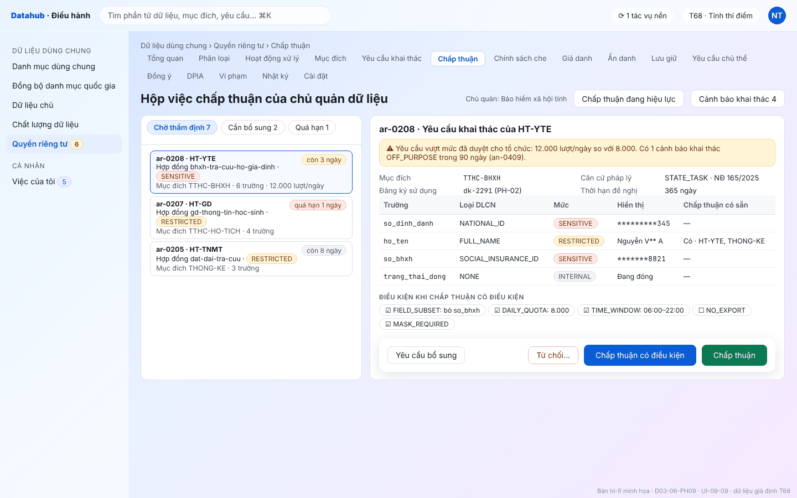
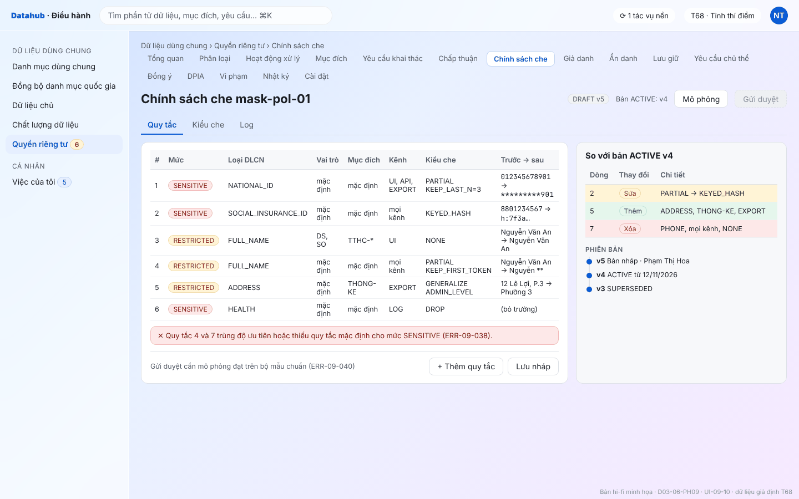

# D02-03-PH09 · Đặc tả yêu cầu chức năng Quyền riêng tư

## Tóm tắt cho hội đồng thẩm định

**Mục tiêu.** PH-09 trả lời ba câu hỏi mà từng HTTT riêng lẻ không tự trả lời được: dữ liệu nào là dữ liệu cá nhân và nhạy cảm đến mức nào, ai được khai thác dữ liệu đó cho mục đích gì và trên căn cứ pháp lý nào, và người dùng cuối thấy dữ liệu ở dạng nào (rõ, che, giả danh, ẩn danh). Phân hệ là nơi **quản lý** chính sách (điểm quản trị chính sách, PAP) và **nguồn thông tin** chính sách (PIP); việc **quyết định** từng lời gọi do OPA của PH-12 làm (PDP) với bundle dữ liệu do PH-09 ký, và việc **thực thi** do APISIX, PH-04, PH-06, PH-14, PH-19 làm (PEP) có đệm. Nhờ tách như vậy, tỉnh đổi chính sách trong vài chục giây mà không sửa mã của HTTT nào.

**Phạm vi.** 64 yêu cầu chức năng chia 11 nhóm: phân loại dữ liệu; sổ hoạt động xử lý dữ liệu cá nhân; mục đích và chấp thuận khai thác; chính sách che; giả danh hóa và ẩn danh hóa; thời hạn lưu và xóa; quyền của chủ thể dữ liệu; sự đồng ý; đánh giá tác động; vi phạm dữ liệu cá nhân; giám sát, báo cáo, cấu hình. Phân hệ chạy trong DU `dh-data` (package `vn.datahub.data.privacy`, schema `ph09_privacy`, Đợt 2, mốc W4), có control plane `/api/privacy/v1` và data plane nội bộ `/privacy/v1` (mTLS, chỉ DU gọi).

**Căn cứ pháp lý.** CMP-LAW-05 và CMP-LAW-04, CMP-LAW-18 (Luật BVDLCN 91/2025, NĐ 356/2025: cơ sở xử lý, quyền chủ thể, đánh giá tác động, thông báo vi phạm 72 giờ); CMP-LAW-01 và CMP-LAW-02 (Luật Dữ liệu 60/2024, NĐ 165/2025: phân loại, quản trị dữ liệu); CMP-LAW-03 và CMP-LAW-19 (NĐ 278/2025: kiểm soát mục đích khi khai thác CSDL quốc gia); CMP-LAW-16 (Luật An ninh mạng 116/2025: nhật ký, dữ liệu trong nước).

**Những điểm hội đồng cần lưu ý.**

1. Phân hệ **không lưu nội dung bản tin đi qua** và không tự mã hóa trường (thư viện `dh-crypto`, ADR-032 làm); PH-09 giữ danh mục, chính sách, sổ, hồ sơ và bằng chứng, nên dữ liệu cá nhân PH-09 giữ chỉ là định danh tối thiểu của chủ thể trong yêu cầu, đồng ý và vi phạm, mã hóa envelope.
2. Hợp đồng API, topic, luồng chứa trường **Nhạy cảm** không kích hoạt được khi chưa có mục đích và chấp thuận của chủ quản dữ liệu (SEC-37, FR-09-022); chấp thuận có hạn, có điều kiện, thu hồi có hiệu lực tại điểm thực thi trong 15 giây.
3. Mọi đường ra của dữ liệu cá nhân đều qua một chính sách che duy nhất, có phiên bản, mô phỏng và duyệt bốn mắt; **không có kế hoạch che thì không lộ** (đọc: chỉ trường công khai; luồng: đóng an toàn).
4. Giả danh hóa dùng khóa riêng theo tenant và theo mục đích trên OpenBao; khôi phục giá trị gốc là đặc quyền có MFA, hai người duyệt và nhật ký vĩnh viễn; ẩn danh hóa chỉ phát hành khi k tối thiểu 10 và rủi ro tái định danh không cao.
5. Thời hạn 72 giờ báo Cục A05 được máy đếm (đồng hồ không dừng), cảnh báo ở giờ thứ 24, 48, 60; hạn trả lời chủ thể (giả định 10 ngày làm việc) chờ xác nhận của pháp chế (Q09-02).

**Con số chính.**

| Chỉ số | Giá trị |
|---|---|
| Yêu cầu chức năng | 64 (M: 42, S: 18, C: 4) |
| Quy tắc nghiệp vụ | 61 (BR-09-001…61) |
| Yêu cầu phi chức năng | 23 (NFR-09-001…23) |
| Màn hình | 22 (UI-09-01…22) |
| API | 237 operation dự kiến (226 control plane, 11 data plane), 32 sự kiện (EVT-09-01…32) |
| Mã lỗi | 78 control (ERR-09-001…078), 13 data plane (ERR-09-101…113); lỗi `401`, `403` do thiếu quyền chức năng, `428` dùng mã nền ERR-00-401, 403, 428 |
| Thực thể mức logic | 51 (EN-09-01…51) |
| Tham số theo tenant | 36 khóa `09.*` (mục 8.2) |
| Câu hỏi mở | 19 (Q09-01…Q09-19) |
| Chức năng hệ cũ được phủ | `LGC-TOOL-012` (Nâng cấp), `LGC-NGSP-003` (Giữ nguyên, PH-09 kiểm soát mục đích) |
| Đợt | Đợt 2 (mốc W4); 4 chức năng mức C sang Đợt 3 |

: Con số chính của PH-09

## 1. Giới thiệu

### 1.1. Mục đích của tài liệu

Tài liệu đặc tả đầy đủ hành vi của PH-09 Quyền riêng tư cho ba nhóm người đọc. Hội đồng thẩm định dùng tài liệu để đánh giá mức tuân thủ Luật BVDLCN 91/2025 và các quy định kèm theo. Kỹ sư dùng tài liệu làm đầu vào cho D03-02-PH09 (thiết kế chi tiết), D03-03-PH09 (CSDL), D03-04-PH09 (API). Kiểm thử viên dùng luồng xử lý, ngoại lệ, quy tắc và ngưỡng để viết ca ở D05-02-PH09.

Mỗi chức năng đặc tả theo khung 17 mục của K-TRINH-BAY §4: mục đích, tác nhân, mức ưu tiên, truy vết, tiền điều kiện, kích hoạt, đầu vào, luồng chính, luồng thay thế, luồng ngoại lệ kèm câu thông báo, đầu ra, kết quả, hậu điều kiện, sự kiện, kiểm toán, quy tắc, màn hình và API. Phụ lục A là nguồn chuẩn của mọi giá trị liệt kê (enum) dùng trong bộ bảy tập PH-09; mã lỗi, sự kiện, API, màn hình được cấp ở chương 9 và 10 và là nguồn cho các tập sau.

### 1.2. Phạm vi

PH-09 chịu trách nhiệm 11 nhóm việc dưới đây.

| # | Trách nhiệm | Nhóm FR |
|---|---|---|
| 1 | Danh mục mức phân loại (DD-08), nhãn chặn bí mật nhà nước, loại dữ liệu cá nhân; đăng ký và phân loại từng trường (DD-09); quét phát hiện; mức phân loại của hợp đồng API, topic, luồng | A |
| 2 | Sổ hoạt động xử lý dữ liệu cá nhân: mục đích, cơ sở pháp lý, loại dữ liệu, bên nhận, thời hạn lưu, vai trò kiểm soát hoặc xử lý, liên kết tới trường, API, topic, luồng | B |
| 3 | Danh mục mục đích, yêu cầu khai thác, chấp thuận của chủ quản dữ liệu, xuất dữ liệu vào bundle OPA ký, quyết định mục đích trực tuyến, phát hiện khai thác vượt mức, chặn kích hoạt hợp đồng Nhạy cảm | C |
| 4 | Chính sách che theo mức, loại dữ liệu cá nhân, vai trò, mục đích, kênh; mô phỏng, duyệt, kế hoạch che trực tuyến, áp che bản tin, xem giá trị đầy đủ có lý do, che log | D |
| 5 | Miền và khóa giả danh hóa, khôi phục giá trị gốc, ẩn danh hóa, đánh giá rủi ro tái định danh, dữ liệu cho AI và ngoài PROD | E |
| 6 | Lịch lưu giữ, tác vụ xóa hoặc giả danh hóa khi hết hạn, giữ pháp lý, xóa mật mã tenant | F |
| 7 | Quyền của chủ thể: tiếp nhận, xác minh, tra cứu theo băm, chuyển xử lý, hạn, trả lời, báo cáo truy cập | G |
| 8 | Mẫu và bản ghi sự đồng ý cho tiện ích không bắt buộc | H |
| 9 | Hồ sơ đánh giá tác động, nhắc rà soát, xuất gửi Cục A05 | I |
| 10 | Vi phạm dữ liệu cá nhân: ghi nhận, đồng hồ 72 giờ, thông báo, khắc phục | J |
| 11 | Ghi vết, bảng điều khiển, báo cáo định kỳ, tham số tenant | K |

: Trách nhiệm của PH-09

Những việc dưới đây liên quan nhưng không thuộc PH-09; tài liệu chỉ mô tả điểm giao tiếp.

| Không làm | Thuộc |
|---|---|
| Lưu nội dung bản tin đi qua; chuyển, định tuyến bản tin | PH-04 (runtime), PH-10 |
| Mã hóa trường dữ liệu (envelope, `dh-crypto`) | Thư viện `dh-crypto` theo SEC-31, ADR-032 |
| Quyết định từng lời gọi API (PDP) | OPA của PH-12; PH-09 chỉ cấp dữ liệu chính sách |
| Thực thi tại cổng, bản tin, bản ghi (PEP) | PH-03 (APISIX), PH-04, PH-06, PH-14, PH-19 |
| Lưu nhật ký kiểm toán WORM | PH-13; PH-09 ghi sự kiện kiểm toán qua thư viện chung |
| Chạy quy trình, hạn việc | PH-11 (nếu tenant bật); không có thì đồng hồ nội bộ của PH-09 |
| Phát hiện sự cố an ninh | PH-18, PH-13; PH-09 nhận sự cố có dữ liệu cá nhân và quản lý nghĩa vụ 72 giờ |
| Sửa dữ liệu nguồn, xóa bản ghi vàng | PH-06 và HTTT nguồn; PH-09 chuyển yêu cầu và giữ bằng chứng |
| Đăng ký sử dụng API, phát hành hợp đồng | PH-02; PH-09 chặn kích hoạt khi thiếu chấp thuận |
| Kết nối CSDL quốc gia, Nền tảng chia sẻ | PH-14; PH-09 quản lý mục đích khai thác |

: Việc ngoài phạm vi PH-09

### 1.3. Đối tượng sử dụng và cách đọc

Mỗi nhóm người đọc có một lối vào riêng; bảng dưới chỉ rõ từng nhóm nên đọc chương nào để không phải đọc hết tài liệu.

| Người đọc | Đọc phần | Mục đích |
|---|---|---|
| Hội đồng thẩm định | Tóm tắt, chương 2, 4, 5, 11, 14 | Sự cần thiết, tuân thủ pháp lý, ranh giới PAP, PDP, PEP |
| Chủ quản dữ liệu, lãnh đạo | Chương 2, 3, mục 6.4, 6.9 | Việc phải thẩm định, phê duyệt, chịu trách nhiệm |
| Cán bộ ATTT (SO), bộ phận bảo vệ dữ liệu cá nhân | Mục 6.2, 6.6, 6.8, 6.10, 6.11, chương 7 | Phân loại, che, quyền chủ thể, vi phạm, nhật ký |
| Kỹ sư phát triển | Chương 4, 6, 7, 9, Phụ lục A | Mô hình, bundle, data plane, mã lỗi, enum |
| Kiểm thử viên | Chương 6, 7, 8, 14 | Ca dương, ca âm, ca độ trễ, ca phân quyền, ca rò rỉ |
| Vận hành | Mục 6.4, 6.7, chương 8, 12 | Bundle, khóa, tác vụ xóa, cảnh báo |

: Người đọc và phần cần đọc

Chức năng dùng chung (đăng nhập, chọn tenant, danh sách chuẩn, xuất lớn, kiểm toán chung, "Việc của tôi", bốn mắt, hiển thị lỗi) theo nhóm FR-00 của D02-02 và không lặp lại.

### 1.4. Thuật ngữ và chữ viết tắt

Bảng dưới giải thích thuật ngữ và chữ viết tắt dùng trong tập này, để mọi chương hiểu thống nhất.

| Thuật ngữ, viết tắt | Giải thích |
|---|---|
| Dữ liệu cá nhân (DLCN) | Thông tin gắn với một người cụ thể hoặc giúp xác định một người; gồm DLCN cơ bản và DLCN nhạy cảm theo Luật 91/2025 |
| Chủ thể dữ liệu | Người mà dữ liệu cá nhân nói về |
| Bên kiểm soát, bên xử lý | Bên quyết định mục đích và phương tiện xử lý; bên xử lý thay mặt bên kiểm soát (D03-07 §6.2) |
| PAP, PIP, PDP, PEP | Điểm quản trị chính sách, điểm cung cấp thông tin chính sách, điểm quyết định (OPA), điểm thực thi (cổng, luồng, DU) |
| Mức phân loại | Một trong `PUBLIC`, `INTERNAL`, `RESTRICTED`, `SENSITIVE` (DD-08) |
| Nhãn chặn (`STATE_SECRET`) | Nhãn bí mật nhà nước; dữ liệu mang nhãn bị chặn tuyệt đối |
| Phần tử dữ liệu | Một trường của thực thể nội bộ, lược đồ API hoặc lược đồ sự kiện, có phân loại (DD-09) |
| Hợp đồng | Hợp đồng dữ liệu của một API, topic hoặc luồng (NT-04) |
| Hoạt động xử lý (ROPA) | Một mục trong sổ hoạt động xử lý DLCN: mục đích, cơ sở pháp lý, dữ liệu, bên nhận, thời hạn |
| DPIA | Đánh giá tác động xử lý dữ liệu cá nhân; hồ sơ gửi Cục A05 |
| Mục đích (`purpose`) | Mã mục đích khai thác như `TTHC-HO-TICH`, `THONG-KE`, gắn vào đăng ký sử dụng (PH-02) và token (`scope purpose:{mã}`) |
| Chấp thuận (grant) | Quyết định của chủ quản dữ liệu cho một HTTT khai thác dữ liệu theo một mục đích, có hạn và điều kiện |
| Bundle | Gói dữ liệu và chính sách OPA đã ký, nạp vào OPA tại các điểm thực thi |
| Kế hoạch che | Danh sách trường kèm kiểu che áp cho một chủ thể, mục đích, kênh |
| Che (masking) | Ẩn một phần giá trị khi hiển thị hoặc trả về; bản gốc vẫn còn ở nguồn |
| Giả danh hóa | Thay định danh bằng bí danh; còn đảo ngược được nếu có khóa, vẫn là DLCN |
| Ẩn danh hóa | Loại bỏ khả năng định danh, không đảo ngược; đạt k-ẩn danh thì không còn là DLCN |
| k-ẩn danh, l-đa dạng | Mỗi tổ hợp thuộc tính bán định danh có ít nhất k bản ghi; mỗi nhóm có ít nhất l giá trị thuộc tính nhạy cảm khác nhau |
| ARX | Thư viện Java mã nguồn mở (Apache-2.0) ẩn danh hóa và đánh giá rủi ro tái định danh |
| HMAC | Hàm băm có khóa, dùng để giả danh hóa không đảo ngược và băm định danh chủ thể |
| OpenBao transit | Dịch vụ mật mã của OpenBao: mã hóa, HMAC, ký mà khóa không rời OpenBao |
| Băm chủ thể (`subjectHash`) | HMAC-SHA256 của định danh chủ thể, khóa theo tenant, dùng để tra cứu mà không giữ định danh rõ |
| Giữ pháp lý | Tạm hoãn xóa vì yêu cầu của cơ quan có thẩm quyền |
| Xóa mật mã | Hủy khóa KEK của tenant để mọi bản mã không giải được |
| TO, SO, DS, DA, DO, OR, SV, TA, PA, VW, AU | Vai trò theo D02-08: vận hành, ATTT, quản lý dữ liệu, duyệt dữ liệu, chủ quản dữ liệu, cán bộ đầu mối tổ chức, chủ dịch vụ, quản trị tỉnh, quản trị nền tảng, người xem, kiểm toán |
| p95, p99 | Phân vị 95, 99 của số đo |

: Thuật ngữ và chữ viết tắt của PH-09

### 1.5. Tài liệu tham chiếu

Các yêu cầu bám vào văn bản pháp lý và tài liệu thiết kế khác; bảng dưới ghi mã, tên và phần nội dung PH-09 dùng từng tài liệu.

| Mã | Tài liệu | Dùng cho |
|---|---|---|
| CMP-LAW-05, CMP-LAW-04, CMP-LAW-18 | Luật BVDLCN 91/2025/QH15; NĐ 356/2025/NĐ-CP | Cơ sở xử lý, quyền chủ thể, DPIA, thông báo vi phạm |
| CMP-LAW-01, CMP-LAW-02 | Luật Dữ liệu 60/2024/QH15; NĐ 165/2025/NĐ-CP | Phân loại, quản trị dữ liệu |
| CMP-LAW-03, CMP-LAW-19 | NĐ 278/2025/NĐ-CP | Kiểm soát mục đích khai thác CSDL quốc gia |
| CMP-LAW-16 | Luật An ninh mạng 116/2025/QH15 | Nhật ký, dữ liệu trong nước |
| D00-01, D00-03 | Quy chuẩn mã, ma trận truy vết | `CMP-LAW`, `LGC-TOOL-012`, `LGC-NGSP-003` |
| D02-01 | BRD | REQ-09 (BO-04, mức M) |
| D02-02 | SRS | FR-00 dùng chung, REQ-09 |
| D02-07 | Từ điển dữ liệu dùng chung | DD-08 mức phân loại, DD-09 phân loại trường |
| D02-08 | Ma trận phân quyền | `ROLE-*`, `PERM-09-*`, scope `purpose:{mã}` |
| D03-01 | SAD | DU `dh-data`, NT-10, §8.2, §8.3 |
| D03-07 | Thiết kế ATTT | Bảng bốn mức (§3.2), §6 bảo vệ DLCN, SEC-26, 31, 32, 37, 38, 39, 74, THR-51, THR-54 |
| D02-03-PH04 | FRS Tích hợp | FR-04-067: che ở chặng `respond`, `dh-data-classes`, `dh-obligations` |
| D02-03-PH06 | FRS Dữ liệu chủ | FR-06-004, FR-06-052, FR-06-058, `06.mask.reveal-seconds` |
| ADR-003, ADR-012, ADR-031, ADR-032, ADR-034, ADR-041, ADR-042, ADR-046, ADR-048, ADR-057 | RLS, OpenBao, kiểm toán chuỗi băm, mã hóa trường, DR, idempotency, outbox, bốn mắt, mã hóa DLCN người nộp, đồng bộ quốc gia | Lý do lựa chọn |
| ADR 090…093 (đề xuất) | Điểm quyết định tập trung, giả danh hóa HMAC và token, ẩn danh hóa ARX, phát hiện bằng mẫu và kiểm tổng | Ghi ở Phụ lục B |
| `docs/07-srs/SRS-PH-09-privacy.md` | SRS cũ của repo (11 FR) | Nguồn nghiệp vụ, bảng ánh xạ ở 11.3 |

: Tài liệu tham chiếu của PH-09

### 1.6. Cấu trúc tài liệu

Chương 2 trình bày bối cảnh, mục tiêu, kiến trúc và quy trình. Chương 3 nêu tác nhân, quyền, tách nhiệm vụ. Chương 4 định nghĩa khái niệm, thực thể và bốn máy trạng thái. Chương 5 liệt kê 64 chức năng; chương 6 đặc tả từng chức năng theo 11 nhóm. Chương 7 đến 9 gom quy tắc, phi chức năng, tham số, mã lỗi, thông báo, sự kiện, API. Chương 10 là giao diện. Chương 11 đến 14 là truy vết, phụ thuộc, câu hỏi mở, tiêu chí chấp nhận. Phụ lục A là nguồn chuẩn enum; Phụ lục B là đề nghị đồng bộ.

## 2. Tổng quan phân hệ

### 2.1. Bối cảnh và vấn đề cần giải quyết

Hệ cũ (Viettel 2021) chỉ có một bước mã hóa gói tin và che dữ liệu nhạy cảm trong nhóm công cụ bảo mật (`LGC-TOOL-012`), cấu hình riêng từng luồng, không có danh mục phân loại, không ghi nhận mục đích khai thác, không có sổ xử lý dữ liệu cá nhân và không có công cụ trả lời chủ thể. Từ 01/01/2026 Luật BVDLCN 91/2025 và NĐ 356/2025 đòi hỏi bên kiểm soát và bên xử lý chứng minh được cơ sở pháp lý, mục đích, thời hạn lưu và biện pháp bảo vệ cho từng hoạt động xử lý. Bảng dưới tóm tắt các hạn chế và cách PH-09 khắc phục.

| Hạn chế hiện nay | Hệ quả | Cách PH-09 khắc phục |
|---|---|---|
| Không có danh mục phân loại ở mức trường; che cấu hình tay từng luồng | Sót trường nhạy cảm; mỗi luồng che một kiểu | Danh mục phân loại DD-09 một nơi, mức hợp đồng tự tính, chính sách che dùng chung |
| Khai thác dữ liệu không gắn mục đích và chấp thuận | Một HTTT dùng thông tin xác thực chung để tra hàng loạt vượt mục đích (THR-51), không chứng minh được khi khiếu nại (THR-54) | Chấp thuận theo mục đích có hạn, OPA từ chối khi thiếu, nhật ký có mục đích và băm khóa tra cứu |
| Không có sổ hoạt động xử lý, DPIA, hạn lưu | Không lập được hồ sơ gửi Cục A05; dữ liệu giữ vô thời hạn | Sổ ROPA, DPIA có phiên bản và nhắc, lịch lưu giữ, tác vụ xóa |
| Không có kênh quyền chủ thể | Không trả lời được "dữ liệu nào về tôi, ai đã truy cập" trong hạn | Tiếp nhận, xác minh, tra theo băm, chuyển PH-06, PH-19, theo dõi hạn |
| Không có quy trình vi phạm | Có nguy cơ quá hạn 72 giờ | Đồng hồ máy đếm, cảnh báo, mẫu thông báo, hồ sơ |
| Dữ liệu thử, dữ liệu cho AI là dữ liệu thật | Lộ dữ liệu ngoài PROD (SEC-38) | Giả danh hóa, ẩn danh hóa k ≥ 10, đánh giá rủi ro trước khi phát hành |

: Hạn chế hiện nay và cách PH-09 khắc phục

### 2.2. Mục tiêu của phân hệ

Phân hệ được nghiệm thu theo năm mục tiêu đo được dưới đây, mỗi mục gắn với một yêu cầu phi chức năng để kiểm chứng.

1. Quyết định mục đích tại điểm thực thi có đệm p95 ≤ 20 ms, gọi trực tiếp p95 ≤ 50 ms; chấp thuận, chính sách mới có hiệu lực tại mọi OPA trong ≤ 60 giây, thu hồi trong ≤ 15 giây (NFR-09-001, NFR-09-005).
2. 100% trường dữ liệu cá nhân đã xác nhận thuộc một hoạt động xử lý, và 100% hợp đồng mức Nhạy cảm đang chạy có chấp thuận hiệu lực (BR-09-008, BR-09-019; SEC-37).
3. 0 giá trị trường Nhạy cảm ở dạng rõ trong log, trace, topic, tệp xuất không có phiếu xem đầy đủ (NFR-09-014); chính sách che tương đương 100% giữa OPA và PH-09 (NFR-09-008).
4. Tập ẩn danh phát hành đạt k ≥ 10 và rủi ro không `HIGH` (NFR-09-012); khóa giả danh hóa theo tenant và mục đích, không lưu bảng ánh xạ (NFR-09-011).
5. ≥ 98% yêu cầu chủ thể đóng đúng hạn và 100% vụ việc có thông báo Cục A05 trước 72 giờ hoặc căn cứ không thông báo (NFR-09-016, NFR-09-017).

### 2.3. Vị trí trong kiến trúc

PH-09 nằm trong DU `dh-data` cùng PH-06, PH-07, PH-08, ở vùng Z4 ứng dụng nội bộ. Các điểm thực thi gọi vào data plane `/privacy/v1` bằng mTLS trong cụm; OpenBao nằm ở Z6, dữ liệu của phân hệ nằm ở `pg-core` schema `ph09_privacy`.

```{.mermaid caption="Vị trí của PH-09 trong kiến trúc Datahub"}
flowchart TB
  subgraph PEP["Điểm thực thi PEP"]
    GW["PH-03 APISIX"]
    RT["PH-04 runtime"]
    MD["PH-06, PH-14, PH-19"]
  end
  OPA["PH-12 OPA<br/>(PDP, bundle ký)"]
  subgraph Z4["dh-data Z4"]
    P09["PH-09 Quyền riêng tư<br/>(PAP, PIP)"]
    P07["PH-07 Danh mục"]
  end
  OB["OpenBao Z6<br/>(transit, KEK, ký)"]
  PG[("pg-core<br/>ph09_privacy")]
  K[("Kafka<br/>t68.privacy.*")]
  P13["PH-13 Kiểm toán"]
  P02["PH-02, PH-11, PH-20"]
  GW --> OPA
  RT --> OPA
  P09 --> OPA
  GW -.-> P09
  RT -.-> P09
  MD -.-> P09
  P09 --> OB
  P09 --> PG
  P09 --> K
  P09 --> P13
  P02 <--> P09
  P09 --> P07
```

Hình cho thấy ba mũi tên đi vào PH-09 là đường nóng và đều có đệm: OPA nhận bundle do PH-09 ký và quyết định ngay tại điểm thực thi mà không gọi PH-09 mỗi lượt; điểm thực thi chỉ gọi PH-09 khi cần kế hoạch che hoặc băm có khóa. Khóa mật mã không bao giờ rời OpenBao, nên PH-09 gửi giá trị tới OpenBao để băm hoặc mã hóa thay vì lấy khóa về (trừ khóa dẫn xuất có thời hạn đệm ngắn cho HMAC cục bộ).

### 2.4. Kiến trúc thành phần và công nghệ

Phân hệ gồm các thành phần nội bộ; bảng dưới giúp biết một việc nằm ở thành phần nào.

| Thành phần | Trách nhiệm | Công nghệ |
|---|---|---|
| `privacy-catalog` | Mức phân loại, loại DLCN, phần tử, phân loại, quét, mức hợp đồng, nhãn chặn | Spring Modulith, PostgreSQL, JSON Schema và OpenAPI parser, bộ mẫu kiểm tổng |
| `privacy-ropa` | Hoạt động xử lý, cơ sở pháp lý, DPIA, xuất sổ | Spring, mẫu xuất DOCX, XLSX |
| `privacy-purpose` | Mục đích, yêu cầu, chấp thuận, dựng và ký bundle, phát hiện bất thường | Spring, OPA bundle (Rego, `opa build --signing-key`), OpenBao transit sign, Kafka |
| `privacy-decision` | Data plane: quyết định, kế hoạch che, áp che, chỉ mục phân loại | Spring WebFlux, bộ đệm trong bộ nhớ, Valkey cho bản chụp kế hoạch (không giữ giá trị rõ) |
| `privacy-policy` | Chính sách che, mô phỏng, phiếu xem đầy đủ, cấu hình che log, quét rò rỉ | Spring, thư viện che dùng chung `dh-privacy-pep`, Loki query |
| `privacy-crypto` | Miền và khóa giả danh hóa, giả danh hóa, khôi phục | OpenBao transit (HMAC, mã hóa dẫn xuất), Spring Cloud Vault |
| `privacy-anon` | Cấu hình, job ẩn danh hóa, rủi ro, tập đã ẩn danh | Job Kubernetes Java, ARX 3.9 (Apache-2.0) |
| `privacy-retention` | Lịch lưu giữ, tác vụ xóa, giữ pháp lý, xóa mật mã | ShedLock, tác vụ nền, OpenBao |
| `privacy-dsr` | Yêu cầu chủ thể, đồng ý, tra theo băm | Spring, API PH-06, PH-19, PH-13, PH-11 tùy chọn |
| `privacy-breach` | Vi phạm DLCN, đồng hồ 72 giờ, thông báo | Spring, bộ đếm thời gian có lưu, thông báo PH-13 |
| `privacy-ops` | Kiểm toán, bảng điều khiển, báo cáo, tham số | Micrometer, Prometheus, thư viện kiểm toán chung |

: Thành phần của PH-09

Hình dưới là trình tự luồng chính: từ lúc chủ quản chấp thuận đến lúc một lời gọi API được quyết định và trả về đã che.

```{.mermaid caption="Trình tự luồng chính từ chấp thuận đến phản hồi đã che"}
sequenceDiagram
  actor DO as Chủ quản dữ liệu
  participant P9 as PH-09
  participant OB as OpenBao
  participant BS as OPA PH-12
  participant PEP as Điểm thực thi
  participant HT as HTTT khai thác
  DO->>P9: Chấp thuận yêu cầu khai thác (FR-09-016)
  P9->>P9: Ghi chấp thuận, dựng bundle, chạy opa test
  P9->>OB: Ký bundle (transit sign)
  OB-->>P9: Chữ ký
  P9->>BS: Phát hành bundle, phát EVT bundle.published
  BS->>PEP: OPA nạp bundle trong 60 giây
  HT->>PEP: Gọi API kèm token scope purpose
  PEP->>PEP: OPA quyết định mục đích, trả nghĩa vụ che
  PEP->>P9: Lấy kế hoạch che khi chưa có đệm
  P9-->>PEP: Kế hoạch che kèm phiên bản
  PEP-->>HT: Phản hồi đã che, header X-Datahub-Masking
  PEP->>P9: Báo lượt khai thác theo lô
```

Chấp thuận chỉ có hiệu lực khi bundle đã được ký và nạp; từ lúc đó mọi lời gọi được quyết định tại chỗ trong vài mili giây. PH-09 không nằm trên đường gọi của từng lượt nên tạm ngừng PH-09 không làm dừng khai thác, nhưng bundle hết hạn (`validUntil`) sẽ khiến hợp đồng Nhạy cảm bị từ chối, và kế hoạch che quá hạn đệm chuyển sang chế độ đóng an toàn.

### 2.5. Quy trình nghiệp vụ liên quan

Bộ quy trình BP-01…09 của D02-01 chưa có quy trình riêng cho quyền riêng tư; tài liệu đề nghị bổ sung BP-11 "Quản lý quyền riêng tư và dữ liệu cá nhân" (Phụ lục B). PH-09 tham gia các quy trình sẵn có như bảng dưới.

| Quy trình | Bước có PH-09 |
|---|---|
| BP-01 Kết nạp HTTT và cấp quyền sử dụng | Đăng ký sử dụng API mức Nhạy cảm cần mục đích và chấp thuận (FR-09-015, 016, 022) |
| BP-02 Xây dựng và phát hành luồng | Mức hợp đồng của luồng, chặn kích hoạt khi thiếu chấp thuận (FR-09-006, 022); che ở chặng `respond` (FR-09-028) |
| BP-04 Trao đổi dữ liệu qua sự kiện | Phân loại schema sự kiện, topic Nhạy cảm (FR-09-003, 006) |
| BP-06 Khai thác dữ liệu quốc gia | Mục đích khai thác, hạn ngạch, cảnh báo tra cứu hàng loạt (FR-09-019, 020; THR-51) |
| BP-07 Giám sát, xử lý sự cố, báo cáo | Vi phạm DLCN, đồng hồ 72 giờ (FR-09-058, 059) |
| BP-08 Khởi tạo tenant | Nạp danh mục nền, tham số mặc định; xóa mật mã khi chấm dứt (FR-09-043) |
| BP-11 (đề nghị) Quản lý quyền riêng tư | Phân loại, sổ xử lý, chấp thuận, che, quyền chủ thể, DPIA, vi phạm |

: Quy trình nghiệp vụ có PH-09 tham gia

```{.mermaid caption="Vòng đời điển hình của một mục dữ liệu cá nhân trong PH-09"}
flowchart TB
  A["Đăng ký trường"] --> B["Đề xuất, xác nhận phân loại"]
  B --> C["Thuộc hoạt động xử lý, có thời hạn lưu"]
  C --> D["Hợp đồng đạt mức, cần mục đích"]
  D --> E["Chủ quản chấp thuận"]
  E --> F["Bundle ký, OPA quyết định"]
  F --> G["Che hoặc giả danh theo chính sách"]
  G --> H["Hết hạn: xóa hoặc giả danh hóa"]
  G --> I["Chủ thể yêu cầu, rút đồng ý"]
  I --> J["Chuyển xử lý, trả lời"]
```

Vòng đời cho thấy phân loại là điểm bắt đầu bắt buộc: trường chưa phân loại bị xử lý như Nhạy cảm (BR-09-001) nên không có đường nào đưa dữ liệu ra mà bỏ qua bước này.

### 2.6. Chức năng hệ cũ được phủ

Hệ cũ có hai mục `LGC` liên quan trực tiếp tới PH-09. Kết luận chi tiết ở 11.1.

| `LGC` | Chức năng hệ cũ | Vai trò của PH-09 |
|---|---|---|
| LGC-TOOL-012 | Nhóm bảo mật (mã hóa gói tin, điểm cuối) | Nâng cấp: bước mã hóa, che dữ liệu nhạy cảm thành chính sách che có phiên bản, nguồn phân loại một nơi; PH-04 thực thi (FR-04-067) |
| LGC-NGSP-003 | BHXH tra cứu hộ gia đình | Giữ nguyên chức năng ở PH-14; PH-09 thêm kiểm soát mục đích khai thác, chấp thuận, hạn ngạch và ghi vết |

: Chức năng hệ cũ được phủ

## 3. Tác nhân, vai trò và quyền

### 3.1. Tác nhân

Bảng dưới liệt kê người và hệ thống tương tác với PH-09, kèm vai trò và việc chính, để các yêu cầu sau gán đúng tác nhân. Cán bộ ATTT (SO) đóng vai bộ phận bảo vệ dữ liệu cá nhân của tỉnh theo giả định GĐ-09-01; việc có cần vai trò riêng `ROLE-PRIVACY_OFFICER` được nêu ở Q09-01 và tài liệu không tạo `ROLE` mới.

| Tác nhân | Loại | Mô tả | Tương tác chính |
|---|---|---|---|
| Cán bộ ATTT (SO, ROLE-SECURITY_OFFICER) | Người | Bộ phận bảo vệ DLCN của tỉnh (giả định) | Xác nhận phân loại, soạn sổ và DPIA, duyệt ẩn danh rủi ro trung bình, đề nghị khôi phục, xử lý yêu cầu chủ thể, vi phạm, xem nhật ký |
| Quản trị tỉnh (TA, ROLE-TENANT_ADMIN) | Người | Quản trị Datahub của tỉnh | Soạn chính sách che, miền giả danh, lịch lưu giữ, tham số; duyệt chính sách (người khác người soạn) |
| Người duyệt dữ liệu (DA, ROLE-DATA_APPROVER) | Người | Lãnh đạo phụ trách dữ liệu | Duyệt chính sách che, lịch lưu giữ, ẩn danh, mẫu đồng ý, xóa mật mã |
| Chủ quản dữ liệu (DO, ROLE-DATA_OWNER) | Người | Đại diện cơ quan chủ quản dữ liệu | Thẩm định, chấp thuận, tạm dừng, thu hồi; duyệt khôi phục cấp một; xác nhận phân loại dữ liệu của mình |
| Cán bộ quản lý dữ liệu (DS, ROLE-DATA_STEWARD) | Người | Cán bộ chuyên trách dữ liệu | Đề xuất phân loại, soạn sổ, soạn chính sách, chạy ẩn danh hóa, xử lý yêu cầu chủ thể |
| Cán bộ đầu mối tổ chức (OR, ROLE-ORG_REQUESTER) | Người | Đầu mối của tổ chức khai thác | Lập yêu cầu khai thác cho HTTT của tổ chức |
| Chủ dịch vụ (SV, ROLE-SERVICE_OWNER) | Người | Chủ API, topic của tổ chức | Đề xuất phân loại trường của hợp đồng mình; lập yêu cầu khai thác |
| Vận hành tỉnh (TO, ROLE-TENANT_OPERATOR) | Người | Cán bộ trực | Xem bundle, tác vụ, ghi nhận vi phạm ban đầu |
| Quản trị nền tảng (PA, ROLE-PLATFORM_ADMIN) | Người | Đơn vị vận hành nền tảng | Đặt trần, sàn tham số; danh mục nền |
| Kiểm toán (AU), Người xem (VW) | Người | Thanh tra, lãnh đạo | AU xem nhật ký và báo cáo; VW chỉ xem tổng quan UI-09-01 |
| Chủ thể dữ liệu | Người ngoài hệ thống | Công dân, cán bộ có dữ liệu cá nhân | Gửi yêu cầu qua kênh tiếp nhận (dịch vụ công của tỉnh, quầy, văn bản); không đăng nhập Datahub |
| HTTT thành viên | Hệ thống | Hệ của sở, ngành | Gọi API với scope `purpose:{mã}`, `privacy:*`; nhận sự kiện chấp thuận |
| PH-03, PH-04, PH-06, PH-14, PH-19 | Hệ thống | Điểm thực thi PEP | Lấy kế hoạch che, quyết định, chỉ mục phân loại; báo lượt khai thác |
| PH-02, PH-11, PH-12, PH-13, PH-17, PH-18, PH-20 | Hệ thống | Phân hệ khác | Hợp đồng và đăng ký sử dụng; quy trình; OPA; kiểm toán; dữ liệu AI; sự cố; chấm dứt tenant |
| OpenBao, Job ARX | Hệ thống | Hạ tầng | Ký bundle, HMAC, mã hóa dẫn xuất; ẩn danh hóa theo lô |

: Tác nhân của PH-09

### 3.2. Ma trận quyền

Ba quyền `PERM-09-classify`, `PERM-09-purpose-approve`, `PERM-09-unmask` đã có ở D02-08 §3.2; 13 quyền còn lại là đề nghị mới, ghi ở Phụ lục B "Đề nghị đồng bộ D02-08". Ký hiệu theo D02-08: ● có quyền, ○ chỉ với đối tượng thuộc tổ chức của mình, — không. Với `PERM-09-classify`, DS và SV chỉ được **đề xuất** (mở rộng so với D02-08, ghi ở Phụ lục B); xác nhận chỉ TA, SO, DO.

| Quyền | Ý nghĩa | PA | TA | TO | SO | DS | DA | DO | OR | SV | VW | AU |
|---|---|---|---|---|---|---|---|---|---|---|---|---|
| PERM-09-read | Xem danh mục, sổ, chính sách, bundle, báo cáo (đã che) | ● | ● | ● | ● | ● | ● | ○ | — | — | ● | ● |
| PERM-09-classify | Đề xuất, xác nhận phân loại; nhãn chặn; quét | — | ● | — | ● | ○ | — | ○ | — | ○ | — | — |
| PERM-09-ropa | Soạn, duyệt sổ hoạt động xử lý và DPIA | — | ● | — | ● | ○ | ● | ○ | — | — | — | — |
| PERM-09-purpose-request | Lập yêu cầu khai thác theo mục đích | — | ● | — | — | — | — | — | ○ | ○ | — | — |
| PERM-09-purpose-approve | Chấp thuận, tạm dừng, thu hồi; duyệt khôi phục cấp một | — | — | — | — | — | — | ○ | — | — | — | — |
| PERM-09-policy | Soạn chính sách che, miền giả danh, mẫu che, cấu hình che log | — | ● | — | ● | ○ | — | — | — | — | — | — |
| PERM-09-policy-approve | Duyệt chính sách, lịch lưu giữ, cấu hình ẩn danh, xoay hoặc hủy khóa, mẫu đồng ý, xóa mật mã | — | ● | — | ● | — | ● | — | — | — | — | — |
| PERM-09-unmask | Xem giá trị đầy đủ có lý do, 60 giây | — | — | — | ● | — | — | ○ | — | — | — | — |
| PERM-09-reidentify | Đề nghị và thực hiện khôi phục giá trị gốc từ token | — | — | — | ● | — | — | — | — | — | — | — |
| PERM-09-anonymize | Cấu hình, chạy ẩn danh hóa, chuẩn bị dữ liệu, phát hành tập | — | ● | — | ● | ○ | — | — | — | — | — | — |
| PERM-09-retention | Lịch lưu giữ, tác vụ xóa, giữ pháp lý, đề nghị xóa mật mã | — | ● | — | ● | ○ | — | — | — | — | — | — |
| PERM-09-dsr | Tiếp nhận, xử lý yêu cầu của chủ thể | — | ● | — | ● | ● | — | — | — | — | — | — |
| PERM-09-consent | Quản lý mẫu, bản ghi đồng ý | — | ● | — | ● | ○ | — | — | — | — | — | — |
| PERM-09-breach | Ghi nhận, xử lý vi phạm DLCN | — | ● | ● | ● | — | — | — | — | — | — | — |
| PERM-09-audit-read | Xem nhật ký bảo vệ dữ liệu, lịch sử xem đầy đủ | ● | — | — | ● | — | — | — | — | — | — | ● |
| PERM-09-config | Tham số `09.*`, ngưỡng cảnh báo, lịch báo cáo | ● (trần) | ● | — | — | — | — | — | — | — | — | — |

: Ma trận quyền của PH-09

`PERM-09-unmask` được cấp riêng từng người theo quyết định (D02-08 §3.2) nên ● ở SO là điều kiện cần, không phải tự động. TO có `PERM-09-breach` để ghi nhận ban đầu khi trực, không đóng được hồ sơ (BR-09-057 và FR-09-060 kiểm vai trò). Thiếu quyền chức năng trả `403` với mã nền ERR-00-403, chưa xác thực trả `401` với ERR-00-401, thiếu `If-Match` trả `428` với ERR-00-428; các mã này do khung lỗi chung cấp và áp cho mọi API của PH-09. `403` do phạm vi tổ chức (quyền ○) dùng ERR-09-008.

### 3.3. Tách nhiệm vụ và tài khoản máy

Bốn mắt (FR-00-071, ADR-046) áp dụng cho: hạ mức phân loại, gỡ nhãn `STATE_SECRET`, kích hoạt hoạt động xử lý, kích hoạt chính sách che, lịch lưu giữ, cấu hình ẩn danh, mẫu đồng ý, hồ sơ DPIA, xoay và hủy khóa, xóa mật mã tenant, chấp thuận yêu cầu khai thác (người lập không duyệt). Người đề nghị hoặc người quyết định ở bước trước không được duyệt bước sau (ERR-09-005). Khôi phục giá trị gốc cần ba người khác nhau: người đề nghị (`PERM-09-reidentify`), người duyệt cấp một (`PERM-09-purpose-approve`, DO của tổ chức sở hữu dữ liệu) và người duyệt cấp hai (`PERM-09-policy-approve`).

Cặp loại trừ đề nghị cho D02-08 §4: SO không đồng thời giữ `PERM-09-purpose-approve` (không vừa đề nghị vừa duyệt khôi phục); DS và DA là cặp loại trừ trong cùng tenant (như PH-06); người soạn chính sách (`PERM-09-policy`) không duyệt chính sách đó dù có `PERM-09-policy-approve`.

HTTT và phân hệ gọi PH-09 bằng token dịch vụ. Scope: `privacy:decide` (quyết định, kế hoạch che, chỉ mục phân loại, bundle, băm chủ thể, báo lượt), `privacy:apply` (áp che bản tin), `privacy:pseudonymize` (giả danh hóa), `privacy:register` (đăng ký phần tử, mức hợp đồng, kiểm tra kích hoạt, tiếp nhận yêu cầu chủ thể từ kênh công), `privacy:consent` (ghi, tra đồng ý), cùng scope `purpose:{mã}` mang mục đích của lời gọi (D02-08 §5). Data plane còn kiểm danh tính DU theo SPIFFE ID của Istio (SEC-15): PH-03, PH-04, PH-06, PH-14, PH-19 có `privacy:decide` và `privacy:apply`; chỉ PH-04 và PH-17 có `privacy:pseudonymize`; `privacy:consent` cấp cho HTTT có tiện ích đồng ý. Job ARX dùng tài khoản CSDL riêng chỉ đọc bảng nguồn được giao và ghi vào vùng lưu trữ tập ẩn danh.

## 4. Khái niệm và mô hình nghiệp vụ

### 4.1. Khái niệm nghiệp vụ

Ba kỹ thuật bảo vệ dữ liệu dễ bị nhầm với nhau và có hệ quả pháp lý khác nhau, nên PH-09 tách bạch từ đầu. Bảng dưới giữ phân biệt của SRS cũ và gắn với bốn chế độ xử lý cũ (`none`, `mask`, `pseudonymize`, `anonymize`) vào mô hình mới.

| Kỹ thuật | Bản chất | Đảo ngược được | Còn là DLCN | Chế độ cũ | Mô hình mới |
|---|---|---|---|---|---|
| Che (masking) | Ẩn một phần khi hiển thị hoặc trả về | Không cần, bản gốc ở nguồn | Có | `mask`, `none` | `MaskType` `PARTIAL`, `REPLACE`, `GENERALIZE`, `DROP`, `NONE` (nhóm D) |
| Giả danh hóa | Thay định danh bằng bí danh, giữ ánh xạ ngược qua khóa | HMAC: không; token: có, có kiểm soát | Có | `pseudonymize` | `MaskType` `KEYED_HASH`, `TOKENIZE`, miền giả danh (nhóm E) |
| Ẩn danh hóa | Loại bỏ khả năng định danh | Không bao giờ | Không, nếu đạt ngưỡng | `anonymize` | Cấu hình và job ẩn danh hóa (nhóm E) |

: Ba kỹ thuật bảo vệ dữ liệu và ánh xạ sang mô hình mới

Quy tắc chọn giữa `DROP` và che một phần kế thừa từ SRS cũ (BR-09-024). Bốn khái niệm nghiệp vụ còn lại giúp đọc các chương sau. **Mức phân loại** của trường quyết định cách xử lý ở mọi khâu theo bảng D03-07 §3.2; **mục đích** là lý do khai thác được chủ quản chấp thuận; **cơ sở pháp lý** là căn cứ của hoạt động xử lý (nhiệm vụ nhà nước, nghĩa vụ pháp lý, sự đồng ý…); **nghĩa vụ** (obligation) là chỉ thị OPA trả cho điểm thực thi, như "che trường X theo kiểu Y". Dữ liệu **đi qua** không được phân loại theo trường mà theo mức của hợp đồng; dữ liệu **lưu lại** (PH-06, PH-19, tài khoản, nhật ký) phân loại theo trường và có hoạt động xử lý riêng (D03-07 §6.2).

### 4.2. Thực thể

PH-09 có 51 thực thể mức logic, tất cả mang `tenant_id` và bật RLS (BR-09-060). Thiết kế vật lý ở D03-03-PH09; bảng dưới là nguồn mã `EN-09-nn` cho các tập sau. Các thực thể không chứa giá trị DLCN rõ, trừ phiếu yêu cầu chủ thể giữ định danh mã hóa envelope.

| Mã | Thực thể | Mô tả |
|---|---|---|
| EN-09-01 | `DataClass` | Mức phân loại (DD-08): `PUBLIC`, `INTERNAL`, `RESTRICTED`, `SENSITIVE`, kèm `rank`, `log_policy`, `display_policy`, `encrypt_at_app` |
| EN-09-02 | `BlockLabel` | Nhãn chặn `STATE_SECRET` gắn vào phần tử hoặc hợp đồng, kèm văn bản căn cứ, người gán, trạng thái gỡ |
| EN-09-03 | `PersonalDataCategory` | Loại dữ liệu cá nhân (số định danh, sức khỏe, sinh trắc…), `personal_data_type` `BASIC` hoặc `SENSITIVE`, căn cứ pháp lý |
| EN-09-04 | `DataElement` | Phần tử dữ liệu (trường) với `scope` (`INTERNAL_ENTITY`, `API_SCHEMA`, `EVENT_SCHEMA`), `target`, chủ sở hữu, nguồn đăng ký |
| EN-09-05 | `ElementClassification` | Phân loại hiện hành của phần tử (DD-09): mức, loại DLCN, loại định danh, `mask_pattern`, `neverReveal`, trạng thái |
| EN-09-06 | `ClassificationChange` | Đề xuất hoặc thay đổi phân loại: mức cũ, mới, căn cứ, người đề xuất, người xác nhận thứ nhất, thứ hai |
| EN-09-07 | `DetectorRule` | Mẫu phát hiện: loại (số định danh, điện thoại, thư điện tử, kiểm tổng), biểu thức, ngưỡng tin cậy |
| EN-09-08 | `ScanRun` | Lượt quét: phạm vi, mẫu dòng, trạng thái, số trường nghi ngờ |
| EN-09-09 | `ScanFinding` | Kết quả phát hiện một cột hoặc trường: mẫu khớp, độ tin cậy, trạng thái xử lý |
| EN-09-10 | `ContractLevel` | Mức phân loại tính được của một hợp đồng API, topic, luồng, cờ `provisional` |
| EN-09-11 | `ProcessingActivity` | Hoạt động xử lý DLCN theo phiên bản: mục đích, cơ sở pháp lý, loại dữ liệu, nhóm chủ thể, bên nhận, thời hạn lưu, vai trò, biện pháp |
| EN-09-12 | `ActivityLink` | Liên kết hoạt động với phần tử, API, topic hoặc luồng |
| EN-09-13 | `LegalBasis` | Cơ sở pháp lý (`LegalBasisType`) và quy tắc áp dụng |
| EN-09-14 | `LegalDocument` | Văn bản căn cứ: loại, số, ngày ban hành, ngày hiệu lực, ngày hết hiệu lực, liên kết `CMP-LAW` |
| EN-09-15 | `Purpose` | Mục đích khai thác (`TTHC-HO-TICH`, `THONG-KE`): trường được phép, cơ sở pháp lý, cờ `statutory`, `maxDays` |
| EN-09-16 | `AccessRequest` | Yêu cầu khai thác của một HTTT cho một mục đích: hợp đồng hoặc tập trường, khối lượng dự kiến, trạng thái |
| EN-09-17 | `PurposeGrant` | Chấp thuận khai thác: bộ ba (HTTT, mục đích, hợp đồng), hiệu lực, hạn ngạch, điều kiện, số lần gia hạn |
| EN-09-18 | `GrantCondition` | Điều kiện của chấp thuận (`ConditionType`): giới hạn trường, hạn ngạch, khung giờ, môi trường, ép che |
| EN-09-19 | `PolicyBundle` | Bundle dữ liệu `purpose_grants`, `mask_policies`, `classification_index` đã ký: băm, chữ ký, `validUntil`, kết quả kiểm thử |
| EN-09-20 | `UsageCounter` | Bộ đếm khai thác theo (HTTT, mục đích, hợp đồng, phút) do điểm thực thi báo |
| EN-09-21 | `UsageAnomaly` | Cảnh báo khai thác bất thường (`AnomalyType`), mức, trạng thái xử lý |
| EN-09-22 | `MaskType` | Kiểu che (`MaskType`) và các mẫu che (`MaskPatternKind`) có tham số |
| EN-09-23 | `MaskPolicy` | Chính sách che theo phiên bản: phạm vi, trạng thái, người soạn, người duyệt |
| EN-09-24 | `MaskRule` | Quy tắc che trong chính sách: điều kiện (mức, loại DLCN, vai trò, mục đích, kênh), kiểu che, tham số, độ ưu tiên |
| EN-09-25 | `MaskSimulation` | Lần mô phỏng chính sách trên bộ mẫu: bộ mẫu, kết quả, người chạy |
| EN-09-26 | `RevealGrant` | Phiếu xem giá trị đầy đủ: người xin, đối tượng, trường, lý do, hết hạn sau 60 giây |
| EN-09-27 | `LogMaskConfig` | Cấu hình che log, trace: danh sách cho phép, mẫu quét, ngưỡng |
| EN-09-28 | `LeakFinding` | Kết quả quét rò rỉ DLCN trong log, trace: nguồn, mẫu khớp, số lần, trạng thái |
| EN-09-29 | `PseudonymDomain` | Miền giả danh hóa theo tenant và mục đích: phương pháp (`PseudonymMethod`), chu kỳ xoay, trạng thái |
| EN-09-30 | `PseudonymKey` | Siêu dữ liệu phiên bản khóa (`keyVersion`, tham chiếu OpenBao, trạng thái); không chứa vật liệu khóa |
| EN-09-31 | `ReidentificationRequest` | Đề nghị khôi phục giá trị gốc: miền, số giá trị, mục đích, căn cứ, hai cấp duyệt, cửa sổ thực hiện |
| EN-09-32 | `AnonymizationConfig` | Cấu hình ẩn danh: ngưỡng k, l, quy tắc theo trường (`AnonTransform`), phân cấp tổng quát, mục đích |
| EN-09-33 | `AnonymizationJob` | Job ẩn danh hóa: tập nguồn, cấu hình, trạng thái, số bản ghi trước và sau |
| EN-09-34 | `RiskReport` | Báo cáo rủi ro tái định danh: mô hình, `kActual`, tỷ lệ nhóm nhỏ, mức, trường gây rủi ro, khuyến nghị |
| EN-09-35 | `AnonymizedDataset` | Tập đã ẩn danh: vị trí lưu, mục đích, điều kiện sử dụng, hạn dùng, trạng thái |
| EN-09-36 | `RetentionSchedule` | Lịch lưu giữ theo phiên bản: dòng (bảng hoặc loại dữ liệu, thời hạn, hành động khi hết hạn) |
| EN-09-37 | `RetentionTask` | Tác vụ xóa hoặc giả danh hóa: phạm vi, số bản ghi, kết quả, lý do bỏ qua (giữ pháp lý) |
| EN-09-38 | `LegalHold` | Giữ pháp lý: phạm vi đối tượng, văn bản, cơ quan, ngày rà soát, trạng thái |
| EN-09-39 | `TenantShredRequest` | Đề nghị xóa mật mã tenant: điều kiện đã kiểm, hai người duyệt, kết quả hủy KEK |
| EN-09-40 | `SubjectRequest` | Yêu cầu của chủ thể: loại (`DsrType`), băm chủ thể, kênh, hạn, trạng thái, người xử lý |
| EN-09-41 | `SubjectVerification` | Kết quả xác minh danh tính: phương pháp, người xác minh, bằng chứng (băm), thời điểm |
| EN-09-42 | `SubjectTask` | Tác vụ chuyển cho PH-06, PH-19, PH-13, PH-14 hoặc bên kiểm soát: đích, trạng thái, kết quả |
| EN-09-43 | `ConsentTemplate` | Mẫu đồng ý theo phiên bản: nội dung, mục đích, dữ liệu xử lý, thời hạn, cách rút |
| EN-09-44 | `ConsentRecord` | Bản ghi đồng ý hoặc rút: băm chủ thể, mẫu và phiên bản, băm nội dung hiển thị, kênh, thời điểm |
| EN-09-45 | `DpiaRecord` | Hồ sơ đánh giá tác động theo phiên bản: loại (`DpiaKind`), hoạt động liên kết, rủi ro, biện pháp, hạn rà soát |
| EN-09-46 | `BreachCase` | Vụ việc vi phạm DLCN: thời điểm phát hiện, nguồn, phạm vi, mức, trạng thái, đồng hồ 72 giờ |
| EN-09-47 | `BreachNotification` | Thông báo vi phạm cho Cục A05, chủ thể hoặc bên kiểm soát: nội dung, trạng thái, bằng chứng gửi |
| EN-09-48 | `BreachAction` | Biện pháp khắc phục, bài học của vụ việc: người phụ trách, hạn, kết quả |
| EN-09-49 | `PrivacyAuditEvent` | Bản ghi kiểm toán thao tác bảo vệ dữ liệu (chuyển PH-13, giữ chỉ mục để tra) |
| EN-09-50 | `ComplianceReport` | Báo cáo tuân thủ theo kỳ: chỉ số, tệp, người lập |
| EN-09-51 | `TenantSetting` | Tham số `09.*` của tenant: khóa, giá trị, trần, sàn, người sửa |

: Thực thể mức logic của PH-09

Quan hệ chính: `DataElement` có một `ElementClassification` hiện hành và nhiều `ClassificationChange`; `ContractLevel` suy ra từ các `DataElement` của hợp đồng; `ProcessingActivity` nối `ActivityLink` tới phần tử, API, topic, luồng; `AccessRequest` sinh `PurposeGrant`, hai thực thể này cùng `MaskPolicy`, `ElementClassification` được kết xuất vào `PolicyBundle`; `PseudonymDomain` có nhiều `PseudonymKey`; `AnonymizationJob` sinh `RiskReport` và `AnonymizedDataset`; `SubjectRequest` có `SubjectVerification` và nhiều `SubjectTask`; `BreachCase` có `BreachNotification` và `BreachAction`.

### 4.3. Máy trạng thái yêu cầu khai thác và chấp thuận

Yêu cầu khai thác (`AccessRequest`) đi từ lúc HTTT soạn đến quyết định của chủ quản dữ liệu; chấp thuận (`PurposeGrant`) sinh ra khi yêu cầu được duyệt và có vòng đời riêng vì có thể tạm dừng, gia hạn, thu hồi hoặc tự hết hạn.

```{.mermaid caption="Máy trạng thái yêu cầu khai thác"}
stateDiagram-v2
  [*] --> DRAFT
  DRAFT --> SUBMITTED : gửi thẩm định
  DRAFT --> WITHDRAWN : rút
  SUBMITTED --> UNDER_REVIEW : chủ quản nhận
  UNDER_REVIEW --> NEEDS_INFO : yêu cầu bổ sung
  NEEDS_INFO --> SUBMITTED : bổ sung
  UNDER_REVIEW --> APPROVED : chấp thuận
  UNDER_REVIEW --> REJECTED : từ chối
  SUBMITTED --> WITHDRAWN : rút
  APPROVED --> [*]
  REJECTED --> [*]
  WITHDRAWN --> [*]
```

`DRAFT` là bản nháp sửa được. `SUBMITTED` chờ chủ quản nhận; `UNDER_REVIEW` do DO đang thẩm định; `NEEDS_INFO` chờ HTTT bổ sung trường, khối lượng hoặc căn cứ; `APPROVED` kèm hoặc không kèm điều kiện (sinh chấp thuận); `REJECTED` kèm lý do; `WITHDRAWN` do người lập rút. Ba trạng thái cuối không đổi nữa.

```{.mermaid caption="Máy trạng thái chấp thuận khai thác theo mục đích"}
stateDiagram-v2
  [*] --> SCHEDULED : duyệt, hiệu lực tương lai
  [*] --> ACTIVE : duyệt, hiệu lực ngay
  SCHEDULED --> ACTIVE : đến ngày hiệu lực
  ACTIVE --> SUSPENDED : tạm dừng
  SUSPENDED --> ACTIVE : khôi phục
  ACTIVE --> REVOKED : thu hồi
  SUSPENDED --> REVOKED : thu hồi
  ACTIVE --> EXPIRED : hết hạn
  SUSPENDED --> EXPIRED : hết hạn
  REVOKED --> [*]
  EXPIRED --> [*]
```

`SCHEDULED` đã duyệt nhưng chưa tới ngày hiệu lực nên bundle chưa chứa. `ACTIVE` được ghi vào bundle và OPA cho phép. `SUSPENDED` tạm gỡ khỏi bundle, khôi phục được, không làm mất hạn. `REVOKED` chấm dứt do chủ quản, SO hoặc do phát hiện vi phạm, không khôi phục (phải lập yêu cầu mới). `EXPIRED` do hết hạn, hệ thống chuyển tự động; gia hạn chỉ làm được khi còn `ACTIVE` hoặc `SUSPENDED`.

### 4.4. Máy trạng thái chính sách che và các đối tượng có phiên bản

Chính sách che, lịch lưu giữ, mẫu đồng ý, hoạt động xử lý và hồ sơ DPIA dùng chung một vòng đời phiên bản (`VersionStatus`, Phụ lục A). Sơ đồ dưới lấy chính sách che làm ví dụ vì có thêm điều kiện mô phỏng đạt.

```{.mermaid caption="Máy trạng thái phiên bản chính sách che"}
stateDiagram-v2
  [*] --> DRAFT
  DRAFT --> PENDING_APPROVAL : gửi duyệt sau mô phỏng đạt
  PENDING_APPROVAL --> DRAFT : rút về sửa
  PENDING_APPROVAL --> ACTIVE : duyệt bốn mắt
  PENDING_APPROVAL --> REJECTED : từ chối
  ACTIVE --> SUPERSEDED : phiên bản mới kích hoạt
  ACTIVE --> RETIRED : ngừng
  REJECTED --> [*]
  SUPERSEDED --> [*]
  RETIRED --> [*]
```

Tại một thời điểm mỗi chính sách chỉ có một phiên bản `ACTIVE`. Kích hoạt phiên bản mới đưa phiên bản cũ sang `SUPERSEDED`; quay lại phiên bản trước không "bật lại" bản cũ mà tạo phiên bản mới có nội dung bản cũ để giữ lịch sử tuyến tính. `REJECTED` giữ lại làm bằng chứng. Hoạt động xử lý và DPIA có thêm trạng thái riêng ở Phụ lục A.

### 4.5. Máy trạng thái yêu cầu của chủ thể dữ liệu

Yêu cầu của chủ thể (`SubjectRequest`) phải qua xác minh danh tính trước khi tra cứu hay trả lời, và đồng hồ hạn xử lý chạy từ khi yêu cầu hợp lệ.

```{.mermaid caption="Máy trạng thái yêu cầu của chủ thể dữ liệu"}
stateDiagram-v2
  [*] --> RECEIVED
  RECEIVED --> VERIFYING : bắt đầu xác minh
  VERIFYING --> IN_PROGRESS : xác minh đạt
  VERIFYING --> REJECTED : không xác minh được
  IN_PROGRESS --> RESPONDED : gửi câu trả lời
  RESPONDED --> CLOSED : đóng, lưu bằng chứng
  RECEIVED --> WITHDRAWN : chủ thể rút
  VERIFYING --> WITHDRAWN : chủ thể rút
  IN_PROGRESS --> WITHDRAWN : chủ thể rút
  REJECTED --> [*]
  CLOSED --> [*]
  WITHDRAWN --> [*]
```

`RECEIVED` mới ghi nhận; `VERIFYING` đang đối chiếu danh tính; `IN_PROGRESS` đã xác minh, đang tra cứu, chuyển tác vụ cho PH-06, PH-19, bên kiểm soát; `RESPONDED` đã gửi câu trả lời kèm kết quả (`DsrOutcome`), kể cả từ chối có căn cứ pháp lý; `CLOSED` khi mọi tác vụ con xong và đã lưu bằng chứng; `REJECTED` khi không xác minh được hoặc yêu cầu không hợp lệ; `WITHDRAWN` khi chủ thể rút. Quá hạn không phải trạng thái mà là cờ `overdue` để không làm mất vị trí trong vòng đời.

### 4.6. Máy trạng thái vi phạm dữ liệu cá nhân

Đồng hồ 72 giờ của một vụ việc chạy từ `detectedAt` bất kể trạng thái, vì vậy vòng đời tập trung vào bước thông báo.

```{.mermaid caption="Máy trạng thái vụ việc vi phạm dữ liệu cá nhân"}
stateDiagram-v2
  [*] --> REPORTED
  REPORTED --> ASSESSING : bắt đầu đánh giá
  ASSESSING --> NOT_A_BREACH : không phải vi phạm
  ASSESSING --> NOTIFYING : cần thông báo
  ASSESSING --> REMEDIATING : miễn thông báo có căn cứ
  NOTIFYING --> NOTIFIED : đã gửi thông báo
  NOTIFIED --> REMEDIATING : khắc phục
  REMEDIATING --> CLOSED : đóng hồ sơ
  NOT_A_BREACH --> [*]
  CLOSED --> [*]
```

`REPORTED` mới ghi nhận từ người, sự cố PH-13, PH-18 hoặc cảnh báo khai thác; `ASSESSING` đánh giá loại, số lượng, rủi ro cho chủ thể; `NOTIFYING` soạn và gửi thông báo Cục A05, chủ thể; `NOTIFIED` đã gửi và có bằng chứng; `REMEDIATING` thực hiện biện pháp khắc phục, rút bài học; `CLOSED` đã đủ nghĩa vụ; `NOT_A_BREACH` chỉ được đặt sau đánh giá có lý do và có SO duyệt. Mọi trạng thái đều có đồng hồ cho tới khi có `NOTIFIED` hoặc căn cứ miễn thông báo.

## 5. Danh sách chức năng

Phân hệ có 64 chức năng chia 11 nhóm A đến K. Mức ưu tiên theo MoSCoW: M phải có để nghiệm thu Đợt 2, S nên có, C có thể có; chức năng mức C sang Đợt 3. Cột màn hình lấy từ mục "Màn hình, API" của từng chức năng ở chương 6. Bảng dưới là nguồn mã `FR-09-nnn` cho UC, SDD, API, MH và TC.

| Mã | Nhóm | Chức năng | Mức | Đợt | Màn hình |
|---|---|---|---|---|---|
| FR-09-001 | A | Quản lý danh mục mức phân loại và nhãn chặn bí mật nhà nước | M | Đợt 2 | UI-09-02 |
| FR-09-002 | A | Quản lý danh mục loại dữ liệu cá nhân | M | Đợt 2 | UI-09-02 |
| FR-09-003 | A | Đăng ký phần tử dữ liệu từ phân hệ, lược đồ API, topic và khai báo MVP | M | Đợt 2 | UI-09-02, UI-09-03 |
| FR-09-004 | A | Đề xuất, xác nhận phân loại trường (hạ mức cần bốn mắt) | M | Đợt 2 | UI-09-02, UI-09-03 |
| FR-09-005 | A | Quét phát hiện trường nghi dữ liệu cá nhân chưa phân loại | S | Đợt 2 | UI-09-04 |
| FR-09-006 | A | Tính và công bố mức phân loại của hợp đồng API, topic, luồng | M | Đợt 2 | UI-09-02, UI-09-03 |
| FR-09-007 | A | Chặn dữ liệu bí mật nhà nước đi qua Datahub | M | Đợt 2 | UI-09-03 |
| FR-09-008 | A | Tra cứu, xuất danh mục phân loại và lịch sử thay đổi | S | Đợt 2 | UI-09-02, UI-09-03 |
| FR-09-009 | B | Lập hoạt động xử lý dữ liệu cá nhân | M | Đợt 2 | UI-09-05, UI-09-06 |
| FR-09-010 | B | Duyệt, phiên bản hóa hoạt động xử lý | M | Đợt 2 | UI-09-05, UI-09-06 |
| FR-09-011 | B | Liên kết hoạt động xử lý với trường, API, topic, luồng | M | Đợt 2 | UI-09-05, UI-09-06 |
| FR-09-012 | B | Quản lý danh mục cơ sở pháp lý và căn cứ văn bản | M | Đợt 2 | UI-09-07 |
| FR-09-013 | B | Xuất sổ hoạt động xử lý theo mẫu | S | Đợt 2 | UI-09-05 |
| FR-09-014 | C | Quản lý danh mục mục đích khai thác | M | Đợt 2 | UI-09-07 |
| FR-09-015 | C | Lập yêu cầu khai thác theo mục đích | M | Đợt 2 | UI-09-08 |
| FR-09-016 | C | Thẩm định, chấp thuận có điều kiện hoặc từ chối yêu cầu khai thác | M | Đợt 2 | UI-09-09 |
| FR-09-017 | C | Gia hạn, sửa, tạm dừng, thu hồi chấp thuận và tự hết hạn | M | Đợt 2 | UI-09-08, UI-09-09 |
| FR-09-018 | C | Đồng bộ chấp thuận và chính sách sang bundle OPA có ký | M | Đợt 2 | UI-09-09 |
| FR-09-019 | C | Quyết định mục đích trực tuyến cho điểm thực thi (data plane) | M | Đợt 2 | Không |
| FR-09-020 | C | Phát hiện khai thác vượt mục đích, vượt hạn ngạch | S | Đợt 2 | UI-09-01, UI-09-09 |
| FR-09-021 | C | Báo cáo khai thác theo mục đích | S | Đợt 2 | UI-09-09 |
| FR-09-022 | C | Chặn kích hoạt hợp đồng mức Nhạy cảm khi chưa có mục đích và chấp thuận | M | Đợt 2 | UI-09-02, UI-09-09 |
| FR-09-023 | D | Quản lý kiểu che và mẫu che | M | Đợt 2 | UI-09-10 |
| FR-09-024 | D | Soạn chính sách che theo mức, loại dữ liệu cá nhân, vai trò, mục đích, kênh | M | Đợt 2 | UI-09-10 |
| FR-09-025 | D | Mô phỏng chính sách che trên dữ liệu mẫu | S | Đợt 2 | UI-09-11 |
| FR-09-026 | D | Duyệt, phát hành, phiên bản hóa chính sách che | M | Đợt 2 | UI-09-10 |
| FR-09-027 | D | Trả kế hoạch che trực tuyến cho điểm thực thi, đệm và đóng an toàn | M | Đợt 2 | Không |
| FR-09-028 | D | Áp che bản tin cho luồng PH-04 | M | Đợt 2 | Không |
| FR-09-029 | D | Xem giá trị đầy đủ có lý do trong 60 giây | M | Đợt 2 | UI-09-20, UI-09-22 |
| FR-09-030 | D | Cấu hình che cho log, trace và quét rò rỉ dữ liệu cá nhân trong log | M | Đợt 2 | UI-09-01, UI-09-10 |
| FR-09-031 | E | Quản lý miền giả danh hóa theo tenant và mục đích | M | Đợt 2 | UI-09-12 |
| FR-09-032 | E | Giả danh hóa giá trị bằng HMAC hoặc token | M | Đợt 2 | Không |
| FR-09-033 | E | Khôi phục giá trị gốc từ token (đặc quyền, hai người duyệt) | S | Đợt 2 | UI-09-13 |
| FR-09-034 | E | Quản lý vòng đời khóa giả danh hóa trên OpenBao | M | Đợt 2 | UI-09-12 |
| FR-09-035 | E | Cấu hình ẩn danh hóa | S | Đợt 2 | UI-09-14 |
| FR-09-036 | E | Ẩn danh hóa tập dữ liệu với k tối thiểu 10 | S | Đợt 2 | UI-09-14 |
| FR-09-037 | E | Đánh giá rủi ro tái định danh | S | Đợt 2 | UI-09-14 |
| FR-09-038 | E | Chuẩn bị dữ liệu cho AI và môi trường không phải PROD | M | Đợt 2 | UI-09-14 |
| FR-09-039 | E | Quản lý tập dữ liệu đã ẩn danh và điều kiện sử dụng | C | Đợt 3 | UI-09-14 |
| FR-09-040 | F | Lập lịch lưu giữ theo bảng và loại dữ liệu | M | Đợt 2 | UI-09-15 |
| FR-09-041 | F | Tác vụ xóa hoặc giả danh hóa khi hết hạn và báo cáo | M | Đợt 2 | UI-09-15 |
| FR-09-042 | F | Giữ pháp lý (tạm hoãn xóa) | S | Đợt 2 | UI-09-15 |
| FR-09-043 | F | Xóa mật mã khi chấm dứt tenant | M | Đợt 2 | UI-09-15 |
| FR-09-044 | F | Báo cáo tuân thủ thời hạn lưu | S | Đợt 2 | UI-09-15 |
| FR-09-045 | G | Tiếp nhận yêu cầu của chủ thể dữ liệu | M | Đợt 2 | UI-09-16 |
| FR-09-046 | G | Xác minh danh tính chủ thể | M | Đợt 2 | UI-09-16 |
| FR-09-047 | G | Tra cứu dữ liệu về chủ thể theo băm định danh | M | Đợt 2 | UI-09-16 |
| FR-09-048 | G | Phân công, chuyển xử lý cho PH-06, PH-19 hoặc bên kiểm soát | M | Đợt 2 | UI-09-16 |
| FR-09-049 | G | Theo dõi hạn xử lý, nhắc và quá hạn | M | Đợt 2 | UI-09-01, UI-09-16 |
| FR-09-050 | G | Trả lời chủ thể, đóng yêu cầu, lưu bằng chứng | M | Đợt 2 | UI-09-16 |
| FR-09-051 | G | Báo cáo ai đã truy cập dữ liệu của chủ thể | S | Đợt 2 | UI-09-16 |
| FR-09-052 | H | Quản lý mẫu sự đồng ý | S | Đợt 2 | UI-09-17 |
| FR-09-053 | H | Ghi nhận, rút sự đồng ý và lưu bằng chứng | S | Đợt 2 | UI-09-17 |
| FR-09-054 | H | Tra cứu trạng thái đồng ý cho tiện ích không bắt buộc | C | Đợt 3 | Không |
| FR-09-055 | I | Lập hồ sơ đánh giá tác động xử lý dữ liệu cá nhân | M | Đợt 2 | UI-09-18 |
| FR-09-056 | I | Duyệt, phiên bản hóa, nhắc cập nhật hồ sơ đánh giá tác động | S | Đợt 2 | UI-09-18 |
| FR-09-057 | I | Xuất hồ sơ đánh giá tác động gửi Cục A05 | C | Đợt 3 | UI-09-18 |
| FR-09-058 | J | Ghi nhận vi phạm dữ liệu cá nhân và đánh giá ảnh hưởng | M | Đợt 2 | UI-09-19 |
| FR-09-059 | J | Đồng hồ 72 giờ, thông báo Cục A05 và chủ thể | M | Đợt 2 | UI-09-19 |
| FR-09-060 | J | Hồ sơ vi phạm, khắc phục và bài học | S | Đợt 2 | UI-09-19 |
| FR-09-061 | K | Ghi vết thao tác bảo vệ dữ liệu | M | Đợt 2 | UI-09-20 |
| FR-09-062 | K | Bảng điều khiển tuân thủ quyền riêng tư | S | Đợt 2 | UI-09-01 |
| FR-09-063 | K | Báo cáo tuân thủ định kỳ | C | Đợt 3 | UI-09-01 |
| FR-09-064 | K | Cấu hình tham số PH-09 của tenant | M | Đợt 2 | UI-09-21 |

: Danh sách chức năng của PH-09

## 6. Đặc tả chi tiết chức năng

### 6.1. Cách đọc bảng đặc tả

Mỗi chức năng được đặc tả bằng một khối hai cột gồm 17 mục cố định, kết hợp 12 trường kỹ thuật của D00-01 §4.3 và các mục của mẫu thuyết minh; mục không áp dụng ghi "Không". Bảng dưới liệt kê các mục và nguồn.

| Mục | Nội dung | Nguồn |
|---|---|---|
| Mục đích | Chức năng giúp ai làm được việc gì, vì sao cần | Mẫu thuyết minh |
| Tác nhân, quyền | Vai trò thực hiện và `PERM` hoặc scope | D00-01 §4.3 |
| Mức ưu tiên, đợt | M, S, C; đợt phát hành | D00-01 §4.3, mẫu |
| Truy vết | REQ, LGC, SEC, FR cũ của repo | D00-01 §4.3 |
| Tiền điều kiện | Trạng thái phải đúng trước khi chạy | D00-01 §4.3 |
| Kích hoạt | Thao tác hoặc sự kiện khởi động | Mẫu thuyết minh |
| Đầu vào | Tham số, trường nhập | D00-01 §4.3 |
| Luồng xử lý chính | Bước đánh số, bước kiểm tra ghi mã lỗi | Cả hai |
| Luồng thay thế | Nhánh hợp lệ khác | Mẫu thuyết minh |
| Luồng ngoại lệ | Mã lỗi, HTTP, câu thông báo | Cả hai |
| Đầu ra | Mã HTTP, trường trả về | D00-01 §4.3 |
| Kết quả | Điều người dùng nhận được | Mẫu thuyết minh |
| Hậu điều kiện | Trạng thái dữ liệu sau khi xong | D00-01 §4.3 |
| Sự kiện phát ra | `EVT` | D00-01 §4.3 |
| Kiểm toán | Có ghi không, trường được ghi | D00-01 §4.3 |
| Quy tắc nghiệp vụ | `BR` áp dụng | Cả hai |
| Màn hình, API | `UI` và API (phương thức, đường dẫn); mã `API-09-nnn` ở mục 9.4 | Mẫu thuyết minh |

: Các mục của bảng đặc tả chức năng

Quy ước chung cho mọi chức năng, không lặp lại ở từng khối. API control plane có tiền tố `/api/privacy/v1`, data plane `/privacy/v1`; mọi `POST` đổi dữ liệu nhận `Idempotency-Key` (BR-09-061), mọi `PUT`, `PATCH` và chuyển trạng thái nhận `If-Match` (thiếu: `428`, lệch: ERR-09-004). Bước "chuyển duyệt bốn mắt" luôn theo trình tự dưới đây, nơi người đề nghị và người duyệt phải khác nhau (ERR-09-005) và việc duyệt xuất hiện trong "Việc của tôi" của người có quyền (FR-00-070).

```{.mermaid caption="Trình tự duyệt bốn mắt dùng chung cho các chức năng có phiên bản"}
sequenceDiagram
  actor A as Người soạn
  participant P9 as PH-09
  participant W as Việc của tôi
  actor B as Người duyệt
  participant K as Kiểm toán PH-13
  A->>P9: Gửi duyệt (kèm điều kiện: mô phỏng, căn cứ)
  P9->>P9: Kiểm điều kiện, chuyển PENDING_APPROVAL
  P9->>W: Tạo việc cho người có quyền duyệt
  B->>P9: Duyệt hoặc từ chối kèm lý do
  P9->>P9: Kiểm B khác A, chuyển ACTIVE hoặc REJECTED
  P9->>K: Ghi kiểm toán hai người, phiên bản
```

Trình tự cho thấy hai kiểm tra bắt buộc ở bước duyệt: B khác A và mọi điều kiện của chức năng còn đúng tại thời điểm duyệt, vì giữa lúc gửi và lúc duyệt dữ liệu có thể đã đổi.

### 6.2. Nhóm A · Phân loại dữ liệu

Nhóm A tạo nền cho mọi nhóm sau: danh mục mức và loại dữ liệu cá nhân (FR-09-001, 002), đăng ký phần tử (003), phân loại có xác nhận (004), quét hỗ trợ (005), mức của hợp đồng (006), chặn bí mật nhà nước (007) và tra cứu, xuất (008). Nguồn phân loại có bốn đường: khai báo MVP, đăng ký từ phân hệ (PH-06 đăng ký `ph06_mdm.*`), nhập lược đồ API, topic và phát hiện bằng quét; cả bốn đều vào trạng thái `PROPOSED` rồi mới được xác nhận.

```{.mermaid caption="Quan hệ chức năng trong nhóm phân loại dữ liệu"}
flowchart TB
  F1["001 Mức, nhãn chặn"] --> F4["004 Xác nhận phân loại"]
  F2["002 Loại DLCN"] --> F4
  F3["003 Đăng ký phần tử"] --> F4
  F5["005 Quét"] --> F4
  F4 --> F6["006 Mức hợp đồng"]
  F6 --> F22["022 Chặn kích hoạt"]
  F7["007 Chặn bí mật nhà nước"] --> F6
  F4 --> F8["008 Tra cứu, xuất"]
```

Hình cho thấy FR-09-004 là cổng duy nhất để một phân loại có hiệu lực, và mọi tính toán mức hợp đồng, chặn kích hoạt, che đều dựa trên phân loại đã xác nhận.

#### FR-09-001 · Quản lý danh mục mức phân loại và nhãn chặn bí mật nhà nước

::: dac-ta
**Mục đích.** Giữ danh mục bốn mức phân loại cố định (DD-08) cùng chính sách xử lý của từng mức theo bảng D03-07 §3.2, và nhãn chặn `STATE_SECRET`, để mọi chức năng sau dùng một nguồn duy nhất.

**Tác nhân, quyền.** TA, SO sửa chính sách mức (`PERM-09-policy`); mọi vai trò có `PERM-09-read` xem; PA nạp mức mở rộng.

**Mức ưu tiên, đợt.** M · Đợt 2.

**Truy vết.** REQ-09; CMP-LAW-01; SEC-31; SEC-32; DD-08; FR-09-001 (repo).

**Tiền điều kiện.** Tenant đã khởi tạo (BP-08); bốn mức được nạp sẵn.

**Kích hoạt.** Mở tab "Mức phân loại" ở UI-09-02 hoặc nạp lúc khởi tạo tenant.

**Đầu vào.** `code`, `name`, `rank` (1–9), `logPolicy` (`FULL`, `PARTIAL_MASK`, `NO_VALUE`), `displayPolicy` (`FULL`, `MASK_BY_ROLE`, `MASK_DEFAULT`), `encryptAtApp` (T-BOOL).

**Luồng xử lý chính.**

1. Hệ thống nạp `PUBLIC` (1), `INTERNAL` (2), `RESTRICTED` (3), `SENSITIVE` (4) và nhãn `STATE_SECRET` khi khởi tạo tenant.
2. TA hoặc SO sửa `logPolicy`, `displayPolicy`; hệ thống kiểm `SENSITIVE` luôn `NO_VALUE`, `MASK_DEFAULT`, `encryptAtApp = true` và không cho đổi `code`, `rank` của bốn mức cố định (vi phạm: ERR-09-003).
3. Hệ thống lưu, tăng phiên bản danh mục, ghi kiểm toán; bundle kế tiếp dùng chính sách mới.

**Luồng thay thế.** PA thêm mức mở rộng `rank` 5–9 ở cấp nền tảng; tenant chỉ sửa chính sách mức.

**Luồng ngoại lệ.**

- Ngừng mức mở rộng đang có trường dùng: ERR-09-011 (409); "Mục {mã} đang được {n} trường sử dụng nên không ngừng được."
- Sửa lệch phiên bản: ERR-09-004 (409); "Dữ liệu đã được người khác thay đổi. Tải lại để xem bản mới."

**Đầu ra.** `200`; danh sách mức kèm `rank`, `fieldCount`, `ETag`.

**Kết quả.** Mọi phân hệ thấy cùng bốn mức và cách xử lý tương ứng.

**Hậu điều kiện.** Danh mục có phiên bản mới; không đổi phân loại của trường.

**Sự kiện phát ra.** Không (đổi chính sách mức vào bundle theo FR-09-018).

**Kiểm toán.** Có: mức, giá trị cũ, mới, người sửa.

**Quy tắc nghiệp vụ.** BR-09-001; BR-09-025.

**Màn hình, API.** UI-09-02; API-09-001, API-09-002.
:::

#### FR-09-002 · Quản lý danh mục loại dữ liệu cá nhân

::: dac-ta
**Mục đích.** Giữ danh mục loại dữ liệu cá nhân (số định danh, sức khỏe, sinh trắc…) gắn `BASIC` hoặc `SENSITIVE` theo Luật 91/2025 và NĐ 356/2025, để phân loại trường chọn đúng loại và sổ xử lý ghi đúng loại.

**Tác nhân, quyền.** TA, SO, DO (`PERM-09-classify`); xem: `PERM-09-read`.

**Mức ưu tiên, đợt.** M · Đợt 2.

**Truy vết.** REQ-09; CMP-LAW-05; CMP-LAW-04; D02-07 DD-09 `personal_data_type`; Q09-05.

**Tiền điều kiện.** Không.

**Kích hoạt.** Mở tab "Loại dữ liệu cá nhân" ở UI-09-02, hoặc nạp gói nền lúc khởi tạo tenant.

**Đầu vào.** `code`, `name`, `personalDataType` (`BASIC`, `SENSITIVE`), `legalRef` (mã `CMP-LAW`), `defaultClass` (`DataClass`), `defaultMaskPattern`, `identifiability` (`DIRECT`, `QUASI`, `SENSITIVE_ATTR`, `NONE`).

**Luồng xử lý chính.**

1. Hệ thống nạp gói nền (Phụ lục A, `PersonalDataCategory`) gồm loại cơ bản và loại nhạy cảm kèm `defaultClass` và kiểu che gợi ý.
2. Người dùng thêm hoặc sửa loại; hệ thống kiểm `SENSITIVE` thì `defaultClass` tối thiểu `RESTRICTED`, nên là `SENSITIVE`, và `neverReveal` mặc định bật cho sinh trắc, di truyền.
3. Hệ thống lưu, ghi kiểm toán; trường đã gán loại không bị đổi mức tự động.

**Luồng thay thế.** Gói nền cập nhật theo văn bản mới: PA phát hành bản gói nền, tenant xem khác biệt rồi chấp nhận.

**Luồng ngoại lệ.**

- Mã trùng: ERR-09-002 (409); "Mã {mã} đã được dùng. Chọn mã khác."
- Ngừng loại đang được trường dùng: ERR-09-011 (409); "Mục {mã} đang được {n} trường sử dụng nên không ngừng được."

**Đầu ra.** `201` hoặc `200`; loại kèm `fieldCount`.

**Kết quả.** Có một danh mục loại DLCN thống nhất theo luật.

**Hậu điều kiện.** Loại mới chọn được ở FR-09-004; không đổi phân loại hiện có.

**Sự kiện phát ra.** Không.

**Kiểm toán.** Có.

**Quy tắc nghiệp vụ.** BR-09-002.

**Màn hình, API.** UI-09-02; API-09-007, API-09-008, API-09-009.
:::

#### FR-09-003 · Đăng ký phần tử dữ liệu từ phân hệ, lược đồ API, topic và khai báo MVP

::: dac-ta
**Mục đích.** Đưa mọi trường của thực thể nội bộ, lược đồ API, lược đồ sự kiện vào danh mục phần tử dữ liệu (DD-09), từ phân hệ gọi, từ lược đồ nhập vào và từ khai báo MVP (`@Classified`, `x-dh-classification`).

**Tác nhân, quyền.** PH-02, PH-04, PH-06, PH-10 (scope `privacy:register`); TA, SO, DS, SV (`PERM-09-classify`).

**Mức ưu tiên, đợt.** M · Đợt 2.

**Truy vết.** REQ-09; SEC-31; NT-10; DD-09; FR-09-001 (repo).

**Tiền điều kiện.** Đích đăng ký thuộc tenant; với khai báo MVP, kho mã đã quét.

**Kích hoạt.** Phân hệ gọi đăng ký khi đăng ký hoặc đổi hợp đồng; người dùng nhập lược đồ ở UI-09-02; chạy di trú khai báo MVP một lần khi bật PH-09.

**Đầu vào.** `scope` (`INTERNAL_ENTITY`, `API_SCHEMA`, `EVENT_SCHEMA`), `target` (ví dụ `ph06_mdm.CITIZEN.nationalId` hoặc JSON Pointer), `ownerOrgId`, `contractRef`, `declaredClass`, `source` (`ClassificationSource`).

**Luồng xử lý chính.**

1. Hệ thống kiểm `target` chưa có (cùng `scope`); lược đồ được phân tích bằng bộ đọc OpenAPI 3.1, JSON Schema, Avro (lỗi: ERR-09-015).
2. Hệ thống tạo `DataElement` cho từng trường, gán chủ sở hữu theo tổ chức của hợp đồng; trường mang nhãn `STATE_SECRET` bị từ chối (ERR-09-018).
3. Với khai báo MVP, hệ thống tạo đề xuất `PROPOSED` giữ nguyên mức đã khai (BR-09-007); trường không khai báo vào hàng chờ đề xuất mức mặc định `SENSITIVE` (BR-09-001).
4. Hệ thống phát kết quả đăng ký và kích hoạt tính lại mức hợp đồng (FR-09-006).

**Luồng thay thế.** Đăng ký lặp cùng `target`: cập nhật siêu dữ liệu, không tạo mới; trường bị bỏ khỏi lược đồ mới được đánh dấu `REMOVED`, giữ lịch sử.

**Luồng ngoại lệ.**

- Phần tử trùng khi đăng ký đơn: ERR-09-014 (409); "Phần tử {đích} đã được đăng ký."
- Lược đồ không đọc được: ERR-09-015 (422); "Không đọc được lược đồ: {lý do}."
- Có nhãn bí mật nhà nước: ERR-09-018 (422); "Dữ liệu mang nhãn bí mật nhà nước không được đưa vào Datahub."

**Đầu ra.** `202` cho lô hoặc `201`; số phần tử `created`, `updated`, `rejected`.

**Kết quả.** Cán bộ thấy toàn bộ trường cần phân loại, gom theo hợp đồng và chủ sở hữu.

**Hậu điều kiện.** Mỗi phần tử có `ElementClassification` ở `PROPOSED`; mức hợp đồng liên quan tính lại.

**Sự kiện phát ra.** Không.

**Kiểm toán.** Có: loại, đích, nguồn đăng ký, số lượng.

**Quy tắc nghiệp vụ.** BR-09-001; BR-09-007; BR-09-005.

**Màn hình, API.** UI-09-02, UI-09-03; API-09-012, API-09-013, API-09-014, API-09-010, API-09-011.
:::

#### FR-09-004 · Đề xuất, xác nhận phân loại trường (hạ mức cần bốn mắt)

::: dac-ta
**Mục đích.** Cho phép đề xuất và xác nhận phân loại từng trường, trong đó hạ mức cần hai người, để phân loại là quyết định có trách nhiệm chứ không phải khai báo tự do.

**Tác nhân, quyền.** Đề xuất: DS, SV, TA, SO, DO (`PERM-09-classify`); xác nhận: TA, SO, DO của tổ chức sở hữu phần tử; PH-06 đề xuất bằng `privacy:register`.

**Mức ưu tiên, đợt.** M · Đợt 2.

**Truy vết.** REQ-09; CMP-LAW-05; SEC-31; SEC-37; DD-09; FR-06-004.

**Tiền điều kiện.** Phần tử đã đăng ký (FR-09-003).

**Kích hoạt.** Người dùng bấm "Đề xuất phân loại" ở UI-09-03 hoặc "Xác nhận" ở UI-09-02; PH-06 đăng ký phân loại thuộc tính ở `PROPOSED` (FR-06-004).

**Đầu vào.** `dataClass`, `personalDataType`, `categoryCode`, `identifiability`, `maskPattern`, `neverReveal`, `basis` (số văn bản căn cứ), `reason`.

**Luồng xử lý chính.**

1. Hệ thống kiểm trường DLCN phải có `categoryCode` và `personalDataType` khớp mức (ERR-09-012).
2. Người đề xuất lưu `ClassificationChange` ở `PROPOSED`; hệ thống gợi ý mức theo loại DLCN và bảng mặc định.
3. Người xác nhận (khác người đề xuất, đúng tổ chức) bấm xác nhận; nếu là hạ mức, hệ thống đòi `basis` (ERR-09-013) và người xác nhận thứ hai (ERR-09-005).
4. Hệ thống chuyển bản cũ sang `SUPERSEDED`, bản mới sang `CONFIRMED`, tính lại mức hợp đồng, ghi vào bundle và phát sự kiện.

**Luồng thay thế.** Xác nhận hàng loạt các đề xuất nâng mức hoặc mới nhập MVP sau khi người xác nhận duyệt mẫu; từ chối đề xuất ghi lý do, trạng thái `REJECTED`.

**Luồng ngoại lệ.**

- Người xác nhận ngoài tổ chức sở hữu: ERR-09-008 (403); "Bạn chỉ thao tác được trên dữ liệu thuộc tổ chức của mình."
- Hạ mức thiếu căn cứ: ERR-09-013 (422); "Hạ mức phân loại cần nêu số văn bản căn cứ và lý do."
- Người đề xuất tự xác nhận: ERR-09-005 (403); "Bạn là người đề nghị hoặc đã quyết định ở bước trước nên không được duyệt bước này."

**Đầu ra.** `200`; phân loại kèm `classificationStatus`, `version`.

**Kết quả.** Phân loại có hiệu lực toàn hệ trong 60 giây; PH-06, PH-04, PH-02 nhận được thay đổi.

**Hậu điều kiện.** Một dòng `CONFIRMED` cho mỗi phần tử; lịch sử đầy đủ.

**Sự kiện phát ra.** EVT-09-01; EVT-09-03 khi mức hợp đồng đổi.

**Kiểm toán.** Có: mức cũ, mới, căn cứ, người đề xuất, người xác nhận thứ nhất, thứ hai.

**Quy tắc nghiệp vụ.** BR-09-002; BR-09-003; BR-09-001.

**Màn hình, API.** UI-09-02, UI-09-03; API-09-015, API-09-016, API-09-017, API-09-018.
:::

#### FR-09-005 · Quét phát hiện trường nghi dữ liệu cá nhân chưa phân loại

::: dac-ta
**Mục đích.** Phát hiện trường nghi chứa DLCN mà chưa được phân loại, bằng mẫu số định danh, số điện thoại, thư điện tử và kiểm tổng, để không sót trường nhạy cảm (ADR 093).

**Tác nhân, quyền.** TA, SO (`PERM-09-classify`); chạy định kỳ bởi hệ thống.

**Mức ưu tiên, đợt.** S · Đợt 2.

**Truy vết.** REQ-09; SEC-31; SEC-32; NFR-00-029; ADR 093.

**Tiền điều kiện.** Có phần tử chưa `CONFIRMED` hoặc lược đồ mô tả tên cột; nguồn quét có tài khoản chỉ đọc (PH-06, bảng nghiệp vụ DU).

**Kích hoạt.** Bấm "Quét" ở UI-09-04 hoặc lịch `09.scan.schedule-cron`.

**Đầu vào.** `scope` (hệ thống, hợp đồng), `sampleRows` (mặc định `09.scan.sample-rows`), `detectors[]`.

**Luồng xử lý chính.**

1. Hệ thống tạo lượt quét `QUEUED`, kiểm không có lượt đang chạy cùng phạm vi (ERR-09-017).
2. Job lấy mẫu dòng, áp bộ mẫu (`DetectorType`): `NATIONAL_ID_12` kiểm cấu trúc, `TAX_ID_10_13` và `BANK_CARD_LUHN` kiểm chữ số kiểm tra, `PHONE_VN`, `EMAIL`, `SOCIAL_INSURANCE_10`, gợi ý theo tên trường.
3. Với mỗi cột có tỷ lệ khớp từ `confidence` trở lên, hệ thống tạo `ScanFinding` `OPEN`; giá trị mẫu không được lưu, chỉ lưu tỷ lệ và mẫu khớp.
4. Hệ thống phát kết quả; SO xử lý ở FR-09-004.

**Luồng thay thế.** Sửa, thêm mẫu tenant (có kiểm tra biểu thức an toàn); loại trừ một cột có lý do thì `FALSE_POSITIVE`.

**Luồng ngoại lệ.**

- Nguồn quét không khả dụng: ERR-09-009 (503); "Chưa kết nối được {tên dịch vụ}. Thử lại sau ít phút."
- Mẫu không an toàn: ERR-09-016 (422); "Mẫu phát hiện không hợp lệ hoặc có thể làm chậm hệ thống."

**Đầu ra.** `202`; `scanId`; kết quả `findings[]` có `column`, `detector`, `matchRate`.

**Kết quả.** Danh sách trường nghi DLCN để SO quyết định.

**Hậu điều kiện.** Quét không đổi phân loại.

**Sự kiện phát ra.** EVT-09-02.

**Kiểm toán.** Có: phạm vi, mẫu dùng, số kết quả.

**Quy tắc nghiệp vụ.** BR-09-006; BR-09-025.

**Màn hình, API.** UI-09-04; API-09-020, API-09-021, API-09-022, API-09-023, API-09-024, API-09-025, API-09-026.
:::

#### FR-09-006 · Tính và công bố mức phân loại của hợp đồng API, topic, luồng

::: dac-ta
**Mục đích.** Tính và công bố mức phân loại của hợp đồng API, topic, luồng (mức cao nhất trong các trường) để PH-02, PH-03, PH-04, PH-10 quyết định xác thực, DLQ, chấp thuận theo mức.

**Tác nhân, quyền.** Hệ thống; PH-02, PH-04, PH-10 gọi (`privacy:register`); xem: `PERM-09-read`.

**Mức ưu tiên, đợt.** M · Đợt 2.

**Truy vết.** REQ-09; SEC-24; SEC-37; D03-07 §3.2; SAD §8.3.

**Tiền điều kiện.** Hợp đồng có phần tử đã đăng ký.

**Kích hoạt.** Đăng ký hoặc đổi hợp đồng; phân loại đổi (FR-09-004); gọi tính lại.

**Đầu vào.** `kind` (`API`, `TOPIC`, `FLOW`), `contractId`.

**Luồng xử lý chính.**

1. Hệ thống lấy mọi phần tử của hợp đồng và phân loại hiện hành.
2. Mức hợp đồng bằng mức cao nhất; phần tử chưa `CONFIRMED` tính như `SENSITIVE` và đặt cờ `provisional` (BR-09-004, BR-09-001).
3. Hệ thống lưu `ContractLevel`, phát sự kiện nếu mức đổi, đưa vào chỉ mục phân loại cho điểm thực thi.

**Luồng thay thế.** Hợp đồng chưa có trường nào: mức `PUBLIC` kèm cảnh báo "chưa có lược đồ".

**Luồng ngoại lệ.**

- Không thấy hợp đồng: ERR-09-001 (404); "Không tìm thấy {đối tượng} {mã}."
- Phân hệ gọi tới không khả dụng: ERR-09-009 (503); "Chưa kết nối được {tên dịch vụ}. Thử lại sau ít phút."

**Đầu ra.** `200`; `{kind, contractId, level, provisional, fieldCounts, computedAt}`.

**Kết quả.** Mỗi hợp đồng có một mức rõ ràng, dùng ngay để chọn xác thực và chặn kích hoạt.

**Hậu điều kiện.** Mức cập nhật trong 60 giây sau đổi phân loại (NFR-09-010).

**Sự kiện phát ra.** EVT-09-03.

**Kiểm toán.** Có khi mức đổi: mức cũ, mới, nguyên nhân.

**Quy tắc nghiệp vụ.** BR-09-004; BR-09-001.

**Màn hình, API.** UI-09-02, UI-09-03; API-09-027, API-09-028, API-09-029.
:::

#### FR-09-007 · Chặn dữ liệu bí mật nhà nước đi qua Datahub

::: dac-ta
**Mục đích.** Chặn tuyệt đối dữ liệu mang nhãn bí mật nhà nước đi qua Datahub, độc lập với quyết định của OPA, theo hai lớp: không cho đăng ký phần tử mang nhãn và chặn toàn bộ bản tin khi gặp trên đường dữ liệu.

**Tác nhân, quyền.** TA, SO, DO gán và gỡ nhãn (`PERM-09-classify`); PH-04, PH-14, PH-17 gọi kiểm tra (`privacy:decide`).

**Mức ưu tiên, đợt.** M · Đợt 2.

**Truy vết.** REQ-09; CMP-LAW-01; CMP-LAW-16; SEC-26; FR-09-002 (repo).

**Tiền điều kiện.** Nhãn `STATE_SECRET` nạp ở FR-09-001; danh mục nhãn của tenant do cán bộ bảo vệ bí mật nhà nước cung cấp (Q09-06).

**Kích hoạt.** Gán nhãn ở UI-09-03; bản tin vào chặng `schema` của PH-04 hoặc PH-14 gọi kiểm tra.

**Đầu vào.** Gán nhãn: `targetKind`, `targetId`, `legalDoc`. Kiểm tra: `contractId` hoặc `elementIds[]`, `sample` (không bắt buộc).

**Luồng xử lý chính.**

1. Người dùng đề nghị gán nhãn cho phần tử hoặc hợp đồng với số văn bản; hệ thống đặt `BlockLabel` hiệu lực ngay.
2. Điểm thực thi gọi `classification:check` hoặc đọc chỉ mục; có bất kỳ phần tử mang nhãn thì chặn toàn bộ bản tin, không trả phần nào, không nêu trường (BR-09-005).
3. Hệ thống ghi cảnh báo an ninh mức nghiêm trọng và phát sự kiện cho SO.
4. Gỡ nhãn: một người đề nghị kèm văn bản giải mật, người thứ hai duyệt (ERR-09-019, ERR-09-005).

**Luồng thay thế.** Không xác định được phân loại của phần tử trong bản tin: xử lý như `SENSITIVE`, không như bí mật nhà nước, kèm cảnh báo cấu hình.

**Luồng ngoại lệ.**

- Có nhãn khi đăng ký: ERR-09-018 (422); "Dữ liệu mang nhãn bí mật nhà nước không được đưa vào Datahub."
- Chặn trên đường dữ liệu: ERR-09-101 (403); "Dữ liệu bị chặn theo quy định bảo vệ bí mật nhà nước."
- Gỡ nhãn thiếu văn bản: ERR-09-019 (422); "Gỡ nhãn bí mật nhà nước cần số và ngày văn bản giải mật."

**Đầu ra.** Kiểm tra: `200` với `{blocked:false}` hoặc `403` ERR-09-101 không nêu chi tiết.

**Kết quả.** Không có dữ liệu mật nào lọt qua Datahub; SO biết ngay nơi cấu hình sai.

**Hậu điều kiện.** Nhãn có hiệu lực trong chỉ mục phân loại ≤ 60 giây.

**Sự kiện phát ra.** EVT-09-14.

**Kiểm toán.** Có: gán, gỡ, từng lần chặn (đích, hợp đồng, không ghi nội dung).

**Quy tắc nghiệp vụ.** BR-09-005; BR-09-057.

**Màn hình, API.** UI-09-03; API-09-003, API-09-004, API-09-005, API-09-006; API-09-231.
:::

#### FR-09-008 · Tra cứu, xuất danh mục phân loại và lịch sử thay đổi

::: dac-ta
**Mục đích.** Tra cứu danh mục phân loại theo nhiều tiêu chí và xuất ra tệp có lịch sử thay đổi, phục vụ rà soát, thanh tra, hồ sơ DPIA.

**Tác nhân, quyền.** `PERM-09-read`; xuất: `PERM-09-read`; AU xem lịch sử.

**Mức ưu tiên, đợt.** S · Đợt 2.

**Truy vết.** REQ-09; FR-00-031; SEC-31.

**Tiền điều kiện.** Có phần tử đã đăng ký.

**Kích hoạt.** Lọc ở UI-09-02, bấm "Xuất" hoặc mở tab "Lịch sử" ở UI-09-03.

**Đầu vào.** Bộ lọc `class`, `categoryCode`, `status`, `ownerOrgId`, `contractId`, `q`, `changedFrom`, `changedTo`; định dạng xuất `XLSX`, `CSV`.

**Luồng xử lý chính.**

1. Hệ thống kiểm bộ lọc và phạm vi tổ chức của người dùng (quyền ○: chỉ phần tử của tổ chức mình).
2. Danh sách phân trang p95 ≤ 1 giây; xuất trên 10.000 dòng chạy nền theo FR-00-031.
3. Tệp xuất chứa phân loại, không chứa giá trị dữ liệu, có thủy vân người xuất và mã truy vết.

**Luồng thay thế.** So sánh hai thời điểm: hệ thống trả danh sách phần tử đổi mức giữa hai mốc.

**Luồng ngoại lệ.**

- Khoảng thời gian quá lớn: ERR-09-036 (422); "Chọn khoảng thời gian tối đa 12 tháng."
- Không thấy phần tử: ERR-09-001 (404); "Không tìm thấy {đối tượng} {mã}."

**Đầu ra.** `200` danh sách; xuất `202` với `exportId`, tải trong 24 giờ.

**Kết quả.** Cán bộ có bảng phân loại đầy đủ và lịch sử để rà soát.

**Hậu điều kiện.** Không đổi dữ liệu.

**Sự kiện phát ra.** Không.

**Kiểm toán.** Có cho xuất: người xuất, bộ lọc, số dòng.

**Quy tắc nghiệp vụ.** BR-09-060.

**Màn hình, API.** UI-09-02, UI-09-03; API-09-010, API-09-019, API-09-030, API-09-031.
:::

### 6.3. Nhóm B · Sổ hoạt động xử lý dữ liệu cá nhân

Sổ hoạt động xử lý (ROPA) là hồ sơ pháp lý trả lời "Datahub xử lý dữ liệu cá nhân nào, để làm gì, trên căn cứ nào, giữ bao lâu". Nhóm B gồm lập hoạt động (FR-09-009), duyệt và phiên bản (010), liên kết tới trường, API, topic, luồng (011), danh mục căn cứ (012) và xuất sổ (013). Vai trò kiểm soát hoặc xử lý ghi đúng theo từng luồng của D03-07 §6.2.

#### FR-09-009 · Lập hoạt động xử lý dữ liệu cá nhân

::: dac-ta
**Mục đích.** Cho phép cán bộ lập một hoạt động xử lý DLCN với đủ mục đích, cơ sở pháp lý, loại dữ liệu, nhóm chủ thể, bên nhận, thời hạn lưu, vai trò và biện pháp bảo vệ, để Datahub chứng minh được tuân thủ.

**Tác nhân, quyền.** TA, SO, DS, DO (`PERM-09-ropa`).

**Mức ưu tiên, đợt.** M · Đợt 2.

**Truy vết.** REQ-09; CMP-LAW-05; CMP-LAW-04; SEC-37; D03-07 §6.2, §6.3.

**Tiền điều kiện.** Danh mục loại DLCN (FR-09-002) và cơ sở pháp lý (FR-09-012) đã có.

**Kích hoạt.** Bấm "Thêm hoạt động xử lý" ở UI-09-05.

**Đầu vào.** Theo bảng "Dữ liệu vào của FR-09-009" dưới đây.

**Luồng xử lý chính.**

1. Người dùng nhập từng bước ở UI-09-06 (mục đích, cơ sở, dữ liệu, bên nhận, thời hạn, vai trò, biện pháp).
2. Hệ thống kiểm đủ mục bắt buộc (ERR-09-020), văn bản căn cứ còn hiệu lực (ERR-09-021) và `CONSENT` không dùng cho hoạt động bắt buộc (ERR-09-024).
3. Hệ thống lưu phiên bản 1 ở `DRAFT`, ghi kiểm toán, gợi ý liên kết trường DLCN chưa thuộc hoạt động nào (FR-09-011).

**Luồng thay thế.** Sao chép từ hoạt động có sẵn; dữ liệu đi qua ghi vai trò `PROCESSOR` và bên kiểm soát là cơ quan cung cấp, khai thác.

**Luồng ngoại lệ.**

- Mã trùng: ERR-09-002 (409); "Mã {mã} đã được dùng. Chọn mã khác."
- Thiếu mục bắt buộc: ERR-09-020 (422); "Hoạt động xử lý còn thiếu: {danh sách mục}."

**Đầu ra.** `201`; hoạt động kèm `activityId`, `version`, `status`.

**Kết quả.** Có bản nháp hoạt động xử lý sẵn sàng gửi duyệt.

**Hậu điều kiện.** `ProcessingActivity` phiên bản 1 `DRAFT`.

**Sự kiện phát ra.** Không.

**Kiểm toán.** Có.

**Quy tắc nghiệp vụ.** BR-09-009; BR-09-010; BR-09-012.

**Màn hình, API.** UI-09-05, UI-09-06; API-09-033, API-09-035, API-09-034, API-09-032.
:::

| Trường | Kiểu | Bắt buộc | Ràng buộc | Ví dụ |
|---|---|---|---|---|
| `code` | T-CODE | Có | `^[A-Z][A-Z0-9-]{2,40}$` | `RO-MDM-CONG-DAN` |
| `purposeText` | T-TEXT | Có | 20…1000 ký tự | `Hợp nhất hồ sơ công dân liên ngành` |
| `legalBasisCode`, `legalDocIds[]` | T-CODE, T-ID | Có | `LegalBasisType` còn hiệu lực | `STATE_TASK` |
| `categories[]` | T-CODE | Có | Loại DLCN ở FR-09-002 | `IDENTIFIER`, `FULL_NAME` |
| `subjectGroups[]`, `recipients[]` | T-TEXT | Có | Nhóm chủ thể, bên nhận | `Công dân tỉnh`, `Sở Y tế` |
| `retention` | T-JSON | Có | `{months, endCondition, action}`, `action` là `RetentionAction` | `{60,"hết hồ sơ","PSEUDONYMIZE"}` |
| `controllerRole` | T-ENUM | Có | `ControllerRole` | `CONTROLLER` |
| `measures[]` | T-TEXT | Có | Biện pháp bảo vệ | `Mã hóa trường, RLS, che theo vai trò` |

: Dữ liệu vào của FR-09-009

#### FR-09-010 · Duyệt, phiên bản hóa hoạt động xử lý

::: dac-ta
**Mục đích.** Bảo đảm hoạt động xử lý có người duyệt và lịch sử phiên bản, để sổ luôn phản ánh đúng hiện trạng và truy được thay đổi.

**Tác nhân, quyền.** Soạn: `PERM-09-ropa`; duyệt: SO, TA, DA có `PERM-09-ropa`, khác người soạn.

**Mức ưu tiên, đợt.** M · Đợt 2.

**Truy vết.** REQ-09; CMP-LAW-05; SEC-37; ADR-046; ADR-051.

**Tiền điều kiện.** Hoạt động `DRAFT` đầy đủ mục.

**Kích hoạt.** Bấm "Gửi duyệt" hoặc "Duyệt" ở UI-09-05.

**Đầu vào.** `reason` (khi từ chối, ngừng), `If-Match`.

**Luồng xử lý chính.**

1. Người soạn gửi duyệt; hệ thống kiểm đủ mục và chuyển `PENDING_APPROVAL` (trình tự bốn mắt ở 6.1).
2. Người duyệt xem so sánh với phiên bản trước rồi duyệt; hệ thống kiểm khác người soạn (ERR-09-005).
3. Hệ thống chuyển phiên bản mới sang `ACTIVE`, phiên bản cũ sang `SUPERSEDED`, phát sự kiện, cập nhật số liệu tuân thủ.

**Luồng thay thế.** Từ chối kèm lý do ≥ 20 ký tự (`REJECTED`); sửa hoạt động `ACTIVE` tạo phiên bản mới `DRAFT` từ bản hiện hành.

**Luồng ngoại lệ.**

- Ngừng hoạt động còn liên kết: ERR-09-022 (409); "Hoạt động còn {n} liên kết đang hiệu lực. Gỡ liên kết trước khi ngừng."
- Thiếu lý do: ERR-09-007 (422); "Nhập lý do tối thiểu 20 ký tự."
- Sai trạng thái: ERR-09-006 (409); "Đối tượng đang ở trạng thái {trạng thái}, không thực hiện được thao tác này."

**Đầu ra.** `200`; hoạt động kèm `status`, `version`, `approvedBy`.

**Kết quả.** Sổ có hoạt động đã duyệt, so sánh được giữa các phiên bản.

**Hậu điều kiện.** Mỗi hoạt động có tối đa một phiên bản `ACTIVE`.

**Sự kiện phát ra.** EVT-09-04.

**Kiểm toán.** Có: hai người, phiên bản, khác biệt.

**Quy tắc nghiệp vụ.** BR-09-011; BR-09-012.

**Màn hình, API.** UI-09-05, UI-09-06; API-09-036, API-09-037, API-09-038, API-09-039, API-09-040.
:::

#### FR-09-011 · Liên kết hoạt động xử lý với trường, API, topic, luồng

::: dac-ta
**Mục đích.** Gắn hoạt động xử lý với trường, API, topic, luồng mà nó bao phủ và phát hiện trường DLCN chưa thuộc hoạt động nào, để không có dữ liệu cá nhân "vô chủ".

**Tác nhân, quyền.** `PERM-09-ropa`.

**Mức ưu tiên, đợt.** M · Đợt 2.

**Truy vết.** REQ-09; SEC-37; SEC-39; D03-07 §6.3.

**Tiền điều kiện.** Hoạt động tồn tại; phần tử, hợp đồng đã đăng ký.

**Kích hoạt.** Tab "Liên kết" ở UI-09-06; thẻ cảnh báo "trường chưa thuộc hoạt động" ở UI-09-05.

**Đầu vào.** `targetKind` (`ELEMENT`, `API`, `TOPIC`, `FLOW`), `targetId`.

**Luồng xử lý chính.**

1. Hệ thống gợi ý phần tử DLCN `CONFIRMED` chưa có liên kết, gom theo hợp đồng (BR-09-008).
2. Người dùng chọn và thêm liên kết; hệ thống kiểm đối tượng cùng tenant và loại dữ liệu của phần tử nằm trong `categories` của hoạt động.
3. Hợp đồng được liên kết thì mọi phần tử DLCN của hợp đồng được coi là thuộc hoạt động; hệ thống cập nhật số trường chưa phủ.

**Luồng thay thế.** Gỡ liên kết khi hoạt động `ACTIVE` tạo phiên bản mới; gỡ liên kết cuối của một trường DLCN phải kèm hoạt động thay thế.

**Luồng ngoại lệ.**

- Còn trường chưa thuộc hoạt động khi kích hoạt hợp đồng: ERR-09-023 (422); "Có {n} trường dữ liệu cá nhân chưa thuộc hoạt động xử lý nào."
- Đối tượng không có: ERR-09-001 (404); "Không tìm thấy {đối tượng} {mã}."

**Đầu ra.** `200`; danh sách liên kết, `uncoveredCount`.

**Kết quả.** Cán bộ thấy trường nào chưa có cơ sở xử lý để xử lý trước hạn.

**Hậu điều kiện.** Liên kết thuộc phiên bản hoạt động.

**Sự kiện phát ra.** Không.

**Kiểm toán.** Có.

**Quy tắc nghiệp vụ.** BR-09-008; BR-09-011.

**Màn hình, API.** UI-09-05, UI-09-06; API-09-041, API-09-042, API-09-043, API-09-044.
:::

#### FR-09-012 · Quản lý danh mục cơ sở pháp lý và căn cứ văn bản

::: dac-ta
**Mục đích.** Giữ danh mục cơ sở pháp lý và văn bản căn cứ để mọi hoạt động xử lý, mục đích chọn căn cứ có sẵn và biết khi văn bản hết hiệu lực.

**Tác nhân, quyền.** TA, SO (`PERM-09-ropa`).

**Mức ưu tiên, đợt.** M · Đợt 2.

**Truy vết.** REQ-09; CMP-LAW-05; CMP-LAW-04; CMP-LAW-03; Q09-03.

**Tiền điều kiện.** Không.

**Kích hoạt.** Tab "Cơ sở pháp lý" ở UI-09-07.

**Đầu vào.** Cơ sở: `code`, `type` (`LegalBasisType`), `name`, `mandatory` (T-BOOL). Văn bản: `docType`, `number`, `issuedOn`, `effectiveFrom`, `effectiveTo`, `cmpLawCode`.

**Luồng xử lý chính.**

1. Hệ thống nạp gói nền: `CONSENT`, `STATE_TASK`, `LEGAL_OBLIGATION`, `CONTRACT`, `VITAL_INTEREST`, `EMERGENCY_PUBLIC_INTEREST`, `STATISTICS_RESEARCH` và các văn bản `CMP-LAW-01…05`.
2. Người dùng thêm cơ sở hoặc văn bản; hệ thống kiểm mã duy nhất, ngày hiệu lực hợp lệ.
3. Văn bản hết hiệu lực: hệ thống đánh dấu hoạt động và mục đích liên quan cần rà soát, không tự đổi.

**Luồng thay thế.** Văn bản mới thay thế văn bản cũ: nối `supersedes`, gợi ý chuyển căn cứ hàng loạt.

**Luồng ngoại lệ.**

- Mã trùng: ERR-09-002 (409); "Mã {mã} đã được dùng. Chọn mã khác."
- Văn bản không còn hiệu lực khi chọn: ERR-09-021 (422); "Văn bản căn cứ {mã} không còn hiệu lực. Chọn căn cứ khác."

**Đầu ra.** `201` hoặc `200`.

**Kết quả.** Căn cứ pháp lý thống nhất, cảnh báo sớm khi luật đổi.

**Hậu điều kiện.** Hoạt động liên quan có cờ `needsReview` khi văn bản hết hiệu lực.

**Sự kiện phát ra.** Không.

**Kiểm toán.** Có.

**Quy tắc nghiệp vụ.** BR-09-009.

**Màn hình, API.** UI-09-07; API-09-045, API-09-046, API-09-047, API-09-048, API-09-049, API-09-050.
:::

#### FR-09-013 · Xuất sổ hoạt động xử lý theo mẫu

::: dac-ta
**Mục đích.** Xuất sổ hoạt động xử lý theo mẫu để gửi cơ quan có thẩm quyền, thanh tra hoặc lưu hồ sơ.

**Tác nhân, quyền.** `PERM-09-read`.

**Mức ưu tiên, đợt.** S · Đợt 2.

**Truy vết.** REQ-09; CMP-LAW-04; FR-00-031.

**Tiền điều kiện.** Có hoạt động `ACTIVE`.

**Kích hoạt.** Bấm "Xuất sổ" ở UI-09-05.

**Đầu vào.** `templateCode` (`ROPA_STANDARD`, `ROPA_A05`), `format` (`DOCX`, `XLSX`), `asOf`.

**Luồng xử lý chính.**

1. Hệ thống kiểm mẫu tồn tại (ERR-09-025).
2. Tác vụ nền dựng tệp từ các phiên bản `ACTIVE` tại thời điểm `asOf`, kèm số trường phủ và liên kết.
3. Hệ thống đóng thủy vân người xuất, ghi mã truy vết, báo "Việc của tôi" khi xong; tệp tải được 24 giờ.

**Luồng thay thế.** Mẫu `ROPA_A05` theo mẫu hồ sơ của Cục A05 khi có văn bản hướng dẫn (giả định, Q09-03).

**Luồng ngoại lệ.**

- Mẫu không có: ERR-09-025 (422); "Mẫu xuất {mã} không tồn tại."

**Đầu ra.** `202`; `exportId`; tệp khi xong.

**Kết quả.** Có tệp sổ đúng mẫu, không chứa dữ liệu cá nhân.

**Hậu điều kiện.** Bản ghi xuất lưu 24 giờ.

**Sự kiện phát ra.** Không.

**Kiểm toán.** Có: người xuất, mẫu, thời điểm.

**Quy tắc nghiệp vụ.** BR-09-025.

**Màn hình, API.** UI-09-05; API-09-051, API-09-052, API-09-053.
:::

### 6.4. Nhóm C · Mục đích và chấp thuận khai thác

Nhóm C hiện thực SEC-37 và chống THR-51. Danh mục mục đích (FR-09-014) là nền; HTTT lập yêu cầu (015); chủ quản thẩm định (016) và quản lý vòng đời chấp thuận (017); kết quả đi vào bundle (018) để OPA và điểm thực thi quyết định (019); khai thác bất thường bị phát hiện (020, 021); hợp đồng Nhạy cảm bị chặn kích hoạt khi thiếu (022). Chuỗi chấp thuận đến phản hồi đã vẽ ở hình 2.4.

#### FR-09-014 · Quản lý danh mục mục đích khai thác

::: dac-ta
**Mục đích.** Giữ danh mục mục đích khai thác (mã `purpose` như `TTHC-HO-TICH`, `THONG-KE`) với trường được phép và cơ sở pháp lý, làm thước đo cho mọi yêu cầu và chấp thuận.

**Tác nhân, quyền.** DO, TA (`PERM-09-purpose-approve` hoặc `PERM-09-policy`); xem: `PERM-09-read`.

**Mức ưu tiên, đợt.** M · Đợt 2.

**Truy vết.** REQ-09; SEC-37; D03-07 §6.3; D02-08 scope `purpose:{mã}`.

**Tiền điều kiện.** Cơ sở pháp lý có sẵn (FR-09-012).

**Kích hoạt.** Tab "Mục đích" ở UI-09-07.

**Đầu vào.** `code` (`^[A-Z][A-Z0-9-]{2,40}$`), `name`, `description`, `legalBasisCode`, `allowedCategories[]`, `statutory` (T-BOOL), `maxDays` (≤ `09.grant.max-days`), `status`.

**Luồng xử lý chính.**

1. Người dùng nhập mục đích; hệ thống kiểm mã duy nhất (ERR-09-002) và cơ sở hợp lệ (ERR-09-021).
2. Hệ thống lưu `Purpose` ở `DRAFT`, chuyển `ACTIVE` khi người dùng bật; mục đích `statutory` đánh dấu việc bắt buộc theo luật còn được phép khi chủ thể bị hạn chế (BR-09-047).
3. Hệ thống đưa mục đích vào danh sách scope `purpose:{mã}` mà PH-12 được phép cấp.

**Luồng thay thế.** `DEPRECATED` cho mục đích không nhận yêu cầu mới nhưng chấp thuận cũ còn hiệu lực.

**Luồng ngoại lệ.**

- Ngừng mục đích còn chấp thuận hiệu lực: ERR-09-006 (409); "Đối tượng đang ở trạng thái {trạng thái}, không thực hiện được thao tác này."
- Mã trùng: ERR-09-002 (409); "Mã {mã} đã được dùng. Chọn mã khác."

**Đầu ra.** `201` hoặc `200`.

**Kết quả.** Có danh mục mục đích thống nhất cho HTTT chọn và OPA kiểm.

**Hậu điều kiện.** Mục đích `ACTIVE` chọn được ở FR-09-015.

**Sự kiện phát ra.** Không.

**Kiểm toán.** Có.

**Quy tắc nghiệp vụ.** BR-09-015; BR-09-047.

**Màn hình, API.** UI-09-07; API-09-054, API-09-055, API-09-056, API-09-057.
:::

#### FR-09-015 · Lập yêu cầu khai thác theo mục đích

::: dac-ta
**Mục đích.** Cho HTTT đề nghị được khai thác dữ liệu theo một mục đích, nêu trường cần và khối lượng, để chủ quản dữ liệu có đủ thông tin thẩm định.

**Tác nhân, quyền.** OR, SV, TA (`PERM-09-purpose-request`, quyền ○ theo tổ chức của HTTT).

**Mức ưu tiên, đợt.** M · Đợt 2.

**Truy vết.** REQ-09; SEC-37; THR-51; BP-01; D02-08 `purpose`.

**Tiền điều kiện.** HTTT `ACTIVE` ở PH-01; có đăng ký sử dụng ở PH-02; mục đích `ACTIVE`.

**Kích hoạt.** Bấm "Lập yêu cầu" ở UI-09-08.

**Đầu vào.** Theo bảng "Dữ liệu vào của FR-09-015" dưới đây.

**Luồng xử lý chính.**

1. Người dùng chọn HTTT, mục đích, hợp đồng; hệ thống kiểm HTTT và đăng ký sử dụng PH-02 (ERR-09-027), mục đích (ERR-09-026).
2. Người dùng chọn trường cần; hệ thống kiểm nằm trong phạm vi mục đích (ERR-09-028) và chưa có chấp thuận hiệu lực trùng (ERR-09-029).
3. Người dùng gửi; hệ thống chuyển `SUBMITTED`, giao việc cho DO của tổ chức sở hữu hợp đồng ở "Việc của tôi".

**Luồng thay thế.** Lưu nháp; rút yêu cầu trước khi duyệt (`WITHDRAWN`); gia hạn tạo từ chấp thuận hiện có (FR-09-017).

**Luồng ngoại lệ.**

- HTTT chưa hoạt động: ERR-09-027 (422); "HTTT {mã} chưa hoạt động hoặc chưa có đăng ký sử dụng hợp lệ."
- Trường ngoài phạm vi: ERR-09-028 (422); "Trường {tên} nằm ngoài phạm vi của mục đích {mã}."
- Chấp thuận trùng: ERR-09-029 (409); "Đã có chấp thuận còn hiệu lực cho HTTT, mục đích và hợp đồng này."

**Đầu ra.** `201`; yêu cầu kèm `requestId`, `status`.

**Kết quả.** Yêu cầu tới đúng chủ quản dữ liệu, kèm mức và hoạt động xử lý của hợp đồng.

**Hậu điều kiện.** `AccessRequest` ở `SUBMITTED`.

**Sự kiện phát ra.** EVT-09-05.

**Kiểm toán.** Có.

**Quy tắc nghiệp vụ.** BR-09-013; BR-09-016.

**Màn hình, API.** UI-09-08; API-09-059, API-09-061, API-09-062, API-09-063, API-09-058, API-09-060.
:::

| Trường | Kiểu | Bắt buộc | Ràng buộc | Ví dụ |
|---|---|---|---|---|
| `htttId` | T-ID | Có | HTTT `ACTIVE` | `HT-TUPHAP` |
| `purposeCode` | T-CODE | Có | Mục đích `ACTIVE` | `TTHC-HO-TICH` |
| `contractKind`, `contractId` | T-ENUM, T-ID | Có | Hợp đồng mức ≥ `RESTRICTED` | `API`, `api-dan-cu-tra-cuu` |
| `fields[]` | T-TEXT | Có | Thuộc phạm vi mục đích | `fullName`, `dateOfBirth` |
| `expectedVolume` | T-INT | Có | Lượt mỗi ngày, 1…10.000.000 | `2000` |
| `requestedDays` | T-INT | Có | 1…`09.grant.max-days` | `365` |
| `justification` | T-TEXT | Có | 20…2000 ký tự | `Tra cứu khi đăng ký khai sinh` |

: Dữ liệu vào của FR-09-015

#### FR-09-016 · Thẩm định, chấp thuận có điều kiện hoặc từ chối yêu cầu khai thác

::: dac-ta
**Mục đích.** Để chủ quản dữ liệu thẩm định yêu cầu và quyết định chấp thuận, chấp thuận có điều kiện hoặc từ chối, làm căn cứ cho OPA và cho kiểm toán.

**Tác nhân, quyền.** DO của tổ chức sở hữu hợp đồng (`PERM-09-purpose-approve`, ○).

**Mức ưu tiên, đợt.** M · Đợt 2.

**Truy vết.** REQ-09; CMP-LAW-03; SEC-37; THR-51; ADR-046.

**Tiền điều kiện.** Yêu cầu `SUBMITTED` hoặc `UNDER_REVIEW`.

**Kích hoạt.** Mở việc ở UI-09-09 (hộp việc chấp thuận).

**Đầu vào.** `decision` (`AccessDecision`: `APPROVE`, `APPROVE_WITH_CONDITIONS`, `REJECT`), `validFrom`, `validTo`, `fields[]`, `quotaPerDay`, `conditions[]` (`ConditionType`), `reason`.

**Luồng xử lý chính.**

1. DO mở yêu cầu, xem trường, mức, hoạt động xử lý, lịch sử khai thác của HTTT; hệ thống chuyển `UNDER_REVIEW`.
2. DO chọn quyết định, thu hẹp trường, đặt hạn (≤ `09.grant.max-days`, ERR-09-030), hạn ngạch, điều kiện; từ chối hoặc yêu cầu bổ sung bắt buộc có lý do (ERR-09-007).
3. Hệ thống kiểm DO không phải người lập (ERR-09-005) và đúng tổ chức (ERR-09-008); tạo `PurposeGrant` `ACTIVE` hoặc `SCHEDULED`.
4. Hệ thống phát sự kiện, thông báo HTTT, kích hoạt dựng bundle (FR-09-018).

**Luồng thay thế.** Yêu cầu bổ sung chuyển `NEEDS_INFO`; quá `09.request.sla-days` ngày làm việc chưa xử lý thì nhắc DO và TA.

**Luồng ngoại lệ.**

- Duyệt yêu cầu của chính mình: ERR-09-005 (403); "Bạn là người đề nghị hoặc đã quyết định ở bước trước nên không được duyệt bước này."
- Ngoài tổ chức: ERR-09-008 (403); "Bạn chỉ thao tác được trên dữ liệu thuộc tổ chức của mình."
- Hạn vượt tối đa: ERR-09-030 (422); "Thời hạn chấp thuận tối đa {n} ngày."

**Đầu ra.** `200`; yêu cầu kèm `grantId` khi chấp thuận.

**Kết quả.** HTTT khai thác được trong 60 giây sau quyết định, đúng trường và điều kiện.

**Hậu điều kiện.** Chấp thuận ghi vào bundle kế tiếp.

**Sự kiện phát ra.** EVT-09-06.

**Kiểm toán.** Có: quyết định, người duyệt, trường, hạn, điều kiện, lý do.

**Quy tắc nghiệp vụ.** BR-09-014; BR-09-015; BR-09-016; BR-09-013.

**Màn hình, API.** UI-09-09; API-09-064, API-09-065, API-09-066.
:::

#### FR-09-017 · Gia hạn, sửa, tạm dừng, thu hồi chấp thuận và tự hết hạn

::: dac-ta
**Mục đích.** Quản lý chấp thuận sau khi cấp: gia hạn, sửa phạm vi, tạm dừng, thu hồi, và tự hết hạn, để quyền khai thác không tồn tại quá mức cần thiết.

**Tác nhân, quyền.** DO (`PERM-09-purpose-approve`, ○); SO có thể đề nghị tạm dừng khẩn qua DO hoặc TA; hệ thống tự động.

**Mức ưu tiên, đợt.** M · Đợt 2.

**Truy vết.** REQ-09; SEC-37; THR-51; THR-54.

**Tiền điều kiện.** Chấp thuận ở `ACTIVE` hoặc `SUSPENDED`.

**Kích hoạt.** Hành động ở UI-09-09 hoặc UI-09-08; việc định kỳ 00:05 mỗi ngày.

**Đầu vào.** `action` (`renew`, `amend`, `suspend`, `resume`, `revoke`), `validTo`, `fields[]`, `quotaPerDay`, `reason`.

**Luồng xử lý chính.**

1. Hệ thống kiểm trạng thái cho phép (ERR-09-006) và lý do cho suspend, revoke, amend (ERR-09-007).
2. Gia hạn: kiểm số lần ≤ `09.grant.renew-max` (ERR-09-031) và hạn (ERR-09-030); sửa phạm vi chỉ thu hẹp tự do, mở rộng phải qua yêu cầu mới.
3. Hệ thống ghi thay đổi, đưa vào bundle và đẩy sự kiện thu hồi, tạm dừng tới điểm thực thi trong 15 giây (BR-09-017).
4. Việc định kỳ chuyển `EXPIRED` các chấp thuận quá hạn và phát cảnh báo 30 ngày trước (`09.grant.expiring-notice-days`).

**Luồng thay thế.** Tạm dừng tự động khi FR-09-020 phát hiện bất thường và tenant bật `09.anomaly.auto-suspend`.

**Luồng ngoại lệ.**

- Gia hạn quá số lần: ERR-09-031 (422); "Chấp thuận đã gia hạn tối đa {n} lần. Lập yêu cầu mới."
- Thao tác sai trạng thái: ERR-09-006 (409); "Đối tượng đang ở trạng thái {trạng thái}, không thực hiện được thao tác này."
- Thiếu lý do: ERR-09-007 (422); "Nhập lý do tối thiểu 20 ký tự."

**Đầu ra.** `200`; chấp thuận kèm `status`, `revision`.

**Kết quả.** Khai thác dừng hoặc đổi đúng lúc, chủ quản thấy ngay tác động.

**Hậu điều kiện.** Bundle chứa phiên bản chấp thuận mới.

**Sự kiện phát ra.** EVT-09-06, EVT-09-07, EVT-09-08, EVT-09-09, EVT-09-10.

**Kiểm toán.** Có: hành động, giá trị cũ, mới, lý do, người.

**Quy tắc nghiệp vụ.** BR-09-015; BR-09-017; BR-09-014.

**Màn hình, API.** UI-09-08, UI-09-09; API-09-067, API-09-068, API-09-069, API-09-070, API-09-071, API-09-072, API-09-073.
:::

#### FR-09-018 · Đồng bộ chấp thuận và chính sách sang bundle OPA có ký

::: dac-ta
**Mục đích.** Kết xuất chấp thuận, chính sách che và chỉ mục phân loại thành bundle dữ liệu OPA có ký, để OPA tại mọi điểm thực thi quyết định tại chỗ mà không gọi PH-09 từng lượt (ADR 090).

**Tác nhân, quyền.** Hệ thống; DA, TA, SO xem và phát hành thủ công (`PERM-09-policy-approve`).

**Mức ưu tiên, đợt.** M · Đợt 2.

**Truy vết.** REQ-09; SEC-26; SEC-36; THR-39; THR-40; ADR-006.

**Tiền điều kiện.** OpenBao transit khả dụng; kho `dh-policies` có Rego đã kiểm thử.

**Kích hoạt.** Sự kiện đổi chấp thuận, chính sách che, phân loại; làm mới định kỳ 30 phút; bấm phát hành.

**Đầu vào.** Dữ liệu `purpose_grants`, `mask_policies`, `classification_index`, `restricted_subjects` (băm, số lượng nhỏ), `validUntil`.

**Luồng xử lý chính.**

1. Hệ thống gom thay đổi trong `09.bundle.debounce-seconds` rồi dựng tài liệu dữ liệu, kèm `bundleId` và băm nội dung.
2. Hệ thống chạy bộ kiểm thử Rego và golden set (NFR-09-008); lỗi hoặc quá 5 MB thì không phát hành (ERR-09-033).
3. Hệ thống ký bằng khóa transit không xuất được (ERR-09-032 khi không ký được), đặt `validUntil` = hiện tại + `09.bundle.valid-minutes`.
4. Hệ thống phát hành lên máy chủ bundle của PH-12, phục vụ `GET /privacy/v1/bundles/current` có `ETag`, theo dõi từng OPA đã nạp (NFR-09-005).

**Luồng thay thế.** Quay lại bundle trước khi bundle mới gây lỗi; làm mới định kỳ chỉ gia hạn `validUntil` khi nội dung không đổi.

**Luồng ngoại lệ.**

- OpenBao không khả dụng: ERR-09-032 (503); "Chưa ký được gói chính sách vì OpenBao không khả dụng. Gói cũ vẫn có hiệu lực."
- Bundle không qua kiểm thử: ERR-09-033 (422); "Gói chính sách không qua kiểm thử: {lỗi}. Không phát hành."

**Đầu ra.** `200`; `{bundleId, signedAt, validUntil, sizeBytes, loadedBy[]}`.

**Kết quả.** Chấp thuận và chính sách có hiệu lực tại điểm thực thi trong 60 giây.

**Hậu điều kiện.** Bundle bất biến, giữ 90 ngày.

**Sự kiện phát ra.** EVT-09-11.

**Kiểm toán.** Có: băm bundle, người hoặc hệ thống, kết quả kiểm thử.

**Quy tắc nghiệp vụ.** BR-09-018; BR-09-017.

**Màn hình, API.** UI-09-09 (băng đồng bộ); API-09-074, API-09-075, API-09-076, API-09-077, API-09-078, API-09-233.
:::

#### FR-09-019 · Quyết định mục đích trực tuyến cho điểm thực thi (data plane)

::: dac-ta
**Mục đích.** Cho điểm thực thi chưa có OPA cục bộ hoặc cần giải thích quyết định gọi PH-09 để biết khai thác có được phép theo mục đích, trường và điều kiện không.

**Tác nhân, quyền.** PH-03, PH-04, PH-06, PH-14, PH-19 (`privacy:decide`).

**Mức ưu tiên, đợt.** M · Đợt 2.

**Truy vết.** REQ-09; LGC-NGSP-003; SEC-26; SEC-37; THR-51.

**Tiền điều kiện.** Bundle hiện hành đã nạp ở PH-09; bên gọi có SPIFFE ID hợp lệ.

**Kích hoạt.** Mỗi lời gọi tới hợp đồng mức `RESTRICTED` trở lên khi điểm thực thi cần quyết định.

**Đầu vào.** `purpose` (từ scope), `callerHtttId`, `contract` (`kind`, `id`), `fields[]`, `subjectRestricted` (T-BOOL), `requestId`.

**Luồng xử lý chính.**

1. Hệ thống kiểm nhãn chặn; có nhãn thì trả DENY lý do `STATE_SECRET` (BR-09-005).
2. Hệ thống tra mức hợp đồng; `PUBLIC`, `INTERNAL` cho phép và ghi mục đích; `RESTRICTED` kiểm mục đích thuộc danh mục (và chấp thuận nếu tenant bật); `SENSITIVE` đòi chấp thuận `ACTIVE` phủ đủ trường và điều kiện (BR-09-019).
3. Chủ thể đang bị hạn chế: chỉ mục đích `statutory` được phép (BR-09-047).
4. Hệ thống trả `{decision, reasonCode, allowedFields[], obligations[], grantId, planVersion}`; điểm thực thi trả `403` ERR-09-102 cho bên khai thác khi DENY.

**Luồng thay thế.** Điểm thực thi dùng OPA cục bộ cho kết quả tương đương (NFR-09-008) và chỉ gọi API này khi cần giải thích.

**Luồng ngoại lệ.**

- Thiếu mục đích: ERR-09-103 (400); "Thiếu mã mục đích hợp lệ trong yêu cầu."
- Không có chấp thuận: ERR-09-102 (403); "Không có chấp thuận mục đích còn hiệu lực cho yêu cầu này."
- Chủ thể bị hạn chế: ERR-09-104 (403); "Chủ thể đang bị hạn chế xử lý, mục đích này không được phép."
- Bên gọi không được phép: ERR-09-111 (403); "Bên gọi không được phép dùng API quyền riêng tư."

**Đầu ra.** `200` với `decision` `ALLOW` hoặc `DENY` (không dùng HTTP lỗi cho DENY).

**Kết quả.** Quyết định có lý do mã hóa, p95 ≤ 20 ms có đệm, ≤ 50 ms gọi trực tiếp (NFR-09-001).

**Hậu điều kiện.** Không đổi dữ liệu; số đếm khai thác tăng (FR-09-020).

**Sự kiện phát ra.** Không.

**Kiểm toán.** Có cho `SENSITIVE` và DENY: bên gọi, mục đích, hợp đồng, kết quả; không ghi nội dung.

**Quy tắc nghiệp vụ.** BR-09-019; BR-09-005; BR-09-020.

**Màn hình, API.** Không; API-09-227.
:::

#### FR-09-020 · Phát hiện khai thác vượt mục đích, vượt hạn ngạch

::: dac-ta
**Mục đích.** Phát hiện HTTT khai thác vượt mục đích, vượt hạn ngạch, ngoài trường hoặc tra cứu hàng loạt bất thường, để can thiệp trước khi thành vi phạm (THR-51).

**Tác nhân, quyền.** Hệ thống; DO, SO xử lý (`PERM-09-purpose-approve`, `PERM-09-breach`).

**Mức ưu tiên, đợt.** S · Đợt 2.

**Truy vết.** REQ-09; SEC-64; SEC-86; THR-51; THR-54.

**Tiền điều kiện.** Điểm thực thi báo lượt khai thác (`usage-events:report`).

**Kích hoạt.** Mỗi phút quét bộ đếm; sự kiện DENY liên tiếp.

**Đầu vào.** `usage events` theo (HTTT, mục đích, hợp đồng, phút, kết quả); ngưỡng `09.anomaly.*`.

**Luồng xử lý chính.**

1. Hệ thống cộng bộ đếm theo (HTTT, mục đích, hợp đồng, phút).
2. Hệ thống so với hạn ngạch của chấp thuận và ngưỡng: cảnh báo ở `09.anomaly.quota-warn-percent`, vi phạm khi vượt 100%; số chủ thể tra khác nhau mỗi giờ vượt `09.anomaly.bulk-threshold`; lần gọi trường ngoài phạm vi; dùng chấp thuận hết hạn.
3. Hệ thống tạo `UsageAnomaly` (`AnomalyType`), thông báo DO và SO trong 5 phút, phát sự kiện.
4. Người xử lý ghi nhận, loại trừ có lý do, tạm dừng chấp thuận hoặc chuyển thành vụ việc vi phạm (FR-09-058).

**Luồng thay thế.** Ngưỡng cấu hình riêng theo mục đích; ngoại lệ tạm thời có hạn cho đợt tra cứu đã được phê duyệt.

**Luồng ngoại lệ.**

- Ngưỡng sai: ERR-09-034 (422); "Ngưỡng cảnh báo không hợp lệ."
- Loại trừ thiếu lý do: ERR-09-007 (422); "Nhập lý do tối thiểu 20 ký tự."

**Đầu ra.** `200`; danh sách cảnh báo.

**Kết quả.** Khai thác bất thường được thấy trong 5 phút, kèm bằng chứng đếm.

**Hậu điều kiện.** Cảnh báo có trạng thái xử lý.

**Sự kiện phát ra.** EVT-09-13.

**Kiểm toán.** Có: cảnh báo, người xử lý, quyết định.

**Quy tắc nghiệp vụ.** BR-09-020.

**Màn hình, API.** UI-09-09, UI-09-01; API-09-079, API-09-080, API-09-081, API-09-082, API-09-083, API-09-084, API-09-085, API-09-237.
:::

#### FR-09-021 · Báo cáo khai thác theo mục đích

::: dac-ta
**Mục đích.** Báo cáo khai thác theo mục đích, HTTT, hợp đồng để chủ quản và SO biết dữ liệu được dùng vào việc gì, bao nhiêu và có bị từ chối không.

**Tác nhân, quyền.** `PERM-09-read`; DO chỉ thấy dữ liệu của tổ chức mình.

**Mức ưu tiên, đợt.** S · Đợt 2.

**Truy vết.** REQ-09; SEC-37; THR-54; BO-04.

**Tiền điều kiện.** Có bộ đếm khai thác.

**Kích hoạt.** Mở UI-09-09 tab "Báo cáo" hoặc xuất báo cáo.

**Đầu vào.** `from`, `to` (≤ 12 tháng), `purpose`, `htttId`, `contractId`, `groupBy`.

**Luồng xử lý chính.**

1. Hệ thống kiểm khoảng thời gian (ERR-09-036) và phạm vi tổ chức.
2. Hệ thống tổng hợp lượt cho phép, từ chối, trường dùng, tỷ lệ so hạn ngạch, xu hướng.
3. Xuất nền theo FR-00-031, tệp không chứa định danh chủ thể.

**Luồng thay thế.** So sánh hai kỳ.

**Luồng ngoại lệ.**

- Khoảng quá lớn: ERR-09-036 (422); "Chọn khoảng thời gian tối đa 12 tháng."

**Đầu ra.** `200`; bảng và chuỗi thời gian.

**Kết quả.** Có số liệu để quyết định gia hạn hoặc thu hồi.

**Hậu điều kiện.** Không đổi dữ liệu.

**Sự kiện phát ra.** Không.

**Kiểm toán.** Có cho xuất.

**Quy tắc nghiệp vụ.** BR-09-020.

**Màn hình, API.** UI-09-09; API-09-086, API-09-087.
:::

#### FR-09-022 · Chặn kích hoạt hợp đồng mức Nhạy cảm khi chưa có mục đích và chấp thuận

::: dac-ta
**Mục đích.** Không cho kích hoạt hợp đồng API, topic, luồng mức Nhạy cảm khi chưa đủ phân loại, hoạt động xử lý, mục đích và chấp thuận (SEC-37, mục tiêu 100%).

**Tác nhân, quyền.** PH-02, PH-04, PH-10 gọi (`privacy:register`); xem hợp đồng bị chặn: `PERM-09-read`.

**Mức ưu tiên, đợt.** M · Đợt 2.

**Truy vết.** REQ-09; SEC-37; NT-10; THR-51.

**Tiền điều kiện.** Mức hợp đồng đã tính (FR-09-006).

**Kích hoạt.** Công bố hợp đồng ở PH-02, đăng ký sử dụng, kích hoạt luồng ở PH-04.

**Đầu vào.** `kind`, `contractId`, `action` (`PUBLISH`, `REGISTER_USE`), `htttId`, `purpose`.

**Luồng xử lý chính.**

1. Hệ thống đọc mức hợp đồng; dưới `SENSITIVE` thì cho qua.
2. `PUBLISH`: đòi mọi phần tử `CONFIRMED` (hết `provisional`) và hợp đồng thuộc một hoạt động xử lý `ACTIVE`.
3. `REGISTER_USE` và kích hoạt luồng: đòi chấp thuận `ACTIVE` cho (HTTT, mục đích, hợp đồng).
4. Hệ thống trả `{allowed, missing[]}`; thiếu thì PH-02 hoặc PH-04 từ chối kích hoạt kèm danh sách thiếu.

**Luồng thay thế.** Hợp đồng dưới `SENSITIVE`: chỉ ghi nhận, không chặn.

**Luồng ngoại lệ.**

- Thiếu điều kiện: ERR-09-035 (422); "Hợp đồng {mã} chứa dữ liệu Nhạy cảm, cần mục đích và chấp thuận của chủ quản trước khi kích hoạt."
- PH-09 không khả dụng: PH-02, PH-04 chặn kích hoạt hợp đồng `SENSITIVE` (đóng an toàn): ERR-09-009 (503); "Chưa kết nối được {tên dịch vụ}. Thử lại sau ít phút."

**Đầu ra.** `200` `{allowed:false, missing:["CONFIRMED_CLASSIFICATION","ACTIVE_ACTIVITY","ACTIVE_GRANT"]}`.

**Kết quả.** Không hợp đồng Nhạy cảm nào chạy khi chưa có chấp thuận; người dùng biết cần bổ sung gì.

**Hậu điều kiện.** Không đổi dữ liệu.

**Sự kiện phát ra.** Không.

**Kiểm toán.** Có khi bị chặn.

**Quy tắc nghiệp vụ.** BR-09-001; BR-09-008; BR-09-019.

**Màn hình, API.** UI-09-09, UI-09-02; API-09-088, API-09-089.
:::

### 6.5. Nhóm D · Chính sách che

Nhóm D quyết định người dùng cuối thấy dữ liệu ở dạng nào. Kiểu che (FR-09-023) là chất liệu; chính sách (024) ghép kiểu che với mức, loại DLCN, vai trò, mục đích, kênh; mô phỏng (025) và duyệt bốn mắt (026) bảo vệ khỏi sai sót; kế hoạch che (027) và áp che (028) đưa chính sách tới điểm thực thi; xem đầy đủ (029) là ngoại lệ có kiểm soát; che log (030) đóng đường rò rỉ còn lại. Khi chưa có chính sách thì mặc định theo D03-07 §3.2 (BR-09-021).

#### FR-09-023 · Quản lý kiểu che và mẫu che

::: dac-ta
**Mục đích.** Giữ danh mục kiểu che và mẫu che (giữ đầu, giữ cuối, chỉ năm, cấp hành chính…) để chính sách chọn từ một tập chuẩn, kế thừa bốn chế độ cũ `none`, `mask`, `pseudonymize`, `anonymize`.

**Tác nhân, quyền.** TA, SO (`PERM-09-policy`); xem: `PERM-09-read`.

**Mức ưu tiên, đợt.** M · Đợt 2.

**Truy vết.** REQ-09; SEC-32; D03-07 §3.2; DD-09 `mask_pattern`; FR-09-003 (repo).

**Tiền điều kiện.** Không.

**Kích hoạt.** Mở UI-09-10 tab "Kiểu che".

**Đầu vào.** `maskType` (`NONE`, `PARTIAL`, `REPLACE`, `KEYED_HASH`, `TOKENIZE`, `GENERALIZE`, `DROP`), `patternKind` (`MaskPatternKind`), tham số `n`, `m`, `char`, `level`.

**Luồng xử lý chính.**

1. Hệ thống nạp mẫu chuẩn: số định danh `keep-last-3`, điện thoại `keep-first-3-last-2`, thư điện tử `keep-first-1-domain`, ngày sinh `year-only`, họ tên `keep-first-token`, địa chỉ `admin-level` huyện.
2. Người dùng sửa tham số mẫu; hệ thống kiểm kiểu che áp được cho kiểu dữ liệu của loại DLCN (ERR-09-037).
3. Mẫu mới có hiệu lực cho phiên bản chính sách kế tiếp, không đổi chính sách `ACTIVE`.

**Luồng thay thế.** Không.

**Luồng ngoại lệ.**

- Kiểu che không hợp kiểu dữ liệu: ERR-09-037 (422); "Kiểu che {kiểu} không áp dụng được cho trường kiểu {kiểu dữ liệu}."

**Đầu ra.** `200`; danh sách kiểu và mẫu.

**Kết quả.** Một bộ kiểu che chuẩn, có ví dụ trước và sau.

**Hậu điều kiện.** Mẫu có phiên bản.

**Sự kiện phát ra.** Không.

**Kiểm toán.** Có.

**Quy tắc nghiệp vụ.** BR-09-024; BR-09-021.

**Màn hình, API.** UI-09-10; API-09-090, API-09-091.
:::

#### FR-09-024 · Soạn chính sách che theo mức, loại dữ liệu cá nhân, vai trò, mục đích, kênh

::: dac-ta
**Mục đích.** Soạn chính sách che quyết định kiểu che cho từng tổ hợp mức, loại DLCN, vai trò, mục đích, kênh, một nguồn duy nhất cho giao diện, API, tệp xuất, log.

**Tác nhân, quyền.** TA, SO, DS (`PERM-09-policy`).

**Mức ưu tiên, đợt.** M · Đợt 2.

**Truy vết.** REQ-09; CMP-LAW-05; SEC-32; D03-07 §3.2; LGC-TOOL-012.

**Tiền điều kiện.** Kiểu che có sẵn (FR-09-023); danh mục phân loại có dữ liệu.

**Kích hoạt.** Bấm "Tạo chính sách" hoặc "Sửa" ở UI-09-10.

**Đầu vào.** `policyCode`, `scope` (`TENANT`, `CONTRACT`), `rules[]`.

**Luồng xử lý chính.**

1. Người dùng thêm quy tắc gồm `when` (`dataClass`, `categoryCode`, `roles[]`, `purposes[]`, `channels[]`), `maskType`, tham số, `priority`; kênh là `UI`, `API`, `EXPORT`, `LOG`, `FLOW`.
2. Hệ thống kiểm không có hai quy tắc trùng ưu tiên và có quy tắc mặc định cho `SENSITIVE` (ERR-09-038), kiểu che hợp kiểu dữ liệu (ERR-09-037).
3. Hệ thống lưu phiên bản `DRAFT`; thứ tự áp dụng: cụ thể hơn thắng, hòa thì chặt hơn thắng (BR-09-022).

**Luồng thay thế.** Sao chép chính sách `ACTIVE` thành bản nháp mới.

**Luồng ngoại lệ.**

- Quy tắc xung đột: ERR-09-038 (422); "Chính sách có quy tắc trùng ưu tiên hoặc thiếu quy tắc mặc định cho mức Nhạy cảm."
- Sửa phiên bản không phải nháp: ERR-09-006 (409); "Đối tượng đang ở trạng thái {trạng thái}, không thực hiện được thao tác này."

**Đầu ra.** `201` hoặc `200`; chính sách kèm `version`, số quy tắc.

**Kết quả.** Có bản nháp chính sách sẵn sàng mô phỏng.

**Hậu điều kiện.** Chưa có hiệu lực cho tới khi `ACTIVE`.

**Sự kiện phát ra.** Không.

**Kiểm toán.** Có: quy tắc thêm, sửa, xóa.

**Quy tắc nghiệp vụ.** BR-09-022; BR-09-021.

**Màn hình, API.** UI-09-10; API-09-093, API-09-095, API-09-092, API-09-094.
:::

#### FR-09-025 · Mô phỏng chính sách che trên dữ liệu mẫu

::: dac-ta
**Mục đích.** Cho xem kết quả che trước khi phát hành, trên dữ liệu mẫu, để tránh che sai hoặc lộ nhầm.

**Tác nhân, quyền.** TA, SO, DS (`PERM-09-policy`).

**Mức ưu tiên, đợt.** S · Đợt 2.

**Truy vết.** REQ-09; SEC-32; NFR-00-029.

**Tiền điều kiện.** Có bản nháp chính sách.

**Kích hoạt.** Bấm "Mô phỏng" ở UI-09-11.

**Đầu vào.** `policyId`, `version`, `sample` (≤ 1.000 dòng, dán hoặc tải tệp, dữ liệu giả), `role`, `purpose`, `channel`.

**Luồng xử lý chính.**

1. Hệ thống kiểm cỡ mẫu (ERR-09-039).
2. Hệ thống áp chính sách nháp và chính sách `ACTIVE` lên mẫu trong bộ nhớ, trả bản trước và sau và danh sách khác biệt; mẫu không được lưu.
3. Hệ thống chạy golden set (NFR-09-008) và ghi `MaskSimulation` `PASSED` hoặc `FAILED` để làm điều kiện gửi duyệt.

**Luồng thay thế.** Mô phỏng theo vai trò khác để so sánh.

**Luồng ngoại lệ.**

- Mẫu quá lớn: ERR-09-039 (413); "Dữ liệu mẫu tối đa 1.000 dòng."

**Đầu ra.** `200`; `{rows, diff, simulationId, result}`.

**Kết quả.** Người soạn thấy ngay hậu quả của chính sách.

**Hậu điều kiện.** Bản ghi mô phỏng không chứa dữ liệu mẫu.

**Sự kiện phát ra.** Không.

**Kiểm toán.** Có: người chạy, kết quả, không ghi dữ liệu mẫu.

**Quy tắc nghiệp vụ.** BR-09-023; BR-09-025.

**Màn hình, API.** UI-09-11; API-09-101.
:::

#### FR-09-026 · Duyệt, phát hành, phiên bản hóa chính sách che

::: dac-ta
**Mục đích.** Duyệt, phát hành và phiên bản hóa chính sách che bằng bốn mắt để không một người nào đổi được cách che của cả tỉnh.

**Tác nhân, quyền.** Soạn: `PERM-09-policy`; duyệt: TA, SO, DA (`PERM-09-policy-approve`) khác người soạn.

**Mức ưu tiên, đợt.** M · Đợt 2.

**Truy vết.** REQ-09; SEC-32; ADR-046; ADR-051.

**Tiền điều kiện.** Bản nháp có mô phỏng `PASSED`.

**Kích hoạt.** Bấm "Gửi duyệt", "Duyệt", "Quay lại" ở UI-09-10.

**Đầu vào.** `reason` khi từ chối, quay lại.

**Luồng xử lý chính.**

1. Hệ thống kiểm có mô phỏng đạt (ERR-09-040) rồi chuyển `PENDING_APPROVAL` (trình tự ở 6.1).
2. Người duyệt xem so sánh với bản hiện hành; hệ thống kiểm khác người soạn (ERR-09-005).
3. Hệ thống chuyển `ACTIVE`, bản cũ `SUPERSEDED`, kích hoạt dựng bundle (FR-09-018) và phát sự kiện để điểm thực thi xóa đệm.

**Luồng thay thế.** Quay lại: tạo phiên bản mới có nội dung bản trước và qua cùng quy trình duyệt, có thể rút gọn khi sự cố (SO và TA cùng duyệt).

**Luồng ngoại lệ.**

- Chưa mô phỏng: ERR-09-040 (422); "Cần mô phỏng đạt trên bộ dữ liệu mẫu trước khi gửi duyệt."
- Tự duyệt: ERR-09-005 (403); "Bạn là người đề nghị hoặc đã quyết định ở bước trước nên không được duyệt bước này."

**Đầu ra.** `200`; `status`, `version`, `activatedAt`.

**Kết quả.** Chính sách mới có hiệu lực toàn tenant trong 60 giây.

**Hậu điều kiện.** Một phiên bản `ACTIVE` mỗi chính sách.

**Sự kiện phát ra.** EVT-09-12.

**Kiểm toán.** Có: hai người, khác biệt, kết quả mô phỏng.

**Quy tắc nghiệp vụ.** BR-09-023.

**Màn hình, API.** UI-09-10; API-09-096, API-09-097, API-09-098, API-09-099, API-09-100.
:::

#### FR-09-027 · Trả kế hoạch che trực tuyến cho điểm thực thi, đệm và đóng an toàn

::: dac-ta
**Mục đích.** Trả cho điểm thực thi kế hoạch che theo chủ thể, mục đích, kênh để áp tại chỗ, kèm quy tắc đệm và đóng an toàn khi PH-09 không có (FR-04-067, FR-06-052).

**Tác nhân, quyền.** PH-03, PH-04, PH-06, PH-14, PH-19 (`privacy:decide`).

**Mức ưu tiên, đợt.** M · Đợt 2.

**Truy vết.** REQ-09; SEC-31; SEC-32; FR-04-067; FR-06-052.

**Tiền điều kiện.** Có chính sách `ACTIVE` hoặc chính sách mặc định.

**Kích hoạt.** Điểm thực thi cần che một phản hồi, bản ghi hoặc tệp.

**Đầu vào.** `roles[]`, `purpose`, `channel`, `contract` hoặc `fields[]`, `htttId`, `If-None-Match`.

**Luồng xử lý chính.**

1. Hệ thống lấy phân loại các trường và áp chính sách `ACTIVE` theo thứ tự ưu tiên; trường chưa phân loại xử lý như `SENSITIVE` (BR-09-001).
2. Hệ thống trả `{planVersion, ttlSeconds, fields:[{path, dataClass, maskType, params, neverReveal}], failMode}`; `304` khi không đổi.
3. Điểm thực thi đệm kế hoạch theo (vai trò, mục đích, kênh, hợp đồng) trong `09.plan.cache-seconds` (mặc định 300) và xóa khi nhận EVT-09-12 hoặc EVT-09-01.
4. Không có kế hoạch và hết đệm: điểm thực thi đọc trả chỉ trường `PUBLIC` kèm `X-Datahub-Masking: fallback`; điểm thực thi luồng đóng an toàn (BR-09-027).

**Luồng thay thế.** Kế hoạch cho log (`channel=LOG`) dùng ở thư viện log dùng chung.

**Luồng ngoại lệ.**

- Chưa lập được kế hoạch: ERR-09-105 (503); "Chưa lập được kế hoạch che, đang dùng chế độ đóng an toàn."
- Bên gọi không được phép: ERR-09-111 (403); "Bên gọi không được phép dùng API quyền riêng tư."

**Đầu ra.** `200` hoặc `304`; kế hoạch như trên.

**Kết quả.** Điểm thực thi che đúng, kể cả khi PH-09 chậm; p95 ≤ 50 ms (NFR-09-002).

**Hậu điều kiện.** Không đổi dữ liệu.

**Sự kiện phát ra.** Không.

**Kiểm toán.** Có tổng hợp (số kế hoạch theo kênh); không ghi từng trường.

**Quy tắc nghiệp vụ.** BR-09-027; BR-09-022; BR-09-001.

**Màn hình, API.** Không; API-09-228, API-09-232.
:::

#### FR-09-028 · Áp che bản tin cho luồng PH-04

::: dac-ta
**Mục đích.** Áp che lên bản tin của luồng PH-04 ở chặng `respond` và các chặng gửi đích, gồm những kiểu cần khóa (băm có khóa, token hóa) mà thư viện ở điểm thực thi không giữ được.

**Tác nhân, quyền.** PH-04 `dh-runtime` (`privacy:apply`).

**Mức ưu tiên, đợt.** M · Đợt 2.

**Truy vết.** REQ-09; LGC-TOOL-012; FR-04-067; SEC-32.

**Tiền điều kiện.** Có `dh-data-classes` ở chặng `schema` và `dh-obligations` ở chặng `authz` (FR-04-067).

**Kích hoạt.** Bản tin tới chặng `respond`.

**Đầu vào.** `message` (JSON ≤ 1 MiB), `contract`, `purpose`, `plan` hoặc `roles[]`, `channel=FLOW`.

**Luồng xử lý chính.**

1. Hệ thống kiểm nhãn chặn trước; có nhãn thì từ chối toàn bản tin (ERR-09-101 (403); "Dữ liệu bị chặn theo quy định bảo vệ bí mật nhà nước.").
2. Runtime áp `PARTIAL`, `REPLACE`, `GENERALIZE`, `DROP` bằng thư viện `dh-privacy-pep`; chỉ `KEYED_HASH`, `TOKENIZE` gọi PH-09 (ERR-09-009 khi OpenBao lỗi: ERR-09-108 (503); "Không băm có khóa hoặc token hóa được vì OpenBao không khả dụng.").
3. Trường chưa phân loại bị bỏ (`DROP`); hệ thống ghi kiểm toán số lượng theo trường, không ghi giá trị; không ghi được thì từ chối (ERR-09-110 (503); "Không ghi được nhật ký thao tác che, thao tác bị từ chối.").
4. Hệ thống trả bản tin đã xử lý kèm `applied[]`, `warnings[]`.

**Luồng thay thế.** PH-09 không khả dụng: PH-04 dùng kế hoạch đệm; không có thì đóng an toàn (FR-04-067, ERR-04-109).

**Luồng ngoại lệ.**

- Bản tin quá lớn: ERR-09-107 (413); "Bản tin hoặc lô vượt giới hạn cho phép."
- Không ghi được vết: ERR-09-110 (503); "Không ghi được nhật ký thao tác che, thao tác bị từ chối."

**Đầu ra.** `200`; bản tin đã che; p95 ≤ 30 ms (NFR-09-003).

**Kết quả.** Bên nhận chỉ thấy dữ liệu được phép; log, vết không chứa giá trị nhạy cảm.

**Hậu điều kiện.** Không lưu bản tin.

**Sự kiện phát ra.** Không.

**Kiểm toán.** Có: số trường che theo kiểu, hợp đồng, mục đích.

**Quy tắc nghiệp vụ.** BR-09-027; BR-09-025; BR-09-005.

**Màn hình, API.** Không; API-09-229, API-09-231.
:::

#### FR-09-029 · Xem giá trị đầy đủ có lý do trong 60 giây

::: dac-ta
**Mục đích.** Cho người có quyền xem giá trị đầy đủ của trường Nhạy cảm trong 60 giây, có lý do và dấu vết, thay vì mở che vĩnh viễn (D03-07 §3.2).

**Tác nhân, quyền.** SO, DO (`PERM-09-unmask`, cấp riêng từng người).

**Mức ưu tiên, đợt.** M · Đợt 2.

**Truy vết.** REQ-09; FR-00-034; SEC-32; FR-06-052.

**Tiền điều kiện.** Người dùng có quyền ở phạm vi đối tượng; trường không đánh dấu `neverReveal`.

**Kích hoạt.** Bấm "Xem đầy đủ" ở màn của phân hệ chứa dữ liệu; hộp thoại dùng chung UI-09-22.

**Đầu vào.** `targetRef`, `fields[]`, `reason` (≥ 20 ký tự).

**Luồng xử lý chính.**

1. Hệ thống kiểm quyền (ERR-09-041), lý do (ERR-09-007), `neverReveal` (ERR-09-042), hạn mức `09.mask.reveal-max-per-hour` (ERR-09-043).
2. Hệ thống ghi kiểm toán trước, rồi cấp phiếu `RevealGrant` hết hạn sau `09.mask.reveal-seconds` (60).
3. DU chứa dữ liệu xác thực phiếu (`reveal-grants:verify`) rồi trả giá trị đã giải mã cho giao diện; PH-09 không thấy giá trị.
4. Giao diện đếm ngược 60 giây rồi tự che; phiếu hết hạn không dùng lại.

**Luồng thay thế.** Xuất tệp có giá trị rõ cần cùng điều kiện và thủy vân (FR-00-034).

**Luồng ngoại lệ.**

- Không ghi được vết: ERR-09-010 (503); "Chưa ghi được nhật ký kiểm toán nên thao tác bị từ chối. Thử lại sau."
- Phiếu hết hạn khi xác thực: ERR-09-112 (403); "Phiếu xem giá trị đầy đủ không hợp lệ hoặc đã hết hạn."

**Đầu ra.** `201`; `{grantId, expiresAt}`.

**Kết quả.** Người có quyền xem đủ trong thời gian ngắn; mọi lần xem đều truy được.

**Hậu điều kiện.** Giá trị rõ không ghi đĩa, không vào log.

**Sự kiện phát ra.** EVT-09-15 khi số lần vượt ngưỡng bất thường.

**Kiểm toán.** Có: người, đối tượng, trường, lý do, thời điểm, hết hạn.

**Quy tắc nghiệp vụ.** BR-09-026; BR-09-057.

**Màn hình, API.** UI-09-22 (nhúng vào UI của phân hệ khác), UI-09-20; API-09-102, API-09-103, API-09-236.
:::

#### FR-09-030 · Cấu hình che cho log, trace và quét rò rỉ dữ liệu cá nhân trong log

::: dac-ta
**Mục đích.** Cấu hình che trong log, trace và quét hằng ngày để phát hiện rò rỉ, đạt mục tiêu 0 giá trị Nhạy cảm trong log (SEC-32, NFR-00-029).

**Tác nhân, quyền.** TA, SO (`PERM-09-policy`); hệ thống quét.

**Mức ưu tiên, đợt.** M · Đợt 2.

**Truy vết.** REQ-09; SEC-32; THR-18; NFR-00-029.

**Tiền điều kiện.** Có chỉ mục phân loại; Loki, OTel Collector hoạt động.

**Kích hoạt.** Sửa cấu hình ở UI-09-10 tab "Log"; lịch `09.log.scan-cron`; bấm "Quét ngay".

**Đầu vào.** `allowAttributes[]`, `patterns[]` (số định danh 12 chữ số, điện thoại, thẻ, thư điện tử), `scanWindowHours`.

**Luồng xử lý chính.**

1. Hệ thống kiểm cấu hình (ERR-09-044) và xuất cho thư viện log (che theo `@Classified` và mẫu) và OTel Collector (`redaction`, `transform`) qua kho cấu hình theo tenant (ADR-068).
2. Quét hằng ngày truy vấn Loki theo mẫu; mỗi nhóm trùng khớp tạo `LeakFinding` kèm dịch vụ nguồn, số lần; giá trị khớp không được lưu.
3. Có kết quả thì cảnh báo SO và chủ dịch vụ, mục tiêu 0; người xử lý ghi nguyên nhân, trạng thái `FIXED` hoặc `FALSE_POSITIVE`.

**Luồng thay thế.** Chạy lại sau khi sửa để xác nhận.

**Luồng ngoại lệ.**

- Cấu hình sai: ERR-09-044 (422); "Cấu hình che log không hợp lệ: {lý do}."
- Loki không khả dụng: ERR-09-009 (503); "Chưa kết nối được {tên dịch vụ}. Thử lại sau ít phút."

**Đầu ra.** `200`; kết quả quét `{findings, byService}`.

**Kết quả.** Rò rỉ được phát hiện trong 24 giờ và truy về dịch vụ gây ra.

**Hậu điều kiện.** Cấu hình có phiên bản.

**Sự kiện phát ra.** Không.

**Kiểm toán.** Có.

**Quy tắc nghiệp vụ.** BR-09-025; BR-09-058.

**Màn hình, API.** UI-09-10, UI-09-01; API-09-104, API-09-105, API-09-106, API-09-107, API-09-108.
:::

### 6.6. Nhóm E · Giả danh hóa và ẩn danh hóa

Nhóm E gồm hai kỹ thuật khác bản chất. Giả danh hóa (FR-09-031 đến 034) dùng miền và khóa theo tenant và mục đích trên OpenBao, có hai phương pháp: HMAC không đảo ngược và token đảo ngược có kiểm soát. Ẩn danh hóa (035 đến 037) dùng ARX để đạt k-ẩn danh và đo rủi ro; chuẩn bị dữ liệu cho AI và ngoài PROD (038) và quản lý tập đã ẩn danh (039) dùng cả hai. Khóa giả danh hóa là khóa dẫn xuất theo tenant, nằm trong phân cấp khóa của SEC-34.

#### FR-09-031 · Quản lý miền giả danh hóa theo tenant và mục đích

::: dac-ta
**Mục đích.** Quản lý miền giả danh hóa theo tenant và mục đích, để hai bộ dữ liệu xuất cho hai mục đích không nối được với nhau (D03-07 §6.7).

**Tác nhân, quyền.** TA, SO, DS (`PERM-09-policy`); ngừng: `PERM-09-policy-approve`.

**Mức ưu tiên, đợt.** M · Đợt 2.

**Truy vết.** REQ-09; SEC-34; SEC-38; ADR 091; FR-09-006 (repo).

**Tiền điều kiện.** OpenBao transit khả dụng; mục đích tồn tại (FR-09-014).

**Kích hoạt.** Bấm "Tạo miền" ở UI-09-12.

**Đầu vào.** `domainCode`, `purposeCode`, `method` (`PseudonymMethod`: `HMAC_SHA256`, `TOKEN_TRANSIT`), `rotateDays`, `description`.

**Luồng xử lý chính.**

1. Hệ thống kiểm chưa có miền cho (tenant, mục đích) (ERR-09-045).
2. Hệ thống tạo khóa miền ở OpenBao (HMAC: khóa dẫn xuất; token: AES-256-GCM dẫn xuất, hội tụ), phiên bản 1 `ACTIVE` (FR-09-034).
3. Hệ thống ghi miền `ACTIVE`, ghi kiểm toán, phát sự kiện khóa.

**Luồng thay thế.** Tạm dừng miền: ngừng cấp bí danh mới, giữ khóa; ngừng miền cần duyệt và không còn tập dữ liệu dùng.

**Luồng ngoại lệ.**

- Miền trùng: ERR-09-045 (409); "Đã có miền giả danh cho mục đích này."
- OpenBao lỗi: ERR-09-009 (503); "Chưa kết nối được {tên dịch vụ}. Thử lại sau ít phút."

**Đầu ra.** `201`; miền kèm `keyVersion`.

**Kết quả.** Có miền sẵn sàng giả danh hóa theo đúng mục đích.

**Hậu điều kiện.** `PseudonymDomain` `ACTIVE`.

**Sự kiện phát ra.** EVT-09-16.

**Kiểm toán.** Có.

**Quy tắc nghiệp vụ.** BR-09-028; BR-09-031.

**Màn hình, API.** UI-09-12; API-09-110, API-09-109, API-09-111, API-09-112, API-09-113, API-09-114.
:::

#### FR-09-032 · Giả danh hóa giá trị bằng HMAC hoặc token

::: dac-ta
**Mục đích.** Giả danh hóa lô giá trị bằng HMAC không đảo ngược hoặc token đảo ngược có kiểm soát, cho luồng, dữ liệu thử và dữ liệu phân tích.

**Tác nhân, quyền.** PH-04, PH-17, DU (`privacy:pseudonymize`).

**Mức ưu tiên, đợt.** M · Đợt 2.

**Truy vết.** REQ-09; SEC-31; SEC-38; ADR 091; FR-09-004 (repo).

**Tiền điều kiện.** Miền `ACTIVE`.

**Kích hoạt.** Bước giả danh của luồng hoặc job chuẩn bị dữ liệu (FR-09-038).

**Đầu vào.** `domainCode`, `values[]` (≤ 500), `kind` (`IdentifierKind`).

**Luồng xử lý chính.**

1. Hệ thống kiểm miền và kích thước lô (ERR-09-109 (422); "Miền giả danh không hoạt động cho mục đích này.", ERR-09-107 (413); "Bản tin hoặc lô vượt giới hạn cho phép.").
2. Chuẩn hóa giá trị (loại khoảng trắng, NFC, chỉ chữ số với số định danh); HMAC-SHA256 bằng khóa dẫn xuất giải bọc đệm ≤ 5 phút (không ghi đĩa) hoặc token hóa bằng transit.
3. Giá trị rỗng giữ rỗng; hệ thống trả `PSN-{keyVersion}-{chuỗi}` cùng giá trị đầu vào cho cùng bí danh (BR-09-029); không lưu bảng ánh xạ (BR-09-030).

**Luồng thay thế.** Chưa có đệm khóa: gọi OpenBao giải bọc rồi đệm.

**Luồng ngoại lệ.**

- OpenBao lỗi: ERR-09-108 (503); "Không băm có khóa hoặc token hóa được vì OpenBao không khả dụng." (không trả dữ liệu thô)
- Không ghi được vết: ERR-09-110 (503); "Không ghi được nhật ký thao tác che, thao tác bị từ chối."

**Đầu ra.** `200`; `{items[], keyVersion}`.

**Kết quả.** Bên phân tích nối được dữ liệu cùng miền mà không biết danh tính.

**Hậu điều kiện.** Không lưu giá trị gốc.

**Sự kiện phát ra.** Không.

**Kiểm toán.** Có tổng hợp: miền, số giá trị, bên gọi.

**Quy tắc nghiệp vụ.** BR-09-029; BR-09-030; BR-09-028.

**Màn hình, API.** Không; API-09-230.
:::

#### FR-09-033 · Khôi phục giá trị gốc từ token (đặc quyền, hai người duyệt)

::: dac-ta
**Mục đích.** Khôi phục giá trị gốc từ token khi có căn cứ pháp lý, qua ba người và xác thực lại, vì đây là thao tác vô hiệu hóa mục đích bảo vệ.

**Tác nhân, quyền.** Đề nghị, thực hiện: SO (`PERM-09-reidentify`); duyệt cấp một: DO (`PERM-09-purpose-approve`); cấp hai: TA, DA (`PERM-09-policy-approve`).

**Mức ưu tiên, đợt.** S · Đợt 2.

**Truy vết.** REQ-09; SEC-34; ADR 091; FR-09-005 (repo); EN-09-06 (repo).

**Tiền điều kiện.** Miền `TOKEN_TRANSIT`; khóa còn phiên bản giải được.

**Kích hoạt.** Bấm "Đề nghị khôi phục" ở UI-09-13.

**Đầu vào.** `domainCode`, `tokens[]` (≤ 100), `purpose`, `basis` (văn bản hoặc yêu cầu), `reason`.

**Luồng xử lý chính.**

1. SO lập đề nghị; hệ thống kiểm miền đảo ngược được (ERR-09-048) và số lượng (ERR-09-049).
2. DO duyệt cấp một, rồi TA hoặc DA duyệt cấp hai; ba người phải khác nhau (ERR-09-005); duyệt trong `09.reid.approval-ttl-hours`.
3. SO thực hiện trong `09.reid.exec-window-minutes`, sau xác thực lại bước cao (MFA); hệ thống ghi kiểm toán trước rồi giải mã theo lô qua transit.
4. Kết quả chỉ hiển thị 60 giây rồi hủy; thông báo SO và TA.

**Luồng thay thế.** Từ chối ở bất kỳ cấp nào kèm lý do.

**Luồng ngoại lệ.**

- Miền HMAC: ERR-09-048 (422); "Miền {mã} dùng HMAC không đảo ngược, không khôi phục được giá trị gốc."
- Hết hiệu lực: ERR-09-050 (409); "Đề nghị khôi phục đã hết hiệu lực. Lập đề nghị mới."
- Không ghi được vết: ERR-09-010 (503); "Chưa ghi được nhật ký kiểm toán nên thao tác bị từ chối. Thử lại sau."

**Đầu ra.** `200`; kết quả hiển thị tức thời, không lưu.

**Kết quả.** Chỉ khôi phục khi đủ căn cứ và đủ người chịu trách nhiệm.

**Hậu điều kiện.** Đề nghị `EXECUTED`; nhật ký khôi phục lưu vĩnh viễn.

**Sự kiện phát ra.** EVT-09-17.

**Kiểm toán.** Có mở rộng: ba người, số token, mục đích, căn cứ; không ghi giá trị.

**Quy tắc nghiệp vụ.** BR-09-032; BR-09-057.

**Màn hình, API.** UI-09-13; API-09-119, API-09-120, API-09-121, API-09-122, API-09-123, API-09-124.
:::

```{.mermaid caption="Trình tự khôi phục giá trị gốc qua ba người"}
sequenceDiagram
  actor S as SO đề nghị
  participant P9 as PH-09
  actor D as DO cấp một
  actor T as TA hoặc DA cấp hai
  participant OB as OpenBao
  S->>P9: Đề nghị khôi phục (tối đa 100 token)
  D->>P9: Duyệt cấp một
  T->>P9: Duyệt cấp hai
  S->>P9: Thực hiện sau MFA
  P9->>P9: Ghi kiểm toán trước
  P9->>OB: Giải mã theo lô
  OB-->>P9: Giá trị gốc
  P9-->>S: Hiển thị 60 giây rồi hủy
```

Kiểm toán được ghi trước khi giải mã nên nếu ghi lỗi thì không có giá trị nào được giải; ba người khác nhau là điều kiện kiểm ở mỗi bước duyệt.

#### FR-09-034 · Quản lý vòng đời khóa giả danh hóa trên OpenBao

::: dac-ta
**Mục đích.** Quản lý vòng đời khóa giả danh hóa trên OpenBao: tạo, xoay, ngừng, hủy, để khóa không bao giờ rời OpenBao ngoài khóa dẫn xuất đệm ngắn.

**Tác nhân, quyền.** TA, SO soạn; duyệt: `PERM-09-policy-approve` (hai người cho hủy).

**Mức ưu tiên, đợt.** M · Đợt 2.

**Truy vết.** REQ-09; SEC-34; ADR-012; FR-09-006 (repo).

**Tiền điều kiện.** Miền tồn tại.

**Kích hoạt.** Hành động ở UI-09-12; lịch xoay theo `09.pseudo.key-rotate-days` (365).

**Đầu vào.** `action` (`rotate`, `disable`, `destroy`), `reason`.

**Luồng xử lý chính.**

1. Xoay: hệ thống cảnh báo bí danh mới khác bí danh cũ cho cùng giá trị (phá nhất quán) và đòi xác nhận; kiểm giãn cách `09.pseudo.min-rotate-days` (ERR-09-047).
2. Hệ thống tạo phiên bản mới `ACTIVE`, phiên bản cũ thành `DECRYPT_ONLY` (chỉ giải); nhắc 30 ngày trước hạn xoay.
3. Ngừng (`DISABLED`): không cấp bí danh mới. Hủy (`DESTROYED`): chỉ khi không còn tập dữ liệu hay token cần giải bằng khóa đó (ERR-09-046), hai người duyệt, chờ `09.pseudo.destroy-delay-days`.
4. Hệ thống ghi kiểm toán, phát sự kiện, cảnh báo PH-18 khi lỗi OpenBao.

**Luồng thay thế.** Xoay khẩn khi nghi lộ khóa: bỏ giãn cách, SO và TA cùng duyệt.

**Luồng ngoại lệ.**

- Xoay quá sớm: ERR-09-047 (409); "Vừa xoay khóa gần đây. Chờ tối thiểu {n} ngày."
- Hủy khóa còn dùng: ERR-09-046 (409); "Khóa còn được sử dụng, chưa hủy được."
- Tự duyệt: ERR-09-005 (403); "Bạn là người đề nghị hoặc đã quyết định ở bước trước nên không được duyệt bước này."

**Đầu ra.** `200`; khóa kèm `keyVersion`, `status`.

**Kết quả.** Khóa luôn trong hạn và có thể quy trách nhiệm.

**Hậu điều kiện.** Phiên bản cũ vẫn giải được trừ khi `DESTROYED`.

**Sự kiện phát ra.** EVT-09-16.

**Kiểm toán.** Có: hành động, phiên bản, người duyệt.

**Quy tắc nghiệp vụ.** BR-09-033; BR-09-029.

**Màn hình, API.** UI-09-12; API-09-115, API-09-116, API-09-117, API-09-118.
:::

#### FR-09-035 · Cấu hình ẩn danh hóa

::: dac-ta
**Mục đích.** Cấu hình cách ẩn danh hóa một thực thể: ngưỡng k, l, quy tắc theo trường và phân cấp tổng quát hóa, để kết quả đạt k-ẩn danh và dùng lại được.

**Tác nhân, quyền.** TA, SO, DS (`PERM-09-anonymize`); duyệt: `PERM-09-policy-approve`.

**Mức ưu tiên, đợt.** S · Đợt 2.

**Truy vết.** REQ-09; SEC-38; ADR 092; FR-09-007 (repo).

**Tiền điều kiện.** Phần tử của thực thể đã phân loại `CONFIRMED` kèm `identifiability`.

**Kích hoạt.** Bấm "Tạo cấu hình" ở UI-09-14.

**Đầu vào.** `configCode`, `k` (≥ `09.anon.k-min`, mặc định 10), `l` (tùy chọn), `rules[]` (trường, `AnonTransform`: `REMOVE`, `GENERALIZE`, `BUCKET`, `ROUND`, `SUPPRESS`, `DATE_SHIFT`, tham số), `hierarchies`, `purpose`.

**Luồng xử lý chính.**

1. Hệ thống gợi ý: trường `DIRECT` thì `REMOVE`; `QUASI` thì `GENERALIZE` hoặc `BUCKET` (ngày sinh thành năm rồi nhóm tuổi, địa chỉ lên huyện rồi tỉnh theo PH-07); `SENSITIVE_ATTR` giữ và đòi l-đa dạng nếu tenant bật.
2. Hệ thống kiểm k (ERR-09-051) và không còn trường `DIRECT` chưa xử lý (ERR-09-052).
3. Hệ thống lưu `DRAFT`; gửi duyệt bốn mắt và kích hoạt như 6.1.

**Luồng thay thế.** Sao chép cấu hình có sẵn.

**Luồng ngoại lệ.**

- k thấp: ERR-09-051 (422); "Ngưỡng k phải từ {n} trở lên."
- Còn trường định danh trực tiếp: ERR-09-052 (422); "Còn trường định danh trực tiếp {tên} chưa được loại bỏ hoặc xử lý."

**Đầu ra.** `201` hoặc `200`.

**Kết quả.** Có cấu hình ẩn danh được duyệt để chạy job.

**Hậu điều kiện.** Cấu hình `ACTIVE` dùng được ở FR-09-036.

**Sự kiện phát ra.** Không.

**Kiểm toán.** Có.

**Quy tắc nghiệp vụ.** BR-09-035; BR-09-036.

**Màn hình, API.** UI-09-14; API-09-126, API-09-128, API-09-125, API-09-127, API-09-129.
:::

#### FR-09-036 · Ẩn danh hóa tập dữ liệu với k tối thiểu 10

::: dac-ta
**Mục đích.** Chạy ẩn danh hóa một tập dữ liệu bằng ARX để đạt k tối thiểu 10, loại bỏ trường định danh và tổng quát hóa trường bán định danh, không đảo ngược.

**Tác nhân, quyền.** TA, SO, DS (`PERM-09-anonymize`); Job ARX.

**Mức ưu tiên, đợt.** S · Đợt 2.

**Truy vết.** REQ-09; SEC-38; ADR 092; FR-09-007 (repo).

**Tiền điều kiện.** Cấu hình `ACTIVE`; nguồn là bảng hoặc tệp được chủ quản cho phép.

**Kích hoạt.** Bấm "Chạy" ở UI-09-14.

**Đầu vào.** `configId`, `source` (bảng, view hoặc đối tượng Garage), `purpose`.

**Luồng xử lý chính.**

1. Hệ thống kiểm cấu hình `ACTIVE`, nguồn đã phân loại đủ; tạo job `QUEUED` chạy Job Kubernetes.
2. ARX loại trường `DIRECT`, tổng quát hóa, chặn nhóm nhỏ hơn k; không đạt thì tăng mức tổng quát hóa, tối đa ba vòng (BR-09-035).
3. Hệ thống kiểm còn ≥ 30% bản ghi (ERR-09-054), lưu tập ra Garage mã hóa SSE-C, chuyển sang đánh giá rủi ro (FR-09-037).
4. Hệ thống không giữ ánh xạ hay khóa giải (BR-09-034).

**Luồng thay thế.** Hủy job; chạy lại với cấu hình khác.

**Luồng ngoại lệ.**

- Không đạt k sau ba vòng hoặc tập quá nhỏ: ERR-09-054 (422); "Sau xử lý chỉ còn {x}% bản ghi, dữ liệu không còn giá trị thống kê."
- Còn trường định danh trực tiếp: ERR-09-052 (422); "Còn trường định danh trực tiếp {tên} chưa được loại bỏ hoặc xử lý."

**Đầu ra.** `202`; `jobId`; job kèm `kActual`, số bản ghi trước và sau.

**Kết quả.** Tập ẩn danh đạt k kèm báo cáo.

**Hậu điều kiện.** Job `AWAITING_RISK_REVIEW` hoặc `COMPLETED` hoặc `REJECTED_RISK`.

**Sự kiện phát ra.** EVT-09-18 khi tập thay đổi trạng thái.

**Kiểm toán.** Có: cấu hình, nguồn, kết quả.

**Quy tắc nghiệp vụ.** BR-09-035; BR-09-034.

**Màn hình, API.** UI-09-14; API-09-130, API-09-131, API-09-132, API-09-133.
:::

#### FR-09-037 · Đánh giá rủi ro tái định danh

::: dac-ta
**Mục đích.** Đo khả năng tái định danh của tập đã ẩn danh trước khi phát hành, và chặn khi rủi ro cao.

**Tác nhân, quyền.** TA, SO, DS (`PERM-09-anonymize`); duyệt rủi ro `MEDIUM`: `PERM-09-policy-approve`.

**Mức ưu tiên, đợt.** S · Đợt 2.

**Truy vết.** REQ-09; SEC-38; ADR 092; FR-09-008 (repo).

**Tiền điều kiện.** Có tập đã ẩn danh hoặc tập có sẵn cần đánh giá.

**Kích hoạt.** Hết bước ẩn danh hóa; bấm "Đánh giá rủi ro".

**Đầu vào.** `datasetRef`, `quasiIdentifiers[]`, `models` (`RiskModel`: `PROSECUTOR`, `JOURNALIST`, `MARKETER`).

**Luồng xử lý chính.**

1. ARX tính `kActual`, tỷ lệ bản ghi thuộc nhóm nhỏ, rủi ro theo mô hình và trường đóng góp nhiều nhất.
2. Hệ thống xếp mức: dưới `09.anon.risk-medium-above` là `LOW`; từ đó đến `09.anon.risk-high-above` là `MEDIUM`; trên là `HIGH`.
3. `HIGH` chặn phát hành (ERR-09-053) kèm khuyến nghị; `MEDIUM` chờ SO duyệt; `LOW` cho phát hành.

**Luồng thay thế.** Rủi ro liên kết với dữ liệu công khai được SO ghi nhận bằng tay vào báo cáo.

**Luồng ngoại lệ.**

- Rủi ro cao: ERR-09-053 (422); "Rủi ro tái định danh cao, không phát hành. Xem khuyến nghị của báo cáo."
- Duyệt rủi ro trung bình sai người: ERR-09-005 (403); "Bạn là người đề nghị hoặc đã quyết định ở bước trước nên không được duyệt bước này."

**Đầu ra.** `200`; `{level, kActual, smallGroupRate, fields[], recommendation}`.

**Kết quả.** Cán bộ biết trường nào gây rủi ro và phải làm gì.

**Hậu điều kiện.** `RiskReport` gắn job hoặc tập.

**Sự kiện phát ra.** Không.

**Kiểm toán.** Có: mức, người duyệt.

**Quy tắc nghiệp vụ.** BR-09-035.

**Màn hình, API.** UI-09-14; API-09-134, API-09-135, API-09-136.
:::

#### FR-09-038 · Chuẩn bị dữ liệu cho AI và môi trường không phải PROD

::: dac-ta
**Mục đích.** Chuẩn bị dữ liệu cho AI (PH-17) và cho môi trường không phải PROD sao cho không lộ dữ liệu thật (SEC-38, SEC-49).

**Tác nhân, quyền.** TA, SO, DS (`PERM-09-anonymize`); PH-17 (`privacy:register`).

**Mức ưu tiên, đợt.** M · Đợt 2.

**Truy vết.** REQ-09; SEC-38; SEC-49; D03-07 §3.2; FR-09-009 (repo).

**Tiền điều kiện.** Nguồn đã phân loại đủ.

**Kích hoạt.** Bấm "Chuẩn bị dữ liệu" ở UI-09-14 hoặc PH-17 gọi.

**Đầu vào.** `target` (`DataPrepTarget`: `AI_TRAINING`, `NON_PROD_TEST`, `OPEN_DATA`), `source`, `configId`, `modelRef`.

**Luồng xử lý chính.**

1. Hệ thống kiểm mục tiêu hợp mức dữ liệu (ERR-09-055).
2. `NON_PROD_TEST`: sinh dữ liệu giả hoặc giả danh hóa HMAC khóa dùng một lần, hủy khóa sau job; `SENSITIVE` thật bị cấm.
3. `AI_TRAINING`: bỏ mọi trường `SENSITIVE`; `RESTRICTED` chỉ sau ẩn danh hóa và khi tenant bật `09.ai.allow-restricted` với mô hình chạy nội bộ; `OPEN_DATA` ẩn danh đạt k.
4. Hệ thống ghi siêu dữ liệu tập (cấu hình, k, mô hình nhận) để truy từ mô hình về dữ liệu.

**Luồng thay thế.** Không đạt thì từ chối, không có đường vòng.

**Luồng ngoại lệ.**

- Mục tiêu không cho phép: ERR-09-055 (422); "Mục đích {mã} không cho phép dùng dữ liệu có trường Nhạy cảm."
- Rủi ro cao: ERR-09-053 (422); "Rủi ro tái định danh cao, không phát hành. Xem khuyến nghị của báo cáo."

**Đầu ra.** `202`; `preparationId`.

**Kết quả.** Dữ liệu thử và dữ liệu AI không chứa dữ liệu cá nhân thật.

**Hậu điều kiện.** Tập có nguồn gốc truy vết.

**Sự kiện phát ra.** EVT-09-18.

**Kiểm toán.** Có: mục tiêu, nguồn, cấu hình, người dùng.

**Quy tắc nghiệp vụ.** BR-09-037; BR-09-035.

**Màn hình, API.** UI-09-14; API-09-137, API-09-138, API-09-139.
:::

#### FR-09-039 · Quản lý tập dữ liệu đã ẩn danh và điều kiện sử dụng

::: dac-ta
**Mục đích.** Quản lý tập đã ẩn danh sau khi tạo: phát hành, điều kiện sử dụng, hạn dùng, rút lại.

**Tác nhân, quyền.** TA, SO, DS (`PERM-09-anonymize`).

**Mức ưu tiên, đợt.** C · Đợt 3.

**Truy vết.** REQ-09; SEC-38; Luật Dữ liệu 60/2024.

**Tiền điều kiện.** Tập `READY` với rủi ro không `HIGH`.

**Kích hoạt.** Hành động ở UI-09-14 tab "Tập dữ liệu".

**Đầu vào.** `terms` (mục đích được phép, bên nhận, cấm tái định danh), `expiresOn`.

**Luồng xử lý chính.**

1. Người dùng đặt điều kiện và hạn; hệ thống kiểm tập `READY` (ERR-09-006).
2. Phát hành chuyển `PUBLISHED` và ghi vào danh mục; sửa sau phát hành không được (ERR-09-056).
3. Rút lại hoặc hết hạn chuyển `WITHDRAWN` hoặc `EXPIRED` và thông báo bên nhận.

**Luồng thay thế.** Không.

**Luồng ngoại lệ.**

- Sửa tập đã phát hành: ERR-09-056 (409); "Tập dữ liệu đã phát hành, không sửa được. Rút lại để tạo tập mới."

**Đầu ra.** `200`.

**Kết quả.** Tập dữ liệu mở có điều kiện và hạn rõ ràng.

**Hậu điều kiện.** Trạng thái tập cập nhật.

**Sự kiện phát ra.** EVT-09-18.

**Kiểm toán.** Có.

**Quy tắc nghiệp vụ.** BR-09-034.

**Màn hình, API.** UI-09-14; API-09-140, API-09-141, API-09-142, API-09-143, API-09-144.
:::

### 6.7. Nhóm F · Lưu giữ và xóa

Nhóm F thực hiện nguyên tắc hạn chế thời gian lưu trữ của Luật Bảo vệ dữ liệu cá nhân: lịch lưu giữ (FR-09-040) là khai báo, tác vụ xóa (041) là thi hành, giữ pháp lý (042) là ngoại lệ có kiểm soát, xóa mật mã (043) xử lý bản sao lưu khi chấm dứt tenant, báo cáo (044) chứng minh việc tuân thủ. PH-09 điều phối; việc xóa thật do phân hệ sở hữu dữ liệu thực hiện qua API xóa của mình.

#### FR-09-040 · Lập lịch lưu giữ theo bảng và loại dữ liệu

::: dac-ta
**Mục đích.** Khai báo thời hạn lưu theo bảng và loại dữ liệu, kèm hành động khi hết hạn, làm căn cứ cho tác vụ xóa.

**Tác nhân, quyền.** TA, SO, DS (`PERM-09-retention`); duyệt: `PERM-09-policy-approve`.

**Mức ưu tiên, đợt.** M · Đợt 2.

**Truy vết.** REQ-09; CMP-LAW-05; SEC-39; Q09-09.

**Tiền điều kiện.** Hoạt động xử lý có thời hạn lưu (FR-09-011).

**Kích hoạt.** Bấm "Tạo lịch" ở UI-09-15.

**Đầu vào.** `scheduleCode`, `rules[]` gồm `entity`, `category`, `retainDays`, `action` (`RetentionAction`: `DELETE`, `PSEUDONYMIZE`, `ANONYMIZE`, `ARCHIVE`), `owner`.

**Luồng xử lý chính.**

1. Hệ thống kiểm mỗi bảng chứa DLCN có đúng một quy tắc (ERR-09-057).
2. Hệ thống lưu `DRAFT`, gửi duyệt bốn mắt như 6.1; bản `ACTIVE` mới thay bản cũ.
3. Bản sao lưu ghi rõ thời hạn tối đa (BR-09-040).

**Luồng thay thế.** Sao chép lịch cũ.

**Luồng ngoại lệ.**

- Thiếu quy tắc cho bảng DLCN: ERR-09-057 (422); "Bảng {tên} chứa dữ liệu cá nhân nhưng chưa có thời hạn lưu."

**Đầu ra.** `201` hoặc `200`.

**Kết quả.** Mọi bảng DLCN có hạn lưu được duyệt.

**Hậu điều kiện.** Lịch có phiên bản.

**Sự kiện phát ra.** Không.

**Kiểm toán.** Có.

**Quy tắc nghiệp vụ.** BR-09-038; BR-09-040.

**Màn hình, API.** UI-09-15; API-09-145, API-09-146, API-09-147, API-09-148, API-09-149, API-09-150, API-09-151.
:::

#### FR-09-041 · Tác vụ xóa hoặc giả danh hóa khi hết hạn và báo cáo

::: dac-ta
**Mục đích.** Thi hành lịch lưu giữ: lập tác vụ khi hết hạn, gọi phân hệ sở hữu xóa hoặc giả danh hóa, theo dõi kết quả.

**Tác nhân, quyền.** Bộ lập lịch; TA, SO (`PERM-09-retention`) chạy tay.

**Mức ưu tiên, đợt.** M · Đợt 2.

**Truy vết.** REQ-09; SEC-39; CMP-LAW-05.

**Tiền điều kiện.** Lịch `ACTIVE`.

**Kích hoạt.** Lịch `09.retention.run-cron`; bấm "Chạy ngay" hoặc "Chạy thử".

**Đầu vào.** `scheduleId`, `dryRun`.

**Luồng xử lý chính.**

1. Hệ thống tìm bản ghi hết hạn theo quy tắc, loại bản ghi đang giữ pháp lý (ERR-09-058), tạo tác vụ `QUEUED`; một tác vụ chạy trên một bảng tại một thời điểm (ERR-09-061).
2. Chạy thử chỉ trả số lượng dự kiến, không đổi dữ liệu.
3. Hệ thống gọi API xóa hoặc giả danh hóa của phân hệ sở hữu theo lô và ghi số lượng; lỗi lô thì thử lại, quá ba lần thì `FAILED` và cảnh báo.

**Luồng thay thế.** Hủy tác vụ chưa chạy.

**Luồng ngoại lệ.**

- Bảng đang có tác vụ: ERR-09-061 (409); "Tác vụ xóa đang chạy, không chạy chồng."
- Phân hệ sở hữu lỗi: ERR-09-009 (503); "Chưa kết nối được {tên dịch vụ}. Thử lại sau ít phút."

**Đầu ra.** `202` (chạy), `200` (chạy thử).

**Kết quả.** Dữ liệu hết hạn được xử lý đúng hành động đã duyệt.

**Hậu điều kiện.** Tác vụ `COMPLETED` kèm số bản ghi.

**Sự kiện phát ra.** EVT-09-19.

**Kiểm toán.** Có: số lượng, không ghi giá trị.

**Quy tắc nghiệp vụ.** BR-09-038; BR-09-039.

**Màn hình, API.** UI-09-15; API-09-152, API-09-153, API-09-154, API-09-155.
:::

#### FR-09-042 · Giữ pháp lý (tạm hoãn xóa)

::: dac-ta
**Mục đích.** Tạm hoãn xóa dữ liệu liên quan đến điều tra, tố tụng hoặc yêu cầu pháp lý, và gỡ khi hết căn cứ.

**Tác nhân, quyền.** TA, SO (`PERM-09-retention`).

**Mức ưu tiên, đợt.** M · Đợt 2.

**Truy vết.** REQ-09; SEC-39; CMP-LAW-05.

**Tiền điều kiện.** Có văn bản căn cứ.

**Kích hoạt.** Bấm "Đặt giữ" ở UI-09-15.

**Đầu vào.** `scope` (chủ thể băm, bảng, khoảng thời gian), `basis` (số văn bản, ngày), `reviewOn`.

**Luồng xử lý chính.**

1. Hệ thống kiểm có căn cứ (ERR-09-059) và lưu giữ pháp lý `ACTIVE`.
2. Tác vụ xóa bỏ qua bản ghi thuộc phạm vi giữ; yêu cầu xóa của chủ thể thuộc phạm vi giữ trả lời có căn cứ (FR-09-050).
3. Đến `reviewOn` hệ thống nhắc rà soát; gỡ giữ cần lý do và ghi kiểm toán.

**Luồng thay thế.** Giữ theo chủ thể băm khi vụ việc chỉ liên quan một số người.

**Luồng ngoại lệ.**

- Thiếu căn cứ: ERR-09-059 (422); "Giữ pháp lý cần số văn bản và cơ quan yêu cầu."
- Gỡ giữ đã gỡ: ERR-09-006 (409); "Đối tượng đang ở trạng thái {trạng thái}, không thực hiện được thao tác này."

**Đầu ra.** `201`; `holdId`.

**Kết quả.** Dữ liệu cần cho tố tụng không bị xóa nhầm.

**Hậu điều kiện.** Phạm vi giữ có hiệu lực cho mọi tác vụ.

**Sự kiện phát ra.** EVT-09-20.

**Kiểm toán.** Có.

**Quy tắc nghiệp vụ.** BR-09-039.

**Màn hình, API.** UI-09-15; API-09-156, API-09-157, API-09-158.
:::

#### FR-09-043 · Xóa mật mã khi chấm dứt tenant

::: dac-ta
**Mục đích.** Làm dữ liệu không đọc được vĩnh viễn khi chấm dứt tenant bằng hủy khóa, kể cả trong bản sao lưu.

**Tác nhân, quyền.** TA, SO đề nghị (`PERM-09-retention`); duyệt hai người khác nhau (`PERM-09-policy-approve`).

**Mức ưu tiên, đợt.** M · Đợt 2.

**Truy vết.** REQ-09; SEC-34; SEC-39; PH-02 (chấm dứt tenant).

**Tiền điều kiện.** PH-02 xác nhận tenant chấm dứt; hết hạn chờ; không còn giữ pháp lý.

**Kích hoạt.** PH-02 gọi hoặc bấm "Đề nghị xóa mật mã".

**Đầu vào.** `tenantId`, `exportConfirmed`, `reason`.

**Luồng xử lý chính.**

1. Hệ thống kiểm đủ điều kiện (ERR-09-060).
2. Hai người duyệt khác nhau, chờ thời gian hủy bỏ `09.shred.delay-days`.
3. Hết chờ, hệ thống hủy khóa `dh-{tenant}-pii` và khóa giả danh ở OpenBao, phát sự kiện; PH-18 xác nhận dữ liệu không giải mã được.

**Luồng thay thế.** Hủy đề nghị trước khi thực hiện.

**Luồng ngoại lệ.**

- Chưa đủ điều kiện: ERR-09-060 (422); "Chưa đủ điều kiện xóa mật mã tenant: {lý do}."
- Còn giữ pháp lý: ERR-09-058 (409); "Dữ liệu đang bị giữ pháp lý, không xóa được cho đến khi gỡ giữ."

**Đầu ra.** `202`.

**Kết quả.** Dữ liệu của tenant không khôi phục được kể cả từ bản sao lưu.

**Hậu điều kiện.** Khóa `DESTROYED`.

**Sự kiện phát ra.** EVT-09-21.

**Kiểm toán.** Có, lưu vĩnh viễn ngoài tenant.

**Quy tắc nghiệp vụ.** BR-09-041; BR-09-033.

**Màn hình, API.** UI-09-15; API-09-159, API-09-160, API-09-161, API-09-162.
:::

#### FR-09-044 · Báo cáo tuân thủ thời hạn lưu

::: dac-ta
**Mục đích.** Chứng minh tuân thủ thời hạn lưu: dữ liệu quá hạn, tác vụ thất bại, giữ pháp lý đang có.

**Tác nhân, quyền.** SO, TA, AU (`PERM-09-read`).

**Mức ưu tiên, đợt.** S · Đợt 2.

**Truy vết.** REQ-09; SEC-39; CMP-LAW-05.

**Tiền điều kiện.** Có lịch `ACTIVE`.

**Kích hoạt.** Mở UI-09-15 tab "Báo cáo".

**Đầu vào.** `from`, `to`, `entity`.

**Luồng xử lý chính.**

1. Hệ thống tổng hợp theo bảng: số bản ghi quá hạn chưa xử lý, tỷ lệ tác vụ thành công, tuổi bản ghi cũ nhất.
2. Hệ thống đánh dấu bảng vượt hạn lưu quá `09.retention.overdue-days`.
3. Cho xuất kết quả (FR-00-031).

**Luồng thay thế.** Không.

**Luồng ngoại lệ.**

- Khoảng thời gian sai: ERR-09-003 (400)

**Đầu ra.** `200`; bảng số liệu.

**Kết quả.** Có bằng chứng cho thanh tra.

**Hậu điều kiện.** Không đổi dữ liệu.

**Sự kiện phát ra.** Không.

**Kiểm toán.** Có khi xuất.

**Quy tắc nghiệp vụ.** BR-09-038.

**Màn hình, API.** UI-09-15; API-09-163.
:::

### 6.8. Nhóm G · Quyền của chủ thể dữ liệu

Nhóm G xử lý yêu cầu của công dân hoặc cán bộ có dữ liệu cá nhân trong hệ thống: biết, truy cập, chỉnh sửa, xóa, hạn chế, phản đối, rút đồng ý. Luồng đi từ tiếp nhận (045), xác minh (046), tra cứu (047), phân công (048), theo dõi hạn (049), trả lời (050) đến báo cáo truy cập (051). Chủ thể không đăng nhập Datahub nên yêu cầu vào qua kênh tiếp nhận do cán bộ nhập hoặc qua API của cổng dịch vụ công. Định danh chủ thể không lưu rõ: chỉ lưu băm HMAC theo tenant (BR-09-045).

#### FR-09-045 · Tiếp nhận yêu cầu của chủ thể dữ liệu

::: dac-ta
**Mục đích.** Ghi nhận yêu cầu của chủ thể và bắt đầu đồng hồ xử lý.

**Tác nhân, quyền.** SO, DS, TA (`PERM-09-dsr`); cổng dịch vụ công (`privacy:register`).

**Mức ưu tiên, đợt.** M · Đợt 2.

**Truy vết.** REQ-09; CMP-LAW-04; SEC-37.

**Tiền điều kiện.** Không.

**Kích hoạt.** Bấm "Tiếp nhận" ở UI-09-16 hoặc cổng gọi API.

**Đầu vào.** Bảng dưới.

| Trường | Kiểu | Bắt buộc | Ràng buộc |
|---|---|---|---|
| `type` | `DsrType` | Có | `ACCESS`, `RECTIFY`, `ERASE`, `RESTRICT`, `OBJECT`, `WITHDRAW_CONSENT`, `INFO` |
| `channel` | `DsrChannel` | Có | `PUBLIC_SERVICE`, `COUNTER`, `DOCUMENT`, `EMAIL` |
| `identifier` | chuỗi | Có | Số định danh hoặc thông tin liên hệ; mã hóa envelope |
| `identifierType` | `SubjectIdentifierType` | Có | Theo Phụ lục A |
| `content` | chuỗi | Có | ≤ 4.000 ký tự |
| `Idempotency-Key` | header | Có | UUID |

: Đầu vào tiếp nhận yêu cầu chủ thể

**Luồng xử lý chính.**

1. Hệ thống kiểm đầu vào (ERR-09-062 (422); "Yêu cầu thiếu loại yêu cầu hoặc thông tin định danh chủ thể.") và chặn trùng yêu cầu đang mở cùng loại (ERR-09-064).
2. Hệ thống tính băm chủ thể, lưu định danh mã hóa, tạo `SubjectRequest` `RECEIVED`, tính hạn `09.dsr.sla-days` (10 ngày làm việc, Q09-02).
3. Hệ thống gửi biên nhận cho chủ thể qua kênh đã chọn.

**Luồng thay thế.** Yêu cầu từ người đại diện: ghi kèm giấy tờ (Q09-18).

**Luồng ngoại lệ.**

- Yêu cầu trùng: ERR-09-064 (409); "Chủ thể đã có yêu cầu cùng loại đang xử lý."

**Đầu ra.** `201`; `{requestId, dueAt}`.

**Kết quả.** Yêu cầu có mã và hạn rõ ràng.

**Hậu điều kiện.** Đồng hồ chạy.

**Sự kiện phát ra.** EVT-09-22.

**Kiểm toán.** Có; không ghi định danh rõ.

**Quy tắc nghiệp vụ.** BR-09-043; BR-09-045; BR-09-061.

**Màn hình, API.** UI-09-16; API-09-164, API-09-165, API-09-166.
:::

#### FR-09-046 · Xác minh danh tính chủ thể

::: dac-ta
**Mục đích.** Xác minh người yêu cầu đúng là chủ thể trước khi tra cứu hoặc trả lời, tránh lộ dữ liệu cho người mạo danh.

**Tác nhân, quyền.** SO, DS (`PERM-09-dsr`).

**Mức ưu tiên, đợt.** M · Đợt 2.

**Truy vết.** REQ-09; CMP-LAW-04; Q09-10.

**Tiền điều kiện.** Yêu cầu `RECEIVED`.

**Kích hoạt.** Bấm "Xác minh" ở UI-09-16.

**Đầu vào.** `method` (`VerificationMethod`: `ID_DOCUMENT`, `OTP`, `VNEID`, `COUNTER_IN_PERSON`), `result`, `evidenceRef`.

**Luồng xử lý chính.**

1. Yêu cầu chuyển `VERIFYING`; cán bộ đối chiếu theo phương thức.
2. Đạt thì `IN_PROGRESS`; không đạt thì yêu cầu bổ sung hoặc `REJECTED` kèm lý do (ERR-09-063).
3. Bằng chứng xác minh lưu tham chiếu, không lưu ảnh giấy tờ trong PH-09.

**Luồng thay thế.** Xác minh lại khi chủ thể bổ sung.

**Luồng ngoại lệ.**

- Chưa xác minh mà tra cứu: ERR-09-063 (422); "Chưa xác minh danh tính chủ thể. Hoàn tất xác minh trước khi xử lý."
- Không phải chủ thể: ERR-09-065 (403); "Người gửi chưa chứng minh là chủ thể hoặc người đại diện hợp pháp."

**Đầu ra.** `200`.

**Kết quả.** Chỉ người đã xác minh nhận dữ liệu.

**Hậu điều kiện.** Trạng thái cập nhật.

**Sự kiện phát ra.** Không.

**Kiểm toán.** Có.

**Quy tắc nghiệp vụ.** BR-09-042.

**Màn hình, API.** UI-09-16; API-09-167.
:::

#### FR-09-047 · Tra cứu dữ liệu về chủ thể theo băm định danh

::: dac-ta
**Mục đích.** Tìm dữ liệu về chủ thể ở các nơi lưu bằng băm định danh, không phát tán định danh rõ.

**Tác nhân, quyền.** SO, DS (`PERM-09-dsr`); PH-06, PH-19 (`privacy:decide`).

**Mức ưu tiên, đợt.** M · Đợt 2.

**Truy vết.** REQ-09; CMP-LAW-04; ADR 091; LGC-NGSP-003.

**Tiền điều kiện.** Yêu cầu `IN_PROGRESS`.

**Kích hoạt.** Bấm "Tra cứu" ở UI-09-16.

**Đầu vào.** `requestId`; ở data plane `{tenant, identifier, identifierType}` tới `subject-hashes:compute`.

**Luồng xử lý chính.**

1. Hệ thống tính `subjectHash` = HMAC-SHA256 theo khóa tenant sau chuẩn hóa (ERR-09-106 (400); "Yêu cầu không đúng lược đồ." khi định danh sai dạng).
2. Hệ thống gọi bộ tra cứu của PH-06, PH-19, PH-13 và bên kiểm soát đã đăng ký, chỉ truyền băm; mỗi bên trả số lượng, loại dữ liệu, vị trí (Q09-16).
3. Hệ thống tổng hợp `findings[]` đã che; nơi chưa hỗ trợ ghi "chưa tra cứu tự động" để cán bộ xử lý tay (ERR-09-066).

**Luồng thay thế.** Nhập kết quả tay khi nguồn không có API.

**Luồng ngoại lệ.**

- Nguồn không đăng ký: ERR-09-066 (502); "Chưa chuyển được yêu cầu tới {đích}. Hệ thống sẽ thử lại."
- Chưa xác minh: ERR-09-063 (422); "Chưa xác minh danh tính chủ thể. Hoàn tất xác minh trước khi xử lý."

**Đầu ra.** `200`; `findings[]`.

**Kết quả.** Có bản đồ nơi lưu dữ liệu của chủ thể.

**Hậu điều kiện.** Kết quả gắn yêu cầu, không chứa giá trị.

**Sự kiện phát ra.** Không.

**Kiểm toán.** Có.

**Quy tắc nghiệp vụ.** BR-09-045; BR-09-044.

**Màn hình, API.** UI-09-16; API-09-168, API-09-169, API-09-235.
:::

#### FR-09-048 · Phân công, chuyển xử lý cho PH-06, PH-19 hoặc bên kiểm soát

::: dac-ta
**Mục đích.** Giao tác vụ con cho phân hệ hoặc bên kiểm soát thực hiện chỉnh sửa, xóa, hạn chế và theo dõi hoàn tất.

**Tác nhân, quyền.** SO, DS (`PERM-09-dsr`); PH-06, PH-19 (`privacy:register`).

**Mức ưu tiên, đợt.** M · Đợt 2.

**Truy vết.** REQ-09; CMP-LAW-04; SEC-37.

**Tiền điều kiện.** Có kết quả tra cứu.

**Kích hoạt.** Bấm "Giao tác vụ" ở UI-09-16.

**Đầu vào.** `target` (`DsrTarget`), `action`, `assignee`.

**Luồng xử lý chính.**

1. Hệ thống tạo `SubjectTask` `OPEN` và gọi API của phân hệ đích hoặc tạo việc cho người phụ trách.
2. Yêu cầu xóa: kiểm giữ pháp lý trước (ERR-09-067) và quy tắc xóa (BR-09-046); yêu cầu hạn chế: phát tín hiệu hạn chế.
3. Phân hệ báo hoàn tất; hệ thống ghi `DONE` hoặc `REFUSED` kèm căn cứ.

**Luồng thay thế.** Phân công lại người phụ trách.

**Luồng ngoại lệ.**

- Còn tác vụ mở khi đóng: ERR-09-067 (422); "Còn {n} tác vụ chưa hoàn tất, chưa đóng được yêu cầu."
- Phân hệ đích lỗi: ERR-09-009 (503); "Chưa kết nối được {tên dịch vụ}. Thử lại sau ít phút."

**Đầu ra.** `201`.

**Kết quả.** Mỗi yêu cầu có người chịu trách nhiệm từng việc.

**Hậu điều kiện.** Tác vụ theo dõi được.

**Sự kiện phát ra.** EVT-09-26 khi đổi hạn chế xử lý.

**Kiểm toán.** Có.

**Quy tắc nghiệp vụ.** BR-09-046; BR-09-047.

**Màn hình, API.** UI-09-16; API-09-170, API-09-171, API-09-172, API-09-173, API-09-178.
:::

#### FR-09-049 · Theo dõi hạn xử lý, nhắc và quá hạn

::: dac-ta
**Mục đích.** Bảo đảm yêu cầu không quá hạn: nhắc trước hạn, đánh dấu quá hạn, báo lãnh đạo.

**Tác nhân, quyền.** Bộ lập lịch; SO (`PERM-09-dsr`).

**Mức ưu tiên, đợt.** M · Đợt 2.

**Truy vết.** REQ-09; CMP-LAW-04.

**Tiền điều kiện.** Có yêu cầu đang mở.

**Kích hoạt.** Lịch mỗi giờ; mở UI-09-16 tab "Sắp đến hạn".

**Đầu vào.** Không.

**Luồng xử lý chính.**

1. Hệ thống tính số ngày làm việc còn lại theo lịch nghỉ của tỉnh.
2. Trước hạn `09.dsr.remind-days` (3) phát EVT-09-23; quá hạn đặt cờ `overdue` và phát EVT-09-24, thông báo SO và DA.
3. Cho phép lý do gia hạn có căn cứ (BR-09-043).

**Luồng thay thế.** Không.

**Luồng ngoại lệ.**

- Gia hạn thiếu lý do: ERR-09-007 (422); "Nhập lý do tối thiểu 20 ký tự."

**Đầu ra.** `200`; danh sách yêu cầu theo mức khẩn.

**Kết quả.** Không yêu cầu nào quá hạn mà không ai biết.

**Hậu điều kiện.** Cờ `overdue` cập nhật.

**Sự kiện phát ra.** EVT-09-23, EVT-09-24.

**Kiểm toán.** Có.

**Quy tắc nghiệp vụ.** BR-09-043.

**Màn hình, API.** UI-09-16, UI-09-01; API-09-174.
:::

#### FR-09-050 · Trả lời chủ thể, đóng yêu cầu, lưu bằng chứng

::: dac-ta
**Mục đích.** Gửi câu trả lời cho chủ thể, kể cả từ chối có căn cứ, rồi đóng yêu cầu và lưu bằng chứng.

**Tác nhân, quyền.** SO, DS (`PERM-09-dsr`).

**Mức ưu tiên, đợt.** M · Đợt 2.

**Truy vết.** REQ-09; CMP-LAW-04; SEC-37.

**Tiền điều kiện.** Mọi tác vụ con xong hoặc có căn cứ từ chối.

**Kích hoạt.** Bấm "Trả lời" rồi "Đóng" ở UI-09-16.

**Đầu vào.** `outcome` (`DsrOutcome`: `FULFILLED`, `PARTIAL`, `REFUSED`), `legalBasis` (khi từ chối), `message`, `attachments`.

**Luồng xử lý chính.**

1. Hệ thống kiểm các tác vụ (ERR-09-067) và, nếu từ chối, có căn cứ (ERR-09-068).
2. Dữ liệu trả cho chủ thể được che theo chính sách và tải qua liên kết có hạn; hệ thống gửi qua kênh đã chọn.
3. `RESPONDED`; sau khi mọi tác vụ xong chuyển `CLOSED` và lưu gói bằng chứng bất biến (BR-09-048).

**Luồng thay thế.** Từ chối do không xác minh được (FR-09-046).

**Luồng ngoại lệ.**

- Trả lời thiếu căn cứ từ chối: ERR-09-068 (422); "Câu trả lời thiếu kết quả hoặc bằng chứng đính kèm."

**Đầu ra.** `200`.

**Kết quả.** Chủ thể nhận kết quả hợp lệ; hồ sơ đầy đủ cho thanh tra.

**Hậu điều kiện.** Yêu cầu `CLOSED`.

**Sự kiện phát ra.** EVT-09-25.

**Kiểm toán.** Có.

**Quy tắc nghiệp vụ.** BR-09-048; BR-09-044.

**Màn hình, API.** UI-09-16; API-09-175, API-09-176, API-09-177.
:::

#### FR-09-051 · Báo cáo ai đã truy cập dữ liệu của chủ thể

::: dac-ta
**Mục đích.** Lập báo cáo "ai đã truy cập dữ liệu của tôi" khi chủ thể yêu cầu, từ nhật ký của PH-13 và PH-09.

**Tác nhân, quyền.** SO, DS (`PERM-09-dsr`); đọc báo cáo tổng hợp: `PERM-09-audit-read`.

**Mức ưu tiên, đợt.** S · Đợt 2.

**Truy vết.** REQ-09; CMP-LAW-04; PH-13 (nhật ký).

**Tiền điều kiện.** Yêu cầu loại `ACCESS` đã xác minh.

**Kích hoạt.** Bấm "Lập báo cáo truy cập" ở UI-09-16.

**Đầu vào.** `from`, `to`.

**Luồng xử lý chính.**

1. Hệ thống truy vấn PH-13 theo `subjectHash` và khoảng thời gian (Q09-16).
2. Báo cáo liệt kê bên truy cập (tổ chức, không nêu cá nhân), mục đích, thời điểm, loại dữ liệu; lược bỏ bản ghi an ninh đang điều tra.
3. Hệ thống lưu báo cáo vào gói trả lời.

**Luồng thay thế.** Báo cáo lớn chạy nền (FR-00-031).

**Luồng ngoại lệ.**

- Nhật ký lỗi: ERR-09-009 (503); "Chưa kết nối được {tên dịch vụ}. Thử lại sau ít phút."

**Đầu ra.** `202`; báo cáo tải qua `access-report`.

**Kết quả.** Chủ thể biết ai xem dữ liệu của mình.

**Hậu điều kiện.** Báo cáo gắn yêu cầu.

**Sự kiện phát ra.** Không.

**Kiểm toán.** Có.

**Quy tắc nghiệp vụ.** BR-09-044.

**Màn hình, API.** UI-09-16; API-09-179, API-09-180, API-09-181.
:::

### 6.9. Nhóm H · Sự đồng ý

Sự đồng ý chỉ là căn cứ xử lý cho tiện ích không bắt buộc, không thay cho nhiệm vụ nhà nước (BR-09-049). Nhóm H quản lý mẫu theo phiên bản (FR-09-052), ghi nhận và rút đồng ý kèm bằng chứng (053), và tra trạng thái cho tiện ích (054, Đợt 3 vì phụ thuộc cổng công dân).

#### FR-09-052 · Quản lý mẫu sự đồng ý

::: dac-ta
**Mục đích.** Soạn mẫu đồng ý rõ mục đích, phạm vi, thời hạn, theo phiên bản để đồng ý ghi nhận gắn đúng nội dung đã hiển thị.

**Tác nhân, quyền.** TA, SO, DS (`PERM-09-consent`); duyệt: `PERM-09-policy-approve`.

**Mức ưu tiên, đợt.** M · Đợt 2.

**Truy vết.** REQ-09; CMP-LAW-05; SEC-37.

**Tiền điều kiện.** Hoạt động xử lý có cơ sở là đồng ý.

**Kích hoạt.** Bấm "Tạo mẫu" ở UI-09-17.

**Đầu vào.** `templateCode`, `purpose`, `scope`, `text`, `validDays`, `withdrawalGuide`.

**Luồng xử lý chính.**

1. Hệ thống kiểm đủ trường (ERR-09-069) và liên kết hoạt động xử lý.
2. Gửi duyệt bốn mắt như 6.1; bản `ACTIVE` mới không đổi bản ghi đồng ý đã có.
3. Ngừng mẫu: kiểm không còn tiện ích dùng (ERR-09-070).

**Luồng thay thế.** Sao chép mẫu cũ.

**Luồng ngoại lệ.**

- Mẫu thiếu nội dung: ERR-09-069 (422); "Mẫu đồng ý cần nêu mục đích cụ thể, dữ liệu xử lý và cách rút lại."
- Ngừng mẫu đang dùng: ERR-09-070 (409); "Mẫu đã có người đồng ý. Tạo phiên bản mới thay vì sửa."

**Đầu ra.** `201` hoặc `200`.

**Kết quả.** Có mẫu đồng ý được duyệt.

**Hậu điều kiện.** Mẫu có phiên bản.

**Sự kiện phát ra.** Không.

**Kiểm toán.** Có.

**Quy tắc nghiệp vụ.** BR-09-049.

**Màn hình, API.** UI-09-17; API-09-182, API-09-183, API-09-184, API-09-185, API-09-186, API-09-187.
:::

#### FR-09-053 · Ghi nhận, rút sự đồng ý và lưu bằng chứng

::: dac-ta
**Mục đích.** Ghi nhận và rút đồng ý của chủ thể, lưu bằng chứng đủ để chứng minh khi có tranh chấp.

**Tác nhân, quyền.** SO, DS (`PERM-09-consent`); HTTT (`privacy:consent`).

**Mức ưu tiên, đợt.** M · Đợt 2.

**Truy vết.** REQ-09; CMP-LAW-05; SEC-37.

**Tiền điều kiện.** Mẫu `ACTIVE`.

**Kích hoạt.** Tiện ích hoặc cán bộ gọi `POST /consents`.

**Đầu vào.** `templateCode`, `templateVersion`, `identifier`, `channel` (`ConsentChannel`), `evidence` (thời điểm, địa chỉ, tham chiếu), `Idempotency-Key`.

**Luồng xử lý chính.**

1. Hệ thống kiểm phiên bản mẫu còn hiệu lực và bằng chứng (ERR-09-071).
2. Hệ thống lưu `Consent` `GIVEN` kèm băm bằng chứng bất biến (BR-09-050); định danh chỉ lưu băm và bản mã.
3. Rút đồng ý: có hiệu lực ngay, không cần lý do (BR-09-051); phát sự kiện để tiện ích ngừng xử lý.

**Luồng thay thế.** Rút qua yêu cầu chủ thể (FR-09-045).

**Luồng ngoại lệ.**

- Thiếu bằng chứng: ERR-09-071 (422); "Thiếu bằng chứng đồng ý: kênh, thời điểm, phiên bản mẫu."
- Đồng ý không tồn tại: ERR-09-072 (409); "Sự đồng ý đã được rút hoặc hết hiệu lực."

**Đầu ra.** `201` hoặc `200`.

**Kết quả.** Mọi đồng ý truy được về nội dung và thời điểm.

**Hậu điều kiện.** Trạng thái đồng ý cập nhật.

**Sự kiện phát ra.** EVT-09-27, EVT-09-28.

**Kiểm toán.** Có.

**Quy tắc nghiệp vụ.** BR-09-050; BR-09-051.

**Màn hình, API.** UI-09-17; API-09-188, API-09-189, API-09-190, API-09-191.
:::

#### FR-09-054 · Tra cứu trạng thái đồng ý cho tiện ích không bắt buộc

::: dac-ta
**Mục đích.** Cho tiện ích tra nhanh chủ thể đang đồng ý hay không trước khi xử lý.

**Tác nhân, quyền.** HTTT, PH-17 (`privacy:consent`).

**Mức ưu tiên, đợt.** C · Đợt 3.

**Truy vết.** REQ-09; CMP-LAW-05.

**Tiền điều kiện.** Có đồng ý hoặc mẫu.

**Kích hoạt.** Tiện ích gọi `consents:check`.

**Đầu vào.** `{templateCode, identifier hoặc subjectHash}`.

**Luồng xử lý chính.**

1. Hệ thống tính băm nếu nhận định danh rõ, tra `Consent` hiện hành.
2. Trả `GIVEN`, `WITHDRAWN`, `NONE` kèm phiên bản; kết quả đệm tối đa 60 giây.
3. Vượt hạn mức gọi thì từ chối (ERR-09-113 (429); "Vượt hạn mức gọi API quyền riêng tư.").

**Luồng thay thế.** Không.

**Luồng ngoại lệ.**

- Vượt hạn mức: ERR-09-113 (429); "Vượt hạn mức gọi API quyền riêng tư."

**Đầu ra.** `200`; p95 ≤ 50 ms (NFR-09-001).

**Kết quả.** Tiện ích chỉ xử lý khi đang đồng ý.

**Hậu điều kiện.** Không đổi dữ liệu.

**Sự kiện phát ra.** Không.

**Kiểm toán.** Có tổng hợp.

**Quy tắc nghiệp vụ.** BR-09-049.

**Màn hình, API.** Không; API-09-234.
:::

### 6.10. Nhóm I · Đánh giá tác động xử lý dữ liệu cá nhân

Hồ sơ đánh giá tác động (DPIA) bắt buộc khi xử lý dữ liệu nhạy cảm, quy mô lớn hoặc chuyển ra nước ngoài (BR-09-052). Nhóm I gồm lập hồ sơ (FR-09-055), duyệt và nhắc rà soát (056) và xuất gửi Cục A05 (057, Đợt 3).

#### FR-09-055 · Lập hồ sơ đánh giá tác động xử lý dữ liệu cá nhân

::: dac-ta
**Mục đích.** Lập hồ sơ đánh giá tác động theo mẫu, gắn với hoạt động xử lý.

**Tác nhân, quyền.** SO, TA, DS (`PERM-09-ropa`).

**Mức ưu tiên, đợt.** M · Đợt 2.

**Truy vết.** REQ-09; CMP-LAW-18; SEC-37; ADR 092.

**Tiền điều kiện.** Hoạt động xử lý tồn tại.

**Kích hoạt.** Bấm "Tạo hồ sơ" ở UI-09-18.

**Đầu vào.** Bảng dưới.

| Trường | Kiểu | Bắt buộc | Ràng buộc |
|---|---|---|---|
| `activityId` | UUID | Có | Hoạt động `ACTIVE` |
| `kind` | `DpiaKind` | Có | `PROCESSING`, `CROSS_BORDER` |
| `description` | chuỗi | Có | Mục đích, dữ liệu, quy mô |
| `risks[]` | danh sách | Có | Mô tả, khả năng, mức ảnh hưởng |
| `measures[]` | danh sách | Có | Biện pháp giảm thiểu, người phụ trách |
| `reviewOn` | ngày | Có | ≤ 12 tháng |

: Đầu vào hồ sơ đánh giá tác động

**Luồng xử lý chính.**

1. Hệ thống gợi ý trường nhạy cảm, bên nhận từ hoạt động; kiểm đủ trường (ERR-09-073).
2. Lưu `DRAFT`; gửi duyệt ở FR-09-056.

**Luồng thay thế.** Tạo hồ sơ từ hồ sơ cũ.

**Luồng ngoại lệ.**

- Hồ sơ thiếu mục: ERR-09-073 (422); "Hồ sơ đánh giá tác động còn thiếu: {mục}."

**Đầu ra.** `201`.

**Kết quả.** Có hồ sơ đầy đủ rủi ro và biện pháp.

**Hậu điều kiện.** Hồ sơ `DRAFT`.

**Sự kiện phát ra.** Không.

**Kiểm toán.** Có.

**Quy tắc nghiệp vụ.** BR-09-052.

**Màn hình, API.** UI-09-18; API-09-192, API-09-193, API-09-194, API-09-195.
:::

#### FR-09-056 · Duyệt, phiên bản hóa, nhắc cập nhật hồ sơ đánh giá tác động

::: dac-ta
**Mục đích.** Duyệt, phiên bản hóa và nhắc rà soát định kỳ hồ sơ đánh giá tác động.

**Tác nhân, quyền.** SO, TA, DS soạn; DA duyệt (`PERM-09-ropa`).

**Mức ưu tiên, đợt.** M · Đợt 2.

**Truy vết.** REQ-09; CMP-LAW-18; ADR-046.

**Tiền điều kiện.** Hồ sơ `DRAFT`.

**Kích hoạt.** Bấm "Gửi duyệt", "Duyệt"; lịch hằng ngày.

**Đầu vào.** `reason` khi từ chối.

**Luồng xử lý chính.**

1. Gửi duyệt rồi duyệt bốn mắt như 6.1 (ERR-09-005); hồ sơ `ACTIVE`.
2. Sửa hồ sơ `ACTIVE` tạo phiên bản mới (BR-09-053).
3. Trước `reviewOn` 30 ngày hệ thống phát EVT-09-29 và nhắc SO.

**Luồng thay thế.** Từ chối kèm lý do.

**Luồng ngoại lệ.**

- Tự duyệt: ERR-09-005 (403); "Bạn là người đề nghị hoặc đã quyết định ở bước trước nên không được duyệt bước này."

**Đầu ra.** `200`.

**Kết quả.** Hồ sơ luôn được rà soát đúng hạn.

**Hậu điều kiện.** Phiên bản `ACTIVE` duy nhất.

**Sự kiện phát ra.** EVT-09-29.

**Kiểm toán.** Có.

**Quy tắc nghiệp vụ.** BR-09-053.

**Màn hình, API.** UI-09-18; API-09-196, API-09-197, API-09-198, API-09-199.
:::

#### FR-09-057 · Xuất hồ sơ đánh giá tác động gửi Cục A05

::: dac-ta
**Mục đích.** Xuất hồ sơ theo mẫu của Cục A05 để nộp, và ghi nhận số công văn đã gửi.

**Tác nhân, quyền.** SO (`PERM-09-ropa`).

**Mức ưu tiên, đợt.** C · Đợt 3.

**Truy vết.** REQ-09; CMP-LAW-18; Q09-12.

**Tiền điều kiện.** Hồ sơ `ACTIVE`.

**Kích hoạt.** Bấm "Xuất cho A05" ở UI-09-18.

**Đầu vào.** `format` (`DOCX`, `PDF`).

**Luồng xử lý chính.**

1. Hệ thống kiểm hồ sơ `ACTIVE` (ERR-09-074) và tạo tệp nền (FR-00-031).
2. Sau khi gửi ngoài hệ thống, SO ghi số công văn, ngày gửi (`mark-submitted`).

**Luồng thay thế.** Không.

**Luồng ngoại lệ.**

- Hồ sơ chưa duyệt: ERR-09-074 (409); "Hồ sơ chưa được duyệt, chưa xuất gửi Cục A05 được."

**Đầu ra.** `202`.

**Kết quả.** Có tệp nộp A05 và vết đã nộp.

**Hậu điều kiện.** Hồ sơ ghi `submittedAt`.

**Sự kiện phát ra.** Không.

**Kiểm toán.** Có.

**Quy tắc nghiệp vụ.** BR-09-052.

**Màn hình, API.** UI-09-18; API-09-200, API-09-201.
:::

### 6.11. Nhóm J · Vi phạm dữ liệu cá nhân

Khi có vi phạm, thời gian là ràng buộc cứng: thông báo Cục A05 trong 72 giờ kể từ lúc phát hiện (BR-09-054). Nhóm J gồm ghi nhận và đánh giá (FR-09-058), đồng hồ và thông báo (059), hồ sơ và khắc phục (060). PH-09 quản lý hồ sơ pháp lý; điều tra kỹ thuật thuộc PH-18.

#### FR-09-058 · Ghi nhận vi phạm dữ liệu cá nhân và đánh giá ảnh hưởng

::: dac-ta
**Mục đích.** Ghi nhận vi phạm ngay khi phát hiện và đánh giá loại, quy mô, mức nghiêm trọng.

**Tác nhân, quyền.** TO, SO, TA (`PERM-09-breach`); PH-13, PH-18 gửi cảnh báo.

**Mức ưu tiên, đợt.** M · Đợt 2.

**Truy vết.** REQ-09; CMP-LAW-18; SEC-37.

**Tiền điều kiện.** Không.

**Kích hoạt.** Bấm "Ghi nhận vi phạm" ở UI-09-19; cảnh báo từ PH-18 hoặc EVT-09-13.

**Đầu vào.** Bảng dưới.

| Trường | Kiểu | Bắt buộc | Ràng buộc |
|---|---|---|---|
| `detectedAt` | thời điểm | Có | Không ở tương lai |
| `source` | `BreachSource` | Có | `PERSON`, `INCIDENT_PH18`, `AUDIT_PH13`, `ANOMALY` |
| `description` | chuỗi | Có | ≤ 4.000 ký tự |
| `dataTypes[]` | `PersonalDataCategory` | Có | Loại dữ liệu bị ảnh hưởng |
| `estimatedSubjects` | số | Không | ≥ 0 |
| `incidentRef` | chuỗi | Không | Mã sự cố PH-18 |

: Đầu vào ghi nhận vi phạm

**Luồng xử lý chính.**

1. Hệ thống kiểm đầu vào (ERR-09-075 (422); "Vụ việc cần có thời điểm phát hiện và mô tả."), tạo `BreachCase` `REPORTED`, đồng hồ chạy từ `detectedAt`.
2. SO đánh giá (`ASSESSING`): ảnh hưởng, `BreachSeverity` (`LOW`, `MEDIUM`, `HIGH`), có dữ liệu nhạy cảm không, có phải vi phạm không.
3. Không phải vi phạm cần SO duyệt và lý do (BR-09-056).

**Luồng thay thế.** Tự tạo từ sự cố PH-18.

**Luồng ngoại lệ.**

- Đóng khi chưa đánh giá: ERR-09-076 (409); "Còn nghĩa vụ thông báo chưa hoàn tất, chưa đóng được hồ sơ."

**Đầu ra.** `201`.

**Kết quả.** Vụ việc có đồng hồ và người chịu trách nhiệm.

**Hậu điều kiện.** `REPORTED` hoặc `ASSESSING`.

**Sự kiện phát ra.** EVT-09-30.

**Kiểm toán.** Có.

**Quy tắc nghiệp vụ.** BR-09-054; BR-09-056.

**Màn hình, API.** UI-09-19; API-09-202, API-09-203, API-09-204, API-09-205, API-09-206.
:::

#### FR-09-059 · Đồng hồ 72 giờ, thông báo Cục A05 và chủ thể

::: dac-ta
**Mục đích.** Theo dõi đồng hồ 72 giờ và soạn, gửi thông báo cho Cục A05 và chủ thể bị ảnh hưởng.

**Tác nhân, quyền.** SO, TA (`PERM-09-breach`).

**Mức ưu tiên, đợt.** M · Đợt 2.

**Truy vết.** REQ-09; CMP-LAW-18; SEC-37; Q09-12; Q09-13.

**Tiền điều kiện.** Vụ việc `ASSESSING` kết luận cần thông báo.

**Kích hoạt.** Cảnh báo đồng hồ 24, 48, 60 giờ; bấm "Soạn thông báo".

**Đầu vào.** `recipient` (`NotificationRecipient`: `A05`, `SUBJECT`, `CONTROLLER`), `content`, `affectedHashes[]`.

**Luồng xử lý chính.**

1. Hệ thống phát EVT-09-31 tại 24, 48, 60 giờ cho SO, TA, DA.
2. SO soạn thông báo theo mẫu A05; hệ thống kiểm có căn cứ khi không thông báo chủ thể (ERR-09-077).
3. Sau khi gửi ngoài hệ thống, SO ghi bằng chứng; hệ thống phát EVT-09-32 và chuyển `NOTIFIED`.
4. Bên xử lý dữ liệu phải báo vụ việc cho tỉnh trong 24 giờ (Q09-13).

**Luồng thay thế.** Miễn thông báo chủ thể có căn cứ, SO duyệt.

**Luồng ngoại lệ.**

- Thiếu căn cứ miễn thông báo: ERR-09-077 (422); "Không thông báo chủ thể cần nêu căn cứ miễn trừ và lý do."
- Vụ việc đã đóng: ERR-09-006 (409); "Đối tượng đang ở trạng thái {trạng thái}, không thực hiện được thao tác này."

**Đầu ra.** `201`; thông báo `DRAFT`, rồi `SENT`.

**Kết quả.** Thông báo đúng hạn có bằng chứng.

**Hậu điều kiện.** Đồng hồ dừng khi `NOTIFIED`.

**Sự kiện phát ra.** EVT-09-31, EVT-09-32.

**Kiểm toán.** Có, lưu vĩnh viễn.

**Quy tắc nghiệp vụ.** BR-09-054; BR-09-055.

**Màn hình, API.** UI-09-19; API-09-207, API-09-208, API-09-209, API-09-210.
:::

```{.mermaid caption="Trình tự xử lý đồng hồ 72 giờ"}
sequenceDiagram
  participant S as Hệ thống
  actor O as SO
  actor D as DA và TA
  participant A as Cục A05
  S->>S: Bắt đầu đồng hồ tại thời điểm phát hiện
  S->>O: Cảnh báo tại 24 giờ
  O->>S: Đánh giá, kết luận cần thông báo
  S->>O: Cảnh báo tại 48 giờ
  O->>A: Gửi thông báo ngoài hệ thống
  O->>S: Ghi bằng chứng đã gửi
  S->>D: Cảnh báo tại 60 giờ nếu chưa gửi
  S->>S: Dừng đồng hồ khi NOTIFIED
```

Các mốc 24, 48, 60 giờ là tham số `09.breach.alert-hours`; cảnh báo 60 giờ chỉ phát khi chưa có bằng chứng gửi.

#### FR-09-060 · Hồ sơ vi phạm, khắc phục và bài học

::: dac-ta
**Mục đích.** Hoàn thiện hồ sơ vi phạm: biện pháp khắc phục, bài học, tải gói hồ sơ cho thanh tra.

**Tác nhân, quyền.** SO, TA (`PERM-09-breach`).

**Mức ưu tiên, đợt.** M · Đợt 2.

**Truy vết.** REQ-09; CMP-LAW-18.

**Tiền điều kiện.** Vụ việc đã `NOTIFIED` hoặc miễn thông báo có căn cứ.

**Kích hoạt.** Hành động ở UI-09-19 tab "Khắc phục".

**Đầu vào.** `actions[]`, `lessons`, `affectedSubjects` (băm).

**Luồng xử lý chính.**

1. Hệ thống ghi biện pháp khắc phục, người phụ trách, hạn.
2. Đóng hồ sơ cần mọi biện pháp xong và có bài học (ERR-09-076); vai trò TO không đóng được (BR-09-057).
3. Hệ thống dựng gói hồ sơ (dòng thời gian, thông báo, bằng chứng) để tải.

**Luồng thay thế.** Mở lại hồ sơ có lý do.

**Luồng ngoại lệ.**

- Đóng khi còn biện pháp mở: ERR-09-076 (409); "Còn nghĩa vụ thông báo chưa hoàn tất, chưa đóng được hồ sơ."

**Đầu ra.** `200`.

**Kết quả.** Vụ việc có hồ sơ đầy đủ.

**Hậu điều kiện.** `CLOSED`.

**Sự kiện phát ra.** Không.

**Kiểm toán.** Có.

**Quy tắc nghiệp vụ.** BR-09-057; BR-09-055.

**Màn hình, API.** UI-09-19; API-09-211, API-09-212, API-09-213, API-09-214.
:::

### 6.12. Nhóm K · Kiểm toán, báo cáo và cấu hình

Nhóm K gom các chức năng ngang: nhật ký riêng của PH-09 (FR-09-061), bảng điều khiển (062), báo cáo định kỳ (063, Đợt 3) và tham số (064). Nhật ký bảo vệ dữ liệu bổ sung cho chuỗi băm của PH-13 chứ không thay thế (BR-09-058).

#### FR-09-061 · Ghi vết thao tác bảo vệ dữ liệu

::: dac-ta
**Mục đích.** Tra và xuất nhật ký thao tác bảo vệ dữ liệu: duyệt, che, xem đầy đủ, khôi phục, yêu cầu chủ thể.

**Tác nhân, quyền.** SO, AU, PA (`PERM-09-audit-read`).

**Mức ưu tiên, đợt.** M · Đợt 2.

**Truy vết.** REQ-09; SEC-37; FR-00-034.

**Tiền điều kiện.** Không.

**Kích hoạt.** Mở UI-09-20.

**Đầu vào.** `from`, `to`, `actor`, `action`, `target`, `page`.

**Luồng xử lý chính.**

1. Hệ thống kiểm khoảng thời gian (ERR-09-036) và tìm trong kho kiểm toán của PH-13.
2. Kết quả không có giá trị DLCN; xem đầy đủ chỉ qua lịch sử phiếu (FR-09-029).
3. Xuất lớn chạy nền, có thủy vân.

**Luồng thay thế.** Không.

**Luồng ngoại lệ.**

- Khoảng thời gian quá rộng: ERR-09-036 (422); "Chọn khoảng thời gian tối đa 12 tháng."

**Đầu ra.** `200` hoặc `202`.

**Kết quả.** Truy được ai làm gì, lúc nào.

**Hậu điều kiện.** Không đổi dữ liệu.

**Sự kiện phát ra.** Không.

**Kiểm toán.** Có khi xuất.

**Quy tắc nghiệp vụ.** BR-09-058.

**Màn hình, API.** UI-09-20; API-09-215, API-09-216, API-09-217.
:::

#### FR-09-062 · Bảng điều khiển tuân thủ quyền riêng tư

::: dac-ta
**Mục đích.** Cho thấy tình trạng tuân thủ trong một màn: phân loại, hạn yêu cầu, vi phạm, bundle, rò rỉ log.

**Tác nhân, quyền.** SO, TA, DA, DS, AU, VW (`PERM-09-read`).

**Mức ưu tiên, đợt.** S · Đợt 2.

**Truy vết.** REQ-09; SEC-37; NFR-00-029.

**Tiền điều kiện.** Không.

**Kích hoạt.** Mở UI-09-01.

**Đầu vào.** `period`.

**Luồng xử lý chính.**

1. Hệ thống tổng hợp thẻ: trường chưa phân loại, hợp đồng bị chặn, yêu cầu sắp hạn và quá hạn, đồng hồ vi phạm, tuổi bundle, phát hiện rò rỉ.
2. Mỗi thẻ bấm được tới danh sách lọc sẵn; làm mới 60 giây.
3. Thẻ vượt ngưỡng đổi màu và kèm chữ "Cần xử lý".

**Luồng thay thế.** Không.

**Luồng ngoại lệ.**

- Nguồn số liệu lỗi: ERR-09-009 (503); "Chưa kết nối được {tên dịch vụ}. Thử lại sau ít phút."

**Đầu ra.** `200`.

**Kết quả.** Một cái nhìn là biết việc nào gấp.

**Hậu điều kiện.** Không đổi dữ liệu.

**Sự kiện phát ra.** Không.

**Kiểm toán.** Không.

**Quy tắc nghiệp vụ.** BR-09-060.

**Màn hình, API.** UI-09-01; API-09-218, API-09-219.
:::

#### FR-09-063 · Báo cáo tuân thủ định kỳ

::: dac-ta
**Mục đích.** Lập báo cáo tuân thủ theo kỳ cho lãnh đạo và thanh tra.

**Tác nhân, quyền.** SO, TA (`PERM-09-read`); lịch: `PERM-09-config`.

**Mức ưu tiên, đợt.** C · Đợt 3.

**Truy vết.** REQ-09; SEC-37.

**Tiền điều kiện.** Có số liệu kỳ.

**Kích hoạt.** Lịch hoặc bấm "Lập báo cáo".

**Đầu vào.** `period`, `sections[]`, `format`.

**Luồng xử lý chính.**

1. Hệ thống tổng hợp phân loại, yêu cầu chủ thể, vi phạm, lưu giữ, ẩn danh trong kỳ.
2. Báo cáo dựng nền, gửi người nhận theo lịch.

**Luồng thay thế.** Không.

**Luồng ngoại lệ.**

- Lịch sai: ERR-09-003 (400)

**Đầu ra.** `202`.

**Kết quả.** Báo cáo đều đặn không cần làm tay.

**Hậu điều kiện.** Báo cáo lưu.

**Sự kiện phát ra.** Không.

**Kiểm toán.** Có.

**Quy tắc nghiệp vụ.** BR-09-060.

**Màn hình, API.** UI-09-01; API-09-220, API-09-221, API-09-222, API-09-223.
:::

#### FR-09-064 · Cấu hình tham số PH-09 của tenant

::: dac-ta
**Mục đích.** Cho tenant chỉnh các tham số `09.*` trong khoảng nền tảng cho phép.

**Tác nhân, quyền.** TA (`PERM-09-config`); PA đặt trần và sàn.

**Mức ưu tiên, đợt.** M · Đợt 2.

**Truy vết.** REQ-09; FR-00-033.

**Tiền điều kiện.** Không.

**Kích hoạt.** Sửa ở UI-09-21.

**Đầu vào.** `{key, value}` với `If-Match`.

**Luồng xử lý chính.**

1. Hệ thống kiểm khóa và giá trị trong miền (ERR-09-078) và trần, sàn (BR-09-059).
2. Lưu, ghi lịch sử, phát sự kiện để dịch vụ đọc lại; thay đổi ảnh hưởng chính sách che hoặc bundle kích hoạt dựng lại.

**Luồng thay thế.** Khôi phục giá trị mặc định.

**Luồng ngoại lệ.**

- Giá trị ngoài miền: ERR-09-078 (422); "Giá trị của {khóa} ngoài miền cho phép {miền}."
- Xung đột phiên bản: ERR-09-004 (409); "Dữ liệu đã được người khác thay đổi. Tải lại để xem bản mới."

**Đầu ra.** `200`.

**Kết quả.** Hành vi PH-09 điều chỉnh được mà không sửa mã.

**Hậu điều kiện.** Có lịch sử.

**Sự kiện phát ra.** Không.

**Kiểm toán.** Có.

**Quy tắc nghiệp vụ.** BR-09-059.

**Màn hình, API.** UI-09-21; API-09-224, API-09-225, API-09-226.
:::

## 7. Quy tắc nghiệp vụ

Các quy tắc dưới đây áp dụng xuyên suốt nhiều chức năng; cột cuối cho biết chức năng nào dẫn tới quy tắc. Mã `BR-09-nnn` là nguồn cho UC, SDD và TC. Quy tắc bắt nguồn từ D03-07 §3.2 và §6, Luật BVDLCN 91/2025, NĐ 356/2025 và NĐ 278/2025.

| Mã | Quy tắc | FR áp dụng |
|---|---|---|
| BR-09-001 | Phần tử chưa có phân loại ở trạng thái CONFIRMED được xử lý như `SENSITIVE`; hợp đồng chứa phần tử đó có mức tạm thời `SENSITIVE`, đánh dấu `provisional`. | 001, 003, 004, 006, 022, 027 |
| BR-09-002 | Hạ mức phân loại, hoặc đổi loại DLCN từ `SENSITIVE` xuống `BASIC` hoặc `NONE`, cần số văn bản căn cứ và hai người khác nhau; nâng mức chỉ cần một người xác nhận. | 002, 004 |
| BR-09-003 | Chỉ TA, SO hoặc DO của tổ chức sở hữu phần tử xác nhận phân loại; DS và chủ dịch vụ chỉ đề xuất; người đề xuất không tự xác nhận. | 004 |
| BR-09-004 | Mức của hợp đồng API, topic, luồng bằng mức cao nhất của các trường trong lược đồ đã đăng ký và tính lại khi phân loại đổi (D03-07 §3.2). | 006 |
| BR-09-005 | Nhãn `STATE_SECRET` chặn tuyệt đối và toàn bộ bản tin, không lọc từng trường; thân lỗi không nêu trường nào mang nhãn; gỡ nhãn cần văn bản giải mật và hai người. | 003, 007, 019, 028 |
| BR-09-006 | Kết quả quét chỉ là gợi ý, không tự đổi phân loại; mọi đổi mức đi qua FR-09-004. | 005 |
| BR-09-007 | Khai báo MVP (`@Classified`, `x-dh-classification`) nhập vào ở trạng thái `PROPOSED` và giữ nguyên mức đã khai; xác nhận hàng loạt chỉ khi người xác nhận đã duyệt mẫu. | 003 |
| BR-09-008 | Mỗi trường DLCN đã xác nhận phải thuộc ít nhất một hoạt động xử lý `ACTIVE` (SEC-37). | 011, 022 |
| BR-09-009 | Mỗi hoạt động có đúng một cơ sở pháp lý chính; cơ quan nhà nước dùng `STATE_TASK` hoặc `LEGAL_OBLIGATION`; `CONSENT` chỉ cho tiện ích không bắt buộc (D03-07 §6.3). | 009, 012 |
| BR-09-010 | Vai trò kiểm soát hoặc xử lý ghi theo từng luồng đúng bảng D03-07 §6.2; dữ liệu đi qua ghi vai trò xử lý và bên kiểm soát là cơ quan cung cấp, khai thác. | 009 |
| BR-09-011 | Hoạt động `ACTIVE` không sửa tại chỗ; mọi thay đổi tạo phiên bản mới, kích hoạt cần người duyệt khác người soạn. | 010, 011 |
| BR-09-012 | Hoạt động xử lý DLCN bắt buộc có thời hạn lưu tường minh (số tháng hoặc điều kiện kết thúc) và hành động khi hết hạn. | 009, 010 |
| BR-09-013 | Một chấp thuận gắn một bộ ba (HTTT, mục đích, hợp đồng hoặc tập trường), không chuyển nhượng cho HTTT khác. | 015, 016 |
| BR-09-014 | Chỉ DO của tổ chức chủ quản dữ liệu thẩm định và quyết định; người lập yêu cầu không duyệt yêu cầu của mình. | 016, 017 |
| BR-09-015 | Hạn chấp thuận tối đa 365 ngày, gia hạn tối đa 3 lần; hết hạn là tự chấm dứt, không gia hạn ngầm. | 014, 016, 017 |
| BR-09-016 | Chấp thuận chỉ bao các trường nêu trong yêu cầu và được duyệt; điều kiện (giới hạn trường, hạn ngạch, khung giờ, môi trường) được ghi vào bundle. | 015, 016 |
| BR-09-017 | Thu hồi, tạm dừng có hiệu lực tại điểm thực thi trong 15 giây (sự kiện đẩy) và chậm nhất 60 giây (bundle). | 017, 018 |
| BR-09-018 | Bundle ký bằng khóa transit không xuất được (SEC-36), mang `validUntil` bằng thời điểm phát hành cộng 60 phút; OPA từ chối bundle sai chữ ký; quá hạn thì hợp đồng `SENSITIVE` bị từ chối. | 018 |
| BR-09-019 | `PUBLIC`, `INTERNAL`: chỉ ghi mục đích, không cần chấp thuận. `RESTRICTED`: mục đích phải thuộc danh mục; cần chấp thuận khi tenant bật `09.grant.require-restricted`. `SENSITIVE`: bắt buộc có chấp thuận `ACTIVE` (SEC-37). | 019, 022 |
| BR-09-020 | Lượt khai thác `SENSITIVE` và `RESTRICTED` được đếm theo (HTTT, mục đích, hợp đồng); vượt hạn ngạch hoặc ngoài trường được phép thì cảnh báo trong 5 phút (THR-51). | 019, 020, 021 |
| BR-09-021 | Mặc định che theo D03-07 §3.2: `SENSITIVE` che mặc định; `RESTRICTED` che một phần theo vai trò; `INTERNAL`, `PUBLIC` giữ nguyên. | 023, 024 |
| BR-09-022 | Quy tắc cụ thể hơn thắng quy tắc chung theo thứ tự (loại DLCN, vai trò, mục đích, kênh, mức); trùng độ ưu tiên thì kiểu che chặt hơn thắng. | 024, 027 |
| BR-09-023 | Phát hành chính sách che cần mô phỏng đạt trên bộ mẫu chuẩn và hai người khác nhau (ADR-046). | 025, 026 |
| BR-09-024 | Dùng `DROP` khi chính sự tồn tại của trường là thông tin nhạy cảm; dùng che một phần khi bên nhận cần đối chiếu. | 023 |
| BR-09-025 | Log, trace, DLQ, nhật ký kiểm toán không chứa giá trị `SENSITIVE` ở dạng rõ; chỉ ghi tên trường, `[REDACTED]` hoặc băm có khóa (SEC-32, NFR-00-029). | 001, 005, 013, 025, 028, 030 |
| BR-09-026 | Xem đầy đủ cần `PERM-09-unmask`, lý do từ 20 ký tự, tối đa 60 giây, giới hạn số lần mỗi giờ và luôn ghi vết; trường `neverReveal` không có đường xem đầy đủ. | 029 |
| BR-09-027 | Không có kế hoạch che và không có bản chụp còn hạn: điểm thực thi đọc trả chỉ trường `PUBLIC` kèm `X-Datahub-Masking: fallback`; điểm thực thi luồng đóng an toàn (từ chối). | 027, 028 |
| BR-09-028 | Khóa giả danh hóa riêng theo tenant và theo mục đích để hai tập xuất cho hai mục đích không nối được với nhau (D03-07 §6.7). | 031, 032 |
| BR-09-029 | Cùng giá trị, cùng miền, cùng phiên bản khóa luôn cho cùng bí danh; xoay khóa phá tính nhất quán nên phải cảnh báo và xác nhận. | 032, 034 |
| BR-09-030 | Không lưu bảng ánh xạ bí danh với giá trị gốc; HMAC không đảo ngược, token đảo ngược bằng giải mã transit có kiểm soát. | 032 |
| BR-09-031 | Dữ liệu đã giả danh hóa vẫn là dữ liệu cá nhân: tập chứa bí danh phải thuộc một hoạt động xử lý và chịu nghĩa vụ như dữ liệu gốc. | 031 |
| BR-09-032 | Khôi phục giá trị gốc cần `PERM-09-reidentify`, MFA, hai người duyệt khác nhau và khác người đề nghị, mục đích, căn cứ; tối đa 100 giá trị mỗi đề nghị; nhật ký lưu vĩnh viễn (WORM). | 033 |
| BR-09-033 | Hủy khóa chỉ khi không còn dữ liệu cần giải bằng khóa đó và có hai người duyệt; xoay khóa giữ phiên bản cũ ở chế độ chỉ giải. | 034, 043 |
| BR-09-034 | Ẩn danh hóa không có đường khôi phục: không lưu ánh xạ, không giữ khóa giải; kiểm chứng được là điều kiện để coi dữ liệu thôi là DLCN. | 036, 039 |
| BR-09-035 | Ngưỡng k tối thiểu 10 (SEC-38); sau ba vòng tổng quát hóa vẫn không đạt thì từ chối; rủi ro `HIGH` chặn phát hành; `MEDIUM` cần SO duyệt. | 035, 036, 037, 038 |
| BR-09-036 | Trường định danh trực tiếp bị loại; trường bán định danh được tổng quát hóa; thuộc tính nhạy cảm cần l-đa dạng khi tenant bật. | 035 |
| BR-09-037 | Ngoài PROD chỉ dùng dữ liệu sinh hoặc dữ liệu giả danh hóa không đảo ngược; dữ liệu `SENSITIVE` thật cấm ngoài PROD; dữ liệu cho AI chỉ ẩn danh, hoặc `RESTRICTED` khi tenant bật và mô hình chạy nội bộ (SEC-38, SEC-49). | 038 |
| BR-09-038 | Mỗi bảng chứa DLCN có thời hạn lưu tường minh; hết hạn thì xóa, giả danh hóa hoặc ẩn danh hóa theo lịch; nhật ký kiểm toán WORM theo thời hạn riêng, không thuộc lịch này. | 040, 041, 044 |
| BR-09-039 | Giữ pháp lý chặn mọi tác vụ xóa đối tượng liên quan; có số văn bản, cơ quan, hạn rà soát; gỡ giữ do người có quyền, có kiểm toán. | 041, 042 |
| BR-09-040 | Bản sao lưu bất biến hết hạn tự nhiên tối đa 35 ngày; khôi phục có bước áp lại danh sách xóa (tombstone) trước khi phục vụ (SEC-39). | 040 |
| BR-09-041 | Xóa mật mã tenant hủy KEK `dh-{tenant}-pii`, cần hai người, chỉ sau bàn giao dữ liệu theo PH-20, không hoàn tác. | 043 |
| BR-09-042 | Chưa xác minh danh tính thì chỉ tiếp nhận, không tra cứu, không trả lời nội dung. | 046 |
| BR-09-043 | Hạn trả lời 10 ngày làm việc kể từ khi yêu cầu hợp lệ (giả định chờ Q09-02), nhắc trước 3 ngày, quá hạn cảnh báo SO. | 045, 049 |
| BR-09-044 | Dữ liệu đi qua không được Datahub lưu nội dung nên yêu cầu được chuyển cho bên kiểm soát và Datahub chỉ cung cấp siêu dữ liệu. | 047, 050, 051 |
| BR-09-045 | Tra cứu chủ thể theo băm HMAC-SHA256 khóa theo tenant; định danh rõ chỉ giữ trong phiếu yêu cầu, mã hóa envelope. | 045, 047 |
| BR-09-046 | Yêu cầu xóa không áp dụng khi có căn cứ pháp lý phải giữ; câu trả lời nêu căn cứ; dữ liệu có nguồn thẩm quyền quốc gia được hướng dẫn tới cơ quan đăng ký. | 048 |
| BR-09-047 | Khi chủ thể bị hạn chế xử lý, chỉ mục đích đánh dấu bắt buộc theo luật còn được phép truy cập dữ liệu về chủ thể đó. | 014, 019, 048 |
| BR-09-048 | Yêu cầu, bằng chứng xác minh, kết quả và câu trả lời lưu 5 năm. | 050 |
| BR-09-049 | Sự đồng ý chỉ là cơ sở cho tiện ích không bắt buộc; không được là điều kiện để thực hiện thủ tục hành chính. | 052, 054 |
| BR-09-050 | Bằng chứng đồng ý gồm băm chủ thể, mẫu và phiên bản, băm nội dung đã hiển thị, thời điểm, kênh, người ghi nhận. | 053 |
| BR-09-051 | Rút đồng ý có hiệu lực tại tra cứu trong 60 giây và không làm mất hiệu lực xử lý đã thực hiện trước đó. | 053 |
| BR-09-052 | Hồ sơ đánh giá tác động lập cho hoạt động mà Datahub là bên kiểm soát (PH-06, PH-19, tài khoản và nhật ký) và hồ sơ bên xử lý cho phần truyền dẫn (D03-07 §6.4). | 055, 057 |
| BR-09-053 | Rà soát hồ sơ tối thiểu 12 tháng một lần hoặc khi thêm, sửa hoạt động có rủi ro; nhắc trước 30 ngày. | 056 |
| BR-09-054 | Đồng hồ 72 giờ tính từ `detectedAt` đã ghi nhận, không dừng hay đặt lại; bên xử lý báo chủ quản trong 24 giờ (SEC-74). | 058, 059 |
| BR-09-055 | Thông báo Cục A05 trong 72 giờ; thông báo chủ thể khi có rủi ro cao; không thông báo phải nêu căn cứ miễn trừ. | 059, 060 |
| BR-09-056 | Hồ sơ vi phạm không chứa giá trị DLCN rõ; chỉ ghi số lượng, loại, băm. | 058 |
| BR-09-057 | Thao tác đặc quyền (xem đầy đủ, khôi phục, khóa, xóa mật mã, gỡ nhãn) bị từ chối nếu không ghi được nhật ký kiểm toán. | 007, 029, 033, 060 |
| BR-09-058 | Nhật ký kiểm toán không ghi giá trị `SENSITIVE`; ghi tên trường, băm có khóa và số lượng. | 030, 061 |
| BR-09-059 | Tham số tenant không vượt trần hoặc sàn do PA đặt; mọi sửa tham số có kiểm toán và áp dụng không cần khởi động lại. | 064 |
| BR-09-060 | Mọi bảng PH-09 mang `tenant_id` và bật RLS; khóa mật mã theo tenant; điểm thực thi chỉ nhận dữ liệu của tenant mình. | 008, 062, 063 |
| BR-09-061 | Mọi POST tạo hoặc chuyển trạng thái nhận `Idempotency-Key` (ADR-041); gọi lặp cùng khóa trả cùng kết quả. | 045 |

: Quy tắc nghiệp vụ BR-09

## 8. Tham số và yêu cầu phi chức năng

### 8.1. Yêu cầu phi chức năng

Điều kiện đo chung: hồ sơ "tỉnh vừa" (GĐ-09-04) gồm 200 HTTT, 3.000 chấp thuận hiệu lực, 50.000 phần tử dữ liệu, data plane 3 bản sao trên 3 nút; đo bằng k6 tại APISIX và qua chỉ số Prometheus của PH-09, không tính mạng ngoài cụm.

| Mã | Yêu cầu | Chỉ tiêu | Điều kiện đo |
|---|---|---|---|
| NFR-09-001 | Độ trễ quyết định mục đích | p95 ≤ 20 ms tại điểm thực thi có đệm (trúng đệm ≤ 2 ms); p95 ≤ 50 ms và p99 ≤ 100 ms khi gọi trực tiếp `purpose:decide` | 1.000 yêu cầu mỗi giây, 3 bản sao, hồ sơ tỉnh vừa (GĐ-07) |
| NFR-09-002 | Độ trễ kế hoạch che | p95 ≤ 50 ms khi gọi trực tiếp; trúng đệm ≤ 2 ms | Như trên, 200 trường mỗi kế hoạch |
| NFR-09-003 | Độ trễ áp che bản tin | p95 ≤ 30 ms cho bản tin 10 KB không băm có khóa; p95 ≤ 80 ms khi có băm có khóa hoặc token hóa theo lô | `messages:apply`, 3 bản sao |
| NFR-09-004 | Thông lượng quyết định | ≥ 5.000 yêu cầu mỗi giây toàn cụm data plane (3 bản sao), không tăng độ trễ quá 20% so với NFR-09-001 | Kiểm thử tải 30 phút |
| NFR-09-005 | Đồng bộ bundle | p99 ≤ 60 giây từ khi chấp thuận hoặc chính sách có hiệu lực đến khi mọi OPA nạp bundle; thu hồi và tạm dừng p95 ≤ 15 giây qua sự kiện đẩy | Đo từ EVT phát đến chỉ số `bundle_loaded` của từng OPA |
| NFR-09-006 | Sẵn sàng của data plane | ≥ 99,95% mỗi tháng cho `/privacy/v1`; control plane ≥ 99,5% | Prometheus, loại trừ bảo trì có báo trước |
| NFR-09-007 | Hành vi khi PH-09 không khả dụng | Điểm thực thi dùng bản chụp đệm tối đa 5 phút (`09.plan.cache-seconds`), sau đó đóng an toàn theo BR; bundle quá `validUntil` thì từ chối hợp đồng `SENSITIVE` | Ca kiểm thử ngắt PH-09 |
| NFR-09-008 | Tương đương Rego và PH-09 | 100% ca trong bộ ca chuẩn (golden set ≥ 300 ca) cho kết quả quyết định và kế hoạch che trùng nhau giữa OPA và `mask-plans:resolve` | Chạy trong CI mỗi lần đổi chính sách |
| NFR-09-009 | Quét phát hiện | Quét mẫu 10.000 dòng mỗi bảng cho 500 cột trong ≤ 10 phút; tỷ lệ bỏ sót số định danh chuẩn ≤ 1% trên bộ mẫu chuẩn | Job nền, 4 vCPU |
| NFR-09-010 | Cập nhật mức hợp đồng | Tính một hợp đồng ≤ 5 giây; mọi hợp đồng bị ảnh hưởng bởi một đổi phân loại cập nhật xong ≤ 60 giây | 200 HTTT, 3.000 hợp đồng |
| NFR-09-011 | Giả danh hóa | HMAC cục bộ ≥ 2.000 giá trị mỗi giây mỗi bản sao; token hóa đảo ngược ≥ 500 giá trị mỗi giây (theo lô 500); nhất quán bí danh 100% | Khóa đã đệm trong bộ nhớ tối đa 5 phút |
| NFR-09-012 | Ẩn danh hóa | Tập 1 triệu bản ghi, 10 thuộc tính bán định danh trong ≤ 15 phút; 100% tập phát hành có k thực tế ≥ k cấu hình và mức rủi ro không phải `HIGH` | Job 8 vCPU, 32 GB (giả định, đo lại khi nghiệm thu) |
| NFR-09-013 | Phủ nhật ký | 100% thao tác ghi, đặc quyền và quyết định `SENSITIVE` có bản ghi kiểm toán; ghi ≤ 100 ms; không ghi được thì thao tác đặc quyền bị từ chối | Đối chiếu số lượt ở cổng với số bản ghi PH-13 |
| NFR-09-014 | Không lộ giá trị nhạy cảm | 0 giá trị trường `SENSITIVE` ở dạng rõ trong log, trace, topic, tệp xuất không có phiếu xem đầy đủ, bảng `ph09_privacy` | Bộ quét mẫu chạy hằng ngày (NFR-00-029) |
| NFR-09-015 | Xem đầy đủ | Phiếu hết hạn đúng 60 giây (sai số ±1 giây); giá trị rõ không ghi đĩa; tối đa 20 lần mỗi người mỗi giờ (`09.mask.reveal-max-per-hour`) | Kiểm thử đồng hồ |
| NFR-09-016 | Hạn xử lý yêu cầu chủ thể | ≥ 98% yêu cầu đóng trong hạn `09.dsr.sla-days`; nhắc trước 3 ngày làm việc đạt 100% | Báo cáo FR-09-049 theo quý |
| NFR-09-017 | Đồng hồ vi phạm | Cảnh báo đúng ở 24, 48, 60 giờ (sai số ±1 phút); 100% vụ việc có thông báo Cục A05 trước 72 giờ hoặc ghi căn cứ không thông báo | Kiểm thử đồng hồ, báo cáo quý |
| NFR-09-018 | Tác vụ lưu giữ | Tác vụ chạy hằng ngày; 100% bản ghi hết hạn được xử lý trong 24 giờ sau lịch, trừ đối tượng đang giữ pháp lý | `09.retention.run-cron` |
| NFR-09-019 | Cách ly tenant | 0 truy vấn đọc được dữ liệu tenant khác ở mọi API; khóa mật mã riêng từng tenant | Ca rò rỉ chéo tenant cho mọi API đọc |
| NFR-09-020 | Quy mô | 200 HTTT, 3.000 chấp thuận hiệu lực, bundle ≤ 5 MB, OPA nạp bundle ≤ 2 giây; 50.000 phần tử dữ liệu; 2 triệu bản ghi kiểm toán mỗi tháng | GĐ-04, GĐ-06 |
| NFR-09-021 | Bản sao và phục hồi | Data plane ≥ 3 bản sao trên 3 nút; mất 1 nút không giảm quá 33% thông lượng; RTO ≤ 30 phút, RPO ≤ 5 phút cho `ph09_privacy` | Diễn tập DR (ADR-034) |
| NFR-09-022 | Quan sát | Phát chỉ số `privacy_decide_total{result}`, `privacy_decide_seconds`, `privacy_mask_total{type}`, `privacy_blocked_total{reason}`, `privacy_unclassified_fields`, `privacy_bundle_age_seconds`, `privacy_dsr_overdue`, `privacy_breach_clock_seconds`; cảnh báo theo ngưỡng ở UI-09-01 | Prometheus, Grafana |
| NFR-09-023 | Phản hồi giao diện | Danh sách ≤ 1 giây p95 với 50.000 phần tử; mô phỏng chính sách 1.000 dòng ≤ 5 giây | NFR-00-003 |

: Yêu cầu phi chức năng NFR-09

### 8.2. Tham số theo tenant

Các tham số dưới đây do từng tỉnh tự chỉnh qua FR-09-064; bảng ghi mặc định, miền cho phép và ý nghĩa. Miền ghi "trần" hoặc "sàn" là giới hạn do PA đặt, tỉnh không vượt được (BR-09-059).

| Khóa | Mặc định | Miền | Ý nghĩa |
|---|---|---|---|
| `09.scan.sample-rows` | 10.000 | 1.000…100.000 | Số dòng mẫu mỗi bảng khi quét |
| `09.scan.schedule-cron` | `0 2 * * 0` | cron | Lịch quét định kỳ |
| `09.scan.confidence` | 0,8 | 0,5…0,99 | Ngưỡng độ tin cậy để xếp kết quả quét vào hộp việc |
| `09.request.sla-days` | 10 | 3…30 ngày làm việc | Hạn thẩm định yêu cầu khai thác |
| `09.grant.max-days` | 365 | 30…730 (trần) | Thời hạn tối đa một chấp thuận |
| `09.grant.renew-max` | 3 | 0…10 | Số lần gia hạn tối đa |
| `09.grant.expiring-notice-days` | 30 | 7…90 | Báo trước khi chấp thuận hết hạn |
| `09.grant.require-restricted` | `false` | `true`, `false` | Bắt buộc chấp thuận cả cho hợp đồng mức Hạn chế |
| `09.bundle.debounce-seconds` | 10 | 1…60 | Gom thay đổi trước khi dựng bundle |
| `09.bundle.valid-minutes` | 60 | 15…240 | Thời hạn hiệu lực của bundle đã ký |
| `09.plan.cache-seconds` | 300 | 60…300 (trần) | Thời gian đệm kế hoạch che ở điểm thực thi |
| `09.consent.cache-seconds` | 60 | 0…60 (trần) | Thời gian đệm kết quả tra đồng ý |
| `09.anomaly.quota-warn-percent` | 80 | 50…95 | Cảnh báo khi dùng hết phần trăm hạn ngạch |
| `09.anomaly.bulk-threshold` | 1.000 | 100…100.000 lượt mỗi giờ | Ngưỡng nghi tra hàng loạt |
| `09.anomaly.auto-suspend` | `false` | `true`, `false` | Tự tạm dừng chấp thuận khi phát hiện bất thường mức cao |
| `09.mask.reveal-seconds` | 60 | 30…60 (trần) | Thời gian hiển thị giá trị đầy đủ |
| `09.mask.reveal-max-per-hour` | 20 | 1…50 | Số lần xem đầy đủ tối đa mỗi người mỗi giờ |
| `09.log.scan-cron` | `0 3 * * *` | cron | Lịch quét rò rỉ trong log |
| `09.pseudo.key-rotate-days` | 365 | 90…730 | Chu kỳ xoay khóa giả danh hóa |
| `09.pseudo.min-rotate-days` | 30 | 7…90 (sàn) | Giãn cách tối thiểu giữa hai lần xoay |
| `09.pseudo.destroy-delay-days` | 30 | 7…90 (sàn) | Chờ trước khi hủy khóa đã duyệt |
| `09.reid.approval-ttl-hours` | 24 | 1…72 | Hạn hiệu lực của chuỗi duyệt khôi phục |
| `09.reid.exec-window-minutes` | 30 | 5…120 | Thời gian được thực hiện sau khi duyệt đủ |
| `09.anon.k-min` | 10 | 10…100 (sàn 10) | Giá trị k tối thiểu của cấu hình ẩn danh |
| `09.anon.risk-medium-above` | 0,05 | 0,01…0,10 | Rủi ro từ mức này là `MEDIUM` |
| `09.anon.risk-high-above` | 0,10 | 0,05…0,20 | Rủi ro từ mức này là `HIGH`, chặn phát hành |
| `09.ai.allow-restricted` | `false` | `true`, `false` | Cho dữ liệu `RESTRICTED` đã ẩn danh vào mô hình chạy nội bộ |
| `09.retention.run-cron` | `0 1 * * *` | cron | Lịch chạy tác vụ lưu giữ |
| `09.retention.overdue-days` | 7 | 1…30 | Số ngày quá hạn lưu thì cảnh báo |
| `09.shred.delay-days` | 30 | 7…90 (sàn) | Chờ trước khi hủy khóa tenant đã duyệt |
| `09.dsr.sla-days` | 10 | 5…30 ngày làm việc | Hạn trả lời yêu cầu chủ thể (Q09-02) |
| `09.dsr.remind-days` | 3 | 1…7 | Nhắc trước hạn |
| `09.breach.alert-hours` | 24, 48, 60 | tăng dần, dưới 72 | Các mốc cảnh báo đồng hồ vi phạm |
| `09.dpia.review-months` | 12 | 3…12 | Chu kỳ rà soát hồ sơ đánh giá tác động |
| `09.audit.query-max-days` | 90 | 7…366 | Khoảng thời gian tối đa một lần tra nhật ký |
| `09.report.schedule-cron` | `0 6 1 * *` | cron | Lịch lập báo cáo tuân thủ |

: Tham số `09.*` theo tenant

## 9. Mã lỗi, thông báo, sự kiện và API

### 9.1. Mã lỗi

Mã lỗi theo khung D03-04 §6: `{code, message, details, traceId}`. Control plane dùng ERR-09-001…078, data plane dùng ERR-09-101…113 để người vận hành điểm thực thi phân biệt được nguồn. Lỗi `401`, `403` do thiếu quyền chức năng và `428` do thiếu `If-Match` dùng mã nền ERR-00-401, ERR-00-403, ERR-00-428; lỗi phạm vi tổ chức dùng ERR-09-008. Cột thông báo là câu hiển thị cho người dùng (control plane) hoặc người vận hành (data plane); thông báo viết bằng tiếng Việt, nêu việc đã xảy ra và việc cần làm, không lộ giá trị dữ liệu. Quy ước hiển thị ở 9.2.

| Mã | HTTP | Thông báo hiển thị |
|---|---|---|
| ERR-09-001 | 404, 410 | "Không tìm thấy {đối tượng} {mã}." |
| ERR-09-002 | 409 | "Mã {mã} đã được dùng. Chọn mã khác." |
| ERR-09-003 | 400 | Dữ liệu không hợp lệ theo lược đồ hoặc tham chiếu không tồn tại |
| ERR-09-004 | 409 | "Dữ liệu đã được người khác thay đổi. Tải lại để xem bản mới." |
| ERR-09-005 | 403 | "Bạn là người đề nghị hoặc đã quyết định ở bước trước nên không được duyệt bước này." |
| ERR-09-006 | 409 | "Đối tượng đang ở trạng thái {trạng thái}, không thực hiện được thao tác này." |
| ERR-09-007 | 422 | "Nhập lý do tối thiểu 20 ký tự." |
| ERR-09-008 | 403 | "Bạn chỉ thao tác được trên dữ liệu thuộc tổ chức của mình." |
| ERR-09-009 | 503 | "Chưa kết nối được {tên dịch vụ}. Thử lại sau ít phút." |
| ERR-09-010 | 503 | "Chưa ghi được nhật ký kiểm toán nên thao tác bị từ chối. Thử lại sau." |
| ERR-09-011 | 409 | "Mục {mã} đang được {n} trường sử dụng nên không ngừng được." |
| ERR-09-012 | 422 | "Trường {tên} là dữ liệu cá nhân, cần chọn loại dữ liệu cá nhân phù hợp." |
| ERR-09-013 | 422 | "Hạ mức phân loại cần nêu số văn bản căn cứ và lý do." |
| ERR-09-014 | 409 | "Phần tử {đích} đã được đăng ký." |
| ERR-09-015 | 422 | "Không đọc được lược đồ: {lý do}." |
| ERR-09-016 | 422 | "Mẫu phát hiện không hợp lệ hoặc có thể làm chậm hệ thống." |
| ERR-09-017 | 409 | "Đang có lượt quét cho phạm vi này. Chờ lượt quét xong." |
| ERR-09-018 | 422 | "Dữ liệu mang nhãn bí mật nhà nước không được đưa vào Datahub." |
| ERR-09-019 | 422 | "Gỡ nhãn bí mật nhà nước cần số và ngày văn bản giải mật." |
| ERR-09-020 | 422 | "Hoạt động xử lý còn thiếu: {danh sách mục}." |
| ERR-09-021 | 422 | "Văn bản căn cứ {mã} không còn hiệu lực. Chọn căn cứ khác." |
| ERR-09-022 | 409 | "Hoạt động còn {n} liên kết đang hiệu lực. Gỡ liên kết trước khi ngừng." |
| ERR-09-023 | 422 | "Có {n} trường dữ liệu cá nhân chưa thuộc hoạt động xử lý nào." |
| ERR-09-024 | 422 | "Hoạt động bắt buộc theo luật không dùng sự đồng ý làm cơ sở pháp lý." |
| ERR-09-025 | 422 | "Mẫu xuất {mã} không tồn tại." |
| ERR-09-026 | 422 | "Mục đích {mã} không còn hiệu lực." |
| ERR-09-027 | 422 | "HTTT {mã} chưa hoạt động hoặc chưa có đăng ký sử dụng hợp lệ." |
| ERR-09-028 | 422 | "Trường {tên} nằm ngoài phạm vi của mục đích {mã}." |
| ERR-09-029 | 409 | "Đã có chấp thuận còn hiệu lực cho HTTT, mục đích và hợp đồng này." |
| ERR-09-030 | 422 | "Thời hạn chấp thuận tối đa {n} ngày." |
| ERR-09-031 | 422 | "Chấp thuận đã gia hạn tối đa {n} lần. Lập yêu cầu mới." |
| ERR-09-032 | 503 | "Chưa ký được gói chính sách vì OpenBao không khả dụng. Gói cũ vẫn có hiệu lực." |
| ERR-09-033 | 422 | "Gói chính sách không qua kiểm thử: {lỗi}. Không phát hành." |
| ERR-09-034 | 422 | "Ngưỡng cảnh báo không hợp lệ." |
| ERR-09-035 | 422 | "Hợp đồng {mã} chứa dữ liệu Nhạy cảm, cần mục đích và chấp thuận của chủ quản trước khi kích hoạt." |
| ERR-09-036 | 422 | "Chọn khoảng thời gian tối đa 12 tháng." |
| ERR-09-037 | 422 | "Kiểu che {kiểu} không áp dụng được cho trường kiểu {kiểu dữ liệu}." |
| ERR-09-038 | 422 | "Chính sách có quy tắc trùng ưu tiên hoặc thiếu quy tắc mặc định cho mức Nhạy cảm." |
| ERR-09-039 | 413 | "Dữ liệu mẫu tối đa 1.000 dòng." |
| ERR-09-040 | 422 | "Cần mô phỏng đạt trên bộ dữ liệu mẫu trước khi gửi duyệt." |
| ERR-09-041 | 403 | "Bạn chưa được cấp quyền xem giá trị đầy đủ." |
| ERR-09-042 | 422 | "Trường {tên} không cho phép xem giá trị đầy đủ." |
| ERR-09-043 | 429 | "Đã vượt số lần xem giá trị đầy đủ trong giờ. Thử lại sau." |
| ERR-09-044 | 422 | "Cấu hình che log không hợp lệ: {lý do}." |
| ERR-09-045 | 409 | "Đã có miền giả danh cho mục đích này." |
| ERR-09-046 | 409 | "Khóa còn được sử dụng, chưa hủy được." |
| ERR-09-047 | 409 | "Vừa xoay khóa gần đây. Chờ tối thiểu {n} ngày." |
| ERR-09-048 | 422 | "Miền {mã} dùng HMAC không đảo ngược, không khôi phục được giá trị gốc." |
| ERR-09-049 | 422 | "Mỗi đề nghị khôi phục tối đa {n} giá trị." |
| ERR-09-050 | 409 | "Đề nghị khôi phục đã hết hiệu lực. Lập đề nghị mới." |
| ERR-09-051 | 422 | "Ngưỡng k phải từ {n} trở lên." |
| ERR-09-052 | 422 | "Còn trường định danh trực tiếp {tên} chưa được loại bỏ hoặc xử lý." |
| ERR-09-053 | 422 | "Rủi ro tái định danh cao, không phát hành. Xem khuyến nghị của báo cáo." |
| ERR-09-054 | 422 | "Sau xử lý chỉ còn {x}% bản ghi, dữ liệu không còn giá trị thống kê." |
| ERR-09-055 | 422 | "Mục đích {mã} không cho phép dùng dữ liệu có trường Nhạy cảm." |
| ERR-09-056 | 409 | "Tập dữ liệu đã phát hành, không sửa được. Rút lại để tạo tập mới." |
| ERR-09-057 | 422 | "Bảng {tên} chứa dữ liệu cá nhân nhưng chưa có thời hạn lưu." |
| ERR-09-058 | 409 | "Dữ liệu đang bị giữ pháp lý, không xóa được cho đến khi gỡ giữ." |
| ERR-09-059 | 422 | "Giữ pháp lý cần số văn bản và cơ quan yêu cầu." |
| ERR-09-060 | 422 | "Chưa đủ điều kiện xóa mật mã tenant: {lý do}." |
| ERR-09-061 | 409 | "Tác vụ xóa đang chạy, không chạy chồng." |
| ERR-09-062 | 422 | "Yêu cầu thiếu loại yêu cầu hoặc thông tin định danh chủ thể." |
| ERR-09-063 | 422 | "Chưa xác minh danh tính chủ thể. Hoàn tất xác minh trước khi xử lý." |
| ERR-09-064 | 409 | "Chủ thể đã có yêu cầu cùng loại đang xử lý." |
| ERR-09-065 | 403 | "Người gửi chưa chứng minh là chủ thể hoặc người đại diện hợp pháp." |
| ERR-09-066 | 502 | "Chưa chuyển được yêu cầu tới {đích}. Hệ thống sẽ thử lại." |
| ERR-09-067 | 422 | "Còn {n} tác vụ chưa hoàn tất, chưa đóng được yêu cầu." |
| ERR-09-068 | 422 | "Câu trả lời thiếu kết quả hoặc bằng chứng đính kèm." |
| ERR-09-069 | 422 | "Mẫu đồng ý cần nêu mục đích cụ thể, dữ liệu xử lý và cách rút lại." |
| ERR-09-070 | 409 | "Mẫu đã có người đồng ý. Tạo phiên bản mới thay vì sửa." |
| ERR-09-071 | 422 | "Thiếu bằng chứng đồng ý: kênh, thời điểm, phiên bản mẫu." |
| ERR-09-072 | 409 | "Sự đồng ý đã được rút hoặc hết hiệu lực." |
| ERR-09-073 | 422 | "Hồ sơ đánh giá tác động còn thiếu: {mục}." |
| ERR-09-074 | 409 | "Hồ sơ chưa được duyệt, chưa xuất gửi Cục A05 được." |
| ERR-09-075 | 422 | "Vụ việc cần có thời điểm phát hiện và mô tả." |
| ERR-09-076 | 409 | "Còn nghĩa vụ thông báo chưa hoàn tất, chưa đóng được hồ sơ." |
| ERR-09-077 | 422 | "Không thông báo chủ thể cần nêu căn cứ miễn trừ và lý do." |
| ERR-09-078 | 422 | "Giá trị của {khóa} ngoài miền cho phép {miền}." |

: Mã lỗi control plane ERR-09-001…078 và thông báo

| Mã | HTTP | Thông báo cho người vận hành |
|---|---|---|
| ERR-09-101 | 403 | "Dữ liệu bị chặn theo quy định bảo vệ bí mật nhà nước." |
| ERR-09-102 | 403 | "Không có chấp thuận mục đích còn hiệu lực cho yêu cầu này." |
| ERR-09-103 | 400 | "Thiếu mã mục đích hợp lệ trong yêu cầu." |
| ERR-09-104 | 403 | "Chủ thể đang bị hạn chế xử lý, mục đích này không được phép." |
| ERR-09-105 | 503 | "Chưa lập được kế hoạch che, đang dùng chế độ đóng an toàn." |
| ERR-09-106 | 400 | "Yêu cầu không đúng lược đồ." |
| ERR-09-107 | 413 | "Bản tin hoặc lô vượt giới hạn cho phép." |
| ERR-09-108 | 503 | "Không băm có khóa hoặc token hóa được vì OpenBao không khả dụng." |
| ERR-09-109 | 422 | "Miền giả danh không hoạt động cho mục đích này." |
| ERR-09-110 | 503 | "Không ghi được nhật ký thao tác che, thao tác bị từ chối." |
| ERR-09-111 | 403 | "Bên gọi không được phép dùng API quyền riêng tư." |
| ERR-09-112 | 403 | "Phiếu xem giá trị đầy đủ không hợp lệ hoặc đã hết hạn." |
| ERR-09-113 | 429 | "Vượt hạn mức gọi API quyền riêng tư." |

: Mã lỗi data plane ERR-09-101…113 và thông báo

### 9.2. Thông báo hiển thị cho người dùng

Thông báo nằm ở cột cuối của 9.1. Quy ước vị trí: lỗi theo trường hiện dưới ô nhập kèm biểu tượng và chữ; lỗi theo thao tác hiện ở thanh thông báo đầu trang hoặc hộp thoại đang mở và không tự tắt trước 8 giây; lỗi `403` do phạm vi hiện trang "Không có quyền" kèm tên quyền thiếu; lỗi data plane không hiện cho người dùng cuối mà ghi vào nhật ký điểm thực thi, UI-09-01 và UI-09-20. Mọi thông báo kèm `traceId` ở dòng nhỏ để người dùng báo cho vận hành.

### 9.3. Sự kiện

Sự kiện phát qua Kafka theo mẫu outbox (ADR-042), phong bì CloudEvents, khóa phân vùng là `tenantId`; topic `{tenant}.privacy.<tên>.v1`. Sự kiện chỉ mang mã, trạng thái và thời điểm, không mang giá trị dữ liệu cá nhân (BR-09-025). Bên tiêu thụ đọc theo `eventId` để chống trùng.

| Mã | Topic | Khi nào | Bên tiêu thụ |
|---|---|---|---|
| EVT-09-01 | `{tenant}.privacy.classification.changed.v1` | Phân loại trường được xác nhận, đổi hoặc hạ mức (kèm mức cũ, mới) | PH-02, PH-04, PH-06, PH-13 |
| EVT-09-02 | `{tenant}.privacy.classification.scan-finished.v1` | Lượt quét phát hiện kết thúc | PH-13, UI-09-04 |
| EVT-09-03 | `{tenant}.privacy.contract-level.changed.v1` | Mức phân loại của hợp đồng API, topic, luồng đổi | PH-02, PH-03, PH-04, PH-10 |
| EVT-09-04 | `{tenant}.privacy.activity.activated.v1` | Hoạt động xử lý được kích hoạt hoặc ngừng | PH-13 |
| EVT-09-05 | `{tenant}.privacy.purpose-request.submitted.v1` | Yêu cầu khai thác được gửi thẩm định | PH-11 hoặc Việc của tôi, chủ quản dữ liệu |
| EVT-09-06 | `{tenant}.privacy.purpose-grant.approved.v1` | Chấp thuận được cấp hoặc sửa, gia hạn | PH-02, PH-03, PH-12, HTTT yêu cầu |
| EVT-09-07 | `{tenant}.privacy.purpose-grant.suspended.v1` | Chấp thuận bị tạm dừng hoặc khôi phục | PH-02, PH-03, PH-12 |
| EVT-09-08 | `{tenant}.privacy.purpose-grant.revoked.v1` | Chấp thuận bị thu hồi | PH-02, PH-03, PH-04, PH-12, PH-14 |
| EVT-09-09 | `{tenant}.privacy.purpose-grant.expired.v1` | Chấp thuận tự hết hạn | PH-02, PH-03, PH-12 |
| EVT-09-10 | `{tenant}.privacy.purpose-grant.expiring.v1` | Chấp thuận còn 30 ngày đến hạn | Thông báo cho HTTT và chủ quản |
| EVT-09-11 | `{tenant}.privacy.bundle.published.v1` | Bundle chính sách quyền riêng tư được ký và phát hành | PH-12 (OPA), PH-03, PH-13 |
| EVT-09-12 | `{tenant}.privacy.mask-policy.activated.v1` | Chính sách che được kích hoạt hoặc thay phiên bản | PH-03, PH-04, PH-06, PH-14, PH-19 |
| EVT-09-13 | `{tenant}.privacy.usage.anomaly-detected.v1` | Phát hiện khai thác vượt mục đích hoặc vượt hạn ngạch | PH-13, PH-18, SO |
| EVT-09-14 | `{tenant}.privacy.secret-label.blocked.v1` | Phát hiện dữ liệu mang nhãn STATE_SECRET (cảnh báo an ninh nghiêm trọng) | PH-13, PH-18, SO |
| EVT-09-15 | `{tenant}.privacy.reveal.granted.v1` | Cấp phiếu xem giá trị đầy đủ (chỉ phát khi vượt ngưỡng bất thường) | PH-13, SO |
| EVT-09-16 | `{tenant}.privacy.pseudonym-key.state-changed.v1` | Khóa giả danh hóa tạo, xoay, ngừng hoặc hủy | PH-13, PH-18 |
| EVT-09-17 | `{tenant}.privacy.reidentification.executed.v1` | Khôi phục giá trị gốc đã thực hiện | PH-13, SO |
| EVT-09-18 | `{tenant}.privacy.dataset.status-changed.v1` | Tập đã ẩn danh phát hành, rút lại hoặc hết hạn | PH-17, PH-13 |
| EVT-09-19 | `{tenant}.privacy.retention.task-finished.v1` | Tác vụ xóa hoặc giả danh hóa kết thúc | PH-13, PH-18 |
| EVT-09-20 | `{tenant}.privacy.legal-hold.changed.v1` | Giữ pháp lý đặt hoặc gỡ | PH-06, PH-13, PH-19 |
| EVT-09-21 | `{tenant}.privacy.crypto-shred.completed.v1` | Xóa mật mã tenant hoàn tất | PH-20, PH-13 |
| EVT-09-22 | `{tenant}.privacy.dsr.received.v1` | Yêu cầu của chủ thể được tiếp nhận | PH-06, PH-19 (tác vụ), PH-13 |
| EVT-09-23 | `{tenant}.privacy.dsr.due-soon.v1` | Yêu cầu còn 3 ngày làm việc đến hạn | SO, Việc của tôi |
| EVT-09-24 | `{tenant}.privacy.dsr.overdue.v1` | Yêu cầu quá hạn xử lý | SO, PH-13 |
| EVT-09-25 | `{tenant}.privacy.dsr.closed.v1` | Yêu cầu được đóng kèm kết quả | PH-06, PH-13 |
| EVT-09-26 | `{tenant}.privacy.dsr.restriction-changed.v1` | Hạn chế xử lý của chủ thể được đặt hoặc gỡ | PH-06, PH-19, PH-14 |
| EVT-09-27 | `{tenant}.privacy.consent.given.v1` | Sự đồng ý được ghi nhận | HTTT có tiện ích liên quan |
| EVT-09-28 | `{tenant}.privacy.consent.withdrawn.v1` | Sự đồng ý bị rút | HTTT có tiện ích liên quan, PH-13 |
| EVT-09-29 | `{tenant}.privacy.dpia.review-due.v1` | Hồ sơ đánh giá tác động đến hạn rà soát | SO, Việc của tôi |
| EVT-09-30 | `{tenant}.privacy.breach.recorded.v1` | Vi phạm dữ liệu cá nhân được ghi nhận (đồng hồ 72 giờ bắt đầu) | SO, PH-13, PH-18 |
| EVT-09-31 | `{tenant}.privacy.breach.deadline-near.v1` | Đồng hồ vi phạm còn dưới mốc cảnh báo (24, 48, 60 giờ) | SO, TA, PH-18 |
| EVT-09-32 | `{tenant}.privacy.breach.notified.v1` | Đã thông báo Cục A05 hoặc chủ thể | PH-13 |

: Sự kiện của PH-09

### 9.4. Danh mục API

Control plane ở `/api/privacy/v1` qua APISIX, xác thực token người dùng hoặc token dịch vụ, mọi thao tác ghi cần `Idempotency-Key` (BR-09-061) và thao tác sửa cần `If-Match` theo ETag. Data plane ở `/privacy/v1` chỉ trong cụm, mTLS và danh tính DU theo SPIFFE. Cột quyền ghi mã `PERM-09-` rút gọn (ví dụ `read` là `PERM-09-read`) hoặc scope; dấu `/` là "hoặc". Cột FR lấy từ mục "Màn hình, API" của chương 6; tham số, thân yêu cầu và phản hồi chi tiết sinh vào OpenAPI ở D03-04-PH09. Đường dẫn tương đối so với tiền tố của từng bảng.

| Mã | Phương thức, đường dẫn | FR | Quyền, scope | Mô tả |
|---|---|---|---|---|
| API-09-001 | `GET /data-classes` | 001 | read | Liệt kê mức phân loại |
| API-09-002 | `PATCH /data-classes/{code}` | 001 | policy | Sửa chính sách log, hiển thị của mức |
| API-09-003 | `GET /secret-labels` | 007 | classify | Liệt kê nhãn chặn |
| API-09-004 | `POST /secret-labels` | 007 | classify | Đề nghị gán nhãn STATE_SECRET |
| API-09-005 | `POST /secret-labels/{labelId}:request-release` | 007 | classify | Đề nghị gỡ nhãn |
| API-09-006 | `POST /secret-labels/{labelId}:approve-release` | 007 | classify | Duyệt gỡ nhãn (người thứ hai) |
| API-09-007 | `GET /personal-data-categories` | 002 | read | Liệt kê loại DLCN |
| API-09-008 | `POST /personal-data-categories` | 002 | classify | Thêm loại DLCN |
| API-09-009 | `PATCH /personal-data-categories/{code}` | 002 | classify | Sửa, ngừng loại DLCN |
| API-09-010 | `GET /data-elements` | 003, 008 | read | Liệt kê phần tử dữ liệu |
| API-09-011 | `GET /data-elements/{elementId}` | 003 | read | Chi tiết phần tử |
| API-09-012 | `POST /data-elements:register` | 003 | scope privacy:register / classify | Đăng ký phần tử (hàng loạt) |
| API-09-013 | `POST /data-elements:import-schema` | 003 | classify | Nhập lược đồ OpenAPI, JSON Schema, Avro |
| API-09-014 | `POST /data-elements:import-declarations` | 003 | classify | Nhập khai báo MVP (@Classified, x-dh-classification) |
| API-09-015 | `PUT /data-elements/{elementId}/classification` | 004 | classify | Đề xuất phân loại |
| API-09-016 | `POST /classifications/{classificationId}:confirm` | 004 | classify | Xác nhận phân loại |
| API-09-017 | `POST /classifications/{classificationId}:reject` | 004 | classify | Từ chối đề xuất |
| API-09-018 | `POST /classifications:bulk-confirm` | 004 | classify | Xác nhận hàng loạt |
| API-09-019 | `GET /data-elements/{elementId}/history` | 008 | read | Lịch sử phân loại |
| API-09-020 | `POST /scans` | 005 | classify | Tạo lượt quét phát hiện |
| API-09-021 | `GET /scans` | 005 | read | Liệt kê lượt quét |
| API-09-022 | `GET /scans/{scanId}` | 005 | read | Chi tiết lượt quét |
| API-09-023 | `GET /scans/{scanId}/findings` | 005 | read | Kết quả phát hiện |
| API-09-024 | `POST /findings/{findingId}:resolve` | 005 | classify | Xử lý kết quả: đề xuất phân loại hoặc loại trừ |
| API-09-025 | `GET /detectors` | 005 | read | Liệt kê mẫu phát hiện |
| API-09-026 | `PUT /detectors/{detectorCode}` | 005 | classify | Sửa mẫu phát hiện, ngưỡng |
| API-09-027 | `GET /contract-levels` | 006 | read | Mức phân loại của hợp đồng |
| API-09-028 | `GET /contract-levels/{kind}/{contractId}` | 006 | read | Chi tiết mức một hợp đồng |
| API-09-029 | `POST /contract-levels:recompute` | 006 | scope privacy:register | Tính lại mức hợp đồng |
| API-09-030 | `POST /classification-exports` | 008 | read | Xuất danh mục phân loại (nền) |
| API-09-031 | `GET /classification-exports/{exportId}` | 008 | read | Trạng thái, tải tệp xuất |
| API-09-032 | `GET /processing-activities` | 009 | read | Liệt kê hoạt động xử lý |
| API-09-033 | `POST /processing-activities` | 009 | ropa | Tạo hoạt động xử lý |
| API-09-034 | `GET /processing-activities/{activityId}` | 009 | read | Chi tiết hoạt động |
| API-09-035 | `PUT /processing-activities/{activityId}` | 009 | ropa | Sửa bản nháp |
| API-09-036 | `POST /processing-activities/{activityId}:submit` | 010 | ropa | Gửi duyệt |
| API-09-037 | `POST /processing-activities/{activityId}:approve` | 010 | ropa | Duyệt, kích hoạt |
| API-09-038 | `POST /processing-activities/{activityId}:reject` | 010 | ropa | Từ chối |
| API-09-039 | `POST /processing-activities/{activityId}:retire` | 010 | ropa | Ngừng hoạt động |
| API-09-040 | `GET /processing-activities/{activityId}/versions` | 010 | read | Phiên bản và so sánh |
| API-09-041 | `GET /processing-activities/{activityId}/links` | 011 | read | Liên kết của hoạt động |
| API-09-042 | `POST /processing-activities/{activityId}/links` | 011 | ropa | Thêm liên kết |
| API-09-043 | `DELETE /processing-activities/{activityId}/links/{linkId}` | 011 | ropa | Gỡ liên kết |
| API-09-044 | `GET /processing-activities:unlinked-elements` | 011 | read | Trường DLCN chưa thuộc hoạt động nào |
| API-09-045 | `GET /legal-bases` | 012 | read | Cơ sở pháp lý |
| API-09-046 | `POST /legal-bases` | 012 | ropa | Thêm cơ sở pháp lý |
| API-09-047 | `PATCH /legal-bases/{code}` | 012 | ropa | Sửa, ngừng cơ sở |
| API-09-048 | `GET /legal-documents` | 012 | read | Danh mục văn bản căn cứ |
| API-09-049 | `POST /legal-documents` | 012 | ropa | Thêm văn bản căn cứ |
| API-09-050 | `PATCH /legal-documents/{documentId}` | 012 | ropa | Sửa hiệu lực văn bản |
| API-09-051 | `GET /ropa-templates` | 013 | read | Mẫu xuất sổ |
| API-09-052 | `POST /ropa-exports` | 013 | read | Xuất sổ theo mẫu (nền) |
| API-09-053 | `GET /ropa-exports/{exportId}` | 013 | read | Trạng thái, tải tệp |
| API-09-054 | `GET /purposes` | 014 | read | Danh mục mục đích |
| API-09-055 | `POST /purposes` | 014 | purpose-approve / policy | Thêm mục đích |
| API-09-056 | `PATCH /purposes/{code}` | 014 | purpose-approve / policy | Sửa mục đích |
| API-09-057 | `POST /purposes/{code}:retire` | 014 | purpose-approve / policy | Ngừng mục đích |
| API-09-058 | `GET /access-requests` | 015 | purpose-request / purpose-approve | Liệt kê yêu cầu khai thác |
| API-09-059 | `POST /access-requests` | 015 | purpose-request | Tạo yêu cầu (nháp) |
| API-09-060 | `GET /access-requests/{requestId}` | 015 | purpose-request / purpose-approve | Chi tiết yêu cầu |
| API-09-061 | `PUT /access-requests/{requestId}` | 015 | purpose-request | Sửa nháp |
| API-09-062 | `POST /access-requests/{requestId}:submit` | 015 | purpose-request | Gửi thẩm định |
| API-09-063 | `POST /access-requests/{requestId}:withdraw` | 015 | purpose-request | Rút yêu cầu |
| API-09-064 | `GET /access-requests:inbox` | 016 | purpose-approve | Hộp việc thẩm định của chủ quản |
| API-09-065 | `POST /access-requests/{requestId}:decide` | 016 | purpose-approve | Chấp thuận, chấp thuận có điều kiện, từ chối |
| API-09-066 | `POST /access-requests/{requestId}:request-info` | 016 | purpose-approve | Yêu cầu bổ sung thông tin |
| API-09-067 | `GET /purpose-grants` | 017 | purpose-request / purpose-approve | Liệt kê chấp thuận |
| API-09-068 | `GET /purpose-grants/{grantId}` | 017 | purpose-request / purpose-approve | Chi tiết chấp thuận |
| API-09-069 | `POST /purpose-grants/{grantId}:renew` | 017 | purpose-approve | Gia hạn |
| API-09-070 | `POST /purpose-grants/{grantId}:amend` | 017 | purpose-approve | Sửa trường, điều kiện, hạn ngạch |
| API-09-071 | `POST /purpose-grants/{grantId}:suspend` | 017 | purpose-approve | Tạm dừng |
| API-09-072 | `POST /purpose-grants/{grantId}:resume` | 017 | purpose-approve | Khôi phục sau tạm dừng |
| API-09-073 | `POST /purpose-grants/{grantId}:revoke` | 017 | purpose-approve | Thu hồi |
| API-09-074 | `GET /policy-bundles` | 018 | read | Lịch sử bundle |
| API-09-075 | `GET /policy-bundles/{bundleId}` | 018 | read | Chi tiết bundle, kết quả kiểm thử |
| API-09-076 | `POST /policy-bundles:publish` | 018 | policy-approve | Dựng và phát hành bundle thủ công |
| API-09-077 | `POST /policy-bundles/{bundleId}:rollback` | 018 | policy-approve | Quay lại bundle trước |
| API-09-078 | `GET /policy-bundles:sync-status` | 018 | read | Độ trễ đồng bộ của từng điểm thực thi |
| API-09-079 | `GET /usage-anomalies` | 020 | read | Liệt kê cảnh báo khai thác |
| API-09-080 | `GET /usage-anomalies/{anomalyId}` | 020 | read | Chi tiết cảnh báo |
| API-09-081 | `POST /usage-anomalies/{anomalyId}:acknowledge` | 020 | purpose-approve / breach | Ghi nhận đã xem |
| API-09-082 | `POST /usage-anomalies/{anomalyId}:dismiss` | 020 | purpose-approve / breach | Loại trừ có lý do |
| API-09-083 | `POST /usage-anomalies/{anomalyId}:escalate` | 020 | breach | Chuyển thành vụ việc vi phạm |
| API-09-084 | `GET /anomaly-rules` | 020 | read | Quy tắc, ngưỡng cảnh báo |
| API-09-085 | `PUT /anomaly-rules` | 020 | config | Sửa ngưỡng cảnh báo |
| API-09-086 | `GET /usage-reports` | 021 | read | Báo cáo khai thác theo mục đích |
| API-09-087 | `POST /usage-reports:export` | 021 | read | Xuất báo cáo khai thác (nền) |
| API-09-088 | `POST /activation-checks` | 022 | scope privacy:register | Kiểm tra điều kiện kích hoạt hợp đồng (PH-02, PH-04) |
| API-09-089 | `GET /activation-checks:blocked` | 022 | read | Hợp đồng đang bị chặn kích hoạt |
| API-09-090 | `GET /mask-types` | 023 | read | Kiểu che và mẫu che |
| API-09-091 | `PUT /mask-types/{code}/patterns` | 023 | policy | Sửa mẫu che của kiểu |
| API-09-092 | `GET /mask-policies` | 024 | read | Liệt kê chính sách che |
| API-09-093 | `POST /mask-policies` | 024 | policy | Tạo chính sách (phiên bản nháp) |
| API-09-094 | `GET /mask-policies/{policyId}` | 024 | read | Chi tiết, quy tắc, phiên bản |
| API-09-095 | `PUT /mask-policies/{policyId}/versions/{version}` | 024 | policy | Sửa quy tắc bản nháp |
| API-09-096 | `POST /mask-policies/{policyId}/versions/{version}:submit` | 026 | policy | Gửi duyệt |
| API-09-097 | `POST /mask-policies/{policyId}/versions/{version}:approve` | 026 | policy-approve | Duyệt, kích hoạt |
| API-09-098 | `POST /mask-policies/{policyId}/versions/{version}:reject` | 026 | policy-approve | Từ chối |
| API-09-099 | `POST /mask-policies/{policyId}:rollback` | 026 | policy-approve | Quay lại phiên bản trước |
| API-09-100 | `GET /mask-policies/{policyId}/versions/{version}/diff` | 026 | read | So sánh hai phiên bản |
| API-09-101 | `POST /mask-simulations` | 025 | policy | Mô phỏng chính sách trên dữ liệu mẫu |
| API-09-102 | `POST /reveal-grants` | 029 | unmask | Xin xem giá trị đầy đủ có lý do |
| API-09-103 | `GET /reveal-grants` | 029 | audit-read | Lịch sử xem đầy đủ |
| API-09-104 | `GET /log-masking-config` | 030 | read | Cấu hình che log |
| API-09-105 | `PUT /log-masking-config` | 030 | policy | Sửa cấu hình che log |
| API-09-106 | `GET /leak-findings` | 030 | read | Kết quả quét rò rỉ log |
| API-09-107 | `POST /leak-findings/{findingId}:resolve` | 030 | policy | Xử lý kết quả rò rỉ |
| API-09-108 | `POST /leak-scans` | 030 | policy | Chạy quét rò rỉ ngay |
| API-09-109 | `GET /pseudonym-domains` | 031 | read | Liệt kê miền giả danh |
| API-09-110 | `POST /pseudonym-domains` | 031 | policy | Tạo miền (kèm khóa đầu tiên) |
| API-09-111 | `GET /pseudonym-domains/{domainCode}` | 031 | read | Chi tiết miền |
| API-09-112 | `PATCH /pseudonym-domains/{domainCode}` | 031 | policy | Sửa mô tả, chu kỳ xoay |
| API-09-113 | `POST /pseudonym-domains/{domainCode}:suspend` | 031 | policy | Tạm dừng miền |
| API-09-114 | `POST /pseudonym-domains/{domainCode}:retire` | 031 | policy-approve | Ngừng miền |
| API-09-115 | `GET /pseudonym-domains/{domainCode}/keys` | 034 | read | Phiên bản khóa của miền |
| API-09-116 | `POST /pseudonym-domains/{domainCode}/keys:rotate` | 034 | policy-approve | Xoay khóa |
| API-09-117 | `POST /pseudonym-keys/{keyId}:disable` | 034 | policy-approve | Ngừng khóa (chỉ giải) |
| API-09-118 | `POST /pseudonym-keys/{keyId}:destroy` | 034 | policy-approve | Hủy khóa (hai người) |
| API-09-119 | `POST /reidentification-requests` | 033 | reidentify | Đề nghị khôi phục giá trị gốc |
| API-09-120 | `GET /reidentification-requests` | 033 | reidentify / audit-read | Liệt kê đề nghị |
| API-09-121 | `GET /reidentification-requests/{requestId}` | 033 | reidentify / audit-read | Chi tiết đề nghị |
| API-09-122 | `POST /reidentification-requests/{requestId}:approve` | 033 | purpose-approve / policy-approve | Duyệt cấp một, cấp hai |
| API-09-123 | `POST /reidentification-requests/{requestId}:reject` | 033 | purpose-approve / policy-approve | Từ chối |
| API-09-124 | `POST /reidentification-requests/{requestId}:execute` | 033 | reidentify | Thực hiện khôi phục (yêu cầu MFA) |
| API-09-125 | `GET /anonymization-configs` | 035 | read | Cấu hình ẩn danh |
| API-09-126 | `POST /anonymization-configs` | 035 | anonymize | Tạo cấu hình |
| API-09-127 | `GET /anonymization-configs/{configId}` | 035 | read | Chi tiết cấu hình |
| API-09-128 | `PUT /anonymization-configs/{configId}` | 035 | anonymize | Sửa bản nháp |
| API-09-129 | `POST /anonymization-configs/{configId}:approve` | 035 | policy-approve | Duyệt cấu hình (bốn mắt) |
| API-09-130 | `POST /anonymization-jobs` | 036 | anonymize | Chạy ẩn danh hóa tập dữ liệu |
| API-09-131 | `GET /anonymization-jobs` | 036 | read | Liệt kê job |
| API-09-132 | `GET /anonymization-jobs/{jobId}` | 036 | read | Chi tiết job |
| API-09-133 | `POST /anonymization-jobs/{jobId}:cancel` | 036 | anonymize | Hủy job |
| API-09-134 | `GET /anonymization-jobs/{jobId}/risk-report` | 037 | read | Báo cáo rủi ro của job |
| API-09-135 | `POST /anonymization-jobs/{jobId}:approve-risk` | 037 | policy-approve | Duyệt rủi ro mức MEDIUM |
| API-09-136 | `POST /risk-assessments` | 037 | anonymize | Đánh giá rủi ro tập có sẵn |
| API-09-137 | `POST /data-preparations` | 038 | anonymize / scope privacy:register | Chuẩn bị dữ liệu cho AI, môi trường không phải PROD |
| API-09-138 | `GET /data-preparations/{preparationId}` | 038 | read | Trạng thái chuẩn bị |
| API-09-139 | `GET /data-preparations` | 038 | read | Liệt kê yêu cầu chuẩn bị |
| API-09-140 | `GET /anonymized-datasets` | 039 | read | Liệt kê tập đã ẩn danh |
| API-09-141 | `GET /anonymized-datasets/{datasetId}` | 039 | read | Chi tiết tập |
| API-09-142 | `POST /anonymized-datasets/{datasetId}:publish` | 039 | anonymize | Phát hành tập |
| API-09-143 | `POST /anonymized-datasets/{datasetId}:withdraw` | 039 | anonymize | Rút lại tập |
| API-09-144 | `PUT /anonymized-datasets/{datasetId}/terms` | 039 | anonymize | Điều kiện sử dụng, hạn dùng |
| API-09-145 | `GET /retention-schedules` | 040 | read | Lịch lưu giữ |
| API-09-146 | `POST /retention-schedules` | 040 | retention | Tạo lịch (bản nháp) |
| API-09-147 | `GET /retention-schedules/{scheduleId}` | 040 | read | Chi tiết lịch |
| API-09-148 | `PUT /retention-schedules/{scheduleId}` | 040 | retention | Sửa bản nháp |
| API-09-149 | `POST /retention-schedules/{scheduleId}:submit` | 040 | retention | Gửi duyệt |
| API-09-150 | `POST /retention-schedules/{scheduleId}:approve` | 040 | policy-approve | Duyệt, kích hoạt |
| API-09-151 | `POST /retention-schedules/{scheduleId}:reject` | 040 | policy-approve | Từ chối |
| API-09-152 | `GET /retention-tasks` | 041 | read | Tác vụ xóa, giả danh hóa |
| API-09-153 | `GET /retention-tasks/{taskId}` | 041 | read | Chi tiết tác vụ |
| API-09-154 | `POST /retention-tasks:run` | 041 | retention | Chạy ngay hoặc chạy thử (dry-run) |
| API-09-155 | `POST /retention-tasks/{taskId}:cancel` | 041 | retention | Hủy tác vụ chưa chạy |
| API-09-156 | `GET /legal-holds` | 042 | read | Giữ pháp lý |
| API-09-157 | `POST /legal-holds` | 042 | retention | Đặt giữ pháp lý |
| API-09-158 | `POST /legal-holds/{holdId}:release` | 042 | retention | Gỡ giữ pháp lý |
| API-09-159 | `POST /tenant-shred-requests` | 043 | retention | Đề nghị xóa mật mã tenant |
| API-09-160 | `GET /tenant-shred-requests/{requestId}` | 043 | read | Trạng thái xóa mật mã |
| API-09-161 | `POST /tenant-shred-requests/{requestId}:approve` | 043 | policy-approve | Duyệt xóa mật mã (hai người) |
| API-09-162 | `POST /tenant-shred-requests/{requestId}:cancel` | 043 | retention | Hủy trước khi thực hiện |
| API-09-163 | `GET /retention-reports` | 044 | read | Báo cáo tuân thủ thời hạn lưu |
| API-09-164 | `GET /subject-requests` | 045 | dsr | Liệt kê yêu cầu chủ thể |
| API-09-165 | `POST /subject-requests` | 045 | dsr / scope privacy:register | Tiếp nhận yêu cầu |
| API-09-166 | `GET /subject-requests/{requestId}` | 045 | dsr | Chi tiết yêu cầu |
| API-09-167 | `POST /subject-requests/{requestId}:verify` | 046 | dsr | Ghi kết quả xác minh danh tính |
| API-09-168 | `POST /subject-requests/{requestId}:search` | 047 | dsr | Tra cứu dữ liệu về chủ thể |
| API-09-169 | `GET /subject-requests/{requestId}/findings` | 047 | dsr | Kết quả tra cứu |
| API-09-170 | `POST /subject-requests/{requestId}/tasks` | 048 | dsr | Tạo, chuyển tác vụ |
| API-09-171 | `GET /subject-requests/{requestId}/tasks` | 048 | dsr | Liệt kê tác vụ |
| API-09-172 | `POST /subject-requests/{requestId}/tasks/{taskId}:complete` | 048 | dsr / scope privacy:register | Báo hoàn tất tác vụ |
| API-09-173 | `POST /subject-requests/{requestId}:assign` | 048 | dsr | Phân công người xử lý |
| API-09-174 | `GET /subject-requests:due` | 049 | dsr | Yêu cầu sắp đến hạn, quá hạn |
| API-09-175 | `POST /subject-requests/{requestId}:respond` | 050 | dsr | Soạn, gửi câu trả lời |
| API-09-176 | `POST /subject-requests/{requestId}:close` | 050 | dsr | Đóng yêu cầu |
| API-09-177 | `POST /subject-requests/{requestId}:reject` | 050 | dsr | Từ chối có căn cứ |
| API-09-178 | `POST /subject-requests/{requestId}:lift-restriction` | 048 | dsr | Gỡ hạn chế xử lý |
| API-09-179 | `POST /subject-requests/{requestId}:access-report` | 051 | dsr | Lập báo cáo ai đã truy cập dữ liệu |
| API-09-180 | `GET /subject-requests/{requestId}/access-report` | 051 | dsr | Tải báo cáo truy cập |
| API-09-181 | `GET /subject-request-reports` | 051 | dsr / audit-read | Báo cáo xử lý yêu cầu, tuân thủ hạn |
| API-09-182 | `GET /consent-templates` | 052 | consent | Mẫu đồng ý |
| API-09-183 | `POST /consent-templates` | 052 | consent | Tạo mẫu |
| API-09-184 | `PUT /consent-templates/{templateCode}/versions/{version}` | 052 | consent | Sửa bản nháp |
| API-09-185 | `POST /consent-templates/{templateCode}/versions/{version}:submit` | 052 | consent | Gửi duyệt |
| API-09-186 | `POST /consent-templates/{templateCode}/versions/{version}:approve` | 052 | policy-approve | Duyệt, kích hoạt |
| API-09-187 | `POST /consent-templates/{templateCode}:retire` | 052 | consent | Ngừng mẫu |
| API-09-188 | `POST /consents` | 053 | consent / scope privacy:consent | Ghi nhận đồng ý |
| API-09-189 | `POST /consents/{consentId}:withdraw` | 053 | consent / scope privacy:consent | Rút đồng ý |
| API-09-190 | `GET /consents` | 053 | consent | Tra cứu đồng ý theo băm chủ thể, mẫu |
| API-09-191 | `GET /consents/{consentId}/proof` | 053 | consent | Bằng chứng đồng ý |
| API-09-192 | `GET /dpia-records` | 055 | ropa | Liệt kê hồ sơ đánh giá tác động |
| API-09-193 | `POST /dpia-records` | 055 | ropa | Tạo hồ sơ |
| API-09-194 | `GET /dpia-records/{dpiaId}` | 055 | ropa | Chi tiết hồ sơ |
| API-09-195 | `PUT /dpia-records/{dpiaId}` | 055 | ropa | Sửa bản nháp |
| API-09-196 | `POST /dpia-records/{dpiaId}:submit` | 056 | ropa | Gửi duyệt |
| API-09-197 | `POST /dpia-records/{dpiaId}:approve` | 056 | ropa | Duyệt |
| API-09-198 | `POST /dpia-records/{dpiaId}:reject` | 056 | ropa | Từ chối |
| API-09-199 | `GET /dpia-records:reviews-due` | 056 | ropa | Hồ sơ đến hạn rà soát |
| API-09-200 | `POST /dpia-records/{dpiaId}:export-a05` | 057 | ropa | Xuất hồ sơ gửi Cục A05 (nền) |
| API-09-201 | `POST /dpia-records/{dpiaId}:mark-submitted` | 057 | ropa | Ghi nhận đã gửi, số công văn |
| API-09-202 | `GET /breaches` | 058 | breach | Liệt kê vụ việc |
| API-09-203 | `POST /breaches` | 058 | breach | Ghi nhận vi phạm |
| API-09-204 | `GET /breaches/{breachId}` | 058 | breach | Chi tiết vụ việc |
| API-09-205 | `PATCH /breaches/{breachId}` | 058 | breach | Cập nhật mô tả, phạm vi |
| API-09-206 | `POST /breaches/{breachId}:assess` | 058 | breach | Đánh giá ảnh hưởng, mức nghiêm trọng |
| API-09-207 | `GET /breaches/{breachId}/clock` | 059 | breach | Đồng hồ 72 giờ |
| API-09-208 | `POST /breaches/{breachId}/notifications` | 059 | breach | Soạn thông báo Cục A05, chủ thể |
| API-09-209 | `POST /breaches/{breachId}/notifications/{notificationId}:mark-sent` | 059 | breach | Ghi nhận đã gửi |
| API-09-210 | `POST /breaches/{breachId}/affected-subjects` | 059 | breach | Nhập danh sách chủ thể bị ảnh hưởng (băm) |
| API-09-211 | `POST /breaches/{breachId}/actions` | 060 | breach | Ghi biện pháp khắc phục |
| API-09-212 | `POST /breaches/{breachId}/lessons` | 060 | breach | Ghi bài học |
| API-09-213 | `POST /breaches/{breachId}:close` | 060 | breach | Đóng hồ sơ |
| API-09-214 | `GET /breaches/{breachId}/dossier` | 060 | breach | Tải hồ sơ vi phạm |
| API-09-215 | `GET /audit-events` | 061 | audit-read | Tra nhật ký bảo vệ dữ liệu |
| API-09-216 | `GET /audit-events/{eventId}` | 061 | audit-read | Chi tiết bản ghi |
| API-09-217 | `POST /audit-exports` | 061 | audit-read | Xuất nhật ký (nền) |
| API-09-218 | `GET /compliance-dashboard` | 062 | read | Số liệu bảng điều khiển |
| API-09-219 | `GET /compliance-dashboard/metrics/{metric}` | 062 | read | Chi tiết một chỉ số |
| API-09-220 | `GET /compliance-reports` | 063 | read | Báo cáo tuân thủ đã lập |
| API-09-221 | `POST /compliance-reports` | 063 | read | Lập báo cáo theo kỳ |
| API-09-222 | `GET /compliance-reports/{reportId}` | 063 | read | Tải báo cáo |
| API-09-223 | `PUT /compliance-reports:schedule` | 063 | config | Lịch lập báo cáo |
| API-09-224 | `GET /settings` | 064 | config | Tham số tenant |
| API-09-225 | `PUT /settings` | 064 | config | Sửa tham số |
| API-09-226 | `GET /settings/history` | 064 | config | Lịch sử sửa tham số |

: API control plane `/api/privacy/v1`

| Mã | Phương thức, đường dẫn | FR | Quyền, scope | Mô tả |
|---|---|---|---|---|
| API-09-227 | `POST /privacy/v1/purpose:decide` | 019 | scope privacy:decide | Quyết định mục đích trực tuyến |
| API-09-228 | `POST /privacy/v1/mask-plans:resolve` | 027 | scope privacy:decide | Kế hoạch che theo chủ thể, mục đích, kênh |
| API-09-229 | `POST /privacy/v1/messages:apply` | 028 | scope privacy:apply | Áp che bản tin cho luồng |
| API-09-230 | `POST /privacy/v1/pseudonyms:issue` | 032 | scope privacy:pseudonymize | Giả danh hóa lô giá trị |
| API-09-231 | `POST /privacy/v1/classification:check` | 007, 028 | scope privacy:decide | Kiểm tra nhãn chặn và phân loại bản tin, lược đồ |
| API-09-232 | `GET /privacy/v1/classification-index` | 027 | scope privacy:decide | Bản chụp chỉ mục phân loại (ETag) |
| API-09-233 | `GET /privacy/v1/bundles/current` | 018 | scope privacy:decide | Bundle OPA hiện hành (ETag) |
| API-09-234 | `POST /privacy/v1/consents:check` | 054 | scope privacy:consent | Tra trạng thái đồng ý |
| API-09-235 | `POST /privacy/v1/subject-hashes:compute` | 047 | scope privacy:decide | Tính băm HMAC định danh chủ thể |
| API-09-236 | `POST /privacy/v1/reveal-grants/{grantId}:verify` | 029 | scope privacy:decide | Xác thực phiếu xem đầy đủ |
| API-09-237 | `POST /privacy/v1/usage-events:report` | 020 | scope privacy:decide | Điểm thực thi báo lượt khai thác theo lô |

: API data plane `/privacy/v1`

## 10. Giao diện

### 10.1. Danh sách màn hình

PH-09 có 22 màn hình trong khu "Dữ liệu" của cổng quản trị, route gốc `/du-lieu/quyen-rieng-tu`. Cột "PTN" là mẫu giao diện chuẩn của D03-05; chi tiết bố cục, trạng thái rỗng, lỗi và đáp ứng nằm ở D03-06-PH09. Màn nào hiển thị dữ liệu cá nhân đều che theo BR-09-001 và dùng hộp thoại UI-09-22 để xem đầy đủ.

| Mã | Tên và route | Vai trò | Hành vi chính | FR |
|---|---|---|---|---|
| UI-09-01 | Tổng quan tuân thủ (`/du-lieu/quyen-rieng-tu`, PTN-06) | SO, TA, DA, DS, AU, VW | Thẻ chỉ số bấm được: trường chưa phân loại, hợp đồng bị chặn, yêu cầu quá hạn, đồng hồ vi phạm, tuổi bundle; xu hướng và cảnh báo | 020, 030, 049, 062, 063 |
| UI-09-02 | Danh mục phân loại trường (`/du-lieu/quyen-rieng-tu/phan-loai`, PTN-08) | TA, SO, DS, DO, AU | Cây theo hệ thống và hợp đồng, bảng phần tử, lọc mức, loại DLCN; đề xuất, xác nhận hàng loạt; xuất | 001, 002, 003, 004, 006, 008, 022 |
| UI-09-03 | Chi tiết phần tử dữ liệu (`/du-lieu/quyen-rieng-tu/phan-loai/{id}`, PTN-02) | TA, SO, DS, DO, AU | Tab Phân loại, Lịch sử, Hoạt động liên kết, Hợp đồng dùng; đề xuất, xác nhận, hạ mức bốn mắt | 003, 004, 006, 007, 008 |
| UI-09-04 | Kết quả quét phát hiện (`/du-lieu/quyen-rieng-tu/phan-loai/quet`, PTN-10) | TA, SO, DS | Hộp việc kết quả quét; xác nhận là DLCN, loại trừ, đề xuất phân loại; chạy quét, sửa mẫu | 005 |
| UI-09-05 | Sổ hoạt động xử lý (`/du-lieu/quyen-rieng-tu/hoat-dong-xu-ly`, PTN-01) | TA, SO, DS, DA, DO, AU | Danh sách hoạt động theo trạng thái, phiên bản; cảnh báo trường chưa thuộc hoạt động; xuất sổ | 009, 010, 011, 013 |
| UI-09-06 | Biểu mẫu hoạt động xử lý (`/du-lieu/quyen-rieng-tu/hoat-dong-xu-ly/{id}/soan`, PTN-05) | TA, SO, DS | Trình hướng dẫn: mục đích, cơ sở, dữ liệu, bên nhận, thời hạn lưu, liên kết; gửi duyệt | 009, 010, 011 |
| UI-09-07 | Danh mục mục đích và cơ sở pháp lý (`/du-lieu/quyen-rieng-tu/muc-dich`, PTN-01) | TA, SO, DO, DS | Hai tab Mục đích và Cơ sở, văn bản căn cứ; thêm, sửa, ngừng | 012, 014 |
| UI-09-08 | Yêu cầu khai thác (`/du-lieu/quyen-rieng-tu/yeu-cau-khai-thac`, PTN-01, PTN-02) | TA, OR, SV, DO | Danh sách và chi tiết yêu cầu; lập, gửi, rút; xem chấp thuận hiện có, gia hạn | 015, 017 |
| UI-09-09 | Hộp việc chấp thuận của chủ quản (`/du-lieu/quyen-rieng-tu/chap-thuan`, PTN-10) | DO, TA | Hộp việc thẩm định; chấp thuận có điều kiện, từ chối, yêu cầu bổ sung; tạm dừng, thu hồi; bundle, cảnh báo khai thác | 016, 017, 018, 020, 021, 022 |
| UI-09-10 | Chính sách che (`/du-lieu/quyen-rieng-tu/chinh-sach-che`, PTN-03) | TA, SO, DS, DA | Quy tắc theo mức, loại DLCN, vai trò, mục đích, kênh; phiên bản, so sánh, duyệt, quay lại | 023, 024, 026, 030 |
| UI-09-11 | Mô phỏng che (`/du-lieu/quyen-rieng-tu/chinh-sach-che/mo-phong`, PTN-03) | TA, SO, DS | Dán hoặc tải dữ liệu mẫu tối đa 1.000 dòng, chọn vai trò, mục đích, kênh; xem trước sau che | 025 |
| UI-09-12 | Miền giả danh và khóa (`/du-lieu/quyen-rieng-tu/gia-danh`, PTN-01) | TA, SO, DA | Miền, phiên bản khóa, xoay, ngừng, hủy; đề nghị và duyệt khôi phục (cấp 1, 2) | 031, 034 |
| UI-09-13 | Khôi phục giá trị gốc (`/du-lieu/quyen-rieng-tu/gia-danh/khoi-phuc`, PTN-10) | SO, DO, TA | Đề nghị khôi phục, duyệt hai cấp, thực hiện có MFA; nhật ký khôi phục | 033 |
| UI-09-14 | Ẩn danh hóa và đánh giá rủi ro (`/du-lieu/quyen-rieng-tu/an-danh`, PTN-05) | TA, SO, DS | Cấu hình, chạy job, báo cáo rủi ro, tập đã ẩn danh, chuẩn bị dữ liệu cho AI và ngoài PROD | 035, 036, 037, 038, 039 |
| UI-09-15 | Lịch lưu giữ và tác vụ xóa (`/du-lieu/quyen-rieng-tu/luu-giu`, PTN-01) | TA, SO, DS | Lịch lưu giữ theo phiên bản, tác vụ xóa, giữ pháp lý, xóa mật mã tenant, báo cáo tuân thủ | 040, 041, 042, 043, 044 |
| UI-09-16 | Yêu cầu của chủ thể (`/du-lieu/quyen-rieng-tu/yeu-cau-chu-the`, PTN-01, PTN-02) | SO, TA, DS | Tiếp nhận, xác minh, tra cứu, phân công, tác vụ, hạn, trả lời, đóng; báo cáo truy cập | 045, 046, 047, 048, 049, 050, 051 |
| UI-09-17 | Sự đồng ý (`/du-lieu/quyen-rieng-tu/dong-y`, PTN-01) | SO, TA, DS | Mẫu đồng ý theo phiên bản; bản ghi đồng ý và rút; tra cứu bằng chứng | 052, 053 |
| UI-09-18 | Hồ sơ đánh giá tác động (`/du-lieu/quyen-rieng-tu/dpia`, PTN-03) | SO, TA, DS, DA | Soạn hồ sơ, duyệt, phiên bản, hạn rà soát, xuất gửi Cục A05 | 055, 056, 057 |
| UI-09-19 | Vi phạm dữ liệu cá nhân (`/du-lieu/quyen-rieng-tu/vi-pham`, PTN-02) | SO, TA, TO | Danh sách và chi tiết vụ việc, đồng hồ 72 giờ, thông báo, khắc phục, bài học | 058, 059, 060 |
| UI-09-20 | Nhật ký bảo vệ dữ liệu (`/du-lieu/quyen-rieng-tu/nhat-ky`, PTN-11) | SO, AU, TO | Tra bản ghi theo thời gian, người, đối tượng, loại thao tác; lịch sử xem đầy đủ; xuất | 029, 061 |
| UI-09-21 | Cài đặt PH-09 (`/du-lieu/quyen-rieng-tu/cai-dat`, PTN-12) | TA, PA | Nhóm tham số 09.* theo khu vực, lịch báo cáo, bộ che log, ngưỡng cảnh báo | 064 |
| UI-09-22 | Hộp thoại xem giá trị đầy đủ (dùng chung) (nhúng, không có route, PTN-04) | Người có PERM-09-unmask | Nhập lý do, đồng hồ đếm ngược 60 giây, tự che lại; nhúng vào màn của PH-06, PH-19 và phân hệ khác | 029 |

: Danh sách màn hình của PH-09

### 10.2. Giao diện tiêu biểu

Chưa có ảnh hi-fi cho PH-09; hai ảnh dưới sẽ được dựng ở tập D03-06-PH09 tại `03-thiet-ke/uiux/ph09/hifi/` theo bộ token Liquid Glass (ADR-020). Mỗi đoạn thuyết minh là yêu cầu cho người dựng ảnh.

Màn hộp việc chấp thuận của chủ quản (UI-09-09, ảnh `ui-09-09.png`) là màn DO dùng hằng ngày. Bên trái là danh sách yêu cầu chờ thẩm định, sắp theo hạn, mỗi dòng có tổ chức yêu cầu, hợp đồng, mức cao nhất của trường, số ngày còn lại (đỏ khi quá hạn). Bên phải là chi tiết yêu cầu đang chọn: mục đích và căn cứ pháp lý, bảng trường kèm mức và nhãn Nhạy cảm, khối lượng đề nghị, so với chấp thuận hiện có của cùng HTTT. Chân trang có ba nút lớn "Chấp thuận", "Chấp thuận có điều kiện", "Từ chối" và nút phụ "Yêu cầu bổ sung"; điều kiện là danh sách tick (giới hạn trường, hạn ngạch mỗi ngày, khung giờ), lý do bắt buộc khi từ chối. Băng cảnh báo vàng nêu khi yêu cầu vượt mức của tổ chức hoặc có bất thường khai thác trước đó.



Màn chính sách che (UI-09-10, ảnh `ui-09-10.png`) soạn quy tắc che. Trục trên là tab "Chính sách", "Kiểu che", "Log"; thân là bảng quy tắc, mỗi dòng gồm mức, loại dữ liệu cá nhân, vai trò, mục đích, kênh và kiểu che, có ví dụ trước và sau ở cột cuối (số định danh `0123456789**` hiện bằng ký tự mẫu, không dữ liệu thật). Cột phải là so sánh với phiên bản `ACTIVE`: dòng thêm xanh, sửa vàng, xóa đỏ kèm chữ. Chân trang có "Mô phỏng" (mở UI-09-11), "Gửi duyệt" chỉ sáng khi mô phỏng đạt, và nhãn trạng thái phiên bản theo `VersionStatus`.



### 10.3. Quy ước tab con và query của route

Mọi màn giữ route gốc ở 10.1; trạng thái xem đặt ở đoạn tab con hoặc query để liên kết được và dùng được nút Quay lại. Tab con ví dụ: UI-09-03 `/phan-loai`, `/lich-su`, `/hoat-dong`; UI-09-10 `/quy-tac`, `/kieu-che`, `/log`; UI-09-12 `/mien`, `/khoa`; UI-09-15 `/lich`, `/tac-vu`, `/giu-phap-ly`, `/bao-cao`. Query lọc dùng tên không dấu (`muc`, `trang-thai`, `tu`, `den`, `trang`). Không đưa số định danh, họ tên, điện thoại vào đường dẫn hay query; tra theo cá nhân gửi bằng `POST`.

## 11. Truy vết

### 11.1. Chức năng hệ cũ → FR

Hai mã chức năng hệ cũ được PH-09 phủ như bảng dưới. Cột kết luận theo D00-03: Nâng cấp là giữ chức năng và mở rộng, Giữ nguyên là chức năng của phân hệ khác mà PH-09 chỉ bổ sung kiểm soát.

| Mã | Chức năng hệ cũ | Kết luận | PH-09 xử lý | FR |
|---|---|---|---|---|
| LGC-TOOL-012 | Nhóm bảo mật (mã hóa gói tin, điểm cuối): bước mã hóa, che dữ liệu nhạy cảm | Nâng cấp | Từ che cấu hình tay từng luồng thành chính sách tập trung theo mức, loại, vai trò, mục đích, kênh; thêm giả danh hóa, ẩn danh hóa, phân loại, che log | FR-09-023 đến 030, 031 đến 038 |
| LGC-NGSP-003 | Tra cứu bảo hiểm xã hội theo mã số BHXH, hộ gia đình | Giữ nguyên | Tra cứu thuộc PH-14; PH-09 kiểm soát mục đích và chấp thuận khai thác, quyết định tại điểm thực thi | FR-09-014 đến 022 |

: Chức năng hệ cũ được PH-09 phủ

### 11.2. FR → REQ và quy định

Mọi chức năng truy về REQ-09 (BRD, BO-04, mức M). Bảng dưới nhóm theo chủ đề; từng FR liệt kê đầy đủ mã truy vết ở mục "Truy vết" của chương 6.

| Nhóm | FR | Yêu cầu bảo mật, pháp lý chính |
|---|---|---|
| A Phân loại | FR-09-001 đến 008 | REQ-09; SEC-31, SEC-32, SEC-37; CMP-LAW-01, 04, 05; D03-07 §3.2 |
| B Hoạt động xử lý | FR-09-009 đến 013 | REQ-09; SEC-37; CMP-LAW-04, 05 |
| C Mục đích, chấp thuận | FR-09-014 đến 022 | REQ-09; SEC-26, SEC-37; THR-51; CMP-LAW-03, 19; LGC-NGSP-003 |
| D Chính sách che | FR-09-023 đến 030 | REQ-09; SEC-32; LGC-TOOL-012; CMP-LAW-05 |
| E Giả danh, ẩn danh | FR-09-031 đến 039 | REQ-09; SEC-34, SEC-38, SEC-49; ADR 091, 092 |
| F Lưu giữ | FR-09-040 đến 044 | REQ-09; SEC-39; CMP-LAW-05 |
| G Quyền chủ thể | FR-09-045 đến 051 | REQ-09; SEC-37; CMP-LAW-04, 05 |
| H Đồng ý | FR-09-052 đến 054 | REQ-09; CMP-LAW-05 |
| I Đánh giá tác động | FR-09-055 đến 057 | REQ-09; CMP-LAW-04, 18 |
| J Vi phạm | FR-09-058 đến 060 | REQ-09; CMP-LAW-04, 18; thông báo trong 72 giờ |
| K Kiểm toán, cấu hình | FR-09-061 đến 064 | REQ-09; SEC-37; NFR-00-029; FR-00-033, 034 |

: Truy vết FR theo nhóm

### 11.3. Hệ cũ → mã mới

SRS cũ (`docs/07-srs/SRS-PH-09-privacy.md`) có 11 FR, 6 thực thể và nhóm API `/api/v1/privacy/*`. Ba bảng dưới ghi mã cũ nay thuộc mã mới nào, để tập sau (UC, SDD, API, TC) cập nhật tham chiếu.

| FR cũ | Tên cũ | FR mới |
|---|---|---|
| FR-09-001 | Quản lý phân loại mức độ nhạy cảm | FR-09-001, 002, 003, 004, 005, 006, 008 |
| FR-09-002 | Chặn dữ liệu bí mật nhà nước | FR-09-007 |
| FR-09-003 | Che dữ liệu theo mặt nạ trường | FR-09-023 đến 028 |
| FR-09-004 | Giả danh hóa có thể đảo ngược | FR-09-031, 032 |
| FR-09-005 | Khôi phục giá trị gốc | FR-09-033 |
| FR-09-006 | Quản lý vòng đời khóa giả danh hóa | FR-09-034 |
| FR-09-007 | Ẩn danh hóa dữ liệu | FR-09-035, 036 |
| FR-09-008 | Đánh giá rủi ro tái định danh | FR-09-037 |
| FR-09-009 | Ẩn danh hóa dữ liệu huấn luyện AI | FR-09-038 |
| FR-09-010 | Ghi vết thao tác bảo vệ dữ liệu | FR-09-061 |
| FR-09-011 | Báo cáo tuân thủ bảo vệ dữ liệu | FR-09-062, 063 |

: Ánh xạ FR cũ sang FR mới

| EN cũ | Tên cũ | EN mới |
|---|---|---|
| EN-09-01 | PHAN_LOAI_TRUONG | EN-09-04, EN-09-05 |
| EN-09-02 | MIEN_GIA_DANH, KHOA_GIA_DANH | EN-09-29, EN-09-30 |
| EN-09-03 | CAU_HINH_AN_DANH | EN-09-32 |
| EN-09-04 | QUY_TAC_TONG_QUAT | Quy tắc trong EN-09-32 |
| EN-09-05 | DANH_GIA_RUI_RO | EN-09-34 |
| EN-09-06 | NHAT_KY_KHOI_PHUC | EN-09-31, EN-09-49 |

: Ánh xạ thực thể cũ sang thực thể mới

| API cũ `/api/v1/privacy/` | API mới |
|---|---|
| `apply` | `POST /privacy/v1/messages:apply` |
| `check-classification` | `POST /privacy/v1/classification:check` |
| `pseudonymize` | `POST /privacy/v1/pseudonyms:issue` |
| `deanonymize` | `POST /reidentification-requests` rồi `POST /reidentification-requests/{requestId}:execute` (ba người duyệt) |
| `anonymize` | `POST /anonymization-jobs` |
| `risk-assess` | `POST /risk-assessments` |
| `prepare-training` | `POST /data-preparations` |
| `admin/.../classifications` (GET, PUT) | `GET /data-elements`, `PUT /data-elements/{elementId}/classification` |
| `admin/.../unclassified` | `GET /data-elements` lọc `status=UNCLASSIFIED` |
| `admin/.../domains`, `rotate-key` | `GET /pseudonym-domains`, `POST /pseudonym-domains/{domainCode}/keys:rotate` |
| `admin/.../anon-configs` (GET, POST) | `GET /anonymization-configs`, `POST /anonymization-configs` |
| `admin/.../datasets` | `GET /anonymized-datasets` |
| `admin/.../deanonymize-log` | `GET /reidentification-requests` |
| `admin/.../compliance-report` | `GET /compliance-dashboard`, `POST /compliance-reports` |

: Ánh xạ API cũ sang API mới

## 12. Phụ thuộc, giả định và ràng buộc

### 12.1. Phụ thuộc

Bảng dưới phân biệt phụ thuộc cứng và mềm, và ghi PH-09 ứng xử thế nào khi từng phụ thuộc không khả dụng. Các phân hệ PH-03, 04, 06, 14, 19 vừa là điểm thực thi vừa là bên gọi; điều kiện đệm 5 phút khớp FR-04-067, FR-06-004, FR-06-052, FR-06-058.

| Phụ thuộc | Loại | Quan hệ và hành vi khi không khả dụng |
|---|---|---|
| `pg-core` (`ph09_privacy`), Kafka PH-10 | Cứng, mềm | Không có CSDL thì control plane dừng, data plane dùng bản chụp; Kafka lỗi thì outbox giữ sự kiện |
| OpenBao transit (Z6) | Cứng cho giả danh hóa, ký bundle | Không băm có khóa, không token; từ chối, không trả dữ liệu thô (ERR-09-108 (503); "Không băm có khóa hoặc token hóa được vì OpenBao không khả dụng.") |
| PH-12 (Keycloak, OPA) | Cứng | Không xác thực; OPA giữ bundle cũ đến hết hạn rồi đóng an toàn |
| PH-13 Kiểm toán | Cứng cho thao tác nhạy cảm | Không ghi được vết thì từ chối (BR-09-057) |
| PH-03, PH-04, PH-06, PH-14, PH-19 | Mềm (PEP) | Đệm kế hoạch 5 phút; sau đó chỉ trường `PUBLIC` hoặc đóng an toàn |
| PH-02 Đăng ký, hợp đồng | Mềm | Chặn kích hoạt hợp đồng (FR-09-022); chấm dứt tenant kích hoạt xóa mật mã |
| PH-11 Quy trình | Mềm | Không có thì dùng đồng hồ và hộp việc nội bộ |
| PH-17 Dữ liệu AI | Mềm | Chuẩn bị dữ liệu cho AI (FR-09-038) tạm dừng |
| PH-18 Sự cố | Mềm | Vi phạm ghi tay; cảnh báo đồng hồ vẫn chạy |
| PH-20 Chấm dứt tenant | Mềm | Xóa mật mã làm tay theo FR-09-043 |
| PH-01, PH-07, PH-10 | Mềm | Đăng ký nguồn, mã hành chính, hạ tầng sự kiện |
| Garage, ARX (Job) | Mềm | Ẩn danh hóa không chạy; che, quyết định vẫn chạy |

: Phụ thuộc của PH-09

### 12.2. Giả định

Các giả định dưới đây chưa được xác nhận chính thức và là cơ sở cho các số đo; câu hỏi tương ứng ở chương 13.

1. GĐ-09-01: Cán bộ ATTT (SO) đảm nhiệm vai bộ phận bảo vệ dữ liệu cá nhân của tỉnh (Q09-01).
2. GĐ-09-02: Hạn trả lời yêu cầu chủ thể là 10 ngày làm việc (Q09-02).
3. GĐ-09-03: Hồ sơ đánh giá tác động rà soát mỗi 12 tháng.
4. GĐ-09-04: Hồ sơ "tỉnh vừa": 200 HTTT, 3.000 chấp thuận hiệu lực, 50.000 phần tử, 500 cột quét mỗi lần.
5. GĐ-09-05: Cục A05 nhận thông báo bằng văn bản hoặc cổng điện tử; PH-09 chỉ soạn nội dung và ghi bằng chứng (Q09-12).

### 12.3. Ràng buộc

Ràng buộc kỹ thuật và pháp lý áp lên thiết kế. Công nghệ chốt ở D03-01 và `03-stack-cong-nghe.md`: Java 21, Spring Boot, PostgreSQL có RLS, OpenBao, OPA, Kafka, ARX (Apache-2.0). Dữ liệu và khóa ở trong nước theo Luật An ninh mạng. Mọi API ghi dùng `Idempotency-Key`; mọi thay đổi chính sách qua bốn mắt. PH-09 không giữ giá trị dữ liệu cá nhân rõ ngoài định danh chủ thể mã hóa envelope và không bao giờ ghi giá trị vào log (BR-09-025). Không dùng mô hình học máy để phát hiện dữ liệu cá nhân (ADR 093).

## 13. Câu hỏi mở

> **Câu hỏi mở Q09-01:** SO có đảm nhiệm vai bộ phận bảo vệ dữ liệu cá nhân hay cần `ROLE-PRIVACY_OFFICER` riêng; bản này giả định SO và không tạo vai mới.

> **Câu hỏi mở Q09-02:** Hạn trả lời yêu cầu của chủ thể theo NĐ 356/2025 là bao nhiêu ngày; giả định 10 ngày làm việc (`09.dsr.sla-days`).

> **Câu hỏi mở Q09-03:** Cục A05 có mẫu hồ sơ hoạt động xử lý và đánh giá tác động chính thức không; đến khi có, dùng mẫu `ROPA_A05` theo giả định.

> **Câu hỏi mở Q09-04:** Cơ quan nhà nước được miễn một số quyền của chủ thể (ví dụ xóa) trong những trường hợp nào; đề nghị pháp chế liệt kê để cấu hình căn cứ từ chối.

> **Câu hỏi mở Q09-05:** Danh mục loại dữ liệu cá nhân nhạy cảm theo NĐ 356/2025 có đủ cho dữ liệu hành chính của tỉnh không; bản này nạp danh mục gốc và cho tỉnh bổ sung.

> **Câu hỏi mở Q09-06:** Ai cấp danh mục nhãn bí mật nhà nước của tenant và theo định dạng nào; đề xuất cán bộ bảo vệ bí mật nhà nước nhập qua FR-09-001.

> **Câu hỏi mở Q09-07:** Chuẩn kiểm tra chữ số kiểm tra của số định danh cá nhân 12 số, mã số thuế, mã BHXH có văn bản công bố không; bản này chỉ kiểm cấu trúc với số định danh.

> **Câu hỏi mở Q09-08:** Giá trị k, l, và mô hình rủi ro (người truy tố, nhà báo, người tiếp thị) mặc định cho dữ liệu hành chính; đề xuất k tối thiểu 10, mô hình người truy tố.

> **Câu hỏi mở Q09-09:** Thời hạn lưu từng nhóm dữ liệu (hồ sơ, nhật ký, bản sao lưu) theo quy định chuyên ngành; chờ Q305 (thời hạn lưu) từ pháp chế.

> **Câu hỏi mở Q09-10:** Phương thức xác minh danh tính chủ thể được chấp nhận (VNeID, OTP, giấy tờ) và mức tin cậy tương ứng loại yêu cầu.

> **Câu hỏi mở Q09-11:** Kênh công dân gửi yêu cầu (cổng dịch vụ công của tỉnh, ứng dụng) có sẵn trước Đợt 3 không; Đợt 2 nhập tay tại quầy và văn bản.

> **Câu hỏi mở Q09-12:** Hình thức nộp thông báo vi phạm và hồ sơ đánh giá tác động cho Cục A05 (cổng điện tử, công văn) và mẫu nội dung.

> **Câu hỏi mở Q09-13:** Bên xử lý dữ liệu (nhà cung cấp) phải báo vụ việc cho tỉnh trong bao lâu; giả định 24 giờ.

> **Câu hỏi mở Q09-14:** Người duyệt cấp hai việc khôi phục giá trị gốc là TA hay DA; bản này cho phép một trong hai, khác hai người trước.

> **Câu hỏi mở Q09-15:** Ai được hạ mức phân loại của dữ liệu thuộc chủ quản khác; đề xuất DO của tổ chức sở hữu cộng SO, hai người.

> **Câu hỏi mở Q09-16:** PH-13 có tra nhật ký truy cập theo `subjectHash` được không; nếu không, báo cáo truy cập chủ thể (FR-09-051) phải quét theo định danh rõ và cần phương án khác.

> **Câu hỏi mở Q09-17:** Thu hồi khẩn chấp thuận khi nghi lộ dữ liệu: cho SO tạm dừng ngay không cần DO; đề xuất cho phép, DO xác nhận trong 24 giờ.

> **Câu hỏi mở Q09-18:** Người đại diện hợp pháp của chủ thể (cha mẹ, người giám hộ) nộp yêu cầu cần giấy tờ nào và xác minh ra sao.

> **Câu hỏi mở Q09-19:** Họ tên và địa chỉ lưu rõ ở PH-06 để tra gần đúng được phân loại mức nào; PH-06 cần PH-09 chấp nhận (Q06-53), đề xuất `RESTRICTED` kèm che theo vai trò.

## 14. Tiêu chí chấp nhận cấp phân hệ

Phân hệ đạt khi thỏa các tiêu chí dưới đây, gồm độ trễ quyết định, an toàn dữ liệu, hạn pháp lý và tính toàn vẹn của vòng duyệt.

1. Mọi FR mức M có ít nhất một ca dương và một ca âm đạt ở D05-02-PH09; ca rò rỉ chéo tenant cho mọi API đọc đạt (NFR-09-019).
2. Quyết định mục đích p95 ≤ 20 ms tại điểm thực thi có đệm và ≤ 50 ms trực tiếp ở tải 5.000 yêu cầu mỗi giây (NFR-09-001, NFR-09-004); bundle tới mọi OPA trong ≤ 60 giây (NFR-09-005).
3. Hợp đồng `SENSITIVE` không kích hoạt được khi thiếu chấp thuận (FR-09-022); chấp thuận bị thu hồi chặn lời gọi trong ≤ 60 giây.
4. Bản tin chứa nhãn `STATE_SECRET` bị chặn ở mọi điểm thực thi (ERR-09-101 (403); "Dữ liệu bị chặn theo quy định bảo vệ bí mật nhà nước.").
5. Quét CSDL, log, topic, tệp xuất không thấy giá trị `SENSITIVE` ở dạng rõ (NFR-09-014); quét hằng ngày đạt 0 phát hiện (NFR-09-009).
6. Xem đầy đủ hết hạn đúng 60 giây, ghi kiểm toán trước, từ chối khi PH-13 không ghi được (NFR-09-015, NFR-09-013).
7. Khôi phục giá trị gốc cần ba người khác nhau; người trùng bị từ chối (ERR-09-005).
8. Tập ẩn danh phát hành đạt k ≥ 10 và rủi ro không `HIGH`; Rủi ro `HIGH` chặn (NFR-09-012).
9. Tác vụ lưu giữ chạy hằng ngày, tôn trọng giữ pháp lý; xóa mật mã làm bản mã trong sao lưu không giải được (NFR-09-018).
10. ≥ 98% yêu cầu chủ thể đóng đúng hạn trong thử nghiệm 30 ngày (NFR-09-016).
11. Giả lập vi phạm: cảnh báo ở 24, 48, 60 giờ, đồng hồ dừng khi `NOTIFIED` (NFR-09-017).
12. Mất một nút data plane không giảm thông lượng quá 33%, RTO ≤ 30 phút (NFR-09-021).
13. Mọi mục ở 11.1 và 11.3 có kết luận; 19 câu hỏi mở có người trả lời hoặc giả định được chấp nhận.

## Phụ lục A. Nguồn chuẩn giá trị liệt kê

Các enum dưới là nguồn chuẩn cho mọi tập PH-09 (UC, SDD, CSDL, API, MH, TC). Tập sau dùng đúng tên và giá trị; thêm giá trị phải sửa bảng này trước. Quy ước: tên enum `PascalCase`, giá trị `UPPER_SNAKE`.

| Enum | Giá trị | Dùng ở |
|---|---|---|
| `DataClass` | `PUBLIC`, `INTERNAL`, `RESTRICTED`, `SENSITIVE` (DD-08, thứ hạng 1 đến 4) | FR-001, 004, 024 |
| `BlockLabel` | `STATE_SECRET` | FR-001, 007 |
| `PersonalDataType` | `NONE`, `BASIC`, `SENSITIVE` | FR-002, 004 |
| `PersonalDataCategory` (nạp sẵn) | Cơ bản: `FULL_NAME`, `DATE_OF_BIRTH`, `GENDER`, `NATIONAL_ID`, `PHONE`, `EMAIL`, `ADDRESS`, `TAX_ID`, `SOCIAL_INSURANCE_ID`; nhạy cảm: `HEALTH`, `BIOMETRIC`, `GENETIC`, `POLITICAL_RELIGIOUS`, `CRIMINAL_RECORD`, `FINANCIAL_ACCOUNT`, `LOCATION_TRACKING`, `MINOR`, `ETHNICITY` | FR-002 |
| `IdentifiabilityType` | `DIRECT`, `QUASI`, `SENSITIVE_ATTR`, `NONE` | FR-004, 035 |
| `ClassificationStatus` | `PROPOSED`, `CONFIRMED`, `REJECTED`, `SUPERSEDED` | FR-004 |
| `ClassificationSource` | `MANUAL`, `SCAN`, `DECLARATION`, `SCHEMA_IMPORT`, `MVP_IMPORT` | FR-003, 004 |
| `ElementScope` | `INTERNAL_ENTITY`, `API_SCHEMA`, `EVENT_SCHEMA` | FR-003 |
| `ElementStatus` | `ACTIVE`, `RETIRED` | FR-003 |
| `DetectorType` | `NATIONAL_ID_12`, `TAX_ID_10_13`, `BANK_CARD_LUHN`, `PHONE_VN`, `EMAIL`, `SOCIAL_INSURANCE_10`, `FIELD_NAME_HINT` | FR-005 |
| `ContractKind` | `API`, `TOPIC`, `FLOW` | FR-006 |
| `ScanStatus` | `QUEUED`, `RUNNING`, `COMPLETED`, `FAILED`, `CANCELLED` | FR-005 |
| `FindingStatus` | `OPEN`, `CONFIRMED_PII`, `EXCLUDED`, `CLASSIFIED` | FR-005 |
| `VersionStatus` | `DRAFT`, `PENDING_APPROVAL`, `ACTIVE`, `SUPERSEDED`, `REJECTED`, `RETIRED` | Chính sách che, lịch lưu giữ, cấu hình ẩn danh, mẫu đồng ý, hoạt động, DPIA |
| `ControllerRole` | `CONTROLLER`, `PROCESSOR`, `JOINT_CONTROLLER` | FR-009 |
| `LegalBasisType` | `CONSENT`, `STATE_TASK`, `LEGAL_OBLIGATION`, `CONTRACT`, `VITAL_INTEREST`, `EMERGENCY_PUBLIC_INTEREST`, `STATISTICS_RESEARCH` | FR-012 |
| `RetentionAction` | `DELETE`, `PSEUDONYMIZE`, `ANONYMIZE`, `ARCHIVE` | FR-040 |
| `PurposeStatus` | `ACTIVE`, `RETIRED` | FR-014 |
| `AccessRequestStatus` | `DRAFT`, `SUBMITTED`, `UNDER_REVIEW`, `NEEDS_INFO`, `APPROVED`, `REJECTED`, `WITHDRAWN` | FR-015, 016 |
| `AccessDecision` | `APPROVE`, `APPROVE_WITH_CONDITIONS`, `REJECT` | FR-016 |
| `GrantStatus` | `SCHEDULED`, `ACTIVE`, `SUSPENDED`, `REVOKED`, `EXPIRED` | FR-017 |
| `ConditionType` | `FIELD_SUBSET`, `DAILY_QUOTA`, `TIME_WINDOW`, `NO_EXPORT`, `MASK_REQUIRED` | FR-016 |
| `AnomalyType` | `QUOTA_EXCEEDED`, `BULK_ACCESS`, `OFF_PURPOSE`, `OFF_HOURS`, `DORMANT_REUSE` | FR-020 |
| `AnomalyStatus` | `OPEN`, `ACKNOWLEDGED`, `DISMISSED`, `ESCALATED` | FR-020 |
| `MaskType` | `NONE`, `PARTIAL`, `REPLACE`, `KEYED_HASH`, `TOKENIZE`, `GENERALIZE`, `DROP` | FR-023, 024 |
| `MaskPatternKind` | `KEEP_FIRST_N`, `KEEP_LAST_N`, `KEEP_FIRST_LAST`, `KEEP_FIRST_TOKEN`, `KEEP_DOMAIN`, `YEAR_ONLY`, `ADMIN_LEVEL` | FR-023 |
| `MaskChannel` | `UI`, `API`, `EXPORT`, `LOG`, `FLOW` | FR-024 |
| `FailMode` | `PUBLIC_ONLY`, `CLOSED` | FR-027 |
| `RevealStatus` | `ISSUED`, `VERIFIED`, `EXPIRED` | FR-029 |
| `PseudonymMethod` | `HMAC_SHA256`, `TOKEN_TRANSIT` | FR-031 |
| `IdentifierKind` | `NATIONAL_ID`, `TAX_ID`, `SOCIAL_INSURANCE_ID`, `PHONE`, `EMAIL`, `GENERIC` | FR-032 |
| `PseudonymDomainStatus` | `ACTIVE`, `SUSPENDED`, `RETIRED` | FR-031 |
| `KeyVersionStatus` | `ACTIVE`, `DECRYPT_ONLY`, `DISABLED`, `DESTROYED` | FR-034 |
| `ReidStatus` | `PENDING_L1`, `PENDING_L2`, `APPROVED`, `EXECUTED`, `REJECTED`, `EXPIRED` | FR-033 |
| `AnonTransform` | `REMOVE`, `GENERALIZE`, `BUCKET`, `ROUND`, `SUPPRESS`, `DATE_SHIFT` | FR-035 |
| `PrivacyModel` | `K_ANONYMITY`, `L_DIVERSITY` | FR-035 |
| `RiskLevel` | `LOW`, `MEDIUM`, `HIGH` | FR-037 |
| `RiskModel` | `PROSECUTOR`, `JOURNALIST`, `MARKETER` | FR-037 |
| `AnonJobStatus` | `QUEUED`, `RUNNING`, `AWAITING_RISK_REVIEW`, `COMPLETED`, `REJECTED_RISK`, `FAILED`, `CANCELLED` | FR-036 |
| `DatasetStatus` | `READY`, `PUBLISHED`, `WITHDRAWN`, `EXPIRED` | FR-039 |
| `DataPrepTarget` | `AI_TRAINING`, `NON_PROD_TEST`, `OPEN_DATA` | FR-038 |
| `RetentionTaskStatus` | `QUEUED`, `RUNNING`, `COMPLETED`, `FAILED`, `CANCELLED` | FR-041 |
| `LegalHoldStatus` | `ACTIVE`, `RELEASED` | FR-042 |
| `CryptoShredStatus` | `REQUESTED`, `APPROVED`, `WAITING`, `EXECUTED`, `CANCELLED` | FR-043 |
| `DsrType` | `ACCESS`, `RECTIFY`, `ERASE`, `RESTRICT`, `OBJECT`, `WITHDRAW_CONSENT`, `INFO` | FR-045 |
| `DsrStatus` | `RECEIVED`, `VERIFYING`, `IN_PROGRESS`, `RESPONDED`, `CLOSED`, `REJECTED`, `WITHDRAWN` (cờ `overdue` riêng) | FR-045 đến 050 |
| `DsrChannel` | `PUBLIC_SERVICE`, `COUNTER`, `DOCUMENT`, `EMAIL` | FR-045 |
| `VerificationMethod` | `ID_DOCUMENT`, `OTP`, `VNEID`, `COUNTER_IN_PERSON` | FR-046 |
| `DsrTarget` | `PH06_MASTER`, `PH19_PAYMENT`, `CONTROLLER`, `MANUAL` | FR-048 |
| `DsrTaskStatus` | `OPEN`, `DONE`, `REFUSED`, `CANCELLED` | FR-048 |
| `DsrOutcome` | `FULFILLED`, `PARTIAL`, `REFUSED` | FR-050 |
| `SubjectIdentifierType` | `NATIONAL_ID`, `TAX_ID`, `SOCIAL_INSURANCE_ID`, `PHONE`, `EMAIL` (tập con của PH-06) | FR-045, 047 |
| `ConsentStatus` | `GIVEN`, `WITHDRAWN`, `EXPIRED` | FR-053 |
| `ConsentChannel` | `WEB`, `APP`, `COUNTER`, `DOCUMENT` | FR-053 |
| `DpiaKind` | `PROCESSING`, `CROSS_BORDER` | FR-055 |
| `DpiaStatus` | như `VersionStatus` cộng `SUBMITTED_A05` | FR-055 đến 057 |
| `BreachStatus` | `REPORTED`, `ASSESSING`, `NOT_A_BREACH`, `NOTIFYING`, `NOTIFIED`, `REMEDIATING`, `CLOSED` | FR-058 đến 060 |
| `BreachSeverity` | `LOW`, `MEDIUM`, `HIGH` | FR-058 |
| `BreachSource` | `PERSON`, `INCIDENT_PH18`, `AUDIT_PH13`, `ANOMALY` | FR-058 |
| `NotificationRecipient` | `A05`, `SUBJECT`, `CONTROLLER` | FR-059 |
| `NotificationStatus` | `DRAFT`, `SENT` | FR-059 |

: Nguồn chuẩn giá trị liệt kê của PH-09

## Phụ lục B. Đề nghị đồng bộ

PH-09 kéo theo thay đổi ở các tài liệu khác; bảng dưới ghi từng tài liệu cần sửa và nội dung đề nghị để hai bên khớp nhau. PH-09 không tự sửa các tài liệu dùng chung.

| Tài liệu | Đề nghị |
|---|---|
| D02-08 §3.2 | Thêm 13 quyền `PERM-09-read`, `ropa`, `purpose-request`, `policy`, `policy-approve`, `reidentify`, `anonymize`, `retention`, `dsr`, `consent`, `breach`, `audit-read`, `config` theo ma trận 3.2; mở `PERM-09-classify` cho DS và SV chỉ để đề xuất |
| D02-08 §4, §5 | Thêm cặp loại trừ SO với `PERM-09-purpose-approve`, DS với DA; thêm scope `privacy:decide`, `apply`, `pseudonymize`, `register`, `consent` |
| D00-02 | Mở ADR 090 (điểm quyết định mục đích tập trung PAP, PIP với PDP OPA), ADR 091 (giả danh hóa HMAC và token, không bảng ánh xạ), ADR 092 (ẩn danh hóa bằng ARX, k tối thiểu 10), ADR 093 (phát hiện DLCN bằng mẫu và kiểm tổng, không dùng ML) |
| D02-07 | Thêm DD cho mục đích, chấp thuận, hoạt động xử lý, chính sách che; giá trị `NONE` của `personal_data_type`; enum Phụ lục A |
| D02-01 | Thêm quy trình BP-11 "Bảo vệ dữ liệu cá nhân" (BP-10 đã đề nghị cho PH-06) |
| D00-04 | Chạy lại `kiem_tra_ma.py --cap-nhat-so-tra-cuu` sau khi nhận tập này |
| D03-04 | Khung lỗi chung cấp ERR-00-401, 403, 428 mà PH-09 dẫn |
| D02-03-PH04 | FR-04-067: tiêu đề `dh-data-classes` mang mức `DataClass`, đổi chữ "Cá nhân" thành bốn mức DD-08; gọi FR-09-027, 028 |
| D02-03-PH06 | FR-06-004, 052, 058 dùng FR-09-004, 027, 045 đến 051; Q06-53 xử lý ở Q09-19 |
| D02-03-PH02, PH12, PH13, PH14, PH20 | PH-02 gọi FR-09-022, 043; PH-12 nạp bundle FR-09-018; PH-13 tra theo `subjectHash` (Q09-16); PH-14 báo lượt khai thác; PH-20 gọi xóa mật mã |
| Lệch so với SRS cũ | Bốn chế độ `none`, `mask`, `pseudonymize`, `anonymize` thành `MaskType`; API `/api/v1/privacy` thành `/api/privacy/v1` và `/privacy/v1`; thêm 8 nhóm chức năng mới |

: Đề nghị đồng bộ với tài liệu khác

## Lịch sử phiên bản

| Phiên bản | Ngày | Người | Nội dung |
|---|---|---|---|
| 0.1 | 26/11/2026 | Nhóm viết tài liệu (Claude) | Bản đầu theo K-FRS và K-TRINH-BAY: 64 FR đủ 17 mục chia 11 nhóm, mở rộng từ 11 FR của SRS cũ; 61 BR, 23 NFR, 78 + 13 mã lỗi, 32 sự kiện, 237 API dự kiến, 22 màn hình, 51 thực thể, 36 tham số |
