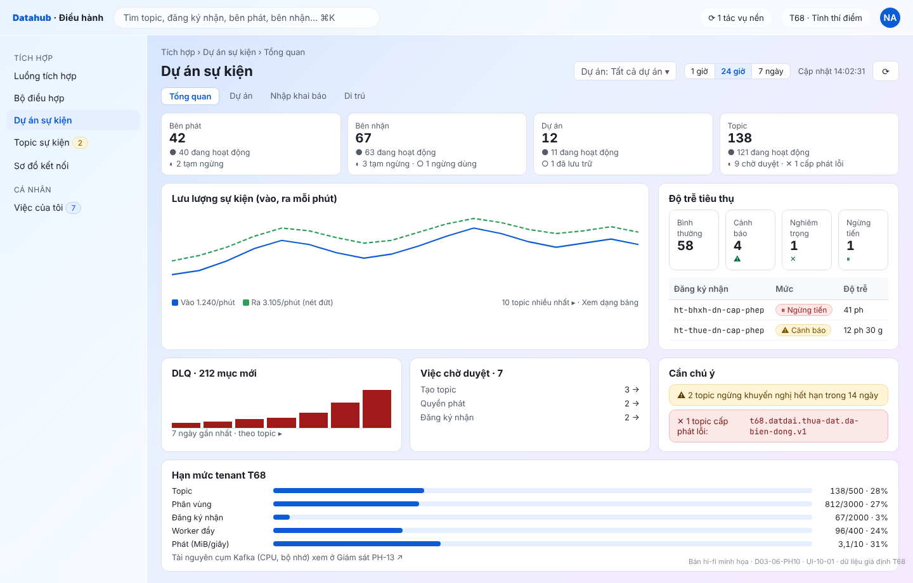
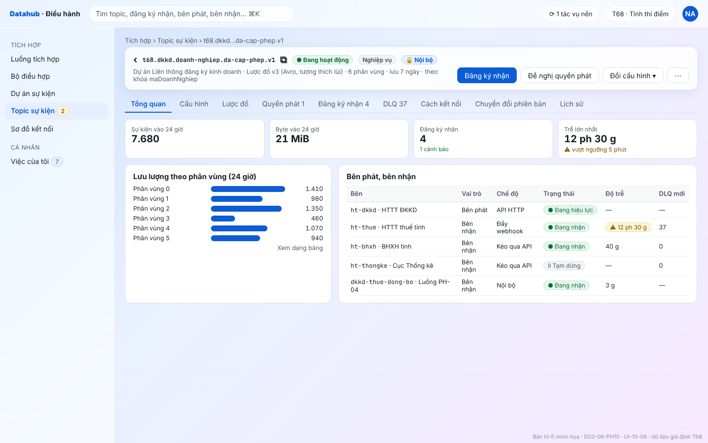

# D02-03-PH10 · Đặc tả yêu cầu chức năng Sự kiện

## Tóm tắt cho hội đồng thẩm định

**Mục tiêu.** PH-10 là trục trao đổi dữ liệu bất đồng bộ của Datahub, thay khối Hub chạy Apache Pulsar của hệ cũ. Phân hệ cho phép một hệ thống thông tin (HTTT) thành viên phát một sự kiện nghiệp vụ một lần và nhiều HTTT khác nhận được, mà các bên không phải biết nhau, không phải cùng hoạt động một lúc và không phải sửa khi có thêm bên nhận. PH-10 giữ nguyên các khái niệm nghiệp vụ mà cán bộ hệ cũ đã quen (dự án tích hợp, topic, publisher, subscriber, publication, subscription, kiểu giao tiếp, chế độ định tuyến, dashboard và sơ đồ kết nối), đồng thời bổ sung những gì hệ cũ thiếu: lược đồ bắt buộc và kiểm tra tương thích, duyệt bốn mắt trước khi một bên được phát hoặc nhận, hai chế độ giao nhận đẩy và kéo có xác thực, hàng đợi lỗi (DLQ) và phát lại có kiểm soát, theo dõi độ trễ tiêu thụ, cách ly giữa các tỉnh.

**Phạm vi.** 76 yêu cầu chức năng chia mười một nhóm: dự án tích hợp; topic; lược đồ sự kiện; bên phát và bên nhận; publication; subscription và giao nhận; DLQ và phát lại; giám sát, dashboard và sơ đồ; danh mục cấu hình, hạn mức và đa tenant; đăng ký máy với máy cho PH-04, PH-05 và các DU nội bộ; xuất nhập khai báo và di trú song song từ Pulsar. Phân hệ chạy ở control plane trong DU `dh-integration` (package `vn.datahub.integration.event`) và ở data plane trên Kafka (Strimzi, chế độ KRaft), Apicurio Registry 3 và hai mô-đun của `dh-runtime` là cổng sự kiện và bộ giao nhận webhook (ADR-071).

**Căn cứ pháp lý.** CMP-LAW-09 (Công văn 631/THH-THHT: LGSP phải hỗ trợ trao đổi bản tin bất đồng bộ, đa giao thức, bảo đảm tin cậy); CMP-LAW-03 (NĐ 278/2025 về kết nối, chia sẻ dữ liệu); CMP-LAW-06 và CMP-LAW-08 (NĐ 331/2026, TCVN 14423:2026 cấp độ 3: kiểm soát truy cập theo nguyên tắc tối thiểu, nhật ký, toàn vẹn dữ liệu truyền); CMP-LAW-05 (Luật BVDLCN 91/2025: sự kiện chỉ mang định danh và loại thay đổi, không mang dữ liệu cá nhân đầy đủ khi không cần); CMP-LAW-16 (Luật An ninh mạng 116/2025: dữ liệu lưu trong nước, nhật ký hệ thống).

**Những điểm hội đồng cần lưu ý.**

1. Mọi topic có lược đồ bắt buộc và kiểm tra tương thích; thay đổi phá vỡ không ghi đè mà tạo topic phiên bản mới `.v{n+1}` chạy song song tới ngày hết hạn (ADR-070). Đây là thay đổi lớn nhất so với Hub cũ, nơi "cấu trúc" topic chỉ là mô tả.
2. Không HTTT nào phát hoặc nhận được khi chưa có publication, subscription được duyệt bốn mắt; tạm ngừng, thu hồi có hiệu lực trong 60 giây mà không chờ token hết hạn (BR-10-010, BR-10-020).
3. Giao nhận theo ngữ nghĩa ít nhất một lần: mỗi sự kiện hoặc được giao, hoặc nằm trong DLQ; bên nhận phải xử lý trùng theo `id` (BR-10-009, BR-10-024). Phát lại luôn có lý do và duyệt.
4. Mọi thay đổi trên cụm Kafka (topic, ACL, hạn mức) đi qua kho Git của tenant rồi Argo CD, Strimzi áp dụng; control plane ngừng thì sự kiện vẫn chạy (ADR-072, NFR-10-013).
5. Di trú từ Pulsar theo cách thay dần: cầu nối hai chiều có hạn dùng, đối chiếu hằng giờ, chuyển hẳn có duyệt và quay lui được (ADR-073). Câu hỏi mở cần hội đồng cho ý kiến sớm: Q10-04 (mở cổng Kafka ngoài), Q10-05 (tự duyệt topic CDC), Q10-12 (mức kiểm tra dữ liệu cá nhân mặc định).

**Con số chính.**

| Chỉ số | Giá trị |
|---|---|
| Yêu cầu chức năng | 76 (M: 66, S: 8, C: 2); MVP: 74, Đợt sau: 2 (FR-10-048, 071) |
| Quy tắc nghiệp vụ | 36 (BR-10-001…036) |
| Yêu cầu phi chức năng | 20 (NFR-10-001…020) |
| Màn hình | 20 (UI-10-01…20) |
| Mã lỗi | 54 control plane (ERR-10-001…054), 21 data plane (ERR-10-101…121) |
| Sự kiện do PH-10 phát | 16 (EVT-10-01…16) |
| API | 121 operation (API-10-001…121, trong đó 085…090 và 119 nội bộ cho `dh-runtime`), định nghĩa đầy đủ ở D03-04-PH10 |
| Chức năng hệ cũ được phủ | 14 mục `LGC-HUB` (12 phủ ở PH-10, 2 thay thế bởi PH-13) cùng LGC-TOOL-010 và LGC-BUS-039 |
| ADR mới | ADR-070 (tương thích lược đồ, phiên bản topic), ADR-071 (giao nhận đẩy và kéo), ADR-072 (cấp phát topic, ACL qua GitOps), ADR-073 (cầu nối di trú Pulsar) |

: Con số chính của PH-10 bản 0.4

Phụ lục A "Bảng mã và enum chuẩn" ở cuối tài liệu là **nguồn chuẩn duy nhất** về trạng thái, enum, tên trường, mã quyền, tham số, màn hình và sự kiện của PH-10 cho sáu tập còn lại (UC, SDD, CSDL, API, màn hình, ca kiểm thử).

## 1. Giới thiệu

Chương này nêu tài liệu dùng để làm gì, phủ những gì, ai đọc phần nào, các thuật ngữ và tài liệu căn cứ. Người đọc mới nên đọc hết chương 1 và chương 2 trước khi vào phần đặc tả.

### 1.1. Mục đích của tài liệu

Tài liệu đặc tả đầy đủ hành vi của PH-10 để kỹ sư hiện thực và kiểm thử viên viết ca kiểm thử mà không phải hỏi lại, đồng thời để hội đồng thẩm định thấy được phân hệ giải quyết vấn đề gì của hệ cũ và kiểm soát rủi ro thế nào. Mỗi chức năng được đặc tả bằng một bảng hai cột 17 mục theo chuẩn kết hợp (K-TRINH-BAY §4): mức kỹ thuật (tác nhân và quyền, truy vết, tiền điều kiện, đầu vào, luồng xử lý có mã lỗi, đầu ra, hậu điều kiện, sự kiện, kiểm toán) và mức thuyết minh (mục đích, kích hoạt, luồng thay thế, câu thông báo người dùng nhìn thấy, kết quả, quy tắc nghiệp vụ, màn hình). Phụ lục A là nguồn chuẩn duy nhất của mã, enum, trường, quyền, tham số và route cho sáu tập còn lại của PH-10.

### 1.2. Phạm vi

PH-10 chịu trách nhiệm toàn bộ vòng đời khai báo và vận hành trục sự kiện của một tenant, từ dự án tích hợp tới giao nhận, DLQ, giám sát và di trú. Bảng đầu liệt kê việc PH-10 làm theo nhóm chức năng; bảng sau liệt kê việc PH-10 không làm và phân hệ chịu trách nhiệm, để tránh chồng lấn.

| # | Trách nhiệm | Nhóm FR |
|---|---|---|
| 1 | Quản lý **dự án tích hợp**: gom topic theo nghiệp vụ, chủ quản, phạm vi xem sơ đồ | A |
| 2 | Quản lý **topic** Kafka theo quy ước tên có tiền tố tenant: phân vùng, lưu giữ, compaction, chế độ định tuyến và khóa phân vùng, phân loại dữ liệu, vòng đời, phiên bản chính `.v{n+1}` khi thay đổi phá vỡ | B |
| 3 | Quản lý **lược đồ sự kiện** ở Apicurio Registry 3: soạn, kiểm tra cú pháp và dữ liệu cá nhân, kiểm tra tương thích, duyệt, phiên bản, giám sát tuân thủ | C |
| 4 | Quản lý **bên phát** và **bên nhận**: HTTT thành viên (PH-01), luồng tích hợp (PH-04), DU nội bộ; đồng bộ trạng thái với PH-01, PH-04 | D |
| 5 | **Publication** và **subscription** có duyệt bốn mắt; khi duyệt thì cấp scope OAuth `topic:{tên}:publish` hoặc `:subscribe`, ACL Kafka theo tiền tố tenant, nhóm tiêu thụ | E, F |
| 6 | **Giao nhận**: ĐẨY về URI của HTTT bằng webhook ký HMAC (số worker, thử lại giãn dần, điểm bắt đầu, tạm dừng, tiếp tục); KÉO qua API có xác thực hoặc qua Kafka listener ngoài (SASL OAUTHBEARER hoặc mTLS); nội bộ cho luồng và DU | F |
| 7 | **DLQ tầng sự kiện** theo topic, **phát lại** theo khoảng offset hoặc thời gian có duyệt; API cho PH-18 | G |
| 8 | **Giám sát**: consumer lag, cảnh báo, thống kê giao nhận, dashboard, sơ đồ kết nối tương tác | H |
| 9 | Danh mục **kiểu giao tiếp** và **chế độ định tuyến**, hạn mức và tham số theo tenant, cách ly đa tenant, kiểm toán | I |
| 10 | **Đăng ký máy với máy**: topic CDC cho PH-05, topic của DU nội bộ, kiểm tra quyền cho PH-04 (VR-10) | J |
| 11 | **Xuất nhập khai báo** và **di trú song song từ Pulsar** theo cách thay dần (cầu nối tạm thời, ánh xạ, đối chiếu, chuyển hẳn) | K |

: Trách nhiệm của PH-10 theo nhóm chức năng

| Không làm | Thuộc |
|---|---|
| Biểu đồ CPU, bộ nhớ, đĩa, broker, phân vùng thiếu bản sao của cụm Kafka (LGC-HUB-005, 006) | PH-13 (PH-10 chỉ dẫn chiếu) |
| Cân bằng lại phân vùng giữa broker, nâng cấp cụm, MirrorMaker 2 sang site DR | Vận hành nền tảng theo D03-09 §6.4, §8 |
| Chạy hạ tầng CDC (Kafka Connect, Debezium) và quản lý connector | PH-05 (ADR-059); PH-10 chỉ đăng ký topic và lược đồ |
| Cầu nối giao thức bản tin AMQP, MQTT, JMS tới hệ ngoài | PH-05 (FR-05-035) qua luồng PH-04 |
| Logic biến đổi, định tuyến nội dung, ánh xạ ngữ nghĩa giữa hai lược đồ | PH-04 |
| Màn xử lý lỗi vận hành chung (gom DLQ của mọi phân hệ, gán người xử lý, quy trình sự cố) | PH-18 (PH-10 giữ DLQ tầng sự kiện và cung cấp API) |
| Kết nạp HTTT, cấp client OAuth cho HTTT | PH-01, PH-12 (PH-10 chỉ gắn scope vào client đã có) |
| Công bố topic như một dịch vụ trong danh mục dịch vụ | PH-02 (đọc topic `ACTIVE` từ PH-10) |
| Hàng đợi lệnh nội bộ giữa `dh-integration` và `dh-runtime` (`dh.integration.runtime.*`) | PH-04 (PH-10 chỉ ghi nhận như topic nền tảng, FR-10-067) |

: Việc ngoài phạm vi PH-10 và phân hệ chịu trách nhiệm

### 1.3. Đối tượng sử dụng và cách đọc

Định nghĩa dùng chung (đăng nhập, danh sách, xuất, kiểm toán, bốn mắt) không nhắc lại mà dẫn chiếu FR-00 ở D02-02 SRS. Bảng sau gợi ý phần nên đọc theo vai trò người đọc.

| Người đọc | Đọc phần | Mục đích |
|---|---|---|
| Hội đồng thẩm định, lãnh đạo Sở | Tóm tắt, chương 1, 2, 11, 13, 14 | Hiểu vấn đề hệ cũ, mục tiêu đo được, căn cứ pháp lý, rủi ro còn mở và tiêu chí nghiệm thu |
| Kỹ sư `dh-integration`, `dh-runtime` | Chương 3 đến 9, Phụ lục A | Hiện thực API, bộ giao nhận, cổng sự kiện, máy trạng thái, mã lỗi |
| Kiểm thử viên | Chương 4, 6, 7, 8, 9, 14, Phụ lục A | Viết ca dương, ca âm, ca biên theo luồng chính, ngoại lệ và ngưỡng |
| Kỹ sư tích hợp của HTTT | Mục 2.1, 4.9, 6.6, 6.7, 9 | Cách phát, nhận, xác minh chữ ký, xử lý trùng |
| Người viết UC, SDD, CSDL, API, màn hình | Chương 5, 6, 9, 10, Phụ lục A | Dùng đúng mã, enum, tên trường; ghi đề nghị bổ sung khi thiếu |

: Người đọc và phần nên đọc

### 1.4. Thuật ngữ và chữ viết tắt

Khái niệm nghiệp vụ riêng của PH-10 (dự án, topic, publication, subscription, giao nhận đẩy, kéo, lag, DLQ…) được định nghĩa ở mục 4.1. Bảng dưới chỉ giải thích chữ viết tắt và thuật ngữ kỹ thuật dùng trong tập này; viết tắt vai trò (IE, IA, TA, TO, SO, SV, OR, PA, PO, AU, VW) ở mục 3.1.

| Viết tắt, thuật ngữ | Giải thích |
|---|---|
| ACL | Danh sách kiểm soát truy cập của Kafka, cấp theo principal và tên tài nguyên (literal hoặc tiền tố) |
| Avro, JSON Schema | Hai định dạng lược đồ được phép; Avro tuần tự hóa nhị phân, JSON Schema mô tả JSON |
| Apicurio Registry | Kho lược đồ sự kiện, kiểm tra hợp lệ và tương thích, đánh số phiên bản |
| BFF | Lớp máy chủ phục vụ giao diện (backend for frontend) |
| CDC | Bắt thay đổi dữ liệu từ CSDL nguồn (change data capture), do PH-05 vận hành |
| CloudEvents | Đặc tả phong bì sự kiện 1.0 của CNCF, dùng cho mọi sự kiện trên trục (mục 4.9) |
| Consumer group, nhóm tiêu thụ | Nhóm consumer Kafka giữ chung vị trí đọc (offset) |
| DLQ | Hàng đợi sự kiện giao thất bại (dead letter queue) |
| DU | Đơn vị triển khai (deployable unit) theo D00-04 §2 |
| GitOps | Cách đưa cấu hình lên cụm bằng commit vào kho Git, Argo CD tự đồng bộ |
| HMAC | Mã xác thực thông điệp có khóa; webhook ký HMAC-SHA256 theo ADR-044 |
| HTTT | Hệ thống thông tin thành viên kết nối Datahub (PH-01) |
| KRaft | Chế độ Kafka tự quản siêu dữ liệu, không dùng ZooKeeper |
| Lease | Lượt thuê một lô sự kiện khi kéo, hết hạn thì lô được trả lại |
| mTLS | TLS hai chiều, cả hai bên trình chứng thư |
| Offset, phân vùng | Vị trí bản tin trong một phân vùng (partition) của topic |
| OPA | Bộ quyết định chính sách, APISIX hỏi OPA từng lượt gọi |
| RLS | Bảo mật mức dòng của PostgreSQL theo `tenant_id` |
| SASL OAUTHBEARER | Cơ chế xác thực Kafka bằng token OAuth |
| Strimzi | Bộ điều khiển Kafka trên Kubernetes, đọc tài nguyên `KafkaTopic`, `KafkaUser` |
| TSLCD | Mạng truyền số liệu chuyên dùng của cơ quan nhà nước |
| ULID | Định danh 26 ký tự sắp được theo thời gian, dùng cho `ce_id` |

: Chữ viết tắt và thuật ngữ kỹ thuật của PH-10

### 1.5. Tài liệu tham chiếu

Căn cứ pháp lý được đánh mã `CMP-LAW-*` theo D00-04; tài liệu dự án và ADR là căn cứ kỹ thuật. Khi các tài liệu này mâu thuẫn với tập này về mã hoặc enum của PH-10, Phụ lục A của tập này là nguồn chuẩn.

| Loại | Tài liệu | Dùng cho |
|---|---|---|
| Pháp lý | CMP-LAW-09 Công văn 631/THH-THHT | Yêu cầu LGSP trao đổi bất đồng bộ, đa giao thức, tin cậy |
| Pháp lý | CMP-LAW-03 NĐ 278/2025 | Kết nối, chia sẻ dữ liệu giữa cơ quan |
| Pháp lý | CMP-LAW-06 NĐ 331/2026, CMP-LAW-08 TCVN 14423:2026 | Cấp độ 3: truy cập tối thiểu, nhật ký, toàn vẹn |
| Pháp lý | CMP-LAW-05 Luật BVDLCN 91/2025 | Sự kiện không mang dữ liệu cá nhân khi không cần (BR-10-014) |
| Pháp lý | CMP-LAW-16 Luật An ninh mạng 116/2025 | Lưu trữ trong nước, nhật ký hệ thống |
| Dự án | D02-02 SRS (FR-00, NFR-00, ERR-00) | Chức năng dùng chung, quy ước lỗi, phân trang |
| Dự án | D02-08 Ma trận phân quyền | Vai trò, `PERM-10-*`, scope |
| Dự án | D02-04-PH10 Use case; D03-02-PH10 SDD; D03-03-PH10 CSDL; D03-04-PH10 API; D03-06-PH10 Màn hình; D05-02-PH10 Ca kiểm thử | Sáu tập cùng phân hệ dùng mã của Phụ lục A |
| Dự án | D03-09 Hạ tầng, D03-10 Đa tenant, D03-07 ATTT | Cụm Kafka, listener, egress, hạn mức, kiểm thử rò rỉ |
| ADR | ADR-004 (Kafka thay Pulsar), ADR-011 (OpenTelemetry, LGTM), ADR-044 (ký webhook HMAC), ADR-059 (CDC Debezium) | Căn cứ công nghệ |
| ADR | ADR-070 (tương thích lược đồ, phiên bản topic), ADR-071 (giao nhận đẩy và kéo qua `dh-runtime`), ADR-072 (cấp phát topic, ACL qua GitOps), ADR-073 (cầu nối di trú Pulsar) | Quyết định riêng của PH-10 |
| Lịch sử | SRS repo `docs/07-srs/SRS-PH-10-event.md` | Ánh xạ mã cũ ở mục 11.3 |

: Tài liệu tham chiếu của PH-10

### 1.6. Cấu trúc tài liệu

Chương 2 trình bày tổng quan phân hệ cho hội đồng thẩm định: vai trò, Hub Pulsar cũ và hạn chế, mục tiêu đo được, vị trí trong kiến trúc, thành phần và luồng chính, quy trình nghiệp vụ, chức năng hệ cũ được phủ. Chương 3 nêu tác nhân, ma trận quyền và tách nhiệm vụ. Chương 4 mô tả khái niệm, thực thể, sáu máy trạng thái và định dạng sự kiện. Chương 5 là bảng danh sách 76 chức năng. Chương 6 đặc tả chi tiết từng chức năng bằng khối 17 mục, chia mười một nhóm A…K. Chương 7 liệt kê quy tắc nghiệp vụ; chương 8 yêu cầu phi chức năng và lưu giữ; chương 9 mã lỗi, câu thông báo, sự kiện và danh mục API. Chương 10 liệt kê màn hình và giới thiệu hai giao diện tiêu biểu. Chương 11 là truy vết; chương 12 phụ thuộc, giả định, ràng buộc và đề nghị đồng bộ; chương 13 câu hỏi mở; chương 14 tiêu chí chấp nhận; chương 15 nhật ký hấp thụ đề nghị từ các tập. Phụ lục A là bảng mã và enum chuẩn.

## 2. Tổng quan phân hệ

Chương này viết cho hội đồng thẩm định: PH-10 giải quyết vấn đề gì, cam kết những chỉ tiêu nào, nằm ở đâu trong kiến trúc Datahub và chạy theo luồng nào.

### 2.1. Vai trò của PH-10 trong Datahub

PH-10 là trục trao đổi bất đồng bộ của Datahub. Một HTTT phát sự kiện nghiệp vụ (ví dụ "doanh nghiệp đã được cấp phép") một lần lên một topic; mọi HTTT, luồng PH-04 và DU nội bộ đã được duyệt nhận sự kiện đó theo cách mình chọn. Bên phát không cần biết có bao nhiêu bên nhận, bên nhận ngừng vài giờ vẫn nhận tiếp từ chỗ cũ khi trở lại, và thêm bên nhận mới không phải sửa bên phát. Ba cách tham gia trục:

| Cách | Bên phát | Bên nhận | Khi nào dùng |
|---|---|---|---|
| Qua cổng HTTP (mặc định) | Gọi API phát `POST /event/v1/topics/{topicName}/events` với token có scope `topic:{tên}:publish` | Chọn ĐẨY (nhận webhook ký HMAC tại URI của mình) hoặc KÉO (gọi API kéo, xác nhận đã nhận) | Mọi HTTT, kể cả HTTT nhỏ chỉ biết gọi HTTP |
| Kafka trực tiếp (tùy chọn) | Producer Kafka qua listener `external`, SASL OAUTHBEARER hoặc mTLS, serde Apicurio | Consumer Kafka với nhóm tiêu thụ được cấp | HTTT lưu lượng lớn có đội kỹ thuật vững, tenant bật `10.external-kafka.enabled` |
| Nội bộ | Luồng PH-04, PH-05 CDC, DU nội bộ qua listener `internal` mTLS | Luồng PH-04, DU nội bộ | Mọi thành phần của Datahub |

: Ba cách tham gia trục sự kiện

Cách thứ nhất là mặc định vì đa số HTTT cấp tỉnh chỉ gọi được HTTP (GĐ-10-01). Cách thứ hai dành cho HTTT lưu lượng lớn và chỉ mở khi tenant bật. Cách thứ ba dùng cho thành phần của chính Datahub, đi qua listener `internal` có mTLS.

### 2.2. Hub Pulsar cũ và các hạn chế

Hệ cũ có khối Hub chạy Apache Pulsar với các màn quản lý project, topic, publisher, subscriber, publication, subscription, hai danh mục `type_of_comm`, `routing_mode`, dashboard đếm và sơ đồ kết nối tĩnh (LGC-HUB-001…014). Hub chạy được việc trao đổi cơ bản nhưng thiếu các kiểm soát mà một nền tảng dùng chung nhiều tỉnh cần có. Bảng dưới nêu hạn chế, hệ quả và cách PH-10 khắc phục.

| Hạn chế của Hub Pulsar | Hệ quả | Cách PH-10 khắc phục |
|---|---|---|
| "Cấu trúc" topic chỉ là mô tả, không kiểm tra khi phát | Bên nhận vỡ khi bên phát đổi định dạng âm thầm | Lược đồ bắt buộc ở Apicurio, kiểm tra tương thích, cổng sự kiện từ chối bản tin sai lược đồ (FR-10-017…023) |
| Ai có tài khoản cũng tạo publisher, subscriber tùy ý | Không biết HTTT nào đang nhận dữ liệu gì | Bên phát, bên nhận phải là HTTT thành viên, luồng hoặc DU; publication, subscription duyệt bốn mắt (FR-10-026…037) |
| Không lưu giữ cấu hình được, không phát lại có kiểm soát | Mất dữ liệu khi bên nhận ngừng lâu | Lưu giữ theo topic, điểm bắt đầu, phát lại có duyệt (FR-10-012, 040, 051) |
| Subscription chỉ đẩy về URI, không ký | Giả mạo được bản tin trong mạng nội bộ | Webhook ký HMAC theo ADR-044, hoặc HTTT tự kéo có xác thực (FR-10-038, 043) |
| Không có DLQ, không biết bản tin nào giao hỏng | Lỗi im lặng | DLQ tầng sự kiện, sự kiện EVT-10-11 cho PH-18 (FR-10-049) |
| Dashboard chỉ đếm số lượng và CPU, bộ nhớ | Không thấy bên nhận đang tụt lại | Consumer lag theo subscription, cảnh báo, sơ đồ phủ lag (FR-10-054…058) |
| Một cụm cho một tỉnh, không cách ly tenant | Không phục vụ được nền tảng dùng chung | Tiền tố tenant, ACL theo tiền tố, hạn mức theo tenant (FR-10-062, 064) |

: Hạn chế của Hub Pulsar và cách PH-10 khắc phục

### 2.3. Mục tiêu của phân hệ

PH-10 cam kết sáu mục tiêu đo được dưới đây. Mỗi mục tiêu gắn với yêu cầu phi chức năng ở mục 8.1 (chỉ tiêu, điều kiện đo) và tiêu chí chấp nhận ở chương 14; điều kiện đo mặc định là hồ sơ "tỉnh vừa" (GĐ-07).

| # | Mục tiêu | Chỉ tiêu đo được | NFR | Tiêu chí |
|---|---|---|---|---|
| 1 | Phát nhanh và không mất sự kiện | API phát p99 ≤ 50 ms ở 500 sự kiện/giây; 0 sự kiện mất khi mất 1 broker hoặc khởi động lại cổng, bộ giao nhận | NFR-10-002, 004, 006 | 4, 10 |
| 2 | Giao nhanh, có kiểm soát trùng | Độ trễ đẩy p95 ≤ 1 giây khi không tồn đọng; giao trùng ≤ 0,1% và mọi lượt trùng cùng `Webhook-Id`; mọi sự kiện được giao hoặc nằm trong DLQ | NFR-10-003, 005, 007 | 4, 5 |
| 3 | Khai báo có kiểm soát mà vẫn nhanh | Topic `ACTIVE` ≤ 3 phút p95 sau khi duyệt; publication, subscription có hiệu lực ≤ 2 phút; 100% thao tác ghi có kiểm toán | NFR-10-008, 020 | 2, 3, 7 |
| 4 | Cắt quyền ngay khi có sự cố | Lượt phát qua API bị từ chối ≤ 60 giây sau tạm ngừng; ACL Kafka ≤ 2 phút; theo PH-01 ≤ 60 giây | NFR-10-009, 011 | 6 |
| 5 | Thấy được bên nhận tụt lại | Cảnh báo lag ≤ 2 phút sau khi vượt ngưỡng; sơ đồ 300 nút hiển thị ≤ 2 giây | NFR-10-010, 015 | 2, 5 |
| 6 | Cách ly tỉnh, an toàn bí mật, chuyển đổi êm | 0 truy cập chéo tenant; 0 lần lộ bí mật ký; data plane ≥ 99,9% mỗi tháng; cầu nối Pulsar p95 ≤ 60 giây, đối chiếu chênh 0 | NFR-10-013, 016, 017, 018 | 1, 8, 9 |

: Mục tiêu đo được của PH-10

### 2.4. Vị trí trong kiến trúc

PH-10 tách hai mặt phẳng: control plane giữ khai báo và quyết định, data plane chuyển sự kiện. Sơ đồ dưới đặt các thành phần theo vùng mạng (Z3 ứng dụng, Z4, Z5 dữ liệu và chạy luồng theo D03-09).

```{.mermaid caption="Vị trí PH-10 trong kiến trúc Datahub: control plane và data plane"}
flowchart TB
  subgraph CP["Control plane · dh-integration (Z3)"]
    UI["Giao diện UI-10-*"] --> API["API /api/event/v1"]
    API --> REG["Dự án, topic, lược đồ,<br/>bên phát, bên nhận,<br/>publication, subscription"]
    REG --> DB[("pg-core<br/>schema ph10_event")]
    REG -->|"KafkaTopic, KafkaUser"| GIT[("Kho dh-config-{tenant}")]
    REG -->|"lược đồ, quy tắc"| APC["Apicurio Registry 3"]
    REG -->|"scope topic:*"| KC["Keycloak, OPA"]
    LAG["Bộ thu lag"] --> REG
  end
  subgraph DP["Data plane (Z4, Z5)"]
    GW["dh-runtime<br/>cổng sự kiện"] --> K[("Kafka KRaft<br/>Strimzi")]
    K --> DSP["dh-runtime<br/>bộ giao nhận webhook"]
    FL["Luồng PH-04"] <--> K
    CDC["Kafka Connect<br/>PH-05 CDC"] --> K
  end
  GIT -->|"Argo CD, Strimzi"| K
  HP["HTTT phát"] -->|"API phát, APISIX"| GW
  HP -.->|"Kafka ngoài 9093"| K
  DSP -->|"webhook ký HMAC"| HN["HTTT nhận"]
  HN -->|"API kéo, APISIX"| GW
  HN -.->|"Kafka ngoài 9093"| K
  LAG -->|"Admin API"| K
```

Sơ đồ cho thấy PH-10 tách rõ hai mặt phẳng. Control plane trong `dh-integration` giữ mọi khai báo nghiệp vụ ở schema `ph10_event` của cụm `pg-core` (RLS theo `tenant_id`), đăng ký lược đồ ở Apicurio, gắn scope vào client của HTTT ở Keycloak và sinh tài nguyên `KafkaTopic`, `KafkaUser` vào kho cấu hình Git của tenant để Argo CD và Strimzi áp dụng lên cụm (ADR-072). Data plane gồm Kafka, cổng sự kiện (nhận lượt phát và lượt kéo qua APISIX) và bộ giao nhận webhook, cả hai là mô-đun của `dh-runtime` (ADR-071). Khi control plane ngừng, sự kiện vẫn được phát, giao và kéo bình thường; chỉ các thay đổi khai báo bị chặn (NFR-00-012). Kết nối Kafka trực tiếp từ HTTT là tùy chọn của từng tenant qua listener `external` (D03-09 §6.4), nét đứt trên sơ đồ.

### 2.5. Kiến trúc thành phần và luồng chính

Control plane là package `vn.datahub.integration.event` trong DU `dh-integration`; data plane gồm Kafka và bốn mô-đun của `dh-runtime` (ADR-071), không thêm DU mới. Bảng dưới nêu thành phần, công nghệ và nhóm chức năng mỗi thành phần hiện thực.

| Thành phần | Nơi chạy | Công nghệ | Nhóm FR |
|---|---|---|---|
| API quản trị `/api/event/v1` | `dh-integration` (Z3) | Java 21, Spring Boot, Spring Modulith; qua BFF và `apisix-int` | A…K |
| Bộ đối soát cấp phát | `dh-integration` | Đọc `KafkaTopic`, `KafkaUser` qua Kubernetes API (chỉ đọc) | B, E, F |
| Bộ thu lag | `dh-integration`, một bản sao nhờ khóa phân tán | Kafka Admin API | H |
| Bộ ghi DLQ | `dh-integration` | Consumer topic `{topicName}.dlq` | G |
| Cổng sự kiện (phát, kéo) | `dh-runtime` (Z4) | Camel Quarkus native; qua `apisix-ext`, `apisix-int` | E, F |
| Bộ giao nhận webhook, bộ phát lại | `dh-runtime` | Consumer Kafka, HMAC-SHA256, egress gateway | F, G |
| Bộ giám sát tuân thủ | `dh-runtime` | Nhóm `dh-compliance-{tenant}` lấy mẫu | C |
| Cầu nối di trú | `dh-runtime` | Camel thành phần `pulsar` và Kafka | K |
| Cụm Kafka | Z5, namespace `dh-kafka` | Strimzi, KRaft, ba broker, listener `internal` và `external` | Mọi nhóm |
| Kho lược đồ | Z5 | Apicurio Registry 3 trên `pg-infra` | C, E, F |
| Khai báo | Z5 | PostgreSQL `pg-core`, schema `ph10_event`, RLS theo `tenant_id` | Mọi nhóm |
| Kho cấu hình | Git `dh-config-{tenant}`, Argo CD | Tài nguyên `KafkaTopic`, `KafkaUser`, Kyverno | B, E, F, I |
| Quyền và bí mật | PH-12 | Keycloak (scope `topic:*`), OPA, OpenBao | E, F |

: Thành phần và công nghệ của PH-10

Sơ đồ trình tự dưới đây là luồng chính của phân hệ theo quy trình BP-04: kỹ sư tạo topic có lược đồ, người duyệt duyệt, cấu hình đi qua GitOps lên cụm; HTTT A được duyệt publication rồi phát qua API; HTTT B nhận đẩy có chữ ký, HTTT C tự kéo.

```{.mermaid caption="Luồng chính của PH-10: khai báo có duyệt, cấp phát GitOps, phát, giao đẩy và kéo"}
sequenceDiagram
  autonumber
  actor IE as Kỹ sư tích hợp
  actor IA as Người duyệt
  participant CP as dh-integration
  participant G as Git, Argo CD, Strimzi
  participant K as Kafka
  participant GW as Cổng sự kiện
  participant D as Bộ giao nhận
  participant A as HTTT A phát
  participant B as HTTT B nhận đẩy
  participant C as HTTT C kéo
  IE->>CP: Tạo topic kèm lược đồ v1, gửi duyệt (FR-10-008)
  IA->>CP: Duyệt (FR-10-009)
  CP->>G: Đăng ký lược đồ Apicurio, commit KafkaTopic
  G->>K: Tạo topic và topic DLQ
  CP-->>IE: Topic ACTIVE, EVT-10-01
  IA->>CP: Duyệt publication của A, subscription của B và C
  A->>GW: POST /event/v1/topics/{topicName}/events
  GW->>K: Kiểm tra lược đồ, ghi acks=all
  GW-->>A: 202 partition, offset
  D->>K: Đọc bằng nhóm dh-sub-{tenant}-{mã}
  D->>B: POST ký HMAC (Webhook-Id)
  B-->>D: 2xx, bộ giao nhận commit offset
  C->>GW: GET .../events, rồi events:ack
  GW->>K: Đọc lô, commit khi ack
```

Hình cho thấy ba điểm thiết kế. Thứ nhất, người không thao tác trực tiếp trên cụm: mọi thay đổi đi qua control plane và Git (bước 3, 4), nên lệch cấu hình phát hiện được và đưa về được. Thứ hai, đường sự kiện (bước 7 đến 14) không đi qua `dh-integration`, nên control plane ngừng thì sự kiện vẫn phát, giao và kéo bình thường. Thứ ba, offset chỉ tiến khi bên nhận xác nhận (bước 12, 14); lỗi kéo dài thì sự kiện vào DLQ chứ không bị bỏ (nhóm G).

### 2.6. Quy trình nghiệp vụ liên quan

PH-10 tham gia sáu quy trình nghiệp vụ và chương trình chuyển đổi dần từ hệ cũ. Bảng dưới nêu vai trò của PH-10 trong từng quy trình.

| Quy trình | Vai trò của PH-10 |
|---|---|
| BP-04 Trao đổi dữ liệu qua sự kiện (D02-01) | Toàn bộ: đăng ký topic có lược đồ được duyệt, publication, subscription đẩy hoặc kéo, giao ít nhất một lần, DLQ |
| BP-03 Phát hành và đồng bộ danh mục dùng chung | HTTT đăng ký nhận topic `*.rdm.*` do PH-07 phát (scope `topic:{tên}:subscribe`) |
| Kết nạp HTTT (PH-01) | Bên phát, bên nhận phải là HTTT `ACTIVE`; HTTT bị tạm ngừng thì publication, subscription bị tạm ngừng theo |
| Phát hành luồng (PH-04) | Kiểm tra VR-10: luồng chỉ phát, nhận trên topic đã đăng ký và có quyền (BR-04-009) |
| CDC hệ di sản (PH-05) | Đăng ký hộ topic `{topicPrefix}.{schema}.{table}.v1` và lược đồ Avro; nhận EVT-05-11 khi lược đồ nguồn đổi |
| Xử lý lỗi vận hành (PH-18) | Cung cấp DLQ tầng sự kiện và API phát lại |
| Chuyển đổi dần từ hệ cũ (REQ-22) | Ánh xạ khai báo Pulsar, cầu nối song song, đối chiếu, chuyển hẳn |

: Vai trò của PH-10 trong các quy trình nghiệp vụ

### 2.7. Chức năng hệ cũ được phủ

Bảng dưới liệt kê các mục `LGC` của Hub cũ và nhóm FR phủ; kết luận Giữ nguyên, Nâng cấp, Thay thế cho từng mục ở mục 11.1.

| Mã | Chức năng hệ cũ | Nhóm FR |
|---|---|---|
| LGC-HUB-001…004 | Dashboard đếm publisher, subscriber, project, topic | H (FR-10-057) |
| LGC-HUB-005, 006 | Biểu đồ % Memory, % CPU | Thay thế bởi PH-13 |
| LGC-HUB-007 | Sơ đồ kết nối publisher, topic, subscriber | H (FR-10-058) |
| LGC-HUB-008 | Quản lý dự án tích hợp | A |
| LGC-HUB-009 | Quản lý topic: tên, mô tả, phân vùng, cấu trúc, chế độ định tuyến | B, C |
| LGC-HUB-010, 011 | Quản lý publisher, subscriber (đánh dấu subscriber là luồng) | D |
| LGC-HUB-012 | Quản lý publication | E |
| LGC-HUB-013 | Quản lý subscription: URI nhận, số worker, số lần thử lại, thời điểm bắt đầu | F |
| LGC-HUB-014 | Danh mục `type_of_comm`, `routing_mode` | I |
| LGC-TOOL-010 | Nhóm Message Broker trong Tooling (dùng chung PH-04, PH-05) | J (Kafka nội bộ qua topic đã đăng ký) |
| LGC-BUS-039 | Hai loại bản tin: document message và event message | E, F (event message bất đồng bộ) |

: Chức năng hệ cũ được PH-10 phủ

## 3. Tác nhân, vai trò và quyền

Chương này nêu ai và hệ thống nào tương tác với PH-10, quyền nào cho phép thao tác nào và các ràng buộc tách nhiệm vụ.

### 3.1. Tác nhân

Tác nhân gồm mười vai trò người theo D02-08 và năm nhóm hệ thống. Cột "Viết tắt" là ký hiệu dùng trong toàn bộ tập này.

| Tác nhân | Viết tắt | Loại | Tương tác chính |
|---|---|---|---|
| ROLE-INTEGRATION_ENGINEER | IE | Người | Tạo dự án, topic, lược đồ, bên phát, bên nhận; đề nghị publication, subscription; gửi duyệt |
| ROLE-INTEGRATION_APPROVER | IA | Người | Duyệt topic, thay đổi cấu hình, phiên bản lược đồ, publication, subscription, lượt phát lại |
| ROLE-TENANT_ADMIN | TA | Người | Như IE, cộng tham số phân hệ, danh mục cấu hình, di trú; được duyệt nhưng chịu bốn mắt |
| ROLE-TENANT_OPERATOR | TO | Người | Theo dõi lag, giao nhận; tạm dừng, tiếp tục subscription; xử lý DLQ; đề nghị phát lại; xoay khóa ký |
| ROLE-SECURITY_OFFICER | SO | Người | Tạm ngừng publication, subscription, bên phát, bên nhận khi có sự cố ATTT; xem nhật ký |
| ROLE-SERVICE_OWNER | SV | Người | Xem, đề xuất topic và publication cho HTTT của tổ chức mình (○ theo D02-08) |
| ROLE-ORG_REQUESTER | OR | Người | Đề nghị subscription cho HTTT của tổ chức mình (○ theo D02-08) |
| ROLE-PLATFORM_ADMIN | PA | Người | Topic nền tảng `dh.`, trần hạn mức tenant, bật listener Kafka ngoài, cầu nối di trú |
| ROLE-PLATFORM_OPERATOR | PO | Người | Xem liên tenant có lý do (FR-00-012), hỗ trợ sự cố cụm |
| ROLE-AUDITOR, ROLE-VIEWER | AU, VW | Người | Xem |
| HTTT thành viên | | Hệ thống | Phát qua API phát hoặc Kafka; nhận webhook, kéo qua API hoặc Kafka |
| `dh-integration` của PH-04, PH-05 | | Hệ thống | Kiểm tra quyền phát, nhận (VR-10); đăng ký topic CDC |
| DU nội bộ (`dh-connect`, `dh-data`, `dh-platform`, `dh-payment`) | | Hệ thống | Đăng ký topic outbox của mình, phát qua listener `internal` |
| `dh-runtime` (cổng sự kiện, bộ giao nhận, luồng) | | Hệ thống | Đọc cấu hình subscription, khóa ký; báo kết quả giao nhận |
| PH-01, PH-12, PH-13, PH-18, PH-20 | | Hệ thống | HTTT, client OAuth; scope và chính sách OPA; giám sát; xử lý lỗi; khởi tạo tenant |

: Tác nhân của PH-10

### 3.2. Ma trận quyền

Ma trận dùng ký hiệu của D02-08 §3 (● có, ○ có trong phạm vi tổ chức của mình, — không). `PERM-10-read`, `PERM-10-create`, `PERM-10-approve`, `PERM-10-subscribe` đã có ở D02-08. `PERM-10-update` có ở D02-08 dưới dạng gộp "create / update" và cần tách dòng; `PERM-10-operate`, `PERM-10-admin` là quyền mới, ghi ở §3.4.

| Quyền | Ý nghĩa | PA | PO | TA | TO | SO | IE | IA | SV | OR | VW | AU |
|---|---|---|---|---|---|---|---|---|---|---|---|---|
| PERM-10-read | Xem dự án, topic, lược đồ, bên phát, bên nhận, publication, subscription, lag, dashboard, sơ đồ; xuất khai báo | ● | ● | ● | ● | ● | ● | ● | ● | ○ | ● | ● |
| PERM-10-create | Tạo dự án, topic, phiên bản lược đồ, bên phát, bên nhận; đề nghị publication; nhập khai báo; gửi duyệt | — | — | ● | — | — | ● | — | ○ | — | — | — |
| PERM-10-update | Sửa dự án, topic (phần không cần duyệt), lược đồ nháp, bên phát, bên nhận; đề nghị thay đổi cấu hình topic; lưu trữ dự án; ngừng topic | — | — | ● | — | — | ● | — | ○ | — | — | — |
| PERM-10-subscribe | Đề nghị, sửa, thu hồi subscription cho HTTT | — | — | ● | — | — | ● | — | — | ○ | — | — |
| PERM-10-approve | Duyệt, từ chối: tạo topic, thay đổi cấu hình, phiên bản lược đồ, publication, subscription, lượt phát lại | — | — | ● | — | — | — | ● | — | — | — | — |
| PERM-10-operate | Tạm dừng, tiếp tục, tạm ngừng subscription, publication; xoay khóa ký; xử lý mục DLQ; đề nghị phát lại; xác nhận cảnh báo lag | — | — | ● | ● | ● | — | — | — | — | — | — |
| PERM-10-admin | Tham số `10.*`, danh mục kiểu giao tiếp và chế độ định tuyến, hạn mức (PA đặt trần, TA phân bổ), bật Kafka ngoài, di trú Pulsar, topic nền tảng `dh.` (chỉ PA) | ● | — | ● | — | — | — | — | — | — | — | — |

: Ma trận quyền PERM-10 theo vai trò

### 3.3. Tách nhiệm vụ và tài khoản máy

Tách nhiệm vụ: IE và IA là cặp loại trừ (D02-08 §4). TA có cả `PERM-10-create` và `PERM-10-approve` nên bốn mắt áp dụng theo từng đối tượng: người tạo hoặc người gửi một yêu cầu không được duyệt chính yêu cầu đó (FR-00-071, BR-10-010). `PERM-10-operate` của SO chỉ dùng để tạm ngừng khi có sự cố (FR-10-028, 032, 041), không dùng cho phát lại hay xử lý DLQ. OR và SV chỉ thao tác trên HTTT thuộc tổ chức của mình; ngoài phạm vi trả ERR-10-044.

**Máy với máy.** Các tài khoản dịch vụ được cấp scope nội bộ khi triển khai, không cấp cho người: `event:topic-register` (PH-05 `dh-integration`, DU nội bộ; FR-10-066, 067), `event:permission-check` (PH-04; FR-10-069), `event:runtime-config` (`dh-runtime`; đọc cấu hình subscription và khóa ký, FR-10-038), `event:dlq-read` và `event:replay` (PH-18; FR-10-050, 053), `event:metrics-read` (PH-13). HTTT dùng scope do PH-10 cấp: `topic:{tên topic}:publish`, `topic:{tên topic}:subscribe` (D02-08 §5).

### 3.4. Đề nghị đồng bộ D02-08

Các quyền và scope dưới đây chưa có hoặc chưa đúng ở D02-08; tập này dùng như đề nghị cho tới khi D02-08 cập nhật.

| Đề nghị | Nội dung |
|---|---|
| Tách dòng | `PERM-10-create` và `PERM-10-update` thành hai dòng, gán như §3.2 |
| Thêm `PERM-10-operate` | TA ●, TO ●, SO ● (chỉ tạm ngừng khi sự cố) |
| Thêm `PERM-10-admin` | PA ●, TA ● |
| Sửa `PERM-10-subscribe` | Thêm IE ● (kỹ sư tích hợp đề nghị subscription cho luồng và HTTT) |
| Thêm scope máy | `event:topic-register`, `event:permission-check`, `event:runtime-config`, `event:dlq-read`, `event:replay`, `event:metrics-read` vào bảng scope §5 |

: Đề nghị đồng bộ quyền sang D02-08

## 4. Khái niệm và mô hình nghiệp vụ

Chương này định nghĩa các khái niệm nghiệp vụ, thực thể mức logic, sáu máy trạng thái và định dạng sự kiện trên trục. Tên trường đầy đủ ở Phụ lục A.3, enum ở A.2.

### 4.1. Khái niệm nghiệp vụ

| Thuật ngữ | Định nghĩa |
|---|---|
| Dự án tích hợp | Nhóm nghiệp vụ gom các topic cùng một mục đích trao đổi (ví dụ `dang-ky-kinh-doanh`), có chủ quản; là phạm vi lọc của sơ đồ kết nối. Kế thừa `project` của hệ cũ |
| Topic | Kênh sự kiện Kafka có tên theo quy ước, thuộc đúng một dự án, có lược đồ, cấu hình phân vùng, lưu giữ, chế độ định tuyến |
| Phiên bản chính của topic | Hậu tố `.v{n}` trong tên. Thay đổi phá vỡ lược đồ tạo topic mới `.v{n+1}`, không ghi đè topic cũ (ADR-070) |
| Lược đồ sự kiện | Mô tả cấu trúc phần `data` của sự kiện, định dạng Avro hoặc JSON Schema, lưu ở Apicurio thành một artifact cho mỗi topic |
| Mức tương thích | Quy tắc Apicurio quyết định phiên bản lược đồ mới có được nhận không (`BACKWARD`, `FULL`…) |
| Bên phát (publisher) | Chủ thể được phép phát lên topic: HTTT thành viên, luồng PH-04, DU nội bộ, hoặc cầu nối di trú |
| Bên nhận (subscriber) | Chủ thể nhận sự kiện: HTTT thành viên, luồng PH-04 (tương ứng "subscriber đánh dấu là luồng" của hệ cũ), DU nội bộ |
| Publication | Quan hệ được duyệt giữa một bên phát và một topic; khi `ACTIVE` thì bên phát có scope `topic:{tên}:publish` và ACL `WRITE` |
| Subscription | Quan hệ được duyệt giữa một bên nhận và một topic, kèm chế độ giao nhận và tham số; có nhóm tiêu thụ riêng |
| Giao nhận ĐẨY | Bộ giao nhận của nền tảng đọc topic và gọi HTTPS tới URI của bên nhận, ký HMAC, thử lại khi lỗi |
| Giao nhận KÉO | Bên nhận tự lấy sự kiện qua API kéo (có xác nhận) hoặc qua Kafka listener ngoài |
| Nhóm tiêu thụ | Consumer group Kafka giữ vị trí đọc của một subscription: `dh-sub-{tenant}-{subscriptionCode}` (đẩy, kéo API), `dh-ext-{tenant}-{subscriptionCode}` (Kafka ngoài), `dh-flow-{tenant}-{flow}` (luồng PH-04) |
| Consumer lag | Số bản tin và thời gian mà nhóm tiêu thụ còn chậm so với cuối topic, theo phân vùng |
| DLQ tầng sự kiện | Nơi giữ sự kiện mà bộ giao nhận hoặc cổng kéo không giao được sau khi hết lượt thử, theo topic `{topicName}.dlq` và bản ghi bền trong `ph10_event` |
| Lượt phát lại | Thao tác có duyệt đọc lại sự kiện trong một khoảng offset hoặc thời gian, hoặc các mục DLQ đã chọn, và giao lại cho một subscription |
| Kiểu giao tiếp | Danh mục cách một bên tham gia trục (`HTTP_PUBLISH`, `WEBHOOK_PUSH`…), kế thừa `type_of_comm` |
| Chế độ định tuyến | Cách chọn phân vùng khi phát (`KEY_HASH`, `ROUND_ROBIN`, `SINGLE_PARTITION`), kế thừa `routing_mode` |
| Phong bì CloudEvents | Mọi sự kiện mang thuộc tính CloudEvents 1.0 (`id`, `source`, `type`, `specversion`, `time`, `subject`, `dataschema`) cùng các mở rộng `traceparent`, `dhtenant` (CC-API-04) |

: Khái niệm nghiệp vụ của PH-10

### 4.2. Thực thể

Tên trường đầy đủ, kiểu và tên cột gợi ý ở phụ lục A.3. Mọi thực thể có `id`, `tenantId`, `createdAt`, `createdBy`, `updatedAt`, `updatedBy`, `version`.

| Mã | Thực thể | Thuộc tính chính | Ghi chú |
|---|---|---|---|
| EN-10-01 | Dự án tích hợp (`EventProject`) | `projectCode`, `name`, `description`, `ownerOrgCode`, `ownerUser`, `status`, `labels` | Mã bất biến |
| EN-10-02 | Topic (`Topic`) | `topicName`, `projectCode`, `topicKind`, `domain`, `entity`, `eventName`, `majorVersion`, `partitions`, `retentionHours`, `cleanupPolicy`, `routingMode`, `partitionKeyField`, `orderingRequired`, `dataClass`, `status`, `predecessorTopic`, `successorTopic`, `sunsetAt` | Tên bất biến, không dùng lại |
| EN-10-03 | Lược đồ (`EventSchema`) | `topicName`, `apicurioGroupId`, `apicurioArtifactId`, `schemaFormat`, `compatibility`, `latestVersionNo` | Một lược đồ giá trị cho mỗi topic |
| EN-10-04 | Phiên bản lược đồ (`SchemaVersion`) | `versionNo`, `content`, `contentHash`, `apicurioGlobalId`, `apicurioContentId`, `status`, `compatibilityReport`, `piiFindings`, `changeNote` | Bất biến sau khi `ENABLED` |
| EN-10-05 | Bên phát (`Publisher`) | `publisherCode`, `name`, `partyType`, `systemCode`, `flowCode`, `serviceCode`, `commType`, `referenceKey`, `clientId`, `kafkaPrincipal`, `status` | `referenceKey` kế thừa "khóa tham chiếu" hệ cũ |
| EN-10-06 | Bên nhận (`Subscriber`) | `subscriberCode`, `name`, `partyType`, `systemCode`, `flowCode`, `serviceCode`, `commType`, `referenceKey`, `clientId`, `kafkaPrincipal`, `status` | `partyType = FLOW` tương ứng cờ "là luồng" |
| EN-10-07 | Publication (`Publication`) | `publicationCode`, `publisherCode`, `topicName`, `status`, `grantedScope`, `aclRef`, `quotaBytesPerSecond`, `approvedBy`, `approvedAt` | Duy nhất theo cặp bên phát, topic |
| EN-10-08 | Subscription (`Subscription`) | `subscriptionCode`, `subscriberCode`, `topicName`, `deliveryMode`, `consumerGroup`, `startPosition`, `startAt`, `status`, cấu hình đẩy (`endpointUrl`, `workerCount`, `maxRetries`, `retryBackoff`, `timeoutMs`, `failurePolicy`, `payloadFormat`), cấu hình kéo (`maxBatch`, `leaseSeconds`), ngưỡng lag | Duy nhất theo cặp bên nhận, topic |
| EN-10-09 | Khóa ký webhook (`SigningKey`) | `subscriptionCode`, `keyId`, `secretRef`, `status`, `activatedAt`, `previousUntil`, `revokedAt` | Giá trị bí mật chỉ ở OpenBao |
| EN-10-10 | Yêu cầu duyệt (`ApprovalRequest`) | `requestCode`, `requestType`, `targetType`, `targetCode`, `payloadDiff`, `status`, `requestedBy`, `decidedBy`, `decisionComment` | Gộp mọi loại duyệt của PH-10, đổ vào "Việc của tôi" (FR-00-070) |
| EN-10-11 | Thống kê giao nhận (`DeliveryStat`) và lượt giao lỗi (`DeliveryFailure`) | Theo subscription, cửa sổ 1 phút: số giao thành công, lỗi, thử lại, độ trễ p95; lượt lỗi: offset, mã HTTP, mã lỗi, số lần thử | Thống kê giữ 90 ngày, lượt lỗi 30 ngày |
| EN-10-12 | Mục DLQ (`DlqEntry`) | `dlqEntryId`, `subscriptionCode`, `sourceTopic`, `sourcePartition`, `sourceOffset`, `eventId`, `errorCode`, `errorDetail`, `attempts`, `firstFailedAt`, `lastFailedAt`, `status`, `payloadRef` | Bền ở `ph10_event` tới khi xử lý (BR-10-024) |
| EN-10-13 | Lượt phát lại (`ReplayRequest`) | `replayCode`, `subscriptionCode`, `replayMode`, `rangeType`, phạm vi offset hoặc thời gian, `dlqEntryIds`, `estimatedRecords`, `reason`, `status`, tiến độ | |
| EN-10-14 | Mẫu lag (`LagSample`) | `subscriptionCode`, `consumerGroup`, `lagRecords`, `lagSeconds`, `alertState`, theo phân vùng | Mẫu 30 giây giữ 48 giờ, gộp 5 phút giữ 90 ngày |
| EN-10-15 | Kiểu giao tiếp (`CommType`) | `commTypeCode`, `name`, `direction`, `enabled` | Danh mục nền tảng, tenant bật tắt |
| EN-10-16 | Chế độ định tuyến (`RoutingMode`) | `routingModeCode`, `name`, `ordering`, `legacyCode`, `enabled` | Danh mục nền tảng |
| EN-10-17 | Hạn mức tenant (`TenantEventQuota`) | `maxTopics`, `maxPartitionsTotal`, `produceBytesPerSecond`, `consumeBytesPerSecond`, `maxRetentionHours`, `maxSubscriptions`, `maxPushWorkersTotal` | PA đặt trần, TA phân bổ |
| EN-10-18 | Ánh xạ di trú (`LegacyMapping`) | `legacyType`, `legacyId`, `legacyName`, `targetType`, `targetCode`, `status` | Project, topic, publisher, subscriber, publication, subscription của Pulsar |
| EN-10-19 | Cầu nối di trú (`MigrationBridge`) | `bridgeCode`, `direction`, `pulsarTopic`, `kafkaTopic`, `status`, `lastPulsarMessageId`, `bridgedCount`, `lagSeconds` | Tạm thời, có ngày hết hạn |
| EN-10-20 | Tác vụ nhập khai báo (`ManifestImportJob`) | `jobCode`, `sourceKind`, `fileRef`, `status`, kết quả kiểm tra, danh sách thay đổi đề xuất | Dùng cho nhập khai báo và nhập kiểm kê Pulsar |

: Thực thể mức logic của PH-10

### 4.3. Máy trạng thái dự án

```{.mermaid caption="Máy trạng thái dự án tích hợp"}
stateDiagram-v2
  [*] --> ACTIVE : tạo (FR-10-003)
  ACTIVE --> ARCHIVED : lưu trữ, không còn topic ACTIVE hoặc DEPRECATED (FR-10-005)
  ARCHIVED --> ACTIVE : khôi phục
```

Dự án không có trạng thái nháp vì không tiêu tốn tài nguyên cụm. Dự án `ARCHIVED` không nhận topic mới, ẩn khỏi bộ lọc mặc định và sơ đồ, nhưng vẫn xem được cùng lịch sử. Mã dự án không dùng lại sau khi lưu trữ.

### 4.4. Máy trạng thái topic

```{.mermaid caption="Máy trạng thái topic"}
stateDiagram-v2
  [*] --> DRAFT : tạo (FR-10-008)
  DRAFT --> PENDING_APPROVAL : gửi duyệt cùng lược đồ v1
  PENDING_APPROVAL --> DRAFT : từ chối, rút lại
  PENDING_APPROVAL --> PROVISIONING : duyệt (FR-10-009)
  PROVISIONING --> ACTIVE : Strimzi báo Ready
  PROVISIONING --> FAILED : lỗi hoặc quá thời gian
  FAILED --> PROVISIONING : thử lại (FR-10-010)
  ACTIVE --> DEPRECATED : ngừng khuyến nghị, có topic kế nhiệm (FR-10-014, 015)
  ACTIVE --> RETIRED : ngừng dùng khi không còn subscription
  DEPRECATED --> RETIRED : hết hạn sunsetAt hoặc không còn subscription
  RETIRED --> [*] : xóa khỏi cụm sau 10.topic.delete-after-retire-days
```

Topic chỉ chiếm tài nguyên cụm từ `PROVISIONING`. `DRAFT` là trạng thái soạn, chỉ người tạo và người có `PERM-10-update` thấy được nút gửi duyệt. Topic `ACTIVE` nhận publication và subscription mới; `DEPRECATED` vẫn nhận phát và giao nhận cho các quan hệ đang có, nhưng không nhận subscription mới (ERR-10-025) và hiển thị topic kế nhiệm. `RETIRED` thu hồi mọi publication, subscription còn lại, xóa ACL, sau thời gian chờ thì xóa topic khỏi cụm; tên topic không bao giờ được dùng lại (BR-10-003). Topic loại `CDC` và `SYSTEM` do máy đăng ký có thể đi thẳng từ `DRAFT` sang `PROVISIONING` khi chính sách tự duyệt bật (FR-10-066, BR-10-031).

### 4.5. Máy trạng thái phiên bản lược đồ

```{.mermaid caption="Máy trạng thái phiên bản lược đồ"}
stateDiagram-v2
  [*] --> DRAFT : soạn (FR-10-017)
  DRAFT --> PENDING_APPROVAL : gửi duyệt, đạt kiểm tra tương thích
  PENDING_APPROVAL --> DRAFT : rút lại
  PENDING_APPROVAL --> REJECTED : từ chối
  PENDING_APPROVAL --> ENABLED : duyệt, đăng ký Apicurio (FR-10-019)
  ENABLED --> DEPRECATED : ngừng khuyến nghị (FR-10-022)
  DEPRECATED --> ENABLED : bỏ ngừng khuyến nghị
  DEPRECATED --> DISABLED : vô hiệu khi không còn bản tin trong lưu giữ
  REJECTED --> [*]
```

Chỉ phiên bản `ENABLED` mới có ở Apicurio dưới dạng dùng được; nháp và chờ duyệt được kiểm tra bằng lệnh chạy thử (`dryRun`) của Apicurio, không ghi vào registry. Ba trạng thái `ENABLED`, `DEPRECATED`, `DISABLED` trùng tên với trạng thái phiên bản của Apicurio 3 để đồng bộ hai chiều không phải dịch. Phiên bản `DISABLED` không giải mã được nữa nên chỉ cho vô hiệu khi không còn bản tin dùng phiên bản đó trong thời gian lưu giữ của topic (BR-10-015). Lược đồ của topic `DRAFT` đi cùng yêu cầu duyệt topic, không có yêu cầu riêng.

### 4.6. Máy trạng thái publication

```{.mermaid caption="Máy trạng thái publication"}
stateDiagram-v2
  [*] --> PENDING_APPROVAL : đề nghị (FR-10-030)
  PENDING_APPROVAL --> REJECTED : từ chối
  PENDING_APPROVAL --> ACTIVE : duyệt, cấp scope và ACL (FR-10-031)
  ACTIVE --> SUSPENDED : tạm ngừng thủ công hoặc theo PH-01 (FR-10-032, 029)
  SUSPENDED --> ACTIVE : tiếp tục
  ACTIVE --> REVOKED : thu hồi
  SUSPENDED --> REVOKED : thu hồi
  REJECTED --> [*]
  REVOKED --> [*]
```

Tạm ngừng gỡ scope và ACL ngay nhưng giữ khai báo để tiếp tục không phải duyệt lại. Thu hồi là kết thúc, muốn phát lại phải đề nghị mới. Publication của luồng PH-04 và DU nội bộ không cấp scope OAuth (không đi qua cổng HTTP) mà chỉ ghi nhận quyền để VR-10 kiểm tra (BR-10-018).

### 4.7. Máy trạng thái subscription

```{.mermaid caption="Máy trạng thái subscription"}
stateDiagram-v2
  [*] --> PENDING_APPROVAL : đề nghị (FR-10-035), endpoint đã xác minh nếu ĐẨY
  PENDING_APPROVAL --> REJECTED : từ chối
  PENDING_APPROVAL --> PROVISIONING : duyệt (FR-10-037)
  PROVISIONING --> ACTIVE : nhóm tiêu thụ, ACL, scope sẵn sàng
  PROVISIONING --> FAILED : lỗi cấp phát
  FAILED --> PROVISIONING : thử lại
  ACTIVE --> PAUSED : tạm dừng (FR-10-041)
  PAUSED --> ACTIVE : tiếp tục
  ACTIVE --> SUSPENDED : tự tạm ngừng do đầu nhận lỗi kéo dài, hoặc SO, hoặc PH-01
  SUSPENDED --> ACTIVE : tiếp tục sau khi khắc phục
  ACTIVE --> REVOKED : thu hồi (FR-10-047)
  PAUSED --> REVOKED : thu hồi
  SUSPENDED --> REVOKED : thu hồi
```

`PAUSED` là quyết định của người vận hành (ví dụ HTTT bảo trì, hoặc trước khi đặt lại offset); `SUSPENDED` là trạng thái do hệ thống hoặc SO đặt khi có sự cố. Cả hai giữ nguyên vị trí đọc, sự kiện mới tích lũy trong lưu giữ của topic và lag tăng; khi tiếp tục, giao nhận chạy tiếp từ vị trí cũ. Sự kiện cũ hơn thời gian lưu giữ bị mất với subscription đó, nên cảnh báo lag (FR-10-055) tính cả thời gian còn lại trước khi hết lưu giữ.

### 4.8. Máy trạng thái lượt phát lại và mục DLQ

```{.mermaid caption="Máy trạng thái lượt phát lại"}
stateDiagram-v2
  [*] --> PENDING_APPROVAL : đề nghị (FR-10-051, 053)
  PENDING_APPROVAL --> REJECTED : từ chối
  PENDING_APPROVAL --> CANCELLED : rút lại
  PENDING_APPROVAL --> APPROVED : duyệt
  APPROVED --> RUNNING : bộ phát lại nhận việc
  RUNNING --> COMPLETED : hết phạm vi
  RUNNING --> FAILED : lỗi không phục hồi
  RUNNING --> CANCELLED : hủy (FR-10-052)
  APPROVED --> CANCELLED : hủy trước khi chạy
```

```{.mermaid caption="Máy trạng thái mục DLQ"}
stateDiagram-v2
  [*] --> NEW : giao thất bại hết lượt thử (FR-10-049)
  NEW --> REPLAY_PENDING : đưa vào lượt phát lại
  REPLAY_PENDING --> REPLAYED : giao lại thành công
  REPLAY_PENDING --> NEW : giao lại vẫn lỗi
  NEW --> DISCARDED : loại bỏ có lý do (FR-10-050)
  REPLAYED --> PURGED : hết hạn giữ nội dung
  DISCARDED --> PURGED : hết hạn giữ nội dung
```

Mục DLQ chỉ bị xóa nội dung (`PURGED`) sau khi đã được xử lý (`REPLAYED` hoặc `DISCARDED`) và qua `10.dlq.payload-retention-days-after-resolve`; mục `NEW` được giữ vô thời hạn, kế thừa quy tắc của SRS repo (BR-10-024). Siêu dữ liệu của mục `PURGED` còn giữ để truy vết.

### 4.9. Định dạng sự kiện trên trục

Mọi sự kiện trên trục theo CloudEvents 1.0 (CC-API-04), chế độ nhị phân trên Kafka: thuộc tính CloudEvents nằm trong tiêu đề bản tin `ce_*`, phần `data` là giá trị bản tin tuần tự hóa theo lược đồ Apicurio (Avro nhị phân hoặc JSON), có tiền tố định danh lược đồ (ADR-070). Thuộc tính bắt buộc: `ce_id` (ULID, duy nhất, dùng chống trùng), `ce_source` (URI bên phát, ví dụ `/t68/systems/HT-DKKD`), `ce_type` (dạng `vn.datahub.{miền}.{thực-thể}.{sự-kiện}`), `ce_specversion` (`1.0`), `ce_time`, `ce_subject` (khóa nghiệp vụ, mặc định là khóa phân vùng), `ce_dataschema` (URI phiên bản lược đồ), `traceparent` (W3C), `dhtenant`. Khóa bản tin Kafka là giá trị khóa phân vùng (chuỗi UTF-8) khi chế độ định tuyến là `KEY_HASH`. Ví dụ:

```text
key: 0312345678
headers:
  ce_id: 01JD3Y8K2M9P3Q7R4T6V8W0Y2Z
  ce_source: /t68/systems/HT-DKKD
  ce_type: vn.datahub.dkkd.doanh-nghiep.da-cap-phep
  ce_specversion: 1.0
  ce_time: 2026-11-26T09:15:02.481+07:00
  ce_subject: 0312345678
  ce_dataschema: /apis/registry/v3/groups/t68/artifacts/t68.dkkd.doanh-nghiep.da-cap-phep.v1/versions/3
  traceparent: 00-4bf92f3577b34da6a3ce929d0e0e4736-00f067aa0ba902b7-01
  dhtenant: T68
value (theo lược đồ v3): {"maDoanhNghiep":"0312345678","loaiThayDoi":"CAP_MOI","phienBan":1}
```

Sự kiện chỉ mang định danh và loại thay đổi khi đối tượng có dữ liệu cá nhân; bên nhận cần giá trị đầy đủ thì gọi API có kiểm soát quyền (BR-10-014, kế thừa RB-05 của SRS repo). Khi giao ĐẨY qua webhook và trả qua API kéo, sự kiện được chuyển sang dạng CloudEvents JSON có cấu trúc (`application/cloudevents+json`), `data` là JSON giải mã từ lược đồ.

## 5. Danh sách chức năng

Bảng sau liệt kê 76 chức năng của PH-10 theo mười một nhóm A…K, đúng thứ tự đặc tả ở chương 6. Cột "Mức" theo MoSCoW rút gọn (M bắt buộc, S nên có, C có thể có); cột "Đợt" là MVP hoặc Đợt sau. Cột UC lấy từ D02-04-PH10, cột UI từ mục 10.1, cột API từ mục 9.4; "—" là chức năng của hệ thống không có màn hoặc API riêng (chạy nền, tiêu thụ sự kiện, hoặc dùng API của chức năng khác).

| FR | Nhóm | Tên | Mức | Đợt | UC | UI | API |
|---|---|---|---|---|---|---|---|
| FR-10-001 | A | Liệt kê, tìm kiếm và lọc dự án tích hợp | M | MVP | UC-10-01 | UI-10-02 | API-10-001 |
| FR-10-002 | A | Xem chi tiết dự án | M | MVP | UC-10-01 | UI-10-03 | API-10-003 |
| FR-10-003 | A | Tạo dự án tích hợp | M | MVP | UC-10-01 | UI-10-02, 04 | API-10-002 |
| FR-10-004 | A | Sửa dự án | M | MVP | UC-10-01 | UI-10-03, 04 | API-10-004 |
| FR-10-005 | A | Lưu trữ và khôi phục dự án | M | MVP | UC-10-01 | UI-10-02, 03 | API-10-005, 006 |
| FR-10-006 | B | Liệt kê, tìm kiếm và lọc topic | M | MVP | UC-10-02 | UI-10-05 | API-10-008 |
| FR-10-007 | B | Xem chi tiết topic | M | MVP | UC-10-02 | UI-10-06 | API-10-010, 020 |
| FR-10-008 | B | Tạo topic và gửi duyệt | M | MVP | UC-10-02 | UI-10-03, 07 | API-10-009, 011, 012 |
| FR-10-009 | B | Duyệt tạo topic và cấp phát trên cụm | M | MVP | UC-10-03 | UI-10-13 | API-10-057, 058, 059, 101, 102 |
| FR-10-010 | B | Theo dõi cấp phát và xử lý cấp phát thất bại | M | MVP | UC-10-03 | UI-10-06 | API-10-013, 014 |
| FR-10-011 | B | Tăng số phân vùng của topic đang hoạt động | M | MVP | UC-10-04 | UI-10-06, 13 | API-10-015 |
| FR-10-012 | B | Thay đổi lưu giữ và chính sách dọn (compaction) | M | MVP | UC-10-04 | UI-10-06 | API-10-015 |
| FR-10-013 | B | Chế độ định tuyến và khóa phân vùng | M | MVP | UC-10-02, 04 | UI-10-06 | API-10-015 |
| FR-10-014 | B | Ngừng khuyến nghị và ngừng dùng topic | M | MVP | UC-10-05 | UI-10-06 | API-10-011, 016, 017 |
| FR-10-015 | B | Tạo phiên bản chính mới của topic khi thay đổi phá vỡ | M | MVP | UC-10-05 | UI-10-06 | API-10-018 |
| FR-10-016 | B | Theo dõi chuyển đổi bên nhận sang phiên bản topic mới | S | MVP | UC-10-05 | UI-10-01, 06 | API-10-019 |
| FR-10-017 | C | Soạn và kiểm tra lược đồ | M | MVP | UC-10-02, 06 | UI-10-07, 08 | API-10-023, 025, 026 |
| FR-10-018 | C | Kiểm tra tương thích với các phiên bản đã có | M | MVP | UC-10-06 | UI-10-08 | API-10-026 |
| FR-10-019 | C | Gửi duyệt và duyệt phiên bản lược đồ | M | MVP | UC-10-06 | UI-10-08, 13 | API-10-027, 057, 058, 059, 101, 102 |
| FR-10-020 | C | Xem lịch sử phiên bản, so sánh và tải lược đồ | M | MVP | UC-10-06 | UI-10-08 | API-10-021, 022, 024, 030 |
| FR-10-021 | C | Đặt mức tương thích của lược đồ | M | MVP | UC-10-04 | UI-10-08 | API-10-015 |
| FR-10-022 | C | Ngừng khuyến nghị và vô hiệu phiên bản lược đồ | S | MVP | UC-10-06 | UI-10-08 | API-10-028, 029 |
| FR-10-023 | C | Giám sát tuân thủ lược đồ của bên phát Kafka trực tiếp | S | MVP | UC-10-11 | — | API-10-031 |
| FR-10-024 | C | Cung cấp tra cứu lược đồ cho bên ngoài | S | MVP | UC-10-10 | UI-10-06 | API-10-020, 084 |
| FR-10-025 | D | Liệt kê bên phát và bên nhận | M | MVP | UC-10-07 | UI-10-09, 10 | API-10-032, 034, 037, 039 |
| FR-10-026 | D | Đăng ký bên phát | M | MVP | UC-10-07 | UI-10-09 | API-10-033 |
| FR-10-027 | D | Đăng ký bên nhận | M | MVP | UC-10-07 | UI-10-10 | API-10-038 |
| FR-10-028 | D | Sửa, tạm ngừng, tiếp tục và ngừng dùng bên phát, bên nhận | M | MVP | UC-10-08 | UI-10-09, 10 | API-10-035, 036, 040, 041, 092, 093, 094, 095 |
| FR-10-029 | D | Đồng bộ trạng thái với PH-01 và PH-04 | M | MVP | UC-10-08 | — | — |
| FR-10-030 | E | Đề nghị publication | M | MVP | UC-10-09 | UI-10-09 | API-10-042, 043, 044 |
| FR-10-031 | E | Duyệt publication, cấp scope OAuth và ACL Kafka | M | MVP | UC-10-09 | UI-10-13 | API-10-057, 058, 059, 101, 102 |
| FR-10-032 | E | Tạm ngừng, tiếp tục và thu hồi publication | M | MVP | UC-10-11 | UI-10-09 | API-10-045, 096, 097 |
| FR-10-033 | E | Phát sự kiện qua API phát | M | MVP | UC-10-10 | — | API-10-079 |
| FR-10-034 | E | Phát sự kiện trực tiếp qua Kafka | M | MVP | UC-10-11 | — | API-10-020 |
| FR-10-035 | F | Đề nghị subscription | M | MVP | UC-10-12 | UI-10-11 | API-10-046, 047, 048 |
| FR-10-036 | F | Xác minh endpoint webhook | M | MVP | UC-10-12 | UI-10-11 | API-10-051, 091 |
| FR-10-037 | F | Duyệt subscription và cấp phát nhóm tiêu thụ | M | MVP | UC-10-13 | UI-10-13 | API-10-057, 058, 059, 101, 102, 120 |
| FR-10-038 | F | Giao nhận ĐẨY: webhook ký HMAC | M | MVP | UC-10-14 | — | API-10-073 |
| FR-10-039 | F | Thử lại giãn dần và chính sách khi thất bại | M | MVP | UC-10-14 | — | API-10-086, 119 |
| FR-10-040 | F | Điểm bắt đầu và offset bắt đầu | M | MVP | UC-10-12 | UI-10-11 | — |
| FR-10-041 | F | Tạm dừng, tiếp tục subscription | M | MVP | UC-10-16 | UI-10-12 | API-10-050, 098 |
| FR-10-042 | F | Xoay khóa ký webhook | M | MVP | UC-10-17 | UI-10-12 | API-10-054, 100, 120 |
| FR-10-043 | F | Giao nhận KÉO qua API | M | MVP | UC-10-15 | — | API-10-073, 080, 081, 082 |
| FR-10-044 | F | Giao nhận KÉO qua Kafka listener ngoài | S | MVP | UC-10-15 | — | API-10-083 |
| FR-10-045 | F | Giao nhận nội bộ cho luồng và DU | M | MVP | UC-10-25 | — | — |
| FR-10-046 | F | Sửa tham số subscription | M | MVP | UC-10-16 | UI-10-12 | API-10-049 |
| FR-10-047 | F | Thu hồi subscription | M | MVP | UC-10-16 | UI-10-12 | API-10-050, 099 |
| FR-10-048 | F | Lọc sự kiện và gộp lô khi đẩy | C | Đợt sau | — | — | — |
| FR-10-049 | G | Chuyển sự kiện giao thất bại vào DLQ tầng sự kiện | M | MVP | UC-10-14 | UI-10-15 | — |
| FR-10-050 | G | Tra cứu, xem và loại bỏ mục DLQ | M | MVP | UC-10-18 | UI-10-15 | API-10-060, 061, 062, 103 |
| FR-10-051 | G | Đề nghị và duyệt phát lại theo khoảng offset hoặc thời gian | M | MVP | UC-10-19 | UI-10-13, 16 | API-10-057, 058, 059, 064, 101, 102 |
| FR-10-052 | G | Thực thi, theo dõi và hủy lượt phát lại | M | MVP | UC-10-19 | UI-10-16 | API-10-063, 065, 087, 088, 104 |
| FR-10-053 | G | Phát lại mục DLQ | M | MVP | UC-10-18 | UI-10-15 | API-10-064, 088, 089 |
| FR-10-054 | H | Thu thập consumer lag | M | MVP | UC-10-20 | UI-10-12, 17 | API-10-055 |
| FR-10-055 | H | Cảnh báo lag và nhóm tiêu thụ ngừng tiến | M | MVP | UC-10-20 | UI-10-12, 17 | API-10-056 |
| FR-10-056 | H | Thống kê giao nhận và lượt giao gần đây | M | MVP | UC-10-16 | UI-10-12 | API-10-048, 052, 053, 085 |
| FR-10-057 | H | Dashboard sự kiện | M | MVP | UC-10-21 | UI-10-01 | API-10-066 |
| FR-10-058 | H | Sơ đồ kết nối tương tác | M | MVP | UC-10-21 | UI-10-14 | API-10-007 |
| FR-10-059 | H | Xuất số liệu sang PH-13 | M | MVP | UC-10-20 | — | — |
| FR-10-060 | I | Danh mục kiểu giao tiếp | M | MVP | UC-10-22 | UI-10-18 | API-10-067, 105 |
| FR-10-061 | I | Danh mục chế độ định tuyến | M | MVP | UC-10-22 | UI-10-18 | API-10-068, 106 |
| FR-10-062 | I | Hạn mức theo tenant và phân bổ cho bên tham gia | M | MVP | UC-10-22 | UI-10-01, 18 | API-10-069, 107 |
| FR-10-063 | I | Tham số phân hệ theo tenant | M | MVP | UC-10-22 | UI-10-18 | API-10-070, 108 |
| FR-10-064 | I | Cách ly đa tenant trên trục sự kiện | M | MVP | UC-10-10, 24 | — | — |
| FR-10-065 | I | Kiểm toán và lịch sử thay đổi | M | MVP | UC-10-01 | — | — |
| FR-10-066 | J | Đăng ký topic hộ PH-05 cho CDC | M | MVP | UC-10-23 | — | API-10-009 |
| FR-10-067 | J | Đăng ký topic cho DU nội bộ và topic nền tảng | M | MVP | UC-10-24 | — | API-10-009 |
| FR-10-068 | J | Xử lý thông báo thay đổi lược đồ CDC | M | MVP | UC-10-23 | — | API-10-018, 023 |
| FR-10-069 | J | Kiểm tra quyền phát, nhận cho PH-04 và tra cứu topic cho trình thiết kế | M | MVP | UC-10-25 | — | API-10-008, 071, 072, 109 |
| FR-10-070 | K | Xuất khai báo | S | MVP | UC-10-28 | UI-10-02 | API-10-074 |
| FR-10-071 | K | Nhập khai báo có xem trước | C | Đợt sau | UC-10-28 | UI-10-19 | API-10-075, 110, 111, 121 |
| FR-10-072 | K | Nhập kiểm kê Pulsar và lập ánh xạ | M | MVP | UC-10-26 | UI-10-20 | API-10-075, 076, 110, 111, 112 |
| FR-10-073 | K | Cầu nối Pulsar sang Kafka tạm thời | M | MVP | UC-10-27 | UI-10-13, 20 | API-10-077, 090, 113, 114, 115 |
| FR-10-074 | K | Cầu nối ngược Kafka sang Pulsar cho bên nhận cũ chưa chuyển | S | MVP | UC-10-27 | UI-10-20 | API-10-077, 090, 113, 114, 115 |
| FR-10-075 | K | Đối chiếu, chuyển hẳn và quay lui | M | MVP | UC-10-27 | UI-10-20 | API-10-078, 116, 117 |
| FR-10-076 | K | Báo cáo tiến độ di trú | S | MVP | UC-10-27 | UI-10-20 | API-10-078, 118 |

: Danh sách chức năng của PH-10

## 6. Đặc tả chi tiết chức năng

Chương này viết cho kỹ sư và kiểm thử viên. Mục 6.1 giải thích cách đọc bảng đặc tả và các quy định chung áp dụng cho mọi FR; các mục 6.2…6.12 đặc tả 76 chức năng theo mười một nhóm, mỗi nhóm mở bằng một đoạn giới thiệu và sơ đồ quan hệ chức năng trong nhóm.

### 6.1. Cách đọc bảng đặc tả

Mỗi chức năng được đặc tả bằng một bảng hai cột gồm 17 mục theo thứ tự cố định (D00-01 §4.3, K-TRINH-BAY §4). Mục không áp dụng ghi "Không". Đầu vào có từ năm trường trở lên đặt ở bảng "Dữ liệu vào của FR-10-nnn" ngay sau khối; bảng phụ, ví dụ, đoạn "Ghi chú:" và sơ đồ trình tự đặt sau đó. Câu thông báo trong mục "Luồng ngoại lệ" lấy từ mục 9.2; lỗi data plane không có người nhìn trực tiếp nêu nơi người vận hành thấy lỗi.

| Mục | Nội dung | Nguồn trong bản 0.3 |
|---|---|---|
| Mục đích | Chức năng giúp ai làm được gì, vì sao cần | Viết mới từ đoạn mở và mục 2.2 |
| Tác nhân, quyền | Vai trò và `PERM-10-*` hoặc scope máy | Dòng "Tác nhân, quyền" |
| Mức ưu tiên, đợt | M, S, C và MVP hoặc Đợt sau | Dòng "Mức ưu tiên, đợt" |
| Truy vết | REQ, LGC, FR repo, ADR, hợp đồng phân hệ khác | Dòng "Truy vết" |
| Tiền điều kiện | Trạng thái trước khi thực hiện | Dòng "Tiền điều kiện" |
| Kích hoạt | Nút, màn, lời gọi API hoặc sự kiện, lịch | Viết mới |
| Đầu vào | Tham số có kiểu và ràng buộc | Dòng "Đầu vào" và bảng tham số |
| Luồng xử lý chính | Bước đánh số, chủ ngữ là tác nhân hoặc "Hệ thống", bước kiểm tra ghi mã lỗi | Dòng "Xử lý" |
| Luồng thay thế | Nhánh hợp lệ khác, hoặc "Không" | Tách từ "Xử lý" hoặc viết mới |
| Luồng ngoại lệ | Điều kiện, `ERR-10`, mã HTTP, câu thông báo | Dòng "Ngoại lệ" và mục 9.2 |
| Đầu ra | Mã HTTP, trường trả về | Dòng "Đầu ra" |
| Kết quả | Điều người dùng nhận được | Viết mới |
| Hậu điều kiện | Trạng thái dữ liệu sau khi xong | Dòng "Hậu điều kiện" |
| Sự kiện phát ra | `EVT-10` hoặc "Không" | Dòng "Sự kiện phát ra" |
| Kiểm toán | Có hay không và trường riêng | Dòng "Kiểm toán" |
| Quy tắc nghiệp vụ | `BR-10` áp dụng (chương 7) | Cột "FR áp dụng" của chương 7 |
| Màn hình, API | `UI-10` và `API-10` | Mục 10.1, 9.4 |

: Mười bảy mục của bảng đặc tả chức năng

#### 6.1.1. Quy định chung cho mọi FR

Các quy định dưới đây áp dụng cho mọi FR và không nhắc lại trong từng khối, trừ khi FR có điểm riêng.

**Lũy đẳng và khóa lạc quan.** Lệnh ghi qua `/api/event/v1` nhận `Idempotency-Key` (16…128 ký tự, giữ 24 giờ ở Valkey); trùng khóa mà khác thân trả ERR-10-037. Lệnh sửa bắt buộc `If-Match`; sai phiên bản trả ERR-10-007 (412, FR-00-052).

**Tenant và phạm vi.** Đối tượng của tenant khác trả như không tồn tại (ERR-10-001, 404, BR-10-001). OR và SV chỉ thao tác trên HTTT thuộc tổ chức của mình; ngoài phạm vi trả ERR-10-044 (403). Thiếu token ở control plane trả ERR-10-053 (401), thiếu quyền `PERM-10-*` trả ERR-10-054 (403). Tenant đang tạm ngừng hoặc đóng băng thay đổi trả ERR-10-039 (423).

**Danh sách.** Danh sách theo FR-00-020…023 (`page`, `size`, `sort`, `facets`); `size` > 200 hoặc tham số ngoài miền trả ERR-10-049 (400).

**Lý do và xác nhận.** Mọi thao tác đổi trạng thái có hộp xác nhận. Thao tác ảnh hưởng vận hành bắt buộc `reason` 10…500 ký tự (FR-00-050, thiếu trả ERR-10-009): lưu trữ dự án, tạm ngừng, tiếp tục, thu hồi, ngừng dùng, ngừng topic, loại bỏ mục DLQ, đề nghị phát lại, miễn xác minh endpoint, quay lui di trú.

**Duyệt bốn mắt.** Mọi yêu cầu duyệt (`ApprovalRequest`, A.2.10) vào "Việc của tôi" (FR-00-070), có ý kiến khi duyệt và lý do khi từ chối (FR-00-072). Người tạo đối tượng, người soạn phiên bản, người đề nghị hoặc người gửi không được duyệt chính yêu cầu đó (BR-10-010, ERR-10-008, 403); áp dụng cả với TA. Hệ thống kiểm tra lại điều kiện nghiệp vụ tại thời điểm quyết định. Người duyệt dùng API-10-059 (duyệt), API-10-101 (từ chối); người gửi rút lại bằng API-10-102.

**Phụ thuộc.** Phụ thuộc không khả dụng (Apicurio, Kafka Admin, Git, Keycloak, OpenBao, PH-01, PH-04) trả ERR-10-029 (503) và không để lại trạng thái dở dang.

**Kiểm toán và sự kiện.** Mọi thao tác ghi sinh bản ghi kiểm toán theo FR-10-065; mục "Kiểm toán" của từng FR chỉ ghi phần riêng. Sự kiện `EVT-10-nn` ghi outbox cùng giao dịch với thay đổi trạng thái (mục 9.3).

**Lỗi.** Thân lỗi theo RFC 9457 có `code`, `detail`, `errors[]` theo trường và `traceId`; giao diện hiện câu ở mục 9.2 kèm mã lỗi và nút sao chép mã truy vết (FR-00-080).

### 6.2. Nhóm A · Dự án tích hợp

Nhóm A quản lý dự án tích hợp, đơn vị gom các topic cùng một mục đích trao đổi và có tổ chức chủ quản. Dự án là phạm vi lọc của dashboard và sơ đồ kết nối, kế thừa `project` của Hub cũ (LGC-HUB-008). Dự án không tiêu tốn tài nguyên cụm nên không cần duyệt; thay xóa cứng bằng lưu trữ để giữ truy vết.

```{.mermaid caption="Quan hệ chức năng trong nhóm A"}
flowchart TB
    F001["FR-10-001 Danh sách dự án"] --> F002["FR-10-002 Chi tiết dự án"]
    F001 --> F003["FR-10-003 Tạo dự án"]
    F003 --> F002
    F002 --> F004["FR-10-004 Sửa dự án"]
    F002 --> F005["FR-10-005 Lưu trữ, khôi phục"]
    F002 --> F008["FR-10-008 Tạo topic (nhóm B)"]
```

Người dùng đi từ danh sách vào chi tiết; từ chi tiết dự án có thể sửa, lưu trữ hoặc tạo topic nhanh (nhóm B). Lưu trữ chỉ được khi dự án không còn topic đang hoạt động.

#### FR-10-001 · Liệt kê, tìm kiếm và lọc dự án tích hợp

::: dac-ta
**Mục đích.** Giúp kỹ sư, người vận hành và người xem tìm nhanh dự án tích hợp và thấy ngay quy mô (số topic, bên phát, bên nhận) và độ trễ lớn nhất của từng dự án. Thay màn danh sách project của Hub cũ.

**Tác nhân, quyền.** Mọi vai trò có `PERM-10-read`; OR chỉ thấy dự án có HTTT của tổ chức mình tham gia.

**Mức ưu tiên, đợt.** M · MVP.

**Truy vết.** REQ-10; LGC-HUB-008.

**Tiền điều kiện.** Đã chọn tenant làm việc (FR-00-004).

**Kích hoạt.** Người dùng mở menu "Tích hợp › Dự án" (UI-10-02) hoặc đổi bộ lọc, ô tìm, trang, cột sắp xếp.

**Đầu vào.** Theo bảng dữ liệu vào của FR-10-001 dưới đây.

**Luồng xử lý chính.**

1. Người dùng nhập từ khóa hoặc chọn bộ lọc; giao diện gọi API-10-001.
2. Hệ thống kiểm tra tham số; sai miền hoặc `size` > 200 trả ERR-10-049.
3. Hệ thống truy vấn dự án trong tenant hiện hành dưới RLS.
4. Hệ thống tính cho mỗi dự án `topicCount` theo trạng thái, `publisherCount`, `subscriberCount` (đếm bên phát, bên nhận có publication, subscription `ACTIVE` trên topic của dự án) và `maxLagSeconds` (lag lớn nhất của các subscription, FR-10-054).
5. Hệ thống trả danh sách kèm khối `facets` đếm theo `status`, `ownerOrgCode`.

**Luồng thay thế.** Không có kết quả: giao diện hiện trạng thái rỗng kèm nút "Tạo dự án" khi người dùng có `PERM-10-create`.

**Luồng ngoại lệ.**

- Tham số sai miền: ERR-10-049 (400). "Điều kiện truy vấn không hợp lệ."

**Đầu ra.** `200`: `items[]` gồm `projectCode`, `name`, `ownerOrgCode`, `status`, `topicCount`, `publisherCount`, `subscriberCount`, `maxLagSeconds`, `updatedAt`; `page`, `size`, `totalElements`, `facets`.

**Kết quả.** Người dùng thấy bảng dự án đã lọc, bấm một dòng để mở chi tiết.

**Hậu điều kiện.** Không thay đổi dữ liệu.

**Sự kiện phát ra.** Không.

**Kiểm toán.** Không.

**Quy tắc nghiệp vụ.** BR-10-001.

**Màn hình, API.** UI-10-02; API-10-001.
:::

| Tham số | Kiểu | Bắt buộc | Ràng buộc | Ví dụ |
|---|---|---|---|---|
| `q` | T-NAME | Không | Tìm không dấu trên mã, tên, mô tả; 1…100 ký tự | `kinh doanh` |
| `status` | mảng enum | Không | `ACTIVE`, `ARCHIVED`; mặc định `ACTIVE` | `ACTIVE` |
| `ownerOrgCode` | T-CODE | Không | Mã tổ chức | `SO-KHDT` |
| `label` | T-CODE | Không | | `doanh-nghiep` |
| `page`, `size`, `sort` | | Không | `sort` theo `projectCode`, `name`, `updatedAt`, `topicCount` | `updatedAt,desc` |

: Dữ liệu vào của FR-10-001

#### FR-10-002 · Xem chi tiết dự án

::: dac-ta
**Mục đích.** Cho người dùng thấy toàn cảnh một dự án: thông tin chung, topic, bên tham gia, số liệu tóm tắt và lịch sử, làm điểm xuất phát để tạo topic hoặc mở sơ đồ.

**Tác nhân, quyền.** Mọi vai trò có `PERM-10-read`.

**Mức ưu tiên, đợt.** M · MVP.

**Truy vết.** REQ-10; LGC-HUB-008.

**Tiền điều kiện.** Dự án tồn tại trong tenant.

**Kích hoạt.** Người dùng bấm một dòng ở UI-10-02 hoặc mở đường dẫn `/tich-hop/du-an/{projectCode}`.

**Đầu vào.** `projectCode` trên đường dẫn; bộ lọc trạng thái, loại cho tab Topic.

**Luồng xử lý chính.**

1. Giao diện gọi API-10-003 với `projectCode`.
2. Hệ thống tìm dự án trong tenant; không có hoặc thuộc tenant khác trả ERR-10-001.
3. Hệ thống trả thông tin chung, danh sách topic của dự án (lọc trạng thái, loại), danh sách bên phát và bên nhận tham gia.
4. Hệ thống tính số liệu tóm tắt: sự kiện vào trong 24 giờ, subscription đang cảnh báo lag, mục DLQ `NEW`.
5. Giao diện hiện liên kết sang sơ đồ đã lọc theo dự án (FR-10-058) và tab Lịch sử (FR-00-043).

**Luồng thay thế.** Dự án `ARCHIVED`: màn hiện dải "Đã lưu trữ", ẩn nút tạo topic và sửa, giữ nút "Khôi phục" (FR-10-005).

**Luồng ngoại lệ.**

- Không tìm thấy: ERR-10-001 (404). "Không tìm thấy dự án {mã}. Đối tượng có thể đã bị xóa hoặc thuộc tenant khác."

**Đầu ra.** `200`, chi tiết dự án; tiêu đề `ETag`.

**Kết quả.** Người dùng thấy các tab Tổng quan, Topic, Bên tham gia, Sơ đồ, Lịch sử của dự án.

**Hậu điều kiện.** Không thay đổi dữ liệu.

**Sự kiện phát ra.** Không.

**Kiểm toán.** Không.

**Quy tắc nghiệp vụ.** BR-10-001.

**Màn hình, API.** UI-10-03; API-10-003.
:::

#### FR-10-003 · Tạo dự án tích hợp

::: dac-ta
**Mục đích.** Cho kỹ sư tích hợp lập một dự án để gom các topic cùng nghiệp vụ dưới một tổ chức chủ quản trước khi tạo topic.

**Tác nhân, quyền.** IE, TA, SV (○) với `PERM-10-create`.

**Mức ưu tiên, đợt.** M · MVP.

**Truy vết.** REQ-10; LGC-HUB-008.

**Tiền điều kiện.** Tenant `ACTIVE`; không vượt `10.quota.max-projects`.

**Kích hoạt.** Người dùng bấm "+ Tạo dự án" ở UI-10-02, điền biểu mẫu UI-10-04 rồi bấm "Lưu".

**Đầu vào.** Theo bảng dữ liệu vào của FR-10-003 dưới đây; `Idempotency-Key`.

**Luồng xử lý chính.**

1. Người dùng điền mã, tên, tổ chức chủ quản và bấm "Lưu"; giao diện gọi API-10-002.
2. Hệ thống kiểm tra quyền và idempotency (ERR-10-037).
3. Hệ thống kiểm tra mẫu mã và từ dành riêng (ERR-10-003), tính duy nhất kể cả dự án `ARCHIVED` (ERR-10-002).
4. Hệ thống kiểm tra tổ chức thuộc tenant; SV chọn tổ chức khác tổ chức mình trả ERR-10-044.
5. Hệ thống kiểm tra hạn mức số dự án (ERR-10-011).
6. Hệ thống tạo dự án `ACTIVE`, ghi kiểm toán và trả `201`.

**Luồng thay thế.** Không ghi `ownerUser` thì hệ thống lấy người tạo.

**Luồng ngoại lệ.**

- Mã sai mẫu hoặc trùng từ dành riêng: ERR-10-003 (400). "Mã chỉ gồm chữ thường, số và dấu gạch ngang, bắt đầu bằng chữ, 3 đến 63 ký tự." hoặc "'{mã}' là từ dành riêng của đường dẫn."
- Mã trùng: ERR-10-002 (409). "Mã {mã} đã được dùng, kể cả cho đối tượng đã lưu trữ hoặc ngừng dùng. Chọn mã khác."
- Vượt hạn mức: ERR-10-011 (422). "Vượt hạn mức của tenant: {tên hạn mức} đang dùng {đã dùng}/{trần}."
- Ngoài tổ chức: ERR-10-044 (403). "Đối tượng ngoài phạm vi tổ chức của bạn."

**Đầu ra.** `201`, thân như FR-10-002; tiêu đề `Location`, `ETag`.

**Kết quả.** Dự án mới hiện trong danh sách, màn chuyển sang chi tiết dự án với gợi ý "Tạo topic đầu tiên".

**Hậu điều kiện.** Dự án `ACTIVE`, chưa có topic.

**Sự kiện phát ra.** Không.

**Kiểm toán.** Có: người tạo, mã, tên, tổ chức chủ quản.

**Quy tắc nghiệp vụ.** BR-10-003.

**Màn hình, API.** UI-10-02, UI-10-04; API-10-002.
:::

| Tham số | Kiểu | Bắt buộc | Ràng buộc | Ví dụ |
|---|---|---|---|---|
| `projectCode` | T-CODE chữ thường | Có | `^[a-z][a-z0-9-]{2,62}$`; không thuộc từ dành riêng `moi`, `tong-quan`, `nhap`, `di-tru`, `ben-phat`, `ben-nhan`; duy nhất trong tenant kể cả dự án `ARCHIVED` | `dang-ky-kinh-doanh` |
| `name` | T-NAME | Có | 3…255 ký tự | `Liên thông đăng ký kinh doanh` |
| `description` | T-TEXT | Không | ≤ 2.000 ký tự | |
| `ownerOrgCode` | T-CODE | Có | Tổ chức của tenant (PH-12); SV chỉ được chọn tổ chức của mình | `SO-KHDT` |
| `ownerUser` | T-CODE | Không | Mặc định người tạo | |
| `labels` | mảng T-CODE | Không | ≤ 10 | `["doanh-nghiep"]` |

: Dữ liệu vào của FR-10-003

#### FR-10-004 · Sửa dự án

::: dac-ta
**Mục đích.** Cho người có quyền cập nhật tên, mô tả, chủ quản và nhãn của dự án mà không đổi mã, để danh mục dự án luôn đúng thực tế tổ chức.

**Tác nhân, quyền.** IE, TA, SV (○) với `PERM-10-update`.

**Mức ưu tiên, đợt.** M · MVP.

**Truy vết.** REQ-10; LGC-HUB-008.

**Tiền điều kiện.** Dự án `ACTIVE`.

**Kích hoạt.** Người dùng bấm "Sửa" ở UI-10-03, đổi trường ở UI-10-04 rồi bấm "Lưu".

**Đầu vào.** `name`, `description`, `ownerOrgCode`, `ownerUser`, `labels` (ràng buộc như FR-10-003); `If-Match`.

**Luồng xử lý chính.**

1. Người dùng sửa trường và bấm "Lưu"; giao diện gọi API-10-004 dạng `PATCH` kèm `If-Match`.
2. Hệ thống kiểm tra phiên bản (ERR-10-007) và trạng thái dự án; `ARCHIVED` trả ERR-10-006.
3. Hệ thống từ chối mọi thay đổi `projectCode` vì mã bất biến (ERR-10-003).
4. Khi đổi `ownerOrgCode`, hệ thống kiểm tra người sửa có quyền ở cả tổ chức cũ và mới (ERR-10-044).
5. Hệ thống lưu, ghi kiểm toán giá trị trước và sau, trả `200` với `ETag` mới.

**Luồng thay thế.** Không.

**Luồng ngoại lệ.**

- Gửi kèm `projectCode` khác: ERR-10-003 (400). Câu theo `errors[]` của trường.
- Dự án đã lưu trữ: ERR-10-006 (409). "Không thực hiện được khi dự án đang ở trạng thái Đã lưu trữ."
- Người khác vừa sửa: ERR-10-007 (412). Hộp thoại xung đột phiên bản (ST-13).
- Không có quyền ở tổ chức cũ hoặc mới: ERR-10-044 (403). "Đối tượng ngoài phạm vi tổ chức của bạn."

**Đầu ra.** `200`, chi tiết dự án; `ETag`.

**Kết quả.** Người dùng thấy thông tin mới trên chi tiết dự án và dòng thay đổi ở tab Lịch sử.

**Hậu điều kiện.** Dự án giữ mã và trạng thái, thông tin mô tả đã đổi.

**Sự kiện phát ra.** Không.

**Kiểm toán.** Có: giá trị trước và sau của các trường thay đổi.

**Quy tắc nghiệp vụ.** BR-10-003.

**Màn hình, API.** UI-10-03, UI-10-04; API-10-004.
:::

#### FR-10-005 · Lưu trữ và khôi phục dự án

::: dac-ta
**Mục đích.** Cho phép đưa dự án không còn dùng ra khỏi bộ lọc mặc định và sơ đồ mà vẫn giữ lịch sử, thay thao tác xóa project kéo theo topic của Hub cũ.

**Tác nhân, quyền.** IE, TA với `PERM-10-update`.

**Mức ưu tiên, đợt.** M · MVP.

**Truy vết.** REQ-10; LGC-HUB-008.

**Tiền điều kiện.** Lưu trữ: dự án `ACTIVE`, không còn topic ở `PENDING_APPROVAL`, `PROVISIONING`, `ACTIVE`, `DEPRECATED`. Khôi phục: dự án `ARCHIVED`.

**Kích hoạt.** Người dùng bấm "Lưu trữ" hoặc "Khôi phục" ở UI-10-02, UI-10-03 và xác nhận.

**Đầu vào.** `reason` (10…500 ký tự, bắt buộc khi lưu trữ); `If-Match`.

**Luồng xử lý chính.**

1. Người dùng bấm "Lưu trữ", nhập lý do và xác nhận; giao diện gọi API-10-005.
2. Hệ thống kiểm tra lý do (ERR-10-009) và trạng thái dự án (ERR-10-006).
3. Hệ thống liệt kê topic còn ở `PENDING_APPROVAL`, `PROVISIONING`, `ACTIVE`, `DEPRECATED`; còn thì trả ERR-10-010 kèm danh sách.
4. Hệ thống chuyển dự án sang `ARCHIVED`, xóa mềm topic `DRAFT` còn lại (FR-00-051), ghi kiểm toán.
5. Khi khôi phục, người dùng bấm "Khôi phục"; hệ thống gọi API-10-006, đưa dự án về `ACTIVE` (topic đã xóa mềm không tự khôi phục).

**Luồng thay thế.** Không có thao tác xóa cứng dự án; mã dự án không dùng lại sau khi lưu trữ (BR-10-003).

**Luồng ngoại lệ.**

- Còn topic đang hoạt động: ERR-10-010 (409). "Còn {n} đối tượng phụ thuộc." kèm danh sách topic.
- Thiếu lý do: ERR-10-009 (400). "Cần nhập lý do hoặc xác nhận trước khi tiếp tục."
- Trạng thái không hợp lệ: ERR-10-006 (409). "Không thực hiện được khi dự án đang ở trạng thái {nhãn trạng thái}."

**Đầu ra.** `200`, dự án với trạng thái mới.

**Kết quả.** Dự án lưu trữ biến khỏi danh sách mặc định và sơ đồ, vẫn xem được khi lọc "Đã lưu trữ".

**Hậu điều kiện.** `ARCHIVED`: không nhận topic mới. `ACTIVE` sau khôi phục: dùng như bình thường.

**Sự kiện phát ra.** Không.

**Kiểm toán.** Có: hành động, lý do, danh sách topic nháp bị xóa mềm.

**Quy tắc nghiệp vụ.** BR-10-003.

**Màn hình, API.** UI-10-02, UI-10-03; API-10-005, API-10-006.
:::

### 6.3. Nhóm B · Topic

Nhóm B quản lý topic Kafka trong suốt vòng đời: tạo kèm lược đồ, duyệt và cấp phát qua GitOps, đổi cấu hình có kiểm soát, ngừng khuyến nghị, ngừng dùng và tạo phiên bản chính mới khi thay đổi phá vỡ. Nhóm thay màn quản lý topic của Hub cũ (LGC-HUB-009) và thêm những gì Hub thiếu: quy ước tên có tiền tố tenant, duyệt bốn mắt, cấp phát theo Git, vòng đời có topic kế nhiệm. Máy trạng thái topic ở mục 4.4.

```{.mermaid caption="Quan hệ chức năng trong nhóm B"}
flowchart TB
    F006["FR-10-006 Danh sách topic"] --> F007["FR-10-007 Chi tiết topic"]
    F008["FR-10-008 Tạo topic, gửi duyệt"] --> F009["FR-10-009 Duyệt, cấp phát"]
    F009 --> F010["FR-10-010 Theo dõi cấp phát"]
    F007 --> F011["FR-10-011 Tăng phân vùng"]
    F007 --> F012["FR-10-012 Lưu giữ, compaction"]
    F007 --> F013["FR-10-013 Định tuyến, khóa"]
    F013 -->|"đổi phá vỡ"| F015["FR-10-015 Phiên bản chính mới"]
    F007 --> F014["FR-10-014 Ngừng khuyến nghị, ngừng dùng"]
    F015 --> F014
    F015 --> F016["FR-10-016 Theo dõi chuyển đổi"]
```

Một topic đi theo trục tạo → duyệt → cấp phát → hoạt động. Thay đổi trên topic đang hoạt động có hai loại: loại an toàn (tăng lưu giữ) áp dụng ngay, loại có rủi ro (tăng phân vùng, giảm lưu giữ, đổi định tuyến) qua duyệt; loại phá vỡ bên nhận không sửa tại chỗ mà tạo topic `.v{n+1}`.

#### FR-10-006 · Liệt kê, tìm kiếm và lọc topic

::: dac-ta
**Mục đích.** Giúp người dùng tìm topic theo dự án, trạng thái, loại, phân loại và thấy ngay lưu lượng, lag, số quan hệ của từng topic.

**Tác nhân, quyền.** Mọi vai trò có `PERM-10-read`.

**Mức ưu tiên, đợt.** M · MVP.

**Truy vết.** REQ-10; LGC-HUB-009.

**Tiền điều kiện.** Đã chọn tenant làm việc.

**Kích hoạt.** Người dùng mở "Tích hợp › Topic" (UI-10-05) hoặc đổi bộ lọc.

**Đầu vào.** Theo bảng dữ liệu vào của FR-10-006 dưới đây.

**Luồng xử lý chính.**

1. Người dùng chọn bộ lọc; giao diện gọi API-10-008.
2. Hệ thống kiểm tra tham số (ERR-10-049).
3. Hệ thống truy vấn topic của tenant, mặc định mọi trạng thái trừ `RETIRED`.
4. Hệ thống ghép `inRatePerMinute` từ PH-13 (có thể trống) và `maxLagSeconds` từ mẫu lag.
5. Hệ thống trả danh sách kèm `facets` theo `status`, `topicKind`, `dataClass`.

**Luồng thay thế.** PH-13 không khả dụng: cột lưu lượng để trống, các cột khác vẫn hiện.

**Luồng ngoại lệ.**

- Tham số sai: ERR-10-049 (400). "Điều kiện truy vấn không hợp lệ."

**Đầu ra.** `200`: mỗi dòng `topicName`, `projectCode`, `topicKind`, `status`, `partitions`, `retentionHours`, `cleanupPolicy`, `routingMode`, `dataClass`, `latestSchemaVersion`, `publicationCount`, `subscriptionCount`, `inRatePerMinute`, `maxLagSeconds`, `successorTopic`; `facets`.

**Kết quả.** Người dùng thấy bảng topic đã lọc, cờ cảnh báo lag và topic kế nhiệm nếu có.

**Hậu điều kiện.** Không thay đổi dữ liệu.

**Sự kiện phát ra.** Không.

**Kiểm toán.** Không.

**Quy tắc nghiệp vụ.** BR-10-001.

**Màn hình, API.** UI-10-05; API-10-008.
:::

| Tham số | Kiểu | Bắt buộc | Ràng buộc |
|---|---|---|---|
| `q` | T-NAME | Không | Tìm trên tên topic, mô tả, `ce_type` |
| `projectCode`, `publisherCode`, `subscriberCode` | T-CODE | Không | Mã trong tenant |
| `status` | mảng enum | Không | A.2.2; mặc định mọi trạng thái trừ `RETIRED` |
| `topicKind`, `dataClass`, `routingMode` | enum | Không | A.2.3, A.2.9 |
| `hasLagAlert` | boolean | Không | Chỉ topic có subscription đang cảnh báo |
| `page`, `size`, `sort` | | Không | `sort` theo `topicName`, `updatedAt`, `partitions`, `inRatePerMinute`, `maxLagSeconds` |

: Dữ liệu vào của FR-10-006

#### FR-10-007 · Xem chi tiết topic

::: dac-ta
**Mục đích.** Cho người dùng một nơi duy nhất xem cấu hình, lược đồ, quan hệ, số liệu, DLQ và cách kết nối của một topic, làm căn cứ cho mọi thao tác trên topic.

**Tác nhân, quyền.** Mọi vai trò có `PERM-10-read`.

**Mức ưu tiên, đợt.** M · MVP.

**Truy vết.** REQ-10; LGC-HUB-009.

**Tiền điều kiện.** Topic tồn tại trong tenant.

**Kích hoạt.** Người dùng bấm một dòng ở UI-10-05 hoặc mở `/tich-hop/topic/{topicName}`.

**Đầu vào.** `topicName` trên đường dẫn (có dấu chấm, dùng đúng tên làm khóa route).

**Luồng xử lý chính.**

1. Giao diện gọi API-10-010; tab Cách kết nối gọi thêm API-10-020.
2. Hệ thống tìm topic theo tên trong tenant (ERR-10-001).
3. Hệ thống trả thông tin chung và cấu hình: phân vùng, hệ số nhân bản, `min.insync.replicas`, lưu giữ, chính sách dọn, kích thước bản tin tối đa, chế độ định tuyến, trường khóa phân vùng, yêu cầu thứ tự, phân loại; trạng thái cấp phát và lỗi gần nhất.
4. Hệ thống trả lược đồ hiện hành và lịch sử phiên bản (FR-10-020); publication, subscription kèm trạng thái và lag; số liệu 24 giờ (sự kiện vào, byte vào theo phân vùng); số mục DLQ `NEW` theo subscription; topic tiền nhiệm và kế nhiệm.
5. Hệ thống trả cách kết nối: đường dẫn API phát, API kéo, địa chỉ listener Kafka ngoài nếu tenant bật, URI lược đồ ở Apicurio; giao diện hiện tab Lịch sử.

**Luồng thay thế.** Topic `DEPRECATED`: màn hiện dải topic kế nhiệm và tab Chuyển đổi phiên bản (FR-10-016).

**Luồng ngoại lệ.**

- Không tìm thấy: ERR-10-001 (404). "Không tìm thấy topic {mã}. Đối tượng có thể đã bị xóa hoặc thuộc tenant khác."

**Đầu ra.** `200`, chi tiết topic; `ETag`.

**Kết quả.** Người dùng thấy các tab Tổng quan, Cấu hình, Lược đồ, Publication, Subscription, DLQ, Cách kết nối, Chuyển đổi phiên bản, Lịch sử; nút thao tác hiện theo quyền và trạng thái.

**Hậu điều kiện.** Không thay đổi dữ liệu.

**Sự kiện phát ra.** Không.

**Kiểm toán.** Không.

**Quy tắc nghiệp vụ.** BR-10-001.

**Màn hình, API.** UI-10-06; API-10-010, API-10-020.
:::

#### FR-10-008 · Tạo topic và gửi duyệt

::: dac-ta
**Mục đích.** Cho kỹ sư tạo một topic đúng quy ước tên, có lược đồ v1 và cấu hình hợp lệ, rồi gửi duyệt trước khi topic chiếm tài nguyên cụm. Thay chức năng thêm topic của Hub cũ, nơi cấu trúc chỉ là mô tả.

**Tác nhân, quyền.** IE, TA, SV (○) với `PERM-10-create`.

**Mức ưu tiên, đợt.** M · MVP.

**Truy vết.** REQ-10; LGC-HUB-009, LGC-HUB-014; FR repo FR-10-001, 011.

**Tiền điều kiện.** Dự án `ACTIVE`; tenant chưa vượt `maxTopics`, `maxPartitionsTotal`.

**Kích hoạt.** Người dùng hoàn tất trình hướng dẫn UI-10-07 hoặc Drawer tạo nhanh ở UI-10-03 và bấm "Tạo" hoặc "Tạo và gửi duyệt".

**Đầu vào.** Theo bảng dữ liệu vào của FR-10-008 dưới đây; `Idempotency-Key`.

**Luồng xử lý chính.**

1. Người dùng nhập miền, thực thể, sự kiện, cấu hình, lược đồ; giao diện gọi API-10-009.
2. Hệ thống kiểm tra quyền, idempotency và dự án (ERR-10-001; `ARCHIVED` trả ERR-10-006).
3. Hệ thống ghép tên `{tenant}.{domain}.{entity}.{eventName}.v1` chữ thường, kiểm tra quy ước và miền dành riêng (BR-10-002, ERR-10-004), tiền tố tenant (BR-10-001), độ dài ≤ 200 ký tự, duy nhất kể cả topic `RETIRED` (ERR-10-002).
4. Hệ thống kiểm tra trần tham số (ERR-10-012) và hạn mức tenant tính cả topic đang chờ duyệt (ERR-10-011).
5. Hệ thống kiểm tra tổ hợp: `KEY_HASH` thiếu `partitionKeyField` hoặc `orderingRequired` với `ROUND_ROBIN` trả ERR-10-046; `COMPACT`, `COMPACT_DELETE` với chế độ không có khóa trả ERR-10-048.
6. Hệ thống kiểm tra lược đồ theo FR-10-017 (cú pháp, trường khóa phân vùng có trong lược đồ, dữ liệu cá nhân so với `dataClass`).
7. Hệ thống lưu topic `DRAFT` và phiên bản lược đồ 1 `DRAFT`.
8. Nếu `submit = true`, hệ thống tạo yêu cầu `TOPIC_CREATE` gồm cấu hình, lược đồ, kết quả kiểm tra dữ liệu cá nhân; topic và phiên bản lược đồ sang `PENDING_APPROVAL`; ghi kiểm toán.

**Luồng thay thế.** Drawer tạo nhanh (PTN-04) chỉ hỏi miền, thực thể, sự kiện, mô tả, phân loại, lược đồ và dùng mặc định cho phần còn lại. Không gửi duyệt ngay thì topic ở `DRAFT`; người dùng gửi sau bằng API-10-012.

**Luồng ngoại lệ.**

- Tên sai quy ước hoặc miền dành riêng: ERR-10-004 (422). "Tên topic không đúng quy ước hoặc dùng miền dành riêng ({miền}). Miền này chỉ do hệ thống đăng ký."
- Tên trùng: ERR-10-002 (409). "Mã {mã} đã được dùng, kể cả cho đối tượng đã lưu trữ hoặc ngừng dùng. Chọn mã khác."
- Vượt trần tham số: ERR-10-012 (422). "Giá trị ngoài miền cho phép ({min} đến {max})."
- Vượt hạn mức: ERR-10-011 (422). "Vượt hạn mức của tenant: {tên hạn mức} đang dùng {đã dùng}/{trần}."
- Thiếu khóa phân vùng hoặc tổ hợp thứ tự sai: ERR-10-046 (422). "Chế độ định tuyến này cần trường khóa phân vùng, hoặc không giữ được thứ tự."
- Compaction không có khóa: ERR-10-048 (422). "Nén theo khóa cần topic có khóa (chế độ Theo khóa)."
- Lược đồ sai: ERR-10-015, 017, 018, 020 (422), câu theo mục 9.2.

**Đầu ra.** `201`, thân như FR-10-007 kèm `approvalRequestCode` nếu đã gửi duyệt.

**Kết quả.** Topic mới hiện ở trạng thái "Nháp" hoặc "Chờ duyệt"; người duyệt thấy yêu cầu trong "Việc của tôi".

**Hậu điều kiện.** Topic `DRAFT` hoặc `PENDING_APPROVAL`; chưa có trên cụm.

**Sự kiện phát ra.** Không.

**Kiểm toán.** Có: tên topic, cấu hình, định dạng và băm nội dung lược đồ.

**Quy tắc nghiệp vụ.** BR-10-002, 003, 004, 006, 011, 014, 030.

**Màn hình, API.** UI-10-07, UI-10-03 (Drawer); API-10-009, API-10-011, API-10-012.
:::

| Tham số | Kiểu | Bắt buộc | Ràng buộc | Ví dụ |
|---|---|---|---|---|
| `projectCode` | T-CODE | Có | Dự án `ACTIVE` của tenant | `dang-ky-kinh-doanh` |
| `domain` | T-CODE chữ thường | Có | `^[a-z][a-z0-9-]{1,30}$`; không thuộc miền dành riêng `event`, `cdc`, `audit`, `obs`, `integration`, `adapter`, `rdm`, `connect`, `payment`, `platform` (các miền này chỉ do máy đăng ký, FR-10-066, 067) | `dkkd` |
| `entity` | T-CODE chữ thường | Có | `^[a-z][a-z0-9-]{1,40}$` | `doanh-nghiep` |
| `eventName` | T-CODE chữ thường | Có | `^[a-z][a-z0-9-]{1,40}$`, nên là động từ quá khứ | `da-cap-phep` |
| `description` | T-TEXT | Có | 10…2.000 ký tự; nêu khi nào phát và ý nghĩa | |
| `partitions` | số nguyên | Không | 1…`10.topic.max-partitions`; mặc định `10.topic.default-partitions`; bằng 1 khi `routingMode = SINGLE_PARTITION` | 6 |
| `retentionHours` | số nguyên | Không | 1…`maxRetentionHours`; mặc định `10.topic.default-retention-hours` | 168 |
| `cleanupPolicy` | enum | Không | `DELETE` (mặc định), `COMPACT`, `COMPACT_DELETE` | `DELETE` |
| `routingMode` | enum | Không | Mã trong danh mục chế độ định tuyến được bật (FR-10-061); mặc định `KEY_HASH` | `KEY_HASH` |
| `partitionKeyField` | chuỗi | Có khi `KEY_HASH` | Đường dẫn trường trong `data` theo lược đồ (dạng `maDoanhNghiep` hoặc `chuThe.ma`), hoặc `$subject` để lấy `ce_subject` | `maDoanhNghiep` |
| `orderingRequired` | boolean | Không | Mặc định `false`; `true` đòi `KEY_HASH` hoặc `SINGLE_PARTITION` | `true` |
| `dataClass` | enum DD-08 | Có | `PUBLIC`, `INTERNAL`, `RESTRICTED`, `SENSITIVE` | `INTERNAL` |
| `maxMessageBytes` | số nguyên | Không | 1.024…`10.topic.max-message-bytes` | 262144 |
| `schema` | đối tượng | Có | `schemaFormat` (`AVRO`, `JSON_SCHEMA`), `content`, `compatibility` (mặc định `10.schema.default-compatibility`) | |
| `submit` | boolean | Không | `true` thì gửi duyệt ngay sau khi tạo | `true` |

: Dữ liệu vào của FR-10-008

Ghi chú: hệ số nhân bản (3) và `min.insync.replicas` (2) là tham số nền tảng, người tạo không chọn được (BR-10-004).

#### FR-10-009 · Duyệt tạo topic và cấp phát trên cụm

::: dac-ta
**Mục đích.** Bảo đảm mỗi topic được người thứ hai xem xét (tên, cấu hình, lược đồ, dữ liệu cá nhân) trước khi tạo trên cụm, và việc tạo đi qua Git để truy vết và đưa về được.

**Tác nhân, quyền.** IA, TA với `PERM-10-approve`; người duyệt khác người tạo topic và người gửi duyệt.

**Mức ưu tiên, đợt.** M · MVP.

**Truy vết.** REQ-10; LGC-HUB-009; FR repo FR-10-001, 005; ADR-072.

**Tiền điều kiện.** Yêu cầu `TOPIC_CREATE` ở `PENDING`.

**Kích hoạt.** Người duyệt mở yêu cầu ở UI-10-13 (từ "Việc của tôi") và bấm "Duyệt" hoặc "Từ chối".

**Đầu vào.** Hành động duyệt (API-10-059) hoặc từ chối (API-10-101); `comment` (bắt buộc; ≥ 10 ký tự khi từ chối); `acknowledgePii` (bắt buộc `true` khi kết quả kiểm tra có phát hiện dữ liệu cá nhân ở mức cảnh báo).

**Luồng xử lý chính.**

1. Người duyệt xem khác biệt, lược đồ, kết quả kiểm tra rồi bấm "Duyệt".
2. Hệ thống kiểm tra bốn mắt (ERR-10-008), ý kiến và xác nhận dữ liệu cá nhân (ERR-10-009).
3. Hệ thống chạy lại kiểm tra hạn mức và tên, đề phòng thay đổi trong lúc chờ (ERR-10-011).
4. Hệ thống đăng ký lược đồ ở Apicurio: artifact `groupId = {tenant}`, `artifactId = {topicName}`, quy tắc tương thích và quy tắc hợp lệ `FULL`, phiên bản 1 `ENABLED`; ghi `apicurioGlobalId`, `apicurioContentId`.
5. Hệ thống sinh `KafkaTopic` (tên, phân vùng, `replicas: 3`, `retention.ms`, `cleanup.policy`, `min.insync.replicas: 2`, `max.message.bytes`, nhãn `dh.gov.vn/tenant`, `dh.gov.vn/project`) và `KafkaTopic` cho DLQ `{topicName}.dlq` (BR-10-023), commit vào `dh-config-{tenant}` thư mục `kafka/topics/` ở nhánh môi trường.
6. Hệ thống chuyển topic sang `PROVISIONING`, lưu mã commit, ghi kiểm toán.
7. Bộ đối soát theo dõi `Ready` (FR-10-010); khi sẵn sàng, topic sang `ACTIVE` và hệ thống phát EVT-10-01.

**Luồng thay thế.** Từ chối: yêu cầu `REJECTED`, topic và lược đồ về `DRAFT`, người gửi được thông báo. Người gửi rút lại trước khi quyết định bằng API-10-102: topic về `DRAFT`.

**Luồng ngoại lệ.**

- Người duyệt là người tạo hoặc người gửi: ERR-10-008 (403). "Bạn đã tạo hoặc gửi yêu cầu này nên không được duyệt. Cần người duyệt khác."
- Thiếu ý kiến hoặc xác nhận dữ liệu cá nhân: ERR-10-009 (400). "Cần nhập lý do hoặc xác nhận trước khi tiếp tục."
- Apicurio, Git không khả dụng: ERR-10-029 (503). "Dịch vụ {tên} tạm thời không khả dụng; thay đổi chưa được ghi. Thử lại sau." Yêu cầu giữ `PENDING`, artifact đã tạo được xóa bù.
- Vượt hạn mức khi duyệt: ERR-10-011 (422). "Vượt hạn mức của tenant: {tên hạn mức} đang dùng {đã dùng}/{trần}."

**Đầu ra.** `200`, yêu cầu duyệt với trạng thái mới; topic `PROVISIONING`.

**Kết quả.** Người duyệt thấy yêu cầu đã xử lý; người tạo nhận thông báo và thấy topic chuyển "Đang cấp phát" rồi "Đang hoạt động".

**Hậu điều kiện.** Topic `PROVISIONING` rồi `ACTIVE` trong ≤ 3 phút ở p95 (NFR-10-008); có topic DLQ.

**Sự kiện phát ra.** EVT-10-01 khi `ACTIVE`; EVT-10-05 cho phiên bản lược đồ 1.

**Kiểm toán.** Có: người duyệt, quyết định, ý kiến, mã commit cấu hình.

**Quy tắc nghiệp vụ.** BR-10-004, 010, 011, 014, 023, 036.

**Màn hình, API.** UI-10-13; API-10-057, 058, 059, 101, 102.
:::

```{.mermaid caption="Trình tự duyệt tạo topic và cấp phát qua GitOps (FR-10-009)"}
sequenceDiagram
  autonumber
  actor IA as Người duyệt
  participant CP as dh-integration
  participant AP as Apicurio
  participant G as Git dh-config-{tenant}
  participant S as Argo CD, Strimzi
  participant K as Kafka
  IA->>CP: approve (comment, acknowledgePii)
  CP->>CP: Bốn mắt, kiểm lại hạn mức và tên
  CP->>AP: Tạo artifact, quy tắc, phiên bản 1 ENABLED
  AP-->>CP: globalId, contentId
  CP->>G: Commit KafkaTopic và topic .dlq
  CP-->>IA: 200, topic PROVISIONING
  S->>G: Đồng bộ nhánh môi trường
  S->>K: Tạo topic
  CP->>S: Bộ đối soát đọc trạng thái Ready
  CP->>CP: Topic ACTIVE, phát EVT-10-01, EVT-10-05
```

Hình cho thấy control plane không gọi Admin API để tạo topic mà chỉ commit vào Git; Strimzi tạo topic, bộ đối soát xác nhận rồi mới chuyển `ACTIVE`. Lỗi ở bước 3 hoặc 5 để yêu cầu giữ `PENDING` và xóa bù artifact.

#### FR-10-010 · Theo dõi cấp phát và xử lý cấp phát thất bại

::: dac-ta
**Mục đích.** Phát hiện đối tượng cấp phát lỗi hoặc lệch giữa cụm và Git, và cho kỹ sư thử lại hoặc hủy, để không có topic nào treo ở trạng thái dở dang.

**Tác nhân, quyền.** Bộ đối soát của `dh-integration` (hệ thống); thử lại, hủy: TA, IE với `PERM-10-update`.

**Mức ưu tiên, đợt.** M · MVP.

**Truy vết.** REQ-10; LGC-HUB-009; ADR-072.

**Tiền điều kiện.** Có đối tượng `PROVISIONING` hoặc `FAILED`; đối chiếu định kỳ áp cho topic `ACTIVE`.

**Kích hoạt.** Lịch: mỗi 10 giây cho đối tượng `PROVISIONING`, mỗi 10 phút đối chiếu toàn bộ topic `ACTIVE`. Người dùng bấm "Thử lại" hoặc "Hủy" ở UI-10-06.

**Đầu vào.** Thử lại, hủy: `topicName`, `If-Match`.

**Luồng xử lý chính.**

1. Bộ đối soát đọc trạng thái `KafkaTopic`, `KafkaUser` qua Kubernetes API (chỉ đọc, namespace `dh-kafka`).
2. Hệ thống chuyển đối tượng sang `FAILED` khi quá `10.provisioning.timeout-minutes` hoặc Strimzi báo lỗi (ví dụ vượt số phân vùng cụm cho phép, Kyverno từ chối); lưu `provisioningError`, cảnh báo IE và TA; lệnh phụ thuộc nhận ERR-10-038.
3. Hệ thống đối chiếu topic `ACTIVE` với cụm; lệch (topic bị xóa ngoài quy trình, cấu hình bị sửa tay) ghi thành cảnh báo mức cao kèm khác biệt, không tự sửa đè ngoài Git.
4. Người dùng bấm "Thử lại" (API-10-013): hệ thống sinh lại tài nguyên, commit mới, đối tượng về `PROVISIONING`.
5. Người dùng bấm "Hủy" (API-10-014): topic về `DRAFT`, hệ thống xóa artifact Apicurio nếu chưa có bản tin; ghi kiểm toán.

**Luồng thay thế.** Lệch cấu hình không cần người: Argo CD tự đưa cụm về đúng Git, vì nguồn sự thật là Git.

**Luồng ngoại lệ.**

- Lệnh trên đối tượng đang cấp phát hoặc cấp phát lỗi: ERR-10-038 (409). "Đối tượng đang cấp phát hoặc cấp phát lỗi." kèm liên kết trạng thái cấp phát.
- Thử lại, hủy khi không ở `FAILED`: ERR-10-006 (409). "Không thực hiện được khi topic đang ở trạng thái {nhãn trạng thái}."
- Git không khả dụng: ERR-10-029 (503). "Dịch vụ Git tạm thời không khả dụng; thay đổi chưa được ghi. Thử lại sau."

**Đầu ra.** Thử lại, hủy: `200`, topic với trạng thái mới.

**Kết quả.** Kỹ sư thấy lỗi cấp phát rõ ràng trên chi tiết topic và nút xử lý; người vận hành nhận cảnh báo lệch cấu hình.

**Hậu điều kiện.** Không có đối tượng `PROVISIONING` quá thời hạn mà không có cảnh báo.

**Sự kiện phát ra.** Không.

**Kiểm toán.** Có với thử lại, hủy.

**Quy tắc nghiệp vụ.** BR-10-036.

**Màn hình, API.** UI-10-06; API-10-013, API-10-014.
:::

#### FR-10-011 · Tăng số phân vùng của topic đang hoạt động

::: dac-ta
**Mục đích.** Cho phép tăng thông lượng của topic đang chạy khi tải tăng, có cảnh báo tác động thứ tự và qua duyệt, vì Kafka không cho giảm phân vùng.

**Tác nhân, quyền.** Đề nghị: IE, TA (`PERM-10-update`). Duyệt: IA, TA (`PERM-10-approve`).

**Mức ưu tiên, đợt.** M · MVP.

**Truy vết.** REQ-10; LGC-HUB-009; FR repo FR-10-002.

**Tiền điều kiện.** Topic `ACTIVE`; `routingMode` khác `SINGLE_PARTITION`.

**Kích hoạt.** Người dùng bấm "Đổi cấu hình" ở tab Cấu hình của UI-10-06, nhập số phân vùng mới và gửi.

**Đầu vào.** `partitions` mới; `reason`; `acknowledgeOrderingImpact` (bắt buộc `true` khi `orderingRequired` hoặc `KEY_HASH`); `plannedAt` (khung giờ thực hiện, tùy chọn).

**Luồng xử lý chính.**

1. Người dùng nhập số phân vùng và lý do; giao diện gọi API-10-015.
2. Hệ thống chỉ cho tăng (BR-10-005, ERR-10-013); kiểm tra trần và hạn mức (ERR-10-012, 011).
3. Với `KEY_HASH` hoặc `orderingRequired`, thiếu xác nhận trả ERR-10-014; phản hồi nêu rằng khóa sẽ ánh xạ sang phân vùng khác, thứ tự giữa sự kiện trước và sau thời điểm đổi của cùng khóa không còn bảo đảm, và gợi ý tạo phiên bản topic mới (FR-10-015).
4. Hệ thống tạo yêu cầu `TOPIC_CHANGE` kèm khác biệt.
5. Người duyệt duyệt (bốn mắt); có `plannedAt` thì hệ thống xếp lịch, ngược lại commit cập nhật `KafkaTopic` ngay.
6. Khi Strimzi báo sẵn sàng, hệ thống cập nhật số phân vùng, đề nghị chỉnh `workerCount` cho subscription ĐẨY (không tự đổi) và phát EVT-10-02.

**Luồng thay thế.** Không.

**Luồng ngoại lệ.**

- Giảm phân vùng: ERR-10-013 (422). "Không giảm được số phân vùng. Chỉ được tăng."
- Thiếu xác nhận tác động thứ tự: ERR-10-014 (409). "Tăng phân vùng làm đổi phân vùng của khóa; thứ tự giữa sự kiện cũ và mới của cùng khóa không còn bảo đảm. Đánh dấu xác nhận để tiếp tục."
- Vượt trần: ERR-10-012 (422). "Giá trị ngoài miền cho phép ({min} đến {max})."
- Bốn mắt: ERR-10-008 (403). "Bạn đã tạo hoặc gửi yêu cầu này nên không được duyệt. Cần người duyệt khác."

**Đầu ra.** `202`, yêu cầu duyệt; sau khi áp dụng, topic với `partitions` mới.

**Kết quả.** Người đề nghị thấy yêu cầu chờ duyệt; sau khi áp dụng, tab Cấu hình hiện số phân vùng mới và gợi ý chỉnh số worker.

**Hậu điều kiện.** Topic có nhiều phân vùng hơn; subscription đang chạy tự nhận phân vùng mới qua tái cân bằng.

**Sự kiện phát ra.** EVT-10-02.

**Kiểm toán.** Có: số phân vùng cũ, mới, lý do, người duyệt.

**Quy tắc nghiệp vụ.** BR-10-005, 010, 036.

**Màn hình, API.** UI-10-06, UI-10-13; API-10-015, API-10-059.
:::

```{.mermaid caption="Trình tự đề nghị và duyệt tăng phân vùng (FR-10-011)"}
sequenceDiagram
  autonumber
  actor IE as Kỹ sư
  actor IA as Người duyệt
  participant CP as dh-integration
  participant G as Git, Strimzi
  IE->>CP: change-requests partitions, acknowledgeOrderingImpact
  CP-->>IE: 202 TOPIC_CHANGE PENDING
  IA->>CP: approve (khác người đề nghị)
  CP->>G: Commit KafkaTopic với số phân vùng mới
  G-->>CP: Ready
  CP->>CP: Cập nhật topic, phát EVT-10-02
```

Hình cho thấy thay đổi chỉ có hiệu lực sau khi người thứ hai duyệt và Strimzi báo sẵn sàng; trước đó topic chạy với số phân vùng cũ.

#### FR-10-012 · Thay đổi lưu giữ và chính sách dọn (compaction)

::: dac-ta
**Mục đích.** Cho phép chỉnh thời gian lưu giữ, chính sách dọn và kích thước bản tin tối đa; thay đổi an toàn áp dụng ngay, thay đổi có thể làm mất sự kiện chưa đọc phải duyệt.

**Tác nhân, quyền.** Đề nghị: IE, TA (`PERM-10-update`). Duyệt: IA, TA (`PERM-10-approve`).

**Mức ưu tiên, đợt.** M · MVP.

**Truy vết.** REQ-10; LGC-HUB-009 "cấu hình lưu giữ"; FR repo FR-10-001.

**Tiền điều kiện.** Topic `ACTIVE` hoặc `DEPRECATED`.

**Kích hoạt.** Người dùng bấm "Đổi cấu hình" ở tab Cấu hình của UI-10-06.

**Đầu vào.** `retentionHours`, `cleanupPolicy`, `maxMessageBytes`, `reason`; người duyệt có thể gửi `acknowledgeDataLoss`.

**Luồng xử lý chính.**

1. Người dùng đổi giá trị và gửi; giao diện gọi API-10-015.
2. Hệ thống kiểm tra trạng thái topic (ERR-10-006) và trần (ERR-10-012).
3. Tăng lưu giữ trong trần tenant và tăng `maxMessageBytes`: hệ thống commit ngay, không cần duyệt.
4. Giảm lưu giữ, đổi `cleanupPolicy`, giảm `maxMessageBytes`: hệ thống tính danh sách subscription có `lagSeconds` lớn hơn lưu giữ mới và tạo yêu cầu `TOPIC_CHANGE`.
5. Chuyển sang `COMPACT`, `COMPACT_DELETE`: hệ thống đòi topic có khóa (ERR-10-048) và cảnh báo chỉ bản tin mới nhất theo khóa được giữ lâu dài.
6. Người duyệt duyệt; danh sách subscription bị ảnh hưởng khác rỗng thì phải xác nhận `acknowledgeDataLoss`; hệ thống commit, áp dụng và phát EVT-10-02.

**Luồng thay thế.** Với `COMPACT`, `retentionHours` chỉ áp cho bản ghi xóa (tombstone, `delete.retention.ms`).

**Luồng ngoại lệ.**

- Vượt trần: ERR-10-012 (422). "Giá trị ngoài miền cho phép ({min} đến {max})."
- Topic không ở trạng thái hợp lệ: ERR-10-006 (409). "Không thực hiện được khi topic đang ở trạng thái {nhãn trạng thái}."
- Compaction không có khóa: ERR-10-048 (422). "Nén theo khóa cần topic có khóa (chế độ Theo khóa)."
- Duyệt thiếu xác nhận mất dữ liệu: ERR-10-009 (400). "Cần nhập lý do hoặc xác nhận trước khi tiếp tục."

**Đầu ra.** `200` (áp dụng ngay) hoặc `202` (yêu cầu duyệt) kèm danh sách subscription bị ảnh hưởng.

**Kết quả.** Người dùng thấy giá trị mới, hoặc yêu cầu chờ duyệt kèm cảnh báo subscription có thể mất sự kiện.

**Hậu điều kiện.** Topic áp dụng cấu hình mới sau khi Strimzi báo sẵn sàng.

**Sự kiện phát ra.** EVT-10-02.

**Kiểm toán.** Có: giá trị cũ, mới, lý do, người duyệt, danh sách subscription bị ảnh hưởng.

**Quy tắc nghiệp vụ.** BR-10-010, 036.

**Màn hình, API.** UI-10-06, UI-10-13; API-10-015, API-10-059.
:::

```{.mermaid caption="Trình tự giảm lưu giữ có duyệt (FR-10-012)"}
sequenceDiagram
  autonumber
  actor IE as Kỹ sư
  actor IA as Người duyệt
  participant CP as dh-integration
  participant G as Git, Strimzi
  IE->>CP: change-requests retentionHours giảm
  CP->>CP: Tính subscription có lag lớn hơn lưu giữ mới
  CP-->>IE: 202 kèm danh sách bị ảnh hưởng
  IA->>CP: approve, acknowledgeDataLoss
  CP->>G: Commit retention.ms mới
  CP->>CP: Phát EVT-10-02
```

Ghi chú: compaction dùng cho topic trạng thái (ví dụ danh mục hiện hành), không dùng cho topic dòng sự kiện.

#### FR-10-013 · Chế độ định tuyến và khóa phân vùng

::: dac-ta
**Mục đích.** Quyết định sự kiện vào phân vùng nào để giữ thứ tự theo khóa nghiệp vụ khi cần, và chặn những thay đổi định tuyến làm vỡ thứ tự của bên nhận. Kế thừa `routing_mode` của Hub cũ.

**Tác nhân, quyền.** Khai báo khi tạo topic (FR-10-008); đổi: IE, TA (`PERM-10-update`) đề nghị, IA (`PERM-10-approve`) duyệt.

**Mức ưu tiên, đợt.** M · MVP.

**Truy vết.** REQ-10; LGC-HUB-009, LGC-HUB-014; FR repo FR-10-011.

**Tiền điều kiện.** Chế độ đích được bật ở danh mục (FR-10-061).

**Kích hoạt.** Khai báo ở bước Định tuyến của UI-10-07; đổi ở tab Cấu hình của UI-10-06. Mỗi lượt phát áp dụng chế độ đã khai báo.

**Đầu vào.** `routingMode`, `partitionKeyField`, `orderingRequired`, `reason` khi đổi.

**Luồng xử lý chính.**

1. `KEY_HASH` (mặc định): cổng sự kiện và Kamelet `dh-kafka-sink` lấy giá trị `partitionKeyField` từ `data` (hoặc `ce_subject` khi khai báo `$subject`) làm khóa bản tin; Kafka chọn phân vùng bằng băm murmur2; sự kiện cùng khóa vào cùng phân vùng và giữ thứ tự. Thiếu giá trị khóa: cổng từ chối với ERR-10-105 khi `orderingRequired`, ngược lại phát không khóa và tăng `dh_event_missing_key_total` (BR-10-006).
2. `ROUND_ROBIN`: không đặt khóa, bộ phân vùng dính (sticky) chia đều; không bảo đảm thứ tự; không dùng với `orderingRequired` và compaction.
3. `SINGLE_PARTITION`: topic một phân vùng, thứ tự toàn cục, thông lượng giới hạn bởi một phân vùng; không tăng phân vùng được.
4. Đổi chế độ trên topic `ACTIVE`: hệ thống chỉ cho `ROUND_ROBIN` sang `KEY_HASH` (thêm khóa, không phá bên nhận) qua yêu cầu `TOPIC_CHANGE` có duyệt; chiều khác hoặc đổi `partitionKeyField` trả ERR-10-047 gợi ý FR-10-015.
5. Với bên phát Kafka trực tiếp, chế độ định tuyến là cam kết của bên phát; giám sát tuân thủ (FR-10-023) lấy mẫu kiểm tra khóa có khớp trường khai báo.

**Luồng thay thế.** Di trú từ Pulsar: `SinglePartition` thành `SINGLE_PARTITION`, `RoundRobinPartition` thành `ROUND_ROBIN`, `CustomPartition` thành `KEY_HASH` kèm trường khóa khai báo lại (FR-10-072).

**Luồng ngoại lệ.**

- Tổ hợp không hợp lệ: ERR-10-046 (422). "Chế độ định tuyến này cần trường khóa phân vùng, hoặc không giữ được thứ tự."
- Đổi chiều phá vỡ: ERR-10-047 (409). "Thay đổi này phá vỡ bên nhận hiện có; cần tạo phiên bản topic mới, hoặc topic kế nhiệm đã tồn tại."
- Chế độ bị tắt: ERR-10-043 (422). "Không tắt được mục đang có {n} bên tham gia hoặc topic dùng." (giao diện chỉ liệt kê chế độ đang bật).
- Thiếu khóa khi phát topic có thứ tự: ERR-10-105 (422), trả cho HTTT phát (mục 9.2).

**Đầu ra.** Topic với `routingMode`, `partitionKeyField`.

**Kết quả.** Người dùng thấy chế độ định tuyến và trường khóa trên tab Cấu hình; bên nhận nhận sự kiện cùng khóa theo đúng thứ tự.

**Hậu điều kiện.** Cổng sự kiện và Kamelet áp dụng cấu hình mới sau ≤ 60 giây (EVT-10-02).

**Sự kiện phát ra.** EVT-10-02.

**Kiểm toán.** Có.

**Quy tắc nghiệp vụ.** BR-10-006, 010.

**Màn hình, API.** UI-10-06, UI-10-07; API-10-015, API-10-059.
:::

```{.mermaid caption="Trình tự đổi định tuyến sang KEY_HASH có duyệt (FR-10-013)"}
sequenceDiagram
  autonumber
  actor IE as Kỹ sư
  actor IA as Người duyệt
  participant CP as dh-integration
  participant RT as Cổng sự kiện, Kamelet
  IE->>CP: change-requests routingMode KEY_HASH, partitionKeyField
  CP->>CP: Kiểm tra chiều đổi (ERR-10-047)
  IA->>CP: approve
  CP->>CP: Lưu cấu hình, phát EVT-10-02
  RT->>CP: Nạp cấu hình topic mới (≤ 60 giây)
```

#### FR-10-014 · Ngừng khuyến nghị và ngừng dùng topic

::: dac-ta
**Mục đích.** Cho phép khép lại vòng đời topic có trật tự: báo trước cho các bên, chỉ topic kế nhiệm, rồi ngừng dùng và dọn tài nguyên mà không làm mất sự kiện chưa xử lý.

**Tác nhân, quyền.** IE, TA (`PERM-10-update`); ngừng dùng khi còn subscription hiệu lực cần IA, TA (`PERM-10-approve`) duyệt.

**Mức ưu tiên, đợt.** M · MVP.

**Truy vết.** REQ-10; LGC-HUB-009.

**Tiền điều kiện.** Ngừng khuyến nghị: topic `ACTIVE`. Ngừng dùng: topic `ACTIVE` hoặc `DEPRECATED`.

**Kích hoạt.** Người dùng bấm "Ngừng khuyến nghị" hoặc "Ngừng dùng" ở UI-10-06; hệ thống tự đề nghị khi tới `sunsetAt`.

**Đầu vào.** `reason`; `successorTopic` (tùy chọn khi ngừng khuyến nghị); `sunsetAt` (mặc định hôm nay + `10.topic.deprecation-days`).

**Luồng xử lý chính.**

1. Người dùng chọn ngừng khuyến nghị, nhập lý do và topic kế nhiệm; giao diện gọi API-10-016.
2. Hệ thống kiểm tra trạng thái (ERR-10-006) và topic kế nhiệm tồn tại, cùng dự án (ERR-10-001).
3. Hệ thống chuyển topic sang `DEPRECATED`, lưu `successorTopic`, `sunsetAt`, chặn subscription mới, thông báo đầu mối các bên (FR-00-060), phát EVT-10-03.
4. Người dùng chọn ngừng dùng; giao diện gọi API-10-017. Hệ thống liệt kê publication, subscription còn hiệu lực; còn subscription `ACTIVE`, `PAUSED`, `SUSPENDED` thì tạo yêu cầu `TOPIC_RETIRE` cần duyệt.
5. Khi được phép, hệ thống thu hồi mọi publication, subscription (FR-10-032, 047), xóa ACL, gỡ scope, chuyển topic sang `RETIRED`, phát EVT-10-04.
6. Hệ thống xếp lịch xóa `KafkaTopic` và topic DLQ sau `10.topic.delete-after-retire-days`, trừ khi còn mục DLQ `NEW` (BR-10-024); phiên bản lược đồ giữ nguyên ở Apicurio để giải mã được bản tin lưu ở nơi khác.

**Luồng thay thế.** Đến `sunsetAt` mà không còn subscription: hệ thống tự đề nghị ngừng dùng cho IE chủ quản.

**Luồng ngoại lệ.**

- Muốn ngừng ngay khi còn phụ thuộc mà không qua duyệt: ERR-10-010 (409). "Còn {n} đối tượng phụ thuộc." kèm danh sách subscription.
- Trạng thái không hợp lệ: ERR-10-006 (409). "Không thực hiện được khi topic đang ở trạng thái {nhãn trạng thái}."
- Topic kế nhiệm không tồn tại hoặc khác dự án: ERR-10-001 (404). "Không tìm thấy topic {mã}. Đối tượng có thể đã bị xóa hoặc thuộc tenant khác."

**Đầu ra.** `200`, topic với trạng thái mới; hoặc `202` kèm yêu cầu duyệt.

**Kết quả.** Các bên tham gia nhận thông báo và thấy topic kế nhiệm; sau khi ngừng dùng topic không phát, không nhận được.

**Hậu điều kiện.** `DEPRECATED`: hoạt động bình thường với quan hệ cũ. `RETIRED`: không phát, không nhận; tên không dùng lại (BR-10-003).

**Sự kiện phát ra.** EVT-10-03, EVT-10-04.

**Kiểm toán.** Có: lý do, danh sách quan hệ bị thu hồi.

**Quy tắc nghiệp vụ.** BR-10-003, 010, 016, 024.

**Màn hình, API.** UI-10-06, UI-10-13; API-10-011, 016, 017, 059.
:::

```{.mermaid caption="Trình tự ngừng dùng topic còn subscription (FR-10-014)"}
sequenceDiagram
  autonumber
  actor IE as Kỹ sư
  actor IA as Người duyệt
  participant CP as dh-integration
  participant KC as Keycloak, OPA
  participant G as Git, Strimzi
  IE->>CP: retire (reason)
  CP-->>IE: 202 TOPIC_RETIRE PENDING
  IA->>CP: approve
  CP->>KC: Gỡ scope, dữ liệu quyền
  CP->>G: Xóa ACL, xếp lịch xóa topic
  CP->>CP: Topic RETIRED, phát EVT-10-04
```

#### FR-10-015 · Tạo phiên bản chính mới của topic khi thay đổi phá vỡ

::: dac-ta
**Mục đích.** Cho phép thay đổi phá vỡ lược đồ hoặc định tuyến mà không làm vỡ bên nhận đang chạy: tạo topic `.v{n+1}` chạy song song, bên nhận chuyển dần trước ngày hết hạn của topic cũ (ADR-070).

**Tác nhân, quyền.** IE, TA (`PERM-10-create`); duyệt như FR-10-009.

**Mức ưu tiên, đợt.** M · MVP.

**Truy vết.** REQ-10; LGC-HUB-009; FR repo FR-10-006 (E2); ADR-070.

**Tiền điều kiện.** Topic nguồn `ACTIVE`; chưa có topic kế nhiệm ở trạng thái khác `RETIRED`.

**Kích hoạt.** Người dùng bấm "Tạo phiên bản mới" ở UI-10-06, hoặc nút cùng tên trong kết quả kiểm tra tương thích không đạt (FR-10-018); PH-05 gọi dạng máy (FR-10-068).

**Đầu vào.** Theo bảng dữ liệu vào của FR-10-015 dưới đây.

**Luồng xử lý chính.**

1. Người dùng nhập lược đồ mới, thay đổi cấu hình và hướng dẫn chuyển đổi; giao diện gọi API-10-018.
2. Hệ thống kiểm tra topic nguồn và kế nhiệm (ERR-10-047).
3. Hệ thống sinh tên `…v{n+1}` (giữ miền, thực thể, sự kiện), sao cấu hình nguồn làm mặc định, áp thay đổi và kiểm tra như FR-10-008.
4. Hệ thống tạo topic mới `DRAFT` với `predecessorTopic`; lược đồ phiên bản 1 là artifact mới, không chung lịch sử tương thích với bản cũ.
5. Hệ thống gửi duyệt `TOPIC_CREATE` kèm khác biệt lược đồ với bản cũ.
6. Khi topic mới `ACTIVE`, hệ thống chuyển topic cũ sang `DEPRECATED` với `successorTopic`, `sunsetAt` (FR-10-014), tạo nháp publication trên topic mới cho cùng bên phát (chờ bên phát xác nhận và duyệt), thông báo bên nhận kèm `migrationNote`.

**Luồng thay thế.** Bên phát phát song song lên hai topic hoặc chuyển hẳn khi mọi bên nhận đã chuyển; PH-10 không tự chuyển đổi nội dung giữa hai lược đồ (việc đó, nếu cần, là một luồng PH-04).

**Luồng ngoại lệ.**

- Đã có topic kế nhiệm: ERR-10-047 (409). "Thay đổi này phá vỡ bên nhận hiện có; cần tạo phiên bản topic mới, hoặc topic kế nhiệm đã tồn tại."
- Các lỗi kiểm tra tên, cấu hình, lược đồ như FR-10-008.

**Đầu ra.** `201`, topic mới `DRAFT` hoặc `PENDING_APPROVAL`.

**Kết quả.** Kỹ sư thấy topic mới chờ duyệt; sau khi duyệt, hai topic chạy song song và bảng chuyển đổi (FR-10-016) hiện bên nhận chưa chuyển.

**Hậu điều kiện.** Hai topic song song tới `sunsetAt`.

**Sự kiện phát ra.** EVT-10-01 (topic mới), EVT-10-03 (topic cũ).

**Kiểm toán.** Có.

**Quy tắc nghiệp vụ.** BR-10-010, 013, 016.

**Màn hình, API.** UI-10-06, UI-10-13; API-10-018, API-10-059.
:::

| Tham số | Kiểu | Bắt buộc | Ràng buộc |
|---|---|---|---|
| `sourceTopic` | chuỗi | Có | Topic `ACTIVE` của tenant |
| `schema` | đối tượng | Có | Lược đồ mới, không cần tương thích với bản cũ |
| `partitions`, `routingMode`, `partitionKeyField` | | Không | Thay đổi so với topic nguồn, ràng buộc như FR-10-008 |
| `migrationNote` | T-TEXT | Có | ≥ 20 ký tự, hướng dẫn cho bên nhận |
| `sunsetDays` | số nguyên | Không | Số ngày tới `sunsetAt` của topic cũ; mặc định `10.topic.deprecation-days` |

: Dữ liệu vào của FR-10-015

```{.mermaid caption="Trình tự tạo phiên bản chính mới và chuyển topic cũ sang ngừng khuyến nghị (FR-10-015)"}
sequenceDiagram
  autonumber
  actor IE as Kỹ sư
  actor IA as Người duyệt
  participant CP as dh-integration
  participant AP as Apicurio
  participant G as Git, Strimzi
  IE->>CP: new-major-version (schema, migrationNote)
  CP->>CP: Topic .v2 DRAFT, gửi TOPIC_CREATE
  IA->>CP: approve
  CP->>AP: Artifact mới cho .v2
  CP->>G: Commit KafkaTopic .v2
  CP->>CP: .v2 ACTIVE, .v1 DEPRECATED, EVT-10-01, EVT-10-03
```

Ghi chú: thay đổi phá vỡ là thay đổi mà kiểm tra tương thích theo mức đã đặt không đạt (FR-10-018), hoặc đổi chế độ định tuyến, khóa phân vùng theo chiều phá vỡ (FR-10-013). Không có cách nào ghi đè lược đồ của topic đang có bản tin (BR-10-013).

#### FR-10-016 · Theo dõi chuyển đổi bên nhận sang phiên bản topic mới

::: dac-ta
**Mục đích.** Cho chủ quản topic thấy bên nào chưa chuyển sang topic mới và nhắc trước ngày hết hạn, để việc ngừng topic cũ không làm ai mất dữ liệu.

**Tác nhân, quyền.** Mọi vai trò có `PERM-10-read`; nhắc do hệ thống gửi.

**Mức ưu tiên, đợt.** S · MVP.

**Truy vết.** REQ-10; LGC-HUB-009.

**Tiền điều kiện.** Topic `DEPRECATED` có topic kế nhiệm.

**Kích hoạt.** Người dùng mở tab Chuyển đổi phiên bản ở UI-10-06 hoặc thẻ "topic sắp hết hạn" ở UI-10-01; lịch nhắc trước `sunsetAt` 14 và 3 ngày.

**Đầu vào.** `topicName`.

**Luồng xử lý chính.**

1. Giao diện gọi API-10-019.
2. Hệ thống kiểm tra topic có kế nhiệm (ERR-10-001 nếu không tìm thấy).
3. Hệ thống trả bảng chuyển đổi: mỗi bên nhận của topic cũ, đã có subscription trên topic mới chưa, trạng thái, lag ở hai bên, số ngày còn lại tới `sunsetAt`; mỗi bên phát, đã phát lên topic mới chưa (theo số sự kiện 24 giờ).
4. Trước `sunsetAt` 14 và 3 ngày, hệ thống nhắc đầu mối các bên chưa chuyển (FR-00-060).

**Luồng thay thế.** Mọi bên đã chuyển: bảng hiện "Đã chuyển đủ", gợi ý ngừng dùng topic cũ (FR-10-014).

**Luồng ngoại lệ.**

- Không tìm thấy topic: ERR-10-001 (404). "Không tìm thấy topic {mã}. Đối tượng có thể đã bị xóa hoặc thuộc tenant khác."

**Đầu ra.** `200`, bảng chuyển đổi.

**Kết quả.** Chủ quản thấy danh sách bên chưa chuyển và ngày còn lại; dashboard có thẻ "topic sắp hết hạn".

**Hậu điều kiện.** Không thay đổi dữ liệu.

**Sự kiện phát ra.** Không.

**Kiểm toán.** Không.

**Quy tắc nghiệp vụ.** BR-10-016.

**Màn hình, API.** UI-10-06, UI-10-01; API-10-019.
:::

### 6.4. Nhóm C · Lược đồ sự kiện

Nhóm C biến "cấu trúc" topic của Hub cũ (chỉ là mô tả) thành lược đồ bắt buộc ở Apicurio: soạn, kiểm tra cú pháp và dữ liệu cá nhân, kiểm tra tương thích, duyệt, xem lịch sử, đặt mức tương thích, ngừng phiên bản cũ, giám sát bên phát Kafka trực tiếp và cho HTTT tra cứu lược đồ. Máy trạng thái phiên bản lược đồ ở mục 4.5.

```{.mermaid caption="Quan hệ chức năng trong nhóm C"}
flowchart TB
    F017["FR-10-017 Soạn, kiểm tra"] --> F018["FR-10-018 Kiểm tra tương thích"]
    F018 --> F019["FR-10-019 Gửi duyệt, duyệt"]
    F018 -->|"không đạt"| F015["FR-10-015 Phiên bản topic mới"]
    F019 --> F020["FR-10-020 Lịch sử, so sánh"]
    F021["FR-10-021 Mức tương thích"] --> F018
    F020 --> F022["FR-10-022 Ngừng, vô hiệu phiên bản"]
    F019 --> F024["FR-10-024 Tra cứu cho bên ngoài"]
    F019 --> F023["FR-10-023 Giám sát tuân thủ"]
```

Một phiên bản mới đi qua soạn, kiểm tra tương thích và duyệt; không đạt tương thích thì đường đúng là tạo phiên bản topic mới chứ không nới mức tương thích.

#### FR-10-017 · Soạn và kiểm tra lược đồ

::: dac-ta
**Mục đích.** Cho kỹ sư soạn phiên bản lược đồ và nhận ngay lỗi cú pháp, vi phạm quy ước, thiếu trường khóa và trường nghi dữ liệu cá nhân, trước khi gửi duyệt.

**Tác nhân, quyền.** IE, TA, SV (○) với `PERM-10-create` (phiên bản mới), `PERM-10-update` (sửa nháp).

**Mức ưu tiên, đợt.** M · MVP.

**Truy vết.** REQ-10; LGC-HUB-009 ("cấu trúc"); FR repo FR-10-005.

**Tiền điều kiện.** Topic không `RETIRED`; không có phiên bản khác `PENDING_APPROVAL` cho cùng topic.

**Kích hoạt.** Người dùng soạn ở UI-10-08 (hoặc bước Lược đồ của UI-10-07) và bấm "Kiểm tra" hoặc "Lưu nháp".

**Đầu vào.** `schemaFormat` (`AVRO` hoặc `JSON_SCHEMA`, trùng định dạng đã có của topic); `content` (≤ 256 KiB); `changeNote` (≥ 10 ký tự từ phiên bản 2).

**Luồng xử lý chính.**

1. Người dùng soạn nội dung và bấm "Kiểm tra"; giao diện gọi API-10-023 (tạo) hoặc API-10-025 (sửa nháp), rồi API-10-026.
2. Hệ thống kiểm tra trạng thái topic và phiên bản chờ duyệt (ERR-10-006), định dạng được phép theo `10.schema.allowed-formats` (ERR-10-020).
3. Hệ thống kiểm tra cú pháp bằng trình phân tích của Apicurio (quy tắc hợp lệ `FULL`), trả dòng, cột lỗi (ERR-10-015).
4. Hệ thống kiểm tra quy ước: Avro là `record` có `namespace` dạng `vn.datahub.{tenant}.{domain}`, tên trường camelCase, mọi trường có `doc`; JSON Schema khai báo `$schema` draft 2020-12, `type: object`, `additionalProperties` rõ ràng. Vi phạm quy ước là cảnh báo, không chặn.
5. Hệ thống kiểm tra `partitionKeyField` tồn tại, kiểu chuỗi hoặc số, không cho null (ERR-10-017); cảnh báo khi `data` lặp thuộc tính phong bì (`id`, `source`, `type`, `time`, `traceId`).
6. Hệ thống kiểm tra dữ liệu cá nhân (BR-10-014): đối chiếu tên trường và `doc` với từ điển chỉ báo (`soDinhDanh`, `cccd`, `hoTen`, `ngaySinh`, `soDienThoai`, `email`, `diaChi`…, cấu hình ở PH-09 khi có, mặc định danh sách nền) và nhãn `dh.dataClass`; topic `PUBLIC`, `INTERNAL` có chỉ báo thì cảnh báo mức cao, `10.schema.pii-check-mode = BLOCK` thì chặn (ERR-10-018).
7. Hệ thống lưu phiên bản `DRAFT` kèm `piiFindings`, ghi kiểm toán.

**Luồng thay thế.** Chỉ bấm "Kiểm tra" mà không lưu: hệ thống trả kết quả, không tạo phiên bản.

**Luồng ngoại lệ.**

- Cú pháp sai: ERR-10-015 (422). "Lược đồ sai cú pháp ở dòng {d}, cột {c}: {thông điệp}."
- Thiếu trường khóa: ERR-10-017 (422). "Lược đồ thiếu trường khóa phân vùng '{trường}' hoặc trường này không phải chuỗi, số, hoặc cho phép null."
- Dữ liệu cá nhân ở chế độ chặn: ERR-10-018 (422). "Lược đồ có trường nghi dữ liệu cá nhân ({trường}) trên topic {phân loại}; chính sách của tenant đang chặn."
- Định dạng không được phép hoặc khác định dạng đã có: ERR-10-020 (422). "Định dạng {định dạng} không được phép hoặc khác định dạng đã có của topic."
- Đã có phiên bản chờ duyệt: ERR-10-006 (409). "Không thực hiện được khi lược đồ đang ở trạng thái Chờ duyệt."

**Đầu ra.** `201` hoặc `200`, phiên bản `DRAFT` kèm danh sách lỗi, cảnh báo.

**Kết quả.** Người dùng thấy lỗi gạch chân trong trình soạn và bảng Vấn đề; nháp được lưu khi không còn lỗi chặn.

**Hậu điều kiện.** Nháp chưa ảnh hưởng tới bên phát, bên nhận.

**Sự kiện phát ra.** Không.

**Kiểm toán.** Có: băm nội dung, kết quả kiểm tra.

**Quy tắc nghiệp vụ.** BR-10-011, 014.

**Màn hình, API.** UI-10-08, UI-10-07; API-10-023, 025, 026.
:::

#### FR-10-018 · Kiểm tra tương thích với các phiên bản đã có

::: dac-ta
**Mục đích.** Cho biết trước phiên bản mới có làm vỡ bên nhận hiện có không, theo đúng mức tương thích của topic, và chỉ ra đường sửa.

**Tác nhân, quyền.** IE, TA, IA với `PERM-10-read` (chạy thử); kết quả lưu cùng phiên bản khi gửi duyệt.

**Mức ưu tiên, đợt.** M · MVP.

**Truy vết.** REQ-10; FR repo FR-10-006; ADR-070.

**Tiền điều kiện.** Topic đã có ít nhất một phiên bản `ENABLED`.

**Kích hoạt.** Người dùng bấm "Kiểm tra tương thích" ở UI-10-08; FR-10-019 chạy lại khi gửi duyệt.

**Đầu vào.** Mã phiên bản nháp hoặc nội dung trực tiếp.

**Luồng xử lý chính.**

1. Giao diện gọi API-10-026.
2. Hệ thống gọi Apicurio tạo phiên bản ở chế độ chạy thử (`dryRun=true`) với quy tắc tương thích hiện hành; Apicurio không khả dụng trả ERR-10-029.
3. Hệ thống diễn giải theo mức: `BACKWARD` (bên nhận dùng lược đồ mới đọc được dữ liệu cũ; được thêm trường có mặc định, xóa trường), `FORWARD` (bên nhận cũ đọc được dữ liệu mới; được thêm trường, xóa trường có mặc định), `FULL` (cả hai); các mức `_TRANSITIVE` so với mọi phiên bản `ENABLED`, `DEPRECATED`.
4. Hệ thống trả `compatibilityReport`: đạt hay không, vi phạm theo đường dẫn trường và loại (xóa trường không mặc định, đổi kiểu, đổi tên, thêm giá trị enum với `FORWARD`…), khác biệt cấu trúc với bản mới nhất.
5. Không đạt: hệ thống gợi ý sửa để tương thích (thêm `default`, dùng union với `null`) hoặc tạo phiên bản topic mới (FR-10-015).

**Luồng thay thế.** Không.

**Luồng ngoại lệ.**

- Không tương thích khi gửi duyệt: ERR-10-016 (409). "Lược đồ không tương thích theo mức {mức}." kèm bảng vi phạm và nút "Tạo phiên bản topic mới".
- Apicurio không khả dụng: ERR-10-029 (503). "Dịch vụ Apicurio tạm thời không khả dụng; thay đổi chưa được ghi. Thử lại sau."

**Đầu ra.** `200`, `compatibilityReport`.

**Kết quả.** Người dùng thấy khối kết quả "Đạt" hoặc bảng vi phạm theo trường kèm gợi ý.

**Hậu điều kiện.** Không ghi gì vào Apicurio.

**Sự kiện phát ra.** Không.

**Kiểm toán.** Không với chạy thử; có khi kết quả gắn vào yêu cầu duyệt.

**Quy tắc nghiệp vụ.** BR-10-012, 013.

**Màn hình, API.** UI-10-08; API-10-026.
:::

#### FR-10-019 · Gửi duyệt và duyệt phiên bản lược đồ

::: dac-ta
**Mục đích.** Bảo đảm mỗi phiên bản lược đồ được người thứ hai xem (khác biệt, tương thích, dữ liệu cá nhân, bên nhận bị ảnh hưởng) trước khi bên phát được dùng.

**Tác nhân, quyền.** Gửi: IE, TA, SV (○) với `PERM-10-create`. Duyệt: IA, TA với `PERM-10-approve`, khác người soạn và người gửi.

**Mức ưu tiên, đợt.** M · MVP.

**Truy vết.** REQ-10; FR repo FR-10-005, 007; D02-08 (`PERM-10-approve`: duyệt schema).

**Tiền điều kiện.** Phiên bản `DRAFT` đạt FR-10-017 và FR-10-018 trong 24 giờ trên đúng nội dung (băm).

**Kích hoạt.** Người soạn bấm "Gửi duyệt" ở UI-10-08; người duyệt quyết định ở UI-10-13.

**Đầu vào.** Gửi: mã phiên bản. Duyệt: hành động duyệt hoặc từ chối, `comment`.

**Luồng xử lý chính.**

1. Người soạn bấm "Gửi duyệt"; giao diện gọi API-10-027.
2. Hệ thống chạy lại FR-10-018; không đạt trả ERR-10-016.
3. Hệ thống tạo yêu cầu `SCHEMA_VERSION` kèm khác biệt, báo cáo tương thích, phát hiện dữ liệu cá nhân, danh sách bên nhận hiện có; phiên bản sang `PENDING_APPROVAL`.
4. Người duyệt bấm "Duyệt" (API-10-059); hệ thống kiểm tra bốn mắt (ERR-10-008).
5. Hệ thống tạo phiên bản ở Apicurio (không chạy thử) với trạng thái `ENABLED`; Apicurio từ chối do có phiên bản khác vừa thêm thì trả ERR-10-016 và về `DRAFT`.
6. Hệ thống cập nhật `latestVersionNo`, phát EVT-10-05; cổng sự kiện và Kamelet nhận phiên bản mới (cổng chấp nhận bản tin theo mọi phiên bản `ENABLED`, `DEPRECATED`).

**Luồng thay thế.** Từ chối (API-10-101): phiên bản `REJECTED`, người gửi được thông báo. Rút lại (API-10-102): về `DRAFT`. Lược đồ của topic `DRAFT` đi cùng yêu cầu `TOPIC_CREATE`, không có yêu cầu riêng.

**Luồng ngoại lệ.**

- Bốn mắt: ERR-10-008 (403). "Bạn đã tạo hoặc gửi yêu cầu này nên không được duyệt. Cần người duyệt khác."
- Không tương thích: ERR-10-016 (409). "Lược đồ không tương thích theo mức {mức}."
- Apicurio không khả dụng: ERR-10-029 (503). "Dịch vụ Apicurio tạm thời không khả dụng; thay đổi chưa được ghi. Thử lại sau."

**Đầu ra.** `200`, phiên bản với trạng thái mới, `apicurioGlobalId`.

**Kết quả.** Bên phát dùng được lược đồ mới; tab Lược đồ hiện phiên bản mới là "Đang dùng".

**Hậu điều kiện.** Bên nhận cũ tiếp tục đọc được theo mức tương thích.

**Sự kiện phát ra.** EVT-10-05.

**Kiểm toán.** Có: phiên bản, băm, người gửi, người duyệt, ý kiến.

**Quy tắc nghiệp vụ.** BR-10-010, 011, 013.

**Màn hình, API.** UI-10-08, UI-10-13; API-10-027, 057, 058, 059, 101, 102.
:::

```{.mermaid caption="Trình tự gửi duyệt và duyệt phiên bản lược đồ (FR-10-019)"}
sequenceDiagram
  autonumber
  actor IE as Kỹ sư soạn
  actor IA as Người duyệt
  participant CP as dh-integration
  participant AP as Apicurio
  participant RT as Cổng sự kiện, Kamelet
  IE->>CP: submit phiên bản n
  CP->>AP: dryRun theo quy tắc tương thích
  AP-->>CP: Đạt
  CP-->>IE: SCHEMA_VERSION PENDING
  IA->>CP: approve
  CP->>AP: Tạo phiên bản n ENABLED
  CP->>CP: latestVersionNo = n, phát EVT-10-05
  RT->>AP: Nạp phiên bản n vào bộ đệm
```

#### FR-10-020 · Xem lịch sử phiên bản, so sánh và tải lược đồ

::: dac-ta
**Mục đích.** Cho kỹ sư của Datahub và HTTT xem phiên bản nào đang dùng, khác nhau thế nào, và tải lược đồ để sinh mã.

**Tác nhân, quyền.** Mọi vai trò có `PERM-10-read`.

**Mức ưu tiên, đợt.** M · MVP.

**Truy vết.** REQ-10; LGC-HUB-009; FR repo FR-10-007.

**Tiền điều kiện.** Topic có lược đồ.

**Kích hoạt.** Người dùng mở tab Lược đồ ở UI-10-06 hoặc màn UI-10-08, chọn hai phiên bản để so sánh, bấm "Tải".

**Đầu vào.** `topicName`; `versionNo`; `from`, `to` khi so sánh.

**Luồng xử lý chính.**

1. Giao diện gọi API-10-021, 022 (danh sách), API-10-024 (một phiên bản), API-10-030 (so sánh).
2. Hệ thống kiểm tra topic và phiên bản tồn tại (ERR-10-001).
3. Hệ thống trả danh sách phiên bản với trạng thái, người duyệt, ngày, ghi chú thay đổi, `apicurioGlobalId`.
4. Hệ thống so sánh hai phiên bản theo cấu trúc (trường thêm, bớt, đổi kiểu, đổi mặc định) và theo văn bản; trả nội dung tải (`.avsc`, `.json`) và ví dụ sự kiện sinh từ lược đồ (giá trị giả lập, không lấy dữ liệu thật).
5. Hệ thống hiển thị "bên nhận đang đọc phiên bản nào" khi có số liệu từ bộ giao nhận và Kamelet (phiên bản của bản tin cuối mỗi subscription đã xử lý).

**Luồng thay thế.** Không.

**Luồng ngoại lệ.**

- Không tìm thấy phiên bản: ERR-10-001 (404). "Không tìm thấy phiên bản lược đồ {mã}. Đối tượng có thể đã bị xóa hoặc thuộc tenant khác."

**Đầu ra.** `200`, danh sách phiên bản, nội dung, khác biệt (`SchemaDiffChange`, A.2.15).

**Kết quả.** Người dùng thấy dòng thời gian phiên bản, bảng khác biệt tô màu và tải được tệp lược đồ.

**Hậu điều kiện.** Không thay đổi dữ liệu.

**Sự kiện phát ra.** Không.

**Kiểm toán.** Không.

**Quy tắc nghiệp vụ.** Không.

**Màn hình, API.** UI-10-08, UI-10-06; API-10-021, 022, 024, 030.
:::

#### FR-10-021 · Đặt mức tương thích của lược đồ

::: dac-ta
**Mục đích.** Cho chủ quản topic chọn mức tương thích phù hợp với cách bên nhận nâng cấp, có duyệt vì nới mức có thể làm vỡ bên nhận.

**Tác nhân, quyền.** IE, TA đề nghị (`PERM-10-update`); IA, TA duyệt (`PERM-10-approve`).

**Mức ưu tiên, đợt.** M · MVP.

**Truy vết.** REQ-10; FR repo FR-10-006; ADR-070.

**Tiền điều kiện.** Topic không `RETIRED`.

**Kích hoạt.** Người dùng chọn mức mới ở UI-10-08 và gửi đề nghị.

**Đầu vào.** `compatibility` (`BACKWARD` mặc định, `BACKWARD_TRANSITIVE`, `FORWARD`, `FORWARD_TRANSITIVE`, `FULL`, `FULL_TRANSITIVE`, `NONE`); `reason`.

**Luồng xử lý chính.**

1. Người dùng chọn mức và lý do; giao diện gọi API-10-015 (yêu cầu `TOPIC_CHANGE`).
2. Hệ thống chỉ cho `NONE` với topic chưa từng `ACTIVE` (BR-10-012, ERR-10-019).
3. Siết chặt (ví dụ sang `FULL_TRANSITIVE`): hệ thống kiểm tra mọi phiên bản `ENABLED` hiện có thỏa mức mới; không thỏa trả ERR-10-016 kèm cặp phiên bản vi phạm.
4. Nới lỏng (ví dụ từ `FULL` về `BACKWARD`): hệ thống yêu cầu lý do và đánh dấu để thông báo bên phát, bên nhận.
5. Người duyệt duyệt (bốn mắt); hệ thống ghi quy tắc artifact ở Apicurio, phát EVT-10-02.

**Luồng thay thế.** Không.

**Luồng ngoại lệ.**

- `NONE` trên topic đã hoạt động: ERR-10-019 (422). "Mức 'Không kiểm tra' chỉ dùng cho topic chưa từng hoạt động."
- Phiên bản hiện có không thỏa mức mới: ERR-10-016 (409). "Lược đồ không tương thích theo mức {mức}."
- Bốn mắt: ERR-10-008 (403). "Bạn đã tạo hoặc gửi yêu cầu này nên không được duyệt. Cần người duyệt khác."

**Đầu ra.** `202`, yêu cầu duyệt; sau khi duyệt, lược đồ với `compatibility` mới.

**Kết quả.** Người dùng thấy mức tương thích mới trên UI-10-08; các bên nhận thông báo khi mức bị nới.

**Hậu điều kiện.** Mọi phiên bản sau kiểm tra theo mức mới.

**Sự kiện phát ra.** EVT-10-02.

**Kiểm toán.** Có: mức cũ, mới, lý do, người duyệt.

**Quy tắc nghiệp vụ.** BR-10-010, 012.

**Màn hình, API.** UI-10-08, UI-10-13; API-10-015, API-10-059.
:::

```{.mermaid caption="Trình tự đổi mức tương thích có duyệt (FR-10-021)"}
sequenceDiagram
  autonumber
  actor IE as Kỹ sư
  actor IA as Người duyệt
  participant CP as dh-integration
  participant AP as Apicurio
  IE->>CP: change-requests compatibility
  CP->>AP: Kiểm tra phiên bản hiện có theo mức mới
  CP-->>IE: 202 TOPIC_CHANGE PENDING
  IA->>CP: approve
  CP->>AP: Cập nhật quy tắc artifact
  CP->>CP: Phát EVT-10-02
```

#### FR-10-022 · Ngừng khuyến nghị và vô hiệu phiên bản lược đồ

::: dac-ta
**Mục đích.** Cho phép đánh dấu phiên bản cũ không nên dùng và, khi chắc chắn không còn bản tin cần giải mã, vô hiệu hẳn để bên phát không quay lại phiên bản cũ.

**Tác nhân, quyền.** Ngừng khuyến nghị: IE, TA (`PERM-10-update`). Vô hiệu: đề nghị như trên, IA (`PERM-10-approve`) duyệt.

**Mức ưu tiên, đợt.** S · MVP.

**Truy vết.** REQ-10; FR repo FR-10-007.

**Tiền điều kiện.** Phiên bản `ENABLED` không phải mới nhất (ngừng khuyến nghị); phiên bản `DEPRECATED` (vô hiệu).

**Kích hoạt.** Người dùng bấm "Ngừng khuyến nghị" hoặc "Vô hiệu" trên một phiên bản ở UI-10-08.

**Đầu vào.** `topicName`, `versionNo`, `reason`.

**Luồng xử lý chính.**

1. Người dùng bấm "Ngừng khuyến nghị"; giao diện gọi API-10-028.
2. Hệ thống kiểm tra phiên bản không phải mới nhất (ERR-10-006), đặt `DEPRECATED` và đồng bộ trạng thái ở Apicurio; thông báo bên phát.
3. Cổng sự kiện vẫn nhận bản tin theo phiên bản đó nhưng trả tiêu đề cảnh báo `Deprecation` và tăng chỉ số.
4. Người dùng bấm "Vô hiệu"; giao diện gọi API-10-029, hệ thống tạo yêu cầu duyệt.
5. Hệ thống chỉ cho vô hiệu khi không còn bản tin dùng phiên bản đó trong lưu giữ (thời điểm bản tin cuối theo phiên bản do cổng và giám sát tuân thủ ghi nhận cộng `retentionHours`, BR-10-015); vi phạm trả ERR-10-006.
6. Người duyệt duyệt; hệ thống đặt `DISABLED` ở PH-10 và Apicurio, phát EVT-10-02.

**Luồng thay thế.** Bỏ ngừng khuyến nghị: phiên bản `DEPRECATED` về `ENABLED`.

**Luồng ngoại lệ.**

- Vô hiệu phiên bản mới nhất hoặc còn bản tin trong lưu giữ: ERR-10-006 (409). "Không thực hiện được khi phiên bản lược đồ đang ở trạng thái {nhãn trạng thái}."
- Bốn mắt khi duyệt vô hiệu: ERR-10-008 (403). "Bạn đã tạo hoặc gửi yêu cầu này nên không được duyệt. Cần người duyệt khác."

**Đầu ra.** `200` (ngừng khuyến nghị) hoặc `202` (yêu cầu vô hiệu).

**Kết quả.** Phiên bản hiện nhãn "Ngừng khuyến nghị" hoặc "Vô hiệu"; bên phát nhận cảnh báo.

**Hậu điều kiện.** `DISABLED` không giải mã được nữa và không quay lại `ENABLED`.

**Sự kiện phát ra.** EVT-10-02.

**Kiểm toán.** Có.

**Quy tắc nghiệp vụ.** BR-10-010, 015.

**Màn hình, API.** UI-10-08, UI-10-13; API-10-028, 029, 059.
:::

```{.mermaid caption="Trình tự vô hiệu phiên bản lược đồ có duyệt (FR-10-022)"}
sequenceDiagram
  autonumber
  actor IE as Kỹ sư
  actor IA as Người duyệt
  participant CP as dh-integration
  participant AP as Apicurio
  IE->>CP: disable phiên bản n
  CP->>CP: Kiểm tra bản tin cuối theo n cộng retentionHours
  CP-->>IE: 202 yêu cầu duyệt
  IA->>CP: approve
  CP->>AP: Đặt phiên bản n DISABLED
  CP->>CP: Phát EVT-10-02
```

#### FR-10-023 · Giám sát tuân thủ lược đồ của bên phát Kafka trực tiếp

::: dac-ta
**Mục đích.** Phát hiện bên phát ghi thẳng vào Kafka mà không theo lược đồ, vì Kafka mã nguồn mở không kiểm tra lược đồ ở broker, và cho phép tạm ngừng bên vi phạm trước khi bên nhận bị ảnh hưởng.

**Tác nhân, quyền.** Bộ giám sát tuân thủ của `dh-runtime` (hệ thống); xem: `PERM-10-read`; tạm ngừng: TA, SO (`PERM-10-operate`).

**Mức ưu tiên, đợt.** S · MVP.

**Truy vết.** REQ-10; ADR-070.

**Tiền điều kiện.** Topic có publication của bên phát qua listener `external` hoặc `internal`.

**Kích hoạt.** Chạy liên tục theo tỷ lệ lấy mẫu; người dùng mở tab tuân thủ ở UI-10-06.

**Đầu vào.** `10.compliance.sample-ratio`, `10.compliance.violation-threshold`.

**Luồng xử lý chính.**

1. Bộ giám sát đọc mẫu bản tin của mỗi topic có bên phát Kafka trực tiếp bằng nhóm `dh-compliance-{tenant}` (không ảnh hưởng subscription).
2. Bộ giám sát kiểm tra tiền tố định danh lược đồ hợp lệ thuộc artifact của topic (ERR-10-119), giải tuần tự được, đủ tiêu đề CloudEvents bắt buộc, khóa khớp `partitionKeyField` khi `KEY_HASH`.
3. Hệ thống ghi vi phạm theo publication và xuất chỉ số `dh_event_compliance_violation_total`.
4. Vượt ngưỡng trong 15 phút, hệ thống phát EVT-10-14, cảnh báo IE, TA, SO.
5. TA hoặc SO tạm ngừng publication nếu cần (FR-10-032); giao diện gọi API-10-031 để xem chi tiết.

**Luồng thay thế.** Bản tin vi phạm vẫn tới bộ giao nhận sẽ vào DLQ với ERR-10-116 (FR-10-049).

**Luồng ngoại lệ.**

- Bản tin không có định danh lược đồ hợp lệ: ERR-10-119, không trả cho ai; người vận hành thấy ở bảng vi phạm trên UI-10-06 và cảnh báo PH-13. Câu hiển thị ở mục 9.2.

**Đầu ra.** API-10-031: số vi phạm theo publication, loại vi phạm, mẫu `ce_id`.

**Kết quả.** Kỹ sư và SO thấy bên phát nào đang vi phạm và loại vi phạm, kèm nút tạm ngừng publication.

**Hậu điều kiện.** Không đổi trạng thái trừ khi người dùng tạm ngừng.

**Sự kiện phát ra.** EVT-10-14.

**Kiểm toán.** Không với chỉ số; có khi tạm ngừng.

**Quy tắc nghiệp vụ.** BR-10-008, 011.

**Màn hình, API.** UI-10-06; API-10-031.
:::

```{.mermaid caption="Trình tự giám sát tuân thủ lược đồ (FR-10-023)"}
sequenceDiagram
  autonumber
  participant HP as Bên phát Kafka
  participant K as Kafka
  participant CM as Bộ giám sát tuân thủ
  participant CP as dh-integration
  participant OB as PH-13, SO
  HP->>K: Ghi bản tin
  CM->>K: Đọc mẫu (dh-compliance-{tenant})
  CM->>CM: Kiểm tra định danh lược đồ, CloudEvents, khóa
  CM->>CP: Báo vi phạm theo publication
  CP->>OB: EVT-10-14 khi vượt ngưỡng 15 phút
```

#### FR-10-024 · Cung cấp tra cứu lược đồ cho bên ngoài

::: dac-ta
**Mục đích.** Cho HTTT lấy được lược đồ để tuần tự hóa và giải tuần tự mà chỉ thấy lược đồ của topic mình có quyền.

**Tác nhân, quyền.** HTTT với token có scope `topic:{tên}:publish` hoặc `:subscribe`; xem trên giao diện: `PERM-10-read`.

**Mức ưu tiên, đợt.** S · MVP.

**Truy vết.** REQ-10, REQ-15.

**Tiền điều kiện.** Publication hoặc subscription `ACTIVE`.

**Kích hoạt.** Serde của HTTT gọi đường chỉ đọc; người dùng bấm "Tải lược đồ" hoặc xem mã mẫu ở tab Cách kết nối của UI-10-06.

**Đầu vào.** Đường dẫn Apicurio API v3 hoặc `ccompat/v7`; token.

**Luồng xử lý chính.**

1. HTTT gọi API-10-084 qua APISIX.
2. APISIX xác thực token (ERR-10-101) và hỏi OPA; chỉ cho artifact của topic mà token có scope (BR-10-001, ERR-10-102).
3. APISIX chuyển tới Apicurio, chỉ cho phương thức đọc.
4. Apicurio trả lược đồ; truy cập ghi ở nhật ký APISIX (PH-13).
5. Trang chi tiết topic cung cấp đoạn mã mẫu cho Java, .NET, Python, Node.js (serde Apicurio hoặc Confluent, xác thực OAuth) qua API-10-020.

**Luồng thay thế.** Không.

**Luồng ngoại lệ.**

- Thiếu scope: ERR-10-102 (403), trả cho HTTT; câu ở mục 9.2.
- Token không hợp lệ: ERR-10-101 (401), trả cho HTTT.

**Đầu ra.** `200`, nội dung lược đồ theo định dạng Apicurio.

**Kết quả.** Kỹ sư HTTT cấu hình serde đọc lược đồ tự động, không phải chép tay.

**Hậu điều kiện.** Không thay đổi dữ liệu.

**Sự kiện phát ra.** Không.

**Kiểm toán.** Không; truy cập ghi ở nhật ký APISIX.

**Quy tắc nghiệp vụ.** BR-10-001, 020.

**Màn hình, API.** UI-10-06 (tab Cách kết nối); API-10-020, API-10-084.
:::

```{.mermaid caption="Trình tự tra cứu lược đồ qua đường chỉ đọc (FR-10-024)"}
sequenceDiagram
  autonumber
  participant H as Serde của HTTT
  participant GW as APISIX
  participant P as OPA
  participant AP as Apicurio
  H->>GW: GET /event/v1/registry/... (token)
  GW->>P: Token có scope trên topic của artifact?
  P-->>GW: Cho phép
  GW->>AP: Chuyển yêu cầu đọc
  AP-->>H: Lược đồ
```

### 6.5. Nhóm D · Bên phát và bên nhận

Nhóm D đăng ký chủ thể được tham gia trục: HTTT thành viên của PH-01, luồng của PH-04, DU nội bộ và cầu nối di trú. Khác Hub cũ, nơi ai có tài khoản cũng tạo publisher, subscriber tùy ý (LGC-HUB-010, 011), mỗi bên tham gia phải gắn với một đối tượng có thật ở phân hệ nguồn và đi theo trạng thái của đối tượng đó.

```{.mermaid caption="Quan hệ chức năng trong nhóm D"}
flowchart TB
    F025["FR-10-025 Danh sách bên phát, bên nhận"] --> F026["FR-10-026 Đăng ký bên phát"]
    F025 --> F027["FR-10-027 Đăng ký bên nhận"]
    F026 --> F028["FR-10-028 Sửa, tạm ngừng, ngừng dùng"]
    F027 --> F028
    F029["FR-10-029 Đồng bộ với PH-01, PH-04"] --> F028
    F026 --> F030["FR-10-030 Publication (nhóm E)"]
    F027 --> F035["FR-10-035 Subscription (nhóm F)"]
```

Bên phát, bên nhận chỉ là danh tính; quyền phát, nhận trên một topic cụ thể đến từ publication, subscription ở nhóm E, F. Tạm ngừng một bên kéo theo tạm ngừng mọi quan hệ của bên đó.

#### FR-10-025 · Liệt kê bên phát và bên nhận

::: dac-ta
**Mục đích.** Cho người dùng thấy HTTT, luồng, DU nào đang phát hoặc nhận, gắn với đối tượng nào và có bao nhiêu quan hệ đang hoạt động.

**Tác nhân, quyền.** Mọi vai trò có `PERM-10-read`; OR chỉ thấy của tổ chức mình.

**Mức ưu tiên, đợt.** M · MVP.

**Truy vết.** REQ-10; LGC-HUB-010, 011.

**Tiền điều kiện.** Đã chọn tenant làm việc.

**Kích hoạt.** Người dùng mở UI-10-09 (bên phát) hoặc UI-10-10 (bên nhận), đổi bộ lọc hoặc bấm một dòng.

**Đầu vào.** `q` (mã, tên, `referenceKey`, mã HTTT), `partyType`, `commType`, `status`, `systemCode`, `projectCode` (có quan hệ với topic của dự án), `page`, `size`, `sort`.

**Luồng xử lý chính.**

1. Giao diện gọi API-10-032 (bên phát) hoặc API-10-037 (bên nhận); chi tiết gọi API-10-034, 039.
2. Hệ thống kiểm tra tham số (ERR-10-049) và phạm vi tổ chức với OR.
3. Hệ thống truy vấn hai danh sách riêng cùng cấu trúc trong tenant.
4. Hệ thống trả mỗi dòng: mã, tên, `partyType`, đối tượng gắn (mã HTTT, luồng hoặc DU kèm trạng thái ở phân hệ nguồn), `commType`, `referenceKey`, số publication hoặc subscription theo trạng thái, `status`, lần hoạt động gần nhất.

**Luồng thay thế.** Không.

**Luồng ngoại lệ.**

- Tham số sai: ERR-10-049 (400). "Điều kiện truy vấn không hợp lệ."
- Chi tiết không tìm thấy: ERR-10-001 (404). "Không tìm thấy bên phát {mã}. Đối tượng có thể đã bị xóa hoặc thuộc tenant khác."

**Đầu ra.** `200`, danh sách hoặc chi tiết.

**Kết quả.** Người dùng thấy bảng bên tham gia, mở chi tiết để xem publication, subscription của bên đó.

**Hậu điều kiện.** Không thay đổi dữ liệu.

**Sự kiện phát ra.** Không.

**Kiểm toán.** Không.

**Quy tắc nghiệp vụ.** BR-10-001.

**Màn hình, API.** UI-10-09, UI-10-10; API-10-032, 034, 037, 039.
:::

#### FR-10-026 · Đăng ký bên phát

::: dac-ta
**Mục đích.** Cho kỹ sư khai báo một chủ thể được phép phát (HTTT, luồng, DU) gắn với đối tượng có thật ở phân hệ nguồn, làm danh tính để đề nghị publication.

**Tác nhân, quyền.** IE, TA, SV (○) với `PERM-10-create`.

**Mức ưu tiên, đợt.** M · MVP.

**Truy vết.** REQ-10, REQ-01; LGC-HUB-010.

**Tiền điều kiện.** Đối tượng gắn tồn tại và hợp lệ ở phân hệ nguồn.

**Kích hoạt.** Người dùng bấm "+ Đăng ký bên phát" ở UI-10-09, điền biểu mẫu và bấm "Lưu". PH-04 tạo tự động bên `FLOW` qua FR-10-069.

**Đầu vào.** Theo bảng dữ liệu vào của FR-10-026 dưới đây; `Idempotency-Key`.

**Luồng xử lý chính.**

1. Người dùng chọn loại, đối tượng gắn, kiểu giao tiếp; giao diện gọi API-10-033.
2. Hệ thống kiểm tra mã (ERR-10-003, 002) và phạm vi tổ chức (ERR-10-044).
3. Hệ thống tra đối tượng gắn theo `partyType`: PH-01 (ERR-10-021), PH-04 qua API kiểm tra luồng (ERR-10-022), danh sách DU (ERR-10-023).
4. Hệ thống kiểm tra tổ hợp `partyType` và `commType` (BR-10-017, ERR-10-003) và duy nhất cặp (HTTT, `commType`) (ERR-10-024).
5. Với `SYSTEM`, hệ thống lấy `clientId` OAuth của HTTT từ PH-01; `commType = KAFKA_NATIVE` thì kiểm tra tenant bật Kafka ngoài (ERR-10-028) và xác định `kafkaPrincipal` (`User:{clientId}` với OAUTHBEARER, `User:CN={systemCode}.{tenant}` với mTLS). Với `FLOW`, `INTERNAL_SERVICE`, `kafkaPrincipal` là principal nội bộ của DU theo tenant (ADR-072).
6. Hệ thống tạo bên phát `ACTIVE` chưa có quyền phát trên topic nào, ghi kiểm toán.

**Luồng thay thế.** Một HTTT có thể có nhiều bên phát (ví dụ một qua API, một qua Kafka), mỗi `commType` một bên. Bên `FLOW` thường do PH-04 tạo khi kỹ sư chọn topic đầu ra trong trình thiết kế.

**Luồng ngoại lệ.**

- Mã trùng: ERR-10-002 (409). "Mã {mã} đã được dùng, kể cả cho đối tượng đã lưu trữ hoặc ngừng dùng. Chọn mã khác."
- HTTT không `ACTIVE`: ERR-10-021 (422). "HTTT {mã} không tồn tại hoặc chưa ở trạng thái hoạt động ở PH-01."
- Luồng không hợp lệ: ERR-10-022 (422). "Luồng {mã} không tồn tại hoặc đã ngừng ở PH-04."
- DU không có: ERR-10-023 (422). "Dịch vụ nội bộ {mã} không có trong danh sách."
- Đã có bên cho cặp (HTTT, kiểu giao tiếp): ERR-10-024 (409). "Đã có quan hệ cho cặp này: {mô tả}."
- Kafka ngoài chưa bật: ERR-10-028 (422). "Tenant chưa bật Kafka ngoài. Đề nghị quản trị nền tảng bật trước khi dùng chế độ này."
- Ngoài tổ chức: ERR-10-044 (403). "Đối tượng ngoài phạm vi tổ chức của bạn."

**Đầu ra.** `201`, bên phát.

**Kết quả.** Bên phát mới hiện ở UI-10-09 với nút "Đề nghị phát lên topic".

**Hậu điều kiện.** Bên phát `ACTIVE`, chưa có publication.

**Sự kiện phát ra.** Không.

**Kiểm toán.** Có.

**Quy tắc nghiệp vụ.** BR-10-003, 017, 018.

**Màn hình, API.** UI-10-09; API-10-033.
:::

| Tham số | Kiểu | Bắt buộc | Ràng buộc | Ví dụ |
|---|---|---|---|---|
| `publisherCode` | T-CODE chữ thường | Có | `^[a-z][a-z0-9-]{2,62}$`, duy nhất trong tenant | `ht-dkkd` |
| `name` | T-NAME | Có | 3…255 ký tự | `HTTT đăng ký kinh doanh` |
| `partyType` | enum | Có | `SYSTEM`, `FLOW`, `INTERNAL_SERVICE`; `LEGACY_BRIDGE` chỉ do FR-10-073 tạo | `SYSTEM` |
| `systemCode` | T-CODE | Khi `SYSTEM` | HTTT `ACTIVE` ở PH-01 (bản sao đọc) | `HT-DKKD` |
| `flowCode` | T-CODE | Khi `FLOW` | Luồng tồn tại ở PH-04, không `RETIRED` | `dkkd-dong-bo-thue` |
| `serviceCode` | T-CODE | Khi `INTERNAL_SERVICE` | Một trong danh sách DU nội bộ (phụ lục A.2.12) | `dh-data` |
| `commType` | enum | Có | Kiểu giao tiếp chiều phát được bật (FR-10-060), hợp với `partyType` (BR-10-017) | `HTTP_PUBLISH` |
| `referenceKey` | T-CODE | Không | ≤ 100 ký tự; khóa tham chiếu của hệ cũ hoặc của HTTT, duy nhất trong tenant nếu có | `PUB_DKKD_01` |
| `description` | T-TEXT | Không | ≤ 2.000 ký tự | |

: Dữ liệu vào của FR-10-026

```{.mermaid caption="Trình tự đăng ký bên phát gắn HTTT (FR-10-026)"}
sequenceDiagram
  autonumber
  actor IE as Kỹ sư
  participant CP as dh-integration
  participant P1 as Bản sao PH-01
  participant P4 as PH-04
  IE->>CP: POST /publishers (partyType, systemCode hoặc flowCode)
  alt partyType SYSTEM
    CP->>P1: HTTT ACTIVE? clientId, cấp độ ATTT
    P1-->>CP: ACTIVE, clientId
  else partyType FLOW
    CP->>P4: Luồng tồn tại, chưa RETIRED?
    P4-->>CP: Hợp lệ
  end
  CP->>CP: Xác định kafkaPrincipal, lưu ACTIVE
  CP-->>IE: 201 bên phát
```

#### FR-10-027 · Đăng ký bên nhận

::: dac-ta
**Mục đích.** Cho kỹ sư hoặc người đề nghị của tổ chức khai báo chủ thể được phép nhận sự kiện, gắn với HTTT, luồng hoặc DU có thật. Bên nhận `FLOW` tương ứng "subscriber đánh dấu là luồng" của Hub cũ.

**Tác nhân, quyền.** IE, TA với `PERM-10-create` hoặc `PERM-10-subscribe`; OR (○) với HTTT của tổ chức mình.

**Mức ưu tiên, đợt.** M · MVP.

**Truy vết.** REQ-10, REQ-01; LGC-HUB-011.

**Tiền điều kiện.** Đối tượng gắn tồn tại và hợp lệ ở phân hệ nguồn.

**Kích hoạt.** Người dùng bấm "+ Đăng ký bên nhận" ở UI-10-10; PH-04 tạo tự động bên `FLOW` khi luồng có điểm vào Kafka (FR-10-069).

**Đầu vào.** Như bảng dữ liệu vào của FR-10-026 với `subscriberCode` thay `publisherCode`; `commType` thuộc chiều nhận (`WEBHOOK_PUSH`, `HTTP_PULL`, `KAFKA_NATIVE`, `INTERNAL_KAFKA`).

**Luồng xử lý chính.**

1. Người dùng điền biểu mẫu; giao diện gọi API-10-038.
2. Hệ thống kiểm tra mã (ERR-10-002, 003), phạm vi tổ chức (ERR-10-044).
3. Hệ thống tra đối tượng gắn ở PH-01, PH-04, danh sách DU (ERR-10-021, 022, 023) như FR-10-026 bước 3.
4. Hệ thống kiểm tra `commType` thuộc chiều nhận và hợp với `partyType` (BR-10-017); `partyType = FLOW` chỉ dùng chế độ giao nhận `INTERNAL` với nhóm `dh-flow-{tenant}-{flow}` theo hợp đồng PH-04.
5. Hệ thống kiểm tra mỗi cặp (HTTT, `commType`) một bên nhận (ERR-10-024), Kafka ngoài đã bật khi `KAFKA_NATIVE` (ERR-10-028).
6. Hệ thống tạo bên nhận `ACTIVE`, ghi kiểm toán.

**Luồng thay thế.** API trả cờ `isFlow` là trường suy ra (`partyType = FLOW`), giữ để tương thích ánh xạ hệ cũ.

**Luồng ngoại lệ.**

- Như FR-10-026: ERR-10-002 (409), 021 (422), 022 (422), 023 (422), 024 (409), 028 (422), 044 (403), câu theo mục 9.2.

**Đầu ra.** `201`, bên nhận.

**Kết quả.** Bên nhận mới hiện ở UI-10-10 với nút "Đăng ký nhận sự kiện".

**Hậu điều kiện.** Bên nhận `ACTIVE`, chưa có subscription.

**Sự kiện phát ra.** Không.

**Kiểm toán.** Có.

**Quy tắc nghiệp vụ.** BR-10-003, 017, 018.

**Màn hình, API.** UI-10-10; API-10-038.
:::

```{.mermaid caption="Trình tự đăng ký bên nhận là luồng PH-04 (FR-10-027)"}
sequenceDiagram
  autonumber
  participant P4 as PH-04 trình thiết kế
  participant CP as dh-integration
  participant DB as ph10_event
  P4->>CP: ensure-party (flowCode, chiều nhận)
  CP->>P4: Kiểm tra luồng tồn tại
  CP->>DB: Tạo bên nhận FLOW, commType INTERNAL_KAFKA
  CP-->>P4: 201 bên nhận, nhóm dh-flow-{tenant}-{flow}
```

#### FR-10-028 · Sửa, tạm ngừng, tiếp tục và ngừng dùng bên phát, bên nhận

::: dac-ta
**Mục đích.** Cho phép sửa thông tin mô tả, và cắt ngay mọi quyền phát, nhận của một bên khi HTTT có sự cố ATTT, rồi khôi phục đúng trạng thái cũ khi đã khắc phục.

**Tác nhân, quyền.** Sửa: IE, TA, SV (○) với `PERM-10-update`. Tạm ngừng, tiếp tục: TA, TO, SO với `PERM-10-operate` (SO chỉ tiếp tục khi chính SO đã tạm ngừng). Ngừng dùng: `PERM-10-update`.

**Mức ưu tiên, đợt.** M · MVP.

**Truy vết.** REQ-10; LGC-HUB-010, 011.

**Tiền điều kiện.** Bên không `RETIRED`; tạm ngừng từ `ACTIVE`, tiếp tục từ `SUSPENDED`.

**Kích hoạt.** Người dùng bấm "Sửa", "Tạm ngừng", "Tiếp tục" hoặc "Ngừng dùng" ở UI-10-09, UI-10-10.

**Đầu vào.** Sửa: `name`, `description`, `referenceKey`, `If-Match`. Đổi trạng thái: `reason` (bắt buộc).

**Luồng xử lý chính.**

1. Sửa: giao diện gọi API-10-035 hoặc 040; hệ thống chỉ cho đổi `name`, `description`, `referenceKey`; mã, `partyType`, đối tượng gắn bất biến (ERR-10-003), đổi `commType` phải tạo bên mới.
2. Tạm ngừng: giao diện gọi API-10-036 hoặc 041 `:suspend`; hệ thống kiểm tra lý do (ERR-10-009), chuyển bên sang `SUSPENDED`.
3. Hệ thống chuyển mọi publication (với bên phát) hoặc subscription (với bên nhận) `ACTIVE` sang `SUSPENDED` theo FR-10-032, 041: gỡ scope, dữ liệu OPA, ACL; bộ giao nhận dừng; phát EVT-10-07 hoặc EVT-10-09 cho từng quan hệ.
4. Tiếp tục (API-10-092, 094): hệ thống đưa bên về `ACTIVE` và đưa các quan hệ về trạng thái trước khi tạm ngừng.
5. Ngừng dùng (API-10-093, 095): hệ thống thu hồi mọi quan hệ (FR-10-032, 047), chuyển bên sang `RETIRED`; mã không dùng lại. Ghi kiểm toán.

**Luồng thay thế.** Tạm ngừng do PH-01 thực hiện theo FR-10-029 với lý do "Theo PH-01".

**Luồng ngoại lệ.**

- Đổi trường bất biến: ERR-10-003 (400). Câu theo `errors[]` của trường.
- Thiếu lý do: ERR-10-009 (400). "Cần nhập lý do hoặc xác nhận trước khi tiếp tục."
- Trạng thái không hợp lệ, hoặc SO tiếp tục bên do người khác tạm ngừng: ERR-10-006 (409). "Không thực hiện được khi bên phát đang ở trạng thái {nhãn trạng thái}."
- Xung đột phiên bản: ERR-10-007 (412). Hộp thoại xung đột (ST-13).

**Đầu ra.** `200`, bên với trạng thái mới và danh sách quan hệ bị ảnh hưởng.

**Kết quả.** Người dùng thấy nhãn trạng thái mới của bên và của từng quan hệ; HTTT bị tạm ngừng không phát, nhận được trong ≤ 60 giây (NFR-10-009).

**Hậu điều kiện.** `SUSPENDED`: giữ khai báo, không có quyền. `RETIRED`: không dùng lại được.

**Sự kiện phát ra.** EVT-10-07, EVT-10-09 cho từng quan hệ bị ảnh hưởng.

**Kiểm toán.** Có: hành động, lý do, danh sách quan hệ bị ảnh hưởng.

**Quy tắc nghiệp vụ.** BR-10-003, 020.

**Màn hình, API.** UI-10-09, UI-10-10; API-10-035, 036, 040, 041, 092…095.
:::

```{.mermaid caption="Trình tự tạm ngừng bên phát khi có sự cố ATTT (FR-10-028)"}
sequenceDiagram
  autonumber
  actor SO as Cán bộ ATTT
  participant CP as dh-integration
  participant KC as Keycloak, OPA
  participant G as Git, Strimzi
  SO->>CP: publishers/{mã}:suspend (reason)
  CP->>CP: Bên SUSPENDED, publication SUSPENDED
  CP->>KC: Gỡ scope, dữ liệu quyền OPA
  CP->>G: Xóa ACL WRITE
  CP->>CP: Phát EVT-10-07 cho từng publication
  CP-->>SO: 200 kèm quan hệ bị ảnh hưởng
```

#### FR-10-029 · Đồng bộ trạng thái với PH-01 và PH-04

::: dac-ta
**Mục đích.** Giữ trạng thái bên tham gia khớp với HTTT ở PH-01 và luồng ở PH-04 mà không cần người thao tác, để HTTT bị tạm ngừng ở PH-01 không còn phát, nhận được qua PH-10.

**Tác nhân, quyền.** Hệ thống (`dh-integration` tiêu thụ sự kiện), chủ thể `system:dh-integration`.

**Mức ưu tiên, đợt.** M · MVP.

**Truy vết.** REQ-01, REQ-04, REQ-10; LGC-HUB-010, 011.

**Tiền điều kiện.** Bên tham gia gắn HTTT hoặc luồng.

**Kích hoạt.** Sự kiện đổi trạng thái HTTT của PH-01 (giả định `{tenant}.connect.system.state-changed.v1`, Q10-17); EVT-04-09 `{tenant}.integration.flow.retired.v1` của PH-04; lịch đối chiếu mỗi giờ.

**Đầu vào.** Sự kiện của PH-01, PH-04; bản sao đọc PH-01 và danh sách luồng.

**Luồng xử lý chính.**

1. Hệ thống nhận sự kiện qua inbox (chống trùng theo `ce_id`).
2. HTTT sang `SUSPENDED` ở PH-01: hệ thống tạm ngừng mọi bên phát, bên nhận gắn HTTT như FR-10-028 với lý do "Theo PH-01" trong ≤ 60 giây (NFR-10-009).
3. HTTT `ACTIVE` trở lại: hệ thống tiếp tục các bên do PH-01 tạm ngừng, không tiếp tục bên do SO tạm ngừng.
4. HTTT bị thu hồi kết nạp: hệ thống ngừng dùng các bên gắn HTTT.
5. Luồng ngừng ở PH-04: hệ thống thu hồi subscription, publication của bên `FLOW` tương ứng, xóa nhóm tiêu thụ sau khi luồng dừng hẳn.
6. Mỗi giờ hệ thống đối chiếu toàn bộ với bản sao PH-01 và danh sách luồng để bù sự kiện lỡ; ghi kiểm toán với chủ thể hệ thống.

**Luồng thay thế.** Không.

**Luồng ngoại lệ.**

- PH-01 hoặc PH-04 không khả dụng khi đối chiếu: ERR-10-029 ghi nhật ký, dùng bản sao gần nhất, thử lại chu kỳ sau; người vận hành thấy cảnh báo ở PH-13. Câu "Dịch vụ {tên} tạm thời không khả dụng; thay đổi chưa được ghi. Thử lại sau."

**Đầu ra.** Không có phản hồi đồng bộ; trạng thái bên và quan hệ được cập nhật.

**Kết quả.** Cán bộ thấy bên tham gia chuyển "Tạm ngừng" với lý do "Theo PH-01" ngay sau khi HTTT bị tạm ngừng.

**Hậu điều kiện.** Trạng thái bên khớp phân hệ nguồn sau ≤ 60 giây hoặc sau chu kỳ đối chiếu.

**Sự kiện phát ra.** EVT-10-07, EVT-10-09.

**Kiểm toán.** Có, chủ thể là hệ thống kèm nguyên nhân.

**Quy tắc nghiệp vụ.** BR-10-020.

**Màn hình, API.** UI-10-09, UI-10-10 (hiển thị kết quả); không có API riêng.
:::

```{.mermaid caption="Trình tự tạm ngừng theo PH-01 (FR-10-029)"}
sequenceDiagram
  autonumber
  participant P1 as PH-01
  participant K as Kafka
  participant CP as dh-integration
  participant KC as Keycloak, OPA
  P1->>K: system.state-changed (SUSPENDED)
  CP->>K: Tiêu thụ qua inbox
  CP->>CP: Bên và quan hệ SUSPENDED, lý do Theo PH-01
  CP->>KC: Gỡ scope, dữ liệu quyền
  CP->>K: Phát EVT-10-07, EVT-10-09
```

### 6.6. Nhóm E · Publication và phát sự kiện

#### FR-10-030 · Đề nghị publication

FR-10-030 (M · MVP; LGC-HUB-012). IE, TA, SV (○) với `PERM-10-create` đề nghị cho một bên phát `ACTIVE` được phát lên một topic `ACTIVE` (không nhận với `DEPRECATED`, ERR-10-025). Đầu vào: `publisherCode`, `topicName`, `purpose` (10…500 ký tự, mục đích nghiệp vụ), `expectedRatePerMinute` (ước lượng, dùng để phân bổ hạn mức), `quotaBytesPerSecond` (tùy chọn, ≤ phần còn lại của hạn mức tenant). Mỗi cặp (bên phát, topic) chỉ một publication chưa `REVOKED`, `REJECTED` (ERR-10-024). Topic `SENSITIVE`, `RESTRICTED` yêu cầu bên phát `SYSTEM` có cấp độ ATTT ở PH-01 không thấp hơn cấp độ yêu cầu của tenant (giả định cấp độ 3, BR-10-019; không đạt thì ERR-10-051). Tạo publication `PENDING_APPROVAL` và yêu cầu `PUBLICATION` trong "Việc của tôi" của IA. Publication cho bên `FLOW`, `INTERNAL_SERVICE` mà topic cùng dự án với luồng hoặc là topic của chính DU được tự duyệt khi `10.approval.auto-approve-internal` bật (mặc định bật cho `INTERNAL_SERVICE`, tắt cho `FLOW`; BR-10-031). Kiểm toán: có. Sự kiện: không.

#### FR-10-031 · Duyệt publication, cấp scope OAuth và ACL Kafka

| Trường | Nội dung |
|---|---|
| Mức ưu tiên, đợt | M · MVP |
| Truy vết | REQ-10, REQ-12; LGC-HUB-012; D02-08 §5 (scope `topic:{tên}:publish`) |
| Tác nhân, quyền | IA, TA với `PERM-10-approve`, khác người đề nghị |
| Tiền điều kiện | Publication `PENDING_APPROVAL`; topic `ACTIVE`; bên phát `ACTIVE` |
| Đầu vào | hành động duyệt hoặc từ chối, `comment`, `quotaBytesPerSecond` (người duyệt có thể giảm) |

: FR-10-031 · Duyệt publication, cấp scope OAuth và ACL Kafka: Trường, Nội dung

| Trường | Nội dung |
|---|---|
| Xử lý | 1. Bốn mắt (ERR-10-008). 2. Từ chối: `REJECTED`. 3. Duyệt theo `commType` của bên phát: (a) `HTTP_PUBLISH`: gắn scope `topic:{topicName}:publish` vào client OAuth của HTTT ở Keycloak (client scope tùy chọn, qua API quản trị PH-12) và đẩy dữ liệu quyền (bên phát, topic) vào gói dữ liệu OPA để APISIX kiểm tra từng lượt (BR-10-020); (b) `KAFKA_NATIVE`: thêm ACL `WRITE`, `DESCRIBE` literal trên topic, `IDEMPOTENT_WRITE` trên cụm cho `kafkaPrincipal`, hạn mức `producerByteRate` vào `KafkaUser` của principal, commit `dh-config-{tenant}` thư mục `kafka/users/` (ADR-072); (c) `INTERNAL_KAFKA` (luồng, DU): chỉ ghi nhận quyền cho VR-10; ACL tiền tố tenant của principal nội bộ đã có từ khi khởi tạo tenant (BR-10-018). 4. Publication sang `ACTIVE` khi mọi bước đã có hiệu lực (Keycloak đã nhận, ACL `Ready`); chưa xong trong `10.provisioning.timeout-minutes` thì giữ `PENDING_APPROVAL` với lỗi cấp phát và cảnh báo (ERR-10-038). 5. Phát EVT-10-06, ghi kiểm toán. |
| Đầu ra | Publication `ACTIVE`, `grantedScope`, `aclRef` |
| Ngoại lệ | Bốn mắt: ERR-10-008, 403 · Topic, bên phát không còn hợp lệ: ERR-10-025, 422 · Bên phát chưa đạt cấp độ ATTT: ERR-10-051, 422 · Vượt hạn mức: ERR-10-011, 422 · Keycloak, Git không khả dụng: ERR-10-029, 503 |
| Hậu điều kiện | Bên phát phát được trong ≤ 2 phút (NFR-10-008); token cũ không có scope phải lấy token mới (token máy 5 phút) |
| Sự kiện phát ra | EVT-10-06 |
| Kiểm toán | Có: người duyệt, scope, ACL, hạn mức |

: FR-10-031 · Duyệt publication, cấp scope OAuth và ACL Kafka: Trường, Nội dung

#### FR-10-032 · Tạm ngừng, tiếp tục và thu hồi publication

FR-10-032 (M · MVP; LGC-HUB-012). **Tạm ngừng** (TA, TO, SO với `PERM-10-operate`, lý do; hoặc tự động theo FR-10-028, 029): gỡ dữ liệu quyền ở OPA (APISIX từ chối lượt phát mới với ERR-10-102 trong ≤ 60 giây, không đợi token hết hạn), gỡ scope khỏi client, xóa ACL `WRITE` (Kafka từ chối trong ≤ 2 phút; kết nối producer đang mở bị cắt khi ACL đổi vì Kafka kiểm tra quyền theo từng yêu cầu); publication `SUSPENDED`. **Tiếp tục** (`PERM-10-operate`): cấp lại như FR-10-031 bước 3 không cần duyệt lại nếu topic và bên phát còn hợp lệ. **Thu hồi** (IE, TA với `PERM-10-update`, hoặc bên phát, topic bị ngừng dùng): gỡ như tạm ngừng, sang `REVOKED`, không tiếp tục được. Kiểm toán: có. Sự kiện: EVT-10-07.

#### FR-10-033 · Phát sự kiện qua API phát

| Trường | Nội dung |
|---|---|
| Mức ưu tiên, đợt | M · MVP |
| Truy vết | REQ-10; LGC-BUS-039 (event message); FR repo FR-10-008 |
| Tác nhân, quyền | HTTT với token máy có scope `topic:{topicName}:publish`, publication `ACTIVE` |
| Tiền điều kiện | Topic `ACTIVE` hoặc `DEPRECATED`; HTTT gọi qua APISIX (`apisix-ext` hoặc `apisix-int`) |
| Đầu vào | `POST /event/v1/topics/{topicName}/events`. Thân `application/cloudevents+json` (một sự kiện) hoặc `application/cloudevents-batch+json` (≤ `10.publish.max-batch` sự kiện, ≤ 1 MiB). Tiêu đề `Idempotency-Key` tùy chọn (mặc định dùng `id` của CloudEvents) |

: FR-10-033 · Phát sự kiện qua API phát: Trường, Nội dung

| Trường | Nội dung |
|---|---|
| Xử lý | 1. APISIX xác thực token, OPA kiểm tra scope và dữ liệu quyền (bên phát ↔ topic) (ERR-10-101, 102), hạn mức theo bên phát (ERR-10-107). 2. Cổng sự kiện kiểm tra topic tồn tại và đúng tenant theo tiền tố, không theo nội dung (ERR-10-103, BR-10-001). 3. Kiểm tra phong bì CloudEvents: `specversion = 1.0`, `id`, `source`, `type` có mặt; `source` phải thuộc HTTT của token (BR-10-021); bổ sung `time` nếu thiếu, `traceparent` từ yêu cầu, `dhtenant` (ERR-10-104). 4. Kiểm tra `data` theo phiên bản lược đồ: `dataschema` nếu có (phải `ENABLED` hoặc `DEPRECATED` của đúng artifact), ngược lại phiên bản mới nhất (ERR-10-105). 5. Tính khóa theo chế độ định tuyến (FR-10-013). 6. Tuần tự hóa theo lược đồ, ghi Kafka với `acks=all`, producer idempotent; không đủ bản sao đồng bộ thì từ chối (ERR-10-108, BR-10-007). 7. Chống trùng phía cổng: cùng (bên phát, `id`) trong 24 giờ trả lại kết quả cũ, không ghi lại. 8. Trả `202` với `partition`, `offset` của từng sự kiện; lô là tất cả hoặc không (lỗi một sự kiện thì cả lô bị từ chối, trả chỉ mục lỗi). |
| Đầu ra | `202 Accepted`: `results[]` gồm `id`, `partition`, `offset`, `schemaVersion` |
| Ngoại lệ | ERR-10-101 401 · ERR-10-102 403 · ERR-10-103 404 · ERR-10-104 400 · ERR-10-105 422 · ERR-10-106 413 · ERR-10-107 429 (kèm `Retry-After`) · ERR-10-108 503 |
| Hậu điều kiện | Sự kiện ghi bền vững ở ít nhất hai bản sao |
| Sự kiện phát ra | Chính sự kiện nghiệp vụ |
| Kiểm toán | Không theo từng sự kiện; siêu dữ liệu lượt gọi ở nhật ký APISIX (PH-13), chỉ số theo publication |

: FR-10-033 · Phát sự kiện qua API phát: Trường, Nội dung

#### FR-10-034 · Phát sự kiện trực tiếp qua Kafka

FR-10-034 (M · MVP; LGC-TOOL-010; FR repo FR-10-008). Bên phát `KAFKA_NATIVE` (listener `external`, chỉ khi tenant bật, FR-10-063) và `INTERNAL_KAFKA` (listener `internal` mTLS: luồng PH-04 qua Kamelet `dh-kafka-sink`, DU qua outbox và Kafka Connect, PH-05 CDC) ghi thẳng vào topic. Yêu cầu bắt buộc với bên phát (BR-10-008): `acks=all`, `enable.idempotence=true`, serde Apicurio với tiền tố định danh lược đồ và tắt tự đăng ký lược đồ (`auto.register=false`, Apicurio từ chối ghi vì principal không có quyền ghi registry), tiêu đề CloudEvents `ce_*` theo §4.9, khóa theo chế độ định tuyến. Kafka kiểm tra ACL và hạn mức theo principal (ERR-10-120 ghi nhận khi bị từ chối); tuân thủ lược đồ được giám sát sau theo FR-10-023. Trang chi tiết topic cung cấp tệp cấu hình mẫu cho producer (địa chỉ listener, cơ chế SASL OAUTHBEARER với endpoint token Keycloak hoặc mTLS, serde). Kiểm toán: không theo sự kiện.

### 6.7. Nhóm F · Subscription và giao nhận

#### FR-10-035 · Đề nghị subscription

| Trường | Nội dung |
|---|---|
| Mức ưu tiên, đợt | M · MVP |
| Truy vết | REQ-10; LGC-HUB-013; FR repo FR-10-009 |
| Tác nhân, quyền | IE, TA với `PERM-10-subscribe`; OR (○) cho HTTT của tổ chức mình |
| Tiền điều kiện | Bên nhận `ACTIVE`; topic `ACTIVE`; tenant chưa vượt `maxSubscriptions` |

: FR-10-035 · Đề nghị subscription: Trường, Nội dung

| Tham số | Kiểu | Bắt buộc | Ràng buộc | Ví dụ |
|---|---|---|---|---|
| `subscriptionCode` | T-CODE chữ thường | Không | `^[a-z][a-z0-9-]{2,62}$`; mặc định sinh `{subscriberCode}-{entity}-{eventName}` | `ht-thue-dn-cap-phep` |
| `subscriberCode` | T-CODE | Có | Bên nhận `ACTIVE` | `ht-thue` |
| `topicName` | chuỗi | Có | Topic `ACTIVE` | `t68.dkkd.doanh-nghiep.da-cap-phep.v1` |
| `deliveryMode` | enum | Có | `PUSH`, `PULL_API`, `PULL_KAFKA`, `INTERNAL`; phải hợp với `commType` của bên nhận (BR-10-017) | `PUSH` |
| `purpose` | T-TEXT | Có | 10…500 ký tự, căn cứ nhận dữ liệu | |
| `legalBasis` | T-TEXT | Khi topic `RESTRICTED`, `SENSITIVE` (thiếu trả ERR-10-009) | 10…1.000 ký tự; căn cứ pháp lý hoặc văn bản đồng ý, nên kèm số hiệu văn bản (quyết định, thỏa thuận chia sẻ dữ liệu); người duyệt xem trường này trước khi duyệt | `Quyết định 1234/QĐ-UBND ngày 01/10/2026 về chia sẻ dữ liệu doanh nghiệp` (giả định) |
| `startPosition` | enum | Không | `LATEST` (mặc định), `EARLIEST`, `TIMESTAMP` | `TIMESTAMP` |
| `startAt` | T-TS | Khi `TIMESTAMP` | Trong khoảng lưu giữ của topic (ERR-10-031) | `2026-11-20T00:00:00+07:00` |
| `push.endpointUrl` | URL | Khi `PUSH` | HTTPS, FQDN trong danh sách egress, không trỏ địa chỉ riêng của nền tảng (BR-10-026) | `https://thue.t68.gov.vn/hooks/dh` |
| `push.workerCount` | số nguyên | Không | 1…min(`partitions`, `10.push.max-workers`); mặc định `10.push.default-workers` | 3 |
| `push.maxRetries` | số nguyên | Không | 0…`10.push.max-retries-ceiling`; mặc định `10.push.max-retries` | 8 |
| `push.retryBackoff` | đối tượng | Không | `initialMs` 100…60.000, `multiplier` 1…5 (số thực), `maxMs` 1.000…3.600.000 (cùng miền tham số `10.push.backoff-*`) và `maxMs` ≥ `initialMs`; sai trả ERR-10-012; mặc định theo `10.push.backoff-*` | `{1000, 2, 300000}` |
| `push.timeoutMs` | số nguyên | Không | 1.000…30.000; mặc định `10.push.timeout-ms` | 10000 |
| `push.failurePolicy` | enum | Không | `DEAD_LETTER`, `BLOCK`; không gửi thì mặc định `BLOCK` với topic `orderingRequired = true` và `DEAD_LETTER` với topic còn lại (FR-10-039); giao diện chọn sẵn theo cùng luật | `BLOCK` |
| `push.payloadFormat` | enum | Không | `CLOUDEVENTS_STRUCTURED` (mặc định), `CLOUDEVENTS_BINARY` | |
| `pull.maxBatch` | số nguyên | Không | 1…`10.pull.max-batch` | 100 |
| `pull.leaseSeconds` | số nguyên | Không | 10…300; mặc định `10.pull.lease-seconds` | 60 |
| `lagWarnSeconds`, `lagCriticalSeconds` | số nguyên | Không | `lagWarnSeconds` 30…86.400, `lagCriticalSeconds` 60…604.800 (miền `10.lag.warn-seconds`, `10.lag.critical-seconds`) và `lagWarnSeconds` < `lagCriticalSeconds`; sai trả ERR-10-012; mặc định theo `10.lag.*` | 300, 1800 |
| `quotaBytesPerSecond` | số nguyên | Không | ≥ 262.144 (256 KiB/s) và ≤ phần còn lại của `consumeBytesPerSecond` của tenant (ERR-10-011); không gửi thì dùng hạn mức chung theo principal (BR-10-029); người duyệt có thể giảm | 1048576 |

: FR-10-035 · Đề nghị subscription: Tham số, Kiểu

| Trường | Nội dung |
|---|---|
| Xử lý | 1. Kiểm tra bên nhận, topic (ERR-10-025), duy nhất theo cặp (ERR-10-024), phạm vi tổ chức (ERR-10-044). 2. Kiểm tra tổ hợp chế độ và tham số; `workerCount` vượt số phân vùng (ERR-10-030); `startAt` ngoài lưu giữ (ERR-10-031); `PULL_KAFKA` khi tenant chưa bật (ERR-10-028); `INTERNAL` chỉ cho `FLOW`, `INTERNAL_SERVICE`. 3. Với `PUSH`: kiểm tra URL (ERR-10-026) và yêu cầu endpoint đã xác minh trong 24 giờ (FR-10-036); chưa có thì chạy xác minh. 4. Với topic `RESTRICTED`, `SENSITIVE`: yêu cầu bên nhận `SYSTEM` đạt cấp độ ATTT (BR-10-019, ERR-10-051) và ghi `legalBasis` (căn cứ pháp lý hoặc văn bản đồng ý, bắt buộc). 5. Gán `consumerGroup` theo BR-10-022. 6. Tạo subscription `PENDING_APPROVAL` và yêu cầu `SUBSCRIPTION` (tự duyệt theo BR-10-031 với bên `INTERNAL_SERVICE`). 7. Ghi kiểm toán. |
| Đầu ra | `201`, subscription và `approvalRequestCode` |
| Ngoại lệ | ERR-10-024, 025, 026, 027, 028, 030, 031, 044, 051 |
| Hậu điều kiện | Chưa có nhóm tiêu thụ, chưa nhận sự kiện |
| Sự kiện phát ra | Không |
| Kiểm toán | Có |

: FR-10-035 · Đề nghị subscription: Trường, Nội dung

#### FR-10-036 · Xác minh endpoint webhook

FR-10-036 (M · MVP; LGC-HUB-013; ADR-071). Trước khi duyệt và mỗi khi đổi `endpointUrl`, bộ giao nhận gửi yêu cầu bắt tay theo đặc tả CloudEvents HTTP Webhook (phần chống lạm dụng): `OPTIONS` tới URL với tiêu đề `WebHook-Request-Origin: event.{tenant}.datahub` và `WebHook-Request-Rate`; endpoint phải trả `200` hoặc `204` với `WebHook-Allowed-Origin` khớp (hoặc `*`) trong `push.timeoutMs`. Kèm theo, kiểm tra chứng thư TLS hợp lệ (TLS ≥ 1.2, chuỗi tin cậy theo kho CA của nền tảng), phân giải DNS không ra địa chỉ riêng của nền tảng (chống DNS rebinding, kiểm lại ngay trước mỗi lượt giao, BR-10-026). Kết quả lưu `endpointVerifiedAt` và chi tiết từng bước; thất bại trả ERR-10-027 kèm hướng dẫn (bật xử lý `OPTIONS`, mở tường lửa từ địa chỉ egress, cập nhật chứng thư). HTTT cũ không sửa được để trả lời bắt tay: TA được bật ngoại lệ có thời hạn ≤ 180 ngày với lý do, thay bắt tay bằng một `POST` sự kiện kiểm tra `vn.datahub.event.subscription.verification` mà endpoint trả `2xx` (Q10-14). Ngoại lệ là hành động riêng API-10-091 (TA, `PERM-10-admin`, đầu vào `reason` và `waiverUntil` ≤ 180 ngày kể từ lúc đặt, vượt trả ERR-10-012), ghi `push.verificationWaiverUntil`, `push.verificationWaiverReason` và `push.lastVerification.result = WAIVED`. Mỗi lần xác minh ghi `push.lastVerification` (`result`, `checkedAt`, `steps`) trong subscription, không có bảng riêng. Quyền: `PERM-10-subscribe`. Kiểm toán: có.

#### FR-10-037 · Duyệt subscription và cấp phát nhóm tiêu thụ

| Trường | Nội dung |
|---|---|
| Mức ưu tiên, đợt | M · MVP |
| Truy vết | REQ-10, REQ-12; LGC-HUB-013; D02-08 §5 (scope `topic:{tên}:subscribe`) |
| Tác nhân, quyền | IA, TA với `PERM-10-approve`, khác người đề nghị |
| Tiền điều kiện | Subscription `PENDING_APPROVAL`; endpoint xác minh trong 24 giờ nếu `PUSH` |
| Đầu vào | hành động duyệt hoặc từ chối, `comment`; người duyệt có thể giảm `workerCount`, hạn mức |

: FR-10-037 · Duyệt subscription và cấp phát nhóm tiêu thụ: Trường, Nội dung

| Trường | Nội dung |
|---|---|
| Xử lý | 1. Bốn mắt. 2. Từ chối: `REJECTED`. 3. Duyệt: subscription sang `PROVISIONING`. 4. Theo chế độ: `PUSH`: tạo khóa ký đầu tiên (FR-10-042) ở OpenBao `kv/dh/{tenant}/event/subscriptions/{subscriptionCode}/signing`, ghi cấu hình subscription vào cấu hình runtime của bộ giao nhận (không chứa bí mật); `PULL_API`: gắn scope `topic:{topicName}:subscribe` vào client của HTTT, dữ liệu quyền vào OPA; `PULL_KAFKA`: ACL `READ`, `DESCRIBE` literal trên topic và `READ` trên nhóm `dh-ext-{tenant}-{subscriptionCode}` (literal) cho principal, hạn mức `consumerByteRate`; `INTERNAL`: ghi nhận quyền cho VR-10 (luồng dùng nhóm `dh-flow-{tenant}-{flow}`). 5. Khởi tạo vị trí đọc của nhóm tiêu thụ theo `startPosition` (FR-10-040). 6. Khi mọi bước có hiệu lực: `ACTIVE`, phát EVT-10-08; với `PUSH`, hiển thị bí mật ký một lần cho người đề nghị (FR-10-042). 7. Lỗi cấp phát: `FAILED` kèm lỗi, cho thử lại. |
| Đầu ra | Subscription `ACTIVE` |
| Ngoại lệ | ERR-10-008, 403 · ERR-10-025, 422 · ERR-10-027 (endpoint quá hạn xác minh), 422 · ERR-10-029, 503 · ERR-10-038, 409 |
| Hậu điều kiện | Sự kiện bắt đầu được giao trong ≤ 2 phút (NFR-10-008) |
| Sự kiện phát ra | EVT-10-08 |
| Kiểm toán | Có |

: FR-10-037 · Duyệt subscription và cấp phát nhóm tiêu thụ: Trường, Nội dung

#### FR-10-038 · Giao nhận ĐẨY: webhook ký HMAC

| Trường | Nội dung |
|---|---|
| Mức ưu tiên, đợt | M · MVP |
| Truy vết | REQ-10; LGC-HUB-013; FR repo FR-10-009; ADR-071, ADR-044 |
| Tác nhân | Bộ giao nhận webhook của `dh-runtime` (scope `event:runtime-config` để đọc cấu hình; đọc khóa ký trực tiếp từ OpenBao bằng xác thực Kubernetes) |
| Tiền điều kiện | Subscription `PUSH` ở `ACTIVE` |

: FR-10-038 · Giao nhận ĐẨY: webhook ký HMAC: Trường, Nội dung

| Trường | Nội dung |
|---|---|
| Xử lý | 1. Mỗi subscription có một nhóm tiêu thụ `dh-sub-{tenant}-{subscriptionCode}` với `workerCount` consumer (mỗi worker giữ một số phân vùng, xử lý tuần tự trong phân vùng để giữ thứ tự theo khóa, BR-10-025). 2. Giải tuần tự theo lược đồ (lỗi: DLQ với ERR-10-116 ngay, không thử lại). 3. Dựng yêu cầu `POST` tới `endpointUrl`: `CLOUDEVENTS_STRUCTURED` thì thân `application/cloudevents+json`, `CLOUDEVENTS_BINARY` thì tiêu đề `ce-*` và thân là `data` JSON. 4. Ký theo ADR-044: `Webhook-Id` = `ce_id`, `Webhook-Timestamp` = giây Unix, `X-Datahub-Signature: t={ts},v1={hex HMAC-SHA256(secret, "{id}.{ts}.{body}")}`; trong thời gian xoay khóa có hai giá trị `v1`. Kèm `X-Datahub-Subscription`, `X-Datahub-Attempt`, `X-Datahub-Key-Id`, `traceparent`. 5. Gửi qua egress gateway, chỉ HTTPS, không theo chuyển hướng, kiểm lại IP đích (BR-10-026), chờ tối đa `timeoutMs`. 6. Kết quả: `2xx` là thành công; `408`, `425`, `429`, `5xx`, quá thời gian, lỗi mạng là lỗi tạm thời (FR-10-039); `4xx` khác là lỗi vĩnh viễn, vào DLQ ngay (ERR-10-113); `410 Gone` thì DLQ và tạm ngừng subscription (đầu nhận báo không còn nhận). 7. Commit offset sau khi bản tin được giao thành công hoặc đã ghi chắc chắn vào DLQ (BR-10-024, at-least-once). 8. Ghi thống kê theo cửa sổ 1 phút và lượt lỗi (FR-10-056). |
| Đầu ra | Lượt giao tới HTTT |
| Ngoại lệ | ERR-10-111 (quá thời gian), ERR-10-112 (`5xx`), ERR-10-113 (`4xx` vĩnh viễn), ERR-10-114 (TLS), ERR-10-115 (địa chỉ bị chặn), ERR-10-117 (không đọc được khóa ký: tạm dừng phân vùng, cảnh báo, không gửi không ký) |
| Hậu điều kiện | Mỗi sự kiện được giao ít nhất một lần hoặc nằm trong DLQ |
| Sự kiện phát ra | EVT-10-11 khi có mục DLQ mới |
| Kiểm toán | Không theo lượt; thống kê và lượt lỗi giữ theo §7.2 |

: FR-10-038 · Giao nhận ĐẨY: webhook ký HMAC: Trường, Nội dung

Bên nhận phải xác minh chữ ký, từ chối dấu thời gian lệch quá `10.push.signature-tolerance-seconds` và xử lý trùng theo `Webhook-Id` (BR-10-009). Tài liệu hướng dẫn tích hợp có mã mẫu xác minh cho Java, .NET, Python, Node.js, PHP.

#### FR-10-039 · Thử lại giãn dần và chính sách khi thất bại

FR-10-039 (M · MVP; LGC-HUB-013 "số lần thử lại"). Với lỗi tạm thời, bộ giao nhận thử lại tại chỗ theo giãn cách lũy thừa có nhiễu: lần thứ k chờ `min(maxMs, initialMs × multiplier^(k-1))` nhân hệ số ngẫu nhiên 0,8…1,2; tôn trọng `Retry-After` của đầu nhận nếu nhỏ hơn `maxMs`. Trong lúc thử lại, phân vùng đó không giao bản tin kế tiếp (giữ thứ tự), các phân vùng khác vẫn chạy. Hết `maxRetries`: (a) `failurePolicy = DEAD_LETTER`: ghi DLQ (FR-10-049), commit, giao bản tin kế tiếp; thứ tự của khóa đó có thể bị phá nếu bản tin sau cùng khóa thành công, nên topic `orderingRequired` mặc định `BLOCK` (FR-10-035; Q10-15 đã chốt ở bản 0.3); (b) `BLOCK`: không bỏ qua, subscription sang `SUSPENDED` với `suspendSource = DELIVERY_BLOCKED` và lý do "đầu nhận lỗi" (bộ giao nhận báo qua API-10-086; không tự tiếp tục như ngắt mạch), phát EVT-10-09, cảnh báo TO; TO khắc phục rồi tiếp tục (FR-10-041), bản tin được giao lại từ vị trí cũ. Ngoài ra, khi tỷ lệ lỗi của toàn subscription ≥ 50% liên tục `10.push.suspend-after-failures-minutes` phút, bộ giao nhận ngắt mạch: subscription `SUSPENDED` tự động (`suspendSource = CIRCUIT_BREAKER`, API-10-086) để không dồn tải lên HTTT đang hỏng; thử lại thăm dò mỗi 5 phút bằng một bản tin, thành công thì tự về `ACTIVE` (chỉ với tạm ngừng do ngắt mạch). Kiểm toán: có với đổi trạng thái. Sự kiện: EVT-10-09.

#### FR-10-040 · Điểm bắt đầu và offset bắt đầu

FR-10-040 (M · MVP; LGC-HUB-013 "thời điểm bắt đầu"; FR repo FR-10-009). `startPosition` chỉ áp dụng khi nhóm tiêu thụ được tạo lần đầu: `LATEST` từ cuối topic tại thời điểm `ACTIVE`; `EARLIEST` từ đầu dữ liệu còn trong lưu giữ (cảnh báo số bản tin ước lượng và thời gian giao hết theo tốc độ của endpoint); `TIMESTAMP` dùng `offsetsForTimes` theo từng phân vùng tại `startAt`. Sau khi đã chạy, đổi điểm đọc chỉ bằng lượt phát lại kiểu `RESET_OFFSET` có duyệt (FR-10-051). Vị trí đọc được khởi tạo bằng Admin API trước khi worker đầu tiên tham gia nhóm để tránh đua với `auto.offset.reset`; bộ giao nhận và cổng kéo đặt `auto.offset.reset=none` (BR-10-022). Ngoại lệ: `startAt` ngoài lưu giữ ERR-10-031. Kiểm toán: có (ghi vị trí khởi tạo theo phân vùng).

#### FR-10-041 · Tạm dừng, tiếp tục subscription

FR-10-041 (M · MVP; LGC-HUB-013). **Tạm dừng** (TA, TO với `PERM-10-operate`, lý do): `ACTIVE` sang `PAUSED`; bộ giao nhận dừng lấy bản tin mới trong ≤ 10 giây (NFR-10-011), lượt đang gửi hoàn tất hoặc hết thời gian chờ rồi dừng; với `PULL_API` cổng kéo trả ERR-10-110; với `PULL_KAFKA` gỡ ACL `READ` nhóm (bên nhận không đọc được); với `INTERNAL` không áp dụng (điều khiển luồng ở PH-04; gọi tạm dừng, tiếp tục với subscription `INTERNAL` trả ERR-10-052). **Tiếp tục** (`PERM-10-operate`): về `ACTIVE`, giao tiếp từ vị trí đã commit. **Tạm ngừng** bởi SO (sự cố ATTT), bởi PH-01 (FR-10-029) hoặc tự động (FR-10-039) đưa về `SUSPENDED`; tiếp tục từ `SUSPENDED` cần `PERM-10-operate` và lý do khắc phục. Màn hình hiển thị thời gian còn lại trước khi bản tin chưa đọc bị hết lưu giữ (`retentionHours` trừ `lagSeconds`), cảnh báo khi dưới 24 giờ. Kiểm toán: có. Sự kiện: EVT-10-09.

#### FR-10-042 · Xoay khóa ký webhook

FR-10-042 (M · MVP; ADR-044). Khóa ký là chuỗi ngẫu nhiên 256 bit, tiền tố `whsec_`, sinh trong `dh-integration` và ghi thẳng vào OpenBao (chính sách chỉ ghi); PostgreSQL chỉ lưu `keyId`, trạng thái, thời điểm. Bí mật chỉ hiển thị một lần cho người có `PERM-10-subscribe` của subscription ngay sau khi tạo hoặc xoay, qua kênh HTTPS của giao diện, không gửi thư (BR-10-027). **Xoay** (TA, TO với `PERM-10-operate`, hoặc IE với `PERM-10-subscribe`): sinh khóa mới `ACTIVE`, khóa cũ sang `PREVIOUS`; trong `10.push.key-rotation-overlap-days` ngày, mọi lượt giao mang hai chữ ký `v1`; hết hạn thì khóa cũ `REVOKED` và bị xóa khỏi OpenBao. **Thu hồi khẩn** (SO, TA): khóa hiện tại `REVOKED` ngay, sinh khóa mới, không chồng lấn. Nhắc xoay khi khóa quá `10.push.key-max-age-days`. Kiểm toán: có, không ghi giá trị. Sự kiện: EVT-10-13.

#### FR-10-043 · Giao nhận KÉO qua API

| Trường | Nội dung |
|---|---|
| Mức ưu tiên, đợt | M · MVP |
| Truy vết | REQ-10; LGC-HUB-013 (nâng cấp: HTTT tự kéo); ADR-071 |
| Tác nhân, quyền | HTTT với token có scope `topic:{topicName}:subscribe`, client của token là client của bên nhận |
| Tiền điều kiện | Subscription `PULL_API` ở `ACTIVE` |
| Đầu vào | Kéo: `GET /event/v1/subscriptions/{subscriptionCode}/events?max={n}&waitSeconds={w}` (`n` ≤ `maxBatch`, `w` ≤ `10.pull.long-poll-max-seconds`). Xác nhận: `POST /event/v1/subscriptions/{subscriptionCode}/events:ack` với `cursor`. Báo lỗi xử lý một sự kiện: `POST …/events:nack` với `cursor`, `eventIds[]`, `reason` |

: FR-10-043 · Giao nhận KÉO qua API: Trường, Nội dung

| Trường | Nội dung |
|---|---|
| Xử lý | 1. APISIX, OPA kiểm tra token, scope và quan hệ client với bên nhận (ERR-10-101, 102). 2. Cổng kéo kiểm tra subscription `ACTIVE` (ERR-10-110). 3. Mỗi subscription có tối đa một lượt thuê (lease) đang mở; lượt kéo mới khi lượt cũ chưa xác nhận và chưa hết `leaseSeconds` trả lại đúng lô cũ (kéo lặp an toàn). 4. Đọc tối đa `n` sự kiện từ vị trí đã commit, chờ dài tới `w` giây nếu chưa có; trả `200` với `events[]` (CloudEvents JSON có cấu trúc), `cursor` (mã hóa vị trí cuối theo phân vùng, ký HMAC phía máy chủ để không giả được), `leaseExpiresAt`; không có gì thì `204`. 5. `ack`: kiểm tra cursor còn hiệu lực (ERR-10-109), commit offset, mở lease mới cho lượt kéo sau. 6. Hết `leaseSeconds` mà không ack: lô được trả lại ở lượt kéo sau (at-least-once). 7. `nack`: các sự kiện nêu tên vào DLQ (FR-10-049) với ERR-10-113 và `reason` của bên nhận, sau đó coi như đã ack cả lô. |
| Đầu ra | Lô sự kiện, cursor |
| Ngoại lệ | ERR-10-101, 102, 107, 109, 110 |
| Hậu điều kiện | Vị trí đọc tiến khi có ack |
| Sự kiện phát ra | EVT-10-11 khi nack đưa vào DLQ |
| Kiểm toán | Không theo lượt; nhật ký APISIX |

: FR-10-043 · Giao nhận KÉO qua API: Trường, Nội dung

Ở MVP, mỗi subscription kéo có một lease tại một thời điểm, đủ cho phần lớn HTTT (giả định GĐ-07: dưới 50 sự kiện/giây mỗi subscription). Kéo song song nhiều lease theo phân vùng là điểm mở rộng ở Đợt sau (Q10-16).

#### FR-10-044 · Giao nhận KÉO qua Kafka listener ngoài

FR-10-044 (S · MVP; LGC-TOOL-010; ADR-071). Chỉ khi tenant bật `10.external-kafka.enabled` (PA bật theo đề nghị của TA, vì cần mở cổng 9093 qua mạng TSLCD, D03-09 §3.3). HTTT dùng consumer Kafka chuẩn, xác thực SASL OAUTHBEARER (token client credentials từ Keycloak, principal theo `azp`) hoặc mTLS (chứng thư khách do CA nội bộ cấp qua PH-12), nhóm tiêu thụ bắt buộc `dh-ext-{tenant}-{subscriptionCode}` (ACL chỉ cho đúng tên này), serde Apicurio đọc lược đồ qua đường chỉ đọc (FR-10-024). Bên nhận tự commit offset và tự chịu trách nhiệm xử lý lỗi; không có DLQ tầng sự kiện cho chế độ này (bên nhận có thể nack bằng cách ghi vào DLQ qua API `POST /event/v1/subscriptions/{code}/dead-letters` nếu muốn PH-18 theo dõi). Lag vẫn được thu (FR-10-054). Kiểm toán: không theo lượt; ACL bị từ chối ghi chỉ số ERR-10-120.

#### FR-10-045 · Giao nhận nội bộ cho luồng và DU

FR-10-045 (M · MVP; LGC-HUB-011; hợp đồng PH-04 FR-04-062). Subscription `INTERNAL` không có bộ giao nhận riêng: luồng PH-04 tiêu thụ qua Kamelet `dh-kafka-source` với nhóm `dh-flow-{tenant}-{flow}`, commit sau khi xử lý xong, lỗi vào DLQ của PH-04 (ERR-04-101 khi không giải tuần tự được); DU nội bộ tiêu thụ bằng consumer Spring Kafka với nhóm `dh-svc-{service}-{tenant}`. PH-10 ghi nhận subscription để: tính lag và cảnh báo (FR-10-054, 055), hiển thị trên sơ đồ, kiểm tra VR-10 (FR-10-069), tính phụ thuộc khi ngừng topic (FR-10-014) và khi PH-04 tính phụ thuộc luồng (API-04-016). Tenant của bản tin lấy từ tiền tố topic, không từ nội dung (BR-10-001). Kiểm toán: như FR-10-037.

#### FR-10-046 · Sửa tham số subscription

FR-10-046 (M · MVP; LGC-HUB-013). IE, TA (`PERM-10-subscribe`) sửa subscription `ACTIVE`, `PAUSED`, `SUSPENDED`. Không cần duyệt lại: `workerCount` (trong trần), `maxRetries`, `retryBackoff`, `timeoutMs`, `payloadFormat`, `maxBatch`, `leaseSeconds`, ngưỡng lag; bộ giao nhận áp dụng trong ≤ 60 giây, đổi `workerCount` gây tái cân bằng hợp tác không mất bản tin. Cần duyệt lại (yêu cầu `SUBSCRIPTION` với khác biệt, subscription vẫn chạy với tham số cũ tới khi duyệt): `endpointUrl` (phải xác minh trước, FR-10-036), `failurePolicy`, `deliveryMode` (thực chất tạo subscription mới; giao diện hướng dẫn thu hồi cái cũ). Ngoại lệ: ERR-10-030, 026, 027. Kiểm toán: có, giá trị trước và sau. Sự kiện: EVT-10-09 khi thay đổi có hiệu lực.

#### FR-10-047 · Thu hồi subscription

FR-10-047 (M · MVP; LGC-HUB-013). IE, TA (`PERM-10-subscribe`), OR (○), hoặc hệ thống (ngừng topic, ngừng bên nhận, PH-01, PH-04) thu hồi subscription chưa `REVOKED`, lý do bắt buộc với người. Xử lý: dừng bộ giao nhận, gỡ scope và dữ liệu OPA, xóa ACL, thu hồi mọi khóa ký (xóa khỏi OpenBao), xóa nhóm tiêu thụ khỏi cụm sau `10.subscription.group-delete-delay-hours` (để còn điều tra), mục DLQ `NEW` của subscription giữ nguyên và vẫn xem, loại bỏ được nhưng không phát lại được nữa (ERR-10-006). Lượt phát lại đang chạy bị hủy. Kiểm toán: có. Sự kiện: EVT-10-09.

#### FR-10-048 · Lọc sự kiện và gộp lô khi đẩy

FR-10-048 (C · Đợt sau; LGC-HUB-013). Cho subscription `PUSH`, `PULL_API` khai báo bộ lọc trên thuộc tính CloudEvents theo cú pháp lọc của CloudEvents Subscriptions API (`exact`, `prefix`, `suffix` trên `type`, `subject`, `source`), sự kiện không khớp được bỏ qua và commit; và gộp lô khi đẩy (`batchSize` ≤ 100, `application/cloudevents-batch+json`, chờ tối đa `batchWaitMs`), chữ ký tính trên cả thân lô. Không lọc theo nội dung `data` để không phải giải mã dữ liệu nhạy cảm trong bộ giao nhận và để giữ PH-10 không chứa logic nghiệp vụ (dùng luồng PH-04 khi cần lọc nội dung). Kiểm toán: như FR-10-046.

### 6.8. Nhóm G · DLQ tầng sự kiện và phát lại

#### FR-10-049 · Chuyển sự kiện giao thất bại vào DLQ tầng sự kiện

| Trường | Nội dung |
|---|---|
| Mức ưu tiên, đợt | M · MVP |
| Truy vết | REQ-10, REQ-18; FR repo FR-10-014 |
| Tác nhân | Bộ giao nhận webhook, cổng kéo (nack), bên nhận Kafka ngoài (API ghi DLQ) |
| Tiền điều kiện | Sự kiện hết lượt thử, lỗi vĩnh viễn, không giải tuần tự được, hoặc bị nack |

: FR-10-049 · Chuyển sự kiện giao thất bại vào DLQ tầng sự kiện: Trường, Nội dung

| Trường | Nội dung |
|---|---|
| Xử lý | 1. Ghi bản tin gốc nguyên vẹn (khóa, tiêu đề, giá trị nhị phân) lên topic `{topicName}.dlq` với tiêu đề bổ sung `dh_dlq_subscription`, `dh_dlq_source_partition`, `dh_dlq_source_offset`, `dh_dlq_error_code`, `dh_dlq_attempts`, `dh_dlq_first_failed_at`. 2. Bộ ghi DLQ của `dh-integration` tiêu thụ topic DLQ, tạo `DlqEntry` trạng thái `NEW` trong `ph10_event`; nội dung giữ ở bảng riêng mã hóa ở mức cột theo `dataClass` của topic (`RESTRICTED`, `SENSITIVE` dùng khóa của tenant qua OpenBao transit), ≤ `maxMessageBytes`. 3. Chỉ commit offset của subscription sau khi ghi topic DLQ được xác nhận `acks=all`; ghi DLQ lỗi thì không commit, tạm dừng phân vùng, thử lại, cảnh báo nghiêm trọng (BR-10-024). 4. Gộp theo subscription trong cửa sổ 1 phút và phát EVT-10-11 (số mục mới, mã lỗi chính) cho PH-18, PH-13. 5. Vượt `10.dlq.max-entries-per-subscription` mục `NEW`: cảnh báo nghiêm trọng, đề nghị tạm dừng subscription; không tự xóa. |
| Đầu ra | Mục DLQ `NEW` |
| Ngoại lệ | Topic DLQ không ghi được: không commit, ERR-10-029 ghi nhật ký, cảnh báo SEV-2 |
| Hậu điều kiện | Không có sự kiện nào bị bỏ mà không có mục DLQ |
| Sự kiện phát ra | EVT-10-11 |
| Kiểm toán | Không theo mục (chỉ số); mục DLQ chính là hồ sơ |

: FR-10-049 · Chuyển sự kiện giao thất bại vào DLQ tầng sự kiện: Trường, Nội dung

Topic `{topicName}.dlq` chỉ là kênh chuyển tiếp, lưu giữ `10.dlq.topic-retention-hours`; nguồn sự thật của DLQ là bảng `DlqEntry` (ADR-071). Luồng PH-04 có DLQ riêng của PH-04; mục DLQ của PH-10 chỉ phát sinh từ chế độ `PUSH`, `PULL_API` và từ bên nhận Kafka ngoài tự báo.

#### FR-10-050 · Tra cứu, xem và loại bỏ mục DLQ

FR-10-050 (M · MVP; REQ-18; FR repo FR-10-014). Danh sách mục DLQ theo topic hoặc subscription (`PERM-10-read` xem siêu dữ liệu; PH-18 qua scope `event:dlq-read`), lọc theo `status`, `errorCode`, khoảng `firstFailedAt`, `eventId`, `ce_subject`. Xem nội dung một mục cần `PERM-10-operate` và lý do khi topic `RESTRICTED`, `SENSITIVE` (ghi kiểm toán xem dữ liệu Nhạy cảm, FR-00-040), nội dung hiển thị đã che theo chính sách PH-09 khi có (Q10-06). **Loại bỏ** (TA, TO với `PERM-10-operate`, lý do): một hoặc nhiều mục `NEW` (≤ 1.000 mỗi lệnh; giao diện "chọn tất cả theo bộ lọc" gửi tối đa 1.000 mã; loại bỏ chạy nền theo bộ lọc, FR-00-054, để Đợt sau) sang `DISCARDED`. Xuất danh sách siêu dữ liệu (không nội dung) theo FR-00-030. Màn xử lý gom mọi DLQ ở PH-18 dùng cùng các API này. Ngoại lệ: mục đã xử lý ERR-10-036. Kiểm toán: có với xem nội dung, loại bỏ.

#### FR-10-051 · Đề nghị và duyệt phát lại theo khoảng offset hoặc thời gian

| Trường | Nội dung |
|---|---|
| Mức ưu tiên, đợt | M · MVP |
| Truy vết | REQ-10, REQ-18; FR repo FR-10-013 |
| Tác nhân, quyền | Đề nghị: TA, TO (`PERM-10-operate`), PH-18 (scope `event:replay`). Duyệt: IA, TA (`PERM-10-approve`) |
| Tiền điều kiện | Subscription `ACTIVE`, `PAUSED` hoặc `SUSPENDED`; không có lượt phát lại khác đang `APPROVED`, `RUNNING` cho subscription (ERR-10-035) |

: FR-10-051 · Đề nghị và duyệt phát lại theo khoảng offset hoặc thời gian: Trường, Nội dung

| Tham số | Kiểu | Bắt buộc | Ràng buộc | Ví dụ |
|---|---|---|---|---|
| `subscriptionCode` | T-CODE | Có | | `ht-thue-dn-cap-phep` |
| `replayMode` | enum | Có | `REDELIVER_RANGE` (giao lại khoảng bằng bộ phát lại riêng, không đổi vị trí của subscription), `RESET_OFFSET` (đặt lại vị trí đọc của nhóm tiêu thụ; subscription phải `PAUSED`) | `REDELIVER_RANGE` |
| `rangeType` | enum | Có | `OFFSET`, `TIME` | `TIME` |
| `fromTime`, `toTime` | T-TS | Khi `TIME` | Trong lưu giữ; `toTime` > `fromTime`; với `RESET_OFFSET` chỉ có `fromTime` | |
| `partitions[]` | mảng | Khi `OFFSET` | `partition`, `fromOffset`, `toOffset` (bao gồm), trong khoảng offset còn trên cụm | |
| `ratePerSecond` | số nguyên | Không | ≤ `10.replay.rate-limit-per-second` | 500 |
| `reason` | T-TEXT | Có | 10…500 ký tự | `Hệ thống thuế lỗi xử lý 20–21/11` |
| `acknowledgeDuplicates` | boolean | Có | Phải `true`: bên nhận sẽ nhận lại sự kiện đã nhận | `true` |

: FR-10-051 · Đề nghị và duyệt phát lại theo khoảng offset hoặc thời gian: Tham số, Kiểu

| Trường | Nội dung |
|---|---|
| Xử lý | 1. Kiểm tra trạng thái (ERR-10-032 với `RESET_OFFSET` khi chưa `PAUSED`; ERR-10-035). 2. Quy đổi thời gian ra offset theo phân vùng; kiểm tra khoảng còn trong lưu giữ, trả khoảng còn dữ liệu nếu không (ERR-10-033). 3. Ước lượng số bản tin; vượt `10.replay.max-records` thì ERR-10-034. 4. Tạo `ReplayRequest` `PENDING_APPROVAL` và yêu cầu `REPLAY` kèm ước lượng số bản tin, thời gian chạy theo `ratePerSecond`, tác động (với `RESET_OFFSET` lùi vị trí: bên nhận nhận lại mọi sự kiện từ điểm đó; tiến vị trí: bỏ qua sự kiện, cần xác nhận `acknowledgeSkip`). 5. Duyệt: bốn mắt; sang `APPROVED`. |
| Đầu ra | Lượt phát lại và yêu cầu duyệt |
| Ngoại lệ | ERR-10-032, 033, 034, 035, 409 hoặc 422 · ERR-10-008 khi duyệt |
| Hậu điều kiện | Chờ thực thi (FR-10-052) |
| Sự kiện phát ra | Không |
| Kiểm toán | Có: phạm vi, ước lượng, lý do, người duyệt |

: FR-10-051 · Đề nghị và duyệt phát lại theo khoảng offset hoặc thời gian: Trường, Nội dung

#### FR-10-052 · Thực thi, theo dõi và hủy lượt phát lại

FR-10-052 (M · MVP; FR repo FR-10-013). Bộ phát lại (mô-đun của bộ giao nhận trong `dh-runtime`) nhận lượt `APPROVED`. **`REDELIVER_RANGE`**: dùng consumer gán phân vùng thủ công (không tham gia nhóm của subscription), đọc đúng khoảng, giao tới đầu nhận như FR-10-038 với tiêu đề `X-Datahub-Replay: {replayCode}` và cùng `Webhook-Id` như lần đầu (để bên nhận chống trùng), giới hạn tốc độ `ratePerSecond`, lỗi theo FR-10-039 nhưng lỗi cuối vào DLQ với `replayCode`; với `PULL_API` bản tin được đưa vào hàng chờ phát lại của subscription và trả ở các lượt kéo trước bản tin mới. **`RESET_OFFSET`**: kiểm tra subscription vẫn `PAUSED`, dùng Admin API đặt vị trí nhóm theo phân vùng, ghi vị trí cũ để hoàn tác, rồi để TO tiếp tục subscription. Tiến độ (bản tin đã giao, lỗi, ước lượng còn lại) cập nhật mỗi 5 giây; **hủy** (`PERM-10-operate`) dừng sau bản tin đang giao. Kết thúc: `COMPLETED` hoặc `FAILED`, phát EVT-10-12. Lượt phát lại `APPROVED` quá 24 giờ chưa chạy (ví dụ subscription vẫn `SUSPENDED`) thì tự `CANCELLED`. Kiểm toán: có, nhật ký phát lại giữ 3 năm (§7.2). Sự kiện: EVT-10-12.

#### FR-10-053 · Phát lại mục DLQ

FR-10-053 (M · MVP; REQ-18; FR repo FR-10-014). TA, TO (`PERM-10-operate`) hoặc PH-18 (`event:replay`) chọn mục DLQ `NEW` (theo danh sách hoặc bộ lọc, ≤ `10.replay.max-records`) của một subscription chưa `REVOKED` và đề nghị phát lại kiểu `DLQ_ENTRIES`; cần duyệt như FR-10-051 trừ khi số mục ≤ `10.replay.dlq-auto-approve-max` (mặc định 0, tức luôn duyệt). Khi chạy: mục sang `REPLAY_PENDING`, bộ phát lại giao từ nội dung lưu trong `DlqEntry` (không cần bản tin còn trên topic gốc), thành công thì `REPLAYED`, lỗi thì về `NEW` với `attempts` tăng. Có tùy chọn `targetEndpointUrl` để gửi tới endpoint khác đã xác minh của cùng bên nhận (ví dụ endpoint dự phòng). Kiểm toán: có. Sự kiện: EVT-10-12.

### 6.9. Nhóm H · Giám sát, dashboard và sơ đồ

#### FR-10-054 · Thu thập consumer lag

FR-10-054 (M · MVP; LGC-HUB-007 "phủ consumer lag"; FR repo FR-10-010). Bộ thu lag của `dh-integration` mỗi `10.lag.collect-interval-seconds` gọi Admin API (`listOffsets` cuối và `listConsumerGroupOffsets`) cho mọi nhóm tiêu thụ có subscription ở `ACTIVE`, `PAUSED`, `SUSPENDED` của tenant (gồm cả `dh-flow-*`, `dh-ext-*`), tính theo phân vùng: `lagRecords` (offset cuối trừ offset đã commit) và `lagSeconds` (hiện tại trừ thời điểm của bản tin đầu tiên chưa commit, đọc bằng một lượt `fetch` một bản tin; bằng 0 khi `lagRecords = 0`). Lưu `LagSample` theo §4.2 và xuất chỉ số `dh_event_consumer_lag_records`, `dh_event_consumer_lag_seconds` với nhãn `tenant`, `topic`, `subscription`, `partition` sang Prometheus của PH-13 (FR-10-059). Bộ thu chạy một bản sao nhờ khóa phân tán; ngừng thu quá 3 chu kỳ thì cảnh báo. Quyền xem: `PERM-10-read`. Kiểm toán: không.

#### FR-10-055 · Cảnh báo lag và nhóm tiêu thụ ngừng tiến

FR-10-055 (M · MVP; FR repo FR-10-010). Mỗi subscription có trạng thái cảnh báo `alertState`: `OK`; `WARNING` khi `lagSeconds` ≥ `lagWarnSeconds` hoặc `lagRecords` ≥ `10.lag.warn-records` trong 2 chu kỳ liên tiếp; `CRITICAL` khi `lagSeconds` ≥ `lagCriticalSeconds` hoặc thời gian còn lại trước khi hết lưu giữ dưới 24 giờ; `STALLED` khi `lagRecords` > 0 mà offset đã commit không đổi trong `10.lag.stalled-minutes` phút ở subscription `ACTIVE`. Chuyển mức phát EVT-10-10 (cả khi về `OK`), gửi thông báo cho TO và đầu mối HTTT bên nhận (FR-00-060); PH-13 dùng chỉ số để cảnh báo theo luật chung (D03-09: độ trễ nhóm data plane > 60 giây trong 5 phút là SEV-2). TO (`PERM-10-operate`) **xác nhận** cảnh báo (ghi `alertAcknowledgedBy`, `alertAcknowledgedAt`, `alertAckNote` trên subscription, tắt thông báo lặp trong 4 giờ; ba trường được xóa khi `alertState` đổi mức) nhưng không tắt được việc đánh giá. Subscription `PAUSED` không vào `STALLED`. Kiểm toán: có với xác nhận. Sự kiện: EVT-10-10.

#### FR-10-056 · Thống kê giao nhận và lượt giao gần đây

FR-10-056 (M · MVP; LGC-HUB-013). Trên chi tiết subscription (`PERM-10-read`): biểu đồ theo thời gian (1 giờ, 24 giờ, 7 ngày) số giao thành công, lỗi tạm thời, thử lại, vào DLQ, độ trễ p50, p95 của đầu nhận, lag; bảng lượt lỗi gần đây (thời điểm, phân vùng, offset, `ce_id`, mã HTTP, mã lỗi, số lần thử, đoạn đầu thân phản hồi đã cắt 512 byte và che theo mẫu bí mật); trạng thái từng worker (phân vùng đang giữ, offset, lần giao cuối). Không lưu thân sự kiện ở bảng lượt lỗi. Kiểm toán: không.

#### FR-10-057 · Dashboard sự kiện

FR-10-057 (M · MVP; LGC-HUB-001…004). Màn tổng quan (`PERM-10-read`) theo tenant, lọc được theo dự án: (a) bốn thẻ đếm kế thừa hệ cũ: tổng số publisher, subscriber, project, topic, mỗi thẻ có phân rã theo trạng thái và liên kết tới danh sách đã lọc; (b) lưu lượng: sự kiện vào và ra mỗi phút toàn tenant và mười topic nhiều nhất (từ Prometheus của PH-13; PH-13 không khả dụng thì ẩn khối, hiện thông báo); (c) lag: số subscription theo `alertState`, mười subscription lag lớn nhất; (d) DLQ: số mục `NEW` theo topic, xu hướng 7 ngày; (e) việc chờ: yêu cầu duyệt `PENDING` theo loại; (f) topic `DEPRECATED` sắp tới `sunsetAt`, topic `FAILED`; (g) mức dùng hạn mức tenant (FR-10-062). Số liệu đếm lấy từ `ph10_event`, làm mới 30 giây. Biểu đồ CPU, bộ nhớ của cụm không ở đây mà ở PH-13 (LGC-HUB-005, 006), có liên kết sang. Kiểm toán: không.

#### FR-10-058 · Sơ đồ kết nối tương tác

| Trường | Nội dung |
|---|---|
| Mức ưu tiên, đợt | M · MVP |
| Truy vết | REQ-10; LGC-HUB-007 |
| Tác nhân, quyền | Mọi vai trò có `PERM-10-read` |
| Tiền điều kiện | Không |
| Đầu vào | `projectCode` (mặc định dự án đầu tiên người dùng có; chọn "tất cả" khi tenant ≤ 300 nút), `topicName`, `systemCode` (lấy lân cận một bước quanh một HTTT), `includeRetired` (mặc định không), `overlay` (A.2.15: `NONE`, `LAG`, `TRAFFIC`, `DLQ`) |

: FR-10-058 · Sơ đồ kết nối tương tác: Trường, Nội dung

| Trường | Nội dung |
|---|---|
| Xử lý | 1. Dựng đồ thị ba lớp: nút bên phát (HTTT, luồng, DU), nút topic, nút bên nhận; cạnh bên phát tới topic là publication, cạnh topic tới bên nhận là subscription, nhãn cạnh là chế độ giao nhận. 2. Gộp nút: một HTTT vừa phát vừa nhận hiện một nút ở cả hai phía có liên kết đánh dấu. 3. Phủ trạng thái: màu cạnh theo trạng thái quan hệ và `alertState` (theo token ngữ nghĩa của design system), độ dày theo lưu lượng khi `overlay = TRAFFIC`, huy hiệu số mục DLQ `NEW`. 4. Bố cục tự động trái sang phải (ELK, lớp), giữ vị trí người dùng kéo trong phiên. 5. Tương tác: chọn nút mở bảng bên với tóm tắt và liên kết tới chi tiết; lọc theo trạng thái; tìm nút; làm nổi đường đi qua một nút; thu phóng; xuất PNG, SVG. 6. Chế độ chỉ xem (PTN-07): không sửa quan hệ trên sơ đồ, mọi thay đổi đi qua màn chi tiết. |
| Đầu ra | `nodes[]` (`id`, `kind`, `code`, `label`, `status`, chỉ số), `edges[]` (`from`, `to`, `kind`, `code`, `status`, `deliveryMode`, `lagSeconds`, `ratePerMinute`) |
| Ngoại lệ | Quá `10.graph.max-nodes` nút: ERR-10-049, đề nghị lọc theo dự án |
| Hậu điều kiện | Không thay đổi dữ liệu |
| Sự kiện phát ra | Không |
| Kiểm toán | Không |

: FR-10-058 · Sơ đồ kết nối tương tác: Trường, Nội dung

#### FR-10-059 · Xuất số liệu sang PH-13

FR-10-059 (M · MVP; REQ-13; FR repo FR-10-003 phần chỉ số phân hệ). PH-10 xuất chỉ số theo OpenTelemetry sang LGTM (ADR-011): lag (FR-10-054); `dh_event_published_total`, `dh_event_publish_rejected_total{reason}` (cổng); `dh_event_delivery_total{result}`, `dh_event_delivery_duration_seconds` (bộ giao nhận); `dh_event_dlq_entries{status}`; `dh_event_compliance_violation_total`; `dh_event_provisioning_state`; `dh_event_quota_usage_ratio`. Nhãn luôn có `tenant`; không có nhãn mang dữ liệu nghiệp vụ (`ce_subject` không bao giờ là nhãn). Chỉ số cụm (broker, phân vùng thiếu bản sao, đĩa, CPU, bộ nhớ) do PH-13 thu từ Strimzi, không thuộc PH-10. Kiểm toán: không.

### 6.10. Nhóm I · Danh mục cấu hình, hạn mức, đa tenant, kiểm toán

#### FR-10-060 · Danh mục kiểu giao tiếp

FR-10-060 (M · MVP; LGC-HUB-014 `type_of_comm`). Danh mục do nền tảng định nghĩa (phụ lục A.2.8), mỗi mục có `commTypeCode`, tên tiếng Việt, chiều (`PUBLISH`, `SUBSCRIBE`), loại bên tham gia hợp lệ, chế độ giao nhận tương ứng, `legacyCode` (mã của hệ cũ để di trú). TA (`PERM-10-admin`) bật, tắt từng mục cho tenant (ví dụ tắt `KAFKA_NATIVE` khi tenant không mở Kafka ngoài); không tắt được mục đang có bên phát, bên nhận `ACTIVE` dùng (ERR-10-043). Không thêm mã mới ở tenant; mã mới là thay đổi nền tảng (bổ sung FRS). `PERM-10-read` xem. Kiểm toán: có.

#### FR-10-061 · Danh mục chế độ định tuyến

FR-10-061 (M · MVP; LGC-HUB-014 `routing_mode`). Như FR-10-060 cho ba chế độ `KEY_HASH`, `ROUND_ROBIN`, `SINGLE_PARTITION` (phụ lục A.2.9) với mô tả, bảo đảm thứ tự, `legacyCode` (`CustomPartition`, `RoundRobinPartition`, `SinglePartition`). TA bật, tắt; không tắt được chế độ đang dùng (ERR-10-043); `KEY_HASH` không tắt được. Kiểm toán: có.

#### FR-10-062 · Hạn mức theo tenant và phân bổ cho bên tham gia

FR-10-062 (M · MVP; REQ-20; D03-10 §5.3; SEC-86). PA (`PERM-10-admin`) đặt trần `TenantEventQuota` theo hợp đồng của tỉnh (mặc định ở phụ lục A.5: 10 MB/s sản xuất, 20 MB/s tiêu thụ theo D03-10); TA xem mức dùng và phân bổ. Thực thi: (a) số topic, tổng phân vùng, số subscription, tổng worker đẩy kiểm ở control plane khi tạo, duyệt (ERR-10-011); (b) thông lượng Kafka: Kafka chỉ hỗ trợ hạn mức theo principal, nên PH-10 chia hạn mức tenant thành hạn mức từng `KafkaUser` (mặc định chia theo `quotaBytesPerSecond` khai báo ở publication, subscription, tối thiểu 256 KiB/s), bảo đảm tổng không vượt trần (BR-10-029); principal nội bộ của tenant giữ phần dự trữ `10.quota.internal-reserve-ratio`; (c) cổng HTTP: giới hạn theo bên phát ở APISIX (`limit-count` theo publication). Mức dùng ≥ 80% trần thì cảnh báo TA; dashboard hiển thị. Kiểm toán: có với đổi trần, phân bổ.

#### FR-10-063 · Tham số phân hệ theo tenant

FR-10-063 (M · MVP; REQ-18). TA (`PERM-10-admin`) xem, sửa tham số `10.*` trong miền cho phép (phụ lục A.5), PA đặt trần cho tham số có trần nền tảng và là người duy nhất bật `10.external-kafka.enabled`. Mỗi thay đổi có lý do, áp dụng cho đối tượng tạo mới, không đổi ngược đối tượng đã có trừ khi tham số ghi "áp dụng ngay" (ví dụ ngưỡng lag mặc định). Lưu ở kho tham số chung của PH-18 với tiền tố `10.`. Ngoại lệ: ngoài miền ERR-10-012. Kiểm toán: có.

#### FR-10-064 · Cách ly đa tenant trên trục sự kiện

FR-10-064 (M · MVP; REQ-20; D03-10 §4; SEC-82, SEC-87). Bảo đảm: (a) mọi topic của tenant có tiền tố mã tenant chữ thường, kiểm ở control plane (BR-10-001, 002) và ở chính sách Kyverno cho tài nguyên `KafkaTopic`, `KafkaUser` trong kho của tenant (ADR-072); (b) ACL theo tiền tố tenant cho principal nội bộ của tenant, ACL literal theo topic cho principal HTTT; không principal nào của tenant A có ACL trên tiền tố tenant B; (c) nhóm tiêu thụ có tiền tố chứa tenant; (d) artifact Apicurio theo `groupId = {tenant}`, đường chỉ đọc cho HTTT lọc theo scope; (e) dữ liệu `ph10_event` có RLS theo `tenant_id`; (f) tenant của bản tin luôn lấy từ tiền tố topic, không từ nội dung hay tiêu đề do bên phát gửi (`dhtenant` do nền tảng ghi đè). PH-10 cung cấp bộ kiểm thử rò rỉ chạy định kỳ: dùng principal kiểm thử của tenant T90 thử đọc, ghi, mô tả topic, nhóm, artifact của T91 và phải bị từ chối; kết quả gửi PH-13 (SEC-87). Khi khởi tạo tenant (PH-20), PH-10 tạo khai báo nền: hạn mức mặc định, principal nội bộ và ACL tiền tố, topic hệ thống của tenant (FR-10-067). Kiểm toán: có với khởi tạo.

#### FR-10-065 · Kiểm toán và lịch sử thay đổi

FR-10-065 (M · MVP; REQ-13; FR-00-040…043). Mọi thao tác ghi ở FR-10-003…053, 060…075 sinh bản ghi kiểm toán theo FR-00-041: chủ thể (người hoặc tài khoản dịch vụ), hành động, loại và mã đối tượng, giá trị trước và sau (đã che: không bao giờ chứa bí mật ký, nội dung sự kiện), lý do, mã yêu cầu duyệt, mã commit cấu hình khi có. Mỗi màn chi tiết có tab Lịch sử (FR-00-043). Thao tác do hệ thống tự thực hiện (tạm ngừng theo PH-01, ngắt mạch, hết hạn khóa) ghi chủ thể `system:dh-integration` kèm nguyên nhân. Xem nội dung mục DLQ của topic `RESTRICTED`, `SENSITIVE` ghi như xem dữ liệu Nhạy cảm. Nhật ký phát lại giữ 3 năm (kế thừa SRS repo §4.3). Kiểm toán gửi PH-13 qua outbox, không ghi trực tiếp.

### 6.11. Nhóm J · Đăng ký máy với máy

#### FR-10-066 · Đăng ký topic hộ PH-05 cho CDC

| Trường | Nội dung |
|---|---|
| Mức ưu tiên, đợt | M · MVP |
| Truy vết | REQ-05, REQ-10; LGC-TOOL-010; hợp đồng PH-05 FR-05-048, 051; ADR-059 |
| Tác nhân, quyền | `dh-integration` (mô-đun PH-05) với scope `event:topic-register`, thay mặt người khai báo CDC (`onBehalfOf`) |
| Tiền điều kiện | Cấu hình CDC đã lưu ở PH-05 |
| Đầu vào | `POST /api/event/v1/topics` với `topicKind = CDC`, `topicName = {topicPrefix}.{schema}.{table}.v{n}` (mặc định `{tenant}.cdc.{adapterCode}.{schema}.{table}.v1`), `projectCode` (mặc định dự án hệ thống `cdc-{adapterCode}`, tự tạo nếu chưa có), `partitions`, `retentionHours` (mặc định 168), `partitionKeyField` (khóa chính), `dataClass` (theo PH-05), lược đồ Avro sinh từ cấu trúc bảng, `onBehalfOf`, `sourceRef` (`adapterCode`, bảng) |

: FR-10-066 · Đăng ký topic hộ PH-05 cho CDC: Trường, Nội dung

| Trường | Nội dung |
|---|---|
| Xử lý | 1. Kiểm tra scope và tiền tố tenant (ERR-10-005). 2. Kiểm tra tên theo quy tắc riêng của topic `CDC` (BR-10-002: 2…4 đoạn giữa, miền `cdc`). 3. Idempotent theo `topicName`: đã tồn tại cùng cấu hình thì trả `200` với trạng thái hiện tại. 4. Kiểm tra lược đồ (FR-10-017), dữ liệu cá nhân theo `dataClass`. 5. Tự duyệt khi `10.approval.auto-approve-machine` bật (mặc định bật cho `CDC`, BR-10-031): ghi yêu cầu duyệt `TOPIC_CREATE` trạng thái `APPROVED` với người duyệt `system:auto` và người chịu trách nhiệm là `onBehalfOf`; ngược lại tạo yêu cầu chờ IA. 6. Cấp phát như FR-10-009; ghi publication `ACTIVE` cho bên phát `INTERNAL_SERVICE` `dh-cdc-{tenant}` (Kafka Connect của tenant). 7. Trả `202` với trạng thái `PROVISIONING` hoặc `PENDING_APPROVAL` trong ≤ 2 giây (PH-05 chờ tối đa 5 giây), PH-05 theo dõi bằng EVT-10-01 hoặc `GET`. |
| Đầu ra | `202` (mới), `200` (đã có), thân là topic |
| Ngoại lệ | ERR-10-004, 005, 011, 015, 017, 018, 029 |
| Hậu điều kiện | Topic CDC `ACTIVE` sau cấp phát; subscription của luồng, HTTT tới topic này đi theo quy trình bình thường (có duyệt) |
| Sự kiện phát ra | EVT-10-01 |
| Kiểm toán | Có: tài khoản dịch vụ, `onBehalfOf`, `sourceRef` |

: FR-10-066 · Đăng ký topic hộ PH-05 cho CDC: Trường, Nội dung

PH-10 không khả dụng thì PH-05 không khai báo được CDC mới (ERR-05-029); CDC đang chạy không bị ảnh hưởng vì chỉ phụ thuộc Kafka và Apicurio.

#### FR-10-067 · Đăng ký topic cho DU nội bộ và topic nền tảng

FR-10-067 (M · MVP; REQ-10; LGC-BUS-039). DU nội bộ (`dh-connect`, `dh-data`, `dh-platform`, `dh-payment`, `dh-integration`) đăng ký topic sự kiện miền của mình (`topicKind = SYSTEM`, ví dụ `{tenant}.rdm.catalog.published.v1` của PH-07, `{tenant}.integration.flow.retired.v1` của PH-04, `{tenant}.adapter.cdc.schema-changed.v1` của PH-05, `{tenant}.event.*` của chính PH-10) bằng scope `event:topic-register` theo cùng API như FR-10-066, thường ở bước khởi tạo tenant hoặc khi triển khai phiên bản DU mới (bộ khai báo topic đi cùng gói triển khai, idempotent). Các miền dành riêng (`event`, `cdc`, `audit`, `obs`, `integration`, `adapter`, `rdm`, `connect`, `payment`, `platform`) chỉ nhận đăng ký máy (BR-10-030). Topic nền tảng có tiền tố `dh.` (ví dụ `dh.integration.runtime.command.v1`) chỉ PA và tài khoản dịch vụ nền tảng đăng ký, thuộc tenant `COMMON` trong `ph10_event`, ACL cấp cho principal của DU nền tảng. Topic `SYSTEM` tự duyệt; người dùng không sửa được cấu hình của topic `SYSTEM`, `CDC` ngoài mô tả (ERR-10-045), nhưng vẫn đề nghị subscription cho HTTT, luồng tới chúng như topic thường. Kiểm toán: có.

#### FR-10-068 · Xử lý thông báo thay đổi lược đồ CDC

FR-10-068 (M · MVP; hợp đồng EVT-05-11). PH-10 tiêu thụ `{tenant}.adapter.cdc.schema-changed.v1`. Thay đổi `COMPATIBLE`: PH-05 gửi phiên bản lược đồ mới qua `POST /api/event/v1/topics/{topicName}/schema/versions` với scope máy; PH-10 kiểm tra tương thích theo mức của topic (mặc định `BACKWARD`) và tự duyệt khi đạt; không đạt thì trả ERR-10-016 để PH-05 xử lý như thay đổi phá vỡ. Thay đổi `BREAKING` được người xử lý chọn `ACCEPT` ở PH-05: PH-05 gọi tạo phiên bản topic mới `.v{n+1}` (FR-10-015 dạng máy, tự duyệt theo BR-10-031), PH-10 đặt topic cũ `DEPRECATED` và thông báo bên nhận. Mọi trường hợp: ghi sự kiện vào lịch sử topic, thông báo đầu mối của các subscription trên topic (FR-00-060). Kiểm toán: có.

#### FR-10-069 · Kiểm tra quyền phát, nhận cho PH-04 và tra cứu topic cho trình thiết kế

| Trường | Nội dung |
|---|---|
| Mức ưu tiên, đợt | M · MVP |
| Truy vết | REQ-04, REQ-10; hợp đồng PH-04 VR-10, BR-04-009, API-04-016 |
| Tác nhân, quyền | `dh-integration` (PH-04) với scope `event:permission-check` |
| Tiền điều kiện | Không |
| Đầu vào | (a) `POST /api/event/v1/permissions:check` với danh sách `{flowCode, topicName, action}` (`PUBLISH`, `SUBSCRIBE`), `environment`. (b) `GET /api/event/v1/topics?usableBy=flow:{flowCode}&action=…` cho bảng chọn topic của trình thiết kế. (c) `POST /api/event/v1/flows/{flowCode}:ensure-party` tạo bên phát, bên nhận `FLOW` và đề nghị publication, subscription khi kỹ sư chọn topic trong trình thiết kế |

: FR-10-069 · Kiểm tra quyền phát, nhận cho PH-04 và tra cứu topic cho trình thiết kế: Trường, Nội dung

| Trường | Nội dung |
|---|---|
| Xử lý | 1. Với mỗi bộ: topic tồn tại, `ACTIVE` hoặc `DEPRECATED` (với `SUBSCRIBE` thì `DEPRECATED` chỉ hợp lệ khi subscription đã có); có publication hoặc subscription `ACTIVE` của bên `FLOW` tương ứng. 2. Trả kết quả từng bộ: `ALLOWED`, `PENDING` (có đề nghị chờ duyệt), `DENIED` với lý do (`TOPIC_NOT_FOUND`, `TOPIC_NOT_ACTIVE`, `NO_GRANT`, `GRANT_SUSPENDED`; enum ở A.2.15). PH-04 ánh xạ thành mức WARN hoặc ERROR theo môi trường. 3. Tra cứu trả topic có lược đồ hiện hành (để DataMapper đọc cấu trúc), nhóm tiêu thụ mặc định `dh-flow-{tenant}-{flow}`. 4. `ensure-party` idempotent; đề nghị tạo ra đi qua duyệt như FR-10-030, 035 (trừ tự duyệt theo BR-10-031). 5. API tính phụ thuộc: `GET /api/event/v1/flows/{flowCode}/dependencies` trả subscription có bên nhận là luồng và publication của luồng, cho API-04-016. |
| Đầu ra | Kết quả kiểm tra; danh sách topic |
| Ngoại lệ | ERR-10-029 (PH-04 chặn gửi duyệt luồng khi không kiểm được, theo D02-03-PH04 §10) |
| Hậu điều kiện | Không thay đổi dữ liệu (trừ `ensure-party`) |
| Sự kiện phát ra | Không |
| Kiểm toán | Có với `ensure-party` |

: FR-10-069 · Kiểm tra quyền phát, nhận cho PH-04 và tra cứu topic cho trình thiết kế: Trường, Nội dung

### 6.12. Nhóm K · Xuất nhập khai báo và di trú từ Pulsar

#### FR-10-070 · Xuất khai báo

FR-10-070 (S · MVP; REQ-22, FR-00-030). `PERM-10-read` xuất một dự án, một tập topic hoặc toàn tenant ra tệp khai báo YAML (`kind: EventManifest`, `apiVersion: event.datahub.vn/v1`) gồm dự án, topic với cấu hình, lược đồ (mọi phiên bản `ENABLED`, `DEPRECATED`), bên phát, bên nhận, publication, subscription (không có bí mật ký, không có `clientId` nội bộ; endpoint giữ nguyên). Dùng để rà soát, đưa sang môi trường khác (TEST sang STAGING) hoặc lưu hồ sơ. Xuất trên 10.000 đối tượng chạy nền (FR-00-031). Kiểm toán: có.

#### FR-10-071 · Nhập khai báo có xem trước

FR-10-071 (C · Đợt sau; REQ-22, FR-00-032). IE, TA (`PERM-10-create`) tải tệp `EventManifest`; hệ thống kiểm tra phiên bản định dạng (ERR-10-040), tham chiếu (HTTT, luồng tồn tại ở tenant đích, ERR-10-050), tiền tố tenant (tên topic được viết lại theo tenant đích nếu tùy chọn `rewriteTenantPrefix`), rồi hiển thị bản xem trước dạng khác biệt (thêm, sửa, không đổi, xung đột). Xác nhận thì tạo các đối tượng ở trạng thái đầu (`DRAFT`, `PENDING_APPROVAL`), không bao giờ tạo thẳng `ACTIVE`: mọi topic, publication, subscription vẫn qua duyệt bốn mắt (BR-10-032). Ghi theo kiểu tất cả hoặc không ở bước tạo đối tượng. Người tạo hủy được tác vụ ở `VALIDATING` hoặc `PREVIEW` (sang `CANCELLED`). Kiểm toán: có.

#### FR-10-072 · Nhập kiểm kê Pulsar và lập ánh xạ

| Trường | Nội dung |
|---|---|
| Mức ưu tiên, đợt | M · MVP |
| Truy vết | REQ-22; LGC-HUB-008…014; FR-00-090, 092, 093; ADR-073 |
| Tác nhân, quyền | TA (`PERM-10-admin`) |
| Tiền điều kiện | Có bản xuất CSDL cấu hình của Hub cũ (bảng project, topic, publisher, subscriber, publication, subscription, `type_of_comm`, `routing_mode`) và danh sách topic Pulsar (`pulsar-admin topics list`, `stats`) dạng tệp theo mẫu tải về (FR-00-033) |
| Đầu vào | Tệp nén chứa các bảng CSV hoặc JSON theo mẫu; tùy chọn `defaultProjectCode`, quy tắc đổi tên |

: FR-10-072 · Nhập kiểm kê Pulsar và lập ánh xạ: Trường, Nội dung

| Trường | Nội dung |
|---|---|
| Xử lý | 1. Tạo `ManifestImportJob` `sourceKind = PULSAR_HUB`, kiểm tra cấu trúc tệp (ERR-10-040). 2. Lập đề xuất ánh xạ (`LegacyMapping`): project cũ thành dự án (mã chuẩn hóa không dấu, chữ thường); topic Pulsar `persistent://{tenant}/{namespace}/{topic}` thành topic `{tenant}.{miền}.{thực-thể}.{sự-kiện}.v1` (đề xuất miền từ namespace, thực thể và sự kiện từ tên; người dùng sửa); "cấu trúc" cũ thành lược đồ JSON Schema nháp suy ra từ mẫu bản tin nếu có, ngược lại để trống và đánh dấu bắt buộc bổ sung; phân vùng giữ số cũ (tối thiểu 3); `routing_mode` theo FR-10-013; publisher, subscriber gắn HTTT PH-01 theo `referenceKey` hoặc tên (đề xuất kèm độ tin cậy), subscriber "là luồng" gắn luồng PH-04 đã di trú theo bảng ánh xạ của PH-04; `type_of_comm` theo `legacyCode` của danh mục (FR-10-060); subscription giữ URI nhận, số worker, số lần thử, thời điểm bắt đầu; loại subscription Pulsar (`Exclusive`, `Failover`, `Shared`, `Key_Shared`) ánh xạ thành `workerCount` và cờ thứ tự (bảng ở phụ lục A.2.14). 3. Phát hiện vấn đề: HTTT không tìm thấy, URI không HTTPS, tên trùng, topic không có bản tin trong 90 ngày (đề xuất không di trú). 4. Màn xem trước cho sửa từng ánh xạ, đánh dấu bỏ qua. 5. Xác nhận: tạo đối tượng đích ở trạng thái đầu, đi qua duyệt như bình thường (BR-10-032); ánh xạ sang `PLANNED`. Thông tin xác thực cũ không được nhập (FR-00-093): khóa ký mới được sinh. 6. Sinh báo cáo đối chiếu số lượng nguồn và đích theo loại (FR-00-092). |
| Đầu ra | Tác vụ nhập, danh sách ánh xạ, báo cáo |
| Ngoại lệ | ERR-10-040, 041, 050 |
| Hậu điều kiện | Khai báo đích sẵn sàng duyệt; chưa có lưu lượng |
| Sự kiện phát ra | Không |
| Kiểm toán | Có |

: FR-10-072 · Nhập kiểm kê Pulsar và lập ánh xạ: Trường, Nội dung

#### FR-10-073 · Cầu nối Pulsar sang Kafka tạm thời

| Trường | Nội dung |
|---|---|
| Mức ưu tiên, đợt | M · MVP |
| Truy vết | REQ-22; ADR-004 (hệ quả), ADR-073 |
| Tác nhân, quyền | TA (`PERM-10-admin`) tạo, PA bật kết nối mạng tới cụm Pulsar cũ; IA duyệt (yêu cầu `BRIDGE`) |
| Tiền điều kiện | Ánh xạ topic `PLANNED`; topic Kafka đích `ACTIVE`; có kết nối nguồn tới Pulsar khai báo ở PH-05 (loại kết nối Pulsar, bí mật ở OpenBao) |
| Đầu vào | `pulsarTopic`, `kafkaTopic`, `startFrom` (`LATEST` mặc định hoặc `EARLIEST` của backlog còn giữ), `pulsarSubscriptionName` (mặc định `dh-bridge`), `expiresAt` (≤ `10.migration.bridge-max-days`) |

: FR-10-073 · Cầu nối Pulsar sang Kafka tạm thời: Trường, Nội dung

| Trường | Nội dung |
|---|---|
| Xử lý | 1. Tạo bên phát `LEGACY_BRIDGE` và publication tự duyệt sau khi cầu nối được duyệt. 2. Sinh luồng cầu nối chạy trên `dh-runtime` (Camel, thành phần `pulsar` tiêu thụ với subscription `Failover` riêng, không ảnh hưởng subscriber cũ), mỗi bản tin: dựng phong bì CloudEvents (`id` = `messageId` Pulsar đã chuẩn hóa, `source` = `/legacy-hub/{pulsarTopic}`, `type` theo ánh xạ), chuyển nội dung theo lược đồ đích (JSON sang lược đồ; không chuyển được thì DLQ của cầu nối với ERR-10-118), khóa theo `partitionKeyField` hoặc khóa bản tin Pulsar, ghi Kafka `acks=all`, xác nhận Pulsar sau khi Kafka xác nhận (at-least-once). 3. Chống trùng ở đích theo `id` trong cửa sổ 24 giờ (bộ chống trùng của luồng PH-04, FR-04-071). 4. Theo dõi: số bản tin chuyển, lag phía Pulsar (backlog), lag giây, lỗi; vượt `10.migration.bridge-max-lag-seconds` thì cảnh báo. 5. Dừng, tiếp tục, hết hạn: cầu nối tự dừng ở `expiresAt` trừ khi gia hạn có lý do. 6. Yêu cầu `BRIDGE` bị từ chối hoặc hết hạn: cầu nối sang `REJECTED`, không bao giờ chạy, ánh xạ giữ `PLANNED`. 7. Mỗi lần cầu nối đổi trạng thái (`RUNNING`, `STOPPED`, `ERROR`, `EXPIRED`), `dh-runtime` báo control plane qua API-10-090 và control plane phát EVT-10-16 cho PH-13, PH-18. Bản tin không chuyển được ghi DLQ với `origin = BRIDGE` và `bridgeCode`. |
| Đầu ra | `MigrationBridge` `RUNNING`, ánh xạ `BRIDGING` |
| Ngoại lệ | ERR-10-041 (ánh xạ không hợp lệ), ERR-10-042 (đã có cầu nối cho topic), ERR-10-118 (lỗi chuyển bản tin), ERR-10-029 |
| Hậu điều kiện | Bản tin mới trên Pulsar xuất hiện trên Kafka trong ≤ 60 giây ở p95 (NFR-10-018) |
| Sự kiện phát ra | EVT-10-16 khi cầu nối đổi trạng thái; EVT-10-15 khi chuyển hẳn |
| Kiểm toán | Có |

: FR-10-073 · Cầu nối Pulsar sang Kafka tạm thời: Trường, Nội dung

Trong giai đoạn song song, bên phát cũ vẫn phát lên Pulsar; bên nhận mới nhận từ Kafka qua PH-10; bên nhận cũ vẫn nhận từ Pulsar. Khi bên phát đã chuyển sang phát thẳng lên Datahub, cầu nối chiều ngược (FR-10-074) giữ cho bên nhận cũ chưa chuyển tiếp tục nhận.

#### FR-10-074 · Cầu nối ngược Kafka sang Pulsar cho bên nhận cũ chưa chuyển

FR-10-074 (S · MVP; REQ-22; ADR-073). TA tạo cầu nối chiều `KAFKA_TO_PULSAR` cho một topic đã chuyển bên phát: luồng trên `dh-runtime` là một subscription `INTERNAL` (nhóm `dh-bridge-{tenant}-{bridgeCode}`, có duyệt như FR-10-037) đọc topic Kafka và ghi lên topic Pulsar cũ theo định dạng cũ (bỏ phong bì CloudEvents, giữ nội dung), để subscriber cũ không phải sửa. Không cho hai cầu nối ngược chiều trên cùng cặp topic cùng lúc (vòng lặp, ERR-10-042). Có hạn dùng như FR-10-073. Kiểm toán: có.

#### FR-10-075 · Đối chiếu, chuyển hẳn và quay lui

FR-10-075 (M · MVP; REQ-22; FR-00-092; ADR-073). **Đối chiếu** chạy theo lịch mỗi giờ trong giai đoạn song song: so số bản tin theo khoảng thời gian giữa topic Pulsar (từ `stats`) và topic Kafka (số bản tin có `source` cầu nối), so mẫu `id`; chênh lệch khác 0 sau khi trừ lag thì cảnh báo và lưu báo cáo. **Chuyển hẳn** (TA đề nghị, IA duyệt) cho một ánh xạ khi: bên phát đã phát thẳng lên Datahub ít nhất `10.migration.min-parallel-days` ngày, mọi subscriber cũ đã có subscription tương ứng `ACTIVE` không cảnh báo, đối chiếu 72 giờ gần nhất không chênh. Khi chuyển: dừng cầu nối, ánh xạ sang `CUT_OVER`, phát EVT-10-15, thông báo PH-18 để đóng theo dõi. **Quay lui** (TA, trong `10.migration.rollback-window-days`): không qua duyệt vì là thao tác khẩn cấp, nhưng bắt buộc lý do, ghi kiểm toán và thông báo IA; bật lại cầu nối chiều cũ, ánh xạ `ROLLED_BACK`. Khi cầu nối chiều cũ báo `RUNNING` trở lại, ánh xạ sang `BRIDGING` và thời gian song song tối thiểu tính lại từ đầu; chuyển hẳn lần sau cần yêu cầu `CUTOVER` mới. Báo cáo đối chiếu lưu ở kho đối tượng theo A.8 (không có bảng riêng). Ánh xạ `CUT_OVER` hết cửa sổ quay lui thì `CLOSED`. Kiểm toán: có. Sự kiện: EVT-10-15.

#### FR-10-076 · Báo cáo tiến độ di trú

FR-10-076 (S · MVP; REQ-22). TA, PA (`PERM-10-read`) xem bảng tiến độ di trú: số ánh xạ theo trạng thái theo loại đối tượng, danh sách HTTT còn phát hoặc nhận qua Pulsar, cầu nối đang chạy và lag, kết quả đối chiếu gần nhất, ngày dự kiến tắt Hub cũ; xuất Excel (FR-00-030). Đây là căn cứ cho cổng chuyển đổi ở kế hoạch triển khai. Kiểm toán: không.

## 7. Quy tắc nghiệp vụ

Chương này liệt kê 36 quy tắc nghiệp vụ áp dụng xuyên suốt các chức năng. Mỗi khối đặc tả ở chương 6 dẫn các quy tắc liên quan ở mục "Quy tắc nghiệp vụ"; cột "FR áp dụng" dưới đây là chiều ngược lại, dùng để kiểm thử viên lập ca kiểm thử quy tắc.

| Mã | Quy tắc | FR áp dụng |
|---|---|---|
| BR-10-001 | Tenant của mọi đối tượng và mọi bản tin xác định từ ngữ cảnh xác thực và tiền tố topic, không từ tham số hay nội dung do bên gọi gửi; đối tượng của tenant khác trả như không tồn tại | 002, 007, 033, 045, 064 |
| BR-10-002 | Tên topic chữ thường, ≤ 200 ký tự, mẫu `^{tenant}\.[a-z][a-z0-9-]*(\.[a-z][a-z0-9-]*){2}\.v[1-9][0-9]*$` cho topic `BUSINESS`; topic `CDC`, `SYSTEM` cho 2…4 đoạn giữa; topic nền tảng tiền tố `dh.`; hậu tố `.dlq` chỉ cho topic DLQ do hệ thống tạo (tên topic DLQ vì vậy dài tối đa 204 ký tự) | 008, 015, 066, 067 |
| BR-10-003 | Mã dự án, tên topic, mã bên phát, bên nhận, publication, subscription bất biến và không dùng lại, kể cả sau khi lưu trữ, ngừng dùng, thu hồi | 003, 005, 008, 014, 026, 027 |
| BR-10-004 | Hệ số nhân bản 3, `min.insync.replicas` 2 cho mọi topic; người dùng không đổi được | 008, 009 |
| BR-10-005 | Số phân vùng chỉ tăng, không giảm; tăng trên topic có khóa phải xác nhận tác động thứ tự | 011 |
| BR-10-006 | Topic `orderingRequired` phải dùng `KEY_HASH` hoặc `SINGLE_PARTITION`; bản tin thiếu khóa bị từ chối | 008, 013, 033 |
| BR-10-007 | Ghi sự kiện luôn `acks=all`; không đủ bản sao đồng bộ thì từ chối ghi, không hạ mức xác nhận | 033, 034 |
| BR-10-008 | Bên phát Kafka trực tiếp phải dùng producer idempotent, serde Apicurio, không tự đăng ký lược đồ, có tiêu đề CloudEvents bắt buộc | 034, 023 |
| BR-10-009 | Giao nhận theo ngữ nghĩa ít nhất một lần; bên nhận bắt buộc xử lý idempotent theo `id` (CloudEvents) hoặc `Webhook-Id` | 038, 043, 052 |
| BR-10-010 | Bốn mắt: người tạo đối tượng, người soạn phiên bản, người đề nghị hoặc người gửi duyệt không được duyệt chính yêu cầu đó; áp dụng cả với TA | 009, 011, 019, 031, 037, 051 |
| BR-10-011 | Mọi topic (trừ topic `DLQ`, vốn giữ nguyên bản tin của topic nguồn) có đúng một lược đồ giá trị ở Apicurio từ khi `ACTIVE`; bản tin không theo lược đồ bị cổng từ chối | 008, 009, 033 |
| BR-10-012 | Mức tương thích mặc định `BACKWARD`; `NONE` chỉ cho topic chưa từng `ACTIVE` | 018, 021 |
| BR-10-013 | Không ghi đè, sửa nội dung phiên bản lược đồ đã `ENABLED`; thay đổi phá vỡ phải tạo phiên bản topic `.v{n+1}` | 015, 019 |
| BR-10-014 | Sự kiện chỉ mang định danh và loại thay đổi khi đối tượng có dữ liệu cá nhân; trường nghi dữ liệu cá nhân trên topic `PUBLIC`, `INTERNAL` phải được người duyệt xác nhận hoặc bị chặn theo tham số | 017, 009 |
| BR-10-015 | Chỉ vô hiệu phiên bản lược đồ khi không còn bản tin dùng phiên bản đó trong lưu giữ của topic; không vô hiệu phiên bản mới nhất | 022 |
| BR-10-016 | Topic `DEPRECATED` không nhận subscription mới; topic `RETIRED` không phát, không nhận | 014, 030, 035 |
| BR-10-017 | Tổ hợp hợp lệ giữa `partyType`, `commType`, `deliveryMode` theo bảng phụ lục A.2.8 | 026, 027, 035 |
| BR-10-018 | Luồng PH-04 và DU nội bộ đi qua listener `internal` với principal theo tenant và ACL tiền tố; quyền mịn theo luồng kiểm ở control plane (VR-10), không cấp scope OAuth | 031, 037, 045, 069 |
| BR-10-019 | Topic `RESTRICTED`, `SENSITIVE` chỉ có bên phát, bên nhận `SYSTEM` đạt cấp độ ATTT yêu cầu của tenant, không đạt thì ERR-10-051; subscription phải ghi căn cứ pháp lý | 030, 035 |
| BR-10-020 | Scope `topic:{tên}:publish` hoặc `:subscribe` chỉ cấp khi publication, subscription `ACTIVE`; APISIX kiểm quyền từng lượt với dữ liệu OPA hiện hành nên tạm ngừng, thu hồi có hiệu lực không đợi token hết hạn | 031, 032, 037, 041, 047 |
| BR-10-021 | Thuộc tính `source` của sự kiện phải thuộc HTTT của token phát; nền tảng ghi đè `dhtenant` | 033 |
| BR-10-022 | Nhóm tiêu thụ đặt tên theo phụ lục A.8, do PH-10 khởi tạo vị trí; bộ giao nhận và cổng kéo không tự đặt lại vị trí (`auto.offset.reset=none`) | 037, 040, 045 |
| BR-10-023 | Mỗi topic có topic DLQ `{topicName}.dlq` được tạo cùng lúc | 009, 049 |
| BR-10-024 | Chỉ commit offset sau khi giao thành công hoặc đã ghi chắc chắn vào DLQ; mục DLQ `NEW` giữ vô thời hạn tới khi xử lý; topic còn mục DLQ `NEW` chưa được xóa khỏi cụm | 038, 049, 014 |
| BR-10-025 | Bộ giao nhận xử lý tuần tự trong một phân vùng; `workerCount` không vượt số phân vùng | 035, 038, 046 |
| BR-10-026 | Endpoint webhook chỉ HTTPS (TLS ≥ 1.2), FQDN trong danh sách egress, không trỏ địa chỉ riêng của nền tảng, không theo chuyển hướng, kiểm lại IP trước mỗi lượt | 035, 036, 038 |
| BR-10-027 | Bí mật ký chỉ ở OpenBao, hiển thị một lần, không qua thư, không trong log, kiểm toán, tệp xuất; phản hồi chứa bí mật (API-10-054, 100, 120) bắt buộc tiêu đề `Cache-Control: no-store` | 037, 042, 070 |
| BR-10-028 | Phát lại luôn có lý do và duyệt (trừ ngưỡng tự duyệt DLQ đặt bằng tham số, mặc định 0); `RESET_OFFSET` đòi subscription `PAUSED` | 051, 052, 053 |
| BR-10-029 | Tổng hạn mức phân bổ cho principal của tenant không vượt trần tenant | 031, 037, 062 |
| BR-10-030 | Miền dành riêng và tiền tố `dh.` chỉ nhận đăng ký máy; người dùng không sửa cấu hình topic `CDC`, `SYSTEM` | 008, 066, 067 |
| BR-10-031 | Tự duyệt chỉ cho: topic `CDC`, `SYSTEM` do tài khoản dịch vụ đăng ký; publication, subscription của bên `INTERNAL_SERVICE` trên topic của chính DU; mỗi lần tự duyệt vẫn sinh yêu cầu duyệt `APPROVED` với `system:auto` để truy vết | 030, 035, 066, 067, 068 |
| BR-10-032 | Nhập khai báo, di trú không tạo đối tượng `ACTIVE` trực tiếp; mọi đối tượng qua duyệt | 071, 072 |
| BR-10-033 | Cầu nối di trú có hạn dùng; không có hai cầu nối ngược chiều cùng cặp topic | 073, 074 |
| BR-10-034 | Thông tin xác thực của hệ cũ không di trú; cấp lại khóa ký, client | 072 |
| BR-10-035 | Kết nối Kafka ngoài chỉ khi PA bật cho tenant; nhóm tiêu thụ ngoài bắt buộc đúng tên được cấp | 044, 063 |
| BR-10-036 | Mọi thay đổi cấu hình cụm (topic, ACL, hạn mức) đi qua kho Git của tenant; lệch giữa cụm và Git được báo, không sửa tay | 009, 010, 031, 062 |

: Quy tắc nghiệp vụ của PH-10

## 8. Tham số và yêu cầu phi chức năng

Chương này nêu các chỉ tiêu chất lượng đo được của PH-10 và thời gian lưu giữ dữ liệu. Tham số cấu hình theo tenant (`10.*`) kèm mặc định, miền và phạm vi ở Phụ lục A.5; cách sửa ở FR-10-063.

### 8.1. Yêu cầu phi chức năng

Điều kiện đo mặc định là hồ sơ "tỉnh vừa" theo giả định GĐ-07 (`QM-VUA`, 200 HTTT, 2 triệu sự kiện nghiệp vụ mỗi ngày, D03-09 §2), Kafka ba broker.

| Mã | Yêu cầu | Chỉ tiêu | Điều kiện đo |
|---|---|---|---|
| NFR-10-001 | Thời gian phản hồi API control plane | Đọc p95 ≤ 300 ms, ghi p95 ≤ 600 ms (trừ lệnh bất đồng bộ) | 500 topic, 2.000 subscription mỗi tenant |
| NFR-10-002 | Độ trễ API phát | p99 ≤ 50 ms từ APISIX nhận tới trả `202`, gồm kiểm tra lược đồ và `acks=all` | 500 sự kiện/giây, sự kiện 2 KB |
| NFR-10-003 | Độ trễ đầu cuối khi đẩy | p95 ≤ 1 giây từ lúc ghi Kafka tới lúc bộ giao nhận gửi yêu cầu, khi không tồn đọng | Endpoint trả trong 50 ms |
| NFR-10-004 | Thông lượng cổng sự kiện | ≥ 2.000 sự kiện/giây mỗi bản sao 1 vCPU; mở rộng ngang tuyến tính tới 3 bản sao | Sự kiện 2 KB, Avro |
| NFR-10-005 | Thông lượng bộ giao nhận | ≥ 200 lượt giao/giây mỗi bản sao với endpoint 50 ms; ≥ 2.000 subscription đẩy trên một cụm bộ giao nhận | 3 bản sao |
| NFR-10-006 | Không mất sự kiện | 0 sự kiện mất khi mất 1 broker hoặc khởi động lại bộ giao nhận, cổng giữa chừng | Kiểm thử hỗn loạn, 1 triệu sự kiện |
| NFR-10-007 | Tỷ lệ giao trùng | ≤ 0,1% lượt giao trong vận hành bình thường; mọi lượt trùng mang cùng `Webhook-Id` | 24 giờ tải nền |
| NFR-10-008 | Thời gian cấp phát | Topic `ACTIVE` ≤ 3 phút ở p95 sau duyệt; publication, subscription có hiệu lực ≤ 2 phút | Argo CD đồng bộ 30 giây |
| NFR-10-009 | Hiệu lực tạm ngừng, thu hồi | Lượt phát qua API bị từ chối ≤ 60 giây; ACL Kafka ≤ 2 phút; tạm ngừng theo PH-01 ≤ 60 giây sau sự kiện | |
| NFR-10-010 | Phát hiện lag | Cảnh báo ≤ 2 phút sau khi vượt ngưỡng | Chu kỳ 30 giây |
| NFR-10-011 | Hiệu lực tạm dừng subscription | Không gửi lượt mới sau ≤ 10 giây | |
| NFR-10-012 | Tốc độ phát lại | ≥ 2.000 sự kiện/giây mỗi lượt khi endpoint đáp ứng; giới hạn được theo `ratePerSecond` | |
| NFR-10-013 | Sẵn sàng data plane sự kiện | API phát, API kéo, bộ giao nhận ≥ 99,9% theo tháng; không phụ thuộc control plane (NFR-00-012) | Tắt `dh-integration`, `pg-core` vẫn phát, giao được |
| NFR-10-014 | Quy mô | ≥ 1.000 topic, 10.000 phân vùng, 5.000 nhóm tiêu thụ toàn cụm `QM-VUA`; ≥ 500 topic mỗi tenant | |
| NFR-10-015 | Hiển thị sơ đồ | ≤ 2 giây với 300 nút, 600 cạnh; tương tác 60 khung hình/giây khi kéo | Máy văn phòng chuẩn |
| NFR-10-016 | An toàn bí mật | 0 lần xuất hiện bí mật ký trong log, vết, phản hồi, kiểm toán, tệp xuất; bí mật ≥ 256 bit | Ca kiểm thử giá trị đánh dấu |
| NFR-10-017 | Cách ly tenant | 0 lượt truy cập chéo tenant thành công trong bộ kiểm thử rò rỉ (FR-10-064) | Chạy mỗi ngày và mỗi lần phát hành |
| NFR-10-018 | Cầu nối di trú | Độ trễ p95 ≤ 60 giây Pulsar sang Kafka; đối chiếu chênh lệch 0 bản tin sau khi trừ lag | 200 sự kiện/giây mỗi cầu nối |
| NFR-10-019 | Phục hồi thảm họa | Cấu hình topic, ACL, nhóm tiêu thụ được MirrorMaker 2 sao sang site DR, RPO < 30 giây; khai báo `ph10_event` theo RPO của `pg-core` | D03-09 §8 |
| NFR-10-020 | Kiểm toán đầy đủ | 100% thao tác ghi ở control plane có bản ghi kiểm toán | Đối chiếu ca kiểm thử |

: Yêu cầu phi chức năng của PH-10

### 8.2. Tham số và lưu giữ

Danh sách tham số `10.*` đầy đủ kèm mặc định, miền và phạm vi ở phụ lục A.5. Thời gian lưu giữ dữ liệu của phân hệ:

| Dữ liệu | Lưu giữ | Ghi chú |
|---|---|---|
| Sự kiện nghiệp vụ trên Kafka | Theo `retentionHours` của topic, mặc định 7 ngày, trần 30 ngày | Topic `COMPACT` giữ bản mới nhất theo khóa |
| Topic DLQ `{topicName}.dlq` | `10.dlq.topic-retention-hours` (7 ngày) | Kênh chuyển tiếp |
| Topic sự kiện của PH-10 `{tenant}.event.*` | 7 ngày, 3 phân vùng, khóa theo §9.3 | Giả định theo lưu lượng thấp của control plane (GĐ-01); bên nhận cần giữ lâu hơn thì tự lưu |
| Mục DLQ `NEW` | Vô thời hạn tới khi xử lý | Nội dung xóa sau `10.dlq.payload-retention-days-after-resolve` (30 ngày) kể từ khi xử lý; siêu dữ liệu giữ 1 năm |
| Khai báo (dự án, topic, lược đồ, quan hệ) | Vĩnh viễn (xóa mềm) | |
| Phiên bản lược đồ ở Apicurio | Vĩnh viễn | Giải mã được sự kiện cũ |
| Mẫu lag | 30 giây giữ 48 giờ; gộp 5 phút giữ 90 ngày | |
| Thống kê giao nhận | 90 ngày; lượt lỗi 30 ngày | |
| Nhật ký phát lại | 3 năm | Kế thừa SRS repo §4.3 |
| Ánh xạ, báo cáo di trú | 5 năm | Hồ sơ chuyển đổi |

: Thời gian lưu giữ dữ liệu của PH-10

## 9. Mã lỗi, thông báo, sự kiện và API

Chương này là bảng tra cho kỹ sư và kiểm thử viên: mã lỗi và mã HTTP, câu người dùng nhìn thấy theo từng mã, sự kiện PH-10 phát và tiêu thụ, danh mục API theo FR.

### 9.1. Mã lỗi

Thân lỗi theo RFC 9457, định nghĩa đầy đủ ở D03-04-PH10. Dải 001–099 cho control plane (`/api/event/v1`), 101–199 cho data plane (cổng sự kiện, bộ giao nhận, cầu nối).

| Mã | HTTP | Ý nghĩa |
|---|---|---|
| ERR-10-001 | 404 | Không tìm thấy đối tượng hoặc đối tượng thuộc tenant khác |
| ERR-10-002 | 409 | Mã hoặc tên đã tồn tại (kể cả đối tượng đã lưu trữ, ngừng dùng) |
| ERR-10-003 | 400 | Dữ liệu yêu cầu không hợp lệ (mẫu mã, từ dành riêng, trường bất biến, tổ hợp không hợp lệ) |
| ERR-10-004 | 422 | Tên topic sai quy ước hoặc dùng miền dành riêng |
| ERR-10-005 | 422 | Tiền tố tenant của topic không khớp tenant ngữ cảnh |
| ERR-10-006 | 409 | Chuyển trạng thái không hợp lệ với trạng thái hiện tại |
| ERR-10-007 | 412 | Xung đột phiên bản (`If-Match`) |
| ERR-10-008 | 403 | Vi phạm bốn mắt |
| ERR-10-009 | 400 | Thiếu lý do, ý kiến hoặc xác nhận bắt buộc |
| ERR-10-010 | 409 | Còn đối tượng phụ thuộc (topic trong dự án, subscription trên topic) |
| ERR-10-011 | 422 | Vượt hạn mức tenant |
| ERR-10-012 | 422 | Tham số vượt trần hoặc ngoài miền |
| ERR-10-013 | 422 | Không được giảm số phân vùng |
| ERR-10-014 | 409 | Cần xác nhận tác động thứ tự khi tăng phân vùng |
| ERR-10-015 | 422 | Lược đồ sai cú pháp |
| ERR-10-016 | 409 | Lược đồ không tương thích theo mức đã đặt |
| ERR-10-017 | 422 | Lược đồ thiếu hoặc sai kiểu trường khóa phân vùng |
| ERR-10-018 | 422 | Lược đồ có trường nghi dữ liệu cá nhân bị chặn theo chính sách |
| ERR-10-019 | 422 | Mức tương thích không được phép |
| ERR-10-020 | 422 | Định dạng lược đồ không được phép hoặc khác định dạng đã có |
| ERR-10-021 | 422 | HTTT không tồn tại hoặc không `ACTIVE` ở PH-01 |
| ERR-10-022 | 422 | Luồng không tồn tại hoặc không hợp lệ ở PH-04 |
| ERR-10-023 | 422 | DU nội bộ không có trong danh sách |
| ERR-10-024 | 409 | Quan hệ đã tồn tại cho cặp này (bên tham gia, topic) hoặc cặp (HTTT, kiểu giao tiếp) |
| ERR-10-025 | 422 | Topic hoặc bên tham gia không ở trạng thái nhận quan hệ mới |
| ERR-10-026 | 422 | Endpoint webhook không hợp lệ (không HTTPS, địa chỉ riêng, ngoài egress) |
| ERR-10-027 | 422 | Xác minh endpoint thất bại hoặc đã quá hạn |
| ERR-10-028 | 422 | Kafka ngoài chưa được bật cho tenant |
| ERR-10-029 | 503 | Phụ thuộc không khả dụng (Apicurio, Kafka Admin, Git, Keycloak, OpenBao, PH-01, PH-04) |
| ERR-10-030 | 422 | Số worker vượt số phân vùng hoặc trần |
| ERR-10-031 | 422 | Thời điểm bắt đầu ngoài khoảng lưu giữ |
| ERR-10-032 | 409 | Subscription phải `PAUSED` trước khi đặt lại offset |
| ERR-10-033 | 422 | Khoảng phát lại không hợp lệ hoặc ngoài lưu giữ |
| ERR-10-034 | 422 | Khoảng phát lại vượt trần số bản ghi |
| ERR-10-035 | 409 | Đang có lượt phát lại khác cho subscription |
| ERR-10-036 | 409 | Mục DLQ đã được xử lý |
| ERR-10-037 | 422 | Khóa idempotency trùng với thân khác |
| ERR-10-038 | 409 | Cấp phát thất bại hoặc chưa hoàn tất |
| ERR-10-039 | 423 | Tenant đang tạm ngừng hoặc đóng băng thay đổi |
| ERR-10-040 | 422 | Tệp nhập sai cấu trúc hoặc phiên bản định dạng |
| ERR-10-041 | 422 | Ánh xạ di trú không hợp lệ |
| ERR-10-042 | 409 | Đã có cầu nối cho topic hoặc cầu nối ngược chiều |
| ERR-10-043 | 422 | Không tắt được mục danh mục đang dùng |
| ERR-10-044 | 403 | Đối tượng ngoài phạm vi tổ chức của người dùng |
| ERR-10-045 | 422 | Topic `CDC`, `SYSTEM` chỉ do tài khoản dịch vụ chủ quản sửa |
| ERR-10-046 | 422 | Thiếu khóa phân vùng hoặc tổ hợp thứ tự, định tuyến không hợp lệ |
| ERR-10-047 | 409 | Thay đổi cần phiên bản topic mới, hoặc topic kế nhiệm đã tồn tại |
| ERR-10-048 | 422 | Compaction đòi topic có khóa |
| ERR-10-049 | 400 | Tham số truy vấn sai (kích thước trang, khoảng thời gian, quá số nút sơ đồ) |
| ERR-10-050 | 422 | Đối tượng tham chiếu trong tệp nhập không tồn tại ở tenant đích |
| ERR-10-051 | 422 | Bên phát, bên nhận chưa đạt cấp độ ATTT yêu cầu cho topic `RESTRICTED`, `SENSITIVE` (BR-10-019) |
| ERR-10-052 | 422 | Thao tác không áp dụng cho chế độ giao nhận của subscription (tạm dừng, tiếp tục subscription `INTERNAL`) |
| ERR-10-053 | 401 | Control plane: token thiếu, không hợp lệ hoặc hết hạn |
| ERR-10-054 | 403 | Control plane: thiếu quyền `PERM-10-*` hoặc scope dịch vụ cho thao tác (khác ERR-10-008 bốn mắt, ERR-10-044 ngoài phạm vi tổ chức) |
| ERR-10-101 | 401 | Data plane: token không hợp lệ hoặc hết hạn |
| ERR-10-102 | 403 | Data plane: thiếu scope hoặc quan hệ phát, nhận không `ACTIVE` |
| ERR-10-103 | 404 | Topic không tồn tại, không `ACTIVE`, `DEPRECATED` hoặc khác tenant |
| ERR-10-104 | 400 | Sự kiện không phải CloudEvents 1.0 hợp lệ hoặc `source` không thuộc bên phát |
| ERR-10-105 | 422 | Dữ liệu không khớp lược đồ, thiếu khóa khi bắt buộc |
| ERR-10-106 | 413 | Sự kiện hoặc lô vượt kích thước |
| ERR-10-107 | 429 | Vượt hạn mức phát hoặc kéo |
| ERR-10-108 | 503 | Không đủ bản sao đồng bộ, từ chối ghi |
| ERR-10-109 | 409 | Cursor hết hiệu lực hoặc không khớp lease |
| ERR-10-110 | 409 | Subscription không `ACTIVE` khi kéo |
| ERR-10-111 | — | Đầu nhận quá thời gian chờ (ghi ở lượt lỗi, DLQ) |
| ERR-10-112 | — | Đầu nhận trả lỗi `5xx`, `408`, `425`, `429` |
| ERR-10-113 | — | Đầu nhận từ chối vĩnh viễn (`4xx`) hoặc bên nhận nack |
| ERR-10-114 | — | Lỗi TLS hoặc chứng thư đầu nhận |
| ERR-10-115 | — | Địa chỉ đích bị chặn (địa chỉ riêng, DNS rebinding, ngoài egress) |
| ERR-10-116 | — | Không giải tuần tự được bản tin theo lược đồ |
| ERR-10-117 | — | Không đọc được khóa ký từ OpenBao |
| ERR-10-118 | — | Cầu nối di trú không chuyển được bản tin |
| ERR-10-119 | — | Bản tin của bên phát Kafka trực tiếp không có định danh lược đồ hợp lệ |
| ERR-10-120 | — | Kafka từ chối do ACL hoặc hạn mức (ghi nhận theo principal) |
| ERR-10-121 | 503 | Phụ thuộc runtime không khả dụng (Valkey cho lease, Apicurio khi bộ đệm lược đồ rỗng, OpenBao cho khóa cursor); kèm `Retry-After` |

: Mã lỗi ERR-10 và mã HTTP

### 9.2. Thông báo hiển thị cho người dùng

Bảng sau là câu thông báo chính thức cho từng mã lỗi. Câu của ERR-10-001…052 chép nguyên từ D03-06-PH10 §5.3; câu của ERR-10-111…120 ghép nhãn và gợi ý ở D03-06-PH10 §18.4; câu của ERR-10-053, 054, 101…110 và 121 viết mới ở bản 0.4 (đánh dấu "mới") và ghi vào đề nghị đồng bộ mục 12.4. Mọi thông báo kèm dòng phụ "Mã lỗi {code} · Mã truy vết {traceId}" và nút sao chép (FR-00-080); `detail` của máy chủ thay câu mặc định khi có tham số cụ thể. Lỗi data plane trả cho HTTT trong thân RFC 9457; người vận hành thấy cùng câu ở bảng lượt lỗi, DLQ hoặc nhật ký APISIX. Mục "Luồng ngoại lệ" ở chương 6 dẫn đúng các câu này.

| Mã | HTTP | Câu hiển thị | Nơi hiển thị |
|---|---|---|---|
| ERR-10-001 | 404 | "Không tìm thấy {loại đối tượng} {mã}. Đối tượng có thể đã bị xóa hoặc thuộc tenant khác." | ST-08 |
| ERR-10-002 | 409 | "Mã {mã} đã được dùng, kể cả cho đối tượng đã lưu trữ hoặc ngừng dùng. Chọn mã khác." | Dưới trường mã |
| ERR-10-003 | 400 | Câu theo `errors[]`, ví dụ "Mã chỉ gồm chữ thường, số và dấu gạch ngang, bắt đầu bằng chữ, 3 đến 63 ký tự." hoặc "'{mã}' là từ dành riêng của đường dẫn." | Dưới trường |
| ERR-10-004 | 422 | "Tên topic không đúng quy ước hoặc dùng miền dành riêng ({miền}). Miền này chỉ do hệ thống đăng ký." | Dưới trường Miền ở UI-10-07 |
| ERR-10-005 | 422 | "Tiền tố tenant của topic không khớp tenant đang làm việc." | `CMP-Alert` đầu biểu mẫu |
| ERR-10-006 | 409 | "Không thực hiện được khi {đối tượng} đang ở trạng thái {nhãn trạng thái}." kèm nút "Tải lại" | `CMP-Alert` trong hộp thao tác |
| ERR-10-007 | 412 | ST-13 xung đột phiên bản | `CMP-ConflictDialog` |
| ERR-10-008 | 403 | "Bạn đã tạo hoặc gửi yêu cầu này nên không được duyệt. Cần người duyệt khác." | `CMP-Alert` trong `CMP-ApprovalPanel` |
| ERR-10-009 | 400 | "Cần nhập lý do hoặc xác nhận trước khi tiếp tục." | Dưới ô lý do, ô xác nhận |
| ERR-10-010 | 409 | "Còn {n} đối tượng phụ thuộc." kèm danh sách liên kết (topic của dự án, subscription của topic) | `CMP-Modal` |
| ERR-10-011 | 422 | "Vượt hạn mức của tenant: {tên hạn mức} đang dùng {đã dùng}/{trần}." kèm liên kết UI-10-18 tab Hạn mức | `CMP-Alert` |
| ERR-10-012 | 422 | "Giá trị ngoài miền cho phép ({min} đến {max})." | Dưới trường |
| ERR-10-013 | 422 | "Không giảm được số phân vùng. Chỉ được tăng." | Dưới trường Phân vùng |
| ERR-10-014 | 409 | "Tăng phân vùng làm đổi phân vùng của khóa; thứ tự giữa sự kiện cũ và mới của cùng khóa không còn bảo đảm. Đánh dấu xác nhận để tiếp tục." | Ô xác nhận được đánh dấu lỗi |
| ERR-10-015 | 422 | "Lược đồ sai cú pháp ở dòng {d}, cột {c}: {thông điệp}." | Gạch chân trong `CMP-CodeEditor` và bảng Vấn đề |
| ERR-10-016 | 409 | "Lược đồ không tương thích theo mức {mức}." kèm bảng vi phạm theo đường dẫn trường và nút "Tạo phiên bản topic mới" | Khối kết quả kiểm tra |
| ERR-10-017 | 422 | "Lược đồ thiếu trường khóa phân vùng '{trường}' hoặc trường này không phải chuỗi, số, hoặc cho phép null." | Bảng Vấn đề |
| ERR-10-018 | 422 | "Lược đồ có trường nghi dữ liệu cá nhân ({trường}) trên topic {phân loại}; chính sách của tenant đang chặn." | Bảng Vấn đề |
| ERR-10-019 | 422 | "Mức 'Không kiểm tra' chỉ dùng cho topic chưa từng hoạt động." | Dưới trường Mức tương thích |
| ERR-10-020 | 422 | "Định dạng {định dạng} không được phép hoặc khác định dạng đã có của topic." | Dưới trường Định dạng |
| ERR-10-021 | 422 | "HTTT {mã} không tồn tại hoặc chưa ở trạng thái hoạt động ở PH-01." | Dưới trường HTTT |
| ERR-10-022 | 422 | "Luồng {mã} không tồn tại hoặc đã ngừng ở PH-04." | Dưới trường Luồng |
| ERR-10-023 | 422 | "Dịch vụ nội bộ {mã} không có trong danh sách." | Dưới trường Dịch vụ |
| ERR-10-024 | 409 | "Đã có quan hệ cho cặp này: {mô tả}." kèm liên kết mở quan hệ đã có | `CMP-Alert` |
| ERR-10-025 | 422 | "Topic hoặc bên tham gia không ở trạng thái nhận quan hệ mới (topic cần Đang hoạt động, bên tham gia cần Đang hoạt động)." | `CMP-Alert` |
| ERR-10-026 | 422 | "Địa chỉ nhận không hợp lệ: chỉ nhận HTTPS, tên miền trong danh sách egress, không trỏ địa chỉ nội bộ." | Dưới trường URL nhận |
| ERR-10-027 | 422 | "Xác minh địa chỉ nhận chưa đạt hoặc đã quá 24 giờ." kèm bảng bước xác minh và hướng dẫn | Khối xác minh |
| ERR-10-028 | 422 | "Tenant chưa bật Kafka ngoài. Đề nghị quản trị nền tảng bật trước khi dùng chế độ này." | Thẻ chế độ bị vô hiệu |
| ERR-10-029 | 503 | "Dịch vụ {tên} tạm thời không khả dụng; thay đổi chưa được ghi. Thử lại sau." | `CMP-Alert` lỗi, giữ dữ liệu đã nhập |
| ERR-10-030 | 422 | "Số worker tối đa {n} (bằng số phân vùng của topic hoặc trần của tenant)." | Dưới trường Số worker |
| ERR-10-031 | 422 | "Thời điểm bắt đầu phải trong khoảng lưu giữ của topic: từ {thời điểm sớm nhất}." | Dưới trường Thời điểm |
| ERR-10-032 | 409 | "Cần tạm dừng đăng ký nhận trước khi đặt lại vị trí đọc." kèm nút "Tạm dừng" | `CMP-Alert` ở UI-10-16 |
| ERR-10-033 | 422 | "Khoảng phát lại ngoài dữ liệu còn giữ. Khoảng còn dữ liệu: {từ} đến {đến}." kèm nút "Dùng khoảng này" | Dưới khoảng |
| ERR-10-034 | 422 | "Khoảng phát lại có khoảng {n} bản tin, vượt trần {trần}. Thu hẹp khoảng." | Dưới khoảng |
| ERR-10-035 | 409 | "Đang có lượt phát lại {mã} cho đăng ký nhận này." kèm liên kết | `CMP-Alert` |
| ERR-10-036 | 409 | "Mục DLQ đã được xử lý bởi {người} lúc {giờ}." | `CMP-Toast` |
| ERR-10-037 | 422 | "Yêu cầu trùng khóa chống gửi lặp nhưng nội dung khác. Tải lại trang rồi thử lại." | `CMP-Alert` |
| ERR-10-038 | 409 | "Đối tượng đang cấp phát hoặc cấp phát lỗi." kèm liên kết trạng thái cấp phát | `CMP-Alert` |
| ERR-10-039 | 423 | "Tenant đang tạm ngừng hoặc đóng băng thay đổi tới {thời điểm}." | `CMP-Banner` |
| ERR-10-040 | 422 | "Tệp sai cấu trúc hoặc phiên bản định dạng." kèm danh sách lỗi dòng | Bước tải tệp UI-10-19, 20 |
| ERR-10-041 | 422 | "Ánh xạ không hợp lệ: {lý do}." | Ô của dòng ánh xạ |
| ERR-10-042 | 409 | "Đã có cầu nối cho topic này hoặc cầu nối ngược chiều đang chạy." | `CMP-Alert` |
| ERR-10-043 | 422 | "Không tắt được mục đang có {n} bên tham gia hoặc topic dùng." | `CMP-Toast` lỗi, công tắc trả về |
| ERR-10-044 | 403 | ST-07 biến thể "Đối tượng ngoài phạm vi tổ chức của bạn." | Trang hoặc `CMP-Alert` |
| ERR-10-045 | 422 | "Topic CDC, hệ thống chỉ do dịch vụ chủ quản ({dịch vụ}) sửa." | `CMP-Alert` thông tin cố định trên tab Cấu hình |
| ERR-10-046 | 422 | "Chế độ định tuyến này cần trường khóa phân vùng, hoặc không giữ được thứ tự." | Dưới trường |
| ERR-10-047 | 409 | "Thay đổi này phá vỡ bên nhận hiện có; cần tạo phiên bản topic mới, hoặc topic kế nhiệm đã tồn tại." | `CMP-Alert` có nút "Tạo phiên bản mới" |
| ERR-10-048 | 422 | "Nén theo khóa cần topic có khóa (chế độ Theo khóa)." | Dưới trường Chính sách dọn |
| ERR-10-049 | 400 | "Điều kiện truy vấn không hợp lệ." Với sơ đồ: "Sơ đồ có hơn {n} nút. Chọn một dự án, một topic hoặc một HTTT để thu hẹp." | ST-05 hoặc thông điệp giữa canvas |
| ERR-10-050 | 422 | "Đối tượng tham chiếu {mã} không có ở tenant đích." | Dòng xem trước |
| ERR-10-051 | 422 | "Bên {mã} chưa đạt cấp độ ATTT yêu cầu cho topic {phân loại}." | `CMP-Alert` |
| ERR-10-052 | 422 | "Thao tác không áp dụng cho đăng ký nhận nội bộ; điều khiển ở luồng PH-04." kèm liên kết luồng | `CMP-Alert` |
| ERR-10-053 | 401 | "Phiên đăng nhập đã hết hạn hoặc không hợp lệ. Đăng nhập lại để tiếp tục." (mới) | Chuyển về trang đăng nhập, giữ đường dẫn đang mở |
| ERR-10-054 | 403 | "Bạn không có quyền thực hiện thao tác này. Liên hệ quản trị tenant nếu cần được cấp quyền." (mới) | ST-07 hoặc `CMP-Alert` trong hộp thao tác |
| ERR-10-101 | 401 | "Token truy cập không hợp lệ hoặc đã hết hạn. Lấy token mới rồi gửi lại." (mới) | Thân lỗi trả HTTT; người vận hành xem ở nhật ký APISIX (PH-13) |
| ERR-10-102 | 403 | "Token chưa có quyền {publish hoặc subscribe} trên topic {tên}, hoặc publication, subscription không ở trạng thái hoạt động." (mới) | Thân lỗi trả HTTT; người vận hành xem ở nhật ký APISIX (PH-13) |
| ERR-10-103 | 404 | "Topic {tên} không tồn tại, không nhận sự kiện ở trạng thái hiện tại hoặc thuộc tenant khác." (mới) | Thân lỗi trả HTTT; người vận hành xem ở nhật ký APISIX (PH-13) |
| ERR-10-104 | 400 | "Sự kiện không đúng CloudEvents 1.0 ({thuộc tính}) hoặc source không thuộc hệ thống của token." (mới) | Thân lỗi trả HTTT; người vận hành xem ở nhật ký APISIX (PH-13) |
| ERR-10-105 | 422 | "Dữ liệu sự kiện không khớp lược đồ phiên bản {n} ở trường {đường dẫn}, hoặc thiếu khóa phân vùng bắt buộc." (mới) | Thân lỗi trả HTTT; người vận hành xem ở nhật ký APISIX (PH-13); chỉ số từ chối theo publication ở UI-10-06 |
| ERR-10-106 | 413 | "Sự kiện hoặc lô vượt kích thước cho phép ({giới hạn})." (mới) | Thân lỗi trả HTTT; người vận hành xem ở nhật ký APISIX (PH-13) |
| ERR-10-107 | 429 | "Vượt hạn mức phát hoặc kéo. Thử lại sau {Retry-After} giây." (mới) | Thân lỗi trả HTTT; người vận hành xem ở nhật ký APISIX (PH-13) |
| ERR-10-108 | 503 | "Cụm sự kiện tạm thời không đủ bản sao để ghi an toàn; sự kiện chưa được nhận. Thử lại sau." (mới) | Thân lỗi trả HTTT; người vận hành xem ở nhật ký APISIX (PH-13); cảnh báo SEV-2 ở PH-13 |
| ERR-10-109 | 409 | "Con trỏ xác nhận đã hết hiệu lực hoặc không khớp lượt kéo hiện tại. Kéo lại rồi xác nhận." (mới) | Thân lỗi trả HTTT; người vận hành xem ở nhật ký APISIX (PH-13) |
| ERR-10-110 | 409 | "Đăng ký nhận {mã} đang không hoạt động ({trạng thái}); chưa kéo được sự kiện." (mới) | Thân lỗi trả HTTT; người vận hành xem ở nhật ký APISIX (PH-13) |
| ERR-10-111 | — | "Quá thời gian chờ. Đầu nhận chậm; tăng thời gian chờ hoặc giảm số worker." | Cột "Mã lỗi" ở bảng lượt lỗi UI-10-12 và DLQ UI-10-15 |
| ERR-10-112 | — | "Đầu nhận lỗi tạm thời (5xx, 408, 425, 429). Kiểm tra tình trạng HTTT nhận." | Cột "Mã lỗi" ở bảng lượt lỗi UI-10-12 và DLQ UI-10-15 |
| ERR-10-113 | — | "Đầu nhận từ chối. Đầu nhận trả 4xx hoặc bên nhận báo lỗi; xem nội dung phản hồi." | Cột "Mã lỗi" ở bảng lượt lỗi UI-10-12 và DLQ UI-10-15 |
| ERR-10-114 | — | "Lỗi TLS, chứng thư. Chứng thư đầu nhận hết hạn hoặc không tin cậy." | Cột "Mã lỗi" ở bảng lượt lỗi UI-10-12 và DLQ UI-10-15 |
| ERR-10-115 | — | "Địa chỉ đích bị chặn. Tên miền phân giải ra địa chỉ bị chặn; kiểm tra DNS." | Cột "Mã lỗi" ở bảng lượt lỗi UI-10-12 và DLQ UI-10-15 |
| ERR-10-116 | — | "Không giải được bản tin. Bản tin không khớp lược đồ; báo bên phát." | Cột "Mã lỗi" ở bảng lượt lỗi UI-10-12 và DLQ UI-10-15 |
| ERR-10-117 | — | "Không đọc được khóa ký. Sự cố kho bí mật; giao nhận phân vùng tạm dừng." | Cột "Mã lỗi" ở bảng lượt lỗi UI-10-12 và DLQ UI-10-15 |
| ERR-10-118 | — | "Cầu nối không chuyển được." | DLQ của cầu nối (UI-10-20, UI-10-15 lọc `origin = BRIDGE`) |
| ERR-10-119 | — | "Bản tin không có định danh lược đồ." | Bảng vi phạm tuân thủ ở UI-10-06; cảnh báo PH-13 |
| ERR-10-120 | — | "Kafka từ chối do ACL, hạn mức. Kiểm tra quyền và hạn mức của principal." | Cột "Mã lỗi" ở bảng lượt lỗi UI-10-12 và DLQ UI-10-15 |
| ERR-10-121 | 503 | "Dịch vụ phụ trợ của cổng sự kiện ({tên}) tạm thời không khả dụng. Thử lại sau {Retry-After} giây." (mới) | Thân lỗi trả HTTT; người vận hành xem ở nhật ký APISIX (PH-13) |

: Thông báo hiển thị theo mã lỗi ERR-10

### 9.3. Sự kiện

Sự kiện của PH-10 phát qua outbox của `dh-integration`, CloudEvents 1.0, khóa phân vùng ghi ở cột "Khóa"; định nghĩa đầy đủ ở D03-04-PH10 (AsyncAPI). Danh sách chuẩn ở phụ lục A.7.

| Mã | Topic | Khi nào | Khóa | Bên nhận |
|---|---|---|---|---|
| EVT-10-01 | `{tenant}.event.topic.activated.v1` | Topic sang `ACTIVE` | `topicName` | PH-04, PH-05, PH-02, PH-13 |
| EVT-10-02 | `{tenant}.event.topic.changed.v1` | Cấu hình topic, mức tương thích, trạng thái phiên bản lược đồ đổi | `topicName` | `dh-runtime`, PH-04, PH-13 |
| EVT-10-03 | `{tenant}.event.topic.deprecated.v1` | Topic sang `DEPRECATED` (kèm kế nhiệm, `sunsetAt`) | `topicName` | PH-04, PH-02, PH-18 (thông báo) |
| EVT-10-04 | `{tenant}.event.topic.retired.v1` | Topic sang `RETIRED` | `topicName` | PH-04, PH-05, PH-02, PH-13 |
| EVT-10-05 | `{tenant}.event.schema.version-enabled.v1` | Phiên bản lược đồ `ENABLED` | `topicName` | `dh-runtime`, PH-04 (DataMapper), PH-05, PH-15 |
| EVT-10-06 | `{tenant}.event.publication.activated.v1` | Publication `ACTIVE` | `publicationCode` | PH-04, PH-13 |
| EVT-10-07 | `{tenant}.event.publication.state-changed.v1` | Tạm ngừng, tiếp tục, thu hồi publication | `publicationCode` | PH-04, PH-13, PH-18 |
| EVT-10-08 | `{tenant}.event.subscription.activated.v1` | Subscription `ACTIVE` | `subscriptionCode` | `dh-runtime`, PH-04, PH-13 |
| EVT-10-09 | `{tenant}.event.subscription.state-changed.v1` | Tạm dừng, tiếp tục, tạm ngừng, thu hồi, đổi tham số có hiệu lực | `subscriptionCode` | `dh-runtime`, PH-04, PH-13, PH-18 |
| EVT-10-10 | `{tenant}.event.subscription.lag-alerted.v1` | `alertState` đổi mức | `subscriptionCode` | PH-13, PH-18 |
| EVT-10-11 | `{tenant}.event.delivery.dead-lettered.v1` | Có mục DLQ mới (gộp 1 phút) | `subscriptionCode` | PH-18, PH-13 |
| EVT-10-12 | `{tenant}.event.replay.completed.v1` | Lượt phát lại `COMPLETED`, `FAILED`, `CANCELLED` | `replayCode` | PH-18, PH-13 |
| EVT-10-13 | `{tenant}.event.signing-key.rotated.v1` | Xoay, thu hồi khóa ký | `subscriptionCode` | `dh-runtime`, PH-13 |
| EVT-10-14 | `{tenant}.event.compliance.violated.v1` | Vi phạm lược đồ của bên phát Kafka trực tiếp vượt ngưỡng | `publicationCode` | PH-13, PH-18 |
| EVT-10-15 | `{tenant}.event.migration.cut-over.v1` | Ánh xạ di trú chuyển hẳn hoặc quay lui | `mappingId` | PH-13, PH-18 |
| EVT-10-16 | `{tenant}.event.bridge.state-changed.v1` | Cầu nối di trú đổi trạng thái (`RUNNING`, `STOPPED`, `ERROR`, `EXPIRED`, `REJECTED`) | `bridgeCode` | PH-13, PH-18 |

: Sự kiện EVT-10 do PH-10 phát

Sự kiện PH-10 tiêu thụ: EVT-05-11 `{tenant}.adapter.cdc.schema-changed.v1` (FR-10-068); EVT-04-09 `{tenant}.integration.flow.retired.v1` (FR-10-029); sự kiện đổi trạng thái HTTT của PH-01 (giả định `{tenant}.connect.system.state-changed.v1`, Q10-17); sự kiện khởi tạo, tạm ngừng tenant của PH-20 (FR-10-064).

### 9.4. Danh mục API

Control plane `/api/event/v1` (qua BFF và `apisix-int`); data plane `/event/v1` (qua `apisix-ext` và `apisix-int` tới cổng sự kiện của `dh-runtime`). Định nghĩa đầy đủ ở D03-04-PH10; mã dưới đây là gợi ý cấp sẵn để tập API dùng đúng thứ tự.

| Mã | Phương thức, đường dẫn | FR |
|---|---|---|
| API-10-001 | `GET /projects` | 001 |
| API-10-002 | `POST /projects` | 003 |
| API-10-003 | `GET /projects/{projectCode}` | 002 |
| API-10-004 | `PATCH /projects/{projectCode}` | 004 |
| API-10-005 | `POST /projects/{projectCode}:archive` | 005 |
| API-10-006 | `POST /projects/{projectCode}:restore` | 005 |
| API-10-007 | `GET /graph` (tham số `projectCode`, `topicName`, `systemCode`, `overlay`) | 058 |
| API-10-008 | `GET /topics` | 006, 069 |
| API-10-009 | `POST /topics` | 008, 066, 067 |
| API-10-010 | `GET /topics/{topicName}` | 007 |
| API-10-011 | `PATCH /topics/{topicName}` | 008, 014 (mô tả, nháp) |
| API-10-012 | `POST /topics/{topicName}:submit` | 008 |
| API-10-013 | `POST /topics/{topicName}:retry-provisioning` | 010 |
| API-10-014 | `POST /topics/{topicName}:cancel-provisioning` | 010 |
| API-10-015 | `POST /topics/{topicName}/change-requests` | 011, 012, 013, 021 |
| API-10-016 | `POST /topics/{topicName}:deprecate` | 014 |
| API-10-017 | `POST /topics/{topicName}:retire` | 014 |
| API-10-018 | `POST /topics/{topicName}:new-major-version` | 015, 068 |
| API-10-019 | `GET /topics/{topicName}/migration-status` | 016 |
| API-10-020 | `GET /topics/{topicName}/connection-info` | 007, 024, 034 |
| API-10-021 | `GET /topics/{topicName}/schema` | 020 |
| API-10-022 | `GET /topics/{topicName}/schema/versions` | 020 |
| API-10-023 | `POST /topics/{topicName}/schema/versions` | 017, 068 |
| API-10-024 | `GET /topics/{topicName}/schema/versions/{versionNo}` | 020 |
| API-10-025 | `PUT /topics/{topicName}/schema/versions/{versionNo}` | 017 |
| API-10-026 | `POST /topics/{topicName}/schema/versions/{versionNo}:check` | 017, 018 |
| API-10-027 | `POST /topics/{topicName}/schema/versions/{versionNo}:submit` | 019 |
| API-10-028 | `POST /topics/{topicName}/schema/versions/{versionNo}:deprecate` | 022 |
| API-10-029 | `POST /topics/{topicName}/schema/versions/{versionNo}:disable` | 022 |
| API-10-030 | `GET /topics/{topicName}/schema/diff?from=&to=` | 020 |
| API-10-031 | `GET /topics/{topicName}/compliance` | 023 |
| API-10-032 | `GET /publishers` | 025 |
| API-10-033 | `POST /publishers` | 026 |
| API-10-034 | `GET /publishers/{publisherCode}` | 025 |
| API-10-035 | `PATCH /publishers/{publisherCode}` | 028 |
| API-10-036 | `POST /publishers/{publisherCode}:suspend` · `:resume` · `:retire` | 028 |
| API-10-037 | `GET /subscribers` | 025 |
| API-10-038 | `POST /subscribers` | 027 |
| API-10-039 | `GET /subscribers/{subscriberCode}` | 025 |
| API-10-040 | `PATCH /subscribers/{subscriberCode}` | 028 |
| API-10-041 | `POST /subscribers/{subscriberCode}:suspend` · `:resume` · `:retire` | 028 |
| API-10-042 | `GET /publications` | 030 |
| API-10-043 | `POST /publications` | 030 |
| API-10-044 | `GET /publications/{publicationCode}` | 030 |
| API-10-045 | `POST /publications/{publicationCode}:suspend` · `:resume` · `:revoke` | 032 |
| API-10-046 | `GET /subscriptions` | 035 |
| API-10-047 | `POST /subscriptions` | 035 |
| API-10-048 | `GET /subscriptions/{subscriptionCode}` | 035, 056 |
| API-10-049 | `PATCH /subscriptions/{subscriptionCode}` | 046 |
| API-10-050 | `POST /subscriptions/{subscriptionCode}:pause` · `:resume` · `:revoke` | 041, 047 |
| API-10-051 | `POST /endpoint-verifications` | 036 |
| API-10-052 | `GET /subscriptions/{subscriptionCode}/stats` | 056 |
| API-10-053 | `GET /subscriptions/{subscriptionCode}/failures` | 056 |
| API-10-054 | `POST /subscriptions/{subscriptionCode}/signing-keys:rotate` · `:revoke` | 042 |
| API-10-055 | `GET /subscriptions/{subscriptionCode}/lag` | 054 |
| API-10-056 | `POST /subscriptions/{subscriptionCode}/lag-alerts:acknowledge` | 055 |
| API-10-057 | `GET /approval-requests` | 009, 019, 031, 037, 051 |
| API-10-058 | `GET /approval-requests/{requestCode}` | như trên |
| API-10-059 | `POST /approval-requests/{requestCode}:approve` · `:reject` · `:withdraw` | như trên |
| API-10-060 | `GET /dlq-entries` | 050 |
| API-10-061 | `GET /dlq-entries/{dlqEntryId}` (siêu dữ liệu), `GET /dlq-entries/{dlqEntryId}/payload` | 050 |
| API-10-062 | `POST /dlq-entries:discard` | 050 |
| API-10-063 | `GET /replays`, `GET /replays/{replayCode}` | 052 |
| API-10-064 | `POST /replays` | 051, 053 |
| API-10-065 | `POST /replays/{replayCode}:cancel` | 052 |
| API-10-066 | `GET /dashboard` | 057 |
| API-10-067 | `GET /comm-types`, `PATCH /comm-types/{commTypeCode}` | 060 |
| API-10-068 | `GET /routing-modes`, `PATCH /routing-modes/{routingModeCode}` | 061 |
| API-10-069 | `GET /quota`, `PUT /quota` | 062 |
| API-10-070 | `GET /settings`, `PATCH /settings` | 063 |
| API-10-071 | `POST /permissions:check` | 069 |
| API-10-072 | `POST /flows/{flowCode}:ensure-party`, `GET /flows/{flowCode}/dependencies` | 069 |
| API-10-073 | `GET /runtime/subscriptions` (scope `event:runtime-config`) | 038, 043 |
| API-10-074 | `POST /exports` | 070 |
| API-10-075 | `POST /imports`, `GET /imports/{jobCode}`, `POST /imports/{jobCode}:apply` | 071, 072 |
| API-10-076 | `GET /migrations/mappings`, `PATCH /migrations/mappings/{mappingId}` | 072 |
| API-10-077 | `GET /migrations/bridges`, `POST /migrations/bridges`, `POST /migrations/bridges/{bridgeCode}:stop` · `:resume` | 073, 074 |
| API-10-078 | `POST /migrations/mappings/{mappingId}:cut-over` · `:rollback`, `GET /migrations/reconciliations`, `GET /migrations/progress` | 075, 076 |
| API-10-079 | `POST /event/v1/topics/{topicName}/events` | 033 |
| API-10-080 | `GET /event/v1/subscriptions/{subscriptionCode}/events` | 043 |
| API-10-081 | `POST /event/v1/subscriptions/{subscriptionCode}/events:ack` | 043 |
| API-10-082 | `POST /event/v1/subscriptions/{subscriptionCode}/events:nack` | 043 |
| API-10-083 | `POST /event/v1/subscriptions/{subscriptionCode}/dead-letters` | 044 |
| API-10-084 | `GET /event/v1/registry/**` (Apicurio v3 và `ccompat/v7`, chỉ đọc) | 024 |
| API-10-085 | `POST /runtime/delivery-reports` (scope `event:runtime-config`; báo cáo giao nhận theo phút) | 056 |
| API-10-086 | `POST /runtime/subscriptions/{subscriptionCode}:suspend` (scope `event:runtime-config`; `suspendSource` `CIRCUIT_BREAKER` hoặc `DELIVERY_BLOCKED`), `POST /runtime/subscriptions/{subscriptionCode}:resume` (chỉ khi `CIRCUIT_BREAKER`) | 039 |
| API-10-087 | `POST /runtime/replays/{replayCode}:start` (scope `event:replay`) | 052 |
| API-10-088 | `POST /runtime/replays/{replayCode}/results` (scope `event:replay`; tiến độ, kết quả từng mục DLQ, kết thúc) | 052, 053 |
| API-10-089 | `POST /runtime/dlq-entries:fetch-payloads` (scope `event:replay`; lô ≤ 100 mục) | 053 |
| API-10-090 | `POST /runtime/bridges/{bridgeCode}/status` (scope `event:runtime-config`; trạng thái, số bản tin, lag) | 073, 074 |
| API-10-091 | `POST /subscriptions/{subscriptionCode}/endpoint-verification:waive` | 036 |
| API-10-092 | `POST /publishers/{publisherCode}:resume` | 028 |
| API-10-093 | `POST /publishers/{publisherCode}:retire` | 028 |
| API-10-094 | `POST /subscribers/{subscriberCode}:resume` | 028 |
| API-10-095 | `POST /subscribers/{subscriberCode}:retire` | 028 |
| API-10-096 | `POST /publications/{publicationCode}:resume` | 032 |
| API-10-097 | `POST /publications/{publicationCode}:revoke` | 032 |
| API-10-098 | `POST /subscriptions/{subscriptionCode}:resume` | 041 |
| API-10-099 | `POST /subscriptions/{subscriptionCode}:revoke` | 047 |
| API-10-100 | `POST /subscriptions/{subscriptionCode}/signing-keys:revoke` | 042 |
| API-10-101 | `POST /approval-requests/{requestCode}:reject` | 009, 019, 031, 037, 051 |
| API-10-102 | `POST /approval-requests/{requestCode}:withdraw` | 009, 019, 031, 037, 051 |
| API-10-103 | `GET /dlq-entries/{dlqEntryId}/payload` | 050 |
| API-10-104 | `GET /replays/{replayCode}` | 052 |
| API-10-105 | `PATCH /comm-types/{commTypeCode}` | 060 |
| API-10-106 | `PATCH /routing-modes/{routingModeCode}` | 061 |
| API-10-107 | `PUT /quota` | 062 |
| API-10-108 | `PATCH /settings` | 063 |
| API-10-109 | `GET /flows/{flowCode}/dependencies` | 069 |
| API-10-110 | `GET /imports/{jobCode}` | 071, 072 |
| API-10-111 | `POST /imports/{jobCode}:apply` | 071, 072 |
| API-10-112 | `PATCH /migrations/mappings/{mappingId}` | 072 |
| API-10-113 | `POST /migrations/bridges` | 073, 074 |
| API-10-114 | `POST /migrations/bridges/{bridgeCode}:stop` | 073, 074 |
| API-10-115 | `POST /migrations/bridges/{bridgeCode}:resume` | 073, 074 |
| API-10-116 | `POST /migrations/mappings/{mappingId}:rollback` | 075 |
| API-10-117 | `GET /migrations/reconciliations` | 075 |
| API-10-118 | `GET /migrations/progress` | 076 |
| API-10-119 | `POST /runtime/subscriptions/{subscriptionCode}:resume` | 039 |
| API-10-120 | `POST /subscriptions/{subscriptionCode}/signing-keys:claim` | 037, 042 |
| API-10-121 | `POST /imports/{jobCode}:cancel` | 071 |

: Danh mục API-10 và FR hiện thực

API-10-085…090 là API nội bộ cho `dh-runtime` (qua `apisix-int`, mTLS và token máy), không hiện ở BFF. Dòng gộp nhiều hành động (ví dụ API-10-036) giữ mã cho hành động đầu tiên; các hành động còn lại là API-10-092…119 do tập API tách, bản 0.3 chép lại thành dòng riêng ở trên. API-10-119 cũng là API nội bộ. API-10-120 (nhận khóa ký đầu tiên, FR-10-037 bước 6) và API-10-121 (hủy tác vụ nhập, FR-10-071) cấp ở bản 0.3. Mã mới cấp tiếp theo số sau mã lớn nhất ở bảng trên.

## 10. Giao diện

Chương này liệt kê 20 màn hình của PH-10 ở mức chức năng và giới thiệu hai giao diện tiêu biểu. Đặc tả bố cục, trường, trạng thái và ảnh hi-fi đủ 20 màn ở D03-06-PH10.

### 10.1. Danh sách màn hình

Route theo D03-06-00 dòng 15–17 của cây menu (`/tich-hop/du-an`, `/tich-hop/topic`, `/tich-hop/so-do`). Tên topic có dấu chấm nên không trùng các từ dành riêng của route con (`moi`, `ben-phat`, `ben-nhan`…). Danh sách chuẩn kèm mẫu màn ở phụ lục A.6.

| Mã | Tên | Vai trò chính | Hành vi chính | FR |
|---|---|---|---|---|
| UI-10-01 | Tổng quan sự kiện | IE, TO, TA, VW | Bốn thẻ đếm, lưu lượng, lag, DLQ, việc chờ, topic sắp hết hạn, hạn mức | 016, 057, 062 |
| UI-10-02 | Danh sách dự án | IE, TA | Tìm, lọc, tạo, lưu trữ, xuất khai báo | 001, 003, 005, 070 |
| UI-10-03 | Chi tiết dự án | IE, TA, VW | Tab Tổng quan, Topic, Bên tham gia, Sơ đồ, Lịch sử; tạo topic nhanh (Drawer) | 002, 004, 005, 008 |
| UI-10-04 | Tạo, sửa dự án | IE, TA | Biểu mẫu nhanh | 003, 004 |
| UI-10-05 | Danh sách topic | IE, TO | Tìm, lọc theo dự án, trạng thái, loại, phân loại, cảnh báo lag | 006 |
| UI-10-06 | Chi tiết topic | IE, TO, IA | Tab Tổng quan, Cấu hình, Lược đồ, Publication, Subscription, DLQ, Cách kết nối, Chuyển đổi phiên bản, Lịch sử; thay đổi cấu hình, ngừng, tạo phiên bản mới | 007, 010…016, 024 |
| UI-10-07 | Tạo topic | IE | Trình hướng dẫn: dự án, tên, cấu hình, định tuyến, lược đồ, kiểm tra, gửi duyệt | 008, 017 |
| UI-10-08 | Soạn và so sánh lược đồ | IE, IA | Trình soạn Avro, JSON Schema, kiểm tra, tương thích, khác biệt, gửi duyệt, ngừng khuyến nghị | 017…022 |
| UI-10-09 | Danh sách và chi tiết bên phát | IE, TA, SO | Tìm, lọc, đăng ký, sửa, tạm ngừng, ngừng dùng; publication của bên phát | 025, 026, 028, 030, 032 |
| UI-10-10 | Danh sách và chi tiết bên nhận | IE, TA, OR, SO | Như UI-10-09 cho bên nhận; subscription của bên nhận | 025, 027, 028 |
| UI-10-11 | Đăng ký nhận sự kiện | IE, OR | Trình hướng dẫn: bên nhận, chế độ, endpoint và xác minh, worker, thử lại, điểm bắt đầu, ngưỡng lag, gửi duyệt | 035, 036, 040 |
| UI-10-12 | Chi tiết subscription | IE, TO | Trạng thái, lag theo phân vùng, thống kê, lượt lỗi, worker, khóa ký, tạm dừng, tiếp tục, sửa, phát lại, thu hồi | 041, 042, 046, 047, 054…056 |
| UI-10-13 | Duyệt yêu cầu sự kiện | IA, TA | Hộp việc theo loại yêu cầu, khác biệt, kết quả kiểm tra, quyết định | 009, 011, 019, 031, 037, 051, 073 |
| UI-10-14 | Sơ đồ kết nối | IE, TA, TO, VW | Đồ thị bên phát, topic, bên nhận; lọc dự án; lớp phủ lag, lưu lượng, DLQ; xuất ảnh | 058 |
| UI-10-15 | DLQ tầng sự kiện | TO, TA | Danh sách mục, xem nội dung có lý do, loại bỏ, phát lại | 049, 050, 053 |
| UI-10-16 | Phát lại sự kiện | TO, IA | Danh sách lượt, đề nghị theo khoảng, tiến độ, hủy | 051, 052 |
| UI-10-17 | Theo dõi độ trễ tiêu thụ | TO | Bảng subscription theo `alertState`, xu hướng, xác nhận cảnh báo | 054, 055 |
| UI-10-18 | Cài đặt sự kiện | TA, PA | Tab Kiểu giao tiếp, Chế độ định tuyến, Hạn mức, Tham số | 060…063 |
| UI-10-19 | Nhập khai báo | IE, TA | Tải tệp, xem trước khác biệt, xác nhận | 071 |
| UI-10-20 | Di trú từ Pulsar | TA, PA | Nhập kiểm kê, ánh xạ, cầu nối, đối chiếu, chuyển hẳn, quay lui, tiến độ | 072…076 |

: Danh sách màn hình của PH-10

### 10.2. Giao diện tiêu biểu

Hai màn dưới đây là màn cán bộ tỉnh dùng nhiều nhất: màn tổng quan để theo dõi hằng ngày và màn chi tiết topic để thao tác trên một kênh sự kiện.



Màn tổng quan (FR-10-057, 016, 062) là trang đầu của phân hệ. Hàng thẻ trên cùng giữ bốn thẻ đếm của Hub cũ (publisher, subscriber, project, topic), mỗi thẻ có phân rã theo trạng thái và bấm được để mở danh sách đã lọc. Dưới là biểu đồ lưu lượng sự kiện vào, ra mỗi phút và mười topic nhiều nhất (từ PH-13; PH-13 lỗi thì khối ẩn kèm câu "Chưa lấy được số liệu lưu lượng từ PH-13."), khối lag theo `alertState` với mười subscription chậm nhất, khối DLQ mục `NEW` theo topic và xu hướng 7 ngày, khối việc chờ duyệt theo loại, thẻ topic sắp hết hạn và thanh mức dùng hạn mức tenant. Số liệu đếm làm mới mỗi 30 giây; biểu đồ CPU, bộ nhớ cụm không ở đây mà có liên kết sang PH-13.



Màn chi tiết topic (FR-10-007, 010…016, 024) là nơi kỹ sư và người duyệt làm việc với một topic. Phần đầu hiện tên topic đầy đủ có nút sao chép, nhãn trạng thái, phân loại dữ liệu, dự án và topic kế nhiệm nếu có. Các tab lần lượt là Tổng quan (số liệu 24 giờ, theo phân vùng), Cấu hình, Lược đồ, Publication, Subscription (kèm lag), DLQ, Cách kết nối (API phát, API kéo, listener Kafka ngoài, mã mẫu serde), Chuyển đổi phiên bản và Lịch sử. Thanh hành động chỉ hiện nút đúng quyền và trạng thái: "Đổi cấu hình" tạo yêu cầu duyệt khi thay đổi có rủi ro, "Tạo phiên bản mới" khi thay đổi phá vỡ, "Ngừng khuyến nghị", "Ngừng dùng"; topic `CDC`, `SYSTEM` hiện dải thông tin cố định "chỉ dịch vụ chủ quản sửa".

## 11. Truy vết

Chương này nối PH-10 với hệ cũ và yêu cầu cấp trên: mỗi mục `LGC` có đúng một kết luận, mỗi FR có REQ, và mã FR của SRS repo được ánh xạ để không nhầm. Truy vết FR sang UC, UI, API ở chương 5.

### 11.1. Chức năng hệ cũ → FR

| Mã | Chức năng hệ cũ | FR | Kết luận |
|---|---|---|---|
| LGC-HUB-001 | Dashboard: tổng số publisher | 057 | Giữ nguyên |
| LGC-HUB-002 | Dashboard: tổng số subscriber | 057 | Giữ nguyên |
| LGC-HUB-003 | Dashboard: tổng số project | 057 | Giữ nguyên |
| LGC-HUB-004 | Dashboard: tổng số topic | 057 | Giữ nguyên |
| LGC-HUB-005 | Biểu đồ % Memory theo giây | PH-13 (chỉ số cụm Kafka); 057 có liên kết sang | Thay thế |
| LGC-HUB-006 | Biểu đồ % CPU theo giây | PH-13; 057 có liên kết sang | Thay thế |
| LGC-HUB-007 | Sơ đồ kết nối publisher, topic, subscriber | 058 (tương tác, lọc theo dự án, phủ lag, lưu lượng, DLQ), 054 | Nâng cấp |
| LGC-HUB-008 | Quản lý dự án tích hợp | 001…005 | Giữ nguyên |
| LGC-HUB-009 | Quản lý topic: tên, mô tả, phân vùng, cấu trúc, chế độ định tuyến | 006…024 (lược đồ bắt buộc, lưu giữ, compaction, vòng đời, phiên bản chính) | Nâng cấp |
| LGC-HUB-010 | Quản lý publisher: tên, kiểu giao tiếp, khóa tham chiếu | 025, 026, 028, 029 (gắn HTTT PH-01, luồng, DU) | Nâng cấp |
| LGC-HUB-011 | Quản lý subscriber, đánh dấu là luồng | 025, 027, 028, 029, 045 (`partyType = FLOW`) | Nâng cấp |
| LGC-HUB-012 | Quản lý publication | 030…034 (duyệt bốn mắt, scope, ACL) | Giữ nguyên (nâng cấp kiểm soát) |
| LGC-HUB-013 | Quản lý subscription: URI nhận, số worker, số lần thử lại, thời điểm bắt đầu | 035…048 (đẩy ký HMAC, kéo API, Kafka ngoài), 049…053 | Nâng cấp |
| LGC-HUB-014 | Danh mục `type_of_comm`, `routing_mode` | 060, 061, 013 | Giữ nguyên |
| LGC-TOOL-010 | Nhóm Message Broker | 034, 045, 066, 067, 069 (Kafka nội bộ qua topic đã đăng ký); broker ngoài ở PH-05 FR-05-035 | Nâng cấp |
| LGC-BUS-039 | Hai loại bản tin: document message và event message | 033, 034, 038, 043 (event message bất đồng bộ qua PH-10); document message đồng bộ ở PH-04 | Giữ nguyên |

: Kết luận cho từng chức năng hệ cũ

### 11.2. FR → REQ

| FR | REQ |
|---|---|
| 001…048 | REQ-10 (026, 027, 029 thêm REQ-01; 031, 037 thêm REQ-12) |
| 049…053 | REQ-10, REQ-18 |
| 054…059 | REQ-10, REQ-13 |
| 060…063 | REQ-10, REQ-18 |
| 064 | REQ-20 |
| 065 | REQ-13 |
| 066…069 | REQ-10, REQ-04, REQ-05 |
| 070…076 | REQ-22 |

: Truy vết FR sang REQ

### 11.3. FR của repo → FR mới

SRS repo `docs/07-srs/SRS-PH-10-event.md` (FR-10-001…015, EN-10-01…05) dùng cùng mã FR-10 nhưng khác nội dung. Bảng dưới ánh xạ để không nhầm; mã cũ chỉ còn giá trị lịch sử.

| FR repo | Tên cũ | FR mới hoặc nơi chuyển | Ghi chú |
|---|---|---|---|
| FR-10-001 | Tạo và cấu hình chủ đề | FR-10-008, 009, 010 | Thêm duyệt, GitOps |
| FR-10-002 | Điều chỉnh số phân vùng | FR-10-011 | |
| FR-10-003 | Giám sát sức khỏe cụm | PH-13; FR-10-059 cho chỉ số phân hệ | Thay thế |
| FR-10-004 | Cân bằng lại phân vùng | Vận hành nền tảng (D03-09 §6.4) | Loại khỏi PH-10 |
| FR-10-005 | Đăng ký lược đồ sự kiện | FR-10-017, 019 | Phong bì CloudEvents thay trường bắt buộc chung `eventId`, `traceId`… |
| FR-10-006 | Kiểm tra tương thích | FR-10-018, 021, 015 | |
| FR-10-007 | Quản lý phiên bản lược đồ | FR-10-020, 022 | |
| FR-10-008 | Phát sự kiện | FR-10-033, 034 | |
| FR-10-009 | Đăng ký và quản lý nhóm tiêu thụ | FR-10-035…047 | Nhóm tiêu thụ gắn subscription |
| FR-10-010 | Theo dõi độ trễ tiêu thụ | FR-10-054, 055 | |
| FR-10-011 | Bảo đảm thứ tự sự kiện | FR-10-013, BR-10-006, 025 | |
| FR-10-012 | Vận hành hạ tầng CDC | PH-05 (ADR-059); FR-10-066, 068 | Thay thế |
| FR-10-013 | Phát lại sự kiện | FR-10-051, 052 | Bỏ chế độ "sao chép sang chủ đề tạm" (dùng luồng PH-04 nếu cần) |
| FR-10-014 | Quản lý hàng đợi lỗi tầng sự kiện | FR-10-049, 050, 053 | DLQ bền ở `ph10_event` |
| FR-10-015 | Cầu nối giao thức bản tin | PH-05 FR-05-035 qua luồng PH-04 | Thay thế |

: Ánh xạ FR của SRS repo sang FR mới

Thực thể repo: EN-10-01 CHU_DE thành EN-10-02; EN-10-02 LUOC_DO và PHIEN_BAN_LUOC_DO thành EN-10-03, 04; EN-10-03 NHOM_TIEU_THU gộp vào EN-10-08; EN-10-04 DO_TRE_TIEU_THU thành EN-10-14; EN-10-05 THAO_TAC_PHAT_LAI thành EN-10-13. Mã EN mới ở §4.2 thay thế mã EN của repo.

## 12. Phụ thuộc, giả định và ràng buộc

Chương này nêu PH-10 dựa vào những thành phần nào và hành vi khi chúng ngừng, các giả định còn chờ số thật, các ràng buộc thiết kế cố định và các đề nghị đồng bộ cho tài liệu khác.

### 12.1. Phụ thuộc

| Phụ thuộc | Loại | Dùng cho | Khi không khả dụng |
|---|---|---|---|
| Kafka (Strimzi, KRaft) | Cứng với data plane | Phát, giao, kéo, DLQ, lag | Cổng trả ERR-10-108 hoặc 503; bộ giao nhận dừng, giữ vị trí; outbox của DU giữ sự kiện |
| Apicurio Registry 3 (`pg-infra`) | Cứng với lược đồ mới; mềm với data plane | Đăng ký, kiểm tra tương thích; serde | Không duyệt được topic, lược đồ (ERR-10-029); cổng và serde dùng lược đồ đã đệm, sự kiện vẫn chạy (D03-09 §6.4) |
| Kho Git `dh-config-{tenant}`, Argo CD | Cứng với cấp phát | Topic, ACL, hạn mức | Duyệt được nhưng giữ `PROVISIONING`, quá hạn thì `FAILED` (ERR-10-038) |
| Keycloak, OPA (PH-12) | Cứng với cấp scope; cứng với data plane | Scope `topic:*`, kiểm quyền từng lượt | Không cấp mới được; data plane theo NFR-00-012 |
| OpenBao | Cứng với khóa ký | Khóa ký webhook, mã hóa nội dung DLQ | Không tạo, xoay được khóa; bộ giao nhận dùng đệm, hết đệm thì ERR-10-117 |
| PH-01 (bản sao HTTT) | Mềm | Kiểm tra HTTT, cấp độ ATTT, `clientId` | Dùng bản sao gần nhất; quá 24 giờ thì chặn tạo bên tham gia mới |
| PH-04 | Mềm | Kiểm tra luồng, bên `FLOW` | Không tạo bên `FLOW` mới (ERR-10-029) |
| PH-05 | Dùng PH-10 | Đăng ký topic CDC, EVT-05-11 | PH-05 không khai báo được CDC mới khi PH-10 ngừng |
| PH-07 | Dùng PH-10 | Topic `*.rdm.*`, HTTT đăng ký nhận | |
| PH-13 | Mềm | Lưu lượng trên dashboard, cảnh báo, kiểm toán | Ẩn khối lưu lượng; kiểm toán giữ ở outbox |
| PH-18 | Dùng PH-10 | DLQ, phát lại, tham số | Tham số dùng bản đệm |
| PH-20 | Cứng khi khởi tạo tenant | Khai báo nền của tenant | Saga khởi tạo tenant chờ bước PH-10 |
| Pulsar cũ | Tạm thời | Cầu nối di trú | Cầu nối báo lỗi, dừng, không ảnh hưởng phần còn lại |

: Phụ thuộc của PH-10 và hành vi khi không khả dụng

### 12.2. Giả định

| Mã | Giả định | Cơ sở |
|---|---|---|
| GĐ-10-01 | Tỉnh vừa có khoảng 150 topic nghiệp vụ, 400 subscription, 60% subscription chọn ĐẨY, 35% KÉO qua API, 5% Kafka trực tiếp | GĐ-07 (200 HTTT), kinh nghiệm Hub cũ: đa số HTTT chỉ gọi được HTTP |
| GĐ-10-02 | Sự kiện trung bình 2 KB, tối đa 256 KB; 2 triệu sự kiện mỗi ngày, cao điểm gấp 3 | D03-09 §2 bảng tải |
| GĐ-10-03 | Endpoint webhook của HTTT trả trong ≤ 500 ms ở p95 | Khảo sát chung HTTT cấp tỉnh; đặt `timeoutMs` mặc định 10 giây |
| GĐ-10-04 | Hub cũ có bản xuất CSDL cấu hình đọc được và Pulsar còn chạy trong giai đoạn song song | Kế hoạch thay dần (D00-04 §5) |
| GĐ-10-05 | PH-01 phát sự kiện đổi trạng thái HTTT trên `{tenant}.connect.system.state-changed.v1` | Quy ước topic D00-04 §4; chờ tập PH-01 (Q10-17) |

: Giả định của PH-10

### 12.3. Ràng buộc

1. Không cho người dùng chọn hệ số nhân bản, `min.insync.replicas`, chính sách `unclean.leader.election` (luôn tắt).
2. Mọi thay đổi trên cụm đi qua Git (ADR-072); `dh-integration` không có quyền Admin API ghi trên topic, ACL ngoài nhóm tiêu thụ (đặt vị trí, xóa nhóm).
3. Bộ giao nhận và cổng sự kiện là mô-đun của `dh-runtime` (Camel Quarkus native), không thêm DU mới (ADR-071).
4. Webhook chỉ đi qua egress gateway (D03-07 SEC-14, SEC-18).
5. Kích thước bản tin tối đa 1 MiB (cấu hình broker), trần topic theo `10.topic.max-message-bytes`.

### 12.4. Đề nghị đồng bộ cho tài liệu khác

Các đề nghị dưới đây cần tài liệu khác cập nhật; tập này không sửa thay. Ba dòng cuối phát sinh ở bản 0.4.

| Tài liệu | Đề nghị |
|---|---|
| D02-08 | Như §3.4 |
| D03-09 | Bổ sung mô-đun cổng sự kiện, bộ giao nhận, bộ phát lại, bộ giám sát tuân thủ trong `dh-runtime` vào định cỡ; topic DLQ vào ước lượng dung lượng Kafka; Kyverno cho `KafkaTopic`, `KafkaUser` theo nhãn tenant |
| D03-10 | Ghi rõ cách chia hạn mức Kafka theo principal (BR-10-029) |
| D00-04 | Dải ADR 070–074 cho PH-10 (luồng chính cập nhật) |
| PH-01 | Chốt tên topic sự kiện đổi trạng thái HTTT (Q10-17); cung cấp `clientId`, cấp độ ATTT trong bản sao đọc |
| PH-05 | Thêm loại kết nối Pulsar (chỉ dùng cho cầu nối di trú) và Kamelet `dh-kafka-source`, `dh-kafka-sink` đọc cấu hình topic từ PH-10 |
| PH-18 | Màn DLQ chung gọi API-10-060…065 |
| D03-05 | Chép từ D03-06-PH10 Phụ lục A (bộ này không sửa D03-05): (A1) token độ mờ ngữ nghĩa cho nội dung không được làm nổi trên canvas, khác `opacity-disabled`; (A2) biến thể `readonly` của `CMP-FlowCanvas` có chế độ "lớp" (cột tiêu đề lớp dính mép, bố cục ELK phân lớp); (A3) kiểu cạnh theo trạng thái (liền, chấm, đứt) và độ dày theo lưu lượng là thuộc tính chuẩn của cạnh `CMP-FlowCanvas`; (A4) thành phần khối kết quả kiểm tra theo bước; (A5) thành phần xem trước lịch thử lại từ ba tham số giãn cách; (A6) biến thể `CMP-ResourceSelect` cho bên phát, bên nhận PH-10 |
| D03-06-PH10 | Bổ sung vào §5.3 câu hiển thị của ERR-10-053, 054 và ERR-10-101…110, 121 như mục 9.2 của tập này (đánh dấu "mới"); ERR-10-111…120 dùng nhãn và gợi ý của §18.4 |
| D02-04-PH10, D03-02-PH10, D03-04-PH10, D05-02-PH10 | Bản 0.4 đổi số chương theo K-FRS; dẫn chiếu cũ sang mới: §5 → §6 (FR), §6 → §7 (BR), §7.1 → §8.1, §7.2 → §8.2, §8.1 → §9.1, §8.2 → §9.3, §8.3 → §9.4, §9 → §11, §10 → §12, §11 → §13, §12 → §10.1, §13 → §14, §14 → §15; §3.3 cũ (đề nghị D02-08) → §3.4; §3.2, §4.1…4.9 giữ số |
| D03-04-PH10 | Hành động duyệt chung API-10-059, 101, 102 còn được dùng cho yêu cầu `TOPIC_CHANGE`, `TOPIC_RETIRE`, `BRIDGE`, `CUTOVER` của FR-10-011…014, 021, 022, 073, 075; nên bổ sung các FR này vào cột FR của API-10-057…059, 101, 102 |

: Đề nghị đồng bộ cho tài liệu khác

## 13. Câu hỏi mở

Các câu hỏi dưới đây chưa có trả lời chốt; tập này dùng giả định đã nêu trong từng câu cho tới khi có ý kiến.

> **Câu hỏi mở Q10-01:** Giá trị thật của danh mục `type_of_comm` trong CSDL Hub cũ chưa có bản xuất. Bảng `legacyCode` ở phụ lục A.2.8 là giả định; cần bản xuất để chốt ánh xạ trước khi chạy FR-10-072.

> **Câu hỏi mở Q10-02:** "Đánh dấu subscriber là luồng" ở hệ cũ nghĩa là route Camel trên Bus tiêu thụ Pulsar, hay chỉ là nhãn hiển thị. Tài liệu giả định là route; cần xác nhận để ánh xạ sang bên nhận `FLOW` gắn luồng PH-04 đã di trú.

> **Câu hỏi mở Q10-03:** Có cần di trú bản tin tồn đọng (backlog) trên Pulsar không. Đề xuất: không di trú dữ liệu lịch sử, cầu nối bắt đầu từ `LATEST`, trừ topic có bên nhận đang chậm cần đọc tiếp.

> **Câu hỏi mở Q10-04:** TTDL của tỉnh có cho mở cổng 9093 (listener Kafka ngoài) qua mạng TSLCD không (D03-09 §3.3). Nếu không, FR-10-044 chỉ dùng trong cùng TTDL.

> **Câu hỏi mở Q10-05:** Hội đồng có chấp nhận tự duyệt topic `CDC`, `SYSTEM` do máy đăng ký (BR-10-031) không, khi việc khai báo CDC ở PH-05 đã có kiểm soát riêng. Phương án khác là IA duyệt mọi topic CDC.

> **Câu hỏi mở Q10-06:** Ai được xem nội dung mục DLQ của topic `RESTRICTED`, `SENSITIVE` và có cần che theo chính sách PH-09 (Đợt 2) không. Ở MVP đề xuất: chỉ TA, TO có `PERM-10-operate`, bắt buộc lý do, ghi kiểm toán.

> **Câu hỏi mở Q10-07:** Trần lưu giữ 30 ngày có đủ không với topic cần phát lại dài (ví dụ đối soát cuối tháng). Mở rộng lên 90 ngày làm tăng dung lượng Kafka khoảng gấp ba ở các topic đó.

> **Câu hỏi mở Q10-08:** Có cho endpoint webhook nằm ngoài mạng TSLCD (Internet) không. Đề xuất: không ở MVP; nếu cho thì bắt buộc mTLS phía Datahub và danh sách cho phép do SO duyệt.

> **Câu hỏi mở Q10-09:** Khi lên cấp độ 4 có cần thay HMAC bằng chữ ký bất đối xứng (JWS) cho webhook như phương án C của ADR-044 không.

> **Câu hỏi mở Q10-10:** Hạn mức Kafka mặc định theo tenant (10 MB/s sản xuất, 20 MB/s tiêu thụ, D03-10) cần đối chiếu với hợp đồng của từng tỉnh thí điểm.

> **Câu hỏi mở Q10-11:** Phiên bản Pulsar và cơ chế xác thực của Hub cũ (token JWT, TLS) để cầu nối kết nối được; cần đơn vị vận hành hệ cũ cung cấp.

> **Câu hỏi mở Q10-12:** Mức kiểm tra dữ liệu cá nhân mặc định nên là `WARN` (như đề xuất) hay `BLOCK` (theo RB-05 của SRS repo). Cần ý kiến đơn vị bảo vệ dữ liệu cá nhân.

> **Câu hỏi mở Q10-13:** Có cần ký số (chữ ký số cơ quan) nội dung sự kiện cho một số loại nghiệp vụ có giá trị pháp lý không, ngoài chữ ký HMAC của kênh giao.

> **Câu hỏi mở Q10-14:** HTTT cũ không trả lời được bắt tay xác minh webhook: thời hạn ngoại lệ 180 ngày có phù hợp không.

> **Câu hỏi mở Q10-15:** Chính sách mặc định khi giao thất bại với topic `orderingRequired`: `BLOCK` (giữ thứ tự, có thể dừng cả subscription) hay `DEAD_LETTER` (không dừng, có thể phá thứ tự theo khóa). Đề xuất `BLOCK` cho topic có thứ tự, `DEAD_LETTER` cho phần còn lại. **Đã chốt ở bản 0.3:** theo đề xuất; máy chủ đặt mặc định khi đầu vào không có `failurePolicy`, giao diện chọn sẵn theo cùng luật (FR-10-035).

> **Câu hỏi mở Q10-16:** Kéo song song nhiều lease theo phân vùng (FR-10-043) có cần ở MVP không với HTTT lưu lượng lớn chỉ dùng HTTP.

> **Câu hỏi mở Q10-17:** Tên topic và nội dung sự kiện đổi trạng thái HTTT của PH-01; giả định `{tenant}.connect.system.state-changed.v1` (GĐ-10-05).

> **Câu hỏi mở Q10-18:** Kiểm toán thao tác của Hub cũ có phải di trú sang Datahub để giữ hồ sơ không, hay lưu nguyên bản xuất ở kho WORM.

> **Câu hỏi mở Q10-19:** Topic sự kiện miền của PH-02 (công bố topic như dịch vụ sự kiện trong danh mục) có cần PH-10 phát thêm sự kiện riêng không, ngoài EVT-10-01, 03, 04.

## 14. Tiêu chí chấp nhận cấp phân hệ

PH-10 được nghiệm thu khi đạt đủ mười tiêu chí dưới đây trên môi trường thử của tỉnh (tenant T90) và tỉnh thí điểm T68; mục tiêu đo được tương ứng ở mục 2.3.

1. Mọi FR mức M có ít nhất một ca kiểm thử dương và một ca âm đạt ở D05-02-PH10; ca rò rỉ chéo tenant (FR-10-064) đạt cho mọi API đọc, cho Kafka (topic, nhóm, ACL) và Apicurio.
2. Kịch bản đầu cuối BP-04 chạy được trên tenant T90: tạo dự án, topic có lược đồ Avro, duyệt; HTTT A có publication, phát qua API; HTTT B nhận ĐẨY có chữ ký hợp lệ; HTTT C kéo qua API và ack; luồng PH-04 nhận qua `dh-flow-*`; sơ đồ hiển thị đủ ba bên và lag.
3. Lược đồ không tương thích bị chặn khi gửi duyệt; thay đổi phá vỡ tạo được topic `.v2`, topic `.v1` sang `DEPRECATED`, bảng chuyển đổi hiển thị đúng bên nhận chưa chuyển.
4. Kiểm thử hỗn loạn: tắt một broker, khởi động lại bộ giao nhận và cổng giữa chừng với 1 triệu sự kiện, không mất sự kiện nào (NFR-10-006), mọi lượt trùng có cùng `Webhook-Id`.
5. Endpoint trả `503` kéo dài: thử lại giãn dần, ngắt mạch sang `SUSPENDED`, tự phục hồi; endpoint trả `400`: mục DLQ `NEW`, phát lại có duyệt thành công sau khi sửa.
6. Tạm ngừng HTTT ở PH-01 làm publication, subscription của HTTT đó ngừng có hiệu lực trong ≤ 60 giây; token còn hạn bị từ chối.
7. PH-05 đăng ký topic CDC trong ≤ 2 giây (`202`), topic `ACTIVE` trong ≤ 3 phút; EVT-05-11 phá vỡ dẫn tới topic `.v2`.
8. Di trú thử: nhập kiểm kê Hub mẫu, cầu nối Pulsar sang Kafka chạy 72 giờ, đối chiếu không chênh, chuyển hẳn và quay lui được.
9. Không có bí mật ký trong log, vết, kiểm toán, tệp xuất (NFR-10-016).
10. Đạt NFR-10-002, 003, 004, 005, 008, 009, 013 ở hồ sơ "tỉnh vừa"; mọi mục `LGC` ở §11.1 có kết luận và ca UAT ở D05-02-PH10.

## 15. Nhật ký hấp thụ đề nghị từ các tập

Chương này ghi lại cách FRS xử lý đề nghị bổ sung của các tập đã viết, để người đọc biết vì sao một mã, enum hay trường có mặt. Số mục (§) trong hai bảng là số của bản 0.2, 0.3 tại thời điểm hấp thụ; bảng đối chiếu sang số mục của bản 0.4 ở mục 12.4.

Bản 0.2 xử lý mọi mục "Đề nghị bổ sung cho FRS" của ba tập đã viết (D02-04-PH10 §8.2, D03-02-PH10 §13.4, D03-03-PH10 §9.2) trước khi viết tập API, màn hình, ca kiểm thử. Kết quả: 25 đề nghị, 20 chấp nhận, 5 điều chỉnh, không từ chối. Mã mới: ERR-10-051, 052, 121; EVT-10-16; API-10-085…091; enum `DELIVERY_BLOCKED`, `REJECTED` (cầu nối), `RoutingMode.ordering`, `LegacyMapping.targetType`, `MigrationBridge.startFrom` và A.2.15.

| Nguồn | Đề nghị | Quyết định |
|---|---|---|
| SDD §13.4 mục 1 | Bảng idempotency và inbox | Điều chỉnh: `inbox_event` vào A.3 (bảng kỹ thuật); không lập `idempotency_record`, khóa idempotency lưu ở Valkey 24 giờ (A.8) |
| SDD §13.4 mục 2 | `suspendSource` cho `BLOCK`; ba chuyển trạng thái | Chấp nhận: thêm `DELIVERY_BLOCKED` (A.2.5, FR-10-039); `ROLLED_BACK` sang `BRIDGING`; cầu nối bị từ chối sang `REJECTED` mới; hủy tác vụ nhập ở `VALIDATING` (A.2.13, A.2.14) |
| SDD §13.4 mục 3 | Đường dẫn OpenBao khóa cursor | Chấp nhận: `kv/dh/{tenant}/event/runtime/cursor` (A.8) |
| SDD §13.4 mục 4 | Tiêu đề `dh_dlq_origin` | Chấp nhận, thêm `dh_dlq_bridge` cho mục DLQ của cầu nối (A.8) |
| SDD §13.4 mục 5 | API nội bộ cho `dh-runtime` | Chấp nhận: API-10-085…090 (§8.3); tách hành động gộp cấp từ API-10-092 |
| SDD §13.4 mục 6 | Mã lỗi data plane khi phụ thuộc runtime ngừng | Chấp nhận: ERR-10-121 (503, `Retry-After`) |
| SDD §13.4 mục 7 | Nơi lưu đối chiếu di trú, xác minh endpoint, xác nhận lag | Chấp nhận: kho đối tượng `{tenant}/reconcile/…` (A.8); `push.lastVerification`, `push.verificationWaiverReason`; ba trường xác nhận ở `Subscription` (như ĐN-UC-06) |
| UC §8.2 ĐN-UC-01 | Enum kiểm quyền FR-10-069 | Chấp nhận nguyên tên: A.2.15 `PermissionCheck.action`, `result`, `reason` |
| UC §8.2 ĐN-UC-02 | Enum `overlay` của sơ đồ | Chấp nhận nguyên tên: A.2.15 |
| UC §8.2 ĐN-UC-03 | Cờ xác nhận và trường đầu vào | Chấp nhận nguyên tên: bảng trường đầu vào ở A.3 (không lưu thành cột) |
| UC §8.2 ĐN-UC-04 | Mã lỗi HTTT chưa đạt cấp độ ATTT (tạm ERR-10-025) | Điều chỉnh: mã mới ERR-10-051; tập UC đã đổi |
| UC §8.2 ĐN-UC-05 | API ngoại lệ xác minh endpoint | Chấp nhận: hành động riêng API-10-091 `…/endpoint-verification:waive` (FR-10-036) |
| UC §8.2 ĐN-UC-06 | Trường xác nhận cảnh báo lag | Chấp nhận nguyên tên: `alertAcknowledgedBy`, `alertAcknowledgedAt`, `alertAckNote` (A.3, FR-10-055) |
| UC §8.2 ĐN-UC-07 | Quay lui di trú có cần duyệt | Chấp nhận giả định của UC: không duyệt, bắt buộc lý do, kiểm toán, thông báo IA (FR-10-075) |
| UC §8.2 ĐN-UC-08 | Sự kiện khi cầu nối `ERROR` | Điều chỉnh: sự kiện mới EVT-10-16 `{tenant}.event.bridge.state-changed.v1` cho mọi đổi trạng thái cầu nối, không dùng EVT-10-09 |
| UC §8.2 ĐN-UC-09 | Mã lỗi tạm dừng subscription `INTERNAL` (tạm ERR-10-006) | Điều chỉnh: mã mới ERR-10-052 (ERR-10-006 chỉ dành cho chuyển trạng thái sai); tập UC đã đổi |
| CSDL §9.2 mục 1 | `offset` trùng từ khóa SQL | Chấp nhận: cột `record_offset`, ghi ngoại lệ ở A.1 |
| CSDL §9.2 mục 2 | Bảng gộp lag 5 phút | Chấp nhận: `lag_sample_5m` vào A.3 |
| CSDL §9.2 mục 3 | Bảng inbox | Chấp nhận: `inbox_event` vào A.3 |
| CSDL §9.2 mục 4 | Enum `RoutingMode.ordering` | Chấp nhận: `PER_KEY`, `NONE`, `TOTAL` (A.2.9); DDL thêm `CHECK` |
| CSDL §9.2 mục 5 | Enum `LegacyMapping.targetType` | Chấp nhận: cùng sáu giá trị của `legacyType` (A.2.14); DDL thêm `CHECK` |
| CSDL §9.2 mục 6 | `DlqEntry` của cầu nối thiếu `bridgeCode` | Chấp nhận: thêm `bridgeCode` (A.3); DDL thêm cột |
| CSDL §9.2 mục 7 | `SigningKey.expiresAt` ở EN-10-09 | Chấp nhận theo A.3: sửa EN-10-09 thành `previousUntil`, `revokedAt` |
| CSDL §9.2 mục 8 | Độ dài tên topic DLQ; lược đồ cho topic DLQ | Chấp nhận: topic DLQ ≤ 204 ký tự (BR-10-002), BR-10-011 loại trừ topic DLQ |
| CSDL §9.2 mục 9 | `projectCode` rỗng; `startFrom`; nhóm tiêu thụ `DlqIngestor`, inbox | Chấp nhận `projectCode` rỗng với SYSTEM, DLQ và `MigrationBridge.startFrom` (A.2.14). Điều chỉnh nhóm: `DlqIngestor` giữ `dh-svc-dh-integration-{tenant}`, mỗi bộ tiêu thụ inbox thêm hậu tố `-{consumer}` (A.8) |

: Đề nghị của tập UC, SDD, CSDL được hấp thụ ở bản 0.2

Bản 0.3 xử lý mục "Đề nghị bổ sung cho FRS" của tập API (D03-04-PH10 §10.1, §10.2, §10.3) và tập màn hình (D03-06-PH10 Phụ lục B, C); Phụ lục A của tập màn hình (đề nghị cho D03-05) chép sang §10.4. Kết quả: 21 đề nghị, 17 chấp nhận, 3 điều chỉnh, 1 từ chối (B6 phần trạng thái worker, đã do tập API từ chối và FRS giữ). Mã mới: ERR-10-053, 054; API-10-121; chép API-10-092…120 vào §8.3. Tên chốt cho kết quả xác minh endpoint: `push.lastVerification` (CSDL đổi `ck_subscription_push`).

| Nguồn | Đề nghị | Quyết định |
|---|---|---|
| API §10.1 | 91 trường và 6 giá trị enum chỉ có ở API | Chấp nhận nguyên tên: bảng "Trường chỉ ở API" ở A.3; enum `GraphNode.kind`, `GraphEdge.kind`, `VerificationStep.name`, `.result`, `SchemaDiffChange.change`, `ConnectionInfo.saslMechanism`, `.kafkaListener`, `window` ở A.2.15 |
| API §10.2 mục 1 | Mỗi operation một dòng ở §8.3 | Chấp nhận: chép API-10-092…120 từ tập API vào §8.3 |
| API §10.2 mục 2 | Mã 401, 403 chung cho control plane (tạm ERR-10-101, 102) | Điều chỉnh: SRS không có mã chung 401, 403 (chỉ ERR-00-003, 412, 500), nên cấp ERR-10-053 (401) và ERR-10-054 (403 thiếu `PERM-10-*`) cho control plane; ERR-10-101, 102 chỉ còn ở data plane. Tập API sinh lại; tập UC chỉ dùng 101, 102 ở data plane nên không đổi |
| API §10.2 mục 3 | API hủy tác vụ nhập ở `VALIDATING`, `PREVIEW` | Chấp nhận: API-10-121 `POST /imports/{jobCode}:cancel` (FR-10-071, Đợt sau như FR) |
| API §10.2 mục 4 | Loại bỏ mục DLQ theo bộ lọc chạy nền | Điều chỉnh: MVP giữ API-10-062 với danh sách ≤ 1.000 mục (giao diện "chọn tất cả theo bộ lọc" gửi tối đa 1.000 mã); chạy nền theo bộ lọc để Đợt sau cùng thao tác hàng loạt của PH-18 |
| API §10.2 mục 5 | `comment` đầu vào ánh xạ `decisionComment` | Chấp nhận: ghi ở A.3 `ApprovalRequest` và A.2.10 |
| API §10.2 mục 6 | Bỏ `decision` khỏi đầu vào | Chấp nhận: xóa dòng A.2.10; FR-10-009, 031, 037 ghi hành động duyệt hoặc từ chối |
| API §10.2 mục 7 | Lưu giữ, phân vùng topic `{tenant}.event.*` | Chấp nhận: 7 ngày, 3 phân vùng (§7.2) |
| API §10.2 mục 8 | Tên trường `filters`, `batchSize`, `batchWaitMs` cho FR-10-048 | Chấp nhận: ghi ở A.3 là trường Đợt sau (`filters` ở `Subscription`, hai trường gộp lô trong `push`) |
| API §10.2 mục 9 | Enum kiểu node, cạnh, bước xác minh | Chấp nhận (gộp với §10.1, A.2.15) |
| API §10.2 mục 10 | Lệch `push.endpointVerification` (CSDL) và `push.lastVerification` (FRS, API) | Chấp nhận, chốt `lastVerification`: A.2.7 đổi tên dòng; CSDL sửa DDL, changelog, `check_frs.py`; API và màn hình đã dùng đúng |
| API §10.2 mục 11 | `Cache-Control: no-store` cho phản hồi chứa khóa ký | Chấp nhận: BR-10-027 (API-10-054, 100, 120) |
| API §10.3, màn hình B1…B10 | `allowedActions`, khối dashboard, trường sơ đồ, `dryRun`, lọc lag, `signingKeyPending`, API nhận khóa ký, chạy thử phát lại, miễn xác minh, `validUntil` | Chấp nhận theo cách tập API đã xử lý (trường vào A.3, `dryRun` vào A.3). B2 điều chỉnh: không có cờ `available`, chỉ `traffic` rỗng khi PH-13 lỗi. B6 từ chối phần trạng thái worker (dữ liệu chạy của `dh-runtime`, tab Worker dùng API-10-055, 052). B9 điều chỉnh: miễn xác minh chỉ sau khi tạo (API-10-091), trả lời Q10-31 |
| Màn hình C1 | Tab con route và tham số query sơ đồ | Chấp nhận nguyên tên (A.6) |
| Màn hình C2 | Ràng buộc `retryBackoff`, ngưỡng lag | Chấp nhận: miền theo `10.push.backoff-*`, `10.lag.*`, `maxMs` ≥ `initialMs`, `lagWarnSeconds` < `lagCriticalSeconds`, sai trả ERR-10-012 (FR-10-035); tập API thêm miền `multiplier` 1…5 |
| Màn hình C3 | Độ dài `legalBasis` | Chấp nhận: 10…1.000 ký tự, bắt buộc khi topic `RESTRICTED`, `SENSITIVE` như giao diện đang làm (FR-10-035); tập API đổi từ 5…2.000 sang 10…1.000 |
| Màn hình C4 | Độ dài `reason` | Chấp nhận: 10…500 ký tự cho mọi thao tác vận hành, liệt kê ở quy ước đầu §5 |
| Màn hình C5 | `quotaBytesPerSecond` trong FR-10-035 | Chấp nhận: thêm dòng tham số |
| Màn hình C6 | Chọn sẵn `failurePolicy = BLOCK` khi `orderingRequired` | Chấp nhận: mặc định ở máy chủ và giao diện (FR-10-035, 039); đóng Q10-15 |
| Màn hình Phụ lục A | Sáu đề nghị cho D03-05 | Không thuộc FRS; chép nguyên vào §10.4 để luồng chính chuyển D03-05 |
| Rà chéo cuối bảy tập PH-10 | FRS tự mâu thuẫn hoặc thiếu ở ba chỗ | Sửa FR-10-008: miền dành riêng đủ mười miền như FR-10-067, BR-10-030 và DDL; sửa FR-10-050: loại bỏ DLQ chạy nền theo bộ lọc để Đợt sau, MVP ≤ 1.000 mã mỗi lệnh như dòng "API §10.2 mục 4" ở trên; FR-10-036: `waiverUntil` ≤ 180 ngày (ERR-10-012) như OpenAPI và màn hình |

: Đề nghị của tập API và màn hình được hấp thụ ở bản 0.3

## Phụ lục A. Bảng mã và enum chuẩn

Phụ lục này là nguồn chuẩn duy nhất của PH-10 cho UC, SDD, CSDL, API, màn hình và ca kiểm thử. Tập sau không tự đặt enum, trạng thái, tên trường, mã quyền, tham số, mã màn hình hay mã sự kiện khác phụ lục; thiếu thì ghi vào mục "Đề nghị bổ sung cho FRS" của tập đó.

### A.1. Quy ước chung

1. Giá trị enum viết `UPPER_SNAKE_CASE` tiếng Anh, giống nhau ở API, CSDL (kiểu `text` có ràng buộc `CHECK`), sự kiện và mã nguồn. Nhãn tiếng Việt chỉ ở giao diện.
2. Tên trường API `camelCase`; cột CSDL là `snake_case` của đúng tên đó (ví dụ `partitionKeyField` thành `partition_key_field`, `lagSeconds` thành `lag_seconds`). Bảng CSDL ở schema `ph10_event`, số ít, tiếng Anh; mọi bảng có `id` (UUIDv7), `tenant_id`, `created_at`, `created_by`, `updated_at`, `updated_by`, `version` và RLS theo `tenant_id`. Ngoại lệ đã chốt (D03-03-PH10 §1.3): `DeliveryFailure.offset` lưu ở cột `record_offset` vì `OFFSET` là từ khóa SQL, API giữ `offset`; bảng đo `delivery_stat`, `lag_sample`, `lag_sample_5m` dùng khóa tự nhiên, không `id`; bảng chỉ thêm `delivery_failure`, `dlq_payload`, `inbox_event`, `outbox_event` không có `version`, `updated_*`.
3. Mã nghiệp vụ (`projectCode`, `publisherCode`, `subscriberCode`, `subscriptionCode`, `publicationCode`, `replayCode`, `requestCode`, `bridgeCode`, `jobCode`) là T-CODE chữ thường `^[a-z][a-z0-9-]{2,62}$` trừ mã sinh tự động ghi rõ dưới đây; `topicName` theo BR-10-002.
4. Mã sinh tự động: `publicationCode` = `pub-{ULID chữ thường}`, `requestCode` = `apr-{ULID}`, `replayCode` = `rpl-{ULID}`, `jobCode` = `imp-{ULID}`, `bridgeCode` = `brg-{ULID}`, `dlqEntryId` và `mappingId` là UUIDv7; `subscriptionCode` cho người đặt hoặc sinh theo FR-10-035.

### A.2. Enum

#### A.2.1. Trạng thái dự án (`EventProject.status`)

| Giá trị | Nhãn | Ghi chú |
|---|---|---|
| `ACTIVE` | Đang hoạt động | |
| `ARCHIVED` | Đã lưu trữ | Không nhận topic mới |

: A.2.1. Trạng thái dự án (EventProject.status)

#### A.2.2. Trạng thái topic (`Topic.status`)

| Giá trị | Nhãn | Nhận phát | Nhận subscription mới |
|---|---|---|---|
| `DRAFT` | Nháp | Không | Không |
| `PENDING_APPROVAL` | Chờ duyệt | Không | Không |
| `PROVISIONING` | Đang cấp phát | Không | Không |
| `FAILED` | Cấp phát lỗi | Không | Không |
| `ACTIVE` | Đang hoạt động | Có | Có |
| `DEPRECATED` | Ngừng khuyến nghị | Có | Không |
| `RETIRED` | Ngừng dùng | Không | Không |

: A.2.2. Trạng thái topic (Topic.status)

#### A.2.3. Loại topic (`Topic.topicKind`), phân loại và chính sách dọn

| Trường | Giá trị |
|---|---|
| `topicKind` | `BUSINESS` (người dùng tạo), `CDC` (PH-05 đăng ký), `SYSTEM` (DU nội bộ, topic `{tenant}.event.*`, topic nền tảng `dh.`), `DLQ` (hệ thống tạo, không hiện trong danh sách mặc định) |
| `dataClass` (DD-08) | `PUBLIC`, `INTERNAL`, `RESTRICTED`, `SENSITIVE` |
| `cleanupPolicy` | `DELETE`, `COMPACT`, `COMPACT_DELETE` (ánh xạ `cleanup.policy` = `delete`, `compact`, `compact,delete`) |

: A.2.3. Loại topic (Topic.topicKind), phân loại và chính sách dọn

#### A.2.4. Lược đồ

| Trường | Giá trị |
|---|---|
| `SchemaVersion.status` | `DRAFT`, `PENDING_APPROVAL`, `REJECTED`, `ENABLED`, `DEPRECATED`, `DISABLED` |
| `EventSchema.schemaFormat` | `AVRO`, `JSON_SCHEMA` (Apicurio `AVRO`, `JSON`) |
| `EventSchema.compatibility` | `BACKWARD` (mặc định), `BACKWARD_TRANSITIVE`, `FORWARD`, `FORWARD_TRANSITIVE`, `FULL`, `FULL_TRANSITIVE`, `NONE` (chỉ topic chưa từng `ACTIVE`) |
| `piiFindings[].severity` | `INFO`, `WARNING`, `BLOCKING` |
| `10.schema.pii-check-mode` | `WARN`, `BLOCK` |

: A.2.4. Lược đồ

#### A.2.5. Bên tham gia (`Publisher`, `Subscriber`)

| Trường | Giá trị |
|---|---|
| `partyType` | `SYSTEM` (HTTT PH-01), `FLOW` (luồng PH-04), `INTERNAL_SERVICE` (DU nội bộ), `LEGACY_BRIDGE` (cầu nối di trú, chỉ bên phát) |
| `status` | `ACTIVE`, `SUSPENDED`, `RETIRED` |
| `suspendSource` | `MANUAL`, `SECURITY`, `PH01`, `CIRCUIT_BREAKER` (ngắt mạch, tự tiếp tục khi thăm dò thành công), `DELIVERY_BLOCKED` (hết lượt thử với chính sách chặn, chỉ subscription, TO tiếp tục bằng tay); dùng chung cho bên tham gia, publication, subscription |

: A.2.5. Bên tham gia (Publisher, Subscriber)

#### A.2.6. Publication (`Publication.status`)

`PENDING_APPROVAL`, `REJECTED`, `ACTIVE`, `SUSPENDED`, `REVOKED`.

#### A.2.7. Subscription

| Trường | Giá trị |
|---|---|
| `status` | `PENDING_APPROVAL`, `REJECTED`, `PROVISIONING`, `FAILED`, `ACTIVE`, `PAUSED`, `SUSPENDED`, `REVOKED` |
| `deliveryMode` | `PUSH`, `PULL_API`, `PULL_KAFKA`, `INTERNAL` |
| `startPosition` | `LATEST`, `EARLIEST`, `TIMESTAMP` |
| `push.failurePolicy` | `DEAD_LETTER`, `BLOCK` |
| `push.payloadFormat` | `CLOUDEVENTS_STRUCTURED`, `CLOUDEVENTS_BINARY` |
| `alertState` (lag) | `OK`, `WARNING`, `CRITICAL`, `STALLED` |
| `SigningKey.status` | `ACTIVE`, `PREVIOUS`, `REVOKED` |
| `push.lastVerification.result` | `PASSED`, `FAILED`, `WAIVED` (ngoại lệ có thời hạn, FR-10-036) |

: A.2.7. Subscription

#### A.2.8. Kiểu giao tiếp (`CommType.commTypeCode`) và tổ hợp hợp lệ

| Mã | Nhãn | Chiều | `partyType` hợp lệ | `deliveryMode` | `legacyCode` (giả định, Q10-01) |
|---|---|---|---|---|---|
| `HTTP_PUBLISH` | Phát qua API HTTP | `PUBLISH` | `SYSTEM` | — | `REST` |
| `KAFKA_NATIVE` | Kafka trực tiếp | `PUBLISH`, `SUBSCRIBE` | `SYSTEM` | `PULL_KAFKA` | `PULSAR_CLIENT` |
| `INTERNAL_KAFKA` | Kafka nội bộ | `PUBLISH`, `SUBSCRIBE` | `FLOW`, `INTERNAL_SERVICE` | `INTERNAL` | `ROUTE` |
| `OUTBOX_CDC` | Outbox của DU | `PUBLISH` | `INTERNAL_SERVICE` | — | — |
| `DB_CDC` | CDC CSDL (PH-05) | `PUBLISH` | `INTERNAL_SERVICE` | — | — |
| `WEBHOOK_PUSH` | Nhận đẩy webhook | `SUBSCRIBE` | `SYSTEM` | `PUSH` | `HTTP_PUSH` |
| `HTTP_PULL` | Kéo qua API HTTP | `SUBSCRIBE` | `SYSTEM` | `PULL_API` | — |
| `PULSAR_BRIDGE` | Cầu nối Pulsar | `PUBLISH`, `SUBSCRIBE` | `LEGACY_BRIDGE` (phát), `INTERNAL_SERVICE` (nhận, cầu nối ngược) | `INTERNAL` | — |

: A.2.8. Kiểu giao tiếp (CommType.commTypeCode) và tổ hợp hợp lệ

`CommType.direction`: `PUBLISH`, `SUBSCRIBE`, `BOTH`.

#### A.2.9. Chế độ định tuyến (`RoutingMode.routingModeCode`)

| Mã | Nhãn | Thứ tự | `legacyCode` (Pulsar) |
|---|---|---|---|
| `KEY_HASH` | Theo khóa (băm) | `PER_KEY` | `CustomPartition` |
| `ROUND_ROBIN` | Chia đều | `NONE` | `RoundRobinPartition` |
| `SINGLE_PARTITION` | Một phân vùng | `TOTAL` | `SinglePartition` |

: A.2.9. Chế độ định tuyến (RoutingMode.routingModeCode)

`RoutingMode.ordering`: `PER_KEY` (trong cùng khóa), `NONE` (không bảo đảm), `TOTAL` (toàn topic).

#### A.2.10. Yêu cầu duyệt (`ApprovalRequest`)

| Trường | Giá trị |
|---|---|
| `requestType` | `TOPIC_CREATE`, `TOPIC_CHANGE`, `TOPIC_RETIRE`, `SCHEMA_VERSION`, `PUBLICATION`, `SUBSCRIPTION`, `REPLAY`, `BRIDGE`, `CUTOVER` |
| `status` | `PENDING`, `APPROVED`, `REJECTED`, `WITHDRAWN`, `EXPIRED` |
| `targetType` | `TOPIC`, `SCHEMA_VERSION`, `PUBLICATION`, `SUBSCRIPTION`, `REPLAY`, `BRIDGE`, `MAPPING` |

: A.2.10. Yêu cầu duyệt (ApprovalRequest)

Yêu cầu `PENDING` quá `10.approval.expire-days` ngày chuyển `EXPIRED`, đối tượng về trạng thái trước khi gửi duyệt. Từ bản 0.3 không có trường đầu vào chọn kết quả duyệt: duyệt và từ chối là hai hành động riêng (`:approve`, `:reject`); ý kiến gửi ở trường `comment` và lưu thành `decisionComment`.

#### A.2.11. DLQ, phát lại, lỗi giao

| Trường | Giá trị |
|---|---|
| `DlqEntry.status` | `NEW`, `REPLAY_PENDING`, `REPLAYED`, `DISCARDED`, `PURGED` |
| `DlqEntry.origin` | `PUSH`, `PULL_NACK`, `EXTERNAL_REPORT`, `REPLAY`, `BRIDGE` |
| `ReplayRequest.status` | `PENDING_APPROVAL`, `REJECTED`, `APPROVED`, `RUNNING`, `COMPLETED`, `FAILED`, `CANCELLED` |
| `ReplayRequest.replayMode` | `REDELIVER_RANGE`, `RESET_OFFSET`, `DLQ_ENTRIES` |
| `ReplayRequest.rangeType` | `OFFSET`, `TIME`, `ENTRIES` (với `DLQ_ENTRIES`) |
| `DeliveryFailure.failureClass` | `TRANSIENT`, `PERMANENT`, `DESERIALIZATION`, `SECURITY` |

: A.2.11. DLQ, phát lại, lỗi giao

#### A.2.12. DU nội bộ (`serviceCode`)

`dh-connect`, `dh-integration`, `dh-runtime`, `dh-data`, `dh-platform`, `dh-payment`, `dh-assist`, `dh-portal`, `dh-cdc` (Kafka Connect CDC của tenant, ADR-059).

#### A.2.13. Tác vụ nhập (`ManifestImportJob`)

| Trường | Giá trị |
|---|---|
| `sourceKind` | `EVENT_MANIFEST`, `PULSAR_HUB` |
| `status` | `VALIDATING`, `PREVIEW`, `APPLYING`, `APPLIED`, `FAILED`, `CANCELLED` |
| `changeKind` (dòng xem trước) | `CREATE`, `UPDATE`, `UNCHANGED`, `CONFLICT`, `SKIP` |

: A.2.13. Tác vụ nhập (ManifestImportJob)

Chuyển trạng thái: `VALIDATING` sang `PREVIEW`, `FAILED` hoặc `CANCELLED` (người tạo hủy); `PREVIEW` sang `APPLYING` hoặc `CANCELLED`; `APPLYING` sang `APPLIED` hoặc `FAILED`.

#### A.2.14. Di trú Pulsar

| Trường | Giá trị |
|---|---|
| `LegacyMapping.legacyType` | `PROJECT`, `TOPIC`, `PUBLISHER`, `SUBSCRIBER`, `PUBLICATION`, `SUBSCRIPTION` |
| `LegacyMapping.targetType` | `PROJECT`, `TOPIC`, `PUBLISHER`, `SUBSCRIBER`, `PUBLICATION`, `SUBSCRIPTION` (đối tượng Datahub đích; subscriber "là luồng" vẫn là `SUBSCRIBER` với `partyType = FLOW`) |
| `LegacyMapping.status` | `PROPOSED`, `PLANNED`, `BRIDGING`, `CUT_OVER`, `ROLLED_BACK`, `CLOSED`, `SKIPPED` |
| `LegacyMapping.confidence` | `HIGH`, `MEDIUM`, `LOW` |
| `MigrationBridge.direction` | `PULSAR_TO_KAFKA`, `KAFKA_TO_PULSAR` |
| `MigrationBridge.startFrom` | `LATEST` (mặc định), `EARLIEST` |
| `MigrationBridge.status` | `PENDING_APPROVAL`, `REJECTED`, `RUNNING`, `STOPPED`, `ERROR`, `EXPIRED` |

: A.2.14. Di trú Pulsar

Chuyển trạng thái bổ sung: `LegacyMapping` từ `ROLLED_BACK` sang `BRIDGING` khi cầu nối chiều cũ chạy lại (FR-10-075); `MigrationBridge` từ `PENDING_APPROVAL` sang `REJECTED` khi yêu cầu `BRIDGE` bị từ chối hoặc hết hạn, không bao giờ sang `RUNNING`; mọi lần đổi trạng thái cầu nối phát EVT-10-16.

Ánh xạ loại subscription Pulsar: `Exclusive` thành `workerCount = 1`, giữ thứ tự; `Failover` thành `workerCount = 1`; `Shared` thành `workerCount` bằng số consumer cũ (tối đa số phân vùng), không giữ thứ tự (`failurePolicy = DEAD_LETTER`); `Key_Shared` thành `workerCount` bằng số consumer cũ, topic `KEY_HASH`, giữ thứ tự theo khóa.

#### A.2.15. Enum chỉ có ở API (không lưu)

| Trường | Giá trị |
|---|---|
| `PermissionCheck.action` (FR-10-069) | `PUBLISH`, `SUBSCRIBE` |
| `PermissionCheck.result` | `ALLOWED`, `PENDING` (có đề nghị chờ duyệt), `DENIED` |
| `PermissionCheck.reason` (khi bị từ chối) | `TOPIC_NOT_FOUND`, `TOPIC_NOT_ACTIVE`, `NO_GRANT`, `GRANT_SUSPENDED` |
| `overlay` của sơ đồ (FR-10-058, API-10-007) | `NONE` (mặc định), `LAG`, `TRAFFIC`, `DLQ` |
| `GraphNode.kind` (API-10-007) | `PUBLISHER`, `TOPIC`, `SUBSCRIBER` |
| `GraphEdge.kind` (API-10-007) | `PUBLICATION`, `SUBSCRIPTION` |
| `VerificationStep.name` (FR-10-036, API-10-051) | `DNS`, `TLS`, `HANDSHAKE`, `TEST_EVENT` |
| `VerificationStep.result` | `PASSED`, `FAILED`, `SKIPPED` (bước sau không chạy vì bước trước lỗi) |
| `SchemaDiffChange.change` (FR-10-020, API-10-030) | `ADDED`, `REMOVED`, `CHANGED` |
| `ConnectionInfo.saslMechanism` (API-10-020) | `OAUTHBEARER`, `MTLS` |
| `ConnectionInfo.kafkaListener` (API-10-020) | `internal`, `external` (tên listener Kafka chữ thường theo D03-09) |
| `window` của thống kê giao nhận, lag (API-10-052, 055) | `1h`, `24h` (mặc định), `7d` (khoảng thời gian chữ thường, không phải enum nghiệp vụ) |

: A.2.15. Enum chỉ có ở API (không lưu)

### A.3. Thực thể, bảng và trường nghiệp vụ chính

| Thực thể | Bảng gợi ý | Trường API (kiểu) |
|---|---|---|
| `EventProject` | `event_project` | `projectCode` (T-CODE), `name` (T-NAME), `description` (T-TEXT), `ownerOrgCode` (T-CODE), `ownerUser` (T-CODE), `status`, `labels` (mảng T-CODE), `archivedAt` (T-TS), `archiveReason` (T-TEXT) |
| `Topic` | `topic` | `topicName` (chuỗi ≤ 200; topic DLQ ≤ 204), `projectCode` (rỗng với topic SYSTEM, DLQ), `topicKind`, `domain`, `entity`, `eventName`, `majorVersion` (số nguyên), `description`, `partitions`, `replicationFactor` (luôn 3), `minInsyncReplicas` (luôn 2), `retentionHours`, `cleanupPolicy`, `maxMessageBytes`, `routingMode`, `partitionKeyField`, `orderingRequired` (boolean), `dataClass`, `status`, `predecessorTopic`, `successorTopic`, `sunsetAt` (T-TS), `provisioningCommit`, `provisioningError`, `activatedAt`, `retiredAt`, `ownerServiceCode` (topic `CDC`, `SYSTEM`), `sourceRef` (JSON) |
| `EventSchema` | `event_schema` | `topicName`, `schemaFormat`, `compatibility`, `apicurioGroupId`, `apicurioArtifactId`, `latestVersionNo` |
| `SchemaVersion` | `schema_version` | `topicName`, `versionNo`, `content` (văn bản), `contentHash` (SHA-256), `status`, `apicurioGlobalId`, `apicurioContentId`, `compatibilityReport` (JSON), `piiFindings` (JSON), `changeNote`, `checkedAt`, `enabledAt` |
| `Publisher` | `publisher` | `publisherCode`, `name`, `description`, `partyType`, `systemCode`, `flowCode`, `serviceCode`, `commType`, `referenceKey`, `clientId`, `kafkaPrincipal`, `status`, `suspendSource`, `suspendReason`, `lastActiveAt` |
| `Subscriber` | `subscriber` | như `Publisher` với `subscriberCode`; `isFlow` (boolean, suy ra, chỉ ở API) |
| `Publication` | `publication` | `publicationCode`, `publisherCode`, `topicName`, `purpose`, `expectedRatePerMinute`, `quotaBytesPerSecond`, `status`, `grantedScope`, `aclRef`, `suspendSource`, `approvedBy`, `approvedAt`, `revokedAt` |
| `Subscription` | `subscription` | `subscriptionCode`, `subscriberCode`, `topicName`, `deliveryMode`, `purpose`, `legalBasis`, `consumerGroup`, `startPosition`, `startAt`, `status`, `suspendSource`, `suspendReason`, `lagWarnSeconds`, `lagCriticalSeconds`, `alertState`, `alertAcknowledgedBy`, `alertAcknowledgedAt`, `alertAckNote`, `approvedBy`, `approvedAt`, `push` (JSON: `endpointUrl`, `workerCount`, `maxRetries`, `retryBackoff{initialMs, multiplier, maxMs}`, `timeoutMs`, `failurePolicy`, `payloadFormat`, `endpointVerifiedAt`, `verificationWaiverUntil`, `verificationWaiverReason`, `lastVerification{result, checkedAt, validUntil, steps[]{name, result, detail}}`), `pull` (JSON: `maxBatch`, `leaseSeconds`), `quotaBytesPerSecond` |
| `SigningKey` | `signing_key` | `subscriptionCode`, `keyId`, `secretRef` (đường dẫn OpenBao), `status`, `activatedAt`, `previousUntil`, `revokedAt` |
| `ApprovalRequest` | `approval_request` | `requestCode`, `requestType`, `targetType`, `targetCode`, `payloadDiff` (JSON), `checks` (JSON), `status`, `requestedBy`, `requestedAt`, `decidedBy`, `decidedAt`, `decisionComment` (nhận từ trường đầu vào `comment` của API-10-059, 101), `autoApproved` (boolean) |
| `DeliveryStat` | `delivery_stat` | `subscriptionCode`, `windowStart` (T-TS, phút), `successCount`, `transientErrorCount`, `retryCount`, `deadLetterCount`, `latencyP50Ms`, `latencyP95Ms` |
| `DeliveryFailure` | `delivery_failure` | `subscriptionCode`, `occurredAt`, `partition`, `offset`, `eventId`, `httpStatus`, `errorCode`, `failureClass`, `attempt`, `responseSnippet` |
| `DlqEntry` | `dlq_entry`, `dlq_payload` | `dlqEntryId`, `subscriptionCode`, `sourceTopic`, `sourcePartition`, `sourceOffset`, `eventId`, `eventType`, `eventSubject`, `origin`, `bridgeCode` (khi nguồn là cầu nối; khi đó không có subscription), `errorCode`, `errorDetail`, `attempts`, `firstFailedAt`, `lastFailedAt`, `status`, `resolvedBy`, `resolvedAt`, `resolveReason`, `replayCode`, `payloadRef`, `payloadPurgedAt` |
| `ReplayRequest` | `replay_request` | `replayCode`, `subscriptionCode`, `replayMode`, `rangeType`, `fromTime`, `toTime`, `partitions` (JSON: `partition`, `fromOffset`, `toOffset`), `dlqEntryIds` (mảng), `targetEndpointUrl`, `ratePerSecond`, `estimatedRecords`, `deliveredRecords`, `failedRecords`, `previousOffsets` (JSON), `reason`, `status`, `startedAt`, `finishedAt` |
| `LagSample` | `lag_sample` | `subscriptionCode`, `consumerGroup`, `sampledAt`, `partition`, `lagRecords`, `lagSeconds`, `committedOffset`, `endOffset` |
| `CommType` | `comm_type` (nền tảng), `comm_type_setting` (tenant) | `commTypeCode`, `name`, `direction`, `allowedPartyTypes`, `deliveryMode`, `legacyCode`, `enabled` |
| `RoutingMode` | `routing_mode` (nền tảng), `routing_mode_setting` (tenant) | `routingModeCode`, `name`, `ordering`, `legacyCode`, `enabled` |
| `TenantEventQuota` | `tenant_event_quota` | `maxProjects`, `maxTopics`, `maxPartitionsTotal`, `produceBytesPerSecond`, `consumeBytesPerSecond`, `maxRetentionHours`, `maxSubscriptions`, `maxPushWorkersTotal`, `ceilingSetBy` |
| `LegacyMapping` | `legacy_mapping` | `mappingId`, `jobCode`, `legacyType`, `legacyId`, `legacyName`, `targetType`, `targetCode`, `confidence`, `issues` (JSON), `status`, `cutOverAt`, `rollbackUntil` |
| `MigrationBridge` | `migration_bridge` | `bridgeCode`, `direction`, `pulsarTopic`, `kafkaTopic`, `pulsarSubscriptionName`, `startFrom`, `status`, `expiresAt`, `lastPulsarMessageId`, `bridgedCount`, `lagSeconds` |
| `ManifestImportJob` | `manifest_import_job` | `jobCode`, `sourceKind`, `fileRef`, `status`, `validationErrors` (JSON), `preview` (JSON), `appliedAt` |
| Kiểm toán, outbox, inbox, bảng kỹ thuật | `outbox_event`, `inbox_event`, `lag_sample_5m`, `shedlock` | `outbox_event` theo mẫu chung của DU (SAD §7.3); `inbox_event` chống xử lý trùng sự kiện PH-10 tiêu thụ, khóa (`consumer`, `eventId`); `lag_sample_5m` gộp 5 phút của `LagSample`, giữ 90 ngày (EN-10-14); `shedlock` khóa tác vụ nền |

: A.3. Thực thể, bảng và trường nghiệp vụ chính: Thực thể, Bảng gợi ý

Khóa idempotency của lệnh ghi control plane (`Idempotency-Key`, 24 giờ) và chống trùng phát của cổng sự kiện lưu ở Valkey theo A.8, không có bảng PostgreSQL. Báo cáo đối chiếu di trú lưu ở kho đối tượng (A.8); kết quả xác minh endpoint nằm trong `Subscription.push.lastVerification`.

Trường đầu vào của thao tác (không lưu thành cột, chỉ ở API và kiểm toán):

| Trường | FR | Ý nghĩa |
|---|---|---|
| `acknowledgePii` (boolean) | FR-10-009 | Người duyệt xác nhận đã xem phát hiện dữ liệu cá nhân mức cảnh báo |
| `acknowledgeOrderingImpact` (boolean) | FR-10-011 | Xác nhận tác động thứ tự khi tăng phân vùng (ERR-10-014) |
| `plannedAt` (T-TS) | FR-10-011 | Khung giờ áp dụng thay đổi, tùy chọn |
| `acknowledgeDataLoss` (boolean) | FR-10-012 | Xác nhận bên nhận có thể mất bản tin khi giảm lưu giữ |
| `migrationNote` (T-TEXT), `sunsetDays` (số nguyên, mặc định `10.topic.deprecation-days`) | FR-10-015 | Ghi chú chuyển đổi gửi bên nhận; số ngày tới `sunsetAt` của topic cũ |
| `acknowledgeDuplicates`, `acknowledgeSkip` (boolean) | FR-10-051 | Xác nhận nhận lại sự kiện đã nhận (phát lại, đặt offset lùi); xác nhận bỏ qua bản tin (đặt offset tiến) |
| `onBehalfOf` (T-CODE) | FR-10-066 | Người chịu trách nhiệm khi máy đăng ký topic |
| `rewriteTenantPrefix` (boolean) | FR-10-071 | Viết lại tiền tố tenant của tên topic theo tenant đích |

: A.3. Thực thể, bảng và trường nghiệp vụ chính: Trường, FR

Tham số truy vấn chỉ ở API: `dryRun` (boolean, mặc định `false`) ở API-10-015 (trả `TopicChangeResult` mà không ghi, để xem subscription bị ảnh hưởng trước khi gửi) và API-10-064 (trả `ReplayEstimate`, không tạo lượt phát lại); `window` ở API-10-052, 055 (A.2.15).

Trường chỉ ở API (cấu trúc phản hồi, sự kiện; không lưu thành cột). Tên đúng như `openapi-event.yaml`, `asyncapi-event.yaml` của D03-04-PH10 bản 0.1; bản 0.3 hấp thụ nguyên tên.

| Lược đồ | Nơi dùng | Trường |
|---|---|---|
| Mọi đối tượng chi tiết (`Project`, `Topic`, `PartyBase`, `Publication`, `Subscription`, `ApprovalRequest`, `ReplayRequest`) | API-10-003, 010, 034, 039, 044, 048, 058, 104 và danh sách tương ứng | `allowedActions` (mảng chuỗi, không phải enum: hậu tố hành động như `archive`, `suspend`, `approve` hoặc `update`, `delete`; tính ở máy chủ theo quyền, trạng thái, bốn mắt; chỉ để giao diện ẩn, vô hiệu nút, máy chủ vẫn kiểm lại) |
| `ProblemDetails` (RFC 9457 mở rộng) | Mọi API lỗi | `title`, `detail`, `instance`, `errors[]{field, rule}`, `currentEtag` (ERR-10-007), `dependents` (ERR-10-010), `failedIndex` (lô), `availableRange` (ERR-10-033), `retryAfterSeconds` (ERR-10-107, 121) |
| `Dashboard` | API-10-066 (FR-10-057) | `generatedAt`, `counts`, `traffic{inPerMinute, outPerMinute, trend7d[]{day}}` (rỗng khi nguồn PH-13 lỗi), `byAlertState`, `pendingApprovals`, `deprecatedSoon`, `failedTopics`, `quotaUsage`, `newByTopic`, `top`, `topTopics` |
| `Graph`, `GraphNode`, `GraphEdge` | API-10-007 (FR-10-058) | `generatedAt`, `metricsCollectedAt` (thời điểm số liệu lớp phủ, để hiện số liệu cũ), `nodes[].dlqNewCount`, `edges[].dlqNewCount`, `edges[].commType` |
| `ConnectionInfo` | API-10-020 (FR-10-007, 034) | `kafkaBootstrap`, `kafkaListener`, `saslMechanism`, `tokenUrl`, `registryUrl`, `httpPublishUrl`, `httpPullUrlTemplate`, `consumerGroupTemplate`, `sampleConfigs` |
| `CompatibilityReport`, `SchemaDiff`, `SchemaDiffChange`, `PiiFinding` | API-10-026, 030 (FR-10-017, 018, 020) | `compatible`, `comparedVersions`, `messages`, `changes[]{path, change, before, breaking}`, `field`, `rule` |
| `TopicChangeResult` | API-10-015 (FR-10-011, 012, 013) | `approvalRequest`, `impactedSubscriptions` |
| `Publisher`, `Subscriber`, `CommType`, `RoutingMode`, `EnsurePartyResponse` | API-10-033, 034, 037, 039, 067, 068, 072 | `publicationCounts`, `subscriptionCounts`, `inUseCount`, `approvalRequestCodes` |
| `Subscription`, `EndpointVerification`, `VerificationStep` | API-10-048, 051, 120 (FR-10-036, 037) | `signingKeyPending` (khóa ký đầu tiên chưa được nhận qua API-10-120), `signingKeys`, `validUntil` (hết hiệu lực xác minh 24 giờ), `steps[].detail` |
| `Lag`, `DeliveryStats.workers[]` (`WorkerState`) | API-10-052, 055 (FR-10-054, 056) | `series`, `retentionRemainingSeconds`, `committedOffsets`, `lastDeliveredAt` |
| `DlqPayload`, `ReplayEstimate`, `ReplayStartRequest`, `RuntimeResumeRequest` | API-10-103, 064, 087, 119 | `dataBase64`, `masked`, `estimatedDurationSeconds`, `availableRange`, `runner`, `probeEventId` |
| `RuntimeConfig`, `RuntimeTopic`, `RuntimeSubscription` | API-10-073, 119 (nội bộ `dh-runtime`; FR-10-038, 043) | `full`, `generatedAt`, `configVersion`, `sources`, `enabledVersions`, `signingKeys` |
| `Compliance`, `ComplianceItem` | API-10-031 (FR-10-023) | `sampleRatio`, `windowEnd`, `sampledCount`, `violationCount`, `lastViolationAt`, `lastErrorCode` |
| `Settings`, `TenantEventQuota`, `ExportRequest`, `ManifestImportJob` | API-10-069, 070, 074, 075, 110 | `params`, `usage`, `projectCodes`, `topicNames`, `path` |
| `MigrationProgress`, `MigrationStatusItem`, `Reconciliation` | API-10-078, 117, 118 (FR-10-075, 076) | `legacySystems`, `mappingsByStatus`, `publishesViaPulsar`, `subscribesViaPulsar`, `plannedShutdownAt`, `lastReconciliation`, `successorStatus`, `successorSubscriptionCode`, `kafkaCount`, `pulsarCount`, `difference`, `sampleMismatches`, `reportRef`, `windowEnd` |
| Payload sự kiện (A.7) | EVT-10-02, 05, 06, 07, 09, 10, 12, 13, 16 | `previousStatus`, `changedFields`, `configVersion`, `enabledVersions`, `previousAlertState`, `previousKeyId`, `errorCodes`, `newEntryCount`, `violationCount`, `windowEnd`, `lastErrorCode`; thuộc tính CloudEvents `datacontenttype` |

: A.3. Thực thể, bảng và trường nghiệp vụ chính: Lược đồ, Nơi dùng

Trường để dành cho Đợt sau (FR-10-048, chưa có cột, chưa ở API): `filters` (JSON theo cú pháp lọc CloudEvents Subscriptions API) ở `Subscription`; `push.batchSize`, `push.batchWaitMs` trong `push`. Tập CSDL, API thêm khi FR-10-048 vào kế hoạch.

### A.4. Mã quyền và scope

| Mã | Trạng thái ở D02-08 | Ghi chú |
|---|---|---|
| `PERM-10-read` | Đã có | |
| `PERM-10-create` | Đã có | |
| `PERM-10-update` | Có dạng gộp, đề nghị tách dòng | §3.4 |
| `PERM-10-subscribe` | Đã có, đề nghị thêm IE | |
| `PERM-10-approve` | Đã có | |
| `PERM-10-operate` | Mới | §3.4 |
| `PERM-10-admin` | Mới | §3.4 |

: A.4. Mã quyền và scope

Scope HTTT: `topic:{topicName}:publish`, `topic:{topicName}:subscribe`. Scope máy: `event:topic-register`, `event:permission-check`, `event:runtime-config`, `event:dlq-read`, `event:replay`, `event:metrics-read`.

### A.5. Tham số `10.*`

Phạm vi: N là tham số nền tảng (PA đặt), T là tham số tenant (TA đặt trong trần), T* là tenant trong trần do PA đặt.

| Khóa | Mặc định | Miền | Phạm vi | Ý nghĩa |
|---|---|---|---|---|
| `10.topic.default-partitions` | 6 | 1…48 | T | Số phân vùng mặc định |
| `10.topic.max-partitions` | 48 | 1…200 | T* | Trần phân vùng mỗi topic |
| `10.topic.default-retention-hours` | 168 | 1…720 | T | Lưu giữ mặc định |
| `10.topic.max-message-bytes` | 1048576 | 1024…1048576 | N | Trần kích thước bản tin |
| `10.topic.deprecation-days` | 90 | 14…365 | T | Thời gian từ `DEPRECATED` tới `sunsetAt` mặc định |
| `10.topic.delete-after-retire-days` | 7 | 1…90 | T | Chờ xóa topic khỏi cụm sau `RETIRED` |
| `10.schema.default-compatibility` | `BACKWARD` | A.2.4 trừ `NONE` | T | Mức tương thích mặc định |
| `10.schema.allowed-formats` | `AVRO,JSON_SCHEMA` | tập con | T | Định dạng được phép |
| `10.schema.pii-check-mode` | `WARN` | `WARN`, `BLOCK` | T | Chế độ kiểm tra dữ liệu cá nhân (Q10-12) |
| `10.provisioning.timeout-minutes` | 10 | 3…60 | N | Quá hạn cấp phát |
| `10.approval.auto-approve-machine` | `true` | boolean | T | Tự duyệt topic `CDC`, `SYSTEM` (Q10-05) |
| `10.approval.auto-approve-internal` | `true` | boolean | T | Tự duyệt publication, subscription của DU trên topic của chính DU |
| `10.approval.expire-days` | 30 | 7…90 | T | Hết hạn yêu cầu duyệt |
| `10.publish.max-batch` | 100 | 1…500 | T | Số sự kiện mỗi lô phát |
| `10.push.default-workers` | 1 | 1…16 | T | Worker mặc định |
| `10.push.max-workers` | 16 | 1…64 | T* | Trần worker mỗi subscription |
| `10.push.timeout-ms` | 10000 | 1000…30000 | T | Thời gian chờ đầu nhận |
| `10.push.max-retries` | 8 | 0…20 | T | Số lần thử lại mặc định |
| `10.push.max-retries-ceiling` | 20 | 0…50 | N | Trần số lần thử lại |
| `10.push.backoff-initial-ms` | 1000 | 100…60000 | T | Giãn cách đầu |
| `10.push.backoff-multiplier` | 2 | 1…5 | T | Hệ số giãn |
| `10.push.backoff-max-ms` | 300000 | 1000…3600000 | T | Giãn cách tối đa |
| `10.push.suspend-after-failures-minutes` | 30 | 5…240 | T | Ngắt mạch khi lỗi ≥ 50% liên tục |
| `10.push.signature-tolerance-seconds` | 300 | 60…900 | N | Độ lệch dấu thời gian chữ ký khuyến nghị cho bên nhận |
| `10.push.key-rotation-overlap-days` | 7 | 1…30 | T | Thời gian hai chữ ký |
| `10.push.key-max-age-days` | 365 | 30…730 | T | Nhắc xoay khóa |
| `10.pull.max-batch` | 500 | 1…1000 | T | Trần lô kéo |
| `10.pull.lease-seconds` | 60 | 10…300 | T | Thời gian thuê mặc định |
| `10.pull.long-poll-max-seconds` | 30 | 0…60 | N | Chờ dài tối đa |
| `10.lag.collect-interval-seconds` | 30 | 15…300 | N | Chu kỳ thu lag |
| `10.lag.warn-records` | 10000 | 100…10000000 | T | Ngưỡng `WARNING` theo số bản tin |
| `10.lag.warn-seconds` | 300 | 30…86400 | T | Ngưỡng `WARNING` mặc định (`lagWarnSeconds`) |
| `10.lag.critical-seconds` | 1800 | 60…604800 | T | Ngưỡng `CRITICAL` mặc định |
| `10.lag.stalled-minutes` | 5 | 1…120 | T | Ngưỡng `STALLED` |
| `10.subscription.group-delete-delay-hours` | 72 | 0…720 | T | Chờ xóa nhóm tiêu thụ sau thu hồi |
| `10.dlq.topic-retention-hours` | 168 | 24…720 | N | Lưu giữ topic DLQ |
| `10.dlq.payload-retention-days-after-resolve` | 30 | 1…365 | T | Giữ nội dung sau khi xử lý |
| `10.dlq.max-entries-per-subscription` | 100000 | 1000…1000000 | T | Ngưỡng cảnh báo nghiêm trọng |
| `10.replay.max-records` | 1000000 | 1…10000000 | T | Trần số bản tin mỗi lượt |
| `10.replay.rate-limit-per-second` | 2000 | 10…10000 | T | Trần tốc độ phát lại |
| `10.replay.dlq-auto-approve-max` | 0 | 0…1000 | T | Ngưỡng tự duyệt phát lại DLQ |
| `10.compliance.sample-ratio` | 0,01 | 0…1 | T | Tỷ lệ lấy mẫu giám sát tuân thủ |
| `10.compliance.violation-threshold` | 10 | 1…10000 | T | Số vi phạm trong 15 phút để phát EVT-10-14 |
| `10.graph.max-nodes` | 300 | 50…2000 | N | Trần nút sơ đồ mỗi lượt |
| `10.external-kafka.enabled` | `false` | boolean | N (theo tenant) | Bật listener Kafka ngoài cho tenant |
| `10.quota.max-projects` | 200 | 1…5000 | T* | |
| `10.quota.max-topics` | 500 | 1…10000 | T* | |
| `10.quota.max-partitions-total` | 3000 | 1…50000 | T* | |
| `10.quota.produce-bytes-per-second` | 10485760 | ≥ 1048576 | T* | D03-10 §5.3 |
| `10.quota.consume-bytes-per-second` | 20971520 | ≥ 1048576 | T* | D03-10 §5.3 |
| `10.quota.max-retention-hours` | 720 | 24…2160 | T* | Trần lưu giữ (Q10-07) |
| `10.quota.max-subscriptions` | 2000 | 1…50000 | T* | |
| `10.quota.max-push-workers-total` | 400 | 1…5000 | T* | |
| `10.quota.internal-reserve-ratio` | 0,3 | 0…0,8 | T | Phần hạn mức giữ cho principal nội bộ |
| `10.migration.bridge-max-days` | 180 | 7…365 | T | Hạn dùng cầu nối |
| `10.migration.bridge-max-lag-seconds` | 60 | 10…3600 | T | Ngưỡng cảnh báo cầu nối |
| `10.migration.min-parallel-days` | 14 | 1…90 | T | Thời gian song song tối thiểu trước chuyển hẳn |
| `10.migration.rollback-window-days` | 30 | 1…180 | T | Cửa sổ quay lui |

: A.5. Tham số 10.*

### A.6. Màn hình và route

| Mã | Tên | Route | Mẫu màn |
|---|---|---|---|
| UI-10-01 | Tổng quan sự kiện | `/tich-hop/du-an/tong-quan` | PTN-06 |
| UI-10-02 | Danh sách dự án | `/tich-hop/du-an` | PTN-01 |
| UI-10-03 | Chi tiết dự án | `/tich-hop/du-an/{ma-du-an}` | PTN-02 |
| UI-10-04 | Tạo, sửa dự án | `/tich-hop/du-an/moi`, `/tich-hop/du-an/{ma-du-an}/sua` | PTN-04 |
| UI-10-05 | Danh sách topic | `/tich-hop/topic` | PTN-01 |
| UI-10-06 | Chi tiết topic | `/tich-hop/topic/{ten-topic}` | PTN-02 |
| UI-10-07 | Tạo topic | `/tich-hop/topic/moi` (Drawer tạo nhanh từ UI-10-03 dùng PTN-04) | PTN-05 |
| UI-10-08 | Soạn và so sánh lược đồ | `/tich-hop/topic/{ten-topic}/luoc-do` | PTN-03 |
| UI-10-09 | Bên phát | `/tich-hop/topic/ben-phat`, `/tich-hop/topic/ben-phat/{ma}` | PTN-01, PTN-02 |
| UI-10-10 | Bên nhận | `/tich-hop/topic/ben-nhan`, `/tich-hop/topic/ben-nhan/{ma}` | PTN-01, PTN-02 |
| UI-10-11 | Đăng ký nhận sự kiện | `/tich-hop/topic/{ten-topic}/dang-ky-nhan` | PTN-05 |
| UI-10-12 | Chi tiết subscription | `/tich-hop/topic/dang-ky/{ma-subscription}` | PTN-02 |
| UI-10-13 | Duyệt yêu cầu sự kiện | `/viec-cua-toi?phan-he=10` | PTN-10 |
| UI-10-14 | Sơ đồ kết nối | `/tich-hop/so-do?du-an={ma-du-an}` | PTN-07 (chỉ xem) |
| UI-10-15 | DLQ tầng sự kiện | `/tich-hop/topic/{ten-topic}/dlq` | PTN-11 |
| UI-10-16 | Phát lại sự kiện | `/tich-hop/topic/phat-lai`, `/tich-hop/topic/phat-lai/moi` | PTN-01, PTN-05 |
| UI-10-17 | Theo dõi độ trễ tiêu thụ | `/tich-hop/topic/do-tre` | PTN-11 |
| UI-10-18 | Cài đặt sự kiện | `/tich-hop/topic/cai-dat` | PTN-12 |
| UI-10-19 | Nhập khai báo | `/tich-hop/du-an/nhap` | PTN-09 |
| UI-10-20 | Di trú từ Pulsar | `/tich-hop/du-an/di-tru` | PTN-01 |

: A.6. Màn hình và route

Tab con của trang chi tiết là đoạn cuối route (deep link được, giữ khi tải lại): topic (UI-10-06) `/cau-hinh`, `/quyen-phat`, `/dang-ky-nhan-ds`, `/ket-noi`, `/chuyen-doi`, `/lich-su`; subscription (UI-10-12) `/giao-nhan`, `/do-tre`, `/luot-loi`, `/worker`, `/khoa-ky`, `/cau-hinh`, `/phat-lai`, `/lich-su`; dự án (UI-10-03) `/topic`, `/ben-tham-gia`, `/so-do`, `/lich-su`; di trú (UI-10-20) `/anh-xa`, `/cau-noi`, `/doi-chieu`, `/tien-do`. Tham số truy vấn của sơ đồ (UI-10-14): `du-an`, `topic`, `httt` (lọc), `lop-phu` (giá trị chữ thường của `overlay`), `ca-ngung` (hiện cả đối tượng đã ngừng), `che-do` (bố cục). Tên tab không trùng tên topic vì tên topic luôn có dấu chấm.

Từ dành riêng trong route không được dùng làm mã dự án: `moi`, `tong-quan`, `nhap`, `di-tru`, `ben-phat`, `ben-nhan` (FR-10-003); dưới `/tich-hop/topic` các từ `moi`, `ben-phat`, `ben-nhan`, `dang-ky`, `phat-lai`, `do-tre`, `cai-dat` không trùng tên topic vì tên topic luôn có dấu chấm.

### A.7. Sự kiện

| Mã | Topic | Thực thể, sự kiện |
|---|---|---|
| EVT-10-01 | `{tenant}.event.topic.activated.v1` | topic, activated |
| EVT-10-02 | `{tenant}.event.topic.changed.v1` | topic, changed |
| EVT-10-03 | `{tenant}.event.topic.deprecated.v1` | topic, deprecated |
| EVT-10-04 | `{tenant}.event.topic.retired.v1` | topic, retired |
| EVT-10-05 | `{tenant}.event.schema.version-enabled.v1` | schema, version-enabled |
| EVT-10-06 | `{tenant}.event.publication.activated.v1` | publication, activated |
| EVT-10-07 | `{tenant}.event.publication.state-changed.v1` | publication, state-changed |
| EVT-10-08 | `{tenant}.event.subscription.activated.v1` | subscription, activated |
| EVT-10-09 | `{tenant}.event.subscription.state-changed.v1` | subscription, state-changed |
| EVT-10-10 | `{tenant}.event.subscription.lag-alerted.v1` | subscription, lag-alerted |
| EVT-10-11 | `{tenant}.event.delivery.dead-lettered.v1` | delivery, dead-lettered |
| EVT-10-12 | `{tenant}.event.replay.completed.v1` | replay, completed |
| EVT-10-13 | `{tenant}.event.signing-key.rotated.v1` | signing-key, rotated |
| EVT-10-14 | `{tenant}.event.compliance.violated.v1` | compliance, violated |
| EVT-10-15 | `{tenant}.event.migration.cut-over.v1` | migration, cut-over |
| EVT-10-16 | `{tenant}.event.bridge.state-changed.v1` | bridge, state-changed |

: A.7. Sự kiện

`ce_type` của sự kiện PH-10 là `vn.datahub.event.{thực-thể}.{sự-kiện}` (ví dụ `vn.datahub.event.topic.activated`).

### A.8. Định danh kỹ thuật

| Đối tượng | Mẫu | Ví dụ |
|---|---|---|
| Topic DLQ | `{topicName}.dlq` | `t68.dkkd.doanh-nghiep.da-cap-phep.v1.dlq` |
| Nhóm tiêu thụ đẩy, kéo API | `dh-sub-{tenant}-{subscriptionCode}` | `dh-sub-t68-ht-thue-dn-cap-phep` |
| Nhóm tiêu thụ Kafka ngoài | `dh-ext-{tenant}-{subscriptionCode}` | |
| Nhóm tiêu thụ luồng PH-04 | `dh-flow-{tenant}-{flow}` | `dh-flow-t68-dkkd-dong-bo-thue` |
| Nhóm tiêu thụ DU | `dh-svc-{service}-{tenant}`; DU có nhiều bộ tiêu thụ độc lập thêm hậu tố `-{consumer}` (tên bộ tiêu thụ dạng kebab-case) | `dh-svc-dh-data-t68`; `dh-svc-dh-integration-t68` (`DlqIngestor`), `dh-svc-dh-integration-t68-system-state` (bộ tiêu thụ inbox) |
| Nhóm giám sát tuân thủ, phát lại, cầu nối | `dh-compliance-{tenant}`, `dh-replay-{tenant}-{replayCode}`, `dh-bridge-{tenant}-{bridgeCode}` | |
| Principal HTTT | `User:{clientId}` (OAUTHBEARER, claim `azp`), `User:CN={systemCode}.{tenant}` (mTLS) | |
| Principal nội bộ | `User:CN=dh-runtime-{tenant}`, `User:CN=dh-cdc-{tenant}`, `User:CN={serviceCode}` (DU dùng chung) | |
| Artifact Apicurio | `groupId = {tenant}` (chữ thường), `artifactId = {topicName}`; topic nền tảng `groupId = dh` | |
| Tài nguyên Git | `dh-config-{tenant}`: `kafka/topics/{topicName}.yaml`, `kafka/users/{principal}.yaml` | |
| Bí mật OpenBao | `kv/dh/{tenant}/event/subscriptions/{subscriptionCode}/signing` (khóa ký), `transit/dh-{tenant}-event-dlq` (khóa mã hóa nội dung DLQ), `kv/dh/{tenant}/event/runtime/cursor` (khóa HMAC ký cursor API kéo, xoay theo phiên bản KV) | |
| Nhãn Kubernetes | `dh.gov.vn/tenant`, `dh.gov.vn/project`, `dh.gov.vn/topic-kind` | |
| Tiêu đề webhook | `Webhook-Id`, `Webhook-Timestamp`, `X-Datahub-Signature`, `X-Datahub-Subscription`, `X-Datahub-Attempt`, `X-Datahub-Key-Id`, `X-Datahub-Replay`, `traceparent` | |
| Tiêu đề DLQ trên Kafka | `dh_dlq_subscription`, `dh_dlq_source_partition`, `dh_dlq_source_offset`, `dh_dlq_error_code`, `dh_dlq_attempts`, `dh_dlq_first_failed_at`, `dh_dlq_origin` (giá trị `DlqEntry.origin`), `dh_dlq_bridge` (khi nguồn là cầu nối) | |
| Khóa Valkey | `dh:{tenant}:evt:{loại}:{khóa}`: `lease:{subscriptionCode}`, `replay:{replayCode}`, `dedup:…` (chống trùng phát 24 giờ), `idem:{chủ thể}:{Idempotency-Key}` (24 giờ) | |
| Kho đối tượng | Bucket `dh-event-import` (Ceph RGW): `{tenant}/import/{jobCode}/…`, `{tenant}/reconcile/{bridgeCode}/{yyyyMMddHH}.json` (báo cáo đối chiếu FR-10-075) | |
| Chỉ số | Tiền tố `dh_event_`; nhãn bắt buộc `tenant` | `dh_event_consumer_lag_seconds` |

: A.8. Định danh kỹ thuật

## Lịch sử phiên bản

| Phiên bản | Ngày | Người | Nội dung |
|---|---|---|---|
| 0.1 | 26/11/2026 | Nhóm viết tài liệu (Claude) | Bản đầu theo khuôn K-FRS, sổ tra cứu D00-04, kiểm kê LGC-HUB ở D00-03, SRS-PH-10 của repo, hợp đồng với PH-04, PH-05, PH-07, PH-18; ADR-070…073 |
| 0.2 | 26/11/2026 | Nhóm viết tài liệu (Claude) | Hấp thụ 25 đề nghị của tập UC, SDD, CSDL (§14): ERR-10-051, 052, 121; EVT-10-16; API-10-085…091; enum mới ở A.2.5, A.2.9, A.2.13, A.2.14, A.2.15; trường mới ở A.3; định danh mới ở A.8 |
| 0.3 | 26/11/2026 | Nhóm viết tài liệu (Claude) | Hấp thụ 21 đề nghị của tập API và màn hình (§14): ERR-10-053, 054 (401, 403 control plane); API-10-121 và chép API-10-092…120 vào §8.3; trường chỉ ở API vào A.3, enum vào A.2.15; chốt `push.lastVerification`; ràng buộc `retryBackoff`, ngưỡng lag, `legalBasis`, `quotaBytesPerSecond` ở FR-10-035; mặc định `BLOCK` cho topic có thứ tự (đóng Q10-15); bỏ `decision`; tab con route ở A.6; đề nghị cho D03-05 ở §10.4 |
| 0.4 | 26/11/2026 | Nhóm viết tài liệu (Claude) | Sắp lại chương theo K-FRS (Giới thiệu đủ sáu mục, Tổng quan có mục tiêu đo được, kiến trúc thành phần và sơ đồ trình tự luồng chính, danh sách chức năng có UC, UI, API); 76 FR chuyển sang khối đặc tả 17 mục kèm bảng dữ liệu vào, sơ đồ trình tự cho FR có duyệt bốn mắt hoặc từ ba thành phần trở lên; sơ đồ quan hệ chức năng mỗi nhóm; bảng thông báo theo mã lỗi (mục 9.2, viết mới câu cho ERR-10-053, 054, 101…121); giao diện tiêu biểu UI-10-01, 06; chú thích mọi bảng, hình. Không đổi mã, enum, tham số; đề nghị đồng bộ mới ở mục 12.4 |

: Lịch sử phiên bản
