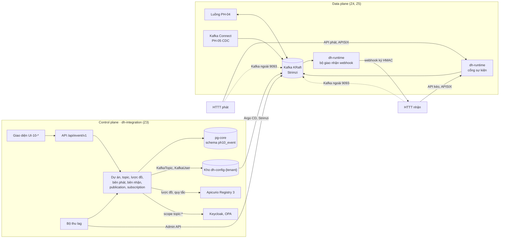
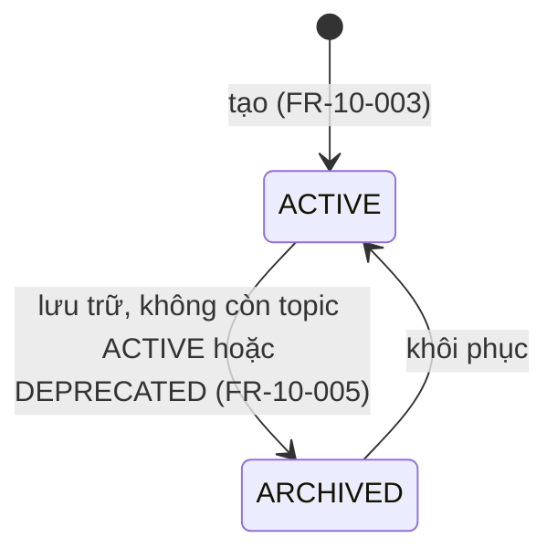
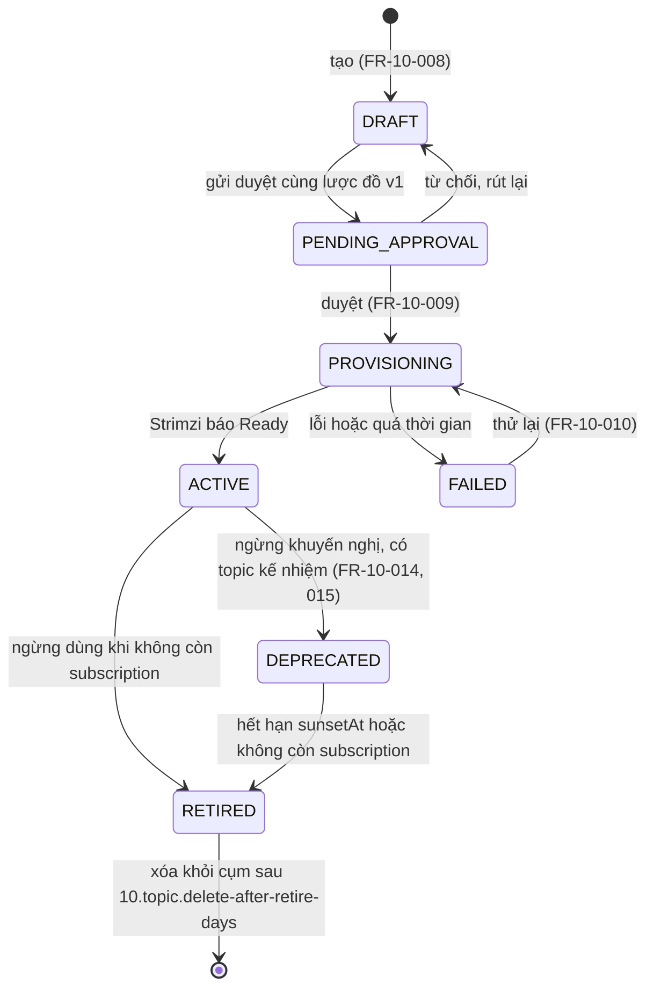
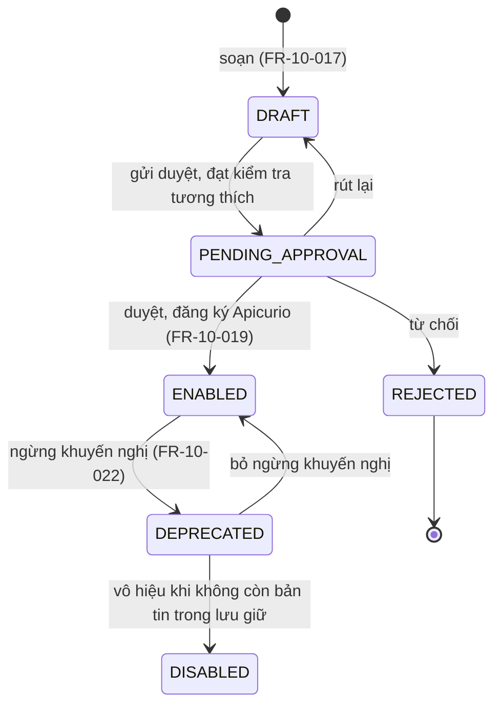
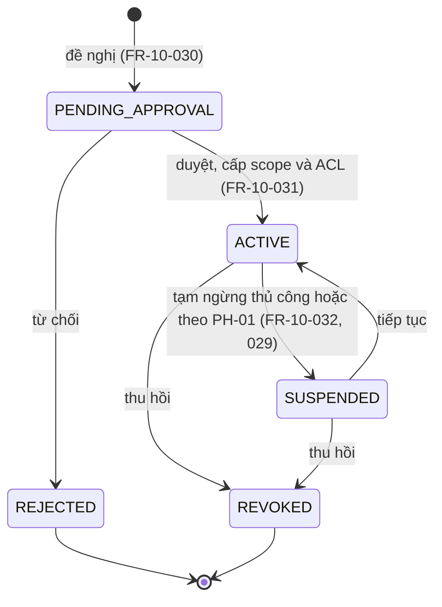
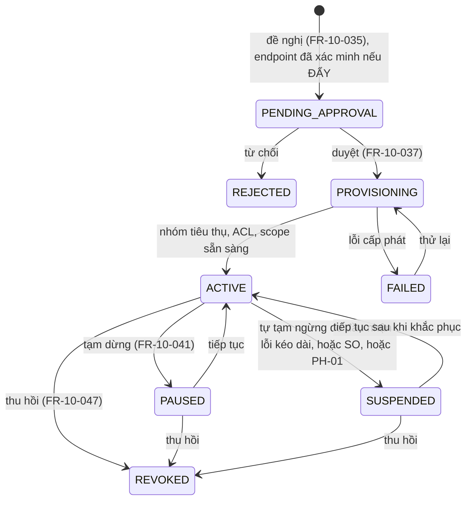
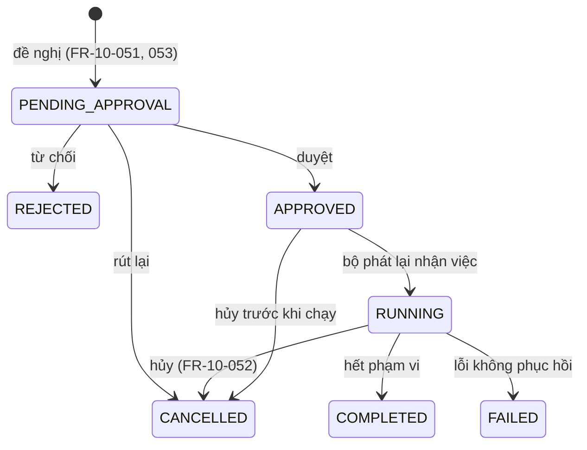
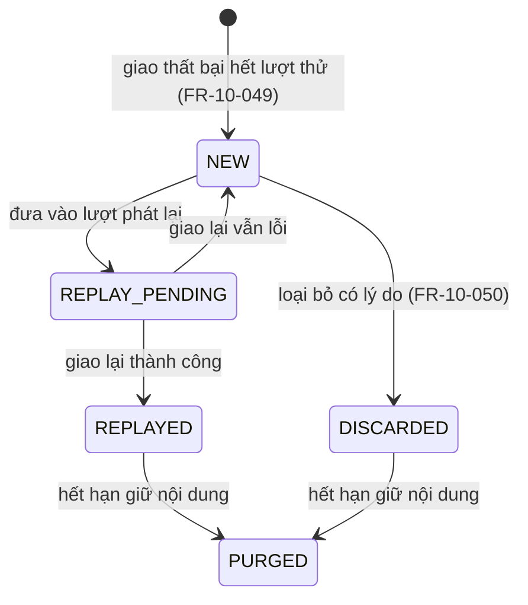

# D02-03-PH10 · Đặc tả yêu cầu chức năng Sự kiện

## Tóm tắt cho hội đồng thẩm định

**Mục tiêu.** PH-10 là trục trao đổi dữ liệu bất đồng bộ của Datahub, thay khối Hub chạy Apache Pulsar của hệ cũ. Phân hệ cho phép một hệ thống thông tin (HTTT) thành viên phát một sự kiện nghiệp vụ một lần và nhiều HTTT khác nhận được, mà các bên không phải biết nhau, không phải cùng hoạt động một lúc và không phải sửa khi có thêm bên nhận. PH-10 giữ nguyên các khái niệm nghiệp vụ mà cán bộ hệ cũ đã quen (dự án tích hợp, topic, publisher, subscriber, publication, subscription, kiểu giao tiếp, chế độ định tuyến, dashboard và sơ đồ kết nối), đồng thời bổ sung những gì hệ cũ thiếu: lược đồ bắt buộc và kiểm tra tương thích, duyệt bốn mắt trước khi một bên được phát hoặc nhận, hai chế độ giao nhận đẩy và kéo có xác thực, hàng đợi lỗi (DLQ) và phát lại có kiểm soát, theo dõi độ trễ tiêu thụ, cách ly giữa các tỉnh.

**Phạm vi.** 76 yêu cầu chức năng chia mười một nhóm: dự án tích hợp; topic; lược đồ sự kiện; bên phát và bên nhận; publication; subscription và giao nhận; DLQ và phát lại; giám sát, dashboard và sơ đồ; danh mục cấu hình, hạn mức và đa tenant; đăng ký máy với máy cho PH-04, PH-05 và các DU nội bộ; xuất nhập khai báo và di trú song song từ Pulsar. Phân hệ chạy ở control plane trong DU `dh-integration` (package `vn.datahub.integration.event`) và ở data plane trên Kafka (Strimzi, chế độ KRaft), Apicurio Registry 3 và hai mô-đun của `dh-runtime` là cổng sự kiện và bộ giao nhận webhook (ADR-071).

**Căn cứ pháp lý.** CMP-LAW-09 (Công văn 631/THH-THHT: LGSP phải hỗ trợ trao đổi bản tin bất đồng bộ, đa giao thức, bảo đảm tin cậy); CMP-LAW-03 (NĐ 278/2025 về kết nối, chia sẻ dữ liệu); CMP-LAW-06 và CMP-LAW-08 (NĐ 331/2026, TCVN 14423:2026 cấp độ 3: kiểm soát truy cập theo nguyên tắc tối thiểu, nhật ký, toàn vẹn dữ liệu truyền); CMP-LAW-05 (Luật BVDLCN 91/2025: sự kiện chỉ mang định danh và loại thay đổi, không mang dữ liệu cá nhân đầy đủ khi không cần); CMP-LAW-16 (Luật An ninh mạng 116/2025: dữ liệu lưu trong nước, nhật ký hệ thống).

**Con số chính.**

| Chỉ số | Giá trị |
|---|---|
| Yêu cầu chức năng | 76 (M: 61, S: 12, C: 3); MVP: 71, Đợt sau: 5 |
| Quy tắc nghiệp vụ | 36 (BR-10-001…036) |
| Yêu cầu phi chức năng | 20 (NFR-10-001…020) |
| Màn hình | 20 (UI-10-01…20) |
| Mã lỗi | 50 control plane (ERR-10-001…050), 20 data plane (ERR-10-101…120) |
| Sự kiện do PH-10 phát | 15 (EVT-10-01…15) |
| API dự kiến | 84 operation (API-10-001…084), định nghĩa đầy đủ ở D03-04-PH10 |
| Chức năng hệ cũ được phủ | 14 mục `LGC-HUB` (12 phủ ở PH-10, 2 thay thế bởi PH-13) cùng LGC-TOOL-010 và LGC-BUS-039 |
| ADR mới | ADR-070 (tương thích lược đồ, phiên bản topic), ADR-071 (giao nhận đẩy và kéo), ADR-072 (cấp phát topic, ACL qua GitOps), ADR-073 (cầu nối di trú Pulsar) |

Phụ lục A "Bảng mã và enum chuẩn" ở cuối tài liệu là **nguồn chuẩn duy nhất** về trạng thái, enum, tên trường, mã quyền, tham số, màn hình và sự kiện của PH-10 cho sáu tập còn lại (UC, SDD, CSDL, API, màn hình, ca kiểm thử).

## 1. Mục đích, phạm vi và người đọc

### 1.1. Mục đích

Tài liệu đặc tả đầy đủ hành vi của PH-10 để kỹ sư hiện thực và kiểm thử viên viết ca kiểm thử mà không phải hỏi lại. Mỗi FR nêu tác nhân và quyền, tiền điều kiện, đầu vào, các bước xử lý kiểm chứng được, ngoại lệ có mã lỗi, hậu điều kiện, sự kiện phát ra và yêu cầu kiểm toán. FR viết dạng bảng đầy đủ khi có nhiều nhánh xử lý; FR đơn giản viết một đoạn văn có đủ các thông tin đó.

### 1.2. Phạm vi làm

| # | Trách nhiệm | Nhóm FR |
|---|---|---|
| 1 | Quản lý **dự án tích hợp**: gom topic theo nghiệp vụ, chủ quản, phạm vi xem sơ đồ | A |
| 2 | Quản lý **topic** Kafka theo quy ước tên có tiền tố tenant: phân vùng, lưu giữ, compaction, chế độ định tuyến và khóa phân vùng, phân loại dữ liệu, vòng đời, phiên bản chính `.v{n+1}` khi thay đổi phá vỡ | B |
| 3 | Quản lý **lược đồ sự kiện** ở Apicurio Registry 3: soạn, kiểm tra cú pháp và dữ liệu cá nhân, kiểm tra tương thích, duyệt, phiên bản, giám sát tuân thủ | C |
| 4 | Quản lý **bên phát** và **bên nhận**: HTTT thành viên (PH-01), luồng tích hợp (PH-04), DU nội bộ; đồng bộ trạng thái với PH-01, PH-04 | D |
| 5 | **Publication** và **subscription** có duyệt bốn mắt; khi duyệt thì cấp scope OAuth `topic:{tên}:publish` hoặc `:subscribe`, ACL Kafka theo tiền tố tenant, nhóm tiêu thụ | E, F |
| 6 | **Giao nhận**: ĐẨY về URI của HTTT bằng webhook ký HMAC (số worker, thử lại giãn dần, điểm bắt đầu, tạm dừng, tiếp tục); KÉO qua API có xác thực hoặc qua Kafka listener ngoài (SASL OAUTHBEARER hoặc mTLS); nội bộ cho luồng và DU | F |
| 7 | **DLQ tầng sự kiện** theo topic, **phát lại** theo khoảng offset hoặc thời gian có duyệt; API cho PH-18 | G |
| 8 | **Giám sát**: consumer lag, cảnh báo, thống kê giao nhận, dashboard, sơ đồ kết nối tương tác | H |
| 9 | Danh mục **kiểu giao tiếp** và **chế độ định tuyến**, hạn mức và tham số theo tenant, cách ly đa tenant, kiểm toán | I |
| 10 | **Đăng ký máy với máy**: topic CDC cho PH-05, topic của DU nội bộ, kiểm tra quyền cho PH-04 (VR-10) | J |
| 11 | **Xuất nhập khai báo** và **di trú song song từ Pulsar** theo cách thay dần (cầu nối tạm thời, ánh xạ, đối chiếu, chuyển hẳn) | K |

### 1.3. Phạm vi không làm

| Không làm | Thuộc |
|---|---|
| Biểu đồ CPU, bộ nhớ, đĩa, broker, phân vùng thiếu bản sao của cụm Kafka (LGC-HUB-005, 006) | PH-13 (PH-10 chỉ dẫn chiếu) |
| Cân bằng lại phân vùng giữa broker, nâng cấp cụm, MirrorMaker 2 sang site DR | Vận hành nền tảng theo D03-09 §6.4, §8 |
| Chạy hạ tầng CDC (Kafka Connect, Debezium) và quản lý connector | PH-05 (ADR-059); PH-10 chỉ đăng ký topic và lược đồ |
| Cầu nối giao thức bản tin AMQP, MQTT, JMS tới hệ ngoài | PH-05 (FR-05-035) qua luồng PH-04 |
| Logic biến đổi, định tuyến nội dung, ánh xạ ngữ nghĩa giữa hai lược đồ | PH-04 |
| Màn xử lý lỗi vận hành chung (gom DLQ của mọi phân hệ, gán người xử lý, quy trình sự cố) | PH-18 (PH-10 giữ DLQ tầng sự kiện và cung cấp API) |
| Kết nạp HTTT, cấp client OAuth cho HTTT | PH-01, PH-12 (PH-10 chỉ gắn scope vào client đã có) |
| Công bố topic như một dịch vụ trong danh mục dịch vụ | PH-02 (đọc topic `ACTIVE` từ PH-10) |
| Hàng đợi lệnh nội bộ giữa `dh-integration` và `dh-runtime` (`dh.integration.runtime.*`) | PH-04 (PH-10 chỉ ghi nhận như topic nền tảng, FR-10-067) |

### 1.4. Chức năng hệ cũ được phủ

| Mã | Chức năng hệ cũ | Nhóm FR |
|---|---|---|
| LGC-HUB-001…004 | Dashboard đếm publisher, subscriber, project, topic | H (FR-10-057) |
| LGC-HUB-005, 006 | Biểu đồ % Memory, % CPU | Thay thế bởi PH-13 |
| LGC-HUB-007 | Sơ đồ kết nối publisher, topic, subscriber | H (FR-10-058) |
| LGC-HUB-008 | Quản lý dự án tích hợp | A |
| LGC-HUB-009 | Quản lý topic: tên, mô tả, phân vùng, cấu trúc, chế độ định tuyến | B, C |
| LGC-HUB-010, 011 | Quản lý publisher, subscriber (đánh dấu subscriber là luồng) | D |
| LGC-HUB-012 | Quản lý publication | E |
| LGC-HUB-013 | Quản lý subscription: URI nhận, số worker, số lần thử lại, thời điểm bắt đầu | F |
| LGC-HUB-014 | Danh mục `type_of_comm`, `routing_mode` | I |
| LGC-TOOL-010 | Nhóm Message Broker trong Tooling (dùng chung PH-04, PH-05) | J (Kafka nội bộ qua topic đã đăng ký) |
| LGC-BUS-039 | Hai loại bản tin: document message và event message | E, F (event message bất đồng bộ) |

### 1.5. Người đọc và cách đọc

Hội đồng thẩm định đọc phần tóm tắt, §1, §2, §9 và §13. Kỹ sư đọc §3 đến §8 và phụ lục A. Kiểm thử viên đọc §5, §6, §8, §13 và phụ lục A. Định nghĩa dùng chung (đăng nhập, danh sách, xuất, kiểm toán, bốn mắt) không nhắc lại mà dẫn chiếu FR-00 ở D02-02 SRS.

## 2. Bối cảnh nghiệp vụ

### 2.1. Vị trí trong kiến trúc



Sơ đồ cho thấy PH-10 tách rõ hai mặt phẳng. Control plane trong `dh-integration` giữ mọi khai báo nghiệp vụ ở schema `ph10_event` của cụm `pg-core` (RLS theo `tenant_id`), đăng ký lược đồ ở Apicurio, gắn scope vào client của HTTT ở Keycloak và sinh tài nguyên `KafkaTopic`, `KafkaUser` vào kho cấu hình Git của tenant để Argo CD và Strimzi áp dụng lên cụm (ADR-072). Data plane gồm Kafka, cổng sự kiện (nhận lượt phát và lượt kéo qua APISIX) và bộ giao nhận webhook, cả hai là mô-đun của `dh-runtime` (ADR-071). Khi control plane ngừng, sự kiện vẫn được phát, giao và kéo bình thường; chỉ các thay đổi khai báo bị chặn (NFR-00-012). Kết nối Kafka trực tiếp từ HTTT là tùy chọn của từng tenant qua listener `external` (D03-09 §6.4), nét đứt trên sơ đồ.

### 2.2. Ba cách tham gia trục sự kiện

| Cách | Bên phát | Bên nhận | Khi nào dùng |
|---|---|---|---|
| Qua cổng HTTP (mặc định) | Gọi API phát `POST /event/v1/topics/{topicName}/events` với token có scope `topic:{tên}:publish` | Chọn ĐẨY (nhận webhook ký HMAC tại URI của mình) hoặc KÉO (gọi API kéo, xác nhận đã nhận) | Mọi HTTT, kể cả HTTT nhỏ chỉ biết gọi HTTP |
| Kafka trực tiếp (tùy chọn) | Producer Kafka qua listener `external`, SASL OAUTHBEARER hoặc mTLS, serde Apicurio | Consumer Kafka với nhóm tiêu thụ được cấp | HTTT lưu lượng lớn có đội kỹ thuật vững, tenant bật `10.external-kafka.enabled` |
| Nội bộ | Luồng PH-04, PH-05 CDC, DU nội bộ qua listener `internal` mTLS | Luồng PH-04, DU nội bộ | Mọi thành phần của Datahub |

### 2.3. Quy trình nghiệp vụ liên quan

| Quy trình | Vai trò của PH-10 |
|---|---|
| BP-04 Trao đổi dữ liệu qua sự kiện (D02-01) | Toàn bộ: đăng ký topic có lược đồ được duyệt, publication, subscription đẩy hoặc kéo, giao ít nhất một lần, DLQ |
| BP-03 Phát hành và đồng bộ danh mục dùng chung | HTTT đăng ký nhận topic `*.rdm.*` do PH-07 phát (scope `topic:{tên}:subscribe`) |
| Kết nạp HTTT (PH-01) | Bên phát, bên nhận phải là HTTT `ACTIVE`; HTTT bị tạm ngừng thì publication, subscription bị tạm ngừng theo |
| Phát hành luồng (PH-04) | Kiểm tra VR-10: luồng chỉ phát, nhận trên topic đã đăng ký và có quyền (BR-04-009) |
| CDC hệ di sản (PH-05) | Đăng ký hộ topic `{topicPrefix}.{schema}.{table}.v1` và lược đồ Avro; nhận EVT-05-11 khi lược đồ nguồn đổi |
| Xử lý lỗi vận hành (PH-18) | Cung cấp DLQ tầng sự kiện và API phát lại |
| Chuyển đổi dần từ hệ cũ (REQ-22) | Ánh xạ khai báo Pulsar, cầu nối song song, đối chiếu, chuyển hẳn |

### 2.4. Hạn chế của hệ cũ cần khắc phục

| Hạn chế của Hub Pulsar | Hệ quả | Cách PH-10 khắc phục |
|---|---|---|
| "Cấu trúc" topic chỉ là mô tả, không kiểm tra khi phát | Bên nhận vỡ khi bên phát đổi định dạng âm thầm | Lược đồ bắt buộc ở Apicurio, kiểm tra tương thích, cổng sự kiện từ chối bản tin sai lược đồ (FR-10-017…023) |
| Ai có tài khoản cũng tạo publisher, subscriber tùy ý | Không biết HTTT nào đang nhận dữ liệu gì | Bên phát, bên nhận phải là HTTT thành viên, luồng hoặc DU; publication, subscription duyệt bốn mắt (FR-10-026…037) |
| Không lưu giữ cấu hình được, không phát lại có kiểm soát | Mất dữ liệu khi bên nhận ngừng lâu | Lưu giữ theo topic, điểm bắt đầu, phát lại có duyệt (FR-10-012, 040, 051) |
| Subscription chỉ đẩy về URI, không ký | Giả mạo được bản tin trong mạng nội bộ | Webhook ký HMAC theo ADR-044, hoặc HTTT tự kéo có xác thực (FR-10-038, 043) |
| Không có DLQ, không biết bản tin nào giao hỏng | Lỗi im lặng | DLQ tầng sự kiện, sự kiện EVT-10-11 cho PH-18 (FR-10-049) |
| Dashboard chỉ đếm số lượng và CPU, bộ nhớ | Không thấy bên nhận đang tụt lại | Consumer lag theo subscription, cảnh báo, sơ đồ phủ lag (FR-10-054…058) |
| Một cụm cho một tỉnh, không cách ly tenant | Không phục vụ được nền tảng dùng chung | Tiền tố tenant, ACL theo tiền tố, hạn mức theo tenant (FR-10-062, 064) |

## 3. Tác nhân, vai trò và quyền

### 3.1. Tác nhân

| Tác nhân | Viết tắt | Loại | Tương tác chính |
|---|---|---|---|
| ROLE-INTEGRATION_ENGINEER | IE | Người | Tạo dự án, topic, lược đồ, bên phát, bên nhận; đề nghị publication, subscription; gửi duyệt |
| ROLE-INTEGRATION_APPROVER | IA | Người | Duyệt topic, thay đổi cấu hình, phiên bản lược đồ, publication, subscription, lượt phát lại |
| ROLE-TENANT_ADMIN | TA | Người | Như IE, cộng tham số phân hệ, danh mục cấu hình, di trú; được duyệt nhưng chịu bốn mắt |
| ROLE-TENANT_OPERATOR | TO | Người | Theo dõi lag, giao nhận; tạm dừng, tiếp tục subscription; xử lý DLQ; đề nghị phát lại; xoay khóa ký |
| ROLE-SECURITY_OFFICER | SO | Người | Tạm ngừng publication, subscription, bên phát, bên nhận khi có sự cố ATTT; xem nhật ký |
| ROLE-SERVICE_OWNER | SV | Người | Xem, đề xuất topic và publication cho HTTT của tổ chức mình (○ theo D02-08) |
| ROLE-ORG_REQUESTER | OR | Người | Đề nghị subscription cho HTTT của tổ chức mình (○ theo D02-08) |
| ROLE-PLATFORM_ADMIN | PA | Người | Topic nền tảng `dh.`, trần hạn mức tenant, bật listener Kafka ngoài, cầu nối di trú |
| ROLE-PLATFORM_OPERATOR | PO | Người | Xem liên tenant có lý do (FR-00-012), hỗ trợ sự cố cụm |
| ROLE-AUDITOR, ROLE-VIEWER | AU, VW | Người | Xem |
| HTTT thành viên | | Hệ thống | Phát qua API phát hoặc Kafka; nhận webhook, kéo qua API hoặc Kafka |
| `dh-integration` của PH-04, PH-05 | | Hệ thống | Kiểm tra quyền phát, nhận (VR-10); đăng ký topic CDC |
| DU nội bộ (`dh-connect`, `dh-data`, `dh-platform`, `dh-payment`) | | Hệ thống | Đăng ký topic outbox của mình, phát qua listener `internal` |
| `dh-runtime` (cổng sự kiện, bộ giao nhận, luồng) | | Hệ thống | Đọc cấu hình subscription, khóa ký; báo kết quả giao nhận |
| PH-01, PH-12, PH-13, PH-18, PH-20 | | Hệ thống | HTTT, client OAuth; scope và chính sách OPA; giám sát; xử lý lỗi; khởi tạo tenant |

### 3.2. Quyền

Ma trận dùng ký hiệu của D02-08 §3 (● có, ○ có trong phạm vi tổ chức của mình, — không). `PERM-10-read`, `PERM-10-create`, `PERM-10-approve`, `PERM-10-subscribe` đã có ở D02-08. `PERM-10-update` có ở D02-08 dưới dạng gộp "create / update" và cần tách dòng; `PERM-10-operate`, `PERM-10-admin` là quyền mới, ghi ở §3.3.

| Quyền | Ý nghĩa | PA | PO | TA | TO | SO | IE | IA | SV | OR | VW | AU |
|---|---|---|---|---|---|---|---|---|---|---|---|---|
| PERM-10-read | Xem dự án, topic, lược đồ, bên phát, bên nhận, publication, subscription, lag, dashboard, sơ đồ; xuất khai báo | ● | ● | ● | ● | ● | ● | ● | ● | ○ | ● | ● |
| PERM-10-create | Tạo dự án, topic, phiên bản lược đồ, bên phát, bên nhận; đề nghị publication; nhập khai báo; gửi duyệt | — | — | ● | — | — | ● | — | ○ | — | — | — |
| PERM-10-update | Sửa dự án, topic (phần không cần duyệt), lược đồ nháp, bên phát, bên nhận; đề nghị thay đổi cấu hình topic; lưu trữ dự án; ngừng topic | — | — | ● | — | — | ● | — | ○ | — | — | — |
| PERM-10-subscribe | Đề nghị, sửa, thu hồi subscription cho HTTT | — | — | ● | — | — | ● | — | — | ○ | — | — |
| PERM-10-approve | Duyệt, từ chối: tạo topic, thay đổi cấu hình, phiên bản lược đồ, publication, subscription, lượt phát lại | — | — | ● | — | — | — | ● | — | — | — | — |
| PERM-10-operate | Tạm dừng, tiếp tục, tạm ngừng subscription, publication; xoay khóa ký; xử lý mục DLQ; đề nghị phát lại; xác nhận cảnh báo lag | — | — | ● | ● | ● | — | — | — | — | — | — |
| PERM-10-admin | Tham số `10.*`, danh mục kiểu giao tiếp và chế độ định tuyến, hạn mức (PA đặt trần, TA phân bổ), bật Kafka ngoài, di trú Pulsar, topic nền tảng `dh.` (chỉ PA) | ● | — | ● | — | — | — | — | — | — | — | — |

Tách nhiệm vụ: IE và IA là cặp loại trừ (D02-08 §4). TA có cả `PERM-10-create` và `PERM-10-approve` nên bốn mắt áp dụng theo từng đối tượng: người tạo hoặc người gửi một yêu cầu không được duyệt chính yêu cầu đó (FR-00-071, BR-10-010). `PERM-10-operate` của SO chỉ dùng để tạm ngừng khi có sự cố (FR-10-028, 032, 041), không dùng cho phát lại hay xử lý DLQ. OR và SV chỉ thao tác trên HTTT thuộc tổ chức của mình; ngoài phạm vi trả ERR-10-044.

**Máy với máy.** Các tài khoản dịch vụ được cấp scope nội bộ khi triển khai, không cấp cho người: `event:topic-register` (PH-05 `dh-integration`, DU nội bộ; FR-10-066, 067), `event:permission-check` (PH-04; FR-10-069), `event:runtime-config` (`dh-runtime`; đọc cấu hình subscription và khóa ký, FR-10-038), `event:dlq-read` và `event:replay` (PH-18; FR-10-050, 053), `event:metrics-read` (PH-13). HTTT dùng scope do PH-10 cấp: `topic:{tên topic}:publish`, `topic:{tên topic}:subscribe` (D02-08 §5).

### 3.3. Đề nghị đồng bộ D02-08

| Đề nghị | Nội dung |
|---|---|
| Tách dòng | `PERM-10-create` và `PERM-10-update` thành hai dòng, gán như §3.2 |
| Thêm `PERM-10-operate` | TA ●, TO ●, SO ● (chỉ tạm ngừng khi sự cố) |
| Thêm `PERM-10-admin` | PA ●, TA ● |
| Sửa `PERM-10-subscribe` | Thêm IE ● (kỹ sư tích hợp đề nghị subscription cho luồng và HTTT) |
| Thêm scope máy | `event:topic-register`, `event:permission-check`, `event:runtime-config`, `event:dlq-read`, `event:replay`, `event:metrics-read` vào bảng scope §5 |

## 4. Khái niệm và mô hình nghiệp vụ

### 4.1. Thuật ngữ

| Thuật ngữ | Định nghĩa |
|---|---|
| Dự án tích hợp | Nhóm nghiệp vụ gom các topic cùng một mục đích trao đổi (ví dụ `dang-ky-kinh-doanh`), có chủ quản; là phạm vi lọc của sơ đồ kết nối. Kế thừa `project` của hệ cũ |
| Topic | Kênh sự kiện Kafka có tên theo quy ước, thuộc đúng một dự án, có lược đồ, cấu hình phân vùng, lưu giữ, chế độ định tuyến |
| Phiên bản chính của topic | Hậu tố `.v{n}` trong tên. Thay đổi phá vỡ lược đồ tạo topic mới `.v{n+1}`, không ghi đè topic cũ (ADR-070) |
| Lược đồ sự kiện | Mô tả cấu trúc phần `data` của sự kiện, định dạng Avro hoặc JSON Schema, lưu ở Apicurio thành một artifact cho mỗi topic |
| Mức tương thích | Quy tắc Apicurio quyết định phiên bản lược đồ mới có được nhận không (`BACKWARD`, `FULL`…) |
| Bên phát (publisher) | Chủ thể được phép phát lên topic: HTTT thành viên, luồng PH-04, DU nội bộ, hoặc cầu nối di trú |
| Bên nhận (subscriber) | Chủ thể nhận sự kiện: HTTT thành viên, luồng PH-04 (tương ứng "subscriber đánh dấu là luồng" của hệ cũ), DU nội bộ |
| Publication | Quan hệ được duyệt giữa một bên phát và một topic; khi `ACTIVE` thì bên phát có scope `topic:{tên}:publish` và ACL `WRITE` |
| Subscription | Quan hệ được duyệt giữa một bên nhận và một topic, kèm chế độ giao nhận và tham số; có nhóm tiêu thụ riêng |
| Giao nhận ĐẨY | Bộ giao nhận của nền tảng đọc topic và gọi HTTPS tới URI của bên nhận, ký HMAC, thử lại khi lỗi |
| Giao nhận KÉO | Bên nhận tự lấy sự kiện qua API kéo (có xác nhận) hoặc qua Kafka listener ngoài |
| Nhóm tiêu thụ | Consumer group Kafka giữ vị trí đọc của một subscription: `dh-sub-{tenant}-{subscriptionCode}` (đẩy, kéo API), `dh-ext-{tenant}-{subscriptionCode}` (Kafka ngoài), `dh-flow-{tenant}-{flow}` (luồng PH-04) |
| Consumer lag | Số bản tin và thời gian mà nhóm tiêu thụ còn chậm so với cuối topic, theo phân vùng |
| DLQ tầng sự kiện | Nơi giữ sự kiện mà bộ giao nhận hoặc cổng kéo không giao được sau khi hết lượt thử, theo topic `{topicName}.dlq` và bản ghi bền trong `ph10_event` |
| Lượt phát lại | Thao tác có duyệt đọc lại sự kiện trong một khoảng offset hoặc thời gian, hoặc các mục DLQ đã chọn, và giao lại cho một subscription |
| Kiểu giao tiếp | Danh mục cách một bên tham gia trục (`HTTP_PUBLISH`, `WEBHOOK_PUSH`…), kế thừa `type_of_comm` |
| Chế độ định tuyến | Cách chọn phân vùng khi phát (`KEY_HASH`, `ROUND_ROBIN`, `SINGLE_PARTITION`), kế thừa `routing_mode` |
| Phong bì CloudEvents | Mọi sự kiện mang thuộc tính CloudEvents 1.0 (`id`, `source`, `type`, `specversion`, `time`, `subject`, `dataschema`) cùng các mở rộng `traceparent`, `dhtenant` (CC-API-04) |

### 4.2. Thực thể

Tên trường đầy đủ, kiểu và tên cột gợi ý ở phụ lục A.3. Mọi thực thể có `id`, `tenantId`, `createdAt`, `createdBy`, `updatedAt`, `updatedBy`, `version`.

| Mã | Thực thể | Thuộc tính chính | Ghi chú |
|---|---|---|---|
| EN-10-01 | Dự án tích hợp (`EventProject`) | `projectCode`, `name`, `description`, `ownerOrgCode`, `ownerUser`, `status`, `labels` | Mã bất biến |
| EN-10-02 | Topic (`Topic`) | `topicName`, `projectCode`, `topicKind`, `domain`, `entity`, `eventName`, `majorVersion`, `partitions`, `retentionHours`, `cleanupPolicy`, `routingMode`, `partitionKeyField`, `orderingRequired`, `dataClass`, `status`, `predecessorTopic`, `successorTopic`, `sunsetAt` | Tên bất biến, không dùng lại |
| EN-10-03 | Lược đồ (`EventSchema`) | `topicName`, `apicurioGroupId`, `apicurioArtifactId`, `schemaFormat`, `compatibility`, `latestVersionNo` | Một lược đồ giá trị cho mỗi topic |
| EN-10-04 | Phiên bản lược đồ (`SchemaVersion`) | `versionNo`, `content`, `contentHash`, `apicurioGlobalId`, `apicurioContentId`, `status`, `compatibilityReport`, `piiFindings`, `changeNote` | Bất biến sau khi `ENABLED` |
| EN-10-05 | Bên phát (`Publisher`) | `publisherCode`, `name`, `partyType`, `systemCode`, `flowCode`, `serviceCode`, `commType`, `referenceKey`, `clientId`, `kafkaPrincipal`, `status` | `referenceKey` kế thừa "khóa tham chiếu" hệ cũ |
| EN-10-06 | Bên nhận (`Subscriber`) | `subscriberCode`, `name`, `partyType`, `systemCode`, `flowCode`, `serviceCode`, `commType`, `referenceKey`, `clientId`, `kafkaPrincipal`, `status` | `partyType = FLOW` tương ứng cờ "là luồng" |
| EN-10-07 | Publication (`Publication`) | `publicationCode`, `publisherCode`, `topicName`, `status`, `grantedScope`, `aclRef`, `quotaBytesPerSecond`, `approvedBy`, `approvedAt` | Duy nhất theo cặp bên phát, topic |
| EN-10-08 | Subscription (`Subscription`) | `subscriptionCode`, `subscriberCode`, `topicName`, `deliveryMode`, `consumerGroup`, `startPosition`, `startAt`, `status`, cấu hình đẩy (`endpointUrl`, `workerCount`, `maxRetries`, `retryBackoff`, `timeoutMs`, `failurePolicy`, `payloadFormat`), cấu hình kéo (`maxBatch`, `leaseSeconds`), ngưỡng lag | Duy nhất theo cặp bên nhận, topic |
| EN-10-09 | Khóa ký webhook (`SigningKey`) | `subscriptionCode`, `keyId`, `secretRef`, `status`, `activatedAt`, `expiresAt` | Giá trị bí mật chỉ ở OpenBao |
| EN-10-10 | Yêu cầu duyệt (`ApprovalRequest`) | `requestCode`, `requestType`, `targetType`, `targetCode`, `payloadDiff`, `status`, `requestedBy`, `decidedBy`, `decisionComment` | Gộp mọi loại duyệt của PH-10, đổ vào "Việc của tôi" (FR-00-070) |
| EN-10-11 | Thống kê giao nhận (`DeliveryStat`) và lượt giao lỗi (`DeliveryFailure`) | Theo subscription, cửa sổ 1 phút: số giao thành công, lỗi, thử lại, độ trễ p95; lượt lỗi: offset, mã HTTP, mã lỗi, số lần thử | Thống kê giữ 90 ngày, lượt lỗi 30 ngày |
| EN-10-12 | Mục DLQ (`DlqEntry`) | `dlqEntryId`, `subscriptionCode`, `sourceTopic`, `sourcePartition`, `sourceOffset`, `eventId`, `errorCode`, `errorDetail`, `attempts`, `firstFailedAt`, `lastFailedAt`, `status`, `payloadRef` | Bền ở `ph10_event` tới khi xử lý (BR-10-024) |
| EN-10-13 | Lượt phát lại (`ReplayRequest`) | `replayCode`, `subscriptionCode`, `replayMode`, `rangeType`, phạm vi offset hoặc thời gian, `dlqEntryIds`, `estimatedRecords`, `reason`, `status`, tiến độ | |
| EN-10-14 | Mẫu lag (`LagSample`) | `subscriptionCode`, `consumerGroup`, `lagRecords`, `lagSeconds`, `alertState`, theo phân vùng | Mẫu 30 giây giữ 48 giờ, gộp 5 phút giữ 90 ngày |
| EN-10-15 | Kiểu giao tiếp (`CommType`) | `commTypeCode`, `name`, `direction`, `enabled` | Danh mục nền tảng, tenant bật tắt |
| EN-10-16 | Chế độ định tuyến (`RoutingMode`) | `routingModeCode`, `name`, `legacyCode`, `enabled` | Danh mục nền tảng |
| EN-10-17 | Hạn mức tenant (`TenantEventQuota`) | `maxTopics`, `maxPartitionsTotal`, `produceBytesPerSecond`, `consumeBytesPerSecond`, `maxRetentionHours`, `maxSubscriptions`, `maxPushWorkersTotal` | PA đặt trần, TA phân bổ |
| EN-10-18 | Ánh xạ di trú (`LegacyMapping`) | `legacyType`, `legacyId`, `legacyName`, `targetType`, `targetCode`, `status` | Project, topic, publisher, subscriber, publication, subscription của Pulsar |
| EN-10-19 | Cầu nối di trú (`MigrationBridge`) | `bridgeCode`, `direction`, `pulsarTopic`, `kafkaTopic`, `status`, `lastPulsarMessageId`, `bridgedCount`, `lagSeconds` | Tạm thời, có ngày hết hạn |
| EN-10-20 | Tác vụ nhập khai báo (`ManifestImportJob`) | `jobCode`, `sourceKind`, `fileRef`, `status`, kết quả kiểm tra, danh sách thay đổi đề xuất | Dùng cho nhập khai báo và nhập kiểm kê Pulsar |

### 4.3. Máy trạng thái dự án



Dự án không có trạng thái nháp vì không tiêu tốn tài nguyên cụm. Dự án `ARCHIVED` không nhận topic mới, ẩn khỏi bộ lọc mặc định và sơ đồ, nhưng vẫn xem được cùng lịch sử. Mã dự án không dùng lại sau khi lưu trữ.

### 4.4. Máy trạng thái topic



Topic chỉ chiếm tài nguyên cụm từ `PROVISIONING`. `DRAFT` là trạng thái soạn, chỉ người tạo và người có `PERM-10-update` thấy được nút gửi duyệt. Topic `ACTIVE` nhận publication và subscription mới; `DEPRECATED` vẫn nhận phát và giao nhận cho các quan hệ đang có, nhưng không nhận subscription mới (ERR-10-025) và hiển thị topic kế nhiệm. `RETIRED` thu hồi mọi publication, subscription còn lại, xóa ACL, sau thời gian chờ thì xóa topic khỏi cụm; tên topic không bao giờ được dùng lại (BR-10-003). Topic loại `CDC` và `SYSTEM` do máy đăng ký có thể đi thẳng từ `DRAFT` sang `PROVISIONING` khi chính sách tự duyệt bật (FR-10-066, BR-10-031).

### 4.5. Máy trạng thái phiên bản lược đồ



Chỉ phiên bản `ENABLED` mới có ở Apicurio dưới dạng dùng được; nháp và chờ duyệt được kiểm tra bằng lệnh chạy thử (`dryRun`) của Apicurio, không ghi vào registry. Ba trạng thái `ENABLED`, `DEPRECATED`, `DISABLED` trùng tên với trạng thái phiên bản của Apicurio 3 để đồng bộ hai chiều không phải dịch. Phiên bản `DISABLED` không giải mã được nữa nên chỉ cho vô hiệu khi không còn bản tin dùng phiên bản đó trong thời gian lưu giữ của topic (BR-10-015). Lược đồ của topic `DRAFT` đi cùng yêu cầu duyệt topic, không có yêu cầu riêng.

### 4.6. Máy trạng thái publication



Tạm ngừng gỡ scope và ACL ngay nhưng giữ khai báo để tiếp tục không phải duyệt lại. Thu hồi là kết thúc, muốn phát lại phải đề nghị mới. Publication của luồng PH-04 và DU nội bộ không cấp scope OAuth (không đi qua cổng HTTP) mà chỉ ghi nhận quyền để VR-10 kiểm tra (BR-10-018).

### 4.7. Máy trạng thái subscription



`PAUSED` là quyết định của người vận hành (ví dụ HTTT bảo trì, hoặc trước khi đặt lại offset); `SUSPENDED` là trạng thái do hệ thống hoặc SO đặt khi có sự cố. Cả hai giữ nguyên vị trí đọc, sự kiện mới tích lũy trong lưu giữ của topic và lag tăng; khi tiếp tục, giao nhận chạy tiếp từ vị trí cũ. Sự kiện cũ hơn thời gian lưu giữ bị mất với subscription đó, nên cảnh báo lag (FR-10-055) tính cả thời gian còn lại trước khi hết lưu giữ.

### 4.8. Máy trạng thái lượt phát lại và mục DLQ





Mục DLQ chỉ bị xóa nội dung (`PURGED`) sau khi đã được xử lý (`REPLAYED` hoặc `DISCARDED`) và qua `10.dlq.payload-retention-days-after-resolve`; mục `NEW` được giữ vô thời hạn, kế thừa quy tắc của SRS repo (BR-10-024). Siêu dữ liệu của mục `PURGED` còn giữ để truy vết.

### 4.9. Định dạng sự kiện trên trục

Mọi sự kiện trên trục theo CloudEvents 1.0 (CC-API-04), chế độ nhị phân trên Kafka: thuộc tính CloudEvents nằm trong tiêu đề bản tin `ce_*`, phần `data` là giá trị bản tin tuần tự hóa theo lược đồ Apicurio (Avro nhị phân hoặc JSON), có tiền tố định danh lược đồ (ADR-070). Thuộc tính bắt buộc: `ce_id` (ULID, duy nhất, dùng chống trùng), `ce_source` (URI bên phát, ví dụ `/t68/systems/HT-DKKD`), `ce_type` (dạng `vn.datahub.{miền}.{thực-thể}.{sự-kiện}`), `ce_specversion` (`1.0`), `ce_time`, `ce_subject` (khóa nghiệp vụ, mặc định là khóa phân vùng), `ce_dataschema` (URI phiên bản lược đồ), `traceparent` (W3C), `dhtenant`. Khóa bản tin Kafka là giá trị khóa phân vùng (chuỗi UTF-8) khi chế độ định tuyến là `KEY_HASH`. Ví dụ:

```text
key: 0312345678
headers:
  ce_id: 01JD3Y8K2M9P3Q7R4T6V8W0Y2Z
  ce_source: /t68/systems/HT-DKKD
  ce_type: vn.datahub.dkkd.doanh-nghiep.da-cap-phep
  ce_specversion: 1.0
  ce_time: 2026-11-26T09:15:02.481+07:00
  ce_subject: 0312345678
  ce_dataschema: /apis/registry/v3/groups/t68/artifacts/t68.dkkd.doanh-nghiep.da-cap-phep.v1/versions/3
  traceparent: 00-4bf92f3577b34da6a3ce929d0e0e4736-00f067aa0ba902b7-01
  dhtenant: T68
value (theo lược đồ v3): {"maDoanhNghiep":"0312345678","loaiThayDoi":"CAP_MOI","phienBan":1}
```

Sự kiện chỉ mang định danh và loại thay đổi khi đối tượng có dữ liệu cá nhân; bên nhận cần giá trị đầy đủ thì gọi API có kiểm soát quyền (BR-10-014, kế thừa RB-05 của SRS repo). Khi giao ĐẨY qua webhook và trả qua API kéo, sự kiện được chuyển sang dạng CloudEvents JSON có cấu trúc (`application/cloudevents+json`), `data` là JSON giải mã từ lược đồ.

## 5. Đặc tả chi tiết yêu cầu chức năng

Quy ước chung cho mọi FR, không nhắc lại trong từng mục: lệnh ghi qua `/api/event/v1` nhận `Idempotency-Key` (16…128 ký tự, giữ 24 giờ; trùng khóa khác thân trả ERR-10-037) và `If-Match` khi sửa (sai phiên bản trả ERR-10-007, FR-00-052); đối tượng của tenant khác trả như không tồn tại (ERR-10-001, BR-10-001); danh sách theo FR-00-020…023 (`size` > 200 trả ERR-10-049); mọi thao tác đổi trạng thái có xác nhận, thao tác ảnh hưởng vận hành bắt buộc lý do 10…500 ký tự (FR-00-050, ERR-10-009); mọi yêu cầu duyệt vào "Việc của tôi" (FR-00-070), có ý kiến khi duyệt và lý do khi từ chối (FR-00-072), chịu bốn mắt (BR-10-010); phụ thuộc không khả dụng trả ERR-10-029 và không để lại trạng thái dở dang. Cột "Đợt" theo cách PH-05: MVP hoặc Đợt sau.

### 5.1. Nhóm A · Dự án tích hợp

#### FR-10-001 · Liệt kê, tìm kiếm và lọc dự án tích hợp

| Trường | Nội dung |
|---|---|
| Mức ưu tiên, đợt | M · MVP |
| Truy vết | REQ-10; LGC-HUB-008 |
| Tác nhân, quyền | Mọi vai trò có `PERM-10-read` (OR chỉ thấy dự án có HTTT của tổ chức mình tham gia) |
| Tiền điều kiện | Đã chọn tenant làm việc (FR-00-004) |

| Tham số | Kiểu | Bắt buộc | Ràng buộc | Ví dụ |
|---|---|---|---|---|
| `q` | T-NAME | Không | Tìm không dấu trên mã, tên, mô tả; 1…100 ký tự | `kinh doanh` |
| `status` | mảng enum | Không | `ACTIVE`, `ARCHIVED`; mặc định `ACTIVE` | `ACTIVE` |
| `ownerOrgCode` | T-CODE | Không | Mã tổ chức | `SO-KHDT` |
| `label` | T-CODE | Không | | `doanh-nghiep` |
| `page`, `size`, `sort` | | Không | `sort` theo `projectCode`, `name`, `updatedAt`, `topicCount` | `updatedAt,desc` |

| Trường | Nội dung |
|---|---|
| Xử lý | 1. Kiểm tra tham số. 2. Truy vấn trong tenant hiện hành. 3. Với mỗi dự án tính `topicCount` theo trạng thái, `publisherCount`, `subscriberCount` (đếm bên phát, bên nhận có publication, subscription `ACTIVE` trên topic của dự án), `maxLagSeconds` (lag lớn nhất của các subscription, FR-10-054). 4. Trả kèm khối `facets` đếm theo `status`, `ownerOrgCode`. |
| Đầu ra | `items[]` gồm `projectCode`, `name`, `ownerOrgCode`, `status`, `topicCount`, `publisherCount`, `subscriberCount`, `maxLagSeconds`, `updatedAt`; `page`, `size`, `totalElements`, `facets` |
| Ngoại lệ | Tham số sai miền: ERR-10-049, 400 |
| Hậu điều kiện | Không thay đổi dữ liệu |
| Sự kiện phát ra | Không |
| Kiểm toán | Không |

#### FR-10-002 · Xem chi tiết dự án

FR-10-002 (M · MVP; LGC-HUB-008). Mọi vai trò có `PERM-10-read` xem thông tin chung, danh sách topic của dự án (lọc trạng thái, loại), danh sách bên phát và bên nhận tham gia, số liệu tóm tắt (sự kiện vào trong 24 giờ, subscription đang cảnh báo lag, mục DLQ `NEW`), liên kết sang sơ đồ đã lọc theo dự án (FR-10-058) và tab Lịch sử (FR-00-043). Phản hồi có `ETag`. Không có ngoại lệ riêng ngoài ERR-10-001. Kiểm toán: không.

#### FR-10-003 · Tạo dự án tích hợp

| Trường | Nội dung |
|---|---|
| Mức ưu tiên, đợt | M · MVP |
| Truy vết | REQ-10; LGC-HUB-008 |
| Tác nhân, quyền | IE, TA, SV (○) với `PERM-10-create` |
| Tiền điều kiện | Tenant `ACTIVE`; không vượt `10.quota.max-projects` |

| Tham số | Kiểu | Bắt buộc | Ràng buộc | Ví dụ |
|---|---|---|---|---|
| `projectCode` | T-CODE chữ thường | Có | `^[a-z][a-z0-9-]{2,62}$`; không thuộc từ dành riêng `moi`, `tong-quan`, `nhap`, `di-tru`, `ben-phat`, `ben-nhan`; duy nhất trong tenant kể cả dự án `ARCHIVED` | `dang-ky-kinh-doanh` |
| `name` | T-NAME | Có | 3…255 ký tự | `Liên thông đăng ký kinh doanh` |
| `description` | T-TEXT | Không | ≤ 2.000 ký tự | |
| `ownerOrgCode` | T-CODE | Có | Tổ chức của tenant (PH-12); SV chỉ được chọn tổ chức của mình | `SO-KHDT` |
| `ownerUser` | T-CODE | Không | Mặc định người tạo | |
| `labels` | mảng T-CODE | Không | ≤ 10 | `["doanh-nghiep"]` |

| Trường | Nội dung |
|---|---|
| Xử lý | 1. Kiểm tra quyền, idempotency. 2. Kiểm tra mẫu mã và từ dành riêng (ERR-10-003), tính duy nhất (ERR-10-002). 3. Kiểm tra tổ chức (ERR-10-044 với SV ngoài tổ chức). 4. Kiểm tra hạn mức (ERR-10-011). 5. Tạo dự án `ACTIVE`. 6. Ghi kiểm toán. |
| Đầu ra | `201`, thân như FR-10-002, `Location`, `ETag` |
| Ngoại lệ | Mã sai mẫu hoặc trùng từ dành riêng: ERR-10-003, 400 · Mã trùng: ERR-10-002, 409 · Vượt hạn mức: ERR-10-011, 422 · Ngoài tổ chức: ERR-10-044, 403 |
| Hậu điều kiện | Dự án `ACTIVE`, chưa có topic |
| Sự kiện phát ra | Không |
| Kiểm toán | Có: người tạo, mã, tên, tổ chức chủ quản |

#### FR-10-004 · Sửa dự án

FR-10-004 (M · MVP; LGC-HUB-008). IE, TA, SV (○) với `PERM-10-update` sửa `name`, `description`, `ownerOrgCode`, `ownerUser`, `labels` bằng `PATCH` có `If-Match`. `projectCode` bất biến (ERR-10-003). Đổi tổ chức chủ quản cần người sửa có quyền ở cả tổ chức cũ và mới. Dự án `ARCHIVED` không sửa được (ERR-10-006). Kiểm toán: có, ghi giá trị trước và sau. Sự kiện: không.

#### FR-10-005 · Lưu trữ và khôi phục dự án

FR-10-005 (M · MVP; LGC-HUB-008). **Lưu trữ** (IE, TA với `PERM-10-update`, lý do bắt buộc): chỉ khi dự án không còn topic ở `PENDING_APPROVAL`, `PROVISIONING`, `ACTIVE`, `DEPRECATED`; còn thì trả ERR-10-010 kèm danh sách topic. Dự án chuyển `ARCHIVED`, topic `DRAFT` còn lại bị xóa mềm (FR-00-051). **Khôi phục** (cùng quyền): về `ACTIVE`. Không có thao tác xóa cứng dự án; hệ cũ cho xóa project kéo theo topic, Datahub thay bằng lưu trữ để giữ truy vết (BR-10-003). Kiểm toán: có. Sự kiện: không.

### 5.2. Nhóm B · Topic

#### FR-10-006 · Liệt kê, tìm kiếm và lọc topic

FR-10-006 (M · MVP; LGC-HUB-009). Mọi vai trò có `PERM-10-read`. Tham số: `q` (tìm trên tên topic, mô tả, `ce_type`), `projectCode`, `status` (nhiều giá trị, mặc định mọi trạng thái trừ `RETIRED`), `topicKind`, `dataClass`, `routingMode`, `hasLagAlert` (boolean), `publisherCode`, `subscriberCode`, `page`, `size`, `sort` (`topicName`, `updatedAt`, `partitions`, `inRatePerMinute`, `maxLagSeconds`). Mỗi dòng trả `topicName`, `projectCode`, `topicKind`, `status`, `partitions`, `retentionHours`, `cleanupPolicy`, `routingMode`, `dataClass`, `latestSchemaVersion`, `publicationCount`, `subscriptionCount`, `inRatePerMinute` (từ PH-13, có thể trống), `maxLagSeconds`, `successorTopic`. Kèm `facets` theo `status`, `topicKind`, `dataClass`. Kiểm toán: không.

#### FR-10-007 · Xem chi tiết topic

FR-10-007 (M · MVP; LGC-HUB-009). Mọi vai trò có `PERM-10-read` xem: thông tin chung và cấu hình (phân vùng, hệ số nhân bản, `min.insync.replicas`, lưu giữ, chính sách dọn, kích thước bản tin tối đa, chế độ định tuyến, trường khóa phân vùng, yêu cầu thứ tự, phân loại); trạng thái cấp phát và lỗi gần nhất; lược đồ hiện hành và lịch sử phiên bản (FR-10-020); danh sách publication, subscription kèm trạng thái và lag; số liệu 24 giờ (sự kiện vào, byte vào, theo phân vùng); DLQ của topic (số mục `NEW` theo subscription); topic tiền nhiệm và kế nhiệm; cách kết nối (đường dẫn API phát, API kéo, địa chỉ listener Kafka ngoài nếu tenant bật, URI lược đồ ở Apicurio); tab Lịch sử. `topicName` trong đường dẫn có dấu chấm, giao diện dùng đúng tên làm khóa route. Kiểm toán: không.

#### FR-10-008 · Tạo topic và gửi duyệt

| Trường | Nội dung |
|---|---|
| Mức ưu tiên, đợt | M · MVP |
| Truy vết | REQ-10; LGC-HUB-009, LGC-HUB-014; FR repo FR-10-001, 011 |
| Tác nhân, quyền | IE, TA, SV (○) với `PERM-10-create` |
| Tiền điều kiện | Dự án `ACTIVE`; tenant chưa vượt `maxTopics`, `maxPartitionsTotal` |

| Tham số | Kiểu | Bắt buộc | Ràng buộc | Ví dụ |
|---|---|---|---|---|
| `projectCode` | T-CODE | Có | Dự án `ACTIVE` của tenant | `dang-ky-kinh-doanh` |
| `domain` | T-CODE chữ thường | Có | `^[a-z][a-z0-9-]{1,30}$`; không thuộc miền dành riêng `event`, `cdc`, `audit`, `obs`, `integration`, `adapter`, `rdm` (các miền này chỉ do máy đăng ký, FR-10-066, 067) | `dkkd` |
| `entity` | T-CODE chữ thường | Có | `^[a-z][a-z0-9-]{1,40}$` | `doanh-nghiep` |
| `eventName` | T-CODE chữ thường | Có | `^[a-z][a-z0-9-]{1,40}$`, nên là động từ quá khứ | `da-cap-phep` |
| `description` | T-TEXT | Có | 10…2.000 ký tự; nêu khi nào phát và ý nghĩa | |
| `partitions` | số nguyên | Không | 1…`10.topic.max-partitions`; mặc định `10.topic.default-partitions`; bằng 1 khi `routingMode = SINGLE_PARTITION` | 6 |
| `retentionHours` | số nguyên | Không | 1…`maxRetentionHours`; mặc định `10.topic.default-retention-hours` | 168 |
| `cleanupPolicy` | enum | Không | `DELETE` (mặc định), `COMPACT`, `COMPACT_DELETE` | `DELETE` |
| `routingMode` | enum | Không | Mã trong danh mục chế độ định tuyến được bật (FR-10-061); mặc định `KEY_HASH` | `KEY_HASH` |
| `partitionKeyField` | chuỗi | Có khi `KEY_HASH` | Đường dẫn trường trong `data` theo lược đồ (dạng `maDoanhNghiep` hoặc `chuThe.ma`), hoặc `$subject` để lấy `ce_subject` | `maDoanhNghiep` |
| `orderingRequired` | boolean | Không | Mặc định `false`; `true` đòi `KEY_HASH` hoặc `SINGLE_PARTITION` | `true` |
| `dataClass` | enum DD-08 | Có | `PUBLIC`, `INTERNAL`, `RESTRICTED`, `SENSITIVE` | `INTERNAL` |
| `maxMessageBytes` | số nguyên | Không | 1.024…`10.topic.max-message-bytes` | 262144 |
| `schema` | đối tượng | Có | `schemaFormat` (`AVRO`, `JSON_SCHEMA`), `content`, `compatibility` (mặc định `10.schema.default-compatibility`) | |
| `submit` | boolean | Không | `true` thì gửi duyệt ngay sau khi tạo | `true` |

| Trường | Nội dung |
|---|---|
| Xử lý | 1. Kiểm tra quyền, idempotency, dự án (ERR-10-001, ERR-10-006 nếu `ARCHIVED`). 2. Ghép tên `{tenant}.{domain}.{entity}.{eventName}.v1` chữ thường, kiểm tra theo BR-10-002 (ERR-10-004), tiền tố tenant (BR-10-001), độ dài ≤ 200 ký tự, duy nhất kể cả topic `RETIRED` (ERR-10-002). 3. Kiểm tra trần tham số (ERR-10-012) và hạn mức tenant tính cả topic đang chờ duyệt (ERR-10-011). 4. Kiểm tra tổ hợp: `KEY_HASH` thiếu `partitionKeyField` hoặc `orderingRequired` với `ROUND_ROBIN` (ERR-10-046); `COMPACT`, `COMPACT_DELETE` với chế độ không có khóa (ERR-10-048). 5. Kiểm tra lược đồ theo FR-10-017 (cú pháp, trường khóa phân vùng có trong lược đồ, dữ liệu cá nhân so với `dataClass`). 6. Lưu topic `DRAFT` và phiên bản lược đồ 1 `DRAFT`. 7. Nếu `submit`: tạo yêu cầu duyệt loại `TOPIC_CREATE` gồm cấu hình, lược đồ, kết quả kiểm tra dữ liệu cá nhân; topic và phiên bản lược đồ sang `PENDING_APPROVAL`. 8. Ghi kiểm toán. |
| Đầu ra | `201`, thân như FR-10-007 kèm `approvalRequestCode` nếu đã gửi duyệt |
| Ngoại lệ | Tên sai quy ước hoặc miền dành riêng: ERR-10-004, 422 · Tên trùng: ERR-10-002, 409 · Vượt trần: ERR-10-012, 422 · Vượt hạn mức: ERR-10-011, 422 · Thiếu khóa phân vùng: ERR-10-046, 422 · Compaction không có khóa: ERR-10-048, 422 · Lược đồ sai: ERR-10-015, 017, 018, 020, 422 |
| Hậu điều kiện | Topic `DRAFT` hoặc `PENDING_APPROVAL`; chưa có trên cụm |
| Sự kiện phát ra | Không |
| Kiểm toán | Có: tên topic, cấu hình, định dạng và băm nội dung lược đồ |

Hệ số nhân bản (3) và `min.insync.replicas` (2) là tham số nền tảng, người tạo không chọn được (BR-10-004). Giao diện có hai đường tạo: trình hướng dẫn đầy đủ (UI-10-07) và Drawer tạo nhanh từ chi tiết dự án (PTN-04) chỉ hỏi miền, thực thể, sự kiện, mô tả, phân loại, lược đồ và dùng mặc định cho phần còn lại.

#### FR-10-009 · Duyệt tạo topic và cấp phát trên cụm

| Trường | Nội dung |
|---|---|
| Mức ưu tiên, đợt | M · MVP |
| Truy vết | REQ-10; LGC-HUB-009; FR repo FR-10-001, 005 |
| Tác nhân, quyền | IA, TA với `PERM-10-approve`; người duyệt khác người tạo topic và người gửi duyệt |
| Tiền điều kiện | Yêu cầu `TOPIC_CREATE` ở `PENDING` |
| Đầu vào | `decision` (`APPROVE`, `REJECT`), `comment` (bắt buộc; ≥ 10 ký tự khi từ chối), `acknowledgePii` (bắt buộc `true` khi kết quả kiểm tra có phát hiện dữ liệu cá nhân ở mức cảnh báo) |

| Trường | Nội dung |
|---|---|
| Xử lý | 1. Kiểm tra bốn mắt (ERR-10-008). 2. Từ chối: yêu cầu `REJECTED`, topic và lược đồ về `DRAFT`, thông báo người gửi. 3. Duyệt: chạy lại kiểm tra hạn mức và tên (đề phòng thay đổi trong lúc chờ). 4. Đăng ký lược đồ vào Apicurio: tạo artifact `groupId = {tenant}`, `artifactId = {topicName}`, đặt quy tắc tương thích và quy tắc hợp lệ `FULL`, tạo phiên bản 1 `ENABLED`; ghi `apicurioGlobalId`, `apicurioContentId`. 5. Sinh tài nguyên `KafkaTopic` (tên, phân vùng, `replicas: 3`, `retention.ms`, `cleanup.policy`, `min.insync.replicas: 2`, `max.message.bytes`, nhãn `dh.gov.vn/tenant`, `dh.gov.vn/project`) và `KafkaTopic` cho DLQ `{topicName}.dlq` (BR-10-023), commit vào kho `dh-config-{tenant}` thư mục `kafka/topics/` ở nhánh môi trường (ADR-072). 6. Topic sang `PROVISIONING`, lưu mã commit. 7. Bộ đối soát theo dõi trạng thái `Ready` của tài nguyên (FR-10-010); khi sẵn sàng topic sang `ACTIVE`, phát EVT-10-01. 8. Ghi kiểm toán. |
| Đầu ra | Yêu cầu duyệt với trạng thái mới; topic `PROVISIONING` |
| Ngoại lệ | Bốn mắt: ERR-10-008, 403 · Thiếu ý kiến hoặc xác nhận dữ liệu cá nhân: ERR-10-009, 400 · Apicurio, Git không khả dụng: ERR-10-029, 503 (yêu cầu giữ `PENDING`, không có artifact dở dang; artifact đã tạo được xóa bù) · Vượt hạn mức khi duyệt: ERR-10-011, 422 |
| Hậu điều kiện | Topic `PROVISIONING` rồi `ACTIVE` trong ≤ 3 phút ở p95 (NFR-10-008) |
| Sự kiện phát ra | EVT-10-01 khi `ACTIVE`; EVT-10-05 cho phiên bản lược đồ 1 |
| Kiểm toán | Có: người duyệt, quyết định, ý kiến, mã commit cấu hình |

#### FR-10-010 · Theo dõi cấp phát và xử lý cấp phát thất bại

FR-10-010 (M · MVP; LGC-HUB-009). Bộ đối soát của `dh-integration` đọc trạng thái `KafkaTopic`, `KafkaUser` qua Kubernetes API (chỉ đọc, namespace `dh-kafka`) mỗi 10 giây cho đối tượng đang `PROVISIONING`, và mỗi 10 phút đối chiếu toàn bộ topic `ACTIVE` với cụm để phát hiện lệch (topic bị xóa ngoài quy trình, cấu hình bị sửa tay). Quá `10.provisioning.timeout-minutes` hoặc Strimzi báo lỗi (ví dụ vượt số phân vùng cụm cho phép, Kyverno từ chối) thì đối tượng sang `FAILED`, lưu `provisioningError`, cảnh báo IE và TA, trả ERR-10-038 cho các lệnh phụ thuộc. TA, IE (`PERM-10-update`) bấm **thử lại** (sinh lại tài nguyên, commit mới) hoặc **hủy** (topic về `DRAFT`, xóa artifact Apicurio nếu chưa có bản tin). Lệch cấu hình phát hiện được ghi thành cảnh báo mức cao kèm khác biệt, không tự sửa đè ngoài Git (nguồn sự thật là Git, Argo CD tự đưa về). Kiểm toán: có với thử lại, hủy. Sự kiện: không.

#### FR-10-011 · Tăng số phân vùng của topic đang hoạt động

| Trường | Nội dung |
|---|---|
| Mức ưu tiên, đợt | M · MVP |
| Truy vết | REQ-10; LGC-HUB-009; FR repo FR-10-002 |
| Tác nhân, quyền | Đề nghị: IE, TA (`PERM-10-update`). Duyệt: IA, TA (`PERM-10-approve`) |
| Tiền điều kiện | Topic `ACTIVE`; `routingMode` khác `SINGLE_PARTITION` |
| Đầu vào | `partitions` mới, `reason`, `acknowledgeOrderingImpact` (bắt buộc `true` khi `orderingRequired` hoặc `KEY_HASH`), `plannedAt` (khung giờ thực hiện, tùy chọn) |

| Trường | Nội dung |
|---|---|
| Xử lý | 1. Chỉ cho tăng (ERR-10-013, BR-10-005); kiểm tra trần và hạn mức (ERR-10-012, 011). 2. Với `KEY_HASH` hoặc `orderingRequired`: thiếu xác nhận thì ERR-10-014; phản hồi kèm cảnh báo rằng khóa sẽ ánh xạ sang phân vùng khác, thứ tự giữa sự kiện trước và sau thời điểm đổi của cùng khóa không còn bảo đảm, và gợi ý tạo phiên bản topic mới (FR-10-015) nếu bên nhận không chịu được. 3. Tạo yêu cầu `TOPIC_CHANGE` với khác biệt. 4. Khi duyệt: nếu có `plannedAt` thì xếp lịch, ngược lại áp dụng ngay bằng commit cập nhật `KafkaTopic`. 5. Sau khi Strimzi báo sẵn sàng: cập nhật số phân vùng, đề nghị chỉnh `workerCount` cho subscription ĐẨY (không tự đổi), phát EVT-10-02. |
| Đầu ra | Yêu cầu duyệt; sau khi áp dụng, topic với `partitions` mới |
| Ngoại lệ | Giảm phân vùng: ERR-10-013, 422 · Thiếu xác nhận tác động thứ tự: ERR-10-014, 409 · Vượt trần: ERR-10-012, 422 · Bốn mắt: ERR-10-008, 403 |
| Hậu điều kiện | Topic có nhiều phân vùng hơn; subscription đang chạy tự nhận phân vùng mới qua tái cân bằng |
| Sự kiện phát ra | EVT-10-02 |
| Kiểm toán | Có: số phân vùng cũ, mới, lý do, người duyệt |

#### FR-10-012 · Thay đổi lưu giữ và chính sách dọn (compaction)

FR-10-012 (M · MVP; LGC-HUB-009 "cấu hình lưu giữ"; FR repo FR-10-001). IE, TA (`PERM-10-update`) đề nghị đổi `retentionHours`, `cleanupPolicy`, `maxMessageBytes` của topic `ACTIVE` hoặc `DEPRECATED`. **Tăng lưu giữ** trong trần tenant và tăng `maxMessageBytes` áp dụng không cần duyệt. **Giảm lưu giữ**, **đổi `cleanupPolicy`** và **giảm `maxMessageBytes`** tạo yêu cầu `TOPIC_CHANGE` cần IA duyệt, vì có thể làm mất sự kiện mà subscription đang chậm chưa đọc tới: phản hồi tính trước danh sách subscription có `lagSeconds` lớn hơn lưu giữ mới và chặn duyệt khi danh sách khác rỗng trừ khi người duyệt xác nhận `acknowledgeDataLoss`. Chuyển sang `COMPACT` hoặc `COMPACT_DELETE` đòi topic có khóa (ERR-10-048) và cảnh báo rằng chỉ bản tin mới nhất theo khóa được giữ lâu dài; dùng cho topic trạng thái (ví dụ danh mục hiện hành), không dùng cho topic dòng sự kiện. Với `COMPACT`, `retentionHours` chỉ áp cho bản ghi xóa (tombstone, `delete.retention.ms`). Sau khi áp dụng phát EVT-10-02. Ngoại lệ: vượt trần ERR-10-012; topic không ở trạng thái hợp lệ ERR-10-006. Kiểm toán: có.

#### FR-10-013 · Chế độ định tuyến và khóa phân vùng

| Trường | Nội dung |
|---|---|
| Mức ưu tiên, đợt | M · MVP |
| Truy vết | REQ-10; LGC-HUB-009, LGC-HUB-014; FR repo FR-10-011 |
| Tác nhân, quyền | Khai báo khi tạo topic (FR-10-008); đổi: IE, TA (`PERM-10-update`) đề nghị, IA duyệt |
| Tiền điều kiện | Chế độ đích được bật ở danh mục (FR-10-061) |

| Trường | Nội dung |
|---|---|
| Xử lý | 1. **KEY_HASH** (mặc định): cổng sự kiện và Kamelet `dh-kafka-sink` lấy giá trị `partitionKeyField` từ `data` (hoặc `ce_subject` khi khai báo `$subject`), đặt làm khóa bản tin; Kafka chọn phân vùng bằng băm murmur2 của khóa; sự kiện cùng khóa vào cùng phân vùng và giữ thứ tự. Thiếu giá trị khóa: cổng từ chối với ERR-10-105 khi `orderingRequired`, ngược lại phát không khóa và tăng chỉ số `dh_event_missing_key_total` (BR-10-006). 2. **ROUND_ROBIN**: không đặt khóa, bộ phân vùng dính (sticky) chia đều; không bảo đảm thứ tự; không dùng được với `orderingRequired` và compaction. 3. **SINGLE_PARTITION**: topic một phân vùng, thứ tự toàn cục, thông lượng giới hạn bởi một phân vùng; không tăng phân vùng được. 4. Đổi chế độ trên topic `ACTIVE`: chỉ cho `ROUND_ROBIN` sang `KEY_HASH` (thêm khóa, không phá bên nhận); các chiều khác hoặc đổi `partitionKeyField` coi là thay đổi phá vỡ thứ tự, yêu cầu tạo phiên bản topic mới (ERR-10-047 gợi ý FR-10-015). 5. Với bên phát Kafka trực tiếp, chế độ định tuyến là cam kết của bên phát; giám sát tuân thủ (FR-10-023) lấy mẫu kiểm tra khóa có khớp trường khai báo không. |
| Đầu ra | Topic với `routingMode`, `partitionKeyField` |
| Ngoại lệ | Tổ hợp không hợp lệ: ERR-10-046, 422 · Đổi chiều phá vỡ: ERR-10-047, 409 · Chế độ bị tắt: ERR-10-043, 422 |
| Hậu điều kiện | Cổng sự kiện và Kamelet áp dụng cấu hình mới sau ≤ 60 giây (EVT-10-02) |
| Sự kiện phát ra | EVT-10-02 |
| Kiểm toán | Có |

Bảng ánh xạ chế độ định tuyến của Pulsar: `SinglePartition` thành `SINGLE_PARTITION`, `RoundRobinPartition` thành `ROUND_ROBIN`, `CustomPartition` thành `KEY_HASH` kèm trường khóa phải khai báo lại khi di trú (FR-10-072).

#### FR-10-014 · Ngừng khuyến nghị và ngừng dùng topic

| Trường | Nội dung |
|---|---|
| Mức ưu tiên, đợt | M · MVP |
| Truy vết | REQ-10; LGC-HUB-009 |
| Tác nhân, quyền | IE, TA (`PERM-10-update`); ngừng dùng khi còn subscription `ACTIVE` cần IA duyệt |
| Tiền điều kiện | Topic `ACTIVE` (ngừng khuyến nghị) hoặc `ACTIVE`, `DEPRECATED` (ngừng dùng) |
| Đầu vào | `reason`, `successorTopic` (tùy chọn khi ngừng khuyến nghị), `sunsetAt` (mặc định hôm nay + `10.topic.deprecation-days`) |

| Trường | Nội dung |
|---|---|
| Xử lý | 1. **Ngừng khuyến nghị**: topic sang `DEPRECATED`, lưu `successorTopic`, `sunsetAt`; chặn subscription mới; thông báo tới đầu mối các bên phát, bên nhận (FR-00-060); phát EVT-10-03. 2. **Ngừng dùng**: liệt kê publication, subscription còn hiệu lực; còn subscription `ACTIVE`, `PAUSED`, `SUSPENDED` thì tạo yêu cầu `TOPIC_RETIRE` cần duyệt (ERR-10-010 nếu người gọi muốn ngừng ngay); khi được phép: thu hồi mọi publication, subscription (FR-10-032, 047), xóa ACL, gỡ scope, topic sang `RETIRED`, xếp lịch xóa `KafkaTopic` và DLQ sau `10.topic.delete-after-retire-days` (trừ khi còn mục DLQ `NEW`, BR-10-024); phiên bản lược đồ giữ nguyên ở Apicurio (giải mã được bản tin lưu ở nơi khác). 3. Đến `sunsetAt` mà không còn subscription: hệ thống tự đề nghị ngừng dùng cho IE chủ quản. 4. Phát EVT-10-04 khi `RETIRED`. |
| Đầu ra | Topic với trạng thái mới |
| Ngoại lệ | Còn phụ thuộc mà không qua duyệt: ERR-10-010, 409 · Trạng thái không hợp lệ: ERR-10-006, 409 · Topic kế nhiệm không tồn tại hoặc khác dự án: ERR-10-001, 404 |
| Hậu điều kiện | `DEPRECATED`: hoạt động bình thường với quan hệ cũ. `RETIRED`: không phát, không nhận được |
| Sự kiện phát ra | EVT-10-03, EVT-10-04 |
| Kiểm toán | Có: lý do, danh sách quan hệ bị thu hồi |

#### FR-10-015 · Tạo phiên bản chính mới của topic khi thay đổi phá vỡ

| Trường | Nội dung |
|---|---|
| Mức ưu tiên, đợt | M · MVP |
| Truy vết | REQ-10; LGC-HUB-009; FR repo FR-10-006 (E2); ADR-070 |
| Tác nhân, quyền | IE, TA (`PERM-10-create`); duyệt như FR-10-009 |
| Tiền điều kiện | Topic nguồn `ACTIVE`; chưa có topic kế nhiệm ở trạng thái khác `RETIRED` (ERR-10-047) |
| Đầu vào | `sourceTopic`, lược đồ mới (không cần tương thích với bản cũ), cấu hình thay đổi (phân vùng, định tuyến, khóa), `migrationNote` (hướng dẫn cho bên nhận, ≥ 20 ký tự), `sunsetDays` cho topic cũ |

| Trường | Nội dung |
|---|---|
| Xử lý | 1. Sinh tên `…v{n+1}` từ tên nguồn (giữ miền, thực thể, sự kiện). 2. Sao cấu hình nguồn làm mặc định, áp thay đổi, kiểm tra như FR-10-008. 3. Tạo topic mới `DRAFT` với `predecessorTopic`, lược đồ phiên bản 1 là artifact mới (không chung lịch sử tương thích với bản cũ). 4. Gửi duyệt `TOPIC_CREATE` kèm khác biệt lược đồ với bản cũ. 5. Khi topic mới `ACTIVE`: topic cũ sang `DEPRECATED` với `successorTopic` và `sunsetAt` (FR-10-014); publication `ACTIVE` của topic cũ được đề xuất sẵn (tạo bản nháp publication trên topic mới cho cùng bên phát, chờ bên phát xác nhận và duyệt); bên nhận được thông báo kèm `migrationNote`. 6. Bên phát chịu trách nhiệm phát song song lên hai topic hoặc chuyển hẳn khi mọi bên nhận đã chuyển; PH-10 không tự chuyển đổi nội dung giữa hai lược đồ (việc đó, nếu cần, là một luồng PH-04). |
| Đầu ra | Topic mới `DRAFT` hoặc `PENDING_APPROVAL` |
| Ngoại lệ | Đã có kế nhiệm: ERR-10-047, 409 · Như FR-10-008 |
| Hậu điều kiện | Hai topic song song tới `sunsetAt` |
| Sự kiện phát ra | EVT-10-01 (topic mới), EVT-10-03 (topic cũ) |
| Kiểm toán | Có |

Thay đổi phá vỡ là thay đổi mà kiểm tra tương thích theo mức đã đặt không đạt (FR-10-018), hoặc đổi chế độ định tuyến, khóa phân vùng theo chiều phá vỡ (FR-10-013). Không có cách nào ghi đè lược đồ của topic đang có bản tin (BR-10-013).

#### FR-10-016 · Theo dõi chuyển đổi bên nhận sang phiên bản topic mới

FR-10-016 (S · MVP; LGC-HUB-009). Trên chi tiết topic `DEPRECATED` và topic kế nhiệm, PH-10 hiển thị bảng chuyển đổi: mỗi bên nhận của topic cũ, đã có subscription trên topic mới chưa, trạng thái, lag ở hai bên, số ngày còn lại tới `sunsetAt`; mỗi bên phát, đã phát lên topic mới chưa (theo số sự kiện 24 giờ). Trước `sunsetAt` 14 và 3 ngày, hệ thống nhắc đầu mối các bên chưa chuyển (FR-00-060). Dashboard (FR-10-057) có thẻ "topic sắp hết hạn". Quyền: `PERM-10-read`. Kiểm toán: không.

### 5.3. Nhóm C · Lược đồ sự kiện

#### FR-10-017 · Soạn và kiểm tra lược đồ

| Trường | Nội dung |
|---|---|
| Mức ưu tiên, đợt | M · MVP |
| Truy vết | REQ-10; LGC-HUB-009 ("cấu trúc"); FR repo FR-10-005 |
| Tác nhân, quyền | IE, TA, SV (○) với `PERM-10-create` (phiên bản mới), `PERM-10-update` (sửa nháp) |
| Tiền điều kiện | Topic không `RETIRED`; không có phiên bản khác đang `PENDING_APPROVAL` cho cùng topic (ERR-10-006) |
| Đầu vào | `schemaFormat` (`AVRO` hoặc `JSON_SCHEMA`, phải trùng định dạng đã có của topic), `content` (≤ 256 KiB), `changeNote` (≥ 10 ký tự từ phiên bản 2) |

| Trường | Nội dung |
|---|---|
| Xử lý | 1. Kiểm tra định dạng được phép (`10.schema.allowed-formats`, ERR-10-020). 2. Kiểm tra cú pháp bằng trình phân tích của Apicurio (quy tắc hợp lệ `FULL`), trả vị trí lỗi (ERR-10-015). 3. Kiểm tra quy ước: Avro phải là `record` có `namespace` dạng `vn.datahub.{tenant}.{domain}`, tên trường camelCase, mọi trường có `doc`; JSON Schema phải khai báo `$schema` draft 2020-12, `type: object`, `additionalProperties` rõ ràng. Vi phạm quy ước trả cảnh báo, không chặn. 4. Kiểm tra `partitionKeyField` của topic tồn tại, kiểu chuỗi hoặc số, không cho null (ERR-10-017). 5. Không cho lặp lại thuộc tính phong bì trong `data` (`id`, `source`, `type`, `time`, `traceId`) vì đã có ở CloudEvents (cảnh báo). 6. Kiểm tra dữ liệu cá nhân (BR-10-014): đối chiếu tên trường và `doc` với từ điển chỉ báo (`soDinhDanh`, `cccd`, `hoTen`, `ngaySinh`, `soDienThoai`, `email`, `diaChi`…, cấu hình ở PH-09 khi có, mặc định danh sách nền) và nhãn phân loại trong `doc` hoặc thuộc tính tùy biến `dh.dataClass`; với topic `PUBLIC`, `INTERNAL` mà phát hiện chỉ báo thì cảnh báo mức cao kèm danh sách trường; `10.schema.pii-check-mode = BLOCK` thì chặn (ERR-10-018). 7. Lưu phiên bản `DRAFT` kèm `piiFindings`. |
| Đầu ra | Phiên bản lược đồ `DRAFT`, danh sách lỗi, cảnh báo |
| Ngoại lệ | Cú pháp sai: ERR-10-015, 422 · Thiếu trường khóa: ERR-10-017, 422 · Dữ liệu cá nhân ở chế độ chặn: ERR-10-018, 422 · Định dạng không được phép hoặc khác định dạng đã có: ERR-10-020, 422 |
| Hậu điều kiện | Nháp chưa ảnh hưởng gì tới bên phát, bên nhận |
| Sự kiện phát ra | Không |
| Kiểm toán | Có: băm nội dung, kết quả kiểm tra |

#### FR-10-018 · Kiểm tra tương thích với các phiên bản đã có

| Trường | Nội dung |
|---|---|
| Mức ưu tiên, đợt | M · MVP |
| Truy vết | REQ-10; FR repo FR-10-006; ADR-070 |
| Tác nhân, quyền | IE, TA, IA (`PERM-10-read` để chạy thử, kết quả lưu cùng phiên bản khi gửi duyệt) |
| Tiền điều kiện | Topic đã có ít nhất một phiên bản `ENABLED` |
| Đầu vào | Mã phiên bản nháp hoặc nội dung trực tiếp |

| Trường | Nội dung |
|---|---|
| Xử lý | 1. Gọi Apicurio tạo phiên bản ở chế độ chạy thử (`dryRun=true`) với quy tắc tương thích hiện hành của artifact. 2. Diễn giải kết quả theo mức: `BACKWARD` (bên nhận dùng lược đồ mới đọc được dữ liệu cũ; được thêm trường có mặc định, xóa trường), `FORWARD` (bên nhận cũ đọc được dữ liệu mới; được thêm trường, xóa trường có mặc định), `FULL` (cả hai), các mức `_TRANSITIVE` so với mọi phiên bản `ENABLED`, `DEPRECATED` thay vì chỉ bản mới nhất. 3. Trả báo cáo `compatibilityReport`: đạt hay không, danh sách vi phạm theo đường dẫn trường và loại (xóa trường không mặc định, đổi kiểu, đổi tên, thêm giá trị enum với `FORWARD`…), khác biệt cấu trúc với bản mới nhất. 4. Không đạt: gợi ý hai đường là sửa để tương thích (thêm `default`, dùng union với `null`) hoặc tạo phiên bản topic mới (FR-10-015). |
| Đầu ra | `compatibilityReport` |
| Ngoại lệ | Không tương thích (khi gửi duyệt): ERR-10-016, 409 kèm báo cáo · Apicurio không khả dụng: ERR-10-029, 503 |
| Hậu điều kiện | Không ghi gì vào Apicurio |
| Sự kiện phát ra | Không |
| Kiểm toán | Không (chạy thử); có khi gắn vào yêu cầu duyệt |

#### FR-10-019 · Gửi duyệt và duyệt phiên bản lược đồ

| Trường | Nội dung |
|---|---|
| Mức ưu tiên, đợt | M · MVP |
| Truy vết | REQ-10; FR repo FR-10-005, 007; D02-08 (`PERM-10-approve`: duyệt schema) |
| Tác nhân, quyền | Gửi: IE, TA, SV (○) với `PERM-10-create`. Duyệt: IA, TA với `PERM-10-approve`, khác người soạn và người gửi |
| Tiền điều kiện | Phiên bản `DRAFT` đạt FR-10-017 và FR-10-018 trong vòng 24 giờ trên đúng nội dung (băm) |

| Trường | Nội dung |
|---|---|
| Xử lý | 1. Gửi: chạy lại FR-10-018; không đạt thì ERR-10-016; tạo yêu cầu `SCHEMA_VERSION` kèm khác biệt, báo cáo tương thích, phát hiện dữ liệu cá nhân, danh sách bên nhận hiện có (để người duyệt biết ai bị ảnh hưởng); phiên bản sang `PENDING_APPROVAL`. 2. Duyệt: kiểm tra bốn mắt; tạo phiên bản ở Apicurio (không chạy thử) với trạng thái `ENABLED`; nếu Apicurio từ chối do có phiên bản khác vừa được thêm thì trả ERR-10-016 và về `DRAFT`. 3. Cập nhật `latestVersionNo`; cổng sự kiện và Kamelet nhận phiên bản mới qua EVT-10-05 (cổng chấp nhận bản tin theo mọi phiên bản `ENABLED`, `DEPRECATED`). 4. Từ chối: `REJECTED`, thông báo người gửi. |
| Đầu ra | Phiên bản với trạng thái mới, `apicurioGlobalId` |
| Ngoại lệ | Bốn mắt: ERR-10-008, 403 · Không tương thích: ERR-10-016, 409 · Apicurio không khả dụng: ERR-10-029, 503 |
| Hậu điều kiện | Bên phát dùng được lược đồ mới; bên nhận cũ tiếp tục đọc được theo mức tương thích |
| Sự kiện phát ra | EVT-10-05 |
| Kiểm toán | Có: phiên bản, băm, người gửi, người duyệt, ý kiến |

#### FR-10-020 · Xem lịch sử phiên bản, so sánh và tải lược đồ

FR-10-020 (M · MVP; LGC-HUB-009; FR repo FR-10-007). `PERM-10-read`. Danh sách phiên bản của lược đồ một topic với trạng thái, người duyệt, ngày, ghi chú thay đổi, `apicurioGlobalId`; so sánh hai phiên bản bất kỳ theo cấu trúc (trường thêm, bớt, đổi kiểu, đổi mặc định) và theo văn bản; tải nội dung (`.avsc`, `.json`); xem ví dụ sự kiện sinh từ lược đồ (giá trị giả lập, không lấy dữ liệu thật). Hiển thị "bên nhận đang đọc phiên bản nào" khi có số liệu từ bộ giao nhận và Kamelet (phiên bản lược đồ của bản tin cuối cùng mỗi subscription đã xử lý). Kiểm toán: không.

#### FR-10-021 · Đặt mức tương thích của lược đồ

FR-10-021 (M · MVP; FR repo FR-10-006; ADR-070). IE, TA đề nghị, IA duyệt (`TOPIC_CHANGE`) việc đổi mức tương thích của artifact. Các mức cho phép: `BACKWARD` (mặc định), `BACKWARD_TRANSITIVE`, `FORWARD`, `FORWARD_TRANSITIVE`, `FULL`, `FULL_TRANSITIVE`. `NONE` chỉ cho topic chưa từng `ACTIVE` (ERR-10-019, BR-10-012). Nới lỏng (ví dụ từ `FULL` về `BACKWARD`) cần ghi lý do và thông báo bên phát, bên nhận; siết chặt (ví dụ sang `FULL_TRANSITIVE`) chỉ cho khi mọi phiên bản `ENABLED` hiện có thỏa mức mới (kiểm tra trước, ERR-10-016 kèm cặp phiên bản vi phạm). Thay đổi ghi vào quy tắc artifact ở Apicurio khi duyệt. Kiểm toán: có. Sự kiện: EVT-10-02.

#### FR-10-022 · Ngừng khuyến nghị và vô hiệu phiên bản lược đồ

FR-10-022 (S · MVP; FR repo FR-10-007). IE, TA (`PERM-10-update`) đặt một phiên bản `ENABLED` không phải mới nhất sang `DEPRECATED` (đồng bộ trạng thái ở Apicurio): cổng sự kiện vẫn nhận bản tin theo phiên bản đó nhưng trả tiêu đề cảnh báo `Deprecation` và tăng chỉ số; bên phát được thông báo. Vô hiệu (`DISABLED`) cần IA duyệt và chỉ cho khi không còn bản tin dùng phiên bản đó trong lưu giữ của topic (dựa trên thời điểm bản tin cuối cùng theo phiên bản mà cổng và giám sát tuân thủ ghi nhận cộng `retentionHours`, BR-10-015); vi phạm trả ERR-10-006. Không cho vô hiệu phiên bản mới nhất. Kiểm toán: có. Sự kiện: EVT-10-02.

#### FR-10-023 · Giám sát tuân thủ lược đồ của bên phát Kafka trực tiếp

FR-10-023 (S · MVP; REQ-10; ADR-070). Kafka mã nguồn mở không kiểm tra lược đồ ở broker, nên bên phát qua listener `external` hoặc `internal` có thể ghi bản tin không theo lược đồ. Bộ giám sát tuân thủ trong `dh-runtime` đọc mẫu `10.compliance.sample-ratio` bản tin của mỗi topic có bên phát Kafka trực tiếp (nhóm tiêu thụ `dh-compliance-{tenant}`, không ảnh hưởng subscription), kiểm tra: có tiền tố định danh lược đồ hợp lệ thuộc artifact của topic (ERR-10-119), giải tuần tự được, có đủ tiêu đề CloudEvents bắt buộc, khóa khớp `partitionKeyField` khi `KEY_HASH`. Vi phạm ghi nhận theo publication; vượt `10.compliance.violation-threshold` trong 15 phút thì phát EVT-10-14, cảnh báo IE, TA và SO; TA hoặc SO có thể tạm ngừng publication (FR-10-032). Bản tin vi phạm khi tới bộ giao nhận sẽ vào DLQ với ERR-10-116 (FR-10-049). Kiểm toán: không (chỉ số); có khi tạm ngừng.

#### FR-10-024 · Cung cấp tra cứu lược đồ cho bên ngoài

FR-10-024 (S · MVP; REQ-10, REQ-15). HTTT cần lược đồ để tuần tự hóa và giải tuần tự. PH-10 công bố qua APISIX một đường chỉ đọc tới Apicurio (API v3 và API tương thích Confluent `ccompat/v7`) với token có scope `topic:{tên}:publish` hoặc `:subscribe`: chỉ trả artifact của các topic mà token có scope (plugin APISIX kiểm tra bằng OPA, BR-10-001); không cho ghi. Trang chi tiết topic có nút tải lược đồ và đoạn mã mẫu cho Java, .NET, Python, Node.js (cấu hình serde Apicurio hoặc Confluent, xác thực OAuth). Ngoại lệ: thiếu scope ERR-10-102. Kiểm toán: không; truy cập ghi ở nhật ký APISIX (PH-13).

### 5.4. Nhóm D · Bên phát và bên nhận

#### FR-10-025 · Liệt kê bên phát và bên nhận

FR-10-025 (M · MVP; LGC-HUB-010, 011). `PERM-10-read` (OR chỉ thấy của tổ chức mình). Hai danh sách riêng cùng cấu trúc. Tham số: `q` (mã, tên, `referenceKey`, mã HTTT), `partyType`, `commType`, `status`, `systemCode`, `projectCode` (có quan hệ với topic của dự án). Mỗi dòng: mã, tên, `partyType`, đối tượng gắn (mã HTTT, mã luồng hoặc mã DU, kèm trạng thái ở phân hệ nguồn), `commType`, `referenceKey`, số publication hoặc subscription theo trạng thái, `status`, lần hoạt động gần nhất. Kiểm toán: không.

#### FR-10-026 · Đăng ký bên phát

| Trường | Nội dung |
|---|---|
| Mức ưu tiên, đợt | M · MVP |
| Truy vết | REQ-10, REQ-01; LGC-HUB-010 |
| Tác nhân, quyền | IE, TA, SV (○) với `PERM-10-create` |
| Tiền điều kiện | Đối tượng gắn tồn tại và hợp lệ ở phân hệ nguồn |

| Tham số | Kiểu | Bắt buộc | Ràng buộc | Ví dụ |
|---|---|---|---|---|
| `publisherCode` | T-CODE chữ thường | Có | `^[a-z][a-z0-9-]{2,62}$`, duy nhất trong tenant | `ht-dkkd` |
| `name` | T-NAME | Có | 3…255 ký tự | `HTTT đăng ký kinh doanh` |
| `partyType` | enum | Có | `SYSTEM`, `FLOW`, `INTERNAL_SERVICE`; `LEGACY_BRIDGE` chỉ do FR-10-073 tạo | `SYSTEM` |
| `systemCode` | T-CODE | Khi `SYSTEM` | HTTT `ACTIVE` ở PH-01 (bản sao đọc) | `HT-DKKD` |
| `flowCode` | T-CODE | Khi `FLOW` | Luồng tồn tại ở PH-04, không `RETIRED` | `dkkd-dong-bo-thue` |
| `serviceCode` | T-CODE | Khi `INTERNAL_SERVICE` | Một trong danh sách DU nội bộ (phụ lục A.2.12) | `dh-data` |
| `commType` | enum | Có | Kiểu giao tiếp chiều phát được bật (FR-10-060), hợp với `partyType` (BR-10-017) | `HTTP_PUBLISH` |
| `referenceKey` | T-CODE | Không | ≤ 100 ký tự; khóa tham chiếu của hệ cũ hoặc của HTTT, duy nhất trong tenant nếu có | `PUB_DKKD_01` |
| `description` | T-TEXT | Không | ≤ 2.000 ký tự | |

| Trường | Nội dung |
|---|---|
| Xử lý | 1. Kiểm tra mã (ERR-10-002, 003). 2. Theo `partyType`: tra PH-01 (ERR-10-021), PH-04 qua API kiểm tra luồng (ERR-10-022), danh sách DU (ERR-10-023). 3. Kiểm tra tổ hợp `partyType` và `commType` (ERR-10-003). 4. Với `SYSTEM`: lấy `clientId` OAuth của HTTT từ PH-01; nếu `commType = KAFKA_NATIVE` kiểm tra tenant bật Kafka ngoài (ERR-10-028), xác định `kafkaPrincipal` (`User:{clientId}` với OAUTHBEARER, `User:CN={systemCode}.{tenant}` với mTLS). Với `FLOW`, `INTERNAL_SERVICE`: `kafkaPrincipal` là principal nội bộ của DU theo tenant (ADR-072). 5. Tạo bên phát `ACTIVE` (chưa có quyền phát trên topic nào tới khi có publication). 6. Ghi kiểm toán. |
| Đầu ra | `201`, bên phát |
| Ngoại lệ | Mã trùng: ERR-10-002, 409 · HTTT không `ACTIVE`: ERR-10-021, 422 · Luồng không hợp lệ: ERR-10-022, 422 · DU không có: ERR-10-023, 422 · Kafka ngoài chưa bật: ERR-10-028, 422 · Ngoài tổ chức: ERR-10-044, 403 |
| Hậu điều kiện | Bên phát `ACTIVE`, chưa có publication |
| Sự kiện phát ra | Không |
| Kiểm toán | Có |

Một HTTT có thể có nhiều bên phát (ví dụ một qua API, một qua Kafka) nhưng mỗi cặp (HTTT, `commType`) chỉ một bên phát (ERR-10-024). Bên phát `FLOW` thường do PH-04 tạo tự động khi kỹ sư chọn topic đầu ra trong trình thiết kế (FR-10-069); người dùng không cần tạo tay.

#### FR-10-027 · Đăng ký bên nhận

FR-10-027 (M · MVP; LGC-HUB-011). Như FR-10-026 với các khác biệt: quyền `PERM-10-create` hoặc `PERM-10-subscribe` (OR với HTTT của tổ chức mình); `commType` thuộc chiều nhận (`WEBHOOK_PUSH`, `HTTP_PULL`, `KAFKA_NATIVE`, `INTERNAL_KAFKA`); `partyType = FLOW` là bên nhận "đánh dấu là luồng" của hệ cũ, chỉ dùng chế độ giao nhận `INTERNAL` và nhóm tiêu thụ `dh-flow-{tenant}-{flow}` theo hợp đồng PH-04; cờ `isFlow` trả trong API là trường suy ra (`partyType = FLOW`), giữ để tương thích ánh xạ hệ cũ. Mỗi cặp (HTTT, `commType`) một bên nhận. Bên nhận `FLOW` do PH-04 tạo tự động khi luồng có điểm vào Kafka (FR-10-069). Ngoại lệ như FR-10-026. Kiểm toán: có.

#### FR-10-028 · Sửa, tạm ngừng, tiếp tục và ngừng dùng bên phát, bên nhận

FR-10-028 (M · MVP; LGC-HUB-010, 011). **Sửa** (IE, TA, SV ○ với `PERM-10-update`): `name`, `description`, `referenceKey`; mã, `partyType`, đối tượng gắn bất biến; đổi `commType` phải tạo bên mới. **Tạm ngừng** (TA, TO, SO với `PERM-10-operate`, lý do bắt buộc): bên sang `SUSPENDED`, mọi publication (với bên phát) hoặc subscription (với bên nhận) đang `ACTIVE` sang `SUSPENDED` theo FR-10-032, 041 (gỡ scope, ACL; bộ giao nhận dừng); dùng khi HTTT có sự cố ATTT. **Tiếp tục** (`PERM-10-operate`; SO chỉ tiếp tục khi chính SO đã tạm ngừng): về `ACTIVE`, các quan hệ trở lại trạng thái trước khi tạm ngừng. **Ngừng dùng** (`PERM-10-update`, lý do): thu hồi mọi quan hệ (FR-10-032, 047), sang `RETIRED`, mã không dùng lại. Kiểm toán: có. Sự kiện: EVT-10-07, EVT-10-09 cho từng quan hệ bị ảnh hưởng.

#### FR-10-029 · Đồng bộ trạng thái với PH-01 và PH-04

FR-10-029 (M · MVP; REQ-01, REQ-04; LGC-HUB-010, 011). PH-10 tiêu thụ sự kiện đổi trạng thái HTTT của PH-01 và sự kiện ngừng luồng EVT-04-09 `{tenant}.integration.flow.retired.v1` của PH-04. HTTT sang `SUSPENDED` ở PH-01: mọi bên phát, bên nhận gắn HTTT đó sang `SUSPENDED` như FR-10-028 với lý do "Theo PH-01", trong ≤ 60 giây (NFR-10-009). HTTT `ACTIVE` trở lại: tiếp tục các bên do PH-01 tạm ngừng (không tiếp tục bên do SO tạm ngừng). HTTT bị thu hồi kết nạp: ngừng dùng. Luồng ngừng ở PH-04: thu hồi subscription, publication của bên `FLOW` tương ứng, xóa nhóm tiêu thụ sau khi luồng dừng hẳn. Mỗi giờ đối chiếu toàn bộ với bản sao PH-01 và danh sách luồng để bù sự kiện lỡ. Tên topic sự kiện của PH-01 chốt ở tập PH-01; tài liệu này giả định `{tenant}.connect.system.state-changed.v1` (giả định, Q10-17). Kiểm toán: có, chủ thể là hệ thống. Sự kiện: EVT-10-07, EVT-10-09.

### 5.5. Nhóm E · Publication và phát sự kiện

#### FR-10-030 · Đề nghị publication

FR-10-030 (M · MVP; LGC-HUB-012). IE, TA, SV (○) với `PERM-10-create` đề nghị cho một bên phát `ACTIVE` được phát lên một topic `ACTIVE` (không nhận với `DEPRECATED`, ERR-10-025). Đầu vào: `publisherCode`, `topicName`, `purpose` (10…500 ký tự, mục đích nghiệp vụ), `expectedRatePerMinute` (ước lượng, dùng để phân bổ hạn mức), `quotaBytesPerSecond` (tùy chọn, ≤ phần còn lại của hạn mức tenant). Mỗi cặp (bên phát, topic) chỉ một publication chưa `REVOKED`, `REJECTED` (ERR-10-024). Topic `SENSITIVE`, `RESTRICTED` yêu cầu bên phát `SYSTEM` có cấp độ ATTT ở PH-01 không thấp hơn cấp độ yêu cầu của tenant (giả định cấp độ 3, BR-10-019). Tạo publication `PENDING_APPROVAL` và yêu cầu `PUBLICATION` trong "Việc của tôi" của IA. Publication cho bên `FLOW`, `INTERNAL_SERVICE` mà topic cùng dự án với luồng hoặc là topic của chính DU được tự duyệt khi `10.approval.auto-approve-internal` bật (mặc định bật cho `INTERNAL_SERVICE`, tắt cho `FLOW`; BR-10-031). Kiểm toán: có. Sự kiện: không.

#### FR-10-031 · Duyệt publication, cấp scope OAuth và ACL Kafka

| Trường | Nội dung |
|---|---|
| Mức ưu tiên, đợt | M · MVP |
| Truy vết | REQ-10, REQ-12; LGC-HUB-012; D02-08 §5 (scope `topic:{tên}:publish`) |
| Tác nhân, quyền | IA, TA với `PERM-10-approve`, khác người đề nghị |
| Tiền điều kiện | Publication `PENDING_APPROVAL`; topic `ACTIVE`; bên phát `ACTIVE` |
| Đầu vào | `decision`, `comment`, `quotaBytesPerSecond` (người duyệt có thể giảm) |

| Trường | Nội dung |
|---|---|
| Xử lý | 1. Bốn mắt (ERR-10-008). 2. Từ chối: `REJECTED`. 3. Duyệt theo `commType` của bên phát: (a) `HTTP_PUBLISH`: gắn scope `topic:{topicName}:publish` vào client OAuth của HTTT ở Keycloak (client scope tùy chọn, qua API quản trị PH-12) và đẩy dữ liệu quyền (bên phát, topic) vào gói dữ liệu OPA để APISIX kiểm tra từng lượt (BR-10-020); (b) `KAFKA_NATIVE`: thêm ACL `WRITE`, `DESCRIBE` literal trên topic, `IDEMPOTENT_WRITE` trên cụm cho `kafkaPrincipal`, hạn mức `producerByteRate` vào `KafkaUser` của principal, commit `dh-config-{tenant}` thư mục `kafka/users/` (ADR-072); (c) `INTERNAL_KAFKA` (luồng, DU): chỉ ghi nhận quyền cho VR-10; ACL tiền tố tenant của principal nội bộ đã có từ khi khởi tạo tenant (BR-10-018). 4. Publication sang `ACTIVE` khi mọi bước đã có hiệu lực (Keycloak đã nhận, ACL `Ready`); chưa xong trong `10.provisioning.timeout-minutes` thì giữ `PENDING_APPROVAL` với lỗi cấp phát và cảnh báo (ERR-10-038). 5. Phát EVT-10-06, ghi kiểm toán. |
| Đầu ra | Publication `ACTIVE`, `grantedScope`, `aclRef` |
| Ngoại lệ | Bốn mắt: ERR-10-008, 403 · Topic, bên phát không còn hợp lệ: ERR-10-025, 422 · Vượt hạn mức: ERR-10-011, 422 · Keycloak, Git không khả dụng: ERR-10-029, 503 |
| Hậu điều kiện | Bên phát phát được trong ≤ 2 phút (NFR-10-008); token cũ không có scope phải lấy token mới (token máy 5 phút) |
| Sự kiện phát ra | EVT-10-06 |
| Kiểm toán | Có: người duyệt, scope, ACL, hạn mức |

#### FR-10-032 · Tạm ngừng, tiếp tục và thu hồi publication

FR-10-032 (M · MVP; LGC-HUB-012). **Tạm ngừng** (TA, TO, SO với `PERM-10-operate`, lý do; hoặc tự động theo FR-10-028, 029): gỡ dữ liệu quyền ở OPA (APISIX từ chối lượt phát mới với ERR-10-102 trong ≤ 60 giây, không đợi token hết hạn), gỡ scope khỏi client, xóa ACL `WRITE` (Kafka từ chối trong ≤ 2 phút; kết nối producer đang mở bị cắt khi ACL đổi vì Kafka kiểm tra quyền theo từng yêu cầu); publication `SUSPENDED`. **Tiếp tục** (`PERM-10-operate`): cấp lại như FR-10-031 bước 3 không cần duyệt lại nếu topic và bên phát còn hợp lệ. **Thu hồi** (IE, TA với `PERM-10-update`, hoặc bên phát, topic bị ngừng dùng): gỡ như tạm ngừng, sang `REVOKED`, không tiếp tục được. Kiểm toán: có. Sự kiện: EVT-10-07.

#### FR-10-033 · Phát sự kiện qua API phát

| Trường | Nội dung |
|---|---|
| Mức ưu tiên, đợt | M · MVP |
| Truy vết | REQ-10; LGC-BUS-039 (event message); FR repo FR-10-008 |
| Tác nhân, quyền | HTTT với token máy có scope `topic:{topicName}:publish`, publication `ACTIVE` |
| Tiền điều kiện | Topic `ACTIVE` hoặc `DEPRECATED`; HTTT gọi qua APISIX (`apisix-ext` hoặc `apisix-int`) |
| Đầu vào | `POST /event/v1/topics/{topicName}/events`. Thân `application/cloudevents+json` (một sự kiện) hoặc `application/cloudevents-batch+json` (≤ `10.publish.max-batch` sự kiện, ≤ 1 MiB). Tiêu đề `Idempotency-Key` tùy chọn (mặc định dùng `id` của CloudEvents) |

| Trường | Nội dung |
|---|---|
| Xử lý | 1. APISIX xác thực token, OPA kiểm tra scope và dữ liệu quyền (bên phát ↔ topic) (ERR-10-101, 102), hạn mức theo bên phát (ERR-10-107). 2. Cổng sự kiện kiểm tra topic tồn tại và đúng tenant theo tiền tố, không theo nội dung (ERR-10-103, BR-10-001). 3. Kiểm tra phong bì CloudEvents: `specversion = 1.0`, `id`, `source`, `type` có mặt; `source` phải thuộc HTTT của token (BR-10-021); bổ sung `time` nếu thiếu, `traceparent` từ yêu cầu, `dhtenant` (ERR-10-104). 4. Kiểm tra `data` theo phiên bản lược đồ: `dataschema` nếu có (phải `ENABLED` hoặc `DEPRECATED` của đúng artifact), ngược lại phiên bản mới nhất (ERR-10-105). 5. Tính khóa theo chế độ định tuyến (FR-10-013). 6. Tuần tự hóa theo lược đồ, ghi Kafka với `acks=all`, producer idempotent; không đủ bản sao đồng bộ thì từ chối (ERR-10-108, BR-10-007). 7. Chống trùng phía cổng: cùng (bên phát, `id`) trong 24 giờ trả lại kết quả cũ, không ghi lại. 8. Trả `202` với `partition`, `offset` của từng sự kiện; lô là tất cả hoặc không (lỗi một sự kiện thì cả lô bị từ chối, trả chỉ mục lỗi). |
| Đầu ra | `202 Accepted`: `results[]` gồm `id`, `partition`, `offset`, `schemaVersion` |
| Ngoại lệ | ERR-10-101 401 · ERR-10-102 403 · ERR-10-103 404 · ERR-10-104 400 · ERR-10-105 422 · ERR-10-106 413 · ERR-10-107 429 (kèm `Retry-After`) · ERR-10-108 503 |
| Hậu điều kiện | Sự kiện ghi bền vững ở ít nhất hai bản sao |
| Sự kiện phát ra | Chính sự kiện nghiệp vụ |
| Kiểm toán | Không theo từng sự kiện; siêu dữ liệu lượt gọi ở nhật ký APISIX (PH-13), chỉ số theo publication |

#### FR-10-034 · Phát sự kiện trực tiếp qua Kafka

FR-10-034 (M · MVP; LGC-TOOL-010; FR repo FR-10-008). Bên phát `KAFKA_NATIVE` (listener `external`, chỉ khi tenant bật, FR-10-063) và `INTERNAL_KAFKA` (listener `internal` mTLS: luồng PH-04 qua Kamelet `dh-kafka-sink`, DU qua outbox và Kafka Connect, PH-05 CDC) ghi thẳng vào topic. Yêu cầu bắt buộc với bên phát (BR-10-008): `acks=all`, `enable.idempotence=true`, serde Apicurio với tiền tố định danh lược đồ và tắt tự đăng ký lược đồ (`auto.register=false`, Apicurio từ chối ghi vì principal không có quyền ghi registry), tiêu đề CloudEvents `ce_*` theo §4.9, khóa theo chế độ định tuyến. Kafka kiểm tra ACL và hạn mức theo principal (ERR-10-120 ghi nhận khi bị từ chối); tuân thủ lược đồ được giám sát sau theo FR-10-023. Trang chi tiết topic cung cấp tệp cấu hình mẫu cho producer (địa chỉ listener, cơ chế SASL OAUTHBEARER với endpoint token Keycloak hoặc mTLS, serde). Kiểm toán: không theo sự kiện.

### 5.6. Nhóm F · Subscription và giao nhận

#### FR-10-035 · Đề nghị subscription

| Trường | Nội dung |
|---|---|
| Mức ưu tiên, đợt | M · MVP |
| Truy vết | REQ-10; LGC-HUB-013; FR repo FR-10-009 |
| Tác nhân, quyền | IE, TA với `PERM-10-subscribe`; OR (○) cho HTTT của tổ chức mình |
| Tiền điều kiện | Bên nhận `ACTIVE`; topic `ACTIVE`; tenant chưa vượt `maxSubscriptions` |

| Tham số | Kiểu | Bắt buộc | Ràng buộc | Ví dụ |
|---|---|---|---|---|
| `subscriptionCode` | T-CODE chữ thường | Không | `^[a-z][a-z0-9-]{2,62}$`; mặc định sinh `{subscriberCode}-{entity}-{eventName}` | `ht-thue-dn-cap-phep` |
| `subscriberCode` | T-CODE | Có | Bên nhận `ACTIVE` | `ht-thue` |
| `topicName` | chuỗi | Có | Topic `ACTIVE` | `t68.dkkd.doanh-nghiep.da-cap-phep.v1` |
| `deliveryMode` | enum | Có | `PUSH`, `PULL_API`, `PULL_KAFKA`, `INTERNAL`; phải hợp với `commType` của bên nhận (BR-10-017) | `PUSH` |
| `purpose` | T-TEXT | Có | 10…500 ký tự, căn cứ nhận dữ liệu | |
| `startPosition` | enum | Không | `LATEST` (mặc định), `EARLIEST`, `TIMESTAMP` | `TIMESTAMP` |
| `startAt` | T-TS | Khi `TIMESTAMP` | Trong khoảng lưu giữ của topic (ERR-10-031) | `2026-11-20T00:00:00+07:00` |
| `push.endpointUrl` | URL | Khi `PUSH` | HTTPS, FQDN trong danh sách egress, không trỏ địa chỉ riêng của nền tảng (BR-10-026) | `https://thue.t68.gov.vn/hooks/dh` |
| `push.workerCount` | số nguyên | Không | 1…min(`partitions`, `10.push.max-workers`); mặc định `10.push.default-workers` | 3 |
| `push.maxRetries` | số nguyên | Không | 0…`10.push.max-retries-ceiling`; mặc định `10.push.max-retries` | 8 |
| `push.retryBackoff` | đối tượng | Không | `initialMs`, `multiplier`, `maxMs`; mặc định theo `10.push.backoff-*` | `{1000, 2, 300000}` |
| `push.timeoutMs` | số nguyên | Không | 1.000…30.000; mặc định `10.push.timeout-ms` | 10000 |
| `push.failurePolicy` | enum | Không | `DEAD_LETTER` (mặc định), `BLOCK` | `DEAD_LETTER` |
| `push.payloadFormat` | enum | Không | `CLOUDEVENTS_STRUCTURED` (mặc định), `CLOUDEVENTS_BINARY` | |
| `pull.maxBatch` | số nguyên | Không | 1…`10.pull.max-batch` | 100 |
| `pull.leaseSeconds` | số nguyên | Không | 10…300; mặc định `10.pull.lease-seconds` | 60 |
| `lagWarnSeconds`, `lagCriticalSeconds` | số nguyên | Không | Mặc định theo `10.lag.*` | 300, 1800 |

| Trường | Nội dung |
|---|---|
| Xử lý | 1. Kiểm tra bên nhận, topic (ERR-10-025), duy nhất theo cặp (ERR-10-024), phạm vi tổ chức (ERR-10-044). 2. Kiểm tra tổ hợp chế độ và tham số; `workerCount` vượt số phân vùng (ERR-10-030); `startAt` ngoài lưu giữ (ERR-10-031); `PULL_KAFKA` khi tenant chưa bật (ERR-10-028); `INTERNAL` chỉ cho `FLOW`, `INTERNAL_SERVICE`. 3. Với `PUSH`: kiểm tra URL (ERR-10-026) và yêu cầu endpoint đã xác minh trong 24 giờ (FR-10-036); chưa có thì chạy xác minh. 4. Với topic `RESTRICTED`, `SENSITIVE`: yêu cầu bên nhận `SYSTEM` đạt cấp độ ATTT (BR-10-019) và ghi `legalBasis` (căn cứ pháp lý hoặc văn bản đồng ý, bắt buộc). 5. Gán `consumerGroup` theo BR-10-022. 6. Tạo subscription `PENDING_APPROVAL` và yêu cầu `SUBSCRIPTION` (tự duyệt theo BR-10-031 với bên `INTERNAL_SERVICE`). 7. Ghi kiểm toán. |
| Đầu ra | `201`, subscription và `approvalRequestCode` |
| Ngoại lệ | ERR-10-024, 025, 026, 027, 028, 030, 031, 044 |
| Hậu điều kiện | Chưa có nhóm tiêu thụ, chưa nhận sự kiện |
| Sự kiện phát ra | Không |
| Kiểm toán | Có |

#### FR-10-036 · Xác minh endpoint webhook

FR-10-036 (M · MVP; LGC-HUB-013; ADR-071). Trước khi duyệt và mỗi khi đổi `endpointUrl`, bộ giao nhận gửi yêu cầu bắt tay theo đặc tả CloudEvents HTTP Webhook (phần chống lạm dụng): `OPTIONS` tới URL với tiêu đề `WebHook-Request-Origin: event.{tenant}.datahub` và `WebHook-Request-Rate`; endpoint phải trả `200` hoặc `204` với `WebHook-Allowed-Origin` khớp (hoặc `*`) trong `push.timeoutMs`. Kèm theo, kiểm tra chứng thư TLS hợp lệ (TLS ≥ 1.2, chuỗi tin cậy theo kho CA của nền tảng), phân giải DNS không ra địa chỉ riêng của nền tảng (chống DNS rebinding, kiểm lại ngay trước mỗi lượt giao, BR-10-026). Kết quả lưu `endpointVerifiedAt` và chi tiết từng bước; thất bại trả ERR-10-027 kèm hướng dẫn (bật xử lý `OPTIONS`, mở tường lửa từ địa chỉ egress, cập nhật chứng thư). HTTT cũ không sửa được để trả lời bắt tay: TA được bật ngoại lệ có thời hạn ≤ 180 ngày với lý do, thay bắt tay bằng một `POST` sự kiện kiểm tra `vn.datahub.event.subscription.verification` mà endpoint trả `2xx` (Q10-14). Quyền: `PERM-10-subscribe`. Kiểm toán: có.

#### FR-10-037 · Duyệt subscription và cấp phát nhóm tiêu thụ

| Trường | Nội dung |
|---|---|
| Mức ưu tiên, đợt | M · MVP |
| Truy vết | REQ-10, REQ-12; LGC-HUB-013; D02-08 §5 (scope `topic:{tên}:subscribe`) |
| Tác nhân, quyền | IA, TA với `PERM-10-approve`, khác người đề nghị |
| Tiền điều kiện | Subscription `PENDING_APPROVAL`; endpoint xác minh trong 24 giờ nếu `PUSH` |
| Đầu vào | `decision`, `comment`; người duyệt có thể giảm `workerCount`, hạn mức |

| Trường | Nội dung |
|---|---|
| Xử lý | 1. Bốn mắt. 2. Từ chối: `REJECTED`. 3. Duyệt: subscription sang `PROVISIONING`. 4. Theo chế độ: `PUSH`: tạo khóa ký đầu tiên (FR-10-042) ở OpenBao `kv/dh/{tenant}/event/subscriptions/{subscriptionCode}/signing`, ghi cấu hình subscription vào cấu hình runtime của bộ giao nhận (không chứa bí mật); `PULL_API`: gắn scope `topic:{topicName}:subscribe` vào client của HTTT, dữ liệu quyền vào OPA; `PULL_KAFKA`: ACL `READ`, `DESCRIBE` literal trên topic và `READ` trên nhóm `dh-ext-{tenant}-{subscriptionCode}` (literal) cho principal, hạn mức `consumerByteRate`; `INTERNAL`: ghi nhận quyền cho VR-10 (luồng dùng nhóm `dh-flow-{tenant}-{flow}`). 5. Khởi tạo vị trí đọc của nhóm tiêu thụ theo `startPosition` (FR-10-040). 6. Khi mọi bước có hiệu lực: `ACTIVE`, phát EVT-10-08; với `PUSH`, hiển thị bí mật ký một lần cho người đề nghị (FR-10-042). 7. Lỗi cấp phát: `FAILED` kèm lỗi, cho thử lại. |
| Đầu ra | Subscription `ACTIVE` |
| Ngoại lệ | ERR-10-008, 403 · ERR-10-025, 422 · ERR-10-027 (endpoint quá hạn xác minh), 422 · ERR-10-029, 503 · ERR-10-038, 409 |
| Hậu điều kiện | Sự kiện bắt đầu được giao trong ≤ 2 phút (NFR-10-008) |
| Sự kiện phát ra | EVT-10-08 |
| Kiểm toán | Có |

#### FR-10-038 · Giao nhận ĐẨY: webhook ký HMAC

| Trường | Nội dung |
|---|---|
| Mức ưu tiên, đợt | M · MVP |
| Truy vết | REQ-10; LGC-HUB-013; FR repo FR-10-009; ADR-071, ADR-044 |
| Tác nhân | Bộ giao nhận webhook của `dh-runtime` (scope `event:runtime-config` để đọc cấu hình; đọc khóa ký trực tiếp từ OpenBao bằng xác thực Kubernetes) |
| Tiền điều kiện | Subscription `PUSH` ở `ACTIVE` |

| Trường | Nội dung |
|---|---|
| Xử lý | 1. Mỗi subscription có một nhóm tiêu thụ `dh-sub-{tenant}-{subscriptionCode}` với `workerCount` consumer (mỗi worker giữ một số phân vùng, xử lý tuần tự trong phân vùng để giữ thứ tự theo khóa, BR-10-025). 2. Giải tuần tự theo lược đồ (lỗi: DLQ với ERR-10-116 ngay, không thử lại). 3. Dựng yêu cầu `POST` tới `endpointUrl`: `CLOUDEVENTS_STRUCTURED` thì thân `application/cloudevents+json`, `CLOUDEVENTS_BINARY` thì tiêu đề `ce-*` và thân là `data` JSON. 4. Ký theo ADR-044: `Webhook-Id` = `ce_id`, `Webhook-Timestamp` = giây Unix, `X-Datahub-Signature: t={ts},v1={hex HMAC-SHA256(secret, "{id}.{ts}.{body}")}`; trong thời gian xoay khóa có hai giá trị `v1`. Kèm `X-Datahub-Subscription`, `X-Datahub-Attempt`, `X-Datahub-Key-Id`, `traceparent`. 5. Gửi qua egress gateway, chỉ HTTPS, không theo chuyển hướng, kiểm lại IP đích (BR-10-026), chờ tối đa `timeoutMs`. 6. Kết quả: `2xx` là thành công; `408`, `425`, `429`, `5xx`, quá thời gian, lỗi mạng là lỗi tạm thời (FR-10-039); `4xx` khác là lỗi vĩnh viễn, vào DLQ ngay (ERR-10-113); `410 Gone` thì DLQ và tạm ngừng subscription (đầu nhận báo không còn nhận). 7. Commit offset sau khi bản tin được giao thành công hoặc đã ghi chắc chắn vào DLQ (BR-10-024, at-least-once). 8. Ghi thống kê theo cửa sổ 1 phút và lượt lỗi (FR-10-056). |
| Đầu ra | Lượt giao tới HTTT |
| Ngoại lệ | ERR-10-111 (quá thời gian), ERR-10-112 (`5xx`), ERR-10-113 (`4xx` vĩnh viễn), ERR-10-114 (TLS), ERR-10-115 (địa chỉ bị chặn), ERR-10-117 (không đọc được khóa ký: tạm dừng phân vùng, cảnh báo, không gửi không ký) |
| Hậu điều kiện | Mỗi sự kiện được giao ít nhất một lần hoặc nằm trong DLQ |
| Sự kiện phát ra | EVT-10-11 khi có mục DLQ mới |
| Kiểm toán | Không theo lượt; thống kê và lượt lỗi giữ theo §7.2 |

Bên nhận phải xác minh chữ ký, từ chối dấu thời gian lệch quá `10.push.signature-tolerance-seconds` và xử lý trùng theo `Webhook-Id` (BR-10-009). Tài liệu hướng dẫn tích hợp có mã mẫu xác minh cho Java, .NET, Python, Node.js, PHP.

#### FR-10-039 · Thử lại giãn dần và chính sách khi thất bại

FR-10-039 (M · MVP; LGC-HUB-013 "số lần thử lại"). Với lỗi tạm thời, bộ giao nhận thử lại tại chỗ theo giãn cách lũy thừa có nhiễu: lần thứ k chờ `min(maxMs, initialMs × multiplier^(k-1))` nhân hệ số ngẫu nhiên 0,8…1,2; tôn trọng `Retry-After` của đầu nhận nếu nhỏ hơn `maxMs`. Trong lúc thử lại, phân vùng đó không giao bản tin kế tiếp (giữ thứ tự), các phân vùng khác vẫn chạy. Hết `maxRetries`: (a) `failurePolicy = DEAD_LETTER`: ghi DLQ (FR-10-049), commit, giao bản tin kế tiếp; thứ tự của khóa đó có thể bị phá nếu bản tin sau cùng khóa thành công, nên topic `orderingRequired` mặc định khuyến nghị `BLOCK` (Q10-15); (b) `BLOCK`: không bỏ qua, subscription sang `SUSPENDED` với lý do "đầu nhận lỗi", phát EVT-10-09, cảnh báo TO; TO khắc phục rồi tiếp tục (FR-10-041), bản tin được giao lại từ vị trí cũ. Ngoài ra, khi tỷ lệ lỗi của toàn subscription ≥ 50% liên tục `10.push.suspend-after-failures-minutes` phút, bộ giao nhận ngắt mạch: subscription `SUSPENDED` tự động để không dồn tải lên HTTT đang hỏng; thử lại thăm dò mỗi 5 phút bằng một bản tin, thành công thì tự về `ACTIVE` (chỉ với tạm ngừng do ngắt mạch). Kiểm toán: có với đổi trạng thái. Sự kiện: EVT-10-09.

#### FR-10-040 · Điểm bắt đầu và offset bắt đầu

FR-10-040 (M · MVP; LGC-HUB-013 "thời điểm bắt đầu"; FR repo FR-10-009). `startPosition` chỉ áp dụng khi nhóm tiêu thụ được tạo lần đầu: `LATEST` từ cuối topic tại thời điểm `ACTIVE`; `EARLIEST` từ đầu dữ liệu còn trong lưu giữ (cảnh báo số bản tin ước lượng và thời gian giao hết theo tốc độ của endpoint); `TIMESTAMP` dùng `offsetsForTimes` theo từng phân vùng tại `startAt`. Sau khi đã chạy, đổi điểm đọc chỉ bằng lượt phát lại kiểu `RESET_OFFSET` có duyệt (FR-10-051). Vị trí đọc được khởi tạo bằng Admin API trước khi worker đầu tiên tham gia nhóm để tránh đua với `auto.offset.reset`; bộ giao nhận và cổng kéo đặt `auto.offset.reset=none` (BR-10-022). Ngoại lệ: `startAt` ngoài lưu giữ ERR-10-031. Kiểm toán: có (ghi vị trí khởi tạo theo phân vùng).

#### FR-10-041 · Tạm dừng, tiếp tục subscription

FR-10-041 (M · MVP; LGC-HUB-013). **Tạm dừng** (TA, TO với `PERM-10-operate`, lý do): `ACTIVE` sang `PAUSED`; bộ giao nhận dừng lấy bản tin mới trong ≤ 10 giây (NFR-10-011), lượt đang gửi hoàn tất hoặc hết thời gian chờ rồi dừng; với `PULL_API` cổng kéo trả ERR-10-110; với `PULL_KAFKA` gỡ ACL `READ` nhóm (bên nhận không đọc được); với `INTERNAL` không áp dụng (điều khiển luồng ở PH-04). **Tiếp tục** (`PERM-10-operate`): về `ACTIVE`, giao tiếp từ vị trí đã commit. **Tạm ngừng** bởi SO (sự cố ATTT), bởi PH-01 (FR-10-029) hoặc tự động (FR-10-039) đưa về `SUSPENDED`; tiếp tục từ `SUSPENDED` cần `PERM-10-operate` và lý do khắc phục. Màn hình hiển thị thời gian còn lại trước khi bản tin chưa đọc bị hết lưu giữ (`retentionHours` trừ `lagSeconds`), cảnh báo khi dưới 24 giờ. Kiểm toán: có. Sự kiện: EVT-10-09.

#### FR-10-042 · Xoay khóa ký webhook

FR-10-042 (M · MVP; ADR-044). Khóa ký là chuỗi ngẫu nhiên 256 bit, tiền tố `whsec_`, sinh trong `dh-integration` và ghi thẳng vào OpenBao (chính sách chỉ ghi); PostgreSQL chỉ lưu `keyId`, trạng thái, thời điểm. Bí mật chỉ hiển thị một lần cho người có `PERM-10-subscribe` của subscription ngay sau khi tạo hoặc xoay, qua kênh HTTPS của giao diện, không gửi thư (BR-10-027). **Xoay** (TA, TO với `PERM-10-operate`, hoặc IE với `PERM-10-subscribe`): sinh khóa mới `ACTIVE`, khóa cũ sang `PREVIOUS`; trong `10.push.key-rotation-overlap-days` ngày, mọi lượt giao mang hai chữ ký `v1`; hết hạn thì khóa cũ `REVOKED` và bị xóa khỏi OpenBao. **Thu hồi khẩn** (SO, TA): khóa hiện tại `REVOKED` ngay, sinh khóa mới, không chồng lấn. Nhắc xoay khi khóa quá `10.push.key-max-age-days`. Kiểm toán: có, không ghi giá trị. Sự kiện: EVT-10-13.

#### FR-10-043 · Giao nhận KÉO qua API

| Trường | Nội dung |
|---|---|
| Mức ưu tiên, đợt | M · MVP |
| Truy vết | REQ-10; LGC-HUB-013 (nâng cấp: HTTT tự kéo); ADR-071 |
| Tác nhân, quyền | HTTT với token có scope `topic:{topicName}:subscribe`, client của token là client của bên nhận |
| Tiền điều kiện | Subscription `PULL_API` ở `ACTIVE` |
| Đầu vào | Kéo: `GET /event/v1/subscriptions/{subscriptionCode}/events?max={n}&waitSeconds={w}` (`n` ≤ `maxBatch`, `w` ≤ `10.pull.long-poll-max-seconds`). Xác nhận: `POST /event/v1/subscriptions/{subscriptionCode}/events:ack` với `cursor`. Báo lỗi xử lý một sự kiện: `POST …/events:nack` với `cursor`, `eventIds[]`, `reason` |

| Trường | Nội dung |
|---|---|
| Xử lý | 1. APISIX, OPA kiểm tra token, scope và quan hệ client với bên nhận (ERR-10-101, 102). 2. Cổng kéo kiểm tra subscription `ACTIVE` (ERR-10-110). 3. Mỗi subscription có tối đa một lượt thuê (lease) đang mở; lượt kéo mới khi lượt cũ chưa xác nhận và chưa hết `leaseSeconds` trả lại đúng lô cũ (kéo lặp an toàn). 4. Đọc tối đa `n` sự kiện từ vị trí đã commit, chờ dài tới `w` giây nếu chưa có; trả `200` với `events[]` (CloudEvents JSON có cấu trúc), `cursor` (mã hóa vị trí cuối theo phân vùng, ký HMAC phía máy chủ để không giả được), `leaseExpiresAt`; không có gì thì `204`. 5. `ack`: kiểm tra cursor còn hiệu lực (ERR-10-109), commit offset, mở lease mới cho lượt kéo sau. 6. Hết `leaseSeconds` mà không ack: lô được trả lại ở lượt kéo sau (at-least-once). 7. `nack`: các sự kiện nêu tên vào DLQ (FR-10-049) với ERR-10-113 và `reason` của bên nhận, sau đó coi như đã ack cả lô. |
| Đầu ra | Lô sự kiện, cursor |
| Ngoại lệ | ERR-10-101, 102, 107, 109, 110 |
| Hậu điều kiện | Vị trí đọc tiến khi có ack |
| Sự kiện phát ra | EVT-10-11 khi nack đưa vào DLQ |
| Kiểm toán | Không theo lượt; nhật ký APISIX |

Ở MVP, mỗi subscription kéo có một lease tại một thời điểm, đủ cho phần lớn HTTT (giả định GĐ-07: dưới 50 sự kiện/giây mỗi subscription). Kéo song song nhiều lease theo phân vùng là điểm mở rộng ở Đợt sau (Q10-16).

#### FR-10-044 · Giao nhận KÉO qua Kafka listener ngoài

FR-10-044 (S · MVP; LGC-TOOL-010; ADR-071). Chỉ khi tenant bật `10.external-kafka.enabled` (PA bật theo đề nghị của TA, vì cần mở cổng 9093 qua mạng TSLCD, D03-09 §3.3). HTTT dùng consumer Kafka chuẩn, xác thực SASL OAUTHBEARER (token client credentials từ Keycloak, principal theo `azp`) hoặc mTLS (chứng thư khách do CA nội bộ cấp qua PH-12), nhóm tiêu thụ bắt buộc `dh-ext-{tenant}-{subscriptionCode}` (ACL chỉ cho đúng tên này), serde Apicurio đọc lược đồ qua đường chỉ đọc (FR-10-024). Bên nhận tự commit offset và tự chịu trách nhiệm xử lý lỗi; không có DLQ tầng sự kiện cho chế độ này (bên nhận có thể nack bằng cách ghi vào DLQ qua API `POST /event/v1/subscriptions/{code}/dead-letters` nếu muốn PH-18 theo dõi). Lag vẫn được thu (FR-10-054). Kiểm toán: không theo lượt; ACL bị từ chối ghi chỉ số ERR-10-120.

#### FR-10-045 · Giao nhận nội bộ cho luồng và DU

FR-10-045 (M · MVP; LGC-HUB-011; hợp đồng PH-04 FR-04-062). Subscription `INTERNAL` không có bộ giao nhận riêng: luồng PH-04 tiêu thụ qua Kamelet `dh-kafka-source` với nhóm `dh-flow-{tenant}-{flow}`, commit sau khi xử lý xong, lỗi vào DLQ của PH-04 (ERR-04-101 khi không giải tuần tự được); DU nội bộ tiêu thụ bằng consumer Spring Kafka với nhóm `dh-svc-{service}-{tenant}`. PH-10 ghi nhận subscription để: tính lag và cảnh báo (FR-10-054, 055), hiển thị trên sơ đồ, kiểm tra VR-10 (FR-10-069), tính phụ thuộc khi ngừng topic (FR-10-014) và khi PH-04 tính phụ thuộc luồng (API-04-016). Tenant của bản tin lấy từ tiền tố topic, không từ nội dung (BR-10-001). Kiểm toán: như FR-10-037.

#### FR-10-046 · Sửa tham số subscription

FR-10-046 (M · MVP; LGC-HUB-013). IE, TA (`PERM-10-subscribe`) sửa subscription `ACTIVE`, `PAUSED`, `SUSPENDED`. Không cần duyệt lại: `workerCount` (trong trần), `maxRetries`, `retryBackoff`, `timeoutMs`, `payloadFormat`, `maxBatch`, `leaseSeconds`, ngưỡng lag; bộ giao nhận áp dụng trong ≤ 60 giây, đổi `workerCount` gây tái cân bằng hợp tác không mất bản tin. Cần duyệt lại (yêu cầu `SUBSCRIPTION` với khác biệt, subscription vẫn chạy với tham số cũ tới khi duyệt): `endpointUrl` (phải xác minh trước, FR-10-036), `failurePolicy`, `deliveryMode` (thực chất tạo subscription mới; giao diện hướng dẫn thu hồi cái cũ). Ngoại lệ: ERR-10-030, 026, 027. Kiểm toán: có, giá trị trước và sau. Sự kiện: EVT-10-09 khi thay đổi có hiệu lực.

#### FR-10-047 · Thu hồi subscription

FR-10-047 (M · MVP; LGC-HUB-013). IE, TA (`PERM-10-subscribe`), OR (○), hoặc hệ thống (ngừng topic, ngừng bên nhận, PH-01, PH-04) thu hồi subscription chưa `REVOKED`, lý do bắt buộc với người. Xử lý: dừng bộ giao nhận, gỡ scope và dữ liệu OPA, xóa ACL, thu hồi mọi khóa ký (xóa khỏi OpenBao), xóa nhóm tiêu thụ khỏi cụm sau `10.subscription.group-delete-delay-hours` (để còn điều tra), mục DLQ `NEW` của subscription giữ nguyên và vẫn xem, loại bỏ được nhưng không phát lại được nữa (ERR-10-006). Lượt phát lại đang chạy bị hủy. Kiểm toán: có. Sự kiện: EVT-10-09.

#### FR-10-048 · Lọc sự kiện và gộp lô khi đẩy

FR-10-048 (C · Đợt sau; LGC-HUB-013). Cho subscription `PUSH`, `PULL_API` khai báo bộ lọc trên thuộc tính CloudEvents theo cú pháp lọc của CloudEvents Subscriptions API (`exact`, `prefix`, `suffix` trên `type`, `subject`, `source`), sự kiện không khớp được bỏ qua và commit; và gộp lô khi đẩy (`batchSize` ≤ 100, `application/cloudevents-batch+json`, chờ tối đa `batchWaitMs`), chữ ký tính trên cả thân lô. Không lọc theo nội dung `data` để không phải giải mã dữ liệu nhạy cảm trong bộ giao nhận và để giữ PH-10 không chứa logic nghiệp vụ (dùng luồng PH-04 khi cần lọc nội dung). Kiểm toán: như FR-10-046.
