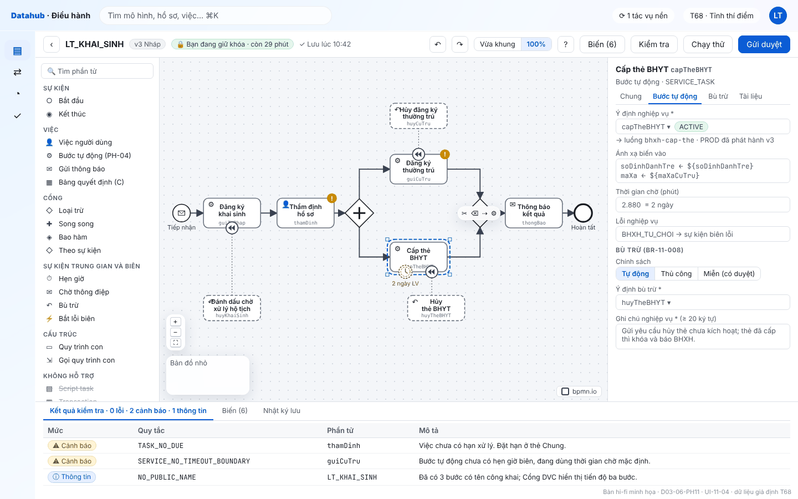
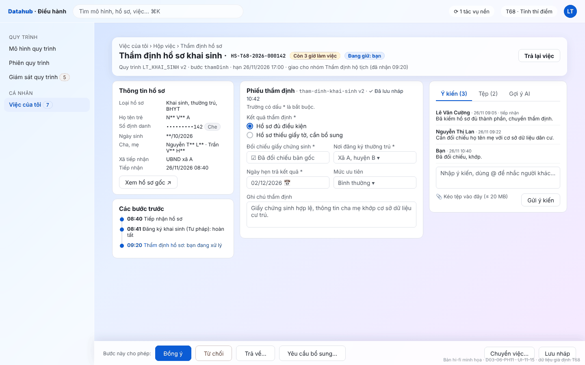

# D02-03-PH11 · Đặc tả yêu cầu chức năng Quy trình liên thông

## Tóm tắt cho hội đồng thẩm định

**Mục tiêu.** PH-11 trả lời câu hỏi "hồ sơ này phải làm gì tiếp theo, ai làm, hạn đến khi nào" cho những thủ tục hành chính đi qua nhiều cơ quan và kéo dài nhiều ngày. Phân hệ cho phép tỉnh vẽ quy trình theo chuẩn BPMN 2.0 (Business Process Model and Notation), duyệt và phát hành có hai người, chạy từng hồ sơ thành một phiên có trạng thái bền vững, giao việc cho cán bộ theo đơn vị, tính hạn theo ngày làm việc, gọi các hệ thống chuyên ngành qua lõi tích hợp PH-04, bù trừ khi một bước liên thông thất bại và báo tiến độ cho Cổng dịch vụ công mà không lộ dữ liệu cá nhân.

**Phạm vi.** 66 yêu cầu chức năng chia mười nhóm A…J (mục 1.2). Phân hệ chạy trong DU `dh-platform` (Spring Boot 4 + Modulith, package `vn.datahub.platform.bpm`) với Flowable 7.x nhúng (ADR-007). Quy trình ví dụ xuyên suốt là liên thông "Đăng ký khai sinh, đăng ký thường trú, cấp thẻ BHYT cho trẻ dưới 6 tuổi" (`LT_KHAI_SINH`), và quy trình nội bộ "Duyệt kết nạp HTTT hai cấp" (`DUYET_KET_NAP_HTTT`) do PH-01 khởi tạo qua API.

**Căn cứ pháp lý.** CMP-LAW-09 (Công văn 631: BPMN 2.0 và WS-BPEL); CMP-LAW-93 (NĐ 61/2018 sửa bởi NĐ 107/2021, văn bản thay thế còn phải đối chiếu, Q11-01); CMP-LAW-91, 92 (TTHC, dịch vụ công trực tuyến); CMP-LAW-05, 04 (dữ liệu cá nhân trong biến); CMP-LAW-06, 08 (cấp độ 3). Chi tiết ở mục 1.5.

**Những điểm hội đồng cần lưu ý.**

1. **Ranh giới với PH-04 là điểm thiết kế cốt lõi.** PH-11 quyết định "làm gì tiếp theo" (giờ đến tháng, có trạng thái, có người tham gia); PH-04 quyết định "làm bằng cách nào" (mili giây đến giây, gọi hệ thống). Bước tự động trong sơ đồ chỉ mang ý định nghiệp vụ như `guiTuPhap`; đổi cách gọi hệ thống không phải sửa sơ đồ (BR-11-002).
2. **Không dùng giao dịch phân tán giữa các cơ quan.** Khi một bước liên thông thất bại sau khi bước khác đã xong, phân hệ chạy bù trừ theo thứ tự ngược do nghiệp vụ định nghĩa; ví dụ khai sinh đã cấp thì không xóa mà đánh dấu chờ xử lý. Bù trừ không thành thì chuyển người xử lý, không bao giờ im lặng (BR-11-009, BR-11-012).
3. **Mọi phát hành mô hình, sửa biến, chuyển bước, di trú phiên cần hai người** (bốn mắt, FR-00-071); phiên đang chạy giữ phiên bản đã khởi tạo.
4. **Hạn xử lý tính theo ngày làm việc của từng tỉnh**, có ngày nghỉ, ngày làm bù và thời gian chờ bổ sung hồ sơ không bị tính vào hạn; đây là căn cứ báo cáo đúng hạn, trễ hạn.
5. **Đáp ứng CV 631 bằng BPMN 2.0**; hồ sơ tuân thủ thuyết minh BPMN kế thừa vai trò WS-BPEL và có phương án dự phòng nếu thẩm định bắt buộc BPEL (FR-11-064).

**Con số chính.**

| Chỉ số | Giá trị |
|---|---|
| Yêu cầu chức năng | 66 (M: 48, S: 16, C: 2) |
| Quy tắc nghiệp vụ | 38 (BR-11-001…038) |
| Yêu cầu phi chức năng | 24 (NFR-11-001…024) |
| Màn hình | 23 (UI-11-01…23) |
| API | 137 operation dự kiến (API-11-001…137) dưới `/api/bpm/v1` |
| Sự kiện | 21 (EVT-11-01…21), trong đó 19 do PH-11 phát, 2 PH-11 tiêu thụ từ PH-04 |
| Mã lỗi | 51 control (ERR-11-001…051), 25 runtime (ERR-11-101…125); `401`, `403`, `428` dùng mã nền ERR-00 |
| Thực thể mức logic | 28 (EN-11-01…28) |
| Tham số theo tenant | 36 khóa `11.*` (mục 8.2) |
| Chức năng hệ cũ được phủ | Hệ cũ không có BPM; 3 `LGC` liên quan gián tiếp (NGSP-002, NGSP-004, BUS-037) |
| Đợt | Đợt 2; MVP của phân hệ là 48 FR mức M |

: Con số chính của PH-11

## 1. Giới thiệu

### 1.1. Mục đích của tài liệu

Tài liệu đặc tả đầy đủ hành vi của PH-11 Quy trình liên thông để ba nhóm người đọc dùng ngay. Hội đồng thẩm định đánh giá sự cần thiết và mức đáp ứng CV 631, quy định một cửa liên thông. Kỹ sư dùng làm đầu vào cho D03-02, D03-03, D03-04-PH11. Kiểm thử viên dùng luồng, ngoại lệ, quy tắc, ngưỡng để viết ca ở D05-02-PH11.

Mỗi chức năng đặc tả theo khung 17 mục của K-TRINH-BAY §4. Phụ lục A là nguồn chuẩn của mọi giá trị liệt kê (enum) và danh sách thực thể dùng trong bộ bảy tập PH-11; tập sau đối chiếu theo đây, không tự đặt lại.

### 1.2. Phạm vi

PH-11 chịu trách nhiệm mười nhóm việc dưới đây; mỗi nhóm ứng với một mục ở chương 6.

Mười nhóm là A mô hình, B tài nguyên, C phiên, D bước tự động, E việc người dùng, F hạn xử lý, G Saga, H tiến độ, I giám sát, J quản trị; chức năng từng nhóm ở chương 5.

Những việc dưới đây liên quan nhưng không thuộc PH-11; tài liệu chỉ mô tả điểm giao tiếp với phân hệ chịu trách nhiệm.

| Không làm | Thuộc |
|---|---|
| Gọi hệ thống thành viên, chuyển đổi bản tin, thử lại kỹ thuật, ngắt mạch | PH-04 (luồng), PH-05 (bộ điều hợp) |
| Tiếp nhận hồ sơ từ công dân, cấp mã hồ sơ, gửi thông báo tới công dân | Cổng DVC tỉnh, HTTT một cửa; PH-03 chuyển lượt gọi vào trục |
| Xác thực người dùng, vai trò, cơ cấu đơn vị và nhóm | PH-12 |
| Hộp "Việc của tôi" dùng chung và bốn mắt dùng chung | FR-00-070…072 (PH-11 là nguồn việc) |
| Hạ tầng Kafka, đăng ký topic, giao nhận sự kiện tới HTTT | PH-10 |
| Lưu nhật ký kiểm toán tập trung WORM, bảng điều khiển vận hành tổng thể | PH-13 |
| Phân loại dữ liệu, chính sách che | PH-09 (PH-11 áp phân loại khai ở biến) |
| Lưu hồ sơ nghiệp vụ chi tiết (giấy khai sinh, hộ khẩu, thẻ BHYT) | HTTT chuyên ngành |
| Quyết định thay cán bộ bằng AI | Không làm; PH-17 chỉ gợi ý (FR-11-066) |

: Việc ngoài phạm vi PH-11 và phân hệ chịu trách nhiệm

### 1.3. Đối tượng sử dụng và cách đọc

Mỗi nhóm người đọc có lối vào riêng; bảng sau chỉ chương nên đọc để không phải đọc hết tài liệu.

| Người đọc | Đọc phần | Mục đích |
|---|---|---|
| Hội đồng thẩm định | Tóm tắt, chương 2, 5, 11, 14 | Sự cần thiết, CV 631, ranh giới với PH-04 |
| Lãnh đạo, cán bộ nghiệp vụ một cửa | Chương 2, mục 6.6 (việc), 6.7 (hạn), 6.9 (tiến độ), chương 10 | Biết việc phải làm, hạn, cách xử lý hồ sơ |
| Kỹ sư tích hợp (thiết kế quy trình) | Mục 6.2, 6.3, 6.5, 6.8, Phụ lục A | Vẽ, cấu hình, phát hành mô hình; ý định và bù trừ |
| Kỹ sư phát triển | Chương 4, 6, 7, 8, 9, Phụ lục A | Hiện thực engine, cầu nối PH-04, Saga, API, enum |
| Kiểm thử viên | Chương 6, 7, 8, 14 | Ca dương, ca âm, phân quyền, bốn mắt, hạn, bù trừ |
| Vận hành | Mục 6.10, 6.11, chương 8, 12 | Sự cố engine, tắc nghẽn, cảnh báo, lưu giữ |

: Người đọc và phần cần đọc của tài liệu PH-11

Chức năng dùng chung (đăng nhập, chọn tenant, danh sách chuẩn, kiểm toán chung, hộp "Việc của tôi", bốn mắt, hiển thị lỗi) theo nhóm FR-00 của D02-02 và không lặp lại ở đây.

### 1.4. Thuật ngữ và chữ viết tắt

Tài liệu dùng nhiều thuật ngữ của BPMN và của Flowable; bảng giải thích từng thuật ngữ để mọi chương hiểu thống nhất.

| Thuật ngữ, viết tắt | Giải thích |
|---|---|
| BPMN 2.0 | Chuẩn OMG về ký pháp và ngữ nghĩa thực thi mô hình quy trình nghiệp vụ, lưu dạng XML |
| WS-BPEL | Ngôn ngữ thực thi quy trình dịch vụ web (OASIS), thời SOAP; CV 631 nêu cùng BPMN |
| DMN | Decision Model and Notation, chuẩn bảng quyết định |
| Mô hình quy trình (process model) | Đối tượng nghiệp vụ có mã `processKey` ổn định, gồm nhiều phiên bản |
| Phiên bản mô hình | Một bản BPMN XML có số phiên bản, checksum, trạng thái; bản `PUBLISHED` được triển khai lên engine |
| Phiên quy trình (instance) | Một lần chạy mô hình cho một hồ sơ, xác định bằng `businessKey` (mã hồ sơ) |
| Bước (activity, phần tử) | Phần tử BPMN có `elementId`: việc người dùng, bước tự động, hẹn giờ, cổng rẽ nhánh… |
| Việc người dùng (user task) | Bước chờ cán bộ xử lý; hiện trong hộp "Việc của tôi" |
| Bước tự động (service task) | Bước giao cho PH-04 thực thi qua ý định nghiệp vụ |
| Ý định nghiệp vụ (service intent) | Tên hành động nghiệp vụ, ví dụ `guiTuPhap`, ánh xạ sang luồng PH-04 theo môi trường |
| Cổng (gateway) | Phần tử rẽ nhánh: loại trừ (exclusive), song song (parallel), bao hàm (inclusive), theo sự kiện |
| Thông điệp tương quan (message correlation) | Cách đưa một thông điệp từ bên ngoài tới đúng phiên đang chờ theo khóa tương quan |
| Saga, bù trừ (compensation) | Mẫu giữ nhất quán cuối cùng: mỗi bước xuôi có hành động bù trừ, chạy ngược khi lỗi |
| Engine | Bộ máy Flowable thực thi BPMN, nhúng trong `dh-platform`, bảng `ACT_*` ở schema `ph11_flowable` |
| Job, async executor | Đơn vị việc nền của Flowable (bước bất đồng bộ, hẹn giờ) và bộ thực thi có khóa trên CSDL |
| Sự cố engine (incident) | Job hết lượt thử, kết quả không tương quan được, phiên tắc; cần vận hành xử lý |
| Hạn xử lý, ngày làm việc | Hạn tính trên lịch làm việc của tenant, giờ `Asia/Ho_Chi_Minh` |
| Bốn mắt | Người duyệt khác người đề nghị (FR-00-071, ADR-046) |
| Outbox, inbox | Bảng ghi sự kiện trong cùng giao dịch rồi đẩy Kafka; bảng chống nhận trùng (ADR-042) |
| DVC, TTHC, HTTT | Dịch vụ công, thủ tục hành chính, hệ thống thông tin |
| DLCN, HC, NC | Dữ liệu cá nhân; mức phân loại Hạn chế (`RESTRICTED`), Nhạy cảm (`SENSITIVE`) theo DD-08 |
| TA, TO, IE, IA, AU, VW, PA, PO, CB | Vai trò ở mục 3.1; CB là cán bộ xử lý (người được giao việc), không phải vai trò riêng |
| p95, p99 | Phân vị 95, 99 của số đo |

: Thuật ngữ và chữ viết tắt của PH-11

### 1.5. Tài liệu tham chiếu

Các yêu cầu bám vào văn bản pháp lý, tài liệu dự án và quyết định kiến trúc dưới đây; cột cuối nói PH-11 dùng phần nào.

| Mã | Tài liệu | Dùng cho |
|---|---|---|
| CMP-LAW-09 | Công văn 631/THH-THHT ngày 21/5/2020 | BPMN 2.0, WS-BPEL (FR-11-064) |
| CMP-LAW-93 | NĐ 61/2018/NĐ-CP, sửa bởi NĐ 107/2021/NĐ-CP | Một cửa liên thông, tiến độ hồ sơ, hạn giải quyết |
| CMP-LAW-91, CMP-LAW-92 | NĐ 45/2020/NĐ-CP, NĐ 42/2022/NĐ-CP | Thực hiện TTHC điện tử, dịch vụ công trực tuyến |
| CMP-LAW-05, CMP-LAW-04 | Luật BVDLCN 91/2025/QH15, NĐ 356/2025/NĐ-CP | DLCN trong biến quy trình, tối thiểu hóa |
| CMP-LAW-06, CMP-LAW-08 | NĐ 331/2026, TCVN 14423:2026 | Kiểm soát truy cập, nhật ký, cấp độ 3 |
| D02-02 | SRS | FR-00 dùng chung (070…072 hộp việc, bốn mắt; 080 thông báo lỗi), REQ-11 |
| D02-08 | Ma trận phân quyền | `ROLE-*`, `PERM-11-*` |
| D02-01 | BRD | REQ-11, REQ-21; BP-01, BP-03, BP-06 |
| D03-01 | SAD | DU `dh-platform`, vùng Z3, Kafka, PostgreSQL |
| D02-03-PH04 | FRS Lõi tích hợp | Luồng nhận lệnh service task, trả kết quả |
| D02-03-PH10 | FRS Sự kiện | Đăng ký topic `{tenant}.bpm.*`, khởi tạo từ sự kiện |
| ADR-007 | Flowable cho quy trình nghiệp vụ và luồng duyệt | Lý do chọn Flowable nhúng |
| ADR-003, ADR-031, ADR-041, ADR-042, ADR-046 | RLS đa tenant, kiểm toán chuỗi băm, idempotency, outbox trong DU, bốn mắt | Cơ chế nền |
| ADR 110–114 (đề xuất) | Engine đa tenant; bpmn-js; service task qua Kafka; Saga; lịch làm việc | Mục 12.3, chưa có tệp ADR |
| `docs/07-srs/SRS-PH-11-bpm.md` | SRS cũ của repo (16 FR) | Nguồn nghiệp vụ, ánh xạ ở 11.3 |

: Tài liệu tham chiếu của PH-11

### 1.6. Cấu trúc tài liệu

Chương 2 nêu bối cảnh, mục tiêu, kiến trúc; chương 3 tác nhân, quyền; chương 4 khái niệm, thực thể, sáu máy trạng thái; chương 5 và 6 liệt kê, đặc tả 66 chức năng theo mười nhóm. Chương 7 đến 9 gom quy tắc, tham số, mã lỗi, sự kiện, API; chương 10 đến 14 giao diện, truy vết, phụ thuộc, câu hỏi mở, tiêu chí nghiệm thu. Phụ lục A là nguồn chuẩn enum và thực thể, B đề nghị đồng bộ, C nhật ký hấp thụ (bản 0.2).

## 2. Tổng quan phân hệ

Chương này viết cho hội đồng thẩm định và kiến trúc sư: vì sao tỉnh cần một bộ điều phối quy trình riêng, phân hệ đặt ở đâu trong kiến trúc, và một hồ sơ liên thông đi qua phân hệ như thế nào.

### 2.1. Bối cảnh và vấn đề cần giải quyết

Hệ LGSP cũ (Viettel 2021) chỉ chuyển bản tin giữa các hệ thống; nó không biết một hồ sơ liên thông đang ở bước nào, ai đang giữ, còn bao lâu đến hạn. Khi hồ sơ khai sinh liên thông đã đăng ký ở Tư pháp nhưng bước cấp thẻ BHYT thất bại, không có cơ chế nào quay lại xử lý phần đã làm, và cán bộ phải gọi điện đối chiếu. BRD ghi REQ-11 là năng lực mới.

| Hạn chế hiện nay | Hệ quả | Cách PH-11 khắc phục |
|---|---|---|
| Không có trạng thái quy trình; mỗi lượt gọi là một giao dịch rời | Không trả lời được "hồ sơ đang ở đâu"; công dân phải hỏi từng cơ quan | Phiên quy trình bền vững trên PostgreSQL, API tiến độ cho DVC (FR-11-055) |
| Liên thông nhiều cơ quan làm bằng công văn, thư điện tử | Chậm, mất dấu, không đo được đúng hạn | Mô hình BPMN có việc người dùng, phân công theo đơn vị, hạn theo ngày làm việc (nhóm E, F) |
| Một bước lỗi để lại dữ liệu lệch giữa các cơ quan | Hồ sơ khai sinh có số định danh nhưng không có thẻ BHYT, không ai biết | Saga bù trừ có nhật ký, bù trừ thất bại chuyển người xử lý (nhóm G) |
| Luồng duyệt nội bộ (kết nạp HTTT, phát hành) mỗi phân hệ tự làm | Lặp mã, không có một chỗ xem việc chờ | PH-01, PH-07, PH-19 khởi tạo quy trình duyệt qua API của PH-11 (ADR-007) |
| CV 631 đòi BPMN 2.0, WS-BPEL nhưng hệ cũ không có | Thiếu tiêu chí khi thẩm định nền tảng | Flowable BPMN 2.0, quy trình mẫu và hồ sơ tuân thủ (FR-11-064) |

: Hạn chế hiện nay, hệ quả và cách PH-11 khắc phục

### 2.2. Mục tiêu của phân hệ

Năm mục tiêu dưới đây đo được và gắn với NFR ở chương 8; nghiệm thu phân hệ dựa trên các chỉ tiêu này.

| # | Mục tiêu | Chỉ tiêu | NFR |
|---|---|---|---|
| 1 | Khởi tạo hồ sơ liên thông tức thì, không bắt kênh DVC chờ hết quy trình | p99 ≤ 200 ms cho API khởi tạo; 200 phiên/giây khi dồn | NFR-11-001, NFR-11-004 |
| 2 | Không mất trạng thái hồ sơ khi hạ tầng sự cố | 100% phiên tiếp tục đúng bước sau khởi động lại pod; RPO ≤ 5 phút | NFR-11-011, NFR-11-012, NFR-11-010 |
| 3 | Công dân biết tiến độ từng bước | Sự kiện tiến độ ≤ 10 s sau chuyển bước (p95); API tiến độ p99 ≤ 100 ms | NFR-11-018, NFR-11-006 |
| 4 | Đo và giảm trễ hạn | 100% việc có hạn theo lịch tenant; nhắc, quá hạn chậm tối đa 5 phút so với mốc | NFR-11-016 |
| 5 | Không để dữ liệu lệch giữa cơ quan mà không ai biết | Bù trừ bắt đầu ≤ 30 s sau lỗi bước; 100% bù trừ thất bại có việc thủ công và cảnh báo | NFR-11-017 |

: Mục tiêu đo được của PH-11 gắn NFR

### 2.3. Vị trí trong kiến trúc

PH-11 thuộc control plane, chạy trong DU `dh-platform` ở vùng Z3; engine Flowable nhúng cùng tiến trình. Phân hệ không gọi HTTT trực tiếp: mọi bước tự động là lệnh Kafka tới PH-04 ở data plane (Z4).

```{.mermaid caption="Vị trí của PH-11 trong kiến trúc Datahub"}
flowchart TB
  DVC["Cổng DVC tỉnh, HTTT một cửa (Z0)"] --> GW["PH-03 APISIX (Z1, Z2)"]
  UI["dh-console: /quy-trinh, /viec-cua-toi"] --> GW
  GW --> BPM["PH-11 trong dh-platform (Z3)<br/>Flowable 7 nhúng"]
  P01["PH-01, PH-07, PH-19<br/>khởi tạo quy trình duyệt"] --> BPM
  BPM <--> PG[("pg-core: ph11_bpm, ph11_flowable (Z5)")]
  BPM -- "outbox: service.requested" --> K[["Kafka (Z5)"]]
  K --> P04["PH-04 dh-runtime (Z4)<br/>luồng Camel"]
  P04 -- "service.completed, failed" --> K
  K --> BPM
  P04 --> P05["PH-05 bộ điều hợp → HTTT chuyên ngành"]
  BPM -.-> P12["PH-12 Keycloak, OPA, đơn vị"]
  BPM -.-> P13["PH-13 chỉ số, vết, kiểm toán"]
  K -.-> P10["PH-10 sự kiện cho HTTT đăng ký"]
```

Người đọc cần thấy hai đường tách biệt: đường đồng bộ ngắn (DVC hoặc cán bộ gọi API của PH-11 qua APISIX) và đường bất đồng bộ (PH-11 ghi lệnh vào outbox, PH-04 thực thi rồi trả kết quả qua Kafka). Nhờ vậy PH-04 hoặc HTTT chậm không làm treo giao dịch của engine, và PH-11 không cần biết địa chỉ thật của hệ thống chuyên ngành.

### 2.4. Kiến trúc thành phần và công nghệ

PH-11 là một module Spring Modulith gồm các thành phần dưới đây. Engine dùng một bộ máy Flowable cho mọi tenant, cô lập bằng `tenantId` của Flowable và lớp nghiệp vụ có RLS (đề xuất ADR 110).

| Thành phần | Trách nhiệm | Công nghệ |
|---|---|---|
| `bpm-model` | Mô hình, phiên bản, kiểm tra tĩnh, phát hành, nhập xuất | Spring, Flowable `RepositoryService`, XSD BPMN 2.0 |
| `bpm-designer` (giao diện) | Trình thiết kế nhúng, bảng thuộc tính, hiển thị lỗi kiểm tra | bpmn-js (bpmn.io, giữ logo bpmn.io), React, antd v6 (đề xuất ADR 111) |
| `bpm-engine` | Thực thi BPMN, async executor có khóa job trên CSDL, history level `audit` | Flowable 7.x nhúng, schema `ph11_flowable` |
| `bpm-runtime` | API phiên, chiếu `instance_index`, `task_index` từ sự kiện engine | Flowable event listener, `ph11_bpm` có RLS |
| `bpm-task` | Phân công, ủy quyền, nhận, hoàn thành, cấp việc cho hộp "Việc của tôi" | Flowable `TaskService`, PH-12 đơn vị, nhóm |
| `bpm-bridge` | Service task triggerable: ghi lệnh vào outbox, nhận kết quả qua inbox, `trigger` lại execution | Kafka, outbox, inbox (ADR-042, đề xuất ADR 112) |
| `bpm-saga` | Điều phối bù trừ, nhật ký Saga, đối soát | Sự kiện bù trừ BPMN, `saga_log` (đề xuất ADR 113) |
| `bpm-due` | Lịch làm việc, tính hạn, nhắc, leo thang, tạm dừng hạn | Bộ tính ngày làm việc, timer Flowable (đề xuất ADR 114) |
| `bpm-progress` | API tiến độ che DLCN, sự kiện tiến độ, lịch sử bước | Valkey đệm 30 s, `instance_index` |
| `bpm-ops` | Giám sát, sự cố, chỉ số, tham số, lưu giữ, bằng chứng | Micrometer, OpenTelemetry tới PH-13 |

: Thành phần và công nghệ của PH-11

Luồng chính của phân hệ là luồng F-07 của repo: liên thông khai sinh. Sơ đồ dưới vẽ luồng đầy đủ, gồm cả nhánh song song và nhánh bù trừ.

```{.mermaid caption="Trình tự liên thông khai sinh LT_KHAI_SINH (F-07) qua PH-11 và PH-04"}
sequenceDiagram
  autonumber
  actor CD as Công dân
  participant DVC as Cổng DVC
  participant BPM as PH-11
  participant K as Kafka
  participant P04 as PH-04
  participant TP as HT Tư pháp
  participant CA as HT Cư trú
  participant BH as HT BHXH
  actor CB as Cán bộ Tư pháp
  CD->>DVC: Nộp hồ sơ khai sinh liên thông
  DVC->>BPM: POST /instances, businessKey = mã hồ sơ (API-11-049)
  BPM-->>DVC: 201, instanceId, trạng thái RUNNING
  BPM->>K: EVT-11-17 service.requested, ý định guiTuPhap
  K->>P04: Lệnh, commandId
  P04->>TP: Gửi hồ sơ đăng ký khai sinh
  TP-->>P04: Đã tiếp nhận
  P04->>K: EVT-11-18 service.completed
  K->>BPM: Kết quả, trigger execution
  BPM->>CB: Việc thẩm định trong Việc của tôi
  CB->>BPM: Hoàn thành, quyết định APPROVE (API-11-076)
  BPM->>K: EVT-11-04 step.completed (tiến độ)
  par Đăng ký thường trú
    BPM->>K: service.requested, guiCuTru
    K->>P04: Lệnh
    P04->>CA: Đăng ký thường trú
    P04->>K: service.completed
  and Cấp thẻ BHYT
    BPM->>K: service.requested, capTheBHYT
    K->>P04: Lệnh
    P04->>BH: Đề nghị cấp thẻ
    P04->>K: service.failed, BHXH_TIMEOUT
  end
  K->>BPM: Kết quả hai nhánh
  BPM->>BPM: Nhánh BHYT lỗi nghiệp vụ, mở Saga (EVT-11-13)
  BPM->>K: Bù trừ huyDangKyThuongTru, danhDauChoXuLy
  BPM->>K: EVT-11-14 hoặc 15, EVT-11-04 tiến độ
  DVC->>BPM: GET /progress theo mã hồ sơ (API-11-104)
  BPM-->>DVC: Bước công khai, không có DLCN
```

Người đọc cần thấy ba điểm. Thứ nhất, DVC nhận `201` ngay sau khi phiên được ghi bền, không chờ cơ quan nào. Thứ hai, PH-11 chỉ phát ý định; PH-04 chọn bộ điều hợp, giao thức, thử lại. Thứ ba, khi nhánh BHYT thất bại sau khi nhánh thường trú đã xong, Saga bù trừ theo thứ tự ngược: hủy đăng ký thường trú, đánh dấu hồ sơ khai sinh chờ xử lý (không xóa văn bản đã phát hành); bước cấu hình "chờ thủ công" thì cán bộ xử lý thay vì bù trừ ngay. Mọi bước phát sự kiện tiến độ cho kênh DVC.

### 2.5. Quy trình nghiệp vụ liên quan

PH-11 là phân hệ điều phối nên tham gia nhiều quy trình của D02-01; bảng dưới ghi bước PH-11 đảm nhận trong từng quy trình.

| Quy trình | Bước có PH-11 |
|---|---|
| BP-01 Kết nạp HTTT và cấp quyền | PH-01 khởi tạo `DUYET_KET_NAP_HTTT`; PH-11 giao việc duyệt cấp phòng, cấp sở, tính hạn, trả kết quả cho PH-01 qua sự kiện |
| BP-02 Xây dựng và phát hành luồng tích hợp | Luồng PH-04 được ý định nghiệp vụ trỏ tới; PH-11 kiểm tra luồng đã phát hành trước khi phát hành mô hình |
| BP-03 Phát hành và đồng bộ danh mục | PH-07 có thể khởi tạo quy trình duyệt nhiều cấp qua PH-11 (ADR-007) |
| BP-06 Kết nối và khai thác dữ liệu quốc gia | Bước tự động gọi CSDL hộ tịch, cư trú, BHXH qua PH-04, PH-14 |
| BP-07 Giám sát, xử lý sự cố | Sự cố engine, tắc nghẽn, bù trừ thất bại đẩy cảnh báo về PH-13 |

: Quy trình nghiệp vụ có PH-11 tham gia

Vòng đời điển hình của một mô hình đi từ bản nháp đến phát hành, rồi sinh phiên cho từng hồ sơ cho đến khi ngừng dùng.

```{.mermaid caption="Vòng đời điển hình từ mô hình đến phiên quy trình"}
flowchart TB
  A["IE tạo mô hình, vẽ trên bpmn-js"] --> B["Kiểm tra tĩnh không còn lỗi"]
  B --> C["Gửi duyệt phát hành"]
  C --> D["IA duyệt, triển khai lên engine"]
  D --> E["Phiên bản PUBLISHED"]
  E --> F["Kênh DVC, PH-01 hoặc sự kiện khởi tạo phiên"]
  F --> G["Bước tự động qua PH-04, việc cán bộ, hẹn giờ"]
  G --> H{"Kết thúc"}
  H -->|"Thành công"| I["COMPLETED"]
  H -->|"Lỗi sau bước đã xong"| J["Saga bù trừ → COMPENSATED hoặc FAILED"]
  E --> K["Phiên bản mới phát hành → bản cũ DEPRECATED, hết phiên → RETIRED"]
```

Hình cho thấy một phiên bản đã phát hành có thể đang phục vụ nhiều phiên trong khi phiên bản mới hơn đã được phát hành; phiên cũ chạy tiếp trên phiên bản của mình cho đến khi kết thúc hoặc được di trú có duyệt (FR-11-026).

### 2.6. Chức năng hệ cũ được phủ

Hệ cũ không có BPM nên không có `LGC` nào do PH-11 thay thế trực tiếp. Ba chức năng dưới đây liên quan gián tiếp: PH-11 điều phối quy trình dùng các chức năng đó, còn kết luận chính nằm ở phân hệ khác (chi tiết ở 11.1).

Ba chức năng là LGC-NGSP-002 (hộ tịch), LGC-NGSP-004 (hồ sơ ĐVQHNS) và LGC-BUS-037 (xử lý lỗi, thực hiện lại); vai trò của PH-11 với từng chức năng ở 11.1.

## 3. Tác nhân, vai trò và quyền

Chương này xác định ai và hệ thống nào tương tác với PH-11, quyền nào cho phép làm gì, và những thao tác nào cần hai người. PH-11 không tạo vai trò mới; mọi quyền gán cho vai trò có sẵn ở D02-08.

### 3.1. Tác nhân

Tác nhân gồm người dùng có vai trò chuẩn, cán bộ được giao việc và các phân hệ, hệ thống gọi PH-11 bằng token dịch vụ.

| Tác nhân | Loại | Mô tả | Tương tác chính |
|---|---|---|---|
| Quản trị tỉnh (TA, ROLE-TENANT_ADMIN) | Người | Quản trị Datahub của tỉnh | Cấu hình lịch, tham số, lưu giữ; can thiệp phiên có duyệt; duyệt phát hành khi được giao |
| Vận hành tỉnh (TO, ROLE-TENANT_OPERATOR) | Người | Cán bộ trực vận hành | Giám sát, tạm dừng, hủy phiên, xử lý sự cố, bù trừ thủ công, giao lại việc |
| Kỹ sư tích hợp (IE, ROLE-INTEGRATION_ENGINEER) | Người | Người thiết kế quy trình cùng cán bộ nghiệp vụ | Vẽ mô hình, cấu hình bước, biểu mẫu, ý định, bù trừ, chạy thử, gửi duyệt |
| Người duyệt tích hợp (IA, ROLE-INTEGRATION_APPROVER) | Người | Lãnh đạo kỹ thuật được giao | Duyệt hoặc từ chối phát hành, ngừng dùng phiên bản |
| Kiểm toán (AU, ROLE-AUDITOR) | Người | Thanh tra, kiểm toán tỉnh | Xem lịch sử bước đầy đủ, nhật ký, xuất bằng chứng |
| Người xem (VW, ROLE-VIEWER) | Người | Lãnh đạo, cán bộ theo dõi | Xem bảng điều khiển, báo cáo hạn |
| Cán bộ xử lý (CB) | Người | Bất kỳ người dùng được giao việc theo người, nhóm, đơn vị của PH-12 | Nhận, xử lý, chuyển, trả về việc; ủy quyền khi vắng |
| Quản trị, vận hành nền tảng (PA, PO) | Người | Đơn vị vận hành nền tảng | PA quản lý mẫu `COMMON`, trần tham số; PO xem sự cố engine liên tenant có lý do |
| Cổng DVC tỉnh, HTTT một cửa | Hệ thống | Kênh tiếp nhận hồ sơ | Khởi tạo phiên (`bpm.instance.start`), tra tiến độ (`bpm.progress.read`), gửi bổ sung hồ sơ |
| PH-01, PH-02, PH-07, PH-19 | Hệ thống | Phân hệ có luồng duyệt nhiều cấp | Khởi tạo quy trình duyệt qua API, nhận kết quả qua sự kiện |
| PH-04 | Hệ thống | Lõi tích hợp | Nhận lệnh service task, trả kết quả (`bpm.service.worker`) |
| PH-10 | Hệ thống | Sự kiện | Sự kiện khởi tạo phiên, thông điệp tương quan; phân phối sự kiện `bpm.*` |
| PH-12, PH-13, PH-03, PH-17 | Hệ thống | Định danh; giám sát, kiểm toán; kênh ngoài; trợ lý AI | Người dùng, đơn vị, nhóm; chỉ số, vết; chuyển lượt gọi; gợi ý xử lý việc |

: Tác nhân của PH-11

### 3.2. Ma trận quyền

D02-08 §3.1 đã có mười quyền `PERM-11-*`. `PERM-11-model` nghĩa là soạn và gửi duyệt (IE, TA, PA cho mẫu `COMMON`); duyệt phát hành dùng `PERM-11-publish` để bảo đảm bốn mắt. Ký hiệu: ● có quyền, ○ trong phạm vi hạn chế ghi ở chú thích, — không.

| Quyền | Ý nghĩa | PA | PO | TA | TO | IE | IA | AU | VW | CB |
|---|---|---|---|---|---|---|---|---|---|---|
| PERM-11-read | Xem mô hình, phiên, việc, bảng điều khiển trong phạm vi | ○ | ○ | ● | ● | ● | ● | ● | ● | ○ |
| PERM-11-model | Tạo, thiết kế, cấu hình, chạy thử, gửi duyệt mô hình và tài nguyên | ○ | — | ● | — | ● | — | — | — | — |
| PERM-11-publish | Duyệt, từ chối phát hành; ngừng dùng, thu hồi phiên bản | — | — | ● | — | — | ● | — | — | — |
| PERM-11-task | Xử lý việc được giao | — | — | ● | ● | ● | ● | — | — | ● |
| PERM-11-instance | Khởi tạo thủ công, tạm dừng, tiếp tục, hủy phiên | — | — | ● | ● | — | — | — | — | — |
| PERM-11-instance-admin | Đề nghị, duyệt sửa biến, chuyển bước, di trú phiên | — | — | ● | — | — | — | — | — | — |
| PERM-11-task-admin | Phân công lại, giao lại hàng loạt | — | — | ● | ● | — | — | — | — | — |
| PERM-11-compensate | Kích hoạt bù trừ, xử lý bước Saga, sự cố engine, gửi lại lệnh | — | ○ | ● | ● | — | — | — | — | — |
| PERM-11-config | Lịch làm việc, tham số `11.*`, lưu giữ, quy tắc cảnh báo | ● | — | ● | — | — | — | — | — | — |
| PERM-11-audit-read | Lịch sử bước đầy đủ, nhật ký kiểm toán, xuất bằng chứng | — | — | ● | — | — | — | ● | — | — |

: Ma trận quyền của PH-11 theo vai trò

Chú thích phạm vi ○: PA chỉ với mẫu và tham số tenant `COMMON`; PO chỉ xem và thử lại sự cố engine khi có phiếu sự cố và lý do, không xem biến; CB chỉ xem phiên có việc của mình hoặc của đơn vị mình (BR-11-031). Thiếu quyền chức năng trả `403` với ERR-00-403, chưa xác thực trả `401` với ERR-00-401, thiếu `If-Match` trả `428` với ERR-00-428; `403` do phạm vi dữ liệu hoặc bốn mắt giữ mã ERR-11 (005, 020, 022, 034).

Xem giá trị biến phân loại `SENSITIVE` cần thêm `PERM-09-unmask` và nêu lý do; không có thì giá trị luôn bị che, kể cả với TA (BR-11-014).

### 3.3. Tách nhiệm vụ và tài khoản máy

Bốn mắt (FR-00-071, ADR-046) áp dụng cho: phát hành phiên bản mô hình (FR-11-008), ngừng dùng phiên bản đang có phiên chạy (FR-11-009), sửa biến phiên (FR-11-025), di trú phiên (FR-11-026), chuyển bước (FR-11-027), miễn bù trừ cho bước rủi ro (FR-11-014), phát hành mẫu `COMMON` (FR-11-015). Người duyệt phải khác người gửi và khác người sửa cuối bản nháp (ERR-11-005). Trong một phiên, người đã xử lý một bước duyệt không được nhận bước duyệt cấp sau nếu mô hình đánh dấu `separateFrom` (BR-11-020).

Cặp loại trừ đề nghị: IE và IA trên cùng một phiên bản mô hình; người đề nghị và người duyệt một `instance_change`. Hệ thống và phân hệ gọi PH-11 bằng token dịch vụ của PH-12 với scope dưới đây; mỗi client còn phải nằm trong danh sách được phép khởi tạo của từng mô hình (`allowedStarters`, ERR-11-020).

| Scope | Cấp cho | Cho phép |
|---|---|---|
| `bpm.instance.start` | Cổng DVC, HTTT một cửa, PH-01, PH-07, PH-19 | Khởi tạo phiên, gửi thông điệp tương quan, báo đã bổ sung hồ sơ |
| `bpm.instance.read` | Như trên, PH-13 | Đọc phiên do chính client khởi tạo (đã che) |
| `bpm.task.read` | HTTT một cửa có hộp việc riêng | Đọc danh sách việc của đơn vị, không đọc biến `SENSITIVE` |
| `bpm.progress.read` | Cổng DVC qua PH-03 | Tiến độ rút gọn theo `businessKey`, đã che DLCN |
| `bpm.service.worker` | PH-04 | Tiêu thụ lệnh `service.requested`, ghi kết quả `service.completed`, `.failed` |

: Scope dịch vụ của PH-11

## 4. Khái niệm và mô hình nghiệp vụ

Chương này định nghĩa các đối tượng nghiệp vụ mà mọi chức năng thao tác, quan hệ giữa chúng và vòng đời của sáu đối tượng có trạng thái. Tên trường và giá trị liệt kê chuẩn ở Phụ lục A.

### 4.1. Khái niệm nghiệp vụ

Một **mô hình quy trình** (`processKey`, ví dụ `LT_KHAI_SINH`) có nhiều **phiên bản**. Mỗi phiên bản là một tệp BPMN 2.0 XML, kèm cấu hình bước, biến, biểu mẫu, bù trừ. Chỉ phiên bản `PUBLISHED` được triển khai lên engine và sinh phiên; mỗi mô hình có tối đa một phiên bản `PUBLISHED` nhận phiên mới.

Một **phiên** là một lần chạy cho một hồ sơ, khóa nghiệp vụ là `businessKey` (mã hồ sơ của kênh DVC, ví dụ `HS-T68-2026-000142`). Phiên đi qua các **bước**; bước người dùng sinh **việc**, bước tự động sinh **lệnh service task** tới PH-04 với **ý định nghiệp vụ**. Mỗi bước có thể có **hạn**; hạn phiên là hạn giải quyết hồ sơ theo TTHC, hạn việc là hạn của từng cán bộ.

Khi bước lỗi sau khi bước khác đã xong, **Saga** chạy các **hành động bù trừ** đã đăng ký theo thứ tự ngược và ghi **nhật ký Saga**. Lỗi kỹ thuật của engine (job hết lượt thử, kết quả không khớp) thành **sự cố** để vận hành xử lý.

| Khái niệm | Ví dụ trong `LT_KHAI_SINH` |
|---|---|
| Bước tự động | `guiTuPhap` (đăng ký khai sinh), `guiCuTru` (đăng ký thường trú), `capTheBHYT` |
| Việc người dùng | "Thẩm định hồ sơ khai sinh" giao nhóm `TP_HOTICH` của UBND xã; "Xử lý bù trừ thủ công" giao TO |
| Cổng | Song song sau khi khai sinh đã có số định danh: thường trú và BHYT chạy cùng lúc |
| Hẹn giờ biên | Hết 2 ngày làm việc không có kết quả BHXH: nhắc và mở sự cố |
| Bù trừ | `capTheBHYT` ↔ `huyTheBHYT`; `guiCuTru` ↔ `huyDangKyThuongTru`; `guiTuPhap` ↔ `danhDauChoXuLy` (không xóa) |
| Hạn phiên | 5 ngày làm việc từ lúc tiếp nhận (giả định theo TTHC liên thông, tham số mô hình) |

: Khái niệm nghiệp vụ minh họa bằng quy trình liên thông khai sinh

### 4.2. Thực thể

PH-11 có 28 thực thể mức logic trong schema `ph11_bpm` (RLS theo `tenant_id`). Trạng thái thực thi gốc nằm ở bảng `ACT_*` của Flowable trong schema `ph11_flowable`; `instance_index`, `task_index` là bản chiếu để truy vấn có RLS, cập nhật sau khi engine cam kết (hai nguồn kết nối, nguyên tử về hiệu ứng, Q11-21). Trường chính ở Phụ lục A.2.

Danh sách 28 thực thể (EN-11-01…28) và trường chính ở Phụ lục A.2; sơ đồ dưới chỉ các quan hệ chính.

```{.mermaid caption="Quan hệ giữa các thực thể chính của PH-11"}
flowchart TB
  M["process_model"] --> V["process_version"]
  V --> VD["variable_definition"]
  V --> CA["compensation_action"]
  V --> PR["publish_request"]
  V -.-> FD["form_definition"]
  V -.-> SI["service_intent"]
  V --> II["instance_index"]
  II --> TI["task_index"]
  TI --> TC["task_comment, task_attachment"]
  II --> SC["service_call"]
  II --> DT["due_tracking"]
  TI --> DT
  II --> SL["saga_log"] --> SS["saga_step"]
  II --> IN["incident"]
  BC["business_calendar"] --> CD["calendar_day"]
  BC -.-> DT
```

Mũi tên liền là quan hệ sở hữu (một nhiều), mũi tên đứt là tham chiếu theo mã: phiên bản tham chiếu biểu mẫu, ý định theo mã và phiên bản đã phát hành, nên một biểu mẫu dùng được ở nhiều mô hình; hạn tính theo lịch nhưng không sở hữu lịch.

### 4.3. Máy trạng thái phiên bản mô hình

Phiên bản mô hình là đối tượng được duyệt nên vòng đời có bước duyệt bốn mắt; bản đã phát hành không bao giờ sửa lại (BR-11-005).

```{.mermaid caption="Trạng thái phiên bản mô hình quy trình"}
stateDiagram-v2
  [*] --> DRAFT: Tạo, nhập, sao chép
  DRAFT --> IN_REVIEW: Gửi duyệt (FR-11-007)
  IN_REVIEW --> DRAFT: Từ chối, rút lại
  IN_REVIEW --> PUBLISHED: Duyệt và triển khai thành công (FR-11-008)
  PUBLISHED --> DEPRECATED: Bản mới phát hành hoặc ngừng dùng (FR-11-009)
  DEPRECATED --> PUBLISHED: Khôi phục khi chưa có bản mới
  DEPRECATED --> RETIRED: Không còn phiên chạy
  PUBLISHED --> RETIRED: Thu hồi có duyệt, không còn phiên
  RETIRED --> [*]
```

`DRAFT` sửa được, có khóa soạn thảo một người. `IN_REVIEW` bất biến, chờ duyệt. `PUBLISHED` đã triển khai lên engine, nhận phiên mới. `DEPRECATED` không nhận phiên mới nhưng phiên đang chạy tiếp tục. `RETIRED` không còn phiên chạy, chỉ còn để tra cứu và kiểm toán; định nghĩa trong engine được tạm ngừng (`suspendProcessDefinition`).

### 4.4. Máy trạng thái phiên quy trình

Phiên có bảy trạng thái chính; trường phụ `waitState` cho biết phiên đang chờ gì khi `RUNNING` (`WAITING_USER`, `WAITING_SERVICE`, `WAITING_MESSAGE`, `WAITING_TIMER`, `NONE`), giữ lại các trạng thái chờ của SRS cũ mà không làm máy trạng thái phình ra.

```{.mermaid caption="Trạng thái phiên quy trình"}
stateDiagram-v2
  [*] --> RUNNING: Khởi tạo (FR-11-018…020)
  RUNNING --> SUSPENDED: Tạm dừng (FR-11-023)
  SUSPENDED --> RUNNING: Tiếp tục
  RUNNING --> COMPLETED: Đến sự kiện kết thúc
  RUNNING --> COMPENSATING: Lỗi bước có bước đã xong, hủy kèm bù trừ
  COMPENSATING --> COMPENSATED: Mọi bước bù trừ DONE hoặc SKIPPED
  COMPENSATING --> FAILED: Có bước bù trừ MANUAL chưa xử lý xong
  FAILED --> COMPENSATED: Vận hành xử lý xong bước thủ công
  RUNNING --> CANCELLED: Hủy không bù trừ
  SUSPENDED --> CANCELLED: Hủy
  RUNNING --> FAILED: Lỗi không bù trừ được
  COMPLETED --> [*]
  CANCELLED --> [*]
  COMPENSATED --> [*]
```

`RUNNING` đang thực thi hoặc chờ. `SUSPENDED` dừng có chủ đích: job, hẹn giờ không chạy, việc không hoàn thành được; hạn phiên tạm dừng nếu lý do là `LEGAL_SUSPENSION`. `COMPENSATING` đang bù trừ, mọi thao tác can thiệp bị chặn (ERR-11-030). `COMPENSATED` đã bù trừ xong. `FAILED` cần người xử lý; phiên vẫn hiện ở UI-11-20, UI-11-21. `COMPLETED` và `CANCELLED` là kết thúc.

### 4.5. Máy trạng thái việc người dùng

Việc là đơn vị công việc của cán bộ; trạng thái quyết định ai được thấy và ai được hoàn thành.

```{.mermaid caption="Trạng thái việc người dùng"}
stateDiagram-v2
  [*] --> UNASSIGNED: Tạo với nhóm hoặc đơn vị ứng viên
  [*] --> ASSIGNED: Tạo với người cụ thể
  UNASSIGNED --> ASSIGNED: Nhận việc, phân công
  ASSIGNED --> UNASSIGNED: Trả lại việc
  ASSIGNED --> ASSIGNED: Chuyển cho người khác
  ASSIGNED --> DELEGATED: Ủy quyền vắng mặt có hiệu lực
  DELEGATED --> ASSIGNED: Hết ủy quyền, người nhận trả lại
  ASSIGNED --> COMPLETED: Hoàn thành
  DELEGATED --> COMPLETED: Người được ủy quyền hoàn thành
  UNASSIGNED --> CANCELLED: Phiên hủy, bước bị bỏ qua
  ASSIGNED --> CANCELLED: Phiên hủy, chuyển bước, hẹn giờ biên ngắt
  COMPLETED --> [*]
  CANCELLED --> [*]
```

`UNASSIGNED` mọi ứng viên thấy trong hộp việc. `ASSIGNED` chỉ người nhận thao tác. `DELEGATED` người nhận ủy quyền thao tác thay, người gốc vẫn thấy. `COMPLETED` có kết quả, ý kiến; `CANCELLED` không còn hiệu lực và rút khỏi hộp việc trong 5 giây (NFR-11-015).

### 4.6. Máy trạng thái hạn xử lý

Mỗi `due_tracking` của phiên hoặc việc đi qua bốn trạng thái theo thời gian; khi đóng, trường `dueResult` ghi `MET` hoặc `MISSED`.

```{.mermaid caption="Trạng thái hạn xử lý của phiên và việc"}
stateDiagram-v2
  [*] --> ON_TIME: Tính hạn (FR-11-046)
  ON_TIME --> DUE_SOON: Còn dưới 11.task.dueSoonHours giờ làm việc
  DUE_SOON --> OVERDUE: Qua hạn
  ON_TIME --> PAUSED: Chờ bổ sung hồ sơ, tạm dừng pháp lý
  DUE_SOON --> PAUSED: Chờ bổ sung
  OVERDUE --> PAUSED: Chờ bổ sung
  PAUSED --> ON_TIME: Đã bổ sung, hạn dời
  PAUSED --> DUE_SOON: Đã bổ sung, hạn dời còn ít
  PAUSED --> OVERDUE: Đã bổ sung, vẫn quá hạn
  ON_TIME --> [*]: Đóng, MET
  DUE_SOON --> [*]: Đóng, MET
  OVERDUE --> [*]: Đóng, MISSED
```

`ON_TIME` còn nhiều thời gian. `DUE_SOON` đã nhắc (FR-11-047). `OVERDUE` đã quá hạn, leo thang theo chính sách (FR-11-048). `PAUSED` không đếm thời gian; tổng thời gian tạm dừng cộng vào hạn khi tiếp tục (BR-11-018).

### 4.7. Máy trạng thái bước Saga

Mỗi bước bù trừ trong một lần Saga có trạng thái riêng; `saga_log` tổng hợp thành `RUNNING`, `SUCCEEDED`, `PARTIAL`, `FAILED`.

```{.mermaid caption="Trạng thái bước bù trừ trong Saga"}
stateDiagram-v2
  [*] --> PENDING: Lập danh sách bước cần bù trừ
  PENDING --> SKIPPED: Bước xuôi chưa xong hoặc chính sách NONE_APPROVED
  PENDING --> RUNNING: Gửi lệnh bù trừ tới PH-04
  RUNNING --> DONE: Kết quả thành công và đã ghi nhật ký
  RUNNING --> FAILED: Lỗi, còn lượt thử
  FAILED --> RUNNING: Thử lại sau 11.saga.retryBackoffSeconds
  FAILED --> MANUAL: Hết lượt thử hoặc chính sách MANUAL
  PENDING --> MANUAL: Chính sách MANUAL
  MANUAL --> DONE: Vận hành xác nhận đã xử lý
  MANUAL --> SKIPPED: Vận hành bỏ qua có lý do, duyệt
  DONE --> [*]
  SKIPPED --> [*]
```

`PENDING` chờ đến lượt theo thứ tự ngược. `RUNNING` đã gửi lệnh. `DONE` chỉ đặt khi nhật ký đã ghi (BR-11-013). `FAILED` là trạng thái trung gian khi còn lượt thử. `MANUAL` có việc xử lý thủ công cho TO và cảnh báo P1. `SKIPPED` không cần hoặc không thể bù trừ, có lý do.

### 4.8. Máy trạng thái sự cố engine

Sự cố mở khi job Flowable hết lượt thử, kết quả service task không tương quan được, hẹn giờ lỗi hoặc phiên tắc quá ngưỡng.

```{.mermaid caption="Trạng thái sự cố engine"}
stateDiagram-v2
  [*] --> OPEN: Job hết lượt thử, tắc, không tương quan
  OPEN --> RETRYING: Vận hành thử lại (FR-11-060)
  RETRYING --> RESOLVED: Job chạy thành công
  RETRYING --> OPEN: Thử lại vẫn lỗi
  OPEN --> IGNORED: Bỏ qua có lý do
  OPEN --> RESOLVED: Nguyên nhân hết (phiên bị hủy, bù trừ xong)
  RESOLVED --> [*]
  IGNORED --> [*]
```

`OPEN` hiện ở UI-11-20 và đẩy cảnh báo. `RETRYING` đã đặt lại số lượt thử của job. `RESOLVED` hết lỗi. `IGNORED` đóng mà không chạy lại, bắt buộc lý do và chỉ dùng khi phiên đã được xử lý bằng cách khác.

## 5. Danh sách chức năng

PH-11 có 66 chức năng chia mười nhóm theo khung cố định của bộ tài liệu; số thứ tự giữ ổn định để các tập UC, SDD, API, MH, TC dẫn chiếu. Đợt 2 là đợt của cả phân hệ; MVP của PH-11 gồm 48 chức năng mức M, mức S làm trong cùng đợt sau MVP, mức C là tùy chọn.

| Mã | Nhóm | Chức năng | Mức | Đợt | Màn hình |
|---|---|---|---|---|---|
| FR-11-001 | A Mô hình | Liệt kê, tìm kiếm mô hình quy trình | M | 2 | UI-11-01 |
| FR-11-002 | A | Tạo mô hình (trống, từ mẫu, nhập tệp BPMN) | M | 2 | UI-11-02 |
| FR-11-003 | A | Thiết kế sơ đồ BPMN 2.0 trên trình thiết kế | M | 2 | UI-11-04 |
| FR-11-004 | A | Cấu hình thuộc tính bước | M | 2 | UI-11-04 |
| FR-11-005 | A | Kiểm tra tĩnh mô hình | M | 2 | UI-11-04 |
| FR-11-006 | A | Quản lý phiên bản nháp, so sánh hai phiên bản | M | 2 | UI-11-03, UI-11-05 |
| FR-11-007 | A | Gửi duyệt phát hành mô hình | M | 2 | UI-11-04, UI-11-03 |
| FR-11-008 | A | Duyệt hoặc từ chối phát hành, triển khai lên engine | M | 2 | UI-11-07 |
| FR-11-009 | A | Ngừng dùng, thu hồi phiên bản | M | 2 | UI-11-03 |
| FR-11-010 | A | Nhập, xuất tệp BPMN 2.0 XML và gói quy trình | M | 2 | UI-11-02, UI-11-03 |
| FR-11-011 | A | Chạy thử mô hình với service task giả lập | S | 2 | UI-11-06 |
| FR-11-012 | B Tài nguyên | Quản lý biểu mẫu việc người dùng | M | 2 | UI-11-08 |
| FR-11-013 | B | Đăng ký ý định nghiệp vụ và ánh xạ sang luồng PH-04 | M | 2 | UI-11-09 |
| FR-11-014 | B | Đăng ký hành động bù trừ theo bước | M | 2 | UI-11-09, UI-11-04 |
| FR-11-015 | B | Quản lý mẫu quy trình dùng chung | S | 2 | UI-11-10 |
| FR-11-016 | B | Khai báo biến quy trình và phân loại dữ liệu | M | 2 | UI-11-04 |
| FR-11-017 | B | Bảng quyết định DMN đơn giản cho rẽ nhánh | C | 2 | UI-11-04 |
| FR-11-018 | C Phiên | Khởi tạo phiên qua API | M | 2 | Không (API) |
| FR-11-019 | C | Khởi tạo phiên từ sự kiện PH-10 | S | 2 | UI-11-04 |
| FR-11-020 | C | Khởi tạo phiên thủ công trên giao diện | S | 2 | UI-11-13 |
| FR-11-021 | C | Liệt kê, tìm kiếm phiên | M | 2 | UI-11-11 |
| FR-11-022 | C | Xem chi tiết phiên | M | 2 | UI-11-12 |
| FR-11-023 | C | Tạm dừng, tiếp tục phiên | M | 2 | UI-11-12 |
| FR-11-024 | C | Hủy phiên kèm bù trừ tùy chọn | M | 2 | UI-11-12 |
| FR-11-025 | C | Sửa biến phiên có kiểm soát | S | 2 | UI-11-12 |
| FR-11-026 | C | Di trú phiên sang phiên bản mô hình mới | S | 2 | UI-11-14 |
| FR-11-027 | C | Chuyển phiên tới bước khác | S | 2 | UI-11-12 |
| FR-11-028 | D Tự động | Gửi lệnh thực thi service task tới PH-04 | M | 2 | UI-11-12 |
| FR-11-029 | D | Nhận kết quả, lỗi service task và tương quan | M | 2 | UI-11-12, UI-11-20 |
| FR-11-030 | D | Chờ thông điệp, sự kiện | M | 2 | UI-11-12 |
| FR-11-031 | D | Hẹn giờ khởi tạo, trung gian, biên | M | 2 | UI-11-04, UI-11-12 |
| FR-11-032 | D | Gửi thông báo từ quy trình | S | 2 | UI-11-04 |
| FR-11-033 | D | Gọi quy trình con | S | 2 | UI-11-12 |
| FR-11-034 | E Việc | Tạo việc và phân công | M | 2 | UI-11-15 |
| FR-11-035 | E | Đăng ký việc vào hộp "Việc của tôi" | M | 2 | `/viec-cua-toi` |
| FR-11-036 | E | Nhận việc, trả lại việc | M | 2 | UI-11-15 |
| FR-11-037 | E | Xem chi tiết việc và hồ sơ liên quan | M | 2 | UI-11-15 |
| FR-11-038 | E | Hoàn thành việc với biểu mẫu, ý kiến, quyết định | M | 2 | UI-11-15 |
| FR-11-039 | E | Lưu nháp kết quả việc | S | 2 | UI-11-15 |
| FR-11-040 | E | Chuyển việc cho người khác | M | 2 | UI-11-15 |
| FR-11-041 | E | Ủy quyền khi vắng mặt | S | 2 | UI-11-17 |
| FR-11-042 | E | Phân công lại hàng loạt | S | 2 | UI-11-16 |
| FR-11-043 | E | Đính kèm tệp, trao đổi ý kiến trên việc | S | 2 | UI-11-15 |
| FR-11-044 | E | Trả về bước trước, yêu cầu bổ sung hồ sơ | M | 2 | UI-11-15 |
| FR-11-045 | F Hạn | Quản lý lịch làm việc theo tenant | M | 2 | UI-11-18 |
| FR-11-046 | F | Tính hạn xử lý theo ngày làm việc | M | 2 | UI-11-12, UI-11-15 |
| FR-11-047 | F | Nhắc hạn trước hạn | M | 2 | `/viec-cua-toi` |
| FR-11-048 | F | Xử lý quá hạn, leo thang | M | 2 | UI-11-19 |
| FR-11-049 | F | Tạm dừng tính hạn khi chờ bổ sung | M | 2 | UI-11-12 |
| FR-11-050 | F | Báo cáo đúng hạn, trễ hạn | S | 2 | UI-11-22 |
| FR-11-051 | G Saga | Điều phối bù trừ khi lỗi bước | M | 2 | UI-11-12, UI-11-21 |
| FR-11-052 | G | Theo dõi nhật ký Saga | M | 2 | UI-11-21 |
| FR-11-053 | G | Xử lý bù trừ thất bại | M | 2 | UI-11-21 |
| FR-11-054 | G | Đối soát bù trừ định kỳ | S | 2 | UI-11-21 |
| FR-11-055 | H Tiến độ | Cung cấp tiến độ hồ sơ cho kênh DVC | M | 2 | Không (API) |
| FR-11-056 | H | Phát sự kiện tiến độ | M | 2 | Không (sự kiện) |
| FR-11-057 | H | Tra lịch sử bước phục vụ kiểm toán | M | 2 | UI-11-12 |
| FR-11-058 | I Giám sát | Bảng điều khiển giám sát quy trình | M | 2 | UI-11-19 |
| FR-11-059 | I | Phát hiện tắc nghẽn bước | S | 2 | UI-11-19 |
| FR-11-060 | I | Quản lý sự cố engine và thử lại | M | 2 | UI-11-20 |
| FR-11-061 | I | Chỉ số và cảnh báo vận hành | M | 2 | UI-11-23 |
| FR-11-062 | J Quản trị | Cấu hình tham số `11.*` theo tenant | M | 2 | UI-11-23 |
| FR-11-063 | J | Lưu giữ, dọn lịch sử phiên | M | 2 | UI-11-23 |
| FR-11-064 | J | Xuất bằng chứng tuân thủ BPMN 2.0 | M | 2 | UI-11-23 |
| FR-11-065 | J | Xem nhật ký kiểm toán phân hệ | M | 2 | UI-11-23 |
| FR-11-066 | J | Gợi ý xử lý việc bằng AI | C | 2 | UI-11-15 |

: Danh sách chức năng của PH-11

## 6. Đặc tả chi tiết chức năng

Chương này viết cho kỹ sư và kiểm thử viên. Mỗi nhóm mở bằng đoạn văn và sơ đồ quan hệ giữa các chức năng; mỗi chức năng là một bảng đặc tả 17 mục, kèm bảng dữ liệu vào khi có từ năm trường và sơ đồ trình tự khi có từ ba thành phần hoặc có duyệt bốn mắt.

### 6.1. Cách đọc bảng đặc tả

Bảng đặc tả hai cột gồm 17 mục cố định, kết hợp 12 trường kỹ thuật của D00-01 §4.3 và các mục thuyết minh; mục không áp dụng ghi "Không".

| Mục | Nội dung | Nguồn |
|---|---|---|
| Mục đích | Chức năng giúp ai làm được việc gì, vì sao cần | Mẫu thuyết minh |
| Tác nhân, quyền | Vai trò thực hiện và `PERM` hoặc scope | D00-01 §4.3 |
| Mức ưu tiên, đợt | M, S, C; đợt phát hành | D00-01 §4.3, mẫu |
| Truy vết | REQ, LGC, FR cũ của repo (ghi "repo FR-11-0nn"), ADR | D00-01 §4.3 |
| Tiền điều kiện | Trạng thái phải đúng trước khi chạy | D00-01 §4.3 |
| Kích hoạt | Thao tác hoặc sự kiện khởi động | Mẫu thuyết minh |
| Đầu vào | Tham số, trường nhập (bảng riêng khi từ năm trường) | D00-01 §4.3 |
| Luồng xử lý chính | Bước đánh số, bước kiểm tra ghi mã lỗi | Cả hai |
| Luồng thay thế | Nhánh hợp lệ khác | Mẫu thuyết minh |
| Luồng ngoại lệ | Mã lỗi, HTTP, câu thông báo | Cả hai |
| Đầu ra | Mã HTTP, trường trả về | D00-01 §4.3 |
| Kết quả | Điều người dùng nhận được | Mẫu thuyết minh |
| Hậu điều kiện | Trạng thái dữ liệu sau khi xong | D00-01 §4.3 |
| Sự kiện phát ra | `EVT` | D00-01 §4.3 |
| Kiểm toán | Có ghi không, trường được ghi | D00-01 §4.3 |
| Quy tắc nghiệp vụ | `BR` áp dụng | Cả hai |
| Màn hình, API | `UI`, `API` (nguồn chuẩn ở 9.4) | Mẫu thuyết minh |

: Các mục của bảng đặc tả chức năng PH-11

Ví dụ dùng tenant `T68` (topic `t68.`), mô hình `LT_KHAI_SINH` và `DUYET_KET_NAP_HTTT`, hồ sơ `HS-T68-2026-000142`. Dữ liệu cá nhân trong ví dụ là giả lập; số định danh dùng dải `0010990xxxxx` không có thật. Mọi API dùng tiền tố `/api/bpm/v1`; thao tác ghi cần `Idempotency-Key` (ADR-041), thao tác sửa cần `If-Match`. Mọi lỗi trả thân RFC 9457 kèm `code`, `traceId`.

### 6.2. Nhóm A · Mô hình quy trình

Nhóm A cho phép kỹ sư tích hợp cùng cán bộ nghiệp vụ mô tả quy trình mà không viết mã: vẽ sơ đồ BPMN 2.0 trên bpmn-js, gắn thuộc tính cho từng bước, kiểm tra tĩnh ở máy chủ, rồi gửi duyệt. Chỉ phiên bản được người thứ hai duyệt mới lên engine. Phiên bản đã phát hành bất biến; muốn sửa thì tạo nháp mới.

```{.mermaid caption="Quan hệ giữa các chức năng nhóm A"}
flowchart TB
  F001["FR-11-001 Danh sách"] --> F002["FR-11-002 Tạo mô hình"]
  F010["FR-11-010 Nhập, xuất"] --> F002
  F002 --> F003["FR-11-003 Thiết kế sơ đồ"]
  F003 --> F004["FR-11-004 Thuộc tính bước"]
  F004 --> F005["FR-11-005 Kiểm tra tĩnh"]
  F005 --> F011["FR-11-011 Chạy thử"]
  F005 --> F007["FR-11-007 Gửi duyệt"]
  F006["FR-11-006 Phiên bản, so sánh"] --> F007
  F007 --> F008["FR-11-008 Duyệt, triển khai"]
  F008 --> F009["FR-11-009 Ngừng dùng, thu hồi"]
```

Đường chính là 002 → 003 → 004 → 005 → 007 → 008; kiểm tra tĩnh chạy lại bắt buộc ở bước gửi duyệt và bước triển khai, nên một bản nháp không thể lên engine nếu còn lỗi mức `ERROR`.

#### FR-11-001 · Liệt kê, tìm kiếm mô hình quy trình

::: dac-ta
**Mục đích.** Cho người thiết kế, người duyệt và vận hành tìm nhanh mô hình theo mã, tên, nhóm nghiệp vụ, trạng thái phiên bản để mở thiết kế, xem phiên hoặc duyệt.

**Tác nhân, quyền.** TA, TO, IE, IA, AU, VW (`PERM-11-read`).

**Mức ưu tiên, đợt.** M · Đợt 2.

**Truy vết.** REQ-11; repo FR-11-001; FR-00 danh sách chuẩn.

**Tiền điều kiện.** Người dùng đã đăng nhập, chọn tenant (FR-00-004).

**Kích hoạt.** Mở menu "Quy trình › Mô hình quy trình" (`/quy-trinh/mo-hinh`).

**Đầu vào.** `q` (tìm không dấu trên mã, tên, 1…100 ký tự), `group`, `status` (trạng thái phiên bản mới nhất), `hasPublished`, `owner`, `page`, `size` (≤ 100), `sort`.

**Luồng xử lý chính.**

1. Người dùng nhập điều kiện lọc; giao diện gọi API sau 300 ms ngừng gõ.
2. Hệ thống kiểm tham số (sai miền, `size` > 100: ERR-11-003).
3. Hệ thống truy vấn `process_model` của tenant hiện hành, ghép phiên bản mới nhất, phiên bản `PUBLISHED`, số phiên đang chạy từ `instance_index`.
4. Hệ thống trả trang kết quả kèm `facets` (đếm theo nhóm, trạng thái).

**Luồng thay thế.** Bật "Gồm mẫu dùng chung": thêm mẫu `PUBLISHED` của `COMMON` ở nhóm riêng, chỉ có nút "Tạo từ mẫu".

**Luồng ngoại lệ.**

- Tham số sai: ERR-11-003 (400); "Điều kiện lọc không hợp lệ: {trường}. Kiểm tra lại giá trị."

**Đầu ra.** `200`; `items[]` (`processKey`, `name`, `group`, `latestVersion`, `latestStatus`, `publishedVersion`, `runningInstances`, `updatedAt`), `page`, `size`, `totalElements`, `facets`.

**Kết quả.** Người dùng thấy danh sách mô hình, biết mô hình nào đang chạy, mô hình nào đang chờ duyệt.

**Hậu điều kiện.** Không thay đổi dữ liệu.

**Sự kiện phát ra.** Không.

**Kiểm toán.** Không.

**Quy tắc nghiệp vụ.** BR-11-031.

**Màn hình, API.** UI-11-01; API-11-001, API-11-002.
:::

#### FR-11-002 · Tạo mô hình quy trình

::: dac-ta
**Mục đích.** Cho kỹ sư tạo mô hình mới bằng ba cách: sơ đồ trống, sao chép từ mẫu dùng chung, nhập tệp BPMN 2.0 có sẵn; mô hình mới luôn bắt đầu bằng phiên bản 1 ở trạng thái `DRAFT`.

**Tác nhân, quyền.** IE, TA (`PERM-11-model`).

**Mức ưu tiên, đợt.** M · Đợt 2.

**Truy vết.** REQ-11; repo FR-11-001.

**Tiền điều kiện.** Mã `processKey` chưa dùng trong tenant; với "từ mẫu", mẫu ở `PUBLISHED`.

**Kích hoạt.** Bấm "+ Tạo mô hình" ở UI-11-01.

**Đầu vào.** Theo bảng dữ liệu vào của FR-11-002; `Idempotency-Key`.

**Luồng xử lý chính.**

1. Người dùng chọn cách tạo, nhập mã, tên, nhóm, mô tả, hạn phiên mặc định rồi bấm "Tạo".
2. Hệ thống kiểm mã theo mẫu (ERR-11-003) và chưa dùng (ERR-11-002).
3. Với "từ mẫu", hệ thống sao chép XML, biến, cấu hình bước của mẫu, đổi `id` tiến trình thành `processKey` mới.
4. Với "nhập tệp", hệ thống chạy FR-11-010 phần nhập (XSD, kích thước).
5. Hệ thống tạo `process_model` và `process_version` số 1 `DRAFT`, chạy kiểm tra tĩnh lần đầu, ghi kiểm toán, mở UI-11-04.

**Luồng thay thế.** Sơ đồ trống được dựng sẵn một sự kiện bắt đầu và một sự kiện kết thúc nối nhau để kiểm tra tĩnh không báo lỗi ngay.

**Luồng ngoại lệ.**

- Mã đã dùng: ERR-11-002 (409); "Mã quy trình {processKey} đã được dùng. Chọn mã khác."
- Mã sai mẫu: ERR-11-003 (400); "Mã quy trình chỉ gồm chữ in hoa, số và dấu gạch dưới, 3 đến 64 ký tự."
- Mẫu không còn phát hành: ERR-11-006 (409); "Mẫu {templateCode} không còn được phát hành. Chọn mẫu khác."

**Đầu ra.** `201`; `processKey`, `version` = 1, `status` = `DRAFT`, `validation` (tóm tắt kiểm tra tĩnh); `Location`, `ETag`.

**Kết quả.** Người dùng có bản nháp mở sẵn trên trình thiết kế.

**Hậu điều kiện.** Một mô hình, một phiên bản `DRAFT`; khóa soạn thảo thuộc người tạo.

**Sự kiện phát ra.** Không.

**Kiểm toán.** Có: người tạo, cách tạo, mẫu nguồn, checksum XML.

**Quy tắc nghiệp vụ.** BR-11-027.

**Màn hình, API.** UI-11-02; API-11-003, API-11-004, API-11-005.
:::

| Trường | Kiểu | Bắt buộc | Ràng buộc | Ví dụ |
|---|---|---|---|---|
| `mode` | enum | Có | `BLANK`, `TEMPLATE`, `IMPORT` | `TEMPLATE` |
| `processKey` | T-CODE | Có | `^[A-Z][A-Z0-9_]{2,63}$`, duy nhất trong tenant | `LT_KHAI_SINH` |
| `name` | T-NAME | Có | 3…200 ký tự | Liên thông khai sinh, thường trú, BHYT trẻ dưới 6 tuổi |
| `group` | T-CODE | Có | Danh mục nhóm nghiệp vụ của PH-07 | `TTHC_LIEN_THONG` |
| `templateCode` | T-CODE | Khi `TEMPLATE` | Mẫu `PUBLISHED` | `MAU_LIEN_THONG_3_CO_QUAN` |
| `file` | tệp | Khi `IMPORT` | `.bpmn`, `.bpmn20.xml`, `.zip` gói; ≤ `11.model.maxXmlKb` | `lt-khai-sinh.bpmn` |
| `defaultDue` | đối tượng | Không | `{value, unit}`, `unit` theo `DueUnit` | `{5, WORKING_DAY}` |
| `description` | văn bản | Không | ≤ 2.000 ký tự | |

: Dữ liệu vào của FR-11-002

#### FR-11-003 · Thiết kế sơ đồ BPMN 2.0 trên trình thiết kế

::: dac-ta
**Mục đích.** Cho kỹ sư và cán bộ nghiệp vụ vẽ quy trình trực quan bằng ký pháp chuẩn BPMN 2.0, đọc được bởi cả người nghiệp vụ và engine, không phải viết XML tay.

**Tác nhân, quyền.** IE, TA (`PERM-11-model`); người có `PERM-11-read` mở ở chế độ chỉ xem.

**Mức ưu tiên, đợt.** M · Đợt 2.

**Truy vết.** REQ-11; CMP-LAW-09; repo FR-11-001; đề xuất ADR 111.

**Tiền điều kiện.** Phiên bản `DRAFT`; người dùng giữ khóa soạn thảo hoặc khóa đang trống.

**Kích hoạt.** Mở UI-11-04 từ UI-11-01 hoặc UI-11-03.

**Đầu vào.** BPMN XML do bpmn-js sinh; `If-Match` theo `ETag` phiên bản; bảng phần tử hỗ trợ lấy từ API-11-028.

**Luồng xử lý chính.**

1. Hệ thống cấp khóa soạn thảo cho người mở (hết hạn sau `11.designer.lockMinutes` không thao tác); người khác mở ở chế độ chỉ xem (ERR-11-016 nếu cố lưu).
2. Người dùng kéo phần tử từ bảng phần tử (bảng 6.2-a), nối luồng, đặt nhãn tiếng Việt; bpmn-js kiểm tra cục bộ ngay khi thả (nối sai loại, phần tử treo).
3. Giao diện tự lưu mỗi `11.designer.autosaveSeconds` giây và khi rời trang; hệ thống kiểm XML hợp lệ XSD (ERR-11-008), kích thước (ERR-11-009), `ETag` (ERR-11-004), rồi lưu.
4. Sau mỗi lần lưu, hệ thống chạy kiểm tra tĩnh nhanh (FR-11-005) và trả danh sách lỗi; giao diện tô viền đỏ, vàng phần tử lỗi.
5. Người dùng bấm "Hoàn tác", "Làm lại" (ngăn xếp 100 thao tác cục bộ), thu phóng, căn lưới, tìm phần tử theo tên.

**Luồng thay thế.** Người ở chế độ chỉ xem bấm "Yêu cầu quyền sửa" (API-11-136): hệ thống gửi thông báo (EVT-11-20) cho người giữ khóa, không tự nhả khóa; gọi `:lock` bởi chính người giữ làm mới `lockUntil`. Dán XML hoặc kéo tệp `.bpmn` vào khung vẽ: thay toàn bộ sơ đồ sau khi xác nhận, giữ cấu hình bước trùng `elementId`.

**Luồng ngoại lệ.**

- Người khác giữ khóa: ERR-11-016 (409); "{người} đang sửa bản nháp này từ {giờ}. Bạn đang ở chế độ chỉ xem."
- Xung đột phiên bản: ERR-11-004 (409); "Bản nháp đã được lưu ở nơi khác. Tải lại để xem bản mới, phần chưa lưu được giữ trong bộ nhớ tạm."
- XML hỏng: ERR-11-008 (400); "Sơ đồ không đúng chuẩn BPMN 2.0 tại dòng {dòng}: {mô tả}."
- Quá kích thước: ERR-11-009 (413); "Sơ đồ vượt {n} KB. Tách bớt thành quy trình con."

**Đầu ra.** `200`; `version`, `checksum`, `ETag` mới, `validation` (danh sách lỗi theo `elementId`).

**Kết quả.** Sơ đồ được lưu liên tục, lỗi hiện ngay trên phần tử.

**Hậu điều kiện.** Phiên bản vẫn `DRAFT`; `updatedBy`, `checksum` đổi.

**Sự kiện phát ra.** Không.

**Kiểm toán.** Có, gộp theo phiên làm việc: người sửa, số lần lưu, checksum đầu và cuối.

**Quy tắc nghiệp vụ.** BR-11-005, BR-11-001.

**Màn hình, API.** UI-11-04; API-11-009, API-11-010, API-11-012, API-11-013, API-11-028, API-11-136.
:::

Bảng phần tử hỗ trợ ở bản MVP; phần tử ngoài bảng bị kiểm tra tĩnh báo lỗi `UNSUPPORTED_ELEMENT`.

| Nhóm | Phần tử BPMN (`StepType`) | Dùng cho |
|---|---|---|
| Sự kiện | `START_EVENT` (không, thông điệp, hẹn giờ), `END_EVENT` (thường, lỗi, kết thúc tất cả) | Bắt đầu, kết thúc phiên |
| Việc | `USER_TASK`, `SERVICE_TASK` (triggerable), `SEND_TASK` (thông báo), `BUSINESS_RULE_TASK` (DMN, mức C) | Việc cán bộ, gọi PH-04, thông báo |
| Cổng | `EXCLUSIVE_GATEWAY`, `PARALLEL_GATEWAY`, `INCLUSIVE_GATEWAY`, `EVENT_BASED_GATEWAY` | Rẽ nhánh, song song |
| Sự kiện trung gian | `TIMER_EVENT`, `MESSAGE_EVENT` (bắt), `COMPENSATION_THROW` | Chờ hạn, chờ tín hiệu, kích hoạt bù trừ |
| Sự kiện biên | `TIMER_BOUNDARY` (ngắt, không ngắt), `ERROR_BOUNDARY`, `COMPENSATION_BOUNDARY`, `MESSAGE_BOUNDARY` | Hạn bước, bắt lỗi, gắn bù trừ |
| Cấu trúc | `SUB_PROCESS` (nhúng, sự kiện), `CALL_ACTIVITY` | Nhóm bước, gọi quy trình con |
| Chú thích | `TEXT_ANNOTATION`, `ASSOCIATION` (nối bước xuôi với bù trừ), `GROUP` | Phần tử hỗ trợ đọc sơ đồ, bỏ qua khi triển khai lên engine |
| Không hỗ trợ MVP | Pool, lane (Q11-30), choreography, conversation, transaction sub-process, ad-hoc, signal liên tenant, script task | Script task cấm vì chạy mã tùy ý trong DU (SEC) |

: Bảng 6.2-a. Phần tử BPMN hỗ trợ trên trình thiết kế

Ghi chú: giấy phép bpmn.io yêu cầu giữ logo bpmn.io hiển thị trên khung vẽ; UI-11-04 đặt logo ở góc phải dưới, không che bởi bảng thuộc tính (đề xuất ADR 111).

#### FR-11-004 · Cấu hình thuộc tính bước

::: dac-ta
**Mục đích.** Gắn cho từng phần tử những gì engine cần để chạy: ý định của bước tự động, người xử lý và biểu mẫu của việc, hạn, điều kiện rẽ nhánh, thông điệp chờ, bù trừ, tên công khai cho tiến độ.

**Tác nhân, quyền.** IE, TA (`PERM-11-model`).

**Mức ưu tiên, đợt.** M · Đợt 2.

**Truy vết.** REQ-11; repo FR-11-001, FR-11-006, FR-11-008, FR-11-011.

**Tiền điều kiện.** Phiên bản `DRAFT`, người dùng giữ khóa soạn thảo.

**Kích hoạt.** Chọn một phần tử trên khung vẽ; bảng thuộc tính bên phải mở theo loại phần tử.

**Đầu vào.** Theo bảng 6.2-b; `If-Match`.

**Luồng xử lý chính.**

1. Người dùng chọn phần tử; hệ thống hiện các nhóm thuộc tính theo `StepType` (bảng 6.2-b), giá trị gợi ý lấy từ danh mục ý định, biểu mẫu, nhóm, đơn vị của PH-12.
2. Người dùng nhập giá trị; giao diện kiểm cục bộ (bắt buộc, định dạng biểu thức `${…}` chỉ tham chiếu biến đã khai báo).
3. Hệ thống lưu thuộc tính vào phần mở rộng `flowable:` và `datahub:` của XML, kiểm ý định tồn tại (ERR-11-011), biểu mẫu tồn tại (ERR-11-014), biến tồn tại (ERR-11-015).
4. Hệ thống chạy kiểm tra tĩnh nhanh cho phần tử và các nhánh liên quan, trả kết quả.

**Luồng thay thế.** Chọn nhiều việc người dùng cùng lúc: sửa chung nhóm ứng viên, hạn; trường khác nhau hiện "(nhiều giá trị)".

**Luồng ngoại lệ.**

- Ý định không tồn tại hoặc `DEPRECATED`: ERR-11-011 (422); "Ý định {intentCode} không tồn tại hoặc đã ngừng dùng. Chọn ý định khác ở danh mục."
- Biểu mẫu không có: ERR-11-014 (422); "Biểu mẫu {formKey} chưa được phát hành."
- Biểu thức dùng biến chưa khai báo: ERR-11-015 (422); "Biến {tên} chưa khai báo. Thêm ở thẻ Biến hoặc sửa biểu thức."

**Đầu ra.** `200`; phần tử đã cập nhật, `ETag`, `validation` của phần tử.

**Kết quả.** Mỗi bước có đủ thông tin để chạy; bước thiếu hiện dấu cảnh báo.

**Hậu điều kiện.** XML nháp có thuộc tính mới; phiên bản vẫn `DRAFT`.

**Sự kiện phát ra.** Không.

**Kiểm toán.** Có, gộp như FR-11-003.

**Quy tắc nghiệp vụ.** BR-11-002, BR-11-003, BR-11-008, BR-11-019, BR-11-034.

**Màn hình, API.** UI-11-04 bảng thuộc tính; API-11-011, API-11-034, API-11-029.
:::

| Loại phần tử | Thuộc tính | Ràng buộc chính |
|---|---|---|
| Mọi bước | `name` (tên nội bộ), `publicName` (tên công khai cho DVC, để trống thì bước không hiện ở tiến độ), `documentation` | `publicName` ≤ 120 ký tự, không chứa biến |
| `USER_TASK` | `assignment` {`type`: `USER`, `CANDIDATE_GROUP`, `ORG_UNIT`, `RULE`; `value`}, `formKey`, `taskKind`, `due` {`value`, `unit`}, `escalation` (FR-11-048), `separateFrom` (bước không cùng người), `allowReturnTo[]`, `allowSupplement` | `RULE` là biểu thức trên biến, ví dụ `${donViTiepNhan}` |
| `SERVICE_TASK` | `intentCode`, `inputMapping` (biến → trường lệnh), `outputMapping`, `timeout` (mặc định `11.service.defaultTimeoutMinutes`), `businessErrors[]` (mã lỗi nghiệp vụ → `ERROR_BOUNDARY`), `compensation` (FR-11-014) | Ý định `ACTIVE`; không cho nhập URL, giao thức |
| `TIMER_*` | `timerType` (`DATE`, `DURATION`, `CYCLE`), biểu thức ISO 8601, `calendar` (`WORKING` hoặc `CALENDAR`) | ≥ `11.timer.minSeconds` |
| `MESSAGE_*` | `messageName`, `correlationKey` (biểu thức), `timeout` | Tên thông điệp duy nhất trong mô hình |
| Cổng loại trừ, bao hàm | `condition` trên mỗi nhánh ra, `default` | Đúng một nhánh mặc định |
| `CALL_ACTIVITY` | `calledProcessKey`, `versionPolicy` (`LATEST_PUBLISHED`, `FIXED`), ánh xạ biến vào ra | Không gọi vòng, độ sâu ≤ `11.callActivity.maxDepth` |
| `SEND_TASK` | `templateCode` thông báo, `audience` (`APPLICANT`, `ASSIGNEE`, `GROUP`), kênh | Nội dung không chứa biến `SENSITIVE` |

: Bảng 6.2-b. Thuộc tính cấu hình theo loại phần tử

#### FR-11-005 · Kiểm tra tĩnh mô hình

::: dac-ta
**Mục đích.** Phát hiện trước khi chạy những lỗi làm phiên treo hoặc sai: phần tử treo, nhánh không có điều kiện, bước tự động thiếu ý định, bước rủi ro thiếu bù trừ, biến chưa khai báo, DLCN lọt vào tiến độ.

**Tác nhân, quyền.** IE, TA (`PERM-11-model`); hệ thống tự chạy khi lưu, gửi duyệt, triển khai.

**Mức ưu tiên, đợt.** M · Đợt 2.

**Truy vết.** REQ-11; repo FR-11-001 (xử lý 1–3); đề xuất ADR 111.

**Tiền điều kiện.** Phiên bản tồn tại.

**Kích hoạt.** Lưu nháp (nhanh, chỉ phần tử đổi), bấm "Kiểm tra" (đầy đủ), gửi duyệt, triển khai (đầy đủ, bắt buộc).

**Đầu vào.** `processKey`, `version`, `mode` (`QUICK`, `FULL`), `targetEnvironment` (môi trường để kiểm ánh xạ ý định).

**Luồng xử lý chính.**

1. Hệ thống phân tích XML theo XSD BPMN 2.0 và bộ phân tích của Flowable (`BpmnXMLConverter`, `ProcessValidator`).
2. Hệ thống chạy bộ quy tắc ở bảng 6.2-c, mỗi lỗi có `ruleCode`, `severity`, `elementId`, câu mô tả.
3. Với `FULL`, hệ thống kiểm thêm ánh xạ ý định sang luồng PH-04 đã phát hành trên `targetEnvironment` (gọi danh mục luồng PH-04, ERR-11-012) và bù trừ (ERR-11-013).
4. Hệ thống lưu kết quả vào phiên bản (`validationSummary`, thời điểm) và trả về; có lỗi `ERROR` thì `blocking = true`.

**Luồng thay thế.** Người dùng đánh dấu bỏ qua một cảnh báo `WARNING` kèm lý do; lý do hiện cho người duyệt ở FR-11-008. Lỗi `ERROR` không bỏ qua được.

**Luồng ngoại lệ.**

- Danh mục luồng PH-04 không trả lời trong 5 s: kết quả ghi `INFO` "Chưa kiểm được ánh xạ luồng", `blocking = true` với `FULL` ở bước triển khai; ERR-11-012 (422); "Chưa kiểm được luồng PH-04 cho ý định {intentCode}. Thử lại sau ít phút."

**Đầu ra.** `200`; `blocking`, `errors[]` {`ruleCode`, `severity`, `elementId`, `message`}, `checkedAt`.

**Kết quả.** Người dùng thấy danh sách lỗi, bấm vào lỗi thì khung vẽ nhảy tới phần tử.

**Hậu điều kiện.** `process_version.validationSummary` cập nhật.

**Sự kiện phát ra.** Không.

**Kiểm toán.** Có với `FULL`: kết quả, số lỗi theo mức, cảnh báo được bỏ qua và lý do.

**Quy tắc nghiệp vụ.** BR-11-003, BR-11-008, BR-11-014, BR-11-015, BR-11-034, BR-11-035.

**Màn hình, API.** UI-11-04 ngăn "Kết quả kiểm tra"; API-11-014.
:::

| `ruleCode` | Mức | Điều kiện |
|---|---|---|
| `NO_START`, `NO_END` | ERROR | Thiếu sự kiện bắt đầu hoặc kết thúc ở tiến trình chính |
| `ORPHAN_ELEMENT` | ERROR | Phần tử không có luồng vào hoặc không có luồng ra (trừ sự kiện biên, bắt đầu, kết thúc) |
| `UNSUPPORTED_ELEMENT` | ERROR | Phần tử ngoài bảng 6.2-a, kể cả script task |
| `GATEWAY_NO_DEFAULT` | ERROR | Cổng loại trừ có nhánh điều kiện mà không có nhánh mặc định |
| `CONDITION_UNKNOWN_VAR` | ERROR | Biểu thức dùng biến chưa khai báo |
| `SERVICE_NO_INTENT` | ERROR | Service task thiếu ý định hoặc ý định không `ACTIVE` |
| `INTENT_NO_FLOW` | ERROR (`FULL`) | Ý định chưa ánh xạ luồng PH-04 đã phát hành trên môi trường đích |
| `RISKY_NO_COMPENSATION` | ERROR | Bước gắn ý định `writesExternal = true` mà không có bù trừ, không có miễn đã duyệt |
| `USER_TASK_NO_ASSIGNEE` | ERROR | Việc không có cách phân công |
| `FORM_NOT_PUBLISHED` | ERROR | `formKey` chưa phát hành |
| `CALL_CYCLE`, `CALL_DEPTH` | ERROR | Gọi quy trình con tạo vòng hoặc vượt độ sâu |
| `TIMER_TOO_SHORT` | ERROR | Hẹn giờ ngắn hơn `11.timer.minSeconds` |
| `SENSITIVE_IN_PUBLIC` | ERROR | Biến `SENSITIVE` hoặc `RESTRICTED` dùng trong `publicName`, nội dung thông báo, `businessKey` |
| `TASK_NO_DUE` | WARNING | Việc không có hạn |
| `SERVICE_NO_TIMEOUT_BOUNDARY` | WARNING | Service task không có hẹn giờ biên hay `timeout` riêng |
| `NO_PUBLIC_NAME` | WARNING | Phiên bản không có bước nào có `publicName` (DVC không thấy tiến độ) |
| `LARGE_MODEL` | INFO | Quá 200 phần tử; nên tách quy trình con |

: Bảng 6.2-c. Quy tắc kiểm tra tĩnh mô hình

#### FR-11-006 · Quản lý phiên bản nháp, so sánh hai phiên bản

::: dac-ta
**Mục đích.** Giữ lịch sử mọi phiên bản của một mô hình, cho tạo bản nháp mới từ một phiên bản bất kỳ và so sánh hai phiên bản để người duyệt biết đúng chỗ đã đổi.

**Tác nhân, quyền.** IE, TA (`PERM-11-model`) tạo nháp; mọi vai trò có `PERM-11-read` xem và so sánh.

**Mức ưu tiên, đợt.** M · Đợt 2.

**Truy vết.** REQ-11; repo FR-11-001 (xử lý 4, 6).

**Tiền điều kiện.** Mô hình tồn tại; tạo nháp khi mô hình chưa có bản `DRAFT` hoặc `IN_REVIEW` khác.

**Kích hoạt.** Thẻ "Phiên bản" ở UI-11-03: "Tạo bản nháp từ phiên bản này", "So sánh".

**Đầu vào.** `processKey`, `fromVersion`; khi so sánh `version`, `with`, `view` (`DIAGRAM`, `PROPERTIES`, `XML`).

**Luồng xử lý chính.**

1. Người dùng chọn phiên bản nguồn và bấm tạo nháp.
2. Hệ thống kiểm mô hình chưa có nháp đang mở (ERR-11-006).
3. Hệ thống sao chép XML, biến, bù trừ thành phiên bản số kế tiếp `DRAFT`, ghi `basedOn`.
4. Khi so sánh, hệ thống tính khác biệt theo `elementId`: thêm, xóa, đổi vị trí, đổi thuộc tính; khác biệt biến và bù trừ; trả kèm hai XML để UI-11-05 tô màu trên hai khung vẽ đồng bộ thu phóng.

**Luồng thay thế.** So sánh nháp với bản `PUBLISHED` hiện hành là mặc định khi mở từ UI-11-07.

**Luồng ngoại lệ.**

- Đã có nháp: ERR-11-006 (409); "Mô hình đang có bản nháp v{n} của {người}. Mở bản đó hoặc xóa trước khi tạo bản mới."
- Phiên bản không có: ERR-11-001 (404); "Không tìm thấy phiên bản v{n} của {processKey}."

**Đầu ra.** `201` khi tạo nháp (`version`, `ETag`); `200` khi so sánh: `added[]`, `removed[]`, `changed[]` {`elementId`, `fields[]` {`path`, `before`, `after`}}, `variables`, `compensations`, `xmlLeft`, `xmlRight`.

**Kết quả.** Người dùng có nháp mới để sửa, hoặc thấy trực quan chỗ khác nhau giữa hai phiên bản.

**Hậu điều kiện.** Có thêm một phiên bản `DRAFT` (khi tạo); so sánh không đổi dữ liệu.

**Sự kiện phát ra.** Không.

**Kiểm toán.** Có khi tạo nháp: phiên bản nguồn, người tạo.

**Quy tắc nghiệp vụ.** BR-11-005.

**Màn hình, API.** UI-11-03 thẻ Phiên bản, UI-11-05; API-11-007, API-11-008, API-11-009, API-11-015.
:::

#### FR-11-007 · Gửi duyệt phát hành mô hình

::: dac-ta
**Mục đích.** Khóa bản nháp đã hoàn thiện và chuyển cho người duyệt, kèm ghi chú thay đổi và kết quả kiểm tra tĩnh, để việc phát hành có hai người chịu trách nhiệm.

**Tác nhân, quyền.** IE, TA (`PERM-11-model`).

**Mức ưu tiên, đợt.** M · Đợt 2.

**Truy vết.** REQ-11; repo FR-11-002; FR-00-070, FR-00-071.

**Tiền điều kiện.** Phiên bản `DRAFT`; người gửi giữ khóa soạn thảo hoặc khóa trống.

**Kích hoạt.** Bấm "Gửi duyệt" ở UI-11-04 hoặc UI-11-03.

**Đầu vào.** `releaseNote` (bắt buộc, 10…2.000 ký tự), `targetEnvironment`, `requestedApprover` (tùy chọn, phải có `PERM-11-publish`), `If-Match`.

**Luồng xử lý chính.**

1. Hệ thống chạy kiểm tra tĩnh `FULL` (FR-11-005); còn lỗi `ERROR` thì dừng (ERR-11-010).
2. Hệ thống kiểm `releaseNote` (ERR-11-007) và trạng thái (ERR-11-006).
3. Hệ thống chuyển phiên bản sang `IN_REVIEW`, nhả khóa soạn thảo, tạo `publish_request` `PENDING` gồm checksum, kết quả kiểm tra, cảnh báo được bỏ qua.
4. Hệ thống khởi tạo quy trình duyệt nội bộ `DUYET_PHAT_HANH_MO_HINH` trên chính PH-11, tạo việc cho nhóm có `PERM-11-publish` (hoặc người được chỉ định), đăng ký vào hộp "Việc của tôi".

**Luồng thay thế.** Người gửi "Rút lại" khi chưa ai duyệt: `publish_request` `WITHDRAWN`, phiên bản về `DRAFT`, việc duyệt `CANCELLED`.

**Luồng ngoại lệ.**

- Còn lỗi kiểm tra: ERR-11-010 (422); "Mô hình còn {n} lỗi phải sửa trước khi gửi duyệt. Xem ngăn Kết quả kiểm tra."
- Thiếu ghi chú: ERR-11-007 (422); "Nhập ghi chú thay đổi (tối thiểu 10 ký tự) để người duyệt biết bản này khác gì."
- Người duyệt chỉ định không đủ quyền: ERR-11-024 (422); "{người} không có quyền duyệt phát hành. Chọn người khác hoặc để trống."

**Đầu ra.** `202`; `publishRequestId`, `status` = `PENDING`, `taskId` việc duyệt.

**Kết quả.** Bản nháp bị khóa, người duyệt nhận việc trong hộp "Việc của tôi".

**Hậu điều kiện.** Phiên bản `IN_REVIEW`; có `publish_request` `PENDING`.

**Sự kiện phát ra.** EVT-11-08 (việc duyệt).

**Kiểm toán.** Có: người gửi, checksum, ghi chú, kết quả kiểm tra, cảnh báo bỏ qua.

**Quy tắc nghiệp vụ.** BR-11-004, BR-11-033.

**Màn hình, API.** UI-11-04, UI-11-03; API-11-016, API-11-017.
:::

#### FR-11-008 · Duyệt hoặc từ chối phát hành, triển khai lên engine

::: dac-ta
**Mục đích.** Cho người duyệt xem đúng bản đã gửi, so với bản đang chạy, rồi quyết định; khi duyệt, hệ thống triển khai lên Flowable và từ lúc đó phiên mới dùng phiên bản này.

**Tác nhân, quyền.** IA, TA (`PERM-11-publish`); khác người gửi và người sửa cuối.

**Mức ưu tiên, đợt.** M · Đợt 2.

**Truy vết.** REQ-11; repo FR-11-002; FR-00-071, FR-00-072; ADR-046; đề xuất ADR 110.

**Tiền điều kiện.** `publish_request` `PENDING`, phiên bản `IN_REVIEW`.

**Kích hoạt.** Mở việc duyệt từ hộp "Việc của tôi" (UI-11-07).

**Đầu vào.** `decision` (`APPROVE`, `REJECT`), `comment` (bắt buộc; ≥ 20 ký tự khi từ chối), `If-Match`.

**Luồng xử lý chính.**

1. Người duyệt mở UI-11-07; hệ thống hiện khác biệt với bản `PUBLISHED` (FR-11-006), kết quả kiểm tra, cảnh báo đã bỏ qua và lý do, ghi chú thay đổi.
2. Hệ thống kiểm người duyệt khác người gửi và khác `updatedBy` cuối của nháp (ERR-11-005), kiểm ý kiến (ERR-11-007).
3. Duyệt: hệ thống kiểm checksum chưa đổi, chạy lại kiểm tra tĩnh `FULL` (ERR-11-010, ERR-11-012).
4. Hệ thống triển khai bằng `RepositoryService.createDeployment()` với `tenantId` = mã tenant, tên `processKey:v{n}`; nhận `deploymentId`, `processDefinitionId`.
5. Trong cùng giao dịch, hệ thống đặt phiên bản `PUBLISHED`, bản `PUBLISHED` cũ thành `DEPRECATED`, `publish_request` `APPROVED`, ghi outbox EVT-11-01.
6. Từ chối: phiên bản về `DRAFT`, `publish_request` `REJECTED` kèm ý kiến, việc báo cho người gửi.

**Luồng thay thế.** Triển khai lỗi ở engine (XML bị Flowable từ chối): giao dịch hoàn lại, bản cũ vẫn `PUBLISHED`, `publish_request` `DEPLOY_FAILED`, phiên bản về `DRAFT` kèm thông báo lỗi.

**Luồng ngoại lệ.**

- Tự duyệt: ERR-11-005 (403); "Anh/chị đã gửi hoặc sửa bản này nên không được tự duyệt."
- Thiếu ý kiến: ERR-11-007 (422); "Nhập ý kiến duyệt; khi từ chối, nêu lý do tối thiểu 20 ký tự."
- Bản đã đổi trong lúc chờ: ERR-11-004 (409); "Bản chờ duyệt không còn khớp với bản đã gửi. Yêu cầu người gửi gửi lại."
- Engine từ chối: ERR-11-046 (503 hoặc 422); "Không triển khai được lên engine: {mô tả}. Bản đang chạy giữ nguyên."

**Đầu ra.** `200`; `publishRequestId`, `status`, `version`, `deploymentId`, `publishedAt`.

**Kết quả.** Bản được duyệt chạy cho hồ sơ mới; hồ sơ đang xử lý không bị ảnh hưởng.

**Hậu điều kiện.** Đúng một phiên bản `PUBLISHED` cho mỗi mô hình; định nghĩa trong engine thuộc đúng `tenantId`.

**Sự kiện phát ra.** EVT-11-01 khi duyệt; EVT-11-10 (việc duyệt hoàn thành).

**Kiểm toán.** Có: người gửi, người duyệt, quyết định, ý kiến, checksum, `deploymentId`.

**Quy tắc nghiệp vụ.** BR-11-004, BR-11-005, BR-11-006, BR-11-032, BR-11-033.

**Màn hình, API.** UI-11-07; API-11-018, API-11-019, API-11-020, API-11-021.
:::

```{.mermaid caption="Trình tự gửi duyệt và duyệt bốn mắt phát hành mô hình"}
sequenceDiagram
  actor IE
  actor IA
  participant M as bpm-model
  participant T as bpm-task
  participant E as Flowable
  participant K as Kafka
  IE->>M: Gửi duyệt v3 (API-11-016)
  M->>M: Kiểm tra tĩnh FULL, IN_REVIEW
  M->>T: Tạo việc duyệt trong Việc của tôi
  IA->>T: Mở việc, xem khác biệt
  IA->>M: Duyệt (API-11-020)
  M->>M: Kiểm IA khác IE, checksum, kiểm tra lại
  M->>E: createDeployment, tenantId T68
  E-->>M: deploymentId
  M->>M: v3 PUBLISHED, v2 DEPRECATED, outbox
  M->>K: EVT-11-01 model.published
  M-->>IE: Thông báo đã phát hành
```

Triển khai lên engine đi trước, đổi trạng thái ở `ph11_bpm` sau và chỉ khi triển khai thành công (lỗi: `DEPLOY_FAILED`), nên không có trạng thái "đã duyệt mà chưa lên engine". Mô hình `DUYET_PHAT_HANH_MO_HINH` là mô hình hệ thống, không sửa được và không đi qua chính nó khi nâng cấp phân hệ.

#### FR-11-009 · Ngừng dùng, thu hồi phiên bản

::: dac-ta
**Mục đích.** Ngừng nhận hồ sơ mới trên một phiên bản mà không làm gián đoạn hồ sơ đang xử lý; thu hồi hẳn khi không còn phiên nào.

**Tác nhân, quyền.** IA, TA (`PERM-11-publish`).

**Mức ưu tiên, đợt.** M · Đợt 2.

**Truy vết.** REQ-11; repo FR-11-003.

**Tiền điều kiện.** Phiên bản `PUBLISHED` hoặc `DEPRECATED`.

**Kích hoạt.** Thẻ "Phiên bản" ở UI-11-03: "Ngừng dùng", "Thu hồi", "Khôi phục".

**Đầu vào.** `action` (`DEPRECATE`, `RETIRE`, `RESTORE`), `reason` (bắt buộc, ≥ 10 ký tự), `confirmSolePublished` (khi ngừng bản `PUBLISHED` duy nhất).

**Luồng xử lý chính.**

1. Hệ thống đếm phiên đang chạy trên phiên bản và kiểm còn bản `PUBLISHED` khác hay không.
2. Ngừng dùng bản `PUBLISHED` duy nhất khi chưa xác nhận: dừng (ERR-11-038).
3. `DEPRECATE`: hệ thống đặt `DEPRECATED`, mọi khởi tạo mới trên mô hình trả ERR-11-017 nếu không còn bản `PUBLISHED`.
4. `RETIRE`: hệ thống kiểm không còn phiên chưa kết thúc (ERR-11-037), gọi `suspendProcessDefinitionById`, đặt `RETIRED`.
5. Hệ thống ghi outbox EVT-11-02, ghi kiểm toán.

**Luồng thay thế.** `RESTORE` (API-11-131) bản `DEPRECATED` về `PUBLISHED` khi mô hình không còn bản `PUBLISHED` nào; đi qua bốn mắt như FR-11-008 rút gọn (không triển khai lại).

**Luồng ngoại lệ.**

- Còn phiên chạy: ERR-11-037 (409); "Phiên bản còn {n} hồ sơ đang xử lý. Chờ kết thúc hoặc di trú sang phiên bản mới (UI-11-14)."
- Ngừng bản duy nhất: ERR-11-038 (422); "Đây là phiên bản duy nhất đang phát hành; sau khi ngừng, kênh DVC không tạo được hồ sơ mới. Xác nhận để tiếp tục."
- Thiếu lý do: ERR-11-007 (422); "Nhập lý do ngừng dùng (tối thiểu 10 ký tự)."

**Đầu ra.** `200`; `version`, `status`, `runningInstances`; `RESTORE` trả `202` kèm `publishRequestId`.

**Kết quả.** Hồ sơ mới không vào phiên bản cũ; hồ sơ cũ chạy tiếp.

**Hậu điều kiện.** Phiên bản `DEPRECATED` hoặc `RETIRED`.

**Sự kiện phát ra.** EVT-11-02.

**Kiểm toán.** Có: hành động, lý do, số phiên đang chạy.

**Quy tắc nghiệp vụ.** BR-11-006, BR-11-028.

**Màn hình, API.** UI-11-03; API-11-022, API-11-023, API-11-006, API-11-131.
:::

#### FR-11-010 · Nhập, xuất tệp BPMN 2.0 XML và gói quy trình

::: dac-ta
**Mục đích.** Trao đổi mô hình giữa môi trường (thử, chính thức), giữa tỉnh, và với công cụ vẽ BPMN khác theo chuẩn mở; gói quy trình mang theo biến, biểu mẫu, bù trừ, tham chiếu ý định.

**Tác nhân, quyền.** IE, TA (`PERM-11-model`) nhập; `PERM-11-read` xuất.

**Mức ưu tiên, đợt.** M · Đợt 2.

**Truy vết.** REQ-11; CMP-LAW-09.

**Tiền điều kiện.** Nhập vào mô hình mới hoặc tạo nháp cho mô hình có sẵn chưa có nháp.

**Kích hoạt.** UI-11-02 "Nhập tệp"; UI-11-03 "Xuất" (BPMN XML, SVG, gói `.zip`).

**Đầu vào.** Tệp `.bpmn` hoặc `.zip` gói (≤ `11.model.maxXmlKb` cho XML, ≤ 10 MB cho gói), `targetProcessKey`, `onIntentMissing` (`FAIL`, `KEEP_AS_DRAFT`).

**Luồng xử lý chính.**

1. Hệ thống quét mã độc tệp, kiểm kích thước (ERR-11-009), giải nén gói theo cấu trúc `manifest.json`, `process.bpmn`, `variables.json`, `forms/`, `compensations.json`.
2. Hệ thống tắt DTD và thực thể ngoài khi phân tích XML (chống XXE; gặp thì ERR-11-008), kiểm XML theo XSD (ERR-11-008), loại bỏ phần tử `scriptTask`, thuộc tính `flowable:class`, `flowable:expression` gọi bean ngoài danh sách cho phép (ghi cảnh báo).
3. Hệ thống đối chiếu ý định, biểu mẫu trong gói với tenant; thiếu thì xử lý theo `onIntentMissing` (ERR-11-011).
4. Hệ thống tạo phiên bản `DRAFT`, chạy kiểm tra tĩnh, trả báo cáo nhập.
5. Khi xuất, hệ thống sinh XML gốc (giữ phần mở rộng `datahub:`), SVG sơ đồ, gói có `manifest.json` gồm checksum từng tệp.

**Luồng thay thế.** Nhập tệp vẽ từ công cụ khác thiếu tọa độ sơ đồ (`BPMNDiagram`): hệ thống tự sắp xếp bố cục và báo người dùng.

**Luồng ngoại lệ.**

- XML sai chuẩn: ERR-11-008 (400); "Tệp không đúng BPMN 2.0 tại dòng {dòng}: {mô tả}."
- Tệp quá lớn: ERR-11-009 (413); "Tệp vượt {n} KB."
- Tệp có mã độc: ERR-11-027 (422); "Tệp không an toàn và đã bị từ chối."
- Thiếu ý định khi `FAIL`: ERR-11-011 (422); "Gói tham chiếu {n} ý định chưa có ở tỉnh: {danh sách}."

**Đầu ra.** `201` khi nhập (`processKey`, `version`, `report` {`removed[]`, `warnings[]`, `missingIntents[]`}); `200` tệp khi xuất (`Content-Disposition`).

**Kết quả.** Người dùng đưa mô hình từ môi trường thử sang chính thức hoặc từ tỉnh khác vào mà không vẽ lại.

**Hậu điều kiện.** Có phiên bản `DRAFT` mới khi nhập.

**Sự kiện phát ra.** Không.

**Kiểm toán.** Có: tên tệp, checksum, phần tử bị loại, người thực hiện.

**Quy tắc nghiệp vụ.** BR-11-005, BR-11-014.

**Màn hình, API.** UI-11-02, UI-11-03; API-11-004, API-11-024.
:::

#### FR-11-011 · Chạy thử mô hình với service task giả lập

::: dac-ta
**Mục đích.** Cho người thiết kế chạy thử một bản nháp từ đầu đến cuối với kết quả bước tự động giả lập, thấy đường đi qua cổng, việc sinh ra, hạn, bù trừ, mà không gửi lệnh thật tới PH-04.

**Tác nhân, quyền.** IE, TA (`PERM-11-model`).

**Mức ưu tiên, đợt.** S · Đợt 2.

**Truy vết.** REQ-11; REQ-04 (chạy thử, tương tự luồng PH-04).

**Tiền điều kiện.** Phiên bản `DRAFT` hoặc `IN_REVIEW` không còn lỗi `ERROR`.

**Kích hoạt.** Bấm "Chạy thử" ở UI-11-04, mở UI-11-06.

**Đầu vào.** `variables` ban đầu, `scenario` (cho mỗi `elementId` của service task: `COMPLETE` kèm `output`, `BUSINESS_ERROR` kèm mã, `TECHNICAL_ERROR`, `TIMEOUT`), `clock` (`REAL`, `ACCELERATED`), `autoCompleteUserTasks` (có, không).

**Luồng xử lý chính.**

1. Hệ thống triển khai bản nháp vào engine với `tenantId` = `{tenant}-test` và danh mục `test`, tạo `test_run` `RUNNING`.
2. Hệ thống khởi tạo phiên có cờ `isTest`; service task dùng bộ thực thi giả lập đọc `scenario`, không ghi outbox (thiếu kịch bản: ERR-11-042).
3. Với `ACCELERATED`, hệ thống thay đồng hồ engine để hẹn giờ và hạn chạy ngay; việc người dùng tự hoàn thành với kết quả mặc định hoặc chờ người thử thao tác trên UI-11-06.
4. Hệ thống ghi dòng thời gian bước, biến sau mỗi bước, việc, Saga (nếu có), rồi đặt `test_run` `PASSED` khi đến kết thúc thường, `FAILED` khi đến kết thúc lỗi hoặc treo quá 10 phút.

**Luồng thay thế.** Người thử bấm "Bước tiếp" để chạy từng bước, sửa kết quả giả lập giữa chừng.

**Luồng ngoại lệ.**

- Thiếu kịch bản cho service task: ERR-11-042 (422); "Chưa có kết quả giả lập cho bước {tên}. Nhập kết quả hoặc chọn mặc định Hoàn thành."
- Phiên thử quá `11.test.retentionDays` ngày: ERR-11-001 (410).
- Bản còn lỗi: ERR-11-010 (422); "Mô hình còn lỗi kiểm tra, chưa chạy thử được."

**Đầu ra.** `201`; `testRunId`, `status`; API-11-026 trả `timeline[]`, `variables`, `tasks[]`, `saga`.

**Kết quả.** Người thiết kế thấy quy trình chạy đúng đường mong muốn trước khi gửi duyệt; kết quả chạy thử đính kèm `publish_request`.

**Hậu điều kiện.** `test_run` kết thúc; định nghĩa và phiên thử dọn sau `11.test.retentionDays`.

**Sự kiện phát ra.** Không (phiên thử không ghi outbox).

**Kiểm toán.** Có: người chạy, kịch bản, kết quả.

**Quy tắc nghiệp vụ.** BR-11-036.

**Màn hình, API.** UI-11-06; API-11-025, API-11-026, API-11-027.
:::

```{.mermaid caption="Trình tự chạy thử với service task giả lập"}
sequenceDiagram
  actor IE
  participant M as bpm-model
  participant E as Flowable (tenant T68-test)
  participant S as Bộ giả lập service task
  IE->>M: Chạy thử v3 kèm kịch bản (API-11-025)
  M->>E: Triển khai danh mục test, khởi tạo phiên isTest
  E->>S: Service task guiTuPhap
  S-->>E: COMPLETE, output giả lập
  E->>S: Service task capTheBHYT
  S-->>E: BUSINESS_ERROR BHXH_TU_CHOI
  E->>E: Nhánh lỗi, Saga thử
  M-->>IE: Dòng thời gian, kết quả FAILED có giải thích
```

Bộ giả lập thay thế cầu nối Kafka chỉ trong `tenantId` thử, nên không thể vô tình gửi lệnh thật tới HTTT; kiểm thử viên dùng cùng cơ chế để tự động hóa ca kiểm thử mô hình.

### 6.3. Nhóm B · Tài nguyên quy trình

Nhóm B quản lý những thứ mô hình tham chiếu theo mã thay vì nhúng cứng: biểu mẫu việc, ý định nghiệp vụ, hành động bù trừ, mẫu, biến và bảng quyết định. Tách tài nguyên giúp đổi luồng PH-04 hay đổi biểu mẫu mà không vẽ lại sơ đồ, và cho kiểm tra tĩnh biết bước nào rủi ro.

```{.mermaid caption="Quan hệ giữa tài nguyên nhóm B và mô hình"}
flowchart TB
  F013["FR-11-013 Ý định → luồng PH-04"] --> F014["FR-11-014 Bù trừ theo bước"]
  F013 --> V["Phiên bản mô hình (nhóm A)"]
  F014 --> V
  F012["FR-11-012 Biểu mẫu"] --> V
  F016["FR-11-016 Biến, phân loại"] --> V
  F017["FR-11-017 Bảng quyết định"] --> V
  F015["FR-11-015 Mẫu COMMON"] --> V
```

Ý định là điểm nối duy nhất giữa PH-11 và PH-04: mô hình chỉ biết `intentCode`, còn ánh xạ sang luồng cụ thể đặt theo môi trường ở FR-11-013.

#### FR-11-012 · Quản lý biểu mẫu việc người dùng

::: dac-ta
**Mục đích.** Định nghĩa biểu mẫu cán bộ điền khi xử lý việc (trường, kiểu, bắt buộc, điều kiện hiện, quyết định) bằng JSON Schema có phiên bản, dùng chung cho nhiều mô hình.

**Tác nhân, quyền.** IE, TA (`PERM-11-model`); `PERM-11-read` xem.

**Mức ưu tiên, đợt.** M · Đợt 2.

**Truy vết.** REQ-11; REQ-21; repo FR-11-008 (`formKey`).

**Tiền điều kiện.** Mã `formKey` chưa dùng khi tạo; sửa chỉ trên phiên bản `DRAFT`.

**Kích hoạt.** UI-11-08: "+ Biểu mẫu", chọn biểu mẫu để sửa, "Xem trước", "Phát hành".

**Đầu vào.** `formKey` (`^[a-z][a-z0-9-]{2,63}$`), `name`, `schema` (JSON Schema 2020-12), `uiSchema` (thứ tự, nhóm, kiểu hiển thị), `decisions[]` (`APPROVE`, `REJECT`, `RETURN`, `REQUEST_SUPPLEMENT`, `COMPLETE` kèm nhãn), `fieldClassification` (trường → `DataClass`).

**Luồng xử lý chính.**

1. Người dùng thêm trường bằng trình dựng kéo thả hoặc dán JSON Schema; giao diện xem trước bằng đúng thành phần sẽ dùng ở UI-11-15.
2. Hệ thống kiểm schema hợp lệ, chỉ dùng kiểu được hỗ trợ, không có `$ref` ra ngoài (ERR-11-003), mã chưa dùng (ERR-11-002).
3. Hệ thống lưu phiên bản `DRAFT`; "Phát hành" chuyển `PUBLISHED`, bất biến, tăng số phiên bản cho lần sửa sau.
4. Hệ thống kiểm trường gắn `SENSITIVE` có biến tương ứng khai báo mã hóa (ERR-11-015).

**Luồng thay thế.** Sao chép biểu mẫu có sẵn thành biểu mẫu mới.

**Luồng ngoại lệ.**

- Schema sai: ERR-11-003 (400); "Biểu mẫu không hợp lệ tại {đường dẫn}: {mô tả}."
- Trùng mã: ERR-11-002 (409); "Mã biểu mẫu {formKey} đã có."
- Sửa bản đã phát hành: ERR-11-006 (409); "Biểu mẫu v{n} đã phát hành. Tạo bản mới để sửa."

**Đầu ra.** `201` hoặc `200`; `formKey`, `version`, `status`, `ETag`.

**Kết quả.** Biểu mẫu sẵn sàng để gắn vào việc người dùng ở FR-11-004.

**Hậu điều kiện.** Phiên bản biểu mẫu `DRAFT` hoặc `PUBLISHED`; mô hình gắn `formKey` dùng phiên bản `PUBLISHED` mới nhất tại thời điểm phát hành mô hình (ghi cố định trong phiên bản mô hình).

**Sự kiện phát ra.** Không.

**Kiểm toán.** Có: người sửa, phiên bản, phân loại trường.

**Quy tắc nghiệp vụ.** BR-11-014, BR-11-005.

**Màn hình, API.** UI-11-08; API-11-029, API-11-030, API-11-031, API-11-032, API-11-033.
:::

#### FR-11-013 · Đăng ký ý định nghiệp vụ và ánh xạ sang luồng PH-04

::: dac-ta
**Mục đích.** Đặt tên cho hành động nghiệp vụ (`guiTuPhap`, `capTheBHYT`), khai hợp đồng dữ liệu vào ra và ánh xạ sang luồng PH-04 theo từng môi trường, để sơ đồ BPMN không chứa chi tiết kỹ thuật.

**Tác nhân, quyền.** IE, TA (`PERM-11-model`).

**Mức ưu tiên, đợt.** M · Đợt 2.

**Truy vết.** REQ-11; REQ-04; repo FR-11-006, EN-11-02 cũ (`ANH_XA_SERVICE_TASK`); đề xuất ADR 112.

**Tiền điều kiện.** Luồng PH-04 đích tồn tại ở danh mục luồng của tenant.

**Kích hoạt.** UI-11-09 thẻ "Ý định": "+ Ý định", sửa, "Ngừng dùng".

**Đầu vào.** Theo bảng dữ liệu vào của FR-11-013.

**Luồng xử lý chính.**

1. Người dùng nhập mã, tên, hợp đồng vào ra, chọn luồng PH-04 cho từng môi trường.
2. Hệ thống kiểm mã (ERR-11-002, ERR-11-003), schema vào ra hợp lệ (ERR-11-003).
3. Hệ thống gọi danh mục luồng PH-04 kiểm luồng tồn tại và hợp đồng vào của luồng tương thích `inputSchema` (ERR-11-012 nếu luồng chưa phát hành, chỉ cảnh báo ở môi trường chưa dùng).
4. Hệ thống lưu `service_intent` `ACTIVE`; đổi ánh xạ sau này không đổi phiên bản mô hình nào.

**Luồng thay thế.** Ngừng dùng ý định: chỉ được khi không còn phiên bản `PUBLISHED` nào tham chiếu (ERR-11-037), trạng thái `DEPRECATED`.

**Luồng ngoại lệ.**

- Luồng chưa phát hành ở môi trường chính thức: ERR-11-012 (422); "Luồng {flowCode} chưa được phát hành ở môi trường {env}. Phát hành luồng ở PH-04 trước."
- Hợp đồng không khớp: ERR-11-003 (400); "Trường {tên} của ý định không có ở đầu vào luồng {flowCode}."

**Đầu ra.** `201`; `intentCode`, `status`, `bindings[]`.

**Kết quả.** Kỹ sư chọn ý định từ danh sách khi vẽ bước tự động; đổi luồng thực thi chỉ sửa ánh xạ.

**Hậu điều kiện.** `service_intent` có ánh xạ theo môi trường.

**Sự kiện phát ra.** Không.

**Kiểm toán.** Có: ánh xạ trước và sau.

**Quy tắc nghiệp vụ.** BR-11-002, BR-11-003.

**Màn hình, API.** UI-11-09; API-11-034, API-11-035, API-11-036, API-11-037, API-11-038.
:::

| Trường | Kiểu | Bắt buộc | Ràng buộc | Ví dụ |
|---|---|---|---|---|
| `intentCode` | T-CODE | Có | `^[a-z][A-Za-z0-9]{2,63}$` | `capTheBHYT` |
| `name` | T-NAME | Có | 3…200 ký tự | Đề nghị cấp thẻ BHYT trẻ dưới 6 tuổi |
| `inputSchema`, `outputSchema` | JSON Schema | Có | Kiểu theo `VariableType` | `{soDinhDanhTre, maXa}` |
| `writesExternal` | logic | Có | Có ghi dữ liệu ở HTTT khác thì bắt buộc bù trừ | `true` |
| `businessErrors[]` | danh sách mã | Không | Mã lỗi nghiệp vụ PH-04 có thể trả | `BHXH_TU_CHOI` |
| `bindings[]` | {`environment`, `flowCode`, `flowVersionPolicy`} | Có | `environment` ∈ `TEST`, `STAGING`, `PROD` | `{PROD, bhxh-cap-the, LATEST_PUBLISHED}` |
| `defaultTimeoutMinutes` | số | Không | 1…10.080 | 2.880 |

: Dữ liệu vào của FR-11-013

#### FR-11-014 · Đăng ký hành động bù trừ theo bước

::: dac-ta
**Mục đích.** Gắn tường minh cho mỗi bước xuôi có ghi dữ liệu ở cơ quan khác một hành động bù trừ do nghiệp vụ định nghĩa, hoặc ghi nhận "không bù trừ được, xử lý thủ công" có duyệt.

**Tác nhân, quyền.** IE, TA (`PERM-11-model`); miễn bù trừ cần `PERM-11-publish` duyệt.

**Mức ưu tiên, đợt.** M · Đợt 2.

**Truy vết.** REQ-11; repo FR-11-011, EN-11-03 cũ (`DANG_KY_BU_TRU`); đề xuất ADR 113.

**Tiền điều kiện.** Phiên bản `DRAFT`; bước xuôi là service task có ý định.

**Kích hoạt.** Bảng thuộc tính bước ở UI-11-04 nhóm "Bù trừ", hoặc UI-11-09 thẻ "Bù trừ".

**Đầu vào.** `elementId` bước xuôi, `policy` (`AUTO`, `MANUAL`, `NONE_APPROVED`), `compensationIntentCode` (khi `AUTO`), `inputMapping`, `businessNote` (bắt buộc, ≥ 20 ký tự), `manualAssignment` (khi `MANUAL`).

**Luồng xử lý chính.**

1. Người dùng chọn chính sách và ý định bù trừ, nhập ghi chú nghiệp vụ.
2. Hệ thống kiểm ý định bù trừ khác ý định xuôi và tồn tại (ERR-11-044), ghi chú đủ dài (ERR-11-007).
3. Hệ thống sinh `COMPENSATION_BOUNDARY` gắn bước xuôi và service task bù trừ `isForCompensation` trong XML.
4. `NONE_APPROVED`: hệ thống tạo đề nghị miễn trong `publish_request` của lần phát hành kế tiếp; người duyệt thấy riêng từng miễn và quyết định từng miễn qua `waiverDecisions[]` của API-11-020 (khác người đề nghị, ERR-11-005), không có API duyệt miễn riêng.

**Luồng thay thế.** Bước xuôi là việc người dùng có ghi ngoài (qua bước tự động sau đó): gắn bù trừ cho bước tự động đó, không cho việc.

**Luồng ngoại lệ.**

- Bù trừ trỏ chính bước xuôi: ERR-11-044 (422); "Hành động bù trừ phải khác hành động của bước {tên}."
- Thiếu ghi chú: ERR-11-007 (422); "Nhập ghi chú nghiệp vụ giải thích cách bù trừ (tối thiểu 20 ký tự)."

**Đầu ra.** `200`; danh sách `compensation_action` của phiên bản.

**Kết quả.** Mỗi bước rủi ro có cách quay lại rõ ràng; ví dụ: `guiTuPhap` ↔ `danhDauChoXuLy` ("Không xóa, văn bản hộ tịch đã phát hành"); `guiCuTru` ↔ `huyDangKyThuongTru` ("Chỉ khi bước đã thành công"); `capTheBHYT` ↔ `huyTheBHYT` ("Gọi BHXH qua PH-04").

**Hậu điều kiện.** XML và `compensation_action` đồng bộ.

**Sự kiện phát ra.** Không.

**Kiểm toán.** Có: chính sách, ý định bù trừ, ghi chú, miễn.

**Quy tắc nghiệp vụ.** BR-11-008, BR-11-009, BR-11-010.

**Màn hình, API.** UI-11-04, UI-11-09; API-11-039, API-11-040.
:::

#### FR-11-015 · Quản lý mẫu quy trình dùng chung

::: dac-ta
**Mục đích.** Cho nền tảng cung cấp mẫu quy trình chuẩn (liên thông ba cơ quan, duyệt hai cấp) để các tỉnh tạo mô hình nhanh, thống nhất.

**Tác nhân, quyền.** PA (`PERM-11-model` trên `COMMON`); TA của tenant tạo mẫu riêng của tỉnh.

**Mức ưu tiên, đợt.** S · Đợt 2.

**Truy vết.** REQ-11; REQ-20 (đa tenant).

**Tiền điều kiện.** Có phiên bản mô hình nguồn không còn lỗi `ERROR`.

**Kích hoạt.** UI-11-10: "+ Mẫu từ mô hình", "Phát hành mẫu".

**Đầu vào.** `templateCode`, `name`, `sourceProcessKey`, `sourceVersion`, `description`, `placeholders[]` (ý định, nhóm cần tỉnh điền lại).

**Luồng xử lý chính.**

1. Người dùng chọn phiên bản nguồn, đánh dấu các ý định, nhóm ứng viên là chỗ trống.
2. Hệ thống sao chép XML, thay giá trị chỗ trống bằng ký hiệu `{{…}}`, lưu `process_template` `DRAFT` (trùng mã: ERR-11-002).
3. Phát hành mẫu `COMMON` qua bốn mắt PA khác người tạo (ERR-11-005); mẫu tỉnh do TA phát hành.
4. Hệ thống công bố mẫu cho FR-11-002 "Từ mẫu".

**Luồng thay thế.** Ngừng mẫu: mẫu `RETIRED`, mô hình đã tạo từ mẫu không bị ảnh hưởng.

**Luồng ngoại lệ.**

- Tỉnh sửa mẫu `COMMON`: ERR-11-036 (403); "Mẫu dùng chung chỉ quản trị nền tảng được sửa. Sao chép thành mô hình của tỉnh để chỉnh."
- Tự duyệt: ERR-11-005 (403); "Anh/chị đã tạo mẫu này nên không được tự phát hành."

**Đầu ra.** `201`; `templateCode`, `status`.

**Kết quả.** Tỉnh có thư viện mẫu để tạo quy trình liên thông nhanh.

**Hậu điều kiện.** Mẫu `DRAFT`, `PUBLISHED` hoặc `RETIRED`.

**Sự kiện phát ra.** Không.

**Kiểm toán.** Có.

**Quy tắc nghiệp vụ.** BR-11-027.

**Màn hình, API.** UI-11-10; API-11-041, API-11-042, API-11-043.
:::

#### FR-11-016 · Khai báo biến quy trình và phân loại dữ liệu

::: dac-ta
**Mục đích.** Khai rõ mọi biến của phiên (kiểu, bắt buộc khi khởi tạo, ai sửa) và phân loại dữ liệu để biến chứa DLCN được mã hóa khi lưu, che khi hiển thị, không lọt vào sự kiện, thông báo, nhật ký.

**Tác nhân, quyền.** IE, TA (`PERM-11-model`).

**Mức ưu tiên, đợt.** M · Đợt 2.

**Truy vết.** REQ-11; REQ-09; CMP-LAW-05, CMP-LAW-04; repo NFR-11-018 cũ.

**Tiền điều kiện.** Phiên bản `DRAFT`.

**Kích hoạt.** UI-11-04 thẻ "Biến".

**Đầu vào.** Theo bảng dữ liệu vào của FR-11-016.

**Luồng xử lý chính.**

1. Người dùng thêm biến hoặc bấm "Lấy từ hợp đồng ý định" để hệ thống gợi ý biến từ `inputSchema`, `outputSchema`.
2. Hệ thống kiểm tên biến duy nhất, không trùng biến hệ thống (`businessKey`, `initiator`, `tenantId`) (ERR-11-003).
3. Hệ thống đề xuất phân loại theo từ điển trường của PH-09 (ví dụ `soDinhDanh` → `SENSITIVE`); người dùng xác nhận.
4. Hệ thống lưu `variable_definition`; biến `SENSITIVE` đặt `encrypt = true` bắt buộc, `RESTRICTED` đặt `mask = true` mặc định.

**Luồng thay thế.** Nhập danh sách biến từ tệp JSON.

**Luồng ngoại lệ.**

- Bỏ mã hóa biến `SENSITIVE`: ERR-11-015 (422); "Biến {tên} chứa dữ liệu nhạy cảm nên bắt buộc mã hóa."
- Trùng tên biến hệ thống: ERR-11-003 (400); "Tên {tên} là biến hệ thống, chọn tên khác."

**Đầu ra.** `200`; `variables[]`.

**Kết quả.** Mọi nơi hiển thị và mọi sự kiện biết biến nào phải che.

**Hậu điều kiện.** `variable_definition` đồng bộ với phiên bản.

**Sự kiện phát ra.** Không.

**Kiểm toán.** Có: phân loại trước và sau.

**Quy tắc nghiệp vụ.** BR-11-014, BR-11-015.

**Màn hình, API.** UI-11-04 thẻ Biến; API-11-044, API-11-045.
:::

| Trường | Kiểu | Bắt buộc | Ràng buộc | Ví dụ |
|---|---|---|---|---|
| `name` | T-CODE | Có | `^[a-z][A-Za-z0-9]{1,63}$` | `soDinhDanhMe` |
| `type` | enum | Có | `VariableType` | `STRING` |
| `requiredAtStart` | logic | Có | | `true` |
| `dataClass` | enum | Có | `PUBLIC`, `INTERNAL`, `RESTRICTED`, `SENSITIVE` (DD-08) | `SENSITIVE` |
| `encrypt`, `mask` | logic | Có | `SENSITIVE` thì `encrypt = true` | `true`, `true` |
| `editableBy` | enum | Không | `NONE`, `TASK`, `ADMIN_CHANGE` | `TASK` |
| `schema` | JSON Schema | Không | Cho `JSON` | |

: Dữ liệu vào của FR-11-016

Ghi chú: biến `encrypt = true` lưu trong engine dưới dạng tham chiếu `bpm-secret:{id}` (kiểu biến tùy biến của Flowable), giá trị mã hóa envelope ở `ph11_bpm`; engine và lịch sử `ACT_HI_VARINST` không chứa giá trị rõ.

#### FR-11-017 · Bảng quyết định DMN đơn giản cho rẽ nhánh

::: dac-ta
**Mục đích.** Cho cán bộ nghiệp vụ tự sửa quy tắc rẽ nhánh dạng bảng (ví dụ cấp duyệt theo loại hồ sơ) mà không sửa sơ đồ.

**Tác nhân, quyền.** IE, TA (`PERM-11-model`).

**Mức ưu tiên, đợt.** C · Đợt 2 (tùy chọn).

**Truy vết.** REQ-11.

**Tiền điều kiện.** Biến đầu vào của bảng đã khai báo.

**Kích hoạt.** UI-11-04: chọn `BUSINESS_RULE_TASK`, "Mở bảng quyết định".

**Đầu vào.** `code`, `inputs[]` (biến), `outputs[]`, `rules[]`, `hitPolicy` (`FIRST`, `UNIQUE`).

**Luồng xử lý chính.**

1. Người dùng nhập dòng quy tắc dạng bảng.
2. Hệ thống kiểm biểu thức FEEL đơn giản (so sánh, khoảng, danh sách), kiểm `UNIQUE` không chồng lấn (ERR-11-040).
3. Hệ thống lưu bảng có phiên bản; "Thử" đánh giá với giá trị mẫu.

**Luồng thay thế.** Không.

**Luồng ngoại lệ.**

- Quy tắc chồng lấn: ERR-11-040 (422); "Dòng {a} và {b} cùng khớp một trường hợp trong khi chính sách là UNIQUE."

**Đầu ra.** `200`; bảng và kết quả thử.

**Kết quả.** Rẽ nhánh theo bảng, sửa không cần vẽ lại.

**Hậu điều kiện.** `decision_table` có phiên bản; triển khai cùng phiên bản mô hình.

**Sự kiện phát ra.** Không.

**Kiểm toán.** Có.

**Quy tắc nghiệp vụ.** BR-11-005.

**Màn hình, API.** UI-11-04; API-11-046, API-11-047, API-11-048.
:::

### 6.4. Nhóm C · Phiên quy trình

Nhóm C quản lý từng hồ sơ đang chạy: tạo phiên từ ba nguồn (API, sự kiện, giao diện), tra cứu, xem tiến độ, điều khiển vòng đời và các can thiệp hiếm nhưng cần thiết (sửa biến, di trú, chuyển bước) có bốn mắt.

```{.mermaid caption="Quan hệ giữa các chức năng nhóm C"}
flowchart TB
  F018["FR-11-018 Khởi tạo qua API"] --> R["Phiên RUNNING"]
  F019["FR-11-019 Từ sự kiện"] --> R
  F020["FR-11-020 Thủ công"] --> R
  R --> F021["FR-11-021 Danh sách"]
  F021 --> F022["FR-11-022 Chi tiết"]
  F022 --> F023["FR-11-023 Tạm dừng, tiếp tục"]
  F022 --> F024["FR-11-024 Hủy"]
  F022 --> F025["FR-11-025 Sửa biến"]
  F022 --> F027["FR-11-027 Chuyển bước"]
  F026["FR-11-026 Di trú"] --> R
```

Ba chức năng 025, 026, 027 đi qua `instance_change` hoặc `migration_plan` có bốn mắt; không có đường sửa trực tiếp bảng engine.

#### FR-11-018 · Khởi tạo phiên qua API

::: dac-ta
**Mục đích.** Điểm vào chính của luồng liên thông: kênh DVC, HTTT một cửa hoặc phân hệ khác tạo phiên cho một hồ sơ và nhận ngay mã phiên; gửi lại do hết thời gian chờ không tạo phiên thứ hai.

**Tác nhân, quyền.** Hệ thống có scope `bpm.instance.start` và nằm trong `allowedStarters` của mô hình.

**Mức ưu tiên, đợt.** M · Đợt 2.

**Truy vết.** REQ-11; LGC-NGSP-002; repo FR-11-004; CMP-LAW-93; ADR-041.

**Tiền điều kiện.** Mô hình có phiên bản `PUBLISHED`; CSDL sẵn sàng.

**Kích hoạt.** `POST /instances` từ hệ thống gọi.

**Đầu vào.** Theo bảng dữ liệu vào của FR-11-018; tiêu đề `Idempotency-Key`, `traceparent`.

**Luồng xử lý chính.**

1. Hệ thống xác thực token, kiểm scope và `allowedStarters` (ERR-11-020), hạn mức theo client `11.instance.startRatePerClient` (ERR-11-041).
2. Hệ thống tìm phiên chưa kết thúc cùng (`tenant`, `processKey`, `businessKey`); có thì so dấu vân tay thân yêu cầu: giống trả phiên cũ `200`, khác trả ERR-11-018.
3. Hệ thống chọn phiên bản `PUBLISHED` (hoặc `version` chỉ định nếu client được phép) (ERR-11-017), kiểm biến theo `variable_definition` (ERR-11-019), mã hóa biến `SENSITIVE`.
4. Hệ thống giữ khóa tư vấn theo (`tenant`, `processKey`, `businessKey`), gọi `startProcessInstanceByKeyAndTenantId` ở nguồn kết nối engine, rồi trong một giao dịch `ph11_bpm` ghi `instance_index`, `due_tracking` hạn phiên (FR-11-046), outbox EVT-11-03. Engine và `ph11_bpm` là hai nguồn kết nối nên nguyên tử về hiệu ứng, không về giao dịch (Q11-21): phiên engine quá 60 giây chưa có bản chiếu được dựng lại hoặc hủy. Bước bất đồng bộ đầu tiên đánh dấu `async` để giao dịch ngắn.
5. Hệ thống trả `201` sau khi giao dịch cam kết.

**Luồng thay thế.** Gọi lại cùng `Idempotency-Key` trong 24 giờ: trả đúng phản hồi lần đầu; cùng khóa nhưng nội dung khác: ERR-11-051 (409).

**Luồng ngoại lệ.**

- Không có bản phát hành: ERR-11-017 (422); "Quy trình {processKey} chưa có phiên bản đang phát hành."
- Biến sai: ERR-11-019 (422); "Thiếu hoặc sai kiểu biến: {danh sách}."
- Khóa dùng lại với nội dung khác: ERR-11-051 (409); "Khóa Idempotency-Key này đã dùng cho yêu cầu khác. Tạo khóa mới."
- Trùng hồ sơ khác dữ liệu: ERR-11-018 (409); "Hồ sơ {businessKey} đã có phiên đang xử lý với dữ liệu khác."
- Client không được phép: ERR-11-020 (403); "Hệ thống gọi không được phép khởi tạo quy trình {processKey}."
- Quá hạn mức: ERR-11-041 (429); "Vượt số lượt khởi tạo cho phép. Thử lại sau {n} giây."
- CSDL không sẵn sàng: ERR-11-046 (503); "Dịch vụ quy trình tạm thời không sẵn sàng. Thử lại sau."

**Đầu ra.** `201` (hoặc `200` khi trùng); `instanceId`, `processKey`, `version`, `businessKey`, `status` = `RUNNING`, `dueAt`, `progressUrl`; `Location`.

**Kết quả.** Kênh DVC có mã phiên để tra tiến độ, công dân không phải chờ cơ quan xử lý.

**Hậu điều kiện.** Phiên `RUNNING`, bước đầu đã lên lịch job; không có phiên nửa vời khi lỗi.

**Sự kiện phát ra.** EVT-11-03.

**Kiểm toán.** Có: client, `processKey`, `version`, `businessKey`, `traceId` (không ghi giá trị biến).

**Quy tắc nghiệp vụ.** BR-11-006, BR-11-007, BR-11-014, BR-11-023.

**Màn hình, API.** Không có màn hình; API-11-049, API-11-052.
:::

| Trường | Kiểu | Bắt buộc | Ràng buộc | Ví dụ |
|---|---|---|---|---|
| `processKey` | T-CODE | Có | Mô hình của tenant | `LT_KHAI_SINH` |
| `businessKey` | T-CODE | Có | 3…100 ký tự, không chứa DLCN | `HS-T68-2026-000142` |
| `version` | số | Không | Chỉ client có cờ `pinVersion` | 3 |
| `variables` | đối tượng | Theo mô hình | Theo `variable_definition` | xem ví dụ |
| `startChannel` | enum | Không | `API` mặc định | `API` |
| `callbackTopic` | chuỗi | Không | Topic PH-10 đã đăng ký để nhận EVT-11-05, 06 | `t68.motcua.hoso.ketqua.v1` |

: Dữ liệu vào của FR-11-018

```json
{
  "processKey": "LT_KHAI_SINH",
  "businessKey": "HS-T68-2026-000142",
  "variables": {
    "loaiTTHC": "LT_KS_TT_BHYT",
    "maXa": "26734",
    "hoTenTre": "Nguyễn Văn B",
    "ngaySinhTre": "2026-11-01",
    "soDinhDanhMe": "001099000123"
  }
}
```

```{.mermaid caption="Trình tự khởi tạo phiên qua API có chống trùng"}
sequenceDiagram
  participant DVC as Cổng DVC
  participant GW as PH-03 APISIX
  participant R as bpm-runtime
  participant E as Flowable
  participant DB as pg-core
  DVC->>GW: POST /instances, Idempotency-Key
  GW->>R: Token đã kiểm, scope bpm.instance.start
  R->>DB: Tìm phiên chưa kết thúc theo businessKey
  R->>E: startProcessInstanceByKeyAndTenantId
  E->>DB: ACT_RU_*, instance_index, outbox EVT-11-03
  R-->>DVC: 201, instanceId, dueAt
```

Chống trùng dựa trên ràng buộc duy nhất từng phần trong `instance_index` (`tenant_id`, `process_key`, `business_key`) với phiên chưa kết thúc, nên hai yêu cầu đồng thời cùng hồ sơ chỉ một yêu cầu thành công, yêu cầu kia nhận phiên đã có.

#### FR-11-019 · Khởi tạo phiên từ sự kiện PH-10

::: dac-ta
**Mục đích.** Cho phép quy trình tự bắt đầu khi một sự kiện nghiệp vụ xảy ra ở hệ thống khác (ví dụ HTTT một cửa phát "hồ sơ đã tiếp nhận"), không cần hệ thống đó gọi API.

**Tác nhân, quyền.** IE cấu hình (`PERM-11-model`); hệ thống tự kích hoạt.

**Mức ưu tiên, đợt.** S · Đợt 2.

**Truy vết.** REQ-11; REQ-10.

**Tiền điều kiện.** Mô hình có `START_EVENT` loại thông điệp gắn topic PH-10 đã đăng ký và ánh xạ trường sự kiện → biến, `businessKey`.

**Kích hoạt.** Bản tin đến topic đã gắn.

**Đầu vào.** Bản tin CloudEvents của topic; ánh xạ `businessKeyPath`, `variableMapping`.

**Luồng xử lý chính.**

1. Hệ thống nhận bản tin, ghi `inbox_message` theo `id` sự kiện (trùng: bỏ qua).
2. Hệ thống kiểm schema và ánh xạ (ERR-11-120 nếu lỗi, bản tin vào DLQ của PH-10).
3. Hệ thống khởi tạo phiên như FR-11-018 bước 2–5 với `startChannel = EVENT`.

**Luồng thay thế.** Một topic gắn nhiều mô hình theo điều kiện lọc (`filter` trên thuộc tính sự kiện).

**Luồng ngoại lệ.**

- Bản tin không hợp lệ: ERR-11-120 (runtime); hiển thị cho vận hành ở UI-11-20: "Sự kiện {id} từ {topic} không tạo được phiên: {mô tả}."

**Đầu ra.** Không có phản hồi đồng bộ; phiên mới hoặc bản ghi DLQ.

**Kết quả.** Hồ sơ bắt đầu được điều phối ngay khi tiếp nhận.

**Hậu điều kiện.** Phiên `RUNNING` hoặc bản tin trong DLQ.

**Sự kiện phát ra.** EVT-11-03.

**Kiểm toán.** Có: topic, `id` sự kiện, phiên tạo.

**Quy tắc nghiệp vụ.** BR-11-007, BR-11-022.

**Màn hình, API.** UI-11-04 (cấu hình), UI-11-20; API-11-126.
:::

#### FR-11-020 · Khởi tạo phiên thủ công trên giao diện

::: dac-ta
**Mục đích.** Cho cán bộ vận hành tạo phiên khi hồ sơ đến bằng giấy hoặc kênh không tích hợp, hoặc tạo lại phiên sau sự cố.

**Tác nhân, quyền.** TA, TO (`PERM-11-instance`).

**Mức ưu tiên, đợt.** S · Đợt 2.

**Truy vết.** REQ-11.

**Tiền điều kiện.** Mô hình có phiên bản `PUBLISHED`, cờ `allowManualStart`.

**Kích hoạt.** UI-11-13 "Khởi tạo phiên".

**Đầu vào.** `processKey`, `businessKey`, biểu mẫu khởi tạo sinh từ `variable_definition` có `requiredAtStart`, `reason`.

**Luồng xử lý chính.**

1. Người dùng chọn mô hình; hệ thống sinh biểu mẫu từ biến (API-11-127).
2. Người dùng nhập, bấm "Khởi tạo"; hệ thống kiểm `allowManualStart` (ERR-11-020), biến (ERR-11-019).
3. Hệ thống khởi tạo như FR-11-018 với `startChannel = MANUAL`, `initiator` là người dùng.

**Luồng thay thế.** Không.

**Luồng ngoại lệ.**

- Mô hình không cho khởi tạo tay: ERR-11-020 (403); "Quy trình {tên} chỉ khởi tạo từ hệ thống tiếp nhận."
- Trùng hồ sơ: ERR-11-018 (409); "Hồ sơ {businessKey} đã có phiên đang xử lý."

**Đầu ra.** `201`; như FR-11-018.

**Kết quả.** Phiên được tạo và mở ngay UI-11-12.

**Hậu điều kiện.** Phiên `RUNNING`.

**Sự kiện phát ra.** EVT-11-03.

**Kiểm toán.** Có: người khởi tạo, lý do.

**Quy tắc nghiệp vụ.** BR-11-007.

**Màn hình, API.** UI-11-13; API-11-127, API-11-049.
:::

#### FR-11-021 · Liệt kê, tìm kiếm phiên

::: dac-ta
**Mục đích.** Cho vận hành, quản trị, kiểm toán tìm phiên theo hồ sơ, mô hình, trạng thái, bước hiện tại, hạn để theo dõi và can thiệp.

**Tác nhân, quyền.** `PERM-11-read`; CB chỉ thấy phiên có việc của mình hoặc đơn vị mình.

**Mức ưu tiên, đợt.** M · Đợt 2.

**Truy vết.** REQ-11; repo FR-11-015.

**Tiền điều kiện.** Đăng nhập, chọn tenant.

**Kích hoạt.** Mở `/quy-trinh/phien`, hoặc bấm thẻ chỉ số ở UI-11-19.

**Đầu vào.** `q` (`businessKey` chính xác hoặc tiền tố), `processKey`, `version`, `status`, `waitState`, `currentElement`, `dueStatus`, `startedFrom`, `startedTo`, `hasIncident`, `page`, `size` (≤ 100), `sort`.

**Luồng xử lý chính.**

1. Hệ thống kiểm tham số (ERR-11-003).
2. Hệ thống truy vấn `instance_index` có RLS, áp phạm vi CB (BR-11-031).
3. Hệ thống trả trang, không trả giá trị biến.

**Luồng thay thế.** Xuất CSV kết quả lọc (≤ 50.000 dòng) qua tác vụ nền FR-00 (API-11-128).

**Luồng ngoại lệ.**

- Tham số sai: ERR-11-003 (400); "Điều kiện lọc không hợp lệ: {trường}."

**Đầu ra.** `200`; `items[]` (`instanceId`, `businessKey`, `processKey`, `version`, `status`, `waitState`, `currentElements[]`, `dueAt`, `dueStatus`, `startedAt`, `incidentCount`), `page`, `totalElements`.

**Kết quả.** Người dùng tìm thấy hồ sơ và tình trạng của nó trong một màn.

**Hậu điều kiện.** Không đổi dữ liệu.

**Sự kiện phát ra.** Không.

**Kiểm toán.** Không.

**Quy tắc nghiệp vụ.** BR-11-031.

**Màn hình, API.** UI-11-11; API-11-050, API-11-128.
:::

#### FR-11-022 · Xem chi tiết phiên

::: dac-ta
**Mục đích.** Cho thấy một phiên trên nền sơ đồ BPMN (bước nào xong, đang chờ, lỗi, đang bù trừ), dòng thời gian bước, biến đã che, việc, lệnh service task, Saga, sự cố, hạn.

**Tác nhân, quyền.** `PERM-11-read` (phạm vi như FR-11-021); `PERM-09-unmask` để xem biến `SENSITIVE`.

**Mức ưu tiên, đợt.** M · Đợt 2.

**Truy vết.** REQ-11; repo FR-11-007, UI-11-05 cũ.

**Tiền điều kiện.** Phiên thuộc tenant và phạm vi.

**Kích hoạt.** Bấm một dòng ở UI-11-11, liên kết từ việc, sự cố, cảnh báo.

**Đầu vào.** `instanceId`; `tab` (`so-do`, `dong-thoi-gian`, `bien`, `viec`, `buoc-tu-dong`, `bu-tru`, `su-co`).

**Luồng xử lý chính.**

1. Hệ thống kiểm phạm vi (ERR-11-034).
2. Hệ thống trả XML phiên bản và trạng thái từng phần tử (`COMPLETED`, `ACTIVE`, `FAILED`, `COMPENSATED`, `SKIPPED`) từ lịch sử engine.
3. Hệ thống trả dòng thời gian (vào, ra, người xử lý, thời lượng, quyết định), biến theo `variable_definition` (che `RESTRICTED`, `SENSITIVE`).
4. Giao diện tô màu: xanh hoàn thành, vàng đang chờ, đỏ lỗi, tím bù trừ; bấm bước lỗi hiện mã lỗi và liên kết `traceId` sang PH-13.

**Luồng thay thế.** Xem giá trị biến `SENSITIVE`: người có `PERM-09-unmask` bấm "Hiện", nhập lý do; hệ thống ghi kiểm toán rồi trả giá trị, giao diện tự che lại sau `11.task.unmaskSeconds` giây.

**Luồng ngoại lệ.**

- Ngoài phạm vi: ERR-11-034 (403); "Anh/chị không có quyền xem hồ sơ này."
- Không có: ERR-11-001 (404); "Không tìm thấy phiên {id}."

**Đầu ra.** `200`; `instance`, `diagram` {`xml`, `elementStates[]`}, `timeline[]`, `variables[]`, `tasks[]`, `serviceCalls[]`, `saga`, `incidents[]`, `due`.

**Kết quả.** Một màn đủ để trả lời "hồ sơ đang ở đâu, vì sao".

**Hậu điều kiện.** Không đổi dữ liệu.

**Sự kiện phát ra.** Không.

**Kiểm toán.** Có khi hiện giá trị `SENSITIVE`: người xem, biến, lý do.

**Quy tắc nghiệp vụ.** BR-11-014, BR-11-031.

**Màn hình, API.** UI-11-12; API-11-051, API-11-053, API-11-054, API-11-055, API-11-070.
:::

#### FR-11-023 · Tạm dừng, tiếp tục phiên

::: dac-ta
**Mục đích.** Dừng có chủ đích một phiên (chờ chỉ đạo, sự cố ở cơ quan đối tác) để không có bước nào chạy, rồi tiếp tục đúng chỗ.

**Tác nhân, quyền.** TA, TO (`PERM-11-instance`); hệ thống được phép qua API với scope `bpm.instance.start` cho phiên do chính client tạo.

**Mức ưu tiên, đợt.** M · Đợt 2.

**Truy vết.** REQ-11; repo FR-11-005.

**Tiền điều kiện.** Tạm dừng: `RUNNING`. Tiếp tục: `SUSPENDED`.

**Kích hoạt.** UI-11-12 "Tạm dừng", "Tiếp tục".

**Đầu vào.** `reason` (≥ 10 ký tự), `pauseDue` (có tạm dừng tính hạn không; chỉ khi lý do pháp lý `LEGAL_SUSPENSION`), `If-Match`.

**Luồng xử lý chính.**

1. Hệ thống kiểm trạng thái (ERR-11-006), lý do (ERR-11-007).
2. Hệ thống gọi `suspendProcessInstanceById` (job, hẹn giờ, việc không hoàn thành được) hoặc `activateProcessInstanceById`.
3. Hệ thống cập nhật `instance_index`, `due_tracking` (`PAUSED` nếu `pauseDue`), ghi outbox EVT-11-07 với `state`.

**Luồng thay thế.** Lệnh service task đang chờ khi tạm dừng: kết quả đến vẫn ghi `service_call`, `trigger` hoãn tới khi tiếp tục.

**Luồng ngoại lệ.**

- Sai trạng thái: ERR-11-006 (409); "Phiên đang ở trạng thái {trạng thái}, không thể {thao tác}."
- Đang bù trừ: ERR-11-030 (409); "Phiên đang bù trừ, chờ Saga kết thúc."

**Đầu ra.** `200`; `status`, `suspendedAt` hoặc `resumedAt`.

**Kết quả.** Phiên dừng hoặc chạy tiếp; việc liên quan hiện nhãn "Tạm dừng" trong hộp việc.

**Hậu điều kiện.** `SUSPENDED` hoặc `RUNNING`.

**Sự kiện phát ra.** EVT-11-07.

**Kiểm toán.** Có: thao tác, lý do, người.

**Quy tắc nghiệp vụ.** BR-11-018, BR-11-023.

**Màn hình, API.** UI-11-12; API-11-056, API-11-057.
:::

#### FR-11-024 · Hủy phiên kèm bù trừ tùy chọn

::: dac-ta
**Mục đích.** Dừng hẳn một hồ sơ (công dân rút hồ sơ, nhập sai) và, nếu đã có bước ghi dữ liệu ở cơ quan khác, chạy bù trừ để không để lại dữ liệu lệch.

**Tác nhân, quyền.** TA, TO (`PERM-11-instance`); hệ thống tạo phiên qua API với scope `bpm.instance.start`.

**Mức ưu tiên, đợt.** M · Đợt 2.

**Truy vết.** REQ-11; repo FR-11-005 (`CANCEL`), FR-11-012.

**Tiền điều kiện.** Phiên `RUNNING` hoặc `SUSPENDED`.

**Kích hoạt.** UI-11-12 "Hủy phiên"; API từ HTTT một cửa khi công dân rút hồ sơ.

**Đầu vào.** `reason` (≥ 10 ký tự), `compensate` (`AUTO` theo đăng ký, `NONE`), `If-Match`. Client hệ thống (scope `bpm.instance.start`) luôn dùng `AUTO`, chỉ hủy được phiên do chính mình khởi tạo, khác thì ERR-11-001.

**Luồng xử lý chính.**

1. Hệ thống kiểm trạng thái (ERR-11-006), lý do (ERR-11-007).
2. Hệ thống liệt kê bước đã xong có `compensation_action`; giao diện cảnh báo "Sẽ bù trừ {n} bước" trước khi xác nhận.
3. Có bước cần bù trừ và `compensate = AUTO`: hệ thống chuyển `COMPENSATING`, chạy FR-11-051 với `trigger = INSTANCE_CANCEL`.
4. Không có: hệ thống gọi `deleteProcessInstance` kèm lý do, việc mở `CANCELLED`, lệnh service task đang chờ gửi lệnh hủy (nếu ý định hỗ trợ), phiên `CANCELLED`.
5. Hệ thống ghi outbox EVT-11-06.

**Luồng thay thế.** `compensate = NONE` khi còn bước rủi ro: chỉ TA được chọn, lý do ≥ 30 ký tự, tạo việc đối chiếu thủ công cho TO.

**Luồng ngoại lệ.**

- Phiên đã kết thúc: ERR-11-006 (409); "Phiên đã {trạng thái}, không hủy được."
- Bỏ bù trừ không đủ quyền: ERR-00-403 (403); "Chỉ quản trị tỉnh được hủy mà không bù trừ."

**Đầu ra.** `202` khi chạy bù trừ (`AUTO` có bước cần bù; `sagaId`); `200` khi hủy ngay (`NONE` hoặc không có bước cần bù).

**Kết quả.** Hồ sơ dừng sạch; cơ quan đã xử lý được hoàn tác theo nghiệp vụ.

**Hậu điều kiện.** `CANCELLED`, hoặc `COMPENSATING` rồi `COMPENSATED`/`FAILED`.

**Sự kiện phát ra.** EVT-11-06; EVT-11-13 khi bù trừ.

**Kiểm toán.** Có: người, lý do, lựa chọn bù trừ, danh sách bước.

**Quy tắc nghiệp vụ.** BR-11-008, BR-11-010, BR-11-011.

**Màn hình, API.** UI-11-12; API-11-058.
:::

#### FR-11-025 · Sửa biến phiên có kiểm soát

::: dac-ta
**Mục đích.** Sửa giá trị biến sai (nhập nhầm mã xã) mà không phải hủy và tạo lại hồ sơ, với hai người chịu trách nhiệm.

**Tác nhân, quyền.** TA (`PERM-11-instance-admin`) đề nghị và duyệt, khác người.

**Mức ưu tiên, đợt.** S · Đợt 2.

**Truy vết.** REQ-11; FR-00-071.

**Tiền điều kiện.** Phiên `RUNNING` hoặc `SUSPENDED`; biến có `editableBy = ADMIN_CHANGE`.

**Kích hoạt.** UI-11-12 thẻ Biến "Đề nghị sửa".

**Đầu vào.** `type = VARIABLE_UPDATE`, `changes[]` {`name`, `newValue`}, `reason` (≥ 20 ký tự).

**Luồng xử lý chính.**

1. Hệ thống kiểm biến cho sửa (ERR-11-033), kiểu (ERR-11-019).
2. Hệ thống tạo `instance_change` `PENDING`, việc duyệt cho TA khác.
3. Người duyệt duyệt (ERR-11-005 nếu tự duyệt): hệ thống kiểm phiên chưa đổi trạng thái, ghi biến qua `runtimeService.setVariables`, `APPLIED` và kiểm toán giá trị cũ (đã che) trong một giao dịch.

**Luồng thay thế.** Từ chối: `instance_change` `REJECTED`, ý kiến bắt buộc.

**Luồng ngoại lệ.**

- Biến không cho sửa: ERR-11-033 (422); "Biến {tên} không được sửa sau khi khởi tạo."
- Tự duyệt: ERR-11-005 (403); "Anh/chị là người đề nghị nên không được tự duyệt."

**Đầu ra.** `202` (`changeId`); `200` khi duyệt.

**Kết quả.** Biến đúng, phiên chạy tiếp, có dấu vết hai người.

**Hậu điều kiện.** Biến đổi; `instance_change` `APPLIED`.

**Sự kiện phát ra.** Không.

**Kiểm toán.** Có: người đề nghị, người duyệt, biến, giá trị cũ và mới (che theo phân loại), lý do.

**Quy tắc nghiệp vụ.** BR-11-021, BR-11-014.

**Màn hình, API.** UI-11-12; API-11-059, API-11-060, API-11-061, API-11-062.
:::

#### FR-11-026 · Di trú phiên sang phiên bản mô hình mới

::: dac-ta
**Mục đích.** Chuyển các phiên đang chạy sang phiên bản mới khi quy định thay đổi hoặc bản cũ có lỗi, với ánh xạ bước tường minh và chạy thử trước.

**Tác nhân, quyền.** TA (`PERM-11-instance-admin`), duyệt bốn mắt.

**Mức ưu tiên, đợt.** S · Đợt 2.

**Truy vết.** REQ-11; repo BR-11-005 (không ép nâng cấp, nay có kiểm soát).

**Tiền điều kiện.** Phiên bản đích `PUBLISHED` cùng mô hình.

**Kích hoạt.** UI-11-14 trình hướng dẫn bốn bước.

**Đầu vào.** `processKey`, `fromVersion`, `toVersion`, `instanceFilter` (trạng thái, bước hiện tại), `mappings[]` {`fromElementId`, `toElementId`}, `reason`.

**Luồng xử lý chính.**

1. Hệ thống tự ghép bước cùng `elementId`, liệt kê bước không ghép được; người dùng ánh xạ tay.
2. "Kiểm tra": hệ thống dùng `ProcessMigrationService.validateMigration` trên từng phiên, trả phiên hợp lệ, phiên lỗi kèm lý do (ERR-11-031).
3. Gửi duyệt, TA khác duyệt (ERR-11-005).
4. Hệ thống chạy theo lô `11.migration.batchSize`, mỗi phiên một giao dịch; ghi kết quả từng phiên (lỗi: ERR-11-119).
5. `migration_plan` `COMPLETED` hoặc `PARTIAL`.

**Luồng thay thế.** Chọn "Chỉ phiên chưa qua bước X" để tránh ánh xạ khó.

**Luồng ngoại lệ.**

- Bước không ánh xạ: ERR-11-031 (422); "Còn {n} bước đang có phiên mà chưa ánh xạ sang phiên bản mới: {danh sách}."
- Phiên lỗi khi chạy: ERR-11-119 (runtime); UI-11-14 bảng kết quả: "Phiên {businessKey} không di trú được: {mô tả}."

**Đầu ra.** `202`; `planId`, `status`, `summary` {`total`, `migrated`, `failed`}.

**Kết quả.** Phiên chạy tiếp theo quy định mới, phiên không di trú được vẫn ở bản cũ.

**Hậu điều kiện.** `instance_index.version` cập nhật cho phiên thành công.

**Sự kiện phát ra.** Không.

**Kiểm toán.** Có: kế hoạch, người đề nghị, người duyệt, kết quả từng phiên.

**Quy tắc nghiệp vụ.** BR-11-006, BR-11-021.

**Màn hình, API.** UI-11-14; API-11-063…068.
:::

#### FR-11-027 · Chuyển phiên tới bước khác

::: dac-ta
**Mục đích.** Can thiệp thủ công khi phiên kẹt ở bước không còn đúng (cơ quan đã xử lý ngoài hệ thống), đưa token tới bước đích, có hai người duyệt.

**Tác nhân, quyền.** TA (`PERM-11-instance-admin`), duyệt bốn mắt.

**Mức ưu tiên, đợt.** S · Đợt 2.

**Truy vết.** REQ-11; LGC-BUS-037 (thực hiện lại, bỏ qua ở mức quy trình).

**Tiền điều kiện.** Phiên `RUNNING` hoặc `SUSPENDED`; không `COMPENSATING`.

**Kích hoạt.** UI-11-12 chọn bước trên sơ đồ, "Đề nghị chuyển bước".

**Đầu vào.** `type = MOVE_TOKEN`, `fromElementIds[]`, `toElementId`, `variables` bổ sung, `reason` (≥ 30 ký tự), `skipCompensation`.

**Luồng xử lý chính.**

1. Hệ thống kiểm bước đích cùng tiến trình, không phải sự kiện biên, không vào giữa nhánh song song chưa hợp (ERR-11-032).
2. Hệ thống tạo `instance_change` `PENDING`, việc duyệt.
3. Duyệt (khác người, ERR-11-005): hệ thống gọi `changeActivityState().moveActivityIdsToSingleActivityId`, việc ở bước cũ `CANCELLED`, ghi dòng thời gian "Chuyển bước thủ công".

**Luồng thay thế.** Không.

**Luồng ngoại lệ.**

- Bước đích sai: ERR-11-032 (422); "Không chuyển được tới bước {tên}: {lý do}."
- Phiên đang bù trừ: ERR-11-030 (409); "Phiên đang bù trừ, không chuyển bước được."

**Đầu ra.** `202`; `changeId`.

**Kết quả.** Phiên đi tiếp từ bước đích.

**Hậu điều kiện.** Token ở bước đích; `instance_change` `APPLIED`.

**Sự kiện phát ra.** EVT-11-04 với `manual = true`.

**Kiểm toán.** Có: bước nguồn, đích, hai người, lý do.

**Quy tắc nghiệp vụ.** BR-11-021.

**Màn hình, API.** UI-11-12; API-11-059…062.
:::

```{.mermaid caption="Trình tự đề nghị và duyệt bốn mắt can thiệp phiên"}
sequenceDiagram
  actor TA1 as TA đề nghị
  actor TA2 as TA duyệt
  participant R as bpm-runtime
  participant T as bpm-task
  participant E as Flowable
  TA1->>R: Đề nghị MOVE_TOKEN hoặc VARIABLE_UPDATE (API-11-059)
  R->>R: Kiểm bước đích, biến, trạng thái
  R->>T: Việc duyệt instance_change
  TA2->>R: Duyệt (API-11-061)
  R->>R: Kiểm TA2 khác TA1, phiên chưa đổi
  R->>E: changeActivityState hoặc setVariables
  R-->>TA1: Đã áp dụng
```

Sơ đồ dùng chung cho FR-11-025 và FR-11-027; khác nhau chỉ ở lệnh engine ở bước cuối.

### 6.5. Nhóm D · Bước tự động

Nhóm D là cầu nối giữa engine và thế giới bên ngoài. Bước tự động không gọi HTTT: bước ghi lệnh vào outbox ở `ph11_bpm`, PH-04 thực thi rồi trả kết quả qua Kafka, PH-11 tương quan kết quả về đúng execution và đánh thức nó (đề xuất ADR 112). Chờ thông điệp, hẹn giờ, thông báo và quy trình con dùng cùng nguyên tắc bền vững.

```{.mermaid caption="Quan hệ giữa các chức năng nhóm D"}
flowchart TB
  F028["FR-11-028 Gửi lệnh service task"] --> F029["FR-11-029 Nhận kết quả, tương quan"]
  F029 --> OK["Token đi tiếp"]
  F029 --> ERR["Nhánh lỗi, Saga (nhóm G)"]
  F031["FR-11-031 Hẹn giờ"] --> F029
  F030["FR-11-030 Chờ thông điệp"] --> OK
  F032["FR-11-032 Thông báo"] --> OK
  F033["FR-11-033 Quy trình con"] --> OK
```

Hẹn giờ biên trên bước tự động là chốt an toàn khi PH-04 không trả kết quả: nó ngắt chờ, mở sự cố, hoặc đi nhánh dự phòng theo cấu hình.

#### FR-11-028 · Gửi lệnh thực thi service task tới PH-04

::: dac-ta
**Mục đích.** Khi token đến bước tự động, giao việc kỹ thuật cho PH-04 bằng một lệnh mang ý định nghiệp vụ và dữ liệu đã chuẩn hóa, bảo đảm lệnh được gửi đúng một lần dù engine hay Kafka sự cố.

**Tác nhân, quyền.** Hệ thống (`bpm-bridge`); TA, TO gửi lại lệnh thủ công (`PERM-11-compensate`).

**Mức ưu tiên, đợt.** M · Đợt 2.

**Truy vết.** REQ-11; REQ-04; repo FR-11-006; ADR-042; đề xuất ADR 112.

**Tiền điều kiện.** Phiên `RUNNING`; ý định `ACTIVE`, có ánh xạ luồng ở môi trường hiện hành.

**Kích hoạt.** Token đến `SERVICE_TASK` (`flowable:triggerable="true"`, `flowable:async="true"`).

**Đầu vào.** `intentCode`, `inputMapping` của bước, biến phiên, `instanceId`, `businessKey`, `elementId`, `traceparent`.

**Luồng xử lý chính.**

1. Job async lấy bước; hệ thống dựng `payload` theo `inputMapping`, kiểm theo `inputSchema` của ý định (lỗi: sự cố ERR-11-107).
2. Hệ thống sinh `commandId` = UUID v5 xác định trên (`tenant`, `processInstanceId`, `executionId`, `activityId`, lần giao lệnh) để job thử lại không sinh lệnh thứ hai; giao dịch `REQUIRES_NEW` trên `ph11_bpm` ghi `service_call` `REQUESTED` (`timeoutAt` = bây giờ + `timeout`) và outbox EVT-11-17 (khóa chính `commandId`), rồi execution chờ ở `WAITING_SERVICE`; không chung giao dịch với engine, nguyên tử về hiệu ứng nhờ `commandId` xác định và PH-04 chống trùng (Q11-21).
3. Bộ chuyển outbox đẩy lên `{tenant}.bpm.service.requested.v1`, khóa phân vùng `businessKey`; lỗi quá `11.outbox.maxAttempts` mở sự cố ERR-11-101.
4. PH-04 (scope `bpm.service.worker`) nhận lệnh, chạy luồng ánh xạ, trả kết quả (FR-11-029).

**Luồng thay thế.** TO bấm "Gửi lại lệnh" trên `service_call` quá hạn: hệ thống gửi lại cùng `commandId` (PH-04 chống trùng theo `commandId`), tăng `attempt`.

**Luồng ngoại lệ.**

- Không đẩy được Kafka: ERR-11-101 (runtime); UI-11-20: "Không gửi được lệnh {intentCode} của hồ sơ {businessKey} sau {n} lần."
- Gửi lại lệnh đã đóng: ERR-11-006 (409); "Lệnh {commandId} đã có kết quả, không gửi lại."

**Đầu ra.** Không có phản hồi đồng bộ; với gửi lại thủ công `202` (`commandId`, `attempt`).

**Kết quả.** PH-04 nhận đúng một lệnh nghiệp vụ; người xem phiên thấy bước "Đang chờ {publicName}".

**Hậu điều kiện.** `service_call` `REQUESTED`; phiên `waitState = WAITING_SERVICE`.

**Sự kiện phát ra.** EVT-11-17.

**Kiểm toán.** Không cho lệnh tự động (đã có trong `service_call`); có cho gửi lại thủ công.

**Quy tắc nghiệp vụ.** BR-11-002, BR-11-022, BR-11-023.

**Màn hình, API.** UI-11-12 thẻ Bước tự động; API-11-070, API-11-071.
:::

```json
{
  "specversion": "1.0",
  "type": "vn.datahub.bpm.service.requested.v1",
  "source": "dh-platform/bpm",
  "id": "0193b4c2-7a10-7c3e-9f00-5d2a1c000142",
  "datahubtenant": "T68",
  "data": {
    "commandId": "0193b4c2-7a10-7c3e-9f00-5d2a1c000142",
    "intentCode": "capTheBHYT",
    "businessKey": "HS-T68-2026-000142",
    "instanceId": "a8e1c2d4-0000-0000-0000-000000000142",
    "elementId": "capTheBHYT",
    "replyTopic": "t68.bpm.service.completed.v1",
    "timeoutAt": "2026-11-28T17:00:00+07:00",
    "payload": { "maXa": "26734", "soDinhDanhTre": "bpm-secret:5f1c" }
  }
}
```

Biến `SENSITIVE` đi trong lệnh dưới dạng tham chiếu; PH-04 đổi tham chiếu thành giá trị qua API nội bộ có mTLS ngay trước khi gọi HTTT, nên Kafka không chứa DLCN rõ (BR-11-014).

#### FR-11-029 · Nhận kết quả, lỗi service task và tương quan

::: dac-ta
**Mục đích.** Nhận kết quả của PH-04, khớp về đúng lệnh và execution, ghi biến kết quả và đi tiếp; phân biệt lỗi nghiệp vụ (đi nhánh lỗi, Saga) với lỗi kỹ thuật (thử lại, sự cố).

**Tác nhân, quyền.** Hệ thống; PH-04 ghi kết quả (`bpm.service.worker`).

**Mức ưu tiên, đợt.** M · Đợt 2.

**Truy vết.** REQ-11; REQ-04; repo FR-11-006 (xử lý 3–6), API callback cũ `service-tasks/{executionId}/complete`, `/fail`.

**Tiền điều kiện.** `service_call` `REQUESTED`.

**Kích hoạt.** Bản tin trên `{tenant}.bpm.service.completed.v1` hoặc `.failed.v1`; hẹn giờ `timeoutAt`.

**Đầu vào.** EVT-11-18 (`commandId`, `output`) hoặc EVT-11-19 (`commandId`, `errorKind` = `BUSINESS`, `TECHNICAL`, `errorCode`, `message`, `attempts`).

**Luồng xử lý chính.**

1. Hệ thống ghi `inbox_message` theo `id` bản tin; trùng thì bỏ qua (ERR-11-104, chỉ đếm).
2. Hệ thống tìm `service_call` theo `commandId` và tenant; không có hoặc đã đóng: ERR-11-103, bản tin vào DLQ, mở sự cố `CORRELATION_FAILED`.
3. Thành công: hệ thống kiểm `output` theo `outputSchema`, ghi biến theo `outputMapping`, `service_call` `COMPLETED`, gọi `runtimeService.trigger(executionId)`; bộ nghe sau cam kết engine ghi outbox EVT-11-04.
4. Lỗi `BUSINESS` có trong `businessErrors[]`: hệ thống ném `BpmnError(errorCode)` để `ERROR_BOUNDARY` bắt; không có biên bắt và đã có bước xong thì mở Saga (FR-11-051) (ERR-11-105).
5. Lỗi `TECHNICAL` (PH-04 đã hết lượt thử của nó): hệ thống mở sự cố ERR-11-106, phiên giữ `WAITING_SERVICE` chờ vận hành gửi lại lệnh hoặc chuyển nhánh.

**Luồng thay thế.** Hết `timeoutAt` chưa có kết quả: `service_call` `TIMED_OUT`; có `TIMER_BOUNDARY` thì đi nhánh đó, không có thì mở sự cố ERR-11-102 và cảnh báo tắc nghẽn.

**Luồng ngoại lệ.**

- Kết quả không tương quan: ERR-11-103 (runtime); UI-11-20: "Kết quả {commandId} không khớp lệnh nào đang chờ."
- Quá hạn chờ: ERR-11-102 (runtime); UI-11-20: "Bước {publicName} của hồ sơ {businessKey} chờ PH-04 quá {n} phút."
- Lỗi nghiệp vụ: ERR-11-105 (runtime); dòng thời gian UI-11-12: "{tên bước}: cơ quan trả lỗi {errorCode}."

**Đầu ra.** Không có phản hồi đồng bộ.

**Kết quả.** Phiên đi tiếp ngay khi cơ quan trả kết quả; lỗi được đưa về nhánh đúng.

**Hậu điều kiện.** `service_call` `COMPLETED`, `FAILED` hoặc `TIMED_OUT`.

**Sự kiện phát ra.** EVT-11-04; EVT-11-13 khi mở Saga; EVT-11-16 khi mở sự cố.

**Kiểm toán.** Không (dấu vết trong `service_call`, lịch sử engine).

**Quy tắc nghiệp vụ.** BR-11-010, BR-11-022, BR-11-023.

**Màn hình, API.** UI-11-12, UI-11-20; API-11-070.
:::

```{.mermaid caption="Trình tự lệnh service task và kết quả qua Kafka"}
sequenceDiagram
  participant E as Flowable
  participant B as bpm-bridge
  participant O as Outbox
  participant K as Kafka
  participant P as PH-04
  E->>B: Token đến capTheBHYT (job async)
  B->>O: service_call REQUESTED, EVT-11-17 (một giao dịch ph11_bpm)
  O->>K: t68.bpm.service.requested.v1
  K->>P: Lệnh commandId
  P->>P: Chạy luồng, thử lại kỹ thuật
  P->>K: t68.bpm.service.completed.v1
  K->>B: Kết quả, inbox chống trùng
  B->>E: Ghi biến, trigger execution
  E->>O: EVT-11-04 tiến độ
```

Engine chỉ giữ khóa CSDL trong hai giao dịch ngắn (gửi và nhận); thời gian PH-04 xử lý, dù vài giây hay vài ngày, không giữ tài nguyên nào của engine.

#### FR-11-030 · Chờ thông điệp, sự kiện

::: dac-ta
**Mục đích.** Cho phiên dừng chờ một tín hiệu nghiệp vụ từ bên ngoài (cơ quan trả kết quả bằng kênh riêng, công dân bổ sung hồ sơ) và chỉ tiếp tục đúng phiên chờ.

**Tác nhân, quyền.** Hệ thống gửi thông điệp (`bpm.instance.start`); hoặc sự kiện PH-10 gắn tên thông điệp.

**Mức ưu tiên, đợt.** M · Đợt 2.

**Truy vết.** REQ-11; REQ-10.

**Tiền điều kiện.** Phiên có execution chờ `MESSAGE_EVENT` hoặc `MESSAGE_BOUNDARY` với `messageName`.

**Kích hoạt.** `POST /messages`, hoặc bản tin trên topic gắn thông điệp.

**Đầu vào.** `messageName`, `correlation` {`businessKey` hoặc `correlationKey`}, `variables`, `messageId` (chống trùng).

**Luồng xử lý chính.**

1. Hệ thống ghi `inbox_message` theo `messageId` (trùng: trả kết quả lần đầu).
2. Hệ thống tìm execution chờ `messageName` với khóa tương quan trong tenant (không có: ERR-11-049).
3. Hệ thống kiểm biến (ERR-11-019), gọi `messageEventReceived`, ghi outbox EVT-11-04.

**Luồng thay thế.** Thông điệp đến trước khi phiên tới bước chờ: lưu đệm `11.message.bufferMinutes` phút, giao khi phiên tới bước.

**Luồng ngoại lệ.**

- Không có phiên chờ: ERR-11-049 (404); "Không có hồ sơ {businessKey} đang chờ thông điệp {messageName}."
- Chờ quá hạn (hẹn giờ biên): ERR-11-109 (runtime); dòng thời gian UI-11-12: "Hết thời gian chờ {messageName}."

**Đầu ra.** `202`; `instanceId`, `delivered` (có, đệm).

**Kết quả.** Phiên đi tiếp ngay khi có tín hiệu.

**Hậu điều kiện.** Execution đi tiếp; `waitState` cập nhật.

**Sự kiện phát ra.** EVT-11-04.

**Kiểm toán.** Không (lịch sử engine).

**Quy tắc nghiệp vụ.** BR-11-022.

**Màn hình, API.** UI-11-12; API-11-069.
:::

#### FR-11-031 · Hẹn giờ khởi tạo, trung gian, biên

::: dac-ta
**Mục đích.** Cho quy trình chờ một khoảng thời gian, đến một thời điểm, chạy định kỳ, hoặc ngắt bước khi quá hạn, tính theo giờ hành chính khi cần.

**Tác nhân, quyền.** IE cấu hình (`PERM-11-model`); hệ thống chạy.

**Mức ưu tiên, đợt.** M · Đợt 2.

**Truy vết.** REQ-11; repo FR-11-010 (timer); đề xuất ADR 114.

**Tiền điều kiện.** Phần tử hẹn giờ có biểu thức ISO 8601 hợp lệ, ≥ `11.timer.minSeconds`.

**Kích hoạt.** Token đến hẹn giờ trung gian hoặc bước có hẹn giờ biên; định nghĩa có `START_EVENT` hẹn giờ được phát hành.

**Đầu vào.** `timerType`, biểu thức (ví dụ `P2D`, `R/PT24H`), `calendar` (`WORKING` hoặc `CALENDAR`), `interrupting`.

**Luồng xử lý chính.**

1. Hệ thống tính thời điểm đến hạn; với `WORKING` dùng bộ tính ngày làm việc của FR-11-046 (ví dụ `P2D` = 2 ngày làm việc).
2. Hệ thống tạo timer job trong `ph11_flowable`; async executor kích hoạt đúng giờ (trễ ≤ 60 s).
3. Biên ngắt: việc hoặc lệnh đang chờ bị hủy (`CANCELLED`, `service_call` `CANCELLED`), token đi nhánh biên; biên không ngắt: tạo nhánh song song (ví dụ nhắc).
4. Lỗi kích hoạt hết lượt thử: sự cố ERR-11-108.

**Luồng thay thế.** Phiên `SUSPENDED` khi đến giờ: timer chờ tới khi tiếp tục rồi kích hoạt ngay.

**Luồng ngoại lệ.**

- Timer lỗi: ERR-11-108 (runtime); UI-11-20: "Hẹn giờ {tên} của hồ sơ {businessKey} không chạy được: {mô tả}."

**Đầu ra.** Không.

**Kết quả.** Quy trình tự đi tiếp hoặc tự nhắc đúng giờ hành chính.

**Hậu điều kiện.** Job timer xóa sau khi chạy (trừ chu kỳ).

**Sự kiện phát ra.** EVT-11-04 khi bước đi tiếp.

**Kiểm toán.** Không.

**Quy tắc nghiệp vụ.** BR-11-017, BR-11-034.

**Màn hình, API.** UI-11-04, UI-11-12; không có API riêng.
:::

#### FR-11-032 · Gửi thông báo từ quy trình

::: dac-ta
**Mục đích.** Cho quy trình báo cho người nộp, cán bộ hoặc nhóm tại một bước (đã tiếp nhận, cần bổ sung, có kết quả) mà không gửi trực tiếp: PH-11 phát yêu cầu thông báo, kênh thông báo của tỉnh gửi.

**Tác nhân, quyền.** IE cấu hình; hệ thống thực hiện.

**Mức ưu tiên, đợt.** S · Đợt 2.

**Truy vết.** REQ-11; repo FR-11-014.

**Tiền điều kiện.** `SEND_TASK` có `templateCode`, `audience`.

**Kích hoạt.** Token đến `SEND_TASK`.

**Đầu vào.** `templateCode`, `audience`, `channel` (`IN_APP`, `EMAIL`, `SMS`, `DVC`), biến được phép (không `SENSITIVE`).

**Luồng xử lý chính.**

1. Hệ thống dựng nội dung từ mẫu, chỉ thay biến `PUBLIC`, `INTERNAL` (biến khác: bỏ trống, ghi cảnh báo).
2. Với `IN_APP`, hệ thống gửi qua thông báo trong ứng dụng (FR-00); với kênh khác, ghi outbox EVT-11-20 trên `{tenant}.bpm.notification.requested.v1` cho kênh thông báo, PH-03 chuyển ra ngoài.
3. Token đi tiếp ngay, không chờ gửi xong.

**Luồng thay thế.** `audience = APPLICANT`: chỉ gửi `businessKey` và mẫu câu; kênh DVC tự tra địa chỉ người nộp.

**Luồng ngoại lệ.**

- Kênh lỗi: ERR-11-123 (runtime); UI-11-20 mức cảnh báo: "Thông báo {templateCode} của hồ sơ {businessKey} chưa gửi được." Bước nghiệp vụ không bị hoàn lại.

**Đầu ra.** Không.

**Kết quả.** Người liên quan được báo đúng lúc.

**Hậu điều kiện.** Yêu cầu thông báo trong outbox.

**Sự kiện phát ra.** EVT-11-20.

**Kiểm toán.** Không.

**Quy tắc nghiệp vụ.** BR-11-014, BR-11-030.

**Màn hình, API.** UI-11-04; không có API riêng.
:::

#### FR-11-033 · Gọi quy trình con

::: dac-ta
**Mục đích.** Tái sử dụng một quy trình đã có (ví dụ "Duyệt hai cấp") làm một bước của quy trình khác, có ánh xạ biến vào ra.

**Tác nhân, quyền.** IE cấu hình; hệ thống chạy.

**Mức ưu tiên, đợt.** S · Đợt 2.

**Truy vết.** REQ-11.

**Tiền điều kiện.** Mô hình được gọi có phiên bản `PUBLISHED` cùng tenant; không gọi vòng.

**Kích hoạt.** Token đến `CALL_ACTIVITY`.

**Đầu vào.** `calledProcessKey`, `versionPolicy`, `inMapping`, `outMapping`, `businessKey` con (mặc định `{cha}/{elementId}`).

**Luồng xử lý chính.**

1. Hệ thống chọn phiên bản theo chính sách (không có: ERR-11-118).
2. Hệ thống khởi tạo phiên con, liên kết `parentInstanceId`; phiên cha chờ.
3. Phiên con kết thúc: biến ra ghi vào cha, cha đi tiếp; phiên con lỗi chưa bắt: lỗi lan lên bước gọi của cha.

**Luồng thay thế.** Hủy phiên cha: phiên con hủy theo (cùng chính sách bù trừ).

**Luồng ngoại lệ.**

- Không có bản phát hành: ERR-11-118 (runtime); UI-11-20: "Không gọi được quy trình con {calledProcessKey}: chưa có phiên bản phát hành."

**Đầu ra.** Không.

**Kết quả.** Quy trình con dùng chung, sửa một chỗ.

**Hậu điều kiện.** Phiên con kết thúc trước khi cha qua bước.

**Sự kiện phát ra.** EVT-11-03, EVT-11-05 của phiên con (có `parentInstanceId`).

**Kiểm toán.** Không.

**Quy tắc nghiệp vụ.** BR-11-035.

**Màn hình, API.** UI-11-12 (liên kết cha con); không có API riêng.
:::

### 6.6. Nhóm E · Việc người dùng

Nhóm E là nơi cán bộ làm việc hằng ngày. Việc được tạo khi token đến bước người dùng, phân công theo người, nhóm, đơn vị hoặc quy tắc lấy từ PH-12, rồi hiện trong hộp "Việc của tôi" dùng chung với các loại duyệt khác (FR-00-070). Màn xử lý việc UI-11-15 gom hồ sơ, biểu mẫu, ý kiến và quyết định trong một màn.

```{.mermaid caption="Quan hệ giữa các chức năng nhóm E"}
flowchart TB
  F034["FR-11-034 Tạo, phân công"] --> F035["FR-11-035 Vào hộp Việc của tôi"]
  F035 --> F036["FR-11-036 Nhận, trả lại"]
  F036 --> F037["FR-11-037 Xem chi tiết"]
  F037 --> F038["FR-11-038 Hoàn thành"]
  F037 --> F039["FR-11-039 Lưu nháp"]
  F037 --> F040["FR-11-040 Chuyển việc"]
  F037 --> F043["FR-11-043 Ý kiến, tệp"]
  F037 --> F044["FR-11-044 Trả về, bổ sung"]
  F041["FR-11-041 Ủy quyền"] --> F035
  F042["FR-11-042 Giao lại hàng loạt"] --> F035
```

Mọi thao tác trên việc kiểm cùng một điều kiện: người thao tác là người nhận hoặc người được ủy quyền, việc chưa kết thúc, phiên không `SUSPENDED` hay `COMPENSATING`.

#### FR-11-034 · Tạo việc và phân công

::: dac-ta
**Mục đích.** Sinh việc cho đúng người hoặc nhóm khi token đến bước người dùng, kèm hạn và biểu mẫu, để không hồ sơ nào nằm chờ mà không ai biết.

**Tác nhân, quyền.** Hệ thống (`bpm-task`); PH-12 cung cấp đơn vị, nhóm.

**Mức ưu tiên, đợt.** M · Đợt 2.

**Truy vết.** REQ-11; REQ-12; repo FR-11-008.

**Tiền điều kiện.** Bước có `assignment` hợp lệ.

**Kích hoạt.** Token đến `USER_TASK`.

**Đầu vào.** `assignment` {`type`, `value`}, `formKey`, `taskKind`, `due`, `separateFrom`, biến phiên.

**Luồng xử lý chính.**

1. Hệ thống giải `assignment`: `USER` (kiểm tài khoản còn hoạt động), `CANDIDATE_GROUP`, `ORG_UNIT` (lấy danh sách thành viên đơn vị từ PH-12 tại thời điểm tạo), `RULE` (đánh giá biểu thức ra người, nhóm hoặc đơn vị).
2. Hệ thống loại người vi phạm `separateFrom` (đã xử lý bước được đánh dấu), áp ủy quyền đang hiệu lực (FR-11-041).
3. Hệ thống tạo việc Flowable với `tenantId`, ghi `task_index` (`UNASSIGNED` hoặc `ASSIGNED`), tính hạn (FR-11-046), ghi outbox EVT-11-08 và EVT-11-09 khi có người nhận.
4. Không giải được ứng viên hợp lệ: việc vào nhóm dự phòng `11.task.fallbackGroup` của tenant, mở sự cố ERR-11-113.

**Luồng thay thế.** `taskKind = MANUAL_COMPENSATION` hoặc `INCIDENT_HANDLING`: giao nhóm vận hành của tenant (TO).

**Luồng ngoại lệ.**

- Không có ứng viên: ERR-11-113 (runtime); UI-11-20: "Việc {tên} của hồ sơ {businessKey} không có người nhận hợp lệ, đã chuyển nhóm {nhóm}."

**Đầu ra.** Không có phản hồi đồng bộ; `taskId`.

**Kết quả.** Cán bộ hoặc nhóm thấy việc mới trong hộp việc.

**Hậu điều kiện.** Việc `UNASSIGNED` hoặc `ASSIGNED`; phiên `waitState = WAITING_USER`.

**Sự kiện phát ra.** EVT-11-08, EVT-11-09.

**Kiểm toán.** Không (lịch sử việc).

**Quy tắc nghiệp vụ.** BR-11-016, BR-11-020, BR-11-037.

**Màn hình, API.** UI-11-15; API-11-072.
:::

#### FR-11-035 · Đăng ký việc vào hộp "Việc của tôi"

::: dac-ta
**Mục đích.** Đưa việc của PH-11 vào hộp việc chung của nền tảng cùng các loại duyệt khác, để cán bộ chỉ cần một chỗ.

**Tác nhân, quyền.** Hệ thống; người dùng có `PERM-11-task` xem.

**Mức ưu tiên, đợt.** M · Đợt 2.

**Truy vết.** REQ-11; REQ-21; FR-00-070; repo UI-11-03 cũ.

**Tiền điều kiện.** Việc được tạo, đổi người nhận, hoàn thành hoặc hủy.

**Kích hoạt.** EVT-11-08, 09, 10 trong nội bộ DU; hộp việc gọi API cung cấp việc.

**Đầu vào.** `taskId`, `title` (tên bước + `businessKey`), `processName`, `assignee`, `candidates`, `dueAt`, `dueStatus`, `priority`, `deepLink` = `/viec-cua-toi/{ma-viec}`.

**Luồng xử lý chính.**

1. Hệ thống cập nhật mục hộp việc qua giao diện nhà cung cấp việc của FR-00-070 (Modulith event trong `dh-platform`).
2. Hộp việc gọi API-11-125 để lấy danh sách theo người dùng (gồm ủy quyền), sắp mặc định: quá hạn trước, rồi gần hạn.
3. Lỗi đăng ký: hệ thống thử lại theo outbox, quá lượt mở sự cố ERR-11-114; API-11-072 vẫn trả đúng nên UI-11-15 không bị ảnh hưởng.

**Luồng thay thế.** HTTT một cửa có hộp việc riêng: đọc việc của đơn vị qua API-11-072 với scope `bpm.task.read`.

**Luồng ngoại lệ.**

- Đăng ký thất bại: ERR-11-114 (runtime); UI-11-20: "Việc {taskId} chưa vào hộp Việc của tôi, đang thử lại."

**Đầu ra.** `200` của API-11-125: `items[]` như đầu vào, không có giá trị biến.

**Kết quả.** Việc mới hiện trong hộp ≤ 5 s (NFR-11-015), có nhãn hạn màu.

**Hậu điều kiện.** Mục hộp việc khớp `task_index`.

**Sự kiện phát ra.** Không (tiêu thụ EVT-11-08…10).

**Kiểm toán.** Không.

**Quy tắc nghiệp vụ.** BR-11-014, BR-11-031.

**Màn hình, API.** `/viec-cua-toi` (FR-00-070); API-11-125, API-11-072.
:::

```{.mermaid caption="Trình tự tạo việc, phân công và đưa vào hộp Việc của tôi"}
sequenceDiagram
  participant E as Flowable
  participant T as bpm-task
  participant P12 as PH-12
  participant D as bpm-due
  participant H as Hộp Việc của tôi (FR-00-070)
  actor CB as Cán bộ
  E->>T: Token đến Thẩm định hồ sơ
  T->>P12: Thành viên đơn vị TP_HOTICH của xã 26734
  T->>D: Tính hạn 1 ngày làm việc
  T->>E: Tạo việc, candidateGroups
  T->>H: Mục việc mới, deepLink
  CB->>H: Mở hộp việc
  H->>T: Danh sách việc của tôi (API-11-125)
```

Danh sách thành viên đơn vị được chụp tại lúc tạo việc (BR-11-037), nên điều chuyển cán bộ sau đó không làm việc đang mở biến mất khỏi người đang giữ.

#### FR-11-036 · Nhận việc, trả lại việc

::: dac-ta
**Mục đích.** Cho cán bộ trong nhóm nhận việc để không ai làm trùng, và trả lại khi không xử lý được.

**Tác nhân, quyền.** CB là ứng viên (`PERM-11-task`).

**Mức ưu tiên, đợt.** M · Đợt 2.

**Truy vết.** REQ-11; repo FR-11-009 (`CLAIM`, `UNCLAIM`).

**Tiền điều kiện.** Nhận: việc `UNASSIGNED`, người dùng là ứng viên. Trả lại: người dùng là người nhận.

**Kích hoạt.** "Nhận việc" ở hộp việc hoặc UI-11-15; "Trả lại việc".

**Đầu vào.** `taskId`; `reason` khi trả lại (≥ 10 ký tự); `If-Match`.

**Luồng xử lý chính.**

1. Hệ thống kiểm ứng viên (ERR-11-022), trạng thái phiên (ERR-11-006).
2. Nhận: hệ thống gọi `taskService.claim` có khóa lạc quan; người khác đã nhận thì ERR-11-021.
3. Hệ thống cập nhật `task_index`, ghi outbox EVT-11-09.

**Luồng thay thế.** Trả lại: việc về `UNASSIGNED`, nháp (FR-11-039) giữ lại cho người nhận sau nếu người trả chọn "Giữ nháp".

**Luồng ngoại lệ.**

- Đã có người nhận: ERR-11-021 (409); "Việc đã được {người} nhận lúc {giờ}."
- Không phải ứng viên: ERR-11-022 (403); "Anh/chị không thuộc nhóm được giao việc này."

**Đầu ra.** `200`; `status`, `assignee`.

**Kết quả.** Việc chuyển sang tên người nhận, biến mất khỏi hộp việc của người khác trong nhóm.

**Hậu điều kiện.** `ASSIGNED` hoặc `UNASSIGNED`.

**Sự kiện phát ra.** EVT-11-09.

**Kiểm toán.** Không (lịch sử việc).

**Quy tắc nghiệp vụ.** BR-11-016.

**Màn hình, API.** UI-11-15; API-11-074, API-11-075.
:::

#### FR-11-037 · Xem chi tiết việc và hồ sơ liên quan

::: dac-ta
**Mục đích.** Cho cán bộ thấy mọi thứ cần để quyết định: thông tin hồ sơ, kết quả các bước trước, ý kiến, tệp, hạn, mà không phải mở hệ thống khác.

**Tác nhân, quyền.** Người nhận, ứng viên, người được ủy quyền (`PERM-11-task`); TA, TO, AU (`PERM-11-read`) chỉ xem.

**Mức ưu tiên, đợt.** M · Đợt 2.

**Truy vết.** REQ-11; REQ-21; repo UI-11-04 cũ.

**Tiền điều kiện.** Việc thuộc phạm vi người xem.

**Kích hoạt.** Bấm việc trong hộp việc, mở `/viec-cua-toi/{ma-viec}` (UI-11-15).

**Đầu vào.** `taskId`.

**Luồng xử lý chính.**

1. Hệ thống kiểm phạm vi (ERR-11-022, ERR-11-034).
2. Hệ thống trả thông tin việc, biểu mẫu (`formKey` phiên bản cố định), giá trị biến được biểu mẫu tham chiếu (che theo phân loại), dòng thời gian rút gọn các bước trước, ý kiến, tệp, hạn và thời gian còn lại theo giờ làm việc.
3. Hệ thống trả nháp nếu có (FR-11-039) và các hành động được phép theo cấu hình bước (`decisions`, `allowReturnTo`, `allowSupplement`).

**Luồng thay thế.** Việc duyệt phát hành mô hình (`taskKind = PUBLISH_REVIEW`): mở UI-11-07 thay UI-11-15.

**Luồng ngoại lệ.**

- Không trong phạm vi: ERR-11-022 (403); "Anh/chị không được giao việc này."
- Việc đã kết thúc: trả `200` chỉ đọc, nhãn "Đã hoàn thành bởi {người} lúc {giờ}".

**Đầu ra.** `200`; `task`, `form`, `data`, `history[]`, `comments[]`, `attachments[]`, `due`, `allowedActions[]`, `draft`.

**Kết quả.** Một màn đủ để xử lý hồ sơ.

**Hậu điều kiện.** Không đổi dữ liệu (trừ ghi "đã xem" lần đầu).

**Sự kiện phát ra.** Không.

**Kiểm toán.** Có khi hiện giá trị `SENSITIVE` (như FR-11-022).

**Quy tắc nghiệp vụ.** BR-11-014, BR-11-031.

**Màn hình, API.** UI-11-15; API-11-073.
:::

#### FR-11-038 · Hoàn thành việc với biểu mẫu, ý kiến, quyết định

::: dac-ta
**Mục đích.** Ghi kết quả xử lý của cán bộ (dữ liệu biểu mẫu, quyết định duyệt hoặc từ chối, ý kiến) và đưa phiên đi tiếp theo quyết định.

**Tác nhân, quyền.** Người nhận hoặc người được ủy quyền (`PERM-11-task`).

**Mức ưu tiên, đợt.** M · Đợt 2.

**Truy vết.** REQ-11; REQ-21; FR-00-072; repo FR-11-009 (`COMPLETE`).

**Tiền điều kiện.** Việc `ASSIGNED` hoặc `DELEGATED` cho người thao tác; phiên `RUNNING`.

**Kích hoạt.** Bấm nút quyết định ở UI-11-15.

**Đầu vào.** `decision` (một giá trị trong `decisions` của biểu mẫu), `data` (theo JSON Schema), `comment` (bắt buộc khi `REJECT`, `RETURN`, `REQUEST_SUPPLEMENT`; ≥ 20 ký tự), `If-Match`, `Idempotency-Key`.

**Luồng xử lý chính.**

1. Hệ thống kiểm người thao tác (ERR-11-022), trạng thái phiên (ERR-11-006), `separateFrom` (ERR-11-005).
2. Hệ thống kiểm `data` theo JSON Schema (ERR-11-023), ý kiến (ERR-11-007).
3. Hệ thống ghi biến kết quả theo ánh xạ biểu mẫu (biến `SENSITIVE` mã hóa), gọi `taskService.complete` với `decision` trong cùng giao dịch, xóa nháp, đóng hạn việc (`MET` hoặc `MISSED`), ghi outbox EVT-11-10, EVT-11-04.
4. Cổng sau bước rẽ theo `decision`.

**Luồng thay thế.** `RETURN`, `REQUEST_SUPPLEMENT` xử lý theo FR-11-044.

**Luồng ngoại lệ.**

- Dữ liệu biểu mẫu sai: ERR-11-023 (422); "Kiểm tra lại: {danh sách trường và lỗi}."
- Không phải người nhận: ERR-11-022 (403); "Việc này đang do {người} xử lý."
- Thiếu ý kiến: ERR-11-007 (422); "Nhập lý do (tối thiểu 20 ký tự) khi từ chối hoặc trả về."
- Vi phạm tách nhiệm vụ: ERR-11-005 (403); "Anh/chị đã xử lý bước {tên} của hồ sơ này nên không được xử lý bước duyệt này."
- Phiên tạm dừng: ERR-11-006 (409); "Hồ sơ đang tạm dừng, chưa hoàn thành việc được."

**Đầu ra.** `200`; `taskId`, `status` = `COMPLETED`, `nextTasks[]` (việc tiếp theo của chính người dùng nếu có).

**Kết quả.** Hồ sơ đi tiếp; nếu bước sau cũng giao cho người này, màn mở luôn việc kế tiếp.

**Hậu điều kiện.** Việc `COMPLETED`; hạn việc đóng.

**Sự kiện phát ra.** EVT-11-10, EVT-11-04.

**Kiểm toán.** Có: người, quyết định, ý kiến, thời điểm, có dùng gợi ý AI không (FR-11-066); không ghi giá trị biến `SENSITIVE`.

**Quy tắc nghiệp vụ.** BR-11-016, BR-11-020, BR-11-033.

**Màn hình, API.** UI-11-15; API-11-076.
:::

#### FR-11-039 · Lưu nháp kết quả việc

::: dac-ta
**Mục đích.** Giữ phần cán bộ đã nhập khi chưa xong (chờ tra cứu thêm, hết giờ), để không mất công nhập lại.

**Tác nhân, quyền.** Người nhận (`PERM-11-task`).

**Mức ưu tiên, đợt.** S · Đợt 2.

**Truy vết.** REQ-21.

**Tiền điều kiện.** Việc `ASSIGNED` hoặc `DELEGATED` cho người thao tác.

**Kích hoạt.** "Lưu nháp" hoặc tự lưu mỗi 60 s ở UI-11-15.

**Đầu vào.** `data` (không kiểm bắt buộc), `comment`, `If-Match`.

**Luồng xử lý chính.**

1. Hệ thống kiểm người nhận (ERR-11-022).
2. Hệ thống kiểm kiểu từng trường đã nhập (không kiểm bắt buộc) (ERR-11-023 chỉ cho kiểu sai).
3. Giao diện gọi lưu nháp sau `11.task.draftDebounceSeconds` giây không gõ. Hệ thống lưu `task_index.draft` (trường `SENSITIVE` mã hóa), cập nhật `ETag`.

**Luồng thay thế.** Không.

**Luồng ngoại lệ.**

- Nháp cũ hơn bản đã lưu: ERR-11-004 (409); "Nháp đã được lưu ở cửa sổ khác. Tải lại để tiếp tục."

**Đầu ra.** `200`; `savedAt`, `ETag`.

**Kết quả.** Mở lại việc thấy đúng phần đã nhập.

**Hậu điều kiện.** Nháp lưu; việc không đổi trạng thái.

**Sự kiện phát ra.** Không.

**Kiểm toán.** Không.

**Quy tắc nghiệp vụ.** BR-11-014.

**Màn hình, API.** UI-11-15; API-11-077.
:::

#### FR-11-040 · Chuyển việc cho người khác

::: dac-ta
**Mục đích.** Cho cán bộ hoặc lãnh đạo chuyển việc đang giữ cho người phù hợp hơn kèm lý do, không phải trả về nhóm.

**Tác nhân, quyền.** Người nhận (`PERM-11-task`); TA, TO chuyển việc bất kỳ (`PERM-11-task-admin`).

**Mức ưu tiên, đợt.** M · Đợt 2.

**Truy vết.** REQ-11; repo FR-11-009 (`DELEGATE`).

**Tiền điều kiện.** Việc `ASSIGNED`.

**Kích hoạt.** "Chuyển việc" ở UI-11-15.

**Đầu vào.** `toUserId`, `reason` (≥ 10 ký tự), `keepDraft`.

**Luồng xử lý chính.**

1. Hệ thống kiểm người nhận mới cùng tenant, còn hoạt động, không phải chính mình, không vi phạm `separateFrom`, thuộc ứng viên của bước (hoặc người chuyển có `PERM-11-task-admin`) (ERR-11-024).
2. Hệ thống gọi `taskService.setAssignee`, ghi người chuyển, lý do vào dòng thời gian.
3. Hệ thống ghi outbox EVT-11-09, cập nhật hộp việc hai người.

**Luồng thay thế.** Không.

**Luồng ngoại lệ.**

- Người nhận không hợp lệ: ERR-11-024 (422); "Không chuyển được cho {người}: {lý do}."

**Đầu ra.** `200`; `assignee`.

**Kết quả.** Người nhận mới thấy việc ngay, kèm lý do chuyển.

**Hậu điều kiện.** `ASSIGNED` cho người mới; hạn việc giữ nguyên.

**Sự kiện phát ra.** EVT-11-09.

**Kiểm toán.** Có khi người chuyển dùng `PERM-11-task-admin`.

**Quy tắc nghiệp vụ.** BR-11-020.

**Màn hình, API.** UI-11-15; API-11-078.
:::

#### FR-11-041 · Ủy quyền khi vắng mặt

::: dac-ta
**Mục đích.** Cán bộ đi công tác, nghỉ phép khai trước người xử lý thay trong một khoảng thời gian, để việc không tồn đọng.

**Tác nhân, quyền.** Mọi người dùng có `PERM-11-task` cho chính mình; TA đặt thay cho người khác (`PERM-11-task-admin`).

**Mức ưu tiên, đợt.** S · Đợt 2.

**Truy vết.** REQ-11.

**Tiền điều kiện.** Người nhận ủy quyền cùng tenant, còn hoạt động.

**Kích hoạt.** UI-11-17 "+ Ủy quyền".

**Đầu vào.** `delegateUserId`, `from`, `to`, `scope` (`ALL`, danh sách `processKey`), `includeExisting` (chuyển cả việc đang giữ), `note`.

**Luồng xử lý chính.**

1. Hệ thống kiểm khoảng thời gian ≤ `11.delegation.maxDays`, không chồng lấn ủy quyền khác, người nhận không đang ủy quyền tiếp cho người khác trong cùng khoảng (ERR-11-025).
2. Hệ thống lưu `delegation` `SCHEDULED`; đến `from` chuyển `ACTIVE`, việc mới giao người gốc chuyển `DELEGATED` cho người nhận; `includeExisting` thì cả việc đang giữ.
3. Đến `to` hoặc thu hồi: `EXPIRED` hoặc `REVOKED`, việc chưa xong trả về người gốc.

**Luồng thay thế.** Việc có `separateFrom` vi phạm với người nhận ủy quyền: giữ ở người gốc, nhãn "Không ủy quyền được".

**Luồng ngoại lệ.**

- Ủy quyền không hợp lệ: ERR-11-025 (422); "Ủy quyền không hợp lệ: {chồng lấn, quá {n} ngày, ủy quyền vòng}."

**Đầu ra.** `201`; `delegationId`, `status`.

**Kết quả.** Việc tự đến người thay trong thời gian vắng.

**Hậu điều kiện.** `delegation` theo vòng đời; việc gắn `delegatedFrom`.

**Sự kiện phát ra.** EVT-11-09 cho mỗi việc chuyển.

**Kiểm toán.** Có: người ủy quyền, người nhận, khoảng thời gian.

**Quy tắc nghiệp vụ.** BR-11-020.

**Màn hình, API.** UI-11-17; API-11-079, API-11-080, API-11-081.
:::

#### FR-11-042 · Phân công lại hàng loạt

::: dac-ta
**Mục đích.** Khi cán bộ nghỉ việc, chuyển đơn vị hoặc một nhóm quá tải, cho quản trị chuyển nhiều việc một lần.

**Tác nhân, quyền.** TA, TO (`PERM-11-task-admin`).

**Mức ưu tiên, đợt.** S · Đợt 2.

**Truy vết.** REQ-11.

**Tiền điều kiện.** Việc chưa kết thúc.

**Kích hoạt.** UI-11-16: lọc, chọn, "Giao lại".

**Đầu vào.** `filter` (người giữ, nhóm, mô hình, bước, hạn) hoặc `taskIds[]` (≤ `11.task.bulkMax`), `target` (`USER`, `GROUP`, `ROUND_ROBIN` trong nhóm), `reason`.

**Luồng xử lý chính.**

1. Hệ thống kiểm số việc (ERR-11-050), người đích (ERR-11-024).
2. Hệ thống xem trước: số việc mỗi người nhận, việc bị loại do `separateFrom`.
3. Người dùng xác nhận; hệ thống chạy tác vụ nền, mỗi việc một giao dịch, ghi kết quả từng việc.

**Luồng thay thế.** Chọn "Trả về nhóm": việc về `UNASSIGNED` của nhóm ứng viên gốc.

**Luồng ngoại lệ.**

- Quá giới hạn: ERR-11-050 (422); "Mỗi lần giao lại tối đa {n} việc. Thu hẹp bộ lọc."

**Đầu ra.** `202`; `jobId`; kết quả `{succeeded, skipped[]}`.

**Kết quả.** Việc tồn được phân bổ lại trong vài phút.

**Hậu điều kiện.** Việc đổi người nhận.

**Sự kiện phát ra.** EVT-11-09 mỗi việc.

**Kiểm toán.** Có: bộ lọc, số việc, người đích, lý do.

**Quy tắc nghiệp vụ.** BR-11-020.

**Màn hình, API.** UI-11-16; API-11-082.
:::

#### FR-11-043 · Đính kèm tệp, trao đổi ý kiến trên việc

::: dac-ta
**Mục đích.** Cho cán bộ trao đổi trên chính hồ sơ (hỏi lại, ghi chú) và đính kèm văn bản xử lý, giữ đủ dấu vết.

**Tác nhân, quyền.** Người nhận, ứng viên, người đã xử lý bước trước trong phiên (`PERM-11-task`).

**Mức ưu tiên, đợt.** S · Đợt 2.

**Truy vết.** REQ-11.

**Tiền điều kiện.** Việc chưa kết thúc (ý kiến sau khi xong chỉ đọc).

**Kích hoạt.** Thẻ "Ý kiến", "Tệp" ở UI-11-15.

**Đầu vào.** Ý kiến: `text` (1…4.000 ký tự), `mentions[]`. Tệp: tệp ≤ `11.task.attachmentMaxMb`, loại trong danh sách cho phép (PDF, ảnh, văn bản văn phòng), `dataClass`.

**Luồng xử lý chính.**

1. Hệ thống kiểm phạm vi (ERR-11-022).
2. Tệp: hệ thống quét mã độc, kiểm loại và cỡ (ERR-11-027), lưu kho đối tượng của nền tảng, ghi `task_attachment` có checksum.
3. Ý kiến: hệ thống lưu `task_comment`, thông báo người được nhắc.

**Luồng thay thế.** Không.

**Luồng ngoại lệ.**

- Tệp không hợp lệ: ERR-11-027 (422 hoặc 413); "Tệp {tên} không được chấp nhận: {quá {n} MB, loại không cho phép, không an toàn}."

**Đầu ra.** `201`; ý kiến hoặc tệp.

**Kết quả.** Trao đổi gắn với hồ sơ, không phân tán ở thư điện tử.

**Hậu điều kiện.** Ý kiến, tệp thuộc phiên, giữ theo chính sách lưu giữ phiên.

**Sự kiện phát ra.** Không.

**Kiểm toán.** Có khi tải xuống tệp phân loại `RESTRICTED` trở lên.

**Quy tắc nghiệp vụ.** BR-11-014, BR-11-025.

**Màn hình, API.** UI-11-15; API-11-083…086.
:::

#### FR-11-044 · Trả về bước trước, yêu cầu bổ sung hồ sơ

::: dac-ta
**Mục đích.** Cho cán bộ trả hồ sơ về bước trước để làm lại, hoặc yêu cầu người nộp bổ sung giấy tờ; thời gian chờ bổ sung không tính vào hạn.

**Tác nhân, quyền.** Người nhận (`PERM-11-task`).

**Mức ưu tiên, đợt.** M · Đợt 2.

**Truy vết.** REQ-11; CMP-LAW-93 (yêu cầu bổ sung hồ sơ); FR-00-072.

**Tiền điều kiện.** Bước cấu hình `allowReturnTo[]` (trả về) hoặc `allowSupplement` (bổ sung).

**Kích hoạt.** Nút "Trả về", "Yêu cầu bổ sung" ở UI-11-15.

**Đầu vào.** Trả về: `toElementId` ∈ `allowReturnTo`, `comment` (≥ 20 ký tự). Bổ sung: `requiredDocuments[]`, `comment`, `deadline` (mặc định `11.supplement.defaultDays` ngày làm việc).

**Luồng xử lý chính.**

1. Hệ thống kiểm bước đích hợp lệ (ERR-11-026), ý kiến (ERR-11-007).
2. Trả về: hệ thống hoàn thành việc với `decision = RETURN`, cổng sau bước đưa token về `toElementId`; việc mới giao lại người đã xử lý bước đó nếu còn hoạt động.
3. Bổ sung: hệ thống hoàn thành việc với `REQUEST_SUPPLEMENT`, phiên đến bước chờ thông điệp `HO_SO_BO_SUNG`; hạn phiên `PAUSED` (FR-11-049); ghi outbox EVT-11-04 với `displayStatus = WAITING_SUPPLEMENT` để DVC báo công dân.
4. Khi DVC báo đã bổ sung (API-11-089), phiên đi tiếp, hạn tiếp tục.

**Luồng thay thế.** Quá `deadline` không bổ sung: hẹn giờ biên đưa phiên tới nhánh "Từ chối do không bổ sung" theo mô hình.

**Luồng ngoại lệ.**

- Bước đích không cho phép: ERR-11-026 (422); "Không trả về được bước {tên}. Chỉ trả về: {danh sách}."
- Thiếu ý kiến: ERR-11-007 (422); "Nêu rõ nội dung cần sửa hoặc bổ sung (tối thiểu 20 ký tự)."

**Đầu ra.** `200`; `status`, `pausedDueAt` khi bổ sung.

**Kết quả.** Hồ sơ quay lại đúng người, hoặc công dân được báo cần bổ sung gì, hạn không bị tính oan.

**Hậu điều kiện.** Token ở bước đích hoặc bước chờ bổ sung; `due_tracking` `PAUSED`.

**Sự kiện phát ra.** EVT-11-10, EVT-11-04.

**Kiểm toán.** Có: người, loại, bước đích, giấy tờ yêu cầu.

**Quy tắc nghiệp vụ.** BR-11-018, BR-11-033.

**Màn hình, API.** UI-11-15; API-11-087, API-11-088, API-11-089.
:::

### 6.7. Nhóm F · Hạn xử lý

Nhóm F biến quy định "giải quyết trong 5 ngày làm việc" thành mốc thời gian chính xác cho từng hồ sơ và từng việc, theo lịch làm việc riêng của tỉnh (đề xuất ADR 114). Hạn được nhắc trước, xử lý khi quá và dừng đếm khi chờ công dân bổ sung.

```{.mermaid caption="Quan hệ giữa các chức năng nhóm F"}
flowchart TB
  F045["FR-11-045 Lịch làm việc"] --> F046["FR-11-046 Tính hạn"]
  F046 --> F047["FR-11-047 Nhắc trước hạn"]
  F047 --> F048["FR-11-048 Quá hạn, leo thang"]
  F049["FR-11-049 Tạm dừng tính hạn"] --> F046
  F046 --> F050["FR-11-050 Báo cáo đúng hạn"]
```

Mọi phép tính hạn dùng giờ `Asia/Ho_Chi_Minh` và lịch của năm chứa mốc; thiếu lịch năm đó thì dùng lịch mặc định (thứ Hai đến thứ Sáu) và cảnh báo (ERR-11-116).

#### FR-11-045 · Quản lý lịch làm việc theo tenant

::: dac-ta
**Mục đích.** Cho tỉnh khai giờ làm việc, ngày nghỉ lễ, ngày làm bù, ngày nghỉ đột xuất theo từng năm, làm căn cứ tính hạn.

**Tác nhân, quyền.** TA (`PERM-11-config`); PA khai lịch nền quốc gia ở `COMMON`.

**Mức ưu tiên, đợt.** M · Đợt 2.

**Truy vết.** REQ-11; CMP-LAW-93; đề xuất ADR 114.

**Tiền điều kiện.** Không.

**Kích hoạt.** UI-11-18: chọn năm, sửa ngày, "Nhập từ lịch quốc gia".

**Đầu vào.** `year`, `workWeek` (thứ làm việc), `workHours` (ví dụ 07:30–11:30, 13:30–17:00), `days[]` {`date`, `type` (`HOLIDAY`, `MAKEUP_WORKDAY`, `SPECIAL_OFF`), `name`}.

**Luồng xử lý chính.**

1. Người dùng chọn năm; hệ thống hiện lịch tháng, ngày nghỉ tô màu, kế thừa lịch `COMMON` nếu tỉnh chưa khai.
2. Người dùng thêm, sửa ngày; hệ thống kiểm ngày trong năm, không trùng, giờ làm không chồng (ERR-11-028).
3. Hệ thống lưu `business_calendar`, `calendar_day`; tính lại hạn các `due_tracking` chưa đóng có mốc rơi vào ngày đổi (tác vụ nền), ghi số hạn đổi.

**Luồng thay thế.** "Nhập từ lịch quốc gia": sao chép ngày lễ của `COMMON` cho năm, giữ ngày riêng của tỉnh.

**Luồng ngoại lệ.**

- Lịch sai: ERR-11-028 (422); "Lịch không hợp lệ: {ngày trùng, giờ chồng, ngày ngoài năm}."

**Đầu ra.** `200`; lịch năm, `recalculatedDues`.

**Kết quả.** Hạn mọi hồ sơ tính theo đúng ngày nghỉ của tỉnh.

**Hậu điều kiện.** Lịch năm có hiệu lực; hạn chưa đóng được tính lại.

**Sự kiện phát ra.** Không.

**Kiểm toán.** Có: ngày thêm, sửa, xóa.

**Quy tắc nghiệp vụ.** BR-11-017.

**Màn hình, API.** UI-11-18; API-11-090, API-11-091, API-11-092.
:::

#### FR-11-046 · Tính hạn xử lý theo ngày làm việc cho phiên và việc

::: dac-ta
**Mục đích.** Tính chính xác thời điểm hết hạn của hồ sơ và của từng việc theo ngày, giờ làm việc, để báo đúng hạn, trễ hạn công bằng.

**Tác nhân, quyền.** Hệ thống; TA, TO tính thử (`PERM-11-read`).

**Mức ưu tiên, đợt.** M · Đợt 2.

**Truy vết.** REQ-11; CMP-LAW-93; repo FR-11-010.

**Tiền điều kiện.** Mô hình hoặc bước có `due`.

**Kích hoạt.** Khởi tạo phiên (hạn phiên), tạo việc (hạn việc), tiếp tục sau tạm dừng, đổi lịch.

**Đầu vào.** `start`, `due` {`value`, `unit`: `WORKING_DAY`, `WORKING_HOUR`, `CALENDAR_DAY`, `CALENDAR_HOUR`}, lịch tenant, `pausedDuration`.

**Luồng xử lý chính.**

1. Hệ thống chuẩn hóa `start`: ngoài giờ làm việc thì dời tới đầu giờ làm việc kế tiếp (theo `11.due.receiveAfterHoursRule`, mặc định "nhận sau 17:00 tính từ sáng hôm sau").
2. `WORKING_DAY`: hệ thống đếm đủ `value` ngày làm việc, hạn là cuối giờ làm việc ngày cuối; `WORKING_HOUR`: cộng giờ trong khung giờ làm việc; `CALENDAR_DAY`: hạn là 23:59:59 (`Asia/Ho_Chi_Minh`) của ngày thứ `value` kể từ ngày `start` đã chuẩn hóa; `CALENDAR_HOUR`: cộng giờ liên tục.
3. Hệ thống cộng `pausedDuration` theo giờ làm việc, ghi `due_tracking` (`dueAt`, `dueSoonAt`, `status = ON_TIME`), cập nhật `instance_index` hoặc `task_index`.
4. Năm chưa có lịch: dùng lịch mặc định, ghi ERR-11-116.

**Luồng thay thế.** Tính thử: API-11-093 trả hạn cho `start`, `due` bất kỳ, không lưu.

**Luồng ngoại lệ.**

- Thiếu lịch năm: ERR-11-116 (runtime); UI-11-18 băng cảnh báo: "Năm {năm} chưa có lịch làm việc; hạn đang tính theo lịch mặc định."

**Đầu ra.** `dueAt`, `dueSoonAt`; với tính thử `200` và `explain[]` (ngày bỏ qua và lý do).

**Kết quả.** Cán bộ thấy "Còn 1 ngày 3 giờ làm việc" thay vì giờ lịch.

**Hậu điều kiện.** `due_tracking` mở.

**Sự kiện phát ra.** Không.

**Kiểm toán.** Không.

**Quy tắc nghiệp vụ.** BR-11-017, BR-11-018.

**Màn hình, API.** UI-11-12, UI-11-15, UI-11-18; API-11-093.
:::

Ví dụ: hồ sơ `LT_KHAI_SINH` tiếp nhận 16:45 thứ Sáu 30/4/2027, hạn 5 ngày làm việc. 30/4, 1/5 là ngày lễ, 3/5 là ngày nghỉ bù theo lịch giả định của tỉnh; ngày làm việc đầu tiên là 4/5; hạn là 17:00 ngày 10/5/2027. `explain[]` liệt kê 30/4, 1/5 (lễ), 2/5 (Chủ nhật), 3/5 (nghỉ bù), 8/5, 9/5 (cuối tuần).

#### FR-11-047 · Nhắc hạn trước hạn

::: dac-ta
**Mục đích.** Nhắc người đang giữ việc (và nhóm nếu chưa ai nhận) khi việc sắp đến hạn, để xử lý trước khi trễ.

**Tác nhân, quyền.** Hệ thống.

**Mức ưu tiên, đợt.** M · Đợt 2.

**Truy vết.** REQ-11; repo FR-11-010 (xử lý 2).

**Tiền điều kiện.** `due_tracking` `ON_TIME`, chưa đóng, không `PAUSED`.

**Kích hoạt.** Bộ quét hạn chạy mỗi `11.due.scanMinutes` phút, chọn bản ghi có `dueSoonAt` ≤ bây giờ.

**Đầu vào.** `dueSoonAt` = `dueAt` trừ `11.task.dueSoonHours` giờ làm việc (bước có thể ghi đè).

**Luồng xử lý chính.**

1. Hệ thống chọn bản ghi đến mốc nhắc, khóa từng dòng (`FOR UPDATE SKIP LOCKED`) để nhiều bản sao không nhắc trùng.
2. Hệ thống đặt `DUE_SOON`, ghi outbox EVT-11-11.
3. Hệ thống gửi thông báo trong ứng dụng cho người nhận hoặc ứng viên, hộp việc đổi nhãn vàng.

**Luồng thay thế.** Hạn phiên sắp đến: nhắc TO và người giữ việc hiện tại của phiên.

**Luồng ngoại lệ.**

- Không gửi được thông báo: ERR-11-123 (runtime); UI-11-20 mức cảnh báo: "Nhắc hạn việc {taskId} chưa gửi được." Trạng thái hạn vẫn đổi.

**Đầu ra.** Không.

**Kết quả.** Cán bộ được nhắc trước hạn.

**Hậu điều kiện.** `DUE_SOON`.

**Sự kiện phát ra.** EVT-11-11.

**Kiểm toán.** Không.

**Quy tắc nghiệp vụ.** BR-11-019.

**Màn hình, API.** Hộp `/viec-cua-toi`; không có API riêng.
:::

#### FR-11-048 · Xử lý quá hạn, leo thang

::: dac-ta
**Mục đích.** Khi việc hoặc hồ sơ quá hạn, đánh dấu, báo cấp trên và thực hiện hành động leo thang đã cấu hình, để quá hạn không bị chìm.

**Tác nhân, quyền.** Hệ thống; TO theo dõi (`PERM-11-read`).

**Mức ưu tiên, đợt.** M · Đợt 2.

**Truy vết.** REQ-11; repo FR-11-010 (xử lý 3), BR-11-011 cũ.

**Tiền điều kiện.** `due_tracking` chưa đóng, không `PAUSED`, `dueAt` ≤ bây giờ.

**Kích hoạt.** Bộ quét hạn.

**Đầu vào.** `escalation[]` của bước: {`afterHours`, `action` (`NOTIFY_MANAGER`, `REASSIGN_GROUP`, `RAISE_PRIORITY`, `OPEN_INCIDENT`), `target`}.

**Luồng xử lý chính.**

1. Hệ thống đặt `OVERDUE`, ghi outbox EVT-11-12 (`escalationLevel` = 0).
2. Hệ thống thực hiện lần lượt các mức leo thang khi đến `afterHours` giờ làm việc sau hạn: báo lãnh đạo đơn vị (PH-12 trả người phụ trách đơn vị), chuyển nhóm, nâng ưu tiên, mở sự cố; mỗi mức ghi EVT-11-12 với mức mới. Bước không khai `afterHours` thì mức đầu tính 0 giờ và mỗi mức sau cách mức trước `11.escalation.nextLevelHours` giờ LV.
3. Hệ thống tăng chỉ số `bpm_task_overdue`, hiện ở UI-11-19.

**Luồng thay thế.** Bước không khai `escalation`: chỉ đánh dấu và báo người giữ việc, không tự leo thang.

**Luồng ngoại lệ.**

- Không tìm được lãnh đạo đơn vị: ERR-11-113 (runtime), chuyển mức kế tiếp; UI-11-19: "Không xác định được lãnh đạo đơn vị {đơn vị} để báo quá hạn."

**Đầu ra.** Không.

**Kết quả.** Quá hạn được nhìn thấy và có người chịu trách nhiệm xử lý.

**Hậu điều kiện.** `OVERDUE`, `escalationLevel` tăng.

**Sự kiện phát ra.** EVT-11-12.

**Kiểm toán.** Có khi leo thang đổi người nhận.

**Quy tắc nghiệp vụ.** BR-11-019.

**Màn hình, API.** UI-11-19; không có API riêng.
:::

#### FR-11-049 · Tạm dừng tính hạn khi chờ bổ sung

::: dac-ta
**Mục đích.** Không tính vào hạn khoảng thời gian chờ công dân bổ sung hồ sơ hoặc tạm dừng theo quy định, đúng tinh thần quy định một cửa.

**Tác nhân, quyền.** Hệ thống; DVC báo đã bổ sung (`bpm.instance.start`).

**Mức ưu tiên, đợt.** M · Đợt 2.

**Truy vết.** REQ-11; CMP-LAW-93.

**Tiền điều kiện.** Phiên vào bước chờ bổ sung (FR-11-044) hoặc tạm dừng có `pauseDue` (FR-11-023).

**Kích hoạt.** Vào hoặc ra khỏi trạng thái chờ.

**Đầu vào.** `pauseReason` (`WAITING_SUPPLEMENT`, `LEGAL_SUSPENSION`), thời điểm bắt đầu, kết thúc; khi DVC báo: `businessKey`, `supplementId`, `receivedAt`.

**Luồng xử lý chính.**

1. Vào chờ: hệ thống đặt hạn phiên `PAUSED`, ghi `pausedAt`, `pauseReason`.
2. DVC gọi API-11-089 báo đã bổ sung; hệ thống kiểm phiên đang chờ (ERR-11-049), gửi thông điệp `HO_SO_BO_SUNG` (FR-11-030).
3. Ra khỏi chờ: hệ thống cộng thời gian tạm dừng (giờ làm việc) vào `pausedDuration`, tính lại `dueAt` (FR-11-046), đặt trạng thái theo thời gian còn lại.

**Luồng thay thế.** Quy định yêu cầu tính lại hạn từ đầu khi bổ sung (`11.supplement.resetDue = true`): hạn phiên tính lại từ `receivedAt`.

**Luồng ngoại lệ.**

- Hết `deadline` bổ sung mà chưa nhận bổ sung: hệ thống không tự hủy, giữ `PAUSED`, mở sự cố `SUPPLEMENT_EXPIRED` kèm ERR-11-125 để TO xử lý (hủy theo FR-11-024 hoặc gia hạn).
- Phiên không chờ bổ sung: ERR-11-049 (404); "Hồ sơ {businessKey} hiện không chờ bổ sung."

**Đầu ra.** API-11-089: `202`; `instanceId`, `dueAt` mới.

**Kết quả.** Hạn hồ sơ phản ánh đúng thời gian cơ quan xử lý.

**Hậu điều kiện.** `due_tracking` có `pausedDuration` cập nhật.

**Sự kiện phát ra.** EVT-11-04 (`displayStatus` đổi).

**Kiểm toán.** Có: thời gian tạm dừng, lý do.

**Quy tắc nghiệp vụ.** BR-11-018.

**Màn hình, API.** UI-11-12; API-11-089.
:::

#### FR-11-050 · Báo cáo đúng hạn, trễ hạn

::: dac-ta
**Mục đích.** Cho lãnh đạo xem tỷ lệ hồ sơ, việc đúng hạn, trễ hạn theo mô hình, đơn vị, bước, thời gian, làm căn cứ chấn chỉnh.

**Tác nhân, quyền.** `PERM-11-read` (TA, TO, VW, AU).

**Mức ưu tiên, đợt.** S · Đợt 2.

**Truy vết.** REQ-11; REQ-16.

**Tiền điều kiện.** Có `due_tracking` đã đóng trong khoảng.

**Kích hoạt.** UI-11-22.

**Đầu vào.** `from`, `to` (≤ 366 ngày), `groupBy` (`MODEL`, `ORG_UNIT`, `STEP`, `ASSIGNEE`, `MONTH`), `subject` (`INSTANCE`, `TASK`).

**Luồng xử lý chính.**

1. Hệ thống kiểm khoảng (ERR-11-003).
2. Hệ thống tổng hợp từ `due_tracking`: số đóng `MET`, `MISSED`, đang `OVERDUE`, thời gian xử lý trung vị, p90 (giờ làm việc), thời gian tạm dừng.
3. Hệ thống trả bảng và dữ liệu biểu đồ; "Xuất" sinh XLSX qua tác vụ nền.

**Luồng thay thế.** Không.

**Luồng ngoại lệ.**

- Khoảng quá dài: ERR-11-039 (422); "Khoảng thời gian tối đa 366 ngày."

**Đầu ra.** `200`; `rows[]` {`key`, `met`, `missed`, `overdueOpen`, `onTimeRate`, `p50Hours`, `p90Hours`}.

**Kết quả.** Lãnh đạo biết đơn vị nào, bước nào hay trễ.

**Hậu điều kiện.** Không đổi dữ liệu.

**Sự kiện phát ra.** Không.

**Kiểm toán.** Có khi xuất.

**Quy tắc nghiệp vụ.** BR-11-017.

**Màn hình, API.** UI-11-22; API-11-094, API-11-095.
:::

### 6.8. Nhóm G · Saga bù trừ

Nhóm G giữ nhất quán cuối cùng giữa các cơ quan khi không thể dùng giao dịch phân tán (BR-11-010, đề xuất ADR 113). Bù trừ dùng cơ chế sự kiện bù trừ của BPMN trong engine, còn `saga_log`, `saga_step` là nhật ký nghiệp vụ riêng để đối soát, lưu ít nhất 5 năm.

```{.mermaid caption="Quan hệ giữa các chức năng nhóm G"}
flowchart TB
  F051["FR-11-051 Điều phối bù trừ"] --> F052["FR-11-052 Nhật ký Saga"]
  F051 --> F053["FR-11-053 Bù trừ thất bại"]
  F053 --> F052
  F054["FR-11-054 Đối soát định kỳ"] --> F052
```

Saga chỉ chạy khi có ít nhất một bước đã xong có đăng ký bù trừ; lỗi ngay bước đầu đi nhánh lỗi nghiệp vụ, không mở Saga.

#### FR-11-051 · Điều phối bù trừ khi lỗi bước

::: dac-ta
**Mục đích.** Khi một bước thất bại hoặc phiên bị hủy sau khi bước khác đã ghi dữ liệu ở cơ quan khác, chạy các hành động bù trừ theo thứ tự ngược để đưa các cơ quan về trạng thái nhất quán.

**Tác nhân, quyền.** Hệ thống (`bpm-saga`); TA, TO kích hoạt thủ công (`PERM-11-compensate`).

**Mức ưu tiên, đợt.** M · Đợt 2.

**Truy vết.** REQ-11; repo FR-11-012; đề xuất ADR 113.

**Tiền điều kiện.** Có bước đã xong có `compensation_action`.

**Kích hoạt.** Lỗi nghiệp vụ không có biên bắt (FR-11-029), `COMPENSATION_THROW` trong mô hình, hủy kèm bù trừ (FR-11-024), "Kích hoạt bù trừ" ở UI-11-12.

**Đầu vào.** `instanceId`, `trigger` (`STEP_FAILURE`, `INSTANCE_CANCEL`, `MANUAL`), bước lỗi, mã lỗi, `reason` (khi thủ công).

**Luồng xử lý chính.**

1. Hệ thống chuyển phiên `COMPENSATING`, tạo `saga_log` `RUNNING`, ghi outbox EVT-11-13.
2. Hệ thống lập `saga_step` cho mỗi bước đã xong có bù trừ, sắp theo thời điểm hoàn thành giảm dần; bước của nhánh song song cùng mức được bù trừ song song; bước chưa xong `SKIPPED`.
3. Với mỗi bước `AUTO`: hệ thống gửi lệnh bù trừ như FR-11-028 (ý định bù trừ, `commandId` mới), chờ kết quả; `DONE` chỉ đặt sau khi ghi nhật ký (BR-11-013, ERR-11-111).
4. Bước `MANUAL` hoặc hết lượt thử: chuyển FR-11-053.
5. Mọi bước `DONE` hoặc `SKIPPED`: `saga_log` `SUCCEEDED`, phiên `COMPENSATED`, EVT-11-14; có bước `MANUAL` chưa xong: phiên `FAILED`, `saga_log` `PARTIAL`, EVT-11-15.

**Luồng thay thế.** Bước bù trừ có điều kiện "chỉ khi bước xuôi thành công thật" (`requireForwardSuccess`): kiểm `service_call` xuôi `COMPLETED`, không thì `SKIPPED`.

**Luồng ngoại lệ.**

- Đang bù trừ: ERR-11-030 (409); "Phiên đang bù trừ."
- Không có gì để bù trừ: ERR-11-006 (409); "Hồ sơ chưa có bước nào cần bù trừ."
- Không ghi được nhật ký: ERR-11-111 (runtime); UI-11-21: "Không ghi được nhật ký bù trừ bước {tên}; bước giữ trạng thái chạy, sẽ thử lại."

**Đầu ra.** Thủ công: `202`; `sagaId`, `steps[]`.

**Kết quả.** Cơ quan đã xử lý được hoàn tác theo nghiệp vụ; công dân được báo hồ sơ không thành và cách khắc phục.

**Hậu điều kiện.** Phiên `COMPENSATED` hoặc `FAILED`.

**Sự kiện phát ra.** EVT-11-13, EVT-11-14 hoặc EVT-11-15, EVT-11-17 cho mỗi lệnh bù trừ, EVT-11-04.

**Kiểm toán.** Có: kích hoạt, người (nếu thủ công), danh sách bước.

**Quy tắc nghiệp vụ.** BR-11-008…BR-11-013.

**Màn hình, API.** UI-11-12, UI-11-21; API-11-098.
:::

```{.mermaid caption="Trình tự bù trừ khi cấp thẻ BHYT thất bại"}
sequenceDiagram
  participant B as bpm-bridge
  participant S as bpm-saga
  participant K as Kafka
  participant P as PH-04
  actor TO as Vận hành
  B->>S: capTheBHYT lỗi BHXH_TU_CHOI, có bước đã xong
  S->>S: COMPENSATING, saga_log, EVT-11-13
  S->>K: Lệnh huyDangKyThuongTru
  K->>P: Thực thi
  P->>K: completed
  K->>S: saga_step DONE (sau khi ghi nhật ký)
  S->>K: Lệnh danhDauChoXuLy
  P->>K: failed sau 3 lần
  K->>S: Hết lượt, saga_step MANUAL
  S->>TO: Việc xử lý bù trừ thủ công, cảnh báo P1
  S->>K: EVT-11-15, phiên FAILED
```

Ví dụ cho thấy hai cách kết thúc của một Saga trong cùng một phiên: bước thường trú bù trừ tự động thành công, bước khai sinh không bù trừ được tự động nên chuyển người, phiên ở `FAILED` cho đến khi TO xác nhận (FR-11-053).

#### FR-11-052 · Theo dõi nhật ký Saga

::: dac-ta
**Mục đích.** Cho vận hành, kiểm toán xem đầy đủ các lần bù trừ (bước, lệnh, kết quả, phản hồi cơ quan) theo hồ sơ hoặc thời gian, làm bằng chứng đối soát liên cơ quan.

**Tác nhân, quyền.** TA, TO (`PERM-11-read`); AU (`PERM-11-audit-read`) xuất.

**Mức ưu tiên, đợt.** M · Đợt 2.

**Truy vết.** REQ-11; repo FR-11-013, EN-11-06 cũ (`SAGA_NHAT_KY`).

**Tiền điều kiện.** Có `saga_log`.

**Kích hoạt.** UI-11-21; thẻ Bù trừ ở UI-11-12.

**Đầu vào.** `businessKey`, `processKey`, `status`, `from`, `to`, `page`, `size`.

**Luồng xử lý chính.**

1. Hệ thống kiểm tham số (ERR-11-003).
2. Hệ thống trả danh sách `saga_log`; chi tiết gồm `saga_step` {bước xuôi, ý định bù trừ, `commandId`, lần thử, kết quả, mã phản hồi, `traceId`, thời điểm}.
3. "Xuất CSV" (AU, TA; API-11-129) sinh tệp có checksum.

**Luồng thay thế.** Không.

**Luồng ngoại lệ.**

- Tham số sai: ERR-11-003 (400); "Điều kiện lọc không hợp lệ: {trường}."

**Đầu ra.** `200`; `items[]` {`sagaId`, `businessKey`, `trigger`, `status`, `stepCount`, `manualCount`, `startedAt`, `endedAt`}.

**Kết quả.** Người dùng thấy rõ phần nào đã hoàn tác ở cơ quan nào.

**Hậu điều kiện.** Không đổi dữ liệu.

**Sự kiện phát ra.** Không.

**Kiểm toán.** Có khi xuất.

**Quy tắc nghiệp vụ.** BR-11-013, BR-11-025.

**Màn hình, API.** UI-11-21; API-11-096, API-11-097, API-11-129.
:::

#### FR-11-053 · Xử lý bù trừ thất bại

::: dac-ta
**Mục đích.** Bảo đảm mọi bù trừ không tự động hoàn tất được đều có người chịu trách nhiệm: thử lại, xác nhận đã xử lý ngoài hệ thống, hoặc bỏ qua có duyệt.

**Tác nhân, quyền.** TA, TO (`PERM-11-compensate`); bỏ qua cần TA khác duyệt.

**Mức ưu tiên, đợt.** M · Đợt 2.

**Truy vết.** REQ-11; repo FR-11-012 (xử lý 6), BR-11-009 cũ.

**Tiền điều kiện.** `saga_step` `MANUAL`.

**Kích hoạt.** Việc `MANUAL_COMPENSATION` trong hộp việc của TO; UI-11-21.

**Đầu vào.** `action` (`RETRY`, `RESOLVE_MANUAL`, `SKIP`), `evidence[]` (`note`, `docNumber`, `objectRef` tệp chứng từ, `confirmedBy` người xác nhận ở cơ quan; tệp theo quy tắc FR-11-043, ERR-11-027), `reason` (≥ 20 ký tự).

**Luồng xử lý chính.**

1. Hệ thống kiểm bước `MANUAL` (ERR-11-006), lý do (ERR-11-007).
2. `RETRY`: hệ thống gửi lại lệnh bù trừ, bước `RUNNING`.
3. `RESOLVE_MANUAL`: hệ thống ghi bằng chứng, bước `DONE`.
4. `SKIP` (API-11-101) chỉ tạo đề nghị bỏ qua và việc `MANUAL_COMPENSATION` cho TA khác; người duyệt dùng API-11-132 (bước `SKIPPED`) hoặc API-11-133 (từ chối, bước về `MANUAL`), người đề nghị không tự duyệt (ERR-11-005).
5. Khi không còn bước `MANUAL`: Saga kết thúc như FR-11-051 bước 5, phiên `COMPENSATED`.

**Luồng thay thế.** Không.

**Luồng ngoại lệ.**

- Bước không ở thủ công: ERR-11-006 (409); "Bước bù trừ này không chờ xử lý thủ công."
- Tự duyệt bỏ qua: ERR-11-005 (403); "Người đề nghị bỏ qua không được tự duyệt."
- Bù trừ thất bại lần nữa: ERR-11-110 (runtime); UI-11-21: "Bù trừ {ý định} của hồ sơ {businessKey} vẫn lỗi: {mô tả}."

**Đầu ra.** `200`; `stepStatus`, `sagaStatus`.

**Kết quả.** Không còn dữ liệu lệch mà không ai biết; mỗi xử lý tay có bằng chứng.

**Hậu điều kiện.** Bước `RUNNING`, `DONE` hoặc `SKIPPED`.

**Sự kiện phát ra.** EVT-11-14 khi Saga xong.

**Kiểm toán.** Có: hành động, bằng chứng, người, người duyệt.

**Quy tắc nghiệp vụ.** BR-11-012, BR-11-013.

**Màn hình, API.** UI-11-21; API-11-099, API-11-100, API-11-101, API-11-132, API-11-133.
:::

#### FR-11-054 · Đối soát bù trừ định kỳ

::: dac-ta
**Mục đích.** Định kỳ đối chiếu Saga đã xong với trạng thái thật ở cơ quan đích (qua ý định tra cứu của PH-04) để phát hiện bù trừ báo thành công nhưng chưa có hiệu lực.

**Tác nhân, quyền.** Hệ thống theo lịch; TA, TO chạy tay (`PERM-11-compensate`).

**Mức ưu tiên, đợt.** S · Đợt 2.

**Truy vết.** REQ-11; repo FR-11-013 (đối soát theo `businessKey`).

**Tiền điều kiện.** Ý định bù trừ có `verifyIntentCode` (ý định tra trạng thái).

**Kích hoạt.** Lịch `11.saga.reconcileCron` (mặc định 02:00 hằng ngày); "Chạy đối soát" ở UI-11-21.

**Đầu vào.** `from`, `to`, `processKey`.

**Luồng xử lý chính.**

1. Hệ thống chọn `saga_step` `DONE` trong khoảng có `verifyIntentCode`.
2. Hệ thống gửi lệnh tra cứu qua PH-04, so trạng thái mong đợi.
3. Lệch: ghi kết quả, mở sự cố ERR-11-121, tạo việc cho TO.

**Luồng thay thế.** Không.

**Luồng ngoại lệ.**

- Lệch: ERR-11-121 (runtime); UI-11-21: "Đối soát phát hiện {n} bù trừ chưa có hiệu lực ở {cơ quan}."

**Đầu ra.** `202`; `reconciliationId`; kết quả {`checked`, `mismatched`}.

**Kết quả.** Lệch được phát hiện trong một ngày.

**Hậu điều kiện.** Bản ghi đối soát.

**Sự kiện phát ra.** EVT-11-16 khi lệch.

**Kiểm toán.** Có.

**Quy tắc nghiệp vụ.** BR-11-012.

**Màn hình, API.** UI-11-21; API-11-102, API-11-103.
:::

### 6.9. Nhóm H · Tiến độ

Nhóm H phục vụ người ngoài phân hệ: công dân (qua kênh DVC), hệ thống đăng ký nhận sự kiện, và kiểm toán. Hai chức năng đầu luôn che DLCN và chi tiết kỹ thuật; chức năng thứ ba đầy đủ nhưng chỉ cho người có quyền kiểm toán.

```{.mermaid caption="Quan hệ giữa các chức năng nhóm H"}
flowchart TB
  E["Chuyển bước trong engine"] --> F056["FR-11-056 Sự kiện tiến độ"]
  E --> F055["FR-11-055 API tiến độ cho DVC"]
  E --> F057["FR-11-057 Lịch sử bước cho kiểm toán"]
```

Cả ba đọc cùng nguồn lịch sử bước, khác nhau ở mức che: DVC thấy `publicName`, sự kiện mang mã bước và trạng thái, kiểm toán thấy người xử lý, thời điểm, quyết định.

#### FR-11-055 · Cung cấp tiến độ hồ sơ cho kênh DVC

::: dac-ta
**Mục đích.** Cho Cổng DVC hiện cho công dân hồ sơ đang ở bước nào, bước nào xong, có cần bổ sung không, dự kiến khi nào có kết quả, mà không lộ DLCN, tên cán bộ hay lỗi kỹ thuật.

**Tác nhân, quyền.** Cổng DVC qua PH-03 (`bpm.progress.read`).

**Mức ưu tiên, đợt.** M · Đợt 2.

**Truy vết.** REQ-11; LGC-NGSP-002 (tra trạng thái hồ sơ); CMP-LAW-93; CMP-LAW-05; repo FR-11-007, API `progress` cũ.

**Tiền điều kiện.** Phiên tồn tại, do client cùng tenant tạo hoặc client được cấp đọc mô hình đó.

**Kích hoạt.** `GET /progress/{businessKey}`.

**Đầu vào.** `businessKey`, `processKey` (khi một mã hồ sơ có nhiều phiên), `Accept-Language`.

**Luồng xử lý chính.**

1. Hệ thống kiểm scope và quan hệ client với phiên; không có quan hệ thì trả như không tồn tại (ERR-11-035).
2. Hệ thống đọc đệm Valkey (30 s), trượt đệm thì đọc `instance_index` và lịch sử bước.
3. Hệ thống dựng phản hồi chỉ gồm bước có `publicName`, trạng thái công khai (`DONE`, `IN_PROGRESS`, `PENDING`), `displayStatus`, `dueAt`, câu thông điệp theo mẫu; bỏ mọi biến.
4. Hệ thống ghi nhật ký truy cập (client, `businessKey`, thời điểm).

**Luồng thay thế.** Phiên có phiên con: gộp bước công khai của phiên con vào vị trí bước gọi.

**Luồng ngoại lệ.**

- Không có hoặc không được phép: ERR-11-035 (404); "Không tìm thấy hồ sơ {businessKey}."

**Đầu ra.** `200`; xem ví dụ; `Cache-Control: max-age=30`.

**Kết quả.** Công dân biết tiến độ từng bước theo ngôn ngữ dễ hiểu.

**Hậu điều kiện.** Không đổi dữ liệu.

**Sự kiện phát ra.** Không.

**Kiểm toán.** Có (nhật ký truy cập, không ghi nội dung).

**Quy tắc nghiệp vụ.** BR-11-014, BR-11-015.

**Màn hình, API.** Không có màn hình; API-11-104.
:::

```json
{
  "businessKey": "HS-T68-2026-000142",
  "displayStatus": "IN_PROGRESS",
  "percentEstimate": 66,
  "dueAt": "2026-12-03T17:00:00+07:00",
  "steps": [
    { "publicName": "Đăng ký khai sinh", "status": "DONE", "at": "2026-11-26T10:15:00+07:00" },
    { "publicName": "Đăng ký thường trú", "status": "DONE", "at": "2026-11-26T14:02:00+07:00" },
    { "publicName": "Cấp thẻ BHYT", "status": "IN_PROGRESS", "at": null }
  ],
  "message": "Hồ sơ đang được cơ quan BHXH xử lý cấp thẻ BHYT."
}
```

```{.mermaid caption="Trình tự tra tiến độ hồ sơ từ Cổng DVC"}
sequenceDiagram
  actor CD as Công dân
  participant DVC as Cổng DVC
  participant GW as PH-03
  participant P as bpm-progress
  participant C as Valkey
  CD->>DVC: Tra hồ sơ HS-T68-2026-000142
  DVC->>GW: GET /progress, token bpm.progress.read
  GW->>P: Chuyển lượt gọi
  P->>C: Đọc đệm 30 s
  P->>P: Lọc bước có publicName, bỏ biến
  P-->>DVC: 200, bước công khai
```

Kênh DVC được khuyến nghị đăng ký EVT-11-04 thay vì gọi API theo chu kỳ; API dùng cho tra cứu theo yêu cầu của công dân.

#### FR-11-056 · Phát sự kiện tiến độ

::: dac-ta
**Mục đích.** Phát sự kiện mỗi khi phiên bắt đầu, qua một bước có ý nghĩa, đổi trạng thái hoặc kết thúc, để kênh DVC, HTTT một cửa, phân hệ khởi tạo (PH-01) phản ứng ngay.

**Tác nhân, quyền.** Hệ thống; bên nhận đăng ký qua PH-10.

**Mức ưu tiên, đợt.** M · Đợt 2.

**Truy vết.** REQ-11; REQ-10; repo FR-11-014.

**Tiền điều kiện.** Topic `{tenant}.bpm.*` đã đăng ký ở PH-10 (FR-10-067).

**Kích hoạt.** Chuyển trạng thái phiên, việc, bước có `publicName` hoặc cờ `emitProgress`.

**Đầu vào.** Thông tin chuyển bước từ listener engine.

**Luồng xử lý chính.**

1. Bộ nghe sau cam kết engine ghi outbox cho bước vừa chuyển (BR-11-023).
2. Hệ thống dựng CloudEvents theo 9.3, chỉ chứa mã, trạng thái, `publicName`, không chứa biến (BR-11-014).
3. Bộ chuyển outbox đẩy Kafka, khóa phân vùng `businessKey` để giữ thứ tự theo hồ sơ; lỗi quá lượt: ERR-11-117.

**Luồng thay thế.** Phiên do PH-01, PH-07, PH-19 khởi tạo với `callbackTopic`: thêm bản sao EVT-11-05, 06 lên topic đó.

**Luồng ngoại lệ.**

- Outbox tồn đọng: ERR-11-117 (runtime); UI-11-19 cảnh báo: "Có {n} sự kiện chưa gửi quá {m} phút." Bước nghiệp vụ không bị hoàn lại.

**Đầu ra.** Sự kiện trên Kafka.

**Kết quả.** Công dân nhận thông báo tiến độ theo từng bước, không chỉ kết quả cuối.

**Hậu điều kiện.** `outbox_event` `SENT`.

**Sự kiện phát ra.** EVT-11-03…07.

**Kiểm toán.** Không.

**Quy tắc nghiệp vụ.** BR-11-014, BR-11-023, BR-11-030.

**Màn hình, API.** Không có màn hình hay API.
:::

#### FR-11-057 · Tra lịch sử bước phục vụ kiểm toán

::: dac-ta
**Mục đích.** Cho kiểm toán, thanh tra xem đầy đủ ai làm gì ở bước nào lúc nào với quyết định gì cho một hồ sơ, và xuất làm bằng chứng.

**Tác nhân, quyền.** TA, AU (`PERM-11-audit-read`).

**Mức ưu tiên, đợt.** M · Đợt 2.

**Truy vết.** REQ-11; REQ-13; CMP-LAW-08.

**Tiền điều kiện.** Phiên còn trong thời hạn lưu giữ.

**Kích hoạt.** UI-11-12 thẻ "Lịch sử đầy đủ"; "Xuất bằng chứng".

**Đầu vào.** `instanceId` hoặc `businessKey`; `format` (`PDF`, `JSON`).

**Luồng xử lý chính.**

1. Hệ thống kiểm quyền (ERR-00-403).
2. Hệ thống ghép lịch sử engine (`ACT_HI_*`, history level `audit`), `task_index`, ý kiến, `service_call`, Saga, `instance_change`, tạm dừng hạn.
3. Xuất: hệ thống sinh tệp kèm băm SHA-256 và tham chiếu chuỗi băm kiểm toán (ADR-031), ghi kiểm toán.

**Luồng thay thế.** Phiên đã dọn lịch sử engine (FR-11-063): ghép từ bản nghiệp vụ `ph11_bpm` và kho WORM của PH-13.

**Luồng ngoại lệ.**

- Phiên quá hạn lưu giữ: ERR-11-001 (410); "Lịch sử hồ sơ {businessKey} đã hết thời hạn lưu giữ."

**Đầu ra.** `200`; `events[]` {`at`, `elementId`, `name`, `type`, `actor`, `decision`, `comment`, `durationWorkingHours`}; tệp khi xuất.

**Kết quả.** Bằng chứng đầy đủ cho thanh tra một hồ sơ.

**Hậu điều kiện.** Không đổi dữ liệu.

**Sự kiện phát ra.** Không.

**Kiểm toán.** Có: người xem, người xuất, hồ sơ.

**Quy tắc nghiệp vụ.** BR-11-025, BR-11-038.

**Màn hình, API.** UI-11-12; API-11-105, API-11-106.
:::

### 6.10. Nhóm I · Giám sát

Nhóm I cho vận hành biết engine có khỏe không, hồ sơ nào đang kẹt, việc nào lỗi và cần làm gì. Chỉ số đẩy về PH-13 theo OpenTelemetry; màn trong phân hệ tập trung vào thao tác xử lý.

```{.mermaid caption="Quan hệ giữa các chức năng nhóm I"}
flowchart TB
  F061["FR-11-061 Chỉ số, cảnh báo"] --> F058["FR-11-058 Bảng điều khiển"]
  F059["FR-11-059 Tắc nghẽn"] --> F058
  F058 --> F060["FR-11-060 Sự cố engine, thử lại"]
  F061 --> P13["PH-13"]
```

Mọi cảnh báo có liên kết thẳng tới danh sách phiên hoặc sự cố đã lọc tương ứng.

#### FR-11-058 · Bảng điều khiển giám sát quy trình

::: dac-ta
**Mục đích.** Một màn tổng quan cho vận hành và lãnh đạo: phiên đang chạy theo mô hình, việc quá hạn, tỷ lệ bù trừ, thời gian chờ PH-04, sự cố mở.

**Tác nhân, quyền.** `PERM-11-read` (TA, TO, VW, AU).

**Mức ưu tiên, đợt.** M · Đợt 2.

**Truy vết.** REQ-11; REQ-13; repo FR-11-015, UI-11-06 cũ.

**Tiền điều kiện.** Không.

**Kích hoạt.** Mở `/quy-trinh/giam-sat`.

**Đầu vào.** `range` (`24h`, `7d`, `30d`), `processKey`.

**Luồng xử lý chính.**

1. Hệ thống tổng hợp từ `instance_index`, `task_index`, `due_tracking`, `saga_log`, `incident`, `service_call` (đệm 60 s).
2. Hệ thống trả thẻ: phiên `RUNNING`, việc `OVERDUE`, tỷ lệ Saga 24 giờ, p95 thời gian chờ service task, sự cố `OPEN`, outbox tồn đọng; xu hướng theo giờ; top 10 bước tắc (FR-11-059).
3. Giao diện tô thẻ theo ngưỡng cảnh báo (FR-11-061), bấm thẻ mở UI-11-11 hoặc UI-11-20 đã lọc.

**Luồng thay thế.** Không.

**Luồng ngoại lệ.**

- Tham số sai: ERR-11-003 (400); "Khoảng thời gian không hợp lệ."

**Đầu ra.** `200`; `cards[]`, `trends[]`, `bottlenecks[]`.

**Kết quả.** Vận hành thấy ngay chỗ cần xử lý.

**Hậu điều kiện.** Không đổi dữ liệu.

**Sự kiện phát ra.** Không.

**Kiểm toán.** Không.

**Quy tắc nghiệp vụ.** BR-11-031.

**Màn hình, API.** UI-11-19; API-11-107.
:::

#### FR-11-059 · Phát hiện tắc nghẽn bước

::: dac-ta
**Mục đích.** Tìm bước mà nhiều phiên dồn lại hoặc nằm lâu bất thường, để điều chỉnh nhân sự hoặc xử lý cơ quan đối tác.

**Tác nhân, quyền.** Hệ thống; `PERM-11-read` xem.

**Mức ưu tiên, đợt.** S · Đợt 2.

**Truy vết.** REQ-11; repo FR-11-015.

**Tiền điều kiện.** Mô hình có ít nhất `11.bottleneck.minSamples` phiên đã qua bước trong 30 ngày.

**Kích hoạt.** Tác vụ mỗi 15 phút.

**Đầu vào.** Thời gian ở bước của phiên đang chờ; phân phối lịch sử (p50, p95) của bước.

**Luồng xử lý chính.**

1. Hệ thống tính số phiên đang ở mỗi bước và tuổi chờ.
2. Bước có số phiên chờ vượt `p95 lịch sử × 11.bottleneck.factor` hoặc phiên chờ quá `11.instance.stuckHours`: đánh dấu tắc.
3. Hệ thống mở sự cố `STUCK_INSTANCE` (ERR-11-115) cho phiên quá ngưỡng, gửi cảnh báo.

**Luồng thay thế.** Không đủ mẫu: chỉ dùng ngưỡng tuyệt đối `11.instance.stuckHours`.

**Luồng ngoại lệ.**

- Phiên tắc: ERR-11-115 (runtime); UI-11-19: "{n} hồ sơ chờ ở bước {tên} quá {m} giờ."

**Đầu ra.** API-11-108: `200`; `items[]` {`processKey`, `elementId`, `waiting`, `p95Hours`, `oldestHours`}.

**Kết quả.** Điểm nghẽn hiện trước khi thành trễ hạn hàng loạt.

**Hậu điều kiện.** Sự cố mở cho phiên tắc.

**Sự kiện phát ra.** EVT-11-16.

**Kiểm toán.** Không.

**Quy tắc nghiệp vụ.** BR-11-019.

**Màn hình, API.** UI-11-19; API-11-108.
:::

#### FR-11-060 · Quản lý sự cố engine và thử lại

::: dac-ta
**Mục đích.** Cho vận hành xem và xử lý job lỗi, kết quả không tương quan, phiên tắc: thử lại từng cái hoặc hàng loạt sau khi khắc phục nguyên nhân, hoặc bỏ qua có lý do.

**Tác nhân, quyền.** TA, TO (`PERM-11-compensate`); PO xem và thử lại khi có phiếu sự cố.

**Mức ưu tiên, đợt.** M · Đợt 2.

**Truy vết.** REQ-11; REQ-18; LGC-BUS-037.

**Tiền điều kiện.** Có `incident` `OPEN`.

**Kích hoạt.** UI-11-20; cảnh báo.

**Đầu vào.** Lọc: `type`, `status`, `processKey`, `from`, `to`. Thao tác: `incidentIds[]` (≤ 500), `action` (`RETRY`, `IGNORE`), `reason` (bắt buộc với `IGNORE`, ≥ 20 ký tự).

**Luồng xử lý chính.**

1. Hệ thống liệt kê sự cố với ngăn xếp lỗi rút gọn, `traceId`, phiên, bước, số lần thử.
2. `RETRY`: hệ thống đặt lại số lượt thử của job (`managementService.moveDeadLetterJobToExecutableJob`), sự cố `RETRYING`; job thành công thì `RESOLVED`, lỗi lại thì `OPEN`.
3. `IGNORE`: hệ thống kiểm lý do (ERR-11-007), đóng `IGNORED`, xóa job chết nếu phiên đã kết thúc hoặc đã được chuyển bước.
4. Sự cố `CORRELATION_FAILED`: "Thử lại" đẩy lại bản tin từ DLQ sau khi vận hành sửa nguyên nhân.

**Luồng thay thế.** Bản ghi sự cố tự đóng khi phiên bị hủy hoặc bù trừ xong.

**Luồng ngoại lệ.**

- Sự cố đã đóng: ERR-11-006 (409); "Sự cố đã được xử lý."
- Job lỗi tiếp: ERR-11-107 (runtime); UI-11-20: "Thử lại không thành công: {mô tả}."

**Đầu ra.** `200`; `results[]` {`incidentId`, `status`}.

**Kết quả.** Hồ sơ kẹt do lỗi kỹ thuật chạy tiếp sau khi khắc phục.

**Hậu điều kiện.** Sự cố `RETRYING`, `RESOLVED` hoặc `IGNORED`.

**Sự kiện phát ra.** EVT-11-16 khi mở; không phát khi đóng.

**Kiểm toán.** Có: thao tác, người, lý do.

**Quy tắc nghiệp vụ.** BR-11-012.

**Màn hình, API.** UI-11-20; API-11-109…113.
:::

#### FR-11-061 · Chỉ số và cảnh báo vận hành

::: dac-ta
**Mục đích.** Xuất chỉ số chuẩn về PH-13 và cấu hình ngưỡng cảnh báo theo tenant, để vận hành được báo trước khi người dân bị ảnh hưởng.

**Tác nhân, quyền.** TA (`PERM-11-config`) cấu hình ngưỡng; hệ thống xuất chỉ số.

**Mức ưu tiên, đợt.** M · Đợt 2.

**Truy vết.** REQ-11; REQ-13; repo NFR-11-021…023.

**Tiền điều kiện.** PH-13 sẵn sàng nhận OpenTelemetry.

**Kích hoạt.** Liên tục; UI-11-23 thẻ "Cảnh báo".

**Đầu vào.** Quy tắc cảnh báo {`metric`, `operator`, `threshold`, `window`, `severity`, `processKey`}.

**Luồng xử lý chính.**

1. Hệ thống xuất chỉ số ở bảng 6.10-a qua Micrometer, nhãn `tenant`, `processKey` (không gắn `businessKey` để tránh bùng nhãn).
2. TA sửa ngưỡng; hệ thống kiểm miền (ERR-11-029), lưu và đồng bộ quy tắc sang PH-13.
3. PH-13 đánh giá, gửi cảnh báo; liên kết cảnh báo mở UI-11-19 hoặc UI-11-20.

**Luồng thay thế.** Không.

**Luồng ngoại lệ.**

- Ngưỡng ngoài miền: ERR-11-029 (422); "Ngưỡng {tên} phải trong khoảng {min}…{max}."

**Đầu ra.** `200`; quy tắc đã lưu.

**Kết quả.** Cảnh báo đúng ngưỡng của tỉnh.

**Hậu điều kiện.** Quy tắc có hiệu lực ở PH-13.

**Sự kiện phát ra.** Không.

**Kiểm toán.** Có khi sửa ngưỡng.

**Quy tắc nghiệp vụ.** BR-11-024.

**Màn hình, API.** UI-11-23; API-11-114, API-11-115.
:::

| Chỉ số | Loại | Cảnh báo mặc định |
|---|---|---|
| `bpm_instance_started_total{processKey}` | counter | Không |
| `bpm_instance_active{processKey,status}` | gauge | Không |
| `bpm_task_overdue{processKey}` | gauge | > 50 trong 1 giờ: cảnh báo |
| `bpm_saga_total{result}` | counter | Tỷ lệ `PARTIAL`, `FAILED` > 2% trong 24 giờ: nghiêm trọng |
| `bpm_service_wait_seconds{intentCode}` | histogram | p95 > 2 lần `timeout` trung bình: cảnh báo |
| `bpm_job_dead_letter{type}` | gauge | > 0 trong 15 phút: cảnh báo |
| `bpm_outbox_lag_seconds` | gauge | > 60 s: nghiêm trọng |
| `bpm_async_executor_queue` | gauge | > 80% sức chứa: cảnh báo |
| `bpm_incident_open{type}` | gauge | `COMPENSATION_FAILED` > 0: nghiêm trọng (P1) |
| `bpm_replicas` | gauge | < 2 ở PROD: nghiêm trọng |

: Bảng 6.10-a. Chỉ số của PH-11 và cảnh báo mặc định

### 6.11. Nhóm J · Quản trị

Nhóm J gồm cấu hình phân hệ theo tenant, vòng đời dữ liệu lịch sử, bằng chứng tuân thủ CV 631, nhật ký kiểm toán và gợi ý AI. Các chức năng đều độc lập, dùng chung màn cài đặt UI-11-23 (trừ gợi ý AI ở UI-11-15).

```{.mermaid caption="Quan hệ giữa các chức năng nhóm J"}
flowchart TB
  F062["FR-11-062 Tham số 11.*"] --> ALL["Mọi nhóm A…I"]
  F063["FR-11-063 Lưu giữ, dọn"] --> H["Lịch sử phiên"]
  F064["FR-11-064 Bằng chứng BPMN 2.0"] --> H
  F065["FR-11-065 Nhật ký kiểm toán"] --> H
  F066["FR-11-066 Gợi ý AI"] --> T["Việc người dùng"]
```

Tham số ở FR-11-062 là nguồn duy nhất cho các ngưỡng nêu trong chương 6; trần do PA đặt ở `COMMON`.

#### FR-11-062 · Cấu hình tham số `11.*` theo tenant

::: dac-ta
**Mục đích.** Cho tỉnh chỉnh các ngưỡng vận hành (nhắc hạn, ủy quyền, thời gian chờ, lưu giữ) trong giới hạn nền tảng cho phép mà không cần triển khai lại.

**Tác nhân, quyền.** TA (`PERM-11-config`); PA đặt mặc định và trần ở `COMMON`.

**Mức ưu tiên, đợt.** M · Đợt 2.

**Truy vết.** REQ-11; REQ-18; REQ-20.

**Tiền điều kiện.** Không.

**Kích hoạt.** UI-11-23 thẻ "Tham số".

**Đầu vào.** `settings[]` {`key`, `value`}, `If-Match`.

**Luồng xử lý chính.**

1. Hệ thống hiện giá trị hiện hành, mặc định, miền, trần (mục 8.2).
2. TA sửa; hệ thống kiểm khóa tồn tại, kiểu, miền và trần (ERR-11-029).
3. Hệ thống lưu `tenant_setting`, phát sự kiện nội bộ để các thành phần nạp lại trong ≤ 60 s.

**Luồng thay thế.** "Khôi phục mặc định" cho một khóa.

**Luồng ngoại lệ.**

- Ngoài miền: ERR-11-029 (422); "{key} phải trong khoảng {min}…{max} (trần nền tảng {trần})."

**Đầu ra.** `200`; `settings[]`.

**Kết quả.** Ngưỡng mới có hiệu lực trong một phút.

**Hậu điều kiện.** `tenant_setting` cập nhật; giá trị cũ trong lịch sử.

**Sự kiện phát ra.** Không.

**Kiểm toán.** Có: khóa, giá trị cũ, mới.

**Quy tắc nghiệp vụ.** BR-11-024.

**Màn hình, API.** UI-11-23; API-11-116, API-11-117.
:::

#### FR-11-063 · Lưu giữ, dọn lịch sử phiên

::: dac-ta
**Mục đích.** Giữ lịch sử phiên đủ thời hạn pháp lý, đồng thời dọn bảng lịch sử engine để engine không chậm dần theo năm.

**Tác nhân, quyền.** TA (`PERM-11-config`); hệ thống chạy theo lịch.

**Mức ưu tiên, đợt.** M · Đợt 2.

**Truy vết.** REQ-11; repo mục 4.3 cũ (chính sách lưu giữ); CMP-LAW-08.

**Tiền điều kiện.** Không.

**Kích hoạt.** Lịch `11.retention.cleanupCron` (mặc định 01:00); UI-11-23 thẻ "Lưu giữ".

**Đầu vào.** `instanceYears` (mặc định 5), `sagaYears` (≥ 5), `progressEventYears` (2), `engineHistoryMonths` (12), `legalHolds[]` (`businessKey`, lý do).

**Luồng xử lý chính.**

1. Hệ thống chọn phiên kết thúc trước `engineHistoryMonths`, đã có bản nghiệp vụ đầy đủ, không giữ pháp lý.
2. Hệ thống xóa dữ liệu `ACT_HI_*` của phiên đó theo lô 1.000 (Flowable history cleanup), giữ `instance_index`, `task_index`, `saga_*`, `service_call` ở `ph11_bpm`.
3. Hệ thống xóa bản nghiệp vụ hết `instanceYears` (trừ giữ pháp lý, ERR-11-047), ghi số bản ghi đã dọn; lỗi: ERR-11-122.

**Luồng thay thế.** Giữ pháp lý: TA thêm `businessKey` (API-11-120), xem danh sách (API-11-134), gỡ kèm lý do (API-11-135); phiên không bị dọn đến khi gỡ.

**Luồng ngoại lệ.**

- Dọn phiên đang giữ pháp lý (thao tác tay): ERR-11-047 (409); "Hồ sơ {businessKey} đang được giữ theo yêu cầu pháp lý."
- Dọn lỗi: ERR-11-122 (runtime); UI-11-20: "Dọn lịch sử lỗi ở lô {n}: {mô tả}."

**Đầu ra.** `200` khi sửa chính sách; báo cáo dọn {`purgedEngine`, `purgedBusiness`, `held`}.

**Kết quả.** Engine gọn, lịch sử nghiệp vụ còn đủ thời hạn.

**Hậu điều kiện.** Bảng lịch sử giảm; chính sách cập nhật.

**Sự kiện phát ra.** Không.

**Kiểm toán.** Có: chính sách, giữ pháp lý, số bản ghi dọn.

**Quy tắc nghiệp vụ.** BR-11-025.

**Màn hình, API.** UI-11-23; API-11-118, API-11-119, API-11-120, API-11-134, API-11-135.
:::

#### FR-11-064 · Xuất bằng chứng tuân thủ BPMN 2.0

::: dac-ta
**Mục đích.** Chứng minh với cơ quan thẩm định rằng nền tảng chạy được quy trình BPMN 2.0 thật, và thuyết minh vị trí của WS-BPEL theo CV 631.

**Tác nhân, quyền.** TA, AU (`PERM-11-audit-read`).

**Mức ưu tiên, đợt.** M · Đợt 2.

**Truy vết.** REQ-11; CMP-LAW-09; repo FR-11-016, BR-11-013 cũ.

**Tiền điều kiện.** Quy trình mẫu `MAU_TUAN_THU_BPMN` (liên thông rút gọn hai cơ quan) được cài sẵn ở môi trường thử.

**Kích hoạt.** UI-11-23 thẻ "Tuân thủ": "Chạy mẫu và xuất bằng chứng".

**Đầu vào.** `environment` (`TEST`, `STAGING`), `includeModels[]` (mô hình thật để đính kèm thống kê).

**Luồng xử lý chính.**

1. Hệ thống triển khai mẫu, chạy một phiên đầy đủ (bước tự động giả lập, việc tự hoàn thành, một nhánh bù trừ).
2. Hệ thống ghép biên bản: XML mẫu, `instanceId`, lịch sử bước, danh sách phần tử BPMN 2.0 đã thực thi, phiên bản Flowable.
3. Hệ thống đính thuyết minh: BPMN 2.0 kế thừa vai trò điều phối của WS-BPEL; Flowable đáp ứng BPMN 2.0; nếu thẩm định bắt buộc WS-BPEL thì bổ sung Apache ODE chỉ cho quy trình BPEL cụ thể, không thay Flowable (Q11-02).
4. Hệ thống sinh gói PDF và JSON có băm, lưu kho bằng chứng (ERR-11-039 nếu khoảng thống kê quá 12 tháng).

**Luồng thay thế.** Mẫu chạy lỗi: biên bản ghi "Chưa đạt", liệt kê lỗi; chặn tiêu chí nghiệm thu 14.

**Luồng ngoại lệ.**

- Khoảng thống kê quá dài: ERR-11-039 (422); "Khoảng thống kê tối đa 12 tháng."

**Đầu ra.** `202`; `evidencePackId`; tải gói qua API-11-122 (`409` ERR-11-006 khi gói chưa dựng xong); danh sách lần chạy mẫu ở API-11-137.

**Kết quả.** Hồ sơ tuân thủ có biên bản chạy thật.

**Hậu điều kiện.** Gói bằng chứng lưu.

**Sự kiện phát ra.** Không.

**Kiểm toán.** Có.

**Quy tắc nghiệp vụ.** BR-11-026, BR-11-038.

**Màn hình, API.** UI-11-23; API-11-121, API-11-122, API-11-137.
:::

#### FR-11-065 · Xem nhật ký kiểm toán phân hệ

::: dac-ta
**Mục đích.** Cho kiểm toán xem mọi thao tác có ghi kiểm toán của PH-11 (phát hành, can thiệp phiên, bù trừ thủ công, xem DLCN, đổi tham số) trong một chỗ.

**Tác nhân, quyền.** TA, AU (`PERM-11-audit-read`).

**Mức ưu tiên, đợt.** M · Đợt 2.

**Truy vết.** REQ-11; REQ-13; CMP-LAW-08.

**Tiền điều kiện.** Không.

**Kích hoạt.** UI-11-23 thẻ "Nhật ký".

**Đầu vào.** `actor`, `action`, `objectType`, `objectId`, `from`, `to` (≤ 366 ngày, quá thì ERR-11-039), `page`, `size`.

**Luồng xử lý chính.**

1. Hệ thống kiểm tham số (ERR-11-003).
2. Hệ thống đọc nhật ký của module `bpm` từ kho kiểm toán chung (PH-13, chuỗi băm ADR-031).
3. Hệ thống trả kết quả, không hiển thị giá trị `SENSITIVE`.

**Luồng thay thế.** Xuất CSV qua tác vụ nền (API-11-130).

**Luồng ngoại lệ.**

- Tham số sai: ERR-11-003 (400); "Điều kiện lọc không hợp lệ: {trường}."

**Đầu ra.** `200`; `items[]` {`at`, `actor`, `action`, `objectType`, `objectId`, `detail`, `hashRef`}.

**Kết quả.** Kiểm toán truy được mọi thao tác nhạy cảm.

**Hậu điều kiện.** Không đổi dữ liệu.

**Sự kiện phát ra.** Không.

**Kiểm toán.** Có (việc xem nhật ký cũng được ghi).

**Quy tắc nghiệp vụ.** BR-11-038.

**Màn hình, API.** UI-11-23; API-11-123, API-11-130.
:::

#### FR-11-066 · Gợi ý xử lý việc bằng AI

::: dac-ta
**Mục đích.** Giúp cán bộ xử lý nhanh hơn bằng gợi ý của PH-17 (tóm tắt hồ sơ, điền sẵn trường, gợi ý quyết định kèm căn cứ), cán bộ vẫn là người quyết định.

**Tác nhân, quyền.** Người nhận việc (`PERM-11-task`, `PERM-17-use`).

**Mức ưu tiên, đợt.** C · Đợt 2 (tùy chọn, phụ thuộc PH-17 đợt 3).

**Truy vết.** REQ-11; REQ-17; repo mục 2.6 cũ (PH-17 mềm).

**Tiền điều kiện.** Mô hình bật `aiAssist` cho bước; tenant bật PH-17.

**Kích hoạt.** Bấm "Gợi ý" ở UI-11-15.

**Đầu vào.** `taskId`, `kind` (`SUMMARY`, `PREFILL`, `DECISION_HINT`).

**Luồng xử lý chính.**

1. Hệ thống dựng ngữ cảnh chỉ gồm trường biểu mẫu và biến được phép (không `SENSITIVE` trừ khi PH-09 cho phép mục đích).
2. Hệ thống gọi PH-17 qua API-17-190 (`POST /assist/v1/process-suggestions`, mTLS, scope `assist:infer`) kèm `purpose`, `dataClass` và loại bước hỗ trợ đã khai báo ở mô hình, với thời gian chờ `11.ai.timeoutSeconds`; quá hạn: ERR-11-124, việc vẫn xử lý thủ công bình thường.
3. Hệ thống hiện gợi ý có nhãn "Gợi ý của AI", người dùng chấp nhận từng phần; khi hoàn thành ghi `aiAssisted = true` và báo quyết định cuối của người (đồng ý, sửa, bác) cho PH-17 qua API-17-191 (`:record-decision` theo `suggestionId`).

**Luồng thay thế.** Không.

**Luồng ngoại lệ.**

- PH-17 không trả lời: ERR-11-124 (runtime); UI-11-15: "Chưa lấy được gợi ý, anh/chị tiếp tục xử lý như bình thường."

**Đầu ra.** `200`; `suggestions[]` {`field`, `value`, `rationale`}.

**Kết quả.** Cán bộ xử lý nhanh hơn, không phụ thuộc AI.

**Hậu điều kiện.** Không đổi dữ liệu cho đến khi cán bộ hoàn thành việc.

**Sự kiện phát ra.** Không.

**Kiểm toán.** Có: đã dùng gợi ý, loại gợi ý.

**Quy tắc nghiệp vụ.** BR-11-029.

**Màn hình, API.** UI-11-15; API-11-124.
:::

## 7. Quy tắc nghiệp vụ

Các quy tắc dưới đây áp cho mọi tập PH-11; FR trong chương 6 dẫn chiếu theo mã. Quy tắc giữ ý của mười lăm quy tắc ở SRS cũ và bổ sung cho hạn xử lý, việc người dùng, tách nhiệm vụ.

| Mã | Quy tắc | FR áp dụng |
|---|---|---|
| BR-11-001 | Quy trình có việc người dùng, có hạn hoặc liên cơ quan dùng PH-11; luồng kỹ thuật ngắn (gọi, chuyển đổi bản tin) dùng PH-04; luồng duyệt một bước trong một phân hệ dùng máy trạng thái cục bộ (ADR-007) | 003, 013 |
| BR-11-002 | Bước tự động chỉ mang ý định nghiệp vụ; PH-11 không gọi HTTT trực tiếp, không lưu địa chỉ, giao thức | 004, 013, 028 |
| BR-11-003 | Mọi bước tự động gắn ý định `ACTIVE` có ánh xạ luồng PH-04 đã phát hành trên môi trường đích trước khi phát hành mô hình | 004, 005, 013 |
| BR-11-004 | Phát hành mô hình cần bốn mắt: người duyệt khác người gửi và khác người sửa cuối bản nháp | 007, 008 |
| BR-11-005 | Phiên bản `PUBLISHED` bất biến, có checksum SHA-256; sửa là tạo nháp mới | 003, 006, 008, 010, 012, 017 |
| BR-11-006 | Phiên mới dùng phiên bản `PUBLISHED`; phiên đang chạy giữ phiên bản đã khởi tạo, chỉ đổi qua di trú có duyệt | 008, 009, 018, 026 |
| BR-11-007 | Khởi tạo idempotent theo (`tenant`, `processKey`, `businessKey`) khi phiên chưa kết thúc, và theo `Idempotency-Key` trong 24 giờ | 018, 019, 020 |
| BR-11-008 | Bước có `writesExternal = true` phải có bù trừ hoặc miễn `NONE_APPROVED` đã duyệt | 004, 005, 014, 024, 051 |
| BR-11-009 | Hành động bù trừ do nghiệp vụ định nghĩa, có ghi chú bắt buộc; không suy máy móc từ bước xuôi (khai sinh không xóa, đánh dấu chờ xử lý) | 014, 051 |
| BR-11-010 | Không dùng giao dịch phân tán 2PC giữa HTTT; nhất quán cuối cùng qua Saga | 014, 024, 029, 051 |
| BR-11-011 | Saga bù trừ theo thứ tự ngược thời điểm hoàn thành; bước của các nhánh song song cùng mức được bù trừ song song | 024, 051 |
| BR-11-012 | Bù trừ thất bại sau `11.saga.maxRetries` lần chuyển `MANUAL`, tạo việc cho vận hành và cảnh báo P1; không im lặng | 051, 053, 054, 060 |
| BR-11-013 | Bước Saga chỉ `DONE` khi đã ghi nhật ký; không ghi được thì giữ `RUNNING` và thử lại | 051, 052, 053 |
| BR-11-014 | Biến `SENSITIVE` mã hóa khi lưu, che khi hiển thị, không xuất hiện rõ trong sự kiện, lệnh Kafka, thông báo, nhật ký kỹ thuật, chỉ số; `RESTRICTED` che với người không có quyền | 005, 010, 012, 016, 018, 022, 028, 032, 035, 037, 039, 043, 055, 056 |
| BR-11-015 | Tiến độ cho DVC chỉ gồm `publicName`, trạng thái công khai, hạn, câu thông điệp; không có ý định, mã luồng, lỗi kỹ thuật, tên cán bộ | 005, 016, 055 |
| BR-11-016 | Chỉ người nhận hoặc người được ủy quyền hoàn thành việc; ứng viên phải nhận trước | 034, 036, 038 |
| BR-11-017 | Hạn tính theo lịch làm việc của tenant, giờ `Asia/Ho_Chi_Minh`, có ngày nghỉ, ngày làm bù, nghỉ đột xuất | 031, 045, 046, 050 |
| BR-11-018 | Thời gian chờ bổ sung hồ sơ và tạm dừng pháp lý không tính vào hạn phiên; hạn dời tương ứng | 023, 044, 046, 049 |
| BR-11-019 | Nhắc trước hạn `11.task.dueSoonHours` giờ làm việc; quá hạn leo thang theo chính sách bước; quá hạn luôn hiện trên giám sát | 004, 047, 048, 059 |
| BR-11-020 | Tách nhiệm vụ trong phiên (`separateFrom`); ủy quyền không quá `11.delegation.maxDays`, không ủy quyền vòng, người nhận cùng tenant | 034, 038, 040, 041, 042 |
| BR-11-021 | Sửa biến, chuyển bước, di trú phiên cần bốn mắt và lý do | 025, 026, 027 |
| BR-11-022 | Lệnh service task idempotent theo `commandId`; kết quả, thông điệp, sự kiện trùng bị bỏ qua qua `inbox_message` | 019, 028, 029, 030 |
| BR-11-023 | Sự kiện đi cùng một giao dịch `ph11_bpm` với thay đổi nghiệp vụ (outbox); với engine là nguyên tử về hiệu ứng (ghi sau cam kết engine, có đối soát); không phát sự kiện cho thay đổi chưa cam kết | 018, 023, 028, 029, 056 |
| BR-11-024 | Tham số tenant không vượt trần nền tảng do PA đặt ở `COMMON` | 061, 062 |
| BR-11-025 | Phiên kết thúc giữ 5 năm, nhật ký Saga ≥ 5 năm, sự kiện tiến độ 2 năm, lịch sử engine 12 tháng khi đã có bản nghiệp vụ; giữ pháp lý thắng mọi thời hạn | 043, 052, 057, 063 |
| BR-11-026 | Luôn có ít nhất một quy trình mẫu BPMN 2.0 chạy được và thuyết minh WS-BPEL trong hồ sơ tuân thủ | 064 |
| BR-11-027 | Mẫu `COMMON` chỉ PA quản lý; tỉnh dùng bằng cách sao chép thành mô hình của mình | 002, 015 |
| BR-11-028 | Phiên bản `DEPRECATED` không nhận phiên mới; chỉ `RETIRED` khi không còn phiên chưa kết thúc | 009 |
| BR-11-029 | Gợi ý AI chỉ là gợi ý; quyết định do cán bộ; ghi nhận việc có dùng gợi ý | 066 |
| BR-11-030 | PH-11 không tự gửi thông báo tới công dân; phát yêu cầu, kênh thông báo và PH-03 gửi | 032, 056 |
| BR-11-031 | Phạm vi xem: TA, TO, AU, VW cả tenant; CB chỉ phiên có việc của mình hoặc đơn vị mình | 001, 021, 022, 035, 037, 058 |
| BR-11-032 | Mỗi tenant một `tenantId` Flowable; mọi truy vấn engine lọc `tenantId`; bảng `ACT_*` không truy cập ngoài dịch vụ PH-11 | 008 |
| BR-11-033 | Ý kiến bắt buộc khi duyệt; lý do bắt buộc khi từ chối, trả về, yêu cầu bổ sung (FR-00-072) | 007, 008, 038, 044 |
| BR-11-034 | Hẹn giờ và hạn không ngắn hơn `11.timer.minSeconds` | 004, 005, 031 |
| BR-11-035 | Quy trình con không gọi vòng và không sâu quá `11.callActivity.maxDepth` | 005, 033 |
| BR-11-036 | Chạy thử chỉ trong `tenantId` thử: không ghi outbox, không gửi lệnh PH-04, dọn sau `11.test.retentionDays` | 011 |
| BR-11-037 | Phân công theo đơn vị chụp danh sách thành viên tại thời điểm tạo việc | 034 |
| BR-11-038 | Bằng chứng, lịch sử xuất ra có băm SHA-256 và tham chiếu chuỗi băm kiểm toán (ADR-031) | 057, 064, 065 |

: Quy tắc nghiệp vụ của PH-11

## 8. Tham số và yêu cầu phi chức năng

Chương này nêu các chỉ tiêu đo được của phân hệ và các tham số tỉnh được chỉnh. Số liệu tải là giả định theo GĐ-01 (tỉnh quy mô vừa, 200 HTTT) cộng hệ số dự phòng cho mùa cao điểm hồ sơ; điều kiện đo ghi ở từng dòng.

### 8.1. Yêu cầu phi chức năng

Các chỉ tiêu dưới đây kế thừa NFR-11-001…024 của SRS cũ, đổi cách đo cho cụ thể và bổ sung cho trình thiết kế, hộp việc, hạn, Saga.

| Mã | Yêu cầu | Chỉ tiêu | Điều kiện đo |
|---|---|---|---|
| NFR-11-001 | Độ trễ khởi tạo phiên | p99 ≤ 200 ms | API-11-049, 100 phiên/s nền, bước đầu async, đo tại `dh-platform` |
| NFR-11-002 | Độ trễ hoàn thành việc | p99 ≤ 300 ms | API-11-076, biểu mẫu 30 trường |
| NFR-11-003 | Xử lý kết quả service task | p99 ≤ 500 ms từ lúc nhận bản tin đến khi execution đi tiếp | Đo bằng `traceId`, 200 kết quả/s |
| NFR-11-004 | Thông lượng khởi tạo khi dồn | ≥ 200 phiên/s trong 5 phút, lỗi < 0,1% | Kiểm thử tải 4 bản sao |
| NFR-11-005 | Phiên đồng thời | ≥ 50.000 phiên `RUNNING` không giảm chỉ tiêu 001…003 | Dữ liệu giả lập, `pg-core` theo D03-09 |
| NFR-11-006 | Tra tiến độ | p99 ≤ 100 ms | API-11-104, tỷ lệ trúng đệm ≥ 80% |
| NFR-11-007 | Sẵn sàng | ≥ 99,9% theo tháng cho API-11-049, 076, 104 | Không tính bảo trì có báo trước; chưa đủ tháng vận hành thì đo cửa sổ 24 giờ tải mô phỏng |
| NFR-11-008 | Mở rộng ngang | Tối thiểu 2, tối đa 6 bản sao `dh-platform` chạy async executor; mở rộng theo độ sâu hàng đợi job | Khóa job trên CSDL, không xử lý trùng |
| NFR-11-009 | Mất một bản sao | Không mất phiên, job được bản khác nhận trong ≤ 5 phút (hết hạn khóa) | Tắt cứng một pod |
| NFR-11-010 | Phục hồi | RPO ≤ 5 phút, RTO ≤ 30 phút | Theo sao lưu `pg-core` (D03-09) |
| NFR-11-011 | Bền trạng thái | 100% chuyển bước ghi xuống CSDL trước khi coi là xong | Tắt cứng pod ngay sau hoàn thành bước |
| NFR-11-012 | Sống sót khởi động lại | 100% phiên tiếp tục đúng bước | Khởi động lại toàn bộ bản sao |
| NFR-11-013 | Kiểm tra tĩnh | ≤ 2 s cho mô hình 200 phần tử (`FULL`, không tính gọi PH-04) | Máy chủ chuẩn D03-09 |
| NFR-11-014 | Trình thiết kế | Mở mô hình 300 phần tử ≤ 3 s; kéo thả phản hồi ≤ 100 ms | Trình duyệt Chromium hiện hành, máy văn phòng 8 GB |
| NFR-11-015 | Hộp việc | Việc mới, việc hủy cập nhật trong hộp "Việc của tôi" ≤ 5 s (p95) | Từ lúc tạo việc |
| NFR-11-016 | Độ chính xác hạn | Nhắc, quá hạn kích hoạt trễ ≤ 5 phút so với mốc; sai lệch tính hạn 0 trên bộ 200 ca lịch mẫu do QA lập, người lập kỳ vọng khác người viết mã | `11.due.scanMinutes` = 1 |
| NFR-11-017 | Khởi động bù trừ | Saga bắt đầu ≤ 30 s sau khi nhận lỗi bước (p95) | Đo `saga_log.startedAt` |
| NFR-11-018 | Sự kiện tiến độ | ≤ 10 s sau chuyển bước (p95) | Outbox tới Kafka |
| NFR-11-019 | Quan sát | Chỉ số ở bảng 6.10-a; mọi API, lệnh, sự kiện mang `traceparent` tới PH-13 | Kiểm trên PH-13 |
| NFR-11-020 | Bảo mật truy cập | Mọi API cần JWT của PH-12 hoặc mTLS nội bộ; scope theo 3.3; kiểm tra quyền âm 100% API | Ca kiểm thử phân quyền |
| NFR-11-021 | Không rò DLCN | 0 giá trị biến `SENSITIVE` dạng rõ trong log, sự kiện, lệnh Kafka, chỉ số, `ACT_*` | Quét mẫu dữ liệu giả lập có dấu hiệu |
| NFR-11-022 | Truy cập | UI-11-04, UI-11-15 đạt WCAG 2.2 AA; trình thiết kế dùng được bằng bàn phím cho chọn, nối, sửa thuộc tính | Công cụ kiểm tự động và kiểm tay |
| NFR-11-023 | Xuất bằng chứng | Lịch sử một phiên ≤ 5 s; gói tuân thủ ≤ 2 phút | Phiên 50 bước |
| NFR-11-024 | Dọn lịch sử | Chạy ngoài giờ, không tăng p99 API quá 10% trong lúc chạy | Lô 1.000 phiên |

: Yêu cầu phi chức năng của PH-11

### 8.2. Tham số theo tenant

Tham số có khóa `11.*`, lưu ở `tenant_setting`, sửa ở UI-11-23 (FR-11-062); trần do PA đặt ở `COMMON`. Giờ là giờ làm việc khi ghi "giờ LV".

| Khóa | Mặc định | Miền | Ý nghĩa |
|---|---|---|---|
| `11.task.dueSoonHours` | 8 | 1…72 giờ LV | Mốc nhắc trước hạn |
| `11.task.fallbackGroup` | `VAN_HANH_QUY_TRINH` | Nhóm PH-12 | Nhóm nhận việc không giải được ứng viên |
| `11.task.bulkMax` | 500 | 1…2.000 | Số việc tối đa mỗi lần giao lại |
| `11.task.attachmentMaxMb` | 20 | 1…50 | Cỡ tệp đính kèm |
| `11.delegation.maxDays` | 30 | 1…90 | Độ dài tối đa một ủy quyền |
| `11.designer.lockMinutes` | 30 | 5…240 | Khóa soạn thảo hết hạn khi không thao tác |
| `11.designer.autosaveSeconds` | 30 | 5…300 | Chu kỳ tự lưu bản nháp ở trình thiết kế |
| `11.task.draftDebounceSeconds` | 5 | 1…60 | Độ trễ sau lần gõ cuối rồi mới lưu nháp việc |
| `11.task.unmaskSeconds` | 60 | 10…300 | Thời gian hiện giá trị `SENSITIVE` trước khi tự che lại |
| `11.escalation.nextLevelHours` | 4 | 1…72 giờ LV | Cách nhau giữa hai mức leo thang khi bước không khai `afterHours` |
| `11.model.maxXmlKb` | 2.048 | 256…8.192 | Cỡ tối đa BPMN XML |
| `11.timer.minSeconds` | 60 | 60…3.600 | Hẹn giờ ngắn nhất |
| `11.callActivity.maxDepth` | 3 | 1…5 | Độ sâu quy trình con |
| `11.service.defaultTimeoutMinutes` | 2.880 | 1…10.080 | Thời gian chờ kết quả mặc định |
| `11.outbox.maxAttempts` | 20 | 5…100 | Số lần đẩy Kafka trước khi mở sự cố |
| `11.instance.startRatePerClient` | 50 | 1…500 lượt/s | Hạn mức khởi tạo mỗi client |
| `11.instance.stuckHours` | 72 | 1…720 giờ | Ngưỡng tuyệt đối phiên tắc |
| `11.message.bufferMinutes` | 60 | 0…1.440 | Giữ thông điệp đến sớm |
| `11.migration.batchSize` | 100 | 10…1.000 | Phiên mỗi lô di trú |
| `11.saga.maxRetries` | 3 | 0…10 | Lượt thử bù trừ |
| `11.saga.retryBackoffSeconds` | 300 | 30…86.400 | Giãn cách thử bù trừ |
| `11.saga.reconcileCron` | `0 0 2 * * *` | Cron 6 trường | Lịch đối soát |
| `11.due.scanMinutes` | 1 | 1…15 | Chu kỳ quét hạn |
| `11.due.receiveAfterHoursRule` | `NEXT_WORKING_START` | `NEXT_WORKING_START`, `SAME_DAY` | Cách tính khi tiếp nhận ngoài giờ |
| `11.supplement.defaultDays` | 15 | 1…60 ngày LV | Hạn bổ sung mặc định (giả định, Q11-03) |
| `11.supplement.resetDue` | `false` | `true`, `false` | Tính lại hạn từ đầu khi bổ sung |
| `11.bottleneck.minSamples` | 30 | 10…1.000 | Mẫu tối thiểu để tính tắc nghẽn |
| `11.bottleneck.factor` | 2,0 | 1,2…10 | Hệ số so với p95 lịch sử |
| `11.retention.instanceYears` | 5 | 5…20 | Giữ bản nghiệp vụ phiên |
| `11.retention.sagaYears` | 5 | 5…20 | Giữ nhật ký Saga |
| `11.retention.progressEventYears` | 2 | 1…10 | Giữ sự kiện tiến độ trong outbox lưu |
| `11.retention.engineHistoryMonths` | 12 | 3…60 | Giữ `ACT_HI_*` |
| `11.retention.cleanupCron` | `0 0 1 * * *` | Cron 6 trường | Lịch dọn |
| `11.test.retentionDays` | 7 | 1…30 | Giữ phiên chạy thử |
| `11.ai.timeoutSeconds` | 10 | 2…30 | Chờ gợi ý PH-17 |
| `11.progress.cacheSeconds` | 30 | 0…300 | Đệm API tiến độ |

: Tham số theo tenant của PH-11

## 9. Mã lỗi, thông báo, sự kiện và API

Chương này là nguồn chuẩn cho mã lỗi, câu thông báo, sự kiện và mã API của PH-11; tập API, màn hình, kiểm thử dùng đúng các mã này.

### 9.1. Mã lỗi

Thân lỗi theo RFC 9457 kèm `code`, `traceId`, `errors[]`. Lỗi `401`, `403` do thiếu quyền chức năng và `428` dùng ERR-00-401, ERR-00-403, ERR-00-428; `403` do phạm vi dữ liệu hoặc bốn mắt giữ mã ERR-11. Dải 001…099 trả cho người gọi API; dải 101…199 là lỗi nền (engine, lệnh, Saga), không trả cho người gọi mà hiện cho vận hành ở UI-11-19, 20, 21.

| Mã | HTTP | Ý nghĩa |
|---|---|---|
| ERR-11-001 | 404, 410 | Không tìm thấy đối tượng hoặc thuộc tenant khác; `410` khi đã hết lưu giữ |
| ERR-11-002 | 409 | Mã đã tồn tại (mô hình, biểu mẫu, ý định, mẫu) |
| ERR-11-003 | 400 | Dữ liệu, tham số không hợp lệ theo lược đồ |
| ERR-11-004 | 409 | `ETag` lệch, đối tượng đã bị thay đổi |
| ERR-11-005 | 403 | Vi phạm bốn mắt hoặc tách nhiệm vụ |
| ERR-11-006 | 409 | Trạng thái không cho thao tác |
| ERR-11-007 | 422 | Thiếu ý kiến, lý do, ghi chú bắt buộc |
| ERR-11-008 | 400 | BPMN XML sai chuẩn |
| ERR-11-009 | 413 | Tệp hoặc XML vượt cỡ |
| ERR-11-010 | 422 | Kiểm tra tĩnh còn lỗi `ERROR` |
| ERR-11-011 | 422 | Ý định không tồn tại, ngừng dùng hoặc thiếu |
| ERR-11-012 | 422 | Luồng PH-04 chưa phát hành hoặc chưa kiểm được |
| ERR-11-013 | 422 | Bước rủi ro thiếu bù trừ |
| ERR-11-014 | 422 | Biểu mẫu chưa phát hành |
| ERR-11-015 | 422 | Biến chưa khai báo hoặc phân loại, mã hóa sai |
| ERR-11-016 | 409 | Bản nháp đang bị người khác khóa soạn thảo |
| ERR-11-017 | 422 | Mô hình không có phiên bản `PUBLISHED` |
| ERR-11-018 | 409 | Hồ sơ đã có phiên với dữ liệu khác |
| ERR-11-019 | 422 | Biến vào thiếu hoặc sai kiểu |
| ERR-11-020 | 403 | Client hoặc kênh không được phép khởi tạo mô hình |
| ERR-11-021 | 409 | Việc đã có người nhận |
| ERR-11-022 | 403 | Người dùng không phải người nhận, ứng viên của việc |
| ERR-11-023 | 422 | Dữ liệu biểu mẫu không đạt JSON Schema |
| ERR-11-024 | 422 | Người nhận chuyển, chỉ định không hợp lệ |
| ERR-11-025 | 422 | Ủy quyền không hợp lệ |
| ERR-11-026 | 422 | Bước trả về không được phép |
| ERR-11-027 | 413, 422 | Tệp không an toàn, sai loại hoặc quá cỡ |
| ERR-11-028 | 422 | Lịch làm việc không hợp lệ |
| ERR-11-029 | 422 | Tham số, ngưỡng ngoài miền hoặc vượt trần |
| ERR-11-030 | 409 | Phiên đang bù trừ |
| ERR-11-031 | 422 | Kế hoạch di trú còn bước chưa ánh xạ |
| ERR-11-032 | 422 | Bước đích chuyển bước không hợp lệ |
| ERR-11-033 | 422 | Biến không được sửa |
| ERR-11-034 | 403 | Ngoài phạm vi dữ liệu |
| ERR-11-035 | 404 | Tiến độ: không có hồ sơ hoặc client không được phép (không lộ tồn tại) |
| ERR-11-036 | 403 | Sửa mẫu `COMMON` khi không phải PA |
| ERR-11-037 | 409 | Còn phiên chạy hoặc còn tham chiếu, không thu hồi được |
| ERR-11-038 | 422 | Ngừng phiên bản phát hành duy nhất khi chưa xác nhận |
| ERR-11-039 | 422 | Khoảng thời gian vượt giới hạn: 366 ngày cho báo cáo, xuất, nhật ký; 12 tháng cho thống kê tuân thủ |
| ERR-11-040 | 422 | Bảng quyết định không hợp lệ |
| ERR-11-041 | 429 | Vượt hạn mức khởi tạo |
| ERR-11-042 | 422 | Chạy thử thiếu kết quả giả lập |
| ERR-11-043 | 422 | Dự phòng (chưa dùng) |
| ERR-11-044 | 422 | Bù trừ trỏ chính bước xuôi hoặc ý định không hợp lệ |
| ERR-11-045 | 422 | Dự phòng (gộp vào kiểm tra tĩnh `CALL_CYCLE`) |
| ERR-11-046 | 503, 422 | Engine, CSDL không sẵn sàng hoặc engine từ chối triển khai |
| ERR-11-047 | 409 | Hồ sơ đang giữ pháp lý |
| ERR-11-048 | 422 | Dự phòng (chưa dùng) |
| ERR-11-049 | 404 | Không có phiên chờ thông điệp hoặc chờ bổ sung |
| ERR-11-050 | 422 | Vượt số việc tối đa mỗi lần giao lại |
| ERR-11-051 | 409 | `Idempotency-Key` dùng lại với nội dung khác |
| ERR-11-101 | — | Không đẩy được lệnh service task lên Kafka |
| ERR-11-102 | — | Chờ kết quả service task quá hạn |
| ERR-11-103 | — | Kết quả không tương quan được |
| ERR-11-104 | — | Kết quả, thông điệp trùng (bỏ qua, chỉ đếm) |
| ERR-11-105 | — | Lỗi nghiệp vụ từ PH-04 |
| ERR-11-106 | — | Lỗi kỹ thuật PH-04 đã hết lượt thử |
| ERR-11-107 | — | Job engine hết lượt thử |
| ERR-11-108 | — | Hẹn giờ không chạy được |
| ERR-11-109 | — | Hết thời gian chờ thông điệp |
| ERR-11-110 | — | Hành động bù trừ thất bại |
| ERR-11-111 | — | Không ghi được nhật ký Saga |
| ERR-11-112 | — | Bước không có bù trừ khi Saga chạy, chuyển thủ công |
| ERR-11-113 | — | Không có ứng viên hợp lệ cho việc |
| ERR-11-114 | — | Không đăng ký được việc vào hộp "Việc của tôi" |
| ERR-11-115 | — | Phiên tắc quá ngưỡng |
| ERR-11-116 | — | Thiếu lịch làm việc của năm |
| ERR-11-117 | — | Outbox sự kiện tồn đọng |
| ERR-11-118 | — | Quy trình con không có phiên bản phát hành |
| ERR-11-119 | — | Di trú một phiên thất bại |
| ERR-11-120 | — | Sự kiện khởi tạo không hợp lệ |
| ERR-11-121 | — | Đối soát phát hiện bù trừ chưa có hiệu lực |
| ERR-11-122 | — | Dọn lịch sử lỗi |
| ERR-11-123 | — | Gửi thông báo thất bại |
| ERR-11-124 | — | Gợi ý AI quá thời gian |
| ERR-11-125 | — | Hết hạn bổ sung hồ sơ mà chưa nhận bổ sung |

: Mã lỗi của PH-11

### 9.2. Thông báo hiển thị cho người dùng

Câu dưới là nguồn cho D03-06-PH11; câu có `{…}` thay bằng giá trị thật. Mã không có câu riêng (003, 019, 023) hiển thị theo trường lỗi trong `errors[]` theo FR-00-080, kèm mã lỗi và nút "Sao chép mã truy vết".

| Mã | Câu hiển thị | Vị trí |
|---|---|---|
| ERR-11-001 | "Không tìm thấy {đối tượng} {mã}." | Trang lỗi `ST-08` |
| ERR-11-002 | "Mã {mã} đã được dùng. Chọn mã khác." | Dưới trường mã |
| ERR-11-004 | "Dữ liệu đã được người khác thay đổi. Tải lại để xem bản mới." | Hộp thoại xung đột |
| ERR-11-005 | "Anh/chị là người đề nghị hoặc đã xử lý bước trước nên không được duyệt bước này." | Băng lỗi trên nút duyệt |
| ERR-11-006 | "{Đối tượng} đang ở trạng thái {trạng thái}, không thể {thao tác}." | Thông báo nổi |
| ERR-11-007 | "Nhập {ý kiến, lý do, ghi chú} (tối thiểu {n} ký tự)." | Dưới ô nhập |
| ERR-11-008 | "Sơ đồ không đúng chuẩn BPMN 2.0 tại dòng {dòng}: {mô tả}." | Ngăn kết quả kiểm tra UI-11-04 |
| ERR-11-009 | "Tệp vượt {n} KB." | Vùng tải tệp |
| ERR-11-010 | "Mô hình còn {n} lỗi phải sửa. Xem ngăn Kết quả kiểm tra." | UI-11-04 |
| ERR-11-011 | "Ý định {intentCode} không tồn tại hoặc đã ngừng dùng." | Bảng thuộc tính |
| ERR-11-012 | "Luồng {flowCode} chưa được phát hành ở môi trường {env}." | Ngăn kết quả kiểm tra |
| ERR-11-013 | "Bước {tên} ghi dữ liệu ở cơ quan khác nhưng chưa có cách bù trừ." | Ngăn kết quả kiểm tra |
| ERR-11-014 | "Biểu mẫu {formKey} chưa được phát hành." | Bảng thuộc tính |
| ERR-11-015 | "Biến {tên} chưa khai báo hoặc phải mã hóa." | Thẻ Biến |
| ERR-11-016 | "{người} đang sửa bản nháp này từ {giờ}. Bạn đang ở chế độ chỉ xem." | Băng trên khung vẽ |
| ERR-11-017 | "Quy trình {processKey} chưa có phiên bản đang phát hành." | UI-11-13 |
| ERR-11-018 | "Hồ sơ {businessKey} đã có phiên đang xử lý." | UI-11-13 |
| ERR-11-020 | "Quy trình {tên} không cho khởi tạo từ kênh này." | UI-11-13 |
| ERR-11-021 | "Việc đã được {người} nhận lúc {giờ}." | Hộp việc, UI-11-15 |
| ERR-11-022 | "Anh/chị không được giao việc này." | UI-11-15 |
| ERR-11-024 | "Không chuyển được cho {người}: {lý do}." | Hộp thoại chuyển việc |
| ERR-11-025 | "Ủy quyền không hợp lệ: {lý do}." | UI-11-17 |
| ERR-11-026 | "Không trả về được bước {tên}. Chỉ trả về: {danh sách}." | UI-11-15 |
| ERR-11-027 | "Tệp {tên} không được chấp nhận: {lý do}." | Vùng tải tệp |
| ERR-11-028 | "Lịch không hợp lệ: {lý do}." | UI-11-18 |
| ERR-11-029 | "{key} phải trong khoảng {min}…{max}." | UI-11-23 |
| ERR-11-030 | "Phiên đang bù trừ, chờ Saga kết thúc." | UI-11-12 |
| ERR-11-031 | "Còn {n} bước chưa ánh xạ sang phiên bản mới." | UI-11-14 |
| ERR-11-032 | "Không chuyển được tới bước {tên}: {lý do}." | UI-11-12 |
| ERR-11-033 | "Biến {tên} không được sửa sau khi khởi tạo." | UI-11-12 |
| ERR-11-034 | "Anh/chị không có quyền xem hồ sơ này." | Trang lỗi |
| ERR-11-036 | "Mẫu dùng chung chỉ quản trị nền tảng được sửa." | UI-11-10 |
| ERR-11-037 | "Còn {n} hồ sơ đang xử lý trên phiên bản này." | UI-11-03 |
| ERR-11-038 | "Đây là phiên bản duy nhất đang phát hành. Xác nhận để tiếp tục." | Hộp thoại xác nhận |
| ERR-11-039 | "Khoảng thời gian tối đa {n} {ngày, tháng}." | UI-11-22, UI-11-23 |
| ERR-11-040 | "Dòng {a} và {b} cùng khớp một trường hợp." | Bảng quyết định |
| ERR-11-041 | "Vượt số lượt cho phép. Thử lại sau {n} giây." | Phản hồi API |
| ERR-11-042 | "Chưa có kết quả giả lập cho bước {tên}." | UI-11-06 |
| ERR-11-044 | "Hành động bù trừ phải khác hành động của bước {tên}." | Bảng thuộc tính |
| ERR-11-046 | "Dịch vụ quy trình tạm thời không sẵn sàng. Thử lại sau." | Trang lỗi |
| ERR-11-047 | "Hồ sơ {businessKey} đang được giữ theo yêu cầu pháp lý." | UI-11-23 |
| ERR-11-049 | "Hồ sơ {businessKey} hiện không chờ {thông điệp, bổ sung}." | Phản hồi API |
| ERR-11-050 | "Mỗi lần giao lại tối đa {n} việc." | UI-11-16 |
| ERR-11-051 | "Khóa Idempotency-Key này đã dùng cho yêu cầu khác. Tạo khóa mới." | Phản hồi API |
| ERR-11-101 | "Không gửi được lệnh {intentCode} của hồ sơ {businessKey} sau {n} lần." | UI-11-20 |
| ERR-11-102 | "Lệnh {intentCode} của hồ sơ {businessKey} chưa có kết quả sau {n} giờ." | UI-11-20 |
| ERR-11-103 | "Kết quả của lệnh {commandId} không khớp phiên nào, đã chuyển hàng đợi lỗi." | UI-11-20 |
| ERR-11-105 | "Cơ quan {cơ quan} trả lỗi nghiệp vụ {mã}: {mô tả}." | UI-11-12 |
| ERR-11-106 | "Lệnh {intentCode} lỗi kỹ thuật sau {n} lần thử: {mô tả}." | UI-11-20 |
| ERR-11-108 | "Hẹn giờ của bước {tên} (hồ sơ {businessKey}) không chạy được: {mô tả}." | UI-11-20 |
| ERR-11-109 | "Hồ sơ {businessKey} hết thời gian chờ thông điệp {tên}." | UI-11-12 |
| ERR-11-112 | "Bước {tên} chưa có bù trừ, đã chuyển xử lý thủ công." | UI-11-21 |
| ERR-11-117 | "Có {n} sự kiện chưa gửi lên Kafka quá {m} phút." | UI-11-19 |
| ERR-11-118 | "Quy trình con {processKey} chưa có phiên bản đang phát hành." | UI-11-12 |
| ERR-11-120 | "Sự kiện khởi tạo {mã sự kiện} không hợp lệ: {mô tả}." | UI-11-20 |
| ERR-11-125 | "Hồ sơ {businessKey} quá {n} ngày chưa được bổ sung; đã mở sự cố." | UI-11-20 |
| ERR-11-104, 107, 110, 111, 113…116, 119, 121…124 | Câu ở FR tương ứng và D03-06-PH11 mục 5.4 | UI-11-12, 14, 15, 18, 19, 20, 21 |

: Thông báo hiển thị theo mã lỗi của PH-11

### 9.3. Sự kiện

Topic theo quy ước `{tenant}.bpm.{thực-thể}.{sự-kiện}.v1` (ví dụ tenant `T68`), đăng ký qua PH-10, định dạng CloudEvents 1.0, đi qua outbox (ADR-042). Không sự kiện nào mang giá trị biến; khóa phân vùng `businessKey` giữ thứ tự theo hồ sơ.

| Mã | Topic | Khóa phân vùng | Trường chính | Bên tiêu thụ |
|---|---|---|---|---|
| EVT-11-01 | `t68.bpm.model.published.v1` | `processKey` | `processKey`, `version`, `checksum`, `publishedBy`, `approvedBy` | PH-13, PH-10 |
| EVT-11-02 | `t68.bpm.model.retired.v1` | `processKey` | `processKey`, `version`, `status` (`DEPRECATED`, `RETIRED`), `reason` | PH-13 |
| EVT-11-03 | `t68.bpm.instance.started.v1` | `businessKey` | `instanceId`, `processKey`, `version`, `businessKey`, `startChannel`, `dueAt` | DVC, HTTT một cửa, PH-13 |
| EVT-11-04 | `t68.bpm.instance.step.completed.v1` | `businessKey` | `instanceId`, `businessKey`, `elementId`, `publicName`, `displayStatus`, `percentEstimate`, `manual` | DVC (tiến độ), HTTT một cửa |
| EVT-11-05 | `t68.bpm.instance.completed.v1` | `businessKey` | `instanceId`, `businessKey`, `outcome` (`InstanceOutcome`), `dueResult` | DVC, PH-01, PH-07, PH-19 |
| EVT-11-06 | `t68.bpm.instance.cancelled.v1` | `businessKey` | `instanceId`, `businessKey`, `reason` (mã), `compensated` | DVC, phân hệ khởi tạo |
| EVT-11-07 | `t68.bpm.instance.suspended.v1` | `businessKey` | `instanceId`, `businessKey`, `state` (`SUSPENDED`, `RESUMED`) | HTTT một cửa |
| EVT-11-08 | `t68.bpm.task.created.v1` | `businessKey` | `taskId`, `instanceId`, `elementId`, `candidates`, `dueAt` | Hộp việc, HTTT một cửa |
| EVT-11-09 | `t68.bpm.task.assigned.v1` | `businessKey` | `taskId`, `assignee`, `delegatedFrom`, `via` (`CLAIM`, `TRANSFER`, `DELEGATION`, `BULK`) | Hộp việc |
| EVT-11-10 | `t68.bpm.task.completed.v1` | `businessKey` | `taskId`, `decision`, `completedBy`, `dueResult` | Hộp việc, PH-13 |
| EVT-11-11 | `t68.bpm.task.due-soon.v1` | `businessKey` | `taskId` hoặc `instanceId`, `subject`, `dueAt` | Thông báo |
| EVT-11-12 | `t68.bpm.task.overdue.v1` | `businessKey` | `subject`, `id`, `dueAt`, `escalationLevel`, `action` | PH-13, thông báo |
| EVT-11-13 | `t68.bpm.saga.compensation.started.v1` | `businessKey` | `sagaId`, `instanceId`, `trigger`, `stepCount` | PH-13 |
| EVT-11-14 | `t68.bpm.saga.compensation.completed.v1` | `businessKey` | `sagaId`, `status` = `SUCCEEDED` | PH-13, DVC |
| EVT-11-15 | `t68.bpm.saga.compensation.failed.v1` | `businessKey` | `sagaId`, `manualSteps` | PH-13 (P1) |
| EVT-11-16 | `t68.bpm.incident.opened.v1` | `businessKey` | `incidentId`, `type`, `instanceId`, `elementId` | PH-13 |
| EVT-11-17 | `t68.bpm.service.requested.v1` | `businessKey` | `commandId`, `intentCode`, `elementId`, `replyTopic`, `timeoutAt`, `payload` (tham chiếu) | PH-04 |
| EVT-11-18 | `t68.bpm.service.completed.v1` | `businessKey` | `commandId`, `output`, `completedAt` | PH-11 (do PH-04 phát) |
| EVT-11-19 | `t68.bpm.service.failed.v1` | `businessKey` | `commandId`, `errorKind`, `errorCode`, `message`, `attempts` | PH-11 (do PH-04 phát) |
| EVT-11-20 | `t68.bpm.notification.requested.v1` | `businessKey` | `templateCode`, `audience`, `channel`, `params` (không DLCN) | Kênh thông báo, PH-03 |
| EVT-11-21 | `t68.bpm.audit.recorded.v1` | `objectId` | `action`, `objectType`, `objectId`, `actor`, `traceId`, `hashRef` (không giá trị biến) | PH-13 |

: Sự kiện của PH-11

### 9.4. Danh mục API

Bảng là nguồn chuẩn mã API của PH-11, mỗi operation một mã; định nghĩa đầy đủ ở D03-04-PH11. Tiền tố `/api/bpm/v1`. Quyền ghi theo `PERM-11-*`, viết tắt bỏ tiền tố `PERM-11-`; scope máy viết đầy đủ.

| Mã | Phương thức, đường dẫn | FR | Quyền, scope |
|---|---|---|---|
| API-11-001 | `GET /models` | 001 | read |
| API-11-002 | `GET /models/{processKey}` | 001 | read |
| API-11-003 | `POST /models` | 002 | model |
| API-11-004 | `POST /models:import` | 002, 010 | model |
| API-11-005 | `PATCH /models/{processKey}` | 002 | model |
| API-11-006 | `POST /models/{processKey}:archive` | 009 | publish |
| API-11-007 | `GET /models/{processKey}/versions` | 006 | read |
| API-11-008 | `POST /models/{processKey}/versions` | 006 | model |
| API-11-009 | `GET /models/{processKey}/versions/{version}` | 003, 006 | read |
| API-11-010 | `PUT /models/{processKey}/versions/{version}/bpmn` | 003 | model |
| API-11-011 | `PUT /models/{processKey}/versions/{version}/elements/{elementId}` | 004 | model |
| API-11-012 | `POST /models/{processKey}/versions/{version}:lock` | 003 | model |
| API-11-013 | `POST /models/{processKey}/versions/{version}:unlock` | 003 | model |
| API-11-014 | `POST /models/{processKey}/versions/{version}:validate` | 005 | model |
| API-11-015 | `GET /models/{processKey}/versions/{version}/diff` | 006 | read |
| API-11-016 | `POST /models/{processKey}/versions/{version}:submit` | 007 | model |
| API-11-017 | `POST /models/{processKey}/versions/{version}:withdraw` | 007 | model |
| API-11-018 | `GET /publish-requests` | 008 | publish |
| API-11-019 | `GET /publish-requests/{id}` | 008 | publish, read |
| API-11-020 | `POST /publish-requests/{id}:approve` (`waiverDecisions[]`) | 008, 014 | publish |
| API-11-021 | `POST /publish-requests/{id}:reject` | 008 | publish |
| API-11-022 | `POST /models/{processKey}/versions/{version}:deprecate` | 009 | publish |
| API-11-023 | `POST /models/{processKey}/versions/{version}:retire` | 009 | publish |
| API-11-024 | `GET /models/{processKey}/versions/{version}/export` | 010 | read |
| API-11-025 | `POST /models/{processKey}/versions/{version}/test-runs` | 011 | model |
| API-11-026 | `GET /test-runs/{id}` | 011 | model |
| API-11-027 | `POST /test-runs/{id}:step` | 011 | model |
| API-11-028 | `GET /element-catalog` | 003 | read |
| API-11-029 | `GET /forms` | 012 | read |
| API-11-030 | `POST /forms` | 012 | model |
| API-11-031 | `GET /forms/{formKey}` | 012 | read |
| API-11-032 | `PUT /forms/{formKey}/versions/{version}` | 012 | model |
| API-11-033 | `POST /forms/{formKey}/versions/{version}:publish` | 012 | model |
| API-11-034 | `GET /intents` | 013 | read |
| API-11-035 | `POST /intents` | 013 | model |
| API-11-036 | `PUT /intents/{intentCode}` | 013 | model |
| API-11-037 | `POST /intents/{intentCode}:deprecate` | 013 | model |
| API-11-038 | `GET /intents/{intentCode}/bindings` | 013 | read |
| API-11-039 | `GET /compensations` | 014 | read |
| API-11-040 | `PUT /models/{processKey}/versions/{version}/compensations` | 014 | model |
| API-11-041 | `GET /templates` | 015 | read |
| API-11-042 | `POST /templates` | 015 | model |
| API-11-043 | `POST /templates/{templateCode}:publish` | 015 | model (người khác) |
| API-11-044 | `GET /models/{processKey}/versions/{version}/variables` | 016 | read |
| API-11-045 | `PUT /models/{processKey}/versions/{version}/variables` | 016 | model |
| API-11-046 | `GET /decision-tables` | 017 | read |
| API-11-047 | `PUT /decision-tables/{code}` | 017 | model |
| API-11-048 | `POST /decision-tables/{code}:evaluate` | 017 | model |
| API-11-049 | `POST /instances` | 018, 020 | `bpm.instance.start`; instance |
| API-11-050 | `GET /instances` | 021 | read |
| API-11-051 | `GET /instances/{instanceId}` | 022 | read; `bpm.instance.read` |
| API-11-052 | `GET /instances:by-key` (`processKey`, `businessKey`) | 018, 022 | read; `bpm.instance.read` |
| API-11-053 | `GET /instances/{instanceId}/timeline` | 022 | read |
| API-11-054 | `GET /instances/{instanceId}/diagram` | 022 | read |
| API-11-055 | `GET /instances/{instanceId}/variables` | 022 | read (+ `PERM-09-unmask`) |
| API-11-056 | `POST /instances/{instanceId}:suspend` | 023 | instance; `bpm.instance.start` |
| API-11-057 | `POST /instances/{instanceId}:resume` | 023 | instance; `bpm.instance.start` |
| API-11-058 | `POST /instances/{instanceId}:cancel` | 024 | instance; `bpm.instance.start` |
| API-11-059 | `POST /instances/{instanceId}/changes` | 025, 027 | instance-admin |
| API-11-060 | `GET /instance-changes/{id}` | 025, 027 | instance-admin |
| API-11-061 | `POST /instance-changes/{id}:approve` | 025, 027 | instance-admin |
| API-11-062 | `POST /instance-changes/{id}:reject` | 025, 027 | instance-admin |
| API-11-063 | `POST /migration-plans` | 026 | instance-admin |
| API-11-064 | `POST /migration-plans/{id}:validate` | 026 | instance-admin |
| API-11-065 | `POST /migration-plans/{id}:submit` | 026 | instance-admin |
| API-11-066 | `POST /migration-plans/{id}:approve` | 026 | instance-admin |
| API-11-067 | `POST /migration-plans/{id}:reject` | 026 | instance-admin |
| API-11-068 | `GET /migration-plans/{id}` | 026 | instance-admin |
| API-11-069 | `POST /messages` | 030 | `bpm.instance.start` |
| API-11-070 | `GET /instances/{instanceId}/service-calls` | 022, 028, 029 | read |
| API-11-071 | `POST /service-calls/{commandId}:resend` | 028 | compensate |
| API-11-072 | `GET /tasks` | 034, 035 | task; `bpm.task.read` |
| API-11-073 | `GET /tasks/{taskId}` | 037 | task, read |
| API-11-074 | `POST /tasks/{taskId}:claim` | 036 | task |
| API-11-075 | `POST /tasks/{taskId}:unclaim` | 036 | task |
| API-11-076 | `POST /tasks/{taskId}:complete` | 038 | task |
| API-11-077 | `PUT /tasks/{taskId}/draft` | 039 | task |
| API-11-078 | `POST /tasks/{taskId}:transfer` | 040 | task, task-admin |
| API-11-079 | `GET /delegations` | 041 | task |
| API-11-080 | `POST /delegations` | 041 | task, task-admin |
| API-11-081 | `POST /delegations/{id}:revoke` | 041 | task, task-admin |
| API-11-082 | `POST /tasks:bulk-reassign` | 042 | task-admin |
| API-11-083 | `GET /tasks/{taskId}/comments` | 043 | task, read |
| API-11-084 | `POST /tasks/{taskId}/comments` | 043 | task |
| API-11-085 | `POST /tasks/{taskId}/attachments` | 043 | task |
| API-11-086 | `GET /tasks/{taskId}/attachments/{attachmentId}` | 043 | task, read |
| API-11-087 | `POST /tasks/{taskId}:return` | 044 | task |
| API-11-088 | `POST /tasks/{taskId}:request-supplement` | 044 | task |
| API-11-089 | `POST /instances/{instanceId}:supplement-received` | 044, 049 | `bpm.instance.start` |
| API-11-090 | `GET /calendars` | 045 | read |
| API-11-091 | `PUT /calendars/{year}` | 045 | config |
| API-11-092 | `POST /calendars/{year}:import` | 045 | config |
| API-11-093 | `POST /calendars:compute-due` | 046 | read |
| API-11-094 | `GET /reports/due` | 050 | read |
| API-11-095 | `POST /reports/due:export` | 050 | read |
| API-11-096 | `GET /sagas` | 052 | read |
| API-11-097 | `GET /sagas/{sagaId}` | 052 | read |
| API-11-098 | `POST /instances/{instanceId}:compensate` | 051 | compensate |
| API-11-099 | `POST /sagas/{sagaId}/steps/{stepId}:retry` | 053 | compensate |
| API-11-100 | `POST /sagas/{sagaId}/steps/{stepId}:resolve-manual` | 053 | compensate |
| API-11-101 | `POST /sagas/{sagaId}/steps/{stepId}:skip` (đề nghị bỏ qua) | 053 | compensate |
| API-11-102 | `GET /reconciliations` | 054 | read |
| API-11-103 | `POST /reconciliations` | 054 | compensate |
| API-11-104 | `GET /progress/{businessKey}` (`processKey` tùy chọn) | 055 | `bpm.progress.read` |
| API-11-105 | `GET /instances/{instanceId}/history` | 057 | audit-read |
| API-11-106 | `POST /instances/{instanceId}/history:export` | 057 | audit-read |
| API-11-107 | `GET /monitoring/summary` | 058 | read |
| API-11-108 | `GET /monitoring/bottlenecks` | 059 | read |
| API-11-109 | `GET /incidents` | 060 | read |
| API-11-110 | `GET /incidents/{incidentId}` | 060 | read |
| API-11-111 | `POST /incidents/{incidentId}:retry` | 060 | compensate |
| API-11-112 | `POST /incidents/{incidentId}:ignore` | 060 | compensate |
| API-11-113 | `POST /incidents:bulk-retry` | 060 | compensate |
| API-11-114 | `GET /alert-rules` | 061 | read |
| API-11-115 | `PUT /alert-rules` | 061 | config |
| API-11-116 | `GET /settings` | 062 | read |
| API-11-117 | `PUT /settings` | 062 | config |
| API-11-118 | `GET /retention-policy` | 063 | read |
| API-11-119 | `PUT /retention-policy` | 063 | config |
| API-11-120 | `POST /legal-holds` | 063 | config |
| API-11-121 | `POST /compliance/sample-runs` | 064 | audit-read |
| API-11-122 | `GET /compliance/evidence-packs/{id}` | 064 | audit-read |
| API-11-123 | `GET /audit-logs` | 065 | audit-read |
| API-11-124 | `POST /tasks/{taskId}/ai-suggestions` | 066 | task, `PERM-17-use` |
| API-11-125 | `GET /inbox-items` (nhà cung cấp việc cho FR-00-070) | 035 | task |
| API-11-126 | `GET /event-start-bindings` | 019 | read |
| API-11-127 | `GET /models/{processKey}/start-form` | 020 | instance |
| API-11-128 | `POST /instances:export` | 021 | read |
| API-11-129 | `POST /sagas:export` | 052 | read |
| API-11-130 | `POST /audit-logs:export` | 065 | audit-read |
| API-11-131 | `POST /models/{processKey}/versions/{version}:restore` | 009 | publish |
| API-11-132 | `POST /sagas/{sagaId}/steps/{stepId}:approve-skip` | 053 | compensate (người khác đề nghị) |
| API-11-133 | `POST /sagas/{sagaId}/steps/{stepId}:reject-skip` | 053 | compensate (người khác đề nghị) |
| API-11-134 | `GET /legal-holds` | 063 | config |
| API-11-135 | `POST /legal-holds/{holdId}:release` | 063 | config |
| API-11-136 | `POST /models/{processKey}/versions/{version}:request-lock` | 003 | model |
| API-11-137 | `GET /compliance/sample-runs` | 064 | audit-read |

: Danh mục API của PH-11

## 10. Giao diện

PH-11 có 23 màn hình dưới gốc `/quy-trinh` (menu mục 30, 31 của D03-06-00) và hai màn mở từ hộp `/viec-cua-toi`. Bố cục chi tiết, trạng thái, thành phần ở D03-06-PH11.

### 10.1. Danh sách màn hình

Bảng ghi route, mẫu màn (PTN), vai trò chính và FR của từng màn; route mới ngoài hai mục menu hiện có được đề nghị bổ sung vào D03-06-00 (Phụ lục B). Tab con dùng tham số `?tab=` (liệt kê ở D03-06-PH11 mục 4.2); UI-11-07 và UI-11-15 chung đường dẫn `/viec-cua-toi/{ma-viec}`, phân biệt theo `taskKind`.

| Mã | Tên (route, PTN) | Vai trò | Hành vi chính | FR |
|---|---|---|---|---|
| UI-11-01 | Danh sách mô hình (`/quy-trinh/mo-hinh`, PTN-01) | IE, IA, TA, TO, VW | Lọc, mở thiết kế, xem phiên | 001 |
| UI-11-02 | Tạo mô hình (`…/mo-hinh/moi`, PTN-04, PTN-09) | IE, TA | Trống, từ mẫu, nhập tệp có báo cáo | 002, 010 |
| UI-11-03 | Chi tiết mô hình (`…/mo-hinh/{ma}`, PTN-02) | IE, IA, TA | Tab Tổng quan, Phiên bản, Phiên, Lịch sử; ngừng dùng, xuất | 006, 007, 009, 010 |
| UI-11-04 | Trình thiết kế BPMN (`…/mo-hinh/{ma}/thiet-ke`, PTN-07) | IE, TA | Bảng phần tử, khung vẽ bpmn-js, bảng thuộc tính, kết quả kiểm tra, thẻ Biến | 003, 004, 005, 014, 016, 017, 019 |
| UI-11-05 | So sánh hai phiên bản (`…/{ma}/so-sanh`, PTN-02) | IE, IA | Hai khung vẽ đồng bộ, tô khác biệt, bảng thuộc tính đổi | 006 |
| UI-11-06 | Chạy thử (`…/{ma}/chay-thu`, PTN-07) | IE | Kịch bản giả lập, chạy từng bước, dòng thời gian | 011 |
| UI-11-07 | Duyệt phát hành (`/viec-cua-toi/{ma-viec}`, PTN-10) | IA, TA | Khác biệt, kết quả kiểm tra, cảnh báo bỏ qua, duyệt, từ chối | 008 |
| UI-11-08 | Biểu mẫu việc (`/quy-trinh/bieu-mau`, PTN-01, PTN-03) | IE | Danh sách, trình dựng, xem trước, phát hành | 012 |
| UI-11-09 | Ý định và bù trừ (`/quy-trinh/y-dinh`, PTN-01, PTN-04) | IE | Ý định, ánh xạ theo môi trường, bù trừ | 013, 014 |
| UI-11-10 | Mẫu dùng chung (`/quy-trinh/mau`, PTN-01) | PA, TA, IE | Duyệt mẫu, tạo từ mẫu | 015 |
| UI-11-11 | Danh sách phiên (`/quy-trinh/phien`, PTN-01) | TA, TO, AU | Lọc theo hồ sơ, bước, hạn, sự cố | 021 |
| UI-11-12 | Chi tiết phiên (`/quy-trinh/phien/{ma}`, PTN-02) | TA, TO, AU, CB | Sơ đồ tiến độ, dòng thời gian, biến, việc, lệnh, Saga, sự cố; can thiệp | 022…031, 033, 046, 049, 051, 057 |
| UI-11-13 | Khởi tạo thủ công (`/quy-trinh/phien/moi`, PTN-04) | TA, TO | Biểu mẫu khởi tạo sinh từ biến | 020 |
| UI-11-14 | Di trú phiên (`/quy-trinh/phien/di-tru`, PTN-05) | TA | Bốn bước: chọn, ánh xạ, kiểm tra, duyệt và chạy | 026 |
| UI-11-15 | Xử lý việc (`/viec-cua-toi/{ma-viec}`, PTN-10) | CB | Hồ sơ, biểu mẫu, ý kiến, tệp, quyết định, trả về, bổ sung, gợi ý AI | 034…040, 043, 044, 066 |
| UI-11-16 | Phân công lại hàng loạt (`/quy-trinh/phan-cong`, PTN-01) | TA, TO | Lọc, chọn, xem trước, giao lại | 042 |
| UI-11-17 | Ủy quyền của tôi (`/viec-cua-toi/uy-quyen`, PTN-04) | Mọi CB | Tạo, thu hồi ủy quyền | 041 |
| UI-11-18 | Lịch làm việc (`/quy-trinh/lich-lam-viec`, PTN-12) | TA | Lịch năm, ngày nghỉ, làm bù, tính thử hạn | 045, 046 |
| UI-11-19 | Giám sát (`/quy-trinh/giam-sat`, PTN-06) | TO, TA, VW | Thẻ chỉ số, xu hướng, tắc nghẽn, quá hạn | 048, 058, 059 |
| UI-11-20 | Sự cố engine (`/quy-trinh/su-co`, PTN-11) | TO, TA, PO | Danh sách, ngăn xếp lỗi, thử lại, bỏ qua | 029, 060 |
| UI-11-21 | Saga và đối soát (`/quy-trinh/bu-tru`, PTN-11) | TO, TA, AU | Nhật ký Saga, bước thủ công, đối soát | 051…054 |
| UI-11-22 | Báo cáo hạn (`/quy-trinh/bao-cao-han`, PTN-06) | TA, VW, AU | Tỷ lệ đúng hạn theo nhóm, xuất | 050 |
| UI-11-23 | Cài đặt phân hệ (`/quy-trinh/cai-dat`, PTN-12) | TA, AU | Tham số, cảnh báo, lưu giữ, tuân thủ, nhật ký | 061…065 |

: Danh sách màn hình của PH-11

### 10.2. Giao diện tiêu biểu

Hai ảnh dưới sẽ được dựng ở tập màn hình D03-06-PH11 tại `03-thiet-ke/uiux/ph11/hifi/` theo bộ token Liquid Glass (ADR-020): kính chỉ cho thanh điều hướng và lớp nổi, khung vẽ và biểu mẫu nền đặc (WCAG 2.2 AA).

Trình thiết kế BPMN (UI-11-04, ảnh `ui-11-04.png`) chia ba cột. Cột trái là bảng phần tử theo nhóm ở bảng 6.2-a, mỗi phần tử có biểu tượng BPMN và nhãn tiếng Việt, kéo thả vào khung. Giữa là khung vẽ bpmn-js của `LT_KHAI_SINH`: sự kiện bắt đầu, bước tự động `guiTuPhap`, việc "Thẩm định hồ sơ", cổng song song tách hai nhánh `guiCuTru` và `capTheBHYT`, hẹn giờ biên 2 ngày làm việc trên nhánh BHYT, sự kiện bù trừ gắn từng bước tự động; logo bpmn.io ở góc phải dưới. Cột phải là bảng thuộc tính của phần tử đang chọn (ví dụ `capTheBHYT`: ý định, ánh xạ biến, thời gian chờ, lỗi nghiệp vụ, bù trừ `huyTheBHYT` kèm ghi chú). Dải dưới là ngăn "Kết quả kiểm tra" với số lỗi, cảnh báo, mỗi dòng bấm được để nhảy tới phần tử; thanh trên có trạng thái `DRAFT`, khóa soạn thảo, nút "Kiểm tra", "Chạy thử", "Gửi duyệt".



Màn xử lý việc (UI-11-15, ảnh `ui-11-15.png`) là màn cán bộ dùng nhiều nhất. Đầu màn là tiêu đề "Thẩm định hồ sơ khai sinh · HS-T68-2026-000142", nhãn hạn ("Còn 3 giờ làm việc", vàng) và nút "Nhận việc" hoặc tên người đang giữ. Cột trái là thông tin hồ sơ đã che theo phân loại và các bước trước; cột giữa là biểu mẫu JSON Schema của bước với trường bắt buộc đánh dấu, tự lưu nháp; cột phải có thẻ Ý kiến, Tệp, Gợi ý AI (khi bật). Chân màn có nút quyết định theo cấu hình ("Đồng ý", "Từ chối", "Trả về", "Yêu cầu bổ sung"), nút phụ "Trả lại việc", "Chuyển việc", "Lưu nháp"; việc nhận qua ủy quyền mang nhãn "Thay {người}"; bấm "Từ chối" mở ô lý do bắt buộc. Phiên tạm dừng: băng xám đầu màn, nút quyết định bị vô hiệu.



## 11. Truy vết

Chương này nối chức năng với yêu cầu gốc và với tài liệu cũ của repo, để hội đồng và kiểm thử kiểm được không yêu cầu nào bị bỏ sót.

### 11.1. Chức năng hệ cũ → FR

Hệ cũ không có BPM; các `LGC` dưới chỉ liên quan gián tiếp nên kết luận chính giữ ở phân hệ làm chính.

| Mã | Chức năng hệ cũ | FR | Kết luận |
|---|---|---|---|
| LGC-NGSP-002 | Tư pháp, hộ tịch: đăng ký, tra trạng thái, kết quả | 018, 028, 029, 055 | Nâng cấp ở mức điều phối: tra trạng thái theo tiến độ quy trình; gọi hộ tịch giữ nguyên ở PH-14 |
| LGC-NGSP-004 | Đồng bộ hồ sơ thủ tục cấp mã ĐVQHNS | 018, 046, 050 | Giữ nguyên ở PH-14; PH-11 chỉ dùng khi tỉnh mô hình hóa quy trình cấp mã có hạn |
| LGC-BUS-037 | Xử lý lỗi: thực hiện lại hoặc bỏ qua | 027, 053, 060 | Nâng cấp: thêm thử lại, bỏ qua có lý do ở mức quy trình; DLQ bản tin giữ ở PH-04, PH-18 |

: Chức năng hệ cũ liên quan tới PH-11 và kết luận

### 11.2. FR → REQ

Mọi FR truy về REQ-11; bảng ghi REQ bổ sung theo nhóm FR.

| Nhóm FR | REQ | Ghi chú |
|---|---|---|
| FR-11-001…011 | REQ-11, REQ-04 (011) | CMP-LAW-09 cho 003, 010 |
| FR-11-012…017 | REQ-11, REQ-21 (012), REQ-04 (013), REQ-09 (016), REQ-20 (015) | |
| FR-11-018…027 | REQ-11, REQ-10 (019) | CMP-LAW-93 cho 018 |
| FR-11-028…033 | REQ-11, REQ-04 (028, 029), REQ-10 (030) | |
| FR-11-034…044 | REQ-11, REQ-12 (034), REQ-21 (035, 037, 038, 039) | FR-00-070…072 |
| FR-11-045…050 | REQ-11, REQ-16 (050) | CMP-LAW-93 |
| FR-11-051…054 | REQ-11 | |
| FR-11-055…057 | REQ-11, REQ-10 (056), REQ-13 (057) | CMP-LAW-05 cho 055 |
| FR-11-058…061 | REQ-11, REQ-13 (058, 061), REQ-18 (060) | |
| FR-11-062…066 | REQ-11, REQ-18, REQ-20 (062), REQ-13 (065), REQ-17 (066) | CMP-LAW-09 cho 064 |

: Truy vết FR của PH-11 về REQ

### 11.3. Ánh xạ FR cũ của repo sang FR mới

Mười sáu FR của `docs/07-srs/SRS-PH-11-bpm.md` được tách, mở rộng thành 66 FR; không FR cũ nào bị bỏ.

| FR repo | Tên cũ | FR mới |
|---|---|---|
| FR-11-001 (cũ) | Quản lý định nghĩa BPMN 2.0 | 001…006, 010 |
| FR-11-002 (cũ) | Triển khai định nghĩa | 007, 008 |
| FR-11-003 (cũ) | Vô hiệu hóa, thu hồi phiên bản | 009 |
| FR-11-004 (cũ) | Khởi tạo instance | 018, 019, 020 |
| FR-11-005 (cũ) | Điều khiển vòng đời instance | 023, 024, 025, 027 |
| FR-11-006 (cũ) | Thực thi service task qua PH-04 | 013, 028, 029 |
| FR-11-007 (cũ) | Truy vấn tiến độ, lịch sử | 022, 055, 057 |
| FR-11-008 (cũ) | Tạo, phân công user task | 034, 035 |
| FR-11-009 (cũ) | Nhận, hoàn thành, ủy quyền lại | 036, 038, 040 |
| FR-11-010 (cũ) | Quá hạn và nhắc | 046, 047, 048 |
| FR-11-011 (cũ) | Đăng ký bù trừ | 014 |
| FR-11-012 (cũ) | Điều phối Saga | 051, 053 |
| FR-11-013 (cũ) | Nhật ký Saga, đối soát | 052, 054 |
| FR-11-014 (cũ) | Sự kiện tiến độ, thông báo | 032, 056 |
| FR-11-015 (cũ) | Giám sát, tắc nghẽn | 021, 058, 059, 061 |
| FR-11-016 (cũ) | Bằng chứng CMP-09, WS-BPEL | 064 |

: Ánh xạ FR cũ của repo sang FR mới

Mã cũ trùng số với FR mới nhưng khác nghĩa; trong bộ datahub-docs, `FR-11-nnn` luôn là mã mới, mã cũ chỉ dẫn kèm chữ "repo" hoặc "(cũ)". Thực thể cũ EN-11-01…06 tương ứng EN-11-01, 02, 25 (ánh xạ service task chuyển vào `service_intent` EN-11-04), 05, 08, 09, 16; trạng thái cũ `READY`, `ACTIVE`, `SUSPENDED` của phiên bản đổi thành `IN_REVIEW`, `PUBLISHED`, `DEPRECATED`; `WAITING_USER`, `WAITING_SERVICE` thành `waitState`.

## 12. Phụ thuộc, giả định và ràng buộc

Phân hệ dựa vào nhiều phân hệ khác và một số giả định về quy mô; các mục dưới cũng ghi năm quyết định kiến trúc đề xuất.

### 12.1. Phụ thuộc

Bảng ghi phân hệ PH-11 cần, mức phụ thuộc và hành vi khi phân hệ đó không sẵn sàng.

| Phụ thuộc | Mức | Khi không sẵn sàng |
|---|---|---|
| `pg-core` | Cứng | Không nhận phiên mới (ERR-11-046), phiên đang chạy dừng tại chỗ, không mất |
| Kafka | Cứng cho bước tự động | Lệnh nằm ở outbox, gửi bù khi Kafka trở lại; việc người dùng vẫn xử lý được |
| PH-04 | Cứng cho bước tự động | Phiên chờ ở `WAITING_SERVICE`, hẹn giờ biên mở sự cố |
| PH-12 | Cứng | Không đăng nhập, không giải được đơn vị; việc đã tạo vẫn hiện |
| PH-10 | Mềm | Không khởi tạo từ sự kiện; API vẫn dùng được |
| PH-13 | Mềm | Mất chỉ số, cảnh báo; kiểm toán ghi đệm cục bộ rồi đẩy bù |
| PH-17 | Mềm | Không có gợi ý; việc xử lý bình thường |
| PH-03, kênh DVC | Cứng với kênh ngoài | Không nhận hồ sơ từ DVC; phiên đang chạy không ảnh hưởng |

: Phụ thuộc của PH-11

### 12.2. Giả định

Số liệu dưới là giả định có cơ sở, dùng để đặt NFR khi chưa có số thật.

| Mã | Giả định |
|---|---|
| GĐ-11-01 | Tỉnh quy mô vừa (GĐ-01): 2.000 hồ sơ liên thông mỗi ngày, cao điểm gấp 5 lần; 50.000 phiên đang chạy |
| GĐ-11-02 | Mỗi thủ tục liên thông có sơ đồ được nghiệp vụ phê duyệt trước khi triển khai |
| GĐ-11-03 | Mỗi ý định có luồng PH-04 đã kiểm thử; HTTT đích hỗ trợ idempotent hoặc mã đối chiếu |
| GĐ-11-04 | Kênh thông báo tới công dân thuộc Cổng DVC tỉnh |
| GĐ-11-05 | Flowable 7.x chạy được trên Spring Boot 4 (Q11-04) |

: Giả định của PH-11

### 12.3. Ràng buộc và quyết định kiến trúc đề xuất

Ràng buộc chính: BPMN 2.0 theo CV 631; không 2PC; trạng thái bền trên PostgreSQL; mã nguồn mở (Flowable Apache 2.0, bpmn-js giấy phép bpmn.io); tối thiểu 2 bản sao ở PROD. Năm quyết định dưới chỉ là đề xuất trong dải ADR 110–114, chưa có tệp ADR nên được ghi bằng số, không dùng mã ADR chính thức.

| Số đề xuất | Nội dung |
|---|---|
| ADR 110 | Một engine Flowable nhúng đa tenant, `tenantId` = mã tenant, schema riêng `ph11_flowable` không RLS, chỉ truy cập qua PH-11; history level `audit` |
| ADR 111 | Trình thiết kế bpmn-js nhúng React, giữ logo bpmn.io; kiểm tra tĩnh chạy ở máy chủ, không tin kiểm tra phía trình duyệt |
| ADR 112 | Service task triggerable bất đồng bộ qua lệnh Kafka và outbox; PH-11 không gọi HTTT trực tiếp |
| ADR 113 | Saga dùng sự kiện bù trừ BPMN cộng nhật ký `saga_log` riêng; không 2PC |
| ADR 114 | Lịch làm việc theo tenant, tính hạn theo ngày, giờ làm việc ở `Asia/Ho_Chi_Minh` |

: Quyết định kiến trúc đề xuất cho PH-11

## 13. Câu hỏi mở

Các câu dưới cần chủ đầu tư hoặc phân hệ khác trả lời; câu trả lời có thể đổi tham số hoặc FR nêu kèm.

| Mã | Câu hỏi | Ảnh hưởng |
|---|---|---|
| Q11-01 | NĐ 61/2018 (sửa bởi NĐ 107/2021) đã có văn bản thay thế chưa (thông tin về NĐ 118/2025/NĐ-CP chưa đối chiếu Công báo)? | CMP-LAW-93, FR-11-044, 049 |
| Q11-02 | Hội đồng có bắt buộc chạy WS-BPEL thật, hay chấp nhận thuyết minh BPMN kế thừa? | FR-11-064, phương án Apache ODE |
| Q11-03 | Hạn bổ sung hồ sơ mặc định và có tính lại hạn từ đầu khi bổ sung không? | `11.supplement.*`, FR-11-049 |
| Q11-04 | Flowable 7.x đã hỗ trợ chính thức Spring Boot 4 chưa; nếu chưa, chạy engine ở module tách hay chờ bản mới? | ADR 110, kế hoạch W4 |
| Q11-05 | Cổng DVC tỉnh nhận tiến độ bằng sự kiện (EVT-11-04) hay chỉ gọi API? | FR-11-055, 056 |
| Q11-06 | Tên công khai của bước có cần theo bộ tên trạng thái hồ sơ chuẩn của Cổng DVC quốc gia không? | `displayStatus`, FR-11-055 |
| Q11-07 | Kênh thông báo dùng chung của nền tảng do phân hệ nào sở hữu (PH-03 hay PH-15)? | EVT-11-20, FR-11-032 |
| Q11-08 | PH-01, PH-07, PH-19 có chuyển luồng duyệt nhiều cấp sang PH-11 ngay đợt 2 không? | BP-01, BP-03 |

: Câu hỏi mở của FRS PH-11

## 14. Tiêu chí chấp nhận cấp phân hệ

Phân hệ được nghiệm thu khi mọi điều kiện dưới đây đạt trên môi trường thử có dữ liệu giả lập.

| # | Tiêu chí |
|---|---|
| 1 | 48/48 FR mức M cài đặt và có ca kiểm thử đạt; FR mức S có kế hoạch |
| 2 | `LT_KHAI_SINH` chạy đầu cuối: nhánh thành công, nhánh BHYT lỗi có bù trừ, nhánh bù trừ thất bại chuyển thủ công |
| 3 | `DUYET_KET_NAP_HTTT` do PH-01 khởi tạo, hai cấp duyệt, bốn mắt đúng |
| 4 | Chỉ tiêu NFR-11-001…024 đạt; thử tắt cứng một bản sao không mất phiên, không chạy trùng job |
| 5 | Kiểm tra tĩnh chặn đủ lỗi ở bảng 6.2-c bằng bộ mô hình lỗi mẫu |
| 6 | Bộ 200 ca lịch mẫu cho tính hạn không sai lệch |
| 7 | Quét rò rỉ: 0 giá trị biến `SENSITIVE` dạng rõ ngoài vùng mã hóa |
| 8 | Biên bản chạy mẫu BPMN 2.0 và thuyết minh WS-BPEL vào hồ sơ tuân thủ (FR-11-064) |
| 9 | Ranh giới PH-11 và PH-04 được đội tích hợp, đội nghiệp vụ xác nhận bằng văn bản |

: Tiêu chí chấp nhận cấp phân hệ PH-11

## Phụ lục A. Nguồn chuẩn giá trị liệt kê và thực thể

Phụ lục này là nguồn chuẩn cho mọi tập PH-11 (UC, SDD, CSDL, API, MH, TC); tập sau dùng đúng tên và giá trị, cần thêm thì sửa ở đây trước.

### A.1. Giá trị liệt kê

Bảng gom mọi enum dùng trong phân hệ kèm nơi dùng chính.

| Enum | Giá trị | Dùng ở |
|---|---|---|
| `VersionStatus` | `DRAFT`, `IN_REVIEW`, `PUBLISHED`, `DEPRECATED`, `RETIRED` | 4.3, FR-11-006…009 |
| `PublishRequestStatus` | `PENDING`, `APPROVED`, `REJECTED`, `WITHDRAWN`, `DEPLOY_FAILED` | FR-11-007, 008 |
| `InstanceStatus` | `RUNNING`, `SUSPENDED`, `COMPENSATING`, `COMPLETED`, `CANCELLED`, `COMPENSATED`, `FAILED` | 4.4 |
| `WaitState` | `NONE`, `WAITING_USER`, `WAITING_SERVICE`, `WAITING_MESSAGE`, `WAITING_TIMER` | FR-11-021, 028 |
| `StartChannel` | `API`, `EVENT`, `MANUAL`, `CALL_ACTIVITY`, `TIMER`, `TEST` | FR-11-018…020 |
| `TaskStatus` | `UNASSIGNED`, `ASSIGNED`, `DELEGATED`, `COMPLETED`, `CANCELLED` | 4.5 |
| `TaskKind` | `STANDARD`, `APPROVAL`, `PUBLISH_REVIEW`, `MANUAL_COMPENSATION`, `INCIDENT_HANDLING` | FR-11-034 |
| `AssignmentType` | `USER`, `CANDIDATE_GROUP`, `ORG_UNIT`, `RULE` | FR-11-004, 034 |
| `Decision` | `APPROVE`, `REJECT`, `RETURN`, `REQUEST_SUPPLEMENT`, `COMPLETE` | FR-11-012, 038 |
| `StepType` | Theo bảng 6.2-a | FR-11-003 |
| `DueSubject` | `INSTANCE`, `TASK` | FR-11-046 |
| `DueUnit` | `WORKING_DAY`, `WORKING_HOUR`, `CALENDAR_DAY`, `CALENDAR_HOUR` | FR-11-046 |
| `DueStatus` | `ON_TIME`, `DUE_SOON`, `OVERDUE`, `PAUSED` | 4.6 |
| `DueResult` | `MET`, `MISSED` | FR-11-038, 050 |
| `PauseReason` | `WAITING_SUPPLEMENT`, `LEGAL_SUSPENSION` | FR-11-049 |
| `CalendarDayType` | `HOLIDAY`, `MAKEUP_WORKDAY`, `SPECIAL_OFF` | FR-11-045 |
| `EscalationAction` | `NOTIFY_MANAGER`, `REASSIGN_GROUP`, `RAISE_PRIORITY`, `OPEN_INCIDENT` | FR-11-048 |
| `DelegationStatus` | `SCHEDULED`, `ACTIVE`, `EXPIRED`, `REVOKED` | FR-11-041 |
| `ServiceCallStatus` | `REQUESTED`, `COMPLETED`, `FAILED`, `TIMED_OUT`, `CANCELLED` | FR-11-028, 029 |
| `ErrorKind` | `BUSINESS`, `TECHNICAL` | FR-11-029 |
| `CompensationPolicy` | `AUTO`, `MANUAL`, `NONE_APPROVED` | FR-11-014 |
| `CompensationTrigger` | `STEP_FAILURE`, `INSTANCE_CANCEL`, `MANUAL` | FR-11-051 |
| `SagaStatus` | `RUNNING`, `SUCCEEDED`, `PARTIAL`, `FAILED` | FR-11-051, 052 |
| `SagaStepStatus` | `PENDING`, `RUNNING`, `DONE`, `FAILED`, `MANUAL`, `SKIPPED` | 4.7 |
| `SkipRequestStatus` | `PENDING`, `APPROVED`, `REJECTED` | FR-11-053 |
| `IncidentType` | `JOB_FAILED`, `SERVICE_TIMEOUT`, `CORRELATION_FAILED`, `TIMER_FAILED`, `COMPENSATION_FAILED`, `STUCK_INSTANCE`, `ENGINE_ERROR`, `SUPPLEMENT_EXPIRED` | FR-11-060 |
| `IncidentStatus` | `OPEN`, `RETRYING`, `RESOLVED`, `IGNORED` | 4.8 |
| `ChangeType`, `ChangeStatus` | `VARIABLE_UPDATE`, `MOVE_TOKEN`; `PENDING`, `APPLIED`, `REJECTED` | FR-11-025, 027 |
| `MigrationStatus` | `DRAFT`, `VALIDATED`, `PENDING_APPROVAL`, `RUNNING`, `COMPLETED`, `PARTIAL`, `REJECTED` | FR-11-026 |
| `VariableType` | `STRING`, `NUMBER`, `BOOLEAN`, `DATE`, `DATETIME`, `JSON`, `CODE_REF`, `FILE_REF` | FR-11-016 |
| `DataClass` | `PUBLIC`, `INTERNAL`, `RESTRICTED`, `SENSITIVE` (DD-08) | FR-11-016 |
| `ResourceStatus` | `DRAFT`, `PUBLISHED`, `RETIRED` (biểu mẫu, mẫu); `ACTIVE`, `DEPRECATED` (ý định) | FR-11-012, 013, 015 |
| `TestRunStatus` | `RUNNING`, `PASSED`, `FAILED`, `ABORTED` | FR-11-011 |
| `CheckSeverity` | `ERROR`, `WARNING`, `INFO` | FR-11-005 |
| `DisplayStatus`, `PublicStepStatus` | `RECEIVED`, `IN_PROGRESS`, `WAITING_SUPPLEMENT`, `COMPLETED`, `REJECTED`, `CANCELLED`; `DONE`, `IN_PROGRESS`, `PENDING` | FR-11-055 |
| `Environment` | `TEST`, `STAGING`, `PROD` | FR-11-013 |
| `OutboxStatus`, `InboxStatus` | `PENDING`, `SENT`, `FAILED`; `RECEIVED`, `PROCESSED`, `UNCORRELATED`, `FAILED` | EN-11-21, 22 |
| `InstanceOutcome` | `APPROVED`, `REJECTED`, `COMPLETED` (mặc định; lấy từ `decision` của bước cuối hoặc thuộc tính sự kiện kết thúc) | EVT-11-05 |
| `ValidateMode`, `CancelCompensate` | `QUICK`, `FULL`; `AUTO`, `NONE` | FR-11-005, 024 |
| `PublishKind`, `AssignVia`, `SuspendState` | `PUBLISH`, `RESTORE`, `TEMPLATE`; `CLAIM`, `TRANSFER`, `DELEGATION`, `BULK`; `SUSPENDED`, `RESUMED` | EN-11-20, EVT-11-09, 07 |
| `NotifyAudience`, `ReconcileStatus` | `APPLICANT`, `ASSIGNEE`, `GROUP`; `RUNNING`, `COMPLETED`, `FAILED` | EVT-11-20, FR-11-054 |

: Giá trị liệt kê chuẩn của PH-11

### A.2. Thực thể và trường chính

Mọi bảng có thêm `id`, `tenant_id`, `created_*`, `updated_*`, `version`; DDL ở D03-03-PH11, nơi còn các cột phụ trợ (như `idempotency_key`, `progress_percent`, `retries_done`). Cột `failed_element` ứng với trường API `failedElementId`. Dạng JSON: `delegation.scope` là `{"all": true}` hoặc `{"processKeys": [...]}`; `work_week` là mảng `MON`…`SUN`; `work_hours` có `start`, `end`, `breakStart`, `breakEnd`; ứng viên việc ghi `user:{id}` hoặc `group:{mã}`. 

| Mã | Bảng | Trường chính |
|---|---|---|
| EN-11-01 | `process_model` | `process_key` (duy nhất trong tenant), `name`, `group_code`, `default_due`, `allowed_starters`, `allow_manual_start`, `archived` |
| EN-11-02 | `process_version` | `model_id`, `version_no`, `bpmn_xml`, `checksum`, `status`, `based_on`, `validation_summary`, `lock_owner`, `lock_until`, `deployment_id`, `process_definition_id`, `published_at` |
| EN-11-03 | `form_definition` | `form_key`, `version_no`, `schema`, `ui_schema`, `decisions`, `field_classification`, `status` |
| EN-11-04 | `service_intent` | `intent_code`, `input_schema`, `output_schema`, `writes_external`, `business_errors`, `bindings` (môi trường → luồng), `status` |
| EN-11-05 | `compensation_action` | `version_id`, `element_id`, `policy`, `compensation_intent_code`, `input_mapping`, `business_note`, `verify_intent_code`, `waiver_approved_by` |
| EN-11-06 | `process_template` | `template_code`, `source_xml`, `placeholders`, `status` |
| EN-11-07 | `variable_definition` | `version_id`, `name`, `type`, `required_at_start`, `data_class`, `encrypt`, `mask`, `editable_by` |
| EN-11-08 | `instance_index` | `engine_instance_id`, `process_key`, `version_no`, `business_key`, `status`, `wait_state`, `current_elements`, `start_channel`, `initiator`, `client_id`, `parent_instance_id`, `due_at`, `trace_id`, `started_at`, `ended_at`, `is_test` |
| EN-11-09 | `task_index` | `engine_task_id`, `instance_id`, `element_id`, `task_kind`, `status`, `assignee`, `candidates`, `delegated_from`, `form_key`, `form_version`, `due_at`, `draft`, `decision`, `completed_by`, `ai_assisted` |
| EN-11-10 | `task_comment` | `task_id`, `author`, `text`, `mentions` |
| EN-11-11 | `task_attachment` | `task_id`, `object_ref`, `file_name`, `size`, `checksum`, `data_class` |
| EN-11-12 | `delegation` | `from_user`, `to_user`, `valid_from`, `valid_to`, `scope`, `include_existing`, `status` |
| EN-11-13 | `business_calendar` | `year`, `work_week`, `work_hours`, `inherited_from` |
| EN-11-14 | `calendar_day` | `calendar_id`, `date`, `type`, `name` |
| EN-11-15 | `due_tracking` | `subject`, `subject_id`, `start_at`, `due_at`, `due_soon_at`, `status`, `paused_at`, `pause_reason`, `paused_duration`, `escalation_level`, `result`, `closed_at` |
| EN-11-16 | `saga_log` | `instance_id`, `trigger`, `failed_element`, `error_code`, `status`, `started_at`, `ended_at` |
| EN-11-17 | `saga_step` | `saga_id`, `forward_element_id`, `compensation_intent_code`, `command_id`, `attempt`, `status`, `response_code`, `evidence`, `resolved_by` |
| EN-11-18 | `incident` | `type`, `instance_id`, `element_id`, `job_id`, `message`, `trace_id`, `status`, `handled_by`, `reason` |
| EN-11-19 | `migration_plan` | `process_key`, `from_version`, `to_version`, `filter`, `mappings`, `status`, `requested_by`, `approved_by`, `summary` |
| EN-11-20 | `publish_request` | `version_id`, `kind` (`PUBLISH`, `RESTORE`, `TEMPLATE`), `release_note`, `checksum`, `status`, `requested_by`, `decided_by`, `comment` |
| EN-11-21 | `outbox_event` | `topic`, `partition_key`, `payload`, `status`, `attempts` |
| EN-11-22 | `inbox_message` | `source`, `message_id`, `received_at`, `status` |
| EN-11-23 | `tenant_setting` | `key`, `value`, `updated_by` |
| EN-11-24 | `decision_table` | `code`, `version_no`, `inputs`, `outputs`, `rules`, `hit_policy` |
| EN-11-25 | `service_call` | `command_id`, `instance_id`, `element_id`, `intent_code`, `status`, `attempt`, `timeout_at`, `output_ref`, `error_kind`, `error_code` |
| EN-11-26 | `test_run` | `version_id`, `scenario`, `status`, `engine_instance_id`, `result` |
| EN-11-27 | `instance_change` | `instance_id`, `type`, `payload`, `reason`, `status`, `requested_by`, `approved_by` |
| EN-11-28 | `instance_step` | `instance_id`, `element_id`, `step_type`, `status`, `started_at`, `ended_at`, `actor`, `result_code` (lịch sử bước cho kiểm toán FR-11-057, giữ 5 năm, phân vùng tháng) |
| EN-11-29 | `saga_skip_request` | `saga_id`, `step_id`, `reason`, `evidence`, `status`, `requested_by`, `decided_by` (bốn mắt, API-11-101, 132, 133) |
| EN-11-30 | `legal_hold` | `business_key`, `reason`, `placed_by`, `released_by`, `release_reason` (API-11-120, 134, 135) |
| EN-11-31 | `compliance_sample_run` | `environment`, `period_from`, `period_to`, `result`, `sha256` (API-11-137) |

: Thực thể và trường chính của PH-11

## Phụ lục B. Đề nghị đồng bộ

> **Đợt đồng bộ chéo cuối (27/11/2026).** Các đề nghị dưới đây đã được xét; kết luận từng dòng (đã sửa, đã khớp sẵn, câu hỏi mở, không làm) ghi ở [D00-03-01 Sổ đồng bộ chéo cuối](../../00-chung/D00-03-01-so-dong-bo-cuoi.md).

PH-11 kéo theo thay đổi ở tài liệu khác; bảng ghi nội dung đề nghị để hai bên khớp nhau.

| Tài liệu | Đề nghị |
|---|---|
| D02-08 §3.1 (Đề nghị đồng bộ D02-08) | Sửa `PERM-11-model` thành "Tạo, thiết kế, gửi duyệt mô hình", gán IE, TA, PA (`COMMON`); thêm tám quyền `PERM-11-read`, `PERM-11-publish`, `PERM-11-instance`, `PERM-11-instance-admin`, `PERM-11-task-admin`, `PERM-11-compensate`, `PERM-11-config`, `PERM-11-audit-read` theo ma trận 3.2 |
| D02-08 §4 | Cặp loại trừ IE và IA trên cùng phiên bản; người đề nghị và người duyệt `instance_change` |
| D03-06-00 §2.3 | Thêm các route con dưới `/quy-trinh` ở bảng 10.1 và `/viec-cua-toi/uy-quyen` |
| D02-07 | Thêm kiểu `T-DUE` (`{value, unit}`) nếu bộ tài liệu cần dùng chung cho hạn xử lý |
| D02-02 §3 | FR-00-070: ghi PH-11 là nhà cung cấp việc qua API-11-125 |
| D02-03-PH04 | Luồng nhận lệnh `{tenant}.bpm.service.requested.v1` theo `intentCode`, trả `.completed.v1` hoặc `.failed.v1` với `commandId`; chống trùng theo `commandId`; API đổi tham chiếu `bpm-secret` |
| D02-03-PH10 | Đăng ký 21 topic `{tenant}.bpm.*` ở 9.3 |
| D02-03-PH01 | Khởi tạo `DUYET_KET_NAP_HTTT` qua API-11-049 và nghe EVT-11-05, 06 |
| D00-02 | Mở dải ADR 110–114 cho PH-11 với năm đề xuất ở 12.3 |
| D00-04 §3.2 | Chạy lại `kiem_tra_ma.py --cap-nhat-so-tra-cuu` sau khi nhận tập này |

: Đề nghị đồng bộ của PH-11 với tài liệu khác

## Phụ lục C. Nhật ký hấp thụ đề nghị

Bản 0.2 hấp thụ đề nghị của sáu tập (UC, SDD, CSDL, API, MH, TC): 39 dòng, 21 chấp nhận, 11 chấp nhận có sửa, 7 không chấp nhận (đã có hoặc thuộc tập khác). Mã mới: API-11-128…137 (luồng chính bổ sung OpenAPI), ERR-11-051, 125, EVT-11-21, EN-11-28, bốn tham số `11.*`.

| Nguồn | Đề nghị | Quyết định | Thay đổi trong FRS |
|---|---|---|---|
| UC ĐN-UC-01; MH C-3; TC ERR-039 | Một mã cho khoảng quá dài | Chấp nhận có sửa | ERR-11-039 (422) cho FR-050, 064, 065: 366 ngày; thống kê tuân thủ 12 tháng; câu tham số hóa |
| UC ĐN-UC-02; TC FR-024 | Hủy phiên của client; 200 hay 202 | Chấp nhận | FR-024: client hệ thống chỉ `AUTO`, chỉ hủy phiên của mình; 200 khi `NONE` hoặc không cần bù, 202 khi chạy Saga |
| UC ĐN-UC-03; MH C-5 | API xuất CSV nền | Chấp nhận | API-11-128, 129, 130 |
| UC ĐN-UC-04 | API `RESTORE` phiên bản | Chấp nhận | API-11-131 |
| UC ĐN-UC-05 | Duyệt bỏ qua bù trừ | Chấp nhận có sửa | API-11-101 thành đề nghị; API-11-132, 133 duyệt, từ chối; không dùng `instance_change` |
| UC ĐN-UC-06 | Bằng chứng xử lý thủ công | Chấp nhận | FR-053: `evidence[]` và quy tắc tệp FR-043 |
| SDD A-1, A-2 | EN-11-26, 27 chưa có ở DDL | Không chấp nhận | FRS đã có; CSDL 0.2 đã thêm bảng |
| SDD A-3 | Chốt tên enum, cột | Không chấp nhận | Phụ lục A.1 đã là nguồn chuẩn; CSDL 0.2 theo FRS, SDD sửa theo |
| SDD 4.7 | `commandId` UUID v5 xác định | Chấp nhận | FR-028 |
| SDD Q11-21 | Hai nguồn kết nối, "cùng giao dịch" | Chấp nhận có sửa | Chọn nguyên tử về hiệu ứng, không chung giao dịch: FR-018, 028, BR-11-023, 4.2, 6.3 sửa lời |
| CSDL 9.2-1 | `instance_step` | Chấp nhận | EN-11-28 |
| CSDL 9.2-2 | Cột phụ trợ | Chấp nhận có sửa | Nêu ví dụ ở A.2; danh sách đủ ở DDL |
| CSDL 9.2-3 | `OutboxStatus`, `InboxStatus` | Chấp nhận | Phụ lục A.1 |
| CSDL 9.2-4 | Dạng JSON, ứng viên `group:{mã}` | Chấp nhận | Phụ lục A.2 |
| CSDL 9.2-5 | `audit.recorded.v1`; COMMON | Chấp nhận có sửa | EVT-11-21; COMMON đã có ở 8.2; CSDL phải thêm topic EVT-11-20 vào ràng buộc |
| CSDL 9.2-6 | `failed_element` | Chấp nhận | Ghi chú ở A.2 |
| CSDL 9.2-7 | ADR 110…114, quyền `PERM-11-*` | Không chấp nhận | Đã có ở 12.3 và Phụ lục B |
| API A.1 (enum) | Enum nội tuyến, `InstanceOutcome` | Chấp nhận | Phụ lục A.1: `ValidateMode`, `CancelCompensate`, `PublishKind`, `AssignVia`, `SuspendState`, `NotifyAudience`, `ReconcileStatus`, `InstanceOutcome` |
| API A.1 (trường) | Danh sách trường chỉ có ở API | Không chấp nhận | OpenAPI là nguồn của trường; FRS không liệt kê |
| API A.2-1 | `Idempotency-Key` khác nội dung | Chấp nhận | ERR-11-051 (409) |
| API A.2-2, 3 | 200 hoặc 202; 201 hoặc 200 | Chấp nhận | Đã ghi ở FR-024, 018; không đổi |
| API A.2-4 | Gói bằng chứng chưa dựng xong | Chấp nhận | FR-064: 409 ERR-11-006 |
| API A.2-5, 8 | EN-11-26, 27; ADR 112 | Không chấp nhận | Đã có ở A.2 và 12.3 |
| API A.2-7 | `processKey` ở API-11-104 | Chấp nhận | Bảng 9.4 |
| API A.2-9 | Người duyệt của API-11-043, 101 | Chấp nhận có sửa | Không truyền người duyệt: người khác gọi API duyệt, trùng người là ERR-11-005 |
| MH C-1, C-12 | Tab con, route chung, nút giao diện | Chấp nhận | 10.1, 10.2 |
| MH C-2 | Câu cho ERR-11-101…120 | Chấp nhận | 9.2: 11 câu mới |
| MH C-4, B-9 | Giữ pháp lý | Chấp nhận có sửa | API-11-134, 135 (`:release` thay `DELETE`) |
| MH C-6 | Yêu cầu quyền sửa | Chấp nhận | FR-003, API-11-136 |
| MH C-7 | TextAnnotation, Association, Group | Chấp nhận có sửa | Bảng 6.2-a; pool, lane ngoài MVP (Q11-30) |
| MH C-8, C-9 | Ba tham số; tự che lại | Chấp nhận | 8.2; FR-003, 022, 039 |
| MH C-10, B-11 | Miễn bù trừ | Chấp nhận có sửa | Duyệt qua `waiverDecisions[]` của API-11-020, không API riêng |
| MH C-11 | Độ dài ý kiến | Không chấp nhận | FR-036, 038, 044 đã khớp (10 và 20 ký tự) |
| MH B-10; B-1…8, 12 | Danh sách lần chạy mẫu; trường phản hồi | Chấp nhận có sửa | API-11-137; trường thuộc OpenAPI |
| TC FR-049 | Hết hạn bổ sung | Chấp nhận có sửa | FR-049: không tự hủy, sự cố `SUPPLEMENT_EXPIRED`, ERR-11-125 |
| TC FR-046, 048 | `CALENDAR_DAY`; `afterHours` mặc định | Chấp nhận | FR-046; `11.escalation.nextLevelHours` |
| TC NFR-007, 016 | Cách đo; bộ 200 ca | Chấp nhận | 8.1 |
| TC FR-010, FR-011 | XXE; phiên thử hết hạn | Chấp nhận | FR-010 (ERR-11-008); FR-011 (410) |
| TC ERR-043, 045, 048 | Gỡ mã dự phòng | Không chấp nhận | Giữ chỗ để không đổi số mã; không có ca kiểm thử |
| Rà chéo cuối | `RESTORE`; `confirmNoPublished` | Sửa FRS | FR-009: `202` chờ duyệt (API-11-020); tên `confirmSolePublished` theo OpenAPI |

: Nhật ký hấp thụ đề nghị đồng bộ

## Lịch sử phiên bản

| Phiên bản | Ngày | Người | Nội dung |
|---|---|---|---|
| 0.2 | 26/11/2026 | Nhóm viết tài liệu (Claude) | Hấp thụ đề nghị đồng bộ của sáu tập: 10 API (128…137), ERR-11-051, 125, EVT-11-21, EN-11-28, bốn tham số, enum nội tuyến; chọn nguyên tử về hiệu ứng cho engine và `ph11_bpm`; Phụ lục C |
| 0.1 | 26/11/2026 | Nhóm viết tài liệu (Claude) | Bản đầu theo K-FRS và K-TRINH-BAY: 66 FR đủ 17 mục chia mười nhóm, mở rộng từ 16 FR của SRS cũ; sáu máy trạng thái; 38 BR, 24 NFR, 32 tham số, 74 mã lỗi, 20 sự kiện, 127 API, 23 màn hình, 27 thực thể; Phụ lục A nguồn chuẩn enum; truy vết LGC gián tiếp và ánh xạ mã cũ |
| 0.3 | 27/11/2026 | Nhóm viết tài liệu (Claude) | Đồng bộ chéo cuối: FR-11-066 gọi API-17-190 và báo quyết định qua API-17-191 |
