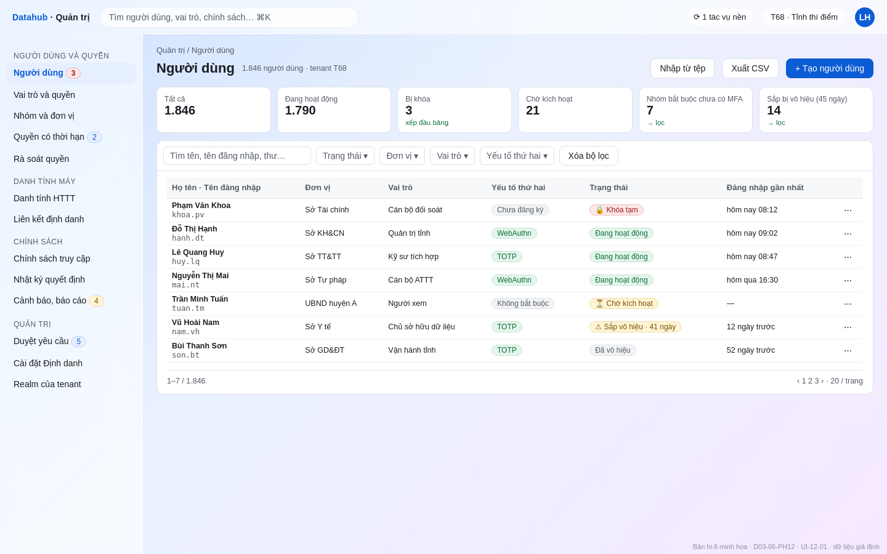
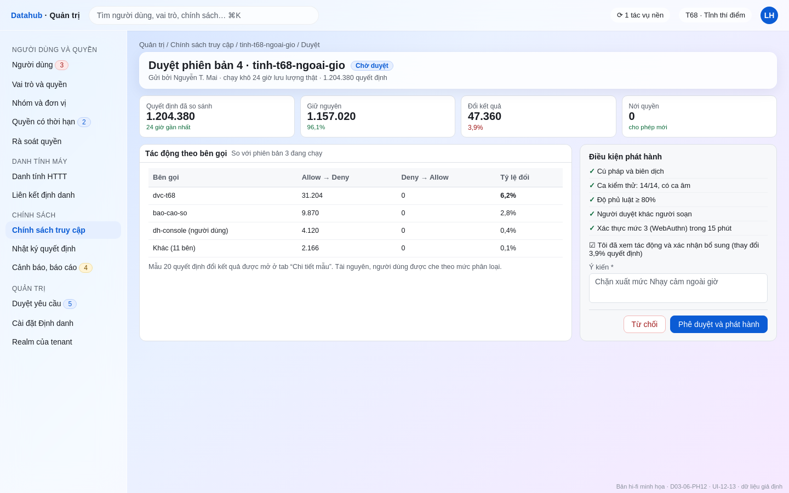

# D02-03-PH12 · Đặc tả yêu cầu chức năng Định danh và phân quyền

## Tóm tắt cho hội đồng thẩm định

**Mục tiêu.** PH-12 trả lời hai câu hỏi cho toàn bộ Datahub: "người gọi là ai" (xác thực, do Keycloak thực hiện) và "người gọi được làm gì" (ủy quyền, do Open Policy Agent, viết tắt OPA, quyết định). Phân hệ quản lý vòng đời tài khoản người dùng, vai trò và quyền theo ma trận D02-08, danh tính của hệ thống thông tin (HTTT) thành viên và của các đơn vị triển khai nội bộ, token OAuth 2.1, một realm Keycloak riêng cho mỗi tenant, và chính sách truy cập viết bằng mã (Rego) có kiểm thử, chạy khô, duyệt bốn mắt và phát hành dưới dạng gói ký. Nhờ đó mọi truy cập vào dữ liệu và chức năng đều đi qua một cổng định danh và một bộ quy tắc ủy quyền duy nhất, thay vì mỗi khối của hệ cũ tự đặt vai trò riêng.

**Phạm vi.** 62 yêu cầu chức năng chia tám nhóm: tài khoản người dùng, vai trò nhóm và quyền, xác thực người dùng, danh tính HTTT và token, realm theo tenant, ủy quyền, ghi vết giám sát, quản trị. PH-12 là điểm quyết định chính sách (PDP) và nơi phát hành định danh; việc thực thi quyết định (PEP) nằm ở APISIX (PH-03) và ở thư viện dùng chung trong từng đơn vị triển khai. Phân hệ chạy trên `keycloak`, `opa` (sidecar) và phần quản trị nghiệp vụ trong `dh-platform`.

**Căn cứ pháp lý.** CMP-LAW-09 (Công văn 631/THH-THHT: đăng nhập một lần bằng SAML 2 và OpenID Connect, xác thực nhiều yếu tố, phân quyền theo XACML 2.0/3.0); CMP-LAW-06 và CMP-LAW-08 (NĐ 331/2026, TCVN 14423:2026 cấp độ 3: quản lý tài khoản, mật khẩu từ 14 ký tự, khóa phiên 15 phút, vô hiệu tài khoản sau 45 ngày, nhật ký truy cập); CMP-LAW-05 (Luật BVDLCN 91/2025: hạn chế truy cập dữ liệu cá nhân, ghi vết); CMP-LAW-01 (Luật Dữ liệu số: khai thác dữ liệu theo mục đích); CMP-LAW-03 (NĐ 278/2025: kết nối, chia sẻ dữ liệu); CMP-LAW-10 (Khung kiến trúc CPĐT: tích hợp định danh điện tử quốc gia VNeID).

**Những điểm hội đồng cần lưu ý.** (1) Ủy quyền theo nguyên tắc từ chối mặc định và từ chối thắng cho phép; khi OPA lỗi, bên thực thi phải từ chối chứ không cho qua (BR-12-001, 002, 006). (2) Mỗi tenant có một realm riêng `dh-{mã tenant}`, cấu hình bảo mật do GitOps giữ và quản trị tỉnh không sửa được; quản trị tỉnh chỉ quản lý người dùng và vai trò của tỉnh mình (BR-12-038). (3) Chính sách truy cập đi qua kiểm thử, chạy khô trên lưu lượng thật, duyệt bốn mắt rồi mới phát hành; chính sách của tỉnh chỉ được thêm luật chặt hơn, không được nới (BR-12-007, 008, 009). (4) Quyền cao và truy cập liên tenant của quản trị nền tảng là quyền có thời hạn tối đa 4 giờ, có người duyệt thứ hai và thông báo cho tỉnh bị truy cập (BR-12-032). (5) Token ngắn hạn 5 phút, thu hồi khẩn có hiệu lực không quá 60 giây tại cổng (BR-12-026, 028).

**Con số chính.**

| Chỉ số | Giá trị |
|---|---|
| Yêu cầu chức năng | 62 (M: 52, S: 9, C: 1) |
| Quy tắc nghiệp vụ | 45 (BR-12-001…045) |
| Yêu cầu phi chức năng | 33 (NFR-12-001…033) |
| Màn hình | 19 (UI-12-01…19) |
| API | 113 operation (API-12-001…113), 16 sự kiện (EVT-12-01…16) |
| Quyền | 16 (`PERM-12-*`, trong đó 2 đã có ở D02-08 và 14 đề nghị bổ sung) |
| Chức năng hệ cũ được phủ | 12 mục `LGC` (8 mục LGC-IAM và 4 mục của khối Bus, APIM, NGSP có phần PH-12) |
| FR cũ của repo được ánh xạ | 19 FR, 30 NFR, 17 BR (mục 11.2, 11.3) |
| Mức đợt | MVP; năm FR (015, 018, 019, 028, 032) sang Đợt 2 |

: Con số chính của PH-12

## 1. Giới thiệu

### 1.1. Mục đích của tài liệu

Tài liệu đặc tả đầy đủ hành vi của phân hệ PH-12 Định danh và phân quyền ở mức mà ba nhóm người đọc dùng được ngay không cần hỏi lại. Hội đồng thẩm định dùng tài liệu để đánh giá phân hệ có đáp ứng yêu cầu SSO, xác thực nhiều yếu tố, phân quyền XACML của Công văn 631/THH-THHT và yêu cầu kiểm soát truy cập cấp độ 3 hay không. Kỹ sư dùng tài liệu làm đầu vào cho thiết kế chi tiết D03-02-PH12, CSDL D03-03-PH12, API D03-04-PH12 và cấu hình Keycloak, OPA. Kiểm thử viên dùng các luồng xử lý, luồng ngoại lệ và quy tắc nghiệp vụ để viết ca kiểm thử ở D05-02-PH12, trong đó có bộ ca phân quyền dương và âm sinh từ ma trận D02-08.

Mỗi chức năng được đặc tả theo cùng một khung 17 mục: mục đích, tác nhân và quyền, mức ưu tiên, truy vết, tiền điều kiện, kích hoạt, đầu vào, luồng xử lý chính, luồng thay thế, luồng ngoại lệ kèm thông báo người dùng nhìn thấy, đầu ra, kết quả, hậu điều kiện, sự kiện, kiểm toán, quy tắc nghiệp vụ, màn hình và API.

### 1.2. Phạm vi

PH-12 chịu trách nhiệm tám nhóm việc dưới đây.

| # | Trách nhiệm | Nhóm FR |
|---|---|---|
| 1 | Vòng đời tài khoản người dùng: tạo, kích hoạt, sửa, khóa, vô hiệu, nhập hàng loạt, đồng bộ thuộc tính đơn vị, tự vô hiệu khi không dùng | A |
| 2 | Vai trò chuẩn, gán vai trò có phạm vi và thời hạn, chặn cặp vai trò xung đột, nhóm theo đơn vị, quyền có thời hạn, rà soát quyền, xem quyền hiệu lực | B |
| 3 | Xác thực người dùng bằng OIDC với PKCE, SAML 2, LDAP/AD, VNeID; mật khẩu, khóa tài khoản, xác thực hai yếu tố, xác thực lại bước lên, quản lý phiên | C |
| 4 | Danh tính HTTT thành viên và tài khoản dịch vụ của đơn vị triển khai: client OAuth, chứng thư, khóa công khai, bí mật, scope; phát token, làm mới, công bố JWKS, thu hồi tức thời | D |
| 5 | Một realm Keycloak cho mỗi tenant: khởi tạo từ mẫu, cấu hình bảo mật bằng GitOps, tạm ngừng theo vòng đời tenant | E |
| 6 | Ủy quyền bằng OPA: hợp đồng quyết định, quy tắc gốc, ba lớp phân quyền, mặt nạ trường, XACML, bộ đệm, dữ liệu vai trò–quyền, soạn, chạy khô, duyệt, phát hành, thu hồi chính sách | F |
| 7 | Ghi vết sự kiện xác thực và quyết định ủy quyền, tra cứu nhật ký quyết định, phát hiện bất thường, báo cáo tài khoản | G |
| 8 | Tham số theo tenant, danh bạ người dùng cho phân hệ khác | H |

: Trách nhiệm của PH-12

Những việc dưới đây liên quan nhưng không thuộc PH-12. Tài liệu chỉ mô tả điểm giao tiếp với các phân hệ đó.

| Không làm | Thuộc |
|---|---|
| Thực thi quyết định ủy quyền (PEP) tại cổng và trong dịch vụ; xác minh chữ ký token ở đường dữ liệu | PH-03 (APISIX), thư viện PEP dùng chung của mọi DU; PH-12 chỉ ra quyết định |
| Che, giả danh hóa, ẩn danh hóa dữ liệu; chính sách mục đích khai thác, chấp thuận của chủ quản dữ liệu | PH-09 (PH-12 chỉ chỉ định chế độ và nhận mục đích đã chấp thuận làm thuộc tính) |
| Hồ sơ kết nạp, thẩm định, duyệt HTTT; đầu mối kỹ thuật của HTTT | PH-01 (PH-12 tạo client sau khi hồ sơ được duyệt) |
| Đăng ký sử dụng API, gói sử dụng; publication, subscription | PH-02, PH-10 (nguồn sinh scope của client) |
| Điều phối khởi tạo, sáp nhập tenant | PH-20 (PH-12 thực hiện bước tạo realm và bước chuyển định danh) |
| Lưu, hiển thị nhật ký kiểm toán chung, chuỗi băm, WORM | PH-13 (PH-12 phát sự kiện và bản ghi) |
| Màn đăng nhập trong ứng dụng, khóa phiên khi không thao tác, chọn tenant, xem phiên của mình | Nhóm FR-00 của SRS (PH-12 hiện thực phía Keycloak và quản trị) |
| Thông tin xác thực với Nền tảng chia sẻ quốc gia (NDXP) | PH-14 (PH-12 cấp token cho HTTT của tỉnh gọi qua Datahub) |
| Ứng dụng, sandbox của nhà phát triển | PH-15 (PH-12 cấp client) |
| Kho bí mật, PKI, ký, kho khóa | Nền tảng, OpenBao (ADR-012) |

: Việc ngoài phạm vi PH-12

### 1.3. Đối tượng sử dụng và cách đọc

Bảng sau chỉ mỗi nhóm người đọc nên đọc phần nào của tài liệu này và đọc để làm gì.

| Người đọc | Đọc phần | Mục đích |
|---|---|---|
| Hội đồng thẩm định | Tóm tắt, chương 2, chương 3, chương 11, chương 14 | Đánh giá mức đáp ứng CV 631 và cấp độ 3, mô hình ba lớp phân quyền, mức phủ hệ cũ |
| Cán bộ ATTT, quản trị tỉnh | Chương 3, mục 6.2, 6.3, 6.7, chương 8 | Biết việc phải làm: cấp tài khoản, duyệt chính sách, thu hồi, rà soát quyền |
| Kỹ sư phát triển, kỹ sư hạ tầng định danh | Chương 4, chương 6, chương 7, chương 9 | Hiện thực Keycloak, OPA, API, xử lý, quy tắc, mã lỗi |
| Kiểm thử viên | Chương 6, chương 7, chương 8, chương 14 | Viết ca dương, âm, ca chuyển đổi hệ cũ, ca fail-closed, ca rò rỉ chéo tenant |
| Vận hành | Mục 6.5, 6.8, chương 8, chương 12 | Theo dõi sức khỏe, xoay khóa, xử lý sự cố định danh |

: Người đọc và phần cần đọc

Mã định danh (FR, BR, NFR, ERR, EVT, API, UI) theo quy ước ở D00-01 §3. Các chức năng dùng chung của mọi phân hệ (đăng nhập một lần ở ứng dụng, tự khóa phiên, chọn tenant, xem phiên của mình, kiểm toán chung, nguyên tắc bốn mắt) theo nhóm FR-00 của SRS; PH-12 chỉ viện dẫn và đặc tả phần phía định danh.

### 1.4. Thuật ngữ và chữ viết tắt

Bảng sau giải thích các thuật ngữ và chữ viết tắt dùng riêng trong FRS của PH-12; thuật ngữ chung theo D00-01 §2.

| Thuật ngữ, viết tắt | Giải thích |
|---|---|
| Tenant | Một tỉnh dùng Datahub; dữ liệu và cấu hình tách biệt hoàn toàn với tenant khác |
| Realm | Không gian định danh của Keycloak; mỗi tenant có một realm `dh-{mã tenant viết thường}`, riêng tenant nền tảng là `dh-platform` |
| OIDC, OAuth 2.1, PKCE | Giao thức đăng nhập và cấp token; PKCE là cơ chế chống đánh cắp mã ủy quyền |
| SAML 2 | Giao thức đăng nhập một lần cũ hơn, giữ cho ứng dụng chưa nói được OIDC |
| BFF | Máy chủ trung gian của giao diện web giữ token thay trình duyệt (SEC-21) |
| Client | Danh tính OAuth của một HTTT hoặc một đơn vị triển khai khi gọi API không có người dùng cuối |
| Scope | Phạm vi quyền của client, dạng `api:{mã API}:{mã gói}`, `topic:{tên}:publish` |
| `client_credentials` | Luồng OAuth cấp token cho máy |
| mTLS, `private_key_jwt` | Hai cách xác thực client không dùng bí mật chia sẻ: chứng thư hai chiều (RFC 8705) và JWT ký bằng khóa riêng (RFC 7523) |
| JWKS | Tập khóa công khai để xác minh chữ ký token |
| PDP, PEP | Điểm quyết định chính sách (OPA) và điểm thực thi chính sách (APISIX, thư viện trong DU) |
| OPA, Rego | Bộ máy đánh giá chính sách và ngôn ngữ viết chính sách |
| Gói chính sách (bundle) | Tập tệp Rego và dữ liệu đã đóng gói, ký, để OPA tải về |
| Chạy khô (dry-run) | Đánh giá chính sách mới trên các yêu cầu thật gần đây mà không áp dụng kết quả, để biết tác động |
| ABAC, RBAC | Phân quyền theo thuộc tính, theo vai trò |
| Mặt nạ trường (`fieldMask`) | Danh sách trường bên gọi được xem và chế độ xem từng trường |
| MFA, TOTP, WebAuthn | Xác thực nhiều yếu tố; mã dùng một lần theo thời gian; xác thực bằng khóa FIDO2 hoặc passkey |
| Step-up | Yêu cầu xác thực lại ở mức cao hơn trước một thao tác nhạy cảm |
| `acr`, `auth_time` | Claim trong token cho biết mức xác thực và thời điểm xác thực |
| Tách nhiệm vụ (SoD) | Một người không được giữ đồng thời hai vai trò xung đột (D02-08 §4) |
| Quyền có thời hạn (JIT) | Quyền cao cấp tạm thời cho một việc, tối đa 4 giờ, có người duyệt thứ hai |
| Danh sách chặn | Danh sách `jti`, `sub` bị thu hồi mà APISIX từ chối ngay dù token chưa hết hạn |
| PA, PO, TA, TO, SO, AU, VW | Vai trò: quản trị nền tảng, vận hành nền tảng, quản trị tỉnh, vận hành tỉnh, cán bộ ATTT, kiểm toán viên, người xem (mục 3.1) |
| DU | Đơn vị triển khai (D03-01 §4); tài khoản dịch vụ của DU là tài khoản máy nội bộ |
| p95, p99 | Phân vị 95, 99: 95% hoặc 99% số lượt đo không vượt ngưỡng nêu |

: Thuật ngữ và chữ viết tắt

### 1.5. Tài liệu tham chiếu

Bảng sau liệt kê các tài liệu pháp lý, tiêu chuẩn và tài liệu nội bộ mà FRS này dựa vào, kèm mục đích dùng của từng tài liệu.

| Mã | Tài liệu | Dùng cho |
|---|---|---|
| CMP-LAW-09 | Công văn 631/THH-THHT | SSO SAML 2 và OIDC, MFA, XACML |
| CMP-LAW-06, CMP-LAW-08 | NĐ 331/2026/NĐ-CP, TCVN 14423:2026 | Kiểm soát truy cập, mật khẩu, khóa phiên, vô hiệu tài khoản, nhật ký ở cấp độ 3 |
| CMP-LAW-05, CMP-LAW-01, CMP-LAW-03 | Luật BVDLCN 91/2025, Luật Dữ liệu số, NĐ 278/2025 | Hạn chế truy cập, khai thác theo mục đích, kết nối dữ liệu |
| CMP-LAW-10 | Khung Kiến trúc CPĐT (QĐ 2568, 1729) | Nền tảng định danh quốc gia |
| D02-02 | SRS | Nhóm FR-00 (đăng nhập, MFA, bốn mắt, kiểm toán), REQ-12 |
| D02-08 | Ma trận phân quyền | 22 vai trò, quyền `PERM-12-*`, cặp tách nhiệm vụ, scope của máy |
| D03-01 | SAD | DU `keycloak`, `opa`, `dh-platform`, vùng mạng, `pg-iam` |
| D03-07 | Thiết kế ATTT | SEC-20…29, SEC-80, SEC-85, ngưỡng TCVN 14423 |
| D03-10 | Thiết kế đa tenant | Realm theo tenant, saga khởi tạo, sáp nhập |
| ADR-006, ADR-012, ADR-031, ADR-046, ADR-069 | Quyết định kiến trúc | Keycloak và OPA, OpenBao, nhật ký chuỗi băm, bốn mắt, máy trạng thái phiên bản |
| D02-03-PH05, D02-03-PH10 | FRS các phân hệ phụ thuộc | Scope máy, đăng ký kết nối, publication |
| D03-06-PH12 | Thiết kế giao diện màn hình PH-12 | Bố cục chi tiết của 19 màn hình, câu thông báo |

: Tài liệu tham chiếu

### 1.6. Cấu trúc tài liệu

Chương 2 trình bày bối cảnh, mục tiêu và kiến trúc của phân hệ. Chương 3 nêu tác nhân, quyền và tách nhiệm vụ. Chương 4 định nghĩa khái niệm, thực thể và vòng đời của các đối tượng chính. Chương 5 liệt kê toàn bộ 62 chức năng. Chương 6 đặc tả chi tiết từng chức năng theo khung 17 mục. Chương 7 đến chương 9 gom quy tắc nghiệp vụ, yêu cầu phi chức năng, tham số, mã lỗi, thông báo, sự kiện và API. Chương 10 giới thiệu giao diện tiêu biểu. Chương 11 đến chương 14 là truy vết, phụ thuộc, câu hỏi mở và tiêu chí chấp nhận; cuối tập có đề nghị đồng bộ cho tài liệu dùng chung.

## 2. Tổng quan phân hệ

### 2.1. Bối cảnh và vấn đề cần giải quyết

Hệ LGSP cũ dùng Keycloak cho đăng nhập một lần giữa các khối, nhưng mỗi khối tự đặt vai trò của mình, có khối còn dùng midPoint với SAML riêng cho màn quản trị Bus, và hướng dẫn người dùng lấy token bằng tên đăng nhập, mật khẩu. Thông tin khóa của HTTT được cấp, lưu và chuyển giao dạng văn bản. Quy tắc cho phép hay từ chối nằm rải rác trong mã từng khối nên không ai trả lời được câu hỏi "ai có quyền gì" cho cả hệ thống. Bảng dưới nêu các hạn chế, hệ quả thực tế và cách PH-12 giải quyết.

| Hạn chế hệ cũ | Hệ quả | Cách PH-12 khắc phục |
|---|---|---|
| Vai trò Keycloak tự đặt ở từng khối, không có danh mục chung | Cùng một cán bộ có nhiều bộ vai trò khác nhau; không kiểm tra được tách nhiệm vụ | 22 vai trò chuẩn tạo tự động cho mỗi tenant, gán qua một nơi, chặn cặp xung đột (FR-12-011…013) |
| Hướng dẫn lấy token bằng grant `password` | Mật khẩu người dùng đi qua ứng dụng; không dùng được MFA | Tắt grant `password` và `implicit`; người dùng dùng Authorization Code với PKCE qua BFF, máy dùng `client_credentials` (FR-12-020, 035; BR-12-021) |
| SSO bằng SAML của midPoint riêng cho màn quản trị Bus | Hai hệ định danh song song, hai bộ tài khoản | Thống nhất về Keycloak OIDC; SAML 2 chỉ còn là cầu nối cho ứng dụng cũ (FR-12-025) |
| Consumer Key, Secret của HTTT dạng văn bản, cấp tay | Lộ khóa qua tài liệu, tin nhắn; không xoay vòng, không thu hồi nhanh | Client được tạo từ hồ sơ kết nạp đã duyệt, bí mật hiện một lần, ưu tiên mTLS hoặc `private_key_jwt`, thu hồi có hiệu lực ≤ 60 giây (FR-12-030…040) |
| Quy tắc ủy quyền nằm trong mã từng khối | Đổi một quy tắc phải phát hành lại ứng dụng; không kiểm toán được | Chính sách Rego tập trung, kiểm thử, duyệt bốn mắt, phát hành gói ký, nạp nóng (FR-12-051…055) |
| Phiên đăng nhập không có hạn mức, không thu hồi được từ phía quản trị | Phiên bỏ quên bị dùng lại; không cắt được truy cập khi nghi ngờ | Hạn mức phiên, buộc đăng xuất, thu hồi khẩn kèm danh sách chặn (FR-12-029, 040) |
| Cán bộ rời đơn vị vẫn giữ tài khoản và quyền | Rủi ro tài khoản bỏ quên; vi phạm kiểm soát truy cập cấp độ 3 | Tự vô hiệu sau 45 ngày (quản trị 30 ngày), rà soát quyền định kỳ, đồng bộ thuộc tính đơn vị (FR-12-008, 010, 018) |

: Hạn chế của hệ cũ và cách khắc phục

### 2.2. Mục tiêu của phân hệ

PH-12 có năm mục tiêu đo được. Mục tiêu thứ nhất là **một nơi cấp định danh, một nơi quyết định quyền**: 100% truy cập của người dùng và HTTT đi qua realm của tenant và OPA, không có vai trò nào ngoài 22 vai trò chuẩn và vai trò tùy biến cấu từ các quyền đã có (FR-12-011, 015, 044). Mục tiêu thứ hai là **quyết định nhanh và an toàn khi lỗi**: độ trễ quyết định cục bộ p99 ≤ 2 ms (NFR-12-001) và 100% yêu cầu bị từ chối khi OPA lỗi hoặc chưa nạp gói (NFR-12-014). Mục tiêu thứ ba là **thu hồi nhanh**: truy cập của một người hoặc một HTTT bị chặn tại cổng không quá 60 giây sau lệnh thu hồi, không chờ token hết hạn (NFR-12-005). Mục tiêu thứ tư là **xác thực đủ mạnh cho tài khoản quyền cao**: 100% tài khoản thuộc nhóm `mfa-required` có yếu tố thứ hai, quản trị nền tảng và quản trị tỉnh dùng WebAuthn (FR-12-022, báo cáo hằng ngày ở FR-12-060). Mục tiêu thứ năm là **thay đổi chính sách có kiểm chứng**: 100% phiên bản chính sách đến tay người dùng đã qua ca kiểm thử, chạy khô trên lưu lượng thật và duyệt bốn mắt, và có hiệu lực ở mọi OPA trong không quá 60 giây (NFR-12-004). Một mục tiêu bao trùm là **không rò rỉ chéo tenant**: bộ kiểm thử chéo tenant của D05-01 đạt 100% trên mọi API của phân hệ.

### 2.3. Vị trí trong kiến trúc

Sơ đồ sau cho thấy PH-12 nằm ở đâu trong kiến trúc Datahub: Keycloak là nơi cấp danh tính, OPA là điểm quyết định chính sách, và các phân hệ khác gọi PH-12 để cấp client và kiểm tra quyền.

```{.mermaid caption="Vị trí của PH-12 trong kiến trúc Datahub"}
flowchart TB
  subgraph Z2["Cổng API · vùng Z2"]
    BFF["BFF của dh-console<br/>và dh-portal"]
    GW["APISIX<br/>PEP tại cổng"]
  end
  subgraph Z3["Control plane · vùng Z3"]
    ADM["dh-platform<br/>quản trị định danh<br/>schema ph12_iam"]
    DU["Các DU khác<br/>thư viện PEP"]
  end
  subgraph Z6["Bảo mật lõi · vùng Z6"]
    KC["Keycloak 26<br/>realm dh-tenant"]
    PGI[("pg-iam")]
    BAO[("OpenBao")]
    BUN[("Gói chính sách đã ký<br/>dh-platform-policy")]
  end
  OPA["OPA sidecar<br/>trong pod APISIX và DU"]
  BFF -->|"OIDC, PKCE"| KC
  GW -->|"JWKS đệm 10 phút"| KC
  GW -->|"hỏi cục bộ"| OPA
  DU -->|"hỏi cục bộ"| OPA
  ADM -->|"Admin API"| KC
  KC --> PGI
  ADM -->|"ký gói, bí mật dùng một lần"| BAO
  ADM -->|"phát hành gói"| BUN
  BUN -->|"tải mỗi 30 giây"| OPA
```

PH-12 có mặt ở ba nơi. Keycloak chạy trong namespace `dh-iam`, dữ liệu ở cụm `pg-iam` thuộc tầng phục hồi `TPH-0` để HTTT vẫn lấy được token khi control plane ngừng (NFR-00-012); console quản trị của Keycloak chỉ truy cập được từ vùng quản trị Z7 (SEC-20). Phần quản trị nghiệp vụ nằm trong `dh-platform`: người dùng, gán vai trò, client, soạn và duyệt chính sách, nhật ký quyết định; `dh-platform` gọi Keycloak qua Admin API bằng tài khoản dịch vụ riêng. OPA là sidecar trong pod APISIX và trong pod của mọi DU, chỉ giữ bản sao gói chính sách gần nhất, nên quyết định ủy quyền không phải gọi qua mạng tới control plane. Theo D03-07, thành phần ký gói và kho bí mật ở vùng Z6, thư viện PEP ở Z3 và Z4.

### 2.4. Kiến trúc thành phần và công nghệ

PH-12 gồm sáu thành phần. **Keycloak 26** là bộ máy xác thực: realm theo tenant, người dùng và mật khẩu (băm `argon2` hoặc `pbkdf2-sha512`), luồng xác thực có điều kiện cho MFA, nhà môi giới định danh cho LDAP/AD, SAML và VNeID, phát token ký ES256 (ADR-006). **Dịch vụ quản trị định danh** trong `dh-platform` (Java 21, Spring Boot 4, schema `ph12_iam` của `pg-core`) giữ phần Keycloak không có: gán vai trò có phạm vi và thời hạn, ngoại lệ tách nhiệm vụ, quyền có thời hạn, chiến dịch rà soát, metadata client, phiên bản chính sách, cảnh báo; nó thao tác Keycloak qua Admin API với vai trò tùy biến `realm-user-admin` (SEC-20). **Bộ ghi chính sách** biên dịch, kiểm thử, chạy khô và ký gói chính sách. **OPA** chạy cạnh ứng dụng, nạp gói đã ký mỗi 30 giây và lưu bền ra đĩa. **Thư viện PEP** dùng chung cho DU Spring Boot hiện thực hợp đồng quyết định và hành vi fail-closed. **Bộ phát và thu hồi** đẩy danh sách chặn tới APISIX và ghi nhật ký quyết định, sự kiện xác thực ra Loki và PH-13.

Hình dưới mô tả trình tự khi một HTTT lấy token rồi gọi API qua APISIX. Điểm quan trọng: APISIX tự xác minh chữ ký bằng JWKS đã đệm và hỏi OPA cục bộ trong cùng pod, không gọi Keycloak hay `dh-platform` ở mỗi lượt, nên sự cố tạm thời của control plane không làm dừng trục.

```{.mermaid caption="Trình tự một HTTT lấy token và gọi API, quyết định do OPA cục bộ đưa ra"}
sequenceDiagram
  autonumber
  participant H as HTTT thành viên
  participant K as Keycloak
  participant A as APISIX
  participant O as OPA sidecar
  participant B as Backend của API
  participant L as Loki và PH-13
  H->>K: client_credentials kèm chứng thư mTLS
  K-->>H: JWT ES256 sống 5 phút, claim tenant, scope, cnf
  H->>A: Gọi API với Bearer và mTLS
  A->>A: Xác minh chữ ký bằng JWKS đệm, iss khớp realm, aud, exp, cnf, danh sách chặn
  A->>O: Hỏi quyết định gồm tenant, chủ thể, scope, tài nguyên, hành động, mục đích
  O-->>A: allow, fieldMask, privacyMode, obligations
  A->>B: Chuyển tiếp kèm X-DH-Tenant và fieldMask
  A--)L: Nhật ký quyết định có che dữ liệu, không chờ
  Note over A,O: OPA lỗi hoặc chưa nạp gói thì APISIX từ chối, không cho qua
```

### 2.5. Quy trình nghiệp vụ liên quan

Bảng sau nêu các quy trình nghiệp vụ của bộ tài liệu có dùng PH-12 và bước cụ thể mà PH-12 tham gia ở mỗi quy trình.

| Quy trình | Bước có PH-12 |
|---|---|
| BP-01 Kết nạp HTTT và cấp quyền sử dụng (PH-01, PH-02) | Sau khi hồ sơ được duyệt, PH-01 gọi PH-12 tạo client; đăng ký sử dụng được duyệt sinh scope của client (FR-12-030, 036) |
| BP-02 Xây dựng và phát hành luồng (PH-04) | Gán vai trò kỹ sư và người duyệt, chặn cặp xung đột, MFA và step-up khi phát hành PROD (FR-12-012, 013, 023, 044) |
| BP-04 Trao đổi sự kiện (PH-10) | Publication, subscription được duyệt sinh scope `topic:{tên}:publish`, `:subscribe`; token cho listener Kafka ngoài (FR-12-035, 036) |
| BP-06 Khai thác dữ liệu quốc gia (PH-14) | HTTT của tỉnh lấy token Datahub, không giữ khóa của NDXP (FR-12-035) |
| BP-07 Giám sát, xử lý sự cố (PH-13, PH-18) | Cán bộ ATTT thu hồi truy cập, tạm ngừng client; cảnh báo bất thường (FR-12-031, 040, 059) |
| BP-08 Khởi tạo tenant (PH-20) | Bước 2 của saga: tạo realm từ mẫu, vai trò chuẩn, quản trị tỉnh đầu tiên (FR-12-041) |
| BP-09 Chuyển đổi từ hệ cũ | Nhập người dùng, ánh xạ vai trò cũ sang vai trò chuẩn, cấp song song thông tin xác thực mới cho HTTT (FR-12-009, 030, 034) |

: Quy trình nghiệp vụ có PH-12 tham gia

Hình dưới tóm tắt vòng đời điển hình của một tài khoản cán bộ từ lúc được cấp đến lúc rời đơn vị.

```{.mermaid caption="Vòng đời điển hình của tài khoản cán bộ"}
flowchart TB
  A["TA tạo tài khoản hoặc nhập từ tệp, LDAP<br/>FR-12-003, 009, 026"] --> B["Cán bộ kích hoạt, đặt mật khẩu,<br/>đăng ký yếu tố thứ hai<br/>FR-12-006, 022"]
  B --> C["TA gán vai trò có phạm vi,<br/>hệ chặn cặp xung đột<br/>FR-12-012, 013"]
  C --> D["Làm việc: đăng nhập OIDC,<br/>OPA quyết định từng thao tác<br/>FR-12-020, 044"]
  D --> E["Rà soát quyền định kỳ<br/>FR-12-018"]
  E --> D
  D --> F["Không đăng nhập 45 ngày<br/>hoặc rời đơn vị"]
  F --> G["Tự vô hiệu hoặc TA vô hiệu,<br/>thu hồi phiên, giữ truy vết<br/>FR-12-005, 008"]
```

### 2.6. Chức năng hệ cũ được phủ

Bảng sau đối chiếu các chức năng của hệ cũ do PH-12 phủ với vai trò của PH-12 (chính hay phụ), làm cơ sở cho bằng chứng không mất chức năng.

| Mã | Chức năng hệ cũ | Vai trò của PH-12 |
|---|---|---|
| LGC-IAM-001 | Đăng nhập một lần (SSO) bằng Keycloak cho các khối | Chính |
| LGC-IAM-002 | Tạo realm, client OpenID, vai trò, người dùng, gán vai trò | Chính, cùng PH-20 (khởi tạo tự động) |
| LGC-IAM-003 | Xác thực hai yếu tố TOTP | Chính |
| LGC-IAM-004 | Liên kết LDAP, Active Directory | Chính |
| LGC-IAM-005 | Quản lý phiên của người dùng | Chính, cùng FR-00-003, 005 |
| LGC-IAM-006 | Lấy token bằng grant `password` (đã thay thế) | Chính, cùng PH-15 (hướng dẫn lấy token) |
| LGC-IAM-007 | Đăng nhập mạng xã hội (đã loại bỏ) | Không còn; thay bằng VNeID khi có yêu cầu (FR-12-028) |
| LGC-IAM-008 | SSO bằng SAML của midPoint cho màn quản trị Bus (đã thay thế) | Chính |
| LGC-BUS-032 | Quản lý project, group, phân quyền project theo group | Phần vai trò và phạm vi; chính ở PH-04 |
| LGC-BUS-041 | Bảo mật route, mã hóa bản tin, bảo mật endpoint | Phần xác thực và ủy quyền; cùng PH-03, PH-04 |
| LGC-APIM-020 | Tạo Application: tên, mô tả, loại, Client ID | Phần danh tính client; chính ở PH-01 |
| LGC-NGSP-008 | Lấy token qua cổng AM bằng Consumer Key, Secret | Phần token cho HTTT tỉnh; chính ở PH-14 |

: Chức năng hệ cũ do PH-12 phủ

## 3. Tác nhân, vai trò và quyền

### 3.1. Tác nhân

Bảng sau liệt kê các tác nhân tương tác với PH-12, gồm người dùng, hệ thống ngoài và hệ thống nội bộ, kèm loại, mô tả và tương tác chính.

| Tác nhân | Loại | Mô tả | Tương tác chính |
|---|---|---|---|
| Quản trị nền tảng (PA, ROLE-PLATFORM_ADMIN) | Người | Đơn vị vận hành nền tảng dùng chung | Quản lý tài khoản vai trò nền tảng, khởi tạo và cấu hình realm, soạn chính sách nền tảng, duyệt quyền có thời hạn |
| Vận hành nền tảng (PO, ROLE-PLATFORM_OPERATOR) | Người | Cán bộ trực hạ tầng | Xem tài khoản và nhật ký quyết định, đề nghị quyền có thời hạn khi cần vào tenant |
| Quản trị tỉnh (TA, ROLE-TENANT_ADMIN) | Người | Quản trị Datahub của tỉnh | Quản lý người dùng, nhóm, vai trò của tỉnh; client của HTTT; đề nghị ngoại lệ tách nhiệm vụ; tham số phân hệ |
| Vận hành tỉnh (TO), người xem (VW) | Người | Cán bộ trực, lãnh đạo | Không có quyền PH-12; chỉ dùng tự phục vụ |
| Cán bộ ATTT (SO, ROLE-SECURITY_OFFICER) | Người | Cán bộ chuyên trách an toàn thông tin | Khóa, thu hồi truy cập, duyệt ngoại lệ, soạn và duyệt chính sách của tỉnh, rà soát quyền, xem cảnh báo |
| Kiểm toán viên (AU, ROLE-AUDITOR) | Người | Thanh tra, kiểm toán | Xem người dùng, quyền hiệu lực, nhật ký quyết định |
| Mọi người dùng giao diện | Người | Cán bộ có tài khoản | Tự kích hoạt, đặt mật khẩu, đăng ký yếu tố thứ hai, xem phiên của mình (không cần `PERM`) |
| Người quản lý trực tiếp | Người | Lãnh đạo đơn vị, thuộc tính `managerUserId` của người dùng | Xác nhận quyền của cấp dưới trong chiến dịch rà soát |
| Đầu mối kỹ thuật của HTTT (ROLE-ORG_REQUESTER) | Người | Cán bộ đầu mối của tổ chức | Nhận bí mật client một lần, đăng ký chứng thư |
| HTTT thành viên | Hệ thống | Hệ của sở, ngành, huyện | Lấy token bằng `client_credentials`, gọi API với token |
| APISIX (PH-03) | Hệ thống | PEP tại cổng | Lấy JWKS, tải danh sách chặn, hỏi OPA cục bộ |
| DU và thư viện PEP | Hệ thống | Đơn vị triển khai Spring Boot, `dh-runtime` | Hỏi OPA cục bộ; dùng tài khoản dịch vụ có scope `iam:*` |
| PH-01, PH-20, PH-15 | Hệ thống | Kết nạp, quản trị tenant, cổng nhà phát triển | Tạo client, tạo realm, chuyển định danh, cấp client sandbox |
| PH-02, PH-09, PH-10 | Hệ thống | Nguồn dữ liệu đã duyệt | Cung cấp đăng ký sử dụng, mục đích, publication, subscription để sinh scope |
| PH-07, PH-13, PH-18 | Hệ thống | Danh mục, giám sát, tham số | Danh mục đơn vị; nhận nhật ký và cảnh báo; tham số hệ thống |
| Keycloak, OPA, OpenBao | Hệ thống | Hạ tầng | Xác thực, quyết định, bí mật và PKI |
| LDAP/AD của tỉnh, VNeID, ứng dụng SAML | Hệ thống ngoài | Nguồn định danh ngoài và nhà cung cấp dịch vụ cũ | Liên kết đăng nhập, đồng bộ người dùng |

: Tác nhân của PH-12

### 3.2. Ma trận quyền

Ma trận dùng ký hiệu của D02-08 §3 (● có quyền, ○ chỉ với đối tượng của tổ chức mình, — không có). Hai quyền `PERM-12-user-admin` và `PERM-12-read` đã có ở D02-08; 14 quyền còn lại được đề nghị bổ sung vào D02-08 §3 trong đợt đồng bộ (mục "Đề nghị đồng bộ"). Cột chỉ gồm vai trò có ít nhất một quyền PH-12; các vai trò khác (TO, IE, IA, SV, CA, OR, DS, DA, DO, VW và vai trò thanh toán) không có quyền PH-12 ngoài tự phục vụ.

| Quyền | Ý nghĩa | PA | PO | TA | SO | AU |
|---|---|---|---|---|---|---|
| PERM-12-read | Xem người dùng, vai trò, phiên (không xem được yếu tố xác thực), quyền hiệu lực, client, chính sách | ● | ● | ● | ● | ● |
| PERM-12-user-admin | Tạo, sửa, nhập người dùng; gán, gỡ vai trò; quản lý nhóm, đơn vị (PA chỉ ở tenant `PLATFORM`) | ● | — | ● | — | — |
| PERM-12-user-lock | Khóa, mở khóa, vô hiệu, kích hoạt lại tài khoản; buộc đăng xuất; thu hồi truy cập tức thời của người dùng hoặc client; tạm ngừng, tiếp tục client | ● | — | ● | ● | — |
| PERM-12-mfa-reset | Đặt lại yếu tố thứ hai của người dùng cấp dưới (quản trị cấp trên) | ● | — | ● | — | — |
| PERM-12-sod-exception | Đề nghị ngoại lệ tách nhiệm vụ có thời hạn | — | — | ● | — | — |
| PERM-12-approve | Duyệt, từ chối, thu hồi ngoại lệ tách nhiệm vụ; duyệt kích hoạt liên kết định danh ngoài (LDAP/AD, SAML, VNeID); duyệt đặt lại yếu tố thứ hai của tài khoản quản trị | — | — | — | ● | — |
| PERM-12-client | Xem chi tiết, sửa, xoay bí mật, đăng ký chứng thư và khóa công khai của client; xem scope | — | — | ● | — | — |
| PERM-12-policy-edit | Soạn, kiểm thử, chạy khô, gửi duyệt chính sách (PA: chính sách nền tảng; SO: chính sách của tỉnh) | ● | — | — | ● | — |
| PERM-12-policy-approve | Duyệt, từ chối, thu hồi, quay lui chính sách (khác người soạn) | — | — | — | ● | — |
| PERM-12-decision-read | Tra cứu nhật ký quyết định ủy quyền và sự kiện an ninh (PO chỉ trong phạm vi quyền có thời hạn) | ● | ● | ● | ● | ● |
| PERM-12-jit-request | Đề nghị quyền có thời hạn cho vai trò đặc quyền hoặc truy cập tenant khác | ● | ● | — | — | — |
| PERM-12-jit-approve | Duyệt, từ chối, thu hồi quyền có thời hạn (người thứ hai) | ● | — | — | ● | — |
| PERM-12-recert | Mở, theo dõi, đóng chiến dịch rà soát quyền | — | — | ● | ● | — |
| PERM-12-alert | Xem, xác nhận cảnh báo an ninh; tinh chỉnh ngưỡng quy tắc phát hiện trong miền cho phép | ● | — | ● | ● | — |
| PERM-12-admin | Tham số phân hệ `12.*` trong trần của nền tảng; khai báo liên kết LDAP/AD, SAML, VNeID của tenant | ● | — | ● | — | — |
| PERM-12-realm-admin | Xem trạng thái, đối chiếu, tạm ngừng, khôi phục realm của tenant | ● | — | — | — | — |

: Ma trận quyền của PH-12

### 3.3. Tách nhiệm vụ và tài khoản máy

Bảy cặp vai trò xung đột ở D02-08 §4 (ví dụ INTEGRATION_ENGINEER với INTEGRATION_APPROVER, TENANT_ADMIN với AUDITOR) do PH-12 chặn khi gán (FR-12-013, BR-12-030). Ngoại lệ chỉ được cấp khi TA đề nghị, SO duyệt, có lý do, thời hạn tối đa 90 ngày và ghi kiểm toán. Ngoài tách vai trò, nguyên tắc bốn mắt áp dụng cho từng đối tượng: người soạn chính sách, người gửi duyệt và người đóng góp không được duyệt phiên bản đó (BR-12-008); người đề nghị quyền có thời hạn không được tự duyệt (BR-12-032); không ai được tự gán, gỡ vai trò, tự khóa hay tự đặt lại yếu tố thứ hai của chính mình (BR-12-033).

Các phân hệ gọi PH-12 bằng token dịch vụ, không dùng tài khoản người. Scope máy nội bộ của PH-12 gồm bảy loại, cấp cho tài khoản dịch vụ khi triển khai và không cấp cho người hay HTTT: `iam:client-provision` (PH-01 tạo, sửa scope, thu hồi client), `iam:dev-client` (PH-15 cấp client sandbox), `iam:realm-provision` (PH-20 tạo realm, tạm ngừng, chuyển định danh khi sáp nhập), `iam:revocation-read` (APISIX và DU đọc danh sách chặn), `iam:directory-read` (mọi DU tra cứu danh bạ), `iam:decide` (bên gọi quyết định qua API thay vì OPA cục bộ), `iam:policy-data-read` (OPA nạp dữ liệu vai trò–quyền khi dùng chế độ kéo). Scope `iam:*` đi qua cùng OPA như mọi quyết định khác; PH-12 không cấp cho người dùng quyền nào ngoài ma trận ở mục 3.2.

## 4. Khái niệm và mô hình nghiệp vụ

### 4.1. Khái niệm nghiệp vụ

Bảng sau định nghĩa các khái niệm nghiệp vụ mà các yêu cầu ở các chương sau sử dụng, để cùng một từ chỉ cùng một nghĩa trong toàn tập.

| Khái niệm | Định nghĩa |
|---|---|
| Danh tính người dùng | Tài khoản của một cán bộ trong realm của tenant, gắn một đơn vị (`orgCode`) và một nguồn xác thực (`LOCAL`, `LDAP`, liên kết VNeID) |
| Danh tính máy | Client OAuth của một HTTT (cấp qua PH-01) hoặc tài khoản dịch vụ của một DU; không có vai trò người dùng, chỉ có scope |
| Vai trò, quyền | Vai trò `ROLE-*` mở ra tập quyền `PERM-{PH}-{động từ}` theo ma trận D02-08; vai trò chuẩn tạo tự động cho mỗi tenant |
| Phạm vi gán | Mỗi lần gán vai trò có phạm vi `TENANT`, `ORG` (một đơn vị và đơn vị cấp dưới) hoặc `WORKSPACE` (một không gian làm việc của PH-04), kèm hiệu lực từ, đến |
| Quyền hiệu lực | Hợp của các quyền do vai trò đang hiệu lực mang lại, sau khi trừ ngoại lệ của chính sách, kèm phạm vi và nguồn gốc từng quyền |
| Phân quyền ba lớp | OPA đánh giá đồng thời vai trò, phạm vi tổ chức và thuộc tính dữ liệu (mức phân loại, mục đích, trạng thái đối tượng) (ADR-006) |
| Chính sách | Tập luật Rego mang một mã (ví dụ `base-authz`), có phiên bản bất biến; có phạm vi `PLATFORM` (mọi tenant) hoặc `TENANT` (chỉ một tỉnh, chỉ thêm luật chặt hơn) |
| Gói chính sách | Tập các phiên bản chính sách đang `PUBLISHED` cộng dữ liệu vai trò–quyền, đóng gói và ký; OPA chỉ nạp gói có chữ ký hợp lệ |
| Quyết định | Kết quả `allow` hoặc từ chối kèm lý do, `fieldMask`, `privacyMode`, `obligations` cho một bộ (chủ thể, tài nguyên, hành động, ngữ cảnh) |
| Mặt nạ trường | Bản đồ trường sang chế độ `full`, `masked`, `hidden`; PH-12 chỉ chỉ định, việc che do PH-09 và bên thực thi làm |
| Mức xác thực | Cấp 1 mật khẩu hoặc LDAP; cấp 2 mật khẩu và TOTP; cấp 3 WebAuthn (mục 4.8) |
| Quyền có thời hạn | Gán tạm thời một vai trò đặc quyền hoặc quyền vào tenant khác, tối đa 4 giờ, có lý do, mã phiếu hỗ trợ, người duyệt thứ hai |
| Ngoại lệ tách nhiệm vụ | Cho phép tạm thời một người giữ cặp vai trò xung đột khi tỉnh thiếu nhân sự, có thời hạn và kiểm toán |
| Thu hồi tức thời | Vô hiệu tài khoản hoặc client, hủy phiên, thu hồi refresh token và đẩy danh sách chặn tới APISIX |
| Danh sách chặn | Tập `jti`, `sub` hoặc `client_id` bị thu hồi mà APISIX từ chối dù token chưa hết hạn |
| Hợp đồng PEP–PDP | Cấu trúc yêu cầu, phản hồi quyết định và quy tắc fail-closed giữa bên thực thi và OPA (FR-12-044) |

: Khái niệm nghiệp vụ của PH-12

### 4.2. Thực thể

Bảng dưới liệt kê thực thể logic của phân hệ; thiết kế cột, khóa, chỉ mục ở D03-03-PH12. Keycloak là nguồn sự thật của người dùng, thông tin đăng nhập, yếu tố xác thực, phiên và khóa ký; schema `ph12_iam` của `pg-core` giữ phần nghiệp vụ Keycloak không có.

| Mã | Thực thể | Mô tả | Lưu ở |
|---|---|---|---|
| EN-12-01 | Người dùng | `userId`, `username`, `fullName`, `email`, `orgCode`, `title`, `state`, `managerUserId`, `authSource`, `lastLoginAt` | Keycloak, bản chiếu ở `ph12_iam` |
| EN-12-02 | Gán vai trò | `assignmentId`, `userId`, `roleCode`, `scopeType`, `scopeRef`, `validFrom`, `validTo`, `assignedBy`, `reason` | `ph12_iam` |
| EN-12-03 | Ngoại lệ tách nhiệm vụ | `exceptionId`, `userId`, cặp vai trò, `reason`, `expiresAt`, `proposedBy`, `approvedBy`, `state` | `ph12_iam` |
| EN-12-04 | Nhóm | `groupCode`, `name`, `parentCode`, `type` (`ORG`, `CUSTOM`), thành viên | Keycloak, `ph12_iam` |
| EN-12-05 | Vai trò tùy biến | `roleCode`, tên, danh sách `PERM`, `state`; chỉ cấu từ quyền đã có | `ph12_iam` |
| EN-12-06 | Yếu tố xác thực | Loại `TOTP` hoặc `WEBAUTHN`, nhãn thiết bị, thời điểm đăng ký, dùng cuối; không bao giờ đọc ra giá trị bí mật | Keycloak |
| EN-12-07 | Phiên | `sessionId`, `userId`, `clientId`, địa chỉ nguồn, `acr`, bắt đầu, hoạt động cuối, hết hạn | Keycloak |
| EN-12-08 | Client | `clientId`, `systemCode`, `orgCode`, `authMethod`, `contractLevel`, `state`, `lastUsedAt`, `secretExpiresAt`, `certThumbprint` | Keycloak, `ph12_iam` |
| EN-12-09 | Scope của client | `clientId`, `scope`, `source` (`PH-02`, `PH-09`, `PH-10`, `INTERNAL`), `sourceRef` | `ph12_iam` |
| EN-12-10 | Tài khoản dịch vụ | `accountCode`, DU sở hữu, danh sách scope `iam:*` và scope nghiệp vụ nội bộ, hạn xoay | Keycloak, `ph12_iam` |
| EN-12-11 | Quyền có thời hạn | `grantId`, `userId`, `roleCode`, `targetTenant`, `reason`, `ticketRef`, `requestedBy`, `approvedBy`, `startsAt`, `expiresAt`, `state` | `ph12_iam` |
| EN-12-12 | Chính sách và phiên bản | `policyCode`, `scope`, `versionNo`, `contentHash`, `state`, `author`, người đóng góp, `submittedBy`, `approvedBy`, `bundleDigest` | `ph12_iam`, Git `dh-policies` |
| EN-12-13 | Ca kiểm thử chính sách | `caseId`, `policyCode`, đầu vào JSON, kết quả mong đợi, mô tả | `ph12_iam`, Git |
| EN-12-14 | Gói chính sách | `bundleVersion`, `digest`, chữ ký, danh sách phiên bản chứa, thời điểm ký | Bucket `dh-platform-policy` |
| EN-12-15 | Bản ghi quyết định | `traceId`, chủ thể, tài nguyên, hành động, kết quả, chính sách khớp, lý do, thời gian đánh giá | Loki, chuỗi kiểm toán PH-13 |
| EN-12-16 | Cảnh báo an ninh | `alertId`, loại, đối tượng, ngưỡng vượt, thời điểm, trạng thái xác nhận | `ph12_iam` |
| EN-12-17 | Chiến dịch rà soát | `campaignId`, phạm vi, hạn, các mục (`userId`, `roleCode`, người rà soát, quyết định) | `ph12_iam` |
| EN-12-18 | Liên kết định danh ngoài | Cấu hình LDAP/AD, SAML client, liên kết VNeID (số định danh dưới dạng băm có khóa) | Keycloak, `ph12_iam` |
| EN-12-19 | Danh sách chặn | `entryId`, loại (`jti`, `sub`, `client`), giá trị, `reason`, `expiresAt` | `ph12_iam`, đẩy tới APISIX |
| EN-12-20 | Realm của tenant | `tenantCode`, `realmName`, `state`, `gitCommit`, `driftStatus` | Keycloak, `ph12_iam` |

: Thực thể logic của PH-12

Trạng thái đã chốt cho các thực thể không có máy trạng thái riêng ở các mục sau: nhập người dùng (`user_import`) là `PREVIEW`, `CONFIRMED`, `RUNNING`, `DONE`, `FAILED`, `EXPIRED`; vai trò tùy biến là `DRAFT`, `PENDING_REVIEW`, `ACTIVE`, `DISABLED`; nhóm có loại `ORG` hoặc `CUSTOM` và cờ hoạt động; chính sách chỉ có cờ chính sách gốc, còn trạng thái nằm ở phiên bản chính sách (mục 4.5).

### 4.3. Máy trạng thái tài khoản người dùng

Tài khoản không bao giờ bị xóa vật lý (BR-12-035): mọi kết thúc đều là `DISABLED`, giữ để truy vết. Hình dưới vẽ năm trạng thái và các chuyển đổi.

```{.mermaid caption="Máy trạng thái tài khoản người dùng"}
stateDiagram-v2
  [*] --> PENDING_ACTIVATION: tạo tài khoản
  PENDING_ACTIVATION --> ACTIVE: kích hoạt trong 24 giờ
  PENDING_ACTIVATION --> DISABLED: quá 30 ngày chưa kích hoạt
  ACTIVE --> LOCKED: 5 lần sai liên tiếp
  LOCKED --> ACTIVE: hết 15 phút hoặc TA mở khóa
  LOCKED --> BLOCKED: 3 lần khóa tạm trong 24 giờ
  BLOCKED --> ACTIVE: TA hoặc SO mở khóa
  ACTIVE --> DISABLED: vô hiệu thủ công hoặc quá 45 ngày
  DISABLED --> ACTIVE: kích hoạt lại, buộc đặt mật khẩu mới
```

`PENDING_ACTIVATION` là tài khoản vừa tạo, chưa đặt mật khẩu; liên kết kích hoạt sống 24 giờ và gửi lại được. `ACTIVE` là trạng thái làm việc bình thường. `LOCKED` là khóa tạm do đăng nhập sai, tự mở sau 15 phút. `BLOCKED` là khóa hẳn sau ba lần khóa tạm trong 24 giờ, chỉ TA hoặc SO mở (NFR-00-025). `DISABLED` là vô hiệu: không đăng nhập được, giữ dữ liệu, kích hoạt lại phải đặt mật khẩu mới và đăng ký lại yếu tố thứ hai nếu thuộc nhóm bắt buộc.

### 4.4. Máy trạng thái client của HTTT

Sơ đồ sau mô tả các trạng thái của client của HTTT và các chuyển trạng thái hợp lệ, từ lúc cấp, hoạt động, tạm ngừng đến thu hồi.

```{.mermaid caption="Máy trạng thái client của HTTT"}
stateDiagram-v2
  [*] --> PROVISIONING: cấp từ hồ sơ kết nạp đã duyệt
  PROVISIONING --> ENABLED: Keycloak tạo xong
  PROVISIONING --> FAILED: Keycloak lỗi, bù trừ
  ENABLED --> SUSPENDED: SO hoặc TA tạm ngừng, hoặc 90 ngày không gọi
  SUSPENDED --> ENABLED: tiếp tục sau khi đầu mối xác nhận
  ENABLED --> REVOKED: thu hồi
  SUSPENDED --> REVOKED: thu hồi
  REVOKED --> [*]
```

`PROVISIONING` là trạng thái kỹ thuật ngắn trong lúc tạo client ở Keycloak; lỗi thì chuyển `FAILED` và bù trừ, client không được phát token. `ENABLED` được phát token. `SUSPENDED` bị từ chối cấp token nhưng giữ cấu hình và chứng thư, tiếp tục được; việc tiếp tục sau khi tự tạm ngừng vì 90 ngày không gọi cần đầu mối xác nhận. `REVOKED` là thu hồi vĩnh viễn: mã client không dùng lại, muốn gọi tiếp phải cấp client mới.

### 4.5. Máy trạng thái phiên bản chính sách

Theo ADR-069, "đã chạy thử đạt" là điều kiện gắn với băm nội dung chứ không phải trạng thái. Bốn mắt so người duyệt với người soạn, mọi người đóng góp và người gửi duyệt.

```{.mermaid caption="Máy trạng thái phiên bản chính sách"}
stateDiagram-v2
  [*] --> DRAFT: tạo phiên bản
  DRAFT --> PENDING_REVIEW: gửi duyệt khi test, chạy khô đạt
  PENDING_REVIEW --> CHANGES_REQUESTED: người duyệt từ chối kèm ý kiến
  CHANGES_REQUESTED --> DRAFT: sửa lại
  PENDING_REVIEW --> APPROVED: người duyệt khác phê duyệt
  APPROVED --> PUBLISHED: đóng gói, ký, nạp thành công
  PUBLISHED --> SUPERSEDED: phiên bản mới được phát hành
  PUBLISHED --> REVOKED: thu hồi hoặc quay lui
  DRAFT --> DISCARDED: bỏ bản nháp
```

`DRAFT` còn sửa được; sửa nội dung làm mất hiệu lực của mọi kết quả kiểm thử và chạy khô đã có. `PENDING_REVIEW` khóa nội dung. `APPROVED` là trạng thái ngắn từ lúc duyệt tới lúc gói đã ký được đặt vào bucket và OPA đầu tiên xác nhận nạp. `PUBLISHED` là phiên bản đang chạy; mỗi mã chính sách có đúng một phiên bản `PUBLISHED`. `SUPERSEDED` giữ để quay lui. `REVOKED` loại chính sách khỏi gói kế tiếp.

### 4.6. Máy trạng thái quyền có thời hạn

Sơ đồ sau mô tả vòng đời của một quyền có thời hạn, từ đề nghị, duyệt, hiệu lực đến hết hạn hoặc bị thu hồi.

```{.mermaid caption="Máy trạng thái quyền có thời hạn"}
stateDiagram-v2
  [*] --> REQUESTED: đề nghị kèm lý do, mã phiếu
  REQUESTED --> ACTIVE: người thứ hai duyệt
  REQUESTED --> REJECTED: người duyệt từ chối
  REQUESTED --> CANCELLED: người đề nghị rút lại hoặc quá hạn chờ duyệt
  ACTIVE --> EXPIRED: hết thời hạn, tối đa 4 giờ
  ACTIVE --> REVOKED: thu hồi sớm
```

Quyền `ACTIVE` có hiệu lực ngay khi duyệt và tự gỡ khi hết hạn; hệ thống không cần ai nhớ để thu hồi (BR-12-032). Mọi chuyển trạng thái đều sinh bản ghi kiểm toán trong chuỗi của tenant bị truy cập và thông báo cho quản trị tỉnh đó.

### 4.7. Máy trạng thái realm của tenant

Sơ đồ sau mô tả các trạng thái của realm theo vòng đời của tenant, từ lúc tạo, hoạt động, tạm ngừng, chuyển chỉ đọc đến xóa.

```{.mermaid caption="Máy trạng thái realm theo vòng đời tenant"}
stateDiagram-v2
  [*] --> PROVISIONING: PH-20 gọi bước tạo realm
  PROVISIONING --> ACTIVE: tạo xong, kiểm tra khói đạt
  ACTIVE --> SUSPENDED: tenant bị tạm ngừng
  SUSPENDED --> ACTIVE: tenant được khôi phục
  ACTIVE --> READ_ONLY: tenant đã sáp nhập
  READ_ONLY --> DELETED: tenant chấm dứt, hết thời gian giữ
  SUSPENDED --> DELETED: tenant chấm dứt
```

`SUSPENDED` chỉ cho phép quản trị tỉnh đăng nhập chế độ chỉ-đọc, mọi người dùng khác và mọi client bị từ chối (D03-10 §5.1). `READ_ONLY` ứng với tenant đã sáp nhập: người dùng đăng nhập chỉ để tra cứu lịch sử, token không có quyền ghi. `DELETED` xóa realm sau khi dữ liệu được bàn giao.

### 4.8. Mức xác thực

Mỗi token người dùng mang claim `acr` (mức xác thực) và `auth_time`. PH-12 dùng ba mức, và thao tác nhạy cảm đòi một mức tối thiểu kèm thời gian xác thực gần nhất.

| Mức `acr` | Cách xác thực | Dùng cho |
|---|---|---|
| 1 | Mật khẩu hoặc xác thực qua LDAP/AD, VNeID | Người dùng không thuộc nhóm `mfa-required`, xem dữ liệu thông thường |
| 2 | Mức 1 cộng TOTP hoặc WebAuthn | Vai trò duyệt, vai trò thanh toán, `_ADMIN` của tổ chức, thao tác nhạy cảm |
| 3 | WebAuthn (FIDO2 hoặc passkey, `userVerification=required`) | Quản trị nền tảng và quản trị tỉnh, mọi truy cập Z7, phát hành chính sách |

: Ba mức xác thực của PH-12

Danh sách thao tác đòi xác thực bước lên (`acr` tối thiểu) do cán bộ ATTT và quản trị nền tảng duyệt, chủ đầu tư chốt 27/11/2026. Bảng lấy nguyên từ khóa `x-datahub-acr` của OpenAPI `openapi-iam.yaml` (53 thao tác: 40 ở mức 2, 13 ở mức 3); sửa OpenAPI thì sửa bảng này theo. Token phải đạt mức `acr` tối thiểu và có `auth_time` không quá 5 phút (`12.mfa.stepup-minutes`); thiếu một trong hai thì trả ERR-12-120.

| API | Thao tác | Đường dẫn | Mức `acr` tối thiểu |
|---|---|---|---|
| API-12-003 | Tạo tài khoản người dùng | `POST /users` | 2 |
| API-12-004 | Sửa thông tin, chuyển đơn vị người dùng | `PATCH /users/{userId}` | 2 |
| API-12-005 | Khóa tài khoản | `POST /users/{userId}:lock` | 2 |
| API-12-006 | Mở khóa tài khoản | `POST /users/{userId}:unlock` | 2 |
| API-12-007 | Vô hiệu tài khoản | `POST /users/{userId}:disable` | 2 |
| API-12-008 | Kích hoạt lại tài khoản | `POST /users/{userId}:enable` | 2 |
| API-12-009 | Gửi lại liên kết kích hoạt | `POST /users/{userId}:resend-activation` | 2 |
| API-12-010 | Tải tệp nhập người dùng để kiểm tra | `POST /user-imports` | 2 |
| API-12-012 | Ghi nhận tệp nhập, tạo tài khoản | `POST /user-imports/{importId}:commit` | 2 |
| API-12-015 | Đặt lại yếu tố thứ hai | `POST /users/{userId}:reset-mfa` | 2 |
| API-12-017 | Buộc đăng xuất mọi phiên | `POST /users/{userId}:sign-out` | 2 |
| API-12-018 | Thu hồi truy cập tức thời của người dùng | `POST /users/{userId}:revoke-access` | 2 |
| API-12-022 | Tạo vai trò tùy biến (Đợt 2) | `POST /roles` | 2 |
| API-12-023 | Sửa vai trò tùy biến (Đợt 2) | `PATCH /roles/{roleCode}` | 2 |
| API-12-024 | Ngừng dùng vai trò tùy biến (Đợt 2) | `POST /roles/{roleCode}:retire` | 2 |
| API-12-026 | Gán vai trò cho người dùng | `POST /role-assignments` | 2 |
| API-12-027 | Gỡ vai trò | `DELETE /role-assignments/{assignmentId}` | 2 |
| API-12-029 | Đề nghị ngoại lệ tách nhiệm vụ | `POST /sod-exceptions` | 2 |
| API-12-030 | Duyệt hoặc từ chối ngoại lệ tách nhiệm vụ | `POST /sod-exceptions/{exceptionId}:decide` | 2 |
| API-12-031 | Thu hồi ngoại lệ tách nhiệm vụ | `POST /sod-exceptions/{exceptionId}:revoke` | 2 |
| API-12-033 | Tạo nhóm | `POST /groups` | 2 |
| API-12-034 | Sửa nhóm | `PATCH /groups/{groupId}` | 2 |
| API-12-035 | Đặt danh sách thành viên nhóm | `PUT /groups/{groupId}/members` | 2 |
| API-12-036 | Đề nghị quyền có thời hạn | `POST /privileged-grants` | 2 |
| API-12-038 | Duyệt quyền có thời hạn | `POST /privileged-grants/{grantId}:approve` | 3 |
| API-12-039 | Từ chối quyền có thời hạn | `POST /privileged-grants/{grantId}:reject` | 3 |
| API-12-040 | Thu hồi quyền có thời hạn | `POST /privileged-grants/{grantId}:revoke` | 3 |
| API-12-041 | Mở chiến dịch rà soát quyền | `POST /recertification-campaigns` | 2 |
| API-12-044 | Đóng chiến dịch rà soát | `POST /recertification-campaigns/{campaignId}:close` | 2 |
| API-12-048 | Khai báo liên kết LDAP, AD | `PUT /ldap-federations/{federationCode}` | 2 |
| API-12-049 | Kiểm tra liên kết LDAP, AD | `POST /ldap-federations/{federationCode}:test` | 2 |
| API-12-050 | Chạy đồng bộ LDAP, AD | `POST /ldap-federations/{federationCode}:sync` | 2 |
| API-12-052 | Đăng ký ứng dụng SAML | `POST /saml-clients` | 2 |
| API-12-053 | Sửa ứng dụng SAML | `PATCH /saml-clients/{samlClientCode}` | 2 |
| API-12-055 | Gỡ liên kết VNeID | `DELETE /users/{userId}/vneid-link` | 2 |
| API-12-059 | Sửa client | `PATCH /clients/{clientId}` | 2 |
| API-12-060 | Tạm ngừng client | `POST /clients/{clientId}:suspend` | 2 |
| API-12-061 | Tiếp tục client | `POST /clients/{clientId}:resume` | 2 |
| API-12-062 | Thu hồi client vĩnh viễn | `POST /clients/{clientId}:revoke` | 3 |
| API-12-064 | Đăng ký chứng thư mTLS của client | `PUT /clients/{clientId}/credentials/certificate` | 2 |
| API-12-065 | Đăng ký khóa công khai (JWKS) của client | `PUT /clients/{clientId}/credentials/jwks` | 2 |
| API-12-066 | Xoay bí mật client | `POST /clients/{clientId}/credentials/secret:rotate` | 2 |
| API-12-070 | Tạo tài khoản dịch vụ nội bộ | `POST /service-accounts` | 3 |
| API-12-071 | Xoay thông tin xác thực của tài khoản dịch vụ | `POST /service-accounts/{accountCode}/credentials:rotate` | 3 |
| API-12-083 | Áp lại cấu hình mẫu cho realm | `POST /realms/{tenantCode}:reconcile` | 3 |
| API-12-084 | Tạm ngừng realm | `POST /realms/{tenantCode}:suspend` | 3 |
| API-12-085 | Khôi phục realm | `POST /realms/{tenantCode}:resume` | 3 |
| API-12-097 | Duyệt và phát hành phiên bản chính sách | `POST /policies/{policyCode}/versions/{versionNo}:approve` | 3 |
| API-12-098 | Từ chối phiên bản chính sách | `POST /policies/{policyCode}/versions/{versionNo}:reject` | 3 |
| API-12-099 | Thu hồi phiên bản đang chạy | `POST /policies/{policyCode}/versions/{versionNo}:revoke` | 3 |
| API-12-100 | Quay lui về gói chính sách đã từng chạy | `POST /policy-bundles:rollback` | 3 |
| API-12-111 | Sửa tham số phân hệ trong trần | `PUT /settings` | 2 |
| API-12-112 | Ghi đè nội dung bản nháp của phiên bản chính sách (tự lưu) | `PUT /policies/{policyCode}/versions/{versionNo}` | 2 |

: Mức xác thực bước lên theo thao tác của PH-12

## 5. Danh sách chức năng

PH-12 có 62 chức năng chia tám nhóm. Bảng dưới liệt kê toàn bộ chức năng kèm nhóm, mức ưu tiên, đợt phát hành, màn hình và use case hiện thực (cột UC theo D02-04-PH12 mục 5.1); đặc tả chi tiết ở chương 6. Nhóm: A Tài khoản người dùng; B Vai trò, nhóm và quyền; C Xác thực người dùng; D Danh tính HTTT và token; E Realm theo tenant; F Ủy quyền; G Ghi vết và giám sát; H Quản trị.

| Mã | Nhóm | Chức năng | Mức | Đợt | Màn hình | UC |
|---|---|---|---|---|---|---|
| FR-12-001 | A | Liệt kê, tìm kiếm và lọc người dùng | M | MVP | UI-12-01 | UC-12-01 |
| FR-12-002 | A | Xem chi tiết người dùng | M | MVP | UI-12-02 | UC-12-01 |
| FR-12-003 | A | Tạo tài khoản người dùng | M | MVP | UI-12-03 | UC-12-02 |
| FR-12-004 | A | Sửa thông tin và chuyển đơn vị của người dùng | M | MVP | UI-12-02, UI-12-03 | UC-12-03 |
| FR-12-005 | A | Khóa, mở khóa, vô hiệu và kích hoạt lại tài khoản | M | MVP | UI-12-02, UI-12-03 | UC-12-04 |
| FR-12-006 | A | Kích hoạt tài khoản lần đầu | M | MVP | UI-12-18 | UC-12-02 |
| FR-12-007 | A | Đặt lại mật khẩu khi quên | M | MVP | UI-12-18 | UC-12-06 |
| FR-12-008 | A | Tự vô hiệu tài khoản và tạm ngừng client không hoạt động | M | MVP | UI-12-15 | UC-12-07 |
| FR-12-009 | A | Nhập người dùng hàng loạt và ánh xạ vai trò hệ cũ | M | MVP | UI-12-04 | UC-12-05 |
| FR-12-010 | A | Đồng bộ thuộc tính người dùng từ danh mục đơn vị | S | MVP | UI-12-07 | UC-12-07 |
| FR-12-011 | B | Xem danh mục vai trò chuẩn và quyền | M | MVP | UI-12-05 | UC-12-08 |
| FR-12-012 | B | Gán và gỡ vai trò cho người dùng | M | MVP | UI-12-02, UI-12-06 | UC-12-09 |
| FR-12-013 | B | Chặn cặp vai trò xung đột và duyệt ngoại lệ có thời hạn | M | MVP | UI-12-06, UI-12-17 | UC-12-10 |
| FR-12-014 | B | Quản lý nhóm và đơn vị tổ chức | M | MVP | UI-12-07 | UC-12-11 |
| FR-12-015 | B | Tạo vai trò tùy biến của tenant | S | Đợt 2 | UI-12-05 | UC-12-12 |
| FR-12-016 | B | Xem quyền hiệu lực của người dùng | M | MVP | UI-12-02 | UC-12-08 |
| FR-12-017 | B | Cấp quyền có thời hạn cho vai trò đặc quyền và truy cập liên tenant | M | MVP | UI-12-08, UI-12-17 | UC-12-13 |
| FR-12-018 | B | Rà soát quyền định kỳ | S | Đợt 2 | UI-12-09, UI-12-17 | UC-12-14 |
| FR-12-019 | B | Chuyển định danh và vai trò khi sáp nhập tenant | S | Đợt 2 | UI-12-19 | UC-12-15 |
| FR-12-020 | C | Xác thực người dùng theo OIDC Authorization Code và PKCE | M | MVP | UI-12-18 | UC-12-16 |
| FR-12-021 | C | Chống dò mật khẩu và khóa tài khoản | M | MVP | UI-12-18 | UC-12-16 |
| FR-12-022 | C | Đăng ký và dùng yếu tố thứ hai TOTP, WebAuthn | M | MVP | UI-12-02, UI-12-18 | UC-12-17 |
| FR-12-023 | C | Xác thực lại bước lên cho thao tác nhạy cảm | M | MVP | UI-12-18 | UC-12-17 |
| FR-12-024 | C | Đặt lại yếu tố thứ hai khi mất thiết bị | M | MVP | UI-12-02, UI-12-17 | UC-12-18 |
| FR-12-025 | C | Đăng nhập một lần bằng SAML 2 cho ứng dụng cũ | M | MVP | UI-12-11 | UC-12-19 |
| FR-12-026 | C | Liên kết LDAP, Active Directory của tỉnh | M | MVP | UI-12-11 | UC-12-19 |
| FR-12-027 | C | Đăng nhập liên tenant cho người dùng thuộc nhiều tenant | M | MVP | UI-12-18 | UC-12-13 |
| FR-12-028 | C | Liên kết đăng nhập VNeID | C | Đợt 2 | UI-12-11, UI-12-18 | UC-12-19 |
| FR-12-029 | C | Quản lý phiên: xem, buộc đăng xuất, hạn mức phiên | M | MVP | UI-12-02 | UC-12-20 |
| FR-12-030 | D | Cấp client OAuth cho HTTT thành viên | M | MVP | UI-12-10 | UC-12-21 |
| FR-12-031 | D | Quản lý vòng đời client: sửa, tạm ngừng, tiếp tục, thu hồi | M | MVP | UI-12-10 | UC-12-23 |
| FR-12-032 | D | Cấp client cho ứng dụng nhà phát triển ở sandbox | S | Đợt 2 | UI-12-10 | UC-12-21 |
| FR-12-033 | D | Đăng ký chứng thư mTLS và khóa công khai của client | M | MVP | UI-12-10 | UC-12-24 |
| FR-12-034 | D | Xoay bí mật client | M | MVP | UI-12-10 | UC-12-24 |
| FR-12-035 | D | Phát token cho HTTT bằng `client_credentials` | M | MVP | — | UC-12-25 |
| FR-12-036 | D | Sinh scope của client từ dữ liệu đã duyệt | M | MVP | UI-12-10 | UC-12-22 |
| FR-12-037 | D | Tài khoản dịch vụ nội bộ của đơn vị triển khai | M | MVP | UI-12-10 | UC-12-26 |
| FR-12-038 | D | Vòng đời token: làm mới xoay vòng, phát hiện dùng lại | M | MVP | — | UC-12-16 |
| FR-12-039 | D | Công bố JWKS và xoay khóa ký 90 ngày | M | MVP | UI-12-19 | UC-12-27 |
| FR-12-040 | D | Thu hồi truy cập tức thời và phân phối danh sách chặn | M | MVP | UI-12-02, UI-12-10 | UC-12-28 |
| FR-12-041 | E | Khởi tạo realm của tenant từ mẫu | M | MVP | UI-12-19 | UC-12-29 |
| FR-12-042 | E | Cấu hình bảo mật realm bằng GitOps, phát hiện lệch | M | MVP | UI-12-19 | UC-12-29 |
| FR-12-043 | E | Tạm ngừng, khôi phục, chuyển chỉ-đọc realm theo vòng đời tenant | M | MVP | UI-12-19 | UC-12-30 |
| FR-12-044 | F | Quyết định ủy quyền theo hợp đồng PEP và PDP | M | MVP | — | UC-12-31 |
| FR-12-045 | F | Quy tắc gốc: từ chối mặc định, từ chối thắng, cách ly tenant | M | MVP | — | UC-12-31 |
| FR-12-046 | F | Phân quyền ba lớp: vai trò, phạm vi tổ chức, thuộc tính dữ liệu | M | MVP | — | UC-12-31 |
| FR-12-047 | F | Tính mặt nạ trường và chế độ bảo vệ theo mục đích | M | MVP | — | UC-12-31 |
| FR-12-048 | F | Bộ chuyển đổi XACML 3.0 | M | MVP | — | UC-12-32 |
| FR-12-049 | F | Quyết định theo lô | S | MVP | — | UC-12-32 |
| FR-12-050 | F | Bộ đệm quyết định | S | MVP | — | UC-12-32 |
| FR-12-051 | F | Sinh dữ liệu vai trò–quyền cho OPA từ ma trận D02-08 | M | MVP | UI-12-12 | UC-12-33 |
| FR-12-052 | F | Soạn và kiểm thử chính sách | M | MVP | UI-12-12 | UC-12-34 |
| FR-12-053 | F | Chạy khô chính sách trên lưu lượng thật | M | MVP | UI-12-13 | UC-12-34 |
| FR-12-054 | F | Duyệt bốn mắt và phát hành gói chính sách ký | M | MVP | UI-12-13, UI-12-17 | UC-12-35 |
| FR-12-055 | F | Thu hồi và quay lui chính sách | M | MVP | UI-12-12 | UC-12-36 |
| FR-12-056 | G | Ghi vết sự kiện xác thực và quản trị định danh | M | MVP | UI-12-15 | UC-12-37 |
| FR-12-057 | G | Ghi vết quyết định ủy quyền | M | MVP | UI-12-14 | UC-12-37 |
| FR-12-058 | G | Tra cứu nhật ký quyết định | M | MVP | UI-12-14 | UC-12-38 |
| FR-12-059 | G | Phát hiện hành vi bất thường và cảnh báo | S | MVP | UI-12-15 | UC-12-39 |
| FR-12-060 | G | Báo cáo tình trạng tài khoản và xác thực hai yếu tố | S | MVP | UI-12-15 | UC-12-40 |
| FR-12-061 | H | Tham số phân hệ theo tenant | M | MVP | UI-12-16 | UC-12-41 |
| FR-12-062 | H | Tra cứu danh bạ người dùng cho phân hệ khác | M | MVP | — | UC-12-42 |

: Danh sách chức năng của PH-12

## 6. Đặc tả chi tiết chức năng

### 6.1. Cách đọc bảng đặc tả

Mỗi chức năng được đặc tả bằng một khối hai cột gồm 17 mục cố định. Chuẩn này kết hợp hai nguồn: 12 trường kỹ thuật của mẫu FR ở D00-01 §4.3 (đầu vào, đầu ra, mã lỗi, sự kiện, kiểm toán) để kỹ sư và kiểm thử viên dùng ngay, và các mục của mẫu thuyết minh đặc tả chức năng (mục đích, kích hoạt, luồng theo tác nhân, thông báo, kết quả, màn hình) để hội đồng và người dùng nghiệp vụ đọc được. Mục không áp dụng ghi "Không" để người đọc biết đã được xét, không bị bỏ sót.

| Mục | Nội dung | Nguồn |
|---|---|---|
| Mục đích | Chức năng giúp ai làm được việc gì, vì sao cần | Mẫu thuyết minh |
| Tác nhân, quyền | Vai trò thực hiện và `PERM` cần có | D00-01 §4.3 |
| Mức ưu tiên, đợt | M (bắt buộc), S (nên có), C (có thì tốt); đợt phát hành | D00-01 §4.3, mẫu |
| Truy vết | REQ, LGC, SEC, ADR, Q | D00-01 §4.3 |
| Tiền điều kiện | Trạng thái phải đúng trước khi chức năng chạy | D00-01 §4.3 |
| Kích hoạt | Thao tác hoặc sự kiện khởi động chức năng | Mẫu thuyết minh |
| Đầu vào | Tham số, trường nhập: tên, kiểu chuẩn, bắt buộc, ràng buộc (bảng riêng khi từ 5 trường) | D00-01 §4.3 |
| Luồng xử lý chính | Các bước đánh số, chủ ngữ là tác nhân hoặc hệ thống; bước kiểm tra ghi mã lỗi khi không đạt | Cả hai |
| Luồng thay thế | Nhánh hợp lệ khác của luồng chính | Mẫu thuyết minh |
| Luồng ngoại lệ | Điều kiện, mã lỗi `ERR`, mã HTTP, hành vi, câu thông báo người dùng nhìn thấy | Cả hai |
| Đầu ra | Mã HTTP, các trường trả về, tiêu đề | D00-01 §4.3 |
| Kết quả | Điều người dùng nhận được khi thành công | Mẫu thuyết minh |
| Hậu điều kiện | Trạng thái dữ liệu sau khi kết thúc | D00-01 §4.3 |
| Sự kiện phát ra | `EVT` nếu có | D00-01 §4.3 |
| Kiểm toán | Có ghi kiểm toán không, các trường được ghi | D00-01 §4.3 |
| Quy tắc nghiệp vụ | Mã `BR` áp dụng (chương 7) | Cả hai |
| Màn hình, API | `UI` và `API` hiện thực chức năng | Mẫu thuyết minh |

: Các mục của bảng đặc tả chức năng

Ví dụ trong chương này dùng tenant `T68` (realm `dh-t68`), đơn vị `STP` (Sở Tư pháp) và `SKHCN` (Sở Khoa học và Công nghệ), cán bộ `nguyenvana`, HTTT `HT-QLVB`. Đây là dữ liệu giả lập. API quản trị có tiền tố `/api/iam/v1`, API quyết định có tiền tố `/api/authz/v1`; mã API ở mục 9.4. Mọi API quản trị lấy tenant từ token (BR-12-004), đối tượng của tenant khác trả `404` như không tồn tại (BR-12-041), và dùng lỗi RFC 9457 với mã `ERR-12-*` ở mục 9.1. Ghi kiểm toán của PH-12 theo FR-00-040 và FR-00-041 của SRS và không nhắc lại ở từng chức năng ngoài các trường riêng.

### 6.2. Nhóm A · Tài khoản người dùng

Nhóm A quản lý vòng đời tài khoản cán bộ từ lúc tạo tới lúc vô hiệu. Keycloak giữ tài khoản và thông tin đăng nhập; `dh-platform` giữ bản chiếu để tìm kiếm nhanh và phần nghiệp vụ như đơn vị, người quản lý, vai trò. Hình dưới cho thấy quan hệ giữa mười chức năng của nhóm.

```{.mermaid caption="Quan hệ chức năng trong nhóm A, tài khoản người dùng"}
flowchart TB
  F9["009 Nhập hàng loạt<br/>và ánh xạ vai trò cũ"] --> F3["003 Tạo tài khoản"]
  F3 --> F6["006 Kích hoạt<br/>lần đầu"]
  F6 --> ACT(("Tài khoản<br/>ACTIVE"))
  ACT --> F4["004 Sửa, chuyển đơn vị"]
  ACT --> F5["005 Khóa, mở khóa,<br/>vô hiệu, kích hoạt lại"]
  ACT --> F7["007 Đặt lại mật khẩu"]
  F8["008 Tự vô hiệu<br/>quá 45 ngày"] --> F5
  F10["010 Đồng bộ đơn vị<br/>từ PH-07"] --> F4
  F1["001 Danh sách"] --> F2["002 Chi tiết"]
  F2 --> F4
  F2 --> F5
```

Hình cho thấy mọi con đường dẫn tới tài khoản `ACTIVE` đều đi qua chức năng tạo hoặc nhập, rồi kích hoạt lần đầu bởi chính cán bộ; sau đó chỉ có ba hướng thay đổi: sửa thông tin, đổi trạng thái do quản trị hoặc do tác vụ tự vô hiệu, và đặt lại mật khẩu do chính người dùng.

#### FR-12-001 · Liệt kê, tìm kiếm và lọc người dùng

::: dac-ta
**Mục đích.** Cho quản trị tỉnh, cán bộ ATTT và kiểm toán viên tìm nhanh một tài khoản trong hàng nghìn tài khoản của tenant, và thấy ngay tài khoản nào cần chú ý (khóa, chưa bật MFA, lâu không đăng nhập).

**Tác nhân, quyền.** TA, SO, AU, PA, PO (`PERM-12-read`); PA, PO xem tenant khác chỉ trong phạm vi quyền có thời hạn (FR-12-017).

**Mức ưu tiên, đợt.** M · MVP.

**Truy vết.** REQ-12; LGC-IAM-002; SEC-27.

**Tiền điều kiện.** Người dùng đã đăng nhập, đã chọn tenant làm việc (FR-00-004).

**Kích hoạt.** Người dùng mở "Quản trị người dùng" ở UI-12-01, hoặc API được gọi với bộ lọc.

**Đầu vào.** `q` (T-NAME, tìm không dấu trên họ tên, tên đăng nhập, thư điện tử, 1…100 ký tự), `state`, `orgCode`, `roleCode`, `mfa` (`on`, `off`), `authSource`, `inactiveDays`, `page`, `size` (10, 20, 50, 100), `sort`.

**Luồng xử lý chính.**

1. Người dùng nhập từ khóa hoặc chọn bộ lọc và bấm "Tìm".
2. Hệ thống kiểm tra tham số; sai miền hoặc `size` ngoài 10…100 thì trả `400` (ERR-12-003).
3. Hệ thống truy vấn bản chiếu người dùng của tenant hiện hành (bảo mật mức dòng theo tenant), áp bộ lọc, trộn phạm vi tổ chức nếu người xem chỉ có quyền trong một đơn vị.
4. Hệ thống trả danh sách kèm các số đếm theo trạng thái làm thẻ lọc nhanh, tài khoản `BLOCKED`, `LOCKED` xếp đầu khi không chỉ định sắp xếp.

**Luồng thay thế.** Lọc theo `inactiveDays` (ví dụ 30) để rà tài khoản sắp bị vô hiệu theo FR-12-008. Người dùng bấm vào thẻ số đếm: bộ lọc `state` được áp dụng và ghi lên URL (FR-00-022).

**Luồng ngoại lệ.**

- Tham số sai miền: ERR-12-003 (400); "Bộ lọc không hợp lệ: {tên trường}."
- Bản chiếu chưa đồng bộ kịp với Keycloak: danh sách vẫn trả, kèm tiêu đề `X-DH-Projection-Lag` và dải thông báo "Dữ liệu có thể chậm tới {n} phút so với hệ thống xác thực."

**Đầu ra.** `200`; `items[]` (mã người dùng, họ tên, tên đăng nhập, đơn vị, vai trò rút gọn, MFA, đăng nhập cuối, trạng thái), `page`, `size`, `totalElements`, `facets` (số theo trạng thái, đơn vị).

**Kết quả.** Người dùng thấy danh sách phân trang, có thẻ lọc nhanh và cảnh báo trực quan cho tài khoản quá 30 ngày không đăng nhập.

**Hậu điều kiện.** Không thay đổi dữ liệu.

**Sự kiện phát ra.** Không.

**Kiểm toán.** Không ghi (không có dữ liệu Nhạy cảm); truy vấn có `q` là tên người được ghi vào log vận hành theo FR-00-040.

**Quy tắc nghiệp vụ.** BR-12-004; BR-12-037; BR-12-041.

**Màn hình, API.** UI-12-01; API-12-001.
:::

#### FR-12-002 · Xem chi tiết người dùng

::: dac-ta
**Mục đích.** Cho người quản trị thấy đầy đủ một tài khoản ở một nơi: thông tin, vai trò, yếu tố xác thực đã đăng ký, phiên đang mở, lịch sử thay đổi, để quyết định khóa, đổi vai trò hay thu hồi.

**Tác nhân, quyền.** TA, SO, AU, PA, PO (`PERM-12-read`).

**Mức ưu tiên, đợt.** M · MVP.

**Truy vết.** REQ-12; LGC-IAM-002, LGC-IAM-005.

**Tiền điều kiện.** Người dùng cần xem tồn tại trong tenant của người xem.

**Kích hoạt.** Người dùng bấm một dòng ở UI-12-01 hoặc mở đường dẫn `/quan-tri/nguoi-dung/{ma}`.

**Đầu vào.** `userId` (T-ID) trên đường dẫn.

**Luồng xử lý chính.**

1. Người dùng mở chi tiết một tài khoản.
2. Hệ thống tìm tài khoản trong tenant hiện hành; không có hoặc thuộc tenant khác thì trả `404` (ERR-12-001).
3. Hệ thống gộp dữ liệu: bản chiếu `ph12_iam`, trạng thái và yếu tố xác thực từ Keycloak (chỉ loại và nhãn thiết bị, không giá trị bí mật), phiên đang mở, nhóm, vai trò kèm phạm vi và hạn.
4. Hệ thống trả chi tiết; tab Lịch sử lấy từ nhật ký kiểm toán theo FR-00-043.

**Luồng thay thế.** Keycloak chậm hoặc không phản hồi: trả phần dữ liệu từ bản chiếu, các khối Yếu tố xác thực và Phiên báo "Chưa lấy được" (không gây lỗi cả trang).

**Luồng ngoại lệ.**

- Không tìm thấy: ERR-12-001 (404); "Không tìm thấy người dùng này trong tỉnh của anh/chị."
- Không có quyền: ERR-12-007 (403); "Bạn không có quyền thực hiện thao tác này. Liên hệ quản trị tỉnh nếu cần được cấp quyền."

**Đầu ra.** `200`; thông tin người dùng, `roles[]` (mã, phạm vi, hiệu lực), `groups[]`, `factors[]` (loại, nhãn, đăng ký lúc, dùng cuối), `sessionsCount`, `lastLoginAt`, `authSource`, cờ `mfaRequired`, `ETag`.

**Kết quả.** Một màn hình có các tab Tổng quan, Vai trò, Quyền hiệu lực, Yếu tố xác thực, Phiên, Lịch sử; nút thao tác hiện theo quyền của người xem.

**Hậu điều kiện.** Không thay đổi dữ liệu.

**Sự kiện phát ra.** Không.

**Kiểm toán.** Không ghi cho người có `PERM-12-read`; ghi khi PA, PO xem tenant khác (kèm mã quyền có thời hạn, theo SEC-85).

**Quy tắc nghiệp vụ.** BR-12-004; BR-12-041; BR-12-045.

**Màn hình, API.** UI-12-02; API-12-002.
:::

#### FR-12-003 · Tạo tài khoản người dùng

::: dac-ta
**Mục đích.** Cho quản trị tỉnh cấp tài khoản cho cán bộ mới theo yêu cầu có duyệt của đơn vị, không ai biết mật khẩu của người khác: cán bộ tự đặt mật khẩu và yếu tố thứ hai qua liên kết kích hoạt.

**Tác nhân, quyền.** TA (`PERM-12-user-admin`); PA ở tenant `PLATFORM`.

**Mức ưu tiên, đợt.** M · MVP.

**Truy vết.** REQ-12; LGC-IAM-002; SEC-27; FR-12-001 của repo.

**Tiền điều kiện.** Đơn vị (`orgCode`) tồn tại và còn hiệu lực trong danh mục PH-07; thư điện tử thuộc miền công vụ được phép của tenant.

**Kích hoạt.** TA bấm "+ Tạo người dùng" ở UI-12-01.

**Đầu vào.** Theo bảng dữ liệu vào của FR-12-003 dưới đây; tiêu đề `Idempotency-Key`.

**Luồng xử lý chính.**

1. TA nhập thông tin cán bộ, có thể chọn vai trò ban đầu, và bấm "Tạo".
2. Hệ thống kiểm tra tên đăng nhập và thư điện tử chưa dùng trong realm (trùng: ERR-12-002).
3. Hệ thống kiểm tra `orgCode` ở PH-07 (không có: ERR-12-004) và miền thư điện tử (sai: ERR-12-005).
4. Hệ thống tạo tài khoản ở Keycloak với trạng thái `PENDING_ACTIVATION`, không có mật khẩu, kèm hành động bắt buộc đặt mật khẩu và, với vai trò thuộc nhóm `mfa-required`, đăng ký yếu tố thứ hai.
5. Hệ thống gán các vai trò ban đầu theo FR-12-012 (có thể bị chặn bởi ERR-12-009).
6. Hệ thống sinh liên kết kích hoạt dùng một lần, hiệu lực 24 giờ, và gửi tới thư điện tử công vụ; thư chỉ chứa liên kết (FR-00-062).
7. Hệ thống ghi kiểm toán, phát EVT-12-01, trả `201`.

**Luồng thay thế.** Tenant bật liên kết LDAP/AD (FR-12-026): nút "Tạo" chuyển thành "Nhập từ danh bạ"; tài khoản lấy thuộc tính từ LDAP và không đặt mật khẩu cục bộ. TA tạo nhiều người một lúc dùng FR-12-009.

**Luồng ngoại lệ.**

- Tên đăng nhập hoặc thư đã dùng: ERR-12-002 (409); "Tên đăng nhập hoặc thư điện tử này đã được dùng. Chọn giá trị khác."
- Đơn vị không có: ERR-12-004 (422); "Đơn vị {mã} không tồn tại hoặc đã hết hiệu lực."
- Thư ngoài miền công vụ: ERR-12-005 (422); "Thư điện tử phải thuộc miền {danh sách miền} của tỉnh."
- Keycloak không khả dụng: ERR-12-038 (503); "Hệ thống xác thực tạm thời không khả dụng; chưa tạo tài khoản. Thử lại sau."
- Gán vai trò xung đột ở bước 5: tài khoản vẫn tạo, vai trò đó chưa gán; ERR-12-009 hiển thị tại ô vai trò.

**Đầu ra.** `201`, chi tiết tài khoản với `state=PENDING_ACTIVATION`; tiêu đề `Location`, `ETag`. Không có mật khẩu hay liên kết kích hoạt trong phản hồi.

**Kết quả.** TA thấy tài khoản ở trạng thái "Chờ kích hoạt"; cán bộ nhận thư với liên kết còn hiệu lực 24 giờ.

**Hậu điều kiện.** Tài khoản `PENDING_ACTIVATION` ở Keycloak và bản chiếu `ph12_iam`; chưa đăng nhập được.

**Sự kiện phát ra.** EVT-12-01 (và EVT-12-03 nếu có vai trò ban đầu).

**Kiểm toán.** Có: người tạo, tài khoản, đơn vị, vai trò ban đầu; không có thông tin xác thực.

**Quy tắc nghiệp vụ.** BR-12-014; BR-12-018; BR-12-029; BR-12-030.

**Màn hình, API.** UI-12-03; API-12-003, API-12-009.
:::

| Trường | Kiểu | Bắt buộc | Ràng buộc | Ví dụ |
|---|---|---|---|---|
| `username` | T-CODE | Có | `^[a-z0-9._-]{3,64}$`, duy nhất trong realm, không đổi sau khi tạo | `nguyenvana` |
| `fullName` | T-NAME | Có | 2…160 ký tự | `Nguyễn Văn A` |
| `email` | T-EMAIL | Có | Duy nhất trong realm; miền thuộc `12.email.allowed-domains` | `a.nguyen@tuphap.t68.gov.vn` |
| `orgCode` | T-CODE | Có | Tồn tại ở PH-07, còn hiệu lực | `STP` |
| `title` | T-NAME | Không | ≤ 120 ký tự | `Chuyên viên` |
| `managerUserId` | T-ID | Không | Người dùng `ACTIVE` cùng tenant, cùng đơn vị hoặc cấp trên | `usr-00127` |
| `authSource` | Liệt kê | Không | `LOCAL` (mặc định), `LDAP` khi tenant bật FR-12-026 | `LOCAL` |
| `roles[]` | Mảng | Không | Mỗi phần tử `roleCode`, `scopeType`, `scopeRef`, `validTo`; theo FR-12-012 | `INTEGRATION_ENGINEER`, `ORG`, `STP` |

: Dữ liệu vào của FR-12-003

```{.mermaid caption="Trình tự tạo tài khoản người dùng và kích hoạt lần đầu"}
sequenceDiagram
  autonumber
  actor TA as Quản trị tỉnh
  participant P as dh-platform
  participant R as PH-07
  participant K as Keycloak
  participant M as Dịch vụ thư
  actor U as Cán bộ
  TA->>P: Tạo người dùng kèm Idempotency-Key
  P->>R: Kiểm tra orgCode còn hiệu lực
  R-->>P: Hợp lệ
  P->>K: Tạo tài khoản, hành động bắt buộc đặt mật khẩu và MFA
  K-->>P: userId
  P->>M: Gửi liên kết kích hoạt dùng một lần, 24 giờ
  P-->>TA: 201, trạng thái PENDING_ACTIVATION
  M-->>U: Thư chứa liên kết
  U->>K: Mở liên kết, đặt mật khẩu, đăng ký yếu tố thứ hai
  K-->>P: Sự kiện kích hoạt xong
```

Hình cho thấy quản trị tỉnh không bao giờ thấy hay đặt mật khẩu của cán bộ: mật khẩu chỉ đi giữa cán bộ và Keycloak. Việc kích hoạt hoàn tất được báo ngược về `dh-platform` để cập nhật bản chiếu và phát EVT-12-02.

#### FR-12-004 · Sửa thông tin và chuyển đơn vị của người dùng

::: dac-ta
**Mục đích.** Cho quản trị tỉnh cập nhật họ tên, chức danh, người quản lý và chuyển cán bộ sang đơn vị khác khi điều động, mà vẫn giữ nhất quán vai trò theo phạm vi tổ chức.

**Tác nhân, quyền.** TA (`PERM-12-user-admin`); PA ở tenant `PLATFORM`.

**Mức ưu tiên, đợt.** M · MVP.

**Truy vết.** REQ-12; LGC-IAM-002; FR-12-001 của repo.

**Tiền điều kiện.** Tài khoản tồn tại; không ở trạng thái `DISABLED` (kích hoạt lại trước khi sửa).

**Kích hoạt.** TA bấm "Sửa" ở UI-12-02 hoặc UI-12-03.

**Đầu vào.** `fullName`, `title`, `email`, `orgCode`, `managerUserId`; tiêu đề `If-Match`. Tên đăng nhập không đổi được.

**Luồng xử lý chính.**

1. TA sửa các trường và bấm "Lưu".
2. Hệ thống kiểm tra phiên bản `If-Match` (lệch: ERR-12-044, 412) và dữ liệu theo lược đồ (ERR-12-003).
3. Nếu đổi `orgCode`, hệ thống kiểm tra đơn vị mới ở PH-07 (ERR-12-004) và liệt kê vai trò phạm vi `ORG` gắn với đơn vị cũ.
4. Hệ thống yêu cầu TA chọn cho từng vai trò phạm vi `ORG` cũ: chuyển theo đơn vị mới hoặc gỡ; vai trò vi phạm BR-12-037 sau khi đổi bị gỡ.
5. Hệ thống cập nhật Keycloak và bản chiếu; nếu đổi thư điện tử thì đặt lại cờ xác minh thư.
6. Hệ thống ghi kiểm toán giá trị trước và sau (che thư điện tử một phần), phát EVT-12-02 khi đổi đơn vị.

**Luồng thay thế.** Chỉ đổi họ tên, chức danh: bỏ qua bước 3–4. Tài khoản có `authSource=LDAP`: các trường nguồn LDAP (họ tên, thư, đơn vị) chỉ đọc; chỉnh sửa ở danh bạ rồi đồng bộ (FR-12-026).

**Luồng ngoại lệ.**

- Phiên bản đã đổi: ERR-12-044 (412); "Thông tin này vừa được người khác sửa. Tải lại trang để xem bản mới nhất."
- Sửa trường nguồn LDAP: ERR-12-047 (422); "Trường này do danh bạ LDAP của tỉnh quản lý; sửa ở danh bạ rồi đồng bộ."
- Tài khoản `DISABLED`: ERR-12-006 (409); "Tài khoản đã bị vô hiệu. Kích hoạt lại trước khi sửa."

**Đầu ra.** `200`, chi tiết tài khoản mới, `ETag` mới.

**Kết quả.** Thông tin hiển thị cập nhật; vai trò theo đơn vị cũ không còn sót lại.

**Hậu điều kiện.** Keycloak và `ph12_iam` khớp nhau; phiên đang mở của cán bộ bị thu hồi nếu vai trò bị gỡ do chuyển đơn vị (BR-12-036).

**Sự kiện phát ra.** EVT-12-02 (đổi đơn vị), EVT-12-03 (vai trò bị gỡ).

**Kiểm toán.** Có: trường đổi, giá trị trước và sau, người sửa.

**Quy tắc nghiệp vụ.** BR-12-033; BR-12-036; BR-12-037; BR-12-041.

**Màn hình, API.** UI-12-02; UI-12-03; API-12-004.
:::

#### FR-12-005 · Khóa, mở khóa, vô hiệu và kích hoạt lại tài khoản

::: dac-ta
**Mục đích.** Cho quản trị tỉnh và cán bộ ATTT chặn ngay một tài khoản khi nghi ngờ, cán bộ nghỉ việc hoặc điều động, và mở lại khi hết lý do; mọi thao tác có lý do và truy vết được.

**Tác nhân, quyền.** TA, SO (`PERM-12-user-lock`); PA ở tenant `PLATFORM`.

**Mức ưu tiên, đợt.** M · MVP.

**Truy vết.** REQ-12; LGC-IAM-005; SEC-27, SEC-29; BR-12-016 của repo.

**Tiền điều kiện.** Tài khoản ở trạng thái cho phép chuyển theo máy trạng thái mục 4.3.

**Kích hoạt.** Người dùng chọn "Khóa", "Mở khóa", "Vô hiệu" hoặc "Kích hoạt lại" ở UI-12-02, UI-12-03.

**Đầu vào.** `reason` (T-TEXT, 10…500 ký tự, bắt buộc), hành động qua đường dẫn (`:lock`, `:unlock`, `:disable`, `:enable`).

**Luồng xử lý chính.**

1. Người dùng chọn hành động và nhập lý do trong hộp xác nhận (FR-00-050).
2. Hệ thống kiểm tra người thao tác không phải chính tài khoản đó (ERR-12-013) và lý do không rỗng (ERR-12-014).
3. Hệ thống kiểm tra chuyển trạng thái hợp lệ (ERR-12-006), ví dụ `ACTIVE`, `LOCKED`, `BLOCKED` sang `DISABLED`.
   Với tài khoản đang giữ `TENANT_ADMIN` của tenant đã kích hoạt, hệ thống đếm các TA hiệu lực khác (BR-12-033); nếu "Khóa" hoặc "Vô hiệu" làm số TA hiệu lực xuống dưới hai thì dừng ở ERR-12-046.
4. Với "Khóa", "Vô hiệu": hệ thống đặt trạng thái ở Keycloak, hủy mọi phiên, thu hồi refresh token và đẩy danh sách chặn theo FR-12-040.
5. Với "Kích hoạt lại" từ `DISABLED`: hệ thống đặt trạng thái `PENDING_ACTIVATION`, buộc đặt lại mật khẩu và đăng ký lại yếu tố thứ hai nếu thuộc nhóm bắt buộc, gửi liên kết (FR-12-006).
6. Hệ thống ghi kiểm toán kèm lý do, phát EVT-12-02, trả `200`.

**Luồng thay thế.** "Mở khóa" một tài khoản `LOCKED`: xóa bộ đếm sai và bộ đếm khóa tạm của 24 giờ. Tài khoản thuộc nhóm `_ADMIN`: chỉ SO hoặc quản trị cấp trên thực hiện được (TA không khóa được TA khác của cùng tenant ngoài SO). Ngoại lệ của ERR-12-046: "Khóa" kèm `incidentRef` (mã sự cố ATTT do SO mở) và trạng thái `BLOCKED` do Keycloak đặt sau ba lần khóa tạm (FR-12-021) vẫn thực hiện khi tenant xuống dưới hai TA; hệ thống phát cảnh báo khẩn cho SO và PA ngay (kênh FR-00-061), tạo việc "Bổ sung quản trị tỉnh" cho PA và ghi kiểm toán mã lý do `TA_BELOW_MIN`. Vô hiệu thủ công không có ngoại lệ này.

**Luồng ngoại lệ.**

- Tự thao tác: ERR-12-013 (403); "Anh/chị không thể tự khóa hoặc vô hiệu tài khoản của mình."
- Thiếu lý do: ERR-12-014 (400); "Nhập lý do (ít nhất 10 ký tự)."
- Chuyển trạng thái sai: ERR-12-006 (409); "Tài khoản đang ở trạng thái {trạng thái}, không thực hiện được thao tác này."
- Khóa hoặc vô hiệu làm tenant còn dưới hai quản trị tỉnh (không thuộc ngoại lệ trên): ERR-12-046 (409); "Tỉnh phải luôn có ít nhất hai quản trị tỉnh đang hoạt động; thao tác này làm chỉ còn {n}. Bổ sung quản trị tỉnh khác trước khi thực hiện."

**Đầu ra.** `200`, tài khoản với `state` mới.

**Kết quả.** Tài khoản bị khóa hoặc vô hiệu không đăng nhập được, mọi phiên và token của họ bị chặn tại cổng trong 60 giây; tài khoản kích hoạt lại nhận thư và phải đặt mật khẩu mới.

**Hậu điều kiện.** Không xóa vật lý; dữ liệu và lịch sử giữ nguyên.

**Sự kiện phát ra.** EVT-12-02; EVT-12-05 khi khóa, vô hiệu.

**Kiểm toán.** Có: người thao tác, tài khoản, trạng thái trước và sau, lý do.

**Quy tắc nghiệp vụ.** BR-12-014; BR-12-028; BR-12-033; BR-12-035.

**Màn hình, API.** UI-12-02; UI-12-03; API-12-005, API-12-006, API-12-007, API-12-008.
:::

#### FR-12-006 · Kích hoạt tài khoản lần đầu

::: dac-ta
**Mục đích.** Cho cán bộ mới tự đặt mật khẩu và đăng ký yếu tố thứ hai qua liên kết nhận được, để mật khẩu chỉ một mình họ biết và tài khoản quyền cao có yếu tố thứ hai ngay từ đầu.

**Tác nhân, quyền.** Cán bộ chưa kích hoạt (không cần `PERM`); TA, SO gửi lại liên kết (`PERM-12-user-admin`).

**Mức ưu tiên, đợt.** M · MVP.

**Truy vết.** REQ-12; LGC-IAM-002; SEC-22, SEC-23.

**Tiền điều kiện.** Tài khoản `PENDING_ACTIVATION`; liên kết còn hiệu lực (24 giờ, chưa dùng).

**Kích hoạt.** Cán bộ bấm liên kết trong thư; hoặc TA bấm "Gửi lại liên kết kích hoạt".

**Đầu vào.** Mật khẩu mới và nhập lại; với vai trò thuộc nhóm `mfa-required`, yếu tố thứ hai (mã TOTP hoặc khóa WebAuthn).

**Luồng xử lý chính.**

1. Cán bộ mở liên kết; Keycloak kiểm tra mã hành động còn hiệu lực.
2. Cán bộ nhập mật khẩu mới hai lần; Keycloak kiểm tra chính sách mật khẩu (BR-12-018) và hiển thị yêu cầu ngay khi gõ.
3. Với nhóm `mfa-required`, Keycloak buộc đăng ký yếu tố thứ hai theo FR-12-022 trước khi hoàn tất.
4. Keycloak đặt trạng thái `ACTIVE`, hủy liên kết, thông báo về `dh-platform` để cập nhật bản chiếu.
5. Cán bộ được chuyển tới trang đăng nhập hoặc vào thẳng ứng dụng theo FR-12-020.

**Luồng thay thế.** TA bấm "Gửi lại": hệ thống hủy liên kết cũ, sinh liên kết mới 24 giờ, giới hạn 3 lần mỗi giờ. Tài khoản `authSource=LDAP`: bước 2 bỏ qua, xác thực bằng mật khẩu LDAP.

**Luồng ngoại lệ.**

- Liên kết hết hạn hoặc đã dùng: ERR-12-016 (410); "Liên kết đã hết hạn hoặc đã được dùng. Liên hệ quản trị tỉnh để được gửi liên kết mới."
- Mật khẩu không đạt: ERR-12-015 (422); "Mật khẩu cần ít nhất 14 ký tự, không trùng mật khẩu đã bị lộ và không chứa tên đăng nhập."
- Gửi lại quá 3 lần mỗi giờ: ERR-12-037 (429); "Đã gửi lại quá nhiều lần. Thử lại sau {n} phút."

**Đầu ra.** Trang xác nhận kích hoạt của Keycloak; `204` ở API gửi lại.

**Kết quả.** Cán bộ vào được hệ thống với mật khẩu của riêng mình; tài khoản quyền cao đã có yếu tố thứ hai.

**Hậu điều kiện.** Tài khoản `ACTIVE`, có mật khẩu băm, liên kết đã hủy.

**Sự kiện phát ra.** EVT-12-02.

**Kiểm toán.** Có: kích hoạt xong (thời điểm, địa chỉ nguồn), gửi lại liên kết (người gửi).

**Quy tắc nghiệp vụ.** BR-12-015; BR-12-017; BR-12-018; BR-12-045.

**Màn hình, API.** UI-12-18 (trang của Keycloak); API-12-009.
:::

#### FR-12-007 · Đặt lại mật khẩu khi quên

::: dac-ta
**Mục đích.** Cho cán bộ quên mật khẩu tự đặt lại bằng thư điện tử công vụ mà không cần quản trị, nhưng không để kẻ khác dò ra tài khoản nào tồn tại.

**Tác nhân, quyền.** Cán bộ (không cần `PERM`).

**Mức ưu tiên, đợt.** M · MVP.

**Truy vết.** REQ-12; LGC-IAM-002; SEC-22.

**Tiền điều kiện.** Tenant cho phép đặt lại mật khẩu tự phục vụ (tham số `12.password.self-reset`, mặc định bật); tài khoản `authSource=LOCAL`.

**Kích hoạt.** Cán bộ bấm "Quên mật khẩu" ở trang đăng nhập.

**Đầu vào.** Tên đăng nhập hoặc thư điện tử.

**Luồng xử lý chính.**

1. Cán bộ nhập tên đăng nhập hoặc thư và bấm "Gửi liên kết".
2. Keycloak luôn hiển thị cùng một thông báo dù tài khoản có tồn tại hay không (BR-12-017).
3. Nếu tài khoản `ACTIVE` và có thư công vụ, hệ thống gửi liên kết đặt lại dùng một lần, hiệu lực 30 phút.
4. Cán bộ mở liên kết, nhập mật khẩu mới theo BR-12-018; với tài khoản thuộc nhóm `mfa-required`, phải qua bước yếu tố thứ hai trước khi đặt.
5. Keycloak lưu mật khẩu mới, thu hồi mọi phiên và refresh token của cán bộ, thông báo thư "Mật khẩu của bạn vừa được đổi".

**Luồng thay thế.** Tài khoản `LOCKED` hoặc `BLOCKED`: không gửi liên kết, hệ thống vẫn hiển thị thông báo chung; cán bộ liên hệ quản trị. Tài khoản `authSource=LDAP`: thông báo chung, việc đổi mật khẩu ở danh bạ LDAP của tỉnh.

**Luồng ngoại lệ.**

- Mọi trường hợp tài khoản không hợp lệ: không có lỗi riêng, người dùng luôn thấy "Nếu tài khoản tồn tại, chúng tôi đã gửi hướng dẫn tới thư điện tử đăng ký."
- Liên kết hết hạn: ERR-12-016 (410); "Liên kết đã hết hạn. Hãy yêu cầu liên kết mới."
- Mật khẩu không đạt: ERR-12-015 (422), câu như FR-12-006.
- Vượt 5 yêu cầu mỗi giờ cho một địa chỉ hoặc một tài khoản: ERR-12-037 (429); "Thử lại sau {n} phút."

**Đầu ra.** Trang thông báo của Keycloak; chuyển hướng về trang đăng nhập khi đặt xong.

**Kết quả.** Cán bộ đặt lại được mật khẩu và mọi phiên cũ bị đăng xuất; không ai suy ra được danh sách tài khoản.

**Hậu điều kiện.** Mật khẩu mới có hiệu lực; mọi phiên cũ bị hủy.

**Sự kiện phát ra.** EVT-12-04 khi đổi mật khẩu thành công (loại sự kiện `password-changed`); EVT-12-16 cho mọi lần yêu cầu.

**Kiểm toán.** Có: yêu cầu đặt lại (địa chỉ nguồn), đặt lại thành công; không ghi tên đăng nhập sai.

**Quy tắc nghiệp vụ.** BR-12-017; BR-12-018; BR-12-045.

**Màn hình, API.** UI-12-18 (trang của Keycloak); luồng chuẩn Keycloak, không có API quản trị.
:::

#### FR-12-008 · Tự vô hiệu tài khoản và tạm ngừng client không hoạt động

::: dac-ta
**Mục đích.** Tự động giảm bề mặt tấn công từ tài khoản bỏ quên: cán bộ nghỉ mà chưa ai khóa, HTTT đã ngừng sử dụng mà vẫn còn khóa truy cập, theo yêu cầu của TCVN 14423:2026.

**Tác nhân, quyền.** Hệ thống (tác vụ định kỳ, tài khoản dịch vụ của `dh-platform`); TA, SO nhận thông báo.

**Mức ưu tiên, đợt.** M · MVP.

**Truy vết.** REQ-12; SEC-27; CMP-LAW-08; BR-12-016 của repo (90 ngày, nay 45 ngày theo TCVN).

**Tiền điều kiện.** Tenant `ACTIVE`; tác vụ chạy hằng ngày lúc 01:00 giờ địa phương.

**Kích hoạt.** Đồng hồ tác vụ định kỳ.

**Đầu vào.** Tham số tenant `12.account.inactive-days` (45), `12.account.inactive-days-admin` (30), `12.client.inactive-days` (90); thời điểm đăng nhập cuối của người dùng, thời điểm gọi cuối của client.

**Luồng xử lý chính.**

1. Tác vụ liệt kê người dùng `ACTIVE` có đăng nhập cuối cũ hơn ngưỡng (45 ngày; 30 ngày với vai trò `_ADMIN` và vai trò nền tảng) và client `ENABLED` có lần gọi cuối cũ hơn 90 ngày.
2. Bảy ngày trước ngưỡng, hệ thống gửi cảnh báo tới cán bộ và TA ("Tài khoản sẽ bị vô hiệu vào {ngày} nếu không đăng nhập").
3. Với người dùng vượt ngưỡng, hệ thống chuyển `DISABLED` theo cách của FR-12-005 (lý do hệ thống `INACTIVE_{n}_DAYS`); với client vượt ngưỡng, chuyển `SUSPENDED` theo FR-12-031. Tài khoản đang giữ `TENANT_ADMIN` là ngoại lệ của ERR-12-046 (BR-12-033): hệ thống vẫn vô hiệu theo TCVN 14423:2026 dù tenant xuống dưới hai TA, rồi phát cảnh báo khẩn cho SO và PA, tạo việc "Bổ sung quản trị tỉnh" cho PA và ghi kiểm toán mã lý do `TA_BELOW_MIN`. Bảy ngày trước ngưỡng, cảnh báo ở bước 2 của TA mà việc vô hiệu sẽ làm tenant xuống dưới hai TA được gửi kèm cho SO và PA để bổ sung TA trước.
4. Hệ thống gửi thông báo tới TA, tới đầu mối kỹ thuật của HTTT, và ghi kiểm toán.
5. Hệ thống ghi số lượng đã xử lý vào chỉ số `iam_inactive_disabled_total`.

**Luồng thay thế.** Tài khoản đang có quyền có thời hạn (FR-12-017) còn hiệu lực: bỏ qua lượt này. Tenant thu hẹp ngưỡng trong miền cho phép: áp dụng từ lượt chạy kế tiếp.

**Luồng ngoại lệ.**

- Keycloak không phản hồi giữa chừng: dừng lượt, ghi cảnh báo, chạy lại sau 1 giờ; thao tác đã làm không hoàn tác (idempotent).
- Không đọc được thời điểm đăng nhập cuối của một tài khoản: bỏ qua tài khoản đó và ghi cảnh báo, không vô hiệu theo suy đoán.

**Đầu ra.** Báo cáo lượt chạy: số tài khoản, client đã xử lý, số cảnh báo đã gửi (xem ở UI-12-15).

**Kết quả.** Tài khoản không dùng quá ngưỡng bị vô hiệu không quá 24 giờ sau khi vượt ngưỡng (SEC-27).

**Hậu điều kiện.** Trạng thái tài khoản, client cập nhật; phiên và token bị chặn theo FR-12-040.

**Sự kiện phát ra.** EVT-12-02, EVT-12-07, EVT-12-05.

**Kiểm toán.** Có: tài khoản hoặc client, ngưỡng, lý do hệ thống; người thao tác là tài khoản dịch vụ.

**Quy tắc nghiệp vụ.** BR-12-020; BR-12-035.

**Màn hình, API.** UI-12-15 (báo cáo lượt chạy); tác vụ nội bộ, không có API công khai.
:::

#### FR-12-009 · Nhập người dùng hàng loạt và ánh xạ vai trò hệ cũ

::: dac-ta
**Mục đích.** Cho quản trị tỉnh đưa hàng trăm cán bộ từ hệ cũ hoặc danh sách của sở vào Datahub mà không phải tạo từng người, và chuyển vai trò Keycloak tự đặt của hệ cũ sang 22 vai trò chuẩn (D02-08 §6).

**Tác nhân, quyền.** TA (`PERM-12-user-admin`); PA ở tenant `PLATFORM`.

**Mức ưu tiên, đợt.** M · MVP.

**Truy vết.** REQ-12; LGC-IAM-002; FR-00-032, FR-00-090; BP-09.

**Tiền điều kiện.** Tenant đã có danh mục đơn vị (PH-07); bảng ánh xạ vai trò hệ cũ đã khai báo hoặc dùng bảng mặc định ở mục 11.3.

**Kích hoạt.** TA bấm "Nhập từ tệp" ở UI-12-01 và mở UI-12-04.

**Đầu vào.** Tệp CSV hoặc Excel (UTF-8, tối đa 5.000 dòng, 5 MiB) có cột `username`, `fullName`, `email`, `orgCode`, `title`, `legacyRoles`; bảng ánh xạ `legacyRole` sang `roleCode`, `scopeType`.

**Luồng xử lý chính.**

1. TA tải tệp lên (pha 1); hệ thống quét mã độc và kiểm tra định dạng (ERR-12-035).
2. Hệ thống kiểm tra từng dòng như FR-12-003: tên đăng nhập, thư, đơn vị, miền thư, trùng trong tệp và trong realm.
3. Hệ thống ánh xạ `legacyRoles` sang vai trò chuẩn theo bảng ánh xạ; vai trò không có ánh xạ ghi lỗi ERR-12-036 cho dòng đó.
4. Hệ thống kiểm tra từng tổ hợp vai trò theo FR-12-013 (cặp xung đột): dòng vi phạm được đánh dấu "cần ngoại lệ" và không gán vai trò xung đột.
5. Hệ thống hiển thị bản xem trước: số dòng hợp lệ, cảnh báo, lỗi theo dòng, không ghi gì vào Keycloak.
6. TA xác nhận (pha 2); hệ thống tạo các tài khoản hợp lệ ở `PENDING_ACTIVATION` theo lô 100 dòng, gán vai trò, gửi liên kết kích hoạt.
7. Hệ thống trả báo cáo kết quả (tạo được, bỏ qua, lỗi) và tệp lỗi để sửa.

**Luồng thay thế.** TA chỉ muốn kiểm tra: dừng ở bước 5 và bỏ phiên nhập. Dòng lỗi một phần: TA chọn "Bỏ qua dòng lỗi" để tạo các dòng còn lại. Tenant có LDAP: cột `authSource` nhận `LDAP` và bỏ liên kết kích hoạt.

**Luồng ngoại lệ.**

- Tệp sai định dạng hoặc quá lớn: ERR-12-035 (400, 413 khi quá lớn); "Tệp không đúng mẫu hoặc quá 5.000 dòng."
- Vai trò cũ chưa có ánh xạ: ERR-12-036 (422); "Dòng {n}: vai trò {tên} chưa có ánh xạ. Thêm vào bảng ánh xạ hoặc bỏ cột này."
- Quét mã độc không khả dụng: ERR-12-040 (503); "Chưa kiểm tra được tệp. Thử lại sau."
- Phiên nhập quá 24 giờ chưa xác nhận: tự hủy, "Phiên nhập đã hết hạn. Tải tệp lại."

**Đầu ra.** `202` ở pha 1 với `importId`; `200` ở xem trước (số dòng, lỗi); `202` ở pha 2 kèm báo cáo khi xong.

**Kết quả.** Hàng trăm tài khoản được tạo đúng vai trò chuẩn trong một lượt; mỗi cán bộ nhận thư kích hoạt riêng.

**Hậu điều kiện.** Tài khoản hợp lệ ở `PENDING_ACTIVATION`; không có mật khẩu nào đi qua tệp; tệp nhập xóa sau 24 giờ.

**Sự kiện phát ra.** EVT-12-01, EVT-12-03 cho từng tài khoản.

**Kiểm toán.** Có: phiên nhập, người nhập, số dòng, bảng ánh xạ dùng; mỗi tài khoản tạo sinh một bản ghi như FR-12-003.

**Quy tắc nghiệp vụ.** BR-12-030; BR-12-043; BR-12-045.

**Màn hình, API.** UI-12-04; API-12-010, API-12-011, API-12-012.
:::

| Trường tệp | Kiểu | Bắt buộc | Ràng buộc | Ví dụ |
|---|---|---|---|---|
| `username` | T-CODE | Có | Như FR-12-003; duy nhất trong tệp | `tranthib` |
| `fullName` | T-NAME | Có | 2…160 ký tự | `Trần Thị B` |
| `email` | T-EMAIL | Có | Miền công vụ được phép | `b.tran@khcn.t68.gov.vn` |
| `orgCode` | T-CODE | Có | Tồn tại ở PH-07 | `SKHCN` |
| `title` | T-NAME | Không | ≤ 120 ký tự | `Phó trưởng phòng` |
| `legacyRoles` | Danh sách | Không | Cách nhau dấu `;`; mỗi phần tử có trong bảng ánh xạ | `IAM_ADMIN;VIEWER` |
| `managerUsername` | T-CODE | Không | Tồn tại trong tệp hoặc realm | `nguyenvana` |

: Dữ liệu vào của FR-12-009

#### FR-12-010 · Đồng bộ thuộc tính người dùng từ danh mục đơn vị

::: dac-ta
**Mục đích.** Giữ tên đơn vị, cấp hành chính của người dùng khớp với danh mục dùng chung PH-07 khi tỉnh sắp xếp lại đơn vị, và phát hiện tài khoản còn gắn đơn vị đã không còn.

**Tác nhân, quyền.** Hệ thống (tác vụ định kỳ); TA xem kết quả (`PERM-12-read`).

**Mức ưu tiên, đợt.** S · MVP.

**Truy vết.** REQ-12; REQ-07; FR-12-004 của repo; ADR-055.

**Tiền điều kiện.** PH-07 có danh mục đơn vị hành chính hiện hành của tenant.

**Kích hoạt.** Đồng hồ hằng ngày lúc 02:00, hoặc sự kiện thay đổi danh mục đơn vị của PH-07.

**Đầu vào.** Danh mục đơn vị hiện hành từ PH-07; `orgCode` của từng người dùng.

**Luồng xử lý chính.**

1. Hệ thống đọc danh mục đơn vị hiện hành và lịch sử kế thừa từ PH-07.
2. Hệ thống đối chiếu `orgCode` của từng người dùng: còn hiệu lực thì cập nhật tên đơn vị, cấp hành chính, cây nhóm; đơn vị đã sáp nhập thì ánh xạ sang đơn vị kế thừa.
3. Hệ thống đánh dấu người dùng có đơn vị không còn và không có đơn vị kế thừa là "cần rà soát"; không tự đổi vai trò.
4. Hệ thống cập nhật nhóm theo cây đơn vị (FR-12-014) và tạo danh sách "cần rà soát" gửi TA.

**Luồng thay thế.** Đơn vị được sáp nhập vào một đơn vị: người dùng được chuyển tự động, vai trò phạm vi `ORG` chuyển theo và ghi kiểm toán. Đơn vị chia tách thành nhiều đơn vị: không tự chuyển, đưa vào danh sách rà soát.

**Luồng ngoại lệ.**

- PH-07 không khả dụng: bỏ qua lượt này, ghi cảnh báo, dùng bản đệm gần nhất; "Danh mục đơn vị chưa cập nhật được từ {thời điểm}" hiển thị ở UI-12-07.
- Một người dùng vừa bị sửa ở FR-12-004: bỏ qua người đó trong lượt này để tránh ghi đè.

**Đầu ra.** Báo cáo lượt đồng bộ: số người cập nhật, số cần rà soát.

**Kết quả.** Thông tin đơn vị của người dùng khớp danh mục; TA thấy danh sách người dùng cần xử lý.

**Hậu điều kiện.** Thuộc tính đơn vị của người dùng cập nhật; vai trò không bị đổi ngoài ánh xạ kế thừa.

**Sự kiện phát ra.** EVT-12-02 cho người dùng đổi đơn vị.

**Kiểm toán.** Có: người dùng, đơn vị cũ và mới, lý do `ORG_SYNC`.

**Quy tắc nghiệp vụ.** BR-12-037; BR-12-041.

**Màn hình, API.** UI-12-07; tác vụ nội bộ.
:::

### 6.3. Nhóm B · Vai trò, nhóm và quyền

Nhóm B quyết định "ai có vai trò gì, ở đâu, tới khi nào". Vai trò chuẩn lấy từ ma trận D02-08 và được tạo tự động cho mỗi tenant; PH-12 không tự đặt thêm quyền mới mà chỉ gán vai trò cho người, chặn cặp xung đột, và cấp quyền cao tạm thời. Dữ liệu gán được đưa vào gói chính sách (FR-12-051) để OPA là nơi duy nhất đánh giá quyền hiệu lực. Hình dưới cho thấy quan hệ giữa chín chức năng.

```{.mermaid caption="Quan hệ chức năng trong nhóm B, vai trò, nhóm và quyền"}
flowchart TB
  F11["011 Danh mục vai trò<br/>và quyền"] --> F12["012 Gán, gỡ vai trò<br/>có phạm vi, hạn"]
  F15["015 Vai trò tùy biến"] --> F11
  F14["014 Nhóm, đơn vị"] --> F12
  F12 --> F13{"013 Cặp vai trò<br/>xung đột?"}
  F13 -->|"Không"| OK(("Gán hiệu lực"))
  F13 -->|"Có, SO duyệt<br/>ngoại lệ"| OK
  F17["017 Quyền có thời hạn<br/>vai trò đặc quyền"] --> OK
  OK --> F16["016 Quyền hiệu lực"]
  OK --> F18["018 Rà soát định kỳ"]
  F19["019 Chuyển khi<br/>sáp nhập tenant"] --> F12
```

Hình cho thấy mọi con đường tạo ra quyền đều qua cổng kiểm tra tách nhiệm vụ (013) hoặc qua quyền có thời hạn (017) có người duyệt thứ hai; sau đó quyền hiệu lực được xem (016) và được rà soát định kỳ (018).

#### FR-12-011 · Xem danh mục vai trò chuẩn và quyền

::: dac-ta
**Mục đích.** Cho quản trị, cán bộ ATTT, kiểm toán viên và nhà phân tích nghiệp vụ biết hệ thống có những vai trò nào, mỗi vai trò mở ra những quyền gì, vai trò nào bắt buộc xác thực hai yếu tố, trước khi gán.

**Tác nhân, quyền.** Mọi người có `PERM-12-read`: PA, PO, TA, SO, AU.

**Mức ưu tiên, đợt.** M · MVP.

**Truy vết.** REQ-12; LGC-IAM-002; D02-08 §2, §3.

**Tiền điều kiện.** Tenant đã khởi tạo xong (vai trò chuẩn đã có).

**Kích hoạt.** Người dùng mở "Vai trò và quyền" ở UI-12-05.

**Đầu vào.** `q` (tìm theo mã, tên), `scope` (`PLATFORM`, `TENANT`, `ORG`), `ph` (lọc quyền theo phân hệ), `type` (`STANDARD`, `CUSTOM`).

**Luồng xử lý chính.**

1. Người dùng mở màn Vai trò và quyền.
2. Hệ thống đọc danh mục vai trò của tenant, gồm 22 vai trò chuẩn (vai trò có tiền tố `PLATFORM_` chỉ hiện ở tenant `PLATFORM`) và vai trò tùy biến đã duyệt.
3. Hệ thống trả danh sách vai trò kèm phạm vi, cờ MFA, số người đang giữ, và với từng vai trò, danh sách quyền theo phân hệ.
4. Khi người dùng chọn một quyền, hệ thống trả danh sách vai trò mang quyền đó (tra ngược).

**Luồng thay thế.** Người dùng xuất ma trận vai trò × quyền ra CSV theo FR-00-030 để dùng khi rà soát.

**Luồng ngoại lệ.**

- Không tìm thấy vai trò: ERR-12-001 (404); "Không tìm thấy vai trò này."
- Dữ liệu ma trận chưa nạp (tenant mới khởi tạo dở): ERR-12-040 (503); "Danh mục vai trò chưa sẵn sàng. Thử lại sau ít phút."

**Đầu ra.** `200`; `roles[]` (`roleCode`, tên, `scope`, `mfaRequired`, `type`, `holders`), `permissions[]` theo phân hệ, `source` (số phiên bản D02-08 sinh dữ liệu).

**Kết quả.** Người dùng thấy bảng 22 vai trò và quyền; vai trò bắt buộc MFA có nhãn riêng.

**Hậu điều kiện.** Không thay đổi dữ liệu.

**Sự kiện phát ra.** Không.

**Kiểm toán.** Không.

**Quy tắc nghiệp vụ.** BR-12-031; BR-12-041.

**Màn hình, API.** UI-12-05; API-12-019, API-12-020, API-12-021.
:::

#### FR-12-012 · Gán và gỡ vai trò cho người dùng

::: dac-ta
**Mục đích.** Cho quản trị tỉnh giao vai trò đúng phạm vi và đúng thời hạn cho cán bộ, và gỡ khi hết nhiệm vụ, để quyền luôn đúng với công việc thực tế.

**Tác nhân, quyền.** TA (`PERM-12-user-admin`); PA ở tenant `PLATFORM`.

**Mức ưu tiên, đợt.** M · MVP.

**Truy vết.** REQ-12; LGC-IAM-002; LGC-BUS-032; D02-08 §2.

**Tiền điều kiện.** Người dùng `ACTIVE` hoặc `PENDING_ACTIVATION`; vai trò tồn tại; người gán đã xác thực mức 2 trong 5 phút (FR-12-023).

**Kích hoạt.** TA bấm "Gán vai trò" ở UI-12-02 hoặc UI-12-06; hoặc FR-12-003, FR-12-009 gọi khi tạo.

**Đầu vào.** Theo bảng dữ liệu vào của FR-12-012 dưới đây.

**Luồng xử lý chính.**

1. TA chọn người dùng, vai trò, phạm vi, hiệu lực và nhập lý do.
2. Hệ thống kiểm tra người gán không phải chính người được gán (ERR-12-013).
3. Hệ thống kiểm tra vai trò gán được cho người: vai trò `PLATFORM_*` chỉ ở tenant `PLATFORM` (BR-12-031), `PARTNER_SYSTEM` chỉ gán cho client (ERR-12-010).
4. Hệ thống kiểm tra phạm vi: vai trò phạm vi tổ chức phải kèm `scopeType=ORG` và đơn vị là đơn vị của người dùng hoặc cấp trên của đơn vị đó (BR-12-037); phạm vi `WORKSPACE` phải có không gian ở PH-04 (không có: ERR-12-010; PH-04 không khả dụng: ERR-12-040).
5. Hệ thống chạy kiểm tra cặp xung đột (FR-12-013); xung đột thì dừng ở ERR-12-009.
6. Hệ thống lưu bản gán, cập nhật vai trò ở Keycloak, yêu cầu tái sinh dữ liệu gói chính sách (FR-12-051), ghi kiểm toán, phát EVT-12-03, trả `201`.
7. Với vai trò thuộc nhóm `mfa-required`, hệ thống đặt cờ buộc người dùng đăng ký yếu tố thứ hai ở lần đăng nhập kế tiếp (FR-12-022); với `TENANT_ADMIN`, `SECURITY_OFFICER`, hệ thống thông báo cho các cán bộ ATTT của tỉnh.

**Luồng thay thế.** Gỡ vai trò: bước 3–5 bỏ qua, hệ thống kiểm tra việc gỡ `TENANT_ADMIN` không làm tenant đã kích hoạt còn dưới hai TA hiệu lực (ERR-12-046, BR-12-033) và thu hồi mọi phiên của người dùng nếu là hạ quyền (BR-12-036). Gán có hiệu lực sau (`validFrom` tương lai) hoặc tự hết hạn (`validTo`): hệ thống tự bật, tự gỡ bằng tác vụ định kỳ 30 giây một lần. Với gán `TENANT_ADMIN` sắp hết hạn mà việc hết hạn làm tenant xuống dưới hai TA, hệ thống không để hết hạn im lặng: bảy ngày trước hạn cảnh báo TA, SO và PA, và đến hạn thì không đặt `EXPIRED` mà giữ gán, báo ERR-12-046 trên cảnh báo và yêu cầu gia hạn hoặc bổ sung TA khác.

**Luồng ngoại lệ.**

- Tự gán hoặc gỡ cho chính mình: ERR-12-013 (403); "Anh/chị không thể tự gán hoặc gỡ vai trò của mình."
- Vai trò hoặc phạm vi sai: ERR-12-010 (422); "Vai trò {vai trò} không gán được với phạm vi {phạm vi} cho người dùng này."
- Xung đột tách nhiệm vụ: ERR-12-009 (409); "Anh/chị không được giữ cùng lúc {vai trò A} và {vai trò B}: {lý do}. Có thể đề nghị ngoại lệ có thời hạn."
- Gỡ hoặc để hết hạn gán `TENANT_ADMIN` làm tenant còn dưới hai quản trị tỉnh: ERR-12-046 (409); "Tỉnh phải luôn có ít nhất hai quản trị tỉnh đang hoạt động; thao tác này làm chỉ còn {n}. Bổ sung quản trị tỉnh khác trước khi thực hiện."
- Thiếu lý do: ERR-12-014 (400); "Nhập lý do gán hoặc gỡ vai trò."

**Đầu ra.** `201` (gán) hoặc `204` (gỡ); thân gồm `assignmentId`, vai trò, phạm vi, hiệu lực.

**Kết quả.** Cán bộ có thêm hoặc mất vai trò; quyền hạ có hiệu lực ở OPA trong không quá 60 giây và quyền nâng có hiệu lực khi người đó có token mới (tối đa 5 phút).

**Hậu điều kiện.** Bản gán lưu; dữ liệu gói chính sách yêu cầu tái sinh; phiên bị thu hồi khi hạ quyền.

**Sự kiện phát ra.** EVT-12-03.

**Kiểm toán.** Có: người gán, người được gán, vai trò, phạm vi, hiệu lực, lý do; thao tác gán vai trò quản trị, duyệt đòi xác thực lại bước lên.

**Quy tắc nghiệp vụ.** BR-12-030; BR-12-031; BR-12-033; BR-12-036; BR-12-037.

**Màn hình, API.** UI-12-02; UI-12-06; API-12-025, API-12-026, API-12-027.
:::

| Trường | Kiểu | Bắt buộc | Ràng buộc | Ví dụ |
|---|---|---|---|---|
| `userId` | T-ID | Có | Người dùng cùng tenant | `usr-00127` |
| `roleCode` | T-CODE | Có | Mã vai trò có ở FR-12-011, không phải vai trò chỉ dành cho client | `INTEGRATION_ENGINEER` |
| `scopeType` | Liệt kê | Có | `TENANT`, `ORG`, `WORKSPACE`; phải phù hợp phạm vi của vai trò theo D02-08 §2 | `ORG` |
| `scopeRef` | T-CODE | Khi `ORG`, `WORKSPACE` | Mã đơn vị ở PH-07 hoặc mã không gian làm việc ở PH-04 | `STP` |
| `validFrom` | T-TS | Không | Mặc định ngay lúc gán | `2026-12-01T00:00:00+07:00` |
| `validTo` | T-TS | Không | Sau `validFrom`; tối đa 5 năm; bắt buộc với tài khoản nhà thầu | `2027-06-30T23:59:59+07:00` |
| `reason` | T-TEXT | Có | 10…500 ký tự | `Điều động làm cán bộ tích hợp` |

: Dữ liệu vào của FR-12-012

#### FR-12-013 · Chặn cặp vai trò xung đột và duyệt ngoại lệ có thời hạn

::: dac-ta
**Mục đích.** Bảo đảm một người không đồng thời vừa làm vừa duyệt chính việc của mình (ví dụ kỹ sư tích hợp và người duyệt tích hợp, quản trị tỉnh và kiểm toán viên); khi tỉnh thiếu nhân sự thì cho phép ngoại lệ có thời hạn, có cán bộ ATTT duyệt và để lại dấu vết.

**Tác nhân, quyền.** TA đề nghị (`PERM-12-sod-exception`); SO duyệt, từ chối, thu hồi (`PERM-12-approve`).

**Mức ưu tiên, đợt.** M · MVP.

**Truy vết.** REQ-12; D02-08 §4; SEC-27; FR-00-071; ADR-046.

**Tiền điều kiện.** Bảng cặp xung đột (bảy cặp ở D02-08 §4) đã nạp vào gói chính sách của tenant.

**Kích hoạt.** FR-12-012 phát hiện xung đột ở bước 5; hoặc TA mở "Đề nghị ngoại lệ" ở UI-12-06.

**Đầu vào.** Theo bảng dữ liệu vào của FR-12-013 dưới đây.

**Luồng xử lý chính.**

1. Khi gán vai trò, hệ thống so vai trò mới với mọi vai trò đang hiệu lực của người đó (gồm vai trò có thời hạn và quyền có thời hạn ở FR-12-017) theo bảng cặp xung đột.
2. Nếu có xung đột, hệ thống từ chối bước gán và hiển thị cặp xung đột cùng lý do (ERR-12-009).
3. TA chọn "Đề nghị ngoại lệ", nhập lý do (từ 20 ký tự), vai trò phải gỡ khi hết hạn và thời hạn (tối đa 90 ngày, ERR-12-043 nếu vượt).
4. Hệ thống tạo ngoại lệ `REQUESTED` và đưa vào hộp "Việc của tôi" của cán bộ ATTT (FR-00-070).
5. SO kiểm tra lý do, xác thực lại bước lên, duyệt hoặc từ chối kèm ý kiến (FR-00-072). Người duyệt không được là người đề nghị hoặc chính người được gán (ERR-12-008).
6. Khi duyệt, hệ thống đặt ngoại lệ `ACTIVE`, thực hiện việc gán đang chờ và đặt hẹn giờ tự gỡ vai trò phải gỡ khi hết hạn.
7. Hệ thống ghi kiểm toán, phát EVT-12-12, thông báo cho TA và cho chính người được gán.

**Luồng thay thế.** SO từ chối: ngoại lệ `REJECTED`, việc gán không thực hiện, TA nhận ý kiến. TA rút đề nghị trước khi duyệt: `CANCELLED`. SO thu hồi sớm một ngoại lệ đang `ACTIVE`: gỡ ngay vai trò phải gỡ, thu hồi phiên của người đó.

**Luồng ngoại lệ.**

- Người duyệt trùng người đề nghị hoặc người được gán: ERR-12-008 (403); "Anh/chị là người đề nghị hoặc người được gán nên không được duyệt ngoại lệ này."
- Thời hạn vượt tối đa: ERR-12-043 (422); "Thời hạn ngoại lệ tối đa {n} ngày."
- Cặp xung đột không có ngoại lệ được phép: ERR-12-009 (409); "Cặp vai trò này không được cấp ngoại lệ." (cặp có AUDITOR đối với quyền ghi của PH-19 không có ngoại lệ).
- Thiếu lý do: ERR-12-014 (400); "Nhập lý do đề nghị ngoại lệ (ít nhất 20 ký tự)."

**Đầu ra.** `201` khi tạo đề nghị; `200` khi duyệt, từ chối, thu hồi; thân gồm `exceptionId`, `state`, `expiresAt`.

**Kết quả.** Cặp vai trò xung đột bị chặn mặc định; ngoại lệ chỉ tồn tại tới hạn và tự gỡ.

**Hậu điều kiện.** Ngoại lệ `ACTIVE` kèm bản gán; khi hết hạn vai trò phải gỡ bị gỡ và phiên bị thu hồi.

**Sự kiện phát ra.** EVT-12-12, EVT-12-03.

**Kiểm toán.** Có: cặp vai trò, người được gán, lý do, người đề nghị, người duyệt, thời hạn, thời điểm tự gỡ.

**Quy tắc nghiệp vụ.** BR-12-030; BR-12-033; bốn mắt theo FR-00-071 (người duyệt khác người đề nghị và người được gán).

**Màn hình, API.** UI-12-06; UI-12-17; API-12-028, API-12-029, API-12-030, API-12-031.
:::

| Trường | Kiểu | Bắt buộc | Ràng buộc | Ví dụ |
|---|---|---|---|---|
| `userId` | T-ID | Có | Người dùng cùng tenant | `usr-00127` |
| `roleToAssign` | T-CODE | Có | Vai trò muốn gán, tạo xung đột | `INTEGRATION_APPROVER` |
| `roleToRemove` | T-CODE | Có | Vai trò sẽ gỡ khi hết hạn; thuộc cặp xung đột | `INTEGRATION_ENGINEER` |
| `scopeType`, `scopeRef` | Như FR-12-012 | Theo vai trò | Như FR-12-012 | `TENANT` |
| `expiresAt` | T-TS | Có | Tối đa 90 ngày kể từ lúc duyệt (`12.sod.exception-max-days`) | `2027-02-28T23:59:59+07:00` |
| `reason` | T-TEXT | Có | 20…1.000 ký tự | `Tỉnh có một cán bộ tích hợp do nghỉ thai sản` |

: Dữ liệu vào của FR-12-013

```{.mermaid caption="Trình tự đề nghị và duyệt ngoại lệ tách nhiệm vụ"}
sequenceDiagram
  autonumber
  actor TA as Quản trị tỉnh
  participant P as dh-platform
  actor SO as Cán bộ ATTT
  participant K as Keycloak
  participant D as Dữ liệu gói chính sách
  TA->>P: Gán INTEGRATION_APPROVER cho cán bộ đang là kỹ sư
  P-->>TA: ERR-12-009, cặp xung đột
  TA->>P: Đề nghị ngoại lệ, lý do, 60 ngày
  P->>SO: Đưa vào Việc của tôi
  SO->>P: Xác thực lại bước lên rồi duyệt
  P->>P: Kiểm tra SO khác người đề nghị và người được gán
  P->>K: Gán vai trò, đặt hẹn giờ gỡ vai trò cũ
  P->>D: Yêu cầu tái sinh dữ liệu vai trò
  P-->>TA: Ngoại lệ ACTIVE, thông báo hai bên
```

Hình cho thấy việc gán chỉ thực hiện sau khi người thứ hai duyệt và bốn mắt được kiểm tra ngay trong `dh-platform` chứ không chỉ ở giao diện.

#### FR-12-014 · Quản lý nhóm và đơn vị tổ chức

::: dac-ta
**Mục đích.** Cho quản trị tỉnh tổ chức người dùng theo cây đơn vị của tỉnh và các nhóm công việc, để phạm vi tổ chức của vai trò (đơn vị và đơn vị cấp dưới) được áp dụng đúng và việc lọc, thông báo theo nhóm thuận tiện.

**Tác nhân, quyền.** TA (`PERM-12-user-admin`); mọi người có `PERM-12-read` xem.

**Mức ưu tiên, đợt.** M · MVP.

**Truy vết.** REQ-12; LGC-IAM-002; LGC-BUS-032; FR-12-003 của repo (nhóm lồng).

**Tiền điều kiện.** Cây đơn vị tenant đã nạp từ PH-07 (FR-12-010).

**Kích hoạt.** TA mở "Nhóm và đơn vị" ở UI-12-07.

**Đầu vào.** `groupCode` (T-CODE), `name`, `parentCode`, `type` (`CUSTOM`), danh sách `memberIds`.

**Luồng xử lý chính.**

1. TA mở cây nhóm: nhóm loại `ORG` là bản chiếu cây đơn vị của PH-07 (chỉ đọc), nhóm loại `CUSTOM` do TA tạo.
2. TA tạo nhóm `CUSTOM` hoặc sửa nhóm, chọn nhóm cha và thành viên.
3. Hệ thống kiểm tra không tạo vòng lặp khi đặt nhóm cha (ERR-12-012) và mã nhóm chưa dùng (ERR-12-002).
4. Hệ thống lưu nhóm ở Keycloak và `ph12_iam`; phạm vi tổ chức của vai trò kế thừa xuống nhóm con theo cây `ORG`.
5. Khi xóa nhóm, hệ thống kiểm tra không còn thành viên hoặc vai trò phụ thuộc (ERR-12-011).

**Luồng thay thế.** Nhóm `ORG` không sửa được ở đây; đổi cây đơn vị làm ở PH-07 rồi chờ đồng bộ (FR-12-010). Chuyển hàng loạt thành viên giữa hai nhóm `CUSTOM` làm bằng "Chuyển thành viên".

**Luồng ngoại lệ.**

- Vòng lặp nhóm: ERR-12-012 (422); "Nhóm cha này làm thành vòng lặp: {đường đi}."
- Nhóm còn thành viên hoặc đang dùng: ERR-12-011 (409); "Nhóm còn {n} thành viên. Chuyển hoặc gỡ họ trước khi xóa."
- Sửa nhóm `ORG`: ERR-12-010 (422); "Nhóm đơn vị do danh mục đơn vị quản lý, không sửa ở đây."

**Đầu ra.** `200` hoặc `201`; nhóm với cây con, số thành viên.

**Kết quả.** TA có cây đơn vị khớp danh mục và các nhóm công việc riêng. Vai trò không gán cho nhóm mà chỉ gán cho từng người (BR-12-039).

**Hậu điều kiện.** Nhóm lưu; thành viên cập nhật.

**Sự kiện phát ra.** EVT-12-03 khi thay đổi thành viên làm thay đổi phạm vi tổ chức của người nào đó.

**Kiểm toán.** Có: nhóm, thay đổi thành viên, người thao tác.

**Quy tắc nghiệp vụ.** BR-12-037; BR-12-039.

**Màn hình, API.** UI-12-07; API-12-032, API-12-033, API-12-034, API-12-035.
:::

#### FR-12-015 · Tạo vai trò tùy biến của tenant

::: dac-ta
**Mục đích.** Cho tỉnh có nhu cầu đặc thù (ví dụ "Cán bộ xem báo cáo của sở") tạo vai trò riêng bằng cách tổ hợp quyền đã có, không phải chờ nền tảng thêm vai trò chuẩn, mà không mở được quyền đặc quyền.

**Tác nhân, quyền.** TA đề nghị (`PERM-12-user-admin`); SO duyệt qua quy trình chính sách (`PERM-12-policy-approve`).

**Mức ưu tiên, đợt.** S · Đợt 2.

**Truy vết.** REQ-12; LGC-IAM-002; FR-12-003 của repo (vai trò); D02-08 §1; Q12-04.

**Tiền điều kiện.** Tenant bật tham số `12.role.custom-enabled` (mặc định tắt ở MVP).

**Kích hoạt.** TA bấm "+ Vai trò tùy biến" ở UI-12-05.

**Đầu vào.** `roleCode` (dạng `CUSTOM_{TÊN}`), tên, mô tả, `permissions[]`, phạm vi (`TENANT`, `ORG`), cờ `mfaRequired`.

**Luồng xử lý chính.**

1. TA nhập mã, tên, chọn các quyền từ danh mục quyền (FR-12-011).
2. Hệ thống kiểm tra mã chưa dùng (ERR-12-002) và quyền hợp lệ: không được chứa quyền đặc quyền gồm mọi `approve`, `publish`, `admin`, `PERM-12-*`, `PERM-09-unmask`, `PERM-19-*` ghi (ERR-12-010).
3. Hệ thống ghi vai trò vào dữ liệu của chính sách tenant `custom-roles` ở trạng thái `DRAFT` và chạy các ca kiểm thử sinh sẵn (mỗi quyền có một ca dương, một ca âm).
4. TA gửi duyệt; luồng test, chạy khô, duyệt bốn mắt và phát hành theo FR-12-052, 053, 054.
5. Khi phát hành, vai trò xuất hiện ở danh mục và gán được theo FR-12-012; vai trò mang quyền xuất dữ liệu (`export`) tự đặt `mfaRequired`.

**Luồng thay thế.** Sửa vai trò đã phát hành: tạo phiên bản mới của chính sách `custom-roles`, quá trình như trên; việc gỡ quyền khỏi vai trò áp dụng cho mọi người đang giữ ngay khi phát hành. Ngừng vai trò: không gán thêm, người đang giữ phải được chuyển trước khi xóa.

**Luồng ngoại lệ.**

- Quyền đặc quyền: ERR-12-010 (422); "Vai trò tùy biến không được chứa quyền {quyền}."
- Mã trùng: ERR-12-002 (409); "Mã vai trò đã được dùng."
- Vai trò còn người giữ khi xóa: ERR-12-011 (409); "Còn {n} người đang giữ vai trò này."
- Tính năng chưa bật: ERR-12-007 (403); "Tỉnh chưa bật vai trò tùy biến."

**Đầu ra.** `201`, vai trò với `state` theo chính sách; sau phát hành `PUBLISHED`.

**Kết quả.** Vai trò tùy biến dùng được như vai trò chuẩn, chỉ mang quyền không đặc quyền và đã có người thứ hai duyệt.

**Hậu điều kiện.** Dữ liệu vai trò–quyền của tenant gồm vai trò tùy biến; vai trò không bao giờ mang quyền ngoài phạm vi tenant.

**Sự kiện phát ra.** EVT-12-09 khi phát hành chính sách `custom-roles`.

**Kiểm toán.** Có: vai trò, quyền được thêm, bớt, người soạn, người duyệt.

**Quy tắc nghiệp vụ.** BR-12-007; BR-12-008; BR-12-009; BR-12-030.

**Màn hình, API.** UI-12-05; API-12-022, API-12-023, API-12-024.
:::

#### FR-12-016 · Xem quyền hiệu lực của người dùng

::: dac-ta
**Mục đích.** Trả lời cho cán bộ ATTT và kiểm toán viên câu hỏi "người này thực sự làm được gì và vì sao", và trả lời ngược "ai có quyền X trong phạm vi Y", làm đầu vào cho rà soát quyền và điều tra sự cố.

**Tác nhân, quyền.** SO, TA, AU, PA, PO (`PERM-12-read`).

**Mức ưu tiên, đợt.** M · MVP.

**Truy vết.** REQ-12; LGC-IAM-002; D00-03 (PH-12: xem quyền hiệu lực); SEC-27.

**Tiền điều kiện.** Gói chính sách hiện hành đã nạp ở dịch vụ quản trị.

**Kích hoạt.** Người dùng mở tab "Quyền hiệu lực" ở UI-12-02; hoặc hỏi ngược theo quyền.

**Đầu vào.** `userId`; tùy chọn `permission` (ví dụ `PERM-07-publish`), `scopeRef`, `at` (thời điểm giả định để xem trong tương lai).

**Luồng xử lý chính.**

1. Người dùng mở tab Quyền hiệu lực của một tài khoản.
2. Hệ thống lấy mọi bản gán vai trò đang hiệu lực tại thời điểm `at` (mặc định bây giờ), gồm vai trò thường, ngoại lệ và quyền có thời hạn.
3. Hệ thống hỏi truy vấn đánh giá quyền của OPA trên gói chính sách hiện hành để tính tập quyền, phạm vi, bảo đảm cùng logic với lúc thực thi (BR-12-001, 002).
4. Hệ thống trả danh sách quyền, mỗi quyền kèm phạm vi, nguồn gốc (vai trò, bản gán, quyền có thời hạn), hiệu lực tới khi nào, và điều kiện bổ sung (cần MFA mức 2, cần lý do khi xem đầy đủ).
5. Với hỏi ngược, hệ thống liệt kê người dùng có quyền đó trong phạm vi hỏi, có phân trang.

**Luồng thay thế.** Người dùng bật "Giải thích": với một quyền, hệ thống hiển thị chuỗi lý do (vai trò nào, luật nào cho phép, luật từ chối nào đã bỏ qua). Người dùng chọn thời điểm trong tương lai để xem quyền sẽ hết hạn khi nào.

**Luồng ngoại lệ.**

- Không tìm thấy người dùng: ERR-12-001 (404); "Không tìm thấy người dùng này."
- OPA hoặc dữ liệu gói chưa sẵn sàng: ERR-12-040 (503); "Chưa tính được quyền hiệu lực. Thử lại sau."
- Người xem không có `PERM-12-read` ở tenant của người dùng: ERR-12-007 (403).

**Đầu ra.** `200`; `permissions[]` (`permission`, `scope`, `source`, `validTo`, `conditions[]`), `generatedFromBundle` (phiên bản gói), `computedAt`.

**Kết quả.** Cán bộ ATTT có bảng quyền hiệu lực đối chiếu được với ma trận D02-08; hỏi ngược cho danh sách người có quyền nhạy cảm.

**Hậu điều kiện.** Không thay đổi dữ liệu.

**Sự kiện phát ra.** Không.

**Kiểm toán.** Có khi xem quyền hiệu lực của người ở tenant khác hoặc của vai trò quản trị: người xem, người được xem.

**Quy tắc nghiệp vụ.** BR-12-001; BR-12-002; BR-12-041.

**Màn hình, API.** UI-12-02; API-12-013, API-12-025.
:::

#### FR-12-017 · Cấp quyền có thời hạn cho vai trò đặc quyền và truy cập liên tenant

::: dac-ta
**Mục đích.** Cho quản trị và vận hành nền tảng được quyền cao hoặc vào dữ liệu một tỉnh khác chỉ trong thời gian cần thiết, khi có lý do và phiếu hỗ trợ, có người thứ hai duyệt, và tỉnh bị truy cập được báo biết. Không ai giữ quyền cao thường trực.

**Tác nhân, quyền.** PA, PO đề nghị (`PERM-12-jit-request`); PA khác hoặc SO duyệt (`PERM-12-jit-approve`).

**Mức ưu tiên, đợt.** M · MVP.

**Truy vết.** REQ-12; REQ-20; SEC-28, SEC-85; FR-00-012; CMP-LAW-06.

**Tiền điều kiện.** Người đề nghị có tài khoản ở realm `dh-platform` và đã xác thực mức 3 (WebAuthn) trong 5 phút; tenant đích `ACTIVE` hoặc `SUSPENDED`.

**Kích hoạt.** Người đề nghị bấm "Đề nghị quyền" ở UI-12-08.

**Đầu vào.** Theo bảng dữ liệu vào của FR-12-017 dưới đây.

**Luồng xử lý chính.**

1. Người đề nghị chọn loại quyền (`TENANT_ACCESS` hoặc `PRIVILEGE`), tenant đích, vai trò, thời lượng, nhập lý do và mã phiếu hỗ trợ.
2. Hệ thống kiểm tra thời lượng không quá 4 giờ và có mã phiếu (ERR-12-030), lý do không rỗng (ERR-12-014).
3. Hệ thống tạo yêu cầu `REQUESTED` và đưa vào hộp việc của người có `PERM-12-jit-approve`.
4. Người duyệt xác thực mức 3, xem lý do, phiếu và phạm vi rồi duyệt hoặc từ chối; không được là người đề nghị (ERR-12-008).
5. Khi duyệt, hệ thống đặt quyền `ACTIVE` với `expiresAt = bây giờ + thời lượng`, tạo bản gán tạm trong dữ liệu gói chính sách (hiệu lực ≤ 60 giây) và cho phép người đề nghị đăng nhập vào realm tenant đích qua FR-12-027.
6. Hệ thống ghi kiểm toán vào chuỗi của tenant bị truy cập, gửi thông báo tới các TA của tenant đó (nội dung: ai, vì sao, tới khi nào, mã phiếu), phát EVT-12-11; tenant bị truy cập đọc được quyền có thời hạn đang mở vào mình nhờ chính sách RLS mẫu G ở CSDL (D03-03-PH12).
7. Khi hết hạn (hoặc bị thu hồi), tác vụ chạy mỗi 30 giây gỡ quyền, thu hồi phiên liên tenant của người đó ở tenant đích và đẩy danh sách chặn; ngoài ra OPA kiểm tra `expiresAt` ở mọi quyết định nên quyền hết hạn không bao giờ dùng được dù tác vụ chậm.

**Luồng thay thế.** Người duyệt từ chối: `REJECTED`, người đề nghị nhận ý kiến. Người đề nghị rút lại: `CANCELLED`. SO hoặc TA của tenant đích thu hồi sớm: `REVOKED`, phiên bị cắt ngay (FR-12-040). Cần thêm thời gian: đề nghị yêu cầu mới, không có gia hạn tự động (Q12-10). Trường hợp cần thao tác trực tiếp lên hạ tầng (cluster-admin, CSDL, master realm) dùng quy trình PAM, break-glass của SEC-28 ngoài PH-12.

**Luồng ngoại lệ.**

- Thời lượng vượt 4 giờ hoặc thiếu mã phiếu: ERR-12-030 (422); "Quyền có thời hạn tối đa 4 giờ và phải kèm mã phiếu hỗ trợ."
- Người duyệt trùng người đề nghị: ERR-12-008 (403); "Anh/chị là người đề nghị nên không được tự duyệt."
- Người đề nghị chưa xác thực mức 3: ERR-12-120 (401); "Cần xác thực lại bằng khóa bảo mật trước khi đề nghị."
- Tenant đích đã `DECOMMISSIONED` hoặc `MERGED`: ERR-12-041 (409); "Tỉnh này không còn nhận truy cập."

**Đầu ra.** `201` khi đề nghị; `200` khi duyệt, từ chối, thu hồi; `grantId`, `state`, `expiresAt`.

**Kết quả.** Nhân sự nền tảng làm được việc ở tỉnh đích trong thời gian được duyệt; tỉnh đích biết và xem được lịch sử mọi lần truy cập.

**Hậu điều kiện.** Quyền tự hết hạn; không còn bản gán, phiên hay danh sách chặn tồn lưu sau hạn.

**Sự kiện phát ra.** EVT-12-11, EVT-12-05 khi thu hồi.

**Kiểm toán.** Có, trong chuỗi của tenant bị truy cập: người đề nghị, người duyệt, tenant, vai trò, lý do, mã phiếu, thời lượng, mọi thao tác trong thời gian quyền hiệu lực (theo FR-00-012).

**Quy tắc nghiệp vụ.** BR-12-003; BR-12-031; BR-12-032; BR-12-033.

**Màn hình, API.** UI-12-08; UI-12-17; API-12-036, API-12-037, API-12-038, API-12-039, API-12-040.
:::

| Trường | Kiểu | Bắt buộc | Ràng buộc | Ví dụ |
|---|---|---|---|---|
| `type` | Liệt kê | Có | `TENANT_ACCESS` (vào tenant khác), `PRIVILEGE` (vai trò đặc quyền ở tenant của mình) | `TENANT_ACCESS` |
| `targetTenant` | T-CODE | Có | Tenant có tồn tại, khác tenant gốc khi `TENANT_ACCESS` | `T68` |
| `roleCode` | T-CODE | Có | Vai trò mà người đề nghị được phép xin theo bảng cho phép của nền tảng | `PLATFORM_OPERATOR` |
| `durationMinutes` | Số nguyên | Có | 15…240 (`12.jit.max-hours` × 60) | `120` |
| `reason` | T-TEXT | Có | 20…1.000 ký tự | `Điều tra chậm nạp gói chính sách của tỉnh` |
| `ticketRef` | T-CODE | Có | Mã phiếu hỗ trợ dạng `^[A-Z]{2,6}-[0-9]{1,8}$` | `SUP-20413` |

: Dữ liệu vào của FR-12-017

```{.mermaid caption="Trình tự quyền có thời hạn để vào tenant khác"}
sequenceDiagram
  autonumber
  actor R as Nhân sự nền tảng
  participant P as dh-platform
  actor A as Người duyệt thứ hai
  participant K as Keycloak
  participant O as Gói chính sách OPA
  actor T as Quản trị tỉnh bị truy cập
  R->>P: Đề nghị kèm lý do, mã phiếu, 120 phút
  P->>A: Hộp Việc của tôi
  A->>P: Xác thực mức 3 rồi duyệt
  P->>K: Cho phép đăng nhập liên tenant tới realm đích
  P->>O: Bản gán tạm có expiresAt
  P->>T: Thông báo ai, vì sao, tới khi nào
  R->>K: Đăng nhập vào tenant đích qua realm nền tảng
  Note over P,O: Hết hạn thì tác vụ gỡ, OPA cũng tự từ chối sau expiresAt
```

Hình cho thấy ba lớp bảo vệ: người duyệt thứ hai, thông báo cho tỉnh bị truy cập, và hết hạn tự động được kiểm tra ngay trong OPA chứ không chỉ bởi tác vụ gỡ.

#### FR-12-018 · Rà soát quyền định kỳ

::: dac-ta
**Mục đích.** Bảo đảm quyền không tích tụ theo thời gian: định kỳ người quản lý xác nhận lại từng quyền của cấp dưới, quyền không được xác nhận bị gỡ, theo SEC-27.

**Tác nhân, quyền.** TA, SO mở và theo dõi chiến dịch (`PERM-12-recert`); người quản lý trực tiếp xác nhận (nhận việc qua hộp việc, không cần `PERM`).

**Mức ưu tiên, đợt.** S · Đợt 2.

**Truy vết.** REQ-12; SEC-27; CMP-LAW-08; Q12-08.

**Tiền điều kiện.** Mỗi người dùng trong phạm vi có `managerUserId` hoặc được gán người rà soát thay thế; chu kỳ rà soát đã cấu hình.

**Kích hoạt.** TA, SO bấm "Mở chiến dịch" ở UI-12-09; hoặc lịch tự động theo `12.recert.interval-days.admin` (90 ngày) và `12.recert.interval-days.other` (180 ngày).

**Đầu vào.** Theo bảng dữ liệu vào của FR-12-018 dưới đây.

**Luồng xử lý chính.**

1. TA hoặc SO chọn phạm vi (toàn tenant, một đơn vị, hoặc nhóm vai trò) và hạn trả lời, rồi mở chiến dịch.
2. Hệ thống tạo các mục rà soát, mỗi mục là một bản gán (người dùng, vai trò, phạm vi) hiện hành, gán người rà soát là người quản lý trực tiếp; nếu người rà soát chính là người được rà soát thì chuyển lên cấp trên, hoặc SO.
3. Hệ thống gửi việc vào "Việc của tôi" của từng người rà soát và nhắc ở các ngày 7, 3, 1 trước hạn.
4. Người rà soát chọn "Giữ" hoặc "Gỡ" cho từng mục, có thể chọn hàng loạt, nhập lý do khi gỡ.
5. Quá hạn (mặc định 14 ngày) mà mục chưa được trả lời, hệ thống gỡ bản gán đó theo FR-12-012 và thông báo cho TA, người được rà soát.
6. Khi mọi mục xong hoặc hết hạn, hệ thống đóng chiến dịch, sinh báo cáo (tỷ lệ giữ, gỡ, quá hạn, danh sách vai trò đặc quyền) và phát EVT-12-15.

**Luồng thay thế.** Vai trò `_ADMIN`, vai trò nền tảng: không tự gỡ khi quá hạn mà chuyển cảnh báo mức cao cho SO. TA đóng chiến dịch sớm: các mục chưa trả lời chuyển thành "chưa rà soát" mà không bị gỡ.

**Luồng ngoại lệ.**

- Đã có chiến dịch mở cho cùng phạm vi: ERR-12-031 (409); "Đang có chiến dịch rà soát cho phạm vi này."
- Người rà soát không còn hoạt động: mục tự chuyển lên cấp trên và ghi cảnh báo, không có lỗi hiển thị.
- Người rà soát tự xác nhận quyền của chính mình: ERR-12-008 (403); "Anh/chị không được tự rà soát quyền của mình."

**Đầu ra.** `201` khi mở; `200` khi quyết định từng mục; báo cáo chiến dịch khi đóng.

**Kết quả.** Quyền thừa được gỡ; có biên bản rà soát cho thanh tra.

**Hậu điều kiện.** Bản gán không được xác nhận bị gỡ; chiến dịch `CLOSED` và lưu vĩnh viễn.

**Sự kiện phát ra.** EVT-12-15, EVT-12-03.

**Kiểm toán.** Có: chiến dịch, quyết định từng mục, người rà soát, lý do, bản gán bị gỡ.

**Quy tắc nghiệp vụ.** BR-12-033; BR-12-044.

**Màn hình, API.** UI-12-09; UI-12-17; API-12-041, API-12-042, API-12-043, API-12-044.
:::

| Trường | Kiểu | Bắt buộc | Ràng buộc | Ví dụ |
|---|---|---|---|---|
| `scopeType` | Liệt kê | Có | `TENANT`, `ORG`, `ROLE_GROUP` | `ORG` |
| `scopeRef` | T-CODE | Khi `ORG`, `ROLE_GROUP` | Mã đơn vị hoặc nhóm vai trò (`ADMIN`, `APPROVER`, `ALL`) | `STP` |
| `deadlineDays` | Số nguyên | Không | 7…30; mặc định `12.recert.deadline-days` = 14 | `14` |
| `onTimeout` | Liệt kê | Không | `REMOVE` (mặc định), `ESCALATE`; vai trò quản trị luôn `ESCALATE` | `REMOVE` |
| `decision` | Liệt kê | Có khi quyết định | `KEEP`, `REMOVE` | `KEEP` |
| `comment` | T-TEXT | Khi `REMOVE` | 5…500 ký tự | `Đã chuyển công tác` |

: Dữ liệu vào của FR-12-018

#### FR-12-019 · Chuyển định danh và vai trò khi sáp nhập tenant

::: dac-ta
**Mục đích.** Khi hai tỉnh sáp nhập, cán bộ của tenant nguồn có tài khoản, vai trò ở tenant đích mà không phải tạo lại thủ công, còn HTTT có thông tin xác thực mới cấp song song để chuyển dần (D03-10 §6).

**Tác nhân, quyền.** PH-20 (scope `iam:realm-provision`); PA và TA tenant đích xem kết quả (`PERM-12-read`).

**Mức ưu tiên, đợt.** S · Đợt 2.

**Truy vết.** REQ-12; REQ-20; D03-10 §6; SEC-80; BP-09.

**Tiền điều kiện.** Quy trình sáp nhập của PH-20 đã đến bước "Chuyển định danh"; realm đích `ACTIVE`; realm nguồn `ACTIVE`.

**Kích hoạt.** PH-20 gọi API kế hoạch chuyển định danh rồi thực hiện.

**Đầu vào.** `mergeId`, mã tenant nguồn và đích, bảng ánh xạ đơn vị (`sourceOrg` sang `targetOrg`), tùy chọn giữ băm mật khẩu và yếu tố thứ hai.

**Luồng xử lý chính.**

1. PH-20 gọi lập kế hoạch; hệ thống so tài khoản nguồn với realm đích theo thư điện tử và tên đăng nhập, phát hiện trùng.
2. Hệ thống sinh báo cáo kế hoạch: tài khoản chuyển được, tài khoản trùng (cùng thư thì gộp, khác người cùng tên đăng nhập thì thêm hậu tố), vai trò ánh xạ được, vai trò vi phạm tách nhiệm vụ ở realm đích.
3. TA tenant đích xem và xác nhận kế hoạch; vai trò xung đột không tự chuyển mà vào danh sách cần ngoại lệ (FR-12-013).
4. PH-20 gọi thực hiện: hệ thống tạo tài khoản ở realm đích; nếu cùng chính sách mật khẩu thì giữ băm mật khẩu và yếu tố thứ hai, nếu không thì buộc đặt lại; giữ liên kết LDAP/AD.
5. Hệ thống chuyển bản gán vai trò theo ánh xạ đơn vị; client của HTTT được cấp mới ở realm đích song song với client cũ trong thời gian chuyển tiếp (mặc định 6 tháng).
6. Hệ thống đặt realm nguồn `READ_ONLY` khi PH-20 chuyển tenant nguồn sang `MERGED` (FR-12-043) và ghi kiểm toán ở cả hai tenant.

**Luồng thay thế.** Chỉ chạy "kế hoạch" để dự báo; không thực hiện. Thực hiện từng phần theo đơn vị.

**Luồng ngoại lệ.**

- Realm đích không `ACTIVE`: ERR-12-041 (409); "Tỉnh đích chưa sẵn sàng nhận định danh."
- Keycloak hoặc PH-07 không khả dụng giữa chừng: ERR-12-038 hoặc ERR-12-040 (503); saga PH-20 dừng ở bước này, thử lại từ bước lỗi, thao tác đã làm idempotent.
- Tài khoản không chuyển được: ghi vào danh sách "chưa chuyển" kèm lý do; không làm hỏng lượt chuyển.

**Đầu ra.** `200` kế hoạch; `202` thực hiện với báo cáo (số tài khoản chuyển, số trùng gộp, số chờ ngoại lệ, số client cấp mới).

**Kết quả.** Cán bộ đăng nhập được ở tỉnh đích với vai trò tương ứng; HTTT có thông tin xác thực mới song song.

**Hậu điều kiện.** Realm nguồn chỉ-đọc; tài khoản cũ giữ truy vết; client cũ hết hạn khi hết thời gian chuyển tiếp.

**Sự kiện phát ra.** EVT-12-01, EVT-12-03, EVT-12-06, EVT-12-13.

**Kiểm toán.** Có, trong chuỗi của cả hai tenant: kế hoạch, người xác nhận, số liệu chuyển.

**Quy tắc nghiệp vụ.** BR-12-004; BR-12-030; BR-12-037; BR-12-041.

**Màn hình, API.** UI-12-19 (xem kết quả sáp nhập); API-12-045, API-12-046.
:::

### 6.4. Nhóm C · Xác thực người dùng

Nhóm C đặc tả phần xác thực chạy bên trong Keycloak của từng realm: luồng đăng nhập chuẩn OIDC, bảo vệ mật khẩu, yếu tố thứ hai, xác thực lại bước lên, các nguồn định danh ngoài (SAML 2, LDAP/AD, VNeID), đăng nhập liên tenant và quản lý phiên. Phần giao diện của ứng dụng (không có màn đăng nhập riêng, tự khóa phiên, đổi tenant, xem phiên của mình) thuộc nhóm FR-00 của SRS và được viện dẫn chứ không lặp lại. Hình dưới cho thấy các chức năng xoay quanh một luồng đăng nhập trung tâm.

```{.mermaid caption="Quan hệ chức năng trong nhóm C, xác thực người dùng"}
flowchart TB
  F20["020 Đăng nhập OIDC<br/>Authorization Code, PKCE"] --> F21["021 Mật khẩu,<br/>chống dò, khóa"]
  F21 --> F22["022 Yếu tố thứ hai<br/>TOTP, WebAuthn"]
  F22 --> SES(("Phiên SSO<br/>acr, auth_time"))
  F25["025 SAML 2<br/>ứng dụng cũ"] --> SES
  F26["026 LDAP, AD"] --> F20
  F28["028 VNeID"] --> F20
  F27["027 Liên tenant"] --> F20
  SES --> F23["023 Xác thực lại<br/>bước lên"]
  SES --> F29["029 Quản lý phiên"]
  F24["024 Đặt lại yếu tố<br/>thứ hai"] --> F22
```

Hình cho thấy mọi nguồn định danh (nội bộ, LDAP, VNeID, tài khoản nền tảng, ứng dụng SAML) cùng đổ về một phiên SSO của realm; từ phiên đó, mức xác thực `acr` quyết định thao tác nhạy cảm có cần xác thực lại không và phiên được quản lý ở một nơi.

#### FR-12-020 · Xác thực người dùng theo OIDC Authorization Code và PKCE

::: dac-ta
**Mục đích.** Cho mọi ứng dụng của Datahub xác thực người dùng bằng luồng chuẩn an toàn nhất của OAuth 2.1, không dùng grant `password` hay `implicit`, để mật khẩu không bao giờ đi qua ứng dụng và token không nằm trong trình duyệt. FR-00-001 mô tả trải nghiệm ở ứng dụng; FR này đặc tả cấu hình và hành vi của realm.

**Tác nhân, quyền.** Mọi người dùng có tài khoản `ACTIVE` (không cần `PERM`); BFF của `dh-console`, `dh-portal` là client bí mật.

**Mức ưu tiên, đợt.** M · MVP.

**Truy vết.** REQ-12; LGC-IAM-001, LGC-IAM-006, LGC-IAM-008; SEC-20, SEC-21, SEC-25; CMP-LAW-09.

**Tiền điều kiện.** Realm `dh-{tenant}` `ACTIVE`; client `dh-console`, `dh-portal` đã khai báo với `redirect_uri` khớp chính xác; tài khoản `ACTIVE`.

**Kích hoạt.** BFF chuyển trình duyệt tới điểm cuối `auth` của realm khi không có phiên (FR-00-001).

**Đầu vào.** `client_id`, `redirect_uri`, `response_type=code`, `scope` (`openid profile`), `state`, `nonce`, `code_challenge`, `code_challenge_method=S256`; tên đăng nhập, mật khẩu, yếu tố thứ hai nhập trên trang của Keycloak.

**Luồng xử lý chính.**

1. Keycloak nhận yêu cầu ủy quyền, kiểm tra `redirect_uri` khớp chính xác với danh sách đã đăng ký và có `code_challenge` `S256` (thiếu hoặc `plain`: ERR-12-114).
2. Keycloak kiểm tra realm không bị tạm ngừng (ERR-12-121) và hiển thị trang đăng nhập theo giao diện tenant.
3. Người dùng nhập thông tin; Keycloak xác thực mật khẩu hoặc chuyển cho nguồn ngoài (FR-12-025, 026, 028) và áp chính sách khóa (FR-12-021).
4. Keycloak chạy luồng có điều kiện: người dùng thuộc nhóm `mfa-required` phải qua yếu tố thứ hai (FR-12-022).
5. Keycloak tạo phiên SSO và trả mã ủy quyền dùng một lần, hiệu lực 60 giây.
6. BFF đổi mã lấy token với `code_verifier` (không khớp: ERR-12-114, hủy mã). Access token ES256 sống 5 phút mang `iss`, `aud`, `sub`, `tenant`, `roles`, `org`, `azp`, `scope`, `acr`, `auth_time`, `sid`; refresh token và ID token chỉ ở BFF.
7. Keycloak ghi sự kiện đăng nhập (FR-12-056) và cập nhật `lastLoginAt` của người dùng.

**Luồng thay thế.** Người dùng đã có phiên SSO còn hiệu lực ở realm: bước 3–4 bỏ qua nếu mức `acr` đủ (không nâng mức tự động). Đăng xuất: BFF gọi điểm cuối `logout`, Keycloak hủy phiên và gửi back-channel logout cho mọi client đã đăng nhập.

**Luồng ngoại lệ.**

- Sai tên hoặc mật khẩu: ERR-12-111 (401); "Tên đăng nhập hoặc mật khẩu không đúng." (cùng một câu, BR-12-017).
- Tài khoản khóa tạm: ERR-12-112 (423); "Tài khoản tạm khóa do đăng nhập sai nhiều lần. Thử lại sau {n} phút."
- Tài khoản khóa hẳn hoặc vô hiệu: ERR-12-113 (403); "Tài khoản đã bị khóa. Liên hệ quản trị tỉnh."
- `state`, `code_verifier` hoặc `redirect_uri` không khớp: ERR-12-114 (400); "Phiên đăng nhập không hợp lệ. Vui lòng đăng nhập lại."
- Yêu cầu dùng grant bị cấm: ERR-12-122 (400, `unsupported_grant_type`); không có câu hiển thị cho người dùng (lỗi cấu hình ứng dụng).
- Tenant tạm ngừng: ERR-12-121 (403); "Tỉnh {tên} đang tạm ngừng hoạt động."
- Keycloak không phản hồi: trang lỗi PTN-13, "Hệ thống đang gặp sự cố. Vui lòng thử lại sau ít phút." (503).

**Đầu ra.** `302` về `redirect_uri` kèm mã; ở điểm cuối `token`: `200` với `access_token`, `id_token`, `refresh_token`, `expires_in=300`.

**Kết quả.** Người dùng vào ứng dụng với một lần đăng nhập; ứng dụng chỉ giữ cookie phiên.

**Hậu điều kiện.** Phiên SSO ở Keycloak (nhàn rỗi tối đa 15 phút, tối đa 10 giờ); không có mật khẩu hay token trong trình duyệt.

**Sự kiện phát ra.** EVT-12-16.

**Kiểm toán.** Có: đăng nhập thành công, thất bại, đăng xuất, mã lỗi; không ghi mật khẩu hay mã TOTP.

**Quy tắc nghiệp vụ.** BR-12-004; BR-12-017; BR-12-021; BR-12-022; BR-12-026; BR-12-045.

**Màn hình, API.** UI-12-18; API-12-072, API-12-073, API-12-074, API-12-076, API-12-078.
:::

```{.mermaid caption="Trình tự đăng nhập OIDC của người dùng và ghi sự kiện xác thực"}
sequenceDiagram
  autonumber
  actor U as Cán bộ
  participant B as BFF
  participant K as Keycloak realm dh-t68
  participant E as Bộ nghe sự kiện
  participant L as Loki và PH-13
  U->>B: Mở URL khi chưa có phiên
  B->>K: Yêu cầu ủy quyền, code_challenge S256, state
  K->>U: Trang đăng nhập, yếu tố thứ hai nếu cần
  U->>K: Tên đăng nhập, mật khẩu, mã TOTP hoặc WebAuthn
  K->>E: Sự kiện LOGIN hoặc LOGIN_ERROR
  E--)L: Bản ghi xác thực, không có bí mật
  K-->>B: Mã ủy quyền 60 giây
  B->>K: Đổi mã kèm code_verifier
  K-->>B: Access token 5 phút, refresh token, ID token
  B-->>U: Cookie phiên, quay về URL gốc
```

Hình cho thấy ba điểm: mật khẩu chỉ đi giữa người dùng và Keycloak, token chỉ dừng ở BFF, và sự kiện xác thực được ghi bất đồng bộ ngay tại Keycloak nên không phụ thuộc ứng dụng.

#### FR-12-021 · Chống dò mật khẩu và khóa tài khoản

::: dac-ta
**Mục đích.** Chặn kẻ tấn công dò mật khẩu hay nhồi thông tin đăng nhập đã lộ, nhưng không khiến cán bộ chính đáng bị khóa lâu, và không để lộ tài khoản nào tồn tại.

**Tác nhân, quyền.** Hệ thống (Keycloak); TA, SO mở khóa (`PERM-12-user-lock`).

**Mức ưu tiên, đợt.** M · MVP.

**Truy vết.** REQ-12; SEC-20, SEC-22; NFR-00-025, NFR-00-026; THR-12; CMP-LAW-08.

**Tiền điều kiện.** Chính sách mật khẩu và phát hiện dò đã bật ở realm (cấu hình GitOps, FR-12-042).

**Kích hoạt.** Người dùng đặt hoặc đổi mật khẩu; mỗi lần đăng nhập sai.

**Đầu vào.** Mật khẩu đề xuất; kết quả mỗi lần đăng nhập; địa chỉ nguồn.

**Luồng xử lý chính.**

1. Khi đặt hoặc đổi mật khẩu, Keycloak kiểm tra chính sách: từ 14 đến 128 ký tự, mọi ký tự Unicode, không chứa tên đăng nhập hay thư, không trùng 5 mật khẩu gần nhất, không nằm trong danh sách mật khẩu đã lộ (từ 100.000 mục, cập nhật mỗi quý) (ERR-12-015). Không bắt đổi định kỳ, chỉ bắt đổi khi nghi lộ.
2. Mật khẩu lưu dạng băm `argon2` hoặc `pbkdf2-sha512` từ 210.000 vòng.
3. Mỗi lần đăng nhập sai, Keycloak tăng bộ đếm theo tài khoản và theo địa chỉ nguồn; thời gian phản hồi và thông báo giống nhau cho "sai tên" và "sai mật khẩu" (BR-12-017).
4. Sau 5 lần sai liên tiếp, tài khoản chuyển `LOCKED` 15 phút và Keycloak gửi thư thông báo cho chủ tài khoản.
5. Sau 3 lần khóa tạm trong 24 giờ, tài khoản chuyển `BLOCKED`, chỉ TA hoặc SO mở được; hệ thống phát cảnh báo an ninh (FR-12-059). Với tài khoản `TENANT_ADMIN`, đây là khóa do sự cố ATTT nên vẫn thực hiện dù tenant xuống dưới hai TA (ngoại lệ của ERR-12-046, BR-12-033): hệ thống phát cảnh báo khẩn cho SO và PA và tạo việc bổ sung TA.
6. Địa chỉ nguồn vượt `12.alert.login-fail-per-minute` lần sai mỗi phút bị lớp biên (WAF, giới hạn tần suất) chặn tạm và phát cảnh báo; thông điệp "quá nhiều yêu cầu" áp dụng cho cả tài khoản đúng và sai.
7. Đăng nhập đúng đặt lại bộ đếm sai (không đặt lại bộ đếm khóa tạm 24 giờ).

**Luồng thay thế.** TA, SO mở khóa `BLOCKED` ở UI-12-02 (FR-12-005); đổi mật khẩu thành công thu hồi mọi phiên (FR-12-029). Tài khoản `authSource=LDAP`: chính sách mật khẩu do LDAP của tỉnh áp dụng (FR-12-026), bộ đếm khóa vẫn tính ở Keycloak.

**Luồng ngoại lệ.**

- Mật khẩu không đạt: ERR-12-015 (422); "Mật khẩu cần ít nhất 14 ký tự, không trùng mật khẩu đã bị lộ và không chứa tên đăng nhập."
- Khóa tạm: ERR-12-112 (423); "Tài khoản tạm khóa do đăng nhập sai nhiều lần. Thử lại sau {n} phút."
- Khóa hẳn: ERR-12-113 (403); "Tài khoản đã bị khóa. Liên hệ quản trị tỉnh."
- Quá nhiều yêu cầu từ một địa chỉ: ERR-12-125 (429); "Quá nhiều lần thử. Vui lòng đợi {n} phút rồi thử lại."

**Đầu ra.** Trang đăng nhập hiển thị lỗi tương ứng; chỉ số `iam_login_total{result}`.

**Kết quả.** Dò mật khẩu bị chặn sau tối đa 5 lần mỗi tài khoản và 20 lần mỗi phút mỗi địa chỉ; cán bộ chính đáng tự mở sau 15 phút.

**Hậu điều kiện.** Bộ đếm sai, bộ đếm khóa tạm cập nhật; tài khoản ở `LOCKED` hoặc `BLOCKED` khi vượt ngưỡng.

**Sự kiện phát ra.** EVT-12-02 (khóa), EVT-12-16, EVT-12-14 (khi khóa hẳn hoặc bị dò).

**Kiểm toán.** Có: đăng nhập sai (địa chỉ nguồn, không ghi tên đăng nhập sai), khóa tạm, khóa hẳn.

**Quy tắc nghiệp vụ.** BR-12-017; BR-12-018; BR-12-019; BR-12-045.

**Màn hình, API.** UI-12-18; cấu hình Keycloak, không có API quản trị riêng.
:::

#### FR-12-022 · Đăng ký và dùng yếu tố thứ hai TOTP, WebAuthn

::: dac-ta
**Mục đích.** Bảo đảm tài khoản có quyền cao (quản trị, duyệt, ATTT, thanh toán, vai trò nền tảng) không thể bị chiếm chỉ nhờ lộ mật khẩu: bắt buộc yếu tố thứ hai, và dùng khóa phần cứng chống lừa đảo cho nhóm quản trị cao nhất.

**Tác nhân, quyền.** Người dùng thuộc nhóm `mfa-required` (cột MFA "Có" ở D02-08 §2); các vai trò khác đăng ký tự nguyện (không cần `PERM`).

**Mức ưu tiên, đợt.** M · MVP.

**Truy vết.** REQ-12; LGC-IAM-003; SEC-23; FR-00-002; CMP-LAW-09.

**Tiền điều kiện.** Người dùng đã qua bước mật khẩu; có thiết bị tạo mã TOTP hoặc khóa WebAuthn.

**Kích hoạt.** Keycloak đánh giá luồng xác thực có điều kiện sau bước mật khẩu; hoặc người dùng chọn "Bảo mật tài khoản".

**Đầu vào.** Với TOTP: mã 6 số (RFC 6238, chu kỳ 30 giây, cho phép lệch một bước). Với WebAuthn: phản hồi khóa FIDO2 hoặc passkey, `userVerification=required`.

**Luồng xử lý chính.**

1. Keycloak xác định người dùng thuộc nhóm `mfa-required` theo vai trò (đồng bộ ngay khi vai trò đổi).
2. Nếu chưa có yếu tố thứ hai, Keycloak buộc đăng ký trước khi vào ứng dụng: TOTP bằng quét mã QR và nhập mã xác nhận, WebAuthn bằng chạm khóa.
3. Với vai trò nền tảng và quản trị tỉnh (`PLATFORM_*`, `TENANT_ADMIN`), Keycloak chỉ chấp nhận WebAuthn (BR-12-015); trang đăng ký không hiện TOTP.
4. Hệ thống khuyến nghị đăng ký ít nhất hai yếu tố (ví dụ hai khóa) vì không có mã khôi phục tự phục vụ.
5. Mỗi lần đăng nhập, người dùng nhập mã hoặc chạm khóa; Keycloak kiểm tra, ghi `acr` 2 hoặc 3 vào token (mục 4.8).
6. Người dùng có thể thêm hoặc gỡ yếu tố ở "Bảo mật tài khoản" sau xác thực lại bước lên; không gỡ được yếu tố cuối cùng khi thuộc nhóm bắt buộc.
7. Mỗi đăng ký, gỡ yếu tố ghi kiểm toán và thông báo cho người dùng qua thư.

**Luồng thay thế.** Người dùng không thuộc nhóm bắt buộc có thể bật yếu tố thứ hai tự nguyện; khi được gán vai trò bắt buộc thì ở lần đăng nhập kế tiếp bị buộc đăng ký. Mất thiết bị: FR-12-024.

**Luồng ngoại lệ.**

- Mã TOTP sai hoặc hết hạn: ERR-12-111 (401); "Mã xác thực không đúng hoặc đã hết hạn. Nhập mã mới trên ứng dụng xác thực." Mỗi lần sai tính vào số lần sai của FR-12-021.
- Bỏ qua bước đăng ký: không vào được ứng dụng; trang đăng ký hiện lại với dòng "Vai trò của bạn bắt buộc xác thực hai yếu tố."
- Trình duyệt hoặc thiết bị không hỗ trợ WebAuthn với vai trò chỉ chấp nhận WebAuthn: "Thiết bị này không hỗ trợ khóa bảo mật. Dùng trình duyệt khác hoặc liên hệ quản trị tỉnh để được cấp khóa."
- Gỡ yếu tố cuối cùng của tài khoản bắt buộc: ERR-12-010 (422); "Tài khoản của anh/chị bắt buộc có yếu tố thứ hai."

**Đầu ra.** Token mang `acr`, `auth_time`; danh sách yếu tố của người dùng.

**Kết quả.** 100% tài khoản trong nhóm `mfa-required` có yếu tố thứ hai đăng ký; báo cáo hằng ngày ở FR-12-060.

**Hậu điều kiện.** Yếu tố lưu ở Keycloak dưới dạng không đọc ngược được (khóa công khai WebAuthn, bí mật TOTP mã hóa); không hiển thị lại.

**Sự kiện phát ra.** EVT-12-04.

**Kiểm toán.** Có: đăng ký, gỡ, xác thực thành công và thất bại của yếu tố thứ hai.

**Quy tắc nghiệp vụ.** BR-12-015; BR-12-019; BR-12-045.

**Màn hình, API.** UI-12-18; UI-12-02 (xem loại yếu tố); API-12-002.
:::

#### FR-12-023 · Xác thực lại bước lên cho thao tác nhạy cảm

::: dac-ta
**Mục đích.** Bảo đảm thao tác rủi ro cao (xem đầy đủ dữ liệu Nhạy cảm, hoàn tiền, đổi chính sách, phát hành luồng PROD, gán vai trò quản trị) do chính chủ tài khoản vừa xác nhận, không phải do phiên bị bỏ quên hay bị chiếm.

**Tác nhân, quyền.** Người dùng thực hiện thao tác nhạy cảm (không cần `PERM` riêng); BFF, OPA, Keycloak.

**Mức ưu tiên, đợt.** M · MVP.

**Truy vết.** REQ-12; SEC-23; FR-00-002 (quy tắc nhạy cảm); RFC 9470.

**Tiền điều kiện.** Người dùng có phiên; token mang `acr`, `auth_time`.

**Kích hoạt.** OPA trả nghĩa vụ `STEPUP` cho một thao tác khi `acr` thấp hơn mức yêu cầu hoặc `auth_time` cũ hơn 5 phút.

**Đầu vào.** Mức yêu cầu (`acr_values` 2 hoặc 3) và tuổi tối đa (`max_age` 300 giây) do chính sách đặt cho từng thao tác.

**Luồng xử lý chính.**

1. Người dùng thực hiện thao tác nhạy cảm (ví dụ bấm "Phát hành" chính sách).
2. PEP hỏi OPA; OPA trả `allow` kèm nghĩa vụ `STEPUP` nếu chưa đủ mức xác thực, hoặc từ chối với lý do `STEPUP_REQUIRED`.
3. PEP trả `401` với tiêu đề `WWW-Authenticate: Bearer error="insufficient_user_authentication", acr_values="2", max_age="300"` (ERR-12-120).
4. BFF nhận `401`, hiển thị hộp "Xác nhận lại danh tính" và chuyển người dùng tới Keycloak với `acr_values`, `max_age`.
5. Người dùng nhập yếu tố thứ hai (hoặc chạm khóa WebAuthn với mức 3); Keycloak cấp token mới có `acr` và `auth_time` mới.
6. BFF thực hiện lại thao tác ban đầu với token mới; OPA cho qua.

**Luồng thay thế.** Người dùng đã xác thực lại trong 5 phút gần nhất: thao tác đi thẳng, không hỏi lại. Người dùng hủy hộp xác nhận: thao tác không thực hiện, không có lỗi.

**Luồng ngoại lệ.**

- Xác thực lại thất bại: tính vào số lần sai (FR-12-021); "Xác thực lại không thành công. Thử lại."
- Mức yêu cầu 3 nhưng người dùng chưa đăng ký WebAuthn: "Thao tác này cần khóa bảo mật. Đăng ký khóa ở Bảo mật tài khoản."
- Keycloak không phản hồi: thao tác không thực hiện, "Hệ thống xác thực tạm thời không khả dụng. Thử lại sau." (503).

**Đầu ra.** `401` kèm tiêu đề thách thức ở bước 3; sau đó `2xx` của thao tác gốc.

**Kết quả.** Thao tác nhạy cảm luôn có xác thực mới trong 5 phút, không phụ thuộc phiên đăng nhập đã mở bao lâu.

**Hậu điều kiện.** Token mới thay token cũ trong phiên BFF; mã phiên sinh lại sau step-up (SEC-29).

**Sự kiện phát ra.** EVT-12-16.

**Kiểm toán.** Có: thao tác kích hoạt step-up, kết quả, mức `acr` đạt được.

**Quy tắc nghiệp vụ.** BR-12-016; BR-12-022.

**Màn hình, API.** UI-12-18 (trang xác nhận của Keycloak); API-12-073, API-12-074.
:::

```{.mermaid caption="Trình tự xác thực lại bước lên trước thao tác nhạy cảm"}
sequenceDiagram
  autonumber
  actor U as Người dùng
  participant B as BFF
  participant A as PEP và OPA
  participant K as Keycloak
  U->>B: Bấm Phát hành chính sách
  B->>A: Thực hiện thao tác với token hiện tại
  A-->>B: 401 insufficient_user_authentication, acr 3, max_age 300
  B->>U: Hộp Xác nhận lại danh tính
  U->>K: Chạm khóa WebAuthn
  K-->>B: Token mới có acr 3 và auth_time mới
  B->>A: Thực hiện lại thao tác với token mới
  A-->>B: Cho phép
  B-->>U: Phát hành thành công
```

Hình cho thấy quyết định "cần xác thực lại" do OPA đưa ra theo chính sách, không do giao diện tự quyết, nên không thể bỏ qua bằng cách gọi API trực tiếp.

#### FR-12-024 · Đặt lại yếu tố thứ hai khi mất thiết bị

::: dac-ta
**Mục đích.** Cho cán bộ mất khóa hay điện thoại lấy lại quyền truy cập an toàn: chỉ quản trị cấp trên đặt lại, sau khi xác minh danh tính bằng kênh khác, và việc đặt lại tài khoản quyền cao có người thứ hai duyệt. Không có mã khôi phục tự phục vụ để kẻ tấn công không lợi dụng.

**Tác nhân, quyền.** TA đặt lại cho người dùng không phải quản trị (`PERM-12-mfa-reset`); PA đặt lại cho TA, SO và nhân sự nền tảng (`PERM-12-mfa-reset`, kèm quyền có thời hạn khi ở tenant khác); SO duyệt đặt lại tài khoản quản trị (`PERM-12-approve`).

**Mức ưu tiên, đợt.** M · MVP.

**Truy vết.** REQ-12; LGC-IAM-003; SEC-23; BR-12-034.

**Tiền điều kiện.** Tài khoản `ACTIVE` hoặc `LOCKED`; người đặt lại cao hơn một cấp về vai trò (BR-12-034) và đã xác thực mức 3.

**Kích hoạt.** Quản trị bấm "Đặt lại yếu tố thứ hai" ở UI-12-02.

**Đầu vào.** `userId`; `verification` (T-TEXT, cách đã xác minh danh tính, 10…300 ký tự); `reason`.

**Luồng xử lý chính.**

1. Người đặt lại chọn tài khoản, nhập cách đã xác minh (ví dụ "gọi điện số đăng ký, xác nhận qua thủ trưởng đơn vị") và lý do.
2. Hệ thống kiểm tra người đặt lại cao hơn một cấp so với tài khoản (ERR-12-017) và không phải chính mình (ERR-12-013).
3. Nếu tài khoản có vai trò `_ADMIN`, `SECURITY_OFFICER` hoặc vai trò nền tảng, hệ thống tạo yêu cầu duyệt cho SO; SO khác người đặt lại duyệt (ERR-12-008). Với tài khoản thường, bước này bỏ qua.
4. Khi được phép, hệ thống xóa mọi yếu tố thứ hai ở Keycloak, đặt hành động bắt buộc đăng ký lại, thu hồi mọi phiên và refresh token (FR-12-040).
5. Hệ thống gửi thư tới chính người dùng ("yếu tố xác thực của bạn đã được đặt lại") và tới TA, SO; với tài khoản quản trị phát cảnh báo mức cao.
6. Ở lần đăng nhập kế tiếp, người dùng nhập mật khẩu rồi bị buộc đăng ký yếu tố mới theo FR-12-022.

**Luồng thay thế.** Người dùng còn một yếu tố khác đăng ký (ví dụ khóa dự phòng): chỉ gỡ yếu tố bị mất ở Bảo mật tài khoản, không cần đặt lại. Người đặt lại không đủ cấp: yêu cầu chuyển lên cấp trên qua hộp việc.

**Luồng ngoại lệ.**

- Không đủ cấp: ERR-12-017 (403); "Chỉ quản trị cấp trên mới đặt lại được yếu tố thứ hai của tài khoản này."
- Tự đặt lại: ERR-12-013 (403); "Anh/chị không thể tự đặt lại yếu tố thứ hai của mình."
- Thiếu mô tả xác minh: ERR-12-014 (400); "Nhập cách đã xác minh danh tính người dùng."
- Người duyệt trùng người đặt lại: ERR-12-008 (403); "Anh/chị là người đề nghị nên không được tự duyệt."

**Đầu ra.** `200` (tài khoản thường) hoặc `202` chờ duyệt (tài khoản quản trị); thân gồm `requestId`, `state`.

**Kết quả.** Người dùng bị mất thiết bị đăng ký lại được yếu tố mới sau khi danh tính được xác minh; mọi phiên cũ đã bị cắt.

**Hậu điều kiện.** Tài khoản không còn yếu tố thứ hai tới khi đăng ký lại; không vào được ứng dụng trước đó.

**Sự kiện phát ra.** EVT-12-04, EVT-12-05.

**Kiểm toán.** Có: người đặt lại, người duyệt, tài khoản, cách xác minh, lý do.

**Quy tắc nghiệp vụ.** BR-12-033; BR-12-034; BR-12-028.

**Màn hình, API.** UI-12-02; UI-12-17; API-12-015.
:::

#### FR-12-025 · Đăng nhập một lần bằng SAML 2 cho ứng dụng cũ

::: dac-ta
**Mục đích.** Cho ứng dụng của tỉnh chỉ nói được SAML 2 đăng nhập một lần bằng cùng tài khoản và cùng phiên SSO với OIDC, thay cho hệ SAML riêng (midPoint) của hệ cũ, theo yêu cầu SSO của Công văn 631.

**Tác nhân, quyền.** TA khai báo (`PERM-12-admin`); SO duyệt kích hoạt (`PERM-12-approve`); người dùng đăng nhập bằng ứng dụng đó.

**Mức ưu tiên, đợt.** M · MVP.

**Truy vết.** REQ-12; LGC-IAM-001, LGC-IAM-008; SEC-20; CMP-LAW-09; FR-12-006 của repo.

**Tiền điều kiện.** Ứng dụng (nhà cung cấp dịch vụ, SP) cung cấp metadata có chứng thư ký còn hạn ít nhất 90 ngày và địa chỉ nhận khẳng định (ACS) dùng HTTPS.

**Kích hoạt.** TA khai báo SP ở UI-12-11; người dùng mở ứng dụng SAML.

**Đầu vào.** Theo bảng dữ liệu vào của FR-12-025 dưới đây; `AuthnRequest` từ SP.

**Luồng xử lý chính.**

1. TA nhập hoặc tải metadata của SP và bấm "Gửi duyệt kích hoạt".
2. Hệ thống kiểm tra metadata: entityId duy nhất, ACS HTTPS, chứng thư hợp lệ, yêu cầu ký (ERR-12-033 khi sai).
3. SO duyệt kích hoạt (khác TA khai báo); hệ thống tạo SAML client ở realm với: yêu cầu ký `AuthnRequest`, ký `Assertion` bằng khóa của realm, `NameID` bền vững, thuộc tính theo bảng ánh xạ, tắt đăng nhập khởi đầu từ IdP (IdP-initiated) mặc định.
4. Khi người dùng mở SP, SP gửi `AuthnRequest`; Keycloak kiểm tra chữ ký và entityId đã đăng ký.
5. Keycloak dùng chung phiên SSO với OIDC: người đã đăng nhập thì không phải nhập lại, người chưa đăng nhập đi qua FR-12-020 đến FR-12-022.
6. Keycloak dựng `Assertion` hiệu lực 5 phút kèm thuộc tính, ký và gửi về ACS của SP.

**Luồng thay thế.** SP cần mã hóa `Assertion`: bật mã hóa bằng chứng thư mã hóa trong metadata. Ngừng SP: TA gỡ, SO duyệt; SP không còn nhận được khẳng định.

**Luồng ngoại lệ.**

- Chữ ký `AuthnRequest` sai hoặc SP chưa đăng ký: từ chối, ghi cảnh báo an ninh; người dùng thấy "Ứng dụng này chưa được đăng ký đăng nhập một lần. Liên hệ quản trị tỉnh." (`403`)
- Metadata không hợp lệ: ERR-12-033 (422); "Metadata của ứng dụng không hợp lệ: {lý do}."
- Chứng thư của SP sắp hết hạn trong 30 ngày: cảnh báo ở UI-12-11 và gửi thư cho TA; không có lỗi.
- Người duyệt trùng người khai báo: ERR-12-008 (403); "Anh/chị là người khai báo nên không được tự duyệt."

**Đầu ra.** `201` khi khai báo; SAML `Response` đã ký tới ACS khi đăng nhập.

**Kết quả.** Người dùng đăng nhập một lần vào cả ứng dụng OIDC lẫn ứng dụng SAML.

**Hậu điều kiện.** SAML client lưu ở realm, tên miền và chứng thư của SP ghi vào kiểm toán.

**Sự kiện phát ra.** EVT-12-16.

**Kiểm toán.** Có: khai báo, duyệt, ngừng SP; mỗi lần cấp khẳng định (SP, người dùng).

**Quy tắc nghiệp vụ.** BR-12-021; BR-12-022; BR-12-038.

**Màn hình, API.** UI-12-11; API-12-051, API-12-052, API-12-053.
:::

| Trường | Kiểu | Bắt buộc | Ràng buộc | Ví dụ |
|---|---|---|---|---|
| `samlClientCode` | T-CODE | Có | `^[a-z][a-z0-9-]{2,62}$`, duy nhất trong realm | `qlvb-cu` |
| `entityId` | T-URL | Có | Duy nhất; khớp metadata | `https://qlvb.tinh.gov.vn/saml` |
| `metadata` | Tệp XML hoặc URL | Có | Có ACS HTTPS, chứng thư ký còn ≥ 90 ngày | `metadata.xml` |
| `attributeMap` | Danh sách | Không | Chỉ thuộc tính trong bảng cho phép: `username`, `email`, `fullName`, `orgCode`, `roles` | `email`, `orgCode` |
| `encryptAssertion` | Boolean | Không | Mặc định `false`; `true` cần chứng thư mã hóa | `false` |
| `systemCode` | T-CODE | Không | HTTT ở PH-01 mà SP thuộc về | `HT-QLVB` |

: Dữ liệu vào của FR-12-025

#### FR-12-026 · Liên kết LDAP, Active Directory của tỉnh

::: dac-ta
**Mục đích.** Cho tỉnh đã có danh bạ LDAP hoặc Active Directory dùng chính tài khoản đó để đăng nhập Datahub, không phải nhớ thêm mật khẩu, và khi cán bộ nghỉ việc bị vô hiệu ở danh bạ thì Datahub cũng khóa theo.

**Tác nhân, quyền.** TA khai báo (`PERM-12-admin`); SO duyệt kích hoạt (`PERM-12-approve`).

**Mức ưu tiên, đợt.** M · MVP.

**Truy vết.** REQ-12; LGC-IAM-004; SEC-22; Q12-11.

**Tiền điều kiện.** Tỉnh cung cấp máy chủ LDAPS (cổng 636, TLS từ 1.2), tài khoản đọc chỉ-đọc, chứng thư CA tin cậy; đích LDAP nằm trong danh sách egress của tenant.

**Kích hoạt.** TA mở "Liên kết định danh" ở UI-12-11.

**Đầu vào.** Theo bảng dữ liệu vào của FR-12-026 dưới đây.

**Luồng xử lý chính.**

1. TA nhập thông tin máy chủ, cơ sở tìm kiếm, bảng ánh xạ thuộc tính và bí mật của tài khoản đọc; bí mật ghi một chiều vào OpenBao.
2. TA bấm "Kiểm tra": hệ thống bắt tay TLS, xác minh chuỗi chứng thư, bind thử, tìm thử một người, đếm số người trong cơ sở tìm kiếm và hiển thị kết quả ánh xạ cho 3 người mẫu (ERR-12-032 khi lỗi).
3. TA khai báo "Bản xác nhận chính sách mật khẩu LDAP": tỉnh cam kết chính sách tương đương SEC-22; nếu không đạt, hệ thống bật MFA bắt buộc cho mọi người dùng nguồn LDAP.
4. SO duyệt kích hoạt (khác TA).
5. Hệ thống tạo liên kết ở Keycloak ở chế độ chỉ-đọc: xác thực chuyển thẳng tới LDAP, mật khẩu không được sao chép; đồng bộ gia tăng mỗi 15 phút và đồng bộ đầy đủ mỗi ngày.
6. Người dùng thuộc cơ sở tìm kiếm được nhập thành tài khoản `authSource=LDAP` với đơn vị lấy theo bảng ánh xạ OU sang `orgCode`; vai trò không tự gán từ nhóm LDAP trừ vai trò không đặc quyền trong bảng ánh xạ đã duyệt.
7. Người dùng bị vô hiệu ở LDAP chuyển `DISABLED` ở Datahub không quá 15 phút sau; hệ thống thu hồi phiên theo FR-12-040. Với tài khoản `TENANT_ADMIN`, việc đồng bộ từ danh bạ không bị ERR-12-046 chặn (cán bộ đã nghỉ thì không giữ quyền), nhưng xử lý như ngoại lệ ATTT của BR-12-033: cảnh báo khẩn cho SO và PA, tạo việc bổ sung TA. Đây là ngoại lệ thứ ba của ERR-12-046, chủ đầu tư chốt 27/11/2026 (Q453 ở D00-03-01).

**Luồng thay thế.** Tỉnh không có LDAP: dùng tài khoản cục bộ. LDAP chỉ để xác thực, không nhập người dùng: chế độ "chỉ xác thực" cho tài khoản đã tạo ở FR-12-003. Đồng bộ thủ công theo yêu cầu ở UI-12-11.

**Luồng ngoại lệ.**

- Không kết nối, chứng thư không tin cậy hoặc bind sai: ERR-12-032 (422); "Không kết nối được tới danh bạ {máy chủ}: {lý do}."
- LDAP không khả dụng khi đăng nhập: người dùng LDAP thấy "Hệ thống danh bạ của tỉnh tạm thời không khả dụng. Thử lại sau." tài khoản cục bộ không bị ảnh hưởng.
- Trùng tên đăng nhập giữa người LDAP và tài khoản cục bộ: ERR-12-002 (409); dòng đó bỏ qua và ghi vào báo cáo đồng bộ.
- Bí mật không ghi được: ERR-12-039 (503); "Kho bí mật tạm thời không khả dụng; chưa lưu cấu hình."

**Đầu ra.** `200` hoặc `201`; kết quả kiểm tra (số người, ánh xạ mẫu); báo cáo đồng bộ (thêm, cập nhật, vô hiệu, bỏ qua).

**Kết quả.** Cán bộ đăng nhập bằng tài khoản danh bạ của tỉnh; tài khoản theo danh bạ khi nghỉ việc.

**Hậu điều kiện.** Liên kết `ACTIVE`; bí mật chỉ nằm ở OpenBao.

**Sự kiện phát ra.** EVT-12-01, EVT-12-02 cho người nhập hoặc vô hiệu.

**Kiểm toán.** Có: khai báo, kiểm tra, duyệt, mỗi lần đồng bộ (số liệu).

**Quy tắc nghiệp vụ.** BR-12-018; BR-12-029; BR-12-020; BR-12-045.

**Màn hình, API.** UI-12-11; API-12-047, API-12-048, API-12-049, API-12-050.
:::

| Trường | Kiểu | Bắt buộc | Ràng buộc | Ví dụ |
|---|---|---|---|---|
| `federationCode` | T-CODE | Có | Duy nhất trong tenant | `ad-tinh` |
| `url` | T-URL | Có | `ldaps://`, cổng 636; máy chủ nằm trong egress | `ldaps://ad.tinh.gov.vn:636` |
| `baseDn` | Chuỗi | Có | Cơ sở tìm kiếm | `OU=CanBo,DC=tinh,DC=gov,DC=vn` |
| `bindDn` | Chuỗi | Có | Tài khoản chỉ-đọc | `CN=dh-reader,OU=Svc,DC=tinh,DC=gov,DC=vn` |
| `bindSecret` | Bí mật | Có | Ghi một chiều vào OpenBao, không hiển thị lại | (không hiển thị) |
| `attributeMap` | Danh sách | Có | `username`, `email`, `fullName`, `orgCode` (theo OU), `managerUserId` | `sAMAccountName` sang `username` |
| `mode` | Liệt kê | Có | `IMPORT` (nhập người dùng), `AUTH_ONLY` | `IMPORT` |
| `passwordPolicyAck` | Boolean | Có | `true` khi tỉnh cam kết tương đương SEC-22; `false` thì bật MFA bắt buộc | `true` |

: Dữ liệu vào của FR-12-026

#### FR-12-027 · Đăng nhập liên tenant cho người dùng thuộc nhiều tenant

::: dac-ta
**Mục đích.** Cho nhân sự nền tảng và nhà thầu phục vụ nhiều tỉnh làm việc ở từng tỉnh mà mỗi tỉnh vẫn giữ realm riêng, không dùng chung mật khẩu hay phiên giữa các tỉnh, và không có quyền vào tỉnh nào ngoài những gì được cấp.

**Tác nhân, quyền.** Nhân sự nền tảng (PA, PO) vào tenant khác bằng quyền có thời hạn (FR-12-017); nhà thầu có tài khoản riêng ở từng tenant; không cần `PERM` riêng cho việc đăng nhập.

**Mức ưu tiên, đợt.** M · MVP.

**Truy vết.** REQ-12; REQ-20; FR-00-004, FR-00-012; SEC-80, SEC-85; Q12-01.

**Tiền điều kiện.** Hai realm tồn tại: `dh-platform` và realm tenant đích. Với nhân sự nền tảng: có quyền có thời hạn `ACTIVE` cho tenant đích.

**Kích hoạt.** BFF yêu cầu token của tenant đích khi người dùng đổi tenant (FR-00-004 bước 3).

**Đầu vào.** Mã tenant đích; phiên SSO ở realm nguồn; gợi ý đăng nhập (`kc_idp_hint=platform`).

**Luồng xử lý chính.**

1. BFF yêu cầu ủy quyền ở realm tenant đích với gợi ý nhà môi giới nền tảng.
2. Keycloak của realm đích chuyển tới realm `dh-platform` (OIDC môi giới); nếu người dùng đã có phiên SSO ở `dh-platform` thì không phải nhập lại mật khẩu, nhưng mức `acr` phải là 3.
3. Khi nhà môi giới trả về, bộ xác thực của realm đích gọi `dh-platform` kiểm tra quyền có thời hạn còn hiệu lực cho cặp (người dùng, tenant); không có thì từ chối.
4. Nếu có, Keycloak tạo hoặc cập nhật tài khoản môi giới tạm ở realm đích, gắn đúng vai trò được cấp và hạn của quyền, không gắn vai trò khác.
5. Token cấp ra ở realm đích có `tenant` bằng tenant đích, `acr` 3, thêm claim `grant` (mã quyền có thời hạn) và `exp` không quá thời hạn quyền.
6. Với nhà thầu không thuộc nền tảng, nhà môi giới không bật; họ đăng nhập riêng ở realm đích bằng tài khoản của mình, kèm yếu tố thứ hai nếu thuộc nhóm bắt buộc, và thanh tenant liệt kê tenant theo thư điện tử công vụ đã xác minh trùng nhau.

**Luồng thay thế.** Tenant đích `SUSPENDED`: chỉ quản trị tỉnh vào chỉ-đọc, quyền của nhân sự nền tảng chỉ hợp lệ khi quyền có thời hạn ghi rõ (FR-12-043). Đổi sang tenant nhà của nhân sự nền tảng: không qua nhà môi giới.

**Luồng ngoại lệ.**

- Không có quyền có thời hạn: ERR-12-007 (403); "Anh/chị không có quyền truy cập tỉnh {tên}. Đề nghị quyền có thời hạn ở Quyền truy cập."
- Quyền hết hạn giữa phiên: lời gọi kế tiếp bị `401`/`403` (ERR-12-116); "Quyền truy cập tỉnh {tên} đã hết hạn."
- Phiên nền tảng chưa đạt mức 3: ERR-12-120 (401); "Cần xác thực lại bằng khóa bảo mật."
- Nhà môi giới `dh-platform` không khả dụng: ERR-12-038 (503); "Chưa đăng nhập được tỉnh {tên}: hệ thống xác thực nền tảng tạm thời không khả dụng."

**Đầu ra.** Token của realm đích; hoặc lỗi nêu trên.

**Kết quả.** Nhân sự nền tảng vào tỉnh đích đúng thời hạn và đúng vai trò; tỉnh nào cũng biết người vào.

**Hậu điều kiện.** Phiên ở realm đích hết hạn không muộn hơn quyền; không có tài khoản môi giới tồn tại sau khi quyền hết hạn (xóa tự động).

**Sự kiện phát ra.** EVT-12-16, EVT-12-11.

**Kiểm toán.** Có, trong chuỗi của tenant bị truy cập: người dùng, quyền, thời điểm vào, địa chỉ nguồn.

**Quy tắc nghiệp vụ.** BR-12-003; BR-12-004; BR-12-031; BR-12-032.

**Màn hình, API.** UI-12-18 (trang chọn nguồn đăng nhập); API-12-073, API-12-074, API-12-037.
:::

```{.mermaid caption="Trình tự nhân sự nền tảng đăng nhập vào tenant khác qua nhà môi giới"}
sequenceDiagram
  autonumber
  actor N as Nhân sự nền tảng
  participant B as BFF
  participant T as Keycloak dh-t68
  participant P as Keycloak dh-platform
  participant D as dh-platform
  N->>B: Chọn tenant T68 ở thanh trên
  B->>T: Yêu cầu ủy quyền, kc_idp_hint=platform
  T->>P: Chuyển hướng OIDC môi giới
  P-->>T: ID token acr 3, phiên SSO nền tảng
  T->>D: Quyền có thời hạn cho người dùng và T68 còn hiệu lực
  D-->>T: Có, grantId, hết hạn lúc
  T-->>B: Token tenant T68, claim grant, exp không quá hạn quyền
  B-->>N: Vào tenant T68 với vai trò được cấp
```

Hình cho thấy quyền vào tenant khác không nằm trong tài khoản mà nằm ở quyền có thời hạn được kiểm tra mỗi lần đăng nhập, nên hết hạn hoặc thu hồi là mất truy cập ngay ở lần cấp token kế tiếp.

#### FR-12-028 · Liên kết đăng nhập VNeID

::: dac-ta
**Mục đích.** Cho cán bộ đăng nhập bằng tài khoản định danh điện tử quốc gia khi tỉnh có yêu cầu, thay cho đăng nhập mạng xã hội của hệ cũ vốn không phù hợp với hệ thống cơ quan nhà nước, mà vẫn do cơ quan quyết định ai được vào.

**Tác nhân, quyền.** TA khai báo (`PERM-12-admin`); SO duyệt kích hoạt (`PERM-12-approve`); cán bộ liên kết tài khoản của mình.

**Mức ưu tiên, đợt.** C · Đợt 2.

**Truy vết.** REQ-12; LGC-IAM-007 (thay thế); IF-06; CMP-LAW-10; ADR-006; Q12-02.

**Tiền điều kiện.** Cơ quan đã được cấp quyền tích hợp VNeID (giả định GĐ-12-01); tenant bật `12.vneid.enabled`; cấu hình khách VNeID đã nạp ở OpenBao.

**Kích hoạt.** Người dùng bấm "Đăng nhập bằng VNeID" ở trang đăng nhập; hoặc "Liên kết VNeID" ở Bảo mật tài khoản.

**Đầu vào.** Mã ủy quyền và ID token từ VNeID; số định danh cá nhân và họ tên trong thông tin trả về.

**Luồng xử lý chính.**

1. Người dùng bấm đăng nhập bằng VNeID; Keycloak chuyển hướng tới VNeID theo luồng OIDC.
2. Keycloak nhận mã, đổi lấy token, lấy số định danh và họ tên.
3. Hệ thống tính giá trị băm có khóa (HMAC-SHA256, khóa theo tenant ở OpenBao) của số định danh; không lưu số định danh rõ.
4. Hệ thống tra liên kết theo giá trị băm; có liên kết với tài khoản `ACTIVE` thì tạo phiên SSO ở mức `acr` 2 (giả định VNeID mức 2 tương đương hai yếu tố, chờ xác nhận ở Q12-02).
5. Chưa có liên kết: yêu cầu người dùng đăng nhập một lần bằng tài khoản nội bộ kèm yếu tố thứ hai để xác nhận; thành công thì ghi liên kết (băm, thời điểm, người xác nhận là chính họ).
6. Hệ thống ghi kiểm toán và tạo phiên.

**Luồng thay thế.** Người dùng bấm "Gỡ liên kết" ở Bảo mật tài khoản hoặc TA gỡ hộ: liên kết xóa, mọi phiên đăng nhập qua VNeID bị hủy. VNeID không khả dụng: Keycloak ẩn nút VNeID, giữ các lối khác, không hiện lỗi gây hoang mang.

**Luồng ngoại lệ.**

- Số định danh chưa liên kết và người dùng không có tài khoản nội bộ: từ chối, **không** tự tạo tài khoản (BR-12-029); "Số định danh này chưa được liên kết với tài khoản Datahub. Liên hệ quản trị tỉnh."
- Số định danh đã liên kết tài khoản khác: ERR-12-034 (409); "Số định danh này đã liên kết với một tài khoản khác." kèm cảnh báo an ninh.
- VNeID trả lỗi hoặc quá thời gian chờ: "Chưa đăng nhập được bằng VNeID. Dùng cách đăng nhập khác hoặc thử lại sau." (không phải lỗi hệ thống).
- Tenant chưa bật VNeID: nút không hiển thị.

**Đầu ra.** Phiên SSO; bản ghi liên kết (không chứa số định danh rõ).

**Kết quả.** Cán bộ đã liên kết đăng nhập nhanh bằng VNeID; không ai có tài khoản chỉ vì có định danh quốc gia.

**Hậu điều kiện.** Liên kết lưu dạng băm; mức `acr` của phiên theo VNeID.

**Sự kiện phát ra.** EVT-12-04, EVT-12-16.

**Kiểm toán.** Có: liên kết, gỡ, đăng nhập qua VNeID, từ chối do chưa liên kết.

**Quy tắc nghiệp vụ.** BR-12-029; BR-12-045.

**Màn hình, API.** UI-12-11; UI-12-18; API-12-054, API-12-055.
:::

#### FR-12-029 · Quản lý phiên: xem, buộc đăng xuất, hạn mức phiên

::: dac-ta
**Mục đích.** Cho quản trị thấy và cắt phiên đăng nhập của cán bộ khi nghi ngờ, và bảo đảm hệ thống tự giới hạn số phiên cùng lúc và thời gian phiên, theo TCVN 14423:2026. FR-00-003 và FR-00-005 lo phần người dùng tự khóa và tự xem phiên của mình.

**Tác nhân, quyền.** TA, SO buộc đăng xuất (`PERM-12-user-lock`); TA, SO, AU, PA, PO xem (`PERM-12-read`).

**Mức ưu tiên, đợt.** M · MVP.

**Truy vết.** REQ-12; LGC-IAM-005; SEC-29; FR-00-003, FR-00-005.

**Tiền điều kiện.** Người dùng có ít nhất một phiên đang mở khi xem hoặc buộc đăng xuất.

**Kích hoạt.** Quản trị mở tab "Phiên" ở UI-12-02; hoặc người dùng mở thêm phiên vượt hạn mức.

**Đầu vào.** `userId`; tùy chọn `sessionId` hoặc "tất cả"; `reason` khi buộc đăng xuất.

**Luồng xử lý chính.**

1. Quản trị mở tab Phiên; hệ thống lấy danh sách từ Keycloak: thiết bị, trình duyệt, địa chỉ nguồn, mức `acr`, bắt đầu, hoạt động cuối, hết hạn.
2. Quản trị chọn một phiên hoặc "Buộc đăng xuất tất cả", nhập lý do và xác nhận (FR-00-050).
3. Hệ thống hủy phiên ở Keycloak, gọi back-channel logout tới BFF để hủy phiên BFF, thu hồi refresh token và đẩy danh sách chặn (FR-12-040).
4. Khi một người mở phiên mới vượt hạn mức (3 phiên, quản trị 1 phiên), Keycloak thu hồi phiên cũ nhất và thông báo cho người đó.
5. Phiên chạm 10 giờ hoặc nhàn rỗi 15 phút (5…15 phút theo tenant) tự hết hạn; đổi mật khẩu, đổi yếu tố thứ hai hoặc bị khóa thì mọi phiên bị thu hồi.

**Luồng thay thế.** Xem phiên của chính mình: FR-00-005. Buộc đăng xuất một phiên đã hết hạn trước khi hủy: danh sách tự làm mới, không báo lỗi.

**Luồng ngoại lệ.**

- Tự buộc đăng xuất tất cả phiên của chính mình qua trang quản trị: ERR-12-013 (403); "Dùng trang Phiên đăng nhập của tôi."
- Thiếu lý do: ERR-12-014 (400); "Nhập lý do buộc đăng xuất."
- Keycloak không phản hồi: ERR-12-038 (503); "Chưa lấy được danh sách phiên. Thử lại sau."

**Đầu ra.** `200` danh sách phiên; `204` khi buộc đăng xuất.

**Kết quả.** Phiên bị buộc đăng xuất nhận `401` ở lời gọi kế tiếp; mọi người dùng có tối đa 3 phiên (quản trị 1) và không phiên nào quá 10 giờ.

**Hậu điều kiện.** Phiên bị hủy không dùng lại được.

**Sự kiện phát ra.** EVT-12-05.

**Kiểm toán.** Có: người buộc, người bị buộc, phiên (mã băm), lý do.

**Quy tắc nghiệp vụ.** BR-12-022; BR-12-028; BR-12-033.

**Màn hình, API.** UI-12-02; API-12-016, API-12-017.
:::

### 6.5. Nhóm D · Danh tính HTTT và token

Nhóm D lo phía máy: HTTT thành viên và đơn vị triển khai nội bộ lấy danh tính ở đâu, xác thực thế nào, được mang phạm vi (scope) nào, token sống bao lâu và thu hồi ra sao. Nguyên tắc nền: HTTT không có vai trò người dùng; quyền của máy là scope sinh tự động từ dữ liệu đã duyệt ở các phân hệ khác (D02-08 §5), và hợp đồng càng nhạy cảm thì cách xác thực càng chặt (mTLS hoặc `private_key_jwt`, SEC-24). Hình dưới cho thấy dòng đi từ hồ sơ kết nạp tới lượt gọi API.

```{.mermaid caption="Quan hệ chức năng trong nhóm D, danh tính HTTT và token"}
flowchart TB
  PH01["PH-01 hồ sơ kết nạp được duyệt"] --> F30["030 Cấp client"]
  F30 --> F33["033 Chứng thư mTLS,<br/>khóa công khai"]
  F30 --> F34["034 Xoay bí mật"]
  PH02["PH-02, PH-09, PH-10<br/>dữ liệu đã duyệt"] --> F36["036 Sinh scope"]
  F36 --> F35["035 Phát token<br/>client_credentials"]
  F33 --> F35
  F34 --> F35
  F35 --> F38["038 Vòng đời token"]
  F39["039 JWKS, xoay khóa"] --> F35
  F31["031 Vòng đời client"] --> F40["040 Thu hồi tức thời"]
  F40 --> GW["APISIX từ chối<br/>≤ 60 giây"]
  F37["037 Tài khoản dịch vụ DU"] --> F35
  F32["032 Client sandbox"] --> F35
```

Hình cho thấy client chỉ được cấp một lần từ hồ sơ đã duyệt, scope chỉ do dữ liệu đã duyệt sinh ra, và mọi đường kết thúc (tạm ngừng, thu hồi, hết hạn) đều đi qua chức năng thu hồi tức thời để cổng chặn trong 60 giây.

#### FR-12-030 · Cấp client OAuth cho HTTT thành viên

::: dac-ta
**Mục đích.** Tạo danh tính máy cho HTTT ngay khi hồ sơ kết nạp được duyệt, với đúng phạm vi đã duyệt, đúng cách xác thực theo mức nhạy cảm của hợp đồng, và bí mật chỉ giao một lần cho đầu mối, thay cho cách cấp Consumer Key, Secret bằng văn bản của hệ cũ.

**Tác nhân, quyền.** PH-01 (scope `iam:client-provision`) khi hồ sơ kết nạp `APPROVED`; TA xem (`PERM-12-read`, `PERM-12-client`).

**Mức ưu tiên, đợt.** M · MVP.

**Truy vết.** REQ-12; REQ-01; LGC-APIM-020; LGC-NGSP-008; SEC-24, SEC-25; BP-01; FR-12-002 của repo.

**Tiền điều kiện.** HTTT ở PH-01 ở trạng thái đã duyệt; chưa có client cho `systemCode` đó; hợp đồng đã có mức phân loại cao nhất (D03-07 §4).

**Kích hoạt.** PH-01 gọi API tạo client trong saga kết nạp (bước tạo client, D03-01 §7.3).

**Đầu vào.** Theo bảng dữ liệu vào của FR-12-030 dưới đây; tiêu đề `Idempotency-Key`.

**Luồng xử lý chính.**

1. PH-01 gọi tạo client kèm mã HTTT, đơn vị, mức hợp đồng, phương thức xác thực mong muốn, danh sách scope đã duyệt kèm nguồn.
2. Hệ thống kiểm tra bên gọi có scope `iam:client-provision` và HTTT chưa có client (trùng mã: ERR-12-018; cùng `Idempotency-Key` thì trả lại kết quả cũ).
3. Hệ thống kiểm tra phương thức xác thực phù hợp mức hợp đồng: Hạn chế trở lên cần mTLS hoặc `private_key_jwt`, Nhạy cảm cần mTLS; `client_secret` chỉ cho mức Công khai, Nội bộ (ERR-12-022).
4. Hệ thống kiểm tra mọi scope đều có nguồn duyệt (ERR-12-019).
5. Hệ thống tạo client ở Keycloak: `clientId` bằng mã HTTT viết thường, chỉ bật `client_credentials`, tắt luồng ủy quyền, tắt grant `password` và `implicit`, ràng buộc token với chứng thư nếu dùng mTLS, thời hạn token 5 phút.
6. Hệ thống gán scope theo FR-12-036 và, nếu dùng `client_secret`, sinh bí mật ≥ 256 bit, ghi vào Keycloak và cất một bản bọc dùng một lần (hiệu lực 24 giờ) trong OpenBao để đầu mối nhận.
7. Hệ thống ghi kiểm toán, phát EVT-12-06 và trả `201` kèm tham chiếu bí mật bọc (không có bí mật).
8. Với `mTLS`, `private_key_jwt`: client ở trạng thái `ENABLED` nhưng `credentialReady=false` tới khi chứng thư hoặc khóa công khai được đăng ký (FR-12-033).

**Luồng thay thế.** Hồ sơ dùng `private_key_jwt`: PH-01 truyền khóa công khai ngay trong lời gọi, bỏ bước 8. Cấp song song khi chuyển đổi từ hệ cũ: thông tin xác thực mới cấp bên cạnh Consumer Key cũ cho tới khi HTTT chuyển xong (FR-00-093, BP-09).

**Luồng ngoại lệ.**

- Client đã có: ERR-12-018 (409); "HTTT {mã} đã có danh tính truy cập."
- Phương thức xác thực không đạt mức hợp đồng: ERR-12-022 (422); "Hợp đồng mức {mức} cần xác thực bằng chứng thư mTLS hoặc khóa công khai, không dùng bí mật chia sẻ."
- Scope không có nguồn duyệt: ERR-12-019 (422); "Phạm vi {scope} chưa được duyệt cho HTTT này."
- Keycloak hoặc OpenBao không khả dụng: ERR-12-038, ERR-12-039 (503); saga PH-01 dừng và bù trừ (xóa client đã tạo dở, FR-12-031).

**Đầu ra.** `201`, chi tiết client (`clientId`, `state`, `authMethod`, `contractLevel`, `credentialReady`, `scopes[]`, `secretHandover` chỉ có địa chỉ bọc); tiêu đề `Location`, `ETag`.

**Kết quả.** HTTT có danh tính truy cập đúng phạm vi; đầu mối nhận bí mật một lần ở PH-01, hoặc đăng ký chứng thư ở FR-12-033.

**Hậu điều kiện.** Client `ENABLED` ở Keycloak và `ph12_iam`; bí mật không nằm ở bất kỳ phản hồi, log, CSDL của dịch vụ quản trị.

**Sự kiện phát ra.** EVT-12-06.

**Kiểm toán.** Có: HTTT, bên gọi, phương thức, mức hợp đồng, scope kèm nguồn; không có bí mật.

**Quy tắc nghiệp vụ.** BR-12-004; BR-12-021; BR-12-023; BR-12-024; BR-12-025.

**Màn hình, API.** UI-12-10; API-12-056, API-12-057, API-12-058.
:::

| Trường | Kiểu | Bắt buộc | Ràng buộc | Ví dụ |
|---|---|---|---|---|
| `systemCode` | T-CODE | Có | Mã HTTT ở PH-01; duyệt xong; duy nhất | `HT-QLVB` |
| `systemName` | T-NAME | Có | 2…200 ký tự | `Quản lý văn bản Sở Tư pháp` |
| `orgCode` | T-CODE | Có | Đơn vị chủ quản ở PH-07 | `STP` |
| `contractLevel` | Liệt kê | Có | `PUBLIC`, `INTERNAL`, `RESTRICTED`, `SENSITIVE` | `RESTRICTED` |
| `authMethod` | Liệt kê | Có | `TLS_CLIENT_AUTH`, `PRIVATE_KEY_JWT`, `CLIENT_SECRET` (chỉ mức thấp) | `TLS_CLIENT_AUTH` |
| `scopes[]` | Mảng | Có | Mỗi phần tử `scope`, `source`, `sourceRef`; tối đa 500 | `api:tra-cuu-ho-tich:goi-1` |
| `technicalContact` | T-ID | Có | Đầu mối kỹ thuật ở PH-01, nhận bí mật bọc | `usr-00311` |
| `publicKeyJwk` | JWK | Khi `PRIVATE_KEY_JWT` | ES256 hoặc PS256; xem FR-12-033 | (khóa công khai) |

: Dữ liệu vào của FR-12-030

```{.mermaid caption="Trình tự cấp client cho HTTT trong saga kết nạp"}
sequenceDiagram
  autonumber
  participant P1 as PH-01
  participant P as dh-platform PH-12
  participant K as Keycloak
  participant B as OpenBao
  actor D as Đầu mối kỹ thuật
  P1->>P: Tạo client, mức hợp đồng, scope đã duyệt, Idempotency-Key
  P->>P: Kiểm tra phương thức theo mức hợp đồng và nguồn scope
  P->>K: Tạo client chỉ client_credentials, gắn scope
  K-->>P: clientId, bí mật nếu dùng client_secret
  P->>B: Cất bí mật bọc dùng một lần, 24 giờ
  P-->>P1: 201, tham chiếu bí mật bọc, không kèm bí mật
  P1->>D: Thông báo nhận bí mật hoặc đăng ký chứng thư
  D->>B: Mở bí mật bọc, đúng một lần
  Note over P1,P: Lỗi ở bước sau thì PH-01 gọi thu hồi client để bù trừ
```

Hình cho thấy `dh-platform` không bao giờ trả bí mật cho PH-01: bí mật chỉ đi từ Keycloak vào kho bọc của OpenBao rồi tới đầu mối, nên không có bản sao trong phản hồi, log hay CSDL quản trị.

#### FR-12-031 · Quản lý vòng đời client: sửa, tạm ngừng, tiếp tục, thu hồi

::: dac-ta
**Mục đích.** Cho tỉnh và cán bộ ATTT điều khiển danh tính của HTTT trong suốt vòng đời: cập nhật đầu mối, chặn tạm thời khi nghi ngờ, mở lại sau khi xác nhận, và chấm dứt hẳn khi HTTT ngừng kết nối.

**Tác nhân, quyền.** TA sửa (`PERM-12-client`); TA, SO tạm ngừng, tiếp tục, thu hồi (`PERM-12-user-lock`); PH-01 thu hồi khi chấm dứt kết nối (scope `iam:client-provision`).

**Mức ưu tiên, đợt.** M · MVP.

**Truy vết.** REQ-12; LGC-APIM-020; SEC-24, SEC-27; BP-07.

**Tiền điều kiện.** Client tồn tại; chuyển trạng thái hợp lệ theo mục 4.4.

**Kích hoạt.** Người dùng chọn thao tác ở UI-12-10; PH-01 gọi khi hủy kết nối; FR-12-008 tạm ngừng tự động.

**Đầu vào.** `technicalContact`, `description` (sửa); `reason` bắt buộc cho tạm ngừng, tiếp tục, thu hồi; `If-Match`.

**Luồng xử lý chính.**

1. Người dùng chọn "Tạm ngừng", "Tiếp tục" hoặc "Thu hồi" và nhập lý do.
2. Hệ thống kiểm tra chuyển trạng thái hợp lệ (ERR-12-020) và lý do (ERR-12-014).
3. Tạm ngừng: đặt `SUSPENDED` ở Keycloak; thu hồi tức thời theo FR-12-040 (token đã cấp bị chặn trong 60 giây); chứng thư và cấu hình giữ nguyên.
4. Tiếp tục (sau tạm ngừng tự động vì không hoạt động): cần đầu mối xác nhận còn dùng; hệ thống đặt `ENABLED` và buộc xoay bí mật nếu đã quá hạn (FR-12-034).
5. Thu hồi: đặt `REVOKED` vĩnh viễn, xóa bí mật bọc, hủy đăng ký chứng thư, gỡ toàn bộ scope, đẩy danh sách chặn; mã client không dùng lại.
6. Hệ thống ghi kiểm toán, phát EVT-12-07 và thông báo đầu mối kỹ thuật của HTTT.

**Luồng thay thế.** Sửa đầu mối, mô tả: không đổi trạng thái, không thu hồi gì. Nâng mức hợp đồng (ví dụ Hạn chế lên Nhạy cảm): hệ thống buộc đổi phương thức xác thực trong cùng yêu cầu, nếu không thì từ chối (ERR-12-022). Không được hạ phương thức xác thực khi mức từ Hạn chế trở lên.

**Luồng ngoại lệ.**

- Chuyển trạng thái sai: ERR-12-020 (409); "Danh tính của HTTT đang ở trạng thái {trạng thái}, không thực hiện được thao tác này."
- Thiếu lý do: ERR-12-014 (400); "Nhập lý do."
- Phiên bản đã đổi: ERR-12-044 (412); "Thông tin vừa được người khác sửa. Tải lại trang."
- Không có quyền: ERR-12-007 (403).

**Đầu ra.** `200`, client với `state` mới; `204` ở thu hồi.

**Kết quả.** HTTT bị tạm ngừng hay thu hồi không lấy được token mới và token cũ bị chặn trong 60 giây.

**Hậu điều kiện.** Trạng thái client cập nhật ở Keycloak, `ph12_iam`, danh sách chặn.

**Sự kiện phát ra.** EVT-12-07, EVT-12-05.

**Kiểm toán.** Có: client, trạng thái trước và sau, lý do, người thao tác.

**Quy tắc nghiệp vụ.** BR-12-020; BR-12-024; BR-12-028; BR-12-033.

**Màn hình, API.** UI-12-10; API-12-059, API-12-060, API-12-061, API-12-062.
:::

#### FR-12-032 · Cấp client cho ứng dụng nhà phát triển ở sandbox

::: dac-ta
**Mục đích.** Cho nhà phát triển ở cổng PH-15 tự có danh tính để thử API trong môi trường sandbox mà không đụng tới dữ liệu thật, thay cho việc hướng dẫn lấy token bằng tên đăng nhập, mật khẩu của hệ cũ.

**Tác nhân, quyền.** PH-15 (scope `iam:dev-client`) thay mặt nhà phát triển (`ROLE-DEVELOPER`, `PERM-15-app`).

**Mức ưu tiên, đợt.** S · Đợt 2.

**Truy vết.** REQ-12; REQ-15; LGC-IAM-006 (thay thế); LGC-APIM-020.

**Tiền điều kiện.** Nhà phát triển có tài khoản và ứng dụng ở PH-15; tenant bật sandbox.

**Kích hoạt.** Nhà phát triển bấm "Tạo thông tin xác thực" ở cổng PH-15.

**Đầu vào.** `appCode` (T-CODE), `ownerUserId` (T-ID), `scopes[]` (chỉ nhóm `sandbox:*`).

**Luồng xử lý chính.**

1. PH-15 gọi tạo client sandbox kèm mã ứng dụng, chủ ứng dụng, scope sandbox.
2. Hệ thống kiểm tra scope chỉ thuộc nhóm `sandbox:*` (ERR-12-019 nếu có scope thật).
3. Hệ thống tạo client mức hợp đồng `PUBLIC`, cho phép `client_secret`, gắn cờ `sandbox=true`, hạn 180 ngày.
4. Hệ thống sinh bí mật, cất bọc dùng một lần trong OpenBao và trả tham chiếu để PH-15 hiển thị đúng một lần cho nhà phát triển.
5. Hệ thống ghi kiểm toán, phát EVT-12-06.

**Luồng thay thế.** Nhà phát triển cần xoay bí mật: PH-15 gọi FR-12-034. Hết hạn 180 ngày: client sandbox `SUSPENDED` tự động, nhà phát triển gia hạn qua PH-15.

**Luồng ngoại lệ.**

- Scope thật: ERR-12-019 (422); "Ứng dụng sandbox chỉ nhận phạm vi thử nghiệm."
- Chủ ứng dụng không còn: ERR-12-001 (404).
- OpenBao không khả dụng: ERR-12-039 (503); PH-15 hiển thị "Chưa tạo được thông tin xác thực. Thử lại sau."

**Đầu ra.** `201`, client sandbox và tham chiếu bí mật bọc.

**Kết quả.** Nhà phát triển lấy được token sandbox, không dùng được cho API thật.

**Hậu điều kiện.** Client sandbox `ENABLED`, hạn 180 ngày.

**Sự kiện phát ra.** EVT-12-06.

**Kiểm toán.** Có: ứng dụng, chủ, scope, hạn.

**Quy tắc nghiệp vụ.** BR-12-023; BR-12-025.

**Màn hình, API.** UI-12-10 (tab ứng dụng sandbox); API-12-063.
:::

#### FR-12-033 · Đăng ký chứng thư mTLS và khóa công khai của client

::: dac-ta
**Mục đích.** Cho HTTT xác thực bằng chứng thư hai chiều hoặc chữ ký khóa riêng thay vì bí mật chia sẻ, để lộ một tệp cấu hình không đủ để mạo danh HTTT; bắt buộc với hợp đồng từ mức Hạn chế (SEC-24).

**Tác nhân, quyền.** TA (`PERM-12-client`); PH-01 trong saga kết nạp (scope `iam:client-provision`).

**Mức ưu tiên, đợt.** M · MVP.

**Truy vết.** REQ-12; SEC-24; RFC 8705, RFC 7523; LGC-BUS-041.

**Tiền điều kiện.** Client `ENABLED` hoặc `SUSPENDED`, có `authMethod` `TLS_CLIENT_AUTH` hoặc `PRIVATE_KEY_JWT`.

**Kích hoạt.** TA bấm "Đăng ký chứng thư" hoặc "Đăng ký khóa công khai" ở UI-12-10; PH-01 gọi sau khi cấp chứng thư từ CA của HTTT.

**Đầu vào.** Tệp chứng thư PEM (chuỗi đầy đủ) hoặc JWKS (`kty`, `crv`, `x`, `y` hoặc `n`, `e`, `alg`, `kid`).

**Luồng xử lý chính.**

1. TA tải chứng thư hoặc dán JWKS.
2. Hệ thống phân tích; chứng thư phải nối tới CA của HTTT do OpenBao PKI cấp hoặc CA tỉnh đã chấp nhận, còn hạn ít nhất 30 ngày; khóa công khai phải là ES256 hoặc PS256 (từ RSA 3072) (ERR-12-021 khi sai).
3. Hệ thống tính dấu vân tay `x5t#S256` của chứng thư hoặc `kid` của khóa, lưu cùng hạn dùng.
4. Hệ thống cho phép tối đa 2 chứng thư hoặc khóa đang hiệu lực cùng lúc để xoay không gián đoạn; đăng ký cái thứ ba bị từ chối (ERR-12-043).
5. Hệ thống đặt `credentialReady=true`, đẩy dấu vân tay tới APISIX để so với claim `cnf` của token, ghi kiểm toán, phát EVT-12-08.
6. Trước hạn 30, 14, 7 ngày, hệ thống thông báo đầu mối và TA.

**Luồng thay thế.** Xoay: đăng ký chứng thư mới khi chứng thư cũ còn hiệu lực rồi gỡ cái cũ sau khi HTTT chuyển xong. Gỡ chứng thư: client không còn chứng thư hiệu lực thì `credentialReady=false`, không lấy được token mới.

**Luồng ngoại lệ.**

- Chứng thư hoặc khóa không hợp lệ: ERR-12-021 (422); "Chứng thư không hợp lệ: {lý do: không tin cậy, hết hạn, thuật toán không được phép}."
- Đã đủ 2 chứng thư: ERR-12-043 (422); "Mỗi HTTT chỉ đăng ký tối đa 2 chứng thư cùng lúc. Gỡ chứng thư cũ trước."
- Client không dùng mTLS hoặc `private_key_jwt`: ERR-12-022 (422); "HTTT này đang dùng bí mật chia sẻ."

**Đầu ra.** `200`; danh sách chứng thư (dấu vân tay, hạn, trạng thái), `credentialReady`.

**Kết quả.** HTTT xác thực không cần bí mật; chứng thư sắp hết hạn được nhắc trước 30 ngày.

**Hậu điều kiện.** Dấu vân tay có ở Keycloak và ở APISIX.

**Sự kiện phát ra.** EVT-12-08.

**Kiểm toán.** Có: client, thao tác, dấu vân tay, hạn.

**Quy tắc nghiệp vụ.** BR-12-024.

**Màn hình, API.** UI-12-10; API-12-064, API-12-065.
:::

#### FR-12-034 · Xoay bí mật client

::: dac-ta
**Mục đích.** Cho HTTT còn dùng bí mật chia sẻ (hợp đồng mức Công khai, Nội bộ, giai đoạn chuyển đổi) đổi bí mật định kỳ hoặc ngay khi nghi lộ mà không làm gián đoạn dịch vụ.

**Tác nhân, quyền.** TA (`PERM-12-client`); PH-15 cho client sandbox; hệ thống nhắc theo hạn.

**Mức ưu tiên, đợt.** M · MVP.

**Truy vết.** REQ-12; SEC-24; LGC-NGSP-008; NFR-00-022.

**Tiền điều kiện.** Client `ENABLED`, `authMethod=CLIENT_SECRET`; không có lần xoay đang chuyển tiếp.

**Kích hoạt.** TA bấm "Xoay bí mật" ở UI-12-10; hoặc tới hạn 180 ngày; hoặc SO yêu cầu xoay khẩn.

**Đầu vào.** `invalidateOld` (Boolean, mặc định `false`); `reason` khi xoay khẩn.

**Luồng xử lý chính.**

1. TA chọn xoay và xác nhận.
2. Hệ thống kiểm tra không có lần xoay đang chuyển tiếp (ERR-12-023).
3. Hệ thống sinh bí mật mới ≥ 256 bit, đặt hiệu lực ngay và giữ bí mật cũ thêm 24 giờ (`12.client.secret-rotation-overlap-hours`) để HTTT kịp đổi.
4. Hệ thống cất bí mật mới thành bản bọc dùng một lần trong OpenBao và thông báo đầu mối nhận ở PH-01 hoặc PH-15.
5. Hết 24 giờ, hệ thống vô hiệu bí mật cũ, ghi kiểm toán, phát EVT-12-08.
6. Hệ thống nhắc trước hạn 180 ngày vào ngày 30, 14, 7; quá hạn thì client chuyển `SUSPENDED` (FR-12-008).

**Luồng thay thế.** Xoay khẩn (`invalidateOld=true`): bí mật cũ vô hiệu ngay, token đang lưu hành bị chặn theo FR-12-040; chỉ dùng khi nghi lộ.

**Luồng ngoại lệ.**

- Đang chuyển tiếp: ERR-12-023 (409); "Đang có lần xoay bí mật trong thời gian chuyển tiếp tới {thời điểm}."
- Client không dùng bí mật chia sẻ: ERR-12-022 (422); "HTTT này không dùng bí mật chia sẻ."
- OpenBao không khả dụng: ERR-12-039 (503); "Kho bí mật tạm thời không khả dụng; chưa xoay bí mật. Bí mật hiện tại vẫn dùng được."

**Đầu ra.** `202`, tham chiếu bí mật bọc, thời điểm hết hiệu lực của bí mật cũ.

**Kết quả.** Bí mật mới có hiệu lực ngay; bí mật cũ chết sau 24 giờ hoặc ngay khi xoay khẩn.

**Hậu điều kiện.** Một bí mật hiệu lực; bí mật cũ hết hiệu lực khi hết chuyển tiếp.

**Sự kiện phát ra.** EVT-12-08.

**Kiểm toán.** Có: client, người xoay, loại (định kỳ, khẩn), không có giá trị bí mật.

**Quy tắc nghiệp vụ.** BR-12-023; BR-12-045.

**Màn hình, API.** UI-12-10; API-12-066.
:::

#### FR-12-035 · Phát token cho HTTT bằng `client_credentials`

::: dac-ta
**Mục đích.** Cấp token ngắn hạn cho HTTT gọi API không có người dùng cuối, xác thực bằng chứng thư hoặc khóa riêng, mang đúng phần phạm vi giao nhau giữa điều xin và điều được cấp. HTTT của tỉnh cũng dùng token này để gọi dịch vụ quốc gia qua Datahub, không cần giữ khóa của NDXP.

**Tác nhân, quyền.** HTTT thành viên có client `ENABLED` (không cần `PERM`); Kafka listener ngoài dùng cùng token (SASL OAUTHBEARER).

**Mức ưu tiên, đợt.** M · MVP.

**Truy vết.** REQ-12; LGC-IAM-006; LGC-NGSP-008; LGC-BUS-041; SEC-24, SEC-25; CMP-LAW-09.

**Tiền điều kiện.** Client `ENABLED`, `credentialReady=true`; realm `ACTIVE`.

**Kích hoạt.** HTTT gửi yêu cầu tới điểm cuối `token` của realm tenant.

**Đầu vào.** `grant_type=client_credentials`; xác thực client (`tls_client_auth`, hoặc `client_assertion` `private_key_jwt`, hoặc `client_secret_basic` ở mức thấp); `scope` yêu cầu (tùy chọn); `resource` hoặc `audience` (tùy chọn).

**Luồng xử lý chính.**

1. HTTT gửi yêu cầu; lớp biên kết thúc mTLS và chuyển dấu vân tay chứng thư tới Keycloak qua tiêu đề tin cậy.
2. Keycloak xác thực client: chứng thư khớp dấu vân tay đã đăng ký, hoặc chữ ký JWT hợp lệ với `exp` không quá 60 giây và `jti` chưa dùng, hoặc bí mật đúng (sai: ERR-12-117).
3. Keycloak kiểm tra client `ENABLED` (ERR-12-118) và realm `ACTIVE` (ERR-12-121).
4. Keycloak tính tập scope cấp bằng giao của scope yêu cầu và scope được cấp (FR-12-036); giao rỗng thì ERR-12-119; thiếu một phần thì cấp phần giao và ghi cảnh báo.
5. Keycloak phát access token JWT ký ES256, sống 5 phút, mang `iss`, `sub`, `azp`, `tenant`, `org`, `scope`, `aud`, `jti`, `cnf` (khi mTLS); không có refresh token.
6. Hệ thống ghi sự kiện (FR-12-056) và cập nhật `lastUsedAt` của client mỗi phút một lần.

**Luồng thay thế.** HTTT dùng `client_secret` ở mức thấp: bước 1–2 xác thực bằng bí mật; token không có `cnf`. HTTT yêu cầu nhiều lần liên tiếp: nên dùng lại token tới gần hết hạn; vượt 10 yêu cầu mỗi giây mỗi client thì bị giới hạn (ERR-12-125).

**Luồng ngoại lệ.**

- Xác thực client sai: ERR-12-117 (401, `invalid_client`); cộng bộ đếm thất bại, vượt ngưỡng thì cảnh báo.
- Client tạm ngừng hoặc thu hồi: ERR-12-118 (403, `unauthorized_client`).
- Scope giao rỗng: ERR-12-119 (400, `invalid_scope`).
- Dùng grant bị cấm: ERR-12-122 (400, `unsupported_grant_type`).
- Vượt tần suất: ERR-12-125 (429).

**Đầu ra.** `200`: `access_token`, `token_type=Bearer`, `expires_in=300`, `scope`; lỗi theo RFC 6749.

**Kết quả.** HTTT gọi API được trong 5 phút với đúng phạm vi.

**Hậu điều kiện.** Không lưu token ở phía Keycloak; chỉ ghi `jti` và thời điểm cấp vào nhật ký.

**Sự kiện phát ra.** EVT-12-16 (không phát cho từng token nếu vượt ngưỡng lấy mẫu của `12.event.token-sample`).

**Kiểm toán.** Có: client, scope cấp, kết quả, địa chỉ nguồn; không ghi bí mật hay token đầy đủ.

**Quy tắc nghiệp vụ.** BR-12-004; BR-12-021; BR-12-024; BR-12-025; BR-12-026; BR-12-045.

**Màn hình, API.** Không có màn hình; API-12-074.
:::

#### FR-12-036 · Sinh scope của client từ dữ liệu đã duyệt

::: dac-ta
**Mục đích.** Bảo đảm quyền của máy chỉ do dữ liệu đã duyệt ở các phân hệ khác sinh ra (đăng ký sử dụng, mục đích, publication, subscription), không ai cấp tay, theo nguyên tắc quyền tối thiểu của D02-08 §5.

**Tác nhân, quyền.** PH-02, PH-09, PH-10, PH-07, PH-19 (scope `iam:client-provision`, mỗi nguồn chỉ được đặt loại scope của mình); TA, SO xem (`PERM-12-client`, `PERM-12-read`).

**Mức ưu tiên, đợt.** M · MVP.

**Truy vết.** REQ-12; REQ-02; REQ-09; REQ-10; D02-08 §5; SEC-24; BR-12-005 của repo.

**Tiền điều kiện.** Client tồn tại và không `REVOKED`.

**Kích hoạt.** Phân hệ nguồn gọi cập nhật tập scope khi một đăng ký sử dụng, mục đích, publication hay subscription được duyệt, đổi hoặc thu hồi.

**Đầu vào.** `clientId`, `source` (`PH-02`, `PH-09`, `PH-10`, `PH-07`, `PH-19`), danh sách scope đầy đủ của nguồn đó (thay thế theo nguồn), `sourceRef`.

**Luồng xử lý chính.**

1. Phân hệ nguồn gọi API đặt tập scope của nguồn mình cho client.
2. Hệ thống kiểm tra mỗi nguồn chỉ được đặt loại scope của mình: PH-02 đặt `api:{mã API}:{mã gói}`, PH-09 đặt `purpose:{mã}`, PH-10 đặt `topic:{tên}:publish`, `topic:{tên}:subscribe`, PH-07 đặt `rdm:read`, PH-19 đặt `payment:create` (ERR-12-019 khi vượt).
3. Hệ thống thay tập scope của nguồn đó bằng tập mới, giữ nguyên scope của các nguồn khác.
4. Hệ thống cập nhật dữ liệu client trong gói chính sách (FR-12-051); scope bị gỡ không còn hiệu lực ở OPA trong không quá 60 giây, scope thêm có hiệu lực ở token kế tiếp.
5. Hệ thống ghi kiểm toán (scope thêm, bớt, nguồn, tham chiếu duyệt), phát EVT-12-08.

**Luồng thay thế.** Đăng ký sử dụng bị thu hồi: nguồn gọi đặt tập rỗng; scope biến mất. Khi tập scope lớn hơn 50, token mang scope gom nhóm theo tiền tố và OPA đối chiếu bằng dữ liệu gói. Scope máy nội bộ của PH-10 (`event:*`) chỉ cấp cho tài khoản dịch vụ (FR-12-037), không cấp cho client của HTTT (ERR-12-019).

**Luồng ngoại lệ.**

- Nguồn đặt loại scope không phải của mình: ERR-12-019 (422); "Nguồn {nguồn} không được cấp phạm vi {scope}."
- Client đã thu hồi: ERR-12-020 (409); "Danh tính của HTTT đã bị thu hồi."
- Người dùng cố sửa scope bằng tay ở giao diện: giao diện không có chức năng này; API trả ERR-12-007 (403).

**Đầu ra.** `200`; tập scope hiện hành theo nguồn.

**Kết quả.** Quyền của máy luôn khớp dữ liệu đã duyệt; TA, SO thấy scope kèm đường liên kết tới phân hệ nguồn.

**Hậu điều kiện.** Scope hiện hành lưu theo nguồn; gói chính sách yêu cầu tái sinh.

**Sự kiện phát ra.** EVT-12-08.

**Kiểm toán.** Có: scope thêm, bớt, nguồn, tham chiếu duyệt.

**Quy tắc nghiệp vụ.** BR-12-025; BR-12-024.

**Màn hình, API.** UI-12-10 (tab Scope, chỉ đọc); API-12-067, API-12-068.
:::

#### FR-12-037 · Tài khoản dịch vụ nội bộ của đơn vị triển khai

::: dac-ta
**Mục đích.** Cho các DU và `dh-runtime` gọi nhau bằng danh tính máy riêng, có scope tối thiểu, không dùng tài khoản người và không dùng tài khoản chung; mọi tài khoản dịch vụ xác định được chủ sở hữu và được xoay khóa tự động.

**Tác nhân, quyền.** PA khai báo (`PERM-12-realm-admin`), SO duyệt (`PERM-12-approve`), thông qua kho cấu hình GitOps; các DU dùng tài khoản.

**Mức ưu tiên, đợt.** M · MVP.

**Truy vết.** REQ-12; SEC-24, SEC-26; D02-08 §5 (scope máy nội bộ); BR-12-014.

**Tiền điều kiện.** DU đã được khai báo ở D03-01 §4; scope của tài khoản đã được phân hệ sở hữu định nghĩa (ví dụ `adapter:verify` của PH-05, `event:topic-register` của PH-10, `iam:*` của PH-12).

**Kích hoạt.** Khởi tạo nền tảng hoặc thêm DU mới (qua yêu cầu thay đổi ở GitOps); xoay khóa theo lịch.

**Đầu vào.** Theo bảng dữ liệu vào của FR-12-037 dưới đây.

**Luồng xử lý chính.**

1. PA mở yêu cầu thay đổi khai báo tài khoản dịch vụ ở kho cấu hình, gồm DU, scope, phương thức xác thực.
2. SO duyệt yêu cầu thay đổi (khác PA); hệ thống từ chối nếu cùng người (ERR-12-008).
3. Hệ thống tạo client ở realm `dh-platform` dạng tài khoản dịch vụ, xác thực bằng chứng thư theo danh tính của pod (SPIFFE) hoặc `private_key_jwt` với khóa ở OpenBao.
4. Hệ thống gán scope đúng khai báo; scope nội bộ chỉ cấp cho loại này (BR-12-025).
5. Hệ thống xoay khóa mỗi 90 ngày không gián đoạn (hai khóa cùng hiệu lực trong chuyển tiếp), báo cáo xoay lên UI-12-10.
6. Hệ thống ghi kiểm toán, phát EVT-12-08.

**Luồng thay thế.** DU ngừng dùng: gỡ khai báo, tài khoản `REVOKED`. Thêm scope: qua cùng quy trình duyệt, không sửa trực tiếp.

**Luồng ngoại lệ.**

- Người duyệt trùng người khai báo: ERR-12-008 (403); "Anh/chị là người khai báo nên không được tự duyệt."
- Scope không do phân hệ sở hữu định nghĩa: ERR-12-019 (422); "Phạm vi {scope} chưa được phân hệ sở hữu đăng ký."
- OpenBao không khả dụng: ERR-12-039 (503); "Chưa cấp được khóa cho tài khoản dịch vụ. Thử lại sau."

**Đầu ra.** `201`; tài khoản dịch vụ với scope, hạn xoay khóa; không có khóa riêng trong phản hồi.

**Kết quả.** Mỗi DU có đúng tài khoản và scope cần thiết, xoay khóa tự động.

**Hậu điều kiện.** Tài khoản dịch vụ ở Keycloak và `ph12_iam`; khóa riêng chỉ ở OpenBao hoặc pod sở hữu.

**Sự kiện phát ra.** EVT-12-08.

**Kiểm toán.** Có: tài khoản, DU, scope, người khai báo, người duyệt, lần xoay khóa.

**Quy tắc nghiệp vụ.** BR-12-014; BR-12-025; bốn mắt theo FR-00-071.

**Màn hình, API.** UI-12-10 (tab Tài khoản dịch vụ); API-12-069, API-12-070, API-12-071.
:::

| Trường | Kiểu | Bắt buộc | Ràng buộc | Ví dụ |
|---|---|---|---|---|
| `accountCode` | T-CODE | Có | `^[a-z][a-z0-9-]{2,62}$`, duy nhất | `dh-integration` |
| `du` | T-CODE | Có | DU ở D03-01 §4 | `dh-integration` |
| `authMethod` | Liệt kê | Có | `SPIFFE_MTLS`, `PRIVATE_KEY_JWT` | `SPIFFE_MTLS` |
| `scopes[]` | Mảng | Có | Mỗi scope do phân hệ sở hữu đăng ký | `adapter:verify` |
| `rotationDays` | Số nguyên | Không | 30…90, mặc định 90 | `90` |

: Dữ liệu vào của FR-12-037

#### FR-12-038 · Vòng đời token: làm mới xoay vòng, phát hiện dùng lại

::: dac-ta
**Mục đích.** Giữ token người dùng ngắn hạn mà người dùng không bị hỏi đăng nhập liên tục, và phát hiện token bị đánh cắp: nếu một refresh token đã dùng bị dùng lại thì cắt cả họ token của phiên.

**Tác nhân, quyền.** BFF của `dh-console`, `dh-portal`; Keycloak (không cần `PERM`).

**Mức ưu tiên, đợt.** M · MVP.

**Truy vết.** REQ-12; LGC-IAM-005; SEC-25, SEC-29; RFC 9700.

**Tiền điều kiện.** Phiên SSO hiệu lực; BFF giữ refresh token của phiên.

**Kích hoạt.** BFF làm mới token ở phút thứ 4 của access token 5 phút, hoặc khi một lời gọi trả `401` vì token hết hạn.

**Đầu vào.** `grant_type=refresh_token`, `refresh_token`, xác thực client của BFF.

**Luồng xử lý chính.**

1. BFF giành khóa loại trừ theo phiên (chỉ một lần làm mới cùng lúc cho mỗi phiên, tránh hai thẻ trình duyệt làm mới song song bị nhầm là dùng lại) rồi gửi refresh token.
2. Keycloak kiểm tra refresh token còn hạn, phiên còn hiệu lực (nhàn rỗi 15 phút, tối đa 10 giờ) và token chưa từng dùng.
3. Keycloak phát access token mới (5 phút) và refresh token mới; refresh token cũ bị đánh dấu đã dùng, không cho dùng lại.
4. BFF thay thế cặp token trong kho phiên và giải phóng khóa.
5. Nếu một refresh token đã dùng bị xuất trình lần nữa, Keycloak hủy toàn bộ họ token và phiên SSO tương ứng, ghi sự kiện `REFRESH_TOKEN_REUSE`, phát cảnh báo an ninh (FR-12-059).
6. BFF nhận `invalid_grant`, hủy phiên BFF và đưa người dùng về đăng nhập.

**Luồng thay thế.** Người dùng nhàn rỗi quá 15 phút: lần làm mới kế tiếp thất bại, người dùng đăng nhập lại (FR-00-003). Tắt `offline_access`: không có token sống quá phiên. Token của client máy không có refresh token.

**Luồng ngoại lệ.**

- Refresh token đã dùng: ERR-12-115 (401, `invalid_grant`); người dùng thấy "Phiên đăng nhập đã bị đóng vì lý do an toàn. Vui lòng đăng nhập lại." và quản trị nhận cảnh báo.
- Phiên hết hạn: ERR-12-116 (401); "Phiên đăng nhập đã hết hạn. Vui lòng đăng nhập lại."
- Keycloak không phản hồi: BFF giữ phiên và thử lại 2 lần trong 10 giây rồi trả "Hệ thống xác thực tạm thời không khả dụng." (503).

**Đầu ra.** `200` với cặp token mới; lỗi `invalid_grant` khi dùng lại.

**Kết quả.** Người dùng làm việc liền mạch trong phiên; kẻ cắp refresh token bị phát hiện ngay lần dùng đầu tiên sau nạn nhân.

**Hậu điều kiện.** Một refresh token hiệu lực cho mỗi phiên.

**Sự kiện phát ra.** EVT-12-16, EVT-12-14 (khi dùng lại).

**Kiểm toán.** Có: dùng lại refresh token (phiên, địa chỉ nguồn của hai lần).

**Quy tắc nghiệp vụ.** BR-12-022; BR-12-026.

**Màn hình, API.** Không có màn hình; API-12-074.
:::

#### FR-12-039 · Công bố JWKS và xoay khóa ký 90 ngày

::: dac-ta
**Mục đích.** Cho APISIX và các bên tin cậy xác minh chữ ký token mà không gọi Keycloak ở mỗi lượt, và bảo đảm khóa ký được thay định kỳ không làm hỏng token đang lưu hành.

**Tác nhân, quyền.** Hệ thống (Keycloak, tác vụ xoay khóa); PA xoay khẩn (`PERM-12-realm-admin`) với SO duyệt (`PERM-12-approve`).

**Mức ưu tiên, đợt.** M · MVP.

**Truy vết.** REQ-12; SEC-25; NFR-00-021; Q12-07.

**Tiền điều kiện.** Realm có khóa ký đang hoạt động (ES256 hoặc PS256).

**Kích hoạt.** Lịch mỗi 90 ngày; hoặc lệnh xoay khẩn.

**Đầu vào.** Tham số xoay: thời hạn khóa (90 ngày), thời gian giữ khóa cũ để xác minh (1 ngày).

**Luồng xử lý chính.**

1. Keycloak công bố các khóa công khai đang hoạt động và khóa cũ chỉ-xác-minh ở điểm cuối `certs` (JWKS); mỗi khóa có `kid`.
2. APISIX lấy JWKS, đệm 10 phút và làm mới ngay khi gặp `kid` chưa biết (SEC-25).
3. Trước hạn 7 ngày, hệ thống tạo khóa mới ở trạng thái "đang hoạt động" để ký token mới; khóa cũ chuyển "chỉ xác minh".
4. Sau 1 ngày, khóa cũ bị gỡ khỏi JWKS.
5. Hệ thống ghi kiểm toán và phát EVT-12-13 (loại `key-rotated`).
6. Nếu tác vụ xoay thất bại, hệ thống cảnh báo mức cao trước hạn 7 ngày.

**Luồng thay thế.** Xoay khẩn khi nghi lộ khóa: PA đề nghị, SO duyệt, khóa cũ bị gỡ ngay và mọi token đã phát ra bị coi không hợp lệ; người dùng phải đăng nhập lại, HTTT lấy token mới (chấp nhận gián đoạn ngắn). Hạ tầng nền tảng thực hiện xoay song song cho các realm.

**Luồng ngoại lệ.**

- Keycloak không khả dụng: APISIX tiếp tục dùng JWKS đệm tới khi đủ 24 giờ hoặc gặp `kid` lạ; token mới không phát được. Cảnh báo "Keycloak không khả dụng".
- `kid` lạ trong khi Keycloak không khả dụng: token bị từ chối (ERR-12-116).
- Xoay khẩn thiếu người duyệt thứ hai: ERR-12-008 (403).

**Đầu ra.** Tài liệu JWKS (`keys[]`, mỗi khóa có `kty`, `kid`, `alg`, `use`, `crv`, `x`, `y`); chỉ số `iam_key_age_days`.

**Kết quả.** Xác minh token luôn thành công với khóa hiện hành và khóa vừa xoay; khóa không bị giữ quá 90 ngày.

**Hậu điều kiện.** Một khóa ký đang hoạt động; khóa cũ biến mất sau 1 ngày.

**Sự kiện phát ra.** EVT-12-13.

**Kiểm toán.** Có: xoay khóa (realm, `kid` mới, `kid` cũ, loại).

**Quy tắc nghiệp vụ.** BR-12-027.

**Màn hình, API.** UI-12-19 (lịch xoay khóa); API-12-075.
:::

#### FR-12-040 · Thu hồi truy cập tức thời và phân phối danh sách chặn

::: dac-ta
**Mục đích.** Chấm dứt ngay quyền truy cập của một người hoặc một HTTT khi nghi ngờ, không chờ token hết hạn: cổng APISIX và các DU từ chối token đó trong không quá 60 giây. Đây là bù cho điểm yếu cố hữu của token JWT đã cấp.

**Tác nhân, quyền.** TA, SO (`PERM-12-user-lock`); PH-01 khi hủy kết nối (scope `iam:client-provision`); hệ thống khi vô hiệu, tạm ngừng tự động.

**Mức ưu tiên, đợt.** M · MVP.

**Truy vết.** REQ-12; LGC-IAM-005; SEC-25; BP-07; FR-12-011 của repo.

**Tiền điều kiện.** Đối tượng bị thu hồi (người dùng hoặc client) tồn tại trong tenant.

**Kích hoạt.** Người dùng bấm "Thu hồi truy cập" ở UI-12-02, UI-12-10; hoặc FR-12-005, 008, 024, 031 gọi.

**Đầu vào.** Theo bảng dữ liệu vào của FR-12-040 dưới đây.

**Luồng xử lý chính.**

1. Người dùng chọn đối tượng, nhập lý do và xác nhận.
2. Hệ thống kiểm tra lý do (ERR-12-014) và không phải tự thu hồi mình (ERR-12-013).
3. Hệ thống vô hiệu hoặc tạm ngừng đối tượng ở Keycloak, hủy mọi phiên, thu hồi mọi refresh token.
4. Hệ thống ghi một mục vào danh sách chặn: `sub` hoặc `client`, mốc `notBefore = bây giờ`, cờ `blockAll` bật tới khi Keycloak xác nhận đã vô hiệu đối tượng, hạn giữ bằng thời hạn token lớn nhất cộng 30 giây; mọi token có `iat` trước mốc đều bị từ chối.
5. Hệ thống phát EVT-12-05 để các DU nhận qua Kafka, và APISIX lấy danh sách qua API mỗi 10 giây bằng scope `iam:revocation-read`; ngoài ra hệ thống đẩy mục thu hồi sang PH-03 qua API-03-053 (`POST /revocations`, scope `gateway:revoke`) để `dh-connect` ghi vào Valkey, còn đường kéo là đường bù khi mất đẩy và đường đối chiếu (đã chốt 27/11/2026).
6. Hệ thống hiển thị "Đã áp dụng ở {n}/{m} nút cổng" dựa trên số phiên bản danh sách mà các nút báo về.
7. Hệ thống ghi kiểm toán kèm lý do và người thực hiện.

**Luồng thay thế.** Thu hồi một token cụ thể theo `jti` (RFC 7009): thêm mục `jti`. Thu hồi hàng loạt theo đơn vị: lặp từng tài khoản, có xác nhận kép.

**Luồng ngoại lệ.**

- Thiếu lý do: ERR-12-014 (400); "Nhập lý do thu hồi."
- Tự thu hồi: ERR-12-013 (403); "Anh/chị không thể tự thu hồi truy cập của mình."
- Không đẩy được danh sách tới một nút cổng quá 60 giây: cảnh báo nghiêm trọng gửi SO; token còn hiệu lực tối đa 5 phút; giao diện hiện "Chưa áp dụng ở {n} nút."
- Keycloak không phản hồi: ERR-12-038 (503); hệ thống vẫn ghi vào danh sách chặn để cổng chặn trước và thử Keycloak lại.

**Đầu ra.** `202`; `revocationId`, `appliedAt` ước lượng, số nút đã áp dụng.

**Kết quả.** Đối tượng bị thu hồi nhận `401` ở mọi cổng trong ≤ 60 giây.

**Hậu điều kiện.** Mục danh sách chặn tồn tại tới khi hết hạn giữ; đối tượng bị vô hiệu hoặc tạm ngừng.

**Sự kiện phát ra.** EVT-12-05.

**Kiểm toán.** Có: đối tượng, lý do, người thực hiện, số nút đã áp dụng.

**Quy tắc nghiệp vụ.** BR-12-026; BR-12-028; BR-12-033.

**Màn hình, API.** UI-12-02; UI-12-10; API-12-018, API-12-062, API-12-077, API-12-079.
:::

| Trường | Kiểu | Bắt buộc | Ràng buộc | Ví dụ |
|---|---|---|---|---|
| `targetType` | Liệt kê | Có | `USER`, `CLIENT`, `JTI` | `CLIENT` |
| `targetId` | T-ID | Có | Đối tượng cùng tenant | `ht-qlvb` |
| `reason` | T-TEXT | Có | 10…500 ký tự | `Nghi lộ khóa truy cập` |
| `scopeOfRevoke` | Liệt kê | Không | `ALL` (mặc định), `TOKENS_ONLY` (chỉ hủy token, giữ tài khoản) | `ALL` |

: Dữ liệu vào của FR-12-040

```{.mermaid caption="Trình tự thu hồi tức thời và phân phối danh sách chặn tới cổng"}
sequenceDiagram
  autonumber
  actor S as Cán bộ ATTT
  participant P as dh-platform
  participant K as Keycloak
  participant Q as Kafka
  participant G as APISIX
  participant D as DU và thư viện PEP
  S->>P: Thu hồi HTTT, nêu lý do
  P->>K: Vô hiệu client, hủy phiên, thu hồi refresh token
  P->>P: Ghi mục danh sách chặn, notBefore bằng bây giờ
  P--)Q: EVT-12-05 access revoked
  Q--)D: DU nhận sự kiện, chặn ngay
  G->>P: Lấy danh sách chặn mỗi 10 giây
  P-->>G: Mục mới
  G-->>P: Báo phiên bản đã áp dụng
  P-->>S: Đã áp dụng ở 3/3 nút cổng
```

Hình cho thấy hai đường song song: DU nhận ngay qua Kafka, cổng kéo mỗi 10 giây; cộng thời gian lan truyền, hiệu lực không quá 60 giây (NFR-12-005), và mọi nút báo ngược để người thu hồi thấy kết quả thật.

### 6.6. Nhóm E · Realm theo tenant

Mỗi tenant có một realm Keycloak riêng `dh-{mã tenant viết thường}` (riêng tenant nền tảng là `dh-platform`). Realm giữ người dùng, client và khóa ký của tỉnh, nên rò rỉ giữa hai tỉnh bị chặn ngay ở tầng định danh. Cấu hình bảo mật của realm do GitOps quản và quản trị tỉnh không sửa được; vòng đời của realm đi theo vòng đời của tenant ở PH-20. Hình dưới cho thấy ba chức năng của nhóm.

```{.mermaid caption="Quan hệ chức năng trong nhóm E, realm theo tenant"}
flowchart LR
  P20["PH-20 saga khởi tạo tenant"] --> F41["041 Khởi tạo realm<br/>từ mẫu"]
  F41 --> F42["042 GitOps,<br/>phát hiện lệch"]
  P20b["PH-20 đổi trạng thái tenant"] --> F43["043 Tạm ngừng,<br/>chỉ-đọc, khôi phục"]
  F42 --> F43
```

Hình cho thấy realm được tạo một lần từ mẫu, sau đó được GitOps giữ đúng cấu hình, và chỉ đổi trạng thái theo lệnh của PH-20 khi tenant đổi trạng thái.

#### FR-12-041 · Khởi tạo realm của tenant từ mẫu

::: dac-ta
**Mục đích.** Tự động tạo không gian định danh cho tỉnh mới trong vài phút, đúng cấu hình bảo mật chuẩn, có sẵn 22 vai trò, ứng dụng đăng nhập và tài khoản quản trị tỉnh đầu tiên, để tỉnh bắt đầu làm việc trong ngày (KPI khởi tạo tenant ≤ 1 ngày).

**Tác nhân, quyền.** PH-20 (scope `iam:realm-provision`) trong saga khởi tạo tenant (D03-10 §5.2, bước `S03_REALM`).

**Mức ưu tiên, đợt.** M · MVP.

**Truy vết.** REQ-12; REQ-20; LGC-IAM-002; SEC-20; BP-08; NFR-00-057.

**Tiền điều kiện.** Bản ghi tenant đã tạo (bước `S01_RECORD` của saga); mẫu realm `dh-realm-template` có ở kho cấu hình; chưa có realm cùng tên.

**Kích hoạt.** PH-20 gọi API tạo realm kèm mã tenant.

**Đầu vào.** `tenantCode` (T-CODE), tên tỉnh, tên miền ứng dụng (cho `redirect_uri`), thư điện tử và họ tên quản trị tỉnh đầu tiên, `idempotencyKey`.

**Luồng xử lý chính.**

1. PH-20 gọi tạo realm; hệ thống kiểm tra bên gọi có scope `iam:realm-provision` và mã tenant hợp lệ.
2. Hệ thống tạo realm `dh-{tenant}` từ mẫu ở trạng thái `PROVISIONING` bằng `keycloak-config-cli`: chính sách mật khẩu, phát hiện dò mật khẩu, thời hạn token, danh sách grant cho phép (chỉ `authorization_code` với PKCE, `client_credentials`, `refresh_token`), bật sự kiện đăng nhập và sự kiện quản trị đẩy ra SIEM.
3. Hệ thống tạo khóa ký ES256 cho realm, client `dh-console`, `dh-portal` (bí mật, PKCE `S256`, `redirect_uri` khớp tên miền tenant) và ghi bí mật client vào OpenBao.
4. Hệ thống tạo 22 vai trò chuẩn (mọi vai trò trừ `PLATFORM_*`, chỉ có ở `dh-platform`), nhóm `mfa-required` ánh xạ theo vai trò, vai trò tùy biến `realm-user-admin` và tài khoản dịch vụ của `dh-platform` chỉ có vai trò đó (không có `manage-realm`, `manage-clients`, `manage-authorization`); riêng việc cấp client cho HTTT dùng client `dh-client-provisioner` có `manage-clients` giới hạn theo thuộc tính `dh_managed`, còn `dh-platform-iam` vẫn chỉ có `realm-user-admin`.
5. Hệ thống cấu hình nhà môi giới nền tảng (FR-12-027) ở trạng thái ẩn và bắt buộc `kc_idp_hint`.
6. Hệ thống tạo quản trị tỉnh đầu tiên ở `PENDING_ACTIVATION`, gán `TENANT_ADMIN`, buộc đặt mật khẩu và đăng ký WebAuthn, gửi liên kết kích hoạt. Quản trị tỉnh thứ hai (mỗi tenant có tối thiểu hai TA, chủ đầu tư chốt 27/11/2026) do PA tạo bằng FR-12-003 từ thư công vụ của đầu mối `TENANT_ADMIN` thứ hai trước khi PH-20 kích hoạt tenant; PH-12 không đặt thêm tham số cho API-12-080.
7. Hệ thống đặt realm `ACTIVE`, nạp dữ liệu gói chính sách của tenant (FR-12-051), ghi kiểm toán, phát EVT-12-13 và trả kết quả cho PH-20.

**Luồng thay thế.** Gọi lại cùng `idempotencyKey` khi saga thử lại: hệ thống tiếp tục từ bước đang dở, không tạo trùng. Bù trừ: PH-20 gọi xóa realm đang ở `PROVISIONING`.

**Luồng ngoại lệ.**

- Realm đã có ở trạng thái khác `PROVISIONING`: ERR-12-041 (409); "Realm của tỉnh {mã} đã tồn tại."
- Keycloak hoặc kho cấu hình không khả dụng: ERR-12-038, ERR-12-040 (503); saga PH-20 dừng ở `FAILED`, cho phép thử lại từ bước này.
- OpenBao không khả dụng: ERR-12-039 (503); không ghi được bí mật client nên chưa đặt realm `ACTIVE`.
- Thiếu thư điện tử quản trị đầu tiên hoặc sai miền: ERR-12-003 (400); "Cần thư điện tử hợp lệ của quản trị tỉnh đầu tiên."

**Đầu ra.** `201`; `realmName`, `state`, `clients[]` (không có bí mật), `firstAdmin` (`userId`, `state`).

**Kết quả.** Tỉnh có realm đăng nhập được; quản trị tỉnh đầu tiên nhận thư kích hoạt.

**Hậu điều kiện.** Realm `ACTIVE` ở `pg-iam`, giống mẫu bản `gitCommit`; bí mật client chỉ ở OpenBao.

**Sự kiện phát ra.** EVT-12-13, EVT-12-01.

**Kiểm toán.** Có: tenant, realm, mẫu dùng (commit), người gọi (PH-20), tài khoản quản trị đầu tiên.

**Quy tắc nghiệp vụ.** BR-12-004; BR-12-014; BR-12-021; BR-12-031; BR-12-038.

**Màn hình, API.** UI-12-19; API-12-080.
:::

```{.mermaid caption="Trình tự khởi tạo realm trong saga khởi tạo tenant"}
sequenceDiagram
  autonumber
  participant P20 as PH-20 saga
  participant P as dh-platform PH-12
  participant G as Kho cấu hình Git
  participant K as Keycloak
  participant B as OpenBao
  P20->>P: Tạo realm dh-t68, idempotencyKey
  P->>G: Đọc mẫu realm bản cố định
  P->>K: Áp mẫu bằng keycloak-config-cli, trạng thái PROVISIONING
  K-->>P: Khóa ký, client dh-console, dh-portal
  P->>B: Ghi bí mật client, một chiều
  P->>K: Tạo 22 vai trò, vai trò realm-user-admin, quản trị đầu tiên
  P->>K: Đặt realm ACTIVE
  P-->>P20: 201, realm, client, quản trị đầu tiên
  Note over P20,P: Bước 9 của saga đăng nhập thử tài khoản quản trị
```

Hình cho thấy mọi cấu hình đến từ mẫu cố định trong Git chứ không nhập tay, và `dh-platform` chỉ nhận về tham chiếu, không nhận bí mật.

#### FR-12-042 · Cấu hình bảo mật realm bằng GitOps, phát hiện lệch

::: dac-ta
**Mục đích.** Bảo đảm cấu hình bảo mật của mọi realm luôn đúng chuẩn và không ai, kể cả quản trị tỉnh, tắt MFA hay mở grant cấm qua giao diện quản trị Keycloak; mọi thay đổi có người thứ hai duyệt và có lịch sử trong Git.

**Tác nhân, quyền.** PA xem, đối chiếu, đồng bộ (`PERM-12-realm-admin`); SO duyệt thay đổi mẫu (qua yêu cầu hợp nhất ở Git, `PERM-12-approve`); tác vụ giám sát chạy mỗi giờ.

**Mức ưu tiên, đợt.** M · MVP.

**Truy vết.** REQ-12; SEC-20, SEC-65; THR-38; BR-12-038.

**Tiền điều kiện.** Mọi realm được tạo từ mẫu (FR-12-041); Argo CD hoặc tác vụ áp cấu hình đang chạy.

**Kích hoạt.** Đồng hồ hằng giờ; hoặc PA bấm "Đối chiếu ngay" ở UI-12-19; hoặc yêu cầu hợp nhất thay đổi mẫu được duyệt.

**Đầu vào.** `tenantCode`; mẫu cấu hình ở Git (bản `gitCommit`).

**Luồng xử lý chính.**

1. Tác vụ xuất cấu hình bảo mật của từng realm (chính sách mật khẩu, luồng xác thực, MFA, thời hạn token, grant cho phép, sự kiện, client hệ thống) và so với mẫu ở Git, bỏ qua dữ liệu người dùng.
2. Không có khác biệt: ghi `driftStatus=CLEAN` cùng thời điểm kiểm tra.
3. Có khác biệt: đặt `driftStatus=DRIFTED`, phát cảnh báo mức cao cho SO và PA nêu trường lệch và người thay đổi (từ sự kiện quản trị Keycloak).
4. Nếu tham số `12.realm.auto-reconcile` bật (mặc định bật cho trường bảo mật), hệ thống tự áp lại mẫu sau 15 phút trừ khi SO xác nhận "giữ tạm" kèm lý do.
5. Thay đổi mẫu hợp lệ đi qua yêu cầu hợp nhất ở Git: PA soạn, SO duyệt (khác người), CI chạy kiểm thử cấu hình trên realm thử rồi áp dần theo từng tenant.
6. Hệ thống ghi kiểm toán mỗi lần lệch, mỗi lần áp lại và phát EVT-12-13 (loại `drift`, `reconciled`).

**Luồng thay thế.** PA bấm "Áp lại mẫu" ngay khi thấy lệch. Thay đổi khẩn cấp (ví dụ vá lỗ hổng) cũng đi qua yêu cầu hợp nhất nhưng SO duyệt ưu tiên.

**Luồng ngoại lệ.**

- Không xuất được cấu hình (Keycloak không phản hồi): ERR-12-038 (503); ghi `driftStatus=UNKNOWN` và cảnh báo sau 3 lần liên tiếp.
- Áp lại khi realm đang bị khóa cấu hình bởi thao tác khác: ERR-12-042 (409); "Realm đang được đối chiếu, thử lại sau."
- Quản trị tỉnh cố sửa cấu hình bảo mật: không có chức năng nào cho phép; Keycloak từ chối vì vai trò `realm-user-admin` không có quyền (BR-12-038).

**Đầu ra.** `200` trạng thái lệch (`driftStatus`, danh sách trường lệch); `202` khi áp lại.

**Kết quả.** 0 khác biệt giữa realm thực tế và Git, kiểm tra hằng giờ (SEC-20); lệch được phát hiện trong tối đa 1 giờ.

**Hậu điều kiện.** Realm khớp mẫu; lịch sử áp dụng lưu ở Git và nhật ký.

**Sự kiện phát ra.** EVT-12-13, EVT-12-14 (khi lệch).

**Kiểm toán.** Có: lệch (trường, giá trị thực, giá trị mẫu, người thay đổi), áp lại, giữ tạm.

**Quy tắc nghiệp vụ.** BR-12-038.

**Màn hình, API.** UI-12-19; API-12-081, API-12-082, API-12-083, API-12-113 (danh sách realm, lọc `driftStatus=DRIFTED`, quyền `PERM-12-realm-admin`; đã chốt 27/11/2026).
:::

#### FR-12-043 · Tạm ngừng, khôi phục, chuyển chỉ-đọc realm theo vòng đời tenant

::: dac-ta
**Mục đích.** Để trạng thái định danh của tỉnh luôn khớp trạng thái tenant: tạm ngừng thì không ai (trừ quản trị tỉnh chỉ-đọc) đăng nhập hay lấy token; sáp nhập thì chỉ tra cứu lịch sử; chấm dứt thì xóa sạch sau khi bàn giao.

**Tác nhân, quyền.** PH-20 (scope `iam:realm-provision`); PA (`PERM-12-realm-admin`) khi PH-20 chưa phản hồi.

**Mức ưu tiên, đợt.** M · MVP.

**Truy vết.** REQ-12; REQ-20; D03-10 §5.1; ERR-20-001.

**Tiền điều kiện.** Realm tồn tại; chuyển trạng thái hợp lệ theo mục 4.7.

**Kích hoạt.** PH-20 đổi trạng thái tenant (tạm ngừng, khôi phục, sáp nhập, chấm dứt).

**Đầu vào.** `tenantCode`, trạng thái đích (`SUSPENDED`, `ACTIVE`, `READ_ONLY`, `DELETED`), `reason`, tùy chọn `essentialScopes[]` (chỉ với tạm ngừng).

**Luồng xử lý chính.**

1. PH-20 gọi đổi trạng thái realm kèm lý do.
2. Hệ thống kiểm tra chuyển trạng thái hợp lệ (ERR-12-041).
3. Với `SUSPENDED`: hệ thống hủy mọi phiên của người dùng trừ quản trị tỉnh, đẩy danh sách chặn cho mọi client và người dùng của realm, đặt cờ chỉ-đọc trong token của quản trị tỉnh (OPA từ chối động từ ghi).
4. Với `ACTIVE` (khôi phục): hệ thống bỏ chặn và cờ chỉ-đọc, thông báo quản trị tỉnh.
5. Với `READ_ONLY` (sáp nhập): token có cờ chỉ-đọc cho mọi người dùng; client mới không được cấp (client cũ chuyển tiếp theo FR-12-019).
6. Với `DELETED`: sau khi dữ liệu đã bàn giao và hết thời gian giữ, hệ thống xóa realm, hủy khóa ký, xóa bí mật client ở OpenBao.
7. Hệ thống ghi kiểm toán, phát EVT-12-13.

**Luồng thay thế.** Tạm ngừng có `essentialScopes[]` (theo quyết định tạm ngừng cho phép API thiết yếu): client vẫn lấy được token nhưng chỉ chứa scope thiết yếu; mọi scope khác bị cắt.

**Luồng ngoại lệ.**

- Chuyển trạng thái sai: ERR-12-041 (409); "Realm đang ở trạng thái {trạng thái}, không chuyển sang {trạng thái đích} được."
- Người dùng đăng nhập khi realm tạm ngừng: ERR-12-121 (403); "Tỉnh {tên} đang tạm ngừng hoạt động." (kèm ERR-20-001 của PH-20).
- Keycloak không phản hồi: ERR-12-038 (503); PH-20 thử lại, thao tác idempotent.

**Đầu ra.** `200`; trạng thái realm, số phiên đã hủy, số mục danh sách chặn.

**Kết quả.** Trong 60 giây sau khi tạm ngừng, không người dùng thường nào của tỉnh dùng được token; quản trị tỉnh vào được ở chế độ chỉ-đọc.

**Hậu điều kiện.** Realm ở trạng thái đích; dữ liệu người dùng không bị xóa trừ khi `DELETED`.

**Sự kiện phát ra.** EVT-12-13, EVT-12-05.

**Kiểm toán.** Có: tenant, trạng thái trước và sau, lý do, người gọi.

**Quy tắc nghiệp vụ.** BR-12-028; BR-12-038.

**Màn hình, API.** UI-12-19; API-12-084, API-12-085.
:::

### 6.7. Nhóm F · Ủy quyền

Nhóm F là trái tim của phân hệ: OPA quyết định cho phép hay từ chối mọi truy cập, theo mô hình ba lớp của ADR-006 (vai trò, phạm vi tổ chức, thuộc tính dữ liệu) trên nền quy tắc "từ chối mặc định, từ chối thắng cho phép, cách ly tenant". Chính sách là mã (Rego) có phiên bản, có kiểm thử, chạy khô, duyệt bốn mắt và phát hành thành gói ký; dữ liệu vai trò–quyền được sinh tự động từ ma trận D02-08. Nhóm gồm hai nửa: nửa vận hành (FR-12-044…050) mô tả cách một yêu cầu được quyết định, và nửa vòng đời (FR-12-051…055) mô tả cách chính sách đến được OPA. Hình dưới cho thấy hai nửa.

```{.mermaid caption="Quan hệ chức năng trong nhóm F, ủy quyền"}
flowchart TB
  subgraph RUN["Vận hành: quyết định từng yêu cầu"]
    F44["044 Hợp đồng PEP, PDP"] --> F45["045 Quy tắc gốc"]
    F45 --> F46["046 Ba lớp<br/>vai trò, tổ chức, thuộc tính"]
    F46 --> F47["047 Mặt nạ trường"]
    F44 --> F48["048 XACML"]
    F44 --> F49["049 Theo lô"]
    F44 --> F50["050 Bộ đệm"]
  end
  subgraph LIFE["Vòng đời: chính sách đến OPA"]
    F52["052 Soạn, kiểm thử"] --> F53["053 Chạy khô"]
    F53 --> F54["054 Duyệt bốn mắt,<br/>phát hành gói ký"]
    F51["051 Sinh dữ liệu vai trò, quyền"] --> F54
    F54 --> F55["055 Thu hồi, quay lui"]
  end
  F54 -->|"gói chính sách đã ký"| F44
```

Hình cho thấy chính sách chỉ đi một chiều từ nửa vòng đời sang nửa vận hành qua gói đã ký: OPA không bao giờ nạp chính sách chưa duyệt, và nửa vận hành không phụ thuộc dịch vụ quản trị khi chạy.

#### FR-12-044 · Quyết định ủy quyền theo hợp đồng PEP và PDP

::: dac-ta
**Mục đích.** Quy định cách bên thực thi (APISIX, thư viện PEP trong DU) hỏi OPA và hiểu câu trả lời: cùng một cấu trúc yêu cầu, cùng một cấu trúc quyết định cho mọi thành phần, và cùng một hành vi an toàn khi lỗi, để không có chỗ nào tự diễn giải quyền.

**Tác nhân, quyền.** APISIX, thư viện PEP của DU và `dh-runtime`; bên gọi qua API quyết định cần scope `iam:decide`.

**Mức ưu tiên, đợt.** M · MVP.

**Truy vết.** REQ-12; LGC-BUS-041; SEC-26; ADR-006; CMP-LAW-09; FR-12-012 của repo.

**Tiền điều kiện.** OPA đã nạp gói chính sách ký hợp lệ (ít nhất bản gói gốc của nền tảng và bản của tenant).

**Kích hoạt.** Mỗi yêu cầu API hoặc thao tác nghiệp vụ cần kiểm tra quyền.

**Đầu vào.** Theo bảng dữ liệu vào của FR-12-044 dưới đây; ví dụ JSON ở phần ghi chú sau khối.

**Luồng xử lý chính.**

1. PEP dựng `input` từ token đã xác minh (không từ tham số của bên gọi, BR-12-004): `tenant`, `subject` (loại, mã, vai trò, scope, đơn vị, `acr`, `auth_time`, mã quyền có thời hạn `grantId` chỉ để ghi vết, OPA tra quyền theo dữ liệu gói chứ không tin giá trị này), `resource` (mã, loại, tenant, đơn vị chủ quản, mức phân loại, trạng thái, người tạo, người gửi duyệt), `action` (động từ chuẩn), `permission` (`PERM-{PH}-{động từ}`) và `context` (mục đích, mã hồ sơ, địa chỉ nguồn, thời điểm).
2. PEP gọi OPA cục bộ trong pod với thời gian chờ tối đa theo `12.pep.timeout-ms` (mặc định 50 ms).
3. OPA đánh giá theo FR-12-045 và FR-12-046 rồi trả `allow`, `reason`, `matchedPolicy`, `bundleRevision`, `fieldMask`, `privacyMode`, `obligations[]`, `evaluationTimeMs`.
4. Từ chối: PEP trả `403` nếu người gọi biết đối tượng tồn tại trong phạm vi của mình, hoặc `404` nếu đối tượng thuộc tenant hay tổ chức khác (D02-08 §7); mọi trường hợp ghi vết (FR-12-057).
5. Cho phép: PEP thực hiện các nghĩa vụ trả về: `AUDIT` (mức ghi vết), `STEPUP` (FR-12-023), `MASK` (áp `fieldMask`), `TTL` (thời gian đệm tối đa), rồi chuyển yêu cầu tiếp.
6. Mọi lỗi (hết thời gian chờ, OPA chưa nạp gói, trả `500`, `503`) được PEP xử lý như từ chối với `reason=POLICY_ERROR`, không "thử lại rồi cho qua" (BR-12-006).

**Luồng thay thế.** DU không có OPA cạnh (đơn vị ngoài danh sách) gọi API `POST /api/authz/v1/decide` bằng scope `iam:decide`; API luôn trả `200` với `allow` đúng, và lỗi của chính API cũng phải được bên gọi hiểu là từ chối. Tài nguyên nhiều đối tượng dùng quyết định theo lô (FR-12-049).

**Luồng ngoại lệ.**

- Thiếu trường bắt buộc: ERR-12-101 (400); không có câu hiển thị (lỗi lập trình ở PEP), PEP từ chối yêu cầu gốc với `403`.
- Bên gọi quyết định qua API chưa xác thực hoặc thiếu scope: ERR-12-102 (401); PEP từ chối yêu cầu gốc.
- Lỗi đánh giá: ERR-12-103 (500); xử lý như từ chối.
- PDP quá tải hoặc chưa nạp gói: ERR-12-104 (503); xử lý như từ chối; người dùng thấy "Hệ thống tạm thời không xác nhận được quyền của anh/chị. Thử lại sau." (`403` hoặc `503` ở lớp biên theo cấu hình tenant).

**Đầu ra.** `200` với `{allow, reason, matchedPolicy, bundleRevision, fieldMask, privacyMode, obligations[], evaluationTimeMs}`; từ chối vẫn là `200` ở API quyết định.

**Kết quả.** Mọi thành phần của Datahub quyết định quyền theo một hợp đồng; hết thời gian chờ không bao giờ mở cửa.

**Hậu điều kiện.** Không thay đổi dữ liệu nghiệp vụ; sinh nhật ký quyết định.

**Sự kiện phát ra.** Không (nhật ký quyết định đi theo FR-12-057).

**Kiểm toán.** Có theo FR-12-057.

**Quy tắc nghiệp vụ.** BR-12-001; BR-12-004; BR-12-006; BR-12-013; BR-12-041.

**Màn hình, API.** Không có màn hình; API-12-086.
:::

| Trường | Kiểu | Bắt buộc | Ràng buộc | Ví dụ |
|---|---|---|---|---|
| `traceId` | T-ID | Có | Khớp `trace_id` của PH-04, PH-13 | `4bf92f3577b34da6a3ce929d0e0e4736` |
| `tenant` | T-CODE | Có | Lấy từ token đã xác minh | `t68` |
| `subject.type` | Liệt kê | Có | `USER`, `CLIENT`, `SERVICE` | `CLIENT` |
| `subject.id`, `roles`, `scopes`, `org`, `acr` | Theo token | Có | Lấy từ token, không từ tham số | `ht-qlvb`, `["SERVICE"]`, `["api:tra-cuu:goi-1"]` |
| `resource.id`, `type`, `tenant`, `org`, `classification`, `state`, `createdBy` | Theo tài nguyên | Có | `classification` ∈ `PUBLIC`, `INTERNAL`, `RESTRICTED`, `SENSITIVE` | `ho-so/HS-2026-0001`, `INTERNAL` |
| `action`, `permission` | T-CODE | Có | Động từ chuẩn ở D02-08 §3; `permission` là mã đầy đủ | `read`, `PERM-07-read` |
| `context.purpose`, `caseRef`, `sourceIp`, `time` | Theo ngữ cảnh | Có với dữ liệu mức Hạn chế trở lên | Mục đích khai báo ở PH-09 hoặc đăng ký sử dụng | `GIAI_QUYET_TTHC`, `HS-2026-0001` |

: Dữ liệu vào của FR-12-044

Ví dụ yêu cầu và phản hồi cho phép (rút gọn):

```json
{
  "traceId": "4bf92f3577b34da6a3ce929d0e0e4736",
  "tenant": "t68",
  "subject": { "type": "CLIENT", "id": "ht-qlvb", "scopes": ["api:tra-cuu-ho-tich:goi-1"], "org": "STP", "acr": "MTLS" },
  "resource": { "id": "ho-tich/001199001234", "type": "ho-tich", "tenant": "t68", "org": "STP", "classification": "RESTRICTED" },
  "action": "read",
  "permission": "PERM-14-read",
  "context": { "purpose": "GIAI_QUYET_TTHC", "caseRef": "HS-2026-0001", "sourceIp": "10.20.30.40", "time": "2026-11-26T14:32:10+07:00" }
}
```

```json
{
  "allow": true,
  "reason": "MATCHED_POLICY:base-authz/read-by-scope",
  "matchedPolicy": "base-authz",
  "bundleRevision": "t68-20261126-0153",
  "fieldMask": { "soDinhDanh": "masked", "hoTen": "full", "ngaySinh": "full" },
  "privacyMode": "none",
  "obligations": [ { "type": "AUDIT", "level": "FULL" }, { "type": "TTL", "maxCacheSeconds": 60 } ],
  "evaluationTimeMs": 1
}
```

Ghi chú: phản hồi từ chối có dạng `{"allow": false, "reason": "NO_MATCHING_POLICY", "matchedPolicy": null, "evaluationTimeMs": 1}`. Các giá trị `reason` do hệ thống đặt: `NO_MATCHING_POLICY`, `TENANT_MISMATCH`, `DATA_CLASSIFIED_SECRET`, `PURPOSE_NOT_DECLARED`, `SCOPE_MISSING`, `ROLE_MISSING`, `ORG_SCOPE_MISMATCH`, `SELF_APPROVAL`, `STEPUP_REQUIRED`, `CLIENT_SUSPENDED`, `TENANT_SUSPENDED`, `GRANT_EXPIRED`, `AUDIT_UNAVAILABLE`, `POLICY_ERROR`.

#### FR-12-045 · Quy tắc gốc: từ chối mặc định, từ chối thắng, cách ly tenant

::: dac-ta
**Mục đích.** Bảo đảm sai sót nghiêng về phía an toàn: quên viết chính sách thì không ai được vào, luật cấm không bị luật cho phép vô hiệu hóa, và dữ liệu của tỉnh này không bao giờ lọt sang tỉnh khác kể cả khi chính sách của tỉnh viết sai.

**Tác nhân, quyền.** OPA; kỹ sư chính sách nền tảng (PA) duy trì gói gốc `base-authz` qua FR-12-052…054.

**Mức ưu tiên, đợt.** M · MVP.

**Truy vết.** REQ-12; SEC-26, SEC-80, SEC-85; ADR-006; FR-12-012 của repo.

**Tiền điều kiện.** Gói gốc `base-authz` của nền tảng đã nạp; gói của tenant không được phép thay thế các luật `deny` của gói gốc.

**Kích hoạt.** Mỗi lần OPA đánh giá một yêu cầu (FR-12-044).

**Đầu vào.** `input` theo FR-12-044 cùng `data` của gói (vai trò–quyền, gán vai trò, đơn vị, scope, quyền có thời hạn, trạng thái tenant).

**Luồng xử lý chính.**

1. OPA đặt `allow := false` làm giá trị mặc định (BR-12-001).
2. OPA tính tập `deny` gồm mọi luật từ chối của gói gốc rồi của gói tenant: tenant của yêu cầu khác tenant của tài nguyên và không có quyền có thời hạn hợp lệ (`TENANT_MISMATCH`), tài nguyên mang nhãn bí mật nhà nước (`DATA_CLASSIFIED_SECRET`), dữ liệu mức Hạn chế trở lên mà không khai báo mục đích (`PURPOSE_NOT_DECLARED`), client hoặc tenant đang tạm ngừng, quyền có thời hạn hoặc gán vai trò đã quá `expiresAt`, bên duyệt trùng người tạo hoặc gửi (`SELF_APPROVAL`).
3. Mọi luật `allow` đều có điều kiện `count(deny) == 0`; tập `deny` không rỗng thì kết quả là từ chối, kèm lý do đầu tiên theo thứ tự ưu tiên.
4. Nếu không có luật `allow` nào khớp, kết quả vẫn là từ chối với `NO_MATCHING_POLICY`.
5. OPA trả quyết định theo FR-12-044; thời gian đánh giá đo ở `evaluationTimeMs`.

**Luồng thay thế.** Truy cập liên tenant hợp lệ của nhân sự nền tảng: `input.subject.grantId` khớp một quyền có thời hạn còn hiệu lực cho tenant của tài nguyên thì không bị `TENANT_MISMATCH` (BR-12-003).

**Luồng ngoại lệ.**

- Luật Rego bị lỗi khi đánh giá: ERR-12-103 (500); kết quả từ chối, cảnh báo nghiêm trọng, gói bị đánh dấu lỗi để quay lui (FR-12-055).
- Gói tenant cố ghi đè một luật `deny` của gói gốc: bị chặn ở bước kiểm tra tĩnh khi soạn (ERR-12-028) và, nếu lọt, OPA vẫn lấy hợp của hai tập `deny`.

**Đầu ra.** `allow`, `reason` như FR-12-044.

**Kết quả.** Không thể có luật cho phép nào ghi đè luật từ chối; không có chính sách nghĩa là không được phép.

**Hậu điều kiện.** Không thay đổi dữ liệu.

**Sự kiện phát ra.** Không.

**Kiểm toán.** Có theo FR-12-057.

**Quy tắc nghiệp vụ.** BR-12-001; BR-12-002; BR-12-003; BR-12-005; BR-12-007; BR-12-040.

**Màn hình, API.** Không có màn hình; API-12-086.
:::

```{.mermaid caption="Thứ tự quyết định của OPA, từ chối thắng cho phép"}
flowchart TB
  IN["Yêu cầu quyết định"] --> D1{"Có luật từ chối nào khớp?<br/>tenant, bí mật, mục đích,<br/>hết hạn, tự duyệt"}
  D1 -->|"Có"| DENY["TỪ CHỐI<br/>kèm lý do"]
  D1 -->|"Không"| D2{"Có luật cho phép khớp?<br/>vai trò, tổ chức, thuộc tính"}
  D2 -->|"Không"| DENY2["TỪ CHỐI<br/>NO_MATCHING_POLICY"]
  D2 -->|"Có"| D3["Tính fieldMask,<br/>privacyMode, nghĩa vụ"]
  D3 --> ALLOW["CHO PHÉP<br/>kèm nghĩa vụ"]
```

Hình cho thấy mọi con đường tới "cho phép" phải đi qua hai cổng: không có luật từ chối nào khớp và có ít nhất một luật cho phép khớp; chỉ cần một cổng không đạt là từ chối.

Ví dụ cấu trúc gói gốc (rút gọn, chính thức nằm ở kho `dh-policies`):

```rego
package dh.authz

import future.keywords.if
import future.keywords.in

default allow := false

deny contains "DATA_CLASSIFIED_SECRET" if input.resource.classification == "STATE_SECRET"

deny contains "TENANT_MISMATCH" if {
    input.tenant != input.resource.tenant
    not valid_cross_tenant_grant
}

deny contains "PURPOSE_NOT_DECLARED" if {
    input.resource.classification in {"RESTRICTED", "SENSITIVE"}
    not input.context.purpose
}

deny contains "SELF_APPROVAL" if {
    input.action == "approve"
    input.subject.id in {input.resource.createdBy, input.resource.submittedBy}
}

allow if {
    count(deny) == 0
    role_permits
    org_scope_permits
}
```

#### FR-12-046 · Phân quyền ba lớp: vai trò, phạm vi tổ chức, thuộc tính dữ liệu

::: dac-ta
**Mục đích.** Quyết định cho phép dựa đồng thời vào ba điều kiện: vai trò có quyền không, đối tượng có trong phạm vi tổ chức của người dùng không, và thuộc tính dữ liệu (mức phân loại, mục đích, trạng thái) có phù hợp không. Vai trò chỉ là điều kiện cần.

**Tác nhân, quyền.** OPA; chính sách do PA duy trì.

**Mức ưu tiên, đợt.** M · MVP.

**Truy vết.** REQ-12; D02-08 §1; ADR-006; SEC-26, SEC-81.

**Tiền điều kiện.** Dữ liệu gói gồm `role_perms`, `assignments`, `org_tree`, `client_scopes` (FR-12-051).

**Kích hoạt.** Bước cho phép của FR-12-045.

**Đầu vào.** `input` của FR-12-044; `data.role_perms`, `data.assignments[sub]`, `data.org_tree`, `data.client_scopes[client]`.

**Luồng xử lý chính.**

1. Lớp vai trò: với người dùng, OPA lấy giao của vai trò trong token và bản gán còn hiệu lực trong `data.assignments`; quyền `input.permission` phải thuộc `role_perms` của vai trò đó. Với client, scope trong token phải có mặt cả trong `data.client_scopes`.
2. Lớp tổ chức: nếu ma trận ghi ○ (chỉ đối tượng của tổ chức mình) hoặc bản gán có phạm vi `ORG`, thì đơn vị chủ quản của tài nguyên phải là đơn vị gán hoặc cấp dưới theo `org_tree`; phạm vi `WORKSPACE` phải trùng không gian làm việc của tài nguyên.
3. Lớp thuộc tính: mức phân loại của tài nguyên so với mức xác thực (`acr`) và hợp đồng của chủ thể (Hạn chế cần `acr` 2 hoặc mTLS, Nhạy cảm cần thêm mục đích đã chấp thuận); trạng thái của tài nguyên (ví dụ chỉ duyệt khi `PENDING_REVIEW`); người tạo, người gửi, và đóng góp khác người duyệt (FR-00-071).
4. Điều kiện bổ sung của tenant (giờ làm việc, dải địa chỉ) chỉ làm chặt thêm, chuyển thành luật `deny` (BR-12-007).
5. Cả ba lớp đạt thì luật cho phép khớp; thiếu một lớp thì không có luật cho phép khớp và kết quả theo FR-12-045.

**Luồng thay thế.** Thao tác đòi xác thực bước lên: lớp thuộc tính trả nghĩa vụ `STEPUP` thay vì từ chối (FR-12-023). Quyền có thời hạn: lớp vai trò thêm vai trò tạm từ `data.grants` kèm kiểm tra `expiresAt`.

**Luồng ngoại lệ.**

- Thiếu vai trò: từ chối `ROLE_MISSING`; người dùng thấy "Bạn không có quyền thực hiện thao tác này. Liên hệ quản trị tỉnh nếu cần được cấp quyền." (`403`).
- Ngoài phạm vi tổ chức: `ORG_SCOPE_MISMATCH`; đối tượng của tổ chức khác trả `404` như không tồn tại (BR-12-041).
- Scope thiếu: `SCOPE_MISSING` (`403`).

**Đầu ra.** Quyết định theo FR-12-044.

**Kết quả.** Ví dụ: một cán bộ sở A có vai trò chủ dịch vụ chỉ thấy và sửa API của sở A; vai trò phê duyệt không áp dụng cho đối tượng do chính họ gửi.

**Hậu điều kiện.** Không thay đổi dữ liệu.

**Sự kiện phát ra.** Không.

**Kiểm toán.** Có theo FR-12-057.

**Quy tắc nghiệp vụ.** BR-12-001; BR-12-002; BR-12-025; BR-12-036; BR-12-037; BR-12-041.

**Màn hình, API.** Không có màn hình; API-12-086, API-12-013.
:::

#### FR-12-047 · Tính mặt nạ trường và chế độ bảo vệ theo mục đích

::: dac-ta
**Mục đích.** Cho cùng một API trả ba mức chi tiết khác nhau cho ba bên gọi khác nhau theo vai trò và mục đích khai thác, để bên cung cấp dữ liệu không phải tự viết logic che. PH-12 chỉ chỉ định cách xem từng trường; việc che thật do PH-09 và bên thực thi làm.

**Tác nhân, quyền.** OPA; PEP áp dụng.

**Mức ưu tiên, đợt.** M · MVP.

**Truy vết.** REQ-12; REQ-09; SEC-31, SEC-37; CMP-LAW-05; FR-12-013 của repo.

**Tiền điều kiện.** Thực thể trả về đã khai báo tập trường và mức phân loại từng trường (ở PH-07, PH-02 hoặc PH-09 từ Đợt 2).

**Kích hoạt.** Quyết định cho phép của FR-12-044 với hành động `read`, `export`.

**Đầu vào.** Loại thực thể, vai trò hoặc scope và đơn vị bên gọi, mục đích khai báo, `acr`.

**Luồng xử lý chính.**

1. OPA lấy tập trường mặc định của thực thể kèm mức phân loại từng trường.
2. OPA đặt chế độ `hidden` cho trường Nhạy cảm, trừ khi bên gọi có `PERM-09-unmask`, nêu lý do và có `acr` đủ (khi đó chế độ `full` kèm nghĩa vụ `AUDIT` đầy đủ và `STEPUP`).
3. OPA đặt chế độ `masked` cho trường Hạn chế khi mục đích khai báo không nằm trong danh sách mục đích cho phép của trường đó.
4. OPA trừ tiếp các trường bị hạn chế theo vai trò hoặc scope của bên gọi.
5. OPA chọn `privacyMode` theo mục đích: `none`, `pseudonymize` hoặc `anonymize` (gợi ý cho PH-09).
6. OPA trả `fieldMask` (bản đồ trường sang `full`, `masked`, `hidden`) trong quyết định.

**Luồng thay thế.** Xuất dữ liệu (`export`): mọi trường Hạn chế trở lên mặc định `masked` trừ khi có quyền và lý do (FR-00-034). Thực thể chưa khai báo tập trường: trả tập rỗng để không lộ gì và phát cảnh báo cấu hình thiếu (BR-12-040).

**Luồng ngoại lệ.**

- Thực thể chưa khai báo: `fieldMask` rỗng, cảnh báo `ENTITY_FIELDS_UNDECLARED`; API trả `403` với "Dữ liệu này chưa được khai báo cách chia sẻ. Liên hệ quản trị." khi yêu cầu cần trường.
- Mục đích thiếu với dữ liệu mức Hạn chế: `PURPOSE_NOT_DECLARED` (từ FR-12-045).

**Đầu ra.** `fieldMask`, `privacyMode` trong quyết định.

**Kết quả.** Ví dụ tra cứu công dân ở bảng dưới: ba bên gọi nhận ba mức chi tiết khác nhau cho cùng một API.

**Hậu điều kiện.** Không thay đổi dữ liệu; PEP áp mặt nạ trước khi trả cho bên gọi.

**Sự kiện phát ra.** Không.

**Kiểm toán.** Có: khi trả trường chế độ `full` của dữ liệu Nhạy cảm (kèm lý do), theo FR-12-057.

**Quy tắc nghiệp vụ.** BR-12-005; BR-12-040.

**Màn hình, API.** Không có màn hình; API-12-086.
:::

| Bên gọi | `soDinhDanh` | `hoTen` | `ngaySinh` | `noiThuongTru` | `thongTinSucKhoe` |
|---|---|---|---|---|---|
| HTTT y tế (mục đích khám chữa bệnh) | `full` | `full` | `full` | `full` | `full` |
| Cổng dịch vụ công (giải quyết TTHC) | `masked` | `full` | `full` | `full` | `hidden` |
| HTTT chỉ xác minh danh tính | `masked` | `full` | năm sinh | `hidden` | `hidden` |

: Ví dụ mặt nạ trường khi tra cứu công dân theo bên gọi

#### FR-12-048 · Bộ chuyển đổi XACML 3.0

::: dac-ta
**Mục đích.** Đáp ứng yêu cầu phân quyền theo chuẩn XACML 2.0/3.0 của Công văn 631 bằng một lớp giao diện tương thích đặt ngoài OPA: bên tích hợp theo chuẩn XACML gửi yêu cầu XACML và nhận phản hồi XACML mà không cần biết bộ máy bên trong là OPA.

**Tác nhân, quyền.** Bên gọi có scope `iam:decide` (HTTT tích hợp theo XACML, hệ thống thẩm định).

**Mức ưu tiên, đợt.** M · MVP.

**Truy vết.** REQ-12; CMP-LAW-09; ADR-006; FR-12-015 của repo; Q12-03.

**Tiền điều kiện.** Gói chính sách đã nạp; bảng ánh xạ thuộc tính XACML sang `input` đã cấu hình.

**Kích hoạt.** Bên gọi gửi yêu cầu tới `POST /api/authz/v1/xacml` với `Content-Type: application/xacml+xml` hoặc `application/xacml+json`.

**Đầu vào.** Yêu cầu XACML 3.0 (hoặc 2.0 theo lược đồ ngữ cảnh 2.0) có các nhóm thuộc tính `access-subject`, `resource`, `action`, `environment`.

**Luồng xử lý chính.**

1. Hệ thống kiểm tra bên gọi (scope `iam:decide`) và xác thực lược đồ yêu cầu; yêu cầu 2.0 được chuyển sang 3.0 nội bộ.
2. Hệ thống trích `Subject`, `Resource`, `Action`, `Environment` và ánh xạ sang `input` của OPA theo bảng ánh xạ.
3. Hệ thống gọi OPA như FR-12-044.
4. Hệ thống dựng phản hồi XACML: `Permit` khi `allow=true`; `Deny` khi có luật từ chối khớp; `NotApplicable` khi không có chính sách nào khớp; `Indeterminate` khi lỗi đánh giá hay thiếu thuộc tính; `Status` mô tả; `Obligations` từ nghĩa vụ của OPA.
5. Hệ thống ghi vết như mọi quyết định (FR-12-057).

**Luồng thay thế.** Phản hồi dạng JSON khi gửi bằng JSON Profile. Bên gọi XACML hiểu `NotApplicable` và `Indeterminate` là không được phép (BR-12-006); tài liệu tích hợp nêu rõ.

**Luồng ngoại lệ.**

- Yêu cầu sai lược đồ: ERR-12-123 (400); phản hồi `Indeterminate` kèm `StatusCode` `urn:oasis:names:tc:xacml:1.0:status:syntax-error`.
- Thiếu thuộc tính bắt buộc: phản hồi `Indeterminate` kèm `missing-attribute`.
- Bên gọi thiếu scope: ERR-12-102 (401).
- OPA lỗi hoặc quá tải: ERR-12-103, ERR-12-104; phản hồi `Indeterminate`.

**Đầu ra.** `200` với phản hồi XACML hợp lệ: `Decision` ∈ {`Permit`, `Deny`, `NotApplicable`, `Indeterminate`}, `Status`, `Obligations`.

**Kết quả.** Bên tích hợp theo chuẩn XACML nhận quyết định đúng chuẩn; hội đồng nghiệm thu kiểm chứng được bằng bộ yêu cầu mẫu.

**Hậu điều kiện.** Không thay đổi dữ liệu.

**Sự kiện phát ra.** Không.

**Kiểm toán.** Có theo FR-12-057, đánh dấu `channel=XACML`.

**Quy tắc nghiệp vụ.** BR-12-001; BR-12-006.

**Màn hình, API.** Không có màn hình; API-12-088.
:::

#### FR-12-049 · Quyết định theo lô

::: dac-ta
**Mục đích.** Cho bên thực thi hỏi quyền cho nhiều đối tượng trong một lần (ví dụ lọc 50 dòng của một danh sách trước khi trả) để giảm số vòng gọi.

**Tác nhân, quyền.** DU và PEP; bên gọi API có scope `iam:decide`.

**Mức ưu tiên, đợt.** S · MVP.

**Truy vết.** REQ-12; FR-12-012 của repo (quyết định theo lô).

**Tiền điều kiện.** Như FR-12-044.

**Kích hoạt.** PEP cần quyết định cho nhiều đối tượng cùng chủ thể, cùng hành động.

**Đầu vào.** `items[]` tối đa 100 phần tử, mỗi phần tử có `itemId` và `resource`; `subject`, `action`, `context` dùng chung.

**Luồng xử lý chính.**

1. PEP gửi một yêu cầu gồm `subject`, `action`, `context` chung và danh sách `items[]`.
2. Hệ thống kiểm tra số phần tử không quá 100 (ERR-12-101 khi vượt).
3. OPA đánh giá từng phần tử độc lập theo FR-12-044.
4. Hệ thống trả mảng kết quả khớp `itemId`; phần tử lỗi trả từ chối kèm `reason=POLICY_ERROR`, không làm hỏng cả lô.
5. Hệ thống ghi vết từng phần tử theo FR-12-057.

**Luồng thay thế.** DU có OPA cạnh gọi cục bộ từng phần tử; API lô dành cho bên không có OPA cạnh.

**Luồng ngoại lệ.**

- Lô quá 100 phần tử: ERR-12-101 (400); PEP chia nhỏ lô.
- Thiếu `itemId`: ERR-12-101 (400).
- PDP quá tải: ERR-12-104 (503); cả lô được xử lý như từ chối.

**Đầu ra.** `200`, `results[]` (`itemId`, `allow`, `reason`, `fieldMask`).

**Kết quả.** Một lời gọi trả quyết định cho tối đa 100 đối tượng.

**Hậu điều kiện.** Không thay đổi dữ liệu.

**Sự kiện phát ra.** Không.

**Kiểm toán.** Có theo FR-12-057.

**Quy tắc nghiệp vụ.** BR-12-001; BR-12-006.

**Màn hình, API.** Không có màn hình; API-12-087.
:::

#### FR-12-050 · Bộ đệm quyết định

::: dac-ta
**Mục đích.** Giảm độ trễ và tải cho OPA khi cùng một câu hỏi lặp lại, mà không dùng lại quyết định cũ sau khi chính sách đổi và không bao giờ đệm quyết định liên quan dữ liệu Nhạy cảm.

**Tác nhân, quyền.** Thư viện PEP; không có người dùng trực tiếp.

**Mức ưu tiên, đợt.** S · MVP.

**Truy vết.** REQ-12; ADR-006 (hệ quả: bộ nhớ đệm quyết định ngắn hạn); FR-12-016 của repo.

**Tiền điều kiện.** Tham số `12.cache.ttl-seconds` lớn hơn 0 (mặc định 60).

**Kích hoạt.** Mỗi lần PEP cần quyết định.

**Đầu vào.** Khóa đệm `hash(tenant, subject, resource, action, ngữ cảnh rút gọn, bundleRevision)`.

**Luồng xử lý chính.**

1. PEP tra bộ đệm cục bộ trong tiến trình theo khóa.
2. Trúng và chưa quá TTL: trả quyết định đã đệm kèm nghĩa vụ; bỏ qua OPA.
3. Trượt: hỏi OPA, và đệm kết quả khi nghĩa vụ `TTL` cho phép (`maxCacheSeconds`), tối đa `12.cache.ttl-seconds`; quyết định từ chối chỉ đệm tối đa 10 giây.
4. Không đệm quyết định cho tài nguyên mức Nhạy cảm, nghĩa vụ `STEPUP`, và quyết định có `AUDIT` mức `FULL` của dữ liệu cá nhân.
5. Khi `bundleRevision` đổi, toàn bộ bộ đệm cũ không còn khớp khóa (không cần xóa tay).

**Luồng thay thế.** Đặt TTL bằng 0 để tắt đệm. Bộ đệm không khả dụng (hết bộ nhớ): bỏ qua, hỏi OPA trực tiếp và ghi nhận độ trễ tăng.

**Luồng ngoại lệ.**

- Đệm trả quyết định của gói cũ: không thể, vì khóa chứa `bundleRevision`.
- Bộ nhớ đệm đầy: loại bỏ mục cũ nhất, không có lỗi hiển thị.

**Đầu ra.** Quyết định lấy từ đệm hoặc từ OPA.

**Kết quả.** Tỷ lệ trúng đệm từ 60% sau một giờ vận hành (NFR-12-009), không phát sinh quyết định lỗi thời.

**Hậu điều kiện.** Không thay đổi dữ liệu.

**Sự kiện phát ra.** Không.

**Kiểm toán.** Quyết định từ đệm vẫn được ghi vết như quyết định thường.

**Quy tắc nghiệp vụ.** BR-12-012.

**Màn hình, API.** Không có màn hình; không có API.
:::

#### FR-12-051 · Sinh dữ liệu vai trò–quyền cho OPA từ ma trận D02-08

::: dac-ta
**Mục đích.** Bảo đảm OPA luôn đánh giá trên cùng dữ liệu với ma trận phân quyền đã duyệt và với các bản gán vai trò hiện hành, bằng cách sinh tự động thành gói dữ liệu ký, thay vì chép tay hay viết cứng trong Rego.

**Tác nhân, quyền.** Hệ thống (bộ ghi chính sách của `dh-platform`); PA xem kết quả (`PERM-12-read`).

**Mức ưu tiên, đợt.** M · MVP.

**Truy vết.** REQ-12; D02-08 §3; SEC-26; ADR-068.

**Tiền điều kiện.** Ma trận D02-08 đã chuyển thành tệp dữ liệu `permissions` ở kho `dh-policies` qua CI; khóa ký gói có ở OpenBao.

**Kích hoạt.** Sự kiện thay đổi dữ liệu nguồn (gán vai trò, quyền có thời hạn, đơn vị, scope client, tenant đổi trạng thái); hoặc đồng hồ 30 giây; hoặc đổi ma trận D02-08.

**Đầu vào.** Dữ liệu nguồn: ma trận vai trò–quyền (chung nền tảng), `assignments`, `grants`, `org_tree`, `client_scopes`, `sod_pairs`, `tenant_state`, `entities` (tập trường và mức phân loại).

**Luồng xử lý chính.**

1. Bộ ghi chính sách gom thay đổi nguồn trong cửa sổ 5 giây rồi dựng `data.json` của tenant: `role_perms`, `assignments` (hiệu lực, phạm vi, hạn), `grants`, `org_tree`, `client_scopes`, `sod_pairs`, `tenant_state`, `entities`.
2. Hệ thống kiểm tra tính nhất quán: mọi vai trò trong `assignments` có trong `role_perms`; không có quyền nào ngoài danh mục D02-08; không có người dùng mang cặp xung đột không ngoại lệ.
3. Hệ thống đóng gói gói dữ liệu của tenant, ký bằng khóa lấy từ OpenBao và đặt vào `dh-platform-policy/{tenant}/`.
4. OPA tải gói của tenant cùng gói gốc mỗi 30 giây, xác minh chữ ký rồi mới nạp; mỗi OPA báo `bundleRevision` đang chạy.
5. Thay đổi ma trận D02-08 (gói gốc, mọi tenant) không tự phát hành: nó đi qua FR-12-052 đến FR-12-054 vì thay đổi quyền của nền tảng cần người duyệt.
6. Hệ thống đo độ trễ từ lúc dữ liệu nguồn đổi tới lúc mọi OPA nạp (mục tiêu ≤ 60 giây, NFR-12-004) và ghi `iam_policy_reload_seconds`.

**Luồng thay thế.** Dữ liệu lỗi nhất quán: không phát hành gói mới, giữ gói cũ, cảnh báo cho PA. Tenant mới: gói dữ liệu khởi tạo trong FR-12-041.

**Luồng ngoại lệ.**

- Dữ liệu nguồn không nhất quán: ERR-12-040 (503); giữ gói cũ, hiển thị ở UI-12-12 "Gói dữ liệu của tỉnh chưa cập nhật từ {thời điểm}: {lý do}."
- OpenBao không ký được: ERR-12-039 (503); giữ gói cũ, cảnh báo nghiêm trọng.
- Gói vượt kích thước tối đa (20 MiB): lỗi dựng, cảnh báo, chia dữ liệu theo đơn vị.

**Đầu ra.** `202` khi kích hoạt tay (`POST /policy-data:regenerate`); thông tin gói hiện hành ở UI-12-12.

**Kết quả.** Quyền hiệu lực của người dùng và scope của client khớp dữ liệu gốc trong tối đa 60 giây; ma trận và OPA không lệch nhau.

**Hậu điều kiện.** Gói dữ liệu mới có chữ ký ở kho; OPA nạp thành công.

**Sự kiện phát ra.** EVT-12-09 khi gói dữ liệu mới hiệu lực.

**Kiểm toán.** Có: gói mới (phiên bản, băm, nguồn thay đổi), không có dữ liệu cá nhân ngoài mã người dùng.

**Quy tắc nghiệp vụ.** BR-12-010; BR-12-030; BR-12-036.

**Màn hình, API.** UI-12-12; API-12-101, API-12-102.
:::

```{.mermaid caption="Dòng sinh dữ liệu và gói chính sách tới OPA"}
flowchart TB
  M["Ma trận D02-08<br/>sinh thành permissions"] --> B["Bộ ghi chính sách<br/>kiểm tra nhất quán"]
  A["Gán vai trò, quyền có thời hạn,<br/>đơn vị, scope client"] --> B
  R["Chính sách Rego<br/>đã duyệt bốn mắt"] --> B
  B -->|"ký bằng khóa OpenBao"| K[("Gói đã ký<br/>dh-platform-policy")]
  K -->|"tải mỗi 30 giây,<br/>xác minh chữ ký"| O["OPA sidecar<br/>APISIX và DU"]
  O -->|"báo bundleRevision"| B
```

Hình cho thấy hai nguồn tới gói: dữ liệu tự sinh (gán vai trò, ma trận) chạy tự động và mã chính sách chỉ vào sau khi được duyệt; OPA báo ngược phiên bản đang chạy nên PH-12 biết khi nào mọi nút đã cập nhật.

#### FR-12-052 · Soạn và kiểm thử chính sách

::: dac-ta
**Mục đích.** Cho kỹ sư chính sách (nền tảng) và cán bộ ATTT (tỉnh) viết chính sách Rego trên giao diện có kiểm tra lỗi, buộc mọi chính sách có ca kiểm thử, để lỗi bị bắt trước khi tới người duyệt.

**Tác nhân, quyền.** PA soạn chính sách nền tảng, SO soạn chính sách của tỉnh (`PERM-12-policy-edit`).

**Mức ưu tiên, đợt.** M · MVP.

**Truy vết.** REQ-12; SEC-26; ADR-006; ADR-068; FR-12-014 của repo.

**Tiền điều kiện.** Kho chính sách `dh-policies` (nền tảng) hoặc kho của tenant (ADR-068) hoạt động; người soạn đã xác thực mức 3 trong 5 phút khi lưu phiên bản.

**Kích hoạt.** Người soạn bấm "+ Chính sách" hoặc "Phiên bản mới" ở UI-12-12.

**Đầu vào.** Theo bảng dữ liệu vào của FR-12-052 dưới đây.

**Luồng xử lý chính.**

1. Người soạn tạo chính sách (mã, phạm vi `PLATFORM` hoặc `TENANT`, mô tả) hoặc phiên bản mới từ phiên bản `PUBLISHED`; phiên bản ở trạng thái `DRAFT`.
2. Người soạn viết Rego và các ca kiểm thử (đầu vào JSON, kết quả mong đợi); trình soạn tô màu cú pháp và báo lỗi khi gõ.
3. Khi lưu, hệ thống chạy `opa check` và `opa fmt` (sai: ERR-12-024, chỉ rõ dòng).
4. Hệ thống chạy `opa test` với các ca đã khai báo; mỗi chính sách cần ít nhất một ca dương và một ca âm, độ phủ từ 90% (ERR-12-025 khi chưa đạt).
5. Với chính sách phạm vi `TENANT`, hệ thống kiểm tra tĩnh: chỉ được thêm luật `deny` và nghĩa vụ, không có luật `allow`, không tham chiếu dữ liệu tenant khác, không gọi hàm ngoài danh sách cho phép (ERR-12-028).
6. Hệ thống lưu nội dung vào Git (một commit mỗi phiên bản), ghi `contentHash`; kết quả kiểm thử gắn với `contentHash`, sửa nội dung làm mất kết quả cũ.
7. Tự lưu ở trình soạn: giao diện ghi đè nội dung bản nháp bằng `PUT` kèm `If-Match` (API-12-112), không tạo phiên bản mới mỗi lần lưu. Chỉ phiên bản `DRAFT` của chính người soạn được ghi đè (phiên bản ở trạng thái khác: ERR-12-027); mỗi lần ghi đè xóa kết quả kiểm thử và chạy khô đã có vì `contentHash` đổi (đã chốt 27/11/2026).

**Luồng thay thế.** Bỏ bản nháp: `DISCARDED`. Soạn từ phiên bản cũ để quay lui nội dung. Nhiều người cùng đóng góp một phiên bản: mỗi người được ghi nhận để bốn mắt tính đủ (BR-12-008).

**Luồng ngoại lệ.**

- Sai cú pháp: ERR-12-024 (422); "Chính sách sai cú pháp ở dòng {n}: {thông báo}."
- Ca kiểm thử không đạt hoặc thiếu: ERR-12-025 (409); "Còn {n} ca kiểm thử không đạt hoặc chưa có ca âm."
- Chính sách tenant có luật cho phép hoặc nới quyền: ERR-12-028 (422); "Chính sách của tỉnh chỉ được thêm luật từ chối. Luật {tên} cho phép truy cập."
- Phiên bản đã đổi: ERR-12-044 (412); "Chính sách vừa được người khác sửa. Tải lại."

**Đầu ra.** `201` hoặc `200`, phiên bản với `state=DRAFT`, `contentHash`, kết quả kiểm tra, độ phủ.

**Kết quả.** Phiên bản nháp đạt kiểm tra cú pháp, kiểm thử và độ phủ, sẵn sàng chạy khô.

**Hậu điều kiện.** Phiên bản lưu ở Git và `ph12_iam`; chưa ảnh hưởng đến OPA nào.

**Sự kiện phát ra.** Không.

**Kiểm toán.** Có: phiên bản, người soạn, người đóng góp, `contentHash`, kết quả kiểm thử.

**Quy tắc nghiệp vụ.** BR-12-007; BR-12-008; BR-12-009.

**Màn hình, API.** UI-12-12; API-12-089, API-12-090, API-12-091, API-12-092, API-12-093, API-12-094, API-12-112.
:::

| Trường | Kiểu | Bắt buộc | Ràng buộc | Ví dụ |
|---|---|---|---|---|
| `policyCode` | T-CODE | Có | `^[a-z][a-z0-9-]{2,62}$`, duy nhất trong phạm vi | `deny-after-hours` |
| `scope` | Liệt kê | Có | `PLATFORM` (chỉ PA), `TENANT` (SO) | `TENANT` |
| `description` | T-TEXT | Có | 10…500 ký tự | `Chặn thao tác ghi ngoài giờ hành chính` |
| `content` | Rego | Có | Qua `opa check`, `opa fmt`; ≤ 200 KiB | `package dh.tenant.afterhours ...` |
| `tests[]` | Mảng | Có | ≥ 1 ca dương và ≥ 1 ca âm; mỗi ca có `name`, `input`, `expect` | `ghi-luc-23h-bi-chan` |
| `tags[]` | Danh sách | Không | Nhãn phân loại để tìm | `thoi-gian` |

: Dữ liệu vào của FR-12-052

#### FR-12-053 · Chạy khô chính sách trên lưu lượng thật

::: dac-ta
**Mục đích.** Cho biết trước một thay đổi chính sách sẽ làm đổi bao nhiêu quyết định trên lưu lượng thật, để một sửa đổi tưởng nhỏ không vô tình chặn hàng loạt truy cập hợp lệ hay mở thêm truy cập không mong muốn.

**Tác nhân, quyền.** PA, SO (`PERM-12-policy-edit`).

**Mức ưu tiên, đợt.** M · MVP.

**Truy vết.** REQ-12; SEC-26; FR-12-014 của repo (chạy khô).

**Tiền điều kiện.** Phiên bản `DRAFT` đã qua kiểm thử (FR-12-052); nhật ký quyết định có đủ yêu cầu của cửa sổ chạy khô.

**Kích hoạt.** Người soạn bấm "Chạy khô" ở UI-12-13.

**Đầu vào.** `windowHours` (mặc định `12.policy.dryrun.window-hours` = 24), `maxSamples` (mặc định 100.000), ngưỡng thay đổi `12.policy.dryrun.change-threshold` (0,2).

**Luồng xử lý chính.**

1. Người soạn bấm "Chạy khô".
2. Hệ thống lấy mẫu các yêu cầu quyết định gần nhất từ nhật ký quyết định đã che dữ liệu (toàn bộ từ chối và quyết định mức Nhạy cảm, lấy mẫu cho phần còn lại), tối đa `maxSamples`.
3. Hệ thống chạy hai OPA cô lập: một với gói đang `PUBLISHED`, một với gói đã thay phiên bản nháp; so kết quả từng yêu cầu.
4. Hệ thống tổng hợp: số yêu cầu, số đổi kết quả, tỷ lệ đổi, phân loại cho phép sang từ chối và từ chối sang cho phép, nhóm theo chủ thể, tài nguyên, chính sách, 20 ví dụ tiêu biểu.
5. Hệ thống đánh dấu "nới quyền" cho mọi trường hợp từ chối sang cho phép và đánh dấu đỏ khi tỷ lệ đổi vượt ngưỡng 20%.
6. Hệ thống gắn kết quả với `contentHash` và `bundleRevision` đang chạy; sửa nội dung hoặc gói gốc đổi thì kết quả hết hiệu lực.

**Luồng thay thế.** Cửa sổ ngắn hơn khi lưu lượng nhỏ. Người soạn tải xuống báo cáo CSV cho người duyệt.

**Luồng ngoại lệ.**

- Chưa đủ mẫu (dưới 100 yêu cầu): kết quả báo "Mẫu quá ít để đánh giá tác động", vẫn cho gửi duyệt nhưng ghi dấu; không phải lỗi.
- Nhật ký quyết định không đọc được: ERR-12-040 (503); "Chưa lấy được lưu lượng mẫu. Thử lại sau."
- Gửi duyệt khi chưa chạy khô đúng nội dung: ERR-12-026 (409); "Chưa chạy khô trên đúng nội dung hiện tại."
- Quá thời gian 10 phút: dừng, trả kết quả một phần kèm cảnh báo.

**Đầu ra.** `202` khi bắt đầu; `200` với báo cáo (`total`, `changed`, `changedRatio`, `allowToDeny`, `denyToAllow`, `groups[]`, `examples[]`).

**Kết quả.** Người soạn và người duyệt thấy con số cụ thể ví dụ "sẽ chặn thêm 1.240 yêu cầu vốn đang được phép, chủ yếu từ HTTT HT-QLVB".

**Hậu điều kiện.** Báo cáo lưu 12 tháng; không thay đổi OPA nào đang chạy.

**Sự kiện phát ra.** Không.

**Kiểm toán.** Có: người chạy, phiên bản, `contentHash`, kết quả tóm tắt.

**Quy tắc nghiệp vụ.** BR-12-009; BR-12-011.

**Màn hình, API.** UI-12-13; API-12-095.
:::

#### FR-12-054 · Duyệt bốn mắt và phát hành gói chính sách ký

::: dac-ta
**Mục đích.** Bảo đảm chính sách chỉ có hiệu lực sau khi người thứ hai xem xét, và đến OPA dưới dạng gói ký không sửa được, để một cá nhân không thể tự đổi quy tắc truy cập của cả nền tảng hay cả tỉnh.

**Tác nhân, quyền.** Người soạn gửi duyệt (`PERM-12-policy-edit`); SO khác duyệt (`PERM-12-policy-approve`).

**Mức ưu tiên, đợt.** M · MVP.

**Truy vết.** REQ-12; SEC-23, SEC-26; ADR-046, ADR-069; FR-00-071, FR-00-072; FR-12-014 của repo.

**Tiền điều kiện.** Phiên bản `DRAFT` có kiểm thử đạt và chạy khô trên đúng `contentHash` (BR-12-009); người duyệt đã xác thực mức 3 trong 5 phút.

**Kích hoạt.** Người soạn bấm "Gửi duyệt"; người duyệt mở yêu cầu ở "Việc của tôi" (UI-12-17).

**Đầu vào.** `comment` khi duyệt hoặc từ chối (FR-00-072); `confirmHighImpact` (Boolean) khi chạy khô đổi quá ngưỡng.

**Luồng xử lý chính.**

1. Người soạn gửi duyệt; hệ thống kiểm tra điều kiện của BR-12-009 (ERR-12-025, ERR-12-026), khóa nội dung, đặt `PENDING_REVIEW` và đưa vào hộp việc của người có `PERM-12-policy-approve`.
2. Người duyệt xem so sánh với phiên bản `PUBLISHED`, kết quả kiểm thử, báo cáo chạy khô; yêu cầu xác thực bước lên mức 3.
3. Hệ thống kiểm tra người duyệt khác người soạn, người gửi và mọi người đóng góp (ERR-12-008).
4. Nếu tỷ lệ đổi của chạy khô vượt ngưỡng 20% hoặc có trường hợp nới quyền, người duyệt phải tích xác nhận bổ sung và nhập ý kiến (ERR-12-029 khi thiếu).
5. Người duyệt phê duyệt: phiên bản `APPROVED`; hệ thống dựng gói: biên dịch mọi phiên bản `PUBLISHED` cộng phiên bản này, chạy lại `opa test` toàn gói, ký bằng khóa của OpenBao, đặt vào `dh-platform-policy`.
6. OPA tải gói, xác minh chữ ký và nạp nóng; khi OPA đầu tiên xác nhận `bundleRevision` mới, phiên bản `PUBLISHED`, phiên bản cũ `SUPERSEDED`; giao diện hiển thị tiến độ n/m nút.
7. Hệ thống ghi kiểm toán, phát EVT-12-09.

**Luồng thay thế.** Người duyệt từ chối kèm ý kiến: `CHANGES_REQUESTED`, người soạn sửa và gửi lại (nội dung đổi thì phải chạy lại kiểm thử và chạy khô). Người soạn rút lại trước khi duyệt: về `DRAFT`. Tenant chỉ có một người có quyền duyệt: chính sách tenant chuyển cho SO của tenant `PLATFORM` qua quyền có thời hạn (Q12-14).

**Luồng ngoại lệ.**

- Người duyệt trùng người soạn, gửi hay đóng góp: ERR-12-008 (403); "Anh/chị là người soạn hoặc người đóng góp chính sách này nên không được duyệt."
- Thiếu xác nhận khi tác động lớn: ERR-12-029 (409); "Thay đổi này đổi {tỷ lệ}% quyết định. Tích xác nhận và nhập ý kiến để tiếp tục."
- Chuyển trạng thái sai: ERR-12-027 (409); "Phiên bản đang ở trạng thái {trạng thái}."
- Không ký được gói: ERR-12-039 (503); phiên bản vẫn `APPROVED`, thử lại; chưa `PUBLISHED`.
- Gói không nạp được ở OPA nào trong 5 phút: cảnh báo nghiêm trọng, đề xuất quay lui (FR-12-055).

**Đầu ra.** `200` với `state`, `bundleRevision`, số nút đã nạp.

**Kết quả.** Chính sách có hiệu lực ở mọi OPA trong không quá 60 giây kể từ khi duyệt; có bản ghi ai soạn, ai duyệt, tác động thế nào.

**Hậu điều kiện.** Một phiên bản `PUBLISHED` cho mỗi mã chính sách; bộ đệm quyết định cũ không còn khớp.

**Sự kiện phát ra.** EVT-12-09.

**Kiểm toán.** Có: phiên bản, người soạn, người gửi, người đóng góp, người duyệt, ý kiến, kết quả chạy khô, `bundleDigest`.

**Quy tắc nghiệp vụ.** BR-12-008; BR-12-009; BR-12-010; BR-12-011; BR-12-016.

**Màn hình, API.** UI-12-13; UI-12-17; API-12-096, API-12-097, API-12-098, API-12-101.
:::

```{.mermaid caption="Trình tự duyệt bốn mắt và phát hành gói chính sách ký"}
sequenceDiagram
  autonumber
  actor A as Người soạn
  participant P as dh-platform
  actor R as Người duyệt khác
  participant B as OpenBao
  participant S as Kho gói dh-platform-policy
  participant O as OPA các pod
  A->>P: Gửi duyệt, test và chạy khô đã đạt
  P->>R: Đưa vào Việc của tôi
  R->>P: Xem khác biệt, xác thực mức 3, phê duyệt
  P->>P: Kiểm tra người duyệt khác người soạn, gửi, đóng góp
  P->>B: Ký gói đã biên dịch
  B-->>P: Chữ ký
  P->>S: Đặt gói mới
  O->>S: Tải mỗi 30 giây, xác minh chữ ký
  O-->>P: Báo bundleRevision mới
  P-->>A: PUBLISHED, đã nạp 6 trên 6 pod
```

Hình cho thấy ba khóa chặn nằm ngoài giao diện: người duyệt phải khác, gói phải có chữ ký và OPA phải xác minh chữ ký trước khi nạp; vì vậy sửa trực tiếp vào kho gói hay vào pod cũng không có hiệu lực.

#### FR-12-055 · Thu hồi và quay lui chính sách

::: dac-ta
**Mục đích.** Cho cán bộ ATTT gỡ ngay một chính sách gây hại hoặc quay về bộ chính sách đã chạy tốt trước đó, trong vài phút, mà không phải chờ quy trình soạn mới.

**Tác nhân, quyền.** SO (`PERM-12-policy-approve`); PA thực hiện kỹ thuật khi cần (`PERM-12-policy-edit`).

**Mức ưu tiên, đợt.** M · MVP.

**Truy vết.** REQ-12; SEC-26; BP-07.

**Tiền điều kiện.** Có phiên bản `PUBLISHED` cần thu hồi hoặc có gói trước đó ở kho; người thực hiện xác thực mức 3 trong 5 phút.

**Kích hoạt.** SO bấm "Thu hồi" ở một phiên bản hoặc "Quay lui gói" ở UI-12-12; hoặc cảnh báo tự động đề xuất khi gói mới gây lỗi.

**Đầu vào.** `reason` (T-TEXT, 10…500 ký tự); với quay lui: `targetBundleRevision`.

**Luồng xử lý chính.**

1. SO chọn "Quay lui gói" tới một `bundleRevision` đã từng `PUBLISHED`, hoặc "Thu hồi" một phiên bản chính sách, và nhập lý do.
2. Hệ thống kiểm tra gói đích có chữ ký hợp lệ (quay lui) hoặc phiên bản không phải chính sách gốc bắt buộc (thu hồi không áp dụng cho `base-authz`, chỉ quay lui).
3. Hệ thống đặt gói đích làm gói hiện hành (hoặc dựng gói mới không có phiên bản bị thu hồi, ký lại), không cần chạy khô vì đây là bản đã được duyệt trước đó.
4. Hệ thống đặt phiên bản bị thu hồi `REVOKED`; các phiên bản `SUPERSEDED` được thay lại làm `PUBLISHED` khi quay lui.
5. OPA nạp gói (≤ 60 giây), bộ đệm quyết định tự mất hiệu lực.
6. Hệ thống thông báo PA, TA và những người duyệt phiên bản bị thu hồi; ghi kiểm toán, phát EVT-12-10.

**Luồng thay thế.** Sự cố chung nhiều tenant: PA quay lui gói gốc, SO của tenant `PLATFORM` xác nhận trong vòng 24 giờ (ghi vào kiểm toán). Phục hồi: soạn lại từ phiên bản bị thu hồi qua FR-12-052.

**Luồng ngoại lệ.**

- Thu hồi chính sách gốc: ERR-12-027 (409); "Không thu hồi được chính sách gốc. Hãy quay lui về gói trước."
- Gói đích không còn ở kho hoặc chữ ký sai: ERR-12-024 (422); "Gói đích không hợp lệ."
- Thiếu lý do: ERR-12-014 (400); "Nhập lý do."
- OpenBao không ký được khi dựng gói mới: ERR-12-039 (503); thao tác quay lui (không cần ký lại) vẫn thực hiện được.

**Đầu ra.** `200`, `bundleRevision` hiện hành, danh sách phiên bản đang `PUBLISHED`.

**Kết quả.** Chính sách gây hại bị gỡ khỏi mọi OPA trong 60 giây; tình trạng trước đó được khôi phục.

**Hậu điều kiện.** Một gói hiện hành; phiên bản bị thu hồi không còn trong gói.

**Sự kiện phát ra.** EVT-12-10.

**Kiểm toán.** Có: phiên bản, gói trước và sau, lý do, người thực hiện.

**Quy tắc nghiệp vụ.** BR-12-010; BR-12-016; BR-12-033.

**Màn hình, API.** UI-12-12; API-12-099, API-12-100, API-12-101.
:::

### 6.8. Nhóm G · Ghi vết và giám sát

Nhóm G biến mọi sự kiện xác thực và mọi quyết định ủy quyền thành bằng chứng: ai đăng nhập, ai bị từ chối, ai đổi quyền, và hệ thống đã cho phép hay từ chối điều gì với lý do gì. Nhật ký xác thực và nhật ký quyết định do PH-12 phát sinh, còn lưu trữ chuỗi băm, WORM và xuất bằng chứng thuộc PH-13. Hình dưới cho thấy đường đi của dữ liệu.

```{.mermaid caption="Dòng nhật ký xác thực và quyết định của PH-12"}
flowchart TB
  K["Keycloak<br/>sự kiện xác thực, quản trị"] -->|"EVT-12-16"| Q[("Kafka")]
  O["OPA decision log<br/>qua PEP"] --> C["OTel Collector<br/>che dữ liệu"]
  D["dh-platform<br/>thay đổi quyền, chính sách"] -->|"outbox"| Q
  Q --> P13["PH-13<br/>chuỗi băm kiểm toán, WORM"]
  C --> L[("Loki theo tenant")]
  L --> F58["058 Tra cứu<br/>nhật ký quyết định"]
  L --> F59["059 Phát hiện<br/>bất thường"]
  P13 --> F60["060 Báo cáo"]
```

Hình cho thấy ba nguồn đổ về hai nơi: sự kiện xác thực và thay đổi quyền vào chuỗi kiểm toán của PH-13 để lưu lâu dài, nhật ký quyết định vào Loki để tra cứu nhanh và phát hiện bất thường.

#### FR-12-056 · Ghi vết sự kiện xác thực và quản trị định danh

::: dac-ta
**Mục đích.** Ghi lại mọi sự kiện liên quan danh tính và thay đổi quyền để điều tra sự cố và giải trình với thanh tra, theo yêu cầu nhật ký của TCVN 14423:2026, mà không lưu mật khẩu hay bí mật.

**Tác nhân, quyền.** Hệ thống (Keycloak, `dh-platform`); SO, AU, TA xem (`PERM-12-decision-read`, `PERM-13-audit-read`).

**Mức ưu tiên, đợt.** M · MVP.

**Truy vết.** REQ-12; REQ-13; LGC-IAM-005; SEC-61, SEC-62; FR-00-040, FR-00-041; ADR-031.

**Tiền điều kiện.** Bộ nghe sự kiện của Keycloak và bộ ghi outbox của `dh-platform` đã bật.

**Kích hoạt.** Mỗi sự kiện xác thực hoặc thao tác quản trị định danh.

**Đầu vào.** Sự kiện của Keycloak (đăng nhập thành công, thất bại, đăng xuất, cấp và làm mới token, thu hồi, đổi mật khẩu, đăng ký và gỡ yếu tố thứ hai, thay đổi tài khoản, thay đổi gán vai trò) và thao tác ở `dh-platform` (gán vai trò, ngoại lệ, quyền có thời hạn, client, chính sách, realm).

**Luồng xử lý chính.**

1. Keycloak phát sự kiện; bộ nghe chuẩn hóa thành bản ghi gồm `eventType`, `subject`, `clientId`, `tenant`, `sourceIp`, `userAgent`, `result`, `failureReason`, `acr`, `timestamp`, `traceId`.
2. Bộ nghe gửi bản ghi vào Kafka `{tenant}.iam.auth.event-recorded.v1` (EVT-12-16); thao tác ở `dh-platform` ghi cùng giao dịch với dữ liệu (outbox) rồi gửi cùng đường.
3. PH-13 nhận, ghi vào chuỗi băm kiểm toán của tenant cho thay đổi quyền, đổi yếu tố, thu hồi; sự kiện đăng nhập vào kho log an ninh.
4. Hệ thống che dữ liệu: không bao giờ ghi mật khẩu, mã TOTP, bí mật, token đầy đủ; tên đăng nhập sai không ghi; địa chỉ nguồn giữ nguyên.
5. Hệ thống bảo đảm lưu giữ: log an ninh trực tuyến 12 tháng; bản ghi thay đổi quyền trong chuỗi kiểm toán trực tuyến 12 tháng và WORM 5 năm.

**Luồng thay thế.** Sự kiện số lượng lớn (cấp token máy): lấy mẫu theo `12.event.token-sample`, vẫn ghi 100% lỗi xác thực.

**Luồng ngoại lệ.**

- Không gửi được tới Kafka: bộ nghe đệm vào hàng đợi bền trên đĩa tối đa 24 giờ và gửi lại; hàng đợi đầy thì cảnh báo nghiêm trọng, không chặn đăng nhập.
- Thao tác quản trị không ghi được kiểm toán (outbox lỗi): giao dịch thất bại, thao tác không thực hiện, người dùng thấy "Chưa ghi được nhật ký nên thao tác chưa thực hiện. Thử lại sau." (ERR-12-040).
- Phát hiện giá trị bí mật trong bản ghi (kiểm tra mẫu): bản ghi bị loại, cảnh báo an ninh.

**Đầu ra.** Bản ghi kiểm toán; chỉ số `iam_login_total{result,method}`, `iam_token_issued_total`.

**Kết quả.** Mọi đăng nhập, thu hồi, thay đổi quyền truy vết được tới người, thời điểm, địa chỉ nguồn.

**Hậu điều kiện.** Bản ghi nằm ở kho log an ninh và chuỗi kiểm toán PH-13.

**Sự kiện phát ra.** EVT-12-16.

**Kiểm toán.** Đây chính là chức năng kiểm toán của phân hệ.

**Quy tắc nghiệp vụ.** BR-12-045.

**Màn hình, API.** UI-12-15; API-12-105.
:::

#### FR-12-057 · Ghi vết quyết định ủy quyền

::: dac-ta
**Mục đích.** Lưu lại quyết định cho phép hay từ chối của OPA để truy vết "ai truy cập dữ liệu gì, khi nào, vì sao được phép", nghĩa vụ của Luật Bảo vệ dữ liệu cá nhân, mà không làm chậm đường dữ liệu và không lộ dữ liệu.

**Tác nhân, quyền.** OPA và PEP (ghi); SO, AU, TA, PA, PO xem (FR-12-058).

**Mức ưu tiên, đợt.** M · MVP.

**Truy vết.** REQ-12; REQ-13; SEC-26, SEC-61; CMP-LAW-05; ADR-031; FR-12-018 của repo.

**Tiền điều kiện.** Phần ghi quyết định (decision log) của OPA bật; bộ thu OTel Collector có bộ lọc che dữ liệu.

**Kích hoạt.** Mỗi quyết định của OPA.

**Đầu vào.** Quyết định kèm `input` đã che: `traceId`, `tenant`, chủ thể, tài nguyên, hành động, kết quả, chính sách khớp, `bundleRevision`, lý do, `fieldMask`, `evaluationTimeMs`.

**Luồng xử lý chính.**

1. OPA ghi quyết định vào bộ đệm cục bộ; PEP gắn `traceId` khớp PH-04, PH-13.
2. Bộ thu che dữ liệu: giá trị trường Nhạy cảm không ghi (chỉ tên trường); mã tài nguyên mức Nhạy cảm thay bằng băm có khóa để tra được "ai đã truy cập đối tượng X" mà không lộ X (D03-07 §4).
3. Hệ thống ghi 100% quyết định từ chối và 100% quyết định cho phép trên dữ liệu mức Hạn chế, Nhạy cảm; quyết định cho phép trên dữ liệu Công khai, Nội bộ lấy mẫu theo `12.decision.sample-ratio` (mặc định 0,1).
4. Quyết định từ chối và quyết định mức Nhạy cảm cũng vào chuỗi băm kiểm toán của PH-13 (WORM 5 năm); phần còn lại ở Loki, nhãn `tenant`, giữ 12 tháng trực tuyến.
5. Nếu tài nguyên mức Nhạy cảm mà đường ghi vết không khả dụng (bộ đệm cục bộ đầy, bộ thu không nhận, hoặc `AuditGate` thấy plugin `decision_logs` của OPA không hoạt động), PEP từ chối phục vụ với `AUDIT_UNAVAILABLE` (BR-12-013).

**Luồng thay thế.** Đường ghi vết lỗi với dữ liệu thường: PEP vẫn phục vụ, bộ đệm cục bộ giữ tối đa 24 giờ, cảnh báo cho vận hành; quyết định sau khi khôi phục được gửi lại.

**Luồng ngoại lệ.**

- Không ghi được vết với tài nguyên Nhạy cảm: ERR-12-124 (403); người dùng thấy "Hệ thống chưa ghi được vết truy cập nên không phục vụ dữ liệu này. Thử lại sau."
- Bộ lọc che dữ liệu phát hiện giá trị trường Nhạy cảm: bản ghi bị che hoặc loại, cảnh báo cấu hình.
- Khối lượng ghi vượt ngưỡng: tăng tỷ lệ lấy mẫu chỉ cho nhóm Công khai, Nội bộ; không bao giờ cho từ chối hay Nhạy cảm.

**Đầu ra.** Bản ghi quyết định ở Loki và chuỗi kiểm toán; chỉ số `iam_decisions_total{result,policy}`, `iam_decision_duration_seconds`.

**Kết quả.** Có bản ghi cho 100% quyết định từ chối và Nhạy cảm; đối chiếu số bản ghi với số giao dịch khớp.

**Hậu điều kiện.** Bản ghi không chứa dữ liệu cá nhân dạng rõ.

**Sự kiện phát ra.** Không (dữ liệu đi theo đường log, không qua Kafka nghiệp vụ).

**Kiểm toán.** Đây chính là nhật ký truy cập; bản thân việc xem nhật ký ghi theo FR-12-058.

**Quy tắc nghiệp vụ.** BR-12-013; BR-12-045.

**Màn hình, API.** UI-12-14; API-12-103.
:::

#### FR-12-058 · Tra cứu nhật ký quyết định

::: dac-ta
**Mục đích.** Cho cán bộ ATTT, kiểm toán viên và quản trị tỉnh tra cứu quyết định ủy quyền để điều tra một lượt bị từ chối, trả lời thanh tra "ai đã truy cập hồ sơ này", hoặc theo dõi tỷ lệ từ chối bất thường.

**Tác nhân, quyền.** SO, AU, TA, PA, PO (`PERM-12-decision-read`); PA, PO xem tenant khác chỉ trong quyền có thời hạn.

**Mức ưu tiên, đợt.** M · MVP.

**Truy vết.** REQ-12; REQ-13; SEC-61; CMP-LAW-05.

**Tiền điều kiện.** Người dùng đã chọn tenant làm việc; nhật ký quyết định có dữ liệu trong khoảng tra.

**Kích hoạt.** Người dùng mở "Nhật ký quyết định" ở UI-12-14.

**Đầu vào.** `tu`, `den` (T-TS, tối đa 31 ngày mỗi lần tra), `subject`, `resource`, `result` (`ALLOW`, `DENY`), `policy`, `reason`, `traceId`, `page`, `size`.

**Luồng xử lý chính.**

1. Người dùng chọn khoảng thời gian và bộ lọc rồi bấm "Tra".
2. Hệ thống kiểm tra khoảng thời gian không quá 31 ngày (ERR-12-003 khi vượt).
3. Hệ thống truy vấn Loki của tenant (nhãn `tenant`) qua PH-13 và trả kết quả phân trang, kèm biểu đồ tỷ lệ từ chối theo thời gian.
4. Người dùng bấm một dòng để xem đầy đủ `input` đã che, chính sách khớp, `bundleRevision` và lý do; có liên kết mở truy vết bản tin ở PH-04, PH-13 theo `traceId`.
5. Người dùng xuất CSV (FR-00-030, có thủy vân tên người xuất); trường Nhạy cảm vẫn che.
6. Hệ thống ghi kiểm toán việc tra cứu có điều kiện lọc.

**Luồng thay thế.** Tra ngược "ai đã truy cập đối tượng X": nhập mã đối tượng, hệ thống băm theo khóa tenant để so với các bản ghi mức Nhạy cảm. Dữ liệu cũ hơn 12 tháng: hướng dẫn yêu cầu xuất bằng chứng từ kho WORM qua PH-13.

**Luồng ngoại lệ.**

- Khoảng thời gian quá dài: ERR-12-003 (400); "Chỉ tra được tối đa 31 ngày mỗi lần."
- Không có quyền: ERR-12-007 (403).
- Loki hoặc PH-13 chậm hoặc lỗi: ERR-12-040 (503); "Chưa tra được nhật ký. Thử lại sau."
- Quá nhiều kết quả (hơn 10.000): "Kết quả quá nhiều. Thu hẹp bộ lọc." (chỉ hiện 10.000 dòng đầu).

**Đầu ra.** `200`; `items[]` (thời điểm, chủ thể, tài nguyên, hành động, kết quả, chính sách, lý do, thời gian đánh giá), `page`, `size`, `totalElements`, `denyRatioSeries`.

**Kết quả.** Người điều tra tìm được quyết định theo `traceId` trong vài giây và thấy vì sao một yêu cầu bị từ chối.

**Hậu điều kiện.** Không thay đổi dữ liệu.

**Sự kiện phát ra.** Không.

**Kiểm toán.** Có: người tra, điều kiện lọc, tenant; tra tenant khác ghi trong chuỗi của tenant bị tra.

**Quy tắc nghiệp vụ.** BR-12-041; BR-12-045.

**Màn hình, API.** UI-12-14; API-12-103, API-12-104.
:::

#### FR-12-059 · Phát hiện hành vi bất thường và cảnh báo

::: dac-ta
**Mục đích.** Nhận diện sớm dấu hiệu dò mật khẩu, đánh cắp token, lạm dụng client hay thay đổi cấu hình đáng ngờ và báo cho cán bộ ATTT trong vòng một phút, thay vì để phát hiện sau sự việc.

**Tác nhân, quyền.** Hệ thống (bộ quy tắc phát hiện); SO, TA, PA nhận, xác nhận và tinh chỉnh ngưỡng (`PERM-12-alert`).

**Mức ưu tiên, đợt.** S · MVP.

**Truy vết.** REQ-12; REQ-13; SEC-64; THR-09, THR-12; FR-12-019 của repo.

**Tiền điều kiện.** Nhật ký xác thực và quyết định đã đổ vào Loki; kênh thông báo của SO đã cấu hình (FR-00-061).

**Kích hoạt.** Đánh giá định kỳ mỗi phút trên cửa sổ thời gian của từng quy tắc; hoặc sự kiện tức thì.

**Đầu vào.** Quy tắc và ngưỡng ở bảng dưới; dữ liệu nhật ký.

**Luồng xử lý chính.**

1. Bộ phát hiện đánh giá các quy tắc ở bảng dưới trên nhật ký của từng tenant.
2. Khi vượt ngưỡng, hệ thống tạo cảnh báo (`alertId`) kèm mức độ, đối tượng, số liệu và liên kết tới nhật ký liên quan.
3. Hệ thống gửi thông báo tới SO của tenant trong tối đa 60 giây, kênh theo cấu hình (trong ứng dụng, thư), không chứa dữ liệu (chỉ liên kết, FR-00-062).
4. SO mở cảnh báo ở UI-12-15, xem bằng chứng, xác nhận, và có thể thu hồi truy cập ngay (FR-12-040).
5. SO tinh chỉnh ngưỡng trong miền cho phép khi cảnh báo giả nhiều; thay đổi ghi kiểm toán.

**Luồng thay thế.** Cảnh báo mức nghiêm trọng (dùng lại refresh token, đặt lại yếu tố thứ hai của quản trị, realm lệch cấu hình) gửi thêm cho TA và PA. Cảnh báo lặp trong 30 phút được gộp.

**Luồng ngoại lệ.**

- Không gửi được thông báo: cảnh báo vẫn hiện ở UI-12-15 và chuyển PH-13; ghi cảnh báo "Không gửi được thông báo".
- Nhật ký chậm quá 5 phút: cảnh báo "Dữ liệu giám sát chậm" thay vì bỏ sót im lặng.
- Ngưỡng ngoài miền cho phép: ERR-12-043 (422); "Ngưỡng vượt trần của nền tảng."

**Đầu ra.** Cảnh báo (`alertId`, `rule`, `severity`, đối tượng, số liệu, thời điểm), trạng thái `OPEN`, `ACKNOWLEDGED`.

**Kết quả.** SO nhận cảnh báo trong 60 giây kể từ khi quy tắc vượt ngưỡng.

**Hậu điều kiện.** Cảnh báo lưu cùng trạng thái xác nhận.

**Sự kiện phát ra.** EVT-12-14.

**Kiểm toán.** Có: cảnh báo, người xác nhận, thay đổi ngưỡng.

**Quy tắc nghiệp vụ.** BR-12-019; BR-12-026; BR-12-028.

**Màn hình, API.** UI-12-15; API-12-106, API-12-107.
:::

| Mã quy tắc | Điều kiện | Ngưỡng mặc định (tham số) | Mức |
|---|---|---|---|
| AN-01 | Đăng nhập thất bại từ một địa chỉ | > 20 lần mỗi phút (`12.alert.login-fail-per-minute`) | Cao |
| AN-02 | Một tài khoản đăng nhập thành công từ hai địa chỉ ở hai vùng mạng khác nhau | Trong 10 phút; vùng theo dải địa chỉ khai báo `12.alert.allowed-cidrs` | Cao |
| AN-03 | Tỷ lệ từ chối ủy quyền của một client tăng đột biến | > 5 lần mức trung bình 7 ngày trong 15 phút (`12.alert.deny-ratio-factor`) | Trung bình |
| AN-04 | Truy cập dữ liệu Hạn chế, Nhạy cảm ngoài giờ hành chính | Khung giờ theo `12.alert.business-hours` | Trung bình |
| AN-05 | Refresh token bị dùng lại (FR-12-038) | Một lần | Nghiêm trọng |
| AN-06 | Đặt lại yếu tố thứ hai của tài khoản quản trị (FR-12-024) | Một lần | Nghiêm trọng |
| AN-07 | Xác thực client sai liên tiếp | > 10 lần mỗi phút mỗi client | Cao |
| AN-08 | Realm lệch cấu hình so với Git (FR-12-042) | Một lần | Nghiêm trọng |
| AN-09 | Gán vai trò quản trị hoặc duyệt ngoài giờ hành chính | Một lần | Trung bình |

: Quy tắc phát hiện hành vi bất thường và ngưỡng mặc định

#### FR-12-060 · Báo cáo tình trạng tài khoản và xác thực hai yếu tố

::: dac-ta
**Mục đích.** Cho cán bộ ATTT và quản trị tỉnh nhìn một lần tình trạng tài khoản: tỷ lệ bật MFA của nhóm bắt buộc, tài khoản lâu không dùng, quyền đặc quyền, chứng thư sắp hết hạn, để xử lý trước khi thành rủi ro và có số liệu báo cáo cấp độ 3.

**Tác nhân, quyền.** SO, TA, AU, PA (`PERM-12-read`).

**Mức ưu tiên, đợt.** S · MVP.

**Truy vết.** REQ-12; REQ-13; SEC-23, SEC-27; CMP-LAW-08.

**Tiền điều kiện.** Bản chiếu người dùng, client đã đồng bộ.

**Kích hoạt.** Báo cáo tự động chạy hằng ngày lúc 06:00; người dùng mở "Báo cáo tài khoản" ở UI-12-15 hoặc gọi API.

**Đầu vào.** `date` (mặc định hôm nay), `orgCode` (tùy chọn).

**Luồng xử lý chính.**

1. Hệ thống tổng hợp số tài khoản theo trạng thái (`ACTIVE`, `LOCKED`, `BLOCKED`, `DISABLED`, `PENDING_ACTIVATION`) và theo đơn vị.
2. Hệ thống tính độ phủ MFA: số tài khoản thuộc nhóm `mfa-required` đã có yếu tố thứ hai trên tổng số (mục tiêu 100%), kèm danh sách tài khoản chưa có.
3. Hệ thống liệt kê tài khoản không đăng nhập từ 30 ngày, người giữ từ hai vai trò đặc quyền trở lên, tài khoản có ngoại lệ tách nhiệm vụ còn hiệu lực, quyền có thời hạn đang hiệu lực.
4. Hệ thống liệt kê client có bí mật quá 150 ngày, chứng thư hết hạn trong 30 ngày, client không gọi quá 60 ngày.
5. Hệ thống gửi bản tóm tắt cho SO và TA (liên kết, không chứa danh sách người), và cho xuất CSV theo FR-00-030.

**Luồng thay thế.** Lọc theo đơn vị để TA đơn vị rà soát (khi có phạm vi `ORG`). Lịch sử độ phủ MFA theo ngày hiển thị thành biểu đồ.

**Luồng ngoại lệ.**

- Bản chiếu chưa đồng bộ kịp: báo cáo hiển thị thời điểm dữ liệu "tính đến {thời điểm}".
- Không có quyền: ERR-12-007 (403).
- Keycloak không khả dụng: báo cáo dùng bản chiếu và ghi "Chưa cập nhật yếu tố xác thực mới nhất."

**Đầu ra.** `200`; `byState`, `mfaCoverage` (`required`, `registered`, `ratio`, `missing[]`), `inactive[]`, `privileged[]`, `clientsAtRisk[]`.

**Kết quả.** Cán bộ ATTT thấy độ phủ MFA hằng ngày và danh sách việc cần xử lý.

**Hậu điều kiện.** Không thay đổi dữ liệu; số liệu lưu theo ngày 24 tháng.

**Sự kiện phát ra.** Không.

**Kiểm toán.** Có khi xem danh sách tài khoản chưa có MFA hoặc xuất CSV.

**Quy tắc nghiệp vụ.** BR-12-015; BR-12-020.

**Màn hình, API.** UI-12-15; API-12-108, API-12-109.
:::

### 6.9. Nhóm H · Quản trị

Nhóm H gồm hai chức năng hỗ trợ: tham số phân hệ theo tenant và danh bạ người dùng cho các phân hệ khác.

#### FR-12-061 · Tham số phân hệ theo tenant

::: dac-ta
**Mục đích.** Cho mỗi tỉnh điều chỉnh các ngưỡng của PH-12 trong giới hạn an toàn của nền tảng (ví dụ nới hay siết thời gian nhàn rỗi, thư điện tử được phép), mà không thể hạ thấp dưới yêu cầu bắt buộc của TCVN 14423:2026.

**Tác nhân, quyền.** TA đổi trong trần của nền tảng, PA đặt trần (`PERM-12-admin`); SO, AU xem (`PERM-12-read`).

**Mức ưu tiên, đợt.** M · MVP.

**Truy vết.** REQ-12; REQ-18; NFR-00-052; SEC-22, SEC-27, SEC-29.

**Tiền điều kiện.** PH-18 cung cấp kho tham số theo tenant; khóa `12.*` đã khai báo ở mục 8.2.

**Kích hoạt.** TA mở "Cài đặt Định danh" ở UI-12-16.

**Đầu vào.** Khóa, giá trị, `reason`; `If-Match`.

**Luồng xử lý chính.**

1. TA mở danh sách tham số kèm giá trị hiện hành, mặc định, miền cho phép và giải thích.
2. TA sửa một giá trị và nhập lý do.
3. Hệ thống kiểm tra giá trị nằm trong miền (ERR-12-043 khi vượt trần) và không yếu hơn yêu cầu bắt buộc (ví dụ độ dài mật khẩu tối thiểu 14, ngưỡng vô hiệu không quá 45 ngày, thời gian nhàn rỗi không quá 15 phút).
4. Hệ thống lưu giá trị theo tenant; tham số bảo mật của realm (độ dài mật khẩu, khóa tài khoản) được ghi vào tệp giá trị của tenant ở kho cấu hình, CI áp vào realm trong 15 phút, không qua giao diện Keycloak.
5. Tham số của OPA và PEP (thời gian chờ, TTL đệm) có hiệu lực trong 60 giây (NFR-00-052).
6. Hệ thống ghi kiểm toán giá trị trước và sau.

**Luồng thay thế.** Đặt lại về mặc định bằng nút "Khôi phục mặc định". PA đổi trần: tenant đang vượt trần thì bị kéo về trần và có thông báo.

**Luồng ngoại lệ.**

- Vượt trần hoặc yếu hơn mức bắt buộc: ERR-12-043 (422); "Giá trị vượt giới hạn cho phép ({tối thiểu} đến {tối đa})."
- Phiên bản đã đổi: ERR-12-044 (412); "Giá trị vừa được người khác sửa. Tải lại."
- Thiếu lý do: ERR-12-014 (400); "Nhập lý do thay đổi."
- PH-18 không khả dụng: dùng giá trị đệm 60 giây rồi mặc định; cảnh báo cho PA.

**Đầu ra.** `200`; danh sách tham số hiện hành.

**Kết quả.** Tham số có hiệu lực theo thời hạn nêu và luôn nằm trong ngưỡng an toàn.

**Hậu điều kiện.** Giá trị lưu theo tenant.

**Sự kiện phát ra.** EVT-12-13 khi đổi tham số bảo mật của realm.

**Kiểm toán.** Có: khóa, giá trị trước và sau, lý do, người đổi.

**Quy tắc nghiệp vụ.** BR-12-018; BR-12-019; BR-12-020; BR-12-022; BR-12-038.

**Màn hình, API.** UI-12-16; API-12-110, API-12-111.
:::

#### FR-12-062 · Tra cứu danh bạ người dùng cho phân hệ khác

::: dac-ta
**Mục đích.** Cho các phân hệ khác hiển thị tên, đơn vị của người tạo, người duyệt, thành viên mà không phải mỗi nơi giữ một bản sao thông tin người dùng, và không lộ nhiều hơn mức cần thiết.

**Tác nhân, quyền.** DU và phân hệ gọi bằng scope `iam:directory-read` (PH-04, PH-13, `dh-platform` cho hộp việc và tab Lịch sử).

**Mức ưu tiên, đợt.** M · MVP.

**Truy vết.** REQ-12; FR-00-043, FR-00-070; SEC-82.

**Tiền điều kiện.** Bên gọi có token dịch vụ hợp lệ; tenant của lời gọi lấy từ token.

**Kích hoạt.** Phân hệ cần hiển thị thông tin người dùng theo mã.

**Đầu vào.** `ids` (danh sách `userId`, tối đa 100) hoặc `q` (tìm theo tên, tối đa 20 kết quả), `includeDisabled` (Boolean).

**Luồng xử lý chính.**

1. Phân hệ gọi danh bạ với danh sách mã người dùng hoặc từ khóa.
2. Hệ thống kiểm tra scope và lấy tenant từ token (BR-12-004).
3. Hệ thống tra bản chiếu người dùng của tenant (bảo mật mức dòng) và trả thông tin tối thiểu: `userId`, `displayName`, `orgCode`, `orgName`, `title`, `state`; không trả thư điện tử, số điện thoại, yếu tố xác thực, vai trò.
4. Hệ thống đánh dấu tài khoản `DISABLED` để hiển thị lịch sử (tên vẫn hiện, kèm nhãn "đã nghỉ").
5. Bên gọi đệm kết quả tối đa 5 phút.

**Luồng thay thế.** Tìm theo từ khóa dùng cho ô chọn người (ví dụ chọn người duyệt, thành viên không gian làm việc); chỉ trả người `ACTIVE`.

**Luồng ngoại lệ.**

- Mã không có hoặc thuộc tenant khác: bỏ khỏi kết quả (không báo lỗi, không tiết lộ sự tồn tại, BR-12-041).
- Quá 100 mã: ERR-12-003 (400).
- Vượt 50 yêu cầu mỗi giây mỗi bên gọi: ERR-12-037 (429).
- Bản chiếu chưa sẵn sàng: ERR-12-040 (503); bên gọi hiển thị mã người dùng thay tên.

**Đầu ra.** `200`; `users[]` (`userId`, `displayName`, `orgCode`, `orgName`, `title`, `state`).

**Kết quả.** Các màn hình của Datahub hiển thị tên người nhất quán và chỉ lấy dữ liệu tối thiểu.

**Hậu điều kiện.** Không thay đổi dữ liệu.

**Sự kiện phát ra.** Không.

**Kiểm toán.** Không (dữ liệu tối thiểu); số lượt gọi ghi ở chỉ số vận hành.

**Quy tắc nghiệp vụ.** BR-12-004; BR-12-041; BR-12-042.

**Màn hình, API.** Không có màn hình; API-12-014.
:::

## 7. Quy tắc nghiệp vụ

Bốn mươi lăm quy tắc dưới đây là các ràng buộc nghiệp vụ và an toàn mà mọi chức năng của PH-12 phải tuân theo; cột cuối cho biết chức năng nào áp dụng trực tiếp (số của `FR-12-nnn`). Nhóm 001–013 là quy tắc ủy quyền, 014–029 là quy tắc xác thực và danh tính máy, 030–039 là quy tắc về vai trò và quyền, 040–045 là quy tắc dữ liệu và ghi vết.

| Mã | Quy tắc | FR áp dụng |
|---|---|---|
| BR-12-001 | Mặc định từ chối: không có luật cho phép nào khớp thì không được phép; quên viết chính sách không bao giờ dẫn tới lộ dữ liệu | 016, 044, 045, 046, 048, 049 |
| BR-12-002 | Từ chối thắng cho phép: mọi luật cho phép đều có điều kiện `count(deny) == 0`; luật `deny` của gói gốc nền tảng không bị gói tenant ghi đè | 016, 045, 046 |
| BR-12-003 | Cách ly tenant: chỉ cho phép khi `tenant` của yêu cầu bằng tenant của tài nguyên; ngoại lệ duy nhất là quyền có thời hạn còn hiệu lực của nhân sự nền tảng (SEC-85) | 017, 027, 045 |
| BR-12-004 | Tenant chỉ lấy từ token đã xác minh, không từ tham số, tiêu đề hay thân yêu cầu do bên gọi gửi (SEC-80); mọi API quản trị, danh bạ và quyết định áp dụng | 001, 002, 019, 020, 027, 030, 035, 041, 044, 062 |
| BR-12-005 | Dữ liệu mang nhãn bí mật nhà nước bị từ chối không điều kiện ở mọi bối cảnh; PH-12 không đặt luật cho phép nào cho nhãn này | 045, 047 |
| BR-12-006 | Bên thực thi xử lý lỗi, hết thời gian chờ (mặc định 50 ms), PDP chưa nạp gói, phản hồi `NotApplicable` hoặc `Indeterminate` như từ chối (fail-closed); không thử lại rồi cho qua | 044, 048, 049 |
| BR-12-007 | Chính sách Rego của tenant chỉ được thêm luật từ chối và nghĩa vụ; tenant mở rộng quyền chỉ bằng dữ liệu vai trò tùy biến giới hạn ở quyền không đặc quyền | 015, 045, 052 |
| BR-12-008 | Bốn mắt với chính sách và vai trò tùy biến: người duyệt khác người soạn, người gửi duyệt và mọi người đóng góp phiên bản (ADR-069) | 015, 052, 054 |
| BR-12-009 | Chỉ phiên bản có ca kiểm thử đạt (ít nhất một ca dương, một ca âm, độ phủ từ 90%) và đã chạy khô trên đúng `contentHash` mới được gửi duyệt; sửa nội dung làm mất hiệu lực các kết quả đó | 015, 052, 053, 054 |
| BR-12-010 | Chính sách và dữ liệu đến OPA chỉ dưới dạng gói được ký; OPA từ chối gói không có chữ ký hợp lệ; không sửa trực tiếp trên pod hay kho gói | 051, 054, 055 |
| BR-12-011 | Chạy khô đổi quá 20% quyết định hoặc có trường hợp từ chối sang cho phép thì người duyệt phải xác nhận bổ sung và nhập ý kiến | 053, 054 |
| BR-12-012 | Không đệm quyết định của tài nguyên mức Nhạy cảm hay nghĩa vụ `STEPUP`; khóa đệm chứa `bundleRevision` nên đổi gói là mất hiệu lực; quyết định từ chối đệm tối đa 10 giây | 050 |
| BR-12-013 | Tài nguyên mức Nhạy cảm mà không ghi được vết quyết định thì từ chối phục vụ: không có vết thì không được truy cập (CMP-LAW-05) | 044, 057 |
| BR-12-014 | Không có tài khoản quản trị dùng chung: mỗi tài khoản gắn với đúng một người hoặc một DU, HTTT; quyền cao không thường trực (SEC-28) | 003, 005, 037, 041 |
| BR-12-015 | Người dùng thuộc nhóm `mfa-required` bắt buộc có yếu tố thứ hai; quản trị nền tảng và quản trị tỉnh chỉ chấp nhận WebAuthn (SEC-23) | 006, 022, 060 |
| BR-12-016 | Thao tác nhạy cảm đòi xác thực lại bước lên nếu lần xác thực cuối quá 5 phút; mức yêu cầu do chính sách OPA quyết định, không do giao diện tự quyết | 023, 054, 055 |
| BR-12-017 | Thông báo và thời gian phản hồi của đăng nhập sai, đặt lại mật khẩu không phân biệt tài khoản có tồn tại hay không | 006, 007, 020, 021 |
| BR-12-018 | Mật khẩu từ 14 đến 128 ký tự, không trùng danh sách mật khẩu đã lộ, không chứa tên đăng nhập hay thư, không trùng 5 mật khẩu gần nhất; không bắt đổi định kỳ; băm `argon2` hoặc `pbkdf2-sha512` từ 210.000 vòng (SEC-22) | 003, 006, 007, 021, 026, 061 |
| BR-12-019 | Khóa tạm 15 phút sau 5 lần sai liên tiếp; khóa hẳn sau 3 lần khóa tạm trong 24 giờ; chỉ TA hoặc SO mở khóa hẳn (NFR-00-025) | 021, 022, 059, 061 |
| BR-12-020 | Tài khoản người dùng không đăng nhập 45 ngày (quản trị 30 ngày) bị vô hiệu không quá 24 giờ sau ngưỡng; client không gọi 90 ngày bị tạm ngừng (SEC-27) | 008, 026, 031, 060, 061 |
| BR-12-021 | Chỉ cho phép `authorization_code` với PKCE (người dùng), `client_credentials` (máy) và `refresh_token`; cấm `password` và `implicit`; tắt đăng ký tự do | 020, 025, 030, 035, 041 |
| BR-12-022 | Phiên người dùng nhàn rỗi tối đa 15 phút (5 đến 15 theo tenant), tối đa 10 giờ, tối đa 3 phiên đồng thời (quản trị 1); đổi mật khẩu, đổi yếu tố hoặc bị khóa thì thu hồi mọi phiên (SEC-29) | 020, 023, 025, 029, 038, 061 |
| BR-12-023 | Bí mật client từ 256 bit, chỉ giao một lần qua bản bọc dùng một lần của OpenBao, không bao giờ trả trong phản hồi API, log, CSDL quản trị; hết hạn không quá 180 ngày | 030, 032, 034 |
| BR-12-024 | Hợp đồng mức Hạn chế trở lên bắt buộc mTLS hoặc `private_key_jwt`, mức Nhạy cảm bắt buộc mTLS; `client_secret` chỉ cho mức Công khai, Nội bộ; không hạ phương thức khi hợp đồng từ mức Hạn chế (SEC-24) | 030, 031, 033, 035, 036 |
| BR-12-025 | Scope của client chỉ do dữ liệu đã duyệt ở phân hệ nguồn sinh ra, mỗi nguồn chỉ đặt loại scope của mình; token chỉ mang phần giao giữa scope yêu cầu và scope được cấp; scope nội bộ chỉ cấp cho tài khoản dịch vụ | 030, 032, 035, 036, 037, 046 |
| BR-12-026 | Access token sống tối đa 5 phút, token của máy không có refresh; refresh token người dùng xoay vòng mỗi lần dùng, dùng lại thì thu hồi cả họ token và phiên (SEC-25) | 020, 035, 038, 040, 059 |
| BR-12-027 | Khóa ký realm xoay 90 ngày; khóa cũ giữ để xác minh thêm 1 ngày; xoay khẩn cần người duyệt thứ hai | 039 |
| BR-12-028 | Thu hồi truy cập phải nêu lý do và có hiệu lực không quá 60 giây tại cổng; không ai tự thu hồi truy cập của chính mình | 005, 024, 029, 031, 040, 043, 059 |
| BR-12-029 | Không tự tạo tài khoản từ định danh ngoài (VNeID); LDAP chỉ nhập người dùng thuộc cơ sở tìm kiếm đã duyệt và không tự gán vai trò đặc quyền | 003, 026, 028 |
| BR-12-030 | Cặp vai trò xung đột (D02-08 §4) bị chặn khi gán; ngoại lệ do TA đề nghị, SO duyệt, có lý do, tối đa 90 ngày, tự gỡ khi hết hạn; cặp có AUDITOR đối với quyền ghi của PH-19 không có ngoại lệ | 003, 009, 012, 013, 015, 019, 051 |
| BR-12-031 | Vai trò `PLATFORM_*` chỉ gán ở tenant `PLATFORM`; nhân sự nền tảng vào tenant khác chỉ bằng quyền có thời hạn | 011, 012, 017, 027, 041 |
| BR-12-032 | Quyền có thời hạn tối đa 4 giờ, kèm lý do và mã phiếu hỗ trợ, có người duyệt thứ hai, thông báo cho quản trị tỉnh bị truy cập, ghi kiểm toán trong chuỗi của tenant đó; tự hết hạn và OPA kiểm tra hạn ở mọi quyết định | 017, 027 |
| BR-12-033 | Không ai tự gán, gỡ vai trò, khóa, thu hồi hay đặt lại yếu tố thứ hai của chính mình; mỗi tenant có tối thiểu hai TENANT_ADMIN hiệu lực (quyết định Q403 của chủ đầu tư, chốt 27/11/2026). PH-20 kiểm điều kiện này bằng `GET /users` lọc `roleCode`, `state` khi kích hoạt tenant; với tenant đã kích hoạt, mọi thao tác làm số TA hiệu lực xuống dưới hai (thu hồi vai trò, khóa, vô hiệu, hết hạn gán vai trò, xóa tài khoản TA) bị chặn bằng ERR-12-046 (409). TA hiệu lực là người giữ gán `TENANT_ADMIN` còn hạn mà tài khoản ở `ACTIVE`, `LOCKED` (khóa tạm do nhập sai, tự mở) hoặc `PENDING_ACTIVATION`. Ba ngoại lệ: tự động vô hiệu do không dùng quá ngưỡng (FR-12-008, TCVN 14423), khóa do sự cố ATTT và đồng bộ vô hiệu từ danh bạ LDAP/AD (FR-12-026, Q453 chủ đầu tư chốt 27/11/2026) vẫn thực hiện, nhưng phát cảnh báo khẩn cho SO và PA và tạo việc bổ sung TA. Luồng thay thế khi cần đổi TA là bổ sung TA mới trước rồi mới gỡ TA cũ, TA khác của tenant xác nhận | 004, 005, 012, 013, 017, 018, 024, 029, 031, 040, 055 |
| BR-12-034 | Đặt lại yếu tố thứ hai chỉ do quản trị cao hơn một cấp, sau khi xác minh danh tính bằng kênh khác; tài khoản quản trị cần SO duyệt | 024 |
| BR-12-035 | Tài khoản không bị xóa vật lý: kết thúc là `DISABLED`, giữ truy vết | 005, 008 |
| BR-12-036 | Hạ quyền (gỡ vai trò, thu hẹp phạm vi) thu hồi phiên và có hiệu lực ở OPA trong 60 giây; nâng quyền có hiệu lực khi có token mới (tối đa 5 phút) vì OPA lấy giao của token và dữ liệu gói | 004, 012, 046, 051 |
| BR-12-037 | Vai trò phạm vi tổ chức chỉ gán cho người thuộc tổ chức đó hoặc cấp dưới; quyền ○ chỉ áp dụng cho đối tượng của tổ chức mình | 001, 004, 010, 012, 014, 019, 046 |
| BR-12-038 | Cấu hình bảo mật realm do GitOps giữ; quản trị tỉnh không có `manage-realm`, `manage-clients`, `manage-authorization`; tham số của tenant chỉ được siết chặt hơn mức nền (SEC-20) | 025, 041, 042, 043, 061 |
| BR-12-039 | Nhóm tổ chức theo cây, phạm vi kế thừa xuống nhóm con, cấm vòng lặp; vai trò chỉ gán cho từng người, không gán cho nhóm | 014 |
| BR-12-040 | Thực thể chưa khai báo tập trường thì `fieldMask` rỗng (không lộ gì) kèm cảnh báo cấu hình | 045, 047 |
| BR-12-041 | Đối tượng của tenant hoặc tổ chức khác được trả như không tồn tại (`404`, cùng thân), không tiết lộ sự tồn tại | 001, 002, 004, 010, 011, 016, 019, 044, 046, 058, 062 |
| BR-12-042 | Danh bạ người dùng chỉ trả thông tin tối thiểu (mã, tên hiển thị, đơn vị, chức danh, trạng thái), không trả thư điện tử, điện thoại, yếu tố xác thực, vai trò | 062 |
| BR-12-043 | Nhập người dùng hàng loạt theo hai pha (xem trước rồi xác nhận), không nhận mật khẩu qua tệp, tài khoản tạo ở `PENDING_ACTIVATION`; tệp xóa sau 24 giờ | 009 |
| BR-12-044 | Rà soát quyền: người quản lý trực tiếp xác nhận từng quyền, không tự rà quyền của mình; không phản hồi sau 14 ngày thì gỡ (vai trò quản trị thì cảnh báo mức cao) | 018 |
| BR-12-045 | Không ghi mật khẩu, mã TOTP, bí mật, token đầy đủ, số định danh rõ vào bất kỳ log, vết, thông báo lỗi hay tệp xuất | 002, 006, 007, 009, 020, 021, 022, 026, 028, 034, 035, 056, 057, 058 |

: Quy tắc nghiệp vụ của PH-12

## 8. Tham số và yêu cầu phi chức năng

### 8.1. Yêu cầu phi chức năng

Các chỉ tiêu dưới đây kế thừa NFR-00 của SRS và ngưỡng của D03-07 (SEC-20…29), thu hẹp cho phạm vi định danh và ủy quyền. Điều kiện đo dùng hồ sơ "tỉnh vừa" (GĐ-07): 300 lượt gọi API mỗi giây ở cổng, 200 HTTT, khoảng 3.000 cán bộ mỗi tenant. Thiếu số đo thực tế thì ghi giả định kèm cơ sở; số thật lấy khi khảo sát tỉnh thí điểm.

| Mã | Yêu cầu | Chỉ tiêu | Điều kiện đo |
|---|---|---|---|
| NFR-12-001 | Độ trễ quyết định của OPA cục bộ | p50 ≤ 0,5 ms, p99 ≤ 2 ms (SEC-26) | OPA sidecar, 500 phiên bản chính sách, 300 lượt/giây; đo bằng `evaluationTimeMs` |
| NFR-12-002 | Độ trễ quyết định qua API `/api/authz/v1/decide` | p95 ≤ 10 ms, p99 ≤ 30 ms | Gọi trong cụm, trượt bộ đệm; khác NFR-12-001 ở độ trễ mạng |
| NFR-12-003 | Thông lượng quyết định | ≥ 10.000 quyết định/giây toàn cụm, tỷ lệ lỗi < 0,01% | Giả định: tối đa khoảng 10 quyết định cho mỗi lượt gọi ở cổng 1.000 lượt/giây (NFR-00-002); k6, 30 phút |
| NFR-12-004 | Hiệu lực chính sách và dữ liệu mới | ≤ 60 giây tới mọi OPA kể từ lúc duyệt hoặc đổi dữ liệu nguồn (chu kỳ tải 30 giây) | 6 pod OPA; đo `iam_policy_reload_seconds` |
| NFR-12-005 | Hiệu lực thu hồi | ≤ 60 giây tại APISIX và DU kể từ lệnh thu hồi | Thu hồi client đang có token hiệu lực, gọi lại mỗi giây tới khi bị `401` |
| NFR-12-006 | Độ trễ cấp token máy | p95 ≤ 150 ms, p99 ≤ 300 ms | `client_credentials`, 100 yêu cầu/giây, 500 client |
| NFR-12-007 | Thời gian đăng nhập người dùng | p95 ≤ 2 giây từ lúc gửi thông tin tới cookie phiên, không tính nhập yếu tố thứ hai | 200 đăng nhập đồng thời |
| NFR-12-008 | API quản trị | Đọc p95 ≤ 300 ms, ghi p95 ≤ 600 ms (trừ lệnh bất đồng bộ) | 10.000 người dùng, 1.000 client mỗi tenant |
| NFR-12-009 | Tỷ lệ trúng bộ đệm quyết định | ≥ 60% sau 1 giờ vận hành | `hits/(hits+misses)` ở PEP |
| NFR-12-010 | Khởi tạo realm | ≤ 5 phút (nằm trong khởi tạo tenant ≤ 1 giờ, NFR-00-057) | Đo từ lúc PH-20 gọi tới `ACTIVE` |
| NFR-12-011 | Sẵn sàng Keycloak | ≥ 99,9%/tháng, không tính bảo trì báo trước từ 3 ngày | Kiểm tra tổng hợp mỗi phút (NFR-00-010) |
| NFR-12-012 | Sẵn sàng OPA | ≥ 99,95%/tháng (sidecar theo pod nên cùng sẵn sàng với pod chứa) | Kiểm tra sức khỏe, so với pod chứa |
| NFR-12-013 | Độc lập với control plane | Khi mọi DU control plane ngừng: Keycloak vẫn đăng nhập và phát token, OPA vẫn quyết định ≥ 24 giờ với gói đã nạp | Kiểm thử hỗn loạn của NFR-00-012; `pg-iam` thuộc `TPH-0` |
| NFR-12-014 | Fail-closed | 100% yêu cầu bị từ chối khi OPA ngừng hoặc chưa nạp gói; 0 yêu cầu lọt | Tắt OPA, bắn 1.000 yêu cầu hợp lệ, đếm kết quả |
| NFR-12-015 | Số bản sao tối thiểu | Keycloak 3 bản sao (6 ở `QM-CHUNG`), OPA theo từng pod APISIX và DU, `pg-iam` 3 instance | D03-01 §4, D03-09 |
| NFR-12-016 | Khôi phục `pg-iam` | RPO ≤ 15 phút, RTO ≤ 1 giờ | Diễn tập DR hằng quý (NFR-00-014) |
| NFR-12-017 | Băm mật khẩu | `argon2id` hoặc `pbkdf2-sha512` từ 210.000 vòng | Kiểm tra cấu hình realm trong CI (FR-12-042) |
| NFR-12-018 | Bảo vệ khóa ký token | Khóa ký mã hóa khi lưu ở `pg-iam` (NFR-00-021), xoay 90 ngày không gián đoạn; 0 khóa riêng trong log, ảnh, cấu hình | Quét gitleaks, Trivy (NFR-00-022); Q12-07 |
| NFR-12-019 | Truyền tải | TLS 1.3 ở biên, mTLS giữa dịch vụ nội bộ (NFR-00-020) | Quét TLS đạt mức A trên mọi điểm cuối |
| NFR-12-020 | Không lộ bí mật | 0 mật khẩu, mã TOTP, bí mật client, token đầy đủ trong log, vết, phản hồi API, tệp xuất | Ca kiểm thử rò rỉ với giá trị đánh dấu `DH-CANARY-…` ở D05-02 |
| NFR-12-021 | Chống dò mật khẩu | 1.000 lần thử từ một địa chỉ bị chặn sau không quá 20 lần; cảnh báo ≤ 60 giây | Bộ thử tự động |
| NFR-12-022 | Kiểm thử bảo mật | Đạt ASVS 5.0 mức 2 cho UI-12-* và API; 0 lỗ hổng CRITICAL, HIGH (NFR-00-023, 024); kiểm thử xâm nhập độc lập cho luồng xác thực và ủy quyền | Trước mỗi phát hành lớn |
| NFR-12-023 | Quy mô định danh | Mỗi tenant 10.000 người dùng, 1.000 client, 200 nhóm; ≥ 34 realm trên một cụm Keycloak (NFR-00-060) | Giả định: tỉnh vừa khoảng 3.000 cán bộ và 200 HTTT (GĐ-04), nhân hệ số dự phòng ≥ 3 |
| NFR-12-024 | Quy mô chính sách | ≥ 500 phiên bản `PUBLISHED`, gói ≤ 20 MiB; độ trễ quyết định không tăng quá 20% | Bộ thử có 500 phiên bản và dữ liệu 10.000 người dùng |
| NFR-12-025 | Phiên đồng thời | ≥ 2.000 phiên người dùng mỗi tenant; ≥ 20.000 toàn cụm ở `QM-CHUNG` | Giả định: 200 người dùng đồng thời cho mỗi 3.000 cán bộ, nhân 10 dự phòng |
| NFR-12-026 | Chỉ số vận hành | Phát đủ: `iam_decisions_total{result,policy}`, `iam_decision_duration_seconds`, `iam_login_total{result,method}`, `iam_token_issued_total`, `iam_policy_reload_seconds`, `iam_active_sessions`, `iam_key_age_days`, `iam_inactive_disabled_total`, `iam_revocation_applied_nodes` | Kiểm tra điểm cuối chỉ số (NFR-00-050) |
| NFR-12-027 | Truy vết xuyên suốt | 100% quyết định và sự kiện xác thực mang `trace_id`, `tenant_id` khớp PH-04, PH-13 | NFR-00-051 |
| NFR-12-028 | Cảnh báo an ninh | Tới cán bộ ATTT ≤ 60 giây kể từ khi quy tắc vượt ngưỡng | Bộ thử tạo hành vi giả lập |
| NFR-12-029 | Ghi vết quyết định | 100% quyết định từ chối và mức Hạn chế, Nhạy cảm; lấy mẫu 10% quyết định cho phép mức thấp; sai lệch giữa số bản ghi và số giao dịch ≤ 0,1% | Đối chiếu số bản ghi với số lượt gọi ở cổng |
| NFR-12-030 | Lưu giữ | Log an ninh xác thực trực tuyến 12 tháng; thay đổi quyền, quyết định từ chối, mức Nhạy cảm trong chuỗi kiểm toán 12 tháng và WORM 5 năm (NFR-00-027, 028); báo cáo chạy khô 12 tháng; báo cáo tài khoản theo ngày 24 tháng; phiên bản chính sách vĩnh viễn | Cấu hình lưu giữ; xem ADR-031 |
| NFR-12-031 | Khả năng truy cập | UI-12-* đạt WCAG 2.2 AA (NFR-00-040…043) | axe-core, NVDA |
| NFR-12-032 | Tương thích hợp đồng | API `v1` chỉ thêm trường tùy chọn; PEP phiên bản cũ dùng được ≥ 6 tháng sau phiên bản mới (NFR-00-055); sự kiện chế độ BACKWARD ở Apicurio | CI-5 |
| NFR-12-033 | Độ phủ kiểm thử | `opa test` ≥ 90% dòng cho mọi chính sách (SEC-26); ≥ 80% dòng mã nghiệp vụ `ph12_iam` (NFR-00-053) | CI |

: Yêu cầu phi chức năng của PH-12

### 8.2. Tham số theo tenant

Khóa tham số bắt đầu bằng `12.`, lưu ở kho tham số của PH-18 theo tenant. Cột "Miền" là giới hạn do nền tảng đặt (trần); tenant chỉ chọn trong miền, không thể yếu hơn mức bắt buộc của TCVN 14423:2026 (BR-12-038). Tham số bảo mật của realm (nhóm đầu bảng) được ghi vào tệp giá trị của tenant ở kho cấu hình và áp bằng CI trong 15 phút; các tham số còn lại có hiệu lực trong 60 giây (NFR-00-052).

| Khóa | Mặc định | Miền | Ý nghĩa |
|---|---|---|---|
| `12.password.min-length` | 14 | 14…128 | Độ dài mật khẩu tối thiểu |
| `12.lockout.max-failures` | 5 | 3…10 | Số lần sai liên tiếp thì khóa tạm |
| `12.lockout.duration-minutes` | 15 | 15…60 | Thời gian khóa tạm |
| `12.lockout.permanent-after` | 3 | 2…5 | Số lần khóa tạm trong 24 giờ thì khóa hẳn |
| `12.session.max-concurrent` | 3 | 1…5 | Số phiên đồng thời mỗi người (quản trị luôn 1) |
| `12.session.max-hours` | 10 | 4…10 | Thời gian tối đa của một phiên |
| `12.token.access-seconds` | 300 | 60…300 | Thời hạn access token |
| `12.mfa.stepup-minutes` | 5 | 1…5 | Tuổi tối đa của lần xác thực trước thao tác nhạy cảm |
| `12.account.inactive-days` | 45 | 30…45 | Số ngày không đăng nhập thì vô hiệu người dùng |
| `12.account.inactive-days-admin` | 30 | 7…30 | Như trên cho vai trò quản trị |
| `12.client.inactive-days` | 90 | 30…90 | Số ngày không gọi thì tạm ngừng client |
| `12.email.allowed-domains` | `["gov.vn"]` | Danh sách miền | Miền thư điện tử công vụ được phép khi tạo tài khoản |
| `12.password.self-reset` | `true` | | Cho đặt lại mật khẩu tự phục vụ |
| `12.activation.ttl-hours` | 24 | 1…72 | Thời gian hiệu lực của liên kết kích hoạt |
| `12.activation.pending-max-days` | 30 | 7…90 | Quá số ngày này chưa kích hoạt thì vô hiệu |
| `12.vneid.enabled` | `false` | | Bật đăng nhập VNeID |
| `12.role.custom-enabled` | `false` | | Cho vai trò tùy biến (Đợt 2) |
| `12.sod.exception-max-days` | 90 | 1…90 | Thời hạn tối đa của ngoại lệ tách nhiệm vụ |
| `12.jit.max-hours` | 4 | 1…4 | Thời hạn tối đa của quyền có thời hạn |
| `12.recert.interval-days.admin` | 90 | 30…90 | Chu kỳ rà soát quyền quản trị |
| `12.recert.interval-days.other` | 180 | 90…365 | Chu kỳ rà soát quyền khác |
| `12.recert.deadline-days` | 14 | 7…30 | Hạn trả lời của người rà soát |
| `12.client.secret-max-days` | 180 | 30…180 | Hạn bí mật client |
| `12.client.secret-rotation-overlap-hours` | 24 | 1…72 | Thời gian giữ bí mật cũ sau khi xoay |
| `12.client.token-rate-limit` | 10 | 1…100 | Số yêu cầu token mỗi giây mỗi client |
| `12.pep.timeout-ms` | 50 | 10…200 | Thời gian chờ OPA của PEP |
| `12.cache.ttl-seconds` | 60 | 0…300 | Thời gian đệm quyết định (0 là tắt) |
| `12.policy.dryrun.window-hours` | 24 | 1…168 | Cửa sổ lưu lượng của chạy khô |
| `12.policy.dryrun.change-threshold` | 0,2 | 0,05…0,5 | Ngưỡng tỷ lệ quyết định đổi cần xác nhận bổ sung |
| `12.policy.dryrun.max-samples` | 100.000 | 1.000…1.000.000 | Số yêu cầu mẫu tối đa |
| `12.decision.sample-ratio` | 0,1 | 0,01…1 | Tỷ lệ lấy mẫu quyết định cho phép mức Công khai, Nội bộ |
| `12.event.token-sample` | 0,1 | 0,01…1 | Tỷ lệ ghi sự kiện cấp token thành công |
| `12.realm.auto-reconcile` | `true` | | Tự áp lại mẫu khi realm lệch |
| `12.alert.login-fail-per-minute` | 20 | 5…200 | Ngưỡng AN-01 |
| `12.alert.deny-ratio-factor` | 5 | 2…20 | Hệ số AN-03 |
| `12.alert.business-hours` | `T2-T6 07:00-18:00` | | Khung giờ hành chính cho AN-04, AN-09 |
| `12.alert.allowed-cidrs` | `[]` | Danh sách dải địa chỉ | Dải địa chỉ của tỉnh để phát hiện AN-02; rỗng là tắt quy tắc |
| `12.import.max-rows` | 5.000 | 100…20.000 | Số dòng tối đa của tệp nhập người dùng |

: Tham số theo tenant của PH-12

## 9. Mã lỗi, thông báo, sự kiện và API

### 9.1. Mã lỗi

Định nghĩa đầy đủ (thân RFC 9457, trường bổ sung) ở D03-04-PH12 §6. Dải 001–099 cho control plane (API quản trị), 101–199 cho runtime (quyết định ủy quyền, xác thực và cấp token). Riêng điểm cuối OIDC của Keycloak trả lỗi theo RFC 6749 (`error`, `error_description`); mã `ERR-12-1xx` tương ứng được ghi vào nhật ký và hiển thị ở trang của Keycloak.

| Mã | HTTP | Ý nghĩa |
|---|---|---|
| ERR-12-001 | 404 | Không tìm thấy đối tượng hoặc đối tượng thuộc tenant, tổ chức khác |
| ERR-12-002 | 409 | Mã, tên đăng nhập hoặc thư điện tử đã được dùng |
| ERR-12-003 | 400 | Dữ liệu không hợp lệ theo lược đồ, kèm danh sách lỗi theo trường |
| ERR-12-004 | 422 | Đơn vị không tồn tại hoặc hết hiệu lực ở PH-07 |
| ERR-12-005 | 422 | Thư điện tử ngoài miền công vụ được phép |
| ERR-12-006 | 409 | Chuyển trạng thái tài khoản không hợp lệ |
| ERR-12-007 | 403 | Không có quyền |
| ERR-12-008 | 403 | Vi phạm bốn mắt |
| ERR-12-009 | 409 | Cặp vai trò xung đột tách nhiệm vụ |
| ERR-12-010 | 422 | Giá trị hoặc thao tác không hợp lệ về nghiệp vụ (vai trò, phạm vi gán, quyền trong vai trò tùy biến, nhóm đơn vị, yếu tố cuối cùng) |
| ERR-12-011 | 409 | Vai trò hoặc nhóm còn đang được dùng |
| ERR-12-012 | 422 | Vòng lặp nhóm |
| ERR-12-013 | 403 | Không được tự thao tác trên chính mình |
| ERR-12-014 | 400 | Thiếu lý do hoặc thông tin xác minh bắt buộc |
| ERR-12-015 | 422 | Mật khẩu không đạt chính sách |
| ERR-12-016 | 410 | Liên kết kích hoạt hoặc đặt lại mật khẩu hết hạn hoặc đã dùng |
| ERR-12-017 | 403 | Cần quản trị cấp trên để đặt lại yếu tố thứ hai |
| ERR-12-018 | 409 | HTTT đã có client |
| ERR-12-019 | 422 | Scope không có nguồn duyệt hoặc ngoài loại scope của nguồn |
| ERR-12-020 | 409 | Client không ở trạng thái cho phép thao tác |
| ERR-12-021 | 422 | Chứng thư hoặc khóa công khai không hợp lệ |
| ERR-12-022 | 422 | Phương thức xác thực không đạt mức hợp đồng hoặc không áp dụng cho client |
| ERR-12-023 | 409 | Đang trong thời gian chuyển tiếp của lần xoay bí mật |
| ERR-12-024 | 422 | Chính sách sai cú pháp, biên dịch lỗi hoặc gói không hợp lệ |
| ERR-12-025 | 409 | Còn ca kiểm thử không đạt hoặc chưa đủ ca dương, ca âm |
| ERR-12-026 | 409 | Chưa chạy khô trên đúng nội dung hiện tại |
| ERR-12-027 | 409 | Chuyển trạng thái phiên bản chính sách không hợp lệ, hoặc thu hồi chính sách gốc |
| ERR-12-028 | 422 | Chính sách của tenant có luật cho phép hoặc nới quyền |
| ERR-12-029 | 409 | Thiếu xác nhận bổ sung khi chạy khô đổi quá ngưỡng |
| ERR-12-030 | 422 | Quyền có thời hạn vượt tối đa hoặc thiếu mã phiếu |
| ERR-12-031 | 409 | Chiến dịch rà soát đang mở hoặc đã đóng |
| ERR-12-032 | 422 | Liên kết LDAP, Active Directory không đạt kiểm tra |
| ERR-12-033 | 422 | Cấu hình SAML không hợp lệ |
| ERR-12-034 | 409 | Số định danh VNeID đã liên kết với tài khoản khác |
| ERR-12-035 | 400 | Tệp nhập sai định dạng hoặc quá lớn (413 khi quá lớn) |
| ERR-12-036 | 422 | Vai trò hệ cũ chưa có ánh xạ |
| ERR-12-037 | 429 | Vượt tần suất thao tác |
| ERR-12-038 | 503 | Keycloak không khả dụng |
| ERR-12-039 | 503 | OpenBao không khả dụng |
| ERR-12-040 | 503 | Phân hệ hoặc dịch vụ phụ thuộc không khả dụng (PH-01, PH-04, PH-07, PH-13, OPA, kho gói, bộ quét mã độc) |
| ERR-12-041 | 409 | Realm hoặc tenant không ở trạng thái cho phép thao tác |
| ERR-12-042 | 409 | Realm đang được đối chiếu hoặc áp cấu hình |
| ERR-12-043 | 422 | Vượt trần tham số hoặc giới hạn số lượng |
| ERR-12-044 | 412 | Phiên bản đối tượng đã thay đổi (`If-Match`) |
| ERR-12-045 | 422 | `Idempotency-Key` đã dùng với thân khác |
| ERR-12-046 | 409 | Không thể gỡ, khóa hoặc vô hiệu quản trị tỉnh khi tenant sẽ còn dưới hai quản trị tỉnh hiệu lực |
| ERR-12-047 | 422 | Trường do danh bạ LDAP quản lý, chỉ đọc |
| ERR-12-101 | 400 | Yêu cầu quyết định thiếu trường bắt buộc hoặc sai cấu trúc |
| ERR-12-102 | 401 | Bên gọi quyết định chưa xác thực hoặc thiếu scope `iam:decide` |
| ERR-12-103 | 500 | Lỗi đánh giá chính sách; bên gọi xử lý như từ chối |
| ERR-12-104 | 503 | OPA quá tải hoặc chưa nạp gói; bên gọi xử lý như từ chối |
| ERR-12-111 | 401 | Thông tin đăng nhập hoặc mã xác thực không đúng (`invalid_grant`) |
| ERR-12-112 | 423 | Tài khoản bị khóa tạm |
| ERR-12-113 | 403 | Tài khoản bị khóa hẳn hoặc vô hiệu |
| ERR-12-114 | 400 | `state`, `code_verifier` hoặc `redirect_uri` không khớp, hoặc thiếu PKCE `S256` |
| ERR-12-115 | 401 | Refresh token đã dùng lại, họ token bị thu hồi (`invalid_grant`) |
| ERR-12-116 | 401 | Token hết hạn, bị thu hồi hoặc sai đối tượng |
| ERR-12-117 | 401 | Xác thực client thất bại (`invalid_client`) |
| ERR-12-118 | 403 | Client bị tạm ngừng hoặc thu hồi (`unauthorized_client`) |
| ERR-12-119 | 400 | Scope giao rỗng (`invalid_scope`) |
| ERR-12-120 | 401 | Cần xác thực bước lên (`insufficient_user_authentication`), dùng cho API quản trị của PH-12 chứ không chỉ cho Keycloak |
| ERR-12-121 | 403 | Tenant tạm ngừng hoặc realm không hoạt động |
| ERR-12-122 | 400 | Grant hoặc loại phản hồi bị cấm (`unsupported_grant_type`) |
| ERR-12-123 | 400 | Yêu cầu XACML sai lược đồ (phản hồi `Indeterminate`) |
| ERR-12-124 | 403 | Không ghi được vết cho tài nguyên mức Nhạy cảm nên từ chối phục vụ |
| ERR-12-125 | 429 | Vượt tần suất đăng nhập hoặc cấp token |

: Mã lỗi của PH-12

Quyết định từ chối là kết quả hợp lệ (`200` ở API quyết định) kèm một trong các lý do dưới đây; bên thực thi chuyển thành `403`, `404` hoặc `401` như cột cuối. Lý do do hệ thống đặt, không phải mã lỗi.

| Lý do (`reason`) | Ý nghĩa | HTTP ở bên thực thi |
|---|---|---|
| `NO_MATCHING_POLICY` | Không có luật cho phép nào khớp | 403 hoặc 404 |
| `TENANT_MISMATCH` | Tenant của yêu cầu khác tenant của tài nguyên và không có quyền có thời hạn hợp lệ | 404 |
| `DATA_CLASSIFIED_SECRET` | Tài nguyên mang nhãn bí mật nhà nước | 403 |
| `PURPOSE_NOT_DECLARED` | Dữ liệu mức Hạn chế trở lên mà thiếu mục đích khai thác | 403 |
| `SCOPE_MISSING` | Scope của client không có hoặc không còn trong dữ liệu gói | 403 |
| `ROLE_MISSING` | Người dùng không có vai trò mang quyền yêu cầu | 403 |
| `ORG_SCOPE_MISMATCH` | Tài nguyên ngoài phạm vi tổ chức của vai trò | 404 |
| `SELF_APPROVAL` | Người duyệt trùng người tạo hoặc người gửi | 403 |
| `STEPUP_REQUIRED` | Chưa đạt mức xác thực hoặc `auth_time` quá cũ | 401 |
| `CLIENT_SUSPENDED` | Client bị tạm ngừng hoặc thu hồi | 403 |
| `TENANT_SUSPENDED` | Tenant tạm ngừng hoặc realm chỉ-đọc với thao tác ghi | 403 |
| `GRANT_EXPIRED` | Quyền có thời hạn hoặc gán vai trò đã quá hạn | 403 |
| `AUDIT_UNAVAILABLE` | Không ghi được vết cho tài nguyên mức Nhạy cảm | 403 |
| `POLICY_ERROR` | Lỗi đánh giá, hết thời gian chờ hoặc chưa nạp gói | 403 |

: Lý do từ chối trong phản hồi quyết định ủy quyền

### 9.2. Thông báo hiển thị cho người dùng

Mỗi mã lỗi mà người dùng có thể gặp trên màn hình được chuyển thành một câu tiếng Việt cụ thể, nêu điều gì sai và phải làm gì. Bảng dưới là các câu chính; nguồn chuẩn và vị trí hiển thị ở D03-06-PH12 §5.2. Lỗi không có trong bảng hiển thị theo FR-00-080: câu từ trường `detail`, kèm mã lỗi và nút "Sao chép mã truy vết". Riêng các thông báo đăng nhập cố ý dùng chung một câu để không lộ tài khoản có tồn tại hay không (BR-12-017).

| Mã | Câu hiển thị | Vị trí |
|---|---|---|
| ERR-12-002 | "Tên đăng nhập hoặc thư điện tử này đã được dùng. Chọn giá trị khác." Với mã nhóm trùng: "Mã nhóm này đã được dùng. Chọn mã khác." | Dưới trường nhập |
| ERR-12-004 | "Đơn vị {mã} không tồn tại hoặc đã hết hiệu lực." | Dưới trường đơn vị |
| ERR-12-005 | "Thư điện tử phải thuộc miền {danh sách miền} của tỉnh." | Dưới trường thư |
| ERR-12-007 | "Bạn không có quyền thực hiện thao tác này. Liên hệ quản trị tỉnh nếu cần được cấp quyền." | Thông báo nổi hoặc trang PTN-13 |
| ERR-12-008 | "Anh/chị là người đề nghị hoặc người soạn nên không được tự duyệt." | Hộp duyệt |
| ERR-12-009 | "Anh/chị không được giữ cùng lúc {vai trò A} và {vai trò B}: {lý do}. Có thể đề nghị ngoại lệ có thời hạn." | Hộp gán vai trò |
| ERR-12-013 | "Anh/chị không thể tự thực hiện thao tác này với tài khoản của mình." | Hộp xác nhận |
| ERR-12-014 | "Nhập lý do (ít nhất 10 ký tự)." | Dưới ô lý do |
| ERR-12-015 | "Mật khẩu cần ít nhất 14 ký tự, không trùng mật khẩu đã bị lộ và không chứa tên đăng nhập." | Trang đặt mật khẩu của Keycloak |
| ERR-12-016 | "Liên kết đã hết hạn hoặc đã được dùng. Liên hệ quản trị tỉnh để được gửi liên kết mới." | Trang của Keycloak |
| ERR-12-020 | "Danh tính của HTTT đang ở trạng thái {trạng thái}, không thực hiện được thao tác này." | Thông báo nổi |
| ERR-12-022 | "Hợp đồng mức {mức} cần xác thực bằng chứng thư mTLS hoặc khóa công khai, không dùng bí mật chia sẻ." | Dưới trường phương thức |
| ERR-12-023 | "Đang có lần xoay bí mật trong thời gian chuyển tiếp tới {thời điểm}." | Hộp xoay bí mật |
| ERR-12-025 | "Còn {n} ca kiểm thử không đạt hoặc chưa có ca âm." | Khung kiểm thử UI-12-12 |
| ERR-12-026 | "Chưa chạy khô trên đúng nội dung hiện tại." | Nút Gửi duyệt |
| ERR-12-029 | "Thay đổi này đổi {tỷ lệ}% quyết định. Tích xác nhận và nhập ý kiến để tiếp tục." | Hộp duyệt UI-12-13 |
| ERR-12-030 | "Quyền có thời hạn tối đa 4 giờ và phải kèm mã phiếu hỗ trợ." | Biểu mẫu UI-12-08 |
| ERR-12-037 | "Thao tác quá nhiều lần. Thử lại sau {n} phút." | Thông báo nổi |
| ERR-12-038 | "Hệ thống xác thực tạm thời không khả dụng. Thử lại sau ít phút." | Dải cảnh báo đầu trang |
| ERR-12-039 | "Kho bí mật tạm thời không khả dụng; chưa lưu hoặc chưa xoay. Thử lại sau." | Hộp cảnh báo lỗi |
| ERR-12-043 | "Giá trị vượt giới hạn cho phép ({tối thiểu} đến {tối đa})." | Dưới trường tham số |
| ERR-12-044 | "Thông tin này vừa được người khác sửa. Tải lại trang để xem bản mới nhất." | Thông báo nổi |
| ERR-12-046 | "Tỉnh phải luôn có ít nhất hai quản trị tỉnh đang hoạt động; thao tác này làm chỉ còn {n}. Bổ sung quản trị tỉnh khác trước khi thực hiện." | Hộp xác nhận |
| ERR-12-111 | "Tên đăng nhập hoặc mật khẩu không đúng." | Trang đăng nhập |
| ERR-12-112 | "Tài khoản tạm khóa do đăng nhập sai nhiều lần. Thử lại sau {n} phút." | Trang đăng nhập |
| ERR-12-113 | "Tài khoản đã bị khóa. Liên hệ quản trị tỉnh." | Trang đăng nhập |
| ERR-12-114 | "Phiên đăng nhập không hợp lệ. Vui lòng đăng nhập lại." | Trang đăng nhập |
| ERR-12-115 | "Phiên đăng nhập đã bị đóng vì lý do an toàn. Vui lòng đăng nhập lại." | Trang đăng nhập |
| ERR-12-116 | "Phiên đăng nhập đã hết hạn. Vui lòng đăng nhập lại." | Trang đăng nhập |
| ERR-12-120 | "Cần xác thực lại để thực hiện thao tác này." | Hộp Xác nhận lại danh tính |
| ERR-12-121 | "Tỉnh {tên} đang tạm ngừng hoạt động." | Trang đăng nhập |
| ERR-12-124 | "Hệ thống chưa ghi được vết truy cập nên không phục vụ dữ liệu này. Thử lại sau." | Trang lỗi PTN-13 |
| ERR-12-125 | "Quá nhiều lần thử. Vui lòng đợi {n} phút rồi thử lại." | Trang đăng nhập |

: Thông báo hiển thị theo mã lỗi

### 9.3. Sự kiện

Sự kiện phát qua outbox của `dh-platform` vào Kafka, định dạng CloudEvents 1.0, đặt tên theo `{tenant}.{miền}.{thực-thể}.{sự-kiện}.v{n}` (D00-04 §4). Sự kiện của tenant nền tảng dùng tiền tố `platform`. Nhật ký quyết định ủy quyền không đi qua Kafka nghiệp vụ mà theo đường log (FR-12-057).

| Mã | Topic | Khi nào | Bên tiêu thụ |
|---|---|---|---|
| EVT-12-01 | `{tenant}.iam.user.created.v1` | Tài khoản được tạo hoặc nhập | PH-13, bản chiếu `ph12_iam` |
| EVT-12-02 | `{tenant}.iam.user.state-changed.v1` | Tài khoản đổi trạng thái hoặc đơn vị (kích hoạt, khóa, mở khóa, vô hiệu) | PH-13, bản chiếu `ph12_iam` |
| EVT-12-03 | `{tenant}.iam.user.role-changed.v1` | Gán, gỡ vai trò, đổi phạm vi hoặc hạn | Bộ ghi chính sách (FR-12-051), PH-13 |
| EVT-12-04 | `{tenant}.iam.user.credential-changed.v1` | Đổi mật khẩu, đăng ký, gỡ, đặt lại yếu tố thứ hai, liên kết VNeID | PH-13 |
| EVT-12-05 | `{tenant}.iam.access.revoked.v1` | Thu hồi truy cập tức thời (người dùng, client, phiên, `jti`) | DU qua thư viện PEP, PH-13 (APISIX kéo qua API-12-079) |
| EVT-12-06 | `{tenant}.iam.client.provisioned.v1` | Client được cấp | PH-01, PH-03, PH-13 |
| EVT-12-07 | `{tenant}.iam.client.state-changed.v1` | Client tạm ngừng, tiếp tục, thu hồi | PH-01, PH-03, PH-13 |
| EVT-12-08 | `{tenant}.iam.client.credential-changed.v1` | Chứng thư, khóa, bí mật, scope của client hoặc tài khoản dịch vụ đổi | PH-03 (dấu vân tay), bộ ghi chính sách, PH-13 |
| EVT-12-09 | `{tenant}.iam.policy.published.v1` | Phiên bản chính sách hoặc gói dữ liệu mới có hiệu lực | DU (xóa bộ đệm), PH-13 |
| EVT-12-10 | `{tenant}.iam.policy.revoked.v1` | Chính sách bị thu hồi hoặc gói bị quay lui | DU, PH-13 |
| EVT-12-11 | `{tenant}.iam.grant.state-changed.v1` | Quyền có thời hạn đổi trạng thái | PH-13, thông báo cho quản trị tỉnh bị truy cập |
| EVT-12-12 | `{tenant}.iam.sod.exception-changed.v1` | Ngoại lệ tách nhiệm vụ đổi trạng thái | PH-13 |
| EVT-12-13 | `{tenant}.iam.realm.changed.v1` | Realm đổi trạng thái, xoay khóa ký, lệch cấu hình, đổi tham số bảo mật | PH-20, PH-13 |
| EVT-12-14 | `{tenant}.iam.alert.raised.v1` | Cảnh báo an ninh mới | PH-13, kênh thông báo của SO |
| EVT-12-15 | `{tenant}.iam.recert.completed.v1` | Chiến dịch rà soát quyền đóng | PH-13 |
| EVT-12-16 | `{tenant}.iam.auth.event-recorded.v1` | Sự kiện xác thực (đăng nhập, lỗi, đăng xuất, cấp token, làm mới) | PH-13, bộ phát hiện bất thường |

: Sự kiện của PH-12

### 9.4. Danh mục API

Định nghĩa đầy đủ và ví dụ ở D03-04-PH12. API quản trị có tiền tố `/api/iam/v1`, API quyết định có tiền tố `/api/authz/v1`, điểm cuối chuẩn OIDC của Keycloak nằm dưới `/realms/dh-{tenant}/protocol/openid-connect/`. Cột "Quyền hoặc scope" là điều kiện gọi: `PERM-12-*` cho người dùng, `iam:*` cho tài khoản dịch vụ. Mọi API ghi dùng tiêu đề `Idempotency-Key` và `If-Match` khi sửa.

| Mã | Phương thức, đường dẫn | Quyền hoặc scope | FR |
|---|---|---|---|
| API-12-001 | `GET /users` | PERM-12-read | 001 |
| API-12-002 | `GET /users/{userId}` | PERM-12-read | 002, 022 |
| API-12-003 | `POST /users` | PERM-12-user-admin | 003 |
| API-12-004 | `PATCH /users/{userId}` | PERM-12-user-admin | 004 |
| API-12-005 | `POST /users/{userId}:lock` | PERM-12-user-lock | 005 |
| API-12-006 | `POST /users/{userId}:unlock` | PERM-12-user-lock | 005 |
| API-12-007 | `POST /users/{userId}:disable` | PERM-12-user-lock | 005 |
| API-12-008 | `POST /users/{userId}:enable` | PERM-12-user-lock | 005 |
| API-12-009 | `POST /users/{userId}:resend-activation` | PERM-12-user-admin | 003, 006 |
| API-12-010 | `POST /user-imports` | PERM-12-user-admin | 009 |
| API-12-011 | `GET /user-imports/{importId}` | PERM-12-user-admin | 009 |
| API-12-012 | `POST /user-imports/{importId}:commit` | PERM-12-user-admin | 009 |
| API-12-013 | `GET /users/{userId}/effective-permissions` | PERM-12-read | 016, 046 |
| API-12-014 | `GET /directory/users` | Scope `iam:directory-read` | 062 |
| API-12-015 | `POST /users/{userId}:reset-mfa` | PERM-12-mfa-reset | 024 |
| API-12-016 | `GET /users/{userId}/sessions` | PERM-12-read | 029 |
| API-12-017 | `POST /users/{userId}:sign-out` | PERM-12-user-lock | 029 |
| API-12-018 | `POST /users/{userId}:revoke-access` | PERM-12-user-lock | 040 |
| API-12-019 | `GET /roles` | PERM-12-read | 011 |
| API-12-020 | `GET /roles/{roleCode}` | PERM-12-read | 011 |
| API-12-021 | `GET /permissions` | PERM-12-read | 011 |
| API-12-022 | `POST /roles` | PERM-12-user-admin (Đợt 2) | 015 |
| API-12-023 | `PATCH /roles/{roleCode}` | PERM-12-user-admin (Đợt 2) | 015 |
| API-12-024 | `POST /roles/{roleCode}:retire` | PERM-12-user-admin (Đợt 2) | 015 |
| API-12-025 | `GET /role-assignments` | PERM-12-read | 012, 016 |
| API-12-026 | `POST /role-assignments` | PERM-12-user-admin | 012 |
| API-12-027 | `DELETE /role-assignments/{assignmentId}` | PERM-12-user-admin | 012 |
| API-12-028 | `GET /sod-rules` | PERM-12-read | 013 |
| API-12-029 | `POST /sod-exceptions` | PERM-12-sod-exception | 013 |
| API-12-030 | `POST /sod-exceptions/{exceptionId}:decide` | PERM-12-approve (duyệt hoặc từ chối) | 013 |
| API-12-031 | `POST /sod-exceptions/{exceptionId}:revoke` | PERM-12-approve | 013 |
| API-12-032 | `GET /groups` | PERM-12-read | 014 |
| API-12-033 | `POST /groups` | PERM-12-user-admin | 014 |
| API-12-034 | `PATCH /groups/{groupId}` | PERM-12-user-admin | 014 |
| API-12-035 | `PUT /groups/{groupId}/members` | PERM-12-user-admin | 014 |
| API-12-036 | `POST /privileged-grants` | PERM-12-jit-request | 017 |
| API-12-037 | `GET /privileged-grants` | PERM-12-read | 017, 027 |
| API-12-038 | `POST /privileged-grants/{grantId}:approve` | PERM-12-jit-approve | 017 |
| API-12-039 | `POST /privileged-grants/{grantId}:reject` | PERM-12-jit-approve | 017 |
| API-12-040 | `POST /privileged-grants/{grantId}:revoke` | PERM-12-jit-approve hoặc PERM-12-user-lock của tenant đích | 017 |
| API-12-041 | `POST /recertification-campaigns` | PERM-12-recert | 018 |
| API-12-042 | `GET /recertification-campaigns/{campaignId}` | PERM-12-recert | 018 |
| API-12-043 | `POST /recertification-campaigns/{campaignId}/items/{itemId}:decide` | Người rà soát được giao | 018 |
| API-12-044 | `POST /recertification-campaigns/{campaignId}:close` | PERM-12-recert | 018 |
| API-12-045 | `POST /tenant-merges/{mergeId}/identity:plan` | Scope `iam:realm-provision` | 019 |
| API-12-046 | `POST /tenant-merges/{mergeId}/identity:execute` | Scope `iam:realm-provision` | 019 |
| API-12-047 | `GET /ldap-federations` | PERM-12-read | 026 |
| API-12-048 | `PUT /ldap-federations/{federationCode}` | PERM-12-admin | 026 |
| API-12-049 | `POST /ldap-federations/{federationCode}:test` | PERM-12-admin | 026 |
| API-12-050 | `POST /ldap-federations/{federationCode}:sync` | PERM-12-admin | 026 |
| API-12-051 | `GET /saml-clients` | PERM-12-read | 025 |
| API-12-052 | `POST /saml-clients` | PERM-12-admin | 025 |
| API-12-053 | `PATCH /saml-clients/{samlClientCode}` | PERM-12-admin | 025 |
| API-12-054 | `POST /users/{userId}/vneid-link:confirm` | Chính chủ tài khoản | 028 |
| API-12-055 | `DELETE /users/{userId}/vneid-link` | Chính chủ hoặc PERM-12-user-admin | 028 |
| API-12-056 | `GET /clients` | PERM-12-read | 030 |
| API-12-057 | `GET /clients/{clientId}` | PERM-12-read | 030 |
| API-12-058 | `POST /clients` | Scope `iam:client-provision` | 030 |
| API-12-059 | `PATCH /clients/{clientId}` | PERM-12-client | 031 |
| API-12-060 | `POST /clients/{clientId}:suspend` | PERM-12-user-lock hoặc scope `iam:client-provision` | 031 |
| API-12-061 | `POST /clients/{clientId}:resume` | PERM-12-user-lock hoặc scope `iam:client-provision` | 031 |
| API-12-062 | `POST /clients/{clientId}:revoke` | PERM-12-user-lock hoặc scope `iam:client-provision` | 031, 040 |
| API-12-063 | `POST /dev-clients` | Scope `iam:dev-client` | 032 |
| API-12-064 | `PUT /clients/{clientId}/credentials/certificate` | PERM-12-client | 033 |
| API-12-065 | `PUT /clients/{clientId}/credentials/jwks` | PERM-12-client | 033 |
| API-12-066 | `POST /clients/{clientId}/credentials/secret:rotate` | PERM-12-client | 034 |
| API-12-067 | `GET /clients/{clientId}/scopes` | PERM-12-read | 036 |
| API-12-068 | `PUT /clients/{clientId}/scopes` | Scope `iam:client-provision` | 036 |
| API-12-069 | `GET /service-accounts` | PERM-12-read | 037 |
| API-12-070 | `POST /service-accounts` | PERM-12-realm-admin (kèm duyệt qua GitOps) | 037 |
| API-12-071 | `POST /service-accounts/{accountCode}/credentials:rotate` | PERM-12-realm-admin | 037 |
| API-12-072 | `GET /realms/dh-{tenant}/.well-known/openid-configuration` | Công khai (Keycloak) | 020 |
| API-12-073 | `GET /realms/dh-{tenant}/protocol/openid-connect/auth` | Công khai (Keycloak) | 020, 023, 027 |
| API-12-074 | `POST /realms/dh-{tenant}/protocol/openid-connect/token` | Xác thực client hoặc refresh token (Keycloak) | 020, 023, 027, 035, 038 |
| API-12-075 | `GET /realms/dh-{tenant}/protocol/openid-connect/certs` | Công khai (Keycloak, JWKS) | 039 |
| API-12-076 | `POST /realms/dh-{tenant}/protocol/openid-connect/logout` | Phiên đăng nhập (Keycloak) | 020 |
| API-12-077 | `POST /realms/dh-{tenant}/protocol/openid-connect/revoke` | Xác thực client (Keycloak, RFC 7009) | 040 |
| API-12-078 | `GET /realms/dh-{tenant}/protocol/openid-connect/userinfo` | Bearer token (Keycloak) | 020 |
| API-12-079 | `GET /revocations` | Scope `iam:revocation-read`; bên kéo gửi `X-DH-Applied-Version` và `X-DH-Node` | 040 |
| API-12-080 | `POST /realms` | Scope `iam:realm-provision` | 041 |
| API-12-081 | `GET /realms/{tenantCode}` | PERM-12-realm-admin | 042 |
| API-12-082 | `GET /realms/{tenantCode}/drift` | PERM-12-realm-admin | 042 |
| API-12-083 | `POST /realms/{tenantCode}:reconcile` | PERM-12-realm-admin | 042 |
| API-12-084 | `POST /realms/{tenantCode}:suspend` | Scope `iam:realm-provision` hoặc PERM-12-realm-admin | 043 |
| API-12-085 | `POST /realms/{tenantCode}:resume` | Scope `iam:realm-provision` hoặc PERM-12-realm-admin | 043 |
| API-12-086 | `POST /api/authz/v1/decide` | Scope `iam:decide` | 044, 045, 046, 047 |
| API-12-087 | `POST /api/authz/v1/decide:batch` | Scope `iam:decide` | 049 |
| API-12-088 | `POST /api/authz/v1/xacml` | Scope `iam:decide` | 048 |
| API-12-089 | `GET /policies` | PERM-12-read | 052 |
| API-12-090 | `GET /policies/{policyCode}` | PERM-12-read | 052 |
| API-12-091 | `POST /policies` | PERM-12-policy-edit | 052 |
| API-12-092 | `POST /policies/{policyCode}/versions` | PERM-12-policy-edit | 052 |
| API-12-093 | `GET /policies/{policyCode}/versions/{versionNo}` | PERM-12-read | 052 |
| API-12-094 | `POST /policies/{policyCode}/versions/{versionNo}:test` | PERM-12-policy-edit | 052 |
| API-12-095 | `POST /policies/{policyCode}/versions/{versionNo}:dry-run` | PERM-12-policy-edit | 053 |
| API-12-096 | `POST /policies/{policyCode}/versions/{versionNo}:submit` | PERM-12-policy-edit | 054 |
| API-12-097 | `POST /policies/{policyCode}/versions/{versionNo}:approve` | PERM-12-policy-approve | 054 |
| API-12-098 | `POST /policies/{policyCode}/versions/{versionNo}:reject` | PERM-12-policy-approve | 054 |
| API-12-099 | `POST /policies/{policyCode}/versions/{versionNo}:revoke` | PERM-12-policy-approve | 055 |
| API-12-100 | `POST /policy-bundles:rollback` | PERM-12-policy-approve | 055 |
| API-12-101 | `GET /policy-bundles` | PERM-12-read | 051, 054, 055 |
| API-12-102 | `POST /policy-data:regenerate` | PERM-12-policy-edit hoặc hệ thống | 051 |
| API-12-103 | `GET /decisions` | PERM-12-decision-read | 057, 058 |
| API-12-104 | `GET /decisions/{decisionId}` | PERM-12-decision-read | 058 |
| API-12-105 | `GET /security-events` | PERM-12-decision-read | 056 |
| API-12-106 | `GET /alerts` | PERM-12-alert | 059 |
| API-12-107 | `POST /alerts/{alertId}:acknowledge` | PERM-12-alert | 059 |
| API-12-108 | `GET /reports/accounts` | PERM-12-read | 060 |
| API-12-109 | `GET /reports/mfa-coverage` | PERM-12-read | 060 |
| API-12-110 | `GET /settings` | PERM-12-read | 061 |
| API-12-111 | `PUT /settings` | PERM-12-admin | 061 |
| API-12-112 | `PUT /policies/{policyCode}/versions/{versionNo}` | PERM-12-policy-edit | 052 |
| API-12-113 | `GET /realms` | PERM-12-realm-admin | 042 |

: Danh mục API của PH-12

## 10. Giao diện

### 10.1. Danh sách màn hình

PH-12 có 19 màn hình chia ba nhóm: quản trị người dùng và quyền (UI-12-01…09), danh tính máy và liên kết ngoài (10, 11), chính sách và giám sát (12…17), cộng trang xác thực của Keycloak (18) và quản lý realm (19). Màn hình dùng các mẫu PTN của D03-06-00 §4, không tạo mẫu mới; bố cục, thành phần, trạng thái của từng màn đặc tả ở D03-06-PH12.

| Mã | Tên | Vai trò chính | Hành vi chính | FR |
|---|---|---|---|---|
| UI-12-01 | Danh sách người dùng | TA, SO, AU, PA, PO | Tìm, lọc theo trạng thái, đơn vị, vai trò, MFA; thẻ số đếm làm bộ lọc nhanh; tạo; nhập tệp; xuất; tài khoản bị khóa xếp đầu (PTN-01) | 001 |
| UI-12-02 | Chi tiết người dùng | TA, SO, AU, PA, PO | Tab Tổng quan, Vai trò, Quyền hiệu lực, Yếu tố xác thực, Phiên, Lịch sử; khóa, mở khóa, vô hiệu, đặt lại yếu tố thứ hai, thu hồi truy cập, buộc đăng xuất (PTN-02) | 002, 004, 005, 012, 016, 022, 024, 029, 040 |
| UI-12-03 | Tạo, sửa người dùng | TA | Biểu mẫu nhanh: thông tin, đơn vị, vai trò ban đầu; gửi liên kết kích hoạt (PTN-04) | 003, 004, 005 |
| UI-12-04 | Nhập người dùng từ tệp | TA | Tải tệp, ánh xạ vai trò hệ cũ, xem trước theo dòng, xác nhận, tải tệp lỗi (PTN-09) | 009 |
| UI-12-05 | Danh mục vai trò và quyền | TA, SO, AU | Cây vai trò, bảng quyền theo phân hệ, tra ngược quyền sang vai trò, xuất ma trận; tạo vai trò tùy biến (PTN-08) | 011, 015 |
| UI-12-06 | Gán vai trò và ngoại lệ tách nhiệm vụ | TA | Gán có phạm vi, hiệu lực, lý do; báo cặp xung đột; đề nghị ngoại lệ có thời hạn (PTN-04) | 012, 013 |
| UI-12-07 | Nhóm và đơn vị | TA | Cây nhóm, thành viên, chuyển thành viên; báo cáo đồng bộ đơn vị và danh sách cần rà soát (PTN-08) | 010, 014 |
| UI-12-08 | Quyền có thời hạn | PA, PO, SO | Đề nghị kèm lý do, mã phiếu; theo dõi trạng thái, đếm ngược thời hạn; thu hồi sớm (PTN-01) | 017 |
| UI-12-09 | Rà soát quyền | TA, SO, người quản lý | Mở chiến dịch; bảng mục rà soát; giữ hoặc gỡ hàng loạt; báo cáo chiến dịch (PTN-10) | 018 |
| UI-12-10 | Danh tính HTTT và tài khoản dịch vụ | TA, SO, PA | Danh sách client; chi tiết có tab Scope (chỉ đọc), Chứng thư, Xoay bí mật; tạm ngừng, thu hồi; tab Tài khoản dịch vụ; ứng dụng sandbox (PTN-01, PTN-02) | 030, 031, 032, 033, 034, 036, 037, 040 |
| UI-12-11 | Liên kết định danh | TA, SO | Khai báo, kiểm tra, đồng bộ LDAP/AD; khai báo SAML; VNeID; gửi duyệt kích hoạt (PTN-12) | 025, 026, 028 |
| UI-12-12 | Chính sách truy cập | PA, SO | Danh sách chính sách; trình soạn Rego, ca kiểm thử; trạng thái gói dữ liệu; thu hồi, quay lui gói (PTN-07) | 051, 052, 055 |
| UI-12-13 | Chạy khô và duyệt chính sách | PA, SO | Báo cáo tác động theo bên gọi; so sánh với bản đang chạy; duyệt hoặc từ chối; tiến độ nạp n/m pod (PTN-10) | 053, 054 |
| UI-12-14 | Nhật ký quyết định | SO, AU, TA, PA, PO | Lọc, tra theo `traceId`, biểu đồ tỷ lệ từ chối, xem chi tiết đã che, xuất CSV (PTN-11) | 057, 058 |
| UI-12-15 | Cảnh báo và báo cáo tài khoản | SO, TA, AU, PA | Cảnh báo mở, xác nhận, ngưỡng; báo cáo độ phủ MFA, tài khoản không dùng, lượt tự vô hiệu; sự kiện xác thực (PTN-06) | 008, 056, 059, 060 |
| UI-12-16 | Cài đặt Định danh | TA, PA | Tham số `12.*` kèm mặc định, miền, lý do thay đổi (PTN-12) | 061 |
| UI-12-17 | Duyệt yêu cầu của PH-12 | SO, PA | Hộp việc: ngoại lệ, quyền có thời hạn, chính sách, đặt lại yếu tố thứ hai của quản trị, liên kết định danh ngoài (PTN-10) | 013, 017, 018, 024, 054 |
| UI-12-18 | Trang xác thực của Keycloak | Mọi người dùng | Đăng nhập, yếu tố thứ hai, kích hoạt, đặt lại mật khẩu, xác thực lại bước lên, chọn nguồn đăng nhập; giao diện theo tenant, không phải màn của `dh-console` | 006, 007, 020, 021, 022, 023, 027, 028 |
| UI-12-19 | Realm của tenant | PA | Trạng thái, lệch cấu hình, đối chiếu, lịch xoay khóa; tạm ngừng, khôi phục (PTN-02) | 019, 039, 041, 042, 043 |

: Danh sách màn hình của PH-12

### 10.2. Giao diện tiêu biểu

Phần dưới giới thiệu hai màn hình tiêu biểu: màn khởi đầu của quản trị người dùng và màn rủi ro cao nhất của phân hệ là duyệt chính sách. Hình dựng bằng bộ token Liquid Glass đề xuất của D03-05 (kính cho lớp điều hướng và lớp nổi, nội dung dày nền đặc). Dữ liệu trên hình là dữ liệu minh họa.

Màn danh sách người dùng (UI-12-01) là nơi quản trị tỉnh và cán bộ ATTT bắt đầu. Sáu thẻ số ở đầu trang vừa là số liệu vừa là bộ lọc nhanh: bấm "Nhóm bắt buộc chưa có MFA" để thấy ngay những tài khoản quyền cao còn thiếu yếu tố thứ hai, bấm "Sắp bị vô hiệu" để rà tài khoản gần ngưỡng 45 ngày. Tài khoản bị khóa luôn xếp đầu bảng. Cột "Yếu tố thứ hai" phân biệt WebAuthn, TOTP, "Chưa đăng ký" (bị buộc ở lần đăng nhập sau) và "Không bắt buộc"; không cột nào hiện giá trị bí mật của yếu tố.



Màn chạy khô và duyệt chính sách (UI-12-13) là nơi người duyệt thứ hai nhìn thấy hậu quả của một thay đổi quy tắc trước khi nó có hiệu lực. Bốn thẻ số tóm tắt tác động, thẻ "Đổi kết quả" chuyển đỏ khi vượt ngưỡng 20%; bảng bên dưới cho biết bên gọi nào bị ảnh hưởng nhiều nhất. Ngăn kéo bên phải liệt kê các điều kiện đã đạt (cú pháp, ca kiểm thử, độ phủ, bốn mắt, xác thực mức 3) và buộc người duyệt tích xác nhận bổ sung cùng ý kiến khi thay đổi lớn hoặc có trường hợp nới quyền. Nút "Phê duyệt và phát hành" chỉ sáng khi mọi điều kiện đạt; với chính người soạn nút bị vô hiệu (BR-12-008).



## 11. Truy vết

### 11.1. Chức năng hệ cũ → FR

Mỗi mục `LGC` của PH-12 có đúng một kết luận, khớp cột kết luận của D00-03: khối IAM ở §4.8, ba hàng của khối Bus, APIM, NGSP có PH-12 ở cột PH đích.

| Mã | Chức năng hệ cũ | FR | Kết luận |
|---|---|---|---|
| LGC-IAM-001 | Đăng nhập một lần (SSO) bằng Keycloak cho các khối | 020, 025, 027, 029 | Giữ nguyên |
| LGC-IAM-002 | Tạo realm, client OpenID, vai trò, người dùng, gán vai trò | 003, 004, 009, 011, 012, 014, 030, 041, 042 | Nâng cấp |
| LGC-IAM-003 | Xác thực hai yếu tố TOTP | 022, 023, 024 | Nâng cấp |
| LGC-IAM-004 | Liên kết LDAP, Active Directory | 026 | Giữ nguyên |
| LGC-IAM-005 | Quản lý phiên của người dùng | 029, 038, 040; FR-00-003, FR-00-005 | Giữ nguyên |
| LGC-IAM-006 | Lấy token bằng grant `password` | 020, 035, 032; hướng dẫn ở PH-15 | Thay thế |
| LGC-IAM-007 | Đăng nhập mạng xã hội (Google, Facebook…) | 028 (VNeID thay thế khi có yêu cầu) | Loại bỏ |
| LGC-IAM-008 | SSO bằng SAML của midPoint cho màn quản trị Bus | 020, 025 | Thay thế |
| LGC-BUS-032 | Quản lý project, group, phân quyền project theo group | 012, 014, 046; chính ở PH-04 | Nâng cấp |
| LGC-BUS-041 | Bảo mật route, mã hóa bản tin, bảo mật endpoint | 033, 035, 044, 045; chính ở PH-03, PH-04 | Nâng cấp |
| LGC-APIM-020 | Tạo Application: tên, mô tả, loại, Client ID | 030, 032; chính ở PH-01 | Nâng cấp |
| LGC-NGSP-008 | Lấy token qua cổng AM bằng Consumer Key, Secret | 034, 035, 036; chính ở PH-14 | Nâng cấp |

: Chức năng hệ cũ và FR của PH-12

Lý do loại bỏ LGC-IAM-007: đăng nhập bằng tài khoản mạng xã hội không phù hợp hệ thống của cơ quan nhà nước, định danh công dân nếu cần dùng VNeID khi có yêu cầu (D00-03 §6).

### 11.2. FR → REQ và FR của repo

Bảng dưới ánh xạ 19 FR của `docs/07-srs/SRS-PH-12-iam.md` (mã cũ) sang FR của tập này (mã mới). Toàn bộ FR mới thuộc REQ-12; cột cuối nêu điểm khác biệt đáng chú ý.

| FR của repo (mã cũ) | FR mới | Thay đổi |
|---|---|---|
| FR-12-001 Quản lý người dùng | 001, 002, 003, 004, 005, 006, 009, 062 | Tách thành xem, tạo, sửa, khóa, kích hoạt, nhập hàng loạt, danh bạ; "xóa tài khoản" đổi thành vô hiệu, không xóa vật lý (BR-12-035) |
| FR-12-002 Quản lý danh tính hệ thống (client) | 030, 031, 033, 034, 036, 037 | Thêm chứng thư mTLS và `private_key_jwt` theo SEC-24; tài khoản dịch vụ DU; scope do dữ liệu đã duyệt sinh |
| FR-12-003 Quản lý vai trò và nhóm | 011, 012, 013, 014, 015 | Vai trò chuẩn lấy từ D02-08 (22 vai trò) thay cho bộ 14 vai trò của repo; thêm chặn cặp xung đột |
| FR-12-004 Đồng bộ thuộc tính từ danh mục | 010 | Giữ; thêm xử lý đơn vị sáp nhập theo lịch sử kế thừa (ADR-055) |
| FR-12-005 Đăng nhập một lần qua OIDC | 020, 021, 027 | Khóa 15 phút sau 5 lần sai, khóa hẳn sau 3 lần (thay "khóa 30 phút"); thêm đăng nhập liên tenant |
| FR-12-006 Đăng nhập qua SAML2 | 025 | Giữ cho ứng dụng cũ; thêm duyệt kích hoạt bởi SO, ký bắt buộc |
| FR-12-007 Xác thực hệ thống qua Client Credentials | 035 | Thêm `tls_client_auth`, `private_key_jwt`; token ràng buộc chứng thư; giao scope giữ nguyên |
| FR-12-008 Xác thực đa yếu tố | 022, 023, 024 | Đổi "phân tầng theo thao tác" thành bắt buộc theo vai trò cộng xác thực lại bước lên (SEC-23); quản trị chỉ WebAuthn |
| FR-12-009 Liên kết định danh VNeID | 028 | Hạ từ M xuống C và sang Đợt 2 (ADR-006: khi có yêu cầu); giữ quy tắc không tự tạo tài khoản |
| FR-12-010 Quản lý vòng đời token | 038, 039 | Access token 5 phút (giữ), phiên tối đa 10 giờ (thay 8 giờ), JWKS đệm 10 phút (thay 24 giờ), giữ khóa cũ 1 ngày (giữ) |
| FR-12-011 Thu hồi truy cập tức thời | 040, 031 (thu hồi client) | Hiệu lực không quá 60 giây (thay "10 giây" của kịch bản nghiệm thu repo) theo SEC-25; danh sách chặn dạng `notBefore` |
| FR-12-012 Đánh giá chính sách truy cập | 044, 045, 046 | Thêm lớp tổ chức, cách ly tenant, nghĩa vụ `STEPUP`; OPA chạy cạnh thay cho điểm cuối trung tâm |
| FR-12-013 Tính mặt nạ trường theo ngữ cảnh | 047 | Giữ; thêm mức Nhạy cảm cần `PERM-09-unmask`; PH-09 chịu trách nhiệm che thật |
| FR-12-014 Quản lý vòng đời chính sách | 052, 053, 054, 055 | Thêm quay lui gói, gói ký, bốn mắt theo ADR-069, trạng thái bỏ `TESTING` |
| FR-12-015 Bộ chuyển đổi XACML | 048 | Giữ; thêm hỗ trợ lược đồ 2.0 chuyển sang 3.0 nội bộ |
| FR-12-016 Đệm quyết định | 050 | Đệm ở PEP thay vì ở PDP; khóa chứa `bundleRevision` |
| FR-12-017 Ghi vết sự kiện xác thực | 056 | Đẩy qua Kafka và chuỗi kiểm toán PH-13 như cũ; thêm sự kiện quản trị |
| FR-12-018 Ghi vết quyết định ủy quyền | 057, 058 | Lưu ở Loki và chuỗi kiểm toán, không dùng bảng `QUYET_DINH` ở PostgreSQL; 100% với mức Hạn chế, Nhạy cảm |
| FR-12-019 Phát hiện hành vi bất thường | 059 | Giữ năm quy tắc, thêm bốn quy tắc (AN-06…09) |

: Ánh xạ FR cũ của repo sang FR mới

FR mới không có tương ứng trực tiếp ở repo (mới từ nguồn khác): FR-12-007 (đặt lại mật khẩu, SEC-22), 008 (tự vô hiệu, SEC-27), 009 (nhập hàng loạt, BP-09, D02-08 §6), 016 (quyền hiệu lực, D00-03), 017 (quyền có thời hạn, SEC-28, SEC-85), 018 (rà soát quyền, SEC-27), 019 (sáp nhập tenant, D03-10 §6), 026 (LDAP/AD, LGC-IAM-004), 027 (đăng nhập liên tenant, FR-00-004), 032 (client sandbox, PH-15), 041…043 (realm, D03-10), 051 (dữ liệu gói từ D02-08), 060 (báo cáo tài khoản, SEC-23), 061 (tham số theo tenant), 062 (danh bạ). FR-12-049 (theo lô) có ở repo dưới dạng điểm cuối 5.3.2 nhưng chưa là FR riêng.

FR → REQ: FR-12-001…062 thuộc REQ-12; ngoài ra FR-12-010 thêm REQ-07, FR-12-017, 019, 027, 041…043 thêm REQ-20, FR-12-030, 031 thêm REQ-01, FR-12-032 thêm REQ-15, FR-12-036, 047 thêm REQ-02, REQ-09, REQ-10, FR-12-056…060 thêm REQ-13, FR-12-061 thêm REQ-18.

Ánh xạ khác biệt với repo đáng chú ý: (1) repo dùng bảng `QUYET_DINH` ở PostgreSQL giữ 5 năm rồi chuyển MinIO WORM; tập này lưu nhật ký quyết định ở Loki 12 tháng và đưa quyết định từ chối, mức Nhạy cảm vào chuỗi băm của PH-13 với WORM 5 năm trên Ceph RGW (ADR-031), vì hạ tầng mới không dùng MinIO. (2) Repo đặt điểm quyết định ở dịch vụ trung tâm `/api/authz/v1/decide`; tập này chạy OPA cạnh ứng dụng (SAD) và giữ API chỉ cho bên không có OPA cạnh. (3) Repo gọi khóa là "Vault"; tập này dùng OpenBao (ADR-012).

### 11.3. NFR và BR cũ của repo → mới

Bảng sau đối chiếu các yêu cầu phi chức năng và quy tắc nghiệp vụ đã có trong repo với mã mới của PH-12, để không mất yêu cầu nào khi chuyển sang đặc tả mới.

| NFR của repo | Mới | Ghi chú |
|---|---|---|
| NFR-12-001 (độ trễ trượt đệm 5/15/30 ms) | NFR-12-001, 002 | Tách OPA cục bộ (p99 ≤ 2 ms theo SEC-26) khỏi gọi qua API (p99 ≤ 30 ms) |
| NFR-12-002 (trúng đệm ≤ 2 ms) | NFR-12-001 | Gộp: OPA cục bộ đã nhanh hơn |
| NFR-12-003 (10.000 quyết định/giây) | NFR-12-003 | Giữ |
| NFR-12-004 (cấp token p99 ≤ 300 ms) | NFR-12-006 | Giữ, thêm p95 |
| NFR-12-005 (xác minh JWT ở Gateway ≤ 2 ms) | Thuộc PH-03 (NFR-00-001) | Không lặp ở PH-12 |
| NFR-12-006 (trúng đệm ≥ 60%) | NFR-12-009 | Giữ |
| NFR-12-007 (nạp nóng ≤ 5 giây) | NFR-12-004 | Đổi thành ≤ 60 giây vì OPA tải gói mỗi 30 giây (D03-01 §4) |
| NFR-12-008 (PDP 99,95%) | NFR-12-012 | Giữ |
| NFR-12-009 (Keycloak 99,9%) | NFR-12-011 | Giữ |
| NFR-12-010 (Keycloak 2, OPA 3 bản sao) | NFR-12-015 | Keycloak 3 bản sao theo D03-01 |
| NFR-12-011 (Keycloak sự cố, token còn dùng) | NFR-12-013 | Mở rộng theo NFR-00-012: 24 giờ |
| NFR-12-012 (OPA sự cố, fail-closed) | NFR-12-014 | Giữ, đo bằng 100% từ chối |
| NFR-12-013 (RPO ≤ 5 phút, RTO ≤ 15 phút) | NFR-12-016 | RPO ≤ 15 phút, RTO ≤ 1 giờ theo NFR-00-014 |
| NFR-12-014 (Argon2id) | NFR-12-017 | Cho phép `pbkdf2-sha512` từ 210.000 vòng (SEC-22) |
| NFR-12-015 (khóa ký ở Vault) | NFR-12-018 | Khóa ký ở `pg-iam` mã hóa khi lưu; Q12-07 hỏi lại việc ký trong OpenBao |
| NFR-12-016 (xoay khóa 90 ngày) | NFR-12-018; FR-12-039 | Giữ |
| NFR-12-017 (TLS 1.2, mTLS) | NFR-12-019 | TLS 1.3 ở biên (NFR-00-020) |
| NFR-12-018 (không ghi bí mật vào log) | NFR-12-020 | Giữ, thêm ca canary |
| NFR-12-019 (mật khẩu ≥ 12 ký tự) | BR-12-018; NFR-00-026 | Nâng lên 14 ký tự theo TCVN 14423:2026 |
| NFR-12-020 (chống dò mật khẩu) | NFR-12-021 | Giữ |
| NFR-12-021 (chống CSRF) | NFR-12-022 | Gộp vào kiểm thử ASVS 5.0 mức 2; BFF dùng cookie `SameSite=Strict` |
| NFR-12-022 (cấm Implicit, Password) | BR-12-021 | Chuyển thành quy tắc nghiệp vụ |
| NFR-12-023 (OPA sidecar) | NFR-12-001; D03-01 §4 | Là quyết định kiến trúc, không lặp |
| NFR-12-024 (≥ 50.000 người dùng, 500 client) | NFR-12-023 | Tính theo tenant (10.000 người dùng, 1.000 client) |
| NFR-12-025 (≥ 500 chính sách) | NFR-12-024 | Giữ |
| NFR-12-026 (PDP 3 đến 15 bản sao) | NFR-12-015; D03-01 §4 | OPA theo pod nên mở rộng cùng pod chứa |
| NFR-12-027 (100% từ chối được ghi vết) | NFR-12-029 | Thêm mức Hạn chế, Nhạy cảm |
| NFR-12-028 (chỉ số) | NFR-12-026 | Thêm chỉ số khóa ký, thu hồi |
| NFR-12-029 (traceId) | NFR-12-027 | Giữ |
| NFR-12-030 (cảnh báo ≤ 60 giây) | NFR-12-028 | Giữ |

: Ánh xạ NFR cũ của repo sang NFR mới

| BR của repo | Mới |
|---|---|
| BR-12-001 Mặc định từ chối | BR-12-001 |
| BR-12-002 Từ chối thắng cho phép | BR-12-002 |
| BR-12-003 Dữ liệu `MAT` bị từ chối không điều kiện | BR-12-005 (đổi tên nhãn thành "bí mật nhà nước", Q12-13) |
| BR-12-004 Bí mật client không lưu dạng đọc lại được | BR-12-023 (API và phản hồi không bao giờ trả lại bí mật; Keycloak giữ bí mật mã hóa ở `pg-iam`, ưu tiên mTLS, Q12-07) |
| BR-12-005 Phạm vi cấp cho client không vượt phạm vi đã duyệt | BR-12-025 |
| BR-12-006 Ghi dữ liệu và quản trị bắt buộc MFA | BR-12-015, BR-12-016 (theo vai trò cộng xác thực lại bước lên) |
| BR-12-007 Không tự tạo tài khoản từ VNeID | BR-12-029 |
| BR-12-008 Người duyệt chính sách khác người soạn | BR-12-008 (mở rộng: người gửi và mọi người đóng góp) |
| BR-12-009 Chính sách kèm ca kiểm thử đạt | BR-12-009 (thêm chạy khô và độ phủ) |
| BR-12-010 Refresh token xoay vòng | BR-12-026 |
| BR-12-011 PH-12 lỗi thì bên gọi từ chối | BR-12-006 |
| BR-12-012 Không đệm quyết định `MAT` | BR-12-012 (mở rộng cho mức Nhạy cảm) |
| BR-12-013 Không ghi được vết thì từ chối | BR-12-013 |
| BR-12-014 Không dùng Implicit, Password | BR-12-021 |
| BR-12-015 Thông báo đăng nhập không tiết lộ | BR-12-017 |
| BR-12-016 Không hoạt động 90 ngày thì `SUSPENDED` | BR-12-020 (45 ngày, quản trị 30 ngày, client 90 ngày) |
| BR-12-017 Thu hồi phải nêu lý do | BR-12-028 |

: Ánh xạ BR cũ của repo sang BR mới

### 11.4. Vai trò của repo → vai trò chuẩn

Bảng dưới là bảng ánh xạ mặc định dùng khi nhập người dùng từ hệ cũ (FR-12-009) và khớp D02-08 §6; TA có thể sửa trong bảng ánh xạ của từng lần nhập.

| Vai trò của repo | Vai trò chuẩn | Ghi chú |
|---|---|---|
| `PLATFORM_ADMIN` | ROLE-PLATFORM_ADMIN | Chỉ ở tenant `PLATFORM` |
| `IAM_ADMIN` | ROLE-TENANT_ADMIN | Quản trị người dùng, vai trò, client của tỉnh |
| `SECURITY_OFFICER` | ROLE-SECURITY_OFFICER |  |
| `INTEGRATION_DEV` | ROLE-INTEGRATION_ENGINEER |  |
| `INTEGRATION_REVIEWER`, `INTEGRATION_APPROVER` | ROLE-INTEGRATION_APPROVER | Cặp loại trừ với kỹ sư tích hợp |
| `DATA_STEWARD` | ROLE-DATA_STEWARD |  |
| `OPERATOR` | ROLE-TENANT_OPERATOR |  |
| `VIEWER` | ROLE-VIEWER |  |
| `DATA_OWNER` | ROLE-DATA_OWNER |  |
| `DQ_ANALYST` | ROLE-DATA_STEWARD | Tạm thời tới khi PH-08 (Đợt 3) có vai trò riêng |
| `LEGAL_REVIEWER` | Chưa có | Hồ sơ kết nạp do TA duyệt ở bản này; Q12-05 |
| `ARCHITECT` | Chưa có | Q12-05 |
| `AI_GOVERNOR` | Chưa có | Thuộc PH-17 (Đợt 3); Q12-05 |
| `LEADERSHIP` | Chưa có | Q12-05; tạm ánh xạ `ROLE-VIEWER` nếu người dùng chỉ xem |
| `INTEGRATION_DEVELOPER` | Chưa có | Vai trò của realm `lgsp` ở môi trường compose; Q12-05 |
| `INTEGRATION_ADMIN` | Chưa có | Vai trò của realm `lgsp` ở môi trường compose; Q12-05 |

: Ánh xạ vai trò của repo sang vai trò chuẩn D02-08

### 11.5. Quyền, màn hình, thực thể và kịch bản cũ của repo → mới

Bốn bảng dưới hoàn tất ánh xạ mã cũ sang mã mới cho các loại mã còn lại của SRS PH-12 của repo và ma trận quyền SRS-19 (mục 3.4.12 của repo).

| Quyền của repo (SRS-19) | Quyền mới | Ghi chú |
|---|---|---|
| `iam.user.manage` | `PERM-12-user-admin`, `PERM-12-user-lock` | Tách quyền tạo, sửa khỏi quyền khóa, thu hồi |
| `iam.client.manage` | `PERM-12-client`; PH-01 qua scope `iam:client-provision` | Client do PH-01 tạo khi kết nạp |
| `iam.client.rotate-secret` | `PERM-12-client` (FR-12-034) | Chỉ với client dùng bí mật chia sẻ |
| `iam.role.manage` | `PERM-12-user-admin` (gán), `PERM-12-read` (xem); vai trò tùy biến ở Đợt 2 | Vai trò chuẩn không sửa được |
| `iam.policy.write` | `PERM-12-policy-edit` | Thêm phạm vi nền tảng và tenant |
| `iam.policy.approve` | `PERM-12-policy-approve` | Người duyệt khác người soạn |
| `iam.decision.read` | `PERM-12-decision-read` | Giữ |
| `iam.alert.manage` | `PERM-12-alert` | Giữ |
| `iam.access.revoke` | `PERM-12-user-lock` | Gộp với khóa tài khoản |
| `rbac.matrix.manage` | Không còn; ma trận là D02-08, dữ liệu sinh ở FR-12-051 | Sửa ma trận đi qua chính sách nền tảng (FR-12-052…054) |

: Ánh xạ quyền cũ của repo sang quyền PERM-12

| Màn hình của repo | Màn hình mới |
|---|---|
| UI-12-01 Đăng nhập (SSO, VNeID, MFA) | UI-12-18 |
| UI-12-02 Quản lý người dùng | UI-12-01, UI-12-02, UI-12-03, UI-12-04 |
| UI-12-03 Quản lý danh tính hệ thống | UI-12-10 |
| UI-12-04 Vai trò và phạm vi quyền | UI-12-05, UI-12-06, UI-12-07 |
| UI-12-05 Soạn thảo và duyệt chính sách | UI-12-12, UI-12-13, UI-12-17 |
| UI-12-06 Tra cứu nhật ký quyết định | UI-12-14 |
| UI-12-07 Cảnh báo an ninh | UI-12-15 |

: Ánh xạ màn hình cũ của repo sang màn hình mới

| Thực thể của repo | Thực thể mới | Ghi chú |
|---|---|---|
| EN-12-01 NGUOI_DUNG | EN-12-01 | Trạng thái đổi: thêm `BLOCKED`, bỏ `SUSPENDED`; thêm `managerUserId`, `authSource` |
| EN-12-02 CLIENT | EN-12-08 | Bỏ `vault_secret_ref`; thêm `contractLevel`, `certThumbprint`; trạng thái `ENABLED`, `SUSPENDED`, `REVOKED` |
| EN-12-03 PHAM_VI | EN-12-09 | Scope gắn với nguồn duyệt (`source`, `sourceRef`) |
| EN-12-04 CHINH_SACH_PHIEN_BAN | EN-12-12 | Bỏ `TESTING`, thêm `PENDING_REVIEW`, `CHANGES_REQUESTED`, `APPROVED`, `DISCARDED` (ADR-069) |
| EN-12-05 MAT_NA_TRUONG | Dữ liệu `entities` trong EN-12-14 | Không còn bảng riêng: tập trường và mức phân loại do PH-07, PH-02, PH-09 giữ |
| EN-12-06 QUYET_DINH | EN-12-15 | Lưu ở Loki và chuỗi kiểm toán, không ở PostgreSQL |

: Ánh xạ thực thể cũ của repo sang thực thể mới

30 kịch bản chấp nhận AT-12-001…030 của repo là đầu vào của D05-02-PH12: mỗi kịch bản phải có ít nhất một ca TC-12-* tương ứng, và ba kịch bản có số liệu khác (AT-12-009 thu hồi ≤ 10 giây, AT-12-019 nạp nóng ≤ 5 giây, AT-12-030 khôi phục RPO ≤ 5 phút, RTO ≤ 15 phút) dùng ngưỡng mới của tập này (NFR-12-005, 004, 016).

## 12. Phụ thuộc, giả định và ràng buộc

### 12.1. Phụ thuộc

PH-12 nằm trên đường dữ liệu (OPA, Keycloak), nên phụ thuộc được chia theo "cứng" (mất thì chức năng đó dừng) và "mềm" (mất thì suy giảm có kiểm soát). Nguyên tắc chung: mất phần quản trị không được làm dừng xác thực và quyết định đang chạy (NFR-12-013), và khi không chắc về quyền thì từ chối (BR-12-006).

| Phụ thuộc | Loại | Dùng cho | Khi không khả dụng |
|---|---|---|---|
| Keycloak 26 và `pg-iam` | Cứng | Đăng nhập, cấp token, JWKS | Đăng nhập mới và cấp token mới dừng; token đang hiệu lực dùng được tới khi hết hạn (tối đa 5 phút); OPA vẫn quyết định; APISIX dùng JWKS đệm tới 24 giờ |
| OPA và gói chính sách đã nạp | Cứng ở đường dữ liệu | Quyết định ủy quyền | PEP từ chối mọi yêu cầu (fail-closed); OPA không tải được gói mới thì dùng gói cuối cùng lưu bền ≥ 24 giờ |
| OpenBao | Cứng với ký gói, bí mật bọc, bí mật LDAP | Ký gói chính sách, giao bí mật client một lần, lưu bí mật liên kết | Không phát hành gói mới, không cấp hoặc xoay bí mật (ERR-12-039); hệ thống đang chạy không bị ảnh hưởng |
| PostgreSQL `pg-core` (schema `ph12_iam`) | Cứng với quản trị | Gán vai trò, client, chính sách, cảnh báo | Màn quản trị và API quản trị dừng; đăng nhập, token, quyết định vẫn chạy |
| PH-07 danh mục đơn vị | Mềm | Đơn vị, cây đơn vị | Dùng bản đệm gần nhất; tạo tài khoản mới bị chặn nếu bản đệm cũ quá 24 giờ (ERR-12-040) |
| PH-01, PH-02, PH-09, PH-10, PH-19 | Mềm | Tạo client, nguồn sinh scope | Không cập nhật được scope; scope hiện hành giữ nguyên; saga kết nạp dừng và thử lại |
| PH-13, Loki, OTel Collector | Mềm, cứng với tài nguyên mức Nhạy cảm | Ghi vết xác thực và quyết định | Đệm cục bộ bền vững 24 giờ rồi gửi lại; tài nguyên mức Nhạy cảm bị từ chối (ERR-12-124) |
| PH-18 | Mềm | Kho tham số theo tenant | Bản đệm 60 giây rồi giá trị mặc định |
| PH-20 | Cứng với khởi tạo, sáp nhập | Saga realm | Saga dừng ở bước lỗi và thử lại; thao tác idempotent |
| Kafka | Cứng với sự kiện | EVT-12-* | Outbox giữ sự kiện; thu hồi vẫn có hiệu lực qua API kéo của APISIX |
| Kho Git cấu hình, Argo CD | Mềm | GitOps realm và chính sách | Không phát hành được thay đổi mới; cấu hình đang chạy giữ nguyên |
| Dịch vụ thư | Mềm | Liên kết kích hoạt, đặt lại mật khẩu, thông báo | Hàng đợi gửi lại; TA gửi lại thủ công |
| LDAP/AD của tỉnh, VNeID | Mềm | Nguồn định danh ngoài | Tắt lối đăng nhập đó, giữ các lối khác |
| Bộ quét mã độc (DD-12) | Cứng với nhập tệp | FR-12-009 | Từ chối nhận tệp (ERR-12-040) |

: Phụ thuộc của PH-12

Các tập của phân hệ khác đã nêu những điểm giao tiếp mà PH-12 tiếp nhận. Bảng dưới ghi nhận từng điểm để tập thiết kế và kiểm thử của PH-12 xử lý cùng nhịp; chi tiết hợp đồng nằm ở FR tương ứng của tập này và ở tập của phân hệ nêu yêu cầu.

| Phân hệ | Điểm giao tiếp PH-12 tiếp nhận | Căn cứ ở PH-12 |
|---|---|---|
| PH-03 | PH-12 đẩy thu hồi qua API-03-053 (scope `gateway:revoke`); là nguồn của gói chính sách OPA và JWKS; claim `purpose`; khóa ký `ES256` hoặc `PS256` ở realm | FR-12-039, 040, 051 |
| PH-09 | Máy chủ gói chính sách nạp gói của PH-09 (FR-09-018) với nguồn dữ liệu riêng; bộ ca chuẩn của PH-09 chạy ở CI của PH-12 | FR-12-051, 054 |
| PH-14 | Gói OPA `national/*` cho mục đích, khung giờ và scope `national.invoke.*`; claim `acr`, `auth_time` cho xác thực lại; đăng ký cặp bốn mắt cho các loại duyệt của PH-14 vào danh sách "loại duyệt được đánh dấu" của FR-00-071 | FR-12-023, 045, 046 |
| PH-15 | Client `portal-bff`, `portal-dev` (giới hạn Admin API) và `portal-try` qua token exchange; tự gán `ROLE-DEVELOPER`; trình xác thực `tenantGrants` cho `dh-dev` | FR-12-032 |
| PH-17 | Token exchange RFC 8693 (`act` = `dh-assist`, `audience` theo API đích); client `dh-assist`; tài khoản `svc-assist-index` với scope `*.read-meta`; scope `assist:infer`, `assist:report` cho mTLS data plane | FR-12-030, 037 |
| PH-20 | Scope `iam:realm-provision`; đọc API-20-165 khi cấp truy cập liên tenant; nghe EVT-20-04 và EVT-20-11; xác thực bước hai cho thao tác nguy hiểm của PH-20 qua `StepUpApi` (SDD §3.3) và ERR-12-120 | FR-12-017, 019, 041, 043 |

: Điểm giao tiếp PH-12 tiếp nhận từ các phân hệ khác

### 12.2. Giả định

Bảng sau liệt kê các giả định mà thiết kế PH-12 đặt ra, kèm cơ sở của từng giả định; nếu một giả định sai thì phải rà lại các FR liên quan.

| Mã | Giả định | Cơ sở |
|---|---|---|
| GĐ-12-01 | Cơ quan đã đăng ký và được cấp quyền tích hợp VNeID khi tỉnh bật FR-12-028 | IF-06 "khi có yêu cầu"; ADR-006; nếu chưa có thì FR-12-028 chưa triển khai |
| GĐ-12-02 | Tỉnh vừa có khoảng 3.000 cán bộ dùng Datahub và 200 người dùng đồng thời | GĐ-04 (200 HTTT), giả định khoảng 15 cán bộ trên mỗi HTTT; thay bằng số khảo sát thật |
| GĐ-12-03 | Khoảng 75% HTTT dùng được mTLS hoặc `private_key_jwt` (nhóm 1, 2); 25% còn lại dùng `client_secret` ở mức Công khai, Nội bộ trong giai đoạn chuyển đổi | Tỷ lệ HTTT nhóm 1, 2 của GĐ-05-01 ở PH-05 |
| GĐ-12-04 | Đồng hồ các nút đồng bộ NTP, lệch dưới 100 ms; APISIX dung sai `exp` 30 giây | SEC-25 |
| GĐ-12-05 | Bên thực thi (APISIX, thư viện PEP, `dh-runtime`) cài đúng hợp đồng fail-closed | Kiểm tra bằng CI và kiểm thử hỗn loạn (NFR-12-014) |
| GĐ-12-06 | Mỗi tenant có ít nhất hai người đủ điều kiện làm cán bộ ATTT để bốn mắt khả thi | Nếu không, xem Q12-14 |
| GĐ-12-07 | Mọi quản trị tỉnh và nhân sự nền tảng được cấp khóa FIDO2 hoặc có thiết bị hỗ trợ passkey | SEC-23; Q12-09 |

: Giả định của PH-12

### 12.3. Ràng buộc

Bảng sau liệt kê các ràng buộc mà PH-12 phải tuân thủ và nguồn của từng ràng buộc.

| Ràng buộc | Nguồn |
|---|---|
| Hỗ trợ SSO bằng SAML 2 và OpenID Connect, xác thực nhiều yếu tố, phân quyền theo XACML 2.0/3.0 | CMP-LAW-09 |
| Mật khẩu từ 14 ký tự, khóa phiên 15 phút, vô hiệu tài khoản sau 45 ngày, nhật ký truy cập | CMP-LAW-08 (TCVN 14423:2026 cấp độ 3), SEC-22, SEC-27, SEC-29 |
| Chỉ `authorization_code` với PKCE và `client_credentials`; cấm `password`, `implicit` | OAuth 2.1, RFC 9700, ADR-006 |
| Tenant chỉ lấy từ token đã xác minh | SEC-80, D03-10 |
| Dữ liệu mức Nhạy cảm không đệm, không lưu giá trị rõ trong log | D03-07 §4, ADR-032 |
| Không xử lý bí mật nhà nước trong hệ thống cấp độ 3 | NĐ 331/2026 (CMP-LAW-06), BR-12-005 |
| Toàn bộ công nghệ mã nguồn mở: Keycloak 26, OPA, OpenBao | Yêu cầu dự án |
| Mã định danh và dải mã theo D00-01 §3 và D00-04 §3 | Quy ước dự án |

: Ràng buộc của PH-12

## 13. Câu hỏi mở

> **Câu hỏi mở Q12-01:** Người dùng thuộc nhiều tenant không phải nhân sự nền tảng (nhà thầu phục vụ nhiều tỉnh) có tài khoản riêng ở từng realm và phải đăng nhập lại (kèm yếu tố thứ hai) khi đổi tenant (FR-12-027). Đề xuất: chấp nhận, vì gộp realm hay chia sẻ phiên sẽ phá cách ly giữa các tỉnh. Cần xác nhận đây là trải nghiệm chấp nhận được với nhà thầu, và đề nghị ghi thành một ADR.

> **Câu hỏi mở Q12-02:** Đăng nhập VNeID (FR-12-028) giả định tài khoản mức xác thực 2 tương đương hai yếu tố (`acr` 2) và dùng số định danh cá nhân dưới dạng băm có khóa. Cần xác nhận với đơn vị quản lý VNeID mức xác thực nào được cấp cho cán bộ cơ quan, và số định danh cá nhân có được dùng làm khóa liên kết theo Luật BVDLCN 91/2025 không.

> **Câu hỏi mở Q12-03:** Hồ sơ nghiệm thu coi lớp tương thích XACML trên OPA (FR-12-048) là đáp ứng "phân quyền theo chuẩn XACML 2.0/3.0" của Công văn 631. Cần ý kiến hội đồng thẩm định về mức đáp ứng (chỉ giao diện yêu cầu, phản hồi hay cả ngôn ngữ chính sách XACML) và bộ ca nghiệm thu XACML nào được dùng.

> **Câu hỏi mở Q12-04:** Chính sách Rego của tỉnh chỉ được thêm luật từ chối (BR-12-007) và tỉnh mở rộng quyền chỉ bằng vai trò tùy biến (FR-12-015, Đợt 2). Có tỉnh nào cần luật cho phép đặc thù (ví dụ ngoại lệ mục đích khai thác) không; nếu có, đề xuất luật cho phép của tỉnh phải qua duyệt thêm ở cấp nền tảng.

> **Câu hỏi mở Q12-05:** Năm vai trò của repo chưa có trong 22 vai trò chuẩn: `LEGAL_REVIEWER`, `ARCHITECT`, `AI_GOVERNOR`, `LEADERSHIP`, `DQ_ANALYST` (mục 11.4); hai vai trò của realm `lgsp` ở môi trường compose là `INTEGRATION_DEVELOPER` và `INTEGRATION_ADMIN` cũng chưa có vai trò chuẩn tương ứng. Đề xuất `DQ_ANALYST` dùng `DATA_STEWARD` tới Đợt 3, `AI_GOVERNOR` thuộc PH-17, hai vai trò `LEGAL_REVIEWER`, `ARCHITECT` không cần ở MVP vì hồ sơ kết nạp do TA duyệt. Cần chủ đầu tư xác nhận, và `LEADERSHIP` có cần vai trò riêng không.

> **Câu hỏi mở Q12-06:** D03-07 (SEC-23) gọi vai trò đối soát là `ROLE-PAY_RECONCILER`, còn D02-08 §2 gọi là `ROLE-PAYMENT_ACCOUNTANT`. Danh sách vai trò thuộc nhóm `mfa-required` do PH-12 sinh từ D02-08; đề xuất thống nhất tên theo D02-08 và sửa SEC-23.

> **Câu hỏi mở Q12-07:** Keycloak lưu khóa ký realm và bí mật `client_secret` trong `pg-iam` dưới dạng mã hóa, không ký trong OpenBao như chuỗi băm kiểm toán (D03-01). Cần kiến trúc sư ATTT xác nhận mức bảo vệ này đủ cho cấp độ 3, hay cần mã hóa các cột bằng khóa bọc của OpenBao, hay dùng plugin ký ngoài; việc này ảnh hưởng NFR-12-018.

> **Câu hỏi mở Q12-08:** Rà soát quyền (FR-12-018) dùng người quản lý trực tiếp (`managerUserId`). Tỉnh có LDAP/AD lấy được từ thuộc tính quản lý; tỉnh không có LDAP phải nhập tay, dễ sai. Cần xác nhận cách xác định người rà soát khi không có người quản lý (đề xuất: SO hoặc TA của đơn vị).

> **Câu hỏi mở Q12-09:** Quản trị tỉnh và nhân sự nền tảng bắt buộc WebAuthn (SEC-23). Cần xác nhận có chấp nhận passkey đồng bộ qua dịch vụ đám mây của nhà cung cấp thiết bị hay chỉ khóa FIDO2 phần cứng; và ai chi trả, cấp phát khóa cho từng tỉnh (chi phí khoảng hai khóa cho mỗi quản trị).

> **Câu hỏi mở Q12-10:** Quyền có thời hạn tối đa 4 giờ và không gia hạn tự động (FR-12-017). Sự cố kéo dài hơn cần làm đề nghị mới hoặc dùng quy trình break-glass ngoài PH-12 (SEC-28). Cần xác nhận có cho gia hạn một lần có duyệt không.

> **Câu hỏi mở Q12-11:** Khi liên kết LDAP/AD của tỉnh có chính sách mật khẩu yếu hơn SEC-22 (FR-12-026), đề xuất bật MFA bắt buộc cho mọi người dùng nguồn LDAP thay vì từ chối liên kết. Cần ý kiến đơn vị thẩm định ATTT về mức tương đương chấp nhận được.

> **Câu hỏi mở Q12-12:** Quyết định "cho phép" mức Công khai, Nội bộ chỉ lấy mẫu 10% (FR-12-057) còn mức Hạn chế, Nhạy cảm ghi 100%. Cần xác nhận với đơn vị thẩm định rằng mức này đủ cho nghĩa vụ truy vết của Luật BVDLCN 91/2025 và NĐ 356/2025, hay phải ghi 100% mọi truy cập dữ liệu cá nhân (tăng dung lượng nhật ký khoảng 5 đến 8 lần ở giả định hiện tại).

> **Câu hỏi mở Q12-13:** BR-12-005 từ chối mọi tài nguyên mang nhãn bí mật nhà nước, vì Datahub ở cấp độ 3 không xử lý loại dữ liệu này, nhưng bốn mức phân loại của D03-07 không có mức này. Cần xác nhận giữ luật phòng vệ này hay bỏ.

> **Câu hỏi mở Q12-14:** Chính sách của tỉnh cần người duyệt thứ hai (BR-12-008). Tỉnh chỉ có một cán bộ ATTT không thể bốn mắt. Đề xuất cho SO của tenant `PLATFORM` duyệt qua quyền có thời hạn trong thời gian tỉnh chưa đủ người. Cần xác nhận cách làm này và trách nhiệm của đơn vị vận hành nền tảng.

> **Câu hỏi mở Q12-15:** Mã phiếu hỗ trợ của quyền có thời hạn (FR-12-017) hiện chỉ kiểm tra định dạng. Cần xác nhận đơn vị vận hành nền tảng có hệ thống phiếu để PH-12 tra cứu tự động hay chỉ ghi mã làm bằng chứng.

## 14. Tiêu chí chấp nhận cấp phân hệ

Phân hệ PH-12 được coi là đạt khi thỏa các tiêu chí sau, kiểm chứng bằng bộ ca của D05-02-PH12.

1. Mọi FR mức M có ít nhất một ca kiểm thử dương và một ca âm đạt ở D05-02-PH12; bộ ca phân quyền dương, âm sinh từ ma trận D02-08 (D05-01 §7) đạt 100%; bộ kiểm thử rò rỉ chéo tenant đạt 100% trên mọi API của phân hệ.
2. Đăng nhập OIDC với PKCE qua BFF thành công; trình duyệt không giữ token (Playwright, SEC-21); grant `password` và `implicit` bị từ chối (BR-12-021).
3. Đăng nhập SAML 2 dùng chung phiên SSO với OIDC: người đã đăng nhập ứng dụng OIDC mở ứng dụng SAML không phải nhập lại (FR-12-025).
4. 100% tài khoản trong nhóm `mfa-required` có yếu tố thứ hai; quản trị nền tảng và quản trị tỉnh chỉ vào được bằng WebAuthn; thao tác nhạy cảm bị yêu cầu xác thực lại bước lên và không bỏ qua được bằng gọi API trực tiếp (FR-12-022, 023).
5. Thông báo đăng nhập sai và đặt lại mật khẩu giống hệt nhau cho tài khoản tồn tại và không tồn tại (cả nội dung lẫn thời gian phản hồi); khóa tạm sau 5 lần sai; khóa hẳn sau 3 lần khóa tạm (FR-12-021).
6. Thu hồi một client đang có token hiệu lực khiến APISIX trả `401` trong không quá 60 giây (NFR-12-005); refresh token dùng lại thu hồi cả họ token và phát cảnh báo (FR-12-038).
7. Kiểm thử fail-closed: tắt OPA, 100% yêu cầu hợp lệ bị từ chối; tắt toàn bộ DU control plane, Keycloak và OPA vẫn phục vụ ≥ 24 giờ (NFR-12-013, 014).
8. Ca quyết định: không khớp chính sách nào thì từ chối `NO_MATCHING_POLICY`; yêu cầu khớp đồng thời luật cho phép và luật từ chối ra từ chối; tài nguyên nhãn bí mật nhà nước bị từ chối không điều kiện; không gọi chéo tenant được (FR-12-045).
9. Chính sách đi hết quy trình: kiểm thử, chạy khô, duyệt bốn mắt (người soạn tự duyệt bị `403`), phát hành gói ký; OPA từ chối gói sai chữ ký; hiệu lực ≤ 60 giây; quay lui thành công (FR-12-052…055).
10. Cặp vai trò xung đột bị chặn; ngoại lệ chỉ có sau khi SO duyệt và tự gỡ khi hết hạn; quyền có thời hạn tối đa 4 giờ, có người duyệt thứ hai, tỉnh bị truy cập nhận thông báo (FR-12-013, 017).
11. Bí mật client chỉ giao một lần và không xuất hiện ở phản hồi, log, vết, CSDL quản trị (ca canary `DH-CANARY-…`, NFR-12-020); hợp đồng mức Nhạy cảm không đăng ký được client dùng bí mật chia sẻ (FR-12-030).
12. Khởi tạo realm cho tenant mới ≤ 5 phút, cấu hình khớp mẫu Git (0 khác biệt trong kiểm tra hằng giờ), quản trị tỉnh không sửa được cấu hình bảo mật realm (FR-12-041, 042).
13. Đạt các NFR-12-001, 003, 004, 005, 006, 011 và 014 ở hồ sơ "tỉnh vừa".
14. XACML: yêu cầu XACML 3.0 hợp lệ nhận phản hồi `Permit` hoặc `Deny` đúng lược đồ, đủ bốn giá trị `Decision` và cơ chế `Obligations` (FR-12-048); thuyết minh được hội đồng chấp thuận (Q12-03).
15. Mọi mục `LGC` ở mục 11.1 có kết luận và ca UAT tương ứng ở D05-02-PH12 §7; mọi FR cũ của repo ở mục 11.2 đều có FR mới tương ứng.

## Đề nghị đồng bộ

> **Đợt đồng bộ chéo cuối (27/11/2026).** Các đề nghị dưới đây đã được xét; kết luận từng dòng (đã sửa, đã khớp sẵn, câu hỏi mở, không làm) ghi ở [D00-03-01 Sổ đồng bộ chéo cuối](../../00-chung/D00-03-01-so-dong-bo-cuoi.md).

Các việc dưới đây ở tài liệu dùng chung do luồng khác chịu trách nhiệm; tập này chỉ ghi lại để đợt đồng bộ cuối xử lý.

| Tài liệu | Đề nghị |
|---|---|
| D02-08 §3 | Bổ sung 14 quyền `PERM-12-*` ở mục 3.2 (ngoài `PERM-12-read`, `PERM-12-user-admin` đã có): `user-lock`, `mfa-reset`, `sod-exception`, `approve`, `client`, `policy-edit`, `policy-approve`, `decision-read`, `jit-request`, `jit-approve`, `recert`, `alert`, `admin`, `realm-admin`, kèm ma trận vai trò theo bảng mục 3.2 của tập này. Sửa mô tả `PERM-12-read` thành "xem người dùng, vai trò, phiên, quyền hiệu lực, client, chính sách" |
| D02-08 §5 | Bổ sung bảy scope máy nội bộ của PH-12: `iam:client-provision`, `iam:dev-client`, `iam:realm-provision`, `iam:revocation-read`, `iam:directory-read`, `iam:decide`, `iam:policy-data-read` (chỉ cấp cho tài khoản dịch vụ DU) |
| D02-08 §6 | Thêm bảng ánh xạ vai trò repo sang vai trò chuẩn ở mục 11.4 của tập này; giải quyết Q12-05 |
| D03-07 SEC-23, D02-08 | Thống nhất tên vai trò đối soát `PAY_RECONCILER` với `PAYMENT_ACCOUNTANT` (Q12-06) |
| D03-07 SEC-25, SEC-26, SEC-29 | Ghi rõ: danh sách chặn dạng `notBefore` theo `sub` hoặc `client` (FR-12-040); thời gian chờ PEP 50 ms (BR-12-006); mức Nhạy cảm không đệm quyết định (BR-12-012) |
| D02-02 SRS (bảng PH-12 ở mục phân hệ) | Cột LGC của PH-12 ghi thêm LGC-BUS-032, LGC-BUS-041, LGC-APIM-020; LGC-NGSP-008 và ghi LGC-IAM-007 là loại bỏ có thay thế; kiểm tra FR-00-003, NFR-00-026 đã sửa theo cảnh báo của D03-07 (15 phút, 14 ký tự) |
| D02-02 SRS (FR-00-004) | Dùng ERR-12-121 hoặc ERR-20-001 cho lỗi "tenant đang tạm ngừng" thay cho ghi chú "mã lỗi chưa có" |
| D03-01 SAD (§4, `keycloak`, `opa`, `dh-platform`) | Ghi rõ `dh-platform` chứa bộ ghi chính sách ký gói bằng khóa OpenBao; nhà môi giới `dh-platform` trong mỗi realm; token cho listener Kafka ngoài do PH-12 cấp (SASL OAUTHBEARER) |
| D03-10 §5.2, §6 | Bước 2 saga: thêm vai trò `realm-user-admin`, nhà môi giới nền tảng; bước chuyển định danh khi sáp nhập là FR-12-019 |
| D00-03 | Cập nhật độ phủ: PH-12 phủ 12 mục `LGC` (8 mục IAM, LGC-BUS-032, LGC-BUS-041, LGC-APIM-020; LGC-NGSP-008) |
| D00-04 §2, §3.2 | Cập nhật PH-12 "đủ tập FRS 0.1" và chạy `kiem_tra_ma.py --cap-nhat-so-tra-cuu` để cập nhật dải FR, NFR, BR, UI, API, EVT, ERR của PH-12 |
| PH-01, PH-15, PH-20, PH-18, PH-13 | PH-01 gọi API-12-058…062 và API-12-064; PH-15 gọi API-12-063; PH-20 gọi API-12-080, 084, 085, 045, 046; PH-18 khai báo khóa `12.*` (mục 8.2); PH-13 nhận EVT-12-* và nhận nghĩa vụ ghi vết ở FR-12-056, 057 |
| ADR đề xuất (chưa tạo, dải 014–019 còn trống) | (a) Đăng nhập liên tenant qua nhà môi giới `dh-platform` và quyền có thời hạn (Q12-01); (b) Chính sách của tenant chỉ thêm luật chặt hơn, mở rộng quyền bằng dữ liệu vai trò tùy biến (Q12-04); (c) Dữ liệu vai trò–quyền sinh từ D02-08 thành gói ký, OPA lấy giao của token và dữ liệu gói; (d) Thu hồi bằng `notBefore`, API kéo và Kafka |
| D05-01 §7 | Thêm bộ ca fail-closed, rò rỉ chéo tenant, đồng bộ hiệu lực ≤ 60 giây cho PH-12 theo mục 14 |

: Đề nghị đồng bộ cho tài liệu dùng chung

## Lịch sử phiên bản

| Phiên bản | Ngày | Người | Nội dung |
|---|---|---|---|
| 0.1 | 26/11/2026 | Nhóm viết tài liệu (Claude) | Bản đầu của tập FRS PH-12: 62 FR đủ khối 17 mục (52 M, 9 S, 1 C) trong tám nhóm; 45 BR, 33 NFR, 38 tham số `12.*`, 66 mã lỗi (47 điều khiển, 19 runtime), 16 sự kiện, 111 API, 19 màn hình, 2 ảnh hi-fi; ma trận truy vết 12 mục LGC và ánh xạ mã cũ sang mã mới cho 19 FR, 30 NFR, 17 BR của repo; 15 câu hỏi mở (Q12-01…15); đề nghị đồng bộ D02-08 (14 quyền, 7 scope) |
| 0.2 | 27/11/2026 | Nhóm viết tài liệu (Claude) | Đồng bộ chéo cuối: bảng điểm giao tiếp tiếp nhận, cột UC mục 5, đẩy thu hồi sang API-03-053, bước S01_RECORD, S03_REALM, vai trò INTEGRATION_*, thông báo ERR-12-002, đường dẫn ảnh hi-fi; chốt câu hỏi mở đợt đồng bộ: Q413, Q445, Q446, Q412, Q403 |
| 0.3 | 27/11/2026 | Nhóm viết tài liệu (Claude) | Theo Q403 (chủ đầu tư chốt 27/11/2026): tenant đã kích hoạt luôn có tối thiểu hai TA; chặn cứng bằng ERR-12-046 (đổi từ "TA cuối cùng" sang "dưới hai") ở FR-12-005, FR-12-012 và BR-12-033; ngoại lệ tự vô hiệu không dùng (FR-12-008) và khóa do sự cố ATTT (FR-12-005, FR-12-021, FR-12-026) kèm cảnh báo khẩn và việc bổ sung TA |
| 0.4 | 27/11/2026 | Nhóm viết tài liệu (Claude) | Chốt Q453: đồng bộ LDAP/AD vô hiệu TA là ngoại lệ thứ ba của ERR-12-046 (FR-12-026 bước 7, BR-12-033) |

