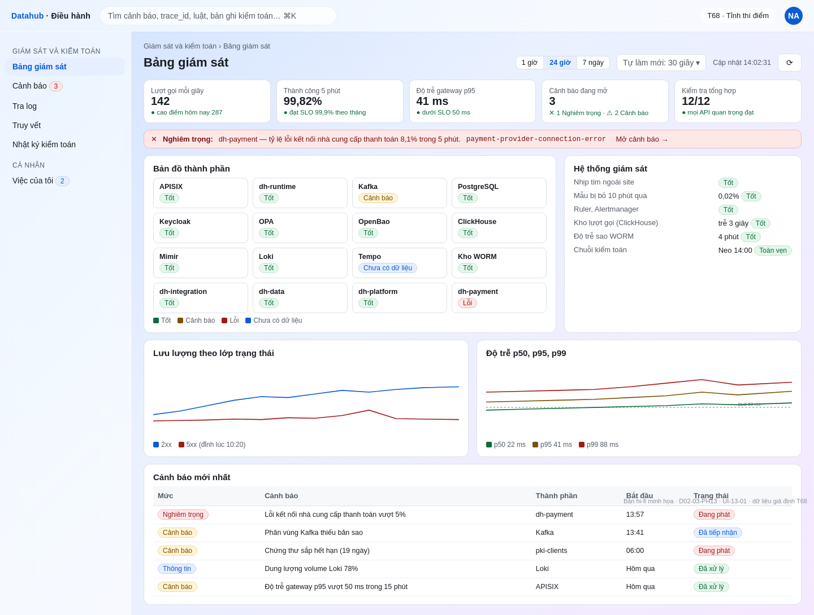
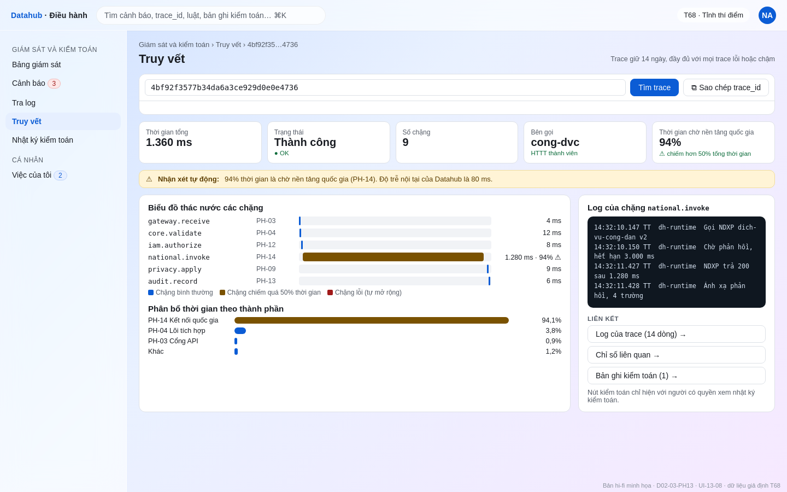
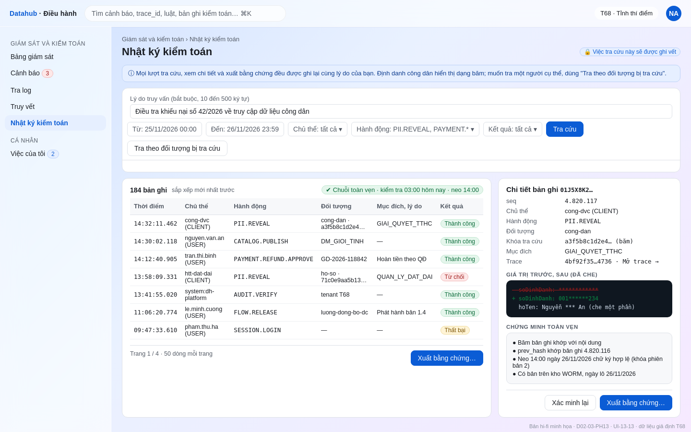

# D02-03-PH13 · Đặc tả yêu cầu chức năng Giám sát và kiểm toán

## Tóm tắt cho hội đồng thẩm định

**Mục tiêu.** PH-13 là phân hệ xuyên suốt của Datahub, trả lời hai loại câu hỏi khác nhau về bản chất mà hệ LGSP cũ không phân biệt được. Loại thứ nhất là quan sát vận hành: hệ thống có khỏe không, chậm ở chặng nào, vì sao lỗi, ai cần được gọi dậy lúc nửa đêm. Loại thứ hai là kiểm toán: ai đã làm gì, với đối tượng nào, khi nào, kết quả ra sao, và dấu vết đó có bị ai sửa không. Hệ cũ đọc số liệu qua JMX/Jolokia, ghi log một dòng phân tách bằng dấu `|`, có ba màn giám sát riêng cho Bus, Hub, APIM và một bảng "audit" chỉ là bảng thường trong cơ sở dữ liệu. PH-13 thay toàn bộ bằng một nền quan sát chuẩn mở (OpenTelemetry, Mimir, Loki, Tempo, ClickHouse, Grafana) có mã truy vết xuyên suốt, và một nhật ký kiểm toán chỉ-thêm có chuỗi băm theo tenant, neo ký hằng giờ và sao sang kho WORM, đứng vững cả trước nội gián có quyền quản trị cơ sở dữ liệu.

**Phạm vi.** 61 yêu cầu chức năng chia tám nhóm: thu thập dữ liệu quan sát; ghi vết kiểm toán; tra cứu kiểm toán và bằng chứng; tra log, truy vết và liên kết; bảng điều khiển; cảnh báo; phát hiện bất thường an ninh; cung cấp dữ liệu cho phân hệ khác và vòng đời theo tenant. PH-13 chạy trong DU `dh-platform` (package `vn.datahub.platform.observability` và `vn.datahub.platform.audit`) cùng bộ hạ tầng quan sát ở vùng Z7 và bảng chỉ-thêm `ph13_audit` trên `pg-core`. Phân hệ không sinh dữ liệu quan sát (mỗi DU tự phát), không sinh bản ghi kiểm toán (thư viện `dh-audit` trong mỗi DU), không xử lý bản tin lỗi (PH-18) và không tính chỉ tiêu (PH-16).

**Căn cứ pháp lý.** CMP-LAW-09 (Công văn 631/THH-THHT: giám sát, thống kê, phân tích nghiệp vụ theo thời gian thực); CMP-LAW-16 (Luật An ninh mạng 116/2025: nhật ký hệ thống, lưu trữ trong nước); CMP-LAW-06 và CMP-LAW-08 (NĐ 331/2026, TCVN 14423:2026 cấp độ 3: nhật ký, giám sát, toàn vẹn nhật ký); CMP-LAW-01 (Luật Dữ liệu 60/2024: ghi vết khai thác dữ liệu); CMP-LAW-05 và CMP-LAW-04 (Luật BVDLCN 91/2025, NĐ 356/2025: không để dữ liệu cá nhân trong log, thông báo vi phạm 72 giờ); CMP-LAW-03 (NĐ 278/2025: nhật ký khai thác dữ liệu kết nối quốc gia).

**Những điểm hội đồng cần lưu ý.**

1. Hai đường dữ liệu tách hẳn nhau và không bao giờ gộp (ADR-011, ADR-031). Đường quan sát có lấy mẫu, lưu ngắn (trace 14 ngày, log 90 ngày, chỉ số 90 ngày đầy đủ), mất một phần vẫn chấp nhận được. Đường kiểm toán không bao giờ lấy mẫu, lưu trực tuyến 12 tháng và WORM 5 năm, không chấp nhận mất bản ghi (BR-13-001, NFR-13-011). Gộp hai đường thì hoặc mất bằng chứng pháp lý do lấy mẫu, hoặc phình dung lượng vì lưu mọi log nhiều năm.
2. Nhật ký kiểm toán đứng vững trước nội gián nền tảng: chuỗi băm riêng cho từng tenant, neo ký hằng giờ bằng khóa không xuất được ở OpenBao, ba nơi giữ độc lập (bảng chỉ-thêm, kho WORM Object Lock chế độ tuân thủ, SIEM), kiểm tra toàn vẹn hằng ngày. Sửa trực tiếp một bản ghi trong cơ sở dữ liệu bị phát hiện trong tối đa 24 giờ, và trong 1 giờ nếu chạm đoạn đã neo (NFR-13-016). Cán bộ xem nhật ký cũng bị ghi vết (BR-13-006).
3. Phân hệ chỉ đo sự cố bằng triệu chứng người dùng, không bằng nguyên nhân kỹ thuật, nhằm giảm mệt mỏi cảnh báo; luật cảnh báo nào cũng bắt buộc có runbook năm mục (BR-13-008, BR-13-009). Mục tiêu thời gian phát hiện sự cố nghiêm trọng ≤ 5 phút (KPI-15, NFR-13-015).
4. PH-13 xuyên suốt nhưng không chặn: DU ghi bản ghi kiểm toán vào hộp thư đi trong cùng giao dịch nghiệp vụ nên PH-13 ngừng thì bản ghi chờ, không mất và không chặn người dùng; data plane vẫn chạy khi PH-13 ngừng (NFR-00-012, NFR-13-014). Ngoại lệ duy nhất là dữ liệu Nhạy cảm không bảo đảm được ghi vết ở nguồn thì bên gọi từ chối phục vụ (BR-13-003).
5. Dữ liệu quan sát được che ở ba lớp trước khi lưu và được quét lại hằng ngày để chứng minh 0 giá trị Nhạy cảm trong log (NFR-00-029, NFR-13-021). Mọi kho quan sát cách ly theo tenant, kiểm thử rò rỉ chạy mỗi ngày (NFR-13-022).
6. Câu hỏi mở cần hội đồng cho ý kiến sớm: Q13-01 (thời hạn WORM nếu văn bản hướng dẫn quy định dài hơn 5 năm), Q13-04 (tỉnh dùng SIEM nào, giao thức nào), Q13-14 (nhật ký lượt gọi API lưu 12 tháng và tổng hợp 5 năm có đủ làm "ghi vết khai thác dữ liệu" theo Luật Dữ liệu chưa).

**Con số chính.**

| Chỉ số | Giá trị |
|---|---|
| Yêu cầu chức năng | 61 (M: 52, S: 8, C: 1); MVP: 59, Đợt sau: 2 (FR-13-055, 060) |
| Quy tắc nghiệp vụ | 35 (BR-13-001…035) |
| Yêu cầu phi chức năng | 31 (NFR-13-001…031) |
| Màn hình | 18 (UI-13-01…18) |
| Mã lỗi | 44 control plane (ERR-13-001…044), 26 chạy nền (ERR-13-101…126), tổng 70 |
| Sự kiện do PH-13 phát | 14 (EVT-13-01…14) |
| API | 90 operation (API-13-001…090, trong đó 089 và 090 nội bộ), định nghĩa đầy đủ ở D03-04-PH13 |
| Thực thể nghiệp vụ | 22 (EN-13-01…22) |
| Chức năng hệ cũ được phủ | 20 hàng `LGC` của D00-03 phần A (10 Bus, 2 Hub, 6 APIM, 2 Payment) và 2 hàng `LGC-NFR` liên quan; 16 FR, 28 NFR, 16 BR, 7 UI của SRS repo |
| ADR liên quan | ADR-011 (OpenTelemetry và LGTM), ADR-031 (nhật ký chỉ-thêm, chuỗi băm, WORM); không tạo ADR mới, đề xuất ở mục 12.4 |

: Con số chính của PH-13 bản 0.1

## 1. Giới thiệu

Chương này nêu tài liệu dùng để làm gì, phủ những gì, ai đọc phần nào, các thuật ngữ và tài liệu căn cứ. Người đọc mới nên đọc hết chương 1 và chương 2 trước khi vào phần đặc tả.

### 1.1. Mục đích của tài liệu

Tài liệu đặc tả đầy đủ hành vi của PH-13 để kỹ sư hiện thực và kiểm thử viên viết ca kiểm thử mà không phải hỏi lại, đồng thời để hội đồng thẩm định thấy phân hệ giải quyết vấn đề gì của hệ cũ, đáp ứng văn bản pháp lý nào và kiểm soát rủi ro ra sao. Mỗi chức năng được đặc tả bằng một khối 17 mục theo chuẩn kết hợp (K-TRINH-BAY §4): mức kỹ thuật (tác nhân và quyền, truy vết, tiền điều kiện, đầu vào, luồng xử lý có mã lỗi, đầu ra, hậu điều kiện, sự kiện, kiểm toán) và mức thuyết minh (mục đích, kích hoạt, luồng thay thế, câu thông báo người dùng nhìn thấy, kết quả, quy tắc nghiệp vụ, màn hình). Các chức năng dùng chung ở SRS (đăng nhập, danh sách, xuất, thông báo, bốn mắt) không nhắc lại mà dẫn chiếu FR-00; riêng bốn yêu cầu kiểm toán FR-00-040…043 được PH-13 hiện thực và đặc tả chi tiết ở nhóm B và C.

### 1.2. Phạm vi

PH-13 chịu trách nhiệm toàn bộ việc thu thập, lưu, truy vấn dữ liệu quan sát, phát hiện sự cố và bất thường, và việc nhận, bảo vệ, tra cứu nhật ký kiểm toán của mọi tenant. Bảng đầu liệt kê việc PH-13 làm theo nhóm chức năng; bảng sau liệt kê việc PH-13 không làm và phân hệ chịu trách nhiệm.

| # | Trách nhiệm | Nhóm FR |
|---|---|---|
| 1 | **Thu thập** chỉ số, log, trace, siêu dữ liệu lượt gọi API và chỉ số hạ tầng; gắn tenant, che dữ liệu Nhạy cảm, lấy mẫu trace theo kết quả, kiểm tra tổng hợp mỗi phút, cách ly theo tenant | A (001…009) |
| 2 | **Ghi vết kiểm toán**: tiếp nhận bản ghi từ `dh-audit`, ghi chỉ-thêm và nối chuỗi băm theo tenant, neo ký hằng giờ, sao WORM, kiểm tra toàn vẹn, xử lý đứt chuỗi, chịu lỗi, đối chiếu số lượng, vòng đời lưu giữ, tự kiểm toán | B (010…019) |
| 3 | **Tra cứu kiểm toán và bằng chứng**: tra cứu có lý do, xem chi tiết và xác minh băm, tab Lịch sử của đối tượng, tra theo đối tượng bị tra cứu, xuất bằng chứng ký số, báo cáo truy cập liên tenant | C (020…025) |
| 4 | **Tra log, truy vết và liên kết**: tra log tập trung, chi tiết dòng log và theo dõi trực tiếp, tìm trace và biểu đồ thác nước, liên kết chỉ số, trace, log, kiểm toán bằng `trace_id`, tra nhật ký truy cập API | D (026…030) |
| 5 | **Bảng điều khiển**: tổng quan nền tảng, đơn vị triển khai, luồng và route, endpoint, API và HTTT, nút gateway, cụm Kafka, hoạt động nghiệp vụ, an ninh, bộ dashboard theo tenant | E (031…041) |
| 6 | **Cảnh báo**: luật kèm runbook, bộ luật chuẩn, đánh giá và chống nhấp nháy, phân mức, gom nhóm, gửi theo lịch trực, leo thang, xử lý cảnh báo, giám sát chính hệ thống giám sát, thống kê hiệu quả | F (042…050) |
| 7 | **Phát hiện bất thường an ninh**: bộ luật UC-SEC-01…25, phát hiện từ bản ghi kiểm toán, xử lý cảnh báo an ninh, đẩy sang SIEM/SOC, báo cáo sự cố | G (051…055) |
| 8 | **Cung cấp dữ liệu** cho PH-16, PH-18 và phân hệ khác; **vòng đời theo tenant**: khởi tạo, đóng chuỗi, tham số và hạn mức | H (056…061) |

: Trách nhiệm của PH-13 theo nhóm chức năng

| Không làm | Thuộc |
|---|---|
| Sinh dữ liệu quan sát (chỉ số, log, trace): mỗi DU, APISIX, Kafka, Keycloak tự phát theo chuẩn OTLP hoặc Prometheus | Mọi phân hệ và thành phần nền (NFR-00-050, 051) |
| Sinh bản ghi kiểm toán tại nguồn và che giá trị trước, sau | Thư viện `dh-audit` trong từng DU (FR-00-040, 041); PH-13 chỉ nhận, kiểm tra lại, lưu và bảo vệ |
| Xử lý bản tin lỗi (DLQ), gửi thư điện tử và tin nhắn SMS | PH-18 (IF-09); PH-13 chỉ cung cấp ngữ cảnh chẩn đoán (FR-13-057) và gọi dịch vụ gửi của PH-18 |
| Quyết định ủy quyền, đăng nhập, quản lý người dùng và vai trò | PH-12 |
| Tính chỉ tiêu, báo cáo định kỳ cho lãnh đạo | PH-16 (PH-13 cung cấp số liệu thô, FR-13-056) |
| Tạm ngừng, thu hồi HTTT khi có sự cố an ninh | PH-01 (PH-13 chỉ đề xuất, FR-13-053) |
| Che, ẩn danh dữ liệu nghiệp vụ; chính sách phân loại | PH-09 và D03-07 §3.2 (PH-13 kiểm tra lại, không quyết định chính sách) |
| Cài đặt, nâng cấp, định cỡ cụm Mimir, Loki, Tempo, ClickHouse, Grafana, Ceph RGW | Nhóm nền tảng theo D03-09; PH-13 chỉ khai báo nghiệp vụ |
| Phát sinh nguồn log hạ tầng cho các luật UC-SEC (Falco, Kyverno, Argo CD, Hubble, audit log Kubernetes, OpenBao, `pgaudit`) | Nhóm nền tảng (SEC-61, SEC-65); PH-13 lưu, đánh luật và hiển thị |
| Dashboard nghiệp vụ riêng của từng phân hệ (ví dụ kênh thanh toán) | Phân hệ chủ (PH-19…); PH-13 cung cấp số liệu và bộ khung |
| Xử lý lỗi vận hành chung, gán người xử lý sự cố, quy trình ứng cứu | PH-18 và quy trình D03-07 §8 |

: Việc ngoài phạm vi PH-13 và phân hệ chịu trách nhiệm

### 1.3. Đối tượng sử dụng và cách đọc

Bảng sau gợi ý phần nên đọc theo vai trò người đọc.

| Người đọc | Đọc phần | Mục đích |
|---|---|---|
| Hội đồng thẩm định, lãnh đạo Sở | Tóm tắt, chương 1, 2, 11, 13, 14 | Hiểu vấn đề hệ cũ, mục tiêu đo được, căn cứ pháp lý, rủi ro còn mở và tiêu chí nghiệm thu |
| Kỹ sư `dh-platform`, nhóm nền tảng | Chương 3 đến 9 | Hiện thực API, bộ tiếp nhận, bộ neo, máy trạng thái, mã lỗi |
| Cán bộ ATTT, kiểm toán viên | Mục 2.1, 4.1, nhóm B, C, G, chương 7 | Hiểu cách chống sửa nhật ký, cách tra cứu và xuất bằng chứng, luật phát hiện |
| Cán bộ vận hành, người trực | Nhóm D, E, F, mục 9.2, 10 | Cách chẩn đoán, đọc cảnh báo và runbook |
| Kiểm thử viên | Chương 4, 6, 7, 8, 9, 14 | Viết ca dương, ca âm, ca biên, ca chaos theo luồng chính, ngoại lệ và ngưỡng |
| Người viết UC, SDD, CSDL, API, màn hình | Chương 5, 6, 9, 10, mục 4.2 | Dùng đúng mã, tên thực thể, quyền; ghi đề nghị bổ sung khi thiếu |

: Người đọc và phần nên đọc

### 1.4. Thuật ngữ và chữ viết tắt

Khái niệm nghiệp vụ riêng của PH-13 (bản ghi kiểm toán, chuỗi, neo, cảnh báo, luật, runbook…) được định nghĩa ở mục 4.1. Bảng dưới giải thích chữ viết tắt và thuật ngữ kỹ thuật dùng trong tập này; viết tắt vai trò ở mục 3.1.

| Viết tắt, thuật ngữ | Giải thích |
|---|---|
| Alertmanager | Thành phần của hệ Prometheus nhận cảnh báo, gom nhóm, chống lặp, định tuyến tới kênh nhận |
| Cardinality, số chuỗi hoạt động | Số tổ hợp giá trị nhãn của chỉ số (active series); quá nhiều làm Mimir chậm và tốn bộ nhớ |
| ClickHouse | Cơ sở dữ liệu cột dùng lưu siêu dữ liệu lượt gọi API (D03-09 §2.4) |
| Chuỗi băm | Mỗi bản ghi chứa băm SHA-256 của bản ghi trước, nên sửa một bản ghi làm đứt mọi bản ghi sau |
| Collector | OpenTelemetry Collector: nhận, che, gắn nhãn, lấy mẫu và chuyển dữ liệu quan sát tới các kho |
| ECS, OCSF | Hai lược đồ chuẩn hóa sự kiện an ninh khi đẩy sang SIEM |
| HMAC | Băm có khóa; dùng băm khóa nghiệp vụ nhạy cảm (số định danh) để tra cứu được mà không lưu giá trị rõ |
| Kiểm tra tổng hợp (synthetic probe) | Lời gọi giả lập chạy đều đặn tới API quan trọng để phát hiện sự cố trước khi người dùng báo |
| LGTM | Bộ Loki (log), Grafana, Tempo (trace), Mimir (chỉ số) |
| LogQL, PromQL | Ngôn ngữ truy vấn log của Loki và chỉ số của Prometheus, Mimir |
| MTTD, MTTA, MTTR | Thời gian trung bình phát hiện, xác nhận, khôi phục sự cố |
| Neo (anchor) | Bản tóm tắt `{tenant, seq cuối, hash cuối, thời điểm}` được ký và lưu ở nhiều nơi để chống dựng lại chuỗi giả |
| Object Lock chế độ tuân thủ | Tính năng S3 cấm xóa, sửa đối tượng trong thời hạn giữ, kể cả với tài khoản quản trị |
| OTLP, OpenTelemetry | Chuẩn mở thu chỉ số, log, trace; OTLP là giao thức truyền |
| Outbox | Bảng trong DU lưu sự kiện cùng giao dịch nghiệp vụ, bộ chuyển gửi sau để không mất khi nơi nhận ngừng |
| Runbook | Hướng dẫn xử lý đính kèm luật cảnh báo, gồm năm mục (BR-13-008) |
| SIEM, SOC | Hệ thống quản lý sự kiện an ninh; trung tâm giám sát an ninh |
| SLO, tốc độ tiêu hao (burn rate) | Mục tiêu mức dịch vụ; tốc độ dùng hết ngân sách lỗi, dùng để cảnh báo theo triệu chứng |
| Span, trace | Một chặng xử lý; trace là tập span cùng `trace_id` thể hiện hành trình một yêu cầu |
| Tail sampling | Lấy mẫu sau khi trace hoàn tất để giữ 100% trace lỗi hoặc chậm |
| W3C Trace Context | Chuẩn truyền `traceparent` giữa các thành phần |
| WORM | Ghi một lần, đọc nhiều lần; kho lưu không sửa, không xóa được trong thời hạn giữ |

: Chữ viết tắt và thuật ngữ kỹ thuật của PH-13

### 1.5. Tài liệu tham chiếu

Căn cứ pháp lý được đánh mã `CMP-LAW-*` theo D00-01 §7; tài liệu dự án và ADR là căn cứ kỹ thuật. Khi các tài liệu này mâu thuẫn với tập này về mã hoặc thuộc tính của PH-13, tập này là nguồn chuẩn cho sáu tập còn lại.

| Loại | Tài liệu | Dùng cho |
|---|---|---|
| Pháp lý | CMP-LAW-09 Công văn 631/THH-THHT | Giám sát, thống kê, phân tích nghiệp vụ thời gian thực; hoạt động liên tục |
| Pháp lý | CMP-LAW-16 Luật An ninh mạng 116/2025 | Nhật ký hệ thống, lưu trữ trong nước |
| Pháp lý | CMP-LAW-06 NĐ 331/2026, CMP-LAW-08 TCVN 14423:2026 | Cấp độ 3: nhật ký, giám sát, toàn vẹn nhật ký, thời hạn lưu |
| Pháp lý | CMP-LAW-01 Luật Dữ liệu 60/2024 | Ghi vết khai thác dữ liệu |
| Pháp lý | CMP-LAW-05 Luật BVDLCN 91/2025, CMP-LAW-04 NĐ 356/2025 | Không dữ liệu cá nhân trong log; thông báo vi phạm 72 giờ |
| Pháp lý | CMP-LAW-03 NĐ 278/2025 | Nhật ký khai thác dữ liệu kết nối quốc gia |
| Dự án | D02-02 SRS (FR-00-040…043, FR-00-012, NFR-00-027…029, 050…052, 062) | Chức năng kiểm toán dùng chung, lưu giữ, quan sát |
| Dự án | D02-08 Ma trận phân quyền | Vai trò, `PERM-13-*`, scope |
| Dự án | D03-07 §7 (nhật ký kiểm toán, SIEM, UC-SEC-01…25), SEC-32, 60…67 | Thiết kế kiểm toán và giám sát an ninh |
| Dự án | D03-09 §2.3, §2.4, §6, §8 | Định cỡ, thời hạn giữ, cảnh báo hạ tầng, sao lưu |
| Dự án | D03-10 (đa tenant: Grafana theo tenant, chuỗi kiểm toán theo tenant, sáp nhập) | Cách ly và vòng đời tenant |
| Dự án | D02-04-PH13; D03-02-PH13; D03-03-PH13; D03-04-PH13; D03-06-PH13; D05-02-PH13 | Sáu tập cùng phân hệ |
| ADR | ADR-011 (OpenTelemetry và LGTM), ADR-031 (nhật ký chỉ-thêm, chuỗi băm, WORM) | Quyết định công nghệ chính |
| ADR | ADR-008 (Garage), ADR-012 (OpenBao: khóa ký, HMAC), ADR-030 (cấp độ 3), ADR-034 (DR hai site) | Kho đối tượng, khóa, cấp độ, phục hồi |
| Lịch sử | SRS repo `docs/07-srs/SRS-PH-13-observability.md` | Ánh xạ mã cũ ở mục 11.3 |

: Tài liệu tham chiếu của PH-13

### 1.6. Cấu trúc tài liệu

Chương 2 là tổng quan cho hội đồng; chương 3 tác nhân và quyền; chương 4 khái niệm, thực thể, máy trạng thái; chương 5 danh sách 61 chức năng; chương 6 đặc tả 17 mục theo nhóm A…H; chương 7 và 8 quy tắc nghiệp vụ, phi chức năng và tham số; chương 9 mã lỗi, thông báo, sự kiện và API; chương 10 giao diện; chương 11 truy vết; chương 12 phụ thuộc, giả định, ràng buộc và đề nghị đồng bộ; chương 13 và 14 câu hỏi mở và tiêu chí chấp nhận.

## 2. Tổng quan phân hệ

Chương này viết cho hội đồng thẩm định: PH-13 giải quyết vấn đề gì, cam kết những chỉ tiêu nào, nằm ở đâu trong kiến trúc Datahub và chạy theo luồng nào.

### 2.1. Bối cảnh và vấn đề cần giải quyết

Một nền tảng tích hợp dùng chung nhiều tỉnh chỉ đáng tin khi người vận hành thấy được nó đang làm gì và khi thanh tra hỏi thì chứng minh được ai đã làm gì. Hai nhu cầu này khác nhau về bản chất và quyết định toàn bộ thiết kế của PH-13. Quan sát vận hành cần nhanh, đủ dùng và lấy mẫu được; mất một phần dữ liệu chấp nhận được. Kiểm toán cần đầy đủ 100%, không sửa được và giữ nhiều năm; mất một bản ghi là mất chứng cứ. Lấy mẫu bản ghi kiểm toán làm mất bằng chứng pháp lý, còn lưu 100% log vận hành nhiều năm làm phình dung lượng vô ích, nên PH-13 vận hành hai đường song song và không trộn lẫn.

Hệ cũ giải quyết cả hai nhu cầu bằng cách tạm bợ. Bảng dưới nêu các hạn chế đã kiểm kê ở D00-03 và cách PH-13 khắc phục.

| Hạn chế của hệ cũ | Hệ quả | Cách PH-13 khắc phục |
|---|---|---|
| Đọc số liệu qua JMX/Jolokia (LGC-BUS-030), phải mở cổng JMX trong mạng | Rủi ro an ninh; chỉ có số liệu tổng, không có hành trình một giao dịch | OpenTelemetry và Micrometer đẩy ra Collector, không mở JMX (FR-13-001, 003) |
| Log một dòng phân tách bằng dấu `\|`, không có mã truy vết (LGC-NFR-004) | Không truy được một giao dịch qua nhiều module; khó tìm, khó che dữ liệu | Log JSON có `trace_id`, `tenant_id`; tra tập trung theo trace (FR-13-002, 026, 029) |
| Ba màn giám sát riêng cho Bus, Hub, APIM; mỗi nơi một kiểu biểu đồ (LGC-BUS-007…027, LGC-HUB-005, 006, LGC-APIM-023…026) | Người vận hành dùng nhiều giao diện, KPI-17 nền là 5 giao diện | Một bảng giám sát thống nhất theo cấp: nền tảng, luồng, API, HTTT, hạ tầng (nhóm E) |
| Giám sát gateway theo CPU, Java heap, JVM (LGC-APIM-025) | Không còn đúng khi gateway là APISIX không chạy JVM | Chỉ số riêng của APISIX và nút (FR-13-036, 037) |
| Bảng "audit" của APIM là bảng thường (LGC-APIM-027) | Quản trị cơ sở dữ liệu sửa hoặc xóa được mà không để lại dấu | Bảng chỉ-thêm, chuỗi băm theo tenant, neo ký hằng giờ, WORM (FR-13-011…015) |
| Không phân biệt log vận hành và nhật ký kiểm toán | Hoặc mất bằng chứng, hoặc lưu thừa | Hai đường riêng, thời hạn riêng (mục 8.2) |
| Không có cảnh báo chủ động; người dân phản ánh trước (KPI-15 nền: không đo) | Phát hiện sự cố chậm | Luật cảnh báo theo triệu chứng, kiểm tra tổng hợp mỗi phút, MTTD ≤ 5 phút (FR-13-008, 042…049) |
| Không có lịch trực, leo thang, runbook | Cán bộ trực lúng túng ngoài giờ | Lịch trực, leo thang, runbook bắt buộc (FR-13-042, 046, 048) |
| Log truy cập có thể chứa dữ liệu cá nhân (số định danh, họ tên) | Lộ dữ liệu cá nhân trong kho log | Che ba lớp, quét hằng ngày (FR-13-005, NFR-00-029) |

: Hạn chế của hệ cũ, hệ quả và cách PH-13 khắc phục

### 2.2. Mục tiêu của phân hệ

PH-13 cam kết sáu mục tiêu đo được dưới đây. Mỗi mục tiêu gắn với yêu cầu phi chức năng ở mục 8.1 (chỉ tiêu, điều kiện đo) và tiêu chí chấp nhận ở chương 14; điều kiện đo mặc định là hồ sơ "tỉnh vừa" (GĐ-07, `QM-VUA`).

| # | Mục tiêu | Chỉ tiêu đo được | NFR | Tiêu chí |
|---|---|---|---|---|
| 1 | Thấy sự cố sớm và đúng chỗ | MTTD mức Nghiêm trọng ≤ 5 phút; chỉ số lên bảng điều khiển p95 ≤ 30 giây; thông báo tới người trực ≤ 60 giây p95 | NFR-13-001, 015 | 3, 4 |
| 2 | Truy một giao dịch qua mọi thành phần | 100% DU phát `trace_id`; trace theo mã p95 ≤ 2 giây; 100% trace lỗi hoặc chậm được giữ; nhảy giữa chỉ số, trace, log, kiểm toán một thao tác | NFR-13-003, 005, 027 | 5 |
| 3 | Kiểm toán đầy đủ và không sửa được | 100% thao tác thuộc FR-00-040 có bản ghi (chênh lệch đối chiếu 0); 0 bản ghi mất; sửa trực tiếp bị phát hiện ≤ 24 giờ; WORM 5 năm | NFR-13-011, 016, 019, 026 | 1, 2, 6 |
| 4 | Không lộ dữ liệu qua giám sát, cách ly tỉnh | 0 giá trị Nhạy cảm trong log, trace, chỉ số, bản ghi kiểm toán; 0 truy vấn chéo tenant thành công | NFR-13-021, 022, 024 | 7, 8 |
| 5 | Không làm hại nền tảng | PH-13 ngừng không gây lượt gọi lỗi; đường cảnh báo ≥ 99,9% mỗi tháng; bản ghi kiểm toán chờ ở nguồn ≥ 4 giờ không mất | NFR-13-011, 013, 014 | 9 |
| 6 | Cảnh báo ít nhiễu, có hướng xử lý | 100% luật có runbook đủ năm mục; tỷ lệ cảnh báo giả ≤ 30% sau 30 ngày chạy | NFR-13-028 | 4 |

: Mục tiêu đo được của PH-13

### 2.3. Vị trí trong kiến trúc

PH-13 gồm hai đường dữ liệu và một lớp truy vấn. Đường quan sát nằm ở vùng quan sát Z7 (`dh-obs`) với kho cột ClickHouse ở Z5; đường kiểm toán đi qua Kafka vào bảng chỉ-thêm trên `pg-core` do `dh-platform` ở Z3 quản lý, rồi sao ra kho WORM tách biệt. Sơ đồ dưới đặt các thành phần theo hai đường và bên sử dụng.

```{.mermaid caption="Vị trí PH-13 trong kiến trúc Datahub: đường quan sát, đường kiểm toán và bên sử dụng"}
flowchart TB
  subgraph SRC["Nguồn phát"]
    APX["APISIX, WAF"]
    DU["DU Spring, dh-runtime<br/>OTel SDK, thư viện dh-audit"]
    INF["Kubernetes, Kafka, PostgreSQL,<br/>Keycloak, OpenBao"]
  end
  subgraph OBS["Đường quan sát (Z7 dh-obs, Z5 dh-olap)"]
    COL["OTel Collector<br/>gắn tenant, che, lấy mẫu"]
    MIM["Mimir: chỉ số"]
    LOK["Loki: log"]
    TMP["Tempo: trace"]
    CHS[("ClickHouse<br/>lượt gọi API")]
    RUL["Ruler và Alertmanager"]
  end
  subgraph AUD["Đường kiểm toán (dh-platform Z3, pg-core Z5)"]
    KAF[("Kafka<br/>obs.audit.recorded")]
    ING["Bộ tiếp nhận"]
    PG[("ph13_audit<br/>bảng chỉ-thêm")]
    ANC["Bộ neo, sao WORM,<br/>kiểm tra toàn vẹn"]
    WORM[("Kho WORM<br/>Object Lock")]
  end
  subgraph USE["Bên sử dụng"]
    CON["dh-console, Grafana"]
    ONC["Người trực, SIEM"]
    OTH["PH-16, PH-18, tab Lịch sử"]
  end
  APX --> COL
  DU --> COL
  INF --> COL
  APX -->|"kafka-logger"| CHS
  COL --> MIM
  COL --> LOK
  COL --> TMP
  MIM --> RUL
  LOK --> RUL
  DU -->|"outbox"| KAF
  KAF --> ING --> PG --> ANC --> WORM
  RUL --> ONC
  MIM --> CON
  CHS --> CON
  PG --> CON
  PG --> OTH
  MIM --> OTH
  ANC --> ONC
```

Hình cho thấy hai đường không có mũi tên nào nối chéo: dữ liệu quan sát không đi vào bảng kiểm toán và ngược lại. Kiểm toán đi từ hộp thư đi của DU qua Kafka vào bảng chỉ-thêm rồi tới WORM và SIEM, nên mất đường nào cũng không mất bản ghi (bản ghi còn ở hộp thư đi, ở Kafka, ở bảng). Đường quan sát có lấy mẫu và che dữ liệu ở Collector. Bảng điều khiển chuẩn dựng trong `dh-console` gọi API của PH-13; Grafana dành cho người vận hành khám phá sâu, đăng nhập một lần qua Keycloak, tổ chức tách theo tenant (D03-01 §4.1).

### 2.4. Kiến trúc thành phần và công nghệ

PH-13 không thêm DU mới: phần ứng dụng là hai package trong `dh-platform`, phần quan sát là bộ hạ tầng của nhóm nền tảng, bảng kiểm toán nằm trên `pg-core`. Bảng dưới nêu thành phần, nơi chạy, công nghệ và nhóm FR mỗi thành phần hiện thực.

| Thành phần | Nơi chạy | Công nghệ | Nhóm FR |
|---|---|---|---|
| OTel Collector dạng agent | Mỗi nút, DaemonSet | OpenTelemetry Collector (receiver `otlp`, `prometheus`, `filelog`; processor `memory_limiter`, `k8sattributes`, `redaction`) | A |
| OTel Collector dạng gateway | `dh-obs` (Z7), 3 bản sao | Processor `attributes` gắn tenant, `tail_sampling`, `transform`; exporter tới Mimir, Loki, Tempo, syslog | A, G |
| Mimir (chỉ số), Ruler | `dh-obs` | Mimir, PromQL, ruler theo tenant | A, E, F |
| Loki (log), Ruler | `dh-obs` | Loki, LogQL, nhãn có giới hạn | A, D, F |
| Tempo (trace) | `dh-obs` | Tempo, TraceQL | A, D |
| ClickHouse | `dh-olap` (Z5) | Bảng `access_log` `ReplicatedMergeTree` sắp theo `(tenant_id, route_id, ts)`, động cơ Kafka | A, D, E |
| Alertmanager | `dh-obs`, 3 bản sao | Gom nhóm, chống lặp, định tuyến, tạm ẩn | F |
| API quan sát `/api/observability/v1` | `dh-platform` (Z3) | Java 21, Spring Boot 4, Spring Modulith; proxy truy vấn ép nhãn tenant | C…H |
| API kiểm toán `/api/audit/v1` | `dh-platform` | Như trên; vai trò cơ sở dữ liệu chỉ `INSERT`, `SELECT` | B, C |
| Bộ tiếp nhận kiểm toán | `dh-platform` | Consumer Kafka, một consumer mỗi phân vùng tenant, khóa tư vấn theo tenant | B |
| Bảng `ph13_audit.audit_event` và bảng neo | `pg-core` (Z5) | PostgreSQL 18, phân vùng theo tháng, RLS theo `tenant_id`, trigger chặn sửa xóa | B, C |
| Bộ neo, sao WORM, kiểm tra toàn vẹn, đối chiếu | `dh-platform`, một bản sao nhờ khóa phân tán | Tác vụ nền theo lịch, `TenantContext.runAs` | B |
| Khóa ký và khóa HMAC | OpenBao (Z6) | Transit `dh-audit-sign` (ECDSA P-256, không xuất), khóa HMAC `dh-{tenant}-audit-hmac` | B, C |
| Kho WORM | Hệ lưu trữ riêng, Ceph RGW (Q306) | Bucket `dh-worm-audit`, tiền tố `{tenant}/`, Object Lock chế độ tuân thủ | B |
| Bộ phát hiện bất thường | `dh-platform` | Truy vấn tổng hợp mỗi phút trên phân vùng nóng của bảng kiểm toán, đẩy vào Alertmanager | G |
| Grafana | `dh-obs`, CSDL `pg-infra` | Tổ chức theo tenant, dashboard khai báo bằng mã, đăng nhập qua Keycloak | E, F |
| Bộ xuất SIEM | Deployment `otel-siem` | Syslog RFC 5424 trên TLS hoặc OTLP, ánh xạ ECS hoặc OCSF | G |
| `alert-relay` | `dh-obs`, 2 bản sao | Kênh cảnh báo `CRITICAL` độc lập, không dùng PH-18, `pg-core` hay Kafka | F |

: Thành phần và công nghệ của PH-13

Sơ đồ trình tự dưới đây là luồng chính của đường quan sát (BP-07): một lượt gọi API lỗi được thu thập, đẩy lên bảng, kích hoạt cảnh báo, gửi người trực và được chẩn đoán bằng `trace_id`.

```{.mermaid caption="Luồng chính đường quan sát của PH-13: thu thập, cảnh báo và chẩn đoán một lượt gọi lỗi"}
sequenceDiagram
  actor TO as Cán bộ trực
  participant AX as APISIX
  participant RT as dh-runtime
  participant CO as OTel Collector
  participant ST as Mimir, Loki, Tempo
  participant RU as Ruler, Alertmanager
  participant PL as dh-platform
  AX->>RT: Chuyển lượt gọi kèm traceparent
  RT-->>AX: Lỗi 502 từ HTTT đích
  AX-)CO: Chỉ số, log, span, đã gắn tenant (FR-13-001, 002, 003)
  CO->>CO: Che dữ liệu, giữ 100% trace lỗi (FR-13-004, 005)
  CO->>ST: Ghi ba kho
  RU->>ST: Đánh giá luật mỗi 30 giây (FR-13-044)
  RU-->>TO: Cảnh báo Nghiêm trọng kèm runbook (FR-13-046)
  TO->>PL: Mở cảnh báo, bấm Mở trace (FR-13-047, 029)
  PL->>ST: Lấy trace, log, chỉ số theo trace_id
  PL-->>TO: Thác nước, phân bổ thời gian, log chặng lỗi
```

Hình cho thấy ba điểm thiết kế. Thứ nhất, dữ liệu quan sát được đẩy ra Collector bất đồng bộ nên APISIX và `dh-runtime` không chờ PH-13. Thứ hai, quyết định giữ trace được đưa sau khi trace hoàn tất (lấy mẫu đuôi) nên trace lỗi không bao giờ bị bỏ. Thứ ba, người trực đi từ cảnh báo tới nguyên nhân bằng một mã `trace_id` mà không phải đoán.

Đường kiểm toán có luồng riêng. Bản ghi sinh trong cùng giao dịch nghiệp vụ của DU, đi qua hộp thư đi và Kafka vào bảng chỉ-thêm, được nối chuỗi băm, neo hằng giờ và sao WORM.

```{.mermaid caption="Luồng chính đường kiểm toán của PH-13: từ thao tác tới bảng chỉ-thêm, neo và WORM"}
sequenceDiagram
  participant DU as DU nguồn, dh-audit
  participant KF as Kafka
  participant IN as Bộ tiếp nhận PH-13
  participant PG as ph13_audit
  participant BK as Bộ neo
  participant OB as OpenBao
  participant WM as Kho WORM
  DU->>DU: Ghi thao tác và bản ghi vào outbox cùng giao dịch
  DU->>KF: Bộ chuyển outbox phát bản ghi (acks=all)
  KF->>IN: Giao theo phân vùng tenant
  IN->>PG: Kiểm tra, nối hash=SHA-256(prev_hash, bản ghi), INSERT (FR-13-010, 011)
  PG-->>IN: Cam kết giao dịch
  IN->>KF: Xác nhận offset sau khi cam kết
  BK->>OB: Ký neo giờ bằng dh-audit-sign (FR-13-012)
  BK->>WM: Sao lô 5 phút kèm neo (FR-13-013)
```

Hình cho thấy offset Kafka chỉ tiến sau khi bản ghi đã cam kết trong PostgreSQL, và bản ghi chỉ rời hộp thư đi của DU khi Kafka đã xác nhận; mất bất kỳ khâu nào thì khâu trước vẫn giữ bản ghi (BR-13-004).

### 2.5. Quy trình nghiệp vụ liên quan

PH-13 phục vụ trực tiếp quy trình BP-07 và là nơi ghi dấu vết cho mọi quy trình còn lại. Bảng dưới nêu vai trò của PH-13 trong từng quy trình.

| Quy trình | Vai trò của PH-13 |
|---|---|
| BP-07 Giám sát, xử lý sự cố và báo cáo (D02-01) | Toàn bộ: bảng điều khiển, cảnh báo, truy vết theo mã, cung cấp ngữ cảnh cho PH-18 và số liệu cho PH-16 |
| BP-01 Kết nạp HTTT và cấp quyền | Lưu bản ghi kiểm toán duyệt, cấp, xoay vòng, thu hồi thông tin xác thực; cảnh báo khi dùng thông tin xác thực lạ (UC-SEC-06, 07) |
| BP-02 Xây dựng và phát hành luồng | Lưu kiểm toán phát hành, quay lui, kích hoạt; bảng điều khiển theo luồng sau phát hành |
| BP-03 Phát hành danh mục dùng chung | Lưu kiểm toán phát hành phiên bản danh mục; tab Lịch sử |
| BP-04 Trao đổi dữ liệu qua sự kiện | Cung cấp lag, lưu lượng, DLQ lên bảng điều khiển; kiểm toán duyệt publication, subscription |
| BP-05 Thanh toán và đối soát | Kiểm toán duyệt hoàn tiền, đổi chế độ định tuyến; luật UC-SEC-13, 14; chứng cứ cho PH-19 |
| BP-06 Khai thác dữ liệu quốc gia | Kiểm toán tra cứu có mục đích, băm khóa tra cứu; luật UC-SEC-10, 11 |
| BP-08 Khởi tạo tenant | Khởi tạo quan sát, chuỗi kiểm toán, tổ chức Grafana cho tenant mới (FR-13-059) |
| BP-09 Chuyển đổi từ hệ cũ | Đối chiếu số liệu giám sát khi chạy song song; giữ bản xuất kiểm toán hệ cũ (Q13-09) |

: Vai trò của PH-13 trong các quy trình nghiệp vụ

Vòng đời điển hình của một sự cố trên nền tảng, từ khi phát hiện tới khi đóng, đi qua các nhóm chức năng của PH-13 theo sơ đồ sau.

```{.mermaid caption="Vòng đời điển hình của một sự cố vận hành đi qua các nhóm chức năng của PH-13"}
flowchart TB
  A["Phát hiện: luật, kiểm tra tổng hợp (nhóm A, F)"] --> B["Phân mức, gom nhóm, gửi theo lịch trực (nhóm F)"]
  B --> C["Người trực xác nhận, đọc runbook (nhóm F)"]
  C --> D["Chẩn đoán: bảng điều khiển, trace, log (nhóm D, E)"]
  D --> E["Xử lý: chuyển PH-18 nếu có bản tin lỗi (nhóm H)"]
  E --> F["Đóng: nguyên nhân, hành động, ghi kiểm toán (nhóm B, F)"]
  F --> G["Học: thống kê cảnh báo giả, chỉnh luật (nhóm F)"]
```

Sơ đồ cho thấy mọi bước đều để lại dấu vết: cảnh báo, xác nhận, đóng, chỉnh luật đều sinh bản ghi kiểm toán (FR-13-019), nên sau sự cố có thể dựng lại ai làm gì và khi nào.

### 2.6. Chức năng hệ cũ được phủ

Bảng dưới liệt kê 20 hàng `LGC` của D00-03 phần A có phân hệ đích là PH-13 và hai hàng `LGC-NFR` liên quan đến nhật ký; nhóm FR phủ từng hàng. Kết luận Giữ nguyên, Nâng cấp, Thay thế cho từng hàng ở mục 11.1.

| Mã | Chức năng hệ cũ | Nhóm FR |
|---|---|---|
| LGC-BUS-007 | Histogram lượng message đi qua và thất bại theo giây | E (FR-13-033) |
| LGC-BUS-014 | Tổng quan toàn hệ thống: số agent hoạt động trên tổng số | E (FR-13-031, 032) |
| LGC-BUS-015 | Dữ liệu từng agent: route, endpoint, thành công, thất bại, thời gian trung bình | E (FR-13-032) |
| LGC-BUS-016 | Đồ thị bộ nhớ và CPU từng agent | E (FR-13-032) |
| LGC-BUS-017 | Chi tiết agent | E (FR-13-032), PH-04 |
| LGC-BUS-019 | Chi tiết route: biểu đồ tổng thực hiện theo route | E (FR-13-033) |
| LGC-BUS-027 | Thống kê theo endpoint: lưu lượng, bản tin gần nhất, lỗi, API gọi nhiều nhất | E (FR-13-034) |
| LGC-BUS-029 | Quản trị log của agent và chi tiết log | D (FR-13-026, 027) |
| LGC-BUS-030 | Lấy dữ liệu JMX/Jolokia về route, endpoint | A (FR-13-001, 007) |
| LGC-BUS-038 | Logging quá trình routing | A, D (FR-13-003, 028) |
| LGC-HUB-005, 006 | Biểu đồ % Memory, % CPU của Hub | E (FR-13-038) |
| LGC-APIM-022 | Log mọi request tới API của Application, xem chi tiết | A, D (FR-13-006, 030), PH-03 |
| LGC-APIM-023 | Danh sách gateway đang kết nối | E (FR-13-036), PH-03 |
| LGC-APIM-024 | Chi tiết một gateway | E (FR-13-036) |
| LGC-APIM-025 | Giám sát gateway: CPU, Java heap, JVM | E (FR-13-037) |
| LGC-APIM-026 | Dashboard hoạt động chung của hệ thống API | E (FR-13-031, 035) |
| LGC-APIM-027 | Audit: thông tin tác động hệ thống | B, C (FR-13-010…025) |
| LGC-PAY-009 | Thông báo lỗi kết nối với nhà cung cấp thanh toán | F (FR-13-043), PH-19 |
| LGC-PAY-021 | Danh sách, lọc, xem chi tiết nhật ký giao dịch | D (FR-13-030), PH-19 |
| LGC-NFR-004 | Log có cấu trúc, mã giao dịch liên kết giữa module | A (FR-13-002) |
| LGC-NFR-005 | Sao lưu log mỗi tháng một lần | B (FR-13-018), mục 8.2 |

: Chức năng hệ cũ được PH-13 phủ

## 3. Tác nhân, vai trò và quyền

Chương này nêu ai và hệ thống nào tương tác với PH-13, quyền nào cho phép thao tác nào và các ràng buộc tách nhiệm vụ. Nguyên tắc chủ đạo: người xem nhật ký kiểm toán không phải người quản trị cấu hình giám sát, và không ai, kể cả quản trị nền tảng, có đường ghi vào nhật ký.

### 3.1. Tác nhân

Tác nhân gồm mười vai trò người theo D02-08 và các nhóm hệ thống. Cột "Viết tắt" là ký hiệu dùng trong toàn bộ tập này. Vai trò `ROLE-PLATFORM_AUDITOR` của D02-08 dùng cùng quyền với AU nhưng ở phạm vi toàn nền tảng, nên gộp vào ký hiệu AU khi mô tả quyền.

| Tác nhân | Viết tắt | Loại | Tương tác chính |
|---|---|---|---|
| Quản trị nền tảng | PA | Người | Cấu hình PH-13 cho tenant `PLATFORM`; xem bảng điều khiển liên tenant; luật chuẩn của nền tảng; tham số, SIEM, bộ dashboard |
| Vận hành nền tảng | PO | Người | Giám sát hạ tầng và data plane toàn nền tảng; xử lý cảnh báo; truy cập liên tenant phải có lý do |
| Quản trị tỉnh | TA | Người | Cấu hình giám sát, luật, lịch trực, kênh thông báo, tham số của tenant; xem và xử lý cảnh báo an ninh; xem kiểm toán của tenant |
| Vận hành tỉnh | TO | Người | Theo dõi bảng điều khiển, nhận và xử lý cảnh báo, chẩn đoán bằng log, trace |
| Cán bộ ATTT | SO | Người | Xem kiểm toán, xử lý cảnh báo an ninh, tinh chỉnh ngưỡng luật phát hiện, xuất bằng chứng, đề xuất tạm ngừng HTTT |
| Kỹ sư tích hợp, người duyệt tích hợp | IE, IA | Người | Xem bảng điều khiển theo luồng, tra log, trace để gỡ lỗi luồng của mình |
| Chủ dịch vụ | SV | Người | Xem chỉ số của API thuộc tổ chức mình |
| Người xem, lãnh đạo | VW | Người | Xem bảng điều khiển tổng quan và hoạt động nghiệp vụ, không xem log, kiểm toán |
| Kiểm toán, thanh tra tỉnh | AU | Người | Tra cứu nhật ký kiểm toán, xác minh toàn vẹn, xuất bằng chứng ký số; chỉ đọc |
| Mọi DU và thành phần nền | — | Hệ thống | Phát chỉ số, log, trace theo OTLP; phát bản ghi kiểm toán qua `dh-audit` |
| APISIX | — | Hệ thống | Phát chỉ số, siêu dữ liệu lượt gọi qua Kafka, log truy cập; chuyển `traceparent` |
| PH-12 (Keycloak, OPA) | — | Hệ thống | Xác thực, kiểm tra quyền `PERM-13-*`; sự kiện đăng nhập, quyết định từ chối là nguồn kiểm toán và an ninh |
| OpenBao | — | Hệ thống | Ký neo, tính HMAC, cấp tài khoản cơ sở dữ liệu động; nhật ký của chính OpenBao là nguồn UC-SEC-23 |
| PH-01 | — | Hệ thống | Nhận đề xuất tạm ngừng HTTT từ cảnh báo an ninh |
| PH-16, PH-18 | — | Hệ thống | PH-16 lấy số liệu thô tính chỉ tiêu; PH-18 lấy ngữ cảnh chẩn đoán, và gửi thư, SMS hộ PH-13 (IF-09) |
| PH-20 | — | Hệ thống | Gọi khởi tạo và đóng chuỗi kiểm toán theo vòng đời tenant |
| SIEM, SOC của tỉnh hoặc quốc gia | — | Hệ thống | Nhận log an ninh, cảnh báo, neo kiểm toán qua IF-08 |
| Kho WORM | — | Hệ thống | Nhận lô bản ghi và neo; giữ Object Lock |

: Tác nhân của PH-13

### 3.2. Ma trận quyền

Ma trận dùng ký hiệu của D02-08 §3 (● có, ○ có trong phạm vi tổ chức của mình, — không). Năm quyền đầu đã có ở D02-08 và được dùng nguyên; ba quyền cuối (`PERM-13-alert-ack`, `PERM-13-security`, `PERM-13-admin`) là quyền mới, đã có ở D02-08 bản 0.5 và đối chiếu ở §3.4.

| Quyền | Ý nghĩa | PA | PO | TA | TO | SO | IE | IA | SV | VW | AU |
|---|---|---|---|---|---|---|---|---|---|---|---|
| PERM-13-dashboard | Xem bảng điều khiển giám sát, danh sách cảnh báo, chỉ số, tổng quan | ● | ● | ● | ● | ● | ● | ● | ○ | ● | ● |
| PERM-13-logs | Tra log, trace, nhật ký truy cập API; liên kết ba nguồn | ● | ● | ● | ● | ● | ● | ● | — | — | ● |
| PERM-13-audit-read | Tra cứu, xem chi tiết nhật ký kiểm toán; xem báo cáo truy cập liên tenant; kiểm tra toàn vẹn | ● | — | ● | — | ● | — | — | — | — | ● |
| PERM-13-audit-export | Xuất bằng chứng kiểm toán ký số; chạy kiểm tra toàn vẹn theo yêu cầu | — | — | — | — | ● | — | — | — | — | ● |
| PERM-13-alert-admin | Quản lý luật cảnh báo, runbook, lịch trực, nhóm nhận, kênh thông báo | ● | ● | ● | ● | — | — | — | — | — | — |
| PERM-13-alert-ack | Xác nhận, đánh dấu đã xử lý, tạm ẩn cảnh báo | ● | ● | ● | ● | ● | — | — | — | — | — |
| PERM-13-security | Xem và xử lý cảnh báo an ninh; tinh chỉnh ngưỡng luật phát hiện; lập báo cáo sự cố | ● | — | ● | — | ● | — | — | — | — | — |
| PERM-13-admin | Tham số `13.*`, mục tiêu SIEM, bộ dashboard, hạn mức quan sát | ● | — | ● | — | — | — | — | — | — | — |

: Ma trận quyền PERM-13 theo vai trò

Ghi chú về phạm vi: SV (○) chỉ thấy chỉ số của API thuộc tổ chức mình. PO không có `PERM-13-audit-read` vì người vận hành không cần đọc nhật ký kiểm toán để làm việc (xem Q13-07); khi điều tra sự cố cần xem, PO phải nhờ SO hoặc AU. PA và PO truy cập tenant khác phải qua phiên liên tenant có lý do (FR-00-012, FR-13-025).

### 3.3. Tách nhiệm vụ và tài khoản máy

**Tách nhiệm vụ.** Ba cặp loại trừ bảo vệ tính khách quan của nhật ký. Thứ nhất, người có `PERM-13-alert-admin` (PA, PO, TA, TO) không có `PERM-13-audit-export`, nên người sửa luật cảnh báo không tự xuất bằng chứng về chính mình. Thứ hai, AU chỉ đọc: không có quyền nào ngoài tra cứu, xác minh, xuất. Thứ ba, không vai trò người nào của Datahub có quyền ghi vào bảng kiểm toán: vai trò cơ sở dữ liệu `ph13_app` (chỉ `INSERT`, `SELECT`) và `ph13_archive` (chỉ loại phân vùng đã hết hạn và đã xác minh có ở WORM) được OpenBao cấp động cho tiến trình, không cấp cho người. PH-13 không có luồng duyệt bốn mắt; thay vào đó thao tác nhạy cảm đòi lý do, xác thực lại phiên (step-up) và ghi kiểm toán: tra cứu kiểm toán (FR-13-020), xuất bằng chứng (FR-13-024), tinh chỉnh ngưỡng luật an ninh (FR-13-051). Có đề xuất bốn mắt cho việc xuất toàn bộ chuỗi của một tenant ở Q13-08.

**Máy với máy.** Tài khoản dịch vụ được cấp scope khi triển khai, không cấp cho người hay cho HTTT:

| Scope | Cấp cho | Dùng cho |
|---|---|---|
| `audit:write` | Mọi DU nguồn (`dh-integration`, `dh-data`, `dh-connect`, `dh-payment`, `dh-assist`, `dh-runtime`) | Ghi bản ghi kiểm toán dự phòng qua API khi Kafka không với tới (API-13-089, FR-13-016) |
| `audit:history-read` | BFF của các DU | Lấy lịch sử của một đối tượng cho tab "Lịch sử" (API-13-076, FR-13-022); DU tự kiểm tra `read` của đối tượng trước |
| `obs:metrics-read` | PH-16 | Truy vấn số liệu tổng hợp (API-13-067, 068) |
| `obs:diagnostics-read` | PH-18 | Lấy ngữ cảnh chẩn đoán theo `trace_id` (API-13-069) |
| `obs:health-read` | Phân hệ khác cần biết sức khỏe thành phần | API-13-002 |
| `obs:tenant-provision` | PH-20 | Khởi tạo và đóng chuỗi kiểm toán theo tenant (API-13-072, 073) |

: Scope máy của PH-13

Chiều ngược lại, tài khoản của `dh-platform` giữ scope `event:metrics-read` để đọc chỉ số trục sự kiện từ PH-10 (FR-10-059) và scope tương ứng của các phân hệ khác theo thỏa thuận ở các tập của họ.

### 3.4. Đề nghị đồng bộ D02-08

Các quyền và scope dưới đây đã được thêm hoặc chỉnh ở D02-08 bản 0.5 (§3, §5 và ghi chú về `ROLE-PLATFORM_AUDITOR`); bảng giữ lại làm vết đối chiếu giữa hai tài liệu. Tập này không sửa D02-08.

| Đề nghị | Nội dung |
|---|---|
| Thêm `PERM-13-alert-ack` | PA ●, PO ●, TA ●, TO ●, SO ●; tách khỏi `PERM-13-alert-admin` để người trực xử lý cảnh báo mà không sửa luật |
| Thêm `PERM-13-security` | PA ●, TA ●, SO ● |
| Thêm `PERM-13-admin` | PA ●, TA ● |
| Sửa mô tả `PERM-13-logs` | Thêm "nhật ký truy cập API" |
| Sửa mô tả `PERM-13-audit-read` | Thêm "xem báo cáo truy cập liên tenant, kiểm tra toàn vẹn" |
| Sửa mô tả `PERM-13-audit-export` | Thêm "chạy kiểm tra toàn vẹn theo yêu cầu" |
| Thêm cột `ROLE-PLATFORM_AUDITOR` | Gán `PERM-13-audit-read`, `PERM-13-audit-export`, `PERM-13-dashboard`, `PERM-13-logs`; phạm vi toàn nền tảng, mọi truy cập tenant khác qua phiên liên tenant có lý do |
| Thêm scope máy | `audit:write`, `audit:history-read`, `obs:metrics-read`, `obs:diagnostics-read`, `obs:health-read`, `obs:tenant-provision` vào bảng scope §5 |

: Đề nghị đồng bộ quyền sang D02-08

## 4. Khái niệm và mô hình nghiệp vụ

Chương này định nghĩa khái niệm nghiệp vụ của PH-13, liệt kê thực thể ở mức logic, vẽ máy trạng thái của các đối tượng có vòng đời và chốt định dạng bản ghi kiểm toán, nhãn quan sát và mức độ cảnh báo mà các tập sau phải dùng đúng.

### 4.1. Khái niệm nghiệp vụ

Bảng dưới định nghĩa các khái niệm nghiệp vụ mà chương 5 đến 9 dùng; người viết UC, SDD, CSDL, API, màn hình và ca kiểm thử dùng đúng tên và nghĩa này.

| Khái niệm | Định nghĩa |
|---|---|
| Bản ghi kiểm toán | Dấu vết một thao tác (ai, ở đâu, làm gì, với đối tượng nào, trước và sau, kết quả, lý do, mã truy vết), sinh ở DU nguồn bởi `dh-audit`, đã che giá trị Nhạy cảm, bất biến sau khi ghi |
| Chuỗi kiểm toán | Dãy bản ghi của một tenant, đánh số `seq` liên tục, mỗi bản ghi chứa `prev_hash` và `hash`; mỗi tenant một chuỗi, tenant `PLATFORM` cũng có chuỗi riêng |
| Neo | Bản tóm tắt `{tenant, seq cuối, hash cuối, thời điểm}` được ký bằng khóa `dh-audit-sign` mỗi giờ và lưu ở bảng neo, kho WORM, SIEM |
| Phân vùng kiểm toán | Phần bảng kiểm toán theo tháng ghi (`recorded_at`); hết 12 tháng được lưu trữ, bản trên WORM giữ tiếp |
| Xác minh toàn vẹn | Duyệt lại chuỗi từ neo đã xác minh gần nhất, tính lại băm, đối chiếu với WORM; kết quả đạt hoặc vị trí đứt chuỗi đầu tiên |
| Gói bằng chứng | Tệp nén chứa bản ghi trong phạm vi, chuỗi băm, neo liên quan, khóa công khai, hướng dẫn xác minh ngoại tuyến, ký số bằng chứng thư của Datahub |
| Đối chiếu số lượng | So sánh số bản ghi DU báo đã phát (bộ đếm `dh_audit_emitted_total`) với số PH-13 đã nhận, mỗi ngày, theo DU và tenant |
| Phiên liên tenant | Phiên có thời hạn của người dùng nền tảng truy cập dữ liệu tenant khác, có lý do và được kiểm toán ở cả hai tenant (FR-00-012) |
| Luật cảnh báo | Điều kiện (PromQL hoặc LogQL), ngưỡng, thời gian duy trì, mức độ, runbook, người nhận; chống nhấp nháy bằng thời gian duy trì |
| Runbook | Hướng dẫn xử lý gồm năm mục: ý nghĩa cảnh báo, kiểm tra gì đầu tiên, nguyên nhân thường gặp, cách xử lý, khi nào báo cấp trên |
| Cảnh báo | Một lần luật được thỏa; có trạng thái `FIRING`, `ACKNOWLEDGED`, `SILENCED`, `RESOLVED`; nhãn xác định đối tượng cụ thể (route, HTTT…) |
| Nhóm gom | Tập cảnh báo cùng nguyên nhân (cùng nhãn gom) hiển thị và thông báo gộp |
| Mức độ | `CRITICAL` (Nghiêm trọng): người dùng đang bị ảnh hưởng, gọi trực ngay; `WARNING` (Cảnh báo): có nguy cơ, xử lý trong giờ làm việc; `INFO` (Thông tin): ghi nhận, lập kế hoạch (BR-13-009) |
| Lịch trực | Bảng người nhận theo ca và thứ tự leo thang, theo nhóm trực |
| Kênh thông báo | Đường gửi cảnh báo: thư điện tử, SMS (qua PH-18), webhook, nhắn tin trong ứng dụng |
| Luật phát hiện | Một luật UC-SEC trong D03-07 §7.5 với nguồn, ngưỡng mặc định, mức và người nhận; ngưỡng tinh chỉnh được trong biên cho phép |
| Cảnh báo an ninh | Kết quả của luật phát hiện; cần người xử lý đóng với kết luận (BR-13-024) |
| Đơn vị triển khai (agent) | Một Deployment của `dh-runtime` chạy một nhóm luồng; thay thế "agent" của Bus cũ |
| Bộ dashboard | Nhóm dashboard Grafana chuẩn của PH-13 khai báo bằng mã, nhân bản cho mỗi tenant |
| Kiểm tra tổng hợp | Lời gọi giả lập mỗi phút tới API quan trọng của tenant, đo thành công và độ trễ |
| Truy vấn đã lưu | Bộ lọc tra log hoặc kiểm toán lưu theo người dùng để dùng lại, có thể chia sẻ trong tenant |

: Khái niệm nghiệp vụ của PH-13

### 4.2. Thực thể

Thực thể ở mức logic; định nghĩa cột, kiểu, chỉ mục ở D03-03-PH13. Mọi bảng có `id`, `tenant_id`, `created_at`, `updated_at`, `version` theo D00-04 §4, trừ bảng kiểm toán chỉ-thêm (không có `updated_at`, `version`). Schema PostgreSQL là `ph13_audit` cho nhóm kiểm toán và `ph13_obs` cho nhóm quan sát, cùng trên `pg-core`. 22 thực thể dưới đây được hiện thực bằng 33 bảng; 11 bảng còn lại là bảng hỗ trợ do SDD D03-02-PH13 yêu cầu, nêu ở đầu chương 3 của D03-03-PH13.

| Mã | Thực thể | Bảng | Trường chính | Vòng đời |
|---|---|---|---|---|
| EN-13-01 | Bản ghi kiểm toán | `ph13_audit.audit_event` | Trường ở mục 4.7 | Chỉ-thêm; trực tuyến 12 tháng; WORM 5 năm |
| EN-13-02 | Neo | `ph13_audit.audit_anchor` | `tenant_id`, `seq_last`, `hash_last`, `anchored_at`, `signature`, `key_version`, `kind` (`HOURLY`, `BOUNDARY`, `FINAL`) | Chỉ-thêm; vĩnh viễn; việc công bố (`worm_object`, `siem_ack_at`) ghi ở bảng riêng `audit_anchor_publish` để bảng neo thuần chỉ-thêm |
| EN-13-03 | Chuỗi kiểm toán | `ph13_audit.audit_chain` | `tenant_id`, `genesis_hash`, `head_seq`, `head_hash`, `status` (`OPEN`, `CLOSED`), `closed_at`, `closed_reason` | Tạo khi khởi tạo tenant; `CLOSED` khi tenant ngừng hoặc sáp nhập |
| EN-13-04 | Lượt xác minh toàn vẹn | `ph13_audit.audit_verification` | `tenant_id`, `scope` (`DAILY`, `ON_DEMAND`), `from_seq`, `to_seq`, `status` (`RUNNING`, `PASSED`, `FAILED`), `first_break_seq`, `checked_count`, `requested_by` | Giữ 5 năm |
| EN-13-05 | Yêu cầu xuất bằng chứng | `ph13_audit.audit_export` | `tenant_id`, `filter`, `reason`, `basis`, `status`, `record_count`, `file_object`, `file_hash`, `signature`, `manifest_signature`, `key_version`, `scope_hash`, `reauth_at`, `download_count`, `expires_at` | Theo mục 4.6; giữ siêu dữ liệu 5 năm, tệp 7 ngày |
| EN-13-06 | Lượt đối chiếu số lượng | `ph13_audit.audit_reconciliation` | `tenant_id`, `du_code`, `day`, `emitted`, `received`, `diff`, `status` | Giữ 5 năm |
| EN-13-07 | Luật cảnh báo | `ph13_obs.alert_rule` | `rule_code`, `name`, `expr`, `for_seconds`, `severity`, `runbook_id`, `scope` (`PLATFORM`, `TENANT`), `status`, `owner` | Theo mục 4.5; xóa mềm |
| EN-13-08 | Runbook | `ph13_obs.runbook` | `runbook_code`, `title`, `meaning`, `first_checks`, `common_causes`, `remediation`, `escalation_when` | Vĩnh viễn (xóa mềm) |
| EN-13-09 | Cảnh báo | `ph13_obs.alert` | `rule_code`, `status`, `severity`, `labels` (JSON), `summary`, `started_at`, `ended_at`, `group_key`, `escalation_level`, `resolution`, `fingerprint`, `silence_reason`, `acknowledged_by`, `acknowledged_at` | Theo mục 4.3; giữ 2 năm |
| EN-13-10 | Lượt gửi thông báo | `ph13_obs.alert_notification` | `alert_id` hoặc `security_alert_id` (thông báo của cảnh báo an ninh), `channel_code`, `recipient`, `status`, `attempt`, `sent_at`, `error` | Giữ 2 năm |
| EN-13-11 | Thao tác xử lý cảnh báo | `ph13_obs.alert_action` | `alert_id`, `action` (`ACK`, `RESOLVE`, `SILENCE`, `ESCALATE`), `actor`, `at`, `cause`, `measure`, `outcome` (`FIXED`, `NO_ACTION`, `EXTERNAL`), `silence_until`, `reason` | Giữ 2 năm |
| EN-13-12 | Lịch trực | `ph13_obs.oncall_schedule` | `schedule_code`, `group`, `rotation` (JSON ca), `escalation_order`, `timezone` | Vĩnh viễn |
| EN-13-13 | Kênh thông báo | `ph13_obs.notification_channel` | `channel_code`, `kind` (`EMAIL`, `SMS`, `WEBHOOK`, `INAPP`), `target`, `secret_ref`, `enabled`, `last_test_at` | Vĩnh viễn; bí mật ở OpenBao |
| EN-13-14 | Luật phát hiện | `ph13_obs.detection_rule` | `rule_code` (`UC-SEC-nn`), `source`, `impl`, `threshold` (JSON), `threshold_default` (JSON), `threshold_limit` (JSON), `severity`, `recipients`, `enabled`, `can_disable` | Nạp từ D03-07; sửa ngưỡng ghi kiểm toán |
| EN-13-15 | Cảnh báo an ninh | `ph13_obs.security_alert` | `rule_code`, `status`, `severity`, `subject`, `evidence` (JSON), `detected_at`, `verdict`, `verdict_note` | Theo mục 4.4; giữ 3 năm |
| EN-13-16 | Mục tiêu SIEM | `ph13_obs.siem_target` | `target_code`, `protocol` (`SYSLOG_TLS`, `OTLP`), `endpoint`, `schema` (`ECS`, `OCSF`), `filter`, `enabled` | Vĩnh viễn |
| EN-13-17 | Bộ dashboard | `ph13_obs.dashboard_set` | `set_code`, `version`, `grafana_org`, `synced_at`, `status` | Vĩnh viễn |
| EN-13-18 | Truy vấn đã lưu | `ph13_obs.saved_query` | `kind` (`LOG`, `AUDIT`, `ACCESS`), `name`, `query`, `shared`, `owner` | Xóa cứng khi chủ sở hữu xóa |
| EN-13-19 | Cấu hình quan sát của tenant | `ph13_obs.tenant_obs_config` | `tenant_id`, `params` (JSON `13.*`), `quota` (JSON), `provisioned_at`, `grafana_org_id` | Tạo khi khởi tạo tenant |
| EN-13-20 | Kiểm tra tổng hợp | `ph13_obs.probe_definition` | `probe_code`, `target_api`, `interval_seconds`, `expected_status`, `timeout_ms`, `enabled` | Vĩnh viễn |
| EN-13-21 | Phân vùng kiểm toán | `ph13_audit.audit_partition` | `tenant_id` (luôn `PLATFORM`, phân vùng chung theo tháng), `month`, `status` (`OPEN`, `SEALED`, `ARCHIVED`), `record_count`, `worm_verified_at`, `archive_after`, `archived_at` | Theo mục 4.7 |
| EN-13-22 | Báo cáo sự cố | `ph13_obs.incident_report` | `report_code`, `kind` (`CYBER`, `DLCN_BREACH`), `template`, `content`, `status` (`DRAFT`, `FINAL`), `created_by` | Giữ 5 năm |

: Thực thể nghiệp vụ của PH-13

### 4.3. Máy trạng thái cảnh báo

Cảnh báo (EN-13-09) sinh khi luật được thỏa liên tục đủ thời gian duy trì. Người trực có thể xác nhận, tạm ẩn có thời hạn hoặc đóng với nguyên nhân và hành động; khi điều kiện hết hiệu lực một thời gian, hệ thống tự đóng. Leo thang là thuộc tính `escalation_level`, không phải trạng thái.

```{.mermaid caption="Máy trạng thái cảnh báo EN-13-09"}
stateDiagram-v2
  [*] --> FIRING: luật thỏa đủ thời gian duy trì
  FIRING --> ACKNOWLEDGED: người trực xác nhận
  FIRING --> SILENCED: tạm ẩn có thời hạn và lý do
  ACKNOWLEDGED --> SILENCED: tạm ẩn
  SILENCED --> FIRING: hết hạn tạm ẩn mà điều kiện còn
  FIRING --> RESOLVED: điều kiện hết 5 phút hoặc người đóng
  ACKNOWLEDGED --> RESOLVED: điều kiện hết hoặc người đóng kèm nguyên nhân, hành động
  SILENCED --> RESOLVED: điều kiện hết
  RESOLVED --> [*]
```

Giải thích từng trạng thái:

| Trạng thái | Ý nghĩa | Hành động hợp lệ |
|---|---|---|
| `FIRING` | Đang phát, chưa ai tiếp nhận; thông báo đã hoặc đang gửi; mức Nghiêm trọng chưa xác nhận sau 15 phút thì leo thang | Xác nhận, tạm ẩn, đóng |
| `ACKNOWLEDGED` | Đã có người nhận xử lý; dừng leo thang | Tạm ẩn, đóng |
| `SILENCED` | Tạm ẩn tới `silence_until` (tối đa 7 ngày, Nghiêm trọng tối đa 24 giờ); không gửi thông báo mới | Đóng; hết hạn quay về `FIRING` nếu điều kiện còn |
| `RESOLVED` | Đã đóng, thủ công (`resolution = MANUAL`, có nguyên nhân và hành động) hoặc tự động (`AUTO`) | Không có; chỉ xem |

: Trạng thái và hành động hợp lệ của cảnh báo

### 4.4. Máy trạng thái cảnh báo an ninh

Cảnh báo an ninh (EN-13-15) cần được người có `PERM-13-security` xác nhận và đóng với một trong ba kết luận. Kết luận "sự cố thật" liên kết sang quy trình ứng cứu (D03-07 §8) và cho phép đề xuất tạm ngừng HTTT.

```{.mermaid caption="Máy trạng thái cảnh báo an ninh EN-13-15"}
stateDiagram-v2
  [*] --> NEW: luật phát hiện thỏa
  NEW --> ACKNOWLEDGED: cán bộ ATTT tiếp nhận
  NEW --> CLOSED: điều kiện hết và người đóng kèm kết luận
  ACKNOWLEDGED --> CLOSED: đóng kèm kết luận
  CLOSED --> [*]
```

Sơ đồ cho thấy cảnh báo an ninh chỉ có hai đường đóng, qua tiếp nhận hoặc đóng ngay kèm kết luận; bảng dưới giải thích từng trạng thái và hành động hợp lệ.

| Trạng thái | Ý nghĩa |
|---|---|
| `NEW` | Chưa ai tiếp nhận; mức Nghiêm trọng gửi tới SO ngay và tới TA sau 15 phút nếu chưa tiếp nhận |
| `ACKNOWLEDGED` | Đã có người điều tra; được ghi `assignee` |
| `CLOSED` | Đã đóng với `verdict` ∈ `CONFIRMED_INCIDENT` (sự cố thật), `FALSE_POSITIVE` (báo nhầm), `ACCEPTED_RISK` (chấp nhận rủi ro, có ghi chú); không đóng được nếu thiếu kết luận (ERR-13-023) |

: Trạng thái của cảnh báo an ninh

### 4.5. Máy trạng thái luật cảnh báo

Luật cảnh báo (EN-13-07) luôn có runbook từ khi tạo nên không có trạng thái nháp. Luật chuẩn của nền tảng (`scope = PLATFORM`) tenant không tắt, không sửa được.

```{.mermaid caption="Máy trạng thái luật cảnh báo EN-13-07"}
stateDiagram-v2
  [*] --> ACTIVE: tạo kèm runbook
  ACTIVE --> DISABLED: tắt luật
  DISABLED --> ACTIVE: bật lại
  ACTIVE --> RETIRED: ngừng dùng
  DISABLED --> RETIRED: ngừng dùng
  RETIRED --> [*]
```

Sơ đồ cho thấy vòng đời của một luật cảnh báo từ lúc tạo kèm runbook đến lúc ngừng dùng; bảng dưới giải thích từng trạng thái và hành động hợp lệ.

| Trạng thái | Ý nghĩa |
|---|---|
| `ACTIVE` | Ruler đánh giá luật theo chu kỳ (mặc định 30 giây) |
| `DISABLED` | Không đánh giá; cảnh báo đang mở của luật được đóng tự động |
| `RETIRED` | Xóa mềm; mã luật không dùng lại (BR-13-031) |

: Trạng thái của luật cảnh báo

### 4.6. Máy trạng thái yêu cầu xuất bằng chứng

Xuất bằng chứng (EN-13-05) chạy nền vì có thể rất lớn; tệp có hạn tải.

```{.mermaid caption="Máy trạng thái yêu cầu xuất bằng chứng EN-13-05"}
stateDiagram-v2
  [*] --> REQUESTED: kiểm toán viên gửi yêu cầu
  REQUESTED --> RUNNING: bắt đầu trích xuất
  REQUESTED --> CANCELLED: người yêu cầu hủy
  RUNNING --> READY: ký số xong
  RUNNING --> FAILED: lỗi, không ký được
  READY --> EXPIRED: quá 7 ngày
  FAILED --> [*]
  EXPIRED --> [*]
  CANCELLED --> [*]
```

Sơ đồ cho thấy yêu cầu xuất bằng chứng đi từ lúc gửi, qua trích xuất và ký số, đến khi sẵn sàng, hết hạn, thất bại hoặc bị hủy; bảng dưới giải thích từng trạng thái.

| Trạng thái | Ý nghĩa |
|---|---|
| `REQUESTED` | Đã nhận, chờ chạy; cần lý do, căn cứ, xác thực lại phiên |
| `RUNNING` | Đang trích bản ghi, tính chuỗi băm, đóng gói, ký số |
| `READY` | Tệp có thể tải trong 7 ngày; mỗi lượt tải ghi kiểm toán |
| `FAILED` | Không xuất; không bao giờ để lại tệp chưa ký (BR-13-014) |
| `EXPIRED` | Tệp đã xóa, siêu dữ liệu còn |
| `CANCELLED` | Người yêu cầu hủy khi chưa chạy xong |

: Trạng thái của yêu cầu xuất bằng chứng

### 4.7. Phân vùng kiểm toán và định dạng bản ghi kiểm toán

**Vòng đời phân vùng.** Bảng `audit_event` phân vùng theo tháng của `recorded_at`. Phân vùng tháng hiện tại nhận ghi (`OPEN`); sang tháng mới phân vùng cũ đóng ghi, và khi mọi lô WORM đã sao đủ và đã đối chiếu thì chuyển `SEALED`. Quá 12 tháng, nếu đã xác minh bản trên WORM khớp thì phân vùng được lưu trữ (`ARCHIVED`) và tách khỏi bảng trực tuyến bằng vai trò `ph13_archive`; không đủ điều kiện thì giữ nguyên và báo ERR-13-125.

```{.mermaid caption="Máy trạng thái phân vùng kiểm toán EN-13-21"}
stateDiagram-v2
  [*] --> OPEN: đầu tháng
  OPEN --> SEALED: hết tháng, WORM đủ, đối chiếu khớp
  SEALED --> ARCHIVED: quá 12 tháng, WORM đã xác minh
  SEALED --> SEALED: chưa xác minh được thì giữ và báo
  ARCHIVED --> [*]
```

**Định dạng bản ghi kiểm toán (EN-13-01).** Mở rộng FR-00-041 theo D03-07 §7.1.

| Trường | Kiểu | Bắt buộc | Ràng buộc |
|---|---|---|---|
| `id` | T-ID | Có | UUID v7, DU sinh; trùng thì bỏ qua (idempotent) |
| `tenant_id` | T-TENANT | Có | Phải khớp tenant của topic và của DU nguồn; `PLATFORM` cho thao tác nền tảng |
| `seq` | bigint | Có (PH-13 gán) | Liên tục trong chuỗi tenant, không khoảng trống |
| `occurred_at` | T-TS | Có | Giờ DU ghi nhận; lệch với giờ PH-13 quá 2 giây về tương lai thì cờ ERR-13-126 |
| `recorded_at` | T-TS | Có (PH-13 gán) | Giờ ghi vào bảng; quyết định phân vùng |
| `actor_type` | T-ENUM | Có | `USER`, `CLIENT`, `SYSTEM` |
| `actor_id`, `actor_name` | T-ID, T-NAME | Có | Mã người dùng hoặc client; `system:{du}` cho tác vụ tự động |
| `actor_home_tenant` | T-TENANT | Khi liên tenant | Tenant nhà của người thao tác |
| `source_ip`, `user_agent`, `session_hash` | T-TEXT | Có | `session_hash` là băm của mã phiên |
| `action` | T-CODE | Có | Dạng `{MIỀN}.{HÀNH_ĐỘNG}`, ví dụ `CATALOG.PUBLISH`, `PII.REVEAL`, `PAYMENT.REFUND.APPROVE`, `AUDIT.QUERY` |
| `object_type`, `object_id` | T-CODE, T-ID | Có | Loại và mã đối tượng; dùng cho tab Lịch sử |
| `object_key_hmac` | char(64) | Khi khóa nhạy cảm | HMAC-SHA256 theo khóa tenant của khóa nghiệp vụ nhạy cảm (số định danh) |
| `before`, `after` | T-JSON | Với thao tác sửa | Đã che theo D03-07 §3.2, không chứa bí mật |
| `outcome`, `error_code` | T-ENUM, T-CODE | Có | `SUCCESS`, `DENIED`, `FAILED` |
| `reason`, `purpose` | T-TEXT, T-CODE | Khi bắt buộc | `reason` 10…500 ký tự cho thao tác FR-00-050, xem Nhạy cảm, liên tenant |
| `trace_id` | T-TRACE | Có | 32 ký tự thập lục phân; nối với trace |
| `source_du` | T-CODE | Có (PH-13 điền theo chứng thư) | DU nguồn, dùng đối chiếu số lượng |
| `clock_skew` | boolean | Có (PH-13 gán) | Đúng khi `occurred_at` lệch quá 2 giây về tương lai so với giờ PH-13 (ERR-13-126); vẫn ghi |
| `hash_version` | smallint | Có (PH-13 gán) | Phiên bản thuật toán chuẩn hóa và băm; để đổi thuật toán mà vẫn kiểm lại được chuỗi cũ |
| `prev_hash`, `hash` | char(64) | Có (PH-13 gán) | `hash = SHA-256(prev_hash ‖ canonical_json(bản ghi không gồm hash))` |

: Định dạng bản ghi kiểm toán EN-13-01

### 4.8. Nhãn chuẩn của dữ liệu quan sát

Số chuỗi hoạt động của Mimir tăng theo số tổ hợp nhãn, nên PH-13 chỉ cho phép một danh sách nhãn; nhãn ngoài danh sách bị loại ở Collector và đếm (BR-13-026, ERR-13-114).

| Nhãn | Dùng cho | Ghi chú |
|---|---|---|
| `tenant` | Mọi chỉ số, log, trace | Bắt buộc, gắn từ ngữ cảnh, không từ dữ liệu người gọi (BR-13-027) |
| `du`, `service`, `namespace` | Mọi chỉ số, log | Tên DU, dịch vụ, namespace Kubernetes |
| `flow`, `route`, `deployment` | Chỉ số luồng tích hợp | Mã luồng, route Camel, đơn vị triển khai |
| `system` | Chỉ số lượt gọi | Mã HTTT gọi hoặc nhận |
| `api`, `method`, `status_class` | Chỉ số lượt gọi API | `status_class` ∈ `2xx`, `3xx`, `4xx`, `5xx` |
| `topic`, `subscription` | Chỉ số sự kiện | Từ PH-10 |
| `node`, `pod`, `severity` | Hạ tầng, cảnh báo | Pod chỉ ở chỉ số hạ tầng, giới hạn theo hạn mức |
| `result`, `decision`, `reason`, `backend`, `channel`, `probe`, `step`, `day` | Chỉ số kỹ thuật của `dh-platform` và thư viện `dh-audit` (`du` = `dh-platform` hoặc `dh-audit`) | Nhãn kỹ thuật có miền giá trị đóng (danh sách giá trị cố định ở D03-02-PH13); giá trị ngoài miền bị loại như nhãn lạ |
| Cấm làm nhãn chỉ số | `trace_id`, `user_id`, `client_ip`, đường dẫn đầy đủ, `request_id`, bất kỳ giá trị có số lượng không giới hạn | Các giá trị này chỉ ở log, trace, ClickHouse |

: Nhãn chuẩn và nhãn bị cấm của chỉ số

### 4.9. Mức độ cảnh báo và mục tiêu mức dịch vụ

Mức độ gắn với **triệu chứng người dùng** (BR-13-009), tương ứng mức sự cố của D03-09 §7.12 và §9.2. SLO của data plane làm cơ sở cho luật tốc độ tiêu hao (FR-13-043).

| Mức | Mã | Tiêu chí | Hành động | Mức sự cố tương ứng |
|---|---|---|---|---|
| Nghiêm trọng | `CRITICAL` | Người dùng hoặc HTTT đang bị ảnh hưởng ngay (lỗi, ngừng, chậm vượt SLO) | Gọi người trực ngay, leo thang sau 15 phút nếu chưa xác nhận | SEV-1, SEV-2 |
| Cảnh báo | `WARNING` | Có nguy cơ gây ảnh hưởng (dung lượng, lag tăng, chứng thư sắp hết hạn) | Thông báo, xử lý trong giờ hành chính | SEV-3 |
| Thông tin | `INFO` | Ghi nhận để lập kế hoạch | Hiển thị, không gọi | — |

: Mức độ cảnh báo và mức sự cố

SLO mặc định của data plane mỗi tenant (tham số `13.slo.*`): tỷ lệ lượt gọi không bị `5xx` do nền tảng ≥ 99,9% theo tháng (KPI-03, NFR-00-010) và độ trễ thêm tại gateway p95 ≤ 50 ms (KPI-04, NFR-00-001). Luật tốc độ tiêu hao đa cửa sổ theo D03-09 §9.2: đốt ngân sách lỗi gấp 14,4 lần trong 1 giờ và 5 phút thì gọi người trực ngay (Nghiêm trọng); gấp 6 lần trong 6 giờ và 30 phút thì gọi người trực (Nghiêm trọng); gấp 1 lần trong 3 ngày thì tạo phiếu (Cảnh báo).

## 5. Danh sách chức năng

Bảng sau liệt kê 61 chức năng của PH-13 theo thứ tự đặc tả ở chương 6: nhóm A là FR-13-001…009, B 010…019, C 020…025, D 026…030, E 031…041, F 042…050, G 051…055, H 056…061. Cột "Mức" theo MoSCoW rút gọn (M bắt buộc, S nên có, C có thể có); cột "Đợt" là MVP hoặc Đợt sau. Cột UI lấy từ mục 10.1, cột API từ mục 9.4 (liệt kê đủ mọi operation của chức năng), cột UC từ D02-04-PH13 mục 5.1; "—" là chức năng chạy nền hoặc tiêu thụ dữ liệu không có màn hay API riêng. Tập use case D02-04-PH13 gắn UC vào từng FR theo nhóm này; chiều ngược lại ở trường "Truy vết" của từng FR.

```{.mermaid caption="Tám nhóm chức năng của PH-13 và dòng dữ liệu giữa các nhóm"}
flowchart TB
  A["A. Thu thập dữ liệu quan sát<br/>FR 001…009"] --> D["D. Tra log, truy vết<br/>FR 026…030"]
  A --> E["E. Bảng điều khiển<br/>FR 031…041"]
  A --> F["F. Cảnh báo<br/>FR 042…050"]
  B["B. Ghi vết kiểm toán<br/>FR 010…019"] --> C["C. Tra cứu kiểm toán, bằng chứng<br/>FR 020…025"]
  B --> G["G. Phát hiện bất thường an ninh<br/>FR 051…055"]
  F --> G
  G --> F
  A --> H["H. Cung cấp dữ liệu, vòng đời tenant<br/>FR 056…061"]
  B --> H
  D -.->|"trace_id"| C
```

Sơ đồ cho thấy nhóm A và B là hai nguồn dữ liệu độc lập; nhóm D, E, F dùng dữ liệu của A, nhóm C và G dùng dữ liệu của B. Nhóm G đẩy kết quả vào hạ tầng cảnh báo của nhóm F (cùng Alertmanager) và dùng chung kênh gửi; nhóm H phục vụ phân hệ khác và vòng đời tenant.

| FR | Nhóm | Tên | Mức | Đợt | UI | API | UC |
|---|---|---|---|---|---|---|---|
| FR-13-001 | A | Thu thập chỉ số từ mọi thành phần | M | MVP | — | — | UC-13-01 |
| FR-13-002 | A | Thu thập log có cấu trúc | M | MVP | — | — | UC-13-01 |
| FR-13-003 | A | Thu thập vết truy nguyên | M | MVP | — | — | UC-13-01 |
| FR-13-004 | A | Lấy mẫu trace theo đuôi | M | MVP | — | — | UC-13-01 |
| FR-13-005 | A | Che dữ liệu Nhạy cảm và quét phát hiện lọt | M | MVP | UI-13-06 | — | UC-13-02 |
| FR-13-006 | A | Thu siêu dữ liệu lượt gọi API | M | MVP | UI-13-09 | — | UC-13-03 |
| FR-13-007 | A | Thu chỉ số thành phần nền và hạ tầng | M | MVP | — | — | UC-13-03 |
| FR-13-008 | A | Kiểm tra tổng hợp mỗi phút | M | MVP | UI-13-01, 17 | API-13-070, 071 | UC-13-04 |
| FR-13-009 | A | Cách ly dữ liệu quan sát theo tenant | M | MVP | — | — | UC-13-01 |
| FR-13-010 | B | Tiếp nhận và xác thực bản ghi kiểm toán | M | MVP | UI-13-18 | API-13-089 | UC-13-05 |
| FR-13-011 | B | Ghi chỉ-thêm và nối chuỗi băm theo tenant | M | MVP | UI-13-18 | API-13-087 | UC-13-05 |
| FR-13-012 | B | Neo băm ký hằng giờ | M | MVP | UI-13-14, 18 | API-13-080, 081 | UC-13-06 |
| FR-13-013 | B | Sao lô sang kho WORM | M | MVP | UI-13-18 | API-13-087 | UC-13-06 |
| FR-13-014 | B | Kiểm tra toàn vẹn chuỗi | M | MVP | UI-13-14 | API-13-077, 078, 079 | UC-13-07 |
| FR-13-015 | B | Xử lý đứt chuỗi và neo không khớp | M | MVP | UI-13-14, 18 | API-13-079 | UC-13-08 |
| FR-13-016 | B | Chịu lỗi và đệm bản ghi khi PH-13 hoặc kho ngừng | M | MVP | UI-13-18 | API-13-087, 089 | UC-13-09 |
| FR-13-017 | B | Đối chiếu số bản ghi với bộ đếm của DU | M | MVP | UI-13-18 | API-13-086 | UC-13-09 |
| FR-13-018 | B | Vòng đời lưu giữ và lưu trữ phân vùng | M | MVP | UI-13-18 | API-13-088 | UC-13-10 |
| FR-13-019 | B | Kiểm toán chính thao tác của PH-13 | M | MVP | — | — | UC-13-11 |
| FR-13-020 | C | Tra cứu nhật ký kiểm toán | M | MVP | UI-13-13 | API-13-074 | UC-13-12 |
| FR-13-021 | C | Xem chi tiết bản ghi và xác minh băm | M | MVP | UI-13-13 | API-13-075, 080 | UC-13-12 |
| FR-13-022 | C | Lịch sử theo đối tượng cho tab "Lịch sử" | M | MVP | Tab Lịch sử (PTN-02), UI-13-13 | API-13-076 | UC-13-13 |
| FR-13-023 | C | Tra theo đối tượng bị tra cứu | S | MVP | UI-13-13 | API-13-074 | UC-13-14 |
| FR-13-024 | C | Xuất bằng chứng kiểm toán ký số | M | MVP | UI-13-14 | API-13-082, 083, 084 | UC-13-15 |
| FR-13-025 | C | Báo cáo truy cập liên tenant | S | MVP | UI-13-16 | API-13-085 | UC-13-16 |
| FR-13-026 | D | Tra log tập trung | M | MVP | UI-13-07 | API-13-019, 027, 028, 029 | UC-13-17 |
| FR-13-027 | D | Chi tiết dòng log, ngữ cảnh và theo dõi trực tiếp | S | MVP | UI-13-07 | API-13-020, 021 | UC-13-17 |
| FR-13-028 | D | Tìm trace và biểu đồ thác nước | M | MVP | UI-13-08 | API-13-022, 023 | UC-13-18 |
| FR-13-029 | D | Liên kết chỉ số, trace, log, kiểm toán bằng trace_id | M | MVP | UI-13-08 | API-13-024 | UC-13-18 |
| FR-13-030 | D | Tra nhật ký truy cập API | M | MVP | UI-13-09 | API-13-025, 026 | UC-13-19 |
| FR-13-031 | E | Bảng điều khiển tổng quan nền tảng | M | MVP | UI-13-01 | API-13-001, 002 | UC-13-20 |
| FR-13-032 | E | Bảng điều khiển đơn vị triển khai và tài nguyên | M | MVP | UI-13-02 | API-13-003, 004 | UC-13-21 |
| FR-13-033 | E | Bảng điều khiển theo luồng và route | M | MVP | UI-13-02 | API-13-005, 006, 007 | UC-13-21 |
| FR-13-034 | E | Thống kê theo endpoint | M | MVP | UI-13-02 | API-13-008 | UC-13-21 |
| FR-13-035 | E | Bảng điều khiển theo API và theo HTTT | M | MVP | UI-13-03 | API-13-009, 010 | UC-13-22 |
| FR-13-036 | E | Danh sách và chi tiết nút gateway | M | MVP | UI-13-04 | API-13-011, 012 | UC-13-23 |
| FR-13-037 | E | Giám sát tài nguyên nút gateway | M | MVP | UI-13-04 | API-13-013 | UC-13-23 |
| FR-13-038 | E | Bảng điều khiển cụm Kafka | M | MVP | UI-13-04 | API-13-014 | UC-13-23 |
| FR-13-039 | E | Bảng điều khiển hoạt động nghiệp vụ | M | MVP | UI-13-05 | API-13-015 | UC-13-24 |
| FR-13-040 | E | Bảng điều khiển an ninh | M | MVP | UI-13-06 | API-13-016 | UC-13-24 |
| FR-13-041 | E | Quản lý bộ dashboard theo tenant | S | MVP | UI-13-17 | API-13-017, 018 | UC-13-25 |
| FR-13-042 | F | Quản lý luật cảnh báo kèm runbook, chạy thử | M | MVP | UI-13-11 | API-13-035, 036, 037, 038, 039, 040, 041, 042, 043, 044 | UC-13-26 |
| FR-13-043 | F | Bộ luật cảnh báo chuẩn của nền tảng | M | MVP | UI-13-11 | API-13-035, 037 | UC-13-27 |
| FR-13-044 | F | Đánh giá luật, chống nhấp nháy, sinh cảnh báo | M | MVP | UI-13-10 | API-13-090 | UC-13-28 |
| FR-13-045 | F | Phân mức, gom nhóm, chống lặp | M | MVP | UI-13-10 | API-13-030 | UC-13-28 |
| FR-13-046 | F | Gửi thông báo theo lịch trực và leo thang | M | MVP | UI-13-10, 12 | API-13-030 | UC-13-28 |
| FR-13-047 | F | Xử lý cảnh báo: xác nhận, đã xử lý, tạm ẩn | M | MVP | UI-13-10 | API-13-030, 031, 032, 033, 034 | UC-13-29 |
| FR-13-048 | F | Quản lý lịch trực, nhóm nhận, kênh thông báo | M | MVP | UI-13-12 | API-13-045, 046, 047, 048, 049, 050, 051 | UC-13-30 |
| FR-13-049 | F | Giám sát chính hệ thống giám sát | M | MVP | UI-13-01 | API-13-053 | UC-13-31 |
| FR-13-050 | F | Thống kê hiệu quả cảnh báo | S | MVP | UI-13-10 | API-13-052 | UC-13-32 |
| FR-13-051 | G | Nạp và tinh chỉnh bộ luật phát hiện UC-SEC | M | MVP | UI-13-15 | API-13-054, 055 | UC-13-33 |
| FR-13-052 | G | Phát hiện bất thường từ bản ghi kiểm toán | M | MVP | UI-13-15 | API-13-056 | UC-13-34 |
| FR-13-053 | G | Xử lý cảnh báo an ninh, đề xuất tạm ngừng HTTT | M | MVP | UI-13-15 | API-13-056, 057, 058, 059, 060 | UC-13-35 |
| FR-13-054 | G | Đẩy log và cảnh báo an ninh sang SIEM, SOC | M | MVP | UI-13-17 | API-13-061, 062, 063, 064 | UC-13-36 |
| FR-13-055 | G | Mẫu báo cáo sự cố và thông báo vi phạm DLCN | C | Đợt sau | UI-13-15 | API-13-065, 066 | UC-13-37 |
| FR-13-056 | H | Cung cấp số liệu cho PH-16 | M | MVP | — | API-13-067, 068 | UC-13-38 |
| FR-13-057 | H | Cung cấp ngữ cảnh chẩn đoán cho PH-18 | M | MVP | — | API-13-069 | UC-13-39 |
| FR-13-058 | H | Cung cấp sức khỏe thành phần cho phân hệ khác | S | MVP | UI-13-01 | API-13-002 | UC-13-39 |
| FR-13-059 | H | Khởi tạo quan sát và chuỗi kiểm toán cho tenant mới | M | MVP | — | API-13-072 | UC-13-40 |
| FR-13-060 | H | Đóng chuỗi kiểm toán khi tenant ngừng hoặc sáp nhập | S | Đợt sau | UI-13-17 | API-13-073 | UC-13-41 |
| FR-13-061 | H | Tham số và hạn mức quan sát theo tenant | S | MVP | UI-13-17 | API-13-070, 071 | UC-13-42 |

: Danh sách chức năng của PH-13

## 6. Đặc tả chi tiết chức năng

Chương này viết cho kỹ sư và kiểm thử viên. Mục 6.1 giải thích cách đọc khối đặc tả và các quy định chung áp dụng cho mọi FR; các mục 6.2…6.9 đặc tả 61 chức năng theo tám nhóm, mỗi nhóm mở bằng một đoạn giới thiệu và sơ đồ quan hệ chức năng.

### 6.1. Cách đọc bảng đặc tả

Mỗi chức năng được đặc tả bằng một khối hai cột gồm 17 mục theo thứ tự cố định (D00-01 §4.3, K-TRINH-BAY §4). Mục không áp dụng ghi "Không". Đầu vào có từ năm trường trở lên đặt ở bảng "Dữ liệu vào của FR-13-nnn" ngay sau khối; bảng phụ, ví dụ, đoạn "Ghi chú:" và sơ đồ trình tự đặt sau đó. Câu thông báo trong mục "Luồng ngoại lệ" lấy từ mục 9.2; lỗi chạy nền không có người nhìn trực tiếp nêu nơi người vận hành thấy lỗi.

| Mục | Nội dung | Nguồn trong SRS repo |
|---|---|---|
| Mục đích | Chức năng giúp ai làm được gì, vì sao cần | "Mô tả", ghi chú thiết kế |
| Tác nhân, quyền | Vai trò và `PERM-13-*` hoặc scope máy | "Tác nhân" |
| Mức ưu tiên, đợt | M, S, C và MVP hoặc Đợt sau | Tiêu đề FR |
| Truy vết | REQ, LGC, FR repo, ADR, SEC, hợp đồng với phân hệ khác | Viết mới theo D00-03 |
| Tiền điều kiện | Trạng thái trước khi thực hiện | "Tiền điều kiện" |
| Kích hoạt | Nút, màn, lời gọi API, sự kiện hoặc lịch | Viết mới |
| Đầu vào | Tham số có kiểu và ràng buộc | "Đầu vào" |
| Luồng xử lý chính | Bước đánh số, chủ ngữ là tác nhân hoặc "Hệ thống", bước kiểm tra ghi mã lỗi | "Xử lý" |
| Luồng thay thế | Nhánh hợp lệ khác, hoặc "Không" | Tách từ "Xử lý" |
| Luồng ngoại lệ | Điều kiện, `ERR-13`, mã HTTP, câu thông báo | "Ngoại lệ" và mục 9.2 |
| Đầu ra | Mã HTTP, trường trả về | "Đầu ra" |
| Kết quả | Điều người dùng nhận được | Viết mới |
| Hậu điều kiện | Trạng thái dữ liệu sau khi xong | Viết mới |
| Sự kiện phát ra | `EVT-13` hoặc "Không" | Mục 9.3 |
| Kiểm toán | Có hay không và trường riêng | Viết mới |
| Quy tắc nghiệp vụ | `BR-13` áp dụng (chương 7) | M8 của SRS repo |
| Màn hình, API | `UI-13` và `API-13` | Mục 10.1, 9.4 |

: Mười bảy mục của khối đặc tả chức năng

#### 6.1.1. Quy định chung cho mọi FR

Các quy định dưới đây áp dụng cho mọi FR và không nhắc lại trong từng khối, trừ khi FR có điểm riêng.

**Tiền tố, xác thực và tenant.** API quan sát ở `/api/observability/v1`, API kiểm toán ở `/api/audit/v1`, API liên tenant ở `/api/platform/v1`, đều qua APISIX và BFF của `dh-console`. Tenant lấy từ token đã xác thực, không từ tham số (BR-13-030, FR-00-010). Đối tượng của tenant khác trả như không tồn tại (ERR-13-001, 404). Thiếu token trả ERR-13-010 (401); thiếu quyền `PERM-13-*` trả ERR-13-009 (403). Tenant đang tạm ngừng chỉ cho đọc; thao tác ghi cấu hình trả ERR-13-016 (423).

**Lũy đẳng và khóa lạc quan.** Lệnh `POST` tạo và hành động nhận `Idempotency-Key` (16…128 ký tự, giữ 24 giờ ở Valkey); trùng khóa mà khác thân trả ERR-13-037 (409). Lệnh `PATCH` bắt buộc `If-Match`; sai phiên bản trả ERR-13-007 (412, FR-00-052).

**Danh sách và khoảng thời gian.** Danh sách theo FR-00-020…023 (`page`, `size`, `sort`, `facets`); `size` > 200 hoặc tham số ngoài miền trả ERR-13-038 (400). Mọi lệnh tra cứu log, trace, truy cập API, kiểm toán bắt buộc `from`, `to` (ISO 8601 có múi giờ; thiếu hoặc `from` ≥ `to` trả ERR-13-004), khoảng tối đa mỗi lần: log 7 ngày, truy cập API 31 ngày, kiểm toán 31 ngày (vượt trả ERR-13-005, 422). Giao diện hiển thị theo `Asia/Ho_Chi_Minh` tới mili giây, API trả có độ lệch múi giờ.

**Giới hạn truy vấn.** Mỗi người dùng chạy tối đa 5 truy vấn log, trace, kiểm toán đồng thời (vượt trả ERR-13-011, 429); mỗi truy vấn tối đa 30 giây (vượt trả ERR-13-015, 504). Cú pháp sai trả ERR-13-006 (400) kèm vị trí lỗi.

**Lý do và xác nhận.** Thao tác ảnh hưởng vận hành hoặc an ninh bắt buộc `reason` 10…500 ký tự (FR-00-050, thiếu trả ERR-13-008): tạm ẩn cảnh báo, đóng cảnh báo, tắt luật, ngừng dùng luật, tinh chỉnh ngưỡng luật an ninh, đóng chuỗi kiểm toán. Riêng truy vấn kiểm toán dùng ERR-13-012.

**Che dữ liệu.** Mọi dữ liệu trả về từ log, trace, kiểm toán đã che ở nguồn (SEC-32); giao diện không có nút "Hiện" cho log vận hành. Trường kiểm toán `before`, `after` chỉ chứa giá trị đã che (FR-00-041).

**Phụ thuộc.** Mimir, Loki, Tempo, ClickHouse, OpenBao, kho WORM, Alertmanager, Keycloak không khả dụng trả ERR-13-014 (503) và không để lại trạng thái dở dang; phần giao diện không phụ thuộc vẫn dùng được.

**Kiểm toán và sự kiện.** Thao tác ghi cấu hình và thao tác nhạy cảm sinh bản ghi kiểm toán theo FR-13-019 (cùng giao dịch qua outbox). Đọc bảng điều khiển, tra log, trace không ghi kiểm toán; tra cứu kiểm toán, xuất bằng chứng, xem báo cáo liên tenant có ghi (BR-13-006). Sự kiện `EVT-13-nn` ghi outbox cùng giao dịch với thay đổi trạng thái (mục 9.3).

**Lỗi.** Thân lỗi theo RFC 9457 có `code`, `detail`, `errors[]` theo trường và `traceId`; giao diện hiện câu thông báo của bảng 9.2 kèm mã lỗi và nút sao chép mã truy vết (FR-00-080).

### 6.2. Nhóm A · Thu thập dữ liệu quan sát

Nhóm A đưa chỉ số, log, trace, siêu dữ liệu lượt gọi và chỉ số hạ tầng của mọi thành phần vào các kho quan sát, theo cách các thành phần không phải chờ PH-13. Dữ liệu đi qua OTel Collector, được gắn tenant, che dữ liệu Nhạy cảm và lấy mẫu trace trước khi lưu. Nhóm này thay thế cách đọc JMX/Jolokia của hệ cũ (LGC-BUS-030) và định dạng log phân tách bằng dấu `|` (LGC-NFR-004). Mọi chức năng của nhóm là chạy nền, không có màn hình riêng; trạng thái thu thập được hiển thị ở nhóm F (FR-13-049).

```{.mermaid caption="Quan hệ chức năng trong nhóm A: ba loại tín hiệu, che, lấy mẫu, cách ly tenant"}
flowchart TB
  S["Thành phần, DU, APISIX"] --> F1["FR 001 chỉ số"]
  S --> F2["FR 002 log"]
  S --> F3["FR 003 trace"]
  F2 --> F5["FR 005 che và quét"]
  F3 --> F4["FR 004 lấy mẫu đuôi"]
  S --> F6["FR 006 lượt gọi API"]
  I["Hạ tầng"] --> F7["FR 007 chỉ số nền"]
  F1 --> F9["FR 009 cách ly tenant"]
  F5 --> F9
  F4 --> F9
  F6 --> F9
  F7 --> F9
  P["FR 008 kiểm tra tổng hợp"] --> F1
```

Sơ đồ cho thấy mọi tín hiệu đều đi qua bước gắn tenant và cách ly (FR-13-009) trước khi vào kho; log phải qua bước che (FR-13-005), trace phải qua lấy mẫu (FR-13-004).

#### FR-13-001 · Thu thập chỉ số từ mọi thành phần

::: dac-ta
**Mục đích.** Bảo đảm mọi DU và thành phần nền có chỉ số truy vấn được trên Mimir trong vòng 30 giây, đã gắn tenant, để bảng điều khiển và luật cảnh báo có dữ liệu. Thay việc đọc JMX/Jolokia của hệ cũ.

**Tác nhân, quyền.** Hệ thống (mọi DU, thành phần nền, OTel Collector); không có thao tác người.

**Mức ưu tiên, đợt.** M · MVP.

**Truy vết.** REQ-13; UC-13-01; LGC-BUS-030; LGC-APIM-025; ADR-011; NFR-00-050; NFR-13-001; NFR-13-020; NFR-13-027; SEC-61.

**Tiền điều kiện.** Thành phần phơi điểm cuối chỉ số Prometheus (Micrometer ở DU Spring, `quarkus-micrometer` ở `dh-runtime`) trên cổng quản trị chỉ mở trong mesh, hoặc phát OTLP tới Collector; chứng thư mTLS của mesh còn hạn.

**Kích hoạt.** Chu kỳ scrape 15 giây (`13.metrics.scrape-interval-seconds`), hoặc thành phần đẩy OTLP (gRPC 4317, HTTP 4318).

**Đầu vào.** Mẫu chỉ số dạng Prometheus hoặc OTLP; nhãn tài nguyên Kubernetes do bộ xử lý `k8sattributes` thêm.

**Luồng xử lý chính.**

1. Collector dạng agent trên mỗi nút thu chỉ số của pod có chú thích thu thập, hoặc nhận OTLP từ thành phần.
2. Collector gắn nhãn `namespace`, `pod`, `du`, `service` và nhãn `tenant` lấy từ nhãn của namespace hoặc pod (FR-13-009); mẫu thiếu `tenant` được gán `_unattributed` và đếm (ERR-13-113).
3. Collector loại nhãn không thuộc danh sách ở mục 4.8 và loại chuỗi mới khi tenant vượt hạn mức số chuỗi hoạt động (ERR-13-114).
4. Collector dạng gateway ghi vào Mimir bằng remote-write với tổ chức Mimir là mã tenant.
5. Quy tắc ghi lại (recording rules) tổng hợp chỉ số SLO theo 5 phút và 1 giờ để giữ 25 tháng (NFR-13-019).

**Luồng thay thế.** `dh-runtime` (Quarkus native) chỉ đẩy OTLP nên bỏ bước scrape. Chỉ số hạ tầng dùng chung của nền tảng ghi vào tổ chức `platform` thay vì tenant tỉnh.

**Luồng ngoại lệ.**

- Collector quá tải: bộ `memory_limiter` từ chối bớt, đệm xuống đĩa, giữ chỉ số SLO trước (ERR-13-115); người vận hành thấy dải "Bộ thu thập quá tải" ở UI-13-01.
- Số chuỗi của tenant vượt hạn mức: bỏ chuỗi mới, giữ chuỗi cũ (ERR-13-114); "Nhãn {nhãn} không thuộc danh sách cho phép hoặc vượt hạn mức chuỗi; đã bỏ." hiển thị cho PA, TA ở cảnh báo hạn mức.
- Mimir không nhận: đệm tối đa 2 giờ, quá hạn thì bỏ chỉ số độ phân giải thấp trước (ERR-13-115).

**Đầu ra.** Không trả cho người dùng; chỉ số `dh_obs_ingest_samples_total`, `dh_obs_dropped_samples_total` theo lý do.

**Kết quả.** Người vận hành thấy số liệu mới nhất của mọi thành phần trên bảng điều khiển trong vòng 30 giây kể từ khi thành phần phát.

**Hậu điều kiện.** Mọi mẫu trong Mimir có nhãn `tenant`.

**Sự kiện phát ra.** EVT-13-14 khi số chuỗi của tenant đạt 85% hạn mức.

**Kiểm toán.** Không (dữ liệu quan sát).

**Quy tắc nghiệp vụ.** BR-13-026; BR-13-027.

**Màn hình, API.** Không có màn hay API riêng; số liệu hiển thị ở các bảng điều khiển của nhóm E và đọc qua API của FR-13-056. Cấu hình scrape do nhóm nền tảng quản lý qua GitOps.
:::

#### FR-13-002 · Thu thập log có cấu trúc

::: dac-ta
**Mục đích.** Đưa log của mọi thành phần vào Loki dưới dạng JSON có `trace_id`, `tenant_id`, để tra theo mã truy vết thay cho log một dòng phân tách bằng dấu `|` của hệ cũ.

**Tác nhân, quyền.** Hệ thống (mọi DU, thành phần nền, Collector).

**Mức ưu tiên, đợt.** M · MVP.

**Truy vết.** REQ-13; UC-13-01; LGC-NFR-004; LGC-BUS-029; ADR-011; NFR-00-051; SEC-61.

**Tiền điều kiện.** Thành phần ghi log JSON ra stdout (Logback, Quarkus JSON) với các trường `ts`, `level`, `logger`, `message`, `trace_id`, `tenant_id`, `du`.

**Kích hoạt.** Thành phần ghi một dòng log; Collector đọc tệp log của container (`filelog`) hoặc nhận OTLP log.

**Đầu vào.** Dòng log JSON; log không phải JSON vẫn được nhận.

**Luồng xử lý chính.**

1. Collector đọc log của container và phân tích JSON; dòng không phải JSON được giữ nguyên và gắn `parse_error=true`.
2. Collector trích nhãn có số lượng giới hạn làm nhãn Loki: `tenant`, `du`, `namespace`, `level`; các trường `trace_id`, `route`, `flow`, `system` để trong thân log, không làm nhãn.
3. Collector chuyển qua bước che dữ liệu (FR-13-005).
4. Collector dạng gateway ghi vào Loki với tổ chức Loki là mã tenant; log mức an ninh (xác thực, WAF, quyết định OPA từ chối, audit Kubernetes, OpenBao, `pgaudit`) ghi vào tổ chức Loki riêng `{tenant}-security` để lưu 12 tháng và đẩy SIEM (D03-09 §9.3).
5. Log truy cập API không ghi vào Loki mà đi theo FR-13-006.

**Luồng thay thế.** Log mức `DEBUG` bị bỏ đầu tiên khi Loki quá tải (xem ngoại lệ). Thành phần nền của bên thứ ba (Keycloak, Strimzi) có log định dạng riêng: Collector dùng bộ phân tích riêng cho từng loại và chuyển về lược đồ chung.

**Luồng ngoại lệ.**

- Dòng không phải JSON: vẫn nhận, không đánh nhãn, đếm theo DU; DU vi phạm quá 1% dòng trong 1 giờ thì phát cảnh báo `INFO` cho nhóm phát triển.
- Thiếu `tenant_id`: gán `_unattributed` (ERR-13-113); "Dữ liệu quan sát thiếu nhãn tenant; đã gán không xác định." hiển thị cho PA ở UI-13-17.
- Loki quá tải: đệm cục bộ, bỏ log `DEBUG` rồi `INFO` trước, giữ `WARN` trở lên (ERR-13-115).

**Đầu ra.** Không trả cho người dùng; log tra được ở FR-13-026.

**Kết quả.** Một yêu cầu qua nhiều thành phần có thể tra toàn bộ log bằng một `trace_id`.

**Hậu điều kiện.** Log vận hành lưu 90 ngày, log an ninh 12 tháng (NFR-13-019).

**Sự kiện phát ra.** Không.

**Kiểm toán.** Không.

**Quy tắc nghiệp vụ.** BR-13-011; BR-13-026; BR-13-027.

**Màn hình, API.** Không có màn hay API riêng; tra log ở FR-13-026.
:::

#### FR-13-003 · Thu thập vết truy nguyên

::: dac-ta
**Mục đích.** Nhận trace theo chuẩn W3C Trace Context từ APISIX, DU, Camel, Kafka để dựng hành trình một yêu cầu qua mọi thành phần và biết chặng nào chậm, chặng nào lỗi.

**Tác nhân, quyền.** Hệ thống (APISIX, mọi DU, Collector).

**Mức ưu tiên, đợt.** M · MVP.

**Truy vết.** REQ-13; UC-13-01; LGC-BUS-038; ADR-011; NFR-00-051.

**Tiền điều kiện.** APISIX sinh `traceparent` nếu bên gọi chưa có; mọi DU truyền `traceparent` qua HTTP và qua tiêu đề bản tin Kafka.

**Kích hoạt.** Thành phần kết thúc một span và đẩy OTLP.

**Đầu vào.** Span OTLP có `trace_id`, `span_id`, `parent_span_id`, tên, thời điểm, trạng thái, thuộc tính (`tenant`, `du`, `flow`, `route`, `system`, `dh.data.class`).

**Luồng xử lý chính.**

1. Collector agent nhận span và chuyển tới Collector gateway bằng bộ cân bằng theo `trace_id`, để mọi span của một trace tới cùng một bản sao.
2. Gateway gom span thành trace, chờ tối đa 30 giây sau span cuối (`13.trace.decision-wait-seconds`).
3. Gateway áp dụng chính sách lấy mẫu của FR-13-004.
4. Gateway che thuộc tính theo FR-13-005 rồi ghi trace được giữ vào Tempo với tổ chức là mã tenant.
5. Gateway tính chỉ số độ trễ theo chặng từ span (span metrics) và ghi vào Mimir để dựng biểu đồ ở nhóm E.

**Luồng thay thế.** Trace đi qua hai tenant (hiếm, ví dụ luồng chung `COMMON`): span được tách theo tenant của từng span, `trace_id` giữ nguyên để liên kết.

**Luồng ngoại lệ.**

- Trace thiếu span giữa chừng: vẫn lưu, đánh dấu `incomplete=true` (ERR-13-117); biểu đồ thác nước ở UI-13-08 nêu "Trace chưa đủ span" và vẽ khoảng thiếu.
- Trace quá 1.000 span: cắt, giữ span đầu, cuối và mọi span lỗi (ERR-13-116).
- Tempo không nhận: đệm đĩa tối đa 2 giờ rồi bỏ trace thành công trước (ERR-13-115).

**Đầu ra.** Không trả cho người dùng; trace tra ở FR-13-028.

**Kết quả.** Mỗi yêu cầu đi qua nền tảng có hành trình tra được bằng `trace_id` trong 14 ngày (trace được giữ).

**Hậu điều kiện.** Trace trong Tempo mang nhãn `tenant`; chỉ số theo chặng có trong Mimir.

**Sự kiện phát ra.** Không.

**Kiểm toán.** Không.

**Quy tắc nghiệp vụ.** BR-13-010; BR-13-027.

**Màn hình, API.** Không có màn hay API riêng; tra trace ở FR-13-028.
:::

#### FR-13-004 · Lấy mẫu trace theo đuôi

::: dac-ta
**Mục đích.** Giảm dung lượng trace mà không bỏ mất trace quan trọng: giữ mọi trace lỗi, chậm hoặc chạm dữ liệu Nhạy cảm, chỉ lấy mẫu phần thành công bình thường. Lấy mẫu đầu sẽ bỏ sót đúng những trace cần nhất vì lúc bắt đầu chưa biết kết quả.

**Tác nhân, quyền.** Hệ thống (Collector gateway); PA điều chỉnh tham số qua FR-13-061.

**Mức ưu tiên, đợt.** M · MVP.

**Truy vết.** REQ-13; UC-13-01; ADR-011; D03-09 §2.3; BR-13-010.

**Tiền điều kiện.** FR-13-003 đã đưa đủ span của trace tới cùng một bản sao gateway.

**Kích hoạt.** Hết thời gian chờ quyết định của một trace (mặc định 30 giây).

**Đầu vào.** Trace hoàn chỉnh hoặc quá hạn chờ; tham số `13.trace.success-sample-percent` (mặc định 10), `13.trace.slow-percentile` (mặc định 99, tức p99 của route).

**Luồng xử lý chính.**

1. Gateway đánh giá chính sách theo thứ tự: giữ 100% nếu có span lỗi; giữ 100% nếu tổng thời gian vượt p99 của route (khi chưa đủ dữ liệu thì vượt 2 lần ngưỡng SLO); giữ 100% nếu có thuộc tính `dh.data.class` từ SENSITIVE trở lên hoặc `dh.audit=true`.
2. Với trace còn lại, gateway giữ ngẫu nhiên theo xác suất cố định trên `trace_id` (10%), để các bản sao cho cùng quyết định.
3. Trace được giữ chuyển sang bước che và ghi Tempo (FR-13-003 bước 4); trace bị bỏ chỉ để lại chỉ số span metrics.
4. Gateway xuất chỉ số `dh_obs_trace_decision_total{decision,reason}` để kiểm chứng tỷ lệ giữ.

**Luồng thay thế.** Tenant tăng tỷ lệ giữ tạm thời (ví dụ khi điều tra) bằng tham số `13.trace.success-sample-percent` có thời hạn; hết hạn trở về mặc định.

**Luồng ngoại lệ.**

- Bộ đệm quyết định đầy (quá 500.000 trace chờ): gateway chuyển tạm sang lấy mẫu đầu 10% và phát cảnh báo `WARNING` (ERR-13-115); người vận hành thấy ở UI-13-01.
- Trace không có span gốc: xử lý như trace không đầy đủ (ERR-13-117), vẫn áp dụng chính sách.

**Đầu ra.** Không trả cho người dùng; tập trace được lưu.

**Kết quả.** 100% trace lỗi, chậm bất thường hoặc chạm dữ liệu Nhạy cảm tra được; khoảng 10% trace thành công còn lại.

**Hậu điều kiện.** Quyết định lấy mẫu ghi ở chỉ số, không ghi vào trace.

**Sự kiện phát ra.** Không.

**Kiểm toán.** Không (đổi tham số thì ghi theo FR-13-061).

**Quy tắc nghiệp vụ.** BR-13-010.

**Màn hình, API.** Không có màn hay API riêng; tham số sửa ở FR-13-061.
:::

```{.mermaid caption="Trình tự lấy mẫu trace theo đuôi (FR-13-004)"}
sequenceDiagram
  participant AG as Collector agent
  participant GW as Collector gateway
  participant TP as Tempo
  participant MI as Mimir
  AG->>GW: Span, cân bằng theo trace_id
  GW->>GW: Gom span, chờ 30 giây
  GW->>GW: Có lỗi, chậm hoặc dữ liệu Nhạy cảm thì giữ 100%
  GW->>GW: Còn lại giữ 10% theo băm trace_id
  GW->>TP: Ghi trace được giữ, đã che
  GW->>MI: Ghi chỉ số span cho mọi trace
```

Hình cho thấy quyết định giữ trace được đưa sau khi đã thấy toàn bộ span, và mọi trace (kể cả bị bỏ) vẫn đóng góp vào chỉ số theo chặng.

#### FR-13-005 · Che dữ liệu Nhạy cảm và quét phát hiện lọt

::: dac-ta
**Mục đích.** Bảo đảm log, trace, chỉ số không chứa giá trị Nhạy cảm (số định danh, họ tên, điện thoại, thẻ, thư điện tử), và chứng minh được điều đó bằng bộ quét chạy hằng ngày. Lập trình viên thường vô tình ghi cả bản tin khi gỡ lỗi, để lại dữ liệu cá nhân trong kho log.

**Tác nhân, quyền.** Hệ thống (Collector, bộ quét); cán bộ ATTT xem kết quả quét (`PERM-13-security`).

**Mức ưu tiên, đợt.** M · MVP.

**Truy vết.** REQ-13; REQ-09; UC-13-02; NFR-00-029; SEC-32; THR-18; CMP-LAW-05.

**Tiền điều kiện.** Thư viện log dùng chung của DU đã che theo chú thích `@Classified` (lớp 1); APISIX `http-logger` chỉ ghi siêu dữ liệu (lớp 3).

**Kích hoạt.** Mỗi dòng log và mỗi span đi qua Collector; bộ quét chạy hằng ngày lúc 02:00.

**Đầu vào.** Dòng log, thuộc tính span; danh sách thuộc tính cho phép; bộ mẫu che (số định danh 12 chữ số, số điện thoại, số thẻ, thư điện tử, trường `hoTen`, `soDinhDanh`).

**Luồng xử lý chính.**

1. Collector (lớp 2) loại mọi thuộc tính span và trường log không nằm trong danh sách cho phép, và che mọi giá trị khớp mẫu bằng chuỗi `***` giữ độ dài.
2. Bộ quét hằng ngày lấy mẫu 1% log 24 giờ qua của mỗi tenant cộng 100% dòng mức `ERROR` và tìm lại các mẫu Nhạy cảm bằng bộ mẫu độc lập với bộ che.
3. Phát hiện giá trị lọt: ghi kết quả (DU, logger, số lần, mẫu nhận dạng đã che, không chứa giá trị) vào bảng phát hiện và phát cảnh báo `WARNING` cho DU nguồn (ERR-13-112).
4. Bộ quét xuất `dh_obs_pii_findings_total{du}`; mục tiêu bằng 0 (NFR-13-021).

**Luồng thay thế.** DU phát log không phải JSON: bộ quét theo mẫu trên toàn dòng thay vì theo trường.

**Luồng ngoại lệ.**

- Phát hiện mẫu Nhạy cảm trong log: cảnh báo kèm hướng dẫn "Log của {du} chứa mẫu dữ liệu cá nhân: {mẫu}." cho nhóm phát triển và cho SO; nếu cùng DU tái phạm 3 ngày liên tiếp thì nâng thành `CRITICAL` và đề nghị bật `quarantine` (loại log DU đó khỏi kho tra cứu cho tới khi sửa).
- Bộ quét không chạy được (Loki lỗi): ERR-13-014 ghi nhật ký, thử lại giờ sau, cảnh báo nếu quá 24 giờ chưa quét.

**Đầu ra.** Báo cáo quét hằng ngày; chỉ số `dh_obs_pii_findings_total`.

**Kết quả.** Cán bộ ATTT có bằng chứng hằng ngày rằng không có giá trị Nhạy cảm trong log.

**Hậu điều kiện.** Bản ghi phát hiện chỉ chứa dấu hiệu, không chứa giá trị gốc.

**Sự kiện phát ra.** Không.

**Kiểm toán.** Không (kết quả quét hiển thị ở UI-13-06).

**Quy tắc nghiệp vụ.** BR-13-011; BR-13-035.

**Màn hình, API.** UI-13-06 (kết quả quét hiển thị ở bảng an ninh, FR-13-040); không có API riêng.
:::

#### FR-13-006 · Thu siêu dữ liệu lượt gọi API

::: dac-ta
**Mục đích.** Lưu siêu dữ liệu (không có thân bản tin) của mỗi lượt gọi qua APISIX trong 12 tháng để thống kê theo HTTT, API, route và tra cứu một lượt gọi, thay thế log request của hệ cũ.

**Tác nhân, quyền.** Hệ thống (APISIX, Kafka, ClickHouse).

**Mức ưu tiên, đợt.** M · MVP.

**Truy vết.** REQ-13; REQ-03; UC-13-03; LGC-APIM-022; LGC-BUS-027; NFR-00-062; NFR-13-006; NFR-13-018; D03-09 §2.4; SEC-32; Q13-06.

**Tiền điều kiện.** Plugin `kafka-logger` của APISIX bật cho mọi route, cấu hình ghi trường theo danh sách cho phép; topic `{tenant}.obs.access.logged.v1` đã tạo (3 ngày lưu giữ).

**Kích hoạt.** APISIX hoàn tất một lượt gọi (thành công, lỗi, bị từ chối).

**Đầu vào.** Bản ghi lượt gọi theo bảng dữ liệu vào của FR-13-006 dưới đây.

**Luồng xử lý chính.**

1. APISIX tạo bản ghi chỉ gồm siêu dữ liệu, đã loại tiêu đề `Authorization` và chuỗi truy vấn, rồi đẩy bất đồng bộ vào Kafka theo lô.
2. ClickHouse tiêu thụ topic bằng bảng động cơ Kafka và view vật chất hóa, ghi vào bảng `access_log` (`ReplicatedMergeTree`, sắp theo `(tenant_id, route_id, ts)`).
3. Hệ thống kiểm tra `tenant_id` của bản ghi khớp tiền tố topic; bản ghi không khớp bị bỏ và đếm (ERR-13-104).
4. View vật chất hóa tổng hợp theo phút và theo giờ (số lượt, lỗi theo lớp, p50, p95, p99 độ trễ) cho bảng điều khiển.
5. Hết 12 tháng, chi tiết bị xóa; tổng hợp theo giờ giữ 5 năm (D03-07 §7.3).

**Luồng thay thế.** Lượt gọi kiểm tra tổng hợp (`x-dh-synthetic: true`) được ghi nhưng đánh cờ để loại khỏi thống kê nghiệp vụ (FR-13-008).

**Luồng ngoại lệ.**

- ClickHouse không ghi được: bản ghi nằm ở Kafka tối đa 3 ngày và được ghi bù khi ClickHouse trở lại (ERR-13-118); người vận hành thấy "Kho lượt gọi API không ghi được; bản ghi đang chờ ở Kafka." ở UI-13-01.
- Kafka không nhận: APISIX bỏ bản ghi sau khi đệm tối đa 10.000 bản ghi và đếm `dh_obs_access_dropped_total`; không chặn lượt gọi (BR-13-015).

**Đầu ra.** Không trả cho người dùng; tra ở FR-13-030, thống kê ở FR-13-034, 035.

**Kết quả.** Mọi lượt gọi API có một dòng siêu dữ liệu tra được trong 12 tháng.

**Hậu điều kiện.** Bảng `access_log` không chứa thân bản tin, giá trị Nhạy cảm, hay tiêu đề xác thực.

**Sự kiện phát ra.** Không.

**Kiểm toán.** Không (siêu dữ liệu lượt gọi khác nhật ký kiểm toán, xem Q13-14).

**Quy tắc nghiệp vụ.** BR-13-011; BR-13-015; BR-13-027.

**Màn hình, API.** UI-13-09 (số liệu lượt gọi hiển thị ở Nhật ký truy cập API, FR-13-030); không có API riêng; tra ở FR-13-030, thống kê ở FR-13-034, 035.
:::

| Trường | Kiểu | Bắt buộc | Ràng buộc | Ví dụ |
|---|---|---|---|---|
| `ts` | T-TS | Có | Mili giây, UTC | `2026-11-26T07:32:11.462Z` |
| `tenant_id` | T-TENANT | Có | Khớp tiền tố topic | `T68` |
| `route_id` | T-CODE | Có | Mã route APISIX | `r-dvc-congdan-v1` |
| `api_code`, `system_code` | T-CODE | Có | API được gọi và HTTT gọi (mã client) | `cong-dan.tra-cuu`, `htt-dvc` |
| `method`, `path_template` | T-ENUM, T-TEXT | Có | Đường dẫn dạng khuôn, không tham số, không chuỗi truy vấn | `GET`, `/cong-dan/{id}` |
| `status`, `error_code` | int, T-CODE | Có | Mã HTTP; mã lỗi nền tảng nếu có | `200`, `ERR-03-012` |
| `latency_ms`, `upstream_latency_ms` | int | Có | Tổng và phía backend | `182`, `160` |
| `request_bytes`, `response_bytes` | int | Có | Kích thước, không nội dung | `512`, `2048` |
| `trace_id` | T-TRACE | Có | Nối với trace | `4bf92f3577b34da6a3ce929d0e0e4736` |
| `client_ip` | T-TEXT | Có | Địa chỉ nguồn của HTTT | `10.20.30.40` |
| `synthetic` | bool | Có | Cờ kiểm tra tổng hợp | `false` |

: Dữ liệu vào của FR-13-006

```{.mermaid caption="Trình tự thu siêu dữ liệu lượt gọi API (FR-13-006)"}
sequenceDiagram
  participant AX as APISIX
  participant KF as Kafka
  participant CH as ClickHouse
  participant PL as dh-platform
  AX-)KF: kafka-logger, lô siêu dữ liệu
  KF->>CH: Bảng Kafka và view vật chất hóa
  CH->>CH: Ghi access_log, tổng hợp theo phút và giờ
  PL->>CH: Truy vấn thống kê, tra một lượt gọi (FR-13-030, 034, 035)
```

Hình cho thấy APISIX chỉ gửi bất đồng bộ, không chờ ClickHouse, nên kho lượt gọi chậm không làm chậm gateway.

#### FR-13-007 · Thu chỉ số thành phần nền và hạ tầng

::: dac-ta
**Mục đích.** Có số liệu sức khỏe và tài nguyên của các thành phần nền (Kubernetes, Kafka, PostgreSQL, APISIX, Keycloak, OPA, OpenBao, ClickHouse, kho đối tượng) để dựng bảng điều khiển hạ tầng và luật cảnh báo, thay các biểu đồ CPU, bộ nhớ riêng của Hub và APIM cũ.

**Tác nhân, quyền.** Hệ thống (Collector, các bộ xuất chỉ số của nhóm nền tảng).

**Mức ưu tiên, đợt.** M · MVP.

**Truy vết.** REQ-13; UC-13-03; LGC-HUB-005; LGC-HUB-006; LGC-BUS-016; LGC-APIM-025; D03-09 §9.2.

**Tiền điều kiện.** Các bộ xuất chỉ số (kube-state-metrics, node-exporter, Strimzi, CNPG, các điểm cuối của APISIX, Keycloak, OPA, OpenBao, ClickHouse) do nhóm nền tảng triển khai.

**Kích hoạt.** Chu kỳ scrape 15 giây (`13.metrics.scrape-interval-seconds`); sự kiện nút thay đổi.

**Đầu vào.** Chỉ số theo danh mục nguồn ở bảng "Nguồn chỉ số hạ tầng của FR-13-007" dưới đây.

**Luồng xử lý chính.**

1. Collector scrape từng nguồn trong danh mục, gắn nhãn `node`, `pod`, `namespace`, `du`.
2. Chỉ số hạ tầng dùng chung ghi vào tổ chức `platform`; chỉ số có nhãn tenant (ví dụ lag Kafka theo subscription, bộ nhớ pod của DU theo tenant) ghi vào tổ chức của tenant.
3. Hệ thống áp dụng luật chuẩn của FR-13-043 trên các chỉ số này (ví dụ phân vùng Kafka thiếu bản sao, PostgreSQL không có standby đồng bộ).
4. Bảng điều khiển ở nhóm E đọc các chỉ số này.

**Luồng thay thế.** Hồ sơ cloud dùng chung (`HT-B`): chỉ số của nút do nhà cung cấp quản lý được lấy qua API của họ nếu không scrape được; phạm vi ghi ở D03-09.

**Luồng ngoại lệ.**

- Nguồn không trả lời quá 3 chu kỳ: chỉ số `up` về 0, luật `component-down` phát cảnh báo; bảng điều khiển hiện "Chưa có dữ liệu" cho thành phần đó (BR-13-016, ERR-13-124 nếu là kiểm tra tổng hợp).
- Số chuỗi của nguồn quá lớn (thường do nhãn pod): bỏ nhãn `pod` ở chỉ số tổng, giữ ở chỉ số tài nguyên (ERR-13-114).

**Đầu ra.** Không trả cho người dùng.

**Kết quả.** Người vận hành thấy CPU, bộ nhớ, đĩa, mạng của từng pod và nút; thấy broker Kafka, phân vùng thiếu bản sao, độ trễ nhân bản PostgreSQL.

**Hậu điều kiện.** Có chỉ số hạ tầng trong Mimir theo danh mục.

**Sự kiện phát ra.** Không.

**Kiểm toán.** Không.

**Quy tắc nghiệp vụ.** BR-13-016; BR-13-026.

**Màn hình, API.** Không có màn hay API riêng; hiển thị ở FR-13-032, 037, 038.
:::

| Nguồn | Chỉ số chính | Dùng cho | FR |
|---|---|---|---|
| kube-state-metrics, cAdvisor, node-exporter | CPU, bộ nhớ, đĩa, mạng, số lần khởi động lại, trạng thái pod | Tài nguyên đơn vị triển khai, nút | FR-13-032, 037 |
| Strimzi Kafka exporter | CPU, bộ nhớ broker, phân vùng thiếu bản sao, đĩa, lag nhóm tiêu thụ | Cụm Kafka | FR-13-038 |
| CloudNativePG | Độ trễ nhân bản, số kết nối, tỷ lệ cache, dung lượng, trạng thái sao lưu | Cảnh báo hạ tầng | FR-13-043 |
| APISIX (plugin `prometheus`) | Số lượt, độ trễ, kết nối, trạng thái đồng bộ cấu hình với etcd | Nút gateway | FR-13-036, 037 |
| Keycloak, OPA | Số đăng nhập, lỗi, độ trễ quyết định, tỷ lệ từ chối | An ninh, sẵn sàng | FR-13-040, 043 |
| OpenBao | Trạng thái niêm phong, lãnh đạo, độ trễ, số yêu cầu | Cảnh báo hạ tầng | FR-13-043 |
| ClickHouse, Keeper | Độ trễ chèn, số phần dữ liệu, dung lượng, hàng đợi gộp | Cảnh báo hạ tầng | FR-13-043 |
| Ceph RGW (kho WORM) | Dung lượng, độ trễ, trạng thái Object Lock của bucket | Chuỗi kiểm toán | FR-13-013, 049 |
| DU Datahub (Micrometer) | Số yêu cầu, lỗi, độ trễ, hàng đợi outbox, tác vụ nền | Đơn vị triển khai, luồng | FR-13-032, 033 |

: Nguồn chỉ số hạ tầng của FR-13-007

#### FR-13-008 · Kiểm tra tổng hợp mỗi phút

::: dac-ta
**Mục đích.** Phát hiện sự cố của API quan trọng trước khi HTTT hay người dân phản ánh, bằng lời gọi giả lập mỗi phút đi qua đúng đường mà HTTT thật đi. Nền của KPI-15 (MTTD ≤ 5 phút).

**Tác nhân, quyền.** Hệ thống (bộ kiểm tra tổng hợp); TA, PA cấu hình danh sách kiểm tra (`PERM-13-admin`).

**Mức ưu tiên, đợt.** M · MVP.

**Truy vết.** REQ-13; UC-13-04; KPI-15; BO-08; D03-01 §11 (MTTD); D03-09 §9.1; SEC-64.

**Tiền điều kiện.** Mỗi tenant có một client kiểm tra `dh-probe-{tenant}` (OAuth client credentials, scope chỉ-đọc) và ít nhất một API được đánh dấu "quan trọng" trong PH-02.

**Kích hoạt.** Chu kỳ theo từng định nghĩa kiểm tra (mặc định 60 giây).

**Đầu vào.** Định nghĩa kiểm tra (`probeCode`, API đích, chu kỳ, trạng thái mong đợi, thời gian chờ) lưu ở EN-13-20.

**Luồng xử lý chính.**

1. Bộ kiểm tra xin token bằng client `dh-probe-{tenant}` rồi gọi API đích qua APISIX bên ngoài, kèm tiêu đề `x-dh-synthetic: true`.
2. Bộ kiểm tra so sánh mã HTTP và độ trễ với mong đợi, ghi `dh_probe_success{probe}` (0 hoặc 1) và `dh_probe_duration_seconds{probe}`.
3. Hệ thống đếm số lần thất bại liên tiếp; từ lần thứ 3 liên tiếp luật chuẩn `probe-failed` (mức Nghiêm trọng) thỏa và sinh cảnh báo (FR-13-044), đồng thời phát EVT-13-13.
4. Lần thành công đầu tiên sau chuỗi thất bại làm cảnh báo tự đóng (FR-13-044).

**Luồng thay thế.** API đích có tham số bắt buộc: định nghĩa kiểm tra chứa giá trị mẫu cố định (dữ liệu kiểm thử không phải dữ liệu thật). Tenant tạm ngừng: kiểm tra tạm dừng.

**Luồng ngoại lệ.**

- Thất bại liên tiếp: ERR-13-124; "Kiểm tra tổng hợp {mã} thất bại {n} lần liên tiếp." hiển thị ở UI-13-01 và trong cảnh báo gửi người trực.
- Không xin được token: coi là thất bại kiểm tra và đồng thời phát cảnh báo cho PH-12.
- Sửa định nghĩa với API không tồn tại: ERR-13-003 (400), "Dữ liệu gửi lên không hợp lệ."

**Đầu ra.** Chỉ số kiểm tra; nhãn trạng thái từng kiểm tra ở UI-13-01.

**Kết quả.** Người vận hành biết API quan trọng đang sống hay chết trong chưa đầy 3 phút kể từ khi lỗi.

**Hậu điều kiện.** Lượt gọi kiểm tra có cờ `synthetic` ở kho lượt gọi, loại khỏi thống kê nghiệp vụ.

**Sự kiện phát ra.** EVT-13-13 khi kiểm tra thất bại liên tiếp.

**Kiểm toán.** Có khi tạo, sửa, tắt định nghĩa kiểm tra (FR-13-019).

**Quy tắc nghiệp vụ.** BR-13-009; BR-13-015.

**Màn hình, API.** UI-13-01 (trạng thái), UI-13-17 (cấu hình); API-13-070, 071.
:::

#### FR-13-009 · Cách ly dữ liệu quan sát theo tenant

::: dac-ta
**Mục đích.** Bảo đảm cán bộ tỉnh này không thấy được chỉ số, log, trace, lượt gọi API của tỉnh khác, kể cả khi dùng Grafana hay truy vấn tự viết.

**Tác nhân, quyền.** Hệ thống; kiểm thử rò rỉ do nhóm nền tảng chạy; PA, PO truy cập liên tenant qua FR-00-012.

**Mức ưu tiên, đợt.** M · MVP.

**Truy vết.** REQ-13; REQ-20; UC-13-01; FR-00-011; SEC-80; SEC-87; D03-10 (mười hai tầng cách ly: quan sát).

**Tiền điều kiện.** Tenant đã khởi tạo quan sát (FR-13-059); token có claim `tenant`.

**Kích hoạt.** Mỗi lần ghi dữ liệu quan sát và mỗi truy vấn.

**Đầu vào.** Nhãn `tenant` của dữ liệu ghi; token của người truy vấn.

**Luồng xử lý chính.**

1. Khi ghi, Collector gắn `tenant` và đặt tổ chức Mimir, Loki, Tempo bằng mã tenant; ClickHouse có cột `tenant_id` và chính sách dòng (row policy).
2. Khi truy vấn, API của PH-13 lấy tenant từ token, phân tích biểu thức PromQL, LogQL, TraceQL và ép nhãn `tenant="{tenant}"` vào mọi bộ chọn (label enforcer), rồi gọi kho với đúng tổ chức.
3. Grafana có một tổ chức cho mỗi tenant, nguồn dữ liệu cố định tiêu đề tổ chức; người dùng tenant không có vai trò sửa nguồn dữ liệu.
4. Hằng ngày bộ kiểm thử rò rỉ dùng tài khoản của tenant kiểm thử T90 thử đọc dữ liệu của T91 qua mọi API, Grafana và truy vấn thô; mọi lần phải bị từ chối; kết quả gửi cảnh báo nếu có lần thành công.

**Luồng thay thế.** Người dùng nền tảng cần xem tenant khác: mở phiên liên tenant có lý do (FR-13-025), API đặt tổ chức theo tenant được phép và ghi kiểm toán ở hai tenant. Dữ liệu `_unattributed` chỉ PA, PO xem được.

**Luồng ngoại lệ.**

- Biểu thức chạm nhãn `tenant` khác hoặc dùng bộ chọn không giới hạn tenant sau khi ép: ERR-13-044 (403), "Truy vấn vượt phạm vi tenant hoặc tài khoản máy thiếu quyền."; ghi kiểm toán `OBS.CROSS_TENANT_ATTEMPT` và phát UC-SEC-09.
- Kiểm thử rò rỉ thành công: sự cố SEV-1 ở PH-13, ngừng truy vấn tự do cho tới khi sửa (ERR-13-044).
- Đối tượng của tenant khác truy cập theo mã: ERR-13-001 (404), "Không tìm thấy {loại đối tượng} {mã}. Đối tượng có thể đã bị xóa hoặc thuộc tenant khác."

**Đầu ra.** Truy vấn chỉ trả dữ liệu của tenant hiện hành.

**Kết quả.** 0 truy vấn chéo tenant thành công (NFR-13-022).

**Hậu điều kiện.** Không đổi.

**Sự kiện phát ra.** Không.

**Kiểm toán.** Có cho lần chạm tenant khác và truy cập liên tenant; không ghi truy vấn bình thường.

**Quy tắc nghiệp vụ.** BR-13-027; BR-13-030.

**Màn hình, API.** Không có màn riêng; áp dụng cho mọi API ở mục 9.4.
:::

### 6.3. Nhóm B · Ghi vết kiểm toán

Nhóm B nhận bản ghi kiểm toán do thư viện `dh-audit` của các DU sinh ra, ghi vào bảng chỉ-thêm, nối chuỗi băm theo tenant, neo ký hằng giờ, sao sang kho WORM, và liên tục kiểm tra rằng không ai sửa được. Nhóm hiện thực FR-00-040…042 của SRS và thay bảng "audit" thường của APIM cũ (LGC-APIM-027). Nhóm không lấy mẫu và không chấp nhận mất bản ghi: mọi khâu đều có bản giữ ở khâu trước (hộp thư đi của DU, Kafka, bảng) cho tới khi khâu sau xác nhận.

```{.mermaid caption="Quan hệ chức năng trong nhóm B: từ bản ghi tới chuỗi, neo, WORM và kiểm tra"}
flowchart TB
  DU["dh-audit trong DU"] --> F10["FR 010 tiếp nhận, xác thực"]
  F10 --> F11["FR 011 ghi chỉ-thêm, nối chuỗi"]
  F11 --> F12["FR 012 neo hằng giờ"]
  F11 --> F13["FR 013 sao WORM 5 phút"]
  F11 --> F14["FR 014 kiểm tra toàn vẹn"]
  F12 --> F14
  F13 --> F14
  F14 -->|"đứt chuỗi"| F15["FR 015 xử lý đứt chuỗi"]
  F16["FR 016 chịu lỗi, đệm"] -.-> F10
  F17["FR 017 đối chiếu số lượng"] -.-> F10
  F13 --> F18["FR 018 vòng đời lưu giữ"]
  F19["FR 019 tự kiểm toán PH-13"] --> DU
```

Sơ đồ cho thấy một đường thẳng từ tiếp nhận tới ghi, rồi rẽ ba nhánh (neo, WORM, kiểm tra) hội tụ ở kiểm tra toàn vẹn; đứt chuỗi là điểm duy nhất kích hoạt xử lý sự cố. Chức năng chịu lỗi và đối chiếu số lượng bảo vệ đầu vào, còn chính PH-13 cũng là một nguồn bản ghi kiểm toán (FR-13-019).

#### FR-13-010 · Tiếp nhận và xác thực bản ghi kiểm toán

::: dac-ta
**Mục đích.** Nhận mọi bản ghi kiểm toán từ các DU, bảo đảm đúng nguồn, đúng tenant, đủ trường và không chứa giá trị Nhạy cảm chưa che, trước khi bản ghi được đưa vào chuỗi. Bản ghi không đạt vẫn được giữ ở kho cách ly để không mất bằng chứng.

**Tác nhân, quyền.** Hệ thống (bộ tiếp nhận kiểm toán của PH-13; DU nguồn có scope `audit:write` hoặc ACL ghi topic của tenant mình).

**Mức ưu tiên, đợt.** M · MVP.

**Truy vết.** REQ-13; UC-13-05; FR-00-040; FR-00-041; LGC-APIM-027; SEC-60; ADR-031.

**Tiền điều kiện.** Chuỗi của tenant ở trạng thái `OPEN` (FR-13-059); topic `{tenant}.obs.audit.recorded.v1` đã tạo, lược đồ `audit-event.v1` đã đăng ký ở Apicurio; DU nguồn có KafkaUser được ghi topic của tenant.

**Kích hoạt.** Bộ chuyển outbox của DU phát bản ghi lên Kafka; hoặc DU gọi API dự phòng API-13-089.

**Đầu vào.** Bản ghi kiểm toán dạng CloudEvents 1.0 theo định dạng mục 4.7 (chưa có `seq`, `recorded_at`, `prev_hash`, `hash`, `source_du`); khóa phân vùng là mã tenant.

**Luồng xử lý chính.**

1. Bộ tiếp nhận (một consumer cho mỗi phân vùng của topic tenant) nhận lô tối đa 500 bản ghi.
2. Hệ thống xác định `source_du` từ tiêu đề ký `dh-du`, `dh-kid`, `dh-mac` của bản tin (kiểm lại HMAC bằng khóa nguồn) kết hợp ACL của topic, vì Kafka không cho bên tiêu thụ đọc danh tính bên sản xuất, rồi kiểm tra DU đó được phép ghi cho tenant; không được thì cách ly (ERR-13-103).
3. Hệ thống kiểm tra lược đồ và đủ trường bắt buộc; thiếu trường thì cách ly (ERR-13-101).
4. Hệ thống kiểm tra `tenant_id` của bản ghi khớp tiền tố topic; không khớp thì cách ly (ERR-13-104).
5. Hệ thống tra `id` đã có trong chuỗi chưa; có rồi thì bỏ qua và coi là đã nhận (ERR-13-102, idempotent).
6. Hệ thống quét `before`, `after`, `reason` bằng bộ mẫu Nhạy cảm; thấy giá trị chưa che thì cách ly và báo DU nguồn (ERR-13-105, BR-13-035).
7. Hệ thống chuyển các bản ghi đạt sang FR-13-011; bản ghi cách ly được lưu nguyên vẹn vào bảng `audit_quarantine` kèm lý do.

**Luồng thay thế.** Kênh dự phòng: DU gọi `POST /api/audit/v1/internal/records:batch` bằng scope `audit:write` khi không với tới Kafka; luồng kiểm tra giống nhau và lỗi trả về dạng RFC 9457 (ERR-13-043 nếu chuỗi đã đóng). Tenant `PLATFORM` dùng chuỗi riêng.

**Luồng ngoại lệ.**

- Thiếu trường bắt buộc: ERR-13-101; "Bản ghi kiểm toán thiếu trường bắt buộc: {trường}." hiển thị cho cán bộ vận hành ở UI-13-18 (bảng cách ly) và cảnh báo `WARNING` tới DU nguồn.
- DU không được phép ghi cho tenant: ERR-13-103; "DU {du} không được phép ghi kiểm toán cho tenant {tenant}." kèm cảnh báo an ninh UC-SEC-09.
- Chuỗi đã đóng: ERR-13-043 (409), "Chuỗi kiểm toán của tenant đã đóng, không nhận thêm bản ghi."
- Giá trị Nhạy cảm chưa che: ERR-13-105; "Bản ghi kiểm toán chứa giá trị Nhạy cảm chưa che; đã cách ly." và cảnh báo `CRITICAL` cho nhóm phát triển DU.

**Đầu ra.** Không trả cho người dùng. Kênh dự phòng trả `202` với số bản ghi nhận, số trùng và số cách ly.

**Kết quả.** Mọi bản ghi gửi tới đều được lưu ở bảng chuỗi hoặc kho cách ly; không bản ghi nào biến mất.

**Hậu điều kiện.** Offset Kafka chưa được xác nhận cho tới khi FR-13-011 cam kết.

**Sự kiện phát ra.** Không.

**Kiểm toán.** Không (đây là chính nhật ký); lượt cách ly và nguồn gửi được đếm ở chỉ số `dh_audit_ingest_total{result}`.

**Quy tắc nghiệp vụ.** BR-13-001; BR-13-004; BR-13-017; BR-13-035.

**Màn hình, API.** UI-13-18; API-13-089.
:::

#### FR-13-011 · Ghi chỉ-thêm và nối chuỗi băm theo tenant

::: dac-ta
**Mục đích.** Ghi bản ghi vào bảng chỉ-thêm và nối vào chuỗi băm của tenant, để mọi sửa đổi sau này, kể cả bởi quản trị cơ sở dữ liệu, bị phát hiện. Hiện thực FR-00-042.

**Tác nhân, quyền.** Hệ thống (bộ tiếp nhận); vai trò cơ sở dữ liệu `ph13_app` chỉ có `INSERT`, `SELECT`.

**Mức ưu tiên, đợt.** M · MVP.

**Truy vết.** REQ-13; UC-13-05; FR-00-042; LGC-APIM-027; SEC-62; THR-34; ADR-031.

**Tiền điều kiện.** Bản ghi đã qua FR-13-010; bảng `audit_event` có phân vùng tháng hiện tại; trigger chặn `UPDATE`, `DELETE`, `TRUNCATE` đang bật.

**Kích hoạt.** Có lô bản ghi hợp lệ từ FR-13-010.

**Đầu vào.** Lô bản ghi đã xác thực của một tenant.

**Luồng xử lý chính.**

1. Hệ thống lấy khóa tư vấn mức giao dịch theo tenant, để mỗi tenant chỉ có một người ghi tại một thời điểm.
2. Hệ thống đọc `head_seq`, `head_hash` của chuỗi (bảng `audit_chain`).
3. Với từng bản ghi theo thứ tự đến, hệ thống gán `seq = head_seq + 1`, `recorded_at` là giờ máy chủ, dựng JSON chuẩn tắc (RFC 8785) của bản ghi không có `hash`, và tính `hash = SHA-256(prev_hash ‖ canonical_json)` với `prev_hash` là `hash` của bản ghi liền trước.
4. Hệ thống `INSERT` cả lô vào phân vùng hiện tại và cập nhật `head_seq`, `head_hash` trong cùng giao dịch; ràng buộc `UNIQUE (tenant_id, seq)` bảo đảm không trùng, không khoảng trống.
5. Sau khi giao dịch cam kết, hệ thống xác nhận offset Kafka (BR-13-004).

**Luồng thay thế.** Hai bản sao `dh-platform` cùng nhận cho một tenant: bản sao đến sau chờ khóa; nếu quá 5 giây thì trả lô về hàng đợi để thử lại, không bỏ qua. Bản ghi liên tenant được ghi vào chuỗi của tenant bị truy cập và một bản vào chuỗi của tenant nhà (FR-13-025).

**Luồng ngoại lệ.**

- Không ghi được (cơ sở dữ liệu lỗi, hết dung lượng): giao dịch hủy, không xác nhận offset, thử lại giãn dần từ 1 giây tới 1 phút (ERR-13-106); "Không ghi được bản ghi vào bảng kiểm toán; sẽ thử lại." hiển thị ở UI-13-18 và cảnh báo `CRITICAL` nếu quá 5 phút.
- Có lệnh `UPDATE`, `DELETE`, `TRUNCATE` vào bảng: trigger từ chối với mọi vai trò trừ `ph13_archive` (FR-13-018); việc thử được ghi vào `pgaudit` và phát UC-SEC-20 mức Cao.
- Đồng hồ bản ghi lệch quá 2 giây về tương lai: vẫn ghi, cờ `clock_skew` (ERR-13-126).

**Đầu ra.** Không trả cho người dùng; bản ghi có `seq`, `hash`.

**Kết quả.** Bản ghi nằm trong chuỗi của tenant, số thứ tự liên tục, không sửa được mà không đứt chuỗi.

**Hậu điều kiện.** `head_seq`, `head_hash` của chuỗi bằng bản ghi mới nhất.

**Sự kiện phát ra.** Không.

**Kiểm toán.** Không.

**Quy tắc nghiệp vụ.** BR-13-002; BR-13-004; BR-13-017; BR-13-019.

**Màn hình, API.** UI-13-18 (đầu chuỗi, độ trễ ghi); API-13-087.
:::

```{.mermaid caption="Trình tự ghi bản ghi vào chuỗi băm của tenant (FR-13-011)"}
sequenceDiagram
  participant KF as Kafka
  participant IN as Bộ tiếp nhận
  participant PG as ph13_audit
  KF->>IN: Lô bản ghi hợp lệ của tenant T68
  IN->>PG: BEGIN, khóa tư vấn theo tenant
  IN->>PG: Đọc head_seq, head_hash
  IN->>IN: Tính hash = SHA-256(prev_hash, bản ghi) cho từng bản ghi
  IN->>PG: INSERT lô, cập nhật head, COMMIT
  IN->>KF: Xác nhận offset
```

Hình cho thấy thứ tự thật của một lần ghi: đọc đầu chuỗi, tính băm, ghi và cập nhật đầu chuỗi trong một giao dịch, rồi mới xác nhận offset; mất kết nối ở bất kỳ bước nào trước COMMIT thì Kafka giao lại và không có bản ghi nửa chừng.

#### FR-13-012 · Neo băm ký hằng giờ

::: dac-ta
**Mục đích.** Cứ mỗi giờ chốt đầu chuỗi của từng tenant thành một neo có chữ ký và lưu ở nhiều nơi độc lập, để kẻ tấn công muốn sửa nhật ký phải dựng lại chuỗi, giả chữ ký neo và sửa cả bản ở WORM lẫn SIEM.

**Tác nhân, quyền.** Hệ thống (bộ neo); SO, AU xem danh sách neo (`PERM-13-audit-read`).

**Mức ưu tiên, đợt.** M · MVP.

**Truy vết.** REQ-13; UC-13-06; SEC-62; SEC-36; THR-34; ADR-031; ADR-012.

**Tiền điều kiện.** Khóa ký `dh-audit-sign` có ở OpenBao transit (ECDSA P-256, không cho xuất); bucket WORM có Object Lock chế độ tuân thủ.

**Kích hoạt.** Đầu mỗi giờ, theo `13.audit.anchor-interval-minutes` (mặc định 60); mỗi tenant có bản ghi mới từ neo trước, hoặc ít nhất một neo mỗi 24 giờ.

**Đầu vào.** `head_seq`, `head_hash` của chuỗi tại thời điểm chốt.

**Luồng xử lý chính.**

1. Hệ thống chốt `{tenant, seq cuối, hash cuối, anchored_at, key_version}` ở giao dịch chỉ-đọc.
2. Hệ thống gửi băm của payload tới OpenBao `transit/sign/dh-audit-sign` và nhận chữ ký.
3. Hệ thống ghi neo vào bảng `audit_anchor` (chỉ-thêm).
4. Hệ thống ghi tệp neo `anchors/{tenant}/{yyyy}/{MM}/{dd}/{HH}.json` vào bucket WORM với thời hạn giữ như bản ghi.
5. Nếu tenant cấu hình SIEM (FR-13-054), hệ thống gửi neo tới SIEM và ghi `siem_ack_at`.
6. Hệ thống kiểm tra gia tăng: tính lại băm đoạn từ neo trước tới neo này; lệch thì chuyển FR-13-015.
7. Hệ thống phát EVT-13-06.

**Luồng thay thế.** Xoay khóa ký (12 tháng, SEC-34): neo mới mang `key_version` mới; khóa công khai các phiên bản cũ vẫn giữ để xác minh.

**Luồng ngoại lệ.**

- OpenBao không ký được: thử lại sau 1 phút (ERR-13-107); "Không ký được neo tại OpenBao; neo sẽ làm lại." ở UI-13-18; quá 3 giờ không có neo thì cảnh báo `CRITICAL`.
- Không ghi được WORM: neo vẫn lưu ở bảng và đánh `worm_pending`, thử lại (ERR-13-108).
- SIEM không nhận: ERR-13-122, không chặn neo.

**Đầu ra.** Danh sách neo (API-13-080), chi tiết một neo kèm khóa công khai (API-13-081).

**Kết quả.** Kiểm toán viên có mốc chữ ký theo giờ để chứng minh chuỗi đến mốc đó chưa bị sửa.

**Hậu điều kiện.** Neo nằm ở ba nơi: bảng, WORM, SIEM (nếu cấu hình).

**Sự kiện phát ra.** EVT-13-06.

**Kiểm toán.** Không (neo là sản phẩm của chuỗi); thao tác xem danh sách neo không ghi.

**Quy tắc nghiệp vụ.** BR-13-013; BR-13-017.

**Màn hình, API.** UI-13-14, UI-13-18; API-13-080, 081.
:::

#### FR-13-013 · Sao lô sang kho WORM

::: dac-ta
**Mục đích.** Giữ một bản không sửa, không xóa được của mọi bản ghi kiểm toán ở hệ lưu trữ riêng, để bản ghi tồn tại ngay cả khi cơ sở dữ liệu bị phá hoặc bị sửa.

**Tác nhân, quyền.** Hệ thống (bộ sao WORM); không có thao tác người.

**Mức ưu tiên, đợt.** M · MVP.

**Truy vết.** REQ-13; UC-13-06; LGC-APIM-027; LGC-NFR-005; SEC-62; Q306; Q347; ADR-031.

**Tiền điều kiện.** Bucket `dh-worm-audit` ở Ceph RGW có Object Lock chế độ tuân thủ, tiền tố `{tenant}/`; tài khoản ghi chỉ có `PutObject` (không `Delete`, không đổi thời hạn); hệ lưu trữ tách khỏi Garage.

**Kích hoạt.** Mỗi 5 phút (`13.audit.worm-batch-minutes`) cho mỗi tenant có bản ghi chưa sao.

**Đầu vào.** Các bản ghi từ `seq` chưa sao tới `head_seq`.

**Luồng xử lý chính.**

1. Hệ thống gom bản ghi chưa sao thành lô theo dải `seq` liên tục, tối đa 50.000 bản ghi.
2. Hệ thống ghi tệp JSON Lines nén `audit/{tenant}/{yyyy}/{MM}/{dd}/{seqĐầu}-{seqCuối}.jsonl.zst` kèm tệp `manifest` gồm `count`, `sha256`, `prev_batch_sha256`.
3. Hệ thống gọi `PutObject` với `ObjectLockMode=COMPLIANCE` và `RetainUntilDate` bằng hôm nay cộng `13.audit.worm-retention-years` (mặc định 5), mã hóa phía máy chủ.
4. Hệ thống đọc lại `ETag` và so với băm đã tính; khớp thì ghi `worm_verified_at` cho lô.
5. Hệ thống cập nhật độ trễ sao `dh_audit_worm_lag_seconds`.

**Luồng thay thế.** Tenant cấu hình thời hạn dài hơn 5 năm (`13.audit.worm-retention-years` ≤ 10): áp dụng cho lô mới; lô cũ gia hạn được bằng lệnh kéo dài thời hạn (Object Lock chỉ cho kéo dài, BR-13-020).

**Luồng ngoại lệ.**

- Kho WORM không nhận: giữ lô, thử lại giãn dần (ERR-13-108); "Chưa sao được lô bản ghi sang kho WORM; sẽ thử lại." ở UI-13-18; trễ quá 30 phút cảnh báo `WARNING`, quá 4 giờ cảnh báo `CRITICAL`.
- `ETag` không khớp sau khi ghi: ghi lại lô dưới tên mới và báo ERR-13-108 kèm nghi vấn hỏng đường truyền.
- Dung lượng kho đạt 85%: phát EVT-13-14 và cảnh báo ERR-13-123.

**Đầu ra.** Không trả cho người dùng; trạng thái ở API-13-087.

**Kết quả.** Bản ghi nào cũng có bản trên WORM trong vòng 10 phút kể từ khi được ghi.

**Hậu điều kiện.** Mỗi lô có `worm_verified_at`; không có bản ghi nào quá 10 phút chưa sao khi kho khả dụng.

**Sự kiện phát ra.** Không (neo phát EVT-13-06).

**Kiểm toán.** Không.

**Quy tắc nghiệp vụ.** BR-13-002; BR-13-013; BR-13-020.

**Màn hình, API.** UI-13-18; API-13-087.
:::

#### FR-13-014 · Kiểm tra toàn vẹn chuỗi

::: dac-ta
**Mục đích.** Tự động và theo yêu cầu, chứng minh rằng chuỗi kiểm toán của một tenant chưa bị sửa: băm đúng, số thứ tự liên tục, chữ ký neo hợp lệ, bản ghi khớp bản ở WORM.

**Tác nhân, quyền.** Hệ thống (lịch hằng ngày 03:00); SO, AU yêu cầu theo phạm vi (`PERM-13-audit-export`).

**Mức ưu tiên, đợt.** M · MVP.

**Truy vết.** REQ-13; UC-13-07; FR-00-042; SEC-62; THR-34; UC-SEC-20; ADR-031.

**Tiền điều kiện.** Có ít nhất một neo hoặc chuỗi đang ở đoạn đầu (genesis); không có lượt kiểm tra khác của cùng tenant đang chạy.

**Kích hoạt.** Lịch `13.audit.verify-cron`; người dùng bấm "Kiểm tra toàn vẹn" ở UI-13-14; sau khi neo không khớp (FR-13-012).

**Đầu vào.** Tenant (lấy từ ngữ cảnh), phạm vi `DAILY` hoặc `ON_DEMAND` kèm `fromDate`, `toDate`, mức so WORM `FULL` hoặc `SAMPLE` (1% bản ghi), lý do (bắt buộc với `ON_DEMAND`).

**Luồng xử lý chính.**

1. Hệ thống chọn điểm xuất phát và điểm cuối là `head_seq`, rồi tạo bản ghi lượt kiểm tra `RUNNING`. Lượt `DAILY` kiểm lại toàn bộ chuỗi trực tuyến từ bản ghi đầu của phân vùng trực tuyến cũ nhất, để bản ghi cũ bị sửa khi đoạn mới còn nguyên vẫn bị phát hiện; tầng gia tăng chạy sau mỗi lần neo và lấy neo đã xác minh gần nhất (hoặc genesis) làm điểm xuất phát; lượt `ON_DEMAND` lấy điểm xuất phát theo `fromDate`.
2. Hệ thống đọc chuỗi theo `seq` từ bản sao chỉ-đọc của `pg-core` để không ảnh hưởng ghi, tính lại `hash` từng bản ghi và so với `hash` lưu và `prev_hash` của bản ghi kế.
3. Hệ thống kiểm tra `seq` liên tục, không khoảng trống.
4. Hệ thống xác minh chữ ký từng neo trong đoạn bằng khóa công khai theo `key_version`.
5. Hệ thống đối chiếu băm lô WORM tương ứng với bản ghi ở bảng (toàn bộ nếu `FULL`, mẫu nếu `SAMPLE`).
6. Hệ thống ghi kết quả `PASSED` hoặc `FAILED` kèm `first_break_seq`, số bản ghi đã kiểm tra, thời gian chạy; phát EVT-13-07.
7. Nếu `FAILED`, hệ thống chuyển sang FR-13-015.

**Luồng thay thế.** Kho WORM không đọc được: kết quả chuỗi và neo vẫn có, đánh `wormCheck = UNAVAILABLE` và hiện "Chưa đối chiếu được với kho WORM." chứ không báo đạt hoàn toàn. Kiểm tra theo yêu cầu của AU dùng phiên liên tenant khi AU ở cấp nền tảng.

**Luồng ngoại lệ.**

- Đang có lượt kiểm tra của tenant: ERR-13-032 (409), "Đang có lượt kiểm tra toàn vẹn của tenant này chạy."
- Thiếu lý do ở `ON_DEMAND`: ERR-13-012 (422).
- Thiếu quyền: ERR-13-009 (403).
- Khoảng ngoài 12 tháng trực tuyến mà không có WORM: ERR-13-029 (422).

**Đầu ra.** `202` với `verificationId`; kết quả ở `GET /verifications/{verificationId}`: `status`, `scope`, `checkedCount`, `firstBreakSeq`, `wormCheck`, `anchorsChecked`, `startedAt`, `finishedAt`.

**Kết quả.** Kiểm toán viên và cán bộ ATTT thấy kết quả "Đạt" hoặc vị trí đứt chuỗi đầu tiên, và tối đa sau 24 giờ biết nếu có ai sửa bản ghi.

**Hậu điều kiện.** Lượt kiểm tra lưu 5 năm.

**Sự kiện phát ra.** EVT-13-07.

**Kiểm toán.** Có: `AUDIT.VERIFY` kèm phạm vi và người yêu cầu (lượt tự động ghi chủ thể `system:dh-platform`).

**Quy tắc nghiệp vụ.** BR-13-006; BR-13-033.

**Màn hình, API.** UI-13-14; API-13-077, 078, 079.
:::

```{.mermaid caption="Trình tự kiểm tra toàn vẹn chuỗi kiểm toán (FR-13-014)"}
sequenceDiagram
  actor AU as Kiểm toán viên
  participant API as API kiểm toán
  participant VF as Bộ kiểm tra
  participant PG as ph13_audit (bản sao đọc)
  participant WM as Kho WORM
  AU->>API: Kiểm tra toàn vẹn, phạm vi, lý do
  API->>VF: Tạo lượt RUNNING, ghi AUDIT.VERIFY
  VF->>PG: Đọc chuỗi từ neo đã xác minh
  VF->>VF: Tính lại băm, kiểm seq, kiểm chữ ký neo
  VF->>WM: Đối chiếu băm lô
  VF-->>API: PASSED hoặc FAILED kèm first_break_seq
  API-->>AU: Kết quả, EVT-13-07
```

Hình cho thấy bộ kiểm tra chỉ đọc (từ bản sao cơ sở dữ liệu và WORM), không có đường nào ghi vào chuỗi.

#### FR-13-015 · Xử lý đứt chuỗi và neo không khớp

::: dac-ta
**Mục đích.** Khi có dấu hiệu nhật ký bị can thiệp, báo ngay đúng người ở mức cao nhất, khoanh vùng khoảng bị ảnh hưởng, giữ chứng cứ và mở quy trình ứng cứu, nhưng không tự sửa chuỗi. Đây là kịch bản nghiêm trọng nhất của phân hệ.

**Tác nhân, quyền.** Hệ thống; SO, TA, PA nhận cảnh báo; SO xử lý (`PERM-13-security`).

**Mức ưu tiên, đợt.** M · MVP.

**Truy vết.** REQ-13; UC-13-08; UC-SEC-20; SEC-62; SEC-75; THR-34; THR-61; D03-09 §9.2.

**Tiền điều kiện.** FR-13-014 trả `FAILED`, hoặc FR-13-012 phát hiện neo lệch, hoặc `pgaudit` ghi nhận lệnh sửa bảng kiểm toán.

**Kích hoạt.** Một trong ba điều kiện trên.

**Đầu vào.** Kết quả kiểm tra (`first_break_seq`, loại lỗi `HASH_MISMATCH`, `SEQ_GAP`, `ANCHOR_SIGNATURE_INVALID`, `WORM_MISMATCH`, `ANCHOR_MISMATCH`).

**Luồng xử lý chính.**

1. Hệ thống xác định khoảng ảnh hưởng từ `first_break_seq` tới đầu chuỗi và loại lỗi.
2. Hệ thống phát ngay cảnh báo an ninh mức Nghiêm trọng theo UC-SEC-20 tới SO, TA (và PA nếu là chuỗi `PLATFORM`), đồng thời đẩy sang SIEM và phát EVT-13-05 (ERR-13-109 hoặc ERR-13-110).
3. Hệ thống đặt `chain_status = SUSPECT` cho chuỗi: giao diện tra cứu kiểm toán hiện dải đỏ "Chuỗi kiểm toán có dấu hiệu bị can thiệp từ seq {seq}" và đánh dấu mọi bản ghi trong khoảng.
4. Hệ thống tự thu giữ chứng cứ: sao khoảng bản ghi nghi vấn từ bảng và từ WORM, cùng kết quả kiểm tra, vào bucket chứng cứ có Object Lock (SEC-75).
5. Hệ thống mở hồ sơ sự cố chuyển sang quy trình ứng cứu (D03-07 §8) và PH-18, kèm đường dẫn tới kết quả kiểm tra.
6. Hệ thống tiếp tục nhận bản ghi mới bình thường để không mất bằng chứng; chuỗi chỉ trở lại `OK` khi SO ghi kết luận xử lý (FR-13-053) và một lượt kiểm tra mới đạt trên đoạn sau điểm đứt.

**Luồng thay thế.** Lỗi `WORM_MISMATCH` (bảng đúng, WORM lệch): coi là sự cố ở kho WORM, vẫn mức Nghiêm trọng, kho WORM được cách ly khỏi ghi tới khi điều tra xong. Lỗi do sự cố hạ tầng đã biết (khôi phục từ sao lưu có ghi biên bản) được SO đánh dấu `ACCEPTED_RISK` kèm biên bản.

**Luồng ngoại lệ.**

- Không thu được chứng cứ vì WORM lỗi: ERR-13-108; thông báo tới SO "Chưa sao được lô bản ghi sang kho WORM; sẽ thử lại." và đánh dấu hồ sơ thiếu bản WORM.
- Không gửi được thông báo qua kênh chính: dùng kênh dự phòng độc lập (ERR-13-120).
- Thông báo cho TA chưa có người xác nhận sau 15 phút: leo thang theo FR-13-046 tới PA.

**Đầu ra.** Báo cáo toàn vẹn nêu `firstBreakSeq`, khoảng ảnh hưởng, loại lỗi, các hành động đã tự thực hiện.

**Kết quả.** Cán bộ ATTT biết trong vài phút khoảng nhật ký nào không còn đáng tin và có sẵn chứng cứ để điều tra.

**Hậu điều kiện.** Chuỗi ở `SUSPECT`; chứng cứ bất biến đã thu; hồ sơ sự cố đã mở.

**Sự kiện phát ra.** EVT-13-05.

**Kiểm toán.** Có: `AUDIT.CHAIN.BREAK_DETECTED` ghi vào chuỗi `PLATFORM` (không ghi vào chuỗi nghi vấn).

**Quy tắc nghiệp vụ.** BR-13-012; BR-13-033.

**Màn hình, API.** UI-13-14, UI-13-18; API-13-079.
:::

#### FR-13-016 · Chịu lỗi và đệm bản ghi khi PH-13 hoặc kho ngừng

::: dac-ta
**Mục đích.** Bảo đảm không mất bản ghi kiểm toán và không chặn người dùng khi PH-13, Kafka, PostgreSQL, OpenBao hoặc kho WORM tạm ngừng, bằng cách giữ bản ghi ở khâu trước tới khi khâu sau xác nhận. Ngoại lệ duy nhất là dữ liệu Nhạy cảm không bảo đảm được ghi vết ở nguồn.

**Tác nhân, quyền.** Hệ thống; PO xem tình trạng đệm ở UI-13-18 (`PERM-13-dashboard`).

**Mức ưu tiên, đợt.** M · MVP.

**Truy vết.** REQ-13; UC-13-09; NFR-00-012; FR-00-040; BR-13-003; BR-13-004; BR-13-015.

**Tiền điều kiện.** DU dùng `dh-audit` với outbox trong cơ sở dữ liệu của DU; topic kiểm toán lưu giữ 7 ngày.

**Kích hoạt.** Một khâu của đường kiểm toán không nhận được.

**Đầu vào.** Chỉ số `dh_audit_outbox_pending{du}`, độ trễ consumer, độ trễ sao WORM.

**Luồng xử lý chính.**

1. Khi PH-13 hoặc Kafka ngừng, bản ghi nằm ở hộp thư đi của DU và được gửi lại giãn dần khi hồi phục; thao tác nghiệp vụ của người dùng không bị chặn.
2. Khi bộ tiếp nhận ngừng, Kafka giữ bản ghi tối đa 7 ngày; khi chạy lại, consumer đọc tiếp từ offset đã xác nhận.
3. Khi PostgreSQL hoặc kho WORM lỗi, bộ tiếp nhận không xác nhận offset hoặc giữ lô chưa sao (FR-13-011, 013).
4. Hệ thống đo `dh_audit_outbox_pending`, độ trễ consumer và độ trễ sao WORM; backlog tăng quá ngưỡng (1.000 bản ghi hoặc 5 phút `WARNING`, 30 phút `CRITICAL`) thì phát cảnh báo.
5. Khi hồi phục, hệ thống xử lý backlog tuần tự, không bỏ qua, và FR-13-017 xác nhận không chênh.

**Luồng thay thế.** `dh-runtime` (không có cơ sở dữ liệu riêng, xem Q13-03) ghi trực tiếp lên Kafka với `acks=all`; không với tới Kafka thì thao tác truy cập dữ liệu Nhạy cảm bị từ chối (BR-13-003), thao tác thường ghi đệm đĩa cục bộ tối đa 1 GB rồi thử lại. DU gọi kênh dự phòng API-13-089 khi cần.

**Luồng ngoại lệ.**

- Bản ghi đệm không gửi được quá 4 giờ: cảnh báo `CRITICAL` tới người trực; không ai xác nhận thì leo thang hết cấp (ERR-13-121); backlog hiển thị ở UI-13-18.
- Không ghi được vào PostgreSQL: ERR-13-106; "Không ghi được bản ghi vào bảng kiểm toán; sẽ thử lại." cho người vận hành.
- Outbox của một DU vượt 1 triệu bản ghi: cảnh báo `CRITICAL` cho nhóm phát triển DU đó, đo bằng `dh_audit_outbox_pending`.

**Đầu ra.** Chỉ số backlog; `GET /chain-status` (API-13-087) trả `outboxPending`, `kafkaLag`, `wormLagSeconds`.

**Kết quả.** Người dùng không thấy gián đoạn; người vận hành thấy backlog và biết khi nào hết.

**Hậu điều kiện.** 0 bản ghi mất (NFR-13-011); chênh lệch đối chiếu bằng 0 sau hồi phục.

**Sự kiện phát ra.** Không.

**Kiểm toán.** Không.

**Quy tắc nghiệp vụ.** BR-13-003; BR-13-004; BR-13-015.

**Màn hình, API.** UI-13-18; API-13-087, 089.
:::

#### FR-13-017 · Đối chiếu số bản ghi với bộ đếm của DU

::: dac-ta
**Mục đích.** Chứng minh rằng 100% thao tác thuộc FR-00-040 có bản ghi, bằng cách so số bản ghi mỗi DU báo đã phát với số PH-13 đã nhận; chênh lệch dù nhỏ là dấu hiệu có thao tác không được ghi vết hoặc bản ghi bị xóa trên đường đi. Đây là điểm nghiệm thu quan trọng của phân hệ.

**Tác nhân, quyền.** Hệ thống; SO, AU xem bảng đối chiếu chi tiết theo DU (`PERM-13-audit-read`); PO xem trạng thái đối chiếu tổng `MATCH` hoặc `MISMATCH` (`PERM-13-dashboard`).

**Mức ưu tiên, đợt.** M · MVP.

**Truy vết.** REQ-13; UC-13-09; KPI-07; FR-00-040; SEC-60; NFR-13-026; CMP-LAW-01.

**Tiền điều kiện.** Mỗi DU xuất bộ đếm `dh_audit_emitted_total{du,tenant}` tăng khi ghi bản ghi vào outbox, và bộ đếm theo ngày `occurred_at`.

**Kích hoạt.** Hằng ngày lúc 01:00 cho ngày hôm trước; theo yêu cầu khi cần.

**Đầu vào.** Với mỗi cặp (DU, tenant): số phát theo ngày từ Mimir; số nhận theo `occurred_at` ở bảng chuỗi và bảng cách ly.

**Luồng xử lý chính.**

1. Hệ thống lấy `emitted` của ngày D từ chỉ số của DU, theo từng DU và tenant.
2. Hệ thống đếm `received` ở bảng `audit_event` (cùng `source_du`) và bảng `audit_quarantine` cho ngày D.
3. Hệ thống tính `diff = emitted − received`; `diff = 0` thì ghi `MATCH`.
4. Nếu `diff > 0`, hệ thống chờ thêm 2 giờ (bản ghi có thể còn ở outbox hoặc Kafka) rồi đếm lại; còn lệch thì ghi `MISMATCH`, phát EVT-13-09 và cảnh báo `CRITICAL` cho DU nguồn (ERR-13-111).
5. Nếu `diff < 0` (nhận nhiều hơn phát), hệ thống ghi `SURPLUS` và cảnh báo vì có thể bộ đếm của DU sai.
6. Hệ thống lưu kết quả vào `audit_reconciliation` và hiển thị ở UI-13-18.

**Luồng thay thế.** DU ngừng cả ngày (bảo trì): `emitted` bằng 0 và `received` bằng 0 ghi `MATCH`. Bản ghi cách ly được tính là đã nhận nhưng hiển thị riêng.

**Luồng ngoại lệ.**

- Lệch số: ERR-13-111; "Số bản ghi kiểm toán của {du} lệch: phát {n}, nhận {m}." hiển thị ở UI-13-18 và gửi SO.
- Mimir không đọc được: thử lại giờ sau; quá 24 giờ thì cảnh báo `WARNING` (ERR-13-014).
- DU không xuất bộ đếm: ghi `NO_COUNTER` và cảnh báo `WARNING` cho nhóm phát triển DU.

**Đầu ra.** `GET /reconciliations`: danh sách theo ngày, DU, `emitted`, `received`, `diff`, `status`.

**Kết quả.** Báo cáo đối chiếu hằng ngày chứng minh độ phủ kiểm toán 100%.

**Hậu điều kiện.** Kết quả lưu 5 năm.

**Sự kiện phát ra.** EVT-13-09 khi `MISMATCH`.

**Kiểm toán.** Không (kết quả đối chiếu là sản phẩm của hệ thống).

**Quy tắc nghiệp vụ.** BR-13-001; BR-13-006.

**Màn hình, API.** UI-13-18; API-13-086.
:::

#### FR-13-018 · Vòng đời lưu giữ và lưu trữ phân vùng

::: dac-ta
**Mục đích.** Giữ bản ghi kiểm toán trực tuyến 12 tháng để tra nhanh và giữ trên WORM tối thiểu 5 năm để thanh tra, bằng cách quản lý phân vùng theo tháng và chỉ lưu trữ phân vùng khi bản WORM đã được xác minh. Thay việc sao lưu log mỗi tháng một lần của hệ cũ (LGC-NFR-005).

**Tác nhân, quyền.** Hệ thống (bộ quản lý phân vùng, vai trò `ph13_archive`); PA, TA xem tình trạng phân vùng.

**Mức ưu tiên, đợt.** M · MVP.

**Truy vết.** REQ-13; UC-13-10; LGC-NFR-005; NFR-00-027; SEC-62; ADR-031; D03-07 §7.3; Q08.

**Tiền điều kiện.** Bảng `audit_event` phân vùng theo tháng của `recorded_at`; vai trò `ph13_archive` do OpenBao cấp động chỉ được tách và xóa phân vùng.

**Kích hoạt.** Ngày 1 mỗi tháng lúc 03:00; hằng ngày cho phần kiểm tra điều kiện lưu trữ.

**Đầu vào.** Trạng thái phân vùng (`OPEN`, `SEALED`, `ARCHIVED`), kết quả sao WORM và đối chiếu, tham số `13.audit.online-months` (12) và `13.audit.worm-retention-years` (5, miền 3…10).

**Luồng xử lý chính.**

1. Hệ thống tạo trước phân vùng của 3 tháng tới.
2. Sang tháng mới, hệ thống đổi phân vùng tháng trước sang `SEALED` khi mọi lô WORM của tháng đã sao và đối chiếu số lượng đã `MATCH`.
3. Phân vùng là phân vùng chung theo tháng của mọi tenant. Với phân vùng `SEALED` quá 12 tháng, hệ thống chỉ lưu trữ khi mọi tenant có bản ghi trong tháng đó đều đủ điều kiện: mọi lô của tenant có trên WORM, băm khớp và thời hạn giữ còn đủ.
4. Đạt thì vai trò `ph13_archive` tách phân vùng, đổi sang `ARCHIVED`, ghi biên bản và phát EVT-13-11; bản ghi từ đó chỉ còn trên WORM.
5. Khi Object Lock của một lô hết hạn, kho WORM xóa lô theo vòng đời; hệ thống ghi biên bản xóa (tenant, dải `seq`, ngày) vào chuỗi `PLATFORM`.

**Luồng thay thế.** Tenant nâng thời hạn WORM: áp dụng cho lô mới, và lô còn hạn có thể được gia hạn (chỉ kéo dài). Tenant sáp nhập: bản ghi giữ theo thời hạn của chuỗi tenant nguồn (FR-13-060).

**Luồng ngoại lệ.**

- Phân vùng chưa xác minh đủ ở WORM: giữ nguyên `SEALED`, không tách (ERR-13-125); "Phân vùng {tháng} chưa lưu trữ được vì chưa xác minh đủ ở WORM." hiển thị ở UI-13-18 và cảnh báo `WARNING`.
- Đặt thời hạn dưới 3 năm: ERR-13-040 (422), "Tham số {khóa} ngoài miền cho phép; thời hạn lưu kiểm toán không được thấp hơn 3 năm."
- Cố rút ngắn Object Lock: kho từ chối; hệ thống ghi sự kiện an ninh.

**Đầu ra.** `GET /partitions` (API-13-088): `month`, `status`, `recordCount`, `wormVerifiedAt`, `archivedAt`.

**Kết quả.** Bản ghi trong 12 tháng tra ngay; bản cũ hơn vẫn có trên WORM và xuất được thành bằng chứng.

**Hậu điều kiện.** Mọi phân vùng `ARCHIVED` có bản WORM đã xác minh.

**Sự kiện phát ra.** EVT-13-11.

**Kiểm toán.** Có: `AUDIT.PARTITION.ARCHIVE` và biên bản xóa WORM, ghi chủ thể `system:dh-platform`.

**Quy tắc nghiệp vụ.** BR-13-002; BR-13-020.

**Màn hình, API.** UI-13-18; API-13-088.
:::

#### FR-13-019 · Kiểm toán chính thao tác của PH-13

::: dac-ta
**Mục đích.** Bảo đảm chính những người xem, xuất, cấu hình ở PH-13 cũng để lại dấu vết trong chuỗi kiểm toán, để không ai lạm dụng quyền xem nhật ký hay sửa luật cảnh báo mà không bị phát hiện.

**Tác nhân, quyền.** Hệ thống (thư viện `dh-audit` trong `dh-platform`); chủ thể được ghi là người thao tác.

**Mức ưu tiên, đợt.** M · MVP.

**Truy vết.** REQ-13; UC-13-11; FR-00-040; SEC-60; THR-19; BR-13-006.

**Tiền điều kiện.** Module `observability` và `audit` của `dh-platform` dùng `dh-audit`.

**Kích hoạt.** Một thao tác thuộc danh sách ở bảng "Thao tác của PH-13 phải ghi kiểm toán" dưới đây.

**Đầu vào.** Ngữ cảnh thao tác (chủ thể, tenant, đối tượng, giá trị trước và sau đã che, lý do, kết quả).

**Luồng xử lý chính.**

1. Module sinh bản ghi kiểm toán theo định dạng mục 4.7 trong cùng giao dịch với thay đổi (hoặc, với thao tác chỉ-đọc nhạy cảm, ghi bản ghi trước khi trả kết quả).
2. Với truy vấn kiểm toán, bản ghi chứa tóm tắt điều kiện lọc; nếu tra theo đối tượng bị tra cứu thì chỉ chứa `object_key_hmac`, không chứa số định danh.
3. Bản ghi đi qua outbox và Kafka như mọi DU và vào chuỗi của tenant (FR-13-010, 011); thao tác liên tenant ghi vào chuỗi của cả hai tenant.
4. Nếu không ghi được bản ghi cho thao tác chỉ-đọc nhạy cảm (tra cứu kiểm toán, xuất bằng chứng), hệ thống từ chối thao tác (fail-closed).

**Luồng thay thế.** Thao tác tự động (neo, kiểm tra hằng ngày, lưu trữ phân vùng) ghi chủ thể `system:dh-platform`.

**Luồng ngoại lệ.**

- Không ghi được outbox cho truy vấn kiểm toán: không trả kết quả; ERR-13-014 (503), "Dịch vụ {tên} tạm thời không khả dụng. Thử lại sau."
- Bản ghi thiếu lý do ở thao tác bắt buộc lý do: thao tác bị từ chối trước khi chạy, ERR-13-008 (400) hoặc ERR-13-012.

**Đầu ra.** Không trả cho người dùng.

**Kết quả.** Mọi thao tác nhạy cảm ở PH-13 truy được tới người thực hiện, lý do, thời điểm.

**Hậu điều kiện.** Bản ghi có trong chuỗi.

**Sự kiện phát ra.** Không.

**Kiểm toán.** Đây là chức năng kiểm toán của chính PH-13.

**Quy tắc nghiệp vụ.** BR-13-006; BR-13-007; BR-13-018.

**Màn hình, API.** Không có màn riêng; tra ở FR-13-020.
:::

| Hành động (`action`) | Khi nào | Lý do bắt buộc |
|---|---|---|
| `AUDIT.QUERY` | Tra cứu nhật ký kiểm toán (FR-13-020, 023) | Có |
| `AUDIT.RECORD.VIEW` | Xem chi tiết một bản ghi (FR-13-021) | Không (gắn `queryId`) |
| `AUDIT.VERIFY` | Kiểm tra toàn vẹn (FR-13-014) | Có với theo yêu cầu |
| `AUDIT.EXPORT.REQUEST`, `AUDIT.EXPORT.DOWNLOAD` | Xuất và tải bằng chứng (FR-13-024) | Có |
| `AUDIT.CROSS_TENANT.OPEN`, `AUDIT.CROSS_TENANT.CLOSE` | Mở, đóng phiên liên tenant (FR-13-025) | Có |
| `AUDIT.CHAIN.BREAK_DETECTED`, `AUDIT.PARTITION.ARCHIVE` | Đứt chuỗi, lưu trữ phân vùng (FR-13-015, 018) | Không (hệ thống) |
| `ALERT.RULE.CREATE`, `ALERT.RULE.UPDATE`, `ALERT.RULE.DISABLE`, `ALERT.RULE.RETIRE` | Quản lý luật cảnh báo (FR-13-042) | Có với tắt, ngừng dùng |
| `ALERT.ACK`, `ALERT.RESOLVE`, `ALERT.SILENCE` | Xử lý cảnh báo (FR-13-047) | Có với đóng, tạm ẩn |
| `SECURITY.ALERT.ACK`, `SECURITY.ALERT.CLOSE`, `SECURITY.RULE.TUNE` | Xử lý cảnh báo an ninh, tinh chỉnh ngưỡng (FR-13-051, 053) | Có |
| `OBS.CROSS_TENANT_ATTEMPT` | Truy vấn chạm tenant khác (FR-13-009) | Không (hệ thống) |
| `AUDIT.QUERY.RESULT`, `AUDIT.WORM.EXPIRE` | Kết quả của một lần tra cứu (FR-13-020); lô WORM hết hạn Object Lock và bị xóa (FR-13-018) | Không (hệ thống) |
| `OBS.CROSS_TENANT_ACCESS`, `OBS.SETTINGS.UPDATE` | Một lần truy cập trong phiên liên tenant, ghi hai chuỗi (FR-13-025); đổi cài đặt quan sát (FR-13-061) | Có với truy cập liên tenant |
| `SECURITY.ALERT.PROPOSE_SUSPENSION` | Đề xuất tạm ngừng HTTT từ cảnh báo an ninh (FR-13-053) | Không (hệ thống) |
| `ONCALL.UPDATE`, `CHANNEL.UPDATE`, `SIEM.TARGET.UPDATE`, `DASHBOARDSET.SYNC`, `SETTINGS.UPDATE`, `CHAIN.CLOSE`, `PROBE.UPDATE` | Cấu hình PH-13 (FR-13-008, 041, 048, 054, 060, 061) | Có với đóng chuỗi |

: Thao tác của PH-13 phải ghi kiểm toán

### 6.4. Nhóm C · Tra cứu kiểm toán và bằng chứng

Nhóm C là phần người dùng nhìn thấy của nhật ký kiểm toán: cán bộ ATTT và kiểm toán viên tra cứu, xem chi tiết, xác minh băm, xuất gói bằng chứng ký số; người dùng nghiệp vụ xem lịch sử một đối tượng ở tab "Lịch sử"; quản trị tỉnh xem ai của nền tảng đã vào tenant mình. Đây là các màn hình có yêu cầu pháp lý cao nhất của phân hệ, nên mọi lượt tra cứu đều bắt buộc lý do và bị ghi vết (BR-13-006, BR-13-007). Nhóm thay màn "Audit" của APIM cũ (LGC-APIM-027) và hiện thực FR-00-043.

```{.mermaid caption="Quan hệ chức năng trong nhóm C: tra cứu, chi tiết, lịch sử, tra theo đối tượng, xuất, liên tenant"}
flowchart TB
  F20["FR 020 tra cứu có lý do"] --> F21["FR 021 chi tiết, xác minh băm"]
  F20 --> F24["FR 024 xuất bằng chứng"]
  F23["FR 023 tra theo đối tượng bị tra cứu"] --> F20
  F22["FR 022 lịch sử đối tượng"] --> F21
  F25["FR 025 báo cáo liên tenant"] --> F20
  F21 -->|"trace_id"| T["FR 029 liên kết trace"]
```

Sơ đồ cho thấy FR-13-020 là cửa vào chung; tra theo đối tượng bị tra cứu (FR-13-023) là một cách lọc của nó; xuất bằng chứng (FR-13-024) lấy cùng bộ lọc. Lịch sử đối tượng (FR-13-022) là lối vào nhẹ cho người không phải kiểm toán viên.

#### FR-13-020 · Tra cứu nhật ký kiểm toán

::: dac-ta
**Mục đích.** Giúp cán bộ ATTT và kiểm toán viên tìm bản ghi kiểm toán theo thời gian, chủ thể, đối tượng, hành động, kết quả phục vụ điều tra và thanh tra, và biết ngay kết quả có đáng tin không nhờ chỉ báo toàn vẹn chuỗi.

**Tác nhân, quyền.** SO, AU, TA, PA có `PERM-13-audit-read`; PA, AU cấp nền tảng xem tenant khác qua phiên liên tenant.

**Mức ưu tiên, đợt.** M · MVP.

**Truy vết.** REQ-13; UC-13-12; LGC-APIM-027; FR-00-042; SEC-60; CMP-LAW-01; CMP-LAW-06.

**Tiền điều kiện.** Đã đăng nhập, chọn tenant (FR-00-004), có MFA hợp lệ (vai trò quản trị, FR-00-002); chuỗi của tenant tồn tại.

**Kích hoạt.** Người dùng mở "Giám sát và kiểm toán › Nhật ký kiểm toán" (UI-13-13) và bấm "Tra cứu".

**Đầu vào.** Theo bảng dữ liệu vào của FR-13-020 dưới đây.

**Luồng xử lý chính.**

1. Người dùng nhập lý do truy vấn và bộ lọc rồi bấm "Tra cứu"; giao diện nhắc "Việc tra cứu này sẽ được ghi vết."
2. Hệ thống kiểm tra khoảng thời gian (ERR-13-004, 005), lý do 10…500 ký tự (ERR-13-012) và quyền (ERR-13-009).
3. Hệ thống ghi bản ghi kiểm toán `AUDIT.QUERY` kèm điều kiện lọc và lý do, trước khi trả kết quả (FR-13-019).
4. Hệ thống ước lượng số kết quả; vượt 1.000.000 thì từ chối và gợi ý thu hẹp hoặc xuất bằng chứng chạy nền (ERR-13-013).
5. Hệ thống truy vấn `audit_event` theo chỉ mục (RLS theo tenant), sắp mới nhất trước, phân trang tối đa 200.
6. Hệ thống đính kèm chỉ báo toàn vẹn của phạm vi: kết quả kiểm tra gần nhất, neo gần nhất, trạng thái chuỗi (`OK`, `SUSPECT`).

**Luồng thay thế.** Khoảng thời gian có phần quá 12 tháng: phần trực tuyến trả bình thường, phần cũ hơn hiện dòng "Dữ liệu trước {ngày} nằm ở kho lưu trữ; dùng Xuất bằng chứng để lấy." (ERR-13-029 khi toàn bộ khoảng nằm ngoài). Tra theo `traceId` trả mọi bản ghi của một yêu cầu. Chuỗi `SUSPECT`: kết quả vẫn trả, kèm dải đỏ và đánh dấu bản ghi trong khoảng nghi vấn.

**Luồng ngoại lệ.**

- Thiếu lý do: ERR-13-012 (422), "Cần nhập lý do truy vấn nhật ký kiểm toán (10 đến 500 ký tự)."
- Phạm vi quá rộng: ERR-13-013 (422), "Phạm vi truy vấn quá rộng ({n} bản ghi). Thu hẹp phạm vi hoặc chuyển sang xuất bằng chứng chạy nền."
- Không đủ quyền: ERR-13-009 (403), "Bạn không có quyền thực hiện thao tác này." và ghi cảnh báo an ninh.
- Cơ sở dữ liệu hoặc Mimir không khả dụng: ERR-13-014 (503); quá 30 giây: ERR-13-015 (504).

**Đầu ra.** `200`: `items[]` (mỗi mục `id`, `seq`, `occurredAt`, `actor`, `action`, `objectType`, `objectId`, `outcome`, `reason`, `purpose`, `traceId`, `chainMarker`), `page`, `size`, `totalElements`, `integrity` (`status`, `lastVerifiedAt`, `lastAnchorAt`).

**Kết quả.** Người tra cứu có danh sách bản ghi đã che và biết chuỗi đã được xác minh tới lúc nào.

**Hậu điều kiện.** Có bản ghi `AUDIT.QUERY` trong chuỗi; không thay đổi dữ liệu kiểm toán.

**Sự kiện phát ra.** Không.

**Kiểm toán.** Có: `AUDIT.QUERY` (điều kiện lọc, lý do, số kết quả); việc đọc kết quả cũng bị ghi vết.

**Quy tắc nghiệp vụ.** BR-13-006; BR-13-007; BR-13-018; BR-13-030.

**Màn hình, API.** UI-13-13; API-13-074.
:::

| Trường | Kiểu | Bắt buộc | Ràng buộc | Ví dụ |
|---|---|---|---|---|
| `from`, `to` | T-TS | Có | `from` < `to`; khoảng ≤ 31 ngày | `2026-11-01T00:00:00+07:00` |
| `reason` | T-TEXT | Có | 10…500 ký tự | `Điều tra khiếu nại số 42/2026` |
| `actor` | T-NAME | Không | Mã hoặc tên chủ thể, tìm không dấu | `htt-dvc` |
| `actorType` | T-ENUM | Không | `USER`, `CLIENT`, `SYSTEM` | `CLIENT` |
| `action` | T-CODE[] | Không | Nhiều giá trị, ví dụ `PII.REVEAL` | `CATALOG.PUBLISH` |
| `objectType`, `objectId` | T-CODE, T-ID | Không | Loại và mã đối tượng | `CATALOG`, `DM_GIOI_TINH` |
| `outcome` | T-ENUM | Không | `SUCCESS`, `DENIED`, `FAILED` | `DENIED` |
| `traceId` | T-TRACE | Không | 32 ký tự thập lục phân | `4bf92f35…4736` |
| `page`, `size`, `sort` | int, int, T-ENUM | Không | `size` ≤ 200; `sort=occurredAt:giam` | `1`, `50` |

: Dữ liệu vào của FR-13-020

```{.mermaid caption="Trình tự tra cứu nhật ký kiểm toán có ghi vết (FR-13-020)"}
sequenceDiagram
  actor AU as Kiểm toán viên
  participant UI as dh-console
  participant API as API kiểm toán
  participant AD as dh-audit
  participant PG as ph13_audit
  AU->>UI: Nhập lý do, bộ lọc, bấm Tra cứu
  UI->>API: POST /records:search
  API->>API: Kiểm tra quyền, lý do, khoảng thời gian
  API->>AD: Ghi AUDIT.QUERY vào outbox
  API->>PG: Truy vấn theo chỉ mục, kèm chỉ báo toàn vẹn
  PG-->>API: Bản ghi, trạng thái chuỗi
  API-->>UI: items, integrity
  UI-->>AU: Bảng kết quả, chỉ báo toàn vẹn
```

Hình cho thấy việc ghi vết lượt tra cứu xảy ra trước khi trả kết quả; không ghi được thì không trả (BR-13-006).

#### FR-13-021 · Xem chi tiết bản ghi và xác minh băm

::: dac-ta
**Mục đích.** Cho người điều tra xem đầy đủ một bản ghi (giá trị trước và sau đã che, lý do, mã truy vết) và tự thấy bản ghi còn nguyên vẹn nhờ băm, neo và chữ ký, để kết quả dùng được làm bằng chứng.

**Tác nhân, quyền.** SO, AU, TA, PA có `PERM-13-audit-read`.

**Mức ưu tiên, đợt.** M · MVP.

**Truy vết.** REQ-13; UC-13-12; LGC-APIM-027; FR-00-041; FR-00-042; SEC-62.

**Tiền điều kiện.** Đã có một lượt tra cứu (FR-13-020) cho `queryId`; bản ghi nằm trong 12 tháng trực tuyến.

**Kích hoạt.** Người dùng bấm một dòng ở UI-13-13.

**Đầu vào.** `auditId` (UUID v7), `queryId` của lượt tra cứu.

**Luồng xử lý chính.**

1. Hệ thống kiểm tra quyền và tenant của bản ghi (ERR-13-009, ERR-13-001).
2. Hệ thống đọc bản ghi, tính lại `hash` từ `prev_hash` và nội dung chuẩn tắc, so với `hash` lưu để trả kết quả "Băm khớp" hoặc "Băm không khớp".
3. Hệ thống tìm neo gần nhất có `seq` cuối ≥ `seq` của bản ghi và xác minh chữ ký neo bằng khóa công khai theo `key_version`.
4. Hệ thống ghi `AUDIT.RECORD.VIEW` gắn `queryId`.
5. Hệ thống trả bản ghi đầy đủ; giao diện dựng khác biệt trước và sau bằng `CMP-DiffViewer` và nút "Mở trace" (FR-13-029).

**Luồng thay thế.** Bản ghi `object_key_hmac`: hiển thị băm rút gọn, không có giá trị rõ. Bản ghi nằm trong khoảng chuỗi `SUSPECT`: hiển thị dải cảnh báo và loại lỗi.

**Luồng ngoại lệ.**

- Bản ghi đã lưu trữ (quá 12 tháng): ERR-13-029 (422), "Khoảng thời gian này đã quá thời hạn lưu trực tuyến (12 tháng). Dùng xuất bằng chứng để lấy từ kho lưu trữ."
- Không tìm thấy hoặc thuộc tenant khác: ERR-13-001 (404).
- Băm không khớp: không phải lỗi API; kết quả `hashMatch=false` và phát FR-13-015.

**Đầu ra.** `200`: toàn bộ trường mục 4.7, `hashMatch`, `anchor` (`anchorId`, `anchoredAt`, `signatureValid`, `keyVersion`), `chainMarker`.

**Kết quả.** Người điều tra thấy một bản ghi đầy đủ kèm bằng chứng nó chưa bị sửa tới thời điểm neo.

**Hậu điều kiện.** Có bản ghi `AUDIT.RECORD.VIEW`.

**Sự kiện phát ra.** Không.

**Kiểm toán.** Có: `AUDIT.RECORD.VIEW`.

**Quy tắc nghiệp vụ.** BR-13-006; BR-13-013.

**Màn hình, API.** UI-13-13; API-13-075, 080.
:::

#### FR-13-022 · Lịch sử theo đối tượng cho tab "Lịch sử"

::: dac-ta
**Mục đích.** Cho người dùng nghiệp vụ thấy nhanh ai đã thay đổi gì trên đúng đối tượng đang xem mà không phải sang công cụ kiểm toán. Hiện thực phía máy chủ của FR-00-043.

**Tác nhân, quyền.** Người dùng có quyền `read` của đối tượng (DU chủ kiểm tra); DU gọi PH-13 bằng scope `audit:history-read`.

**Mức ưu tiên, đợt.** M · MVP.

**Truy vết.** REQ-13; UC-13-13; FR-00-043; LGC-PAY-019; SEC-60.

**Tiền điều kiện.** Đối tượng có màn chi tiết (PTN-02) và bản ghi kiểm toán với `object_type`, `object_id` tương ứng.

**Kích hoạt.** Người dùng mở tab "Lịch sử" hoặc liên kết sâu `/{ma}/lich-su` ở màn của phân hệ chủ.

**Đầu vào.** `objectType`, `objectId`, bộ lọc `action`, `actor`, `from`, `to`, `page`, `size` (≤ 100).

**Luồng xử lý chính.**

1. BFF của DU kiểm tra người dùng có `read` của đối tượng và gọi `GET /objects/{objectType}/{objectId}/history` bằng token của người dùng (đổi token) kèm scope `audit:history-read`.
2. API xác định tenant từ token, kiểm tra đối tượng thuộc tenant (ERR-13-001).
3. API truy vấn `audit_event` theo `(tenant_id, object_type, object_id)`, mới nhất trước.
4. API trả danh sách đã che; khác biệt trước và sau lấy theo yêu cầu qua FR-13-021.
5. `CMP-AuditTrail` ở giao diện dựng dòng thời gian: thời điểm, chủ thể (người hoặc máy, kèm đơn vị), hành động, kết quả, lý do.

**Luồng thay thế.** Có bản ghi cũ hơn 12 tháng: phản hồi có `archivedBefore` và giao diện hiện "Lịch sử trước {ngày} nằm ở kho lưu trữ; liên hệ kiểm toán viên để trích xuất." Giá trị trước, sau trong bản ghi đã được che từ nguồn nên tab Lịch sử không có nút "Hiện" (xem đề nghị đồng bộ cho FR-00-043).

**Luồng ngoại lệ.**

- PH-13 không phản hồi: vùng tab hiện "Chưa tải được lịch sử. Bấm Thử lại." kèm nút "Thử lại"; các tab khác vẫn dùng được (ERR-13-014).
- Đối tượng không thuộc tenant: ERR-13-001 (404).
- Thiếu scope của DU: ERR-13-044 (403).

**Đầu ra.** `200`: `items[]` (`id`, `occurredAt`, `actor`, `action`, `outcome`, `reason`, `hasDiff`), `archivedBefore`, `page`, `size`.

**Kết quả.** Mỗi màn chi tiết đối tượng có tab "Lịch sử" hiển thị đúng nhật ký của đối tượng đó.

**Hậu điều kiện.** Không đổi.

**Sự kiện phát ra.** Không.

**Kiểm toán.** Không (đọc lịch sử thông thường).

**Quy tắc nghiệp vụ.** BR-13-030.

**Màn hình, API.** Tab Lịch sử ở màn chi tiết của phân hệ chủ (PTN-02, `CMP-AuditTrail`); UI-13-13 có liên kết "Mở trong Nhật ký kiểm toán"; API-13-076.
:::

#### FR-13-023 · Tra theo đối tượng bị tra cứu

::: dac-ta
**Mục đích.** Trả lời câu hỏi "ai đã tra cứu công dân hoặc doanh nghiệp X" mà không phải lưu số định danh rõ trong nhật ký: người điều tra nhập định danh, hệ thống băm có khóa rồi tìm theo băm.

**Tác nhân, quyền.** SO, AU (`PERM-13-audit-read`); thêm căn cứ yêu cầu.

**Mức ưu tiên, đợt.** S · MVP.

**Truy vết.** REQ-13; REQ-09; UC-13-14; SEC-60; THR-54; CMP-LAW-05; CMP-LAW-03.

**Tiền điều kiện.** Bản ghi tra cứu dữ liệu nhạy cảm (PH-14, PH-09) đã ghi `object_key_hmac`; khóa HMAC `dh-{tenant}-audit-hmac` có ở OpenBao.

**Kích hoạt.** Người dùng chọn "Tra theo đối tượng" ở UI-13-13 và bấm "Tra".

**Đầu vào.** Theo bảng dữ liệu vào của FR-13-023 dưới đây.

**Luồng xử lý chính.**

1. Người dùng nhập định danh, loại định danh, khoảng thời gian, lý do và căn cứ.
2. Hệ thống chuẩn hóa định danh (bỏ khoảng trắng, kiểm tra độ dài và chữ số) và từ chối khi sai định dạng (ERR-13-031).
3. Hệ thống gọi OpenBao `transit/hmac` với khóa theo tenant để tính `HMAC-SHA256`; định danh gốc không được lưu hay ghi log ở bất kỳ nơi nào.
4. Hệ thống ghi `AUDIT.QUERY` chứa `object_key_hmac` của người bị tra, lý do, căn cứ (FR-13-019), rồi truy vấn theo cột `object_key_hmac`.
5. Hệ thống trả danh sách lượt tra cứu: ai (người hoặc HTTT gốc), từ đâu, mục đích, thời điểm, kết quả.

**Luồng thay thế.** Không có bản ghi: trả danh sách rỗng và giao diện hiện "Không có bản ghi nào trong khoảng đã chọn." Tra theo mã doanh nghiệp dùng cùng cơ chế với `idType = TAX_CODE`.

**Luồng ngoại lệ.**

- Định danh không đúng định dạng: ERR-13-031 (422), "Số định danh không đúng định dạng."
- Thiếu lý do hoặc căn cứ: ERR-13-012 (422).
- OpenBao không khả dụng: ERR-13-014 (503), không tra được.

**Đầu ra.** `200`: giống FR-13-020; trường `objectKeyHmac` ở mỗi mục dạng rút gọn.

**Kết quả.** Người điều tra biết ai đã tra cứu một đối tượng mà không làm lộ danh sách đối tượng bị tra cứu.

**Hậu điều kiện.** Có bản ghi `AUDIT.QUERY` (chỉ chứa băm).

**Sự kiện phát ra.** Không.

**Kiểm toán.** Có: `AUDIT.QUERY` kèm căn cứ.

**Quy tắc nghiệp vụ.** BR-13-005; BR-13-006; BR-13-007.

**Màn hình, API.** UI-13-13; API-13-074 (tham số `subject`).
:::

| Trường | Kiểu | Bắt buộc | Ràng buộc | Ví dụ |
|---|---|---|---|---|
| `subject.id` | T-TEXT | Có | 9 hoặc 12 chữ số (`CCCD`), hoặc mã số thuế 10 hoặc 13 số; không lưu | `001199001234` |
| `subject.idType` | T-ENUM | Có | `CCCD`, `CMND`, `TAX_CODE` | `CCCD` |
| `from`, `to` | T-TS | Có | Khoảng ≤ 31 ngày | `2026-10-01T00:00:00+07:00` |
| `reason` | T-TEXT | Có | 10…500 ký tự | `Khiếu nại số 42/2026` |
| `basis` | T-TEXT | Có | Văn bản, số hiệu hoặc yêu cầu cơ quan, 5…200 ký tự | `Công văn 112/CATP-A05` |

: Dữ liệu vào của FR-13-023

#### FR-13-024 · Xuất bằng chứng kiểm toán ký số

::: dac-ta
**Mục đích.** Tạo gói bằng chứng có giá trị pháp lý cho thanh tra, điều tra: bản ghi trong phạm vi kèm chuỗi băm, neo, khóa công khai và kết quả kiểm tra toàn vẹn, ký số để người nhận tự xác minh ngoại tuyến mà không cần truy cập Datahub.

**Tác nhân, quyền.** SO, AU có `PERM-13-audit-export`; phải xác thực lại phiên.

**Mức ưu tiên, đợt.** M · MVP.

**Truy vết.** REQ-13; UC-13-15; LGC-APIM-027; FR-00-031; FR-00-042; SEC-62; SEC-36; NFR-13-031; ADR-031; CMP-LAW-01.

**Tiền điều kiện.** Đã chọn tenant; khóa ký bằng chứng có ở OpenBao; còn dung lượng ở bucket tạm.

**Kích hoạt.** Người dùng bấm "Xuất bằng chứng" ở UI-13-13 hoặc UI-13-14.

**Đầu vào.** Theo bảng dữ liệu vào của FR-13-024 dưới đây; `Idempotency-Key`.

**Luồng xử lý chính.**

1. Người dùng nhập phạm vi, bộ lọc, lý do và căn cứ rồi xác thực lại (step-up); thiếu xác thực lại trả ERR-13-028.
2. Hệ thống kiểm tra phạm vi (tối đa 10 triệu bản ghi), không có yêu cầu trùng đang chạy (ERR-13-025), tạo yêu cầu `REQUESTED` và ghi `AUDIT.EXPORT.REQUEST`.
3. Tác vụ nền trích bản ghi: phần trong 12 tháng từ bảng, phần cũ hơn từ WORM.
4. Tác vụ chạy kiểm tra toàn vẹn cho phạm vi và nhúng kết quả; nếu không toàn vẹn vẫn xuất nhưng ghi cảnh báo rõ ở đầu `verification.json` và `README`.
5. Tác vụ đóng gói `records.jsonl`, `manifest.json` (phạm vi `seq`, số bản ghi, băm từng tệp), `anchors.json`, `public-keys.pem`, `verification.json`, hướng dẫn xác minh và script `verify`; tính băm SHA-256 gói và ký số bằng khóa OpenBao.
6. Hệ thống lưu gói ở bucket tạm 7 ngày, chuyển `READY`, ghi `file_hash`, phát EVT-13-08 và thông báo cho người yêu cầu.
7. Người dùng tải bằng liên kết hết hạn sau 15 phút; mỗi lượt tải ghi `AUDIT.EXPORT.DOWNLOAD`.

**Luồng thay thế.** AU cấp nền tảng xuất cho tenant khác phải qua phiên liên tenant. Phạm vi nhỏ (dưới 10.000 bản ghi) vẫn chạy nền để nhất quán cách làm.

**Luồng ngoại lệ.**

- Chưa xác thực lại: ERR-13-028 (403), "Cần xác thực lại để thực hiện thao tác này."
- Có yêu cầu cùng phạm vi đang chạy: ERR-13-025 (409), "Đã có yêu cầu xuất bằng chứng cùng phạm vi đang chạy."
- Không ký được: không xuất, trạng thái `FAILED`, ERR-13-026 (503), "Chưa ký số được tệp bằng chứng nên không xuất. Thử lại sau hoặc liên hệ quản trị nền tảng."
- Tải khi tệp đã hết hạn: ERR-13-027 (410), "Tệp bằng chứng đã hết hạn tải. Tạo yêu cầu xuất mới."
- Phạm vi quá 10 triệu bản ghi: ERR-13-013 (422).

**Đầu ra.** `202` với `exportId` và `Location`; `GET /exports/{exportId}` trả `status`, `recordCount`, `fileHash`, `expiresAt`; tải ở `GET /exports/{exportId}/download`.

**Kết quả.** Kiểm toán viên có một gói tự xác minh được, ký số, kèm bằng chứng chuỗi.

**Hậu điều kiện.** Siêu dữ liệu xuất lưu 5 năm, tệp xóa sau 7 ngày.

**Sự kiện phát ra.** EVT-13-08 khi `READY`.

**Kiểm toán.** Có: `AUDIT.EXPORT.REQUEST` (phạm vi, lý do, căn cứ), `AUDIT.EXPORT.DOWNLOAD`.

**Quy tắc nghiệp vụ.** BR-13-006; BR-13-014; BR-13-017; BR-13-029.

**Màn hình, API.** UI-13-14; API-13-082, 083, 084.
:::

| Trường | Kiểu | Bắt buộc | Ràng buộc | Ví dụ |
|---|---|---|---|---|
| `from`, `to` | T-TS | Có | Tối đa 5 năm, trong thời hạn lưu | `2026-07-01T00:00:00+07:00` |
| `filter` | T-JSON | Không | Cùng bộ lọc FR-13-020 | `{"actor":"htt-dvc"}` |
| `reason` | T-TEXT | Có | 10…500 ký tự | `Phục vụ thanh tra theo QĐ 88/QĐ-TTr` |
| `basis` | T-TEXT | Có | 5…200 ký tự | `QĐ 88/QĐ-TTr` |
| `format` | T-ENUM | Không | `PACKAGE` (mặc định) | `PACKAGE` |

: Dữ liệu vào của FR-13-024

```{.mermaid caption="Trình tự xuất bằng chứng kiểm toán ký số (FR-13-024)"}
sequenceDiagram
  actor AU as Kiểm toán viên
  participant API as API kiểm toán
  participant JB as Tác vụ nền
  participant PG as ph13_audit
  participant WM as Kho WORM
  participant OB as OpenBao
  AU->>API: POST /exports (lý do, căn cứ, đã xác thực lại)
  API-->>AU: 202 exportId
  JB->>PG: Trích bản ghi trong 12 tháng
  JB->>WM: Lấy bản ghi cũ hơn
  JB->>JB: Kiểm tra toàn vẹn, đóng gói
  JB->>OB: Ký số gói
  JB-->>AU: READY, EVT-13-08
  AU->>API: GET /exports/{exportId}/download
```

Hình cho thấy gói chỉ có hiệu lực khi đã ký; lỗi ký thì không có tệp nào được tạo (BR-13-014).

#### FR-13-025 · Báo cáo truy cập liên tenant

::: dac-ta
**Mục đích.** Cho quản trị tỉnh thấy minh bạch những lần cán bộ của nền tảng đã vào dữ liệu tenant của mình: ai, khi nào, vì lý do gì, làm gì; và cho nền tảng tự rà soát việc truy cập liên tenant.

**Tác nhân, quyền.** TA, SO, AU có `PERM-13-audit-read` của tenant bị truy cập; PA, AU nền tảng xem phía tenant nhà.

**Mức ưu tiên, đợt.** S · MVP.

**Truy vết.** REQ-13; REQ-20; UC-13-16; FR-00-012; UC-SEC-25; THR-38; D03-06-00 §2.11.

**Tiền điều kiện.** Bản ghi `AUDIT.CROSS_TENANT.OPEN` và các thao tác trong phiên đã được ghi ở chuỗi của tenant bị truy cập (FR-13-019).

**Kích hoạt.** Một phiên liên tenant được mở, thông báo tới quản trị tỉnh; người dùng mở UI-13-16.

**Đầu vào.** `from`, `to`, `actor` (tùy chọn), phân trang.

**Luồng xử lý chính.**

1. Khi PA, PO hoặc AU nền tảng mở phiên liên tenant (FR-00-012), hệ thống ghi `AUDIT.CROSS_TENANT.OPEN` vào chuỗi của cả hai tenant và phát EVT-13-12.
2. Hệ thống thông báo cho TA và SO của tenant bị truy cập (FR-00-060) và đưa luật UC-SEC-25 vào cảnh báo mức Trung bình.
3. Người dùng mở UI-13-16; hệ thống truy vấn bản ghi có `actor_home_tenant` khác `tenant_id` trong khoảng thời gian.
4. Hệ thống gom theo phiên: người, tenant nhà, lý do, thời hạn, số thao tác, kết quả, kèm liên kết "Xem thao tác" mở FR-13-020 đã lọc theo phiên.
5. Hết thời hạn phiên (mặc định 60 phút) hoặc người dùng kết thúc, hệ thống ghi `AUDIT.CROSS_TENANT.CLOSE`.

**Luồng thay thế.** Tenant `PLATFORM` xem phía "đi": các lần cán bộ nền tảng vào tenant khác, gom theo tenant.

**Luồng ngoại lệ.**

- Thao tác liên tenant không có phiên hợp lệ: ERR-13-036 (403), "Truy cập tenant khác cần phiên liên tenant có lý do còn hiệu lực."; ghi `OBS.CROSS_TENANT_ATTEMPT`.
- Thiếu quyền xem báo cáo: ERR-13-009 (403), "Bạn không có quyền thực hiện thao tác này."
- Dữ liệu chưa tải được: ERR-13-014 (503).

**Đầu ra.** `200`: `sessions[]` (`sessionId`, `actor`, `homeTenant`, `openedAt`, `closedAt`, `reason`, `ticketRef`, `actionCount`).

**Kết quả.** Quản trị tỉnh biết chính xác ai của nền tảng đã vào tenant và vì sao.

**Hậu điều kiện.** Không đổi.

**Sự kiện phát ra.** EVT-13-12 khi mở phiên.

**Kiểm toán.** Có: xem báo cáo ghi `AUDIT.QUERY` (loại `CROSS_TENANT_REPORT`).

**Quy tắc nghiệp vụ.** BR-13-006; BR-13-018.

**Màn hình, API.** UI-13-16; API-13-085.
:::

### 6.5. Nhóm D · Tra log, truy vết và liên kết

Nhóm D giúp cán bộ vận hành và kỹ sư chẩn đoán sự cố: tra log tập trung theo thời gian, dịch vụ, mã truy vết; mở hành trình một yêu cầu qua mọi thành phần; nhảy giữa chỉ số, trace, log và bản ghi kiểm toán chỉ bằng một mã `trace_id`; tra lượt gọi API của một HTTT. Nhóm thay thế màn "Quản trị log của agent" (LGC-BUS-029), log routing (LGC-BUS-038) và log request của APIM (LGC-APIM-022), dùng mẫu màn PTN-11. Dữ liệu log đã được che ở nguồn nên không có chức năng "Hiện" ở nhóm này.

```{.mermaid caption="Quan hệ chức năng trong nhóm D: tra log, trace, liên kết ba nguồn, truy cập API"}
flowchart TB
  F26["FR 026 tra log"] --> F27["FR 027 chi tiết dòng, ngữ cảnh, trực tiếp"]
  F26 -->|"trace_id"| F28["FR 028 trace, thác nước"]
  F28 --> F29["FR 029 liên kết ba nguồn"]
  F27 -->|"trace_id"| F29
  F30["FR 030 truy cập API"] -->|"trace_id"| F28
  F29 --> C["Bản ghi kiểm toán (FR 020)"]
```

Sơ đồ cho thấy `trace_id` là khóa nối: từ một dòng log, một lượt gọi API hay một cảnh báo đều tới được trace, và từ trace tới bản ghi kiểm toán nếu người dùng có quyền.

#### FR-13-026 · Tra log tập trung

::: dac-ta
**Mục đích.** Cho cán bộ vận hành, kỹ sư tích hợp tìm log của mọi thành phần trong một nơi, theo thời gian, dịch vụ, mức, luồng, mã truy vết, thay cho việc vào từng agent đọc log như hệ cũ.

**Tác nhân, quyền.** TO, TA, PO, PA, IE, IA, SO, AU có `PERM-13-logs`; log an ninh chỉ người có thêm `PERM-13-security` hoặc `PERM-13-audit-read`.

**Mức ưu tiên, đợt.** M · MVP.

**Truy vết.** REQ-13; UC-13-17; LGC-BUS-029; LGC-NFR-004; ADR-011; SEC-61; PTN-11; Q13-18; Q13-19.

**Tiền điều kiện.** Đã chọn tenant; FR-13-002 đang đưa log vào Loki.

**Kích hoạt.** Người dùng mở "Giám sát › Tra log" (UI-13-07), nhập truy vấn và bấm "Chạy"; hoặc mở liên kết từ cảnh báo, trace.

**Đầu vào.** Theo bảng dữ liệu vào của FR-13-026 dưới đây.

**Luồng xử lý chính.**

1. Người dùng chọn khoảng thời gian (mặc định 1 giờ qua) và nhập truy vấn dạng `trường:giá-trị`, `AND`, `OR`, `NOT`.
2. Hệ thống kiểm tra khoảng thời gian (ERR-13-004, 005), cú pháp (ERR-13-006) và quyền với luồng log được yêu cầu (log an ninh cần quyền riêng, ERR-13-009).
3. Hệ thống dịch truy vấn sang LogQL, ép nhãn tenant (FR-13-009) và gọi Loki với giới hạn 1.000 dòng mỗi trang, phân trang theo con trỏ.
4. Hệ thống tính histogram số dòng theo khoảng thời gian cho biểu đồ trên đầu bảng.
5. Hệ thống trả danh sách dòng; giao diện hiển thị ảo hóa, mức log có nhãn chữ ("LỖI", "CẢNH BÁO", "TT", "GỠ LỖI") cộng màu.
6. Người dùng có thể lưu truy vấn (`POST /saved-queries`), chia sẻ trong tenant, xóa truy vấn của mình.

**Luồng thay thế.** Truy vấn theo `trace_id` bỏ qua giới hạn dòng đầu và trả mọi dòng của trace. Chọn đoạn trên histogram thu hẹp khoảng thời gian.

**Luồng ngoại lệ.**

- Khoảng quá dài: ERR-13-005 (422), "Khoảng thời gian tối đa cho loại dữ liệu này là 7 ngày mỗi lần tra. Hãy thu hẹp khoảng."
- Cú pháp sai: ERR-13-006 (400), "Cú pháp truy vấn chưa đúng ở vị trí {vị trí}: {gợi ý}."
- Quá nhiều truy vấn: ERR-13-011 (429); quá thời gian: ERR-13-015 (504), "Truy vấn quá thời gian chờ. Hãy thu hẹp khoảng thời gian hoặc điều kiện lọc."
- Loki không khả dụng: ERR-13-014 (503).

**Đầu ra.** `200`: `entries[]` (`id`, `ts`, `level`, `du`, `message`, `traceId`, `labels`), `histogram[]`, `nextCursor`.

**Kết quả.** Người dùng tìm được log cần xem trong vài giây, trên một giao diện.

**Hậu điều kiện.** Không đổi dữ liệu; truy vấn đã lưu nằm ở EN-13-18.

**Sự kiện phát ra.** Không.

**Kiểm toán.** Không với log vận hành; có `AUDIT.QUERY` khi xem log an ninh (quyền riêng).

**Quy tắc nghiệp vụ.** BR-13-011; BR-13-030.

**Màn hình, API.** UI-13-07; API-13-019, 027, 028, 029.
:::

| Trường | Kiểu | Bắt buộc | Ràng buộc | Ví dụ |
|---|---|---|---|---|
| `from`, `to` | T-TS | Có | Khoảng ≤ 7 ngày | `2026-11-26T13:00:00+07:00` |
| `q` | T-TEXT | Không | Cú pháp `trường:giá-trị`; ≤ 1.000 ký tự | `trace_id:4bf92f35 AND level:ERROR` |
| `du`, `level` | T-CODE[], T-ENUM[] | Không | `level` ∈ `DEBUG`, `INFO`, `WARN`, `ERROR` | `dh-runtime`, `ERROR` |
| `stream` | T-ENUM | Không | `ops` (mặc định) hoặc `security` | `ops` |
| `cursor`, `limit` | T-TEXT, int | Không | `limit` ≤ 1.000 | `1000` |

: Dữ liệu vào của FR-13-026

#### FR-13-027 · Chi tiết dòng log, ngữ cảnh và theo dõi trực tiếp

::: dac-ta
**Mục đích.** Cho người chẩn đoán xem đầy đủ một dòng log, các dòng ngay trước và sau của cùng thành phần, và theo dõi log mới đến khi đang xử lý sự cố.

**Tác nhân, quyền.** Như FR-13-026 (`PERM-13-logs`).

**Mức ưu tiên, đợt.** S · MVP.

**Truy vết.** REQ-13; UC-13-17; LGC-BUS-029; PTN-11.

**Tiền điều kiện.** Đã có kết quả tra log hoặc trực tiếp.

**Kích hoạt.** Người dùng bấm một dòng; hoặc bật công tắc "Trực tiếp".

**Đầu vào.** `logId` hoặc con trỏ; `du`, `level`, `q` cho chế độ trực tiếp.

**Luồng xử lý chính.**

1. Người dùng bấm một dòng; giao diện hiện chi tiết ở khung bên phải bằng `CMP-JsonViewer`.
2. Hệ thống lấy 50 dòng trước và 50 dòng sau của cùng luồng nhãn (cùng `du` và pod) qua `GET /logs/{logId}/context`.
3. Giao diện hiện nút "Sao chép trace_id" và "Mở trace" (FR-13-028).
4. Khi người dùng bật "Trực tiếp", giao diện mở kết nối `GET /logs:tail` (SSE); dòng mới chèn ở đầu, tối đa 1.000 dòng trong bộ nhớ.
5. Chế độ trực tiếp tự tắt sau 15 phút không tương tác; cuộn khỏi đầu thì tạm dừng chèn và hiện "{n} sự kiện mới · Về đầu".

**Luồng thay thế.** Một người dùng chỉ có một kết nối trực tiếp tại một thời điểm; mở thêm thì kết nối cũ đóng.

**Luồng ngoại lệ.**

- Dòng đã quá 90 ngày: ERR-13-001 (404), "Không tìm thấy {loại đối tượng} {mã}. Đối tượng có thể đã bị xóa hoặc thuộc tenant khác."
- Quá giới hạn kết nối trực tiếp của tenant: ERR-13-011 (429).
- Mất kết nối trực tiếp: giao diện tự nối lại 3 lần rồi hiện "Mất kết nối trực tiếp. Bấm Thử lại." (ERR-13-014).

**Đầu ra.** `200` chi tiết; luồng `text/event-stream` cho trực tiếp.

**Kết quả.** Người dùng đọc được bối cảnh xung quanh một lỗi mà không phải mở thêm công cụ.

**Hậu điều kiện.** Không đổi.

**Sự kiện phát ra.** Không.

**Kiểm toán.** Không.

**Quy tắc nghiệp vụ.** BR-13-011; BR-13-030.

**Màn hình, API.** UI-13-07; API-13-020, 021.
:::

#### FR-13-028 · Tìm trace và biểu đồ thác nước

::: dac-ta
**Mục đích.** Cho người chẩn đoán dựng hành trình một yêu cầu qua mọi thành phần và thấy chặng nào lỗi, chặng nào chậm, chiếm bao nhiêu phần trăm thời gian, để phân định trách nhiệm (ví dụ 94% thời gian là chờ NDXP thì lỗi không nằm ở Datahub).

**Tác nhân, quyền.** `PERM-13-logs` (TO, TA, PO, PA, IE, IA, SO, AU).

**Mức ưu tiên, đợt.** M · MVP.

**Truy vết.** REQ-13; UC-13-18; LGC-BUS-038; ADR-011; PTN-11.

**Tiền điều kiện.** Trace được giữ theo FR-13-004 và còn trong 14 ngày.

**Kích hoạt.** Người dùng dán `trace_id` vào ô tìm ở UI-13-08; hoặc tìm theo điều kiện; hoặc mở từ thông báo lỗi, log, cảnh báo.

**Đầu vào.** `traceId` (32 ký tự thập lục phân); hoặc `from`, `to`, `du`, `route`, `system`, `status` (`ERROR`), `minDurationMs`.

**Luồng xử lý chính.**

1. Hệ thống kiểm tra `traceId` đúng định dạng và thuộc tenant hiện hành (ERR-13-003, ERR-13-001).
2. Hệ thống lấy toàn bộ span của trace từ Tempo, ép tenant (FR-13-009).
3. Hệ thống dựng cây span theo quan hệ cha-con và tính phân bổ thời gian theo thành phần (DU, phân hệ).
4. Hệ thống đánh dấu chặng lỗi và chặng chiếm hơn 50% thời gian, và sinh nhận xét tự động ngắn gọn (ví dụ "94% thời gian là chờ nền tảng quốc gia").
5. Giao diện hiển thị cây span, biểu đồ thác nước, bảng phân bổ, thuộc tính span đã che; chặng lỗi tô đỏ và tự mở rộng.
6. Người dùng bấm một chặng để xem log của chặng đó (FR-13-026 với `trace_id`, `span_id`).

**Luồng thay thế.** Tìm theo điều kiện trả danh sách trace tối đa 100, mỗi mục có `traceId`, thời gian, trạng thái, số chặng. Trace chưa đủ span: hiển thị phần có, vẽ khoảng thiếu và ghi "Trace chưa đủ span" (ERR-13-117).

**Luồng ngoại lệ.**

- Trace không tồn tại hoặc đã quá 14 ngày hoặc không nằm trong số được giữ: ERR-13-030 (404), "Không tìm thấy trace {traceId}. Trace chỉ giữ 14 ngày và chỉ giữ một phần trace thành công."; giao diện vẫn gợi ý xem log còn lại (FR-13-029).
- `traceId` sai định dạng: ERR-13-003 (400).
- Tempo không khả dụng: ERR-13-014 (503); quá thời gian: ERR-13-015 (504).

**Đầu ra.** `200`: `summary` (`startedAt`, `durationMs`, `status`, `spanCount`, `caller`), `spans[]`, `timeBreakdown[]`, `remark`.

**Kết quả.** Người chẩn đoán biết điểm nghẽn mà không phải đoán.

**Hậu điều kiện.** Không đổi.

**Sự kiện phát ra.** Không.

**Kiểm toán.** Không.

**Quy tắc nghiệp vụ.** BR-13-010; BR-13-011; BR-13-030.

**Màn hình, API.** UI-13-08; API-13-022, 023.
:::

#### FR-13-029 · Liên kết chỉ số, trace, log, kiểm toán bằng trace_id

::: dac-ta
**Mục đích.** Cho người dùng đi từ bất kỳ điểm nào (cảnh báo, dòng log, lượt gọi API, chỉ số) tới ngữ cảnh đầy đủ của một yêu cầu: trace, log, bản ghi kiểm toán liên quan, chỉ bằng `trace_id`.

**Tác nhân, quyền.** `PERM-13-logs`; phần kiểm toán chỉ hiện với người có thêm `PERM-13-audit-read`.

**Mức ưu tiên, đợt.** M · MVP.

**Truy vết.** REQ-13; UC-13-18; ADR-011; NFR-00-051; SEC-61.

**Tiền điều kiện.** Mọi thành phần truyền `trace_id` (NFR-00-051).

**Kích hoạt.** Người dùng bấm một liên kết `trace_id` ở thông báo lỗi, log, cảnh báo, bảng điều khiển; hoặc gọi API-13-024.

**Đầu vào.** `traceId`.

**Luồng xử lý chính.**

1. Hệ thống tìm trace theo `traceId` ở Tempo (nếu còn).
2. Hệ thống đếm log cùng `trace_id` ở Loki trong tenant và dựng liên kết tra log.
3. Nếu người dùng có `PERM-13-audit-read`, hệ thống tìm bản ghi kiểm toán có `trace_id` đó và dựng liên kết; không có quyền thì ẩn phần này (không báo có hay không).
4. Hệ thống lấy từ Mimir điểm chỉ số mẫu (exemplar) cùng `trace_id` nếu có.
5. Hệ thống trả tóm tắt và các liên kết; giao diện hiển thị ở UI-13-08 với nút nhảy giữa các nguồn.

**Luồng thay thế.** Trace đã hết hạn giữ nhưng log còn: trả log kèm thông báo "Trace đã hết hạn giữ, chỉ còn log". Trace bị bỏ do lấy mẫu: như trên. `traceId` không tồn tại ở cả ba nguồn: gợi ý kiểm tra khoảng thời gian.

**Luồng ngoại lệ.**

- Không có dữ liệu ở cả ba nguồn: ERR-13-030 (404), "Không tìm thấy trace {traceId}. Trace chỉ giữ 14 ngày và chỉ giữ một phần trace thành công."
- `traceId` sai định dạng: ERR-13-003 (400).
- Một kho không khả dụng: phần đó trả `unavailable` kèm ERR-13-014, các phần khác vẫn trả.

**Đầu ra.** `200`: `traceId`, `trace` (`found`, `summaryRef`), `logs` (`count`, `searchLink`), `audit` (`exists`, `searchLink`; chỉ khi có quyền), `exemplars[]`, `remark`.

**Kết quả.** Một yêu cầu có đủ ngữ cảnh ở một màn hình, đúng quyền của người xem.

**Hậu điều kiện.** Không đổi.

**Sự kiện phát ra.** Không.

**Kiểm toán.** Có `AUDIT.RECORD.VIEW` chỉ khi người dùng mở bản ghi kiểm toán qua liên kết (FR-13-021).

**Quy tắc nghiệp vụ.** BR-13-006; BR-13-030.

**Màn hình, API.** UI-13-08; API-13-024.
:::

```{.mermaid caption="Trình tự liên kết ba nguồn bằng trace_id (FR-13-029)"}
sequenceDiagram
  actor TO as Người dùng
  participant API as API quan sát
  participant TP as Tempo
  participant LK as Loki
  participant PG as ph13_audit
  TO->>API: GET /correlations/{traceId}
  API->>TP: Tìm trace
  API->>LK: Đếm log cùng trace_id
  API->>PG: Tìm bản ghi kiểm toán, nếu có audit-read
  API-->>TO: Tóm tắt, liên kết trace, log, kiểm toán
```

Hình cho thấy ba nguồn được hỏi song song và kết quả một nguồn thiếu không làm hỏng các nguồn còn lại.

Ví dụ phản hồi rút gọn của `GET /correlations/{traceId}`:

```json
{
  "traceId": "4bf92f3577b34da6a3ce929d0e0e4736",
  "trace": { "found": true, "durationMs": 1360, "spanCount": 9, "status": "OK" },
  "logs": { "count": 14, "searchLink": "/giam-sat/log?q=trace_id:4bf92f3577b34da6a3ce929d0e0e4736" },
  "audit": { "exists": true, "searchLink": "/giam-sat/kiem-toan?traceId=4bf92f3577b34da6a3ce929d0e0e4736" },
  "remark": "94% thời gian là chờ nền tảng quốc gia. Độ trễ nội tại của Datahub là 80 ms."
}
```

Ghi chú: trường `remark` và bảng phân bổ biến dữ liệu thô thành kết luận dùng ngay, người trực không phải tự tính; trường `audit` vắng hẳn khi người gọi không có quyền, để không lộ việc có bản ghi.

#### FR-13-030 · Tra nhật ký truy cập API

::: dac-ta
**Mục đích.** Cho người vận hành và kỹ sư tra từng lượt gọi API đi qua gateway (HTTT nào gọi API nào, kết quả, độ trễ), thay màn "Log request" của APIM cũ, nhưng chỉ có siêu dữ liệu, không có thân bản tin.

**Tác nhân, quyền.** `PERM-13-logs` (TO, TA, PO, PA, IE, IA, SO, AU).

**Mức ưu tiên, đợt.** M · MVP.

**Truy vết.** REQ-13; REQ-03; UC-13-19; LGC-APIM-022; LGC-PAY-021; NFR-00-062; PTN-11.

**Tiền điều kiện.** FR-13-006 đang ghi `access_log` ở ClickHouse.

**Kích hoạt.** Người dùng mở "Giám sát › Nhật ký truy cập API" (UI-13-09) hoặc mở từ bảng điều khiển theo API, theo HTTT.

**Đầu vào.** Theo bảng dữ liệu vào của FR-13-030 dưới đây.

**Luồng xử lý chính.**

1. Người dùng chọn khoảng thời gian và bộ lọc rồi bấm "Tra".
2. Hệ thống kiểm tra khoảng (ERR-13-004, 005), tham số trong miền (ERR-13-038) và quyền (ERR-13-009).
3. Hệ thống truy vấn `access_log` của tenant theo `(tenant_id, route_id, ts)`, phân trang theo con trỏ.
4. Hệ thống trả danh sách; bấm một dòng mở chi tiết siêu dữ liệu (API-13-026) và liên kết trace (FR-13-029).
5. Người dùng xuất kết quả đang lọc theo FR-00-030 (che theo FR-00-034).

**Luồng thay thế.** Lượt gọi kiểm tra tổng hợp (`synthetic`) bị ẩn mặc định, bật bằng bộ lọc. Chọn một HTTT ở UI-13-03 mở sẵn bộ lọc `systemCode`.

**Luồng ngoại lệ.**

- Khoảng quá 31 ngày: ERR-13-005 (422).
- ClickHouse không khả dụng: ERR-13-014 (503); quá 30 giây: ERR-13-015 (504).
- Không tìm thấy lượt gọi theo mã: ERR-13-001 (404).

**Đầu ra.** `200`: `items[]` (`id`, `ts`, `systemCode`, `apiCode`, `method`, `pathTemplate`, `status`, `latencyMs`, `traceId`), `nextCursor`.

**Kết quả.** Người vận hành xem được ai gọi gì, lúc nào, kết quả ra sao, trong vài giây kể cả với 5 triệu lượt mỗi ngày.

**Hậu điều kiện.** Không đổi.

**Sự kiện phát ra.** Không.

**Kiểm toán.** Không.

**Quy tắc nghiệp vụ.** BR-13-011; BR-13-030.

**Màn hình, API.** UI-13-09; API-13-025, 026.
:::

| Trường | Kiểu | Bắt buộc | Ràng buộc | Ví dụ |
|---|---|---|---|---|
| `from`, `to` | T-TS | Có | Khoảng ≤ 31 ngày | `2026-11-26T00:00:00+07:00` |
| `systemCode` | T-CODE | Không | Mã HTTT gọi | `htt-dvc` |
| `apiCode`, `routeId` | T-CODE | Không | API, route được gọi | `cong-dan.tra-cuu` |
| `status`, `statusClass` | int, T-ENUM | Không | `2xx`, `3xx`, `4xx`, `5xx` | `5xx` |
| `minLatencyMs` | int | Không | ≥ 0 | `1000` |
| `traceId`, `clientIp` | T-TRACE, T-TEXT | Không | | `4bf92f35…` |
| `includeSynthetic` | bool | Không | Mặc định `false` | `false` |
| `cursor`, `limit` | T-TEXT, int | Không | `limit` ≤ 200 | `100` |

: Dữ liệu vào của FR-13-030

### 6.6. Nhóm E · Bảng điều khiển

Nhóm E thay ba màn giám sát riêng của Bus, Hub và APIM cũ bằng một bộ bảng điều khiển thống nhất, đi từ tổng quan nền tảng xuống từng đơn vị triển khai, luồng, route, endpoint, API, HTTT, nút gateway và cụm Kafka, cộng bảng cho lãnh đạo và bảng an ninh. Các bảng chuẩn dựng trong `dh-console` bằng ECharts (ADR-023) theo mẫu PTN-06; Grafana là công cụ khám phá sâu cho người vận hành, có bộ dashboard chuẩn do PH-13 sinh (FR-13-041).

Quy định chung cho mọi bảng điều khiển của nhóm E:

- Khoảng thời gian mặc định 24 giờ, chọn được từ 15 phút tới 31 ngày; chọn khoảng trên một biểu đồ thì mọi biểu đồ cùng màn đồng bộ theo.
- Tự làm mới mặc định 30 giây (tắt, 15 giây, 30 giây, 1 phút, 5 phút), chỉ làm mới khi tab đang hiển thị, làm mới tại chỗ không nháy khung chờ (D03-06-00 PTN-06).
- Chỉ số chưa có dữ liệu hiển thị chữ "Chưa có dữ liệu", không bao giờ hiển thị 0 gây hiểu nhầm là không có sự cố (BR-13-016).
- Không dùng màu làm phương tiện duy nhất: mọi trạng thái có nhãn chữ ("Tốt", "Cảnh báo", "Lỗi", "Chưa có dữ liệu") và biểu đồ có hoa văn hoặc nhãn trực tiếp (NFR-13-029).
- Nhấn điểm bất thường trên biểu đồ mở danh sách trace lỗi hoặc log của đúng khoảng và đối tượng (FR-13-028, 026).
- Một panel lỗi không làm hỏng cả màn: panel đó hiện "Dịch vụ {tên} tạm thời không khả dụng. Thử lại sau." (ERR-13-014) và có nút "Thử lại", các panel khác vẫn hiển thị.
- Số liệu lấy từ quy tắc ghi lại (recording rules) và view vật chất hóa để tải nhanh (NFR-13-004); không truy vấn thô trên đường người dùng chờ.

```{.mermaid caption="Quan hệ chức năng trong nhóm E: tổng quan dẫn xuống chi tiết theo cấp"}
flowchart TB
  F31["FR 031 tổng quan nền tảng"] --> F32["FR 032 đơn vị triển khai, tài nguyên"]
  F31 --> F35["FR 035 theo API, theo HTTT"]
  F31 --> F36["FR 036 nút gateway"]
  F31 --> F38["FR 038 cụm Kafka"]
  F32 --> F33["FR 033 luồng, route"]
  F33 --> F34["FR 034 endpoint"]
  F36 --> F37["FR 037 tài nguyên nút gateway"]
  F31 --> F39["FR 039 hoạt động nghiệp vụ"]
  F31 --> F40["FR 040 an ninh"]
  F41["FR 041 bộ dashboard Grafana"] -.-> F31
```

Sơ đồ cho thấy người dùng đi từ tổng quan xuống chi tiết theo ba hướng: theo thành phần chạy luồng (đơn vị triển khai, luồng, route, endpoint), theo lượt gọi (API, HTTT) và theo hạ tầng (gateway, Kafka); bảng cho lãnh đạo và bảng an ninh là hai góc nhìn riêng.

#### FR-13-031 · Bảng điều khiển tổng quan nền tảng

::: dac-ta
**Mục đích.** Cho người vận hành và lãnh đạo thấy trong một màn hình nền tảng đang khỏe hay không: lưu lượng, tỷ lệ thành công, độ trễ, cảnh báo mở, thành phần nào có vấn đề. Thay các màn tổng quan riêng của Bus cũ (số agent hoạt động trên tổng số) và dashboard hoạt động chung của APIM cũ.

**Tác nhân, quyền.** Mọi vai trò có `PERM-13-dashboard` (PA, PO, TA, TO, SO, IE, IA, VW, AU; SV chỉ phần của tổ chức mình).

**Mức ưu tiên, đợt.** M · MVP.

**Truy vết.** REQ-13; UC-13-20; LGC-BUS-014; LGC-APIM-026; KPI-15; KPI-17; PTN-06.

**Tiền điều kiện.** Đã chọn tenant (FR-00-004); FR-13-001, 006, 007 đang thu dữ liệu.

**Kích hoạt.** Người dùng mở "Giám sát › Bảng giám sát" (UI-13-01), đổi khoảng thời gian hoặc bộ lọc.

**Đầu vào.** `from`, `to` (mặc định 24 giờ), `component` (tùy chọn, lọc theo thành phần).

**Luồng xử lý chính.**

1. Người dùng mở màn hình; giao diện gọi API-13-001 (số liệu tổng quan) và API-13-002 (sức khỏe thành phần) song song.
2. Hệ thống kiểm tra quyền (ERR-13-009) và khoảng thời gian (ERR-13-004, 005).
3. Hệ thống lấy từ Mimir và ClickHouse: lượt gọi mỗi giây hiện tại, tỷ lệ thành công 5 phút, độ trễ gateway p95, số HTTT đang gọi, lưu lượng theo lớp trạng thái, độ trễ p50, p95, p99.
4. Hệ thống lấy số cảnh báo mở theo mức, 5 cảnh báo mới nhất (FR-13-045), trạng thái kiểm tra tổng hợp (FR-13-008) và trạng thái hệ thống giám sát (FR-13-049).
5. Hệ thống tính trạng thái từng thành phần (Tốt, Cảnh báo, Lỗi, Chưa có dữ liệu) và trả về cho bản đồ thành phần.
6. Giao diện hiển thị thẻ chỉ số, bản đồ thành phần, biểu đồ lưu lượng và độ trễ, danh sách 5 cảnh báo mới nhất.

**Luồng thay thế.** PA, PO mở chế độ "Toàn nền tảng": chỉ số hạ tầng chung và tổng hợp theo số lượng, không có chi tiết theo HTTT hay API của tenant; muốn xem chi tiết một tenant phải mở phiên liên tenant (BR-13-030). SV chỉ thấy lượt gọi của API thuộc tổ chức mình.

**Luồng ngoại lệ.**

- Thiếu dữ liệu cho một chỉ số: hiện "Chưa có dữ liệu" (BR-13-016).
- Mimir hoặc ClickHouse không khả dụng: panel liên quan hiện "Dịch vụ {tên} tạm thời không khả dụng. Thử lại sau." (ERR-13-014); thẻ còn lại vẫn hiển thị.
- Khoảng thời gian sai: ERR-13-004 (400), "Cần chọn khoảng thời gian hợp lệ (từ trước đến)."

**Đầu ra.** `200`: `cards` (`rps`, `successRate`, `latencyP95Ms`, `openAlerts{critical,warning,info}`, `activeSystems`), `traffic[]`, `latency[]`, `components[]` (`code`, `status`, `reason`), `latestAlerts[]`, `monitoringHealth`.

**Kết quả.** Người vận hành biết trong vài giây nền tảng khỏe hay không và đi tiếp tới đâu để xem chi tiết.

**Hậu điều kiện.** Không đổi.

**Sự kiện phát ra.** Không.

**Kiểm toán.** Không.

**Quy tắc nghiệp vụ.** BR-13-016; BR-13-030.

**Màn hình, API.** UI-13-01; API-13-001, 002.
:::

#### FR-13-032 · Bảng điều khiển đơn vị triển khai và tài nguyên

::: dac-ta
**Mục đích.** Cho người vận hành thấy từng đơn vị triển khai (thay "agent" của Bus cũ) đang chạy bao nhiêu bản sao, bao nhiêu luồng, xử lý được bao nhiêu và tốn bao nhiêu CPU, bộ nhớ, để phát hiện đơn vị quá tải hoặc lỗi.

**Tác nhân, quyền.** `PERM-13-dashboard` (TO, TA, PO, PA, IE, IA, SO, VW, AU).

**Mức ưu tiên, đợt.** M · MVP.

**Truy vết.** REQ-13; UC-13-21; LGC-BUS-014; LGC-BUS-015; LGC-BUS-016; LGC-BUS-017; PTN-06.

**Tiền điều kiện.** Đơn vị triển khai `dh-runtime` được PH-04 tạo; FR-13-001, 007 thu chỉ số Micrometer và hạ tầng.

**Kích hoạt.** Người dùng mở tab "Đơn vị triển khai" ở UI-13-02 hoặc bấm một đơn vị.

**Đầu vào.** `from`, `to`, `deploymentCode` (cho chi tiết), `sort`, phân trang.

**Luồng xử lý chính.**

1. Người dùng mở tab; giao diện gọi API-13-003 cho danh sách và tổng "đơn vị hoạt động / tổng số".
2. Hệ thống kiểm tra quyền và khoảng thời gian (ERR-13-009, 004).
3. Hệ thống lấy, theo từng đơn vị: phiên bản ảnh, số bản sao sẵn sàng trên số bản sao mong muốn, số luồng và route, số bản tin thành công và thất bại, thời gian xử lý trung bình, số lần khởi động lại, CPU và bộ nhớ.
4. Hệ thống xếp trạng thái: Tốt (đủ bản sao, không lỗi bất thường), Cảnh báo (thiếu bản sao hoặc tỷ lệ lỗi cao), Lỗi (không có bản sao sẵn sàng).
5. Người dùng bấm một đơn vị; giao diện gọi API-13-004 và hiện chi tiết: phiên bản, bản sao, sức khỏe, biểu đồ CPU, bộ nhớ từng pod, danh sách luồng chạy trong đơn vị kèm liên kết sang chi tiết luồng ở PH-04.

**Luồng thay thế.** Đơn vị vừa tạo chưa có chỉ số: hiện "Chưa có dữ liệu" cho các cột số liệu. Người dùng IE chỉ thấy đơn vị chứa luồng của workspace mình.

**Luồng ngoại lệ.**

- Mã đơn vị không tồn tại hoặc thuộc tenant khác: ERR-13-001 (404), "Không tìm thấy đơn vị triển khai {mã}. Đối tượng có thể đã bị xóa hoặc thuộc tenant khác."
- Mimir không khả dụng: ERR-13-014 (503).
- Khoảng thời gian không hợp lệ: ERR-13-004 (400).

**Đầu ra.** `200`: danh sách `items[]` (`deploymentCode`, `image`, `replicasReady`, `replicasDesired`, `flowCount`, `routeCount`, `success`, `failure`, `avgMs`, `restarts`, `status`), `summary` (`active`, `total`); chi tiết kèm `pods[]` với CPU, bộ nhớ.

**Kết quả.** Người vận hành thấy ngay đơn vị nào đang có vấn đề và tài nguyên của nó.

**Hậu điều kiện.** Không đổi.

**Sự kiện phát ra.** Không.

**Kiểm toán.** Không.

**Quy tắc nghiệp vụ.** BR-13-016; BR-13-030.

**Màn hình, API.** UI-13-02; API-13-003, 004.
:::

#### FR-13-033 · Bảng điều khiển theo luồng và route

::: dac-ta
**Mục đích.** Cho kỹ sư tích hợp và người vận hành thấy từng luồng và từng route đang xử lý bao nhiêu bản tin, tỷ lệ lỗi, độ trễ p50, p95, p99, thay thế biểu đồ histogram lượng message đi qua và thất bại của Bus cũ.

**Tác nhân, quyền.** `PERM-13-dashboard` (TO, TA, PO, PA, IE, IA, SO, VW, AU).

**Mức ưu tiên, đợt.** M · MVP.

**Truy vết.** REQ-13; UC-13-21; LGC-BUS-007; LGC-BUS-019; PTN-06.

**Tiền điều kiện.** Luồng đã phát hành ở PH-04; `dh-runtime` xuất chỉ số theo luồng, route (nhãn `flow`, `route`).

**Kích hoạt.** Người dùng mở tab "Luồng" ở UI-13-02, bấm một luồng hoặc một route; hoặc mở từ chi tiết luồng ở PH-04.

**Đầu vào.** `from`, `to`, `flowCode`, `routeId`, độ phân giải (`15s`, `1m`, `5m`, tự chọn theo khoảng).

**Luồng xử lý chính.**

1. Người dùng mở tab; giao diện gọi API-13-005 lấy danh sách luồng kèm thông lượng, tỷ lệ lỗi, độ trễ.
2. Hệ thống kiểm tra quyền và khoảng thời gian (ERR-13-009, 004); IE chỉ thấy luồng của workspace mình.
3. Người dùng bấm một luồng; giao diện gọi API-13-006: hệ thống trả biểu đồ số bản tin thành công và thất bại theo thời gian, độ trễ p50, p95, p99, và bảng route của luồng.
4. Người dùng bấm một route; giao diện gọi API-13-007: hệ thống trả tổng số lần thực hiện, thành công, thất bại, độ trễ theo thời gian của route đó.
5. Nhấn một điểm có lỗi trên biểu đồ mở danh sách trace lỗi của route trong khoảng đó (FR-13-028).

**Luồng thay thế.** Độ phân giải tối thiểu là 15 giây (chu kỳ thu chỉ số), không phải theo từng giây như hệ cũ; phóng to hết cỡ vẫn hiển thị ở 15 giây (xem Q13-15). Luồng đã tạm dừng hiển thị "Tạm dừng" và giữ biểu đồ lịch sử.

**Luồng ngoại lệ.**

- Luồng hoặc route không tồn tại: ERR-13-001 (404), "Không tìm thấy luồng {mã}. Đối tượng có thể đã bị xóa hoặc thuộc tenant khác."
- Chưa có chỉ số: "Chưa có dữ liệu" (BR-13-016).
- Mimir không khả dụng: ERR-13-014 (503).

**Đầu ra.** `200`: `items[]` (`flowCode`, `state`, `throughput`, `errorRate`, `p50Ms`, `p95Ms`, `p99Ms`); chi tiết kèm `series[]`, `routes[]`.

**Kết quả.** Người dùng thấy luồng nào đang chậm hoặc lỗi và route nào gây ra.

**Hậu điều kiện.** Không đổi.

**Sự kiện phát ra.** Không.

**Kiểm toán.** Không.

**Quy tắc nghiệp vụ.** BR-13-016; BR-13-026; BR-13-030.

**Màn hình, API.** UI-13-02; API-13-005, 006, 007.
:::

#### FR-13-034 · Thống kê theo endpoint

::: dac-ta
**Mục đích.** Cho người vận hành thấy mỗi endpoint (điểm đầu hoặc cuối của route) nhận hoặc gửi bao nhiêu, lỗi gì, bản tin gần nhất lúc nào, và API nào được gọi nhiều nhất, thay màn thống kê endpoint của Bus cũ.

**Tác nhân, quyền.** `PERM-13-dashboard` (TO, TA, PO, PA, IE, IA, SO, VW, AU).

**Mức ưu tiên, đợt.** M · MVP.

**Truy vết.** REQ-13; UC-13-21; LGC-BUS-027; PTN-06.

**Tiền điều kiện.** Route gắn nhãn endpoint (tên kết nối ở PH-05 hoặc host đích) trong chỉ số và trace.

**Kích hoạt.** Người dùng mở tab "Endpoint" ở UI-13-02.

**Đầu vào.** `from`, `to`, `flowCode`, `direction` (`IN`, `OUT`), `sort`, phân trang.

**Luồng xử lý chính.**

1. Người dùng mở tab; giao diện gọi API-13-008.
2. Hệ thống kiểm tra quyền và khoảng thời gian (ERR-13-009, 004).
3. Hệ thống tổng hợp theo endpoint: số lưu lượng, số lỗi và mã lỗi chính, thời điểm và `trace_id` của bản tin gần nhất (không có nội dung), độ trễ p95.
4. Hệ thống xếp hạng "API được gọi nhiều nhất" theo số lượt trong khoảng, lấy từ kho lượt gọi (FR-13-006).
5. Giao diện hiển thị bảng và biểu đồ xếp hạng; bấm một endpoint mở danh sách lượt lỗi (FR-13-030) hoặc trace gần nhất.

**Luồng thay thế.** Endpoint không có lượt trong khoảng hiển thị "Không có lượt" thay vì 0 lỗi. Người dùng IE chỉ thấy endpoint của luồng thuộc workspace mình.

**Luồng ngoại lệ.**

- ClickHouse hoặc Mimir không khả dụng: ERR-13-014 (503).
- Tham số ngoài miền: ERR-13-038 (400), "Số dòng mỗi trang tối đa 200 hoặc tham số ngoài miền cho phép."
- Khoảng thời gian không hợp lệ: ERR-13-004 (400).

**Đầu ra.** `200`: `items[]` (`endpoint`, `direction`, `volume`, `errors`, `topError`, `lastMessageAt`, `lastTraceId`, `p95Ms`), `topApis[]`.

**Kết quả.** Người vận hành thấy endpoint nào hay lỗi và API nào dùng nhiều.

**Hậu điều kiện.** Không đổi.

**Sự kiện phát ra.** Không.

**Kiểm toán.** Không.

**Quy tắc nghiệp vụ.** BR-13-016; BR-13-030.

**Màn hình, API.** UI-13-02; API-13-008.
:::

#### FR-13-035 · Bảng điều khiển theo API và theo HTTT

::: dac-ta
**Mục đích.** Cho quản trị, chủ dịch vụ và người vận hành thấy mỗi API và mỗi HTTT thành viên đang được gọi thế nào: số lượt, tỷ lệ lỗi, độ trễ, mức dùng hạn mức, số lần bị giới hạn, để quản lý chất lượng dịch vụ và phát hiện HTTT dùng bất thường. Thay dashboard hoạt động của hệ thống API cũ.

**Tác nhân, quyền.** `PERM-13-dashboard`; SV chỉ thấy API thuộc tổ chức mình.

**Mức ưu tiên, đợt.** M · MVP.

**Truy vết.** REQ-13; REQ-03; UC-13-22; LGC-APIM-026; LGC-APIM-022; PTN-06.

**Tiền điều kiện.** FR-13-006 đang ghi `access_log`; PH-02, PH-01 cung cấp danh mục API và HTTT.

**Kích hoạt.** Người dùng mở UI-13-03 hoặc bấm một API, một HTTT.

**Đầu vào.** `from`, `to`, `apiCode` hoặc `systemCode`, `sort`, phân trang.

**Luồng xử lý chính.**

1. Người dùng mở màn; giao diện gọi API-13-009 cho bảng API và API-13-010 cho chi tiết một HTTT.
2. Hệ thống kiểm tra quyền và phạm vi tổ chức của SV (ERR-13-009, ERR-13-001 khi API không thuộc tổ chức).
3. Hệ thống tổng hợp từ view vật chất hóa theo giờ: số lượt, số lỗi theo lớp, p50, p95, p99; theo HTTT còn có số lượt `429` (hết hạn mức) và tỷ lệ dùng hạn mức từ chỉ số của PH-03.
4. Hệ thống xếp hạng API và HTTT theo lượt, lỗi, độ trễ, kèm xu hướng so với khoảng liền trước.
5. Người dùng bấm một dòng để xem biểu đồ theo thời gian, danh sách API mà HTTT đã gọi và liên kết sang FR-13-030 đã lọc.

**Luồng thay thế.** HTTT chưa gọi lần nào trong khoảng hiển thị trong danh sách "Chưa có lượt gọi" để chủ quản biết HTTT chưa kết nối. Lượt kiểm tra tổng hợp bị loại khỏi thống kê.

**Luồng ngoại lệ.**

- API hoặc HTTT không tồn tại hoặc thuộc tenant khác: ERR-13-001 (404).
- ClickHouse không khả dụng: ERR-13-014 (503); quá 30 giây: ERR-13-015 (504).
- Tham số ngoài miền: ERR-13-038 (400).

**Đầu ra.** `200`: `items[]` (`apiCode`, `calls`, `errorRate`, `p95Ms`, `trend`); theo HTTT kèm `quotaUsedPercent`, `throttled`.

**Kết quả.** Người quản lý biết API nào, HTTT nào dùng nhiều, lỗi nhiều, sắp hết hạn mức.

**Hậu điều kiện.** Không đổi.

**Sự kiện phát ra.** Không.

**Kiểm toán.** Không.

**Quy tắc nghiệp vụ.** BR-13-016; BR-13-030.

**Màn hình, API.** UI-13-03; API-13-009, 010.
:::

#### FR-13-036 · Danh sách và chi tiết nút gateway

::: dac-ta
**Mục đích.** Cho người vận hành thấy các nút gateway APISIX đang chạy, nút nào đã đồng bộ cấu hình mới nhất, nút nào lệch, để phát hiện sớm tình trạng hai nút phục vụ hai phiên bản cấu hình khác nhau. Thay màn "Gateway đang kết nối" của APIM cũ.

**Tác nhân, quyền.** `PERM-13-dashboard` (PA, PO, TA, TO, SO, IE, IA, VW, AU).

**Mức ưu tiên, đợt.** M · MVP.

**Truy vết.** REQ-13; UC-13-23; LGC-APIM-023; LGC-APIM-024; D03-09 §9.2; SEC-65.

**Tiền điều kiện.** APISIX bật plugin `prometheus`; `dh-connect` xuất `dh_connect_config_revision` (phiên bản cấu hình đã đẩy xuống etcd).

**Kích hoạt.** Người dùng mở tab "Gateway" ở UI-13-04 hoặc bấm một nút.

**Đầu vào.** `nodeId` (cho chi tiết), `status`, phân trang.

**Luồng xử lý chính.**

1. Người dùng mở tab; giao diện gọi API-13-011 lấy danh sách nút.
2. Hệ thống kiểm tra quyền (ERR-13-009).
3. Hệ thống lấy theo từng nút: trạng thái (Tốt, Lệch cấu hình, Mất kết nối etcd, Lỗi), phiên bản cấu hình đang áp dụng so với phiên bản mới nhất `dh-connect` đã đẩy, thời điểm đồng bộ gần nhất, số kết nối, thời gian chạy, phiên bản APISIX.
4. Hệ thống đánh dấu nút lệch quá 5 phút và phát cảnh báo theo luật chuẩn (FR-13-043).
5. Người dùng bấm một nút; giao diện gọi API-13-012 hiện chi tiết: phiên bản, số route đang nạp, lỗi đồng bộ gần nhất, plugin đang bật.

**Luồng thay thế.** Hồ sơ cloud dùng chung: phiên bản nền tảng gateway thuộc nhà cung cấp, chỉ hiển thị trạng thái. Không có quyền gọi Admin API của APISIX (chỉ `dh-connect`), nên PH-13 chỉ đọc chỉ số.

**Luồng ngoại lệ.**

- Nút không tồn tại: ERR-13-001 (404), "Không tìm thấy nút gateway {mã}. Đối tượng có thể đã bị xóa hoặc thuộc tenant khác."
- Mimir không khả dụng: ERR-13-014 (503).
- Chỉ số của một nút thiếu: nút đó hiện "Chưa có dữ liệu".

**Đầu ra.** `200`: `items[]` (`nodeId`, `status`, `configRevision`, `latestRevision`, `lastSyncAt`, `connections`, `version`), chi tiết thêm `routesLoaded`, `lastSyncError`.

**Kết quả.** Người vận hành thấy nút nào đã lệch cấu hình và lệch từ lúc nào.

**Hậu điều kiện.** Không đổi.

**Sự kiện phát ra.** Không.

**Kiểm toán.** Không.

**Quy tắc nghiệp vụ.** BR-13-016.

**Màn hình, API.** UI-13-04; API-13-011, 012.
:::

#### FR-13-037 · Giám sát tài nguyên nút gateway

::: dac-ta
**Mục đích.** Cho người vận hành thấy tải của từng nút gateway (CPU, bộ nhớ, kết nối, độ trễ thêm) để quyết định mở rộng trước khi độ trễ vượt SLO. Thay giám sát CPU, Java heap, JVM của gateway cũ bằng chỉ số của APISIX (không chạy JVM).

**Tác nhân, quyền.** `PERM-13-dashboard`.

**Mức ưu tiên, đợt.** M · MVP.

**Truy vết.** REQ-13; UC-13-23; LGC-APIM-025; KPI-04; NFR-00-001.

**Tiền điều kiện.** FR-13-007 thu chỉ số cAdvisor và APISIX.

**Kích hoạt.** Người dùng mở chi tiết nút ở UI-13-04.

**Đầu vào.** `nodeId`, `from`, `to`.

**Luồng xử lý chính.**

1. Người dùng mở chi tiết nút; giao diện gọi API-13-013.
2. Hệ thống kiểm tra quyền và nút tồn tại (ERR-13-009, ERR-13-001).
3. Hệ thống lấy: CPU và bộ nhớ của pod và tiến trình worker, số kết nối đang xử lý và đang chờ, tỷ lệ dùng vùng nhớ dùng chung (shared dict), độ trễ thêm tại gateway p50, p95, p99, số `5xx` do gateway.
4. Hệ thống so p95 với SLO 50 ms (NFR-00-001) và đánh dấu vượt.
5. Giao diện hiển thị biểu đồ theo thời gian và vạch SLO; không có mục Java heap.

**Luồng thay thế.** Nút mới khởi động: hiển thị "Mới khởi động" cho tới khi có đủ mẫu.

**Luồng ngoại lệ.**

- Mimir không khả dụng: ERR-13-014 (503).
- Khoảng không hợp lệ: ERR-13-004 (400).
- Nút không tồn tại: ERR-13-001 (404).

**Đầu ra.** `200`: `cpu[]`, `memory[]`, `connections[]`, `latency` (`p50Ms`, `p95Ms`, `p99Ms`, `sloMs`), `gateway5xx[]`.

**Kết quả.** Người vận hành biết nút nào sắp quá tải.

**Hậu điều kiện.** Không đổi.

**Sự kiện phát ra.** Không.

**Kiểm toán.** Không.

**Quy tắc nghiệp vụ.** BR-13-016.

**Màn hình, API.** UI-13-04; API-13-013.
:::

#### FR-13-038 · Bảng điều khiển cụm Kafka

::: dac-ta
**Mục đích.** Cho người vận hành thấy sức khỏe cụm Kafka (CPU, bộ nhớ, đĩa, phân vùng thiếu bản sao, độ trễ tiêu thụ), thay biểu đồ % Memory và % CPU của Hub Pulsar cũ; PH-10 chỉ dẫn chiếu sang đây.

**Tác nhân, quyền.** PA, PO (cụm dùng chung); TA, TO ở hồ sơ tỉnh tự vận hành `HT-A` (cụm riêng) có `PERM-13-dashboard`.

**Mức ưu tiên, đợt.** M · MVP.

**Truy vết.** REQ-13; UC-13-23; LGC-HUB-005; LGC-HUB-006; D03-09 §9.2; FR-10-059.

**Tiền điều kiện.** Strimzi exporter hoạt động (FR-13-007).

**Kích hoạt.** Người dùng mở tab "Kafka" ở UI-13-04; hoặc bấm liên kết từ bảng PH-10 (UI-10-01).

**Đầu vào.** `from`, `to`.

**Luồng xử lý chính.**

1. Người dùng mở tab; giao diện gọi API-13-014.
2. Hệ thống kiểm tra quyền và loại hồ sơ (cụm chung chỉ PA, PO; ERR-13-009 cho người khác).
3. Hệ thống lấy theo broker: CPU, bộ nhớ, dung lượng đĩa, thông lượng vào ra; theo cụm: số phân vùng thiếu bản sao (under-replicated), dưới số bản sao tối thiểu (under min ISR), lag tổng của các nhóm tiêu thụ data plane, số topic, số phân vùng.
4. Với người dùng tenant (hồ sơ dùng chung), hệ thống chỉ trả lag và lưu lượng của topic thuộc tenant (nhãn `tenant`), không trả chỉ số broker.
5. Giao diện hiển thị biểu đồ và liên kết sang UI-10-17 (độ trễ tiêu thụ) của PH-10.

**Luồng thay thế.** Hồ sơ `HT-B` cụm dùng chung: TA, TO thấy bản rút gọn theo tenant. Cụm ở site DR chưa hoạt động hiển thị "Site DR chờ".

**Luồng ngoại lệ.**

- Không đủ quyền với chỉ số broker: ERR-13-009 (403).
- Mimir không khả dụng: ERR-13-014 (503).
- Thiếu chỉ số broker: "Chưa có dữ liệu".

**Đầu ra.** `200`: `brokers[]` (`id`, `cpu`, `memory`, `diskUsed`, `bytesIn`, `bytesOut`), `cluster` (`underReplicated`, `underMinIsr`, `totalLag`, `topics`, `partitions`).

**Kết quả.** Người vận hành thấy cụm Kafka có đang thiếu bản sao hoặc quá tải không.

**Hậu điều kiện.** Không đổi.

**Sự kiện phát ra.** Không.

**Kiểm toán.** Không.

**Quy tắc nghiệp vụ.** BR-13-016; BR-13-030.

**Màn hình, API.** UI-13-04; API-13-014.
:::

#### FR-13-039 · Bảng điều khiển hoạt động nghiệp vụ

::: dac-ta
**Mục đích.** Cho lãnh đạo và quản trị thấy hoạt động trao đổi dữ liệu theo góc nhìn nghiệp vụ: đơn vị nào dùng trục nhiều nhất, dịch vụ nào có nhu cầu cao, đơn vị nào chưa kết nối, xu hướng theo ngày và tháng. Đáp ứng yêu cầu "phân tích hoạt động nghiệp vụ" của Công văn 631.

**Tác nhân, quyền.** `PERM-13-dashboard` (VW, TA, TO, PA, PO, SO, AU).

**Mức ưu tiên, đợt.** M · MVP.

**Truy vết.** REQ-13; UC-13-24; KPI-01; BO-01; CMP-LAW-09; PTN-06.

**Tiền điều kiện.** PH-01 cung cấp danh sách HTTT và tổ chức; FR-13-006 có số lượt gọi.

**Kích hoạt.** Người dùng mở UI-13-05.

**Đầu vào.** `from`, `to` (mặc định 30 ngày), `groupBy` (`ORG`, `SERVICE`).

**Luồng xử lý chính.**

1. Người dùng mở màn; giao diện gọi API-13-015.
2. Hệ thống kiểm tra quyền và khoảng thời gian (ERR-13-009, 004).
3. Hệ thống tổng hợp từ ClickHouse theo giờ: tổng lượt trao đổi theo ngày, tháng; theo tổ chức (nối mã HTTT với tổ chức qua PH-01); theo dịch vụ API; theo dịch vụ quốc gia (PH-14) và số sự kiện (PH-10).
4. Hệ thống tính số HTTT đã kết nối trên tổng số (KPI-01) và danh sách HTTT chưa có lượt gọi trong khoảng.
5. Giao diện hiển thị thẻ, biểu đồ xu hướng, bảng xếp hạng đơn vị và dịch vụ; không có nội dung dữ liệu, chỉ số lượng.

**Luồng thay thế.** PH-01 không phản hồi: dùng bản sao danh sách HTTT gần nhất (tối đa 24 giờ) và ghi chú thời điểm. Lãnh đạo cấp tỉnh chỉ thấy tenant mình.

**Luồng ngoại lệ.**

- PH-01 hoặc ClickHouse không khả dụng: ERR-13-014 (503), phần liên quan hiện "Dịch vụ {tên} tạm thời không khả dụng. Thử lại sau."
- Thiếu dữ liệu: "Chưa có dữ liệu" (BR-13-016).
- Khoảng không hợp lệ: ERR-13-004.

**Đầu ra.** `200`: `cards` (`totalCalls`, `connectedSystems`, `totalSystems`), `trend[]`, `byOrg[]`, `byService[]`, `notConnected[]`.

**Kết quả.** Lãnh đạo có số liệu thực để quyết định, không cần xem chỉ số kỹ thuật.

**Hậu điều kiện.** Không đổi.

**Sự kiện phát ra.** Không.

**Kiểm toán.** Không.

**Quy tắc nghiệp vụ.** BR-13-016; BR-13-030.

**Màn hình, API.** UI-13-05; API-13-015.
:::

#### FR-13-040 · Bảng điều khiển an ninh

::: dac-ta
**Mục đích.** Cho cán bộ ATTT thấy trong một màn hình tình hình an ninh: đăng nhập thất bại, truy cập bị từ chối, WAF chặn, xem dữ liệu Nhạy cảm, xuất lớn, truy cập liên tenant, cảnh báo an ninh đang mở, kết quả quét log, trạng thái chuỗi kiểm toán.

**Tác nhân, quyền.** SO, TA, PA, AU có `PERM-13-dashboard` để xem bảng; thẻ chi tiết và liên kết tới cảnh báo an ninh cần `PERM-13-security` (SO, TA, PA); AU xem thêm panel trạng thái chuỗi nhờ `PERM-13-audit-read`.

**Mức ưu tiên, đợt.** M · MVP.

**Truy vết.** REQ-13; UC-13-24; SEC-61; SEC-64; UC-SEC-01…25; PTN-06.

**Tiền điều kiện.** Log an ninh vào `{tenant}-security` (FR-13-002); luật phát hiện đang chạy (FR-13-051).

**Kích hoạt.** Người dùng mở UI-13-06.

**Đầu vào.** `from`, `to` (mặc định 24 giờ).

**Luồng xử lý chính.**

1. Người dùng mở màn; giao diện gọi API-13-016.
2. Hệ thống kiểm tra quyền `PERM-13-dashboard` (ERR-13-009); panel cảnh báo an ninh chỉ trả chi tiết khi có `PERM-13-security`, panel trạng thái chuỗi chỉ hiện khi có `PERM-13-audit-read`.
3. Hệ thống lấy: số đăng nhập thất bại và thành công theo thời gian (Keycloak), số lượt bị từ chối ở OPA và APISIX, số lượt WAF chặn, số bản ghi `PII.REVEAL` và xuất lớn từ kiểm toán, số phiên liên tenant, số cảnh báo an ninh theo mức và trạng thái (FR-13-053).
4. Hệ thống đưa vào kết quả quét log gần nhất (FR-13-005) và trạng thái chuỗi kiểm toán (`OK` hoặc `SUSPECT`, lần kiểm tra cuối, neo cuối).
5. Giao diện hiển thị thẻ, biểu đồ, bảng cảnh báo; chuỗi `SUSPECT` hiện dải đỏ nổi bật.

**Luồng thay thế.** Tenant chưa có SIEM: bảng hiển thị gợi ý bật SIEM tối thiểu (FR-13-054). Kiểm toán viên chỉ thấy phần kiểm toán và trạng thái chuỗi.

**Luồng ngoại lệ.**

- Thiếu quyền: ERR-13-009 (403).
- Loki hoặc PostgreSQL không khả dụng: panel hiện ERR-13-014; phần còn lại vẫn hiển thị.
- Thiếu dữ liệu: "Chưa có dữ liệu".

**Đầu ra.** `200`: `auth` (`failed[]`, `succeeded[]`), `denied[]`, `waf[]`, `sensitiveViews[]`, `largeExports[]`, `crossTenantSessions`, `securityAlerts{open,byLevel}`, `piiScan`, `chain` (`status`, `lastVerifiedAt`, `lastAnchorAt`).

**Kết quả.** Cán bộ ATTT thấy bất thường ngay trong màn hình đầu tiên mở ra mỗi ngày.

**Hậu điều kiện.** Không đổi.

**Sự kiện phát ra.** Không.

**Kiểm toán.** Không với số liệu tổng hợp.

**Quy tắc nghiệp vụ.** BR-13-016; BR-13-030.

**Màn hình, API.** UI-13-06; API-13-016.
:::

#### FR-13-041 · Quản lý bộ dashboard theo tenant

::: dac-ta
**Mục đích.** Bảo đảm mỗi tenant có bộ dashboard Grafana chuẩn đúng phiên bản, cách ly theo tổ chức, khai báo bằng mã nên tái lập được khi khởi tạo hoặc nâng cấp; tỉnh vẫn thêm được dashboard riêng mà không sửa được bộ chuẩn.

**Tác nhân, quyền.** PA, TA (`PERM-13-admin`); hệ thống đồng bộ khi khởi tạo tenant (FR-13-059).

**Mức ưu tiên, đợt.** S · MVP.

**Truy vết.** REQ-13; UC-13-25; ADR-011; ADR-009; D03-10; FR-00-052.

**Tiền điều kiện.** Grafana đang chạy, có nguồn dữ liệu Mimir, Loki, Tempo, ClickHouse theo tổ chức; kho Git cấu hình có thư mục dashboard chuẩn.

**Kích hoạt.** Khởi tạo tenant; phát hành phiên bản dashboard mới; người dùng bấm "Đồng bộ lại" ở UI-13-17.

**Đầu vào.** `setCode` (mặc định `std`), `version` (tùy chọn).

**Luồng xử lý chính.**

1. Người dùng xem `GET /dashboard-sets` (danh sách bộ, phiên bản, thời điểm đồng bộ, trạng thái).
2. Người dùng bấm "Đồng bộ lại"; giao diện gọi `POST /dashboard-sets/{setCode}:sync` kèm `Idempotency-Key`.
3. Hệ thống kiểm tra quyền (ERR-13-009), tenant không tạm ngừng (ERR-13-016) và tính hợp lệ JSON dashboard (ERR-13-035).
4. Hệ thống tạo tổ chức Grafana của tenant nếu chưa có, nạp bộ dashboard chuẩn ở chế độ chỉ-đọc (provisioning) vào thư mục "Chuẩn", cố định tiêu đề nguồn dữ liệu theo tenant.
5. Hệ thống ghi phiên bản và thời điểm đồng bộ, ghi kiểm toán `DASHBOARDSET.SYNC`.

**Luồng thay thế.** Tỉnh thêm dashboard riêng vào thư mục "Riêng của tỉnh" bằng Grafana; PH-13 không ghi đè. Nâng cấp bộ chuẩn không xóa dashboard riêng.

**Luồng ngoại lệ.**

- Bộ dashboard không hợp lệ: ERR-13-035 (422), "Bộ dashboard không hợp lệ: {chi tiết}."
- Grafana không khả dụng: ERR-13-014 (503).
- Thiếu quyền: ERR-13-009 (403).

**Đầu ra.** `202` cho đồng bộ; `GET /dashboard-sets` trả `items[]` (`setCode`, `version`, `syncedAt`, `status`, `grafanaOrg`).

**Kết quả.** Mỗi tenant có bộ dashboard chuẩn nhất quán, tách khỏi tenant khác.

**Hậu điều kiện.** Bộ chuẩn chỉ-đọc ở tổ chức Grafana của tenant.

**Sự kiện phát ra.** Không.

**Kiểm toán.** Có: `DASHBOARDSET.SYNC`.

**Quy tắc nghiệp vụ.** BR-13-027; BR-13-032.

**Màn hình, API.** UI-13-17; API-13-017, 018.
:::

### 6.7. Nhóm F · Cảnh báo

Nhóm F biến dữ liệu quan sát thành việc gọi đúng người đúng lúc. Nguyên tắc: cảnh báo theo triệu chứng người dùng thay vì nguyên nhân kỹ thuật ("tỷ lệ lỗi API vượt ngưỡng" đáng gọi trực, "CPU 90%" thì không), mọi luật phải có runbook, cảnh báo cùng nguyên nhân gom thành một, và cảnh báo không ai xác nhận thì leo thang. Nhóm dùng Ruler của Mimir và Loki để đánh giá, Alertmanager để gom nhóm, chống lặp, tạm ẩn, còn `dh-platform` giữ trạng thái xử lý, lịch trực và thông báo. Nhóm thay cho việc hệ cũ không có cảnh báo chủ động và hiện thực mục tiêu MTTD ≤ 5 phút (KPI-15).

```{.mermaid caption="Quan hệ chức năng trong nhóm F: từ luật tới thông báo, xử lý và học"}
flowchart TB
  F42["FR 042 luật và runbook"] --> F44["FR 044 đánh giá, sinh cảnh báo"]
  F43["FR 043 bộ luật chuẩn"] --> F44
  F44 --> F45["FR 045 phân mức, gom nhóm, chống lặp"]
  F45 --> F46["FR 046 gửi theo lịch trực, leo thang"]
  F48["FR 048 lịch trực, nhóm, kênh"] --> F46
  F46 --> F47["FR 047 xác nhận, đã xử lý, tạm ẩn"]
  F47 --> F50["FR 050 thống kê hiệu quả"]
  F49["FR 049 giám sát chính nó"] -.-> F44
  F50 -.-> F42
```

Sơ đồ cho thấy một đường chính từ luật tới xử lý và một vòng phản hồi (thống kê hiệu quả giúp chỉnh luật). Chức năng giám sát chính hệ thống giám sát đứng ngoài đường chính để phát hiện khi chính đường này hỏng.

#### FR-13-042 · Quản lý luật cảnh báo kèm runbook, chạy thử

::: dac-ta
**Mục đích.** Cho vận hành định nghĩa điều kiện phát cảnh báo của tenant, bắt buộc kèm runbook để người trực lúc nửa đêm biết cảnh báo nghĩa là gì và xử lý ra sao, và chạy thử luật trên dữ liệu lịch sử trước khi bật để tránh luật quá nhạy.

**Tác nhân, quyền.** PA, PO, TA, TO có `PERM-13-alert-admin`.

**Mức ưu tiên, đợt.** M · MVP.

**Truy vết.** REQ-13; UC-13-26; ADR-011; KPI-15; SEC-64; BR-13-008.

**Tiền điều kiện.** Đã chọn tenant, tenant không tạm ngừng; hạn mức luật của tenant còn (mặc định 500).

**Kích hoạt.** Người dùng bấm "+ Tạo luật" ở UI-13-11; hoặc sửa, tắt, bật, ngừng dùng, chạy thử một luật.

**Đầu vào.** Theo bảng dữ liệu vào của FR-13-042 dưới đây; `Idempotency-Key`; `If-Match` khi sửa.

**Luồng xử lý chính.**

1. Người dùng nhập mã luật, tên, loại luật, biểu thức, thời gian duy trì, mức độ, thông tin runbook (chọn runbook có sẵn hoặc nhập năm mục), nhóm nhận.
2. Hệ thống kiểm tra mã theo mẫu `^[a-z][a-z0-9-]{2,62}$` và chưa dùng kể cả luật đã ngừng dùng (ERR-13-003, ERR-13-002).
3. Hệ thống phân tích biểu thức PromQL hoặc LogQL, ép nhãn tenant, từ chối biểu thức sai (ERR-13-018).
4. Hệ thống kiểm tra runbook có đủ năm mục không rỗng (ERR-13-017) và, với mức Nghiêm trọng, có mô tả triệu chứng người dùng `symptom` (ERR-13-003).
5. Hệ thống kiểm tra số luật của tenant chưa vượt hạn mức và chu kỳ đánh giá ≥ 30 giây (ERR-13-041, ERR-13-003).
6. Hệ thống lưu luật `ACTIVE`, ghi kiểm toán `ALERT.RULE.CREATE`, phát EVT-13-10 và nạp vào Ruler trong tối đa 60 giây.
7. Người dùng bấm "Chạy thử": hệ thống chạy biểu thức trên 7 ngày dữ liệu gần nhất và trả số lần luật sẽ phát cảnh báo, tổng thời gian ở trạng thái phát, và danh sách đoạn thời gian; vượt 20 lần phát trong 7 ngày thì hiện cảnh báo "ngưỡng quá nhạy" (không chặn lưu).

**Luồng thay thế.** Tạo từ luật mẫu (nhân bản luật chuẩn thành luật riêng với ngưỡng khác). Tắt luật (`:disable`) cần lý do và đóng mọi cảnh báo đang mở của luật; ngừng dùng (`PATCH` đặt `RETIRED`) cần lý do. Luật chuẩn của nền tảng chỉ xem, không sửa, không tắt, nhưng nhân bản được (BR-13-032).

**Luồng ngoại lệ.**

- Thiếu runbook hoặc runbook thiếu mục: ERR-13-017 (422), "Luật cảnh báo phải có runbook đủ năm mục: ý nghĩa, kiểm tra đầu tiên, nguyên nhân thường gặp, cách xử lý, khi nào báo cấp trên."
- Biểu thức sai: ERR-13-018 (422), "Biểu thức luật không hợp lệ: {chi tiết}."
- Mã đã dùng: ERR-13-002 (409), "Mã {mã} đã được dùng, kể cả cho đối tượng đã ngừng dùng. Chọn mã khác."
- Sửa luật chuẩn nền tảng: ERR-13-019 (403), "Luật chuẩn của nền tảng không sửa hoặc tắt được. Bạn có thể tạo luật riêng."
- Vượt hạn mức luật: ERR-13-041 (422), "Hạn mức {tên} vượt trần của nền tảng ({trần})."
- Tắt hoặc ngừng dùng thiếu lý do: ERR-13-008 (400).
- Sai phiên bản khi sửa: ERR-13-007 (412).

**Đầu ra.** `201` với `Location` và `ETag` khi tạo; `200` khi sửa; chạy thử trả `200`: `fires`, `firingSeconds`, `periods[]`, `tooSensitive`.

**Kết quả.** Luật hoạt động trong vòng 1 phút, có runbook, và người tạo biết nó sẽ phát bao nhiêu lần trước khi bật.

**Hậu điều kiện.** Luật `ACTIVE` ở Ruler; runbook gắn với luật.

**Sự kiện phát ra.** EVT-13-10 (tạo, sửa, tắt, ngừng dùng).

**Kiểm toán.** Có: `ALERT.RULE.CREATE`, `ALERT.RULE.UPDATE`, `ALERT.RULE.DISABLE`, `ALERT.RULE.RETIRE` kèm giá trị trước và sau.

**Quy tắc nghiệp vụ.** BR-13-008; BR-13-009; BR-13-031; BR-13-032.

**Màn hình, API.** UI-13-11; API-13-035…044.
:::

| Trường | Kiểu | Bắt buộc | Ràng buộc | Ví dụ |
|---|---|---|---|---|
| `ruleCode` | T-CODE | Có | `^[a-z][a-z0-9-]{2,62}$`; bất biến | `api-loi-cao-dvc` |
| `name` | T-NAME | Có | 3…120 ký tự | `Tỷ lệ lỗi API cổng DVC vượt 5%` |
| `kind` | T-ENUM | Có | `METRIC` (PromQL), `LOG` (LogQL) | `METRIC` |
| `expr` | T-TEXT | Có | Biểu thức hợp lệ, ≤ 2.000 ký tự | `sum(rate(dh_api_errors_total{api="..."}[5m])) / ... > 0.05` |
| `forSeconds` | int | Không | 30…86.400; mặc định 300 | `300` |
| `evalIntervalSeconds` | int | Không | ≥ 30; mặc định 30 | `30` |
| `severity` | T-ENUM | Có | `CRITICAL`, `WARNING`, `INFO` | `CRITICAL` |
| `symptom` | T-TEXT | Khi `CRITICAL` | ≤ 200 ký tự, triệu chứng người dùng | `HTTT cổng DVC không gọi được API tra cứu` |
| `runbookCode` hoặc `runbook` | T-CODE hoặc T-JSON | Có | Năm mục: `meaning`, `firstChecks`, `commonCauses`, `remediation`, `escalationWhen`, mỗi mục ≥ 10 ký tự | `rb-api-loi-cao` |
| `groupKey` | T-CODE | Không | Nhãn gom nhóm, mặc định `du` | `du` |
| `receivers` | T-CODE[] | Có | Nhóm trực, ít nhất một | `truc-van-hanh` |

: Dữ liệu vào của FR-13-042

#### FR-13-043 · Bộ luật cảnh báo chuẩn của nền tảng

::: dac-ta
**Mục đích.** Cung cấp sẵn cho mọi tenant bộ luật cảnh báo cốt lõi đã được thiết kế theo SLO và các sự cố hạ tầng đã biết, mỗi luật có runbook, để tenant mới có giám sát đủ dùng ngay ngày đầu mà không phải tự viết luật.

**Tác nhân, quyền.** PA phát hành luật chuẩn (qua kho Git nền tảng); mọi vai trò có `PERM-13-dashboard` xem; không tenant nào tắt, sửa được.

**Mức ưu tiên, đợt.** M · MVP.

**Truy vết.** REQ-13; UC-13-27; KPI-03; KPI-04; KPI-15; LGC-PAY-009; D03-09 §9.1; D03-09 §9.2; SEC-64; SEC-71.

**Tiền điều kiện.** Kho Git luật chuẩn `dh-platform-rules` có tệp luật, runbook và đã qua kiểm tra CI (đủ runbook, biểu thức hợp lệ); Argo CD đồng bộ.

**Kích hoạt.** PA hợp nhất thay đổi luật chuẩn vào nhánh chính; tenant mới được khởi tạo (FR-13-059).

**Đầu vào.** Tệp luật chuẩn (`ruleCode`, biểu thức, thời gian duy trì, mức, `symptom`, runbook) theo bộ luật ở bảng dưới.

**Luồng xử lý chính.**

1. PA đề xuất thay đổi luật chuẩn bằng yêu cầu hợp nhất ở kho Git; CI kiểm tra mọi luật có runbook đủ năm mục, biểu thức hợp lệ, mức độ hợp lệ (ERR-13-017, 018 ở CI).
2. Người thứ hai duyệt hợp nhất (bốn mắt theo quy trình Git, SEC-07).
3. Argo CD triển khai nguồn luật chuẩn dưới dạng ConfigMap và áp vào Ruler: luật hạ tầng ở tổ chức `platform`; luật data plane nhân bản cho mỗi tenant bằng khuôn có nhãn `tenant`.
4. PH-13 đồng bộ bảng `alert_rule` với `scope = PLATFORM`, trạng thái chỉ-đọc, để UI-13-11 hiển thị.
5. Tenant xem được từng luật chuẩn, biểu thức, runbook và lịch sử phát; nhân bản thành luật riêng để chỉnh ngưỡng (FR-13-042).

**Luồng thay thế.** Tenant cần ngưỡng khác cho luật chuẩn: nhân bản thành luật riêng, đặt ngưỡng của mình; luật chuẩn vẫn chạy song song. PH-19 đóng góp luật `payment-provider-connection-error` dùng chỉ số do PH-19 xuất.

**Luồng ngoại lệ.**

- Tenant cố sửa hoặc tắt luật chuẩn: ERR-13-019 (403), "Luật chuẩn của nền tảng không sửa hoặc tắt được. Bạn có thể tạo luật riêng."
- Ruler nạp luật lỗi: giữ phiên bản luật trước, ERR-13-119; "Luật {mã} đánh giá lỗi: {lý do}." hiển thị cho PA ở UI-13-11 và cảnh báo `WARNING`.
- Luật chuẩn thiếu runbook: CI chặn hợp nhất (ERR-13-017).

**Đầu ra.** `GET /alert-rules?scope=PLATFORM`: danh sách luật chuẩn.

**Kết quả.** Mọi tenant có cùng bộ luật chuẩn đã kiểm chứng, mỗi luật có runbook.

**Hậu điều kiện.** Luật chuẩn ở Ruler khớp phiên bản Git.

**Sự kiện phát ra.** EVT-13-10 khi phiên bản luật chuẩn đổi.

**Kiểm toán.** Có: thay đổi luật chuẩn nằm ở lịch sử Git và bản ghi `ALERT.RULE.UPDATE` chủ thể `system:argocd`.

**Quy tắc nghiệp vụ.** BR-13-008; BR-13-009; BR-13-032.

**Màn hình, API.** UI-13-11; API-13-035, 037.
:::

| Mã luật | Điều kiện | Ngưỡng, thời gian | Mức | Nguồn |
|---|---|---|---|---|
| `slo-data-plane-burn-fast` | Tỷ lệ lượt gọi lỗi do nền tảng đốt ngân sách SLO 99,9% | Gấp 14,4 lần trong 1 giờ và 5 phút | Nghiêm trọng | D03-09 §9.1, §9.2 |
| `slo-data-plane-burn-slow` | Như trên | Gấp 6 lần trong 6 giờ và 30 phút | Nghiêm trọng | D03-09 §9.2 |
| `slo-data-plane-burn-ticket` | Như trên | Gấp 1 lần trong 3 ngày | Cảnh báo | D03-09 §9.2 |
| `slo-control-plane-burn` | Kiểm tra tổng hợp `dh-console`, API quản trị thất bại (SLO 99,5%) | Đốt gấp 6 lần trong 6 giờ và 30 phút | Cảnh báo | D03-09 §9.1 |
| `slo-gateway-latency` | Độ trễ thêm tại APISIX p95 > 50 ms | 15 phút | Cảnh báo | NFR-00-001 |
| `slo-event-latency` | Tỷ lệ sự kiện giao trong ≤ 2 giây < 95% | 15 phút | Cảnh báo | D03-09 §9.1 |
| `slo-token` | Tỷ lệ phát token máy thành công < 99,9% | Đốt gấp 6 lần trong 1 giờ | Nghiêm trọng | D03-09 §9.1 |
| `probe-failed` | Kiểm tra tổng hợp thất bại | 3 lần liên tiếp | Nghiêm trọng | FR-13-008 |
| `pg-no-sync-standby` | PostgreSQL primary không có standby đồng bộ | > 1 phút | Nghiêm trọng | D03-09 §9.2 |
| `dr-replication-lag` | Độ trễ nhân bản liên site | > 5 phút cảnh báo, > 10 phút Nghiêm trọng | Cảnh báo, Nghiêm trọng | D03-09 §9.2 |
| `kafka-under-min-isr` | Phân vùng Kafka dưới số bản sao tối thiểu | > 0 trong 2 phút | Nghiêm trọng | D03-09 §9.2 |
| `kafka-lag-dataplane` | Độ trễ tiêu thụ của nhóm data plane | > 60 giây trong 5 phút | Nghiêm trọng | D03-09 §9.2 |
| `openbao-sealed` | OpenBao niêm phong hoặc mất lãnh đạo | > 1 phút | Nghiêm trọng | D03-09 §9.2 |
| `quorum-member-lost` | Raft, etcd, KRaft mất một thành viên | > 5 phút | Cảnh báo | D03-09 §9.2 |
| `volume-capacity` | Dung lượng volume | > 80% cảnh báo, > 90% Nghiêm trọng, dự báo đầy trong 4 ngày | Cảnh báo, Nghiêm trọng | D03-09 §9.2 |
| `cert-expiry` | Chứng thư sắp hết hạn | < 21 ngày | Cảnh báo | D03-09 §9.2 |
| `gateway-config-skew` | Cấu hình gateway lệch phiên bản giữa các nút | > 5 phút | Nghiêm trọng | D03-09 §9.2 |
| `backup-failed` | Sao lưu hoặc kiểm tra khôi phục thất bại | 1 lần | Nghiêm trọng | D03-09 §9.2 |
| `audit-chain-verify-failed` | Kiểm tra toàn vẹn chuỗi kiểm toán thất bại | 1 lần | Nghiêm trọng, kèm quy trình an ninh | FR-13-015 |
| `pod-crashloop` | Pod `TPH-0` khởi động lại lặp | > 3 lần trong 10 phút | Nghiêm trọng | D03-09 §9.2 |
| `netpol-anomaly` | Chặn bất thường của chính sách mạng (Hubble) | Gấp 10 lần mức nền | Cảnh báo, chuyển SIEM | D03-09 §9.2 |
| `audit-worm-lag` | Độ trễ sao lô WORM | > 30 phút cảnh báo, > 4 giờ Nghiêm trọng | Cảnh báo, Nghiêm trọng | FR-13-013 |
| `audit-outbox-backlog` | Hộp thư đi hoặc độ trễ consumer kiểm toán | > 1.000 bản ghi hoặc 5 phút cảnh báo, > 30 phút Nghiêm trọng | Cảnh báo, Nghiêm trọng | FR-13-016 |
| `audit-reconcile-mismatch` | Đối chiếu số bản ghi lệch | 1 lần | Nghiêm trọng | FR-13-017 |
| `obs-ingest-dropped` | Tỷ lệ mẫu quan sát bị bỏ | > 1% trong 10 phút | Cảnh báo | FR-13-001 |
| `payment-provider-connection-error` | Tỷ lệ lỗi kết nối tới nhà cung cấp thanh toán | > 5% trong 5 phút | Nghiêm trọng | LGC-PAY-009, PH-19 |

: Bộ luật cảnh báo chuẩn của nền tảng

Ghi chú: ngưỡng trên là mặc định khởi điểm từ D03-09 §9; nhóm vận hành tinh chỉnh sau 30 ngày chạy ở môi trường thật (D03-07 §7.5) và mọi thay đổi đi qua kho Git luật chuẩn. Các luật theo mức dùng tài nguyên thuần (CPU, bộ nhớ) không được xếp Nghiêm trọng (BR-13-009).

#### FR-13-044 · Đánh giá luật, chống nhấp nháy, sinh cảnh báo

::: dac-ta
**Mục đích.** Đánh giá định kỳ mọi luật đang bật, chỉ sinh cảnh báo khi điều kiện duy trì đủ lâu để tránh cảnh báo nhấp nháy, và tự đóng khi điều kiện hết, để người trực chỉ nhận cảnh báo thật.

**Tác nhân, quyền.** Hệ thống (Ruler của Mimir, Loki; Alertmanager; `dh-platform`).

**Mức ưu tiên, đợt.** M · MVP.

**Truy vết.** REQ-13; UC-13-28; KPI-15; ADR-011; D03-09 §9.2.

**Tiền điều kiện.** Luật `ACTIVE` đã nạp ở Ruler (FR-13-042, 043); Alertmanager ba bản sao chạy.

**Kích hoạt.** Chu kỳ đánh giá của từng luật (mặc định 30 giây, `13.alert.eval-interval-seconds`).

**Đầu vào.** Luật; chỉ số hoặc log trong kho.

**Luồng xử lý chính.**

1. Ruler đánh giá biểu thức mỗi chu kỳ; điều kiện thỏa thì cảnh báo vào trạng thái chờ (`pending`) chưa gửi.
2. Điều kiện thỏa liên tục tới hết thời gian duy trì `forSeconds` thì cảnh báo thành `FIRING` và Ruler gửi tới Alertmanager kèm nhãn `tenant`, `rule_code`, `severity`, `group_key` và chú thích `summary`, `symptom`, `runbook_code`.
3. Alertmanager gửi webhook tới `dh-platform` (API-13-090); `dh-platform` tạo bản ghi `alert` `FIRING` và chuyển FR-13-045, 046.
4. Điều kiện hết liên tục 5 phút thì Ruler báo "đã giải quyết"; `dh-platform` đóng cảnh báo `RESOLVED` với `resolution = AUTO` và phát EVT-13-02.
5. Luật bị tắt hoặc ngừng dùng thì mọi cảnh báo đang mở của luật được đóng tự động.
6. Ruler đánh giá lỗi (hết thời gian, biểu thức vô hiệu): `dh-platform` đếm `dh_alert_eval_failures_total` và phát cảnh báo `rule-eval-failed` (ERR-13-119).

**Luồng thay thế.** Cảnh báo bão (hơn 50 cảnh báo mới trong 5 phút) chuyển sang gom thành một thông báo tổng hợp (FR-13-045). Luật `Watchdog` luôn thỏa để làm tín hiệu sống (FR-13-049).

**Luồng ngoại lệ.**

- Ruler không đánh giá được luật: ERR-13-119; "Luật {mã} đánh giá lỗi: {lý do}." hiển thị ở UI-13-11 cho TA, PA.
- Alertmanager không nhận: Ruler thử lại; quá 2 phút thì luật `monitoring-down` của FR-13-049 phát cảnh báo qua kênh độc lập.
- Webhook tới `dh-platform` thất bại: Alertmanager thử lại giãn dần; cảnh báo vẫn được gửi theo kênh trực tiếp của Alertmanager cho mức Nghiêm trọng (ERR-13-014).

**Đầu ra.** Bản ghi cảnh báo `FIRING` ở API-13-030.

**Kết quả.** Người trực chỉ nhận cảnh báo khi điều kiện đã duy trì đủ lâu, và cảnh báo tự đóng khi hết.

**Hậu điều kiện.** Mỗi cảnh báo có `fingerprint` duy nhất, một bản ghi `alert`.

**Sự kiện phát ra.** EVT-13-01 khi `FIRING`; EVT-13-02 khi `RESOLVED`.

**Kiểm toán.** Không với cảnh báo tự động; có với xử lý thủ công (FR-13-047).

**Quy tắc nghiệp vụ.** BR-13-008; BR-13-009; BR-13-021.

**Màn hình, API.** UI-13-10; API-13-090 (nội bộ).
:::

```{.mermaid caption="Trình tự đánh giá luật và sinh cảnh báo (FR-13-044, 045, 046)"}
sequenceDiagram
  participant RU as Ruler
  participant AM as Alertmanager
  participant PL as dh-platform
  participant NT as Dịch vụ gửi (PH-18)
  actor TO as Người trực
  RU->>RU: Đánh giá luật mỗi 30 giây, chờ đủ thời gian duy trì
  RU->>AM: Cảnh báo FIRING kèm nhãn, runbook_code
  AM->>AM: Gom nhóm, chống lặp
  AM->>PL: Webhook nhóm cảnh báo
  PL->>PL: Tạo alert, tìm người trực theo lịch
  PL->>NT: Gửi thư, SMS, webhook
  NT-->>TO: Thông báo kèm liên kết cảnh báo
  TO->>PL: Xác nhận (FR-13-047)
```

Hình cho thấy Ruler chỉ báo khi điều kiện đã duy trì đủ lâu, Alertmanager gom nhóm và chống lặp trước khi `dh-platform` tìm người trực và gửi; xác nhận của người trực dừng bộ đếm leo thang.

#### FR-13-045 · Phân mức, gom nhóm, chống lặp

::: dac-ta
**Mục đích.** Bảo đảm cảnh báo tới người trực đúng mức khẩn, không bị lặp và không thành bão thông báo: gom các cảnh báo cùng nguyên nhân thành một nhóm, không gửi lại cảnh báo đang mở, ức chế cảnh báo con khi cảnh báo cha đã phát.

**Tác nhân, quyền.** Hệ thống (Alertmanager, `dh-platform`); TO, TA xem nhóm ở UI-13-10.

**Mức ưu tiên, đợt.** M · MVP.

**Truy vết.** REQ-13; UC-13-28; BR-13-009; KPI-15.

**Tiền điều kiện.** Cảnh báo `FIRING` từ FR-13-044 có `group_key`.

**Kích hoạt.** Cảnh báo `FIRING` mới tới Alertmanager.

**Đầu vào.** Nhãn cảnh báo; cấu hình gom nhóm: `group_by = [tenant, group_key]`, `group_wait` 30 giây, `group_interval` 5 phút, `repeat_interval` 4 giờ (Nghiêm trọng) và 24 giờ (Cảnh báo).

**Luồng xử lý chính.**

1. Alertmanager gom cảnh báo cùng `tenant` và `group_key` trong `group_wait` thành một nhóm; ví dụ 20 pod cùng lỗi một nguyên nhân thành một thông báo.
2. Alertmanager không gửi lại cảnh báo đang mở trước `repeat_interval` (chống lặp); cảnh báo trùng `fingerprint` chỉ cập nhật bản ghi cũ.
3. Alertmanager áp luật ức chế: khi `component-down` của một thành phần đang `FIRING` thì ức chế các cảnh báo con cùng `group_key` ở mức thấp hơn.
4. Khi hơn 50 cảnh báo mới trong 5 phút, Alertmanager gom thành một thông báo tổng hợp kèm số lượng và nhóm lớn nhất.
5. `dh-platform` lưu `group_key` vào bản ghi và hiển thị nhóm gộp, mở rộng được, ở UI-13-10.

**Luồng thay thế.** Mức `INFO` không gửi thông báo ngoài ứng dụng; chỉ hiển thị. Cảnh báo an ninh dùng nhóm gom riêng theo chủ thể (FR-13-053).

**Luồng ngoại lệ.**

- Alertmanager mất đồng bộ giữa các bản sao: cảnh báo có thể bị gửi trùng trong thời gian ngắn; luật `monitoring-down` (FR-13-049) theo dõi.
- Cảnh báo thiếu `group_key`: dùng giá trị mặc định `du` hoặc `component`, ghi `ERR-13-003` ở nhật ký nạp luật nếu cả hai trống.
- Alertmanager không khả dụng: ERR-13-014; xem FR-13-049.

**Đầu ra.** Nhóm cảnh báo ở `GET /alerts` (trường `groupKey`, `groupSize`).

**Kết quả.** Người trực nhận một thông báo cho một nguyên nhân thay vì hàng chục thông báo.

**Hậu điều kiện.** Mỗi cảnh báo thuộc một nhóm.

**Sự kiện phát ra.** Không.

**Kiểm toán.** Không.

**Quy tắc nghiệp vụ.** BR-13-009; BR-13-022.

**Màn hình, API.** UI-13-10; API-13-030.
:::

#### FR-13-046 · Gửi thông báo theo lịch trực và leo thang

::: dac-ta
**Mục đích.** Đưa cảnh báo tới đúng người trực theo ca, qua ít nhất hai đường độc lập với mức Nghiêm trọng, và leo thang lên cấp kế tiếp nếu không ai xác nhận, để không có cảnh báo Nghiêm trọng nào bị bỏ qua.

**Tác nhân, quyền.** Hệ thống (`dh-platform`, dịch vụ gửi của PH-18); người trực nhận.

**Mức ưu tiên, đợt.** M · MVP.

**Truy vết.** REQ-13; UC-13-28; KPI-15; D03-09 §9.2; FR-00-060; FR-00-062; BR-13-022.

**Tiền điều kiện.** Có lịch trực và kênh thông báo cho nhóm nhận của luật (FR-13-048); PH-18 sẵn sàng gửi thư, SMS.

**Kích hoạt.** Nhóm cảnh báo mới tới `dh-platform` (FR-13-045); hết hạn bộ đếm leo thang.

**Đầu vào.** Nhóm cảnh báo, mức độ, thời điểm (giờ hành chính hay ngoài giờ theo `13.office-hours`), lịch trực.

**Luồng xử lý chính.**

1. Hệ thống xác định người nhận ở cấp 1 từ lịch trực của nhóm nhận tại thời điểm cảnh báo.
2. Hệ thống chọn kênh theo mức: Nghiêm trọng gửi tin nhắn SMS, thư điện tử, nhắn tin trong ứng dụng cùng lúc; Cảnh báo gửi thư và trong ứng dụng, chỉ trong giờ hành chính; Thông tin chỉ trong ứng dụng.
3. Hệ thống gửi, ghi từng lượt gửi ở `alert_notification`; thất bại thì thử lại sau 30 giây, 2 phút, 10 phút rồi chuyển kênh dự phòng (ERR-13-120).
4. Thư và SMS chỉ chứa mã cảnh báo, mức, tóm tắt và liên kết; không chứa dữ liệu (FR-00-062).
5. Cảnh báo Nghiêm trọng chưa xác nhận sau 15 phút thì hệ thống leo thang lên cấp 2 (và cấp 3 sau 30 phút), gửi thêm cho người cấp trên, ghi `escalation_level` và phát EVT-13-03 (BR-13-022).
6. Khi người trực xác nhận (FR-13-047), hệ thống dừng bộ đếm leo thang và ngừng gửi lại.

**Luồng thay thế.** Giờ hành chính hay ngoài giờ theo múi giờ của lịch trực (`Asia/Ho_Chi_Minh`). Tenant chưa có lịch trực thì gửi tới nhóm TA mặc định và hiện nhắc cấu hình ở UI-13-12.

**Luồng ngoại lệ.**

- Kênh chính lỗi: dùng kênh dự phòng độc lập; vẫn hiển thị trên bảng điều khiển và trung tâm thông báo (ERR-13-120); "Gửi thông báo qua kênh {kênh} thất bại: {lý do}." hiển thị cho PA, TA ở UI-13-12.
- Leo thang hết cấp mà chưa ai xác nhận: ERR-13-121; "Cảnh báo {id} đã leo thang hết cấp mà chưa ai xác nhận." gửi PA, TA qua kênh độc lập.
- Dịch vụ gửi của PH-18 không khả dụng: ERR-13-014; chuyển webhook trực tiếp từ Alertmanager.

**Đầu ra.** Trạng thái lượt gửi ở chi tiết cảnh báo (`GET /alerts/{alertId}`: `notifications[]`).

**Kết quả.** Cảnh báo Nghiêm trọng tới người trực trong 60 giây (p95) và leo thang nếu không ai nhận trong 15 phút.

**Hậu điều kiện.** Mỗi lượt gửi có kết quả ghi lại.

**Sự kiện phát ra.** EVT-13-01 khi gửi lần đầu; EVT-13-03 khi leo thang.

**Kiểm toán.** Không với gửi tự động.

**Quy tắc nghiệp vụ.** BR-13-009; BR-13-022; BR-13-028.

**Màn hình, API.** UI-13-10, UI-13-12; API-13-030.
:::

#### FR-13-047 · Xử lý cảnh báo: xác nhận, đã xử lý, tạm ẩn

::: dac-ta
**Mục đích.** Cho người trực nhận, xử lý và ghi lại kết quả một cảnh báo ngay trên một màn hình có sẵn runbook, thay vì phải tìm tài liệu ở nơi khác, và cho phép tạm ẩn có kiểm soát khi cảnh báo biết trước.

**Tác nhân, quyền.** PA, PO, TA, TO, SO có `PERM-13-alert-ack`; xem danh sách cần `PERM-13-dashboard`.

**Mức ưu tiên, đợt.** M · MVP.

**Truy vết.** REQ-13; UC-13-29; KPI-16; FR-00-050; PTN-01.

**Tiền điều kiện.** Có cảnh báo `FIRING` hoặc `ACKNOWLEDGED`.

**Kích hoạt.** Người dùng mở "Giám sát › Cảnh báo" (UI-13-10) và bấm một cảnh báo hoặc nhấn liên kết trong thông báo.

**Đầu vào.** Hành động `acknowledge`, `resolve` (kèm `cause`, `measure`, `outcome`), `silence` (kèm `until`, `reason`); `If-Match`.

**Luồng xử lý chính.**

1. Người dùng mở cảnh báo; giao diện hiện ngay mô tả, biểu thức, giá trị hiện tại, biểu đồ liên quan và runbook năm mục không cần mở tab khác.
2. Người dùng bấm "Xác nhận tiếp nhận"; hệ thống kiểm tra trạng thái hợp lệ (ERR-13-020), quyền (ERR-13-009), ghi `ACK`, chuyển `ACKNOWLEDGED`, dừng leo thang.
3. Xử lý xong, người dùng bấm "Đánh dấu đã xử lý" và nhập nguyên nhân, hành động, kết quả (`FIXED`, `NO_ACTION`, `EXTERNAL`); thiếu thì từ chối (ERR-13-022); hệ thống chuyển `RESOLVED` với `resolution = MANUAL`.
4. Khi cần ẩn, người dùng bấm "Tạm ẩn" và nhập thời hạn và lý do; hệ thống kiểm tra tối đa 7 ngày, Nghiêm trọng tối đa 24 giờ (ERR-13-021), chuyển `SILENCED`, tạo silence ở Alertmanager.
5. Mỗi hành động ghi bản ghi kiểm toán và thao tác `alert_action`; giao diện có liên kết nhanh sang trace và log liên quan (FR-13-029).

**Luồng thay thế.** Tạm ẩn hết hạn mà điều kiện còn thì cảnh báo trở về `FIRING` và gửi lại. Điều kiện hết khi đang tạm ẩn thì cảnh báo tự đóng. Xác nhận hàng loạt nhiều cảnh báo cùng nhóm được hỗ trợ ở danh sách, tối đa 50 cảnh báo mỗi lần; giao diện gọi API-13-032 lần lượt cho từng cảnh báo và hiện kết quả riêng.

**Luồng ngoại lệ.**

- Cảnh báo đã `RESOLVED` hoặc thao tác không áp dụng: ERR-13-020 (409), "Cảnh báo đã ở trạng thái {trạng thái}, thao tác này không còn áp dụng."
- Thiếu nguyên nhân, hành động khi đóng: ERR-13-022 (422), "Cần ghi nguyên nhân và hành động đã thực hiện trước khi đánh dấu đã xử lý."
- Tạm ẩn thiếu hoặc vượt thời hạn: ERR-13-021 (422), "Tạm ẩn cần thời hạn và lý do; tối đa {n} ngày ({m} giờ với cảnh báo Nghiêm trọng)."
- Hai người cùng xử lý: người lưu sau nhận ERR-13-007 (412) và xem lại trạng thái.

**Đầu ra.** `200`: cảnh báo sau cập nhật (`status`, `ackBy`, `ackAt`, `resolvedAt`, `resolution`, `silenceUntil`), `ETag`.

**Kết quả.** Cảnh báo có người nhận, có ghi nguyên nhân và hành động khi đóng, tạm ẩn có kiểm soát.

**Hậu điều kiện.** Trạng thái mới; Alertmanager đồng bộ silence; MTTA, MTTR cập nhật.

**Sự kiện phát ra.** EVT-13-02 khi đóng.

**Kiểm toán.** Có: `ALERT.ACK`, `ALERT.RESOLVE`, `ALERT.SILENCE` kèm nguyên nhân, hành động, thời hạn, lý do.

**Quy tắc nghiệp vụ.** BR-13-021; BR-13-022; BR-13-023.

**Màn hình, API.** UI-13-10; API-13-030…034.
:::

#### FR-13-048 · Quản lý lịch trực, nhóm nhận, kênh thông báo

::: dac-ta
**Mục đích.** Cho quản trị khai báo ai trực khi nào, thứ tự leo thang và cảnh báo đi theo kênh nào, và kiểm tra kênh còn gửi được, để cảnh báo không rơi vào khoảng trống lúc không có ai trực.

**Tác nhân, quyền.** PA, PO, TA, TO có `PERM-13-alert-admin`.

**Mức ưu tiên, đợt.** M · MVP.

**Truy vết.** REQ-13; UC-13-30; KPI-15; D03-09 §9.2; Q13-16.

**Tiền điều kiện.** Có người dùng trong tenant được gán vào nhóm (PH-12); bí mật của kênh webhook lưu ở OpenBao.

**Kích hoạt.** Người dùng mở UI-13-12 và tạo hoặc sửa lịch trực, nhóm nhận, kênh.

**Đầu vào.** Theo bảng dữ liệu vào của FR-13-048 dưới đây; `Idempotency-Key`; `If-Match` khi sửa.

**Luồng xử lý chính.**

1. Người dùng khai báo kênh (`kind`: `EMAIL`, `SMS`, `WEBHOOK`, `INAPP`, đích, cờ `external` cho kênh không phụ thuộc hạ tầng của site), bí mật webhook đưa vào OpenBao.
2. Người dùng khai báo lịch trực: nhóm, các ca (ngày, giờ, người), thứ tự leo thang, múi giờ.
3. Hệ thống kiểm tra lịch phủ kín mọi thời điểm, không có ca chồng lấn, và nhóm nhận của luật Nghiêm trọng có ít nhất hai kênh khác loại và một kênh `external` (ERR-13-034).
4. Hệ thống lưu, ghi kiểm toán `ONCALL.UPDATE`, `CHANNEL.UPDATE`.
5. Người dùng bấm "Kiểm tra kênh": hệ thống gửi một tin thử tới đích và hiện kết quả; thất bại thì báo lý do (ERR-13-033).

**Luồng thay thế.** Nhóm nhận mặc định là TA khi chưa có lịch. Xóa kênh đang được nhóm nhận dùng bị chặn tới khi gỡ khỏi nhóm.

**Luồng ngoại lệ.**

- Lịch hở khoảng, chồng ca, hoặc nhóm Nghiêm trọng thiếu đường độc lập: ERR-13-034 (422), "Lịch trực chưa có người nhận ở mọi thời điểm, có ca chồng lấn, hoặc nhóm nhận mức Nghiêm trọng chưa có hai kênh độc lập."
- Kiểm tra kênh thất bại: ERR-13-033 (422), "Kiểm tra kênh {mã} không thành công: {lý do}."
- Mã đã dùng: ERR-13-002 (409); sai phiên bản: ERR-13-007 (412).

**Đầu ra.** `201` hoặc `200` kèm đối tượng; kiểm tra kênh trả `200`: `ok`, `detail`.

**Kết quả.** Mọi cảnh báo luôn có người nhận và đường gửi dự phòng.

**Hậu điều kiện.** Lịch, kênh có hiệu lực ngay cho cảnh báo mới.

**Sự kiện phát ra.** Không.

**Kiểm toán.** Có: `ONCALL.UPDATE`, `CHANNEL.UPDATE` (không ghi bí mật).

**Quy tắc nghiệp vụ.** BR-13-022; BR-13-028; BR-13-031.

**Màn hình, API.** UI-13-12; API-13-045…051.
:::

| Trường | Kiểu | Bắt buộc | Ràng buộc | Ví dụ |
|---|---|---|---|---|
| `scheduleCode` | T-CODE | Có | `^[a-z][a-z0-9-]{2,62}$`; bất biến | `truc-van-hanh` |
| `shifts[]` | T-JSON | Có | Mỗi ca: `from`, `to`, `userId`, `level` (1…3); phủ kín, không chồng | `{"from":"2026-12-01T17:00","to":"2026-12-02T07:30","userId":"u-1204","level":1}` |
| `timezone` | T-CODE | Có | IANA, mặc định `Asia/Ho_Chi_Minh` | `Asia/Ho_Chi_Minh` |
| `escalationMinutes` | int[] | Không | Mặc định `[0, 15, 30]` | `[0, 15, 30]` |
| `channels[]` | T-CODE[] | Có | Nghiêm trọng cần ≥ 2 loại, ≥ 1 `external` | `["email-van-hanh", "sms-truc"]` |

: Dữ liệu vào của FR-13-048

#### FR-13-049 · Giám sát chính hệ thống giám sát

::: dac-ta
**Mục đích.** Phát hiện khi chính hệ thống giám sát hỏng (Collector bỏ dữ liệu, Ruler không đánh giá, Alertmanager không gửi, kho đầy), vì khi đó nền tảng "im lặng" và người trực tưởng mọi thứ ổn. Nguyên tắc: ai giám sát người giám sát.

**Tác nhân, quyền.** Hệ thống; PA, PO, TA, TO xem trạng thái (`PERM-13-dashboard`).

**Mức ưu tiên, đợt.** M · MVP.

**Truy vết.** REQ-13; UC-13-31; KPI-15; D03-09 §9.2; ADR-011.

**Tiền điều kiện.** Có bộ nhận nhịp tim ngoài hạ tầng của site do nhóm nền tảng vận hành (không phụ thuộc Mimir, Alertmanager của site).

**Kích hoạt.** Chu kỳ 1 phút; luật `Watchdog`.

**Đầu vào.** Chỉ số tự giám sát: `dh_obs_ingest_samples_total`, `dh_obs_dropped_samples_total`, `dh_alert_eval_failures_total`, `alertmanager_notifications_failed_total`, độ trễ ghi ClickHouse, độ trễ sao WORM, backlog kiểm toán, dung lượng các kho.

**Luồng xử lý chính.**

1. Luật `Watchdog` luôn thỏa và được Alertmanager gửi liên tục tới bộ nhận nhịp tim ngoài site mỗi phút.
2. Bộ nhận nhịp tim phát cảnh báo qua kênh độc lập khi quá 3 phút không nhận được nhịp (`monitoring-down`).
3. `dh-platform` tính trạng thái hệ thống giám sát từ các chỉ số tự giám sát: Tốt, Giảm sút (bỏ dữ liệu, kho trên 80%), Lỗi (Ruler hoặc Alertmanager hỏng).
4. Khi một kho quan sát đạt 85% dung lượng, hệ thống phát cảnh báo `WARNING` (ERR-13-123) và EVT-13-14.
5. Giao diện hiển thị trạng thái ở UI-13-01 và trả ở API-13-053.

**Luồng thay thế.** Hồ sơ cloud dùng chung: nhịp tim đi tới bộ nhận do nhà cung cấp nền tảng vận hành. Kiểm tra tổng hợp (FR-13-008) bổ sung bằng góc nhìn từ ngoài cụm.

**Luồng ngoại lệ.**

- Mất nhịp tim: cảnh báo `CRITICAL` qua kênh độc lập; "Hệ thống giám sát có thể đang ngừng, kiểm tra Ruler và Alertmanager." gửi PA, PO.
- Kho đạt 85%: ERR-13-123; "Kho {kho} đạt {x}% dung lượng."
- Chỉ số tự giám sát thiếu: trạng thái "Chưa có dữ liệu" kèm ERR-13-014.

**Đầu ra.** `200`: `status`, `components[]` (`code`, `status`, `reason`, `since`).

**Kết quả.** Người vận hành biết hệ thống giám sát còn tin được hay không; không có "im lặng giả".

**Hậu điều kiện.** Không đổi.

**Sự kiện phát ra.** EVT-13-14 khi kho vượt 85%.

**Kiểm toán.** Không.

**Quy tắc nghiệp vụ.** BR-13-015; BR-13-016.

**Màn hình, API.** UI-13-01; API-13-053.
:::

#### FR-13-050 · Thống kê hiệu quả cảnh báo

::: dac-ta
**Mục đích.** Cho vận hành biết luật nào phát nhiều, luật nào hay báo nhầm, bao lâu thì có người nhận và xử lý xong, để chỉnh ngưỡng và giảm mệt mỏi cảnh báo. Mục tiêu tỷ lệ cảnh báo giả ≤ 30% sau 30 ngày chạy.

**Tác nhân, quyền.** `PERM-13-dashboard` xem; `PERM-13-alert-admin` dùng gợi ý để sửa luật.

**Mức ưu tiên, đợt.** S · MVP.

**Truy vết.** REQ-13; UC-13-32; KPI-15; KPI-16.

**Tiền điều kiện.** Có cảnh báo đã đóng trong khoảng; thao tác đóng ghi `outcome`.

**Kích hoạt.** Người dùng mở tab "Thống kê" ở UI-13-10.

**Đầu vào.** `from`, `to` (mặc định 30 ngày), `ruleCode` (tùy chọn).

**Luồng xử lý chính.**

1. Người dùng mở tab; giao diện gọi API-13-052.
2. Hệ thống kiểm tra quyền và khoảng thời gian (ERR-13-009, 004).
3. Hệ thống tính theo luật: số lần phát, số lần leo thang, thời gian xác nhận trung bình (MTTA), thời gian xử lý trung bình (MTTR), tỷ lệ cảnh báo giả là tỷ lệ cảnh báo đóng với `outcome = NO_ACTION` hoặc bị tạm ẩn trên tổng số đã đóng.
4. Hệ thống gắn gợi ý: luật có tỷ lệ giả trên 50% thì "Nên xem lại ngưỡng"; luật phát trên 20 lần trong 7 ngày thì "Ngưỡng có thể quá nhạy".
5. Giao diện hiển thị bảng xếp hạng, biểu đồ xu hướng và nút "Sửa luật" (cho người có quyền).

**Luồng thay thế.** Luật chuẩn nền tảng chỉ hiển thị thống kê, gợi ý gửi PA. Luật mới dưới 30 ngày hiển thị "Chưa đủ dữ liệu".

**Luồng ngoại lệ.**

- Không có cảnh báo trong khoảng: "Chưa có dữ liệu".
- PostgreSQL không khả dụng: ERR-13-014 (503).
- Khoảng không hợp lệ: ERR-13-004 (400).

**Đầu ra.** `200`: `items[]` (`ruleCode`, `fires`, `escalations`, `mttaSeconds`, `mttrSeconds`, `falseRate`, `hint`).

**Kết quả.** Vận hành có số liệu để chỉnh luật giảm nhiễu.

**Hậu điều kiện.** Không đổi.

**Sự kiện phát ra.** Không.

**Kiểm toán.** Không.

**Quy tắc nghiệp vụ.** BR-13-009; BR-13-023.

**Màn hình, API.** UI-13-10; API-13-052.
:::

### 6.8. Nhóm G · Phát hiện bất thường an ninh

Nhóm G là nơi bộ 25 luật phát hiện UC-SEC-01…25 của D03-07 §7.5 được nạp, chạy và xử lý. Nguồn của các luật gồm log an ninh (Keycloak, APISIX, OPA, Falco, Kyverno, OpenBao, audit Kubernetes), chỉ số và chính bản ghi kiểm toán của PH-13. Luật phát hiện không thay thế SIEM của tỉnh mà bổ sung: tỉnh chưa có SIEM thì gói Datahub tự đủ (D03-07 §7.4 mức hai). Kết quả vào hạ tầng cảnh báo của nhóm F nhưng có vòng xử lý riêng: cán bộ ATTT xác nhận, kết luận (sự cố thật, báo nhầm, chấp nhận rủi ro) và đề xuất tạm ngừng HTTT khi cần.

```{.mermaid caption="Quan hệ chức năng trong nhóm G: nạp luật, phát hiện, xử lý, đẩy SIEM, báo cáo"}
flowchart TB
  F51["FR 051 nạp, tinh chỉnh luật UC-SEC"] --> F52["FR 052 phát hiện từ bản ghi kiểm toán"]
  F51 --> LG["Luật log và chỉ số trên Loki, Mimir"]
  F52 --> F53["FR 053 xử lý cảnh báo an ninh"]
  LG --> F53
  F53 --> F54["FR 054 đẩy SIEM, SOC"]
  F53 --> F55["FR 055 báo cáo sự cố, DLCN"]
  F53 -->|"đề xuất"| P1["PH-01 tạm ngừng HTTT"]
```

Sơ đồ cho thấy hai nguồn phát hiện (luật trên log, chỉ số và bộ phát hiện trên bản ghi kiểm toán) hội tụ ở một vòng xử lý chung; từ đó có ba lối ra: SIEM, báo cáo sự cố và đề xuất tạm ngừng HTTT sang PH-01.

#### FR-13-051 · Nạp và tinh chỉnh bộ luật phát hiện UC-SEC

::: dac-ta
**Mục đích.** Nạp sẵn bộ 25 luật phát hiện của D03-07 §7.5 cho mọi tenant và cho cán bộ ATTT tinh chỉnh ngưỡng trong biên an toàn sau 30 ngày chạy thực tế, để giảm cảnh báo nhầm mà không thể làm mù hệ thống.

**Tác nhân, quyền.** SO, TA, PA có `PERM-13-security`; hệ thống nạp luật.

**Mức ưu tiên, đợt.** M · MVP.

**Truy vết.** REQ-13; UC-13-33; SEC-64; UC-SEC-01…25; D03-07 §7.5; THR-34.

**Tiền điều kiện.** Kho Git luật phát hiện `dh-platform-rules` có tệp 25 luật (mã, nguồn, ngưỡng mặc định, giới hạn nới, mức, người nhận); nguồn log tương ứng đã vào `{tenant}-security` hoặc Mimir.

**Kích hoạt.** Khởi tạo tenant (FR-13-059); phát hành phiên bản luật; SO mở UI-13-15 và sửa ngưỡng.

**Đầu vào.** `ruleCode` (`UC-SEC-nn`), `threshold` (JSON theo từng luật), `enabled`, `reason`; `If-Match`.

**Luồng xử lý chính.**

1. Hệ thống nạp bộ luật từ Git vào bảng `detection_rule` và vào Loki Ruler, Mimir Ruler hoặc bộ phát hiện kiểm toán tùy nguồn; mỗi luật có giới hạn nới `threshold_limit` và cờ `can_disable`.
2. SO mở danh sách luật (API-13-054) với ngưỡng hiện tại, ngưỡng mặc định, số lần phát 30 ngày, tỷ lệ báo nhầm.
3. SO sửa ngưỡng hoặc bật, tắt luật kèm lý do; hệ thống kiểm tra ngưỡng không nới quá 2 lần mặc định và luật không được tắt thì từ chối tắt (ERR-13-024, BR-13-025).
4. Hệ thống lưu, ghi kiểm toán `SECURITY.RULE.TUNE` kèm giá trị trước và sau, thông báo TA, phát EVT-13-10.
5. Luật mới có hiệu lực ở bộ phát hiện trong tối đa 60 giây (NFR-13-030).

**Luồng thay thế.** Siết ngưỡng (nhạy hơn) cho phép tự do; nới ngưỡng bị chặn bởi giới hạn. Ngưỡng của luật mức Nghiêm trọng kiểu "mọi sự kiện" (ví dụ UC-SEC-04, 09, 18, 20, 23) không đổi được, chỉ bật, tắt không cho phép. Mỗi luật có ca kiểm thử sinh sự kiện giả ở D05-01.

**Luồng ngoại lệ.**

- Ngưỡng ngoài biên hoặc cố tắt luật không được tắt: ERR-13-024 (422), "Ngưỡng này vượt giới hạn nới cho phép ({giới hạn}) hoặc luật này không được tắt."
- Thiếu lý do: ERR-13-008 (400).
- Thiếu quyền: ERR-13-009 (403); sai phiên bản: ERR-13-007 (412).
- Luật không nạp được ở Ruler: ERR-13-119, giữ phiên bản trước.

**Đầu ra.** `200`: luật sau cập nhật (`ruleCode`, `threshold`, `enabled`, `defaultThreshold`, `limit`, `fires30d`, `falseRate30d`).

**Kết quả.** Bộ luật đầy đủ chạy từ ngày đầu; cán bộ ATTT giảm nhiễu mà không mất độ che phủ.

**Hậu điều kiện.** Ngưỡng mới có hiệu lực; thay đổi có trong lịch sử kiểm toán.

**Sự kiện phát ra.** EVT-13-10.

**Kiểm toán.** Có: `SECURITY.RULE.TUNE`.

**Quy tắc nghiệp vụ.** BR-13-006; BR-13-025.

**Màn hình, API.** UI-13-15; API-13-054, 055.
:::

#### FR-13-052 · Phát hiện bất thường từ bản ghi kiểm toán

::: dac-ta
**Mục đích.** Phát hiện dấu hiệu lạm dụng quyền hoặc tấn công từ chính nhật ký kiểm toán: xem dữ liệu Nhạy cảm hàng loạt, xuất số lượng lớn, tra cứu hàng loạt hoặc ngoài giờ, hoàn tiền bất thường, truy cập liên tenant, đứt chuỗi.

**Tác nhân, quyền.** Hệ thống (bộ phát hiện bất thường); SO nhận cảnh báo.

**Mức ưu tiên, đợt.** M · MVP.

**Truy vết.** REQ-13; UC-13-34; SEC-64; SEC-67; UC-SEC-10; UC-SEC-11; UC-SEC-12; UC-SEC-14; UC-SEC-20; UC-SEC-25; THR-33; THR-49; THR-51.

**Tiền điều kiện.** Bản ghi kiểm toán có `action`, `actor_id`, `object_key_hmac`, `after.rowCount` ở thao tác xuất, `occurred_at`; luật đang bật.

**Kích hoạt.** Chu kỳ 1 phút của bộ phát hiện.

**Đầu vào.** Bản ghi kiểm toán mới và cửa sổ trượt; ngưỡng từng luật (FR-13-051); giờ hành chính `13.office-hours`.

**Luồng xử lý chính.**

1. Mỗi phút bộ phát hiện chạy truy vấn tổng hợp trên phân vùng nóng của `audit_event` theo từng luật ở bảng "Luật phát hiện trên bản ghi kiểm toán" dưới đây.
2. Hệ thống so kết quả với ngưỡng của tenant; thỏa thì tạo hoặc cập nhật cảnh báo an ninh, gom theo (luật, chủ thể) trong 1 giờ để không sinh nhiều cảnh báo.
3. Hệ thống đính kèm bằng chứng gồm danh sách tối đa 100 `audit_id`, số đếm, khoảng thời gian; không chứa dữ liệu gốc.
4. Hệ thống đẩy cảnh báo qua Alertmanager với nhãn `kind=security` để thông báo SO theo FR-13-046 (mức Nghiêm trọng tới SO ngay), và đẩy SIEM theo FR-13-054.
5. Hệ thống phát EVT-13-04 và hiển thị ở UI-13-15.

**Luồng thay thế.** Luật theo ngoài giờ hành chính dùng giờ tenant (`13.office-hours`, múi giờ `Asia/Ho_Chi_Minh`). Với đứt chuỗi hoặc neo lệch, cảnh báo do FR-13-015 phát thẳng, không qua truy vấn này.

**Luồng ngoại lệ.**

- Truy vấn phát hiện lỗi hoặc trễ quá 5 phút: ERR-13-119; "Luật {mã} đánh giá lỗi: {lý do}." hiển thị cho SO, PA; cảnh báo `WARNING` về chính bộ phát hiện.
- Cơ sở dữ liệu không khả dụng: ERR-13-014; bộ phát hiện chạy bù từ mốc đã xử lý khi hồi phục, không bỏ cửa sổ nào.
- Bản ghi thiếu trường cần cho luật: bỏ qua bản ghi đó với luật đó và đếm `dh_detect_skipped_total`.

**Đầu ra.** Cảnh báo an ninh ở API-13-056.

**Kết quả.** Hành vi bất thường trong nhật ký kiểm toán được báo trong vòng 5 phút.

**Hậu điều kiện.** Mỗi cảnh báo có bằng chứng liên kết ngược tới bản ghi kiểm toán.

**Sự kiện phát ra.** EVT-13-04.

**Kiểm toán.** Không với cảnh báo tự động.

**Quy tắc nghiệp vụ.** BR-13-001; BR-13-025.

**Màn hình, API.** UI-13-15; API-13-056.
:::

| Luật | Điều kiện trên bản ghi kiểm toán | Cửa sổ | Ngưỡng mặc định | Mức |
|---|---|---|---|---|
| UC-SEC-10 | Một HTTT tra cứu CSDL quốc gia: số `object_key_hmac` khác nhau hoặc ngoài giờ (từ PH-14) | 1 giờ | ≥ 500 khóa khác nhau mỗi HTTT, hoặc ngoài giờ vượt 3 lần trung bình | Cao |
| UC-SEC-11 | `action = PII.REVEAL` của một người | 1 giờ | ≥ 20 lần | Cao |
| UC-SEC-12 | Xuất dữ liệu: tổng `after.rowCount` của một người | 1 ngày | ≥ 100.000 dòng | Trung bình |
| UC-SEC-14 | `action` hoàn tiền (PH-19) vượt ngưỡng tenant hoặc ngoài giờ | 1 ngày | Tổng vượt ngưỡng tenant | Cao |
| UC-SEC-20 | Đứt chuỗi hoặc neo không khớp | Mọi sự kiện | Mọi sự kiện, không tinh chỉnh | Nghiêm trọng |
| UC-SEC-25 | Bản ghi có `actor_home_tenant` khác `tenant_id` | Mọi sự kiện | Mọi sự kiện, thông báo quản trị tỉnh | Trung bình |
| Truy cập Nhạy cảm ngoài giờ | `PII.REVEAL`, `EXPORT` ngoài giờ hành chính | 1 giờ | ≥ 1 lần | Trung bình |
| Từ chối tăng đột biến | `outcome = DENIED` của một chủ thể (kèm UC-SEC-08 từ APISIX) | 5 phút | ≥ 50 lần | Cao |

: Luật phát hiện trên bản ghi kiểm toán

#### FR-13-053 · Xử lý cảnh báo an ninh, đề xuất tạm ngừng HTTT

::: dac-ta
**Mục đích.** Cho cán bộ ATTT tiếp nhận, điều tra, kết luận và đóng cảnh báo an ninh, và khi cần thì đề xuất tạm ngừng HTTT liên quan, để có hồ sơ xử lý chuẩn cho mỗi cảnh báo.

**Tác nhân, quyền.** SO, TA, PA có `PERM-13-security`; tạm ngừng ở PH-01 cần `PERM-01-suspend` (SO, TA).

**Mức ưu tiên, đợt.** M · MVP.

**Truy vết.** REQ-13; REQ-01; UC-13-35; SEC-64; SEC-72; UC-SEC-01…25; THR-02; THR-51.

**Tiền điều kiện.** Có cảnh báo an ninh `NEW` hoặc `ACKNOWLEDGED`.

**Kích hoạt.** Người dùng mở UI-13-15 hoặc nhấn liên kết trong thông báo.

**Đầu vào.** Hành động `acknowledge`, `close` (kèm `verdict`, `note`), `propose-suspension` (kèm `systemCode`, `reason`); `If-Match`.

**Luồng xử lý chính.**

1. SO mở cảnh báo; giao diện hiện luật, nguồn, chủ thể, bằng chứng (liên kết tới bản ghi kiểm toán và log), mức, thời điểm phát hiện, runbook điều tra.
2. SO bấm "Tiếp nhận"; hệ thống chuyển `ACKNOWLEDGED`, ghi người xử lý, dừng leo thang tới TA.
3. SO điều tra qua các liên kết (FR-13-020, 026, 028) và có thể bấm "Đề xuất tạm ngừng HTTT"; hệ thống kiểm tra HTTT thuộc tenant, ghi lý do và gửi đề nghị sang PH-01 (EVT-13-04 kèm `proposedAction = SUSPEND_SYSTEM`), mở sẵn màn tạm ngừng của PH-01.
4. Việc tạm ngừng do người có `PERM-01-suspend` thực hiện ở PH-01 và được kiểm toán ở PH-01; PH-13 chỉ ghi liên kết và kết quả.
5. SO đóng cảnh báo bằng kết luận `CONFIRMED_INCIDENT`, `FALSE_POSITIVE` hoặc `ACCEPTED_RISK` kèm ghi chú; thiếu kết luận thì từ chối (ERR-13-023).
6. Kết luận `CONFIRMED_INCIDENT` mở hồ sơ sự cố theo quy trình ứng cứu (D03-07 §8) và gợi ý lập báo cáo (FR-13-055).

**Luồng thay thế.** Cảnh báo mức Nghiêm trọng chưa tiếp nhận sau 15 phút leo thang tới TA, sau 30 phút tới PA (BR-13-022). Cảnh báo cùng luật, cùng chủ thể trong 1 giờ cập nhật bằng chứng thay vì tạo mới.

**Luồng ngoại lệ.**

- Đóng thiếu kết luận: ERR-13-023 (422), "Chọn kết luận (sự cố thật, báo nhầm, chấp nhận rủi ro) trước khi đóng cảnh báo an ninh."
- Cảnh báo đã đóng: ERR-13-020 (409), "Cảnh báo đã ở trạng thái {trạng thái}, thao tác này không còn áp dụng."
- PH-01 không khả dụng khi đề xuất: ERR-13-014 (503), đề xuất chưa gửi, SO thử lại.
- HTTT không thuộc tenant: ERR-13-001 (404); thiếu quyền: ERR-13-009 (403).

**Đầu ra.** `200`: cảnh báo sau cập nhật (`status`, `assignee`, `verdict`, `verdictNote`, `proposedAction`, `incidentRef`).

**Kết quả.** Mỗi cảnh báo an ninh có người nhận, kết luận và hồ sơ; đề xuất tạm ngừng đến đúng nơi quyết định.

**Hậu điều kiện.** Cảnh báo `CLOSED` có kết luận; đề xuất tạm ngừng ghi vết.

**Sự kiện phát ra.** EVT-13-04 khi đề xuất tạm ngừng.

**Kiểm toán.** Có: `SECURITY.ALERT.ACK`, `SECURITY.ALERT.CLOSE` kèm kết luận.

**Quy tắc nghiệp vụ.** BR-13-022; BR-13-024.

**Màn hình, API.** UI-13-15; API-13-056…060.
:::

```{.mermaid caption="Trình tự xử lý cảnh báo an ninh và đề xuất tạm ngừng HTTT (FR-13-053)"}
sequenceDiagram
  actor SO as Cán bộ ATTT
  participant P13 as PH-13
  participant AU as Nhật ký kiểm toán
  participant P01 as PH-01
  P13-->>SO: Cảnh báo UC-SEC mức Cao, kèm bằng chứng
  SO->>P13: Tiếp nhận
  SO->>AU: Điều tra bản ghi liên quan (FR-13-020)
  SO->>P13: Đề xuất tạm ngừng HTTT, lý do
  P13->>P01: Đề nghị tạm ngừng kèm liên kết bằng chứng
  SO->>P01: Tạm ngừng (PERM-01-suspend)
  SO->>P13: Đóng, kết luận CONFIRMED_INCIDENT
```

Hình cho thấy PH-13 chỉ đề xuất; quyết định tạm ngừng và việc ghi kiểm toán thuộc PH-01, đúng ranh giới trách nhiệm.

#### FR-13-054 · Đẩy log và cảnh báo an ninh sang SIEM, SOC

::: dac-ta
**Mục đích.** Đưa log an ninh, cảnh báo và neo kiểm toán sang SIEM hoặc SOC của tỉnh, quốc gia hoặc cơ quan chuyên trách theo giao diện IF-08, đã lọc dữ liệu cá nhân, để tỉnh có SIEM dùng được dữ liệu của Datahub và tỉnh chưa có SIEM vẫn đủ giám sát nhờ gói tối thiểu.

**Tác nhân, quyền.** PA, TA có `PERM-13-admin`; hệ thống xuất.

**Mức ưu tiên, đợt.** M · MVP.

**Truy vết.** REQ-13; UC-13-36; IF-08; SEC-63; SEC-66; SEC-95; D03-07 §7.4; Q308.

**Tiền điều kiện.** Mục tiêu SIEM đã khai báo; chứng thư TLS của đích tin cậy được; kênh mạng tới đích mở qua cổng thoát có kiểm soát (SEC-16).

**Kích hoạt.** Mỗi sự kiện an ninh, cảnh báo, neo mới; hoặc người dùng khai báo, bấm "Kiểm tra kết nối".

**Đầu vào.** Theo bảng dữ liệu vào của FR-13-054 dưới đây; `Idempotency-Key`.

**Luồng xử lý chính.**

1. Người dùng khai báo mục tiêu: giao thức (`SYSLOG_TLS` theo RFC 5424, hoặc `OTLP`), địa chỉ, lược đồ (`ECS` hoặc `OCSF`), loại dữ liệu cần đẩy, đích.
2. Hệ thống kiểm tra địa chỉ hợp lệ, được phép ra ngoài qua cổng thoát, chứng thư hợp lệ (ERR-13-039).
3. Collector gateway ánh xạ sự kiện sang trường chuẩn (`event.category`, `event.action`, `user.id`, `source.ip`, `tenant`, `trace_id`), loại trường dữ liệu cá nhân và nội dung Nhạy cảm bằng bộ lọc (SEC-66) rồi gửi qua hàng đợi đĩa tối đa 1 GB.
4. Độ trễ tới SIEM mục tiêu ≤ 5 phút (SEC-63); thành công thì ghi `siem_ack_at` cho neo.
5. Người dùng bấm "Kiểm tra kết nối": hệ thống gửi một sự kiện thử và hiển thị kết quả.
6. Tỉnh chưa có SIEM: hệ thống bật gói tối thiểu (bảng điều khiển an ninh FR-13-040 và luật UC-SEC trên Loki, Alertmanager; tùy chọn Wazuh) và hiển thị khuyến nghị.

**Luồng thay thế.** Điểm xuất cho cơ quan chuyên trách ANM (SEC-66) dùng cùng cơ chế với mục tiêu `purpose = AUTHORITY`, tắt mặc định, sẵn sàng bật trong 5 ngày làm việc khi có văn bản yêu cầu. Nền tảng dùng chung: SOC của nhà cung cấp nền tảng nhận luồng toàn nền tảng và mỗi tỉnh nhận luồng đã lọc theo tenant (D03-07 §7.4 mức ba).

**Luồng ngoại lệ.**

- Mục tiêu không hợp lệ hoặc không kết nối được: ERR-13-039 (422), "Mục tiêu SIEM không hợp lệ hoặc không kết nối được: {lý do}."
- SIEM không nhận khi đang chạy: giữ hàng đợi, thử lại, ERR-13-122; "SIEM {mục tiêu} không nhận được dữ liệu." hiển thị ở UI-13-17 và cảnh báo `WARNING` sau 15 phút.
- Hàng đợi đĩa đầy: bỏ sự kiện mức thấp trước, giữ cảnh báo và neo; cảnh báo `CRITICAL` nếu bỏ bản ghi mức Nghiêm trọng.

**Đầu ra.** `201` hoặc `200` kèm mục tiêu; kiểm tra trả `200`: `ok`, `latencyMs`.

**Kết quả.** SIEM của tỉnh nhận được log an ninh chuẩn hóa, không có dữ liệu cá nhân; tỉnh chưa có SIEM vẫn có bảng và luật.

**Hậu điều kiện.** Mục tiêu hoạt động; độ trễ đo được.

**Sự kiện phát ra.** Không.

**Kiểm toán.** Có: `SIEM.TARGET.UPDATE` (không ghi chứng thư, bí mật).

**Quy tắc nghiệp vụ.** BR-13-034; BR-13-013.

**Màn hình, API.** UI-13-17; API-13-061…064.
:::

| Trường | Kiểu | Bắt buộc | Ràng buộc | Ví dụ |
|---|---|---|---|---|
| `targetCode` | T-CODE | Có | `^[a-z][a-z0-9-]{2,62}$`; bất biến | `siem-tinh` |
| `protocol` | T-ENUM | Có | `SYSLOG_TLS`, `OTLP` | `SYSLOG_TLS` |
| `endpoint` | T-TEXT | Có | `host:cổng`, đích nằm trong danh sách cho phép thoát | `siem.tinh.gov.vn:6514` |
| `schema` | T-ENUM | Có | `ECS`, `OCSF` | `ECS` |
| `categories` | T-ENUM[] | Có | `AUTH`, `NETWORK`, `ALERT`, `AUDIT_ANCHOR`, `K8S_AUDIT` | `["AUTH", "ALERT"]` |
| `purpose` | T-ENUM | Không | `SIEM` (mặc định), `AUTHORITY` | `SIEM` |
| `enabled` | bool | Không | Mặc định `true` | `true` |

: Dữ liệu vào của FR-13-054

#### FR-13-055 · Mẫu báo cáo sự cố và thông báo vi phạm DLCN

::: dac-ta
**Mục đích.** Giúp cán bộ ATTT lập nhanh báo cáo sự cố an ninh mạng và thông báo vi phạm dữ liệu cá nhân từ cảnh báo an ninh, có đếm ngược thời hạn 72 giờ, để đúng hạn theo luật.

**Tác nhân, quyền.** SO, TA, PA có `PERM-13-security`.

**Mức ưu tiên, đợt.** C · Đợt sau.

**Truy vết.** REQ-13; UC-13-37; SEC-74; SEC-75; CMP-LAW-04; CMP-LAW-05; CMP-LAW-16; Q13-10.

**Tiền điều kiện.** Có cảnh báo an ninh `CLOSED` với kết luận `CONFIRMED_INCIDENT`, hoặc cảnh báo đang điều tra.

**Kích hoạt.** SO bấm "Lập báo cáo" ở chi tiết cảnh báo (UI-13-15).

**Đầu vào.** `kind` (`CYBER`, `DLCN_BREACH`), mã cảnh báo, các trường mô tả bổ sung.

**Luồng xử lý chính.**

1. SO chọn loại báo cáo và cảnh báo liên quan.
2. Hệ thống sinh bản nháp từ mẫu soạn sẵn: thời điểm phát hiện, hệ thống và tenant ảnh hưởng, loại dữ liệu và số bản ghi liên quan (từ bằng chứng), diễn biến, biện pháp tạm thời, đầu mối liên hệ.
3. SO chỉnh nội dung, đính kèm gói bằng chứng đã xuất (FR-13-024) và lưu `DRAFT`.
4. Hệ thống đếm ngược 72 giờ từ `detected_at` cho báo cáo `DLCN_BREACH`, nhắc ở 24, 48, 60 giờ.
5. SO chốt báo cáo `FINAL`; hệ thống xuất tệp để gửi cơ quan có thẩm quyền; việc gửi do chủ quản thực hiện ngoài hệ thống.

**Luồng thay thế.** Việc thu snapshot, pháp y hạ tầng (SEC-75) do quy trình ứng cứu thực hiện, PH-13 chỉ nhận kết quả đính kèm.

**Luồng ngoại lệ.**

- Cảnh báo không có kết luận: vẫn lập bản nháp với dòng "Chưa có kết luận".
- Báo cáo không tìm thấy: ERR-13-001 (404).
- Thiếu quyền: ERR-13-009 (403).

**Đầu ra.** `201`: báo cáo `DRAFT`; `GET /incident-reports/{reportId}` trả nội dung, `deadlineAt`, trạng thái.

**Kết quả.** Báo cáo soạn sẵn, đúng mẫu, có nhắc hạn.

**Hậu điều kiện.** Báo cáo lưu 5 năm.

**Sự kiện phát ra.** Không.

**Kiểm toán.** Có: tạo, chốt báo cáo.

**Quy tắc nghiệp vụ.** BR-13-024.

**Màn hình, API.** UI-13-15; API-13-065, 066.
:::

### 6.9. Nhóm H · Cung cấp dữ liệu cho phân hệ khác và vòng đời theo tenant

Nhóm H gồm hai việc. Thứ nhất, PH-13 là nguồn số liệu và ngữ cảnh cho phân hệ khác: PH-16 lấy số liệu thô để tính chỉ tiêu, PH-18 lấy trace, log, chỉ số để chẩn đoán bản tin lỗi, các phân hệ khác lấy trạng thái sức khỏe thành phần. Thứ hai, PH-13 tham gia vòng đời tenant: được PH-20 gọi khi khởi tạo tenant mới để dựng quan sát và chuỗi kiểm toán, và khi tenant ngừng hoặc sáp nhập để đóng chuỗi. Mọi lời gọi giữa phân hệ dùng scope máy ở mục 3.3.

```{.mermaid caption="Quan hệ chức năng trong nhóm H: phục vụ phân hệ khác và vòng đời tenant"}
flowchart TB
  P16["PH-16"] --> F56["FR 056 số liệu cho PH-16"]
  P18["PH-18"] --> F57["FR 057 ngữ cảnh cho PH-18"]
  PX["Phân hệ khác"] --> F58["FR 058 sức khỏe thành phần"]
  P20["PH-20"] --> F59["FR 059 khởi tạo tenant"]
  P20 --> F60["FR 060 đóng chuỗi tenant"]
  F61["FR 061 tham số, hạn mức"] -.-> F59
```

Sơ đồ cho thấy các chức năng của nhóm là điểm vào cho người gọi là máy, không có thao tác của người ngoài FR-13-061.

#### FR-13-056 · Cung cấp số liệu cho PH-16

::: dac-ta
**Mục đích.** Cung cấp cho PH-16 số liệu thô và tổng hợp ổn định (số giao dịch, tỷ lệ thành công, độ trễ, số HTTT kết nối, số API) để PH-16 tự tính chỉ tiêu chuyển đổi số và báo cáo định kỳ mà không phải truy cập trực tiếp các kho quan sát.

**Tác nhân, quyền.** PH-16 với scope `obs:metrics-read`.

**Mức ưu tiên, đợt.** M · MVP.

**Truy vết.** REQ-13; REQ-16; UC-13-38; BO-01; CMP-LAW-09.

**Tiền điều kiện.** FR-13-001, 006 đang thu dữ liệu; PH-16 đã được cấp scope.

**Kích hoạt.** PH-16 gọi API theo lịch của PH-16.

**Đầu vào.** Theo bảng dữ liệu vào của FR-13-056 dưới đây.

**Luồng xử lý chính.**

1. PH-16 gọi `GET /metrics/summary` với `period`, `asOf` hoặc `POST /metrics:query` với biểu thức và khoảng.
2. Hệ thống xác thực scope (ERR-13-044) và xác định tenant từ token.
3. Hệ thống tính từ dữ liệu đã chốt (khoảng thời gian đã kết thúc, từ view vật chất hóa và quy tắc ghi lại) nên cùng tham số luôn cho cùng kết quả.
4. Hệ thống ép tenant vào biểu thức, giới hạn bước tối thiểu 1 phút và thời gian chạy 30 giây (ERR-13-015).
5. Hệ thống trả số liệu kèm `dataThrough` (thời điểm dữ liệu đã chốt) và `partial` nếu khoảng vượt thời hạn lưu.

**Luồng thay thế.** Khoảng vượt thời hạn lưu chi tiết: hệ thống trả phần có (dạng tổng hợp theo giờ hoặc ngày) và `partial = true` kèm `availableFrom`, không báo lỗi.

**Luồng ngoại lệ.**

- Thiếu scope hoặc truy vấn vượt tenant: ERR-13-044 (403), "Truy vấn vượt phạm vi tenant hoặc tài khoản máy thiếu quyền."
- Biểu thức sai: ERR-13-006 (400); quá thời gian: ERR-13-015 (504).
- Kho không khả dụng: ERR-13-014 (503), PH-16 thử lại.

**Đầu ra.** `200`: `summary` (`transactions`, `successRate`, `latencyP95Ms`, `connectedSystems`, `apis`, `events`), `dataThrough`, `partial`.

**Kết quả.** PH-16 có số liệu nhất quán để tính chỉ tiêu.

**Hậu điều kiện.** Không đổi.

**Sự kiện phát ra.** Không.

**Kiểm toán.** Không.

**Quy tắc nghiệp vụ.** BR-13-030.

**Màn hình, API.** Không có màn riêng; API-13-067, 068.
:::

| Trường | Kiểu | Bắt buộc | Ràng buộc | Ví dụ |
|---|---|---|---|---|
| `period` | T-ENUM | Với `summary` | `DAY`, `WEEK`, `MONTH` | `MONTH` |
| `asOf` | T-TS | Không | Kỳ đã kết thúc; mặc định kỳ gần nhất | `2026-10-31T23:59:59+07:00` |
| `query` | T-TEXT | Với `query` | PromQL ≤ 2.000 ký tự | `sum(dh_api_calls_total)` |
| `from`, `to` | T-TS | Với `query` | Trong thời hạn lưu | `2026-10-01T00:00:00+07:00` |
| `step` | T-TEXT | Với `query` | ≥ 1 phút | `1h` |

: Dữ liệu vào của FR-13-056

#### FR-13-057 · Cung cấp ngữ cảnh chẩn đoán cho PH-18

::: dac-ta
**Mục đích.** Cho PH-18 lấy trace, log và chỉ số quanh thời điểm lỗi của một bản tin để người xử lý chẩn đoán vì sao bản tin vào hàng đợi lỗi, mà không phải vào từng công cụ của PH-13.

**Tác nhân, quyền.** PH-18 với scope `obs:diagnostics-read`, thay mặt người dùng có quyền xử lý DLQ.

**Mức ưu tiên, đợt.** M · MVP.

**Truy vết.** REQ-13; REQ-18; UC-13-39; BO-08; FR-10-050.

**Tiền điều kiện.** Mục DLQ có `trace_id` và thời điểm lỗi.

**Kích hoạt.** Người xử lý mở một mục DLQ ở PH-18.

**Đầu vào.** `traceId`; `contextWindow` (mặc định 5 phút quanh lỗi).

**Luồng xử lý chính.**

1. PH-18 gọi `GET /diagnostics/{traceId}` kèm token đổi từ người dùng.
2. Hệ thống xác thực scope và tenant (ERR-13-044, ERR-13-001).
3. Hệ thống lấy trace tóm tắt từ Tempo (nếu còn), tối đa 200 dòng log đã che của trace, và chỉ số quanh thời điểm lỗi (tải của DU, độ trễ hạ nguồn, lag Kafka) trong `contextWindow`.
4. Hệ thống trả gói ngữ cảnh và liên kết sang UI-13-08 cho người có `PERM-13-logs`.
5. Hệ thống ghi chỉ số `dh_diag_requests_total{result}`.

**Luồng thay thế.** Trace đã hết hạn (DLQ giữ lâu hơn 14 ngày): trả log còn lại và `expired = true`; bản ghi DLQ phải tự chứa đủ ngữ cảnh (FR-10-050) vì không chắc còn trace.

**Luồng ngoại lệ.**

- Không có dữ liệu ở cả ba nguồn: ERR-13-030 (404), "Không tìm thấy trace {traceId}. Trace chỉ giữ 14 ngày và chỉ giữ một phần trace thành công."
- Thiếu scope: ERR-13-044 (403).
- Kho không khả dụng: phần đó trả `unavailable` kèm ERR-13-014, các phần khác vẫn trả.

**Đầu ra.** `200`: `trace` (`found`, `summary`), `logs[]`, `metrics[]`, `expired`.

**Kết quả.** Người xử lý DLQ có sẵn ngữ cảnh để quyết định xử lý lại hay bỏ.

**Hậu điều kiện.** Không đổi.

**Sự kiện phát ra.** Không.

**Kiểm toán.** Không.

**Quy tắc nghiệp vụ.** BR-13-011; BR-13-030.

**Màn hình, API.** Không có màn riêng; PH-18 hiển thị; API-13-069.
:::

#### FR-13-058 · Cung cấp sức khỏe thành phần cho phân hệ khác

::: dac-ta
**Mục đích.** Cho các phân hệ cần biết trạng thái thành phần (Kafka, Apicurio, Keycloak, PH-13 chính nó…) lấy từ một nguồn thống nhất, ví dụ PH-10 hiện dải "chưa lấy được số liệu" đúng lúc, PH-20 kiểm tra sau khi khởi tạo tenant.

**Tác nhân, quyền.** Phân hệ khác với scope `obs:health-read`; người dùng có `PERM-13-dashboard` xem ở UI-13-01.

**Mức ưu tiên, đợt.** S · MVP.

**Truy vết.** REQ-13; UC-13-39; FR-10-059; NFR-00-050.

**Tiền điều kiện.** FR-13-001, 007, 049 đang chạy.

**Kích hoạt.** Phân hệ gọi `GET /components`; giao diện mở UI-13-01.

**Đầu vào.** Bộ lọc `component` (tùy chọn).

**Luồng xử lý chính.**

1. Phân hệ gọi `GET /components` kèm token có scope.
2. Hệ thống xác thực scope và tenant (ERR-13-044).
3. Hệ thống trả danh sách thành phần với trạng thái (`UP`, `DEGRADED`, `DOWN`, `NO_DATA`), lý do và thời điểm bắt đầu trạng thái, dùng bộ nhớ đệm 15 giây.

**Luồng thay thế.** Thành phần chưa có dữ liệu trả `NO_DATA` thay vì `UP`.

**Luồng ngoại lệ.**

- Thiếu scope: ERR-13-044 (403).
- Mimir không khả dụng: ERR-13-014 (503); phân hệ gọi dùng trạng thái đệm gần nhất.
- Thành phần không có trong danh mục: ERR-13-001 (404).

**Đầu ra.** `200`: `components[]` (`code`, `status`, `reason`, `since`).

**Kết quả.** Các phân hệ có cùng một sự thật về sức khỏe thành phần.

**Hậu điều kiện.** Không đổi.

**Sự kiện phát ra.** Không.

**Kiểm toán.** Không.

**Quy tắc nghiệp vụ.** BR-13-016.

**Màn hình, API.** UI-13-01; API-13-002.
:::

#### FR-13-059 · Khởi tạo quan sát và chuỗi kiểm toán cho tenant mới

::: dac-ta
**Mục đích.** Khi PH-20 khởi tạo một tenant, dựng tự động toàn bộ phần giám sát và kiểm toán của tenant đó trong cùng saga, để tenant sẵn sàng ngay trong thời hạn ≤ 1 giờ (NFR-00-057) mà không phải cấu hình tay.

**Tác nhân, quyền.** PH-20 với scope `obs:tenant-provision`.

**Mức ưu tiên, đợt.** M · MVP.

**Truy vết.** REQ-13; REQ-20; UC-13-40; KPI-12; D03-10 §5.2; FR-13-009; ADR-031.

**Tiền điều kiện.** Bản ghi tenant đã tạo và realm Keycloak, tiền tố Kafka đã có ở các bước trước của saga.

**Kích hoạt.** PH-20 gọi `POST /api/platform/v1/tenants/{tenantCode}/observability:provision` kèm `Idempotency-Key`.

**Đầu vào.** `tenantCode`, `scale` (`QM-NHO`, `QM-VUA`, `QM-LON`, `QM-CHUNG`), `timezone`, `adminContact`.

**Luồng xử lý chính.**

1. Hệ thống tạo chuỗi kiểm toán: bản ghi `audit_chain` có `genesis_hash = SHA-256("genesis:" ‖ tenantCode ‖ thời điểm ‖ nonce)`, phân vùng tháng hiện tại và 3 tháng sau, khóa HMAC `dh-{tenant}-audit-hmac` ở OpenBao, tiền tố `{tenant}/` ở bucket WORM.
2. Hệ thống tạo topic `{tenant}.obs.audit.recorded.v1` và `{tenant}.obs.access.logged.v1` kèm ACL cho các DU nguồn (qua cấp phát của PH-10, ADR-072).
3. Hệ thống tạo cấu hình quan sát: giới hạn Mimir, Loki, Tempo theo tenant, chính sách dòng ClickHouse, tổ chức Grafana và đồng bộ bộ dashboard chuẩn (FR-13-041).
4. Hệ thống nhân bản luật chuẩn cho tenant (FR-13-043), nạp bộ luật UC-SEC (FR-13-051), tạo lịch trực mặc định gán TA, kênh trong ứng dụng, kiểm tra tổng hợp mặc định.
5. Hệ thống ghi `tenant_obs_config` với tham số mặc định theo `scale` và trả danh sách bước đã hoàn thành.

**Luồng thay thế.** Gọi lặp với cùng `Idempotency-Key` trả `200` cùng kết quả. Tenant `PLATFORM` được khởi tạo cùng cơ chế khi dựng nền tảng.

**Luồng ngoại lệ.**

- Gọi lặp với tham số khác: ERR-13-042 (409), "Tenant {tenant} đã có cấu hình quan sát."
- Một bước phụ thuộc lỗi (OpenBao, Kafka, Grafana): trả ERR-13-014 (503) để saga của PH-20 thử lại hoặc bù trừ; các bước đã làm được giữ để thử lại lũy đẳng.
- Thiếu scope: ERR-13-044 (403).

**Đầu ra.** `200` hoặc `201`: `steps[]` (`name`, `status`), `genesisHash`, `grafanaOrg`.

**Kết quả.** Tenant có quan sát và chuỗi kiểm toán hoạt động ngay, bản ghi kiểm toán đầu tiên của tenant đi vào chuỗi mới.

**Hậu điều kiện.** Chuỗi `OPEN`; mọi kho quan sát có cách ly cho tenant.

**Sự kiện phát ra.** Không.

**Kiểm toán.** Có: `CHAIN.CREATE` ghi vào chuỗi mới (bản ghi đầu tiên) kèm `genesis_hash`.

**Quy tắc nghiệp vụ.** BR-13-017; BR-13-027.

**Màn hình, API.** Không có màn riêng; API-13-072.
:::

```{.mermaid caption="Trình tự khởi tạo quan sát và chuỗi kiểm toán cho tenant mới (FR-13-059)"}
sequenceDiagram
  participant P20 as PH-20 (saga)
  participant P13 as dh-platform PH-13
  participant OB as OpenBao
  participant KF as Kafka, PH-10
  participant GR as Grafana
  participant WM as Kho WORM
  P20->>P13: POST observability:provision
  P13->>OB: Tạo khóa HMAC kiểm toán
  P13->>P13: Tạo chuỗi, genesis_hash, phân vùng
  P13->>KF: Tạo topic audit, access và ACL
  P13->>WM: Tạo tiền tố tenant
  P13->>GR: Tạo tổ chức, đồng bộ dashboard
  P13-->>P20: steps, genesisHash
```

Hình cho thấy mọi bước là lũy đẳng và chỉ có một điểm vào từ saga của PH-20; lỗi ở một bước thì saga thử lại mà không tạo trùng.

#### FR-13-060 · Đóng chuỗi kiểm toán khi tenant ngừng hoặc sáp nhập

::: dac-ta
**Mục đích.** Khi tenant ngừng hoạt động hoặc sáp nhập vào tenant khác, đóng chuỗi kiểm toán đúng cách (bản ghi cuối, neo cuối) nhưng vẫn giữ để tra cứu và xuất bằng chứng tới hết thời hạn lưu, để không mất chứng cứ vì thay đổi hành chính.

**Tác nhân, quyền.** PH-20 với scope `obs:tenant-provision`; PA, TA xem.

**Mức ưu tiên, đợt.** S · Đợt sau.

**Truy vết.** REQ-13; REQ-20; UC-13-41; D03-10 §5.4; ADR-031.

**Tiền điều kiện.** Tenant đã sang trạng thái ngừng hoặc `DECOMMISSIONED` ở PH-20; sáp nhập có tenant đích.

**Kích hoạt.** PH-20 gọi `POST /api/platform/v1/tenants/{tenantCode}/audit-chain:close` kèm lý do.

**Đầu vào.** `tenantCode`, `reason`, `mergedInto` (tùy chọn, mã tenant đích).

**Luồng xử lý chính.**

1. Hệ thống kiểm tra tenant ở trạng thái cho phép đóng và chuỗi đang `OPEN` (ERR-13-043 nếu đã đóng).
2. Hệ thống ghi bản ghi kiểm toán cuối `CHAIN.CLOSE` kèm lý do, rồi tạo neo cuối (`final = true`) ký và lưu như FR-13-012.
3. Hệ thống đặt chuỗi `CLOSED`, ghi `closed_at`, `closed_reason`, `merged_into`.
4. Chuỗi `CLOSED` không nhận bản ghi mới (FR-13-010 trả ERR-13-043); vẫn tra cứu, kiểm tra toàn vẹn và xuất bằng chứng trong thời hạn lưu.
5. Với sáp nhập, giao diện tra cứu của tenant đích có mục "Lịch sử của tenant nguồn" truy vấn chuỗi đóng của nguồn; chuỗi không được gộp vật lý.

**Luồng thay thế.** Hết thời hạn WORM của lô cuối, vòng đời FR-13-018 xóa theo biên bản.

**Luồng ngoại lệ.**

- Chuỗi đã đóng: ERR-13-043 (409), "Chuỗi kiểm toán của tenant đã đóng, không nhận thêm bản ghi."
- Thiếu lý do: ERR-13-008 (400).
- Không ký được neo cuối: ERR-13-014 (503); PH-20 thử lại.

**Đầu ra.** `200`: `status = CLOSED`, `finalAnchorId`, `closedAt`.

**Kết quả.** Chứng cứ của tenant được giữ nguyên vẹn, tra cứu được.

**Hậu điều kiện.** Chuỗi `CLOSED`; neo cuối có chữ ký.

**Sự kiện phát ra.** Không.

**Kiểm toán.** Có: `AUDIT.CHAIN.CLOSE`.

**Quy tắc nghiệp vụ.** BR-13-017; BR-13-020.

**Màn hình, API.** UI-13-17 (trạng thái chuỗi); API-13-073.
:::

#### FR-13-061 · Tham số và hạn mức quan sát theo tenant

::: dac-ta
**Mục đích.** Cho quản trị điều chỉnh các tham số vận hành của PH-13 theo từng tenant (chu kỳ, tỷ lệ lấy mẫu, thời hạn lưu, giờ hành chính, hạn mức luật và chuỗi số liệu) trong biên cho phép, không cần khởi động lại.

**Tác nhân, quyền.** PA, TA có `PERM-13-admin`; PA đặt trần, TA đặt trong trần.

**Mức ưu tiên, đợt.** S · MVP.

**Truy vết.** REQ-13; UC-13-42; NFR-00-052; ADR-031.

**Tiền điều kiện.** Tenant đã khởi tạo quan sát (FR-13-059).

**Kích hoạt.** Người dùng mở "Cài đặt giám sát" (UI-13-17) và lưu.

**Đầu vào.** `params` (JSON khóa `13.*` theo mục 8.3), `quota`, `probes[]` (FR-13-008); `If-Match`.

**Luồng xử lý chính.**

1. Người dùng mở `GET /settings`; giao diện hiển thị tham số, giá trị mặc định, miền, trần.
2. Người dùng sửa và lưu `PATCH /settings` kèm lý do với thay đổi ảnh hưởng lưu giữ hoặc an ninh.
3. Hệ thống kiểm tra mỗi tham số trong miền (ERR-13-040) và hạn mức không vượt trần của PA (ERR-13-041).
4. Hệ thống kiểm tra thời hạn WORM không dưới 3 năm và không rút ngắn lô đã khóa (ERR-13-040, BR-13-020).
5. Hệ thống lưu, ghi kiểm toán `SETTINGS.UPDATE` kèm giá trị trước và sau, áp dụng trong tối đa 60 giây (NFR-13-030), phát EVT-13-10.

**Luồng thay thế.** TA chỉ đổi được tham số trong trần PA đặt; tham số "chỉ nền tảng" (ví dụ số bản sao Collector) ẩn với TA.

**Luồng ngoại lệ.**

- Tham số ngoài miền hoặc thời hạn dưới 3 năm: ERR-13-040 (422), "Tham số {khóa} ngoài miền cho phép; thời hạn lưu kiểm toán không được thấp hơn 3 năm."
- Hạn mức vượt trần: ERR-13-041 (422), "Hạn mức {tên} vượt trần của nền tảng ({trần})."
- Sai phiên bản: ERR-13-007 (412); thiếu quyền: ERR-13-009 (403); thiếu lý do: ERR-13-008 (400).

**Đầu ra.** `200`: `params`, `quota`, `version`, `ETag`.

**Kết quả.** Tenant điều chỉnh vận hành theo thực tế trong biên an toàn.

**Hậu điều kiện.** Tham số có hiệu lực; lịch sử thay đổi ghi vết.

**Sự kiện phát ra.** EVT-13-10.

**Kiểm toán.** Có: `SETTINGS.UPDATE`, `PROBE.UPDATE`.

**Quy tắc nghiệp vụ.** BR-13-020; BR-13-028; BR-13-031.

**Màn hình, API.** UI-13-17; API-13-070, 071.
:::

## 7. Quy tắc nghiệp vụ

Chương này liệt kê 35 quy tắc nghiệp vụ áp dụng xuyên suốt các chức năng. Mỗi khối đặc tả ở chương 6 dẫn các quy tắc liên quan ở mục "Quy tắc nghiệp vụ"; cột "FR áp dụng" dưới đây là chiều ngược lại, dùng để kiểm thử viên lập ca kiểm thử quy tắc; số FR viết rút gọn, bỏ tiền tố `FR-13-`.

| Mã | Quy tắc | FR áp dụng |
|---|---|---|
| BR-13-001 | Bản ghi kiểm toán không bao giờ lấy mẫu hay bỏ bớt: mọi thao tác thuộc FR-00-040 đều có bản ghi, và chênh lệch đối chiếu số lượng phải bằng 0 | 010, 017, 052 |
| BR-13-002 | Nhật ký kiểm toán không sửa, không xóa được qua giao diện, API hay vai trò nào; ngoại lệ duy nhất là tiến trình lưu trữ phân vùng quá 12 tháng đã xác minh đủ trên WORM, và xóa lô WORM khi Object Lock hết hạn, cả hai có biên bản | 011, 013, 018 |
| BR-13-003 | Khi không bảo đảm được việc ghi vết ở nguồn (không ghi được vào hộp thư đi hoặc Kafka `acks=all`), bên gọi từ chối phục vụ thao tác dữ liệu Nhạy cảm; riêng việc PH-13 ngừng không gây từ chối này vì bản ghi chờ ở hộp thư đi và Kafka | 016 |
| BR-13-004 | Offset Kafka của bản ghi kiểm toán chỉ được xác nhận sau khi giao dịch ghi bảng chỉ-thêm đã cam kết; bản ghi chỉ rời hộp thư đi của DU sau khi Kafka xác nhận; mất một khâu thì khâu trước vẫn giữ bản ghi | 010, 011, 016 |
| BR-13-005 | Khóa nghiệp vụ nhạy cảm (số định danh) chỉ lưu dạng HMAC-SHA256 theo khóa riêng của tenant; số định danh người điều tra nhập để tra không bao giờ được lưu, ghi log hay trả lại | 023 |
| BR-13-006 | Mọi lượt tra cứu nhật ký kiểm toán, xem chi tiết bản ghi, kiểm tra toàn vẹn theo yêu cầu, xuất và tải bằng chứng, xem báo cáo liên tenant và mọi thay đổi cấu hình của PH-13 đều bị ghi vết; thao tác chỉ-đọc nhạy cảm ghi vết trước khi trả kết quả, không ghi được thì từ chối | 014, 017, 019, 020, 021, 023, 024, 025, 029, 051 |
| BR-13-007 | Truy vấn nhật ký kiểm toán bắt buộc lý do 10…500 ký tự; tra theo đối tượng bị tra cứu và xuất bằng chứng bắt buộc thêm căn cứ | 019, 020, 023 |
| BR-13-008 | Mọi luật cảnh báo bắt buộc có runbook đủ năm mục (ý nghĩa, kiểm tra đầu tiên, nguyên nhân thường gặp, cách xử lý, khi nào báo cấp trên); không có runbook thì không lưu được luật | 042, 043, 044 |
| BR-13-009 | Mức độ cảnh báo phân theo triệu chứng người dùng: Nghiêm trọng chỉ cho điều kiện đang hoặc sắp chắc chắn gây ảnh hưởng và phải có mô tả triệu chứng; luật chỉ dựa trên mức dùng tài nguyên thuần (CPU, bộ nhớ) tối đa mức Cảnh báo | 008, 042, 043, 044, 045, 046, 050 |
| BR-13-010 | Lấy mẫu trace theo đuôi: giữ 100% trace có lỗi, chậm hơn p99 của route hoặc chạm dữ liệu Nhạy cảm; chỉ lấy mẫu (mặc định 10%) phần thành công bình thường | 003, 004, 028 |
| BR-13-011 | Không có dữ liệu cá nhân hay giá trị Nhạy cảm dạng rõ trong log, trace, chỉ số vận hành; phát hiện thì cảnh báo nguồn và ghi dấu hiệu vào báo cáo quét, không ghi giá trị | 002, 005, 006, 026, 027, 028, 030, 057 |
| BR-13-012 | Đứt chuỗi hoặc neo không khớp là sự cố mức Nghiêm trọng (UC-SEC-20), báo ngay cán bộ ATTT và quản trị tỉnh, hệ thống không tự sửa | 015 |
| BR-13-013 | Neo toàn vẹn lưu ở ba nơi độc lập (bảng neo, kho WORM, SIEM nếu cấu hình); kho WORM là hệ lưu trữ riêng tách khỏi kho dữ liệu nghiệp vụ, tài khoản ghi không có quyền xóa | 012, 013, 021, 054 |
| BR-13-014 | Gói bằng chứng bắt buộc ký số; không ký được thì không xuất và không để lại tệp chưa ký | 024 |
| BR-13-015 | PH-13 không chặn luồng dữ liệu: dữ liệu quan sát đẩy bất đồng bộ; PH-13 hoặc kho quan sát ngừng không làm gateway, runtime, DU lỗi | 006, 008, 016, 049 |
| BR-13-016 | Chỉ số thiếu dữ liệu hiển thị "Chưa có dữ liệu", không bao giờ hiển thị 0 | 007, 031, 032, 033, 034, 035, 036, 037, 038, 039, 040, 049, 058 |
| BR-13-017 | Mỗi tenant một chuỗi kiểm toán riêng; truy vấn và gói bằng chứng của một tenant không chứa bản ghi tenant khác (trừ bản ghi phiên liên tenant, ghi ở cả hai chuỗi) | 010, 011, 012, 024, 059, 060 |
| BR-13-018 | Truy cập liên tenant luôn qua phiên có lý do, thời hạn mặc định 60 phút; bản ghi ghi ở cả hai chuỗi và tenant bị truy cập được thông báo | 019, 020, 025 |
| BR-13-019 | Không vai trò nào của Datahub, kể cả quản trị nền tảng và quản trị cơ sở dữ liệu, có đường ghi vào bảng kiểm toán ngoài tiến trình tiếp nhận; vai trò ứng dụng chỉ `INSERT`, `SELECT`; tài khoản cơ sở dữ liệu cấp động, không cấp cho người | 011 |
| BR-13-020 | Thời hạn lưu kiểm toán: trực tuyến 12 tháng, WORM mặc định 5 năm, tenant đặt từ 3 đến 10 năm; Object Lock chỉ cho kéo dài, không rút ngắn | 013, 018, 060, 061 |
| BR-13-021 | Tạm ẩn cảnh báo phải có thời hạn và lý do; tối đa 7 ngày, tối đa 24 giờ với cảnh báo Nghiêm trọng; hết hạn mà điều kiện còn thì cảnh báo phát lại | 044, 047 |
| BR-13-022 | Cảnh báo Nghiêm trọng chưa xác nhận sau 15 phút thì leo thang cấp kế tiếp (cấp 2 ở 15 phút, cấp 3 ở 30 phút); nhóm nhận mức Nghiêm trọng có ít nhất hai kênh khác loại và một kênh không phụ thuộc hạ tầng của site (D03-09 §9.2) | 045, 046, 047, 048, 053 |
| BR-13-023 | Đánh dấu đã xử lý thủ công cần nguyên nhân, hành động và kết quả (`FIXED`, `NO_ACTION`, `EXTERNAL`) | 047, 050 |
| BR-13-024 | Đóng cảnh báo an ninh cần một trong ba kết luận: sự cố thật, báo nhầm, chấp nhận rủi ro (có ghi chú) | 053, 055 |
| BR-13-025 | Ngưỡng luật an ninh chỉ nới tối đa 2 lần ngưỡng mặc định (siết thì tự do); luật mức Nghiêm trọng kiểu "mọi sự kiện" không tắt, không đổi ngưỡng được | 051, 052 |
| BR-13-026 | Chỉ nhãn trong danh sách cho phép (mục 4.8) được vào chỉ số; nhãn có số giá trị không giới hạn (`trace_id`, `user_id`, `client_ip`) bị cấm; số chuỗi hoạt động tối đa 250.000 mỗi tenant tỉnh vừa | 001, 002, 007, 033 |
| BR-13-027 | Mọi dữ liệu quan sát gắn tenant từ ngữ cảnh hệ thống, không từ nội dung do bên gọi gửi; thiếu thì gán `_unattributed`, chỉ vai trò nền tảng xem | 001, 002, 003, 006, 009, 041, 059 |
| BR-13-028 | Giờ hành chính 07:30–17:00 thứ Hai đến thứ Sáu, múi giờ `Asia/Ho_Chi_Minh`, tham số `13.office-hours` của tenant; cảnh báo mức Cảnh báo chỉ gửi ngoài ứng dụng trong giờ hành chính | 046, 048, 061 |
| BR-13-029 | Truy vấn trực tiếp tối đa 1 triệu bản ghi; xuất tối đa 10 triệu bản ghi mỗi gói; xuất bằng chứng cần xác thực lại phiên, lý do, căn cứ; liên kết tải hết hạn sau 15 phút, tệp sau 7 ngày | 024 |
| BR-13-030 | Người dùng tenant chỉ thấy dữ liệu quan sát của tenant mình; số liệu tổng hợp toàn nền tảng và chỉ số hạ tầng chung xem được không cần lý do, còn chi tiết một tenant cần phiên liên tenant có lý do (FR-00-012) | 009, 020, 022, 026, 027, 028, 029, 030, 031, 032, 033, 034, 035, 038, 039, 040, 056, 057 |
| BR-13-031 | Mã luật, runbook, kênh, lịch trực, mục tiêu SIEM bất biến và không dùng lại sau khi ngừng dùng; mỗi tenant tối đa 500 luật cảnh báo | 042, 048, 061 |
| BR-13-032 | Luật chuẩn nền tảng, bộ dashboard chuẩn và bộ luật UC-SEC mặc định do nền tảng phát hành; tenant không tắt, không sửa, chỉ nhân bản thành luật riêng hoặc tinh chỉnh ngưỡng trong biên (BR-13-025) | 041, 042, 043 |
| BR-13-033 | Kiểm tra toàn vẹn chỉ đọc; PH-13 không có chức năng sửa, nối lại hay dựng lại chuỗi; xử lý đứt chuỗi theo quy trình ứng cứu sự cố | 014, 015 |
| BR-13-034 | Dữ liệu đẩy sang SIEM, SOC, cơ quan chuyên trách phải loại dữ liệu cá nhân và nội dung Nhạy cảm, ánh xạ ECS hoặc OCSF; điểm xuất cho cơ quan chuyên trách tắt mặc định, bật theo tenant khi có văn bản yêu cầu | 054 |
| BR-13-035 | Giá trị trước, sau và lý do trong bản ghi kiểm toán không bao giờ chứa bí mật hay giá trị Nhạy cảm chưa che; bản ghi vi phạm bị cách ly, không vào chuỗi, và cảnh báo nguồn | 005, 010 |

: Quy tắc nghiệp vụ của PH-13

## 8. Tham số và yêu cầu phi chức năng

Chương này nêu các chỉ tiêu chất lượng đo được của PH-13, thời hạn lưu giữ dữ liệu và các tham số theo tenant. Cách sửa tham số ở FR-13-061.

### 8.1. Yêu cầu phi chức năng

Điều kiện đo mặc định là hồ sơ "tỉnh vừa" theo giả định GĐ-07 (`QM-VUA`: 200 HTTT, 5 triệu lượt gọi API mỗi ngày, cao điểm 300 lượt mỗi giây, khoảng 100.000 bản ghi kiểm toán mỗi ngày, D03-09 §2.3). Chỉ tiêu của PH-13 chặt hơn hoặc bằng NFR-00 tương ứng (D02-02 mục 6).

| Mã | Yêu cầu | Chỉ tiêu | Điều kiện đo |
|---|---|---|---|
| NFR-13-001 | Độ trễ chỉ số tới bảng điều khiển | p95 ≤ 30 giây, p99 ≤ 60 giây từ khi thành phần phát tới khi truy vấn thấy | 250.000 chuỗi hoạt động, chu kỳ thu 15 giây |
| NFR-13-002 | Độ trễ log tới tra cứu | p95 ≤ 30 giây, p99 ≤ 60 giây (SEC-61 cho phép p95 ≤ 60 giây) | 20.000 dòng/giây |
| NFR-13-003 | Độ trễ trace tới tra cứu | p95 ≤ 60 giây, gồm 30 giây chờ quyết định lấy mẫu | 5.000 span/giây |
| NFR-13-004 | Thời gian tải bảng điều khiển chuẩn | p95 ≤ 3 giây với tối đa 12 panel, 50 người xem đồng thời mỗi tenant | Dùng quy tắc ghi lại và view vật chất hóa |
| NFR-13-005 | Truy vấn trace và log | Trace theo `trace_id` p95 ≤ 2 giây; tìm log 1 giờ p95 ≤ 5 giây, 24 giờ p95 ≤ 15 giây | Log 90 ngày, khoảng 50 GB Loki |
| NFR-13-006 | Tra lượt gọi API | Lọc theo khoảng 24 giờ và HTTT p95 ≤ 3 giây (NFR-00-062) | 1,8 tỷ bản ghi mỗi tenant trong 12 tháng |
| NFR-13-007 | Thông lượng thu thập | ≥ 250.000 chuỗi hoạt động, ≥ 50.000 mẫu/giây, ≥ 20.000 dòng log/giây, ≥ 5.000 span/giây mỗi tenant tỉnh vừa; toàn nền tảng nhân theo số tenant | Giả định GĐ-13-03, kiểm thử tải |
| NFR-13-008 | Ghi bản ghi kiểm toán | Từ Kafka tới cam kết p95 ≤ 2 giây, p99 ≤ 5 giây; thông lượng ≥ 1.000 bản ghi/giây toàn nền tảng | Bản ghi 1,5 KB, 34 tenant |
| NFR-13-009 | Truy vấn kiểm toán | p95 ≤ 3 giây với 10.000 kết quả trong khoảng 31 ngày; khoảng 12 tháng p95 ≤ 10 giây | 36,5 triệu bản ghi mỗi tenant |
| NFR-13-010 | Kiểm tra toàn vẹn | Từ neo gần nhất tới đầu chuỗi ≤ 2 phút; toàn chuỗi 12 tháng ≤ 60 phút; làm tăng độ trễ ghi không quá 10% | Đọc từ bản sao chỉ-đọc |
| NFR-13-011 | Không mất bản ghi kiểm toán | 0 bản ghi mất khi mất 1 pod PH-13 hoặc 1 broker Kafka, và khi PH-13, PostgreSQL, OpenBao hoặc WORM ngừng tới 4 giờ (bản ghi chờ ở hộp thư đi, Kafka giữ 7 ngày) | Kiểm thử hỗn loạn với 1 triệu bản ghi |
| NFR-13-012 | Phục hồi dữ liệu kiểm toán | Bản ghi đã cam kết 0 mất khi mất 1 nút; khi mất cả site chính RPO ≤ 5 phút (lô WORM gần nhất), RTO ≤ 4 giờ theo control plane (NFR-00-014) | Diễn tập DR hằng quý |
| NFR-13-013 | Sẵn sàng | Tiếp nhận kiểm toán ≥ 99,5% mỗi tháng (bằng control plane); đường cảnh báo (Ruler, Alertmanager) ≥ 99,9% mỗi tháng | Kiểm tra tổng hợp |
| NFR-13-014 | Không chặn data plane | 0 lượt gọi API lỗi do PH-13 hoặc kho quan sát ngừng; data plane chạy ≥ 24 giờ khi control plane ngừng (NFR-00-012) | Tắt toàn bộ `dh-platform` và LGTM |
| NFR-13-015 | Thời gian phát hiện sự cố | MTTD mức Nghiêm trọng ≤ 5 phút (KPI-15); từ cảnh báo `FIRING` tới thông báo được gửi p95 ≤ 60 giây | Kiểm thử hỗn loạn, ngắt API đích |
| NFR-13-016 | Thời gian phát hiện can thiệp nhật ký | Sửa bản ghi ở bảng bị phát hiện ≤ 24 giờ (kiểm tra hằng ngày); chạm đoạn đã neo ≤ 1 giờ (kiểm tra gia tăng khi neo) | Thử sửa trực tiếp ở môi trường TEST |
| NFR-13-017 | Dung lượng kiểm toán | ≥ 100.000 bản ghi/ngày/tenant, ≥ 36,5 triệu bản ghi truy vấn được trong 12 tháng, WORM khoảng 60 GB/năm | `QM-VUA`, D03-09 §2.4 |
| NFR-13-018 | Dung lượng lượt gọi API | 5 triệu bản ghi/ngày/tenant, 12 tháng truy vấn được (NFR-00-062) | Khoảng 130 GB nén |
| NFR-13-019 | Thời hạn lưu | Theo bảng ở mục 8.2 | Kiểm tra cấu hình hằng tháng |
| NFR-13-020 | Giới hạn số chuỗi hoạt động | ≤ 250.000 mỗi tenant tỉnh vừa; vượt thì bỏ chuỗi mới, cảnh báo từ 85% | Kiểm thử cardinality |
| NFR-13-021 | Che dữ liệu Nhạy cảm | 0 giá trị Nhạy cảm trong log, trace, chỉ số (NFR-00-029) | Quét hằng ngày 1% log và 100% dòng `ERROR` |
| NFR-13-022 | Cách ly tenant | 0 truy vấn chéo tenant thành công ở Mimir, Loki, Tempo, ClickHouse, Grafana, PostgreSQL, WORM | Bộ kiểm thử rò rỉ chạy hằng ngày và mỗi lần phát hành (SEC-87) |
| NFR-13-023 | Mã hóa và khóa | TLS 1.3, mTLS trong mesh; khóa ký neo và khóa HMAC ở OpenBao không xuất; WORM mã hóa phía máy chủ; 0 khóa ngoài OpenBao | Quét cấu hình, rà soát khóa |
| NFR-13-024 | Bản ghi kiểm toán sạch | 0 bản ghi chứa giá trị Nhạy cảm chưa che trong chuỗi | Bộ quét khi tiếp nhận và hằng ngày |
| NFR-13-025 | Tự kiểm toán | 100% lượt tra cứu, xuất, tải, kiểm tra theo yêu cầu, đổi luật, đổi ngưỡng, tạm ẩn có bản ghi | Đối chiếu ca kiểm thử |
| NFR-13-026 | Độ phủ kiểm toán | Chênh lệch bộ đếm phát và nhận bằng 0 mỗi ngày với mọi DU | FR-13-017 |
| NFR-13-027 | Độ phủ đo lường | 100% DU và thành phần có chỉ số sức khỏe, `trace_id`, log JSON (NFR-00-050, 051) | Quét danh mục DU |
| NFR-13-028 | Chất lượng cảnh báo | 100% luật có runbook đủ năm mục; tỷ lệ cảnh báo giả ≤ 30% sau 30 ngày chạy | Thống kê FR-13-050 |
| NFR-13-029 | Khả năng truy cập | WCAG 2.2 AA; 0 lỗi axe-core mức A, AA ở mọi màn; biểu đồ không chỉ dùng màu (NFR-00-040, 041) | axe-core và NVDA trên mười luồng chính |
| NFR-13-030 | Thời gian áp dụng thay đổi | Luật, ngưỡng, tham số có hiệu lực ≤ 60 giây (NFR-00-052); ngoại lệ ≤ 3 phút cho tham số tác động tới Collector vì phải nạp lại cấu hình Collector | Đo từ lúc lưu |
| NFR-13-031 | Xuất bằng chứng | 1 triệu bản ghi hoàn tất ≤ 15 phút; gói tự xác minh được ngoại tuyến bằng script đi kèm | Gói khoảng 200 MB nén |

: Yêu cầu phi chức năng của PH-13

### 8.2. Lưu giữ dữ liệu

Thời hạn lưu của PH-13 đồng bộ NFR-00-027, NFR-00-028, NFR-00-062 và D03-09 §9.3. Riêng chỉ số chi tiết dùng 90 ngày và 25 tháng tổng hợp của D03-09 (D03-07 §7.3 ghi 13 tháng, xem đề nghị đồng bộ ở 12.4 và Q13-17).

| Dữ liệu | Kho | Trực tuyến | Lưu trữ dài hạn | Căn cứ |
|---|---|---|---|---|
| Bản ghi kiểm toán | `ph13_audit.audit_event` (phân vùng tháng) | 12 tháng | WORM 5 năm, tenant đặt 3 đến 10 năm | NFR-00-027, ADR-031 |
| Neo toàn vẹn | Bảng neo và WORM | Vĩnh viễn trong thời gian vận hành | WORM như bản ghi | ADR-031 |
| Lượt kiểm tra toàn vẹn, đối chiếu, siêu dữ liệu xuất | `pg-core` | 5 năm | Không | D03-07 §7.3 |
| Tệp gói bằng chứng | Bucket tạm | 7 ngày | Không | BR-13-029 |
| Log vận hành | Loki | 90 ngày | Không | NFR-00-028 |
| Log an ninh | Loki `{tenant}-security`, SIEM | 12 tháng | 3 năm ở kho nén | D03-07 §7.3, D03-09 §9.3 |
| Siêu dữ liệu lượt gọi API | ClickHouse | 12 tháng | Tổng hợp theo giờ 5 năm | NFR-00-062 |
| Chỉ số chi tiết | Mimir | 90 ngày | Tổng hợp SLO 25 tháng | D03-09 §9.3 |
| Trace | Tempo | 14 ngày | Không | D03-09 §9.3 |
| Cảnh báo, lượt gửi, thao tác xử lý | `pg-core` | 2 năm | Không | Kế thừa SRS repo §4.3 |
| Cảnh báo an ninh | `pg-core` | 3 năm | Không | D03-07 §7.3 |
| Báo cáo sự cố | `pg-core` | 5 năm | Không | SEC-74 |
| Kết quả quét dữ liệu cá nhân trong log | `pg-core` | 12 tháng | Không | FR-13-005 |
| Luật, runbook, lịch trực, kênh, mục tiêu SIEM | `pg-core` | Vĩnh viễn (xóa mềm) | Không | BR-13-031 |
| Truy vấn đã lưu | `pg-core` | Tới khi chủ sở hữu xóa | Không | FR-13-026 |

: Thời hạn lưu giữ dữ liệu của PH-13

### 8.3. Tham số theo tenant

Tham số có tiền tố `13.`, lưu ở `tenant_obs_config`, sửa theo FR-13-061 và có hiệu lực trong 60 giây. Cột "Phạm vi" cho biết ai sửa: P là nền tảng (PA), T là tenant (TA, trong trần của PA).

| Khóa | Mặc định | Miền | Phạm vi | Ý nghĩa |
|---|---|---|---|---|
| `13.metrics.scrape-interval-seconds` | 15 | 10…60 | P | Chu kỳ thu chỉ số |
| `13.trace.decision-wait-seconds` | 30 | 10…120 | P | Thời gian chờ quyết định lấy mẫu trace |
| `13.trace.success-sample-percent` | 10 | 1…100 | T | Tỷ lệ giữ trace thành công bình thường |
| `13.trace.slow-percentile` | 99 | 90…99,9 | T | Phân vị coi là chậm bất thường |
| `13.series.max-active` | 250.000 | 50.000…2.000.000 | T trong trần P | Số chuỗi hoạt động tối đa |
| `13.alert.eval-interval-seconds` | 30 | 30…300 | T | Chu kỳ đánh giá luật mặc định |
| `13.alert.max-rules` | 500 | 50…2.000 | T trong trần P | Số luật cảnh báo tối đa |
| `13.alert.silence-max-days` | 7 | 1…14 | T | Thời hạn tạm ẩn tối đa (Nghiêm trọng: 24 giờ cố định) |
| `13.alert.escalate-minutes` | `15,30` | 5…60 mỗi cấp | T | Thời gian leo thang cấp 2, cấp 3 |
| `13.office-hours` | `07:30-17:00 T2-T6` | Giờ trong ngày | T | Giờ hành chính (BR-13-028) |
| `13.slo.data-plane-availability` | 99,9 | 99,0…99,99 | T | SLO sẵn sàng data plane |
| `13.slo.gateway-latency-p95-ms` | 50 | 20…200 | T | SLO độ trễ thêm tại gateway |
| `13.probe.interval-seconds` | 60 | 30…300 | T | Chu kỳ kiểm tra tổng hợp |
| `13.audit.anchor-interval-minutes` | 60 | 15…240 | P | Chu kỳ neo băm |
| `13.audit.worm-batch-minutes` | 5 | 1…30 | P | Chu kỳ sao lô WORM |
| `13.audit.worm-retention-years` | 5 | 3…10 | T | Thời hạn giữ WORM cho lô mới (BR-13-020) |
| `13.audit.online-months` | 12 | 12…24 | T | Thời hạn trực tuyến |
| `13.audit.verify-cron` | `0 3 * * *` | Biểu thức cron | P | Lịch kiểm tra toàn vẹn |
| `13.audit.query-max-records` | 1.000.000 | 10.000…1.000.000 | P | Ngưỡng từ chối truy vấn trực tiếp |
| `13.audit.export-max-records` | 10.000.000 | 100.000…10.000.000 | P | Số bản ghi tối đa một gói bằng chứng |
| `13.query.max-concurrent-per-user` | 5 | 1…10 | P | Truy vấn đồng thời mỗi người |
| `13.query.timeout-seconds` | 30 | 10…120 | P | Thời gian chờ tối đa mỗi truy vấn |
| `13.live-tail.idle-minutes` | 15 | 5…60 | P | Tự tắt theo dõi trực tiếp |
| `13.export.link-ttl-minutes` | 15 | 5…60 | P | Hiệu lực liên kết tải bằng chứng |
| `13.siem.queue-max-mb` | 1.024 | 256…8.192 | T | Hàng đợi đĩa tối đa khi SIEM không nhận |

: Tham số cấu hình 13.* theo tenant

## 9. Mã lỗi, thông báo, sự kiện và API

Chương này là bảng tra cho kỹ sư và kiểm thử viên: mã lỗi và mã HTTP, câu người dùng nhìn thấy theo từng mã, sự kiện PH-13 phát và nhận, danh mục API theo FR.

### 9.1. Mã lỗi

Thân lỗi theo RFC 9457, định nghĩa đầy đủ ở D03-04-PH13. Dải 001–099 cho control plane (`/api/observability/v1`, `/api/audit/v1`, `/api/platform/v1`), 101–199 cho xử lý chạy nền (bộ thu thập, bộ tiếp nhận, bộ neo, bộ phát hiện, bộ gửi); mã ERR-13-101…126 không có mã HTTP vì là kết quả ghi ở chỉ số, nhật ký, bảng cách ly hoặc cảnh báo cho người vận hành. Bảng đầy đủ mã, mã HTTP, ý nghĩa và câu hiển thị gộp ở mục 9.2 để không lặp hai lần.

### 9.2. Thông báo hiển thị cho người dùng

Bảng sau là câu thông báo chính thức cho từng mã lỗi; câu viết mới ở bản 0.1 này và ghi vào đề nghị đồng bộ D03-06-PH13 (mục 12.4). Mọi thông báo kèm dòng phụ "Mã lỗi {code} · Mã truy vết {traceId}" và nút sao chép (FR-00-080); `detail` của máy chủ thay câu mặc định khi có tham số cụ thể. Lỗi chạy nền không trả cho ai: người vận hành thấy cùng câu ở bảng cách ly, cảnh báo, UI-13-17, UI-13-18. Mục "Luồng ngoại lệ" ở chương 6 dẫn đúng các câu này.

| Mã | HTTP | Ý nghĩa | Câu hiển thị |
|---|---|---|---|
| ERR-13-001 | 404 | Không tìm thấy đối tượng hoặc đối tượng thuộc tenant khác | "Không tìm thấy {loại đối tượng} {mã}. Đối tượng có thể đã bị xóa hoặc thuộc tenant khác." |
| ERR-13-002 | 409 | Mã đã tồn tại, kể cả đối tượng đã ngừng dùng | "Mã {mã} đã được dùng, kể cả cho đối tượng đã ngừng dùng. Chọn mã khác." |
| ERR-13-003 | 400 | Dữ liệu yêu cầu không hợp lệ (mẫu mã, giá trị ngoài miền, thiếu trường) | "Dữ liệu gửi lên không hợp lệ." kèm câu theo `errors[]` |
| ERR-13-004 | 400 | Thiếu hoặc sai khoảng thời gian | "Cần chọn khoảng thời gian hợp lệ (từ trước đến)." |
| ERR-13-005 | 422 | Khoảng thời gian vượt giới hạn mỗi lần tra | "Khoảng thời gian tối đa cho loại dữ liệu này là {n} ngày mỗi lần tra. Hãy thu hẹp khoảng." |
| ERR-13-006 | 400 | Cú pháp truy vấn sai | "Cú pháp truy vấn chưa đúng ở vị trí {vị trí}: {gợi ý}." |
| ERR-13-007 | 412 | Sai phiên bản (`If-Match`) | "Dữ liệu đã được người khác sửa. Tải lại để xem phiên bản mới nhất." |
| ERR-13-008 | 400 | Thiếu lý do cho thao tác bắt buộc lý do | "Thao tác này cần nhập lý do từ 10 đến 500 ký tự." |
| ERR-13-009 | 403 | Thiếu quyền | "Bạn không có quyền thực hiện thao tác này." |
| ERR-13-010 | 401 | Chưa xác thực hoặc phiên hết hạn | "Phiên đăng nhập đã hết hạn. Đăng nhập lại để tiếp tục." |
| ERR-13-011 | 429 | Quá nhiều truy vấn đồng thời | "Bạn đang chạy quá nhiều truy vấn cùng lúc. Chờ vài giây rồi thử lại." |
| ERR-13-012 | 422 | Thiếu lý do truy vấn kiểm toán | "Cần nhập lý do truy vấn nhật ký kiểm toán (10 đến 500 ký tự)." |
| ERR-13-013 | 422 | Phạm vi truy vấn hoặc xuất quá rộng | "Phạm vi truy vấn quá rộng ({n} bản ghi). Thu hẹp phạm vi hoặc chuyển sang xuất bằng chứng chạy nền." |
| ERR-13-014 | 503 | Phụ thuộc không khả dụng (Mimir, Loki, Tempo, ClickHouse, OpenBao, WORM, Alertmanager, PH-01…) | "Dịch vụ {tên} tạm thời không khả dụng. Thử lại sau." |
| ERR-13-015 | 504 | Truy vấn quá thời gian chờ | "Truy vấn quá thời gian chờ. Hãy thu hẹp khoảng thời gian hoặc điều kiện lọc." |
| ERR-13-016 | 423 | Tenant đang tạm ngừng, chỉ đọc | "Tenant đang tạm ngừng; chỉ xem được, chưa thay đổi được cấu hình." |
| ERR-13-017 | 422 | Luật thiếu runbook hoặc runbook thiếu mục | "Luật cảnh báo phải có runbook đủ năm mục: ý nghĩa, kiểm tra đầu tiên, nguyên nhân thường gặp, cách xử lý, khi nào báo cấp trên." |
| ERR-13-018 | 422 | Biểu thức luật không hợp lệ | "Biểu thức luật không hợp lệ: {chi tiết}." |
| ERR-13-019 | 403 | Sửa hoặc tắt luật chuẩn của nền tảng | "Luật chuẩn của nền tảng không sửa hoặc tắt được. Bạn có thể tạo luật riêng." |
| ERR-13-020 | 409 | Cảnh báo ở trạng thái không áp dụng được thao tác | "Cảnh báo đã ở trạng thái {trạng thái}, thao tác này không còn áp dụng." |
| ERR-13-021 | 422 | Tạm ẩn thiếu hoặc vượt thời hạn, thiếu lý do | "Tạm ẩn cần thời hạn và lý do; tối đa {n} ngày ({m} giờ với cảnh báo Nghiêm trọng)." |
| ERR-13-022 | 422 | Đóng cảnh báo thiếu nguyên nhân, hành động | "Cần ghi nguyên nhân và hành động đã thực hiện trước khi đánh dấu đã xử lý." |
| ERR-13-023 | 422 | Đóng cảnh báo an ninh thiếu kết luận | "Chọn kết luận (sự cố thật, báo nhầm, chấp nhận rủi ro) trước khi đóng cảnh báo an ninh." |
| ERR-13-024 | 422 | Ngưỡng luật an ninh ngoài biên hoặc luật không được tắt | "Ngưỡng này vượt giới hạn nới cho phép ({giới hạn}) hoặc luật này không được tắt." |
| ERR-13-025 | 409 | Có yêu cầu xuất bằng chứng cùng phạm vi đang chạy | "Đã có yêu cầu xuất bằng chứng cùng phạm vi đang chạy." |
| ERR-13-026 | 503 | Không ký số được tệp bằng chứng | "Chưa ký số được tệp bằng chứng nên không xuất. Thử lại sau hoặc liên hệ quản trị nền tảng." |
| ERR-13-027 | 410 | Tệp bằng chứng đã hết hạn tải | "Tệp bằng chứng đã hết hạn tải. Tạo yêu cầu xuất mới." |
| ERR-13-028 | 403 | Cần xác thực lại phiên | "Cần xác thực lại để thực hiện thao tác này." |
| ERR-13-029 | 422 | Khoảng thời gian ngoài thời hạn lưu trực tuyến | "Khoảng thời gian này đã quá thời hạn lưu trực tuyến (12 tháng). Dùng xuất bằng chứng để lấy từ kho lưu trữ." |
| ERR-13-030 | 404 | Không tìm thấy trace ở cả ba nguồn | "Không tìm thấy trace {traceId}. Trace chỉ giữ 14 ngày và chỉ giữ một phần trace thành công." |
| ERR-13-031 | 422 | Số định danh tra cứu sai định dạng | "Số định danh không đúng định dạng." |
| ERR-13-032 | 409 | Đang có lượt kiểm tra toàn vẹn của tenant | "Đang có lượt kiểm tra toàn vẹn của tenant này chạy." |
| ERR-13-033 | 422 | Kiểm tra kênh thông báo thất bại | "Kiểm tra kênh {mã} không thành công: {lý do}." |
| ERR-13-034 | 422 | Lịch trực hở khoảng, chồng ca hoặc nhóm Nghiêm trọng thiếu đường độc lập | "Lịch trực chưa có người nhận ở mọi thời điểm, có ca chồng lấn, hoặc nhóm nhận mức Nghiêm trọng chưa có hai kênh độc lập." |
| ERR-13-035 | 422 | Bộ dashboard không hợp lệ | "Bộ dashboard không hợp lệ: {chi tiết}." |
| ERR-13-036 | 403 | Truy cập tenant khác không có phiên liên tenant | "Truy cập tenant khác cần phiên liên tenant có lý do còn hiệu lực." |
| ERR-13-037 | 409 | `Idempotency-Key` trùng khác nội dung | "Khóa chống trùng đã dùng cho yêu cầu khác nội dung." |
| ERR-13-038 | 400 | `size` > 200 hoặc tham số ngoài miền | "Số dòng mỗi trang tối đa 200 hoặc tham số ngoài miền cho phép." |
| ERR-13-039 | 422 | Mục tiêu SIEM không hợp lệ hoặc không kết nối được | "Mục tiêu SIEM không hợp lệ hoặc không kết nối được: {lý do}." |
| ERR-13-040 | 422 | Tham số `13.*` ngoài miền, thời hạn lưu dưới 3 năm | "Tham số {khóa} ngoài miền cho phép; thời hạn lưu kiểm toán không được thấp hơn 3 năm." |
| ERR-13-041 | 422 | Hạn mức vượt trần của nền tảng | "Hạn mức {tên} vượt trần của nền tảng ({trần})." |
| ERR-13-042 | 409 | Tenant đã có cấu hình quan sát với tham số khác | "Tenant {tenant} đã có cấu hình quan sát." |
| ERR-13-043 | 409 | Chuỗi kiểm toán đã đóng | "Chuỗi kiểm toán của tenant đã đóng, không nhận thêm bản ghi." |
| ERR-13-044 | 403 | Truy vấn vượt phạm vi tenant hoặc tài khoản máy thiếu scope | "Truy vấn vượt phạm vi tenant hoặc tài khoản máy thiếu quyền." |
| ERR-13-101 | — | Bản ghi kiểm toán thiếu trường bắt buộc, đã cách ly | "Bản ghi kiểm toán thiếu trường bắt buộc: {trường}." |
| ERR-13-102 | — | Bản ghi kiểm toán trùng `id`, bỏ qua | "Bản ghi kiểm toán trùng mã {id}, đã bỏ qua." |
| ERR-13-103 | — | DU không được phép ghi kiểm toán cho tenant | "DU {du} không được phép ghi kiểm toán cho tenant {tenant}." |
| ERR-13-104 | — | `tenant_id` của bản ghi không khớp topic | "Tenant của bản ghi không khớp topic." |
| ERR-13-105 | — | Bản ghi chứa giá trị Nhạy cảm chưa che, đã cách ly | "Bản ghi kiểm toán chứa giá trị Nhạy cảm chưa che; đã cách ly." |
| ERR-13-106 | — | Không ghi được vào bảng kiểm toán | "Không ghi được bản ghi vào bảng kiểm toán; sẽ thử lại." |
| ERR-13-107 | — | Không ký được neo tại OpenBao | "Không ký được neo tại OpenBao; neo sẽ làm lại." |
| ERR-13-108 | — | Không sao được lô sang kho WORM | "Chưa sao được lô bản ghi sang kho WORM; sẽ thử lại." |
| ERR-13-109 | — | Đứt chuỗi kiểm toán | "Phát hiện đứt chuỗi kiểm toán tại seq {seq} của tenant {tenant}." |
| ERR-13-110 | — | Neo không khớp bản WORM hoặc SIEM | "Neo {anchorId} không khớp với bản WORM hoặc SIEM." |
| ERR-13-111 | — | Đối chiếu số lượng lệch | "Số bản ghi kiểm toán của {du} lệch: phát {n}, nhận {m}." |
| ERR-13-112 | — | Log chứa mẫu dữ liệu cá nhân | "Log của {du} chứa mẫu dữ liệu cá nhân: {mẫu}." |
| ERR-13-113 | — | Dữ liệu quan sát thiếu nhãn tenant | "Dữ liệu quan sát thiếu nhãn tenant; đã gán không xác định." |
| ERR-13-114 | — | Nhãn ngoài danh sách hoặc vượt hạn mức chuỗi, đã bỏ | "Nhãn {nhãn} không thuộc danh sách cho phép hoặc vượt hạn mức chuỗi; đã bỏ." |
| ERR-13-115 | — | Bộ thu thập quá tải, đang đệm và bỏ dữ liệu ít quan trọng | "Bộ thu thập quá tải; đang đệm và bỏ dữ liệu ít quan trọng trước." |
| ERR-13-116 | — | Trace quá dài, đã cắt | "Trace {traceId} quá dài, đã cắt còn các span đầu, cuối và lỗi." |
| ERR-13-117 | — | Trace chưa đủ span | "Trace {traceId} chưa đủ span; đã lưu và đánh dấu chưa đầy đủ." |
| ERR-13-118 | — | Kho lượt gọi API không ghi được | "Kho lượt gọi API không ghi được; bản ghi đang chờ ở Kafka." |
| ERR-13-119 | — | Luật đánh giá lỗi | "Luật {mã} đánh giá lỗi: {lý do}." |
| ERR-13-120 | — | Gửi thông báo qua kênh thất bại | "Gửi thông báo qua kênh {kênh} thất bại: {lý do}." |
| ERR-13-121 | — | Leo thang hết cấp mà chưa ai xác nhận | "Cảnh báo {id} đã leo thang hết cấp mà chưa ai xác nhận." |
| ERR-13-122 | — | SIEM không nhận dữ liệu | "SIEM {mục tiêu} không nhận được dữ liệu." |
| ERR-13-123 | — | Kho đạt ngưỡng dung lượng 85% | "Kho {kho} đạt {x}% dung lượng." |
| ERR-13-124 | — | Kiểm tra tổng hợp thất bại liên tiếp | "Kiểm tra tổng hợp {mã} thất bại {n} lần liên tiếp." |
| ERR-13-125 | — | Phân vùng chưa lưu trữ được vì chưa xác minh đủ ở WORM | "Phân vùng {tháng} chưa lưu trữ được vì chưa xác minh đủ ở WORM." |
| ERR-13-126 | — | Đồng hồ DU lệch quá 2 giây về tương lai | "Đồng hồ lệch: bản ghi từ {du} có thời điểm sau giờ máy chủ quá 2 giây." |

: Mã lỗi, mã HTTP, ý nghĩa và câu hiển thị của PH-13

### 9.3. Sự kiện

Sự kiện của PH-13 phát qua outbox của `dh-platform`, CloudEvents 1.0, topic theo quy ước `{tenant}.obs.{thực thể}.{sự kiện}.v1` (tenant `PLATFORM` dùng tiền tố `platform`), khóa phân vùng ghi ở cột "Khóa"; định nghĩa đầy đủ ở D03-04-PH13 (AsyncAPI). Ngoài ra PH-13 tiêu thụ hai topic vào không đánh mã `EVT-13`: `{tenant}.obs.audit.recorded.v1` (bản ghi kiểm toán từ `dh-audit`, FR-13-010) và `{tenant}.obs.access.logged.v1` (siêu dữ liệu lượt gọi từ APISIX, FR-13-006).

| Mã | Topic | Khi nào | Khóa | Bên nhận |
|---|---|---|---|---|
| EVT-13-01 | `{tenant}.obs.alert.fired.v1` | Cảnh báo sang `FIRING` | `alertId` | PH-18, trung tâm thông báo |
| EVT-13-02 | `{tenant}.obs.alert.resolved.v1` | Cảnh báo sang `RESOLVED` | `alertId` | PH-18, trung tâm thông báo |
| EVT-13-03 | `{tenant}.obs.alert.escalated.v1` | Cảnh báo leo thang lên cấp mới | `alertId` | PH-18 |
| EVT-13-04 | `{tenant}.obs.security-alert.raised.v1` | Cảnh báo an ninh phát hiện, hoặc đề xuất tạm ngừng HTTT | `alertId` | PH-01 (đề xuất), PH-18, bộ xuất SIEM |
| EVT-13-05 | `{tenant}.obs.audit.chain-broken.v1` | Phát hiện đứt chuỗi hoặc neo không khớp | `tenant` | PH-18, bộ xuất SIEM |
| EVT-13-06 | `{tenant}.obs.audit.anchor-created.v1` | Neo mới được tạo | `anchorId` | Bộ xuất SIEM |
| EVT-13-07 | `{tenant}.obs.audit.verification-completed.v1` | Kiểm tra toàn vẹn xong | `verificationId` | PH-18, UI-13-14 |
| EVT-13-08 | `{tenant}.obs.audit.export-ready.v1` | Gói bằng chứng sẵn sàng | `exportId` | Trung tâm thông báo của người yêu cầu |
| EVT-13-09 | `{tenant}.obs.audit.reconciliation-mismatch.v1` | Đối chiếu số lượng lệch | `duCode` | PH-18, DU nguồn |
| EVT-13-10 | `{tenant}.obs.rule.changed.v1` | Luật cảnh báo, luật phát hiện, luật chuẩn hoặc tham số đổi | `ruleCode` | Module `observability` (nạp Ruler), PH-18 |
| EVT-13-11 | `{tenant}.obs.audit.partition-archived.v1` | Phân vùng kiểm toán được lưu trữ | `month` | PH-18 |
| EVT-13-12 | `{tenant}.obs.audit.cross-tenant-access.v1` | Mở phiên truy cập liên tenant | `sessionId` | Trung tâm thông báo của quản trị tỉnh bị truy cập, bộ xuất SIEM |
| EVT-13-13 | `{tenant}.obs.probe.failed.v1` | Kiểm tra tổng hợp thất bại liên tiếp | `probeCode` | PH-18 |
| EVT-13-14 | `{tenant}.obs.capacity.warning.v1` | Số chuỗi hoặc dung lượng kho đạt 85% | `resource` | PH-20, PH-18 |

: Sự kiện do PH-13 phát

### 9.4. Danh mục API

Quan sát `/api/observability/v1`, kiểm toán `/api/audit/v1`, liên tenant `/api/platform/v1` (qua BFF và `apisix-int`). Định nghĩa đầy đủ ở D03-04-PH13; mã dưới đây là gợi ý cấp sẵn để tập API dùng đúng thứ tự. Đường dẫn dưới đây tính từ tiền tố của từng nhóm; API-13-001…071 và 090 thuộc nhóm quan sát, API-13-072 và 073 thuộc `/api/platform/v1`, API-13-074…089 thuộc nhóm kiểm toán.

| Mã | Phương thức, đường dẫn | FR |
|---|---|---|
| API-13-001 | `GET /overview` | 031 |
| API-13-002 | `GET /components` | 031, 058 |
| API-13-003 | `GET /deployments` | 032 |
| API-13-004 | `GET /deployments/{deploymentCode}` | 032 |
| API-13-005 | `GET /flows` | 033 |
| API-13-006 | `GET /flows/{flowCode}/metrics` | 033 |
| API-13-007 | `GET /flows/{flowCode}/routes/{routeId}/metrics` | 033 |
| API-13-008 | `GET /endpoints/stats` | 034 |
| API-13-009 | `GET /apis/stats` | 035 |
| API-13-010 | `GET /systems/{systemCode}/stats` | 035 |
| API-13-011 | `GET /gateways` | 036 |
| API-13-012 | `GET /gateways/{nodeId}` | 036 |
| API-13-013 | `GET /gateways/{nodeId}/resources` | 037 |
| API-13-014 | `GET /kafka/cluster` | 038 |
| API-13-015 | `GET /dashboards/business` | 039 |
| API-13-016 | `GET /dashboards/security` | 040 |
| API-13-017 | `GET /dashboard-sets` | 041 |
| API-13-018 | `POST /dashboard-sets/{setCode}:sync` | 041 |
| API-13-019 | `POST /logs:search` | 026 |
| API-13-020 | `GET /logs/{logId}/context` | 027 |
| API-13-021 | `GET /logs:tail` (luồng SSE) | 027 |
| API-13-022 | `GET /traces` (tìm theo điều kiện) | 028 |
| API-13-023 | `GET /traces/{traceId}` | 028 |
| API-13-024 | `GET /correlations/{traceId}` | 029 |
| API-13-025 | `POST /access-logs:search` | 030 |
| API-13-026 | `GET /access-logs/{recordId}` | 030 |
| API-13-027 | `GET /saved-queries` | 026 |
| API-13-028 | `POST /saved-queries` | 026 |
| API-13-029 | `DELETE /saved-queries/{queryId}` | 026 |
| API-13-030 | `GET /alerts` | 045, 046, 047 |
| API-13-031 | `GET /alerts/{alertId}` | 047 |
| API-13-032 | `POST /alerts/{alertId}:acknowledge` | 047 |
| API-13-033 | `POST /alerts/{alertId}:resolve` | 047 |
| API-13-034 | `POST /alerts/{alertId}:silence` | 047 |
| API-13-035 | `GET /alert-rules` (tham số `scope`) | 042, 043 |
| API-13-036 | `POST /alert-rules` | 042 |
| API-13-037 | `GET /alert-rules/{ruleCode}` | 042, 043 |
| API-13-038 | `PATCH /alert-rules/{ruleCode}` | 042 |
| API-13-039 | `POST /alert-rules/{ruleCode}:test` | 042 |
| API-13-040 | `POST /alert-rules/{ruleCode}:disable` | 042 |
| API-13-041 | `POST /alert-rules/{ruleCode}:enable` | 042 |
| API-13-042 | `GET /runbooks` | 042 |
| API-13-043 | `POST /runbooks` | 042 |
| API-13-044 | `PATCH /runbooks/{runbookCode}` | 042 |
| API-13-045 | `GET /oncall-schedules` | 048 |
| API-13-046 | `POST /oncall-schedules` | 048 |
| API-13-047 | `PATCH /oncall-schedules/{scheduleCode}` | 048 |
| API-13-048 | `GET /notification-channels` | 048 |
| API-13-049 | `POST /notification-channels` | 048 |
| API-13-050 | `PATCH /notification-channels/{channelCode}` | 048 |
| API-13-051 | `POST /notification-channels/{channelCode}:test` | 048 |
| API-13-052 | `GET /alert-stats` | 050 |
| API-13-053 | `GET /monitoring-health` | 049 |
| API-13-054 | `GET /detection-rules` | 051 |
| API-13-055 | `PATCH /detection-rules/{ruleCode}` | 051 |
| API-13-056 | `GET /security-alerts` | 052, 053 |
| API-13-057 | `GET /security-alerts/{alertId}` | 053 |
| API-13-058 | `POST /security-alerts/{alertId}:acknowledge` | 053 |
| API-13-059 | `POST /security-alerts/{alertId}:close` | 053 |
| API-13-060 | `POST /security-alerts/{alertId}:propose-suspension` | 053 |
| API-13-061 | `GET /siem-targets` | 054 |
| API-13-062 | `POST /siem-targets` | 054 |
| API-13-063 | `PATCH /siem-targets/{targetCode}` | 054 |
| API-13-064 | `POST /siem-targets/{targetCode}:test` | 054 |
| API-13-065 | `POST /incident-reports:generate` | 055 |
| API-13-066 | `GET /incident-reports/{reportId}` | 055 |
| API-13-067 | `POST /metrics:query` (scope `obs:metrics-read`) | 056 |
| API-13-068 | `GET /metrics/summary` (scope `obs:metrics-read`) | 056 |
| API-13-069 | `GET /diagnostics/{traceId}` (scope `obs:diagnostics-read`) | 057 |
| API-13-070 | `GET /settings` | 008, 061 |
| API-13-071 | `PATCH /settings` | 008, 061 |
| API-13-072 | `POST /api/platform/v1/tenants/{tenantCode}/observability:provision` (scope `obs:tenant-provision`) | 059 |
| API-13-073 | `POST /api/platform/v1/tenants/{tenantCode}/audit-chain:close` (scope `obs:tenant-provision`) | 060 |
| API-13-074 | `POST /records:search` | 020, 023 |
| API-13-075 | `GET /records/{auditId}` | 021 |
| API-13-076 | `GET /objects/{objectType}/{objectId}/history` (scope `audit:history-read`) | 022 |
| API-13-077 | `POST /verifications` | 014 |
| API-13-078 | `GET /verifications` | 014 |
| API-13-079 | `GET /verifications/{verificationId}` | 014, 015 |
| API-13-080 | `GET /anchors` | 012, 021 |
| API-13-081 | `GET /anchors/{anchorId}` | 012 |
| API-13-082 | `POST /exports` | 024 |
| API-13-083 | `GET /exports/{exportId}` | 024 |
| API-13-084 | `GET /exports/{exportId}/download` | 024 |
| API-13-085 | `GET /cross-tenant-access` | 025 |
| API-13-086 | `GET /reconciliations` | 017 |
| API-13-087 | `GET /chain-status` | 011, 013, 016 |
| API-13-088 | `GET /partitions` | 018 |
| API-13-089 | `POST /internal/records:batch` (nội bộ, scope `audit:write`) | 010, 016 |
| API-13-090 | `POST /internal/alertmanager:webhook` (nội bộ, nhóm quan sát, mTLS từ Alertmanager) | 044 |

: Danh mục API của PH-13

Ghi chú cho danh mục: API-13-084 có thể trả ERR-13-026 (503) khi không kiểm lại được chữ ký trước khi phát tệp; API-13-077 cần `PERM-13-audit-export` (đúng ma trận §3.2) nên UI-13-14 ẩn nút "Kiểm tra toàn vẹn" với người không có quyền này; phản hồi danh sách cảnh báo, cảnh báo an ninh, luật cảnh báo và yêu cầu xuất có thêm `allowedActions` để giao diện bật, tắt nút.

## 10. Giao diện

Chương này liệt kê 18 màn hình của PH-13 ở mức chức năng và giới thiệu ba giao diện tiêu biểu. Đặc tả bố cục, trường, trạng thái và ảnh hi-fi đủ 18 màn ở D03-06-PH13. Màn hình nằm trong nhóm menu "Giám sát và kiểm toán" của D03-06-00 §2.3 (các mục Bảng giám sát, Cảnh báo, Tra log, Truy vết, Nhật ký kiểm toán); các route con dưới đây là đề nghị bổ sung cho D03-06-00 (mục 12.4). Tab "Lịch sử" của các màn chi tiết thuộc phân hệ chủ, không phải màn của PH-13 (FR-13-022).

### 10.1. Danh sách màn hình

Mẫu màn theo D03-06-00 §4: PTN-06 cho các bảng điều khiển, PTN-11 cho tra log, truy vết, kiểm toán, PTN-01 cho danh sách, PTN-12 cho cài đặt.

| Mã | Tên | Vai trò chính | Hành vi chính | FR |
|---|---|---|---|---|
| UI-13-01 | Bảng giám sát tổng quan (`/giam-sat/bang-dieu-khien`, PTN-06) | PA, PO, TA, TO, SO, IE, IA, VW, AU | Thẻ chỉ số, bản đồ thành phần, lưu lượng, độ trễ, 5 cảnh báo mới nhất, trạng thái kiểm tra tổng hợp và hệ thống giám sát | 008, 031, 049, 058 |
| UI-13-02 | Data plane: đơn vị triển khai, luồng, route, endpoint (`/giam-sat/bang-dieu-khien/data-plane`, PTN-06) | TO, TA, PO, IE, IA | Ba tab, bảng và biểu đồ, đi sâu xuống chi tiết, nhấn điểm lỗi mở trace | 032, 033, 034 |
| UI-13-03 | Theo API và theo HTTT (`/giam-sat/bang-dieu-khien/api`, PTN-06) | TA, TO, SV, VW | Bảng xếp hạng API và HTTT, chi tiết HTTT, mức dùng hạn mức | 035 |
| UI-13-04 | Hạ tầng: nút gateway, cụm Kafka (`/giam-sat/bang-dieu-khien/ha-tang`, PTN-06) | PA, PO, TA, TO | Hai tab; trạng thái đồng bộ cấu hình nút, tài nguyên, broker, phân vùng thiếu bản sao | 036, 037, 038 |
| UI-13-05 | Hoạt động nghiệp vụ (`/giam-sat/bang-dieu-khien/nghiep-vu`, PTN-06) | VW, TA, TO | Thẻ, xu hướng, xếp hạng đơn vị và dịch vụ, danh sách HTTT chưa kết nối | 039 |
| UI-13-06 | Bảng điều khiển an ninh (`/giam-sat/bang-dieu-khien/an-ninh`, PTN-06) | SO, TA, PA, AU | Đăng nhập thất bại, từ chối, WAF, xem dữ liệu Nhạy cảm, cảnh báo an ninh, trạng thái chuỗi kiểm toán | 005, 040 |
| UI-13-07 | Tra log (`/giam-sat/log`, PTN-11) | TO, TA, PO, PA, IE, IA, SO, AU | Thanh truy vấn, histogram, danh sách ảo hóa, chi tiết dòng, ngữ cảnh, trực tiếp, lưu truy vấn | 026, 027 |
| UI-13-08 | Truy vết (`/giam-sat/truy-vet`, `/giam-sat/truy-vet/{trace-id}`, PTN-11) | TO, TA, PO, PA, IE, IA, SO, AU | Dán `trace_id`, thác nước, phân bổ thời gian, nhận xét, log chặng, liên kết ba nguồn | 028, 029 |
| UI-13-09 | Nhật ký truy cập API (`/giam-sat/log/truy-cap-api`, PTN-11) | TO, TA, PO, PA, IE, IA, SO, AU | Lọc theo HTTT, API, trạng thái, độ trễ; chi tiết siêu dữ liệu; xuất | 006, 030 |
| UI-13-10 | Cảnh báo (`/giam-sat/canh-bao`, `/giam-sat/canh-bao/{alertId}`, PTN-01) | PA, PO, TA, TO, SO | Ba tab Đang mở, Lịch sử, Thống kê; chi tiết có runbook ngay trong màn; xác nhận, đã xử lý, tạm ẩn | 044, 045, 046, 047, 050 |
| UI-13-11 | Luật cảnh báo và runbook (`/giam-sat/canh-bao/luat`, PTN-01 và PTN-03) | PA, PO, TA, TO | Danh sách luật chuẩn và luật riêng, trình soạn biểu thức, biểu mẫu runbook năm mục, chạy thử | 042, 043 |
| UI-13-12 | Lịch trực, nhóm nhận, kênh thông báo (`/giam-sat/canh-bao/lich-truc`, PTN-12) | PA, PO, TA, TO | Lịch theo ca, thứ tự leo thang, khai báo kênh, kiểm tra kênh | 046, 048 |
| UI-13-13 | Nhật ký kiểm toán (`/giam-sat/kiem-toan`, PTN-11) | SO, AU, TA, PA | Dải "sẽ được ghi vết", lý do bắt buộc, bộ lọc, bảng kết quả, chỉ báo toàn vẹn, chi tiết và khác biệt, tra theo đối tượng bị tra cứu | 020, 021, 022, 023 |
| UI-13-14 | Toàn vẹn và bằng chứng (`/giam-sat/kiem-toan/toan-ven`, PTN-01 và PTN-02) | SO, AU | Danh sách neo, kiểm tra toàn vẹn, kết quả, xuất bằng chứng và tiến độ, tải gói | 012, 014, 015, 024 |
| UI-13-15 | Cảnh báo an ninh và luật phát hiện (`/giam-sat/an-ninh`, PTN-01) | SO, TA, PA | Hộp cảnh báo an ninh, bằng chứng, tiếp nhận, kết luận, đề xuất tạm ngừng HTTT, luật UC-SEC và ngưỡng, báo cáo sự cố | 051, 052, 053, 055 |
| UI-13-16 | Truy cập liên tenant (`/giam-sat/kiem-toan/lien-tenant`, PTN-01) | TA, SO, AU, PA | Danh sách phiên liên tenant, người, lý do, số thao tác, liên kết tới thao tác | 025 |
| UI-13-17 | Cài đặt giám sát (`/giam-sat/cai-dat`, PTN-12) | PA, TA | Tab Tham số và hạn mức, Mục tiêu SIEM, Bộ dashboard, Kiểm tra tổng hợp, Chuỗi kiểm toán | 008, 041, 054, 060, 061 |
| UI-13-18 | Sức khỏe chuỗi kiểm toán (`/giam-sat/kiem-toan/suc-khoe`, PTN-06) | PA, PO, SO, AU | Đầu chuỗi, backlog hộp thư đi, độ trễ Kafka và WORM, đối chiếu số lượng, phân vùng, kho cách ly | 010, 011, 012, 013, 015, 016, 017, 018 |

: Danh sách màn hình của PH-13

### 10.2. Giao diện tiêu biểu

Ba màn dưới đây là màn cán bộ dùng nhiều nhất: bảng tổng quan để theo dõi hằng ngày, màn truy vết để chẩn đoán sự cố và màn nhật ký kiểm toán cho thanh tra.



Bảng giám sát tổng quan (FR-13-031, 049, 058) là trang đầu của nhóm "Giám sát và kiểm toán". Hàng thẻ trên cùng cho biết lượt gọi mỗi giây, tỷ lệ thành công 5 phút, độ trễ gateway p95 so với vạch SLO 50 ms và số cảnh báo đang mở theo ba mức; bên cạnh là dải trạng thái hệ thống giám sát và kiểm tra tổng hợp. Dưới là bản đồ thành phần, mỗi ô có nhãn chữ "Tốt", "Cảnh báo", "Lỗi" hoặc "Chưa có dữ liệu" cộng màu (không dùng màu làm phương tiện duy nhất), biểu đồ lưu lượng theo lớp trạng thái, biểu đồ độ trễ p50, p95, p99 và năm cảnh báo mới nhất. Số liệu làm mới mỗi 30 giây; bấm một ô thành phần hoặc một điểm bất thường mở màn chi tiết tương ứng.



Màn truy vết (FR-13-028, 029) là màn chẩn đoán dùng nhiều nhất. Ô nhập `trace_id` ở đầu trang; dưới là tóm tắt (thời gian tổng, trạng thái, số chặng, bên gọi), biểu đồ thác nước mỗi chặng một thanh ngang theo tỷ lệ thời gian, bảng phân bổ thời gian theo thành phần và dòng nhận xét tự động ("94% thời gian là chờ nền tảng quốc gia"). Chặng lỗi tô đỏ và tự mở rộng, chặng chiếm quá 50% thời gian có nhãn cảnh báo. Khung bên phải hiện log của chặng đang chọn; hàng nút cuối trang cho nhảy sang chỉ số, log và bản ghi kiểm toán (nút kiểm toán chỉ hiện với người có quyền).



Màn nhật ký kiểm toán (FR-13-020, 021, 023) có yêu cầu pháp lý cao nhất. Dải đầu trang nhắc "Việc tra cứu này sẽ được ghi vết" thường trực; ô lý do là bắt buộc trước khi bấm "Tra cứu". Bảng kết quả hiện thời điểm, chủ thể, hành động, đối tượng, kết quả, mục đích; chỉ báo toàn vẹn nổi bật cho biết lần kiểm tra chuỗi gần nhất và neo gần nhất, và chuyển thành dải đỏ khi chuỗi nghi vấn. Khung chi tiết hiện khác biệt giá trị trước và sau đã che, mã băm của bản ghi và nút xuất bằng chứng (chỉ hiện với người có quyền xuất). Ở chế độ "Tra theo đối tượng bị tra cứu", người dùng nhập số định danh, ô nhập xóa ngay sau khi tra và chỉ băm được lưu.

## 11. Truy vết

Chương này nối PH-13 với hệ cũ và yêu cầu cấp trên: mỗi mục `LGC` có đúng một kết luận, mỗi FR có REQ, và mã của SRS repo được ánh xạ để không nhầm. Truy vết FR sang UI, API ở chương 5.

### 11.1. Chức năng hệ cũ → FR

Mỗi hàng `LGC` có phân hệ đích PH-13 ở D00-03 phần A có đúng một dòng dưới đây, kết luận khớp D00-03.

| Mã | Chức năng hệ cũ | FR | Kết luận |
|---|---|---|---|
| LGC-BUS-007 | Biểu đồ histogram lượng message đi qua và thất bại theo giây | 033 (thông lượng, thành công, thất bại, p50, p95, p99; độ phân giải 15 giây) | Thay thế |
| LGC-BUS-014 | Tổng quan toàn hệ thống: số agent hoạt động trên tổng số | 031, 032 | Thay thế |
| LGC-BUS-015 | Dữ liệu từng agent: route, endpoint, thành công, thất bại, thời gian xử lý trung bình | 032, 033 | Thay thế |
| LGC-BUS-016 | Đồ thị bộ nhớ và CPU của từng agent | 032, 007 | Thay thế |
| LGC-BUS-017 | Xem chi tiết agent | 032 (chi tiết đơn vị triển khai; cấu hình ở PH-04) | Thay thế |
| LGC-BUS-019 | Chi tiết route: biểu đồ tổng thực hiện theo từng route | 033 | Thay thế |
| LGC-BUS-027 | Thống kê theo endpoint: lưu lượng, bản tin gần nhất, lỗi, API gọi nhiều nhất | 034, 006 | Thay thế |
| LGC-BUS-029 | Quản trị log của agent và chi tiết log | 026, 027, 002 | Thay thế |
| LGC-BUS-030 | Lấy dữ liệu JMX/Jolokia về route, endpoint | 001, 007 (OpenTelemetry, Micrometer; không mở JMX) | Thay thế |
| LGC-BUS-038 | Logging quá trình routing | 003, 028 | Thay thế |
| LGC-HUB-005 | Biểu đồ % Memory theo giây | 038, 007 | Thay thế |
| LGC-HUB-006 | Biểu đồ % CPU theo giây | 038, 007 | Thay thế |
| LGC-APIM-022 | Log toàn bộ request đến API của Application, xem chi tiết một log | 006, 030, 005 (siêu dữ liệu, che dữ liệu); PH-03 cấu hình ghi | Nâng cấp |
| LGC-APIM-023 | Danh sách gateway đang kết nối | 036; PH-03 cấu hình | Thay thế |
| LGC-APIM-024 | Chi tiết một gateway | 036 | Thay thế |
| LGC-APIM-025 | Giám sát gateway: CPU, Java heap, JVM | 037 (chỉ số APISIX, không JVM) | Thay thế |
| LGC-APIM-026 | Dashboard hoạt động chung của hệ thống API | 031, 035 | Giữ nguyên |
| LGC-APIM-027 | Audit: thông tin tác động hệ thống | 010…025 (chuỗi băm, WORM, tra cứu, xuất bằng chứng) | Nâng cấp |
| LGC-PAY-009 | Thông báo lỗi kết nối với nhà cung cấp thanh toán | 043 (luật `payment-provider-connection-error`), 046; PH-19 xuất chỉ số | Nâng cấp |
| LGC-PAY-021 | Danh sách, lọc, xem chi tiết nhật ký giao dịch | 030, 026; PH-19 giữ màn nghiệp vụ | Giữ nguyên |

: Kết luận cho từng chức năng hệ cũ có phân hệ đích PH-13

Hai hàng `LGC-NFR` liên quan đến nhật ký không có phân hệ đích PH-13 ở D00-03 nhưng được PH-13 hiện thực; kết luận khớp D00-03.

| Mã | Yêu cầu hệ cũ | FR, NFR | Kết luận |
|---|---|---|---|
| LGC-NFR-004 | Log có cấu trúc, mỗi giao dịch một dòng, mã giao dịch liên kết giữa module | FR-13-002; NFR-13-002, 027 (log JSON, `trace_id`) | Nâng cấp |
| LGC-NFR-005 | Sao lưu log mỗi tháng một lần | FR-13-013, 018; mục 8.2 (WORM mỗi 5 phút, lưu trực tuyến theo thời hạn) | Nâng cấp |

: Hai yêu cầu phi chức năng hệ cũ liên quan đến nhật ký

### 11.2. FR → REQ

Bảng dưới gom các FR liên tiếp có cùng tập yêu cầu cấp trên; bảng được sinh từ dòng "Truy vết" của từng khối đặc tả nên luôn khớp với chương 6.

| FR | REQ |
|---|---|
| 001…004 | REQ-13 |
| 005 | REQ-09, REQ-13 |
| 006 | REQ-03, REQ-13 |
| 007…008 | REQ-13 |
| 009 | REQ-13, REQ-20 |
| 010…022 | REQ-13 |
| 023 | REQ-09, REQ-13 |
| 024 | REQ-13 |
| 025 | REQ-13, REQ-20 |
| 026…029 | REQ-13 |
| 030 | REQ-03, REQ-13 |
| 031…034 | REQ-13 |
| 035 | REQ-03, REQ-13 |
| 036…052 | REQ-13 |
| 053 | REQ-01, REQ-13 |
| 054…055 | REQ-13 |
| 056 | REQ-13, REQ-16 |
| 057 | REQ-13, REQ-18 |
| 058 | REQ-13 |
| 059…060 | REQ-13, REQ-20 |
| 061 | REQ-13 |

: Truy vết FR sang REQ

Mọi màn hình của PH-13 đồng thời chịu REQ-21 (giao diện quản trị thống nhất, WCAG 2.2 AA, NFR-13-029).

### 11.3. Mã của SRS repo → mã mới

SRS repo `docs/07-srs/SRS-PH-13-observability.md` dùng cùng khuôn mã `FR-13`, `NFR-13`, `BR-13`, `UI-13` nhưng khác nội dung. Các bảng dưới ánh xạ để không nhầm; mã repo chỉ còn giá trị lịch sử.

| FR repo | Tên cũ | FR mới hoặc nơi chuyển | Ghi chú |
|---|---|---|---|
| FR-13-001 | Thu thập chỉ số | FR-13-001, 007 | Thêm chỉ số hạ tầng; Prometheus thay bằng Mimir |
| FR-13-002 | Thu thập nhật ký | FR-13-002, 005 | Tách che dữ liệu và quét thành chức năng riêng |
| FR-13-003 | Thu thập vết truy nguyên | FR-13-003 | Giữ; trace giữ 14 ngày thay 30 ngày theo D03-09 |
| FR-13-004 | Lấy mẫu trace thông minh | FR-13-004 | Tỷ lệ thành công 10% thay 5% (Q13-05) |
| FR-13-005 | Ghi bản ghi kiểm toán | FR-13-010, 011, 016, 019 | Kafka `lgsp.audit` thành topic theo tenant; MinIO WORM thành bảng chỉ-thêm trên PostgreSQL cộng WORM Ceph RGW |
| FR-13-006 | Bảo đảm tính bất biến | FR-13-011, 012, 013, 014, 015 | Neo hằng ngày thành hằng giờ, ký bằng OpenBao; chuỗi theo tenant |
| FR-13-007 | Truy vấn nhật ký kiểm toán | FR-13-020, 021, 022, 023 | Thêm tab Lịch sử và tra theo đối tượng bị tra cứu |
| FR-13-008 | Xuất bằng chứng thanh tra | FR-13-024 | Nâng từ S lên M; gói tự xác minh ngoại tuyến |
| FR-13-009 | Liên kết ba nguồn bằng traceId | FR-13-029 | Thêm exemplar chỉ số |
| FR-13-010 | Truy vết một yêu cầu đầu-cuối | FR-13-028 | Giữ phân bổ thời gian và nhận xét tự động |
| FR-13-011 | Bốn nhóm dashboard | FR-13-031…041 | Tách thành các bảng theo cấp; thêm quản lý bộ dashboard |
| FR-13-012 | Quản lý luật cảnh báo | FR-13-042, 043 | Thêm bộ luật chuẩn và chạy thử |
| FR-13-013 | Phân loại và gửi cảnh báo | FR-13-044…050 | Tách đánh giá, gom nhóm, gửi, xử lý, lịch trực, tự giám sát |
| FR-13-014 | Phát hiện bất thường an ninh | FR-13-051…055 | Gắn với UC-SEC-01…25 của D03-07 |
| FR-13-015 | Cung cấp chỉ số cho PH-16 | FR-13-056 | Giữ |
| FR-13-016 | Cung cấp ngữ cảnh cho PH-18 | FR-13-057 | Giữ |

: Ánh xạ FR của SRS repo sang FR mới

| NFR repo | Nội dung cũ | NFR mới hoặc nơi chuyển | Ghi chú |
|---|---|---|---|
| NFR-13-001 | Độ trễ chỉ số lên dashboard ≤ 15 giây | NFR-13-001 | Đặt p95 ≤ 30 giây theo chu kỳ thu 15 giây (Q13-02) |
| NFR-13-002 | Ghi bản ghi kiểm toán P99 ≤ 200 ms | NFR-13-008 | P99 ≤ 5 giây tính tới cam kết, vì có tuần tự hóa theo tenant |
| NFR-13-003 | Thu thập ≥ 1 triệu điểm/giây | NFR-13-007 | Đặt theo hồ sơ tenant |
| NFR-13-004 | Ghi kiểm toán ≥ 20.000 bản ghi/giây | NFR-13-008 | ≥ 1.000 bản ghi/giây toàn nền tảng, gấp hơn 10 lần cao điểm giả định |
| NFR-13-005 | Truy vấn trace P99 ≤ 2 giây | NFR-13-005 | Đặt p95 ≤ 2 giây |
| NFR-13-006 | Truy vấn kiểm toán P99 ≤ 5 giây với 10.000 kết quả | NFR-13-009 | p95 ≤ 3 giây |
| NFR-13-007 | Tải dashboard P99 ≤ 3 giây | NFR-13-004 | p95 ≤ 3 giây |
| NFR-13-008 | Không mất bản ghi kiểm toán | NFR-13-011 | Giữ; thêm điều kiện chịu lỗi 4 giờ |
| NFR-13-009 | Bất biến, kể cả quản trị viên | BR-13-002, 019; NFR-13-023 | |
| NFR-13-010 | Kiểm tra toàn vẹn hằng ngày | NFR-13-010, 016 | Thêm thời gian chạy và thời gian phát hiện |
| NFR-13-011 | Thời hạn giữ ≥ 5 năm | NFR-13-019; mục 8.2 | Tenant đặt 3 đến 10 năm |
| NFR-13-012 | RPO bằng 0 | NFR-13-012 | Bản ghi đã cam kết 0 mất; mất cả site RPO ≤ 5 phút |
| NFR-13-013 | Sẵn sàng thu thập ≥ 99,9% | NFR-13-013 | Đường cảnh báo ≥ 99,9% |
| NFR-13-014 | Sẵn sàng ghi vết ≥ 99,95% | NFR-13-013 | Tiếp nhận ≥ 99,5%, nhưng 0 mất nhờ hộp thư đi |
| NFR-13-015 | Không chặn luồng dữ liệu | NFR-13-014 | Giữ; BR-13-003 là ngoại lệ |
| NFR-13-016 | Collector quá tải đệm và bỏ dữ liệu ít quan trọng | FR-13-001, 002, 004; ERR-13-115 | |
| NFR-13-017 | Số bản sao tối thiểu | D03-09 §5.3 | Định cỡ thuộc hạ tầng |
| NFR-13-018 | Số chỉ số riêng biệt ≥ 100.000 | NFR-13-007, 020 | 250.000 chuỗi mỗi tenant tỉnh vừa |
| NFR-13-019 | Nhật ký ≥ 500 GB/ngày | NFR-13-007 | Theo hồ sơ định cỡ D03-09 §2.4 |
| NFR-13-020 | Trace ≥ 10 triệu/ngày | NFR-13-007 | Theo hồ sơ định cỡ |
| NFR-13-021 | Bản ghi kiểm toán ≥ 100 triệu/năm | NFR-13-017 | ≥ 100.000 bản ghi/ngày/tenant |
| NFR-13-022 | Mở rộng lưu trữ không gián đoạn | D03-09 §5.8; NFR-00-061 | |
| NFR-13-023 | Truy cập kiểm toán cần vai trò riêng, ghi vết | NFR-13-025; BR-13-006 | |
| NFR-13-024 | Không dữ liệu cá nhân dạng rõ trong log | NFR-13-021 | |
| NFR-13-025 | Định danh đối tượng lưu dạng băm | BR-13-005; NFR-13-024 | |
| NFR-13-026 | Tệp xuất ký số | BR-13-014 | |
| NFR-13-027 | Neo lưu tách biệt khỏi nhật ký | BR-13-013 | |
| NFR-13-028 | Mã hóa khi lưu và khi truyền | NFR-13-023 | |

: Ánh xạ NFR của SRS repo sang NFR mới

| BR repo | Quy tắc cũ | BR mới | Ghi chú |
|---|---|---|---|
| BR-13-001…016 | 16 quy tắc của SRS repo (không lấy mẫu kiểm toán; không sửa, xóa; từ chối khi không ghi vết được; xác nhận offset sau khi ghi; băm định danh; ghi vết truy vấn kiểm toán; bắt buộc lý do; bắt buộc runbook; phân mức theo triệu chứng; lấy mẫu trace theo kết quả; không dữ liệu cá nhân trong log; đứt chuỗi cảnh báo cao nhất; neo tách biệt; ký số bằng chứng; không chặn luồng; hiển thị "chưa có dữ liệu") | BR-13-001…016 | Giữ nguyên số thứ tự, chỉnh nội dung cho hạ tầng mới (MinIO thành PostgreSQL cộng WORM, định danh băm thành HMAC theo tenant); BR-13-017…035 là quy tắc mới |

: Ánh xạ BR của SRS repo sang BR mới

| UI repo | Tên cũ | UI mới | Ghi chú |
|---|---|---|---|
| UI-13-01 | Dashboard sức khỏe nền tảng | UI-13-01, 02, 04 | Tách thành tổng quan, data plane, hạ tầng |
| UI-13-02 | Truy vết bản tin theo traceId | UI-13-08 | |
| UI-13-03 | Danh sách cảnh báo và xử lý | UI-13-10 | Thêm tab Thống kê |
| UI-13-04 | Dashboard hoạt động nghiệp vụ | UI-13-05 | |
| UI-13-05 | Tra cứu nhật ký kiểm toán | UI-13-13, 14 | Tách tra cứu khỏi toàn vẹn và bằng chứng |
| UI-13-06 | Cảnh báo an ninh | UI-13-15 | Bảng an ninh tổng hợp nằm ở UI-13-06 mới |
| UI-13-07 | Quản lý luật cảnh báo và runbook | UI-13-11 | Thêm lịch trực, kênh ở UI-13-12 |

: Ánh xạ màn hình của SRS repo sang UI mới

Mã thực thể `EN-13-01…05` của SRS repo thay bằng mã ở mục 4.2: BAN_GHI_KIEM_TOAN giữ EN-13-01; NEO_TOAN_VEN giữ EN-13-02; TRUY_VAN_KIEM_TOAN thành bản ghi `AUDIT.QUERY` của EN-13-01 (không còn bảng riêng); LUAT_CANH_BAO và RUNBOOK thành EN-13-07, 08; CANH_BAO thành EN-13-09; THONG_BAO_GUI thành EN-13-10; XU_LY_CANH_BAO thành EN-13-11; LICH_TRUC thành EN-13-12; DASHBOARD và BANG_DIEU_KHIEN_PANEL thành EN-13-17 (khai báo bằng mã ở Grafana); MAU_BAT_THUONG thành EN-13-14; CANH_BAO_AN_NINH thành EN-13-15; XUAT_BANG_CHUNG thành EN-13-05. Ba mã `EN-13-03`, `04`, `05` của repo nay chỉ các thực thể khác (chuỗi, lượt xác minh, xuất bằng chứng). 34 kịch bản chấp nhận `AT-13-001…034` của repo được ánh xạ sang ca kiểm thử `TC-13` ở D05-02-PH13. Giả định GD-01…05, ràng buộc RB-01…06 và bảng phụ thuộc M2.6 của repo chuyển thành GĐ-13-01…08 (mục 12.2), ràng buộc ở mục 12.3 và phụ thuộc ở mục 12.1; bảng tuân thủ M9 chuyển thành căn cứ pháp lý ở Tóm tắt và mục 1.5.

## 12. Phụ thuộc, giả định và ràng buộc

Chương này nêu PH-13 dựa vào những thành phần nào và hành vi khi chúng ngừng, các giả định còn chờ số thật, các ràng buộc thiết kế cố định và các đề nghị đồng bộ cho tài liệu khác.

### 12.1. Phụ thuộc

Bảng dưới liệt kê các thành phần mà PH-13 dựa vào, mức phụ thuộc (cứng là không thể thay thế, mềm là có đường dự phòng) và hành vi của PH-13 khi thành phần đó không khả dụng.

| Phụ thuộc | Loại | Dùng cho | Khi không khả dụng |
|---|---|---|---|
| Mimir, Loki, Tempo | Cứng với tra cứu, mềm với nguồn phát | Chỉ số, log, trace | Bảng điều khiển hiện ERR-13-014 theo panel; Collector đệm tối đa 2 giờ rồi bỏ dữ liệu ít quan trọng; thành phần nguồn không bị chặn |
| ClickHouse | Cứng với tra lượt gọi API và thống kê | Siêu dữ liệu lượt gọi | Bản ghi chờ ở Kafka 3 ngày; thống kê API hiện ERR-13-014 |
| Alertmanager, Ruler | Cứng với cảnh báo | Gom nhóm, gửi, tạm ẩn | Luật `monitoring-down` và nhịp tim ngoài site báo qua kênh độc lập (FR-13-049) |
| Kafka | Cứng với đường kiểm toán; mềm với dữ liệu quan sát | Kênh bản ghi kiểm toán, siêu dữ liệu lượt gọi, sự kiện | Bản ghi chờ ở hộp thư đi của DU; người dùng không bị chặn |
| `pg-core` (PostgreSQL) | Cứng | Bảng kiểm toán, cấu hình, cảnh báo | Không xác nhận offset, thử lại; tra cứu hiện ERR-13-014 |
| Kho WORM (Ceph RGW) | Cứng với bằng chứng dài hạn; mềm với ghi trực tuyến | Sao lô, neo, bằng chứng cũ | Backlog sao, cảnh báo ERR-13-108; không lưu trữ phân vùng (ERR-13-125) |
| OpenBao | Cứng với neo, HMAC, ký bằng chứng | Ký neo, tra theo đối tượng bị tra cứu, ký gói | Neo làm lại (ERR-13-107); không xuất bằng chứng (ERR-13-026) |
| Keycloak, OPA (PH-12) | Cứng | Xác thực, quyền `PERM-13-*`, xác thực lại phiên | Theo NFR-00-012; không đăng nhập mới được |
| PH-01 | Mềm | Danh sách HTTT, tổ chức; đề xuất tạm ngừng | Dùng bản sao tối đa 24 giờ; đề xuất chưa gửi được (ERR-13-014) |
| PH-02, PH-03 | Mềm | Danh mục API quan trọng, trạng thái cấu hình gateway | Kiểm tra tổng hợp và bảng gateway hiện "Chưa có dữ liệu" |
| PH-10 | Dùng PH-13, mềm | Lag, lưu lượng sự kiện; topic nền tảng | Thiếu dải lưu lượng ở UI-10-01; PH-13 tạo topic qua cấp phát của PH-10 |
| PH-18 | Mềm | Gửi thư, SMS (IF-09); ngữ cảnh DLQ | Dùng webhook trực tiếp từ Alertmanager; PH-18 không có ngữ cảnh |
| PH-20 | Cứng khi khởi tạo tenant | Saga khởi tạo, đóng chuỗi | Saga chờ bước `S08_OBSERVABILITY` của PH-13 (FR-13-059) |
| Grafana | Mềm | Khám phá sâu, dashboard chuẩn | Bảng điều khiển trong `dh-console` vẫn chạy |
| SIEM, SOC | Mềm | Nhận log, neo | Hàng đợi đĩa tối đa 1 GB; cảnh báo ERR-13-122 |
| Nhịp tim ngoài site | Cứng với phát hiện tự giám sát | Watchdog | Không phát hiện được hỏng toàn bộ giám sát; ghi vào rủi ro |

: Phụ thuộc của PH-13 và hành vi khi không khả dụng

Ngoài các phụ thuộc trên, các tập của phân hệ khác đã nêu những điểm giao tiếp mà PH-13 tiếp nhận hoặc cung cấp. Bảng dưới ghi nhận từng điểm để các tập của PH-13 xử lý cùng nhịp; chi tiết luật, nhãn và lược đồ được chốt ở FR tương ứng của tập này và ở tập của phân hệ nêu yêu cầu.

| Phân hệ | Điểm giao tiếp PH-13 tiếp nhận | Căn cứ ở PH-13 |
|---|---|---|
| PH-02 | Truy vấn cho `MetricsReadPort`: p99 theo (API, kỳ), số lượt theo nhóm mã trạng thái, ngày có dữ liệu, lượt cao nhất mỗi giờ, mức dùng theo thao tác và theo bên khai thác; quy tắc ghi tổng hợp theo ngày từ chỉ số `apisix_http_*` | FR-13-035, 056 |
| PH-03 | Luật cảnh báo `GW-A01…A13` của cổng; cột `synthetic` trong lược đồ ClickHouse siêu dữ liệu lượt gọi; truy vấn thống kê cho UI-03-01, UI-03-09; đọc trạng thái cấu hình bằng scope `gateway:read-state`; nghe EVT-03-01…12; gom số đo theo API từ quy ước tên route `{apiCode}:v{major}:{operationId}` | FR-13-006, 030, 035, 042 |
| PH-08 | Tiêu thụ EVT-08-02…14 để hiển thị chất lượng dữ liệu ở bảng điều khiển nghiệp vụ. Lịch ngày làm việc và ngày lễ theo tenant do PH-18 giữ (`WorkingCalendarApi`), không do PH-13 cấp | FR-13-039 |
| PH-09 | Tra nhật ký theo `subjectHash` và ghi kiểm toán đồng bộ trong 100 ms | FR-13-010, 020 |
| PH-12 | Nhận EVT-12-01…16 và nhật ký quyết định theo đường log; nhận nghĩa vụ ghi vết ở FR-12-056, 057 | FR-13-010, 052 |
| PH-14 | Nhận chỉ số `national_*` và EVT-14-01…17; đọc API-14-058, 060, 073 bằng scope `national.health-read`; nạp bộ luật cảnh báo của PH-14 | FR-13-042, 056 |
| PH-15 | Scope `metrics:portal-read`, nhãn `app_code`, ghi kiểm toán đồng bộ cho cổng nhà phát triển | FR-13-010, 056 |
| PH-16 | Chỉ số sẵn sàng tháng, độ trễ gateway p95, MTTD, MTTR mức 1, tỷ lệ nhật ký khai thác đủ qua API-13-067, 068; sự kiện trạng thái sức khỏe đối tượng giám sát | FR-13-056 |
| PH-17 | Danh mục sự kiện kiểm toán `assist.*`; ghi đồng bộ trong 300 ms; tra cứu có lý do cho nhật ký hội thoại | FR-13-010, 020 |
| PH-18 | Nhận EVT-18-04 để cập nhật danh sách egress; nhận luật cảnh báo `ops.*` vào bảng điều khiển; cung cấp lịch trực cho quy tắc thông báo | FR-13-042, 048 |
| PH-19 | Thêm luật cho giao dịch tồn quá 10 phút chưa xử lý và cho trạng thái khởi tạo hạ tầng tenant | FR-13-042 |
| PH-20 | Nhận EVT-20-12 (`platform.tenant.merge-completed.v1`); nhãn `tenant` cho chỉ số `dh_tenant_*`; thử lại khi gặp ERR-13-014 | FR-13-059, 060 |

: Điểm giao tiếp PH-13 tiếp nhận từ các phân hệ khác

### 12.2. Giả định

Thiếu số liệu thật thì dùng giả định có ghi cơ sở; cách cập nhật là đo ở tỉnh thí điểm (GĐ-07) rồi chỉnh tham số, không đổi kiến trúc.

| Mã | Giả định | Cơ sở |
|---|---|---|
| GĐ-13-01 | Tỉnh vừa sinh khoảng 100.000 bản ghi kiểm toán mỗi ngày, mỗi bản ghi khoảng 1,5 KB, tức khoảng 36,5 triệu bản ghi và 55 GB mỗi năm trực tuyến | D03-09 §2.3 và D03-01 §4.1 |
| GĐ-13-02 | Cao điểm kiểm toán gấp 10 lần trung bình; toàn nền tảng 34 tenant, tức khoảng 400 bản ghi mỗi giây, dùng ngưỡng 1.000 bản ghi mỗi giây | GĐ-07; NFR-00-060 (≥ 34 tenant) |
| GĐ-13-03 | Tỉnh vừa có khoảng 250.000 chuỗi hoạt động, 20.000 dòng log mỗi giây ở cao điểm, 5.000 span mỗi giây ở cao điểm | D03-09 §2.3 (250.000 chuỗi); ngoại suy từ 300 lượt gọi/giây và 500 luồng |
| GĐ-13-04 | Giờ hành chính 07:30 đến 17:00 thứ Hai đến thứ Sáu, múi giờ `Asia/Ho_Chi_Minh`, không tính ngày lễ | Thông lệ cơ quan nhà nước; chờ Q13-11 |
| GĐ-13-05 | Mỗi tenant có 4 đến 8 cán bộ luân phiên trực, ít nhất một kênh email và một kênh SMS | Quy mô vận hành tỉnh `HT-A`, D03-09 §9.4 |
| GĐ-13-06 | Dịch vụ gửi thư điện tử và SMS của PH-18 (IF-09) sẵn sàng và có thể gọi bằng API nội bộ | D02-02 mục 3 (IF-09) |
| GĐ-13-07 | Khoảng 30% tỉnh đã có SIEM; số còn lại dùng gói tối thiểu | Thông lệ CNTT cấp tỉnh; D03-07 §7.4 |
| GĐ-13-08 | Hệ cũ có thể xuất bảng audit của APIM dưới dạng tệp để lưu ở WORM | Q13-09, chờ xác nhận |

: Giả định của PH-13

### 12.3. Ràng buộc

Các ràng buộc thiết kế dưới đây cố định cho mọi lần hiện thực và không bàn lại trong các tập sau.

1. Không có chức năng, API hay vai trò nào sửa, xóa, nối lại hoặc dựng lại chuỗi kiểm toán (BR-13-002, BR-13-033).
2. Mọi bản ghi kiểm toán đi qua hộp thư đi của DU, Kafka và bộ tiếp nhận; không DU nào ghi thẳng vào bảng kiểm toán (BR-13-019).
3. Kho WORM là hệ lưu trữ riêng (Ceph RGW, Q306, Q347), tách bucket, khóa, tài khoản quản trị khỏi kho sao lưu và khỏi Garage (BR-13-013).
4. Nhãn chỉ số chỉ lấy từ danh sách cho phép ở mục 4.8; `trace_id`, `user_id`, `client_ip` không làm nhãn (BR-13-026).
5. Không dữ liệu cá nhân hay giá trị Nhạy cảm trong log, trace, chỉ số, bản ghi kiểm toán (NFR-00-029, BR-13-035).
6. Dữ liệu quan sát và kiểm toán lưu trong nước (CMP-LAW-16); kho WORM và SIEM của tỉnh đặt trong lãnh thổ Việt Nam.
7. Bảng điều khiển chuẩn dựng trong `dh-console` bằng ECharts (ADR-023); Grafana chỉ là công cụ phụ trợ, không phải kênh duy nhất để người dùng nghiệp vụ xem số liệu.
8. Không thêm DU mới: PH-13 nằm trong `dh-platform` (D03-01 §4.1).

### 12.4. Đề nghị đồng bộ cho tài liệu khác

Các đề nghị dưới đây cần tài liệu khác cập nhật; tập này không sửa thay và không tạo ADR mới.

| Tài liệu | Đề nghị |
|---|---|
| D02-08 | Như §3.4: thêm `PERM-13-alert-ack`, `PERM-13-security`, `PERM-13-admin`; sửa mô tả `PERM-13-logs`, `-audit-read`, `-audit-export`; thêm cột `ROLE-PLATFORM_AUDITOR`; thêm sáu scope máy vào §5 |
| D02-02 SRS | FR-00-043: ghi rõ tab Lịch sử không có nút "Hiện" vì bản ghi chỉ chứa giá trị đã che, nên `PERM-09-unmask` không áp dụng; FR-00-042: thêm tiêu chí "phát hiện sửa trực tiếp ≤ 24 giờ"; NFR-00-027, 028: thêm trace 14 ngày, chỉ số 90 ngày và 25 tháng tổng hợp, WORM đặt 3 đến 10 năm; FR-00-012: nêu bản ghi ở cả hai chuỗi (BR-13-018) |
| D03-07 | §7.3: chỉ số "13 tháng" đổi thành 90 ngày chi tiết cộng 25 tháng tổng hợp để khớp D03-09 §9.3; §7.2 nêu cách ký gói bằng chứng và khóa công khai (Q13-13); thêm khóa HMAC `dh-{tenant}-audit-hmac` vào SEC-34 |
| D03-09 | Định cỡ bộ tiếp nhận kiểm toán, bộ phát hiện bất thường, bộ quét dữ liệu cá nhân trong `dh-platform`; thêm topic `{tenant}.obs.audit.recorded.v1` (giữ 7 ngày) vào ước lượng Kafka; thống nhất tên tổ chức Loki log an ninh `{tenant}-security`; thêm bộ nhận nhịp tim ngoài site cho Watchdog (FR-13-049); ghi bucket `dh-worm-audit` tiền tố `{tenant}/` |
| D03-10 | Thêm bước PH-13 vào saga khởi tạo tenant (FR-13-059) và việc đóng chuỗi khi sáp nhập (FR-13-060); nêu tầng "nhật ký kiểm toán" dùng chuỗi theo tenant |
| D03-06-00 | Thêm route con của nhóm Giám sát (`/giam-sat/bang-dieu-khien/{data-plane, api, ha-tang, nghiep-vu, an-ninh}`, `/giam-sat/log/truy-cap-api`, `/giam-sat/canh-bao/{luat, lich-truc}`, `/giam-sat/kiem-toan/{toan-ven, lien-tenant, suc-khoe}`, `/giam-sat/an-ninh`, `/giam-sat/cai-dat`) |
| D03-05 | Bổ sung bốn thành phần phức hợp (tên đặt theo quy ước `CMP-` của D03-05-04, chờ D03-05 cấp mã): `TraceWaterfall` (thác nước span, cây span, vạch SLO), `HealthGrid` (lưới thành phần có nhãn chữ), `RunbookPanel` (năm mục runbook), `IntegrityBadge` (chỉ báo toàn vẹn chuỗi, có biến thể đỏ khi nghi vấn) |
| D00-04 | Thêm miền topic `obs` vào quy ước tên topic; dải `Q13-01…19` cho tập FRS; EN-13 chứa 22 thực thể |
| PH-01 | Chốt hợp đồng tiếp nhận đề nghị tạm ngừng HTTT từ PH-13 (Q13-12); cung cấp danh sách HTTT, tổ chức cho bảng nghiệp vụ |
| PH-03 | Xuất chỉ số `dh_connect_config_revision`; bật `kafka-logger` cho mọi route theo FR-13-006 |
| PH-10 | Chỉ số lag, lưu lượng theo subscription (FR-10-059) đã đủ; thêm topic `{tenant}.obs.*` vào cấp phát GitOps (ADR-072) |
| PH-18 | Dịch vụ gửi thư, SMS qua API nội bộ cho PH-13; màn DLQ gọi API-13-069 |
| PH-19 | Xuất chỉ số lỗi kết nối nhà cung cấp cho luật `payment-provider-connection-error` |
| PH-20 | Gọi API-13-072, 073 trong saga khởi tạo và đóng tenant |
| Mọi DU | Dùng `dh-audit` với bộ đếm `dh_audit_emitted_total`; log JSON có `trace_id`, `tenant_id`; che theo SEC-32 |
| `build/tools/kiem_tra_ngoai_le.txt` | Ghi nhận ba mã `PERM-13-admin`, `PERM-13-alert-ack`, `PERM-13-security` là "thiếu có chủ đích" cho tới khi D02-08 thêm theo §3.4 (kiem_tra_ma báo ba lỗi mới do thiếu này); gỡ dòng mã đọc cũ của PH-13 đã cũ vì không tập PH-13 nào còn dùng mã đó |
| D02-04-PH13, D03-02-PH13, D03-03-PH13, D03-04-PH13, D03-06-PH13, D05-02-PH13 | Bảy tập của PH-13 đã được rà chéo (phiên `ra-soat`): mã FR, UC, API, UI, TC, ERR, EVT, PERM khớp hai chiều và dùng đúng tên thực thể, tham số, enum, quyền của tập này |

: Đề nghị đồng bộ cho tài liệu khác

## 13. Câu hỏi mở

Các câu hỏi dưới đây chưa có trả lời chốt; tập này dùng giả định đã nêu trong từng câu cho tới khi có ý kiến.

> **Câu hỏi mở Q13-01:** Văn bản hướng dẫn Luật An ninh mạng 116/2025 và TCVN 14423:2026 có quy định thời hạn lưu nhật ký kiểm toán dài hơn 5 năm không (liên quan Q307 của D03-07). Giả định: 5 năm mặc định, tenant nâng tới 10 năm được; Object Lock chỉ kéo dài nên nâng sau không phải đổi thiết kế.

> **Câu hỏi mở Q13-02:** Độ trễ chỉ số lên bảng điều khiển: SRS repo đặt ≤ 15 giây theo Công văn 631, tập này đặt p95 ≤ 30 giây theo chu kỳ thu 15 giây. Cần xác nhận Công văn 631 có đòi số cụ thể không; nếu đòi 15 giây thì giảm chu kỳ thu xuống 5 giây và tăng định cỡ Mimir.

> **Câu hỏi mở Q13-03:** `dh-runtime` (không có cơ sở dữ liệu riêng) ghi bản ghi kiểm toán trực tiếp lên Kafka `acks=all` hay qua bộ đệm cục bộ rồi API dự phòng. Giả định: Kafka trực tiếp, không với tới thì từ chối thao tác dữ liệu Nhạy cảm (BR-13-003); chốt ở SDD PH-13 và PH-14.

> **Câu hỏi mở Q13-04:** Giao thức và lược đồ SIEM của các tỉnh (syslog hay OTLP, ECS hay OCSF), và NĐ 331/2026 có bắt buộc hệ cấp độ 3 kết nối giám sát với Bộ Công an không (liên quan Q308 của D03-07). Giả định: hỗ trợ cả hai giao thức và hai lược đồ; điểm xuất cho cơ quan chuyên trách tắt mặc định.

> **Câu hỏi mở Q13-05:** Tỷ lệ giữ trace thành công bình thường: D03-09 dùng 10%, SRS repo dùng 5%. Giả định 10%; chỉnh được ở `13.trace.success-sample-percent`.

> **Câu hỏi mở Q13-06:** Chốt ClickHouse làm kho siêu dữ liệu lượt gọi (Q331 của D03-09; SAD §6 mới ghi đề xuất). Nếu SDD PH-13 chọn PostgreSQL với TimescaleDB thì FR-13-006, 030, 035 và NFR-13-006, 018 phải tính lại.

> **Câu hỏi mở Q13-07:** Vai trò PO (vận hành nền tảng) có cần đọc nhật ký kiểm toán khi điều tra sự cố hạ tầng không. Giả định không (D02-08), PO nhờ SO hoặc AU; nếu cần thì thêm `PERM-13-audit-read` cho PO kèm lý do và ghi vết.

> **Câu hỏi mở Q13-08:** Có cần bốn mắt (hai người) cho việc xuất toàn bộ chuỗi kiểm toán của một tenant hoặc xuất trên một ngưỡng bản ghi không. Giả định không ở MVP; hiện dùng xác thực lại phiên, lý do, căn cứ và thông báo quản trị tỉnh.

> **Câu hỏi mở Q13-09:** Nhật ký "audit" của APIM cũ có di trú vào chuỗi mới (kèm đánh dấu nguồn cũ) hay lưu nguyên bản xuất ở kho WORM và không nối chuỗi (liên quan FR-00-090). Giả định: lưu nguyên bản xuất ở WORM, không di trú vào chuỗi.

> **Câu hỏi mở Q13-10:** Mẫu báo cáo sự cố, thông báo vi phạm DLCN 72 giờ và thu chứng cứ pháp y (SEC-74, 75) thuộc PH-13 hay quy trình ứng cứu của PH-18 và nhóm ATTT. Giả định: PH-13 chỉ lập mẫu báo cáo (FR-13-055, Đợt sau), thu snapshot thuộc quy trình ATTT.

> **Câu hỏi mở Q13-11:** Giờ hành chính và ngày nghỉ lễ theo từng tỉnh (ảnh hưởng luật "ngoài giờ" và gửi cảnh báo mức Cảnh báo). Giả định: 07:30 đến 17:00 thứ Hai đến thứ Sáu, chưa tính ngày lễ; chỉnh theo tenant.

> **Câu hỏi mở Q13-12:** Hợp đồng với PH-01 cho đề xuất tạm ngừng HTTT: PH-01 có trạng thái "Đề nghị" hay chỉ nhận liên kết sâu tới màn tạm ngừng. Giả định: PH-13 phát EVT-13-04 kèm `proposedAction` và liên kết sâu; PH-01 quyết định.

> **Câu hỏi mở Q13-13:** Khóa ký neo và gói bằng chứng: dùng một khóa nền tảng hay khóa theo tenant; và gói bằng chứng nộp cơ quan có cần ký bằng chứng thư số do tổ chức cung cấp dịch vụ chứng thực công cộng (có giá trị pháp lý theo Luật Giao dịch điện tử) thay cho khóa của Datahub không. Giả định: một khóa nền tảng `dh-audit-sign` xoay 12 tháng, giữ khóa công khai các phiên bản cũ; bản ký chứng thư số là bổ sung ở Đợt sau.

> **Câu hỏi mở Q13-14:** Nhật ký lượt gọi API (siêu dữ liệu, 12 tháng cộng tổng hợp theo giờ 5 năm) cùng bản ghi `PII.REVEAL` và tra cứu PH-14 có đủ để coi là "ghi vết khai thác dữ liệu" theo Luật Dữ liệu 60/2024, hay cần lưu kiểm toán từng lượt đọc dữ liệu Nhạy cảm trong 5 năm. Giả định: đủ, vì dữ liệu Nhạy cảm chỉ trả qua PH-14 và PH-09 và hai nơi này ghi kiểm toán từng lượt.

> **Câu hỏi mở Q13-15:** Độ phân giải tối thiểu của biểu đồ luồng là 15 giây (chu kỳ thu chỉ số), không theo giây như histogram của Bus cũ. Giả định chấp nhận; nếu cần theo giây cho một số luồng thì dùng trace và log.

> **Câu hỏi mở Q13-16:** Kênh gửi cảnh báo Nghiêm trọng của tỉnh: ngoài SMS và thư điện tử còn dùng ứng dụng nhắn tin nội bộ hay gọi điện tự động; đường độc lập ngoài hạ tầng của site cụ thể là gì (D03-09 §9.2). Giả định: SMS qua nhà mạng là kênh `external`, thư điện tử và trong ứng dụng là kênh trong site.

> **Câu hỏi mở Q13-17:** Chốt thời hạn Mimir và Tempo (Q332 của D03-09): chỉ số 90 ngày cộng 25 tháng tổng hợp, trace 14 ngày; D03-07 §7.3 ghi chỉ số 13 tháng, trace 14 ngày. Giả định theo D03-09.

> **Câu hỏi mở Q13-18:** Ai được xem log an ninh (`{tenant}-security`): chỉ người có `PERM-13-security` hoặc `PERM-13-audit-read` (SO, TA, PA, AU), hay IE được xem phần liên quan luồng của mình. Giả định: chỉ bốn vai trò trên.

> **Câu hỏi mở Q13-19:** Người dùng tra log có dùng cú pháp đơn giản `trường:giá-trị` được dịch sang LogQL hay được gõ trực tiếp LogQL. Giả định: giao diện dùng cú pháp đơn giản; người vận hành nâng cao dùng Grafana (có LogQL).

## 14. Tiêu chí chấp nhận cấp phân hệ

PH-13 được nghiệm thu khi đạt đủ mười tiêu chí dưới đây trên môi trường thử của tỉnh (tenant T90, T91 cho kiểm thử rò rỉ) và tỉnh thí điểm T68; mục tiêu đo được tương ứng ở mục 2.2.

1. Mọi FR mức M có ít nhất một ca kiểm thử dương và một ca âm đạt ở D05-02-PH13; ca rò rỉ chéo tenant (FR-13-009) đạt cho mọi API đọc và mọi kho quan sát.
2. Đối chiếu số lượng (FR-13-017) chạy 7 ngày liên tiếp với dữ liệu từ ít nhất 5 DU, chênh lệch 0; tắt PH-13 hai giờ rồi bật lại vẫn 0 bản ghi mất (NFR-13-011, 026).
3. Ngắt một API quan trọng: cảnh báo Nghiêm trọng tới người trực trong tối đa 5 phút kể từ lỗi (MTTD) và thông báo trong 60 giây kể từ khi `FIRING`; không xác nhận thì leo thang đúng sau 15 phút; chỉ số lên bảng điều khiển p95 ≤ 30 giây (NFR-13-001, 015, BR-13-022).
4. 100% luật có runbook năm mục; tạo luật thiếu runbook bị từ chối; 20 pod cùng lỗi gom thành một thông báo; cảnh báo đang mở không gửi lại; bộ luật chuẩn ở FR-13-043 chạy đủ (BR-13-008, FR-13-045).
5. Một giao dịch đi qua 9 chặng hiện đủ thác nước, phân bổ thời gian và nhảy được sang log, bản ghi kiểm toán bằng `trace_id`; trong 1.000 giao dịch có 50 lỗi thì đủ 50 trace lỗi được giữ, và khoảng 10% trace thành công (FR-13-004, 028, 029).
6. Sửa một bản ghi trực tiếp ở PostgreSQL môi trường thử bị phát hiện trong tối đa 24 giờ (trong 1 giờ nếu chạm đoạn đã neo), phát cảnh báo Nghiêm trọng và thu chứng cứ; `UPDATE`, `DELETE` bị trigger chặn; thử sửa, xóa đối tượng WORM bị từ chối (FR-13-011, 014, 015).
7. Sau 7 ngày chạy bộ quét, 0 giá trị Nhạy cảm trong log, trace, chỉ số, bản ghi kiểm toán; giá trị đánh dấu thử đưa vào log và vào bản ghi kiểm toán bị che hoặc cách ly (NFR-13-021, 024).
8. Bộ kiểm thử rò rỉ T90 đọc dữ liệu T91 bị từ chối ở Mimir, Loki, Tempo, ClickHouse, Grafana, PostgreSQL, WORM và mọi API (NFR-13-022).
9. Tắt toàn bộ `dh-platform` và bộ LGTM 24 giờ, data plane không có lượt gọi lỗi do việc này; Collector quá tải đệm và bỏ dữ liệu ít quan trọng trước mà không sập; không mất bản ghi kiểm toán (NFR-13-014, 011).
10. Diễn tập xuất bằng chứng thanh tra: gói 1 triệu bản ghi hoàn tất ≤ 15 phút, ký số, xác minh ngoại tuyến bằng script đi kèm đạt; đạt NFR-13-004, 006, 008, 009, 010, 016 ở hồ sơ "tỉnh vừa"; mọi mục `LGC` ở §11.1 có kết luận và ca UAT ở D05-02-PH13.

## Lịch sử phiên bản

| Phiên bản | Ngày | Người | Nội dung |
|---|---|---|---|
| 0.1 | 26/11/2026 | Nhóm viết tài liệu (Claude) | Bản đầu: 61 yêu cầu chức năng theo tám nhóm viết ở dạng khối đặc tả 17 mục; 35 quy tắc nghiệp vụ; 31 yêu cầu phi chức năng; 25 tham số `13.*`; 70 mã lỗi, 14 sự kiện, 90 API; 18 màn hình; truy vết 20 hàng `LGC` của D00-03 cùng 2 hàng `LGC-NFR` và ánh xạ mã SRS repo; 19 câu hỏi mở Q13-01…19; đề nghị đồng bộ D02-08, D02-02, D03-07, D03-09, D03-10, D03-06-00, D03-05 |
| 0.2 | 26/11/2026 | Nhóm viết tài liệu (Claude) | Rà chéo bảy tập PH-13: cột UI, API, UC của mục 5 khớp mục 9.4, 10.1 và D02-04; thêm UC vào trường "Truy vết" của 61 FR; FR-13-005, 006 gắn UI-13-06, 09; FR-13-040 thống nhất quyền với D03-04 và D03-06; ghi đề nghị đồng bộ danh sách ngoại lệ kiểm tra mã |
| 0.3 | 27/11/2026 | Nhóm viết tài liệu (Claude) | Đồng bộ chéo cuối: bảng điểm giao tiếp tiếp nhận, bước S08_OBSERVABILITY, quyền theo D02-08 0.5, khớp DDL mục 4.2 và 4.7, nhãn kỹ thuật, giới hạn xác nhận hàng loạt 50 |

