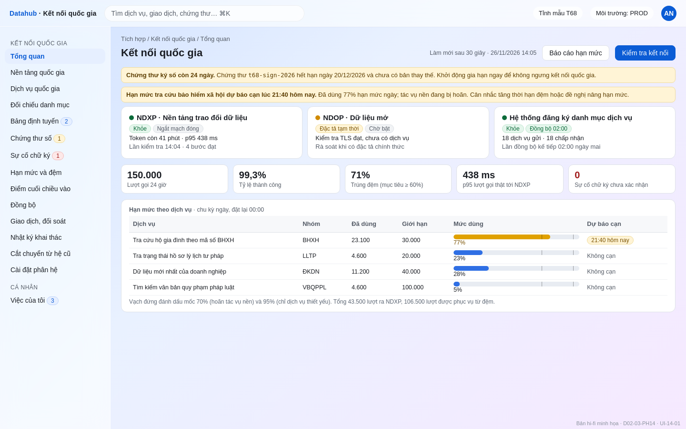
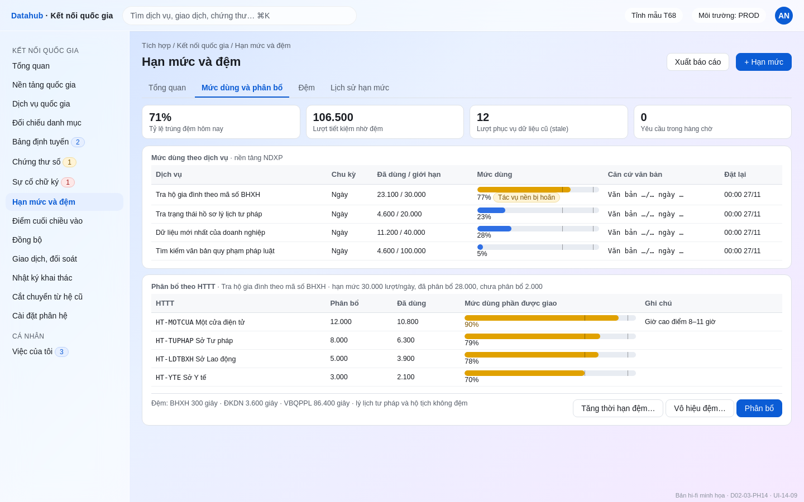

# D02-03-PH14 · Đặc tả yêu cầu chức năng Kết nối quốc gia

## Tóm tắt cho hội đồng thẩm định

**Mục tiêu.** PH-14 là cổng ra duy nhất của tỉnh tới các nền tảng cấp quốc gia: Nền tảng trao đổi dữ liệu quốc gia (NDXP, trước đây gọi là NGSP) để khai thác cơ sở dữ liệu quốc gia và danh mục dùng chung, Nền tảng dữ liệu mở quốc gia (NDOP) để công bố dữ liệu mở, và hệ thống nhận đăng ký danh mục dịch vụ chia sẻ. Phân hệ cô lập toàn bộ đặc thù của trung ương (địa chỉ, mã dịch vụ, cách xác thực, chữ ký số, hạn mức) khỏi hệ thống thông tin (HTTT) của tỉnh: HTTT chỉ gọi một API của Datahub, không giữ thông tin xác thực quốc gia, không biết nền tảng nào đứng sau. Phân hệ thay chức năng "phụ lục kết nối NGSP" của hệ cũ, nơi Consumer Key và Secret nằm trong tài liệu và mỗi dịch vụ được gọi theo một cách riêng.

**Phạm vi.** 57 yêu cầu chức năng chia chín nhóm: nền tảng và danh mục dịch vụ quốc gia, gọi dịch vụ và định tuyến, bộ điều hợp theo bảy nhóm dịch vụ (tư pháp, hộ tịch, bảo hiểm xã hội, hồ sơ cấp mã ĐVQHNS, đăng ký doanh nghiệp, văn bản quy phạm pháp luật, danh mục dùng chung), xác thực, chữ ký số và chứng thư, hạn mức và đệm, chiều vào, đồng bộ, giám sát và đối soát, quản trị và chuyển đổi từ hệ cũ. Phân hệ chạy trên hai đơn vị triển khai: `dh-integration` (mặt phẳng điều khiển, module `national`) và `dh-runtime` (mặt phẳng dữ liệu, Camel Quarkus, hồ sơ `national-gateway`).

**Căn cứ pháp lý.** CMP-LAW-03 và CMP-LAW-19 (Nghị định 278/2025/NĐ-CP về kết nối, chia sẻ dữ liệu qua Nền tảng chia sẻ, điều phối dữ liệu quốc gia, thay Nghị định 47/2020); CMP-LAW-12 (Thông tư 13/2017 về yêu cầu kỹ thuật kết nối CSDL quốc gia, đang chờ đối chiếu văn bản hiện hành); CMP-LAW-05 (Luật Bảo vệ dữ liệu cá nhân 91/2025: khai thác đúng mục đích, tối thiểu hóa); CMP-LAW-06 và CMP-LAW-08 (Nghị định 331/2026, TCVN 14423:2026 cấp độ 3: quản lý bí mật, chứng thư, nhật ký); CMP-LAW-16 (Luật An ninh mạng 116/2025); CMP-LAW-01 (Luật Dữ liệu số).

**Những điểm hội đồng cần lưu ý.** (1) HTTT của tỉnh không bao giờ giữ thông tin xác thực với hệ thống quốc gia; Datahub gọi hộ bằng thông tin lưu ở OpenBao, ghi một chiều (KPI-09 bằng 0). (2) Cả tỉnh dùng chung một tài khoản khai thác tại NDXP, nên PH-14 phải là điểm kiểm soát mục đích: mỗi lượt gọi có HTTT, mục đích và mã hồ sơ thủ tục hành chính, 100% có nhật ký khai thác (KPI-07), chặn tra cứu hàng loạt (THR-51). (3) Hạn mức truy vấn do trung ương áp đặt là tài nguyên khan hiếm; đệm, đếm hạn mức và ưu tiên dịch vụ thiết yếu là thành phần bắt buộc, không phải tối ưu tùy chọn. (4) Bản tin được ký số khi dịch vụ yêu cầu, khóa riêng không rời OpenBao; chữ ký phản hồi sai được xử lý như sự cố an ninh. (5) Đặc tả NDXP và NDOP hiện hành chưa xác minh được (GĐ-02 của D00-03); địa chỉ, mã dịch vụ, cách xác thực là cấu hình theo tenant và đổi đặc tả chỉ phải sửa bộ điều hợp. Có 14 câu hỏi mở ở chương 13.

**Con số chính.**

| Chỉ số | Giá trị |
|---|---|
| Yêu cầu chức năng | 57 (M: 48, S: 8, C: 1) |
| Quy tắc nghiệp vụ | 37 (BR-14-001…037) |
| Yêu cầu phi chức năng | 26 (NFR-14-001…026) |
| Màn hình | 17 (UI-14-01…17) |
| API | 90 (API-14-001…090), 17 sự kiện (EVT-14-01…17) |
| Mã lỗi | 71 (ERR-14-001…039, 101…132) |
| Chức năng hệ cũ được phủ | 9 mục `LGC`: LGC-NGSP-001…008 và LGC-DMDC-019, kèm 14 FR của SRS cũ trong repo |
| Mức đợt | MVP cho 51 FR (48 mức M, 3 mức S: 036, 055, 056); Đợt 2 cho 3 FR mức S (042, 051, 053); Đợt 3 cho 2 FR mức S (044, 045) và FR mức C (057) |

: Con số chính của PH-14

## 1. Giới thiệu

### 1.1. Mục đích của tài liệu

Tài liệu đặc tả đầy đủ hành vi của phân hệ PH-14 Kết nối quốc gia, ở mức mà ba nhóm người đọc dùng được ngay không cần hỏi lại. Hội đồng thẩm định dùng tài liệu để đánh giá phân hệ có đáp ứng yêu cầu kết nối nền tảng quốc gia theo Nghị định 278/2025, yêu cầu bảo vệ dữ liệu cá nhân và yêu cầu an toàn thông tin cấp độ 3 hay không. Kỹ sư dùng tài liệu làm đầu vào cho thiết kế chi tiết D03-02-PH14, thiết kế CSDL D03-03-PH14 và đặc tả API D03-04-PH14. Kiểm thử viên dùng các luồng xử lý, luồng ngoại lệ và quy tắc nghiệp vụ để viết ca kiểm thử ở D05-02-PH14.

Mỗi chức năng được đặc tả theo cùng một khung 17 mục: mục đích, tác nhân và quyền, mức ưu tiên, truy vết, tiền điều kiện, kích hoạt, đầu vào, luồng xử lý chính theo từng bước, luồng thay thế, luồng ngoại lệ kèm thông báo người dùng nhìn thấy, đầu ra, kết quả, hậu điều kiện, sự kiện, kiểm toán, quy tắc nghiệp vụ, màn hình và API.

### 1.2. Phạm vi

PH-14 chịu trách nhiệm chín nhóm việc dưới đây.

| # | Trách nhiệm | Nhóm FR |
|---|---|---|
| 1 | Quản lý danh mục **nền tảng quốc gia** (NDXP, NDOP, nơi đăng ký danh mục dịch vụ) và **dịch vụ quốc gia** (mã dịch vụ, giao thức, hợp đồng, đặc tả có phiên bản, nhãn đối chiếu Còn, Đổi đặc tả, Ngừng); cung cấp lại dịch vụ cho HTTT của tỉnh dưới dạng API của Datahub | A |
| 2 | Gọi dịch vụ quốc gia qua một điểm gọi chung: kiểm tra mục đích, định tuyến tới nền tảng, chuyển đổi bản tin theo hợp đồng, phân loại lỗi, gọi bất đồng bộ qua hàng chờ | B |
| 3 | Bộ điều hợp riêng cho bảy nhóm dịch vụ mà hệ cũ đã kết nối (`LGC-NGSP-001…007`), gồm cổng tiếp hợp danh mục dùng chung cho PH-07 | C |
| 4 | Lấy và làm mới token OAuth 2.1, cấp lại thông tin xác thực; ký số bản tin, xác minh chữ ký phản hồi, quản lý chứng thư số, chuỗi tin cậy, danh sách thu hồi; xử lý chữ ký sai như sự cố an ninh | D |
| 5 | Quản lý hạn mức do trung ương áp, đếm và cảnh báo, phân bổ nội bộ theo HTTT, ưu tiên dịch vụ thiết yếu; đệm phản hồi, dùng dữ liệu đệm quá hạn có cờ; ngắt mạch, thử lại | E |
| 6 | Chiều vào: điểm cuối cho nền tảng quốc gia gọi vào tỉnh, danh sách nguồn được phép, xác minh, chuyển cho luồng PH-04, nhận thông báo thay đổi | F |
| 7 | Đồng bộ danh mục dịch vụ lên Bộ, cầu nối dữ liệu chủ hai chiều cho PH-06, công bố dữ liệu mở lên NDOP | G |
| 8 | Kiểm tra kết nối chủ động, tổng quan, tra cứu và đối soát giao dịch, nhật ký khai thác theo HTTT, cảnh báo bất thường | H |
| 9 | Tham số theo tenant, chạy song song với kết nối NGSP cũ khi cắt chuyển, nhập cấu hình từ hệ cũ, báo cáo | I |

: Trách nhiệm của PH-14

Những việc dưới đây liên quan nhưng không thuộc PH-14. Tài liệu chỉ mô tả điểm giao tiếp với các phân hệ đó.

| Không làm | Thuộc |
|---|---|
| Logic nghiệp vụ, quyết định khi nào cần gọi quốc gia, ánh xạ ngữ nghĩa giữa lược đồ (DataMapper sinh JQ) | PH-04 (ADR-066); luồng chỉ gọi PH-14 qua Kamelet `dh-national-invoke` |
| Chuyển mã danh mục, tra cứu danh mục, so sánh phiên bản, quyết định áp dụng thay đổi phá vỡ của danh mục quốc gia | PH-07 (ADR-057); PH-14 chỉ cung cấp bốn thao tác của cổng tiếp hợp |
| Xác thực HTTT của tỉnh, cấp token Datahub, phân quyền theo vai trò | PH-12 (Keycloak, OPA) và PH-03 (APISIX) |
| Che, ẩn danh hóa dữ liệu cá nhân; sổ hoạt động xử lý; chấp thuận của chủ quản dữ liệu | PH-09 (qua PH-04 và lời gọi kiểm tra của PH-14) |
| Kết nối tới HTTT nội bộ của tỉnh, quản lý kết nối nguồn và bí mật của HTTT | PH-05 (PH-14 dùng lại loại kết nối `oauth2-client`, `mtls-client` và cơ chế bí mật một chiều) |
| Đăng ký, phê duyệt công bố API và gói sử dụng cho HTTT | PH-02 (danh mục dịch vụ), PH-03 (cổng API) |
| Bản ghi vàng, đồng bộ hóa dữ liệu chủ nội bộ | PH-06 (Đợt 3); PH-14 chỉ làm cầu nối quốc gia |
| Thanh toán qua PayGov | PH-19 (điểm kết nối ngoài riêng, cùng cơ chế egress và kho bí mật) |
| Kho bí mật, hạ tầng khóa công khai, chính sách OpenBao | Nền tảng (ADR-012, SEC-33…36); PH-14 chỉ dùng đường dẫn của mình |
| Nâng cấp, vận hành NDXP, NDOP và các CSDL quốc gia | Cơ quan quản lý ở trung ương |

: Việc ngoài phạm vi PH-14

### 1.3. Đối tượng sử dụng và cách đọc

Bảng dưới cho biết mỗi nhóm người đọc nên đọc phần nào của tài liệu và để làm gì.

| Người đọc | Đọc phần | Mục đích |
|---|---|---|
| Hội đồng thẩm định | Tóm tắt, chương 2, chương 5, chương 11, chương 14 | Đánh giá sự cần thiết, mức đáp ứng Nghị định 278/2025 và yêu cầu ATTT, mức phủ nghiệp vụ hệ cũ |
| Chủ đầu tư, đơn vị chủ quản HTTT | Chương 2, chương 3, mục 6.2, 6.4, chương 10, chương 13 | Biết việc phải phối hợp: đăng ký kết nối với trung ương, nộp chứng thư số, khai báo mục đích khai thác, hạn mức |
| Cán bộ ATTT | Mục 6.5, 6.6, 6.9, chương 7, chương 8 | Kiểm soát khóa, chứng thư, mục đích khai thác, sự cố chữ ký |
| Kỹ sư phát triển | Chương 4, chương 6, chương 7, chương 9 | Hiện thực API, xử lý, quy tắc, mã lỗi |
| Kiểm thử viên | Chương 6, chương 7, chương 8, chương 14 | Viết ca kiểm thử dương, âm, ca hiệu năng, ca rò rỉ bí mật, ca chữ ký sai |
| Vận hành | Mục 6.6, 6.8, 6.9, chương 8, chương 12 | Theo dõi hạn mức, chứng thư, sức khỏe kết nối; xử lý sự cố |

: Người đọc và phần cần đọc

Mã định danh (FR, BR, NFR, ERR, EVT, API, UI) theo quy ước ở D00-01 §3. Chức năng dùng chung của mọi phân hệ (đăng nhập, chọn tenant, phân trang, lọc chuẩn, kiểm toán chung, hộp "Việc của tôi", duyệt bốn mắt, hiển thị lỗi chung) theo nhóm FR-00 của SRS và không lặp lại ở đây.

### 1.4. Thuật ngữ và chữ viết tắt

Bảng dưới giải thích các thuật ngữ và chữ viết tắt dùng trong tập này; thuật ngữ chung của dự án ở D00-01 §2.

| Thuật ngữ, viết tắt | Giải thích |
|---|---|
| HTTT | Hệ thống thông tin của cơ quan, đơn vị kết nối vào Datahub |
| Tenant | Một tỉnh dùng Datahub; dữ liệu và cấu hình của tenant tách biệt hoàn toàn với tenant khác; `COMMON` là tenant toàn quốc |
| NDXP | Nền tảng trao đổi dữ liệu quốc gia (trước đây gọi là NGSP), nơi Datahub khai thác CSDL quốc gia và danh mục dùng chung (D00-01 §2) |
| NDOP | Nền tảng dữ liệu mở quốc gia, nơi công bố dữ liệu mở của tỉnh (D00-01 §2) |
| NGSP | Tên cũ của NDXP; còn xuất hiện trong tài liệu hệ cũ (phụ lục kết nối NGSP) |
| Nền tảng quốc gia | Một đích mà PH-14 kết nối: NDXP, NDOP hoặc hệ thống nhận đăng ký danh mục dịch vụ (loại `REGISTRY`) |
| Dịch vụ quốc gia | Một dịch vụ do nền tảng quốc gia cung cấp (ví dụ tra trạng thái hồ sơ lý lịch tư pháp), nhận diện bằng mã dịch vụ nội bộ và `Service-code` của trung ương |
| `Service-code` | Tiêu đề (header) HTTP mà trung ương dùng để phân biệt nghiệp vụ trên cùng một đường dẫn (D00-03 §4.7) |
| Cung cấp lại | Datahub đóng gói dịch vụ quốc gia thành API của Datahub để HTTT tỉnh gọi mà không cần thông tin xác thực quốc gia (BP-06) |
| Hợp đồng dịch vụ | Mô tả đầu vào, đầu ra, mức nhạy cảm, đệm, ký số, ưu tiên của một dịch vụ quốc gia, có phiên bản |
| Nhãn đối chiếu | Một trong ba giá trị Còn, Đổi đặc tả, Ngừng gán cho dịch vụ khi đối chiếu với danh mục hiện hành của NDXP (GĐ-02) |
| Hạn mức | Số lượt truy vấn tối đa trung ương cho phép trong một chu kỳ (giờ, ngày, tháng), áp theo tài khoản của tỉnh |
| Đệm | Bộ nhớ tạm lưu phản hồi của quốc gia để giảm số lượt gọi ra ngoài; dữ liệu quá hạn được dùng có cờ `stale` khi cần |
| Ngắt mạch | Cơ chế tạm dừng gọi một nền tảng khi tỷ lệ lỗi vượt ngưỡng, để không dồn thêm tải vào hệ đang lỗi |
| OAuth 2.1 `client_credentials` | Cách một hệ thống máy xin token bằng thông tin xác thực của chính nó, không có người dùng tham gia |
| mTLS | TLS hai chiều: cả hai bên xuất trình chứng thư |
| OpenBao `transit` | Dịch vụ ký và mã hóa của OpenBao: gửi băm vào, nhận chữ ký ra, khóa riêng không xuất được (SEC-36) |
| CRL, OCSP | Danh sách và giao thức tra cứu chứng thư bị thu hồi |
| Egress | Danh sách đích ra ngoài mà nền tảng cho phép đi tới (SEC-16) |
| Bốn mắt | Nguyên tắc một việc quan trọng cần hai người khác nhau: một người đề nghị, một người duyệt (FR-00-071) |
| Mặt phẳng điều khiển, mặt phẳng dữ liệu | Phần quản trị cấu hình (`dh-integration`), phần chạy luồng xử lý lưu lượng thật (`dh-runtime`) |
| DLCN | Dữ liệu cá nhân |
| PA, PO, TA, TO, SO, IE, IA, AU, VW | Vai trò: quản trị nền tảng, vận hành nền tảng, quản trị tenant, vận hành tenant, Cán bộ ATTT, kỹ sư tích hợp, người duyệt tích hợp, kiểm toán viên, người xem (mục 3.1) |
| p95, p99 | Phân vị 95, 99: bấy nhiêu phần trăm số lượt đo có giá trị không vượt ngưỡng nêu |

: Thuật ngữ và chữ viết tắt

### 1.5. Tài liệu tham chiếu

Bảng dưới liệt kê văn bản pháp lý, tài liệu dự án và quyết định kiến trúc mà tập này dựa vào, kèm việc mỗi tài liệu được dùng để làm gì.

| Mã | Tài liệu | Dùng cho |
|---|---|---|
| CMP-LAW-03, CMP-LAW-19 | Nghị định 278/2025/NĐ-CP về kết nối, chia sẻ dữ liệu | Kết nối Nền tảng chia sẻ quốc gia, đăng ký danh mục dịch vụ chia sẻ |
| CMP-LAW-12 | Thông tư 13/2017/TT-BTTTT về yêu cầu kỹ thuật kết nối CSDL quốc gia | Định dạng bản tin, chữ ký số (chờ đối chiếu văn bản hiện hành, Q14-02) |
| CMP-LAW-05 | Luật Bảo vệ dữ liệu cá nhân 91/2025/QH15 | Mục đích khai thác, tối thiểu hóa, thời hạn lưu nội dung bản tin |
| CMP-LAW-06, CMP-LAW-08 | Nghị định 331/2026/NĐ-CP; TCVN 14423:2026 | Cấp độ 3: bí mật, chứng thư, nhật ký, TLS |
| CMP-LAW-16 | Luật An ninh mạng 116/2025/QH15 | Nhật ký, lưu trữ trong nước, báo cáo sự cố |
| CMP-LAW-01, CMP-LAW-22 | Luật Dữ liệu số 60/2024/QH15; Nghị định 194/2025 | Khai thác, chia sẻ, công bố dữ liệu |
| CMP-LAW-10, CMP-LAW-11 | Khung Kiến trúc CPĐT 3.0; dự thảo Khung Kiến trúc tổng thể quốc gia số | Vai trò NDOP, hướng kết nối nền tảng dùng chung |
| D02-02 | Đặc tả yêu cầu phần mềm (SRS) | FR-00 dùng chung, REQ-14, IF-03, IF-04 |
| D02-08 | Ma trận phân quyền | `PERM-14-*`, vai trò, cặp tách nhiệm vụ |
| D03-01 | Kiến trúc tổng thể (SAD) | Đơn vị triển khai, vùng mạng, luồng F13 |
| D03-07 | Thiết kế an toàn thông tin | SEC-10, 12, 16, 24, 31, 32, 33, 35, 36, 67, 80…87; THR-51…53; AS-19 |
| D03-10 | Thiết kế đa tenant | Cô lập tenant, hạn ngạch |
| ADR-002, ADR-061, ADR-063 | Camel Quarkus; catalog khớp runtime; ảnh runtime theo hồ sơ | Công nghệ mặt phẳng dữ liệu |
| ADR-012, ADR-032 | OpenBao; mã hóa trường nhạy cảm | Bí mật, ký số, mã hóa nội dung bản tin |
| ADR-057 | Đồng bộ danh mục quốc gia qua PH-14 | Cổng tiếp hợp `NDXP_DMDC` |
| ADR-052 | Danh mục `COMMON` và hybrid | Kết nối dùng chung ở tenant `COMMON` |
| D02-03-PH04, D02-03-PH05, D02-03-PH07 | FRS PH-04, PH-05, PH-07 | Luồng gọi PH-14, kết nối và bí mật, danh mục quốc gia |
| D00-03 phần A | Kiểm kê chức năng hệ cũ | `LGC-NGSP-001…008`, `LGC-DMDC-019`, GĐ-02 |
| `docs/07-srs/SRS-PH-14-national.md` | SRS cũ trong repo (14 FR) | Nguồn bảng ánh xạ mã cũ sang mã mới ở mục 11.2 |

: Tài liệu tham chiếu

### 1.6. Cấu trúc tài liệu

Chương 2 trình bày bối cảnh, mục tiêu, kiến trúc và trình tự gọi dịch vụ quốc gia. Chương 3 nêu tác nhân và quyền. Chương 4 định nghĩa khái niệm, thực thể và vòng đời của đối tượng chính. Chương 5 liệt kê toàn bộ 57 chức năng. Chương 6 đặc tả chi tiết từng chức năng theo khung thống nhất. Chương 7 đến chương 9 gom quy tắc nghiệp vụ, yêu cầu phi chức năng, tham số, mã lỗi, thông báo, sự kiện và API. Chương 10 giới thiệu giao diện tiêu biểu. Chương 11 đến chương 14 là truy vết, phụ thuộc, câu hỏi mở và tiêu chí chấp nhận. Mục "Đề nghị đồng bộ" cuối tài liệu ghi các việc cần sửa ở tài liệu dùng chung.

## 2. Tổng quan phân hệ

### 2.1. Bối cảnh và vấn đề cần giải quyết

Ở hệ LGSP cũ, việc kết nối lên trục quốc gia được ghi trong "phụ lục kết nối NGSP": bảy nhóm dịch vụ (tư pháp, hộ tịch, bảo hiểm xã hội, hồ sơ cấp mã ĐVQHNS, đăng ký doanh nghiệp, danh mục dùng chung, văn bản quy phạm pháp luật) gọi qua cùng một đường dẫn, phân biệt nhau bằng tiêu đề `Service-code`, xác thực bằng Bearer token lấy từ cổng AM theo grant `password` hoặc `client_credentials` (D00-03 §4.7). Tài liệu hệ cũ chứa Consumer Key và Secret dạng văn bản và địa chỉ IP công khai của cổng token chạy HTTP. Cùng lúc, định hướng quốc gia đã đổi: dịch vụ được kết nối qua Nền tảng chia sẻ, điều phối dữ liệu theo Nghị định 278/2025, xác thực OAuth 2.1 `client_credentials`, và địa chỉ, mã dịch vụ, cách xác thực phải là cấu hình theo từng tenant (GĐ-02 của D00-03). Bảng dưới nêu các hạn chế của cách làm cũ, hệ quả thực tế và cách PH-14 giải quyết.

| Hạn chế hệ cũ | Hệ quả | Cách PH-14 khắc phục |
|---|---|---|
| Consumer Key, Secret tĩnh nằm trong tài liệu và cấu hình; có grant `password` | Lộ khóa qua tài liệu, bản sao lưu; không xoay được; mọi HTTT đều có thể biết khóa | Thông tin xác thực chỉ ở OpenBao, ghi một chiều; grant `client_credentials`; xoay vòng và cấp lại khi cắt chuyển (FR-14-024, 025) |
| Cổng token dùng HTTP trên IP công khai | Nghe lén, giả mạo cổng token | TLS ≥ 1.2, ghim CA, đích ra ngoài khai báo theo FQDN (SEC-12, SEC-16); THR-53 |
| Mỗi dịch vụ gọi theo cách riêng, `Service-code` rải trong luồng | Khi trung ương đổi đặc tả phải sửa nhiều luồng | Bộ điều hợp theo nhóm dịch vụ, hợp đồng có phiên bản, nhãn Còn, Đổi đặc tả, Ngừng; đổi đặc tả chỉ sửa bộ điều hợp (FR-14-007, 008, 017…023) |
| Một tài khoản dùng chung cho cả tỉnh, không ghi HTTT và mục đích gọi | Không thanh tra được ai tra gì; nguy cơ tra cứu hàng loạt (THR-51) | Kiểm tra mục đích và mã hồ sơ mỗi lượt, nhật ký khai thác theo HTTT, cảnh báo bất thường (FR-14-011, 052, 053) |
| Phụ lục chỉ nêu cách gọi, không nêu đệm, đếm hạn mức, ưu tiên | Chạm hạn mức của trung ương thì cả tỉnh ngưng tra cứu, kể cả dịch vụ công đang có người dân chờ | Đệm theo loại dữ liệu, đếm hạn mức, ngưỡng cảnh báo, ưu tiên dịch vụ thiết yếu (FR-14-032…037) |
| Không nêu chữ ký số, chứng thư và vòng đời | Chứng thư hết hạn làm ngưng toàn bộ kết nối mà không ai biết trước | Quản lý chứng thư, cảnh báo 60, 30, 7 ngày, chuyển tiếp (FR-14-026…031) |
| Không có chiều vào và không có đối soát giao dịch | Không đáp ứng khi trung ương gọi vào; tranh chấp "đã gửi hay chưa" không có bằng chứng | Điểm cuối chiều vào có xác minh; mã giao dịch, đối soát 5 năm (FR-14-039…042, 049) |

: Hạn chế của hệ cũ và cách khắc phục

### 2.2. Mục tiêu của phân hệ

PH-14 có năm mục tiêu đo được. Mục tiêu thứ nhất là **không lộ thông tin xác thực quốc gia**: không một HTTT nào giữ thông tin xác thực với hệ thống quốc gia, không một bí mật nào nằm ngoài OpenBao hay xuất hiện trong nhật ký, vết, tệp xuất (KPI-09 bằng 0; NFR-14-015, đo bằng ca kiểm thử với giá trị đánh dấu). Mục tiêu thứ hai là **không để hạn mức làm ngưng dịch vụ công**: tỷ lệ trúng đệm tối thiểu 60% với dịch vụ tra cứu được phép đệm (NFR-14-005), dịch vụ thiết yếu luôn được phục vụ khi hạn mức còn dưới 5% (BR-14-013), cảnh báo ở 70%, 85%, 95% trong 2 phút (NFR-14-018). Mục tiêu thứ ba là **mọi lượt khai thác truy vết được**: 100% lượt gọi có nhật ký đủ HTTT, mục đích, mã hồ sơ, thời điểm (KPI-07; NFR-14-020). Mục tiêu thứ tư là **tin cậy dữ liệu từ quốc gia**: 100% bản tin yêu cầu ký đã được ký, 100% phản hồi yêu cầu xác minh đã được xác minh, lỗi chữ ký được cảnh báo cho Cán bộ ATTT trong 1 phút (NFR-14-013, 018). Mục tiêu thứ năm là **đổi đặc tả không sửa luồng**: khi trung ương đổi đặc tả một dịch vụ chỉ phải sửa bộ điều hợp, hợp đồng cung cấp lại cho HTTT giữ ổn định nếu tương thích; chứng thư và cấu hình mới có hiệu lực trong 30 giây không khởi động lại (NFR-14-026).

### 2.3. Vị trí trong kiến trúc

Hình dưới đặt PH-14 vào kiến trúc tổng thể theo vùng mạng của D03-01: mặt phẳng điều khiển ở Z3, cổng quốc gia ở Z4, dữ liệu ở Z5, kho bí mật ở Z6 và các đích quốc gia ở Z0.

```{.mermaid caption="Vị trí của PH-14 trong kiến trúc Datahub"}
flowchart TB
  subgraph Z0["Z0 · Bên ngoài"]
    HT["HTTT của tỉnh"]
    NDXP["NDXP"]
    NDOP["NDOP"]
    REG["Hệ thống đăng ký<br/>danh mục dịch vụ"]
  end
  subgraph Z2["Z1–Z2 · Biên và cổng API"]
    APX["APISIX · WAF, mTLS,<br/>giới hạn tần suất"]
  end
  subgraph Z3["Z3 · dh-integration"]
    CP["Module national<br/>mặt phẳng điều khiển"]
  end
  subgraph Z4["Z4 · dh-runtime"]
    FL["Luồng PH-04"]
    GW["Hồ sơ national-gateway<br/>định tuyến, bộ điều hợp,<br/>ký số, hạn mức, đệm"]
    EG["Egress gateway"]
  end
  subgraph Z5["Z5 · Dữ liệu"]
    PG[("pg-core<br/>schema ph14_national")]
    VK[("Valkey<br/>đệm, bộ đếm")]
    KF[("Kafka")]
  end
  subgraph Z6["Z6 · Bảo mật lõi"]
    OB[("OpenBao<br/>kv, transit, PKI")]
    OPA["OPA"]
  end
  HT --> APX --> GW
  FL -->|"Kamelet dh-national-invoke"| GW
  CP --> PG
  CP -->|"ghi một chiều"| OB
  CP -->|"EVT-14-*"| KF
  GW --> VK
  GW -->|"băm cần ký"| OB
  GW -->|"mục đích, quyền"| OPA
  GW --> EG
  EG -->|"mTLS, TLS ≥ 1.2"| NDXP
  EG --> NDOP
  EG --> REG
  NDXP -->|"chiều vào"| APX
```

PH-14 có mặt ở cả hai mặt phẳng. Ở mặt phẳng điều khiển, module `national` (gói `vn.datahub.integration.national`) của `dh-integration` giữ danh mục nền tảng, dịch vụ, luật định tuyến, chứng thư, hạn mức trong schema `ph14_national` của cụm `pg-core`; thông tin xác thực chỉ nằm ở OpenBao và chỉ được ghi vào, không đọc ra. Ở mặt phẳng dữ liệu, hồ sơ `national-gateway` của `dh-runtime` (Camel Quarkus, ADR-002, ADR-063) xử lý lưu lượng thật: HTTT tỉnh đi qua APISIX tới cổng quốc gia, luồng PH-04 gọi cổng bằng Kamelet `dh-national-invoke`. Mọi lưu lượng ra NDXP, NDOP đi qua egress gateway với danh sách đích theo FQDN (SEC-16); chỉ hồ sơ `national-gateway` có chính sách mạng cho phép ra các đích này (BR-14-006). Chiều vào đi ngược: NDXP gọi qua APISIX ở vùng biên có WAF và mTLS rồi tới cổng quốc gia. Hồ sơ này tách khỏi các bản sao chạy luồng nghiệp vụ để tải của quốc gia không làm nghẽn luồng nội bộ và ngược lại.

### 2.4. Kiến trúc thành phần và công nghệ

PH-14 gồm sáu thành phần. **Dịch vụ quản trị quốc gia** trong `dh-integration` (Java 21, Spring Boot) cung cấp API `/api/national/v1`, lưu nền tảng, dịch vụ, đặc tả, luật định tuyến, chứng thư, hạn mức, điểm cuối chiều vào, phiên đồng bộ trong PostgreSQL với bảo mật mức dòng (RLS) theo tenant. **Cổng quốc gia** là hồ sơ `national-gateway` của `dh-runtime` (Camel Quarkus 3.33.x) gồm bộ định tuyến liên bang, các tuyến bộ điều hợp theo nhóm dịch vụ, bộ chuyển đổi bản tin, bộ quản lý hạn mức và đệm, bộ ngắt mạch. **Bộ ký và xác minh** là mô-đun của cổng, gửi băm vào OpenBao `transit/sign` và xác minh bằng chuỗi tin cậy trong bộ nhớ. **Điểm cuối chiều vào** là tuyến riêng của cổng, chỉ nhận từ APISIX, xác minh trước rồi mới chuyển cho luồng PH-04. **Bộ đồng bộ** chạy theo lịch và theo yêu cầu: đăng ký danh mục dịch vụ, dữ liệu chủ, dữ liệu mở. **Bộ chạy kiểm tra** (`probe`) kiểm tra kết nối định kỳ bằng thao tác nhẹ, tách khỏi bản sao xử lý lưu lượng để một lần kiểm tra chậm không ảnh hưởng người dùng. Bộ đệm và bộ đếm hạn mức nằm ở Valkey (Z5), khóa luôn có tiền tố tenant (SEC-82); bộ đếm đồng bộ về PostgreSQL mỗi phút để không mất khi Valkey khởi động lại.

Hình dưới mô tả trình tự một lượt tra cứu điển hình từ HTTT tỉnh tới dịch vụ quốc gia. Điểm quan trọng: kiểm tra mục đích và hạn mức đứng trước mọi lời gọi ra ngoài, đệm đứng trước hạn mức, và chữ ký được ký bằng khóa không rời OpenBao.

```{.mermaid caption="Trình tự một lượt tra cứu từ HTTT tỉnh tới dịch vụ quốc gia"}
sequenceDiagram
  autonumber
  participant H as HTTT tỉnh
  participant A as APISIX
  participant G as Cổng quốc gia
  participant O as OPA
  participant V as Valkey
  participant B as OpenBao
  participant N as NDXP
  H->>A: POST invocations kèm token Datahub, mục đích, mã hồ sơ
  A->>G: Chuyển tiếp, gắn tenant từ token
  G->>O: Kiểm tra HTTT, dịch vụ, mục đích
  O-->>G: Cho phép
  G->>V: Tra đệm theo khóa tenant, dịch vụ, tham số
  V-->>G: Không có trong đệm
  G->>V: Trừ hạn mức, kiểm tra còn
  G->>B: Gửi băm cần ký tới transit/sign
  B-->>G: Chữ ký
  G->>N: Gọi dịch vụ qua egress, mTLS, token OAuth
  N-->>G: Phản hồi kèm chữ ký
  G->>G: Xác minh chữ ký, chuyển đổi về JSON chuẩn
  G->>V: Lưu đệm theo thời hạn của dịch vụ
  G-->>H: 200 kèm transactionCode, fromCache, signatureVerified
  Note over G: Ghi giao dịch, nhật ký khai thác, không ghi bí mật
```

### 2.5. Quy trình nghiệp vụ liên quan

Bảng dưới liệt kê các quy trình nghiệp vụ của dự án có bước do PH-14 thực hiện.

| Quy trình | Bước có PH-14 |
|---|---|
| BP-06 Kết nối và khai thác dữ liệu quốc gia | Toàn bộ: khai báo nền tảng, dịch vụ, cung cấp lại cho HTTT, khai thác, nhật ký |
| BP-01 Kết nạp HTTT và cấp quyền sử dụng dịch vụ | HTTT đăng ký sử dụng API quốc gia đã cung cấp lại ở PH-02; PH-14 áp hạn mức nội bộ và mục đích (FR-14-009, 034) |
| BP-03 Phát hành và đồng bộ danh mục | PH-07 kéo danh mục quốc gia qua cổng tiếp hợp `NDXP_DMDC` (FR-14-023) |
| BP-02 Xây dựng và phát hành luồng | Luồng PH-04 dùng mẫu `tpl-ndxp-proxy` và Kamelet `dh-national-invoke` |
| BP-07 Giám sát, xử lý sự cố, báo cáo | Cảnh báo hạn mức, chứng thư, chữ ký, mất kết nối; tra cứu và đối soát giao dịch |
| BP-09 Chuyển đổi từ hệ cũ | Chạy song song với kết nối NGSP cũ, đối chiếu, cắt chuyển, cấp lại thông tin xác thực (FR-14-055, 056) |

: Quy trình nghiệp vụ có PH-14 tham gia

Các luồng đi qua PH-14 chia ba loại với yêu cầu kỹ thuật khác nhau, bảng dưới tóm tắt để người đọc thấy vì sao chiều vào và đồng bộ có nhóm chức năng riêng.

| Loại luồng | Ví dụ | Đặc điểm | Yêu cầu đặc thù |
|---|---|---|---|
| Chiều ra | Tra cứu lý lịch tư pháp, BHXH, đăng ký doanh nghiệp, văn bản pháp luật | Tần suất cao, nhạy cảm độ trễ | Đệm, hạn mức, mục đích khai thác (nhóm B, C, E) |
| Chiều vào | Trung ương gọi xác minh, nhận hồ sơ, báo thay đổi danh mục | Tần suất thấp, cần luôn sẵn sàng | Điểm cuối có bảo vệ, xác minh chữ ký nghiêm ngặt (nhóm F) |
| Đồng bộ theo lô | Đăng ký danh mục dịch vụ, dữ liệu chủ, dữ liệu mở, danh mục dùng chung | Bất đồng bộ, cần biên nhận và đối soát | Hàng chờ, thử lại, theo dõi trạng thái (nhóm G) |

: Ba loại luồng đi qua PH-14

Hình dưới tóm tắt vòng đời điển hình của một kết nối quốc gia từ lúc tỉnh hoàn tất thủ tục với trung ương tới lúc dịch vụ phục vụ HTTT ở môi trường thật.

```{.mermaid caption="Vòng đời điển hình của một kết nối quốc gia"}
flowchart TB
  A["Tỉnh đăng ký kết nối<br/>với trung ương, ngoài hệ thống"] --> B["TA khai báo nền tảng<br/>FR-14-002"]
  B --> C["SO nạp chứng thư,<br/>TA duyệt kích hoạt<br/>FR-14-028"]
  C --> D["Kiểm tra kết nối,<br/>lấy token thử<br/>FR-14-047, 024"]
  D -->|"Không đạt"| B
  D -->|"Đạt"| E["Bật nền tảng,<br/>bốn mắt FR-14-003"]
  E --> F["Khai báo dịch vụ,<br/>hợp đồng, hạn mức<br/>FR-14-005, 032"]
  F --> G["Cung cấp lại thành API<br/>FR-14-009"]
  G --> H["HTTT đăng ký sử dụng ở PH-02"]
  H --> I["Khai thác, theo dõi hạn mức,<br/>chứng thư, nhật ký"]
```

### 2.6. Chức năng hệ cũ được phủ

Bảng dưới liệt kê chín mục chức năng của hệ cũ do PH-14 phủ theo kiểm kê D00-03 phần A; kết luận từng mục ở mục 11.1.

| Mã | Chức năng hệ cũ | Vai trò của PH-14 |
|---|---|---|
| LGC-NGSP-001 | Tư pháp, Lý lịch tư pháp: tra danh sách hồ sơ, danh mục, trạng thái, đánh dấu hồ sơ thành công, trả danh sách trạng thái, nhận hồ sơ đăng ký | Chính (bộ điều hợp nhóm LLTP, FR-14-017) |
| LGC-NGSP-002 | Tư pháp, Hộ tịch: danh mục, đăng ký, tra trạng thái, kết quả, danh sách, tra hồ sơ | Chính (bộ điều hợp nhóm hộ tịch, FR-14-018) |
| LGC-NGSP-003 | Bảo hiểm xã hội: tra hộ gia đình theo mã số, lấy mã số theo tiêu chí, tra dữ liệu hộ gia đình | Chính (FR-14-019), cùng PH-09 về mục đích khai thác |
| LGC-NGSP-004 | Đồng bộ hồ sơ thủ tục cấp mã số ĐVQHNS: danh sách theo khoảng thời gian, chi tiết, tổng hợp kết quả giải quyết | Chính (FR-14-020) |
| LGC-NGSP-005 | Đăng ký doanh nghiệp: dữ liệu mới nhất, hồ sơ trong ngày, hồ sơ theo khoảng thời gian, chi tiết hồ sơ | Chính (FR-14-021) |
| LGC-NGSP-006 | Danh mục dùng chung quốc gia: danh sách, cấu trúc, bổ sung, lấy dữ liệu | Chính ở phía kết nối (FR-14-023), cùng PH-07 ở phía nghiệp vụ |
| LGC-NGSP-007 | Văn bản quy phạm pháp luật: tìm toàn văn, lĩnh vực, cơ quan ban hành, chi tiết, loại văn bản, người ký, chức danh | Chính (FR-14-022) |
| LGC-NGSP-008 | Lấy token qua cổng AM bằng Consumer Key và Secret | Chính, nâng cấp: OAuth 2.1 `client_credentials`, bí mật ở OpenBao (FR-14-024, 025) |
| LGC-DMDC-019 | Kết nối danh mục dùng chung quốc gia qua NGSP: danh sách, cấu trúc, bổ sung, lấy dữ liệu | Phần kết nối và đồng bộ (FR-14-023); phần quản lý danh mục ở PH-07 (FR-07-035…039) |

: Chức năng hệ cũ do PH-14 phủ

## 3. Tác nhân, vai trò và quyền

### 3.1. Tác nhân

Bảng dưới liệt kê người và hệ thống tương tác với PH-14, kèm vai trò chuẩn của người dùng theo D02-08.

| Tác nhân | Loại | Mô tả | Tương tác chính |
|---|---|---|---|
| Quản trị tenant (TA, ROLE-TENANT_ADMIN) | Người | Quản trị Datahub của tỉnh | Khai báo nền tảng, dịch vụ, luật định tuyến, hạn mức; duyệt kích hoạt (khác người đề nghị); tham số phân hệ |
| Kỹ sư tích hợp (IE, ROLE-INTEGRATION_ENGINEER) | Người | Cán bộ kỹ thuật của đơn vị vận hành hoặc nhà thầu | Khai báo dịch vụ, đặc tả, cung cấp lại, luật định tuyến; kiểm thử |
| Người duyệt tích hợp (IA, ROLE-INTEGRATION_APPROVER) | Người | Trưởng nhóm tích hợp hoặc lãnh đạo trung tâm | Duyệt bật nền tảng, luật định tuyến, hạn mức |
| Vận hành tenant (TO, ROLE-TENANT_OPERATOR) | Người | Cán bộ trực vận hành | Theo dõi, tạm ngừng, vô hiệu đệm, chạy đồng bộ, xoay thông tin xác thực |
| Cán bộ ATTT (SO, ROLE-SECURITY_OFFICER) | Người | Cán bộ chuyên trách ATTT của tỉnh | Nạp, thu hồi chứng thư; xử lý sự cố chữ ký; xem nội dung đầy đủ có lý do |
| Quản trị nền tảng (PA, ROLE-PLATFORM_ADMIN) | Người | Đơn vị vận hành nền tảng dùng chung | Kết nối và dịch vụ ở tenant `COMMON` (danh mục dùng chung quốc gia) |
| Kiểm toán viên (AU), người xem (VW) | Người | Thanh tra, kiểm toán, lãnh đạo | Xem, tra nhật ký khai thác, xuất báo cáo |
| HTTT của tỉnh | Hệ thống | Cổng dịch vụ công, một cửa, quản lý văn bản… | Gọi API quốc gia đã cung cấp lại bằng token Datahub, scope `national.invoke` |
| PH-04 `dh-runtime` | Hệ thống | Luồng tích hợp | Gọi cổng bằng Kamelet `dh-national-invoke`; nhận yêu cầu chiều vào |
| PH-07 | Hệ thống | Danh mục dùng chung | Gọi bốn thao tác của cổng tiếp hợp `NDXP_DMDC` (ADR-057) |
| PH-02, PH-03 | Hệ thống | Danh mục dịch vụ, cổng API | Công bố API cung cấp lại; áp đăng ký sử dụng, gói |
| PH-05 | Hệ thống | Bộ điều hợp và kết nối | Loại kết nối `oauth2-client`, `mtls-client`; ghi bí mật một chiều |
| PH-06, PH-09, PH-12, PH-13, PH-18 | Hệ thống | Dữ liệu chủ, quyền riêng tư, định danh, giám sát, vận hành | Cầu nối dữ liệu chủ; kiểm tra mục đích; OPA; chỉ số và cảnh báo; tham số |
| OpenBao | Hệ thống | Kho bí mật, ký, PKI | `kv` cho thông tin xác thực, `transit` cho ký số, PKI cho chứng thư mTLS nội bộ |
| NDXP, NDOP, hệ thống đăng ký danh mục dịch vụ | Hệ thống ngoài | Nền tảng cấp quốc gia | Đích của chiều ra; nguồn của chiều vào |
| Valkey, Kafka, PostgreSQL | Hệ thống | Hạ tầng dữ liệu | Đệm và bộ đếm; sự kiện; lưu trữ |

: Tác nhân của PH-14

### 3.2. Ma trận quyền

Ma trận dùng ký hiệu của D02-08 §3 (● có quyền, — không có). Hai quyền `PERM-14-read` và `PERM-14-admin` đã có ở D02-08; mười quyền còn lại được đề nghị bổ sung vào D02-08 §3.1 (mục "Đề nghị đồng bộ"). Quyền `PERM-14-invoke` không gán cho người: nó là scope của client máy (mục 3.3).

| Quyền | Ý nghĩa | PA | TA | TO | SO | IE | IA | AU | VW |
|---|---|---|---|---|---|---|---|---|---|
| PERM-14-read | Xem nền tảng, dịch vụ, luật định tuyến, chứng thư (không xem khóa), hạn mức, đồng bộ, sức khỏe | ● | ● | ● | ● | ● | ● | ● | ● |
| PERM-14-admin | Khai báo nền tảng và kết nối, thông tin xác thực, điểm cuối chiều vào, tham số phân hệ | ● | ● | — | — | — | — | — | — |
| PERM-14-service | Khai báo, sửa dịch vụ, hợp đồng, đặc tả, cung cấp lại, đối chiếu danh mục dịch vụ | ● | ● | — | — | ● | — | — | — |
| PERM-14-route | Tạo, sửa luật định tuyến, gửi duyệt | — | ● | — | — | ● | — | — | — |
| PERM-14-approve | Duyệt bật nền tảng, luật định tuyến, hạn mức PROD, kích hoạt chứng thư | ● | ● | — | — | — | ● | — | — |
| PERM-14-cert | Nạp, yêu cầu kích hoạt, thu hồi chứng thư; làm mới chuỗi tin cậy, danh sách thu hồi | ● | — | — | ● | — | — | — | — |
| PERM-14-quota | Khai báo hạn mức, phân bổ hạn mức nội bộ theo HTTT | — | ● | — | — | — | — | — | — |
| PERM-14-operate | Tạm ngừng, tiếp tục nền tảng, dịch vụ; vô hiệu đệm; ngắt mạch tay; thử kết nối; xoay thông tin xác thực; xử lý sự cố chữ ký | ● | ● | ● | ● | — | — | — | — |
| PERM-14-sync | Cấu hình, chạy, thử lại đồng bộ danh mục dịch vụ, dữ liệu chủ, dữ liệu mở | ● | ● | ● | — | — | — | — | — |
| PERM-14-audit-read | Tra giao dịch, nhật ký khai thác, báo cáo sử dụng, cảnh báo bất thường (nội dung đã che) | — | ● | ● | ● | — | — | ● | — |
| PERM-14-audit-reveal | Xem nội dung bản tin đầy đủ có lý do, xuất bằng chứng | — | — | — | ● | — | — | — | — |
| PERM-14-invoke | Gọi dịch vụ quốc gia đã cung cấp lại (chỉ client máy, theo scope) | — | — | — | — | — | — | — | — |

: Ma trận quyền của PH-14

### 3.3. Tách nhiệm vụ và tài khoản máy

Nguyên tắc bốn mắt (FR-00-071) áp dụng cho tám loại thay đổi của PH-14 (BR-14-022): bật nền tảng ở môi trường thật (FR-14-003), luật định tuyến (FR-14-013), hạn mức ở môi trường thật (FR-14-032), kích hoạt chứng thư và thay đổi neo tin cậy (FR-14-028, FR-14-030), giảm kiểm soát một dịch vụ (FR-14-005), bật điểm cuối chiều vào (FR-14-039), lần công bố dữ liệu mở đầu của một tập (FR-14-045) và tham số bảo mật (FR-14-054). Người duyệt phải khác người đề nghị và khác người sửa gần nhất (BR-14-022); yêu cầu nạp chứng thư và duyệt kích hoạt đều đòi hỏi xác thực nhiều yếu tố (SEC-23). IE và IA là cặp loại trừ ở D02-08 §4: một người không giữ cả hai vai trò trong cùng tenant. SO có quyền nạp chứng thư nhưng không có quyền sửa dịch vụ hay định tuyến, nên người giữ khóa không đồng thời quyết định dữ liệu nào đi đâu. `PERM-14-audit-reveal` chỉ thuộc SO, mỗi lần xem phải nêu lý do và bị ghi vết (BR-14-021); kiểm toán viên nhận bằng chứng qua chức năng xuất (FR-14-051) chứ không xem nội dung thô.

Các thành phần gọi nhau bằng token dịch vụ, không dùng tài khoản người. HTTT tỉnh gọi API quốc gia với scope `national.invoke.{nhóm}` (ví dụ `national.invoke.lltp`) do PH-01 cấp theo đăng ký sử dụng đã duyệt ở PH-02; OPA kiểm tra thêm mục đích và mã hồ sơ (FR-14-011). `dh-runtime` đọc cấu hình với scope `national.runtime-config`; PH-13 đọc chỉ số với `national.health-read`; PH-07 gọi cổng tiếp hợp với `national.catalog.read` và `national.catalog.propose`; PH-02 và PH-06 kích hoạt đồng bộ với `national.sync.trigger`. Thông tin xác thực của tỉnh với NDXP không cấp cho bất kỳ client nào (BR-14-007): chỉ hồ sơ `national-gateway` của đúng tenant có chính sách đọc bí mật ở OpenBao.

## 4. Khái niệm và mô hình nghiệp vụ

### 4.1. Khái niệm nghiệp vụ

Bảng dưới định nghĩa các khái niệm nghiệp vụ dùng xuyên suốt tài liệu; các mục sau mô tả thực thể và vòng đời.

| Khái niệm | Định nghĩa |
|---|---|
| Nền tảng quốc gia | Một đích kết nối do tenant (hoặc `COMMON`) khai báo, có loại `NDXP`, `NDOP` hoặc `REGISTRY`, địa chỉ và cách xác thực lấy từ một kết nối của PH-05 theo từng môi trường |
| Dịch vụ quốc gia | Một dịch vụ cụ thể của nền tảng, gắn nhóm nghiệp vụ, giao thức, mức nhạy cảm, chính sách đệm, ký số, ưu tiên; có hợp đồng và đặc tả theo phiên bản |
| Nhóm dịch vụ | Nhóm bộ điều hợp tương ứng với phụ lục NGSP: `LLTP`, `HO_TICH`, `BHXH`, `DVQHNS`, `DKDN`, `VBQPPL`, `DMDC` |
| Hợp đồng dịch vụ | Phần mô tả bất biến theo phiên bản của dịch vụ: tham số vào, trường ra, mã lỗi, mức nhạy cảm; thay đổi phá vỡ tăng số chính |
| Nhãn đối chiếu | `STILL` (Còn), `SPEC_CHANGED` (Đổi đặc tả), `DISCONTINUED` (Ngừng), `UNKNOWN` khi chưa đối chiếu; gán khi đối chiếu với danh mục hiện hành của NDXP (BR-14-024) |
| Cung cấp lại | Gắn một dịch vụ quốc gia với một API trong danh mục dịch vụ của PH-02 để HTTT đăng ký sử dụng và gọi qua APISIX (FR-14-009) |
| Luật định tuyến | Quy tắc chọn nền tảng đích theo nhóm dịch vụ, loại thao tác, kèm nền tảng dự phòng nếu cho phép |
| Mục đích khai thác | Mã mục đích chuẩn kèm mã hồ sơ thủ tục hành chính mà HTTT khai báo mỗi lượt gọi; căn cứ để OPA cho phép và để thanh tra (BR-14-008) |
| Chứng thư số | Chứng thư chuyên dùng công vụ dùng để ký bản tin hoặc xác thực TLS khách; khóa riêng chỉ ở OpenBao, hệ thống giữ tham chiếu |
| Chuỗi tin cậy | Tập chứng thư gốc và trung gian của trung ương dùng để xác minh phản hồi, kèm danh sách thu hồi |
| Hạn mức | Giới hạn lượt truy vấn theo chu kỳ do trung ương áp, có căn cứ văn bản; **phân bổ hạn mức** là phần Datahub chia cho từng HTTT |
| Dịch vụ thiết yếu | Dịch vụ có `priority = ESSENTIAL` (đang có người dân chờ giải quyết hồ sơ); được ưu tiên khi hạn mức khan hiếm |
| Giao dịch quốc gia | Một lượt gọi ra hoặc nhận vào, có mã giao dịch duy nhất, trạng thái, nguồn đệm hay gọi thật, kết quả xác minh chữ ký |
| Điểm cuối chiều vào | Địa chỉ tenant đăng ký với trung ương để nền tảng quốc gia gọi vào, cùng danh sách nguồn được phép |
| Phiên đồng bộ | Một lần chạy đồng bộ danh mục dịch vụ, dữ liệu chủ hoặc dữ liệu mở, có đối soát kết quả |
| Sự cố chữ ký | Bản ghi mở khi xác minh chữ ký, chuỗi tin cậy hoặc thời điểm ký thất bại; xử lý như sự cố an ninh (BR-14-003) |

: Khái niệm nghiệp vụ của PH-14

### 4.2. Thực thể

Bảng dưới liệt kê các thực thể mức logic của PH-14. Thiết kế bảng, kiểu và chỉ mục ở D03-03-PH14. Mọi thực thể có `tenant_id` (trừ bản ghi `COMMON` dùng `tenant_id = 'COMMON'`), `version` và cột kiểm toán chuẩn.

| Mã | Thực thể | Thuộc tính chính | Ghi chú |
|---|---|---|---|
| EN-14-01 | Nền tảng quốc gia (`national_platform`) | `platformCode`, `platformType` (`NDXP`, `NDOP`, `REGISTRY`), `scope` (`TENANT`, `COMMON`), `connectionCode` (PH-05), `specStatus` (`OFFICIAL`, `PROVISIONAL`), `state`, `authMode` | `PROVISIONAL` đánh dấu nền tảng đang dùng đặc tả tạm (BR-14-025) |
| EN-14-02 | Dịch vụ quốc gia (`national_service`) | `serviceCode`, `platformCode`, `nationalServiceCode`, `group`, `direction` (`OUTBOUND`, `INBOUND`), `protocol`, `operationType`, `sensitivity`, `cacheable`, `cacheTtlSeconds`, `staleAllowed`, `priority`, `signingMode`, `verifyMode`, `purposeRequired`, `procedureCodeRequired`, `timeoutMs`, `reconcileLabel`, `state` | `nationalServiceCode` là giá trị `Service-code` gửi trung ương |
| EN-14-03 | Đặc tả dịch vụ (`service_spec`) | `serviceCode`, `specVersion`, `kind` (`OPENAPI`, `WSDL`, `XSD`, `JSON_SCHEMA`), `checksum`, `breaking`, `state` (`DRAFT`, `ACTIVE`, `SUPERSEDED`) | Phiên bản đã `ACTIVE` bất biến |
| EN-14-04 | Luật định tuyến (`routing_rule`) | `ruleId`, `matchServiceCode`, `matchGroup`, `operationType`, `primaryServiceCode`, `fallbackServiceCode`, `allowFallback`, `priority`, `basis`, `state` | `basis` là căn cứ văn bản hướng dẫn của trung ương |
| EN-14-05 | Chứng thư số (`national_certificate`) | `certCode`, `subject`, `issuer`, `serialNumber`, `notBefore`, `notAfter`, `purpose` (`SIGNING`, `TLS_CLIENT`, `BOTH`), `keyRef`, `state` | `keyRef` là tham chiếu OpenBao, không chứa khóa |
| EN-14-06 | Hạn mức (`quota_policy`) và mức dùng (`quota_usage`) | `quotaId`, `platformCode`, `serviceCode` (rỗng là cả nền tảng), `period` (`HOUR`, `DAY`, `MONTH`), `limit`, `basisDocument`, `effectiveFrom`; `used`, `resetAt` | `basisDocument` bắt buộc (BR-14-011) |
| EN-14-07 | Phân bổ hạn mức (`quota_allocation`) | `systemCode`, `serviceCode`, `period`, `limit`, `shareOfReserve` | Tổng phân bổ không vượt hạn mức (ERR-14-018) |
| EN-14-08 | Giao dịch quốc gia (`national_transaction`) | `transactionCode`, `direction` (`OUTBOUND`, `INBOUND`), `serviceCode`, `systemCode`, `purposeCode`, `procedureCode`, `state`, `fromCache`, `stale`, `durationMs`, `certCode`, `traceId`, `payloadRef`, `payloadHash` | `payloadRef` trỏ tới nội dung mã hóa (BR-14-021) |
| EN-14-09 | Điểm cuối chiều vào (`inbound_endpoint`) và nguồn được phép (`allowed_sender`) | `endpointCode`, `path`, `platformCode`, `clientCertFingerprint`, `state`; `senderCode`, `serviceCodes` | Tenant xác định từ điểm cuối (BR-14-027) |
| EN-14-10 | Phiên đồng bộ (`sync_run`) | `runId`, `kind` (`SERVICE_CATALOG`, `MASTER_DATA`, `OPEN_DATA`), `trigger`, `state`, `sent`, `accepted`, `rejected`, `error` | Giữ 3 năm; lần đối chiếu dịch vụ (`SERVICE_RECONCILE`) lưu ở bảng riêng `reconcile_run` |
| EN-14-11 | Cung cấp lại (`service_exposure`) | `serviceCode`, `apiCode` (PH-02), `path`, `contractVersion`, `state` | Một dịch vụ có tối đa một cung cấp lại ở mỗi tenant |
| EN-14-12 | Sự cố chữ ký (`signature_incident`) | `incidentId`, `kind`, `transactionCode`, `state` (`OPEN`, `ACKNOWLEDGED`, `RESOLVED`), `assignee` | Giữ 5 năm |
| EN-14-13 | Yêu cầu bất đồng bộ (`async_request`) | `requestId`, `serviceCode`, `systemCode`, `state`, `attempts`, `idempotencyKey`, `resultRef` | Dùng cho FR-14-016 |
| EN-14-14 | Cảnh báo bất thường (`anomaly_alert`) | `alertId`, `systemCode`, `serviceCode`, `rule`, `evidence`, `state` (`OPEN`, `RESOLVED`), `decision` | Giữ 5 năm; dùng cho FR-14-053 |
| EN-14-15 | Phiên chạy song song (`parallel_run`) | `runId`, `serviceCode`, `sampleRatio`, `samples`, `matchRatio`, `state`, `readyForCutover` | Giữ mẫu 90 ngày; dùng cho FR-14-055 |

: Thực thể logic của PH-14

Ngoài các thực thể trên, thiết kế dữ liệu (D03-03-PH14) có sáu thực thể hỗ trợ không thuộc nghiệp vụ độc lập: yêu cầu duyệt bốn mắt (`approval_request`), lệnh gửi cho vai trò `worker` (`worker_command`), tuyến chiều vào (`inbound_route`), khóa chặn truy cập (`access_block`), lần xoay thông tin xác thực (`credential_rotation`) và neo tin cậy (`trust_anchor`).

### 4.3. Máy trạng thái nền tảng quốc gia

Nền tảng quốc gia phải qua kiểm tra và duyệt trước khi nhận lưu lượng thật; sơ đồ dưới cho thấy các trạng thái và điều kiện chuyển.

```{.mermaid caption="Máy trạng thái của nền tảng quốc gia"}
stateDiagram-v2
  [*] --> DRAFT
  DRAFT --> TESTED: Kiểm tra kết nối đạt
  TESTED --> PENDING_ACTIVATION: Gửi duyệt bật
  PENDING_ACTIVATION --> TESTED: Từ chối
  PENDING_ACTIVATION --> ACTIVE: Người thứ hai duyệt
  ACTIVE --> SUSPENDED: Tạm ngừng
  SUSPENDED --> ACTIVE: Tiếp tục
  ACTIVE --> RETIRED: Ngừng dùng
  SUSPENDED --> RETIRED: Ngừng dùng
  RETIRED --> [*]
```

`DRAFT` là bản khai báo mới, chưa chạy. `TESTED` nghĩa là kiểm tra kết nối đạt trong 24 giờ (BR-14-022). `PENDING_ACTIVATION` chờ người thứ hai duyệt bật ở môi trường thật. `ACTIVE` nhận lưu lượng. `SUSPENDED` từ chối lượt mới trong 30 giây, lượt đang chạy kết thúc (BR-14-032). `RETIRED` là trạng thái cuối, mã không dùng lại. Ngoài trạng thái vòng đời, nền tảng có cờ `securityHold`: khi cờ bật (do sự cố chữ ký dồn dập, FR-14-031) cổng từ chối mọi lượt cần dữ liệu mới dù nền tảng vẫn `ACTIVE`, tới khi Cán bộ ATTT giải trừ.

### 4.4. Máy trạng thái dịch vụ quốc gia

Dịch vụ quốc gia có vòng đời riêng, độc lập với nhãn đối chiếu; sơ đồ dưới cho thấy các trạng thái và điều kiện chuyển.

```{.mermaid caption="Máy trạng thái của dịch vụ quốc gia"}
stateDiagram-v2
  [*] --> DRAFT
  DRAFT --> ACTIVE: Có hợp đồng và đặc tả ACTIVE, nền tảng ACTIVE
  ACTIVE --> DEPRECATED: Nhãn Đổi đặc tả không tương thích hoặc quyết định ngừng khuyến nghị
  DEPRECATED --> ACTIVE: Đặc tả mới được kích hoạt
  DEPRECATED --> RETIRED: Nhãn Ngừng
  ACTIVE --> RETIRED: Nhãn Ngừng
  RETIRED --> [*]
```

Nhãn đối chiếu (Còn, Đổi đặc tả, Ngừng) là thuộc tính riêng, không phải trạng thái: dịch vụ `ACTIVE` có thể mang nhãn `SPEC_CHANGED` trong lúc chờ nạp đặc tả mới và vẫn gọi được bằng đặc tả cũ. `DEPRECATED` vẫn phục vụ nhưng hiển thị cảnh báo và không cho đăng ký sử dụng mới. `RETIRED` chặn mọi lượt gọi (ERR-14-117).

### 4.5. Máy trạng thái chứng thư số

Chứng thư số có vòng đời dài và là điểm sống còn của việc ký; sơ đồ dưới cho thấy các trạng thái từ lúc nạp tới lúc hết hạn hoặc được thay thế.

```{.mermaid caption="Máy trạng thái của chứng thư số"}
stateDiagram-v2
  [*] --> UPLOADED
  UPLOADED --> PENDING_ACTIVATION: SO yêu cầu kích hoạt
  PENDING_ACTIVATION --> ACTIVE: Người thứ hai duyệt
  PENDING_ACTIVATION --> UPLOADED: Từ chối
  ACTIVE --> EXPIRING: Còn không quá 60 ngày
  EXPIRING --> EXPIRED: Quá notAfter
  ACTIVE --> SUPERSEDED: Chứng thư mới được kích hoạt
  EXPIRING --> SUPERSEDED: Chứng thư mới được kích hoạt
  ACTIVE --> REVOKED: Thu hồi
  EXPIRING --> REVOKED: Thu hồi
  EXPIRED --> [*]
  SUPERSEDED --> [*]
  REVOKED --> [*]
```

`EXPIRING` vẫn ký được nhưng cảnh báo ở 60, 30, 7 ngày. Khi chứng thư mới được kích hoạt, chứng thư cũ sang `SUPERSEDED` sau thời gian chuyển tiếp để xác minh các bản tin còn bay. `EXPIRED` và `REVOKED` không ký được; nếu không còn chứng thư `ACTIVE` hay `EXPIRING` cùng mục đích thì nền tảng bị chặn (BR-14-017). Chứng thư ở ba trạng thái cuối được giữ để xác minh giao dịch cũ (BR-14-019).

### 4.6. Máy trạng thái giao dịch quốc gia

Mỗi lượt gọi ra quốc gia để lại một giao dịch có trạng thái cuối xác định; sơ đồ dưới cho thấy các nhánh kết thúc của giao dịch.

```{.mermaid caption="Máy trạng thái của giao dịch quốc gia chiều ra"}
stateDiagram-v2
  [*] --> RECEIVED
  RECEIVED --> REJECTED: Không qua kiểm tra mục đích hoặc tham số
  RECEIVED --> COMPLETED_CACHE: Trúng đệm
  RECEIVED --> QUOTA_EXCEEDED: Hết hạn mức
  RECEIVED --> SENT: Đã ký, đã gửi
  SENT --> SUCCEEDED: Phản hồi hợp lệ
  SENT --> FAILED: Lỗi nghiệp vụ hoặc lỗi mạng
  SENT --> TIMEOUT: Quá hạn chờ
  SENT --> SIGNATURE_FAILED: Chữ ký phản hồi không hợp lệ
  TIMEOUT --> UNKNOWN_RESULT: Thao tác ghi, chưa rõ kết quả
  UNKNOWN_RESULT --> SUCCEEDED: Đối soát thấy đã nhận
  UNKNOWN_RESULT --> FAILED: Đối soát thấy chưa nhận
  COMPLETED_CACHE --> [*]
  SUCCEEDED --> [*]
  FAILED --> [*]
  REJECTED --> [*]
  QUOTA_EXCEEDED --> [*]
  SIGNATURE_FAILED --> [*]
```

Mọi giao dịch kết thúc ở một trạng thái cuối và giữ siêu dữ liệu 5 năm. `UNKNOWN_RESULT` chỉ dành cho thao tác ghi quá hạn chờ: hệ thống không tự gửi lại mà đối soát trạng thái trước (BR-14-030). `SIGNATURE_FAILED` luôn mở một sự cố chữ ký (FR-14-031).

## 5. Danh sách chức năng

PH-14 có 57 chức năng chia chín nhóm A đến I. Mức ưu tiên theo D00-01 §4.3: M (bắt buộc), S (nên có), C (có thì tốt). Đợt MVP là đợt thay thế được kết nối quốc gia của hệ cũ (D02-01 mục phạm vi); chức năng mức S, C xếp sau MVP khi phụ thuộc phân hệ đến muộn (PH-06 ở Đợt 3) hoặc không cản việc cắt chuyển. Cột màn hình ghi các `UI-14-nn` hiện thực chức năng ở chương 10.

| Mã | Nhóm | Chức năng | Mức | Đợt | Màn hình |
|---|---|---|---|---|---|
| FR-14-001 | A · Nền tảng và danh mục dịch vụ | Liệt kê nền tảng quốc gia, trạng thái và mức sức khỏe | M | MVP | UI-14-02 |
| FR-14-002 | A | Khai báo nền tảng quốc gia và gắn kết nối PH-05 | M | MVP | UI-14-03 |
| FR-14-003 | A | Bật, tạm ngừng, tiếp tục và ngừng dùng nền tảng | M | MVP | UI-14-02, 03, 17 |
| FR-14-004 | A | Liệt kê và tìm dịch vụ quốc gia | M | MVP | UI-14-04 |
| FR-14-005 | A | Khai báo và sửa dịch vụ quốc gia | M | MVP | UI-14-05 |
| FR-14-006 | A | Xem chi tiết dịch vụ, hợp đồng và nhãn đối chiếu | M | MVP | UI-14-05 |
| FR-14-007 | A | Đối chiếu danh mục dịch vụ với danh mục hiện hành của NDXP | M | MVP | UI-14-06 |
| FR-14-008 | A | Nạp đặc tả dịch vụ có phiên bản và phát hiện lệch | M | MVP | UI-14-05 |
| FR-14-009 | A | Cung cấp lại dịch vụ quốc gia cho HTTT của tỉnh | M | MVP | UI-14-05 |
| FR-14-010 | B · Gọi dịch vụ và định tuyến | Gọi dịch vụ quốc gia qua điểm gọi chung | M | MVP | UI-14-12 |
| FR-14-011 | B | Kiểm tra mục đích khai thác và ủy quyền theo mục đích | M | MVP | UI-14-13 |
| FR-14-012 | B | Định tuyến tới nền tảng và dịch vụ đích | M | MVP | UI-14-07 |
| FR-14-013 | B | Quản lý bảng định tuyến | M | MVP | UI-14-07, 17 |
| FR-14-014 | B | Chuyển đổi bản tin theo hợp đồng dịch vụ | M | MVP | UI-14-05 |
| FR-14-015 | B | Phân loại và chuẩn hóa lỗi từ quốc gia | M | MVP | UI-14-12 |
| FR-14-016 | B | Gọi bất đồng bộ qua hàng chờ | M | MVP | UI-14-12 |
| FR-14-017 | C · Bộ điều hợp theo nhóm dịch vụ | Bộ điều hợp tư pháp: lý lịch tư pháp | M | MVP | UI-14-04, 05 |
| FR-14-018 | C | Bộ điều hợp tư pháp: hộ tịch | M | MVP | UI-14-04, 05 |
| FR-14-019 | C | Bộ điều hợp bảo hiểm xã hội | M | MVP | UI-14-04, 05 |
| FR-14-020 | C | Bộ điều hợp hồ sơ thủ tục cấp mã số ĐVQHNS | M | MVP | UI-14-04, 05 |
| FR-14-021 | C | Bộ điều hợp đăng ký doanh nghiệp | M | MVP | UI-14-04, 05 |
| FR-14-022 | C | Bộ điều hợp văn bản quy phạm pháp luật | M | MVP | UI-14-04, 05 |
| FR-14-023 | C | Cổng tiếp hợp danh mục dùng chung quốc gia cho PH-07 | M | MVP | UI-14-04, 11 |
| FR-14-024 | D · Xác thực, chữ ký số, chứng thư | Lấy và làm mới token OAuth 2.1 của nền tảng | M | MVP | UI-14-03 |
| FR-14-025 | D | Xoay vòng và cấp lại thông tin xác thực | M | MVP | UI-14-03 |
| FR-14-026 | D | Ký số bản tin gửi đi | M | MVP | UI-14-08 |
| FR-14-027 | D | Xác minh chữ ký phản hồi | M | MVP | UI-14-08, 14 |
| FR-14-028 | D | Nạp và kích hoạt chứng thư số | M | MVP | UI-14-08, 17 |
| FR-14-029 | D | Theo dõi hạn chứng thư, cảnh báo và chuyển tiếp | M | MVP | UI-14-08 |
| FR-14-030 | D | Cập nhật chuỗi tin cậy và danh sách thu hồi | M | MVP | UI-14-08 |
| FR-14-031 | D | Xử lý sự cố chữ ký như sự cố an ninh | M | MVP | UI-14-14 |
| FR-14-032 | E · Hạn mức, đệm, chịu lỗi | Khai báo hạn mức do trung ương áp | M | MVP | UI-14-09, 17 |
| FR-14-033 | E | Đếm hạn mức, kiểm tra trước mỗi lượt gọi và cảnh báo ngưỡng | M | MVP | UI-14-01, 09 |
| FR-14-034 | E | Phân bổ hạn mức theo HTTT và ưu tiên dịch vụ thiết yếu | M | MVP | UI-14-09 |
| FR-14-035 | E | Đệm phản hồi theo loại dữ liệu | M | MVP | UI-14-05, 09 |
| FR-14-036 | E | Vô hiệu đệm | S | MVP | UI-14-09 |
| FR-14-037 | E | Dùng dữ liệu đệm quá hạn có cờ | M | MVP | UI-14-09 |
| FR-14-038 | E | Ngắt mạch và thử lại | M | MVP | UI-14-01 |
| FR-14-039 | F · Chiều vào | Đăng ký điểm cuối chiều vào và nguồn được phép | M | MVP | UI-14-10 |
| FR-14-040 | F | Tiếp nhận yêu cầu từ nền tảng quốc gia | M | MVP | UI-14-10 |
| FR-14-041 | F | Chuyển cho luồng PH-04 và trả phản hồi có ký | M | MVP | UI-14-10 |
| FR-14-042 | F | Tiếp nhận thông báo thay đổi từ quốc gia | S | Đợt 2 | UI-14-10 |
| FR-14-043 | G · Đồng bộ | Đồng bộ danh mục dịch vụ lên Bộ | M | MVP | UI-14-11 |
| FR-14-044 | G | Cầu nối đồng bộ dữ liệu chủ hai chiều | S | Đợt 3 | UI-14-11 |
| FR-14-045 | G | Công bố dữ liệu mở lên NDOP | S | Đợt 3 | UI-14-11 |
| FR-14-046 | G | Theo dõi trạng thái đồng bộ, xử lý lỗi và lệch | M | MVP | UI-14-11 |
| FR-14-047 | H · Giám sát, nhật ký, đối soát | Kiểm tra kết nối chủ động | M | MVP | UI-14-01, 02 |
| FR-14-048 | H | Tổng quan kết nối quốc gia | M | MVP | UI-14-01 |
| FR-14-049 | H | Tra cứu và đối soát giao dịch | M | MVP | UI-14-12 |
| FR-14-050 | H | Xem nội dung bản tin đầy đủ có lý do | M | MVP | UI-14-12 |
| FR-14-051 | H | Xuất bằng chứng giao dịch | S | Đợt 2 | UI-14-12 |
| FR-14-052 | H | Nhật ký khai thác theo HTTT và báo cáo sử dụng | M | MVP | UI-14-13 |
| FR-14-053 | H | Cảnh báo bất thường khai thác | S | Đợt 2 | UI-14-13 |
| FR-14-054 | I · Quản trị và chuyển đổi | Tham số phân hệ theo tenant | M | MVP | UI-14-16 |
| FR-14-055 | I | Chạy song song với kết nối NGSP cũ và đối chiếu | S | MVP | UI-14-15 |
| FR-14-056 | I | Nhập cấu hình dịch vụ từ hệ cũ | S | MVP | UI-14-15 |
| FR-14-057 | I | Báo cáo hạn mức và hiệu quả đệm | C | Đợt 3 | UI-14-13 |

: Danh sách chức năng của PH-14

## 6. Đặc tả chi tiết chức năng

### 6.1. Cách đọc bảng đặc tả

Mỗi chức năng được đặc tả bằng một khối hai cột gồm 17 mục cố định. Chuẩn này kết hợp hai nguồn: 12 trường kỹ thuật của mẫu FR ở D00-01 §4.3 (đầu vào, đầu ra, mã lỗi, sự kiện, kiểm toán) để kỹ sư và kiểm thử viên dùng ngay, và các mục của mẫu thuyết minh đặc tả chức năng (mục đích, kích hoạt, luồng theo tác nhân, thông báo, kết quả, màn hình) để hội đồng và người dùng nghiệp vụ đọc được. Mục không áp dụng ghi "Không" để người đọc biết đã được xét, không bị bỏ sót.

| Mục | Nội dung | Nguồn |
|---|---|---|
| Mục đích | Chức năng giúp ai làm được việc gì, vì sao cần | Mẫu thuyết minh |
| Tác nhân, quyền | Vai trò thực hiện và `PERM` cần có | D00-01 §4.3 |
| Mức ưu tiên, đợt | M (bắt buộc), S (nên có), C (có thì tốt); đợt phát hành | D00-01 §4.3, mẫu |
| Truy vết | REQ, LGC, Q, ADR, mã FR cũ của repo | D00-01 §4.3 |
| Tiền điều kiện | Trạng thái phải đúng trước khi chức năng chạy | D00-01 §4.3 |
| Kích hoạt | Thao tác hoặc sự kiện khởi động chức năng | Mẫu thuyết minh |
| Đầu vào | Tham số, trường nhập: tên, kiểu chuẩn, bắt buộc, ràng buộc (bảng riêng khi từ 5 trường) | D00-01 §4.3 |
| Luồng xử lý chính | Các bước đánh số, chủ ngữ là tác nhân hoặc hệ thống; bước kiểm tra ghi mã lỗi khi không đạt | Cả hai |
| Luồng thay thế | Nhánh hợp lệ khác của luồng chính | Mẫu thuyết minh |
| Luồng ngoại lệ | Điều kiện, mã lỗi `ERR`, mã HTTP, hành vi, câu thông báo người dùng nhìn thấy | Cả hai |
| Đầu ra | Mã HTTP, các trường trả về, tiêu đề | D00-01 §4.3 |
| Kết quả | Điều người dùng nhận được khi thành công | Mẫu thuyết minh |
| Hậu điều kiện | Trạng thái dữ liệu sau khi kết thúc | D00-01 §4.3 |
| Sự kiện phát ra | `EVT` nếu có | D00-01 §4.3 |
| Kiểm toán | Có ghi kiểm toán không, các trường được ghi | D00-01 §4.3 |
| Quy tắc nghiệp vụ | Mã `BR` áp dụng (chương 7) | Cả hai |
| Màn hình, API | `UI` và `API` hiện thực chức năng | Mẫu thuyết minh |

: Các mục của khối đặc tả chức năng

Ví dụ trong chương này dùng tenant `T68`, các HTTT giả lập `HT-MOTCUA` (hệ thống một cửa điện tử của tỉnh), `HT-TUPHAP` (Sở Tư pháp) và `HT-QLVB`. Mã `Service-code` và tên dịch vụ ở ví dụ là minh họa, giá trị thật lấy từ danh mục hiện hành của NDXP khi triển khai (Q14-01). API mặt phẳng điều khiển dùng tiền tố `/api/national/v1`; API nội bộ của cổng quốc gia dùng `/internal/national/v1`; điểm cuối chiều vào dùng `/inbound/v1`. Lỗi trả theo RFC 9457; phân trang `page`, `size` theo FR-00-021. Chức năng đọc danh sách tuân theo FR-00-020…023 và không nhắc lại.

### 6.2. Nhóm A · Nền tảng và danh mục dịch vụ quốc gia

Nhóm A giữ "bảng chỉ đường" của PH-14: nền tảng nào, dịch vụ nào, hợp đồng và đặc tả ra sao, dịch vụ nào đã được cung cấp lại cho HTTT. Mọi nhóm sau đều đọc cấu hình của nhóm này. Điểm khác hệ cũ là địa chỉ, mã dịch vụ và cách xác thực là dữ liệu khai báo theo tenant (GĐ-02), có phiên bản và nhãn đối chiếu, không phải chuỗi nằm trong mã luồng.

```{.mermaid caption="Quan hệ chức năng trong nhóm A"}
flowchart TB
  F002["FR-14-002 Khai báo nền tảng"] --> F003["FR-14-003 Bật, tạm ngừng"]
  F003 --> F005["FR-14-005 Khai báo dịch vụ"]
  F007["FR-14-007 Đối chiếu danh mục"] --> F005
  F005 --> F008["FR-14-008 Nạp đặc tả"]
  F008 --> F009["FR-14-009 Cung cấp lại"]
  F009 --> PH02["PH-02, PH-03<br/>công bố API"]
  F001["FR-14-001 Danh sách nền tảng"] -.-> F002
  F004["FR-14-004 Danh sách dịch vụ"] -.-> F005
  F006["FR-14-006 Chi tiết dịch vụ"] -.-> F005
```

Hình cho thấy luồng dựng một dịch vụ từ đầu: khai báo nền tảng, bật, khai báo dịch vụ (có thể khởi đầu từ kết quả đối chiếu danh mục), nạp đặc tả, rồi cung cấp lại. Ba chức năng xem (001, 004, 006) là điểm vào cho người dùng.

#### FR-14-001 · Liệt kê nền tảng quốc gia, trạng thái và mức sức khỏe

::: dac-ta
**Mục đích.** Giúp quản trị, vận hành và Cán bộ ATTT thấy ngay tenant đang kết nối những nền tảng quốc gia nào, nền tảng nào đang hỏng, hạn mức nào sắp cạn, chứng thư nào sắp hết hạn, để xử lý trước khi người dân bị ảnh hưởng.

**Tác nhân, quyền.** Mọi vai trò có `PERM-14-read` (PA, TA, TO, SO, IE, IA, AU, VW).

**Mức ưu tiên, đợt.** M · MVP.

**Truy vết.** REQ-14; SRS cũ FR-14-014 (phần trạng thái kết nối); GĐ-02.

**Tiền điều kiện.** Người dùng đã đăng nhập và chọn tenant làm việc (FR-00-004).

**Kích hoạt.** Người dùng mở UI-14-02, hoặc bấm một thẻ tổng ở đầu trang để lọc nhanh.

**Đầu vào.** `q` (tìm không dấu trên mã, tên), `type` (`NDXP`, `NDOP`, `REGISTRY`), `state`, `health` (`HEALTHY`, `DEGRADED`, `UNHEALTHY`, `UNKNOWN`), `scope` (`TENANT`, `COMMON`), `page`, `size`, `sort`.

**Luồng xử lý chính.**

1. Hệ thống kiểm tra quyền `PERM-14-read` và tham số (`size` tối đa 100: ERR-14-003).
2. Hệ thống truy vấn nền tảng của tenant và nền tảng `COMMON` (chỉ đọc) theo bộ lọc, áp RLS theo tenant.
3. Với mỗi nền tảng, hệ thống ghép mức sức khỏe gần nhất (FR-14-047), mức dùng hạn mức cao nhất trong chu kỳ hiện tại (FR-14-033) và số ngày còn lại của chứng thư gần hết hạn nhất (FR-14-029).
4. Khi không chỉ định sắp xếp, hệ thống đặt nền tảng `UNHEALTHY` lên đầu, rồi `DEGRADED`, rồi theo mã.
5. Hệ thống trả trang kết quả kèm số đếm theo trạng thái, loại và sức khỏe.

**Luồng thay thế.** Người dùng bấm thẻ "Mất kết nối" thì danh sách lọc `health=UNHEALTHY`; bấm một dòng thì mở chi tiết ở UI-14-03.

**Luồng ngoại lệ.**

- `size` lớn hơn 100: ERR-14-003 (400); "Số dòng mỗi trang tối đa 100."
- Chưa chọn tenant: lỗi chung FR-00-004; "Hãy chọn tỉnh làm việc ở thanh trên."

**Đầu ra.** `200`; `items[]` (`platformCode`, `name`, `type`, `scope`, `state`, `specStatus`, `health`, `quotaMaxRatio`, `certDaysRemaining`, `updatedAt`), `page`, `size`, `totalElements`, `facets`.

**Kết quả.** Danh sách nền tảng có thẻ tổng; nền tảng hỏng nằm đầu; nền tảng đang dùng đặc tả tạm có nhãn "đặc tả tạm thời".

**Hậu điều kiện.** Không thay đổi dữ liệu.

**Sự kiện phát ra.** Không.

**Kiểm toán.** Không (không chứa dữ liệu mức Nhạy cảm).

**Quy tắc nghiệp vụ.** BR-14-029.

**Màn hình, API.** UI-14-02; API-14-001, API-14-003.
:::

#### FR-14-002 · Khai báo nền tảng quốc gia và gắn kết nối PH-05

::: dac-ta
**Mục đích.** Cho quản trị và kỹ sư tích hợp khai báo một nền tảng quốc gia (NDXP, NDOP hoặc nơi nhận đăng ký danh mục dịch vụ) bằng cách gắn một kết nối đã có ở PH-05, để địa chỉ, cách xác thực và bí mật là cấu hình theo tenant, không ghi cứng trong mã (GĐ-02) và không nằm ở PH-14.

**Tác nhân, quyền.** TA, IE (`PERM-14-admin` cho TA; IE cần thêm `PERM-14-service` để chỉ sửa mô tả); PA cho nền tảng `scope = COMMON`.

**Mức ưu tiên, đợt.** M · MVP.

**Truy vết.** REQ-14; LGC-NGSP-008; SRS cũ FR-14-005; GĐ-02; ADR-012, ADR-002.

**Tiền điều kiện.** Kết nối loại `oauth2-client`, `mtls-client` hoặc `http` đã được tạo ở PH-05 (FR-05-004) và các môi trường cần dùng đã có giá trị; địa chỉ đích nằm trong danh sách egress của tenant (BR-05-013 của PH-05).

**Kích hoạt.** Người dùng bấm "+ Khai báo nền tảng" ở UI-14-02 và đi qua trình hướng dẫn UI-14-03.

**Đầu vào.** Theo bảng dữ liệu vào của FR-14-002 dưới đây; `Idempotency-Key`.

**Luồng xử lý chính.**

1. Người dùng chọn loại nền tảng, nhập mã, tên, đơn vị chủ quản và chọn kết nối PH-05.
2. Hệ thống kiểm tra quyền, mã theo mẫu `^[a-z][a-z0-9-]{2,62}$` (sai mẫu: ERR-14-003) và chưa dùng, kể cả mã của nền tảng đã ngừng dùng (trùng: ERR-14-002).
3. Hệ thống kiểm tra kết nối PH-05 tồn tại trong tenant và loại phù hợp với `authMode` (không đạt: ERR-14-005).
4. Hệ thống kiểm tra địa chỉ của kết nối nằm trong danh sách egress; chưa có thì tạo đề nghị bổ sung egress cho TA và vẫn lưu bản khai báo, kiểm tra kết nối sẽ trả `EGRESS_DENIED` tới khi được bổ sung.
5. Hệ thống lưu nền tảng ở `DRAFT`, ghi kiểm toán, phát EVT-14-01.
6. Hệ thống chuyển người dùng sang bước kiểm tra kết nối (FR-14-047).

**Luồng thay thế.** Nhân bản một nền tảng sẵn có để dùng cho môi trường thử của trung ương; đặt `specStatus = PROVISIONAL` khi trung ương chưa công bố đặc tả chính thức (ví dụ NDOP), khi đó giao diện hiện nhãn "đặc tả tạm thời" (BR-14-025).

**Luồng ngoại lệ.**

- Mã đã dùng: ERR-14-002 (409); "Mã {mã} đã được dùng (kể cả nền tảng đã ngừng dùng). Chọn mã khác."
- Kết nối không tồn tại hoặc không đúng loại: ERR-14-005 (422); "Kết nối {mã} không tồn tại hoặc loại không phù hợp với cách xác thực đã chọn."
- Khai báo `scope = COMMON` mà không phải PA: 403 theo FR-00; "Chỉ quản trị nền tảng được khai báo nền tảng dùng chung toàn quốc."
- OpenBao không khả dụng khi kiểm tra tham chiếu bí mật: ERR-14-035 (503); "Kho bí mật tạm thời không khả dụng. Thử lại sau ít phút."

**Đầu ra.** `201`, chi tiết nền tảng; tiêu đề `Location`, `ETag`.

**Kết quả.** Nền tảng được tạo ở `DRAFT` và người dùng được dẫn tới bước kiểm tra kết nối; không bí mật nào đi qua PH-14.

**Hậu điều kiện.** Nền tảng ở `DRAFT`, chưa nhận lưu lượng.

**Sự kiện phát ra.** EVT-14-01.

**Kiểm toán.** Có: người thực hiện, mã, loại, `scope`, `connectionCode`, `authMode`, `specStatus`.

**Quy tắc nghiệp vụ.** BR-14-005; BR-14-006; BR-14-025; BR-14-029.

**Màn hình, API.** UI-14-03; API-14-002, API-14-004.
:::

| Trường | Kiểu | Bắt buộc | Ràng buộc | Ví dụ |
|---|---|---|---|---|
| `platformCode` | T-CODE | Có | `^[a-z][a-z0-9-]{2,62}$`, bất biến | `ndxp-t68` |
| `name` | T-NAME | Có | 3…200 ký tự | `NDXP của tỉnh T68` |
| `platformType` | enum | Có | `NDXP`, `NDOP`, `REGISTRY` | `NDXP` |
| `scope` | enum | Không | `TENANT` (mặc định) hoặc `COMMON` (chỉ PA) | `TENANT` |
| `connectionCode` | T-CODE | Có | Kết nối PH-05 cùng tenant | `ndxp-oauth` |
| `authMode` | enum | Có | `CLIENT_SECRET`, `PRIVATE_KEY_JWT`, `TLS_CLIENT_AUTH` | `PRIVATE_KEY_JWT` |
| `specStatus` | enum | Không | `OFFICIAL` (mặc định) hoặc `PROVISIONAL` | `OFFICIAL` |
| `defaultTimeoutMs` | số nguyên | Không | 1.000…60.000, mặc định 15.000 | `15000` |
| `ownerAgency` | T-NAME | Không | Đơn vị chủ quản nền tảng ở trung ương | `Cục Chuyển đổi số quốc gia` |

: Dữ liệu vào của FR-14-002

Ghi chú: `authMode` chọn theo hỗ trợ của NDXP hiện hành. Hợp đồng mức Hạn chế trở lên ưu tiên `PRIVATE_KEY_JWT` hoặc `TLS_CLIENT_AUTH` theo SEC-24; `CLIENT_SECRET` chỉ dùng trong giai đoạn chuyển đổi và bí mật phải có hạn không quá 180 ngày.

#### FR-14-003 · Bật, tạm ngừng, tiếp tục và ngừng dùng nền tảng

::: dac-ta
**Mục đích.** Cho phép đưa nền tảng vào phục vụ ở môi trường thật chỉ sau khi người thứ hai duyệt, và cho vận hành tạm ngừng ngay khi trung ương báo sự cố hoặc khi nghi ngờ lộ khóa, mà không phải xóa cấu hình.

**Tác nhân, quyền.** Đề nghị bật: TA, IE (`PERM-14-admin`). Duyệt bật: IA hoặc TA khác (`PERM-14-approve`). Tạm ngừng, tiếp tục: TA, TO, SO (`PERM-14-operate`). Ngừng dùng: TA (`PERM-14-admin`).

**Mức ưu tiên, đợt.** M · MVP.

**Truy vết.** REQ-14; SRS cũ FR-14-001 (điều kiện khả dụng), FR-14-014; FR-00-050, FR-00-071.

**Tiền điều kiện.** Bật: nền tảng ở `TESTED`, kiểm tra kết nối đạt trong 24 giờ trên đúng phiên bản kết nối; nếu có dịch vụ yêu cầu ký thì có chứng thư `ACTIVE` đúng mục đích. Tạm ngừng: nền tảng `ACTIVE`. Tiếp tục: nền tảng `SUSPENDED`.

**Kích hoạt.** Người dùng bấm "Gửi duyệt bật", "Duyệt", "Tạm ngừng", "Tiếp tục" hoặc "Ngừng dùng" ở UI-14-02, UI-14-03 hoặc duyệt trong "Việc của tôi" (UI-14-17).

**Đầu vào.** `platformCode`; `reason` (T-TEXT 10…500 ký tự, bắt buộc khi tạm ngừng, ngừng dùng, từ chối); `decision` (`APPROVE`, `REJECT`) khi duyệt.

**Luồng xử lý chính.**

1. Người đề nghị bấm "Gửi duyệt bật"; hệ thống kiểm tra tiền điều kiện (chưa kiểm tra đạt: ERR-14-008; thiếu chứng thư: ERR-14-037; đã có yêu cầu chờ: ERR-14-006).
2. Hệ thống chuyển nền tảng sang `PENDING_ACTIVATION`, tạo việc trong hộp "Việc của tôi" của người có `PERM-14-approve`.
3. Người duyệt xem tóm tắt (kết nối, kết quả kiểm tra, chứng thư, dịch vụ sẽ chịu ảnh hưởng) và chọn duyệt; hệ thống kiểm tra người duyệt khác người đề nghị và khác người sửa gần nhất (trùng: ERR-14-007).
4. Hệ thống chuyển nền tảng sang `ACTIVE`, ghi kiểm toán, phát EVT-14-01; cổng quốc gia nạp cấu hình mới trong 30 giây (NFR-14-026).
5. Khi tạm ngừng, hệ thống yêu cầu xác nhận và lý do, chuyển `SUSPENDED`; cổng từ chối lượt mới trong 30 giây, lượt đang chạy kết thúc không quá 30 giây (NFR-14-017).

**Luồng thay thế.** Người duyệt từ chối kèm lý do: nền tảng trở về `TESTED`, người đề nghị nhận thông báo. SO tạm ngừng khẩn cấp khi nghi lộ khóa: thao tác này không cần duyệt, nhưng tiếp tục lại cần TA.

**Luồng ngoại lệ.**

- Người duyệt trùng người đề nghị: ERR-14-007 (403); "Bạn không thể tự duyệt yêu cầu do mình đề nghị hoặc sửa gần nhất. Nhờ người khác duyệt."
- Chưa kiểm tra kết nối trong 24 giờ: ERR-14-008 (422); "Hãy chạy kiểm tra kết nối đạt trong 24 giờ gần đây trước khi gửi duyệt."
- Thiếu chứng thư đang dùng: ERR-14-037 (422); "Nền tảng có dịch vụ yêu cầu ký số nhưng chưa có chứng thư đang dùng đúng mục đích."
- Trạng thái không cho phép: ERR-14-004 (409); "Nền tảng đang ở trạng thái {trạng thái}, không thực hiện được thao tác này."

**Đầu ra.** `200` hoặc `202` (khi chờ duyệt); `state`, `pendingApprovalId`, `ETag` mới.

**Kết quả.** Nền tảng được bật sau khi có người duyệt; tạm ngừng có hiệu lực trong 30 giây; mọi bước có người, lý do, thời điểm.

**Hậu điều kiện.** Trạng thái nền tảng đúng máy trạng thái ở mục 4.3; dịch vụ của nền tảng bị `SUSPENDED` từ chối lượt mới (ERR-14-117).

**Sự kiện phát ra.** EVT-14-01.

**Kiểm toán.** Có: người đề nghị, người duyệt, lý do, trạng thái trước và sau, kết quả kiểm tra kết nối tham chiếu.

**Quy tắc nghiệp vụ.** BR-14-022; BR-14-032; BR-14-017.

**Màn hình, API.** UI-14-02, UI-14-03, UI-14-17; API-14-005, 006, 007, 008, 009.
:::

```{.mermaid caption="Trình tự bật nền tảng quốc gia với duyệt bốn mắt"}
sequenceDiagram
  autonumber
  participant E as Người đề nghị
  participant S as Dịch vụ quản trị PH-14
  participant W as Việc của tôi
  participant A as Người duyệt
  participant K as Kafka
  participant G as Cổng quốc gia
  E->>S: Gửi duyệt bật nền tảng
  S->>S: Kiểm tra kết quả kiểm tra kết nối trong 24 giờ và chứng thư
  S->>W: Tạo việc duyệt cho người có PERM-14-approve
  A->>W: Mở việc, xem tóm tắt
  A->>S: Duyệt kèm ý kiến
  S->>S: Kiểm tra người duyệt khác người đề nghị
  S->>K: Phát EVT-14-01 đã bật
  K->>G: Nạp cấu hình mới trong 30 giây
  S-->>E: Thông báo nền tảng đã bật
```

Hình cho thấy việc bật nền tảng đi qua hai người: người đề nghị chỉ gửi yêu cầu sau khi kiểm tra kết nối đạt, hộp "Việc của tôi" chuyển việc cho người có quyền duyệt, và chỉ sau khi hệ thống kiểm tra người duyệt khác người đề nghị thì cấu hình mới được phát cho cổng và có hiệu lực trong 30 giây.

#### FR-14-004 · Liệt kê và tìm dịch vụ quốc gia

::: dac-ta
**Mục đích.** Giúp kỹ sư, vận hành và kiểm toán tìm dịch vụ quốc gia theo nhóm nghiệp vụ, nền tảng, trạng thái, nhãn đối chiếu, mức ưu tiên và xem dịch vụ nào đã được cung cấp lại, để quản lý hàng trăm dịch vụ mà không phải mở từng cái.

**Tác nhân, quyền.** Mọi vai trò có `PERM-14-read`.

**Mức ưu tiên, đợt.** M · MVP.

**Truy vết.** REQ-14; LGC-NGSP-001…007 (nhóm dịch vụ); GĐ-02.

**Tiền điều kiện.** Người dùng đã chọn tenant.

**Kích hoạt.** Người dùng mở UI-14-04 hoặc đổi bộ lọc.

**Đầu vào.** `q` (tìm không dấu trên mã dịch vụ, `Service-code`, tên), `platform`, `group` (`LLTP`, `HO_TICH`, `BHXH`, `DVQHNS`, `DKDN`, `VBQPPL`, `DMDC`, `OTHER`), `state`, `label` (`STILL`, `SPEC_CHANGED`, `DISCONTINUED`, `UNKNOWN`), `priority`, `sensitivity`, `exposed` (có hoặc không), `page`, `size`, `sort`.

**Luồng xử lý chính.**

1. Hệ thống kiểm tra quyền và tham số (giá trị ngoài miền: ERR-14-003).
2. Hệ thống truy vấn dịch vụ của tenant và dịch vụ `COMMON` dùng được, kèm cờ `exposed` từ cung cấp lại (FR-14-009).
3. Hệ thống ghép số lượt gọi 24 giờ và tỷ lệ lỗi 24 giờ từ bảng tổng hợp giao dịch (FR-14-049).
4. Khi không chỉ định sắp xếp, hệ thống đặt dịch vụ mang nhãn `SPEC_CHANGED` và `DISCONTINUED` lên đầu để người dùng xử lý trước.
5. Hệ thống trả trang kết quả và số đếm theo nhóm, nhãn, trạng thái.

**Luồng thay thế.** Người dùng lọc `label=SPEC_CHANGED` để lập danh sách việc cập nhật bộ điều hợp sau một đợt đối chiếu.

**Luồng ngoại lệ.**

- Giá trị lọc ngoài miền: ERR-14-003 (400); "Giá trị lọc không hợp lệ: {tên trường}."

**Đầu ra.** `200`; `items[]` (`serviceCode`, `nationalServiceCode`, `name`, `group`, `platformCode`, `state`, `label`, `priority`, `sensitivity`, `exposed`, `calls24h`, `errorRatio24h`), `page`, `size`, `totalElements`, `facets`.

**Kết quả.** Danh sách dịch vụ lọc được, dịch vụ cần xử lý nằm đầu.

**Hậu điều kiện.** Không thay đổi dữ liệu.

**Sự kiện phát ra.** Không.

**Kiểm toán.** Không.

**Quy tắc nghiệp vụ.** BR-14-024; BR-14-029.

**Màn hình, API.** UI-14-04; API-14-010.
:::

#### FR-14-005 · Khai báo và sửa dịch vụ quốc gia

::: dac-ta
**Mục đích.** Cho kỹ sư tích hợp khai báo một dịch vụ quốc gia với đầy đủ thuộc tính vận hành (nhóm, giao thức, mức nhạy cảm, đệm, ký số, ưu tiên, yêu cầu mục đích), để cổng quốc gia xử lý đúng chính sách của từng dịch vụ mà không phải ghi cứng trong luồng.

**Tác nhân, quyền.** IE, TA (`PERM-14-service`); PA cho dịch vụ `COMMON`. Giảm kiểm soát (mục Luồng thay thế) cần thêm người duyệt có `PERM-14-approve`.

**Mức ưu tiên, đợt.** M · MVP.

**Truy vết.** REQ-14; LGC-NGSP-001…007; SRS cũ FR-14-010 (thời hạn đệm), FR-14-004; GĐ-02.

**Tiền điều kiện.** Nền tảng đích tồn tại và không `RETIRED`.

**Kích hoạt.** Người dùng bấm "+ Khai báo dịch vụ" ở UI-14-04, hoặc "Sửa" ở UI-14-05; hoặc chấp nhận một đề xuất từ đối chiếu danh mục (FR-14-007).

**Đầu vào.** Theo bảng dữ liệu vào của FR-14-005 dưới đây; `Idempotency-Key`; `If-Match` khi sửa.

**Luồng xử lý chính.**

1. Người dùng nhập thông tin chung rồi các thuộc tính chính sách của dịch vụ.
2. Hệ thống kiểm tra quyền, mã theo mẫu và chưa dùng (ERR-14-003, ERR-14-002), nền tảng đích tồn tại (ERR-14-001).
3. Hệ thống kiểm tra tính nhất quán: dịch vụ mức `SENSITIVE` không được `cacheable` (ERR-14-038); dịch vụ `operationType = WRITE` không được `cacheable` và phải khai `idempotent` (ERR-14-038); `cacheTtlSeconds` không vượt trần `14.cache.max-ttl-seconds` (ERR-14-036).
4. Hệ thống lưu dịch vụ ở `DRAFT`, tăng `version`, ghi kiểm toán, phát EVT-14-02.
5. Hệ thống nhắc người dùng nạp đặc tả (FR-14-008) để dịch vụ có thể chuyển `ACTIVE`.
6. Khi sửa, hệ thống kiểm tra `If-Match`; thay đổi `cacheTtlSeconds`, `timeoutMs`, `priority` có hiệu lực ở cổng trong 30 giây không khởi động lại.

**Luồng thay thế.** Giảm kiểm soát một dịch vụ `ACTIVE` (hạ mức nhạy cảm, tắt `signingMode`, tắt `purposeRequired`) không có hiệu lực ngay: hệ thống đòi lý do và tạo yêu cầu duyệt, giữ cấu hình cũ cho đến khi người thứ hai duyệt (BR-14-022). Tăng kiểm soát có hiệu lực ngay.

**Luồng ngoại lệ.**

- Mã đã dùng: ERR-14-002 (409); "Mã dịch vụ {mã} đã được dùng (kể cả dịch vụ đã ngừng). Chọn mã khác."
- Cấu hình tự mâu thuẫn: ERR-14-038 (422); "Dịch vụ mức Nhạy cảm hoặc dịch vụ ghi không được bật đệm."
- Thời hạn đệm vượt trần: ERR-14-036 (422); "Thời hạn đệm vượt mức tối đa {trần} giây của tỉnh."
- Hai người sửa cùng lúc (`If-Match` lệch `ETag`): ERR-14-004 (412) theo FR-00-052 và D04-01; "Dịch vụ đã được người khác sửa. Xem khác biệt và chọn ghi đè hoặc tải lại."

**Đầu ra.** `201` khi tạo, `200` khi sửa; chi tiết dịch vụ; `Location`, `ETag`.

**Kết quả.** Dịch vụ có đủ chính sách; khi chuyển `ACTIVE` cổng quốc gia nhận lưu lượng cho dịch vụ này.

**Hậu điều kiện.** Dịch vụ ở `DRAFT` (khi tạo) hoặc giữ trạng thái cũ (khi sửa); cấu hình nạp nóng.

**Sự kiện phát ra.** EVT-14-02.

**Kiểm toán.** Có: người, mã, giá trị trước và sau của từng thuộc tính chính sách, lý do khi giảm kiểm soát.

**Quy tắc nghiệp vụ.** BR-14-014; BR-14-022; BR-14-025; BR-14-029.

**Màn hình, API.** UI-14-05; API-14-011, API-14-013.
:::

| Trường | Kiểu | Bắt buộc | Ràng buộc | Ví dụ |
|---|---|---|---|---|
| `serviceCode` | T-CODE | Có | `^[a-z][a-z0-9-]{2,62}$`, bất biến | `lltp-tra-trang-thai` |
| `platformCode` | T-CODE | Có | Nền tảng đang tồn tại | `ndxp-t68` |
| `nationalServiceCode` | T-CODE | Có | Giá trị `Service-code` gửi trung ương; 1…80 ký tự | `LLTP_TRA_TRANG_THAI` |
| `name` | T-NAME | Có | 3…200 ký tự | `Tra trạng thái hồ sơ lý lịch tư pháp` |
| `group` | enum | Có | `LLTP`, `HO_TICH`, `BHXH`, `DVQHNS`, `DKDN`, `VBQPPL`, `DMDC`, `OTHER` | `LLTP` |
| `direction` | enum | Không | `OUTBOUND` (mặc định) hoặc `INBOUND` cho dịch vụ trung ương gọi vào (FR-14-039) | `OUTBOUND` |
| `protocol` | enum | Có | `REST`, `SOAP` | `REST` |
| `operationType` | enum | Có | `READ`, `WRITE` | `READ` |
| `idempotent` | T-BOOL | Có khi `WRITE` | Thao tác ghi có chống trùng ở trung ương hay không | `false` |
| `sensitivity` | enum | Có | `PUBLIC`, `INTERNAL`, `RESTRICTED`, `SENSITIVE` | `RESTRICTED` |
| `cacheable` | T-BOOL | Có | `false` nếu `SENSITIVE` hoặc `WRITE` | `true` |
| `cacheTtlSeconds` | số nguyên | Khi `cacheable` | 1…86.400 (trần theo tham số) | `900` |
| `staleAllowed` | T-BOOL | Có | Cho dùng dữ liệu đệm quá hạn khi quốc gia sự cố | `true` |
| `priority` | enum | Có | `ESSENTIAL`, `NORMAL`, `BACKGROUND` | `ESSENTIAL` |
| `signingMode` | enum | Có | `NONE`, `XMLDSIG`, `WSSE`, `JWS` | `JWS` |
| `verifyMode` | enum | Có | `NONE`, `XMLDSIG`, `WSSE`, `JWS` | `JWS` |
| `purposeRequired` | T-BOOL | Có | `true` với dịch vụ trả DLCN | `true` |
| `procedureCodeRequired` | T-BOOL | Có | Yêu cầu mã hồ sơ thủ tục hành chính | `true` |
| `timeoutMs` | số nguyên | Không | 1.000…60.000; mặc định theo nền tảng | `15000` |
| `specUrl` | T-URI | Không | Địa chỉ đặc tả từ xa để phát hiện lệch (FR-14-008), nằm trong egress | `https://…/lltp?wsdl` |

: Dữ liệu vào của FR-14-005

Ghi chú: `signingMode` và `verifyMode` là thuộc tính theo dịch vụ vì mỗi dịch vụ của trung ương có thể yêu cầu khác nhau (Q14-02). Giá trị mặc định đề xuất khi khai báo dịch vụ trả DLCN là `signingMode` theo đặc tả nền tảng và `verifyMode` bắt buộc khác `NONE`.

#### FR-14-006 · Xem chi tiết dịch vụ, hợp đồng và nhãn đối chiếu

::: dac-ta
**Mục đích.** Cho người dùng xem trọn một dịch vụ quốc gia ở một nơi: thuộc tính, hợp đồng và đặc tả đang dùng, nhãn đối chiếu, tình trạng đệm và hạn mức, cung cấp lại, lịch sử thay đổi; để quyết định sửa gì và biết sửa có ảnh hưởng HTTT nào.

**Tác nhân, quyền.** Mọi vai trò có `PERM-14-read`.

**Mức ưu tiên, đợt.** M · MVP.

**Truy vết.** REQ-14; LGC-NGSP-001…007; GĐ-02; FR-00-043.

**Tiền điều kiện.** Dịch vụ tồn tại trong tenant hoặc là dịch vụ `COMMON`.

**Kích hoạt.** Người dùng bấm một dịch vụ ở UI-14-04 hoặc theo liên kết từ giao dịch, cảnh báo.

**Đầu vào.** `serviceCode` (đường dẫn); tab đang xem.

**Luồng xử lý chính.**

1. Hệ thống kiểm tra quyền; dịch vụ của tenant khác trả như không tồn tại (ERR-14-001).
2. Hệ thống đọc thuộc tính, phiên bản hợp đồng và đặc tả đang `ACTIVE`, nhãn đối chiếu và thời điểm đối chiếu gần nhất.
3. Hệ thống ghép chỉ số 24 giờ (số lượt, tỷ lệ lỗi, tỷ lệ trúng đệm, p95 độ trễ), mức dùng hạn mức, danh sách HTTT đang được cấp quyền gọi qua cung cấp lại (FR-14-009).
4. Hệ thống trả chi tiết và các tab; tab "Lịch sử" lấy từ nhật ký kiểm toán (FR-00-043).

**Luồng thay thế.** Người dùng chọn xem phiên bản đặc tả cũ ở tab "Đặc tả" để so sánh với bản đang dùng.

**Luồng ngoại lệ.**

- Dịch vụ không tồn tại hoặc thuộc tenant khác: ERR-14-001 (404); "Không tìm thấy dịch vụ {mã}."

**Đầu ra.** `200`; chi tiết dịch vụ, `specs[]`, `label`, `labelAt`, `metrics`, `exposure`, `ETag`.

**Kết quả.** Người dùng thấy đủ thông tin để quyết định; dịch vụ mang nhãn `SPEC_CHANGED` hiển thị biểu ngữ vàng kèm nút "Nạp đặc tả mới".

**Hậu điều kiện.** Không thay đổi dữ liệu.

**Sự kiện phát ra.** Không.

**Kiểm toán.** Không.

**Quy tắc nghiệp vụ.** BR-14-002; BR-14-024; BR-14-029.

**Màn hình, API.** UI-14-05; API-14-012.
:::

#### FR-14-007 · Đối chiếu danh mục dịch vụ với danh mục hiện hành của NDXP

::: dac-ta
**Mục đích.** Thực hiện đúng cách cập nhật mà GĐ-02 của D00-03 đặt ra: khi nhận được danh mục dịch vụ hiện hành của NDXP, đối chiếu từng dịch vụ và gán nhãn Còn, Đổi đặc tả hoặc Ngừng, để dịch vụ đổi đặc tả chỉ phải sửa bộ điều hợp và dịch vụ ngừng bị chặn trước khi gây lỗi cho người dân.

**Tác nhân, quyền.** IE, TA (`PERM-14-service`).

**Mức ưu tiên, đợt.** M · MVP.

**Truy vết.** REQ-14; LGC-NGSP-001…008; GĐ-02; Q14-01; ADR-057.

**Tiền điều kiện.** Có nguồn danh mục hiện hành: tệp (JSON, CSV, XLSX) từ trung ương, hoặc nền tảng hỗ trợ thao tác liệt kê dịch vụ.

**Kích hoạt.** Người dùng bấm "Đối chiếu danh mục" ở UI-14-06 và chọn nguồn.

**Đầu vào.** Theo bảng dữ liệu vào của FR-14-007 dưới đây.

**Luồng xử lý chính.**

1. Người dùng chọn nền tảng, nguồn (tệp hoặc từ xa) và chế độ chạy thử.
2. Hệ thống kiểm tra tệp theo SEC-45 (loại, kích thước ≤ 10 MB, quét mã độc) rồi đọc từng dòng, báo lỗi theo dòng và cột (không đọc được: ERR-14-032).
3. Hệ thống ghép mỗi dòng với dịch vụ đã khai báo theo `nationalServiceCode` và nền tảng.
4. Với dịch vụ ghép được: so dấu vân tay đặc tả (địa chỉ, phiên bản, lược đồ) với bản đang dùng; giống thì đề xuất `STILL`, khác thì đề xuất `SPEC_CHANGED`. Dịch vụ có trong hệ thống mà không còn trong danh mục thì đề xuất `DISCONTINUED`. Dịch vụ có trong danh mục mà chưa khai báo thì đề xuất "thêm mới".
5. Hệ thống lưu phiên đối chiếu (`SERVICE_RECONCILE`) và hiển thị kết quả xem trước, chưa áp dụng.
6. Người dùng chọn các đề xuất cần áp dụng; hệ thống gán nhãn, với `SPEC_CHANGED` tạo việc nạp đặc tả (FR-14-008), với `DISCONTINUED` chuyển dịch vụ sang `DEPRECATED` và thông báo chủ HTTT đang được cấp quyền, với "thêm mới" mở FR-14-005 điền sẵn.

**Luồng thay thế.** Chạy thử (`dryRun = true`) chỉ trả báo cáo, không gán nhãn. Với nguồn từ xa, hệ thống gọi thao tác liệt kê của nền tảng qua cổng; không hỗ trợ thì hướng dẫn dùng tệp.

**Luồng ngoại lệ.**

- Tệp không đọc được hoặc thiếu cột bắt buộc: ERR-14-032 (422); "Dòng {n}, cột {tên}: {lý do}. Tệp chưa được áp dụng."
- Đã có phiên đối chiếu đang chạy cho nền tảng: ERR-14-026 (409); "Đang có phiên đối chiếu cho nền tảng này. Chờ phiên đó xong."
- Nền tảng từ xa không phản hồi: ERR-14-101 (502); "Nền tảng quốc gia chưa phản hồi. Dùng tệp danh mục hoặc thử lại sau."

**Đầu ra.** `201` phiên đối chiếu; sau đó `200` với `proposals[]` (`nationalServiceCode`, `current`, `proposed`, `reason`) và `summary` (số Còn, Đổi đặc tả, Ngừng, thêm mới).

**Kết quả.** Người dùng có danh sách dịch vụ cần xử lý và nhãn cập nhật; dịch vụ ngừng bị chặn gọi mới.

**Hậu điều kiện.** Nhãn đối chiếu của dịch vụ được cập nhật theo lựa chọn; phiên được lưu 3 năm.

**Sự kiện phát ra.** EVT-14-02.

**Kiểm toán.** Có: người, nguồn, số đề xuất, các nhãn đã áp dụng.

**Quy tắc nghiệp vụ.** BR-14-024; BR-14-025.

**Màn hình, API.** UI-14-06; API-14-014, API-14-015, API-14-016, API-14-017.
:::

| Trường | Kiểu | Bắt buộc | Ràng buộc | Ví dụ |
|---|---|---|---|---|
| `platformCode` | T-CODE | Có | Nền tảng `NDXP` đang tồn tại | `ndxp-t68` |
| `source` | enum | Có | `FILE` hoặc `REMOTE` | `FILE` |
| `file` | tệp | Khi `FILE` | JSON, CSV, XLSX, ≤ 10 MB | `danh-muc-dich-vu-2026-11.xlsx` |
| `matchBy` | T-CODE | Không | `NATIONAL_SERVICE_CODE` (mặc định) hoặc `NAME` | `NATIONAL_SERVICE_CODE` |
| `dryRun` | T-BOOL | Không | Mặc định `true` | `true` |

: Dữ liệu vào của FR-14-007

#### FR-14-008 · Nạp đặc tả dịch vụ có phiên bản và phát hiện lệch

::: dac-ta
**Mục đích.** Giữ đặc tả (OpenAPI, WSDL, XSD, lược đồ JSON) của từng dịch vụ quốc gia theo phiên bản, kiểm tra tính hợp lệ, so sánh với bản đang dùng và phát hiện khi đặc tả từ xa đã đổi, để bộ điều hợp luôn khớp thực tế và thay đổi phá vỡ không lọt vào PROD.

**Tác nhân, quyền.** IE, TA (`PERM-14-service`); bộ chạy kiểm tra tự động cho phần phát hiện lệch.

**Mức ưu tiên, đợt.** M · MVP.

**Truy vết.** REQ-14; LGC-NGSP-001…007; SRS cũ FR-14-003 (WSDL, XSD), E1 và E3; GĐ-02; SEC-45.

**Tiền điều kiện.** Dịch vụ tồn tại ở `DRAFT`, `ACTIVE` hoặc `DEPRECATED`.

**Kích hoạt.** Người dùng bấm "Nạp đặc tả" ở UI-14-05; hoặc bộ chạy kiểm tra lấy `specUrl` mỗi 24 giờ.

**Đầu vào.** Tệp đặc tả hoặc `specUrl`; `kind`; `specVersion` (T-NAME, ví dụ `1.2.0`); `note`.

**Luồng xử lý chính.**

1. Người dùng tải tệp (hoặc hệ thống lấy từ `specUrl` qua egress) và chọn loại.
2. Hệ thống kiểm tra tệp: ≤ 5 MB, quét mã độc, phân tích XML với khai báo DTD và thực thể ngoài bị cấm để tránh XXE (không hợp lệ: ERR-14-011).
3. Hệ thống tính `checksum` và so với phiên bản đang dùng; trùng phiên bản mà khác nội dung: ERR-14-010.
4. Hệ thống tính khác biệt có cấu trúc (thao tác, tham số, kiểu, trường bắt buộc) và đánh dấu `breaking` khi xóa hay đổi kiểu trường đang dùng.
5. Hệ thống lưu phiên bản `DRAFT`; với bản `breaking`, hệ thống yêu cầu tăng số chính của hợp đồng và duyệt bởi người có `PERM-14-approve` (chưa duyệt: ERR-14-012).
6. Khi người dùng kích hoạt (thiếu điều kiện, ví dụ nền tảng chưa `ACTIVE`: ERR-14-009), phiên bản trở thành `ACTIVE`, bản cũ `SUPERSEDED`; nhãn `SPEC_CHANGED` của dịch vụ được xóa; cổng nạp đặc tả mới trong 30 giây.

**Luồng thay thế.** Phát hiện lệch tự động: nếu đặc tả từ xa khác bản `ACTIVE`, hệ thống chưa thay gì mà đặt nhãn `SPEC_CHANGED`, tạo cảnh báo cho IE và lưu bản tải về ở `DRAFT` để so sánh.

**Luồng ngoại lệ.**

- Tệp không phải đặc tả hợp lệ hoặc vượt giới hạn: ERR-14-011 (422); "Tệp đặc tả không đọc được: {lý do}."
- Trùng số phiên bản khác nội dung: ERR-14-010 (409); "Phiên bản {số} đã tồn tại với nội dung khác. Dùng số phiên bản mới."
- Thay đổi phá vỡ chưa duyệt: ERR-14-012 (422); "Đặc tả có thay đổi phá vỡ ở {danh sách}. Cần người duyệt xác nhận và tăng số chính của hợp đồng."
- Dịch vụ hoặc nền tảng chưa đủ điều kiện kích hoạt: ERR-14-009 (422); "Dịch vụ chưa có đặc tả đang dùng hoặc nền tảng chưa hoạt động nên chưa kích hoạt được."
- Không tải được `specUrl`: ERR-14-131 (502) ghi cảnh báo cho IE; cổng tiếp tục dùng bản đệm; "Không lấy được đặc tả từ xa. Hệ thống dùng bản đã lưu."

**Đầu ra.** `201`; phiên bản đặc tả, `diff`, `breaking`, `state`.

**Kết quả.** Đặc tả được lưu có phiên bản, thay đổi phá vỡ bị chặn tới khi duyệt, lệch với trung ương được phát hiện trong 24 giờ.

**Hậu điều kiện.** Có đúng một phiên bản `ACTIVE` cho mỗi dịch vụ đã kích hoạt; phiên bản đã `ACTIVE` bất biến.

**Sự kiện phát ra.** EVT-14-02.

**Kiểm toán.** Có: người, phiên bản, `checksum`, kết quả so sánh, lý do duyệt.

**Quy tắc nghiệp vụ.** BR-14-024; BR-14-025; BR-14-022.

**Màn hình, API.** UI-14-05; API-14-018, API-14-019, API-14-020.
:::

#### FR-14-009 · Cung cấp lại dịch vụ quốc gia cho HTTT của tỉnh

::: dac-ta
**Mục đích.** Đóng gói một dịch vụ quốc gia thành API của Datahub trong danh mục dịch vụ của PH-02, để HTTT của tỉnh đăng ký, được duyệt và gọi bằng token Datahub mà không cần biết, không giữ thông tin xác thực quốc gia (BP-06), đồng thời giới hạn trường trả về theo nguyên tắc tối thiểu hóa dữ liệu cá nhân.

**Tác nhân, quyền.** IE, TA (`PERM-14-service`); người duyệt công bố ở PH-02 (ROLE-CATALOG_APPROVER).

**Mức ưu tiên, đợt.** M · MVP.

**Truy vết.** REQ-14; BP-06; LGC-NGSP-001…007; BR-14-007; SEC-26, SEC-37; THR-51.

**Tiền điều kiện.** Dịch vụ `ACTIVE` với đặc tả `ACTIVE`; chưa có cung cấp lại cho dịch vụ này ở tenant.

**Kích hoạt.** Người dùng bấm "Cung cấp lại cho HTTT" ở tab "Cung cấp lại" của UI-14-05.

**Đầu vào.** `apiPath` (T-NAME, ví dụ `/quoc-gia/tu-phap/lltp/trang-thai`), `contractVersion`, `responseFields[]` (danh sách trường được trả), `defaultAllocation` (hạn mức mặc định cho mỗi HTTT), `requiresApproval` (mặc định `true`), `description`.

**Luồng xử lý chính.**

1. IE chọn dịch vụ, nhập đường dẫn, danh sách trường được trả và hạn mức mặc định.
2. Hệ thống kiểm tra dịch vụ đủ điều kiện (chưa `ACTIVE`: ERR-14-025) và đường dẫn không xung đột với API khác ở PH-02 (xung đột: ERR-14-025).
3. Hệ thống kiểm tra `responseFields` chỉ gồm trường có trong đặc tả; với dịch vụ `RESTRICTED` trở lên, các trường định danh phải được chọn có chủ đích (không chọn: cảnh báo).
4. Hệ thống gọi PH-02 tạo bản nháp API loại "dịch vụ quốc gia" kèm hợp đồng, gói và hạn mức mặc định (PH-02 không khả dụng: ERR-14-027).
5. Người duyệt công bố ở PH-02 duyệt; PH-02 phát sự kiện đã công bố, PH-03 thêm tuyến APISIX tới cổng quốc gia.
6. Hệ thống nhận sự kiện, đặt `service_exposure` sang `ACTIVE`, ghi kiểm toán, phát EVT-14-14.

**Luồng thay thế.** Sửa trường trả về hoặc hạn mức mặc định tạo phiên bản hợp đồng mới; thay đổi tương thích giữ nguyên số chính, thay đổi phá vỡ cần tăng số chính và có thời gian chạy song song hai phiên bản theo quy định PH-02. Gỡ cung cấp lại làm API sang `DEPRECATED` ở PH-02.

**Luồng ngoại lệ.**

- Dịch vụ chưa sẵn sàng hoặc đường dẫn xung đột: ERR-14-025 (422); "Dịch vụ {mã} chưa đủ điều kiện cung cấp lại: {lý do}."
- PH-02 không khả dụng: ERR-14-027 (502); "Danh mục dịch vụ chưa phản hồi. Thử lại sau ít phút."

**Đầu ra.** `201`; `exposure` (`apiCode`, `path`, `contractVersion`, `state = PENDING_PUBLISH`).

**Kết quả.** HTTT của tỉnh thấy API quốc gia trong danh mục, đăng ký sử dụng như mọi API khác, và không bao giờ nhận thông tin xác thực quốc gia.

**Hậu điều kiện.** Mỗi dịch vụ có tối đa một cung cấp lại ở mỗi tenant; trường trả về bị giới hạn theo hợp đồng.

**Sự kiện phát ra.** EVT-14-14.

**Kiểm toán.** Có: người, dịch vụ, đường dẫn, danh sách trường, hạn mức mặc định.

**Quy tắc nghiệp vụ.** BR-14-007; BR-14-009; BR-14-024; BR-14-029.

**Màn hình, API.** UI-14-05; API-14-021, API-14-022, API-14-023.
:::

```{.mermaid caption="Trình tự cung cấp lại một dịch vụ quốc gia cho HTTT của tỉnh"}
sequenceDiagram
  autonumber
  participant I as Kỹ sư tích hợp
  participant S as Dịch vụ quản trị PH-14
  participant P2 as PH-02
  participant C as Người duyệt công bố
  participant P3 as PH-03 APISIX
  participant G as Cổng quốc gia
  I->>S: Khai báo cung cấp lại, trường trả về, hạn mức mặc định
  S->>S: Kiểm tra dịch vụ, đường dẫn, trường
  S->>P2: Tạo bản nháp API loại dịch vụ quốc gia
  C->>P2: Duyệt công bố
  P2->>P3: Thêm tuyến tới cổng quốc gia
  P2->>S: Sự kiện đã công bố
  S->>G: Nạp hợp đồng, trường trả về, hạn mức
  S-->>I: Cung cấp lại đã hoạt động
```

Hình cho thấy PH-14 không tự công bố API: nó chỉ tạo bản nháp ở PH-02, người duyệt công bố quyết định, PH-03 thêm tuyến APISIX, rồi PH-14 nạp hợp đồng và hạn mức vào cổng khi nhận sự kiện đã công bố.

### 6.3. Nhóm B · Gọi dịch vụ và định tuyến

Nhóm B là đường chạy chính của phân hệ: một lượt gọi từ HTTT hoặc từ luồng PH-04 đi qua kiểm tra mục đích, kiểm tra bản tin, tra đệm, định tuyến, kiểm tra hạn mức, ký số, gửi, xác minh phản hồi, chuyển đổi và ghi giao dịch. Các bước của nhóm E (đệm, hạn mức, ngắt mạch) và nhóm D (token, ký, xác minh) được gọi từ đây; nhóm B chỉ quy định thứ tự và điểm chặn.

```{.mermaid caption="Quan hệ chức năng trong nhóm B"}
flowchart TB
  F010["FR-14-010 Điểm gọi chung"] --> F011["FR-14-011 Mục đích, ủy quyền"]
  F010 --> F014["FR-14-014 Chuyển đổi bản tin"]
  F010 --> F012["FR-14-012 Định tuyến"]
  F013["FR-14-013 Quản lý bảng định tuyến"] --> F012
  F010 --> E["Nhóm E · đệm, hạn mức, ngắt mạch"]
  F010 --> D["Nhóm D · token, ký, xác minh"]
  F010 --> F015["FR-14-015 Chuẩn hóa lỗi"]
  F016["FR-14-016 Gọi bất đồng bộ"] --> F010
```

Hình cho thấy FR-14-010 là trục: ba chức năng kiểm tra và biến đổi (011, 014, 012) đứng trước, hai nhóm hạ tầng (E, D) đứng giữa, chuẩn hóa lỗi (015) đứng sau; FR-14-016 dùng lại chính đường chạy đó qua hàng chờ.

#### FR-14-010 · Gọi dịch vụ quốc gia qua điểm gọi chung

::: dac-ta
**Mục đích.** Cho HTTT của tỉnh và luồng PH-04 gọi mọi dịch vụ quốc gia qua một điểm duy nhất, với cùng cách xác thực, cùng cấu trúc phản hồi và cùng nhật ký, để HTTT không phải biết nền tảng nào đứng sau, không giữ thông tin xác thực quốc gia và không phải tự xử lý hạn mức, ký số, đệm.

**Tác nhân, quyền.** HTTT của tỉnh hoặc luồng PH-04 với scope `national.invoke.{nhóm}` (`PERM-14-invoke`); người dùng chạy thử ở sandbox qua PH-04.

**Mức ưu tiên, đợt.** M · MVP.

**Truy vết.** REQ-14; BP-06; LGC-NGSP-001…007; SRS cũ FR-14-001, FR-14-004; ADR-002, ADR-057.

**Tiền điều kiện.** HTTT đã đăng ký sử dụng API quốc gia ở PH-02 và được duyệt (FR-14-009); dịch vụ và nền tảng `ACTIVE`; token Datahub còn hạn.

**Kích hoạt.** HTTT gọi API-14-075 (hoặc API cung cấp lại tương ứng) qua APISIX; luồng PH-04 gọi Kamelet `dh-national-invoke`.

**Đầu vào.** Theo bảng dữ liệu vào của FR-14-010 dưới đây; tiêu đề `Idempotency-Key` (bắt buộc với thao tác ghi), `traceparent`.

**Luồng xử lý chính.**

1. Hệ thống lấy tenant từ token đã xác minh (SEC-80), lấy mã HTTT từ `azp`, kiểm tra scope (thiếu: 403 theo FR-00).
2. Hệ thống kiểm tra dịch vụ tồn tại và nền tảng `ACTIVE` (không có: ERR-14-001; ngừng hay tạm ngừng: ERR-14-117), kiểm tra `Idempotency-Key` khi `operationType = WRITE` (thiếu: ERR-14-003; trùng khóa khác nội dung: ERR-14-116).
3. Hệ thống kiểm tra mục đích, mã hồ sơ và quyền theo FR-14-011 (không đạt: ERR-14-106, ERR-14-107).
4. Hệ thống kiểm tra `params` theo lược đồ đầu vào của hợp đồng (FR-14-014; sai: ERR-14-108).
5. Nếu dịch vụ `cacheable` và `freshData = false`, hệ thống tra đệm (FR-14-035); trúng thì trả dữ liệu đệm, ghi giao dịch `COMPLETED_CACHE` và kết thúc.
6. Hệ thống định tuyến (FR-14-012; không có luật: ERR-14-105), kiểm tra hạn mức và trừ lượt (FR-14-033; hết: ERR-14-104).
7. Hệ thống lấy token nền tảng (FR-14-024), ký bản tin khi `signingMode` khác `NONE` (FR-14-026; không ký được: ERR-14-112), chuyển đổi theo giao thức (FR-14-014) rồi gửi qua egress với thời hạn chờ của dịch vụ (quá hạn: ERR-14-115; không kết nối được: ERR-14-101; nền tảng đang ngắt mạch: ERR-14-103).
8. Hệ thống xác minh chữ ký phản hồi khi `verifyMode` khác `NONE` (FR-14-027; sai: ERR-14-109, ERR-14-110, ERR-14-111), phân loại lỗi nghiệp vụ nếu có (FR-14-015).
9. Hệ thống chuyển phản hồi về JSON chuẩn, giữ các trường được phép theo hợp đồng cung cấp lại, lưu đệm, ghi giao dịch và nhật ký khai thác, rồi trả cho bên gọi.

**Luồng thay thế.** Bên gọi đặt `freshData = true` để bỏ qua đệm khi còn hạn mức. Khi nền tảng lỗi hoặc hết hạn mức và có đệm quá hạn được phép, hệ thống trả dữ liệu đệm có `stale = true` (FR-14-037). Thao tác dài hoặc lô dùng FR-14-016.

**Luồng ngoại lệ.** Bên gọi nhận lỗi RFC 9457; trường `detail` là câu có thể hiển thị cho cán bộ HTTT, người vận hành thấy chi tiết ở UI-14-12.

- Hết hạn mức: ERR-14-104 (429); "Đã dùng hết hạn mức truy vấn {dịch vụ}. Bộ đếm đặt lại lúc {thời điểm}." Phản hồi kèm `cache.available` và hướng dẫn dùng dữ liệu đệm nếu có.
- Nền tảng không phản hồi, đang ngắt mạch, không có đệm: ERR-14-103 (503); "Nền tảng quốc gia tạm thời không phản hồi. Hệ thống sẽ thử lại tự động, hãy gọi lại sau ít phút."
- Quá hạn chờ: ERR-14-115 (504); "Nền tảng quốc gia không trả lời trong {n} giây."
- Chữ ký phản hồi không hợp lệ: ERR-14-109 (502); "Không thể tin cậy dữ liệu nhận được. Sự cố đã được ghi nhận và báo cán bộ an toàn thông tin." Không trả dữ liệu.
- Lỗi nghiệp vụ của trung ương: ERR-14-102 (404 hoặc 422 theo phân loại); câu theo FR-14-015.
- Lỗi nội bộ không lường trước: ERR-14-127 (500); "Hệ thống gặp lỗi. Sự cố đã được ghi nhận, hãy báo mã truy vết {mã} cho bộ phận hỗ trợ."

**Đầu ra.** `200`; `transactionCode`, `platformCode`, `data`, `meta` (`fromCache`, `cacheAgeSeconds`, `stale`, `signatureVerified`, `dataTime`, `durationMs`); tiêu đề `X-DH-Transaction`, `X-DH-Cache` (`HIT`, `MISS`, `STALE`).

**Kết quả.** Bên gọi nhận dữ liệu quốc gia đã xác minh, biết dữ liệu lấy từ đệm hay gọi thật và cũ bao nhiêu để tự quyết định có chấp nhận hay yêu cầu dữ liệu tươi.

**Hậu điều kiện.** Có một giao dịch ở trạng thái cuối; hạn mức đã trừ nếu gọi thật; đệm đã cập nhật nếu được phép.

**Sự kiện phát ra.** EVT-14-11 (siêu dữ liệu giao dịch, không nội dung); EVT-14-07 khi chạm ngưỡng hạn mức; EVT-14-06 khi chữ ký sai.

**Kiểm toán.** Có: HTTT, dịch vụ, mục đích, mã hồ sơ, kết quả kiểm tra mục đích, nguồn đệm hay gọi thật, trạng thái, `transactionCode`; không ghi nội dung bản tin vào nhật ký thường.

**Quy tắc nghiệp vụ.** BR-14-001; BR-14-002; BR-14-003; BR-14-006; BR-14-007; BR-14-008; BR-14-012; BR-14-020; BR-14-021; BR-14-029; BR-14-030.

**Màn hình, API.** UI-14-12 (tra cứu giao dịch sau khi gọi); API-14-075.
:::

| Trường | Kiểu | Bắt buộc | Ràng buộc | Ví dụ |
|---|---|---|---|---|
| `serviceCode` | T-CODE | Có | Dịch vụ `ACTIVE` đã cung cấp lại | `lltp-tra-trang-thai` |
| `operation` | T-CODE chữ thường | Khi bộ điều hợp có nhiều thao tác | Thao tác khai báo trong bộ điều hợp | `getStatus` |
| `params` | JSON | Có | Đúng lược đồ đầu vào của hợp đồng | `{"dossierCode":"LLTP-2026-000123"}` |
| `purposeCode` | T-CODE | Khi `purposeRequired` | Mã mục đích thuộc danh mục mục đích khai thác | `GIAI_QUYET_TTHC` |
| `procedureCode` | T-CODE | Khi `procedureCodeRequired` | Mã thủ tục hành chính thuộc danh mục TTHC của PH-07 | `1.001234` |
| `caseCode` | T-NAME | Khi `procedureCodeRequired` | Mã hồ sơ cụ thể, 1…64 ký tự | `HS-2026-08-001234` |
| `freshData` | T-BOOL | Không | Mặc định `false`; `true` bỏ qua đệm nếu còn hạn mức | `false` |

: Dữ liệu vào của FR-14-010

Ghi chú: `systemCode` (mã HTTT gọi) không do bên gọi khai mà lấy từ `azp` của token, để không giả mạo được (BR-14-007). Ví dụ phản hồi thành công:

```json
{
  "transactionCode": "T68-20261126-0000184320",
  "platformCode": "ndxp-t68",
  "data": { "dossierCode": "LLTP-2026-000123", "status": "DA_CO_KET_QUA" },
  "meta": { "fromCache": true, "cacheAgeSeconds": 420, "stale": false,
            "signatureVerified": true, "dataTime": "2026-11-26T14:20:00+07:00", "durationMs": 8 }
}
```

#### FR-14-011 · Kiểm tra mục đích khai thác và ủy quyền theo mục đích

::: dac-ta
**Mục đích.** Vì cả tỉnh dùng chung một tài khoản khai thác tại NDXP, chỉ PH-14 mới biết ai đang tra gì. Chức năng này buộc mỗi lượt gọi nêu HTTT, mục đích và mã hồ sơ, rồi chỉ cho phép khi OPA và PH-09 xác nhận HTTT được quyền với dịch vụ đó vì mục đích đó, nhằm ngăn tra cứu ngoài mục đích hoặc hàng loạt (THR-51) và có nhật ký đủ cho thanh tra (KPI-07).

**Tác nhân, quyền.** Hệ thống (cổng quốc gia); cấu hình bởi TA, SO.

**Mức ưu tiên, đợt.** M · MVP.

**Truy vết.** REQ-14; BO-04; KPI-07; THR-51; SEC-26, SEC-37; CMP-LAW-05; SRS cũ (quy tắc chặn bản tin chưa qua kiểm tra bảo vệ dữ liệu).

**Tiền điều kiện.** HTTT có đăng ký sử dụng dịch vụ còn hiệu lực ở PH-02; danh mục mục đích khai thác và danh mục thủ tục hành chính có mặt ở PH-07.

**Kích hoạt.** Bước 3 của FR-14-010, FR-14-016 và FR-14-040 (chiều vào).

**Đầu vào.** `systemCode` (từ token), `serviceCode`, `purposeCode`, `procedureCode`, `caseCode`, thời điểm gọi.

**Luồng xử lý chính.**

1. Cổng ghép các đầu vào và gọi OPA cục bộ với bó chính sách của tenant (SEC-26).
2. OPA kiểm tra đăng ký sử dụng còn hiệu lực của HTTT với dịch vụ, `purposeCode` nằm trong tập mục đích HTTT đã đăng ký, và giờ gọi nằm trong khung cho phép nếu tenant đặt khung giờ.
3. Với dịch vụ có `sensitivity` từ `RESTRICTED` trở lên, cổng gọi `purpose:decide` của PH-09 (API-09-227) để kiểm tra mục đích có trong sổ hoạt động xử lý DLCN của HTTT và có cơ sở pháp lý hoặc chấp thuận của chủ quản dữ liệu; phản hồi mang `ropaActivityId` của hoạt động xử lý tương ứng, vắng thì coi là mục đích chưa có trong sổ và từ chối (chủ đầu tư chốt 27/11/2026, p95 ≤ 200 ms theo NFR-09-027 của PH-09).
4. Với dịch vụ `procedureCodeRequired`, cổng kiểm tra `procedureCode` đúng mẫu, thuộc danh mục TTHC và `caseCode` đúng định dạng (thiếu: ERR-14-107).
5. Cổng ghi quyết định (cho phép hoặc từ chối, lý do) vào giao dịch; từ chối thì trả ERR-14-106 và không chạm đệm hay nền tảng.

**Luồng thay thế.** Dịch vụ `PUBLIC` hoặc `INTERNAL` với `purposeRequired = false` chỉ kiểm tra đăng ký sử dụng, bỏ qua bước 3 và 4.

**Luồng ngoại lệ.**

- HTTT không được phép hoặc mục đích không hợp lệ: ERR-14-106 (403); "HTTT {mã} không được phép gọi dịch vụ này vì mục đích đã nêu. Kiểm tra đăng ký sử dụng ở danh mục dịch vụ."
- Thiếu mã hồ sơ hoặc mã thủ tục: ERR-14-107 (422); "Dịch vụ này yêu cầu mã thủ tục và mã hồ sơ. Bổ sung rồi gọi lại."
- OPA hoặc PH-09 không khả dụng: ERR-14-132 (503); "Chưa kiểm tra được quyền khai thác nên yêu cầu bị từ chối để bảo đảm an toàn. Thử lại sau ít phút." Hệ thống từ chối an toàn, không bỏ qua kiểm tra.

**Đầu ra.** Quyết định `ALLOW` hoặc `DENY` kèm `reason`; không phải API riêng, thể hiện qua kết quả của FR-14-010.

**Kết quả.** Chỉ HTTT được quyền và nêu đúng mục đích mới tra được; mọi lượt, kể cả bị từ chối, có bản ghi để thanh tra.

**Hậu điều kiện.** Giao dịch mang `purposeCode`, `procedureCode`, `caseCode`, quyết định; lượt bị từ chối có trạng thái `REJECTED`.

**Sự kiện phát ra.** EVT-14-11 (kèm quyết định); EVT-14-16 khi mẫu hình bất thường (FR-14-053).

**Kiểm toán.** Có: HTTT, dịch vụ, mục đích, mã hồ sơ, quyết định, lý do từ chối.

**Quy tắc nghiệp vụ.** BR-14-008; BR-14-009; BR-14-029.

**Màn hình, API.** UI-14-13 (xem nhật ký khai thác); không có API riêng, gọi nội bộ từ API-14-075.
:::

#### FR-14-012 · Định tuyến tới nền tảng và dịch vụ đích

::: dac-ta
**Mục đích.** Quyết định lượt gọi đi tới nền tảng và dịch vụ nào theo bảng định tuyến, tập trung logic này ở một chỗ để khi trung ương đổi phân công giữa NDXP và nền tảng khác chỉ phải sửa bảng, không sửa luồng; chuyển hướng dự phòng khi hợp lệ.

**Tác nhân, quyền.** Hệ thống (cổng quốc gia).

**Mức ưu tiên, đợt.** M · MVP.

**Truy vết.** REQ-14; SRS cũ FR-14-001; ADR-013.

**Tiền điều kiện.** Có ít nhất một luật `ACTIVE` khớp lượt gọi.

**Kích hoạt.** Bước 6 của FR-14-010.

**Đầu vào.** `serviceCode`, `group`, `operationType`; bảng luật định tuyến đã nạp trong bộ nhớ.

**Luồng xử lý chính.**

1. Cổng tìm luật khớp theo thứ tự: luật có `serviceCode` đúng, rồi luật theo `group` và `operationType`; chọn luật có `priority` cao nhất.
2. Nếu không có luật khớp, cổng trả ERR-14-105 và ghi cảnh báo cấu hình thiếu.
3. Cổng kiểm tra dịch vụ đích chính `ACTIVE` hoặc `DEPRECATED` và nền tảng của nó `ACTIVE`, bộ ngắt mạch không mở (FR-14-038).
4. Nếu đích chính khả dụng, cổng chuyển lượt gọi cho bộ điều hợp của dịch vụ đó.
5. Nếu đích chính không khả dụng, luật `allowFallback = true`, thao tác là `READ` và có `fallbackServiceCode` thuộc cùng nhóm dữ liệu, cổng chuyển hướng sang đích dự phòng, đánh dấu giao dịch `routedVia = FALLBACK` và ghi cảnh báo `routing.fallback` để rà soát.
6. Nếu không có dự phòng hợp lệ, cổng thử dữ liệu đệm quá hạn (FR-14-037), không có thì trả ERR-14-103.

**Luồng thay thế.** Luật đặt `allowFallback = false` cho dữ liệu chỉ có ở một nền tảng, khi đó không thử dự phòng vô ích mà trả lỗi rõ ràng ngay.

**Luồng ngoại lệ.**

- Không có luật khớp: ERR-14-105 (422); "Chưa cấu hình đường đi cho dịch vụ {mã}. Liên hệ quản trị tỉnh để bổ sung luật định tuyến."
- Cả đích chính và dự phòng không khả dụng, không có đệm: ERR-14-103 (503); "Nền tảng quốc gia tạm thời không phản hồi. Hãy gọi lại sau ít phút."

**Đầu ra.** Đích đã chọn (`serviceCode`, `platformCode`, `routedVia`: `PRIMARY` hoặc `FALLBACK`); không phải API riêng.

**Kết quả.** Lượt gọi đi đúng nền tảng theo bảng đã duyệt; mọi lần chuyển hướng dự phòng đều để lại dấu vết.

**Hậu điều kiện.** Giao dịch ghi `routedVia`; mỗi lần chuyển hướng tăng chỉ số `national_fallback_total`.

**Sự kiện phát ra.** EVT-14-03 khi luật đổi (ở FR-14-013); chuyển hướng ghi vào EVT-14-11.

**Kiểm toán.** Không riêng (ghi trong giao dịch).

**Quy tắc nghiệp vụ.** BR-14-023; BR-14-032.

**Màn hình, API.** UI-14-07 (mô phỏng); API-14-028.
:::

#### FR-14-013 · Quản lý bảng định tuyến

::: dac-ta
**Mục đích.** Cho quản trị và kỹ sư tích hợp cấu hình phân công dữ liệu giữa các nền tảng quốc gia và đích dự phòng, có căn cứ văn bản, có duyệt, có mô phỏng trước khi áp dụng và nạp nóng không khởi động lại.

**Tác nhân, quyền.** TA, IE (`PERM-14-route`) tạo, sửa; IA hoặc TA khác (`PERM-14-approve`) duyệt.

**Mức ưu tiên, đợt.** M · MVP.

**Truy vết.** REQ-14; SRS cũ FR-14-002; FR-00-071.

**Tiền điều kiện.** Dịch vụ đích tồn tại và `ACTIVE`.

**Kích hoạt.** Người dùng bấm "+ Thêm luật" hoặc "Sửa" ở UI-14-07, hoặc chạy "Mô phỏng".

**Đầu vào.** Theo bảng dữ liệu vào của FR-14-013 dưới đây.

**Luồng xử lý chính.**

1. Người dùng nhập luật và bấm "Mô phỏng" để thấy lượt gọi mẫu sẽ đi đâu theo bảng sau khi áp dụng (API-14-028).
2. Hệ thống kiểm tra luật: không trùng khóa khớp và `priority` với luật đang `ACTIVE` (ERR-14-013), đích tồn tại và `ACTIVE` (ERR-14-014), dự phòng chỉ cho thao tác `READ` cùng nhóm (ERR-14-015), có căn cứ văn bản (ERR-14-016).
3. Người dùng bấm "Gửi duyệt"; hệ thống tạo việc duyệt, người duyệt phải khác người đề nghị (ERR-14-007).
4. Khi được duyệt, hệ thống đặt luật `ACTIVE`, ghi kiểm toán kèm căn cứ, phát EVT-14-03; cổng nạp bảng mới trong 30 giây.

**Luồng thay thế.** Người dùng tắt tạm một luật (`DISABLED`) mà không xóa; xóa luật chỉ được với luật chưa từng `ACTIVE`.

**Luồng ngoại lệ.**

- Trùng luật: ERR-14-013 (409); "Đã có luật cùng điều kiện và cùng mức ưu tiên. Đổi mức ưu tiên hoặc sửa luật đó."
- Đích chưa bật: ERR-14-014 (422); "Dịch vụ đích {mã} chưa ở trạng thái hoạt động."
- Dự phòng không hợp lệ: ERR-14-015 (422); "Dự phòng chỉ dùng cho thao tác đọc và cùng nhóm dữ liệu."
- Thiếu căn cứ: ERR-14-016 (422); "Nhập căn cứ văn bản của thay đổi này."

**Đầu ra.** `201` hoặc `200`; luật và `state`; `202` khi chờ duyệt.

**Kết quả.** Bảng định tuyến được duyệt và áp dụng trong 30 giây; mọi thay đổi có người, căn cứ, thời điểm.

**Hậu điều kiện.** Luật `ACTIVE` đã nạp ở mọi bản sao cổng.

**Sự kiện phát ra.** EVT-14-03.

**Kiểm toán.** Có: người đề nghị, người duyệt, giá trị trước và sau, căn cứ.

**Quy tắc nghiệp vụ.** BR-14-022; BR-14-023.

**Màn hình, API.** UI-14-07, UI-14-17; API-14-024, 025, 026, 027, 028.
:::

| Trường | Kiểu | Bắt buộc | Ràng buộc | Ví dụ |
|---|---|---|---|---|
| `matchServiceCode` | T-CODE | Không | Khớp đúng một dịch vụ | `lltp-tra-trang-thai` |
| `matchGroup` | T-CODE | Khi không có `matchServiceCode` | Nhóm dịch vụ | `LLTP` |
| `operationType` | enum | Khi theo nhóm | `READ`, `WRITE` | `READ` |
| `primaryServiceCode` | T-CODE | Có | Dịch vụ `ACTIVE` | `lltp-tra-trang-thai` |
| `fallbackServiceCode` | T-CODE | Khi `allowFallback` | Dịch vụ `ACTIVE` ở nền tảng khác, cùng nhóm | `lltp-tra-trang-thai-b` |
| `allowFallback` | T-BOOL | Có | `false` với thao tác `WRITE` | `false` |
| `priority` | số nguyên | Có | 1…1.000, số lớn ưu tiên cao | `100` |
| `basis` | T-TEXT | Có | Căn cứ văn bản, 10…500 ký tự | `Công văn hướng dẫn kết nối số …` |
| `effectiveFrom` | T-TS | Không | Mặc định thời điểm duyệt | `2026-12-01T00:00:00+07:00` |

: Dữ liệu vào của FR-14-013

#### FR-14-014 · Chuyển đổi bản tin theo hợp đồng dịch vụ

::: dac-ta
**Mục đích.** Đóng gói yêu cầu JSON chuẩn của Datahub thành bản tin đúng giao thức và lược đồ của dịch vụ quốc gia (REST hoặc SOAP kèm tiêu đề `Service-code`), kiểm tra trước khi gửi, rồi chuyển phản hồi về JSON chuẩn chỉ giữ các trường được phép; để luồng và HTTT không phải biết đặc thù giao thức của trung ương.

**Tác nhân, quyền.** Hệ thống (cổng quốc gia, bộ điều hợp).

**Mức ưu tiên, đợt.** M · MVP.

**Truy vết.** REQ-14; LGC-NGSP-001…007; SRS cũ FR-14-003; ADR-066 (ranh giới với PH-04).

**Tiền điều kiện.** Dịch vụ có đặc tả `ACTIVE`.

**Kích hoạt.** Bước 4 và bước 7, 9 của FR-14-010.

**Đầu vào.** `params` hoặc dữ liệu ghi; hợp đồng và đặc tả `ACTIVE`; mẫu tiêu đề của dịch vụ.

**Luồng xử lý chính.**

1. Cổng kiểm tra `params` theo lược đồ đầu vào của hợp đồng (sai: ERR-14-108 kèm danh sách trường sai, không gửi).
2. Với REST, cổng dựng đường dẫn, tham số truy vấn và thân theo đặc tả; với SOAP, cổng dựng phong bì từ WSDL đã nạp (không có WSDL dùng bản đệm: ERR-14-131 ghi cảnh báo).
3. Cổng đặt tiêu đề bắt buộc theo mẫu của dịch vụ, tối thiểu `Service-code` bằng `nationalServiceCode`, `Authorization: Bearer` từ FR-14-024, mã giao dịch và thời điểm; mẫu khác (mã đơn vị gửi, phiên bản) lấy từ cấu hình nền tảng.
4. Sau khi nhận phản hồi, cổng kiểm tra cấu trúc theo lược đồ đầu ra (sai cấu trúc: ERR-14-128).
5. Cổng chuyển phản hồi về JSON chuẩn: định danh giữ dạng chuỗi, ngày giờ ISO 8601 múi giờ +07:00, trường rỗng thành `null`; loại bỏ trường không nằm trong `responseFields` của hợp đồng cung cấp lại.

**Luồng thay thế.** Dịch vụ trả tệp hoặc nội dung lớn: cổng chuyển luồng không nạp hết vào bộ nhớ và giới hạn kích thước tối đa theo dịch vụ.

**Luồng ngoại lệ.**

- Bản tin không đúng lược đồ: ERR-14-108 (422); "Dữ liệu gửi đi không đúng mẫu của dịch vụ: {danh sách trường}."
- Phản hồi sai cấu trúc: ERR-14-128 (502); "Phản hồi từ nền tảng quốc gia không đúng cấu trúc. Sự cố đã được ghi nhận."
- Không tải được WSDL: ERR-14-131 (502); cảnh báo cho IE, dùng bản đệm.

**Đầu ra.** Bản tin đúng giao thức (nội bộ) hoặc JSON chuẩn (cho bên gọi).

**Kết quả.** Bên gọi chỉ thao tác với JSON; trung ương nhận bản tin đúng mẫu; trường ngoài hợp đồng không rò ra.

**Hậu điều kiện.** Không thay đổi dữ liệu cấu hình; lỗi cấu trúc được đếm ở `national_invalid_response_total`.

**Sự kiện phát ra.** Không.

**Kiểm toán.** Không riêng (ghi trong giao dịch).

**Quy tắc nghiệp vụ.** BR-14-037; BR-14-025.

**Màn hình, API.** UI-14-05 (xem hợp đồng, thử chuyển đổi); không có API riêng ngoài API-14-075.
:::

Ghi chú: chuyển đổi của PH-14 là chuyển đổi **kỹ thuật** (giao thức, phong bì, lược đồ). Chuyển đổi **ngữ nghĩa** (tên trường nội bộ sang tên trường của quốc gia, chuyển mã danh mục) là việc của PH-04 và PH-07 và diễn ra trước khi bản tin tới PH-14. Hai lớp khác nhau về bản chất và nhịp thay đổi nên không gộp (BR-14-037).

#### FR-14-015 · Phân loại và chuẩn hóa lỗi từ quốc gia

::: dac-ta
**Mục đích.** Chuyển các kiểu lỗi khác nhau của trung ương (mã HTTP, SOAP Fault, mã lỗi nghiệp vụ trong thân) thành một bộ phân loại thống nhất của Datahub, kèm chỉ dẫn có thử lại hay không, để HTTT xử lý đúng và Datahub không thử lại vô ích những lỗi nghiệp vụ.

**Tác nhân, quyền.** Hệ thống (cổng quốc gia); IE cấu hình bảng ánh xạ lỗi theo dịch vụ (`PERM-14-service`).

**Mức ưu tiên, đợt.** M · MVP.

**Truy vết.** REQ-14; SRS cũ FR-14-004 (E2, E3).

**Tiền điều kiện.** Có phản hồi hoặc lỗi từ nền tảng.

**Kích hoạt.** Bước 8 của FR-14-010.

**Đầu vào.** Mã HTTP, thân phản hồi, SOAP Fault, bảng ánh xạ lỗi của dịch vụ (`errorMap`).

**Luồng xử lý chính.**

1. Cổng đọc mã HTTP và, nếu có, mã lỗi nghiệp vụ trong thân hoặc SOAP Fault.
2. Cổng tra `errorMap` của dịch vụ rồi bảng mặc định ở dưới để lấy loại lỗi.
3. Cổng đặt `category`, `retryable` và ERR tương ứng, giữ mã gốc ở trường `upstreamCode` nhưng che nội dung kỹ thuật nhạy cảm (địa chỉ máy chủ, vết ngăn xếp).
4. Cổng chỉ chuyển lỗi `retryable` cho bộ thử lại (FR-14-038); lỗi nghiệp vụ trả ngay cho bên gọi.
5. Cổng ghi loại lỗi vào giao dịch và chỉ số `national_calls_total{status}`.

**Luồng thay thế.** Lỗi không có trong bảng ánh xạ: phân loại `UPSTREAM_ERROR`, không thử lại, ghi cảnh báo để IE bổ sung ánh xạ.

**Luồng ngoại lệ.**

- Lỗi nghiệp vụ của trung ương: ERR-14-102 (404 hoặc 422 theo loại); "Nền tảng quốc gia từ chối yêu cầu: {lý do đã che}."
- Phản hồi sai cấu trúc: ERR-14-128 (502).

**Đầu ra.** Lỗi RFC 9457 có `category`, `retryable`, `upstreamCode`, `transactionCode`.

**Kết quả.** HTTT biết lỗi do dữ liệu của mình, do quốc gia hay do mạng, và có nên thử lại.

**Hậu điều kiện.** Giao dịch có loại lỗi; không thử lại lỗi nghiệp vụ.

**Sự kiện phát ra.** Không (nằm trong EVT-14-11).

**Kiểm toán.** Không riêng.

**Quy tắc nghiệp vụ.** BR-14-031.

**Màn hình, API.** UI-14-12 (cột loại lỗi); không có API riêng.
:::

| Loại gốc | Phân loại | ERR | HTTP trả bên gọi | Thử lại |
|---|---|---|---|---|
| 400, 404, 422 hoặc SOAP Fault nghiệp vụ (không tìm thấy, bị từ chối) | `BUSINESS_NOT_FOUND`, `BUSINESS_REJECTED` | ERR-14-102 | 404 hoặc 422 | Không |
| 401, 403 từ nền tảng | `UPSTREAM_AUTH` | ERR-14-114 | 502 | Một lần sau khi làm mới token, tối đa một lần trong 5 phút |
| 429 từ nền tảng | `UPSTREAM_QUOTA` | ERR-14-104 | 429 | Không, chờ đặt lại |
| 500, 502, 503 | `UPSTREAM_UNAVAILABLE` | ERR-14-101 | 502 | Có, theo FR-14-038 |
| Hết thời hạn chờ | `TIMEOUT` | ERR-14-115 | 504 | Có với `READ`; thao tác ghi đối soát trước |
| Phản hồi không đúng lược đồ | `INVALID_RESPONSE` | ERR-14-128 | 502 | Không |
| Chữ ký không hợp lệ | `SIGNATURE` | ERR-14-109 | 502 | Không, mở sự cố |

: Phân loại lỗi mặc định từ quốc gia

#### FR-14-016 · Gọi bất đồng bộ qua hàng chờ

::: dac-ta
**Mục đích.** Cho HTTT gửi thao tác ghi hoặc lô tra cứu mà không phải chờ, và giữ yêu cầu an toàn khi nền tảng quốc gia gián đoạn: yêu cầu nằm trong hàng chờ có bảo đảm, gửi khi nền tảng sống lại, không mất và không gửi trùng.

**Tác nhân, quyền.** HTTT của tỉnh với scope `national.invoke.{nhóm}`; vận hành xem hàng chờ (`PERM-14-read`), xả hoặc hủy (`PERM-14-operate`).

**Mức ưu tiên, đợt.** M · MVP.

**Truy vết.** REQ-14; SRS cũ (yêu cầu giữ hàng chờ khi quốc gia gián đoạn); NFR-14-011; ADR-041, ADR-042; LGC-NGSP-001, 002 (nhận hồ sơ, đăng ký).

**Tiền điều kiện.** Dịch vụ `ACTIVE`; bên gọi có `Idempotency-Key`.

**Kích hoạt.** HTTT gọi API-14-076; hoặc FR-14-010 chuyển vào hàng chờ khi nền tảng đang ngắt mạch và dịch vụ cho phép gọi chậm.

**Đầu vào.** Theo bảng dữ liệu vào của FR-14-016 dưới đây.

**Luồng xử lý chính.**

1. HTTT gửi yêu cầu kèm `Idempotency-Key`; cổng kiểm tra quyền, mục đích và lược đồ như FR-14-010 (không đạt: lỗi tương ứng ngay, không vào hàng chờ).
2. Cổng kiểm tra hàng chờ còn chỗ (đầy: ERR-14-118) rồi đặt bản tin đã mã hóa vào hàng chờ Kafka, là nguồn chấp nhận yêu cầu; `async_request` ở `QUEUED` là bản dẫn xuất của trạng thái, được ghi từ chủ đề trạng thái.
3. Cổng trả `202` kèm `requestId` và đường dẫn tra kết quả.
4. Bộ xử lý lấy yêu cầu theo thứ tự ưu tiên của dịch vụ (`ESSENTIAL` trước), chạy đúng đường của FR-14-010 từ bước 5, và cập nhật trạng thái `SENDING`, rồi `SUCCEEDED` hoặc `FAILED`.
5. Với thao tác `READ` hoặc ghi có `idempotent = true`, bộ xử lý thử lại theo FR-14-038. Với thao tác ghi không idempotent mà quá hạn chờ, trạng thái chuyển `UNKNOWN_RESULT` và bộ xử lý gọi thao tác tra trạng thái của bộ điều hợp để đối soát trước khi quyết định gửi lại (BR-14-030).
6. Kết quả được lưu mã hóa tối đa 72 giờ; hệ thống thông báo cho HTTT qua đăng ký sự kiện nếu có, HTTT cũng có thể tra qua API-14-077.

**Luồng thay thế.** HTTT hủy yêu cầu còn `QUEUED` qua API-14-078. Yêu cầu quá `14.queue.max-age-hours` chuyển `FAILED` với lý do hết hạn.

**Luồng ngoại lệ.**

- Hàng chờ đầy: ERR-14-118 (503); "Hàng chờ gửi quốc gia đang đầy. Thử lại sau ít phút."
- Trùng `Idempotency-Key` nhưng khác nội dung: ERR-14-116 (409); "Khóa chống trùng đã dùng cho yêu cầu khác nội dung."
- Không tìm thấy yêu cầu khi tra: ERR-14-129 (404); "Không tìm thấy yêu cầu {mã}."
- Hủy yêu cầu đã gửi: ERR-14-130 (409); "Yêu cầu đã được gửi, không hủy được. Dùng tra trạng thái để biết kết quả."

**Đầu ra.** `202`; `requestId`, `state = QUEUED`, `statusUrl`; tiêu đề `Location`.

**Kết quả.** HTTT không bị chặn; yêu cầu không mất khi quốc gia gián đoạn, được gửi một lần duy nhất.

**Hậu điều kiện.** Yêu cầu ở một trạng thái cuối trong 72 giờ hoặc bị hủy; không có gửi trùng.

**Sự kiện phát ra.** EVT-14-11 khi hoàn tất; EVT-14-10 khi hàng chờ tích lũy do ngắt mạch.

**Kiểm toán.** Có: HTTT, dịch vụ, `requestId`, `Idempotency-Key`, số lần thử, kết quả.

**Quy tắc nghiệp vụ.** BR-14-030; BR-14-031; BR-14-020.

**Màn hình, API.** UI-14-12; API-14-076, API-14-077, API-14-078.
:::

| Trường | Kiểu | Bắt buộc | Ràng buộc | Ví dụ |
|---|---|---|---|---|
| `serviceCode` | T-CODE | Có | Dịch vụ `ACTIVE` | `hotich-dang-ky-khai-sinh` |
| `operation` | T-CODE | Khi cần | Thao tác của bộ điều hợp | `registerBirth` |
| `payload` | JSON | Có | Đúng lược đồ đầu vào, ≤ 1 MB | `{…}` |
| `purposeCode`, `procedureCode`, `caseCode` | T-CODE, T-CODE, T-NAME | Theo dịch vụ | Như FR-14-010 | `GIAI_QUYET_TTHC` |
| `Idempotency-Key` | tiêu đề | Có | ULID, duy nhất trong 72 giờ | `01JD8…` |
| `expireAfterHours` | số nguyên | Không | 1…`14.queue.max-age-hours` | `24` |
| `notifyUrl` | T-URI | Không | Đăng ký sự kiện đã duyệt ở PH-10, không nhận URL tùy ý | — |

: Dữ liệu vào của FR-14-016

```{.mermaid caption="Trình tự gọi bất đồng bộ qua hàng chờ khi nền tảng gián đoạn"}
sequenceDiagram
  autonumber
  participant H as HTTT tỉnh
  participant G as Cổng quốc gia
  participant Q as Hàng chờ Kafka
  participant W as Bộ xử lý
  participant N as NDXP
  H->>G: Gửi yêu cầu kèm Idempotency-Key
  G->>Q: Ghi async_request và bản tin mã hóa cùng giao dịch
  G-->>H: 202 kèm requestId
  W->>Q: Lấy yêu cầu theo ưu tiên
  W->>N: Gửi qua egress
  N-->>W: Quá hạn chờ, chưa rõ kết quả
  W->>N: Tra trạng thái hồ sơ để đối soát
  N-->>W: Đã nhận
  W->>G: Cập nhật SUCCEEDED, lưu kết quả mã hóa
  H->>G: Tra requestId
  G-->>H: 200 kết quả
```

Hình cho thấy yêu cầu được ghi vào hàng chờ cùng giao dịch với bản ghi trạng thái nên không mất; khi thao tác ghi quá hạn chờ, bộ xử lý không gửi lại ngay mà tra trạng thái hồ sơ để đối soát, rồi mới cập nhật kết quả cho HTTT tra.

### 6.4. Nhóm C · Bộ điều hợp theo nhóm dịch vụ

Nhóm C giữ nguyên bảy nhóm dịch vụ mà hệ cũ đã kết nối (D00-03 §4.7: `LGC-NGSP-001…007`), nay mỗi nhóm là một bộ điều hợp có hợp đồng, đặc tả và chính sách riêng. Bộ điều hợp là phần mã (tuyến Camel) và cấu hình duy nhất biết thao tác cụ thể của nhóm; toàn bộ kiểm tra mục đích, hạn mức, ký số, đệm, ghi giao dịch dùng lại đường chạy chung của FR-14-010. Khi trung ương đổi đặc tả một dịch vụ, chỉ bộ điều hợp của nhóm đó phải sửa (GĐ-02). Danh sách thao tác dưới đây lấy từ phụ lục NGSP của hệ cũ và phải được đối chiếu với danh mục hiện hành của NDXP trước khi xây (Q14-01).

```{.mermaid caption="Quan hệ chức năng trong nhóm C"}
flowchart TB
  F010["FR-14-010 Đường chạy chung"] --> B["Bộ điều hợp theo nhóm"]
  B --> F017["017 Lý lịch tư pháp"]
  B --> F018["018 Hộ tịch"]
  B --> F019["019 Bảo hiểm xã hội"]
  B --> F020["020 ĐVQHNS"]
  B --> F021["021 Đăng ký doanh nghiệp"]
  B --> F022["022 Văn bản pháp luật"]
  B --> F023["023 Danh mục dùng chung<br/>cổng NDXP_DMDC"]
  F023 --> PH07["PH-07"]
```

Hình cho thấy sáu bộ điều hợp phục vụ HTTT và luồng PH-04 qua đường chạy chung, còn bộ điều hợp thứ bảy (023) phục vụ riêng PH-07 qua bốn thao tác nội bộ.

Bảng dưới là chính sách mặc định đề xuất cho từng nhóm khi IE khai báo dịch vụ ở FR-14-005. Đây là **giả định** dựa trên mức độ nhạy cảm của dữ liệu và nhịp thay đổi của từng nhóm; giá trị cuối cùng do tỉnh quyết định cùng chủ quản dữ liệu (Q14-08).

| Nhóm | Mức nhạy cảm | Đệm | Thời hạn đệm | Ưu tiên | Mục đích và mã hồ sơ |
|---|---|---|---|---|---|
| `LLTP` | `SENSITIVE` | Không | — | `ESSENTIAL` | Bắt buộc cả hai |
| `HO_TICH` | `SENSITIVE` | Không | — | `ESSENTIAL` | Bắt buộc cả hai |
| `BHXH` | `RESTRICTED` | Có, theo Q14-08 | 300 giây | `ESSENTIAL` | Bắt buộc cả hai |
| `DVQHNS` | `INTERNAL` | Chỉ chi tiết hồ sơ | 300 giây | `NORMAL`; đồng bộ theo khoảng thời gian là `BACKGROUND` | Bắt buộc mục đích |
| `DKDN` | `INTERNAL` | Có | 3.600 giây (dữ liệu doanh nghiệp), 300 giây (hồ sơ trong ngày) | `NORMAL` | Bắt buộc mục đích |
| `VBQPPL` | `PUBLIC` | Có | 86.400 giây (danh mục), 3.600 giây (tìm kiếm, chi tiết) | `NORMAL` | Không bắt buộc |
| `DMDC` | `PUBLIC` | Không (PH-07 giữ bản chính) | — | `BACKGROUND` | Không bắt buộc |

: Chính sách mặc định đề xuất theo nhóm dịch vụ

Mọi bộ điều hợp tuân theo bốn quy tắc chung: phân trang do cổng tự theo con trỏ của nền tảng tới tối đa `14.adapter.max-pages` trang và vượt giới hạn là lỗi, không bao giờ trả thiếu im lặng; thao tác ghi bắt buộc `Idempotency-Key` và không bao giờ được đệm; khoảng thời gian tra cứu tối đa 31 ngày mỗi lượt; kích thước phản hồi tối đa theo `14.adapter.max-response-mb`.

#### FR-14-017 · Bộ điều hợp tư pháp: lý lịch tư pháp

::: dac-ta
**Mục đích.** Cho HTTT của Sở Tư pháp và cổng dịch vụ công tra danh sách và trạng thái hồ sơ lý lịch tư pháp, gửi hồ sơ đăng ký, đánh dấu hồ sơ đã xử lý thành công qua NDXP, giữ nguyên chức năng của hệ cũ nhưng trong khung kiểm soát mới.

**Tác nhân, quyền.** HTTT với scope `national.invoke.lltp` (`PERM-14-invoke`); IE bật và chỉnh dịch vụ nhóm này (`PERM-14-service`).

**Mức ưu tiên, đợt.** M · MVP.

**Truy vết.** REQ-14; LGC-NGSP-001; SRS cũ FR-14-003, FR-14-004; Q14-01.

**Tiền điều kiện.** Có dịch vụ nhóm `LLTP` `ACTIVE` với đặc tả `ACTIVE`; HTTT đã đăng ký sử dụng và có mục đích hợp lệ (FR-14-011).

**Kích hoạt.** HTTT gọi API-14-075 với dịch vụ nhóm `LLTP` và một `operation` ở bảng thao tác bên dưới.

**Đầu vào.** Tham số chính của từng thao tác theo bảng thao tác của FR-14-017 dưới đây; các trường chung của FR-14-010.

**Luồng xử lý chính.**

1. Cổng thực hiện bước 1 đến 6 của FR-14-010 (xác thực, mục đích, lược đồ, đệm, định tuyến, hạn mức).
2. Bộ điều hợp `LLTP` chọn thao tác và kiểm tra tham số bắt buộc của thao tác đó; với thao tác theo khoảng thời gian kiểm tra khoảng không quá 31 ngày (vượt: ERR-14-108).
3. Với thao tác ghi (`markDossierSuccess`, `submitRegistration`), bộ điều hợp kiểm tra `Idempotency-Key`, bỏ qua đệm và không thử lại tự động khi kết quả chưa rõ (BR-14-030).
4. Bộ điều hợp dựng bản tin theo hợp đồng, gửi, nhận phản hồi, xác minh chữ ký, theo con trỏ phân trang nếu có (FR-14-014).
5. Bộ điều hợp trả JSON chuẩn: danh sách ở `items[]`, một hồ sơ ở `item`; tệp đính kèm (nếu có) là liên kết tải tạm thời có hạn, không nhúng vào thân.
6. Cổng ghi giao dịch và nhật ký khai thác với mã hồ sơ của HTTT gọi.

**Luồng thay thế.** Tra nhiều hồ sơ cùng lúc dùng FR-14-016 để không nghẽn đường đồng bộ.

**Luồng ngoại lệ.**

- Không tìm thấy hồ sơ: ERR-14-102 (404); "Không tìm thấy hồ sơ lý lịch tư pháp {mã}."
- Khoảng thời gian quá rộng: ERR-14-108 (422); "Khoảng thời gian tra tối đa 31 ngày mỗi lượt."
- Thao tác ghi quá hạn chờ: giao dịch chuyển `UNKNOWN_RESULT`, đối soát bằng `getDossierStatus` trước khi gửi lại (BR-14-030); người gọi thấy "Chưa xác nhận được hồ sơ đã gửi, hệ thống đang đối soát. Không gửi lại."
- Hết hạn mức: ERR-14-104 (429) như FR-14-010.

**Đầu ra.** `200` với `items[]` hoặc `item`, `meta`; thao tác ghi trả `200` hoặc `202` kèm `transactionCode`.

**Kết quả.** HTTT có đủ thao tác lý lịch tư pháp như hệ cũ, mỗi lượt có mục đích, nhật ký và không lộ thông tin xác thực.

**Hậu điều kiện.** Dữ liệu lý lịch tư pháp (mức `SENSITIVE`) không được đệm; giao dịch ghi đầy đủ.

**Sự kiện phát ra.** EVT-14-11.

**Kiểm toán.** Có: HTTT, thao tác, mục đích, mã hồ sơ, mã hồ sơ lý lịch tư pháp (đã băm trong nhật ký thường), kết quả.

**Quy tắc nghiệp vụ.** BR-14-008; BR-14-009; BR-14-014; BR-14-020; BR-14-030.

**Màn hình, API.** UI-14-04, UI-14-05; API-14-075.
:::

| Thao tác | Mã `operation` | Loại | Tham số chính | Kết quả chính |
|---|---|---|---|---|
| Tra danh sách hồ sơ | `listDossiers` | `READ` | `from`, `to`, `status`, `page`, `size` | `items[]` (mã hồ sơ, người yêu cầu, trạng thái, ngày) |
| Tra danh sách danh mục | `listCategories` | `READ` | `categoryType` | `items[]` (mã, tên) |
| Tra trạng thái hồ sơ | `getDossierStatus` | `READ` | `dossierCode` | `item` (trạng thái, thời điểm, ghi chú) |
| Đánh dấu hồ sơ thành công | `markDossierSuccess` | `WRITE` (idempotent) | `dossierCode`, `resultNote` | `item` (trạng thái mới) |
| Trả danh sách trạng thái | `listStatuses` | `READ` | — | `items[]` (mã, tên trạng thái) |
| Nhận hồ sơ đăng ký | `submitRegistration` | `WRITE` | `applicant`, `dossierType`, `attachments[]` | `item` (mã hồ sơ tiếp nhận) |

: Thao tác của bộ điều hợp lý lịch tư pháp

#### FR-14-018 · Bộ điều hợp tư pháp: hộ tịch

::: dac-ta
**Mục đích.** Cho HTTT hộ tịch của tỉnh lấy danh mục hộ tịch, đăng ký hộ tịch, tra trạng thái và kết quả đăng ký, tra danh sách hồ sơ qua NDXP với đảm bảo không đăng ký trùng một sự kiện hộ tịch.

**Tác nhân, quyền.** HTTT với scope `national.invoke.hotich`; IE (`PERM-14-service`).

**Mức ưu tiên, đợt.** M · MVP.

**Truy vết.** REQ-14; LGC-NGSP-002; SRS cũ FR-14-003, FR-14-004; Q14-01.

**Tiền điều kiện.** Dịch vụ nhóm `HO_TICH` `ACTIVE`; HTTT đã đăng ký sử dụng, mục đích và mã hồ sơ hợp lệ.

**Kích hoạt.** HTTT gọi API-14-075 (đọc) hoặc API-14-076 (đăng ký) với một `operation` ở bảng thao tác bên dưới.

**Đầu vào.** Tham số theo bảng thao tác của FR-14-018 dưới đây; thao tác `registerEvent` bắt buộc `Idempotency-Key`.

**Luồng xử lý chính.**

1. Cổng thực hiện các bước kiểm tra chung của FR-14-010.
2. Bộ điều hợp `HO_TICH` kiểm tra tham số bắt buộc; với `registerEvent` kiểm tra thêm `eventType` thuộc tập cho phép và đủ trường theo loại sự kiện.
3. Với `registerEvent`, bộ điều hợp tạo khóa chống trùng từ `Idempotency-Key` kết hợp `caseCode`; trùng khóa cùng nội dung trả lại kết quả lần đầu, khác nội dung trả ERR-14-116.
4. Bộ điều hợp gửi qua đường ghi (không đệm, không thử lại tự động khi quá hạn chờ), nhận kết quả, xác minh chữ ký.
5. Quá hạn chờ: giao dịch `UNKNOWN_RESULT`, bộ điều hợp gọi `getDossierStatus` theo `caseCode` để đối soát rồi mới quyết định.
6. Bộ điều hợp trả JSON chuẩn và cổng ghi giao dịch.

**Luồng thay thế.** Lô nhiều sự kiện đăng ký dùng FR-14-016; mỗi sự kiện một `Idempotency-Key` riêng.

**Luồng ngoại lệ.**

- Trùng khóa chống trùng, khác nội dung: ERR-14-116 (409); "Khóa chống trùng đã dùng cho yêu cầu khác nội dung."
- Sự kiện sai loại hoặc thiếu trường: ERR-14-108 (422); "Dữ liệu đăng ký hộ tịch thiếu hoặc sai: {danh sách trường}."
- Trung ương từ chối đăng ký: ERR-14-102 (422); "Nền tảng quốc gia từ chối hồ sơ: {lý do đã che}."

**Đầu ra.** `200` hoặc `202`; `item` (mã hồ sơ, trạng thái), `transactionCode`.

**Kết quả.** HTTT đăng ký và tra hồ sơ hộ tịch như hệ cũ, không có đăng ký trùng khi mạng chập chờn.

**Hậu điều kiện.** Hộ tịch (`SENSITIVE`) không đệm; mỗi sự kiện đăng ký có đúng một giao dịch ghi thành công hoặc một giao dịch `UNKNOWN_RESULT` đang đối soát.

**Sự kiện phát ra.** EVT-14-11.

**Kiểm toán.** Có: HTTT, thao tác, mục đích, mã hồ sơ, loại sự kiện, kết quả.

**Quy tắc nghiệp vụ.** BR-14-008; BR-14-009; BR-14-014; BR-14-030.

**Màn hình, API.** UI-14-04, UI-14-05; API-14-075, API-14-076.
:::

| Thao tác | Mã `operation` | Loại | Tham số chính | Kết quả chính |
|---|---|---|---|---|
| Lấy danh mục hộ tịch | `listCategories` | `READ` | `categoryType` | `items[]` |
| Đăng ký hộ tịch | `registerEvent` | `WRITE` | `eventType`, `subjects[]`, `eventDate`, `place` | `item` (mã hồ sơ, trạng thái) |
| Tra trạng thái hồ sơ | `getDossierStatus` | `READ` | `dossierCode` hoặc `caseCode` | `item` |
| Tra kết quả đăng ký | `getRegistrationResult` | `READ` | `dossierCode` | `item` (số đăng ký, ngày) |
| Danh sách hồ sơ đăng ký | `listDossiers` | `READ` | `from`, `to`, `status`, `page`, `size` | `items[]` |
| Tra hồ sơ | `getDossier` | `READ` | `dossierCode` | `item` |

: Thao tác của bộ điều hợp hộ tịch

#### FR-14-019 · Bộ điều hợp bảo hiểm xã hội

::: dac-ta
**Mục đích.** Cho HTTT của tỉnh tra cứu thông tin hộ gia đình theo mã số bảo hiểm xã hội, tìm mã số theo tiêu chí và tra dữ liệu hộ gia đình qua NDXP, với kiểm soát mục đích chặt vì đây là dữ liệu cá nhân của nhiều người trong một lượt.

**Tác nhân, quyền.** HTTT với scope `national.invoke.bhxh`; IE (`PERM-14-service`).

**Mức ưu tiên, đợt.** M · MVP.

**Truy vết.** REQ-14; LGC-NGSP-003; CMP-LAW-05; THR-51; Q14-08.

**Tiền điều kiện.** Dịch vụ nhóm `BHXH` `ACTIVE`; HTTT có mục đích hợp lệ trong sổ hoạt động xử lý ở PH-09.

**Kích hoạt.** HTTT gọi API-14-075 với một `operation` ở bảng thao tác bên dưới.

**Đầu vào.** Tham số theo bảng thao tác của FR-14-019 dưới đây.

**Luồng xử lý chính.**

1. Cổng thực hiện các bước kiểm tra chung của FR-14-010; mục đích và mã hồ sơ bắt buộc, PH-09 được hỏi (FR-14-011).
2. Bộ điều hợp `BHXH` kiểm tra tiêu chí tìm: `findInsuranceNo` cần ít nhất hai tiêu chí định danh (không đủ: ERR-14-108) để chặn tra mò.
3. Bộ điều hợp gửi, xác minh, chuyển đổi; khi dịch vụ được phép đệm (Q14-08), khóa đệm gồm tenant, dịch vụ và tham số chuẩn hóa, và ủy quyền luôn được kiểm trước khi đọc đệm (BR-14-015).
4. Bộ điều hợp lọc trường theo `responseFields` của hợp đồng cung cấp lại, chỉ giữ trường mà mục đích cần.
5. Cổng ghi giao dịch và nhật ký khai thác kèm số lượng bản ghi trả về để phát hiện tra hàng loạt (FR-14-053).

**Luồng thay thế.** Với `getHouseholdData`, bộ điều hợp đặt giới hạn số thành viên trả về tối đa theo `14.bhxh.max-members` (mặc định 30).

**Luồng ngoại lệ.**

- Không đủ tiêu chí tìm: ERR-14-108 (422); "Cần ít nhất hai tiêu chí định danh để tìm mã số bảo hiểm xã hội."
- Không tìm thấy: ERR-14-102 (404); "Không tìm thấy dữ liệu bảo hiểm xã hội phù hợp."
- Không được phép theo mục đích: ERR-14-106 (403) như FR-14-011.

**Đầu ra.** `200`; `items[]` hoặc `item`, `meta`.

**Kết quả.** HTTT nhận đúng dữ liệu cần cho thủ tục, không thừa trường, mỗi lượt có nhật ký và mục đích.

**Hậu điều kiện.** Dữ liệu chỉ đệm khi chính sách cho phép và có hạn ngắn; nhật ký ghi số bản ghi trả về.

**Sự kiện phát ra.** EVT-14-11; EVT-14-16 khi vượt ngưỡng tra cứu (FR-14-053).

**Kiểm toán.** Có: HTTT, thao tác, mục đích, mã hồ sơ, tiêu chí tìm (đã băm), số bản ghi trả về.

**Quy tắc nghiệp vụ.** BR-14-008; BR-14-009; BR-14-014; BR-14-015.

**Màn hình, API.** UI-14-04, UI-14-05, UI-14-13; API-14-075.
:::

| Thao tác | Mã `operation` | Loại | Tham số chính | Kết quả chính |
|---|---|---|---|---|
| Tra cứu hộ gia đình theo mã số BHXH | `getHouseholdByInsuranceNo` | `READ` | `insuranceNo` | `item` (hộ, thành viên) |
| Lấy mã số BHXH theo tiêu chí | `findInsuranceNo` | `READ` | `fullName`, `birthDate`, `idNumber`, `address` (ít nhất hai) | `items[]` (mã số, họ tên) |
| Tra cứu dữ liệu hộ gia đình | `getHouseholdData` | `READ` | `householdCode` | `item` (thành viên, quan hệ, tình trạng) |

: Thao tác của bộ điều hợp bảo hiểm xã hội

#### FR-14-020 · Bộ điều hợp hồ sơ thủ tục cấp mã số ĐVQHNS

::: dac-ta
**Mục đích.** Cho HTTT của tỉnh đồng bộ hồ sơ thủ tục cấp mã số đơn vị có quan hệ với ngân sách (ĐVQHNS) theo khoảng thời gian, xem chi tiết một hồ sơ và lấy tổng hợp kết quả giải quyết hồ sơ trực tuyến qua NDXP.

**Tác nhân, quyền.** HTTT với scope `national.invoke.dvqhns`; PH-02 hoặc luồng PH-04 kích hoạt đồng bộ theo lịch; IE (`PERM-14-service`).

**Mức ưu tiên, đợt.** M · MVP.

**Truy vết.** REQ-14; LGC-NGSP-004; Q14-01.

**Tiền điều kiện.** Dịch vụ nhóm `DVQHNS` `ACTIVE`.

**Kích hoạt.** HTTT hoặc luồng gọi API-14-075 với một `operation` ở bảng thao tác bên dưới; luồng đồng bộ định kỳ chạy theo lịch ở PH-04.

**Đầu vào.** Tham số theo bảng thao tác của FR-14-020 dưới đây.

**Luồng xử lý chính.**

1. Cổng thực hiện các bước kiểm tra chung của FR-14-010.
2. Bộ điều hợp `DVQHNS` kiểm tra khoảng thời gian (`from`, `to`) không quá 31 ngày và `size` không quá 100 (sai: ERR-14-108).
3. Với `listDossiersByRange`, bộ điều hợp theo con trỏ phân trang tới hết hoặc tới `14.adapter.max-pages` (vượt: ERR-14-108 kèm `partial`), trả kèm mốc `watermark` là thời điểm cập nhật lớn nhất để luồng đồng bộ lần sau bắt đầu từ đó.
4. Bộ điều hợp gửi, xác minh, chuyển đổi; chi tiết hồ sơ được đệm 300 giây, danh sách không đệm.
5. Cổng ghi giao dịch; lượt từ lịch đồng bộ mang ưu tiên `BACKGROUND` để không chiếm hạn mức của dịch vụ thiết yếu (FR-14-034).

**Luồng thay thế.** Người dùng đồng bộ lại một khoảng đã chạy: bộ điều hợp không đảm bảo trùng lặp, luồng tiêu thụ phải khử trùng theo mã hồ sơ.

**Luồng ngoại lệ.**

- Khoảng thời gian quá rộng hoặc vượt số trang: ERR-14-108 (422); "Khoảng thời gian tối đa 31 ngày, số trang tối đa {n}. Chia nhỏ khoảng tra."
- Không tìm thấy hồ sơ: ERR-14-102 (404); "Không tìm thấy hồ sơ {mã}."
- Hết hạn mức: ERR-14-104 (429); tác vụ nền được hoãn, không gây lỗi cho dịch vụ thiết yếu.

**Đầu ra.** `200`; `items[]` kèm `watermark`, hoặc `item`.

**Kết quả.** HTTT đồng bộ được hồ sơ ĐVQHNS theo khoảng thời gian như hệ cũ mà không chiếm hạn mức của dịch vụ công.

**Hậu điều kiện.** Chỉ đọc; giao dịch ghi nhận ưu tiên nền.

**Sự kiện phát ra.** EVT-14-11.

**Kiểm toán.** Có: HTTT, thao tác, khoảng thời gian, số bản ghi.

**Quy tắc nghiệp vụ.** BR-14-008; BR-14-013.

**Màn hình, API.** UI-14-04, UI-14-05; API-14-075.
:::

| Thao tác | Mã `operation` | Loại | Tham số chính | Kết quả chính |
|---|---|---|---|---|
| Danh sách hồ sơ theo khoảng thời gian | `listDossiersByRange` | `READ` | `from`, `to`, `page`, `size` | `items[]`, `watermark` |
| Chi tiết một hồ sơ | `getDossier` | `READ` | `dossierCode` | `item` |
| Tổng hợp kết quả giải quyết hồ sơ trực tuyến | `getResolutionSummary` | `READ` | `from`, `to`, `unitCode` | `item` (số lượng theo kết quả) |

: Thao tác của bộ điều hợp hồ sơ ĐVQHNS

#### FR-14-021 · Bộ điều hợp đăng ký doanh nghiệp

::: dac-ta
**Mục đích.** Cho HTTT của tỉnh lấy dữ liệu mới nhất của một doanh nghiệp, hồ sơ xử lý trong ngày, hồ sơ tiếp nhận theo khoảng thời gian và chi tiết một hồ sơ đăng ký doanh nghiệp qua NDXP, phục vụ giải quyết thủ tục liên quan doanh nghiệp.

**Tác nhân, quyền.** HTTT với scope `national.invoke.dkdn`; IE (`PERM-14-service`).

**Mức ưu tiên, đợt.** M · MVP.

**Truy vết.** REQ-14; LGC-NGSP-005; Q14-01.

**Tiền điều kiện.** Dịch vụ nhóm `DKDN` `ACTIVE`.

**Kích hoạt.** HTTT gọi API-14-075 với một `operation` ở bảng thao tác bên dưới.

**Đầu vào.** Tham số theo bảng thao tác của FR-14-021 dưới đây.

**Luồng xử lý chính.**

1. Cổng thực hiện các bước kiểm tra chung của FR-14-010.
2. Bộ điều hợp `DKDN` kiểm tra mã số doanh nghiệp đúng mẫu 10 hoặc 13 chữ số (sai: ERR-14-108) và khoảng thời gian không quá 31 ngày.
3. Bộ điều hợp tra đệm theo khóa dịch vụ và mã số doanh nghiệp (dữ liệu doanh nghiệp 3.600 giây, hồ sơ trong ngày 300 giây).
4. Khi không trúng đệm, bộ điều hợp gửi, xác minh, chuyển đổi và lưu đệm.
5. Cổng ghi giao dịch kèm mã số doanh nghiệp đã tra (mã số doanh nghiệp là thông tin công khai nhưng vẫn được băm trong nhật ký thường).

**Luồng thay thế.** `freshData = true` bỏ qua đệm khi người dân đang chờ kết quả vừa cập nhật.

**Luồng ngoại lệ.**

- Mã số doanh nghiệp sai mẫu: ERR-14-108 (422); "Mã số doanh nghiệp gồm 10 hoặc 13 chữ số."
- Không tìm thấy: ERR-14-102 (404); "Không tìm thấy doanh nghiệp có mã số {mã}."

**Đầu ra.** `200`; `item` hoặc `items[]`, `meta`.

**Kết quả.** HTTT nhận dữ liệu doanh nghiệp mới nhất, nhanh nhờ đệm, vẫn bảo đảm tươi khi cần.

**Hậu điều kiện.** Chỉ đọc; đệm cập nhật theo chính sách.

**Sự kiện phát ra.** EVT-14-11.

**Kiểm toán.** Có: HTTT, thao tác, mục đích, số bản ghi.

**Quy tắc nghiệp vụ.** BR-14-008; BR-14-015.

**Màn hình, API.** UI-14-04, UI-14-05; API-14-075.
:::

| Thao tác | Mã `operation` | Loại | Tham số chính | Kết quả chính |
|---|---|---|---|---|
| Dữ liệu mới nhất của một doanh nghiệp | `getLatestEnterpriseData` | `READ` | `enterpriseCode` | `item` |
| Hồ sơ xử lý trong ngày | `listDossiersToday` | `READ` | `status`, `page`, `size` | `items[]` |
| Hồ sơ tiếp nhận trong khoảng thời gian | `listDossiersByRange` | `READ` | `from`, `to`, `page`, `size` | `items[]` |
| Chi tiết một hồ sơ | `getDossier` | `READ` | `dossierCode` | `item` |

: Thao tác của bộ điều hợp đăng ký doanh nghiệp

#### FR-14-022 · Bộ điều hợp văn bản quy phạm pháp luật

::: dac-ta
**Mục đích.** Cho HTTT của tỉnh tìm kiếm toàn văn văn bản quy phạm pháp luật và tra các danh mục đi kèm (lĩnh vực, cơ quan ban hành, loại văn bản, người ký, chức danh) qua NDXP, dữ liệu công khai nên đệm mạnh để giảm tải.

**Tác nhân, quyền.** HTTT với scope `national.invoke.vbqppl`; IE (`PERM-14-service`).

**Mức ưu tiên, đợt.** M · MVP.

**Truy vết.** REQ-14; LGC-NGSP-007; Q14-01.

**Tiền điều kiện.** Dịch vụ nhóm `VBQPPL` `ACTIVE`.

**Kích hoạt.** HTTT gọi API-14-075 với một `operation` ở bảng thao tác bên dưới.

**Đầu vào.** Tham số theo bảng thao tác của FR-14-022 dưới đây.

**Luồng xử lý chính.**

1. Cổng thực hiện các bước kiểm tra chung của FR-14-010; dịch vụ `PUBLIC` không yêu cầu mục đích.
2. Bộ điều hợp `VBQPPL` kiểm tra từ khóa (1…200 ký tự) và bộ lọc.
3. Bộ điều hợp tra đệm (danh mục 86.400 giây, tìm kiếm và chi tiết 3.600 giây); khóa đệm gồm từ khóa chuẩn hóa không dấu và bộ lọc.
4. Khi không trúng đệm, bộ điều hợp gửi, chuyển đổi, lưu đệm.
5. Bộ điều hợp trả kết quả có phân trang; nội dung toàn văn lớn trả bằng luồng, giới hạn theo `14.adapter.max-response-mb`.

**Luồng thay thế.** Bên gọi tra danh mục (lĩnh vực, cơ quan, loại, người ký, chức danh) để dựng ô chọn lọc ở HTTT của mình.

**Luồng ngoại lệ.**

- Từ khóa rỗng hoặc quá dài: ERR-14-108 (422); "Từ khóa tìm kiếm từ 1 đến 200 ký tự."
- Không tìm thấy văn bản: ERR-14-102 (404); "Không tìm thấy văn bản {mã}."

**Đầu ra.** `200`; `items[]` hoặc `item`, `meta`.

**Kết quả.** HTTT tra cứu văn bản pháp luật nhanh, hầu hết từ đệm, không tốn hạn mức.

**Hậu điều kiện.** Chỉ đọc.

**Sự kiện phát ra.** EVT-14-11.

**Kiểm toán.** Có (mức ghi tối giản): HTTT, thao tác, số kết quả.

**Quy tắc nghiệp vụ.** BR-14-015.

**Màn hình, API.** UI-14-04, UI-14-05; API-14-075.
:::

| Thao tác | Mã `operation` | Loại | Tham số chính | Kết quả chính |
|---|---|---|---|---|
| Tìm kiếm toàn văn | `searchFullText` | `READ` | `keyword`, `field`, `issuer`, `type`, `from`, `to`, `page`, `size` | `items[]` |
| Danh mục lĩnh vực | `listFields` | `READ` | — | `items[]` |
| Danh mục cơ quan ban hành | `listIssuers` | `READ` | — | `items[]` |
| Chi tiết văn bản | `getDocument` | `READ` | `documentCode` | `item` (toàn văn, tệp) |
| Danh mục loại văn bản | `listDocumentTypes` | `READ` | — | `items[]` |
| Danh mục người ký | `listSigners` | `READ` | `keyword` | `items[]` |
| Danh mục chức danh | `listPositions` | `READ` | — | `items[]` |

: Thao tác của bộ điều hợp văn bản quy phạm pháp luật

#### FR-14-023 · Cổng tiếp hợp danh mục dùng chung quốc gia cho PH-07

::: dac-ta
**Mục đích.** Cung cấp cho PH-07 bốn thao tác nội bộ để liệt kê danh mục quốc gia, lấy cấu trúc, lấy dữ liệu và gửi đề xuất bổ sung (ADR-057), để PH-07 không tự giữ thông tin xác thực hay chứng thư của NDXP mà vẫn đồng bộ được danh mục trong 24 giờ (KPI-11). Chức năng thay phần kết nối của hệ cũ Aita gọi thẳng NGSP.

**Tác nhân, quyền.** PH-07 với scope `national.catalog.read` (ba thao tác đọc) và `national.catalog.propose` (đề xuất); PA khai báo kết nối ở tenant `COMMON`.

**Mức ưu tiên, đợt.** M · MVP.

**Truy vết.** REQ-14; LGC-NGSP-006; LGC-DMDC-019; ADR-057; FR-07-035…039; D02-02 IF-04.

**Tiền điều kiện.** Dịch vụ nhóm `DMDC` `ACTIVE` ở nền tảng `NDXP` của tenant hoặc của `COMMON`; PH-07 có lịch đồng bộ hoặc người dùng yêu cầu đồng bộ.

**Kích hoạt.** Bộ lập lịch hoặc người dùng của PH-07 gọi API-14-079…083 qua mesh nội bộ.

**Đầu vào.** Theo bảng thao tác của FR-14-023 dưới đây.

**Luồng xử lý chính.**

1. PH-07 gọi thao tác với token dịch vụ; cổng kiểm tra scope và rằng người gọi là PH-07 (BR-14-036).
2. Cổng chọn kết nối `NDXP_DMDC`: ưu tiên của tenant, nếu không có thì của `COMMON` (FR-14-012).
3. Cổng thực hiện đường chạy chung: hạn mức mức `BACKGROUND`, token, ký số nếu dịch vụ yêu cầu, gửi, xác minh.
4. Với `getCatalogData`, cổng phân trang phía nguồn (mặc định 1.000 bản ghi mỗi trang) và trả luồng; khi PH-07 gửi `ifVersionNot` khớp phiên bản hiện hành ở nguồn, cổng trả `304` để PH-07 bỏ qua (trả lời Q07-40 của PH-07).
5. Với `proposeEntries`, cổng bắt buộc `Idempotency-Key`, gửi đề xuất, trả `202` và lưu `proposalId` để tra trạng thái.
6. Mọi lỗi sau khi hết thử lại được che thông tin kỹ thuật và trả mã lỗi để PH-07 ánh xạ sang ERR-07-028.

**Luồng thay thế.** PH-07 gọi theo yêu cầu của người dùng thay vì theo lịch; cổng dùng cùng đường chạy nhưng ưu tiên `NORMAL`.

**Luồng ngoại lệ.**

- Không phải PH-07 hoặc thiếu scope: 403 theo FR-00; "Chỉ phân hệ Danh mục dùng chung được gọi cổng này."
- Danh mục không tồn tại ở nguồn: ERR-14-102 (404); "Không tìm thấy danh mục {mã} trên nền tảng quốc gia."
- NDXP không phản hồi: ERR-14-103 hoặc ERR-14-101 (502, 503); PH-07 ghi `FAILED` và thử lại lượt sau.
- Hết hạn mức: ERR-14-104 (429); lần đồng bộ nền chờ tới chu kỳ sau, không ảnh hưởng dịch vụ thiết yếu.

**Đầu ra.** `200` với `items[]`, `remoteVersion`, `nextPage`; hoặc `304`; hoặc `202` với `proposalId`.

**Kết quả.** PH-07 đồng bộ danh mục quốc gia qua một cổng duy nhất, không giữ khóa quốc gia; lệch phiên bản được phát hiện sớm nhờ `remoteVersion`.

**Hậu điều kiện.** Giao dịch mức `BACKGROUND` ghi đủ; không có dữ liệu danh mục lưu ở PH-14.

**Sự kiện phát ra.** EVT-14-11.

**Kiểm toán.** Có (mức ghi tối giản): người gọi là PH-07, danh mục, số bản ghi, kết quả.

**Quy tắc nghiệp vụ.** BR-14-036; BR-14-013; BR-14-006.

**Màn hình, API.** UI-14-04, UI-14-11; API-14-079, 080, 081, 082, 083.
:::

| Thao tác | Mã `operation` | Loại | Tham số chính | Kết quả chính |
|---|---|---|---|---|
| Liệt kê danh mục quốc gia | `listCatalogs` | `READ` | `page`, `size`, `keyword` | `items[]` (`remoteCode`, `name`, `remoteVersion`, `updatedAt`) |
| Lấy cấu trúc một danh mục | `getCatalogStructure` | `READ` | `remoteCode` | `fields[]` (tên, kiểu, bắt buộc), `remoteVersion` |
| Lấy dữ liệu một danh mục | `getCatalogData` | `READ` | `remoteCode`, `page`, `size`, `since`, `ifVersionNot` | `items[]`, `remoteVersion`, `nextPage`; hoặc `304` |
| Gửi đề xuất bổ sung | `proposeEntries` | `WRITE` | `remoteCode`, `entries[]`, `reason`, `Idempotency-Key` | `proposalId`, `state` |

: Thao tác của cổng tiếp hợp danh mục dùng chung quốc gia

```{.mermaid caption="Trình tự PH-07 lấy dữ liệu danh mục quốc gia qua cổng tiếp hợp"}
sequenceDiagram
  autonumber
  participant P7 as PH-07 bộ lập lịch
  participant G as Cổng quốc gia NDXP_DMDC
  participant Q as Hạn mức và ngắt mạch
  participant B as OpenBao
  participant N as NDXP
  P7->>G: getCatalogData kèm ifVersionNot
  G->>Q: Trừ hạn mức mức BACKGROUND, kiểm ngắt mạch
  G->>B: Lấy token nền tảng hoặc làm mới
  G->>N: Gửi yêu cầu phân trang qua egress
  N-->>G: Trang dữ liệu kèm remoteVersion
  G-->>P7: items, remoteVersion, nextPage
  Note over P7,G: Trùng remoteVersion thì G trả 304 và PH-07 bỏ qua lần chạy
```

Hình cho thấy PH-07 chỉ nói chuyện với cổng PH-14, còn hạn mức, token, ký số và egress do cổng lo. Khi phiên bản ở nguồn không đổi, cổng trả `304` và PH-07 bỏ qua lần chạy, tiết kiệm băng thông và hạn mức.

### 6.5. Nhóm D · Xác thực, chữ ký số và chứng thư

Nhóm D bảo đảm hai điều ở ranh giới với trung ương: Datahub chứng minh được mình là ai (token OAuth, chữ ký số bằng chứng thư của tỉnh) và kiểm chứng được bên kia là ai (xác minh chữ ký phản hồi theo chuỗi tin cậy). Quyết định bảo mật cốt lõi là khóa riêng không bao giờ rời OpenBao: cổng chỉ gửi giá trị băm vào `transit/sign` và nhận chữ ký (SEC-36). Nhờ đó, kể cả khi một pod bị chiếm quyền, kẻ tấn công không lấy được khóa, chỉ có thể yêu cầu ký trong thời gian còn giữ quyền, và mọi yêu cầu ký đều có vết trong nhật ký OpenBao.

```{.mermaid caption="Quan hệ chức năng trong nhóm D"}
flowchart TB
  F025["FR-14-025 Xoay thông tin xác thực"] --> F024["FR-14-024 Token OAuth"]
  F028["FR-14-028 Nạp, kích hoạt chứng thư"] --> F026["FR-14-026 Ký số"]
  F028 --> F029["FR-14-029 Theo dõi hạn"]
  F030["FR-14-030 Chuỗi tin cậy, thu hồi"] --> F027["FR-14-027 Xác minh chữ ký"]
  F027 -->|"không hợp lệ"| F031["FR-14-031 Sự cố chữ ký"]
  F024 --> G["Gọi nền tảng, FR-14-010"]
  F026 --> G
  G --> F027
```

Hình cho thấy ba nhánh: nhánh xác thực (025, 024), nhánh gửi đi (028, 029, 026) và nhánh nhận về (030, 027, 031); cả ba gặp nhau ở lượt gọi nền tảng.

#### FR-14-024 · Lấy và làm mới token OAuth 2.1 của nền tảng

::: dac-ta
**Mục đích.** Cho cổng quốc gia tự lấy và làm mới token truy cập của nền tảng bằng `client_credentials`, không dùng Consumer Key và Secret tĩnh trong tài liệu hay grant `password` như hệ cũ, và cho quản trị thử lấy token để biết thông tin xác thực còn đúng, mà không ai thấy được token hay bí mật.

**Tác nhân, quyền.** Hệ thống (cổng quốc gia); thử lấy token: TA, TO, SO (`PERM-14-operate`).

**Mức ưu tiên, đợt.** M · MVP.

**Truy vết.** REQ-14; LGC-NGSP-008; GĐ-02; SEC-24; THR-52; ADR-012.

**Tiền điều kiện.** Nền tảng có kết nối PH-05 với thông tin xác thực đã đặt cho môi trường đang chạy (chưa đặt: ERR-14-034).

**Kích hoạt.** Cổng cần token (chưa có hoặc còn dưới `14.token.refresh-before-seconds`), hoặc người dùng bấm "Thử lấy token" ở UI-14-03.

**Đầu vào.** `platformCode`; cấu hình `authMode`, địa chỉ token và phạm vi (`scope`) từ kết nối PH-05.

**Luồng xử lý chính.**

1. Cổng kiểm tra token trong bộ nhớ của bản sao; còn hạn hơn ngưỡng làm mới thì dùng ngay, không gọi ra ngoài.
2. Nếu cần làm mới, cổng khóa "một luồng làm mới mỗi nền tảng mỗi bản sao" để tránh nhiều yêu cầu cùng xin token một lúc.
3. Cổng đọc thông tin xác thực từ OpenBao bằng danh tính Kubernetes của pod (đường dẫn của đúng tenant, SEC-82).
4. Cổng gọi địa chỉ token của nền tảng qua egress bằng TLS ≥ 1.2 với grant `client_credentials`: `CLIENT_SECRET` dùng xác thực Basic, `PRIVATE_KEY_JWT` ký JWT xác thực bằng `transit/sign`, `TLS_CLIENT_AUTH` dùng chứng thư TLS khách.
5. Cổng lưu token và thời điểm hết hạn trong bộ nhớ, không ghi đĩa, nhật ký hay vết, rồi dùng token cho lượt gọi.
6. Khi thử thủ công, hệ thống trả kết quả `OK` kèm thời hạn và phạm vi, không trả token.

**Luồng thay thế.** Nền tảng chỉ hỗ trợ `CLIENT_SECRET` trong giai đoạn chuyển đổi: hệ thống vẫn chạy nhưng hiện cảnh báo và đòi bí mật có hạn không quá 180 ngày (SEC-24).

**Luồng ngoại lệ.**

- Thông tin xác thực chưa đặt: ERR-14-034 (422); "Chưa có thông tin xác thực cho nền tảng này ở môi trường {môi trường}. Khai ở kết nối {mã} trong phân hệ Bộ điều hợp."
- Nền tảng từ chối (401, `invalid_client`): ERR-14-114 (502); "Nền tảng quốc gia từ chối thông tin xác thực của tỉnh. Kiểm tra với đơn vị quản lý nền tảng." Cổng không thử lại quá một lần trong 5 phút cho cùng nền tảng (BR-14-031), đặt nền tảng `DEGRADED` và cảnh báo SO.
- Không kết nối được địa chỉ token: ERR-14-101 (502); "Không kết nối được tới cổng cấp token của nền tảng."

**Đầu ra.** Nội bộ: token trong bộ nhớ. Thử thủ công: `200` với `result`, `expiresInSeconds`, `scope`.

**Kết quả.** Cổng luôn có token hợp lệ trước khi gọi; quản trị biết được thông tin xác thực còn đúng không mà không chạm bí mật.

**Hậu điều kiện.** Token không nằm ở nơi nào ngoài bộ nhớ cổng; lỗi xác thực được đếm ở `national_token_errors_total`.

**Sự kiện phát ra.** EVT-14-15 khi đổi sức khỏe nền tảng do lỗi xác thực.

**Kiểm toán.** Có cho lần thử thủ công: người, nền tảng, kết quả; không ghi token, không ghi bí mật.

**Quy tắc nghiệp vụ.** BR-14-005; BR-14-031.

**Màn hình, API.** UI-14-03; API-14-040.
:::

```{.mermaid caption="Trình tự lấy token OAuth của nền tảng quốc gia"}
sequenceDiagram
  autonumber
  participant G as Cổng quốc gia
  participant B as OpenBao
  participant E as Egress gateway
  participant T as Cổng token của nền tảng
  G->>G: Kiểm tra token trong bộ nhớ còn hạn không
  G->>B: Đọc thông tin xác thực bằng danh tính pod
  B-->>G: Bí mật, không ghi nhật ký
  G->>E: Yêu cầu token grant client_credentials
  E->>T: TLS không dưới 1.2
  T-->>G: Token và thời hạn
  G->>G: Lưu trong bộ nhớ, hẹn làm mới trước hạn
```

Hình cho thấy bí mật đi thẳng từ OpenBao tới bộ nhớ của cổng bằng danh tính pod, không qua mặt phẳng điều khiển và không ghi nhật ký; token chỉ nằm trong bộ nhớ và được hẹn làm mới trước hạn.

#### FR-14-025 · Xoay vòng và cấp lại thông tin xác thực

::: dac-ta
**Mục đích.** Cho vận hành và Cán bộ ATTT xoay thông tin xác thực với nền tảng định kỳ và khi nghi lộ, không gián đoạn dịch vụ; và bảo đảm khi cắt chuyển khỏi NGSP cũ, khóa của hệ cũ không dùng lại mà được cấp mới và khóa cũ bị thu hồi ở trung ương (FR-00-093).

**Tác nhân, quyền.** TA, TO, SO (`PERM-14-operate`); thao tác ghi bí mật dùng chức năng của PH-05 (`PERM-05-connection`).

**Mức ưu tiên, đợt.** M · MVP.

**Truy vết.** REQ-14; LGC-NGSP-008; FR-00-093; FR-05-005, FR-05-012; BR-05-007; D00-03 §4.7 (ghi chú LGC-NGSP-008).

**Tiền điều kiện.** Nền tảng `ACTIVE` hoặc `TESTED`; người vận hành đã nhận được thông tin xác thực mới từ đơn vị quản lý nền tảng ở trung ương (việc này nằm ngoài hệ thống).

**Kích hoạt.** Hệ thống nhắc khi bí mật quá 76 ngày (cảnh báo trước hạn 90 ngày 14 ngày); hoặc người dùng bấm "Xoay thông tin xác thực" ở UI-14-03; hoặc SO buộc xoay khi có sự cố.

**Đầu vào.** `platformCode`; `reason` (T-TEXT, bắt buộc khi buộc xoay); `revocationReceipt` (T-TEXT 10…200 ký tự, số văn bản hoặc mã xác nhận trung ương đã hủy khóa cũ).

**Luồng xử lý chính.**

1. Người dùng bấm "Xoay thông tin xác thực"; hệ thống hiển thị ba bước: nhận khóa mới từ trung ương, nhập giá trị mới ở kết nối PH-05 (FR-05-012), kiểm tra.
2. Sau khi người dùng đặt giá trị chờ ở PH-05, hệ thống chạy lấy token thử bằng giá trị chờ (không đạt: ERR-14-114, giữ nguyên giá trị cũ).
3. Khi đạt, người dùng xác nhận chuyển; cổng bắt đầu cửa sổ chuyển tiếp: thử bí mật mới trước, bị từ chối xác thực thì dùng bí mật cũ và đếm `national_secret_fallback_total` (BR-05-007).
4. Hết cửa sổ chuyển tiếp (mặc định 24 giờ), hệ thống nhắc người dùng xác nhận trung ương đã hủy khóa cũ và yêu cầu nhập `revocationReceipt`.
5. Sau khi nhập, hệ thống đóng cửa sổ, đánh dấu bí mật cũ đã thu hồi, ghi kiểm toán, đặt lại bộ đếm tuổi bí mật.
6. Khi cắt chuyển khỏi NGSP cũ, hệ thống bắt buộc bước 4 trước khi cho đóng phiên chạy song song (FR-14-055).

**Luồng thay thế.** SO buộc xoay khẩn cấp khi nghi lộ: cổng tạm ngừng nền tảng (FR-14-003), bí mật cũ bị vô hiệu ngay sau khi giá trị mới đạt kiểm tra.

**Luồng ngoại lệ.**

- Giá trị mới bị nền tảng từ chối: ERR-14-114 (502); "Thông tin xác thực mới bị nền tảng từ chối. Giữ nguyên thông tin cũ."
- Chưa đặt giá trị chờ ở PH-05: ERR-14-034 (422); "Hãy nhập thông tin xác thực mới ở kết nối {mã} trước."
- Chưa nhập xác nhận thu hồi khóa cũ khi cắt chuyển: ERR-14-004 (409); "Cần xác nhận trung ương đã hủy khóa cũ trước khi đóng chạy song song."

**Đầu ra.** `200`; `rotationState` (`PENDING_VERIFY`, `OVERLAP`, `AWAITING_REVOCATION`, `DONE`), thời điểm từng bước.

**Kết quả.** Thông tin xác thực mới có hiệu lực không gián đoạn, khóa cũ chắc chắn được thu hồi, không còn khóa nào của hệ cũ sống sau cắt chuyển.

**Hậu điều kiện.** Một bộ thông tin xác thực hiệu lực; tuổi bí mật đặt lại; bí mật cũ không còn dùng được.

**Sự kiện phát ra.** EVT-14-01 (đổi trạng thái xoay).

**Kiểm toán.** Có: người, nền tảng, từng bước, `revocationReceipt`; không ghi giá trị bí mật.

**Quy tắc nghiệp vụ.** BR-14-005; BR-14-034; BR-14-031.

**Màn hình, API.** UI-14-03; API-14-039, API-14-040.
:::

#### FR-14-026 · Ký số bản tin gửi đi

::: dac-ta
**Mục đích.** Ký số mọi bản tin gửi tới dịch vụ yêu cầu chữ ký bằng chứng thư của tỉnh, với khóa riêng không bao giờ rời OpenBao, để trung ương xác thực được nguồn gửi và bản tin không bị sửa trên đường (CMP-LAW-12).

**Tác nhân, quyền.** Hệ thống (cổng quốc gia, bộ ký).

**Mức ưu tiên, đợt.** M · MVP.

**Truy vết.** REQ-14; SRS cũ FR-14-006; SEC-36, SEC-34; THR-52; Q14-02, Q14-03.

**Tiền điều kiện.** Dịch vụ có `signingMode` khác `NONE`; có chứng thư `ACTIVE` hoặc `EXPIRING` đúng mục đích `SIGNING` hoặc `BOTH`; OpenBao `transit` sẵn sàng.

**Kích hoạt.** Bước 7 của FR-14-010 và của bộ điều hợp chiều vào khi dựng phản hồi (FR-14-041).

**Đầu vào.** Bản tin đã dựng; `signingMode`; chứng thư và `keyRef`.

**Luồng xử lý chính.**

1. Cổng chọn chứng thư đang dùng đúng mục đích (không có chứng thư dùng được: ERR-14-112; chứng thư hết hạn hoặc bị thu hồi: ERR-14-113).
2. Cổng chuẩn hóa bản tin theo chế độ ký: chuẩn hóa XML (C14N loại trừ) cho `XMLDSIG` và `WSSE`, tổ hợp tiêu đề và thân JSON cho `JWS`.
3. Cổng tính giá trị băm theo thuật toán của chế độ (mặc định SHA-256).
4. Cổng gửi **giá trị băm** tới OpenBao `transit/sign` theo `keyRef` và nhận chữ ký; không lấy khóa ra (OpenBao không khả dụng: ERR-14-112, không gửi bản tin).
5. Cổng gắn chữ ký vào bản tin theo chuẩn (XML Signature trong thân, tiêu đề WS-Security, hoặc tiêu đề JWS) kèm thông tin chứng thư công khai.
6. Cổng ghi vết thao tác ký (mã chứng thư, giá trị băm, thời điểm) vào giao dịch và tăng `national_sign_total`.

**Luồng thay thế.** Chứng thư ở `EXPIRING` vẫn được dùng để ký; hệ thống ghi cảnh báo vận hành (FR-14-029). Bản tin bất đồng bộ không ký được thì ở lại hàng chờ và gửi khi OpenBao hoạt động lại.

**Luồng ngoại lệ.**

- Không ký được (OpenBao lỗi, không có chứng thư dùng được, thuật toán không hỗ trợ): ERR-14-112 (503); "Chưa ký được bản tin nên chưa gửi. Hệ thống sẽ gửi lại khi sẵn sàng." Bản tin không bao giờ được gửi khi chưa ký (BR-14-001).
- Chứng thư hết hạn hoặc bị thu hồi, không có chứng thư thay thế: ERR-14-113 (503); "Chứng thư ký số đã hết hạn nên kết nối quốc gia tạm dừng. Liên hệ cán bộ an toàn thông tin." Cảnh báo mức cao nhất cho SO (BR-14-017).

**Đầu ra.** Bản tin đã ký (nội bộ), `certCode` đã dùng ghi vào giao dịch.

**Kết quả.** 100% bản tin yêu cầu ký đều có chữ ký hợp lệ; kẻ chiếm pod không lấy được khóa.

**Hậu điều kiện.** Giao dịch ghi `certCode` và băm; nhật ký OpenBao ghi yêu cầu ký.

**Sự kiện phát ra.** EVT-14-04 khi chặn do chứng thư; EVT-14-11 qua giao dịch.

**Kiểm toán.** Có (trong giao dịch): `certCode`, băm, thời điểm ký, người gọi.

**Quy tắc nghiệp vụ.** BR-14-001; BR-14-004; BR-14-017.

**Màn hình, API.** UI-14-08 (thống kê ký); không có API riêng.
:::

Ghi chú: bước 4 là quyết định bảo mật cốt lõi. Hệ quả: kể cả khi pod bị chiếm quyền hoàn toàn, kẻ tấn công chỉ có thể yêu cầu ký trong thời gian còn giữ quyền và mọi yêu cầu ký đều có vết ở OpenBao; chính sách OpenBao chỉ cho hồ sơ `national-gateway` của đúng tenant gọi `transit/sign` với khóa của tenant đó (SEC-82).

#### FR-14-027 · Xác minh chữ ký phản hồi

::: dac-ta
**Mục đích.** Bảo đảm dữ liệu nhận từ nền tảng quốc gia thật sự do nền tảng gửi và nguyên vẹn, trước khi dùng hay trả cho HTTT; chống giả mạo nền tảng (THR-53) và phát lại bản tin cũ.

**Tác nhân, quyền.** Hệ thống (cổng quốc gia, bộ xác minh).

**Mức ưu tiên, đợt.** M · MVP.

**Truy vết.** REQ-14; SRS cũ FR-14-007; BR-14-002, BR-14-003; THR-53; SEC-12, SEC-17.

**Tiền điều kiện.** Dịch vụ có `verifyMode` khác `NONE`; chuỗi tin cậy và danh sách thu hồi đã nạp (FR-14-030).

**Kích hoạt.** Bước 8 của FR-14-010 và bước xác minh của FR-14-040 (chiều vào).

**Đầu vào.** Bản tin phản hồi có chữ ký; chuỗi tin cậy; danh sách thu hồi; thời điểm hiện tại.

**Luồng xử lý chính.**

1. Cổng trích chữ ký và thông tin chứng thư từ bản tin theo `verifyMode`.
2. Cổng kiểm tra chứng thư thuộc chuỗi tin cậy đã cấu hình và còn hiệu lực tại thời điểm ký (không thuộc chuỗi hoặc hết hiệu lực: ERR-14-110).
3. Cổng kiểm tra chứng thư chưa bị thu hồi bằng danh sách thu hồi hoặc OCSP đã đệm (bị thu hồi: ERR-14-110).
4. Cổng chuẩn hóa phần được ký, tính lại giá trị băm và xác minh chữ ký (không khớp: ERR-14-109).
5. Cổng kiểm tra thời điểm ký nằm trong khoảng `14.sign.max-skew-seconds` (mặc định 300 giây) so với giờ hệ thống đã đồng bộ NTP, và `messageId` chưa gặp trong 10 phút ở Valkey để chống phát lại (ngoài khoảng hoặc trùng: ERR-14-111).
6. Khi đạt, cổng đặt `signatureVerified = true`; khi không đạt, cổng từ chối dùng dữ liệu, mở sự cố chữ ký (FR-14-031) và phát EVT-14-06.

**Luồng thay thế.** Danh sách thu hồi quá hạn: chế độ `14.crl.fail-mode = SOFT` (mặc định) vẫn xác minh nhưng ghi cảnh báo, chế độ `HARD` từ chối (FR-14-030).

**Luồng ngoại lệ.**

- Chữ ký không khớp: ERR-14-109 (502); "Không thể tin cậy dữ liệu nhận được. Sự cố đã được ghi nhận và báo cán bộ an toàn thông tin."
- Chứng thư không thuộc chuỗi tin cậy hoặc bị thu hồi: ERR-14-110 (502); "Chứng thư của nền tảng quốc gia không đáng tin. Sự cố đã được ghi nhận."
- Thời điểm ký ngoài khoảng cho phép hoặc bản tin lặp: ERR-14-111 (502); "Bản tin nhận được có dấu hiệu cũ hoặc bị gửi lại nên bị từ chối."

**Đầu ra.** Kết quả `VERIFIED` hoặc từ chối kèm loại lỗi; không trả dữ liệu khi từ chối.

**Kết quả.** 100% phản hồi yêu cầu xác minh được xác minh trước khi dùng; chữ ký sai không bao giờ lọt vào HTTT.

**Hậu điều kiện.** Giao dịch ghi kết quả xác minh; sự cố chữ ký được mở khi từ chối.

**Sự kiện phát ra.** EVT-14-06.

**Kiểm toán.** Có: giao dịch, kết quả, loại lỗi, chứng thư của đối tác (số sê-ri, tổ chức cấp).

**Quy tắc nghiệp vụ.** BR-14-002; BR-14-003; BR-14-028.

**Màn hình, API.** UI-14-08, UI-14-14; không có API riêng.
:::

```{.mermaid caption="Trình tự ký bản tin gửi đi và xác minh phản hồi"}
sequenceDiagram
  autonumber
  participant G as Cổng quốc gia
  participant B as OpenBao transit
  participant N as Nền tảng quốc gia
  participant S as Sự cố chữ ký
  G->>G: Chuẩn hóa bản tin, tính băm
  G->>B: Gửi băm tới transit/sign
  B-->>G: Chữ ký
  G->>N: Gửi bản tin kèm chữ ký và chứng thư
  N-->>G: Phản hồi kèm chữ ký
  G->>G: Kiểm tra chuỗi tin cậy, thu hồi, băm, thời điểm
  alt Hợp lệ
    G->>G: Dùng dữ liệu, đặt signatureVerified
  else Không hợp lệ
    G->>S: Mở sự cố, cảnh báo cán bộ ATTT
    G->>G: Từ chối dữ liệu
  end
```

Hình cho thấy hai nửa đối xứng: chiều đi chỉ gửi băm vào OpenBao để ký, chiều về kiểm tra chuỗi tin cậy, thu hồi, băm và thời điểm; nhánh không hợp lệ luôn mở sự cố chữ ký và từ chối dữ liệu.

#### FR-14-028 · Nạp và kích hoạt chứng thư số

::: dac-ta
**Mục đích.** Cho Cán bộ ATTT nạp chứng thư số chuyên dùng của tỉnh, chứng minh nó khớp với khóa nằm trong OpenBao mà không lấy khóa ra, và đưa vào dùng chỉ sau khi người thứ hai duyệt, vì chứng thư quyết định toàn bộ khả năng ký của tỉnh.

**Tác nhân, quyền.** SO nạp và yêu cầu kích hoạt (`PERM-14-cert`); IA hoặc TA khác duyệt (`PERM-14-approve`); cả hai có xác thực nhiều yếu tố; PA cho chứng thư `COMMON`.

**Mức ưu tiên, đợt.** M · MVP.

**Truy vết.** REQ-14; SRS cũ FR-14-008; SEC-23, SEC-34, SEC-35, SEC-36; FR-00-071; Q14-03.

**Tiền điều kiện.** Khóa riêng đã được tạo hoặc nhập (BYOK) trong OpenBao `transit` theo quy trình ATTT, có `keyRef`; chứng thư công khai đã được cơ quan cấp phát hành.

**Kích hoạt.** SO bấm "Nạp chứng thư" ở UI-14-08.

**Đầu vào.** Theo bảng dữ liệu vào của FR-14-028 dưới đây.

**Luồng xử lý chính.**

1. SO tải tệp chứng thư (PEM, CER, P7B), chọn mục đích và nhập `keyRef`.
2. Hệ thống kiểm tra định dạng, chuỗi chứng thư tới một neo tin cậy đã cấu hình, khoảng hiệu lực và mục đích sử dụng khóa (`digitalSignature`) (sai: ERR-14-019; chưa tới hạn hiệu lực hoặc đã hết: ERR-14-021).
3. Hệ thống kiểm tra khớp khóa theo hai lớp: đối chiếu băm khóa công khai đọc từ `transit/keys/{keyRef}` với chứng thư, rồi cổng của đúng tenant ký thử một giá trị băm ngẫu nhiên qua `transit/sign` và xác minh bằng khóa công khai trong chứng thư (không khớp: ERR-14-020). Chỉ cổng của tenant được gọi `sign` (BR-14-004).
4. Hệ thống lưu chứng thư ở `UPLOADED`, ghi kiểm toán, phát EVT-14-04.
5. SO bấm "Yêu cầu kích hoạt" (xác thực nhiều yếu tố); chứng thư chuyển `PENDING_ACTIVATION` và tạo việc cho người có `PERM-14-approve`.
6. Người duyệt khác SO duyệt (ERR-14-007 nếu trùng người); chứng thư thành `ACTIVE`, chứng thư cũ cùng mục đích chuyển `SUPERSEDED` sau thời gian chuyển tiếp `14.cert.overlap-hours` (mặc định 72 giờ); cổng nạp trong 30 giây.

**Luồng thay thế.** Người duyệt từ chối kèm lý do: chứng thư về `UPLOADED`. Chứng thư chỉ để xác thực TLS khách (`TLS_CLIENT`) đi cùng luồng nhưng khóa lưu ở OpenBao PKI.

**Luồng ngoại lệ.**

- Tệp không đọc được hoặc không đúng chuỗi: ERR-14-019 (422); "Chứng thư không đọc được hoặc không thuộc chuỗi tin cậy đã cấu hình."
- Không khớp khóa: ERR-14-020 (422); "Chứng thư không khớp với khóa {keyRef} trong kho bí mật."
- Chưa hiệu lực hoặc hết hạn: ERR-14-021 (409); "Chứng thư chưa tới hạn hiệu lực hoặc đã hết hạn."
- Người duyệt trùng người yêu cầu: ERR-14-007 (403); "Bạn không thể tự duyệt chứng thư do mình nạp."
- OpenBao không khả dụng: ERR-14-035 (503); "Kho bí mật tạm thời không khả dụng. Thử lại sau ít phút."

**Đầu ra.** `201` khi nạp; `200` hoặc `202` khi yêu cầu, duyệt; chi tiết chứng thư (không có khóa).

**Kết quả.** Chứng thư được dùng để ký sau khi qua hai người; khóa không rời OpenBao; chứng thư cũ vẫn xác minh được bản tin còn bay trong thời gian chuyển tiếp.

**Hậu điều kiện.** Mỗi mục đích có tối đa một chứng thư `ACTIVE` mới nhất, chứng thư cũ `SUPERSEDED` hoặc `EXPIRING`.

**Sự kiện phát ra.** EVT-14-04.

**Kiểm toán.** Có: người nạp, người duyệt, số sê-ri, chủ thể, tổ chức cấp, hiệu lực, `keyRef` (không có khóa), kết quả ký thử.

**Quy tắc nghiệp vụ.** BR-14-004; BR-14-017; BR-14-018; BR-14-022.

**Màn hình, API.** UI-14-08, UI-14-17; API-14-030, API-14-032, API-14-033.
:::

| Trường | Kiểu | Bắt buộc | Ràng buộc | Ví dụ |
|---|---|---|---|---|
| `certFile` | tệp | Có | PEM, CER hoặc P7B, ≤ 64 KB | `tinh-t68-2026.p7b` |
| `purpose` | enum | Có | `SIGNING`, `TLS_CLIENT`, `BOTH` | `SIGNING` |
| `keyRef` | T-SECRET-REF | Có | Khóa `transit` của đúng tenant | `transit/keys/dh-t68-national-sign` |
| `platformCode` | T-CODE | Không | Gắn riêng cho một nền tảng; rỗng là dùng chung | `ndxp-t68` |
| `note` | T-TEXT | Không | ≤ 500 ký tự, ví dụ số văn bản cấp | `Cấp theo công văn …` |

: Dữ liệu vào của FR-14-028

```{.mermaid caption="Trình tự nạp và kích hoạt chứng thư số với duyệt bốn mắt"}
sequenceDiagram
  autonumber
  participant O as Cán bộ ATTT
  participant S as Dịch vụ quản trị PH-14
  participant B as OpenBao transit
  participant A as Người duyệt khác
  participant G as Cổng quốc gia
  O->>S: Tải chứng thư, chọn mục đích, keyRef
  S->>S: Kiểm tra định dạng, chuỗi, hiệu lực
  S->>B: Ký thử băm ngẫu nhiên
  B-->>S: Chữ ký thử
  S->>S: Xác minh bằng khóa công khai trong chứng thư
  O->>S: Yêu cầu kích hoạt kèm xác thực nhiều yếu tố
  A->>S: Duyệt kèm xác thực nhiều yếu tố
  S->>S: Kiểm tra người duyệt khác người nạp
  S->>G: EVT-14-04 nạp chứng thư mới trong 30 giây
```

Hình cho thấy ba lớp bảo vệ trước khi chứng thư được dùng: kiểm tra định dạng và chuỗi, chứng minh khớp khóa bằng ký thử mà không lấy khóa ra, và duyệt bởi người thứ hai có xác thực nhiều yếu tố.

#### FR-14-029 · Theo dõi hạn chứng thư, cảnh báo và chuyển tiếp

::: dac-ta
**Mục đích.** Cảnh báo sớm và nhiều lần trước khi chứng thư hết hạn, vì chứng thư hết hạn mà chưa có bản thay thế làm ngưng toàn bộ khai thác dữ liệu quốc gia và ảnh hưởng trực tiếp dịch vụ công; đồng thời cho Cán bộ ATTT thu hồi chứng thư khi cần và bảo vệ chứng thư còn cần để xác minh giao dịch cũ.

**Tác nhân, quyền.** Hệ thống (bộ chạy kiểm tra); SO thu hồi (`PERM-14-cert`); mọi vai trò xem (`PERM-14-read`).

**Mức ưu tiên, đợt.** M · MVP.

**Truy vết.** REQ-14; SRS cũ FR-14-008 (E1); NFR-14-018; SEC-35; BR-14-017.

**Tiền điều kiện.** Có ít nhất một chứng thư ở trạng thái từ `UPLOADED` trở đi.

**Kích hoạt.** Bộ chạy kiểm tra chạy hằng ngày lúc 06:00 giờ Việt Nam và khi khởi động; SO bấm "Thu hồi" ở UI-14-08.

**Đầu vào.** Thời điểm hiện tại, `notAfter` của từng chứng thư; khi thu hồi: `certCode`, `reason`.

**Luồng xử lý chính.**

1. Bộ chạy kiểm tra tính số ngày còn lại của mọi chứng thư `ACTIVE` và `EXPIRING`, đặt chỉ số `national_cert_days_remaining`.
2. Chứng thư còn không quá 60 ngày chuyển `EXPIRING`; hệ thống phát EVT-14-05 mức `INFO` ở 60 ngày, `WARNING` ở 30 ngày, `CRITICAL` ở 7 ngày và gửi thông báo cho SO và TA (FR-00-060).
3. Ở 7 ngày, giao diện hiện biểu ngữ trên mọi trang của phân hệ cho tới khi có chứng thư thay thế `ACTIVE`.
4. Khi chứng thư thay thế được kích hoạt (FR-14-028), chứng thư cũ chuyển `SUPERSEDED` sau thời gian chuyển tiếp.
5. Khi chứng thư quá `notAfter` mà không còn chứng thư cùng mục đích dùng được, hệ thống đặt chứng thư `EXPIRED`, chặn việc ký và phát cảnh báo mức cao nhất; cổng trả ERR-14-113 cho lượt cần ký (BR-14-017).
6. Khi SO thu hồi, hệ thống đòi lý do và xác nhận, chuyển `REVOKED`, thông báo; nếu đó là chứng thư dùng được cuối cùng thì áp bước 5.

**Luồng thay thế.** Xóa chứng thư chỉ được với chứng thư `UPLOADED` chưa từng `ACTIVE`; chứng thư còn giao dịch trong thời hạn lưu cần xác minh không xóa được.

**Luồng ngoại lệ.**

- Xóa chứng thư còn giao dịch cần xác minh: ERR-14-022 (409); "Chứng thư này còn được dùng để xác minh giao dịch trong thời hạn lưu nên không xóa được."
- Thu hồi chứng thư ở trạng thái cuối: ERR-14-004 (409); "Chứng thư đã hết hạn, bị thu hồi hoặc được thay thế."
- Thiếu lý do khi thu hồi: ERR-14-003 (400); "Nhập lý do thu hồi."

**Đầu ra.** Danh sách chứng thư với `daysRemaining`, `state`; `200` khi thu hồi.

**Kết quả.** Cán bộ ATTT và quản trị biết trước 60, 30, 7 ngày; quy trình gia hạn khởi động kịp, không để ngưng kết nối.

**Hậu điều kiện.** Trạng thái chứng thư đúng máy trạng thái ở mục 4.5; chứng thư hết hạn vẫn lưu để xác minh giao dịch cũ.

**Sự kiện phát ra.** EVT-14-05; EVT-14-04.

**Kiểm toán.** Có cho thu hồi và xóa: người, chứng thư, lý do.

**Quy tắc nghiệp vụ.** BR-14-017; BR-14-019.

**Màn hình, API.** UI-14-08; API-14-029, API-14-031, API-14-034.
:::

#### FR-14-030 · Cập nhật chuỗi tin cậy và danh sách thu hồi

::: dac-ta
**Mục đích.** Giữ cho việc xác minh chữ ký phản hồi luôn dựa trên chuỗi tin cậy đúng của trung ương và danh sách thu hồi mới, để không chấp nhận chứng thư giả hay đã bị thu hồi, đồng thời không từ chối nhầm khi trung ương đổi chứng thư.

**Tác nhân, quyền.** Hệ thống (bộ chạy kiểm tra); SO làm mới thủ công và thêm hoặc bớt neo tin cậy (`PERM-14-cert`); người duyệt khác duyệt thay đổi neo (`PERM-14-approve`).

**Mức ưu tiên, đợt.** M · MVP.

**Truy vết.** REQ-14; SRS cũ FR-14-007 (bước 2, 3), FR-14-008 (bước 4, 5); SEC-35.

**Tiền điều kiện.** Có ít nhất một neo tin cậy đã cấu hình cho nền tảng.

**Kích hoạt.** Bộ chạy kiểm tra làm mới mỗi `14.trust.refresh-hours` (mặc định 24 giờ); SO bấm "Làm mới ngay" ở UI-14-08.

**Đầu vào.** Địa chỉ công bố chứng thư và CRL của cơ quan cấp (từ chứng thư), danh sách neo tin cậy.

**Luồng xử lý chính.**

1. Bộ chạy kiểm tra tải danh sách thu hồi (CRL) hoặc tra OCSP tại địa chỉ ghi trong chứng thư, qua egress.
2. Bộ chạy kiểm tra xác minh chữ ký của CRL bằng chứng thư của cơ quan cấp (sai: bỏ bản tải về, ghi cảnh báo).
3. Bộ chạy kiểm tra cập nhật bộ nhớ của mọi bản sao cổng và ghi thời điểm làm mới.
4. Khi tải thất bại, bộ chạy kiểm tra thử lại 3 lần cách nhau 5 phút rồi ghi cảnh báo; quá `14.crl.max-age-days` (mặc định 7 ngày) chưa làm mới được thì cảnh báo mức cao.
5. Thêm hoặc bớt neo tin cậy là thay đổi nhạy: SO đề nghị, người thứ hai duyệt, sau đó hệ thống nạp trong 30 giây (BR-14-018).
6. Hệ thống áp chế độ `14.crl.fail-mode` khi CRL quá hạn: `SOFT` (mặc định) vẫn xác minh và ghi cảnh báo, `HARD` từ chối bản tin.

**Luồng thay thế.** Cơ quan cấp công bố chứng thư trung gian mới: bộ chạy kiểm tra đề xuất thêm vào danh sách neo nhưng chỉ có hiệu lực sau khi được duyệt.

**Luồng ngoại lệ.**

- Không tải được CRL liên tục: cảnh báo vận hành, không có mã lỗi cho người dùng; chỉ số `national_crl_age_seconds` tăng.
- Tệp neo không hợp lệ: ERR-14-019 (422); "Chứng thư neo không đọc được."
- Người duyệt trùng người đề nghị: ERR-14-007 (403).

**Đầu ra.** `200`; `trustAnchors[]`, `crlLastRefreshedAt`, `crlAgeSeconds`.

**Kết quả.** Chuỗi tin cậy và danh sách thu hồi luôn mới; thay đổi neo có hai người.

**Hậu điều kiện.** Mọi bản sao cổng dùng cùng chuỗi tin cậy và CRL trong vòng 30 giây.

**Sự kiện phát ra.** EVT-14-04.

**Kiểm toán.** Có cho thay đổi neo: người đề nghị, người duyệt, chứng thư neo.

**Quy tắc nghiệp vụ.** BR-14-018; BR-14-002.

**Màn hình, API.** UI-14-08; API-14-035, API-14-036.
:::

#### FR-14-031 · Xử lý sự cố chữ ký như sự cố an ninh

::: dac-ta
**Mục đích.** Bảo đảm chữ ký phản hồi sai không bị coi là lỗi kỹ thuật thông thường: đó có thể là tấn công xen giữa hoặc lỗi cấu hình nghiêm trọng, nên phải được ghi nhận, báo ngay Cán bộ ATTT, không dùng dữ liệu, và xử lý có hồ sơ đến khi kết luận.

**Tác nhân, quyền.** Hệ thống mở sự cố; SO xử lý (`PERM-14-operate`, `PERM-14-audit-read`); TA nhận thông báo.

**Mức ưu tiên, đợt.** M · MVP.

**Truy vết.** REQ-14; SRS cũ FR-14-004 (E4), FR-14-014 (E2); BR-14-003; SEC-64, SEC-72, SEC-74; THR-53.

**Tiền điều kiện.** FR-14-027 hoặc FR-14-040 vừa từ chối một bản tin vì lý do chữ ký.

**Kích hoạt.** Tự động khi xác minh thất bại; SO mở màn UI-14-14.

**Đầu vào.** Loại sự cố (`SIGNATURE_MISMATCH`, `UNTRUSTED_CHAIN`, `REVOKED_CERT`, `STALE_TIMESTAMP`, `REPLAY`), `transactionCode`; khi xử lý: `classification`, `action`, `conclusion`.

**Luồng xử lý chính.**

1. Hệ thống tạo `signature_incident` ở `OPEN`, gắn giao dịch, chứng thư của đối tác và dấu vết kỹ thuật đã che.
2. Hệ thống gửi cảnh báo cho SO và TA trong 1 phút (NFR-14-018), hiện biểu ngữ đỏ không ẩn được trên UI-14-01 tới khi sự cố được xác nhận, và chuyển sự kiện an ninh sang PH-13 để đẩy SIEM (SEC-63).
3. Nếu có từ `14.signature.hold-threshold` sự cố (mặc định 5) trong 10 phút cho cùng nền tảng, hệ thống đặt nền tảng ở chế độ giữ an ninh `SECURITY_HOLD`: từ chối mọi lượt cần dữ liệu mới tới khi SO giải trừ.
4. SO mở sự cố, xem chi tiết và bấm "Xác nhận" (`ACKNOWLEDGED`).
5. SO phân loại (lỗi cấu hình, trung ương đổi chứng thư, nghi tấn công), chọn hành động (làm mới chuỗi tin cậy, giữ chặn, mở sự cố ATTT ở PH-13 theo quy trình SEC-72) và nhập kết luận.
6. SO bấm "Kết thúc" (`RESOLVED`); nếu đang `SECURITY_HOLD` thì giải trừ có lý do; hệ thống ghi kiểm toán.

**Luồng thay thế.** Sự cố nghi tấn công nghiêm trọng: SO tạm ngừng nền tảng (FR-14-003) và báo cơ quan chức năng theo mốc ở SEC-74.

**Luồng ngoại lệ.**

- Kết thúc mà chưa nhập kết luận: ERR-14-003 (400); "Nhập kết luận xử lý trước khi kết thúc sự cố."
- Giải trừ giữ an ninh khi vẫn còn sự cố mở: ERR-14-004 (409); "Còn sự cố chữ ký chưa xác nhận. Xử lý trước khi giải trừ."

**Đầu ra.** `200`; sự cố với `state`, `classification`, `conclusion`; danh sách sự cố có lọc.

**Kết quả.** Mọi chữ ký sai được xử lý như sự cố an ninh có hồ sơ, không bị lẫn trong lỗi kỹ thuật.

**Hậu điều kiện.** Sự cố được giữ 5 năm; dữ liệu của giao dịch lỗi không được dùng.

**Sự kiện phát ra.** EVT-14-06; EVT-14-01 khi vào hoặc ra `SECURITY_HOLD`.

**Kiểm toán.** Có: người xử lý, phân loại, hành động, kết luận.

**Quy tắc nghiệp vụ.** BR-14-003; BR-14-002.

**Màn hình, API.** UI-14-14; API-14-037, API-14-038.
:::

### 6.6. Nhóm E · Hạn mức, đệm và chịu lỗi

Hạn mức truy vấn do trung ương áp đặt cho cả tỉnh là tài nguyên khan hiếm: vượt hạn mức thì bị từ chối phục vụ và ảnh hưởng mọi HTTT của tỉnh, kể cả dịch vụ công đang có người dân chờ. Vì vậy nhóm E là thành phần thiết yếu của PH-14, không phải tối ưu tùy chọn. Trong giờ cao điểm, hàng nghìn hồ sơ có thể cùng tra cứu một số ít công dân, nên đệm và gộp các lượt gọi trùng thường giảm được phần lớn số lượt ra ngoài. Hình dưới cho thấy thứ tự các cổng chặn mà mỗi lượt gọi đi qua.

```{.mermaid caption="Thứ tự cổng chặn của một lượt gọi ra quốc gia"}
flowchart TB
  A["Lượt gọi đã qua mục đích<br/>và lược đồ"] --> B{"Trúng đệm<br/>còn hạn?"}
  B -->|"Có"| C["Trả dữ liệu đệm<br/>FR-14-035"]
  B -->|"Không"| D{"Phân bổ của HTTT<br/>còn?"}
  D -->|"Hết"| X1["ERR-14-104 phạm vi HTTT"]
  D -->|"Còn"| E{"Mức dùng và<br/>ưu tiên dịch vụ"}
  E -->|"Bị hoãn theo ưu tiên"| X2["ERR-14-104 DEFERRED"]
  E -->|"Được phép"| F{"Hạn mức dịch vụ,<br/>nền tảng còn?"}
  F -->|"Hết"| G{"Có đệm quá hạn<br/>được phép?"}
  F -->|"Còn"| H{"Ngắt mạch<br/>đóng?"}
  H -->|"Mở"| G
  H -->|"Đóng"| I["Gọi nền tảng,<br/>thử lại nếu được phép"]
  G -->|"Có"| J["Trả đệm có cờ stale<br/>FR-14-037"]
  G -->|"Không"| X3["ERR-14-104 hoặc 103"]
```

Hình cho thấy đệm đứng trước mọi cổng hạn mức (lượt trúng đệm không tốn hạn mức), phân bổ theo HTTT và ưu tiên đứng trước hạn mức chung (một HTTT không nuốt hết phần của HTTT khác), và đệm quá hạn là lưới an toàn cuối cùng khi hết hạn mức hoặc nền tảng lỗi.

#### FR-14-032 · Khai báo hạn mức do trung ương áp

::: dac-ta
**Mục đích.** Cho quản trị tenant ghi lại hạn mức truy vấn mà trung ương thông báo cho tỉnh (theo nền tảng hoặc theo dịch vụ, theo giờ, ngày, tháng) kèm căn cứ văn bản, để cổng đếm và chặn đúng, và để có hồ sơ khi đàm phán nâng hạn mức.

**Tác nhân, quyền.** TA (`PERM-14-quota`); IA hoặc TA khác duyệt (`PERM-14-approve`) với hạn mức ở môi trường thật.

**Mức ưu tiên, đợt.** M · MVP.

**Truy vết.** REQ-14; SRS cũ FR-14-009 (E2); BR-14-011; FR-00-071; Q14-07.

**Tiền điều kiện.** Nền tảng (và dịch vụ nếu khai theo dịch vụ) tồn tại.

**Kích hoạt.** TA bấm "+ Hạn mức" hoặc "Sửa" ở UI-14-09.

**Đầu vào.** Theo bảng dữ liệu vào của FR-14-032 dưới đây.

**Luồng xử lý chính.**

1. TA chọn phạm vi (nền tảng hoặc một dịch vụ), chu kỳ, giới hạn và nhập căn cứ văn bản.
2. Hệ thống kiểm tra giới hạn là số nguyên dương (sai: ERR-14-017) và căn cứ văn bản không rỗng (thiếu: ERR-14-016).
3. Khi giảm giới hạn, hệ thống kiểm tra tổng phân bổ theo HTTT (FR-14-034) không vượt giới hạn mới (vượt: ERR-14-018).
4. TA bấm "Gửi duyệt"; người duyệt khác người đề nghị duyệt (ERR-14-007 nếu trùng).
5. Khi được duyệt, hệ thống đặt hạn mức có hiệu lực từ `effectiveFrom`, ghi kiểm toán kèm căn cứ, phát EVT-14-08; cổng nạp trong 30 giây và giữ nguyên mức dùng của chu kỳ đang chạy.

**Luồng thay thế.** Trung ương đổi hạn mức: TA tạo bản mới với căn cứ mới; bản cũ chuyển `SUPERSEDED` và vẫn xem được. Môi trường thử không cần duyệt.

**Luồng ngoại lệ.**

- Thiếu căn cứ: ERR-14-016 (422); "Nhập căn cứ văn bản của hạn mức (số, ngày, trích yếu)."
- Giới hạn không hợp lệ: ERR-14-017 (422); "Giới hạn phải là số nguyên lớn hơn 0 và chu kỳ là giờ, ngày hoặc tháng."
- Phân bổ cho HTTT vượt giới hạn mới: ERR-14-018 (422); "Tổng phân bổ cho các HTTT ({tổng}) vượt giới hạn mới. Giảm phân bổ trước."

**Đầu ra.** `201` hoặc `200`; hạn mức với `state`; `202` khi chờ duyệt.

**Kết quả.** Hạn mức được ghi có căn cứ và hiệu lực từ thời điểm xác định; cổng đếm đúng theo mức mới.

**Hậu điều kiện.** Mỗi (phạm vi, chu kỳ) có đúng một hạn mức `ACTIVE`; lịch sử giữ vĩnh viễn.

**Sự kiện phát ra.** EVT-14-08.

**Kiểm toán.** Có: người đề nghị, người duyệt, giá trị trước và sau, căn cứ văn bản.

**Quy tắc nghiệp vụ.** BR-14-011; BR-14-022.

**Màn hình, API.** UI-14-09, UI-14-17; API-14-041, API-14-042.
:::

| Trường | Kiểu | Bắt buộc | Ràng buộc | Ví dụ |
|---|---|---|---|---|
| `platformCode` | T-CODE | Có | Nền tảng tồn tại | `ndxp-t68` |
| `serviceCode` | T-CODE | Không | Rỗng là áp cho cả nền tảng | `bhxh-tra-ho-gia-dinh` |
| `period` | enum | Có | `HOUR`, `DAY`, `MONTH` | `DAY` |
| `limit` | số nguyên | Có | 1…2.000.000.000 | `50000` |
| `basisDocument` | T-TEXT | Có | 10…500 ký tự: số, ngày, trích yếu văn bản thông báo | `Văn bản số …/… ngày …` |
| `effectiveFrom` | T-TS | Không | Mặc định thời điểm duyệt | `2026-12-01T00:00:00+07:00` |

: Dữ liệu vào của FR-14-032

Ghi chú: chu kỳ đặt lại theo giờ Việt Nam: `HOUR` ở phút 0, `DAY` lúc 00:00, `MONTH` lúc 00:00 ngày mùng 1. Nếu trung ương đặt chu kỳ khác (ví dụ trượt 24 giờ), tham số `14.quota.window-mode` đổi cách đếm (Q14-07).

#### FR-14-033 · Đếm hạn mức, kiểm tra trước mỗi lượt gọi và cảnh báo ngưỡng

::: dac-ta
**Mục đích.** Đếm chính xác số lượt đã gọi ra quốc gia trong từng chu kỳ, chặn trước khi vượt và cảnh báo khi tiến gần, để tỉnh không bao giờ bị trung ương từ chối phục vụ vì vượt hạn mức mà không biết trước.

**Tác nhân, quyền.** Hệ thống (cổng quốc gia); xem tình trạng: mọi vai trò có `PERM-14-read`.

**Mức ưu tiên, đợt.** M · MVP.

**Truy vết.** REQ-14; SRS cũ FR-14-009; NFR-14-018; ADR-003.

**Tiền điều kiện.** Có hạn mức `ACTIVE` áp cho lượt gọi (nếu không có hạn mức nào thì không chặn nhưng vẫn đếm).

**Kích hoạt.** Bước 6 của FR-14-010, trước khi gửi ra ngoài; mỗi lần thử lại cũng đi qua bước này.

**Đầu vào.** `tenant`, `platformCode`, `serviceCode`, thời điểm.

**Luồng xử lý chính.**

1. Cổng xác định mọi hạn mức áp cho lượt gọi: hạn mức dịch vụ và hạn mức nền tảng, ở mọi chu kỳ.
2. Cổng tăng nguyên tử bộ đếm ở Valkey cho từng (tenant, phạm vi, chu kỳ, cửa sổ) và so với giới hạn.
3. Nếu bất kỳ bộ đếm nào vượt giới hạn, cổng hoàn lại các lần tăng vừa làm và trả ERR-14-104 kèm `resetAt` của hạn mức vượt và thông tin đệm khả dụng.
4. Nếu lượt gọi không tới được nền tảng vì lỗi cục bộ (không ký được, không có token, ngắt mạch), cổng hoàn lại lượt đã trừ; lượt đã gửi, kể cả bị nền tảng trả lỗi, vẫn được tính.
5. Khi mức dùng cắt các ngưỡng 70%, 85%, 95% (`14.quota.warn-levels`), cổng phát EVT-14-07 một lần cho mỗi ngưỡng mỗi chu kỳ và gửi thông báo cho TA, TO.
6. Mỗi phút, cổng ghi bộ đếm vào `quota_usage` ở PostgreSQL để không mất khi Valkey khởi động lại và để phục vụ báo cáo.

**Luồng thay thế.** Valkey không khả dụng: cổng chuyển sang đếm cục bộ ở mỗi bản sao với giới hạn chia đều theo số bản sao đang chạy, ghi cảnh báo "đếm suy giảm"; không bỏ kiểm tra hạn mức.

**Luồng ngoại lệ.**

- Hết hạn mức: ERR-14-104 (429); "Đã dùng hết hạn mức {dịch vụ hoặc nền tảng}: {đã dùng} trên {giới hạn} lượt mỗi {chu kỳ}. Bộ đếm đặt lại lúc {thời điểm}."

**Đầu ra.** Nội bộ: cho phép hoặc từ chối; ra ngoài: `GET` tình trạng với `used`, `limit`, `ratio`, `level` (`OK`, `INFO`, `WARNING`, `CRITICAL`), `resetAt`.

**Kết quả.** Tỉnh không chạm trần hạn mức mà không có cảnh báo từ trước; HTTT biết khi nào gọi lại được.

**Hậu điều kiện.** Bộ đếm chính xác theo nguyên tắc ít nhất một, hoàn lại khi chưa gửi; mức dùng lưu 2 năm.

**Sự kiện phát ra.** EVT-14-07.

**Kiểm toán.** Không riêng (số liệu mức dùng lưu ở `quota_usage`).

**Quy tắc nghiệp vụ.** BR-14-012; BR-14-013.

**Màn hình, API.** UI-14-01, UI-14-09; API-14-043.
:::

#### FR-14-034 · Phân bổ hạn mức theo HTTT và ưu tiên dịch vụ thiết yếu

::: dac-ta
**Mục đích.** Chia hạn mức chung của tỉnh cho từng HTTT để một HTTT tra nhiều không nuốt hết phần của HTTT khác, và bảo đảm khi hạn mức khan hiếm, dịch vụ thiết yếu (đang có người dân chờ) luôn được phục vụ còn tác vụ nền bị hoãn.

**Tác nhân, quyền.** TA (`PERM-14-quota`); hệ thống áp dụng ở cổng.

**Mức ưu tiên, đợt.** M · MVP.

**Truy vết.** REQ-14; SRS cũ FR-14-009 (bước 4); BR-14-013; THR-51; SEC-86.

**Tiền điều kiện.** Hạn mức nền tảng hoặc dịch vụ `ACTIVE` (FR-14-032); HTTT có đăng ký sử dụng dịch vụ.

**Kích hoạt.** TA bấm "Phân bổ" ở UI-14-09; cổng áp dụng ở bước 6 của FR-14-010.

**Đầu vào.** Theo bảng dữ liệu vào của FR-14-034 dưới đây.

**Luồng xử lý chính.**

1. TA chọn dịch vụ, chu kỳ và nhập phân bổ cho từng HTTT (hoặc chọn mặc định từ hợp đồng cung cấp lại, FR-14-009).
2. Hệ thống kiểm tra tổng phân bổ không vượt hạn mức tương ứng (vượt: ERR-14-018).
3. Hệ thống lưu phân bổ, ghi kiểm toán; cổng nạp trong 30 giây.
4. Khi chạy, cổng kiểm tra phân bổ của HTTT trước hạn mức chung; HTTT hết phân bổ nhận ERR-14-104 với phạm vi `SYSTEM`.
5. Cổng áp ưu tiên theo mức dùng của hạn mức chung: dưới 70% mọi dịch vụ chạy; từ 70% tới dưới 95% dịch vụ `BACKGROUND` bị hoãn (chuyển hàng chờ nếu gọi bất đồng bộ, không thì ERR-14-104 `DEFERRED`); từ 95% trở lên chỉ dịch vụ `ESSENTIAL` chạy (`14.quota.background-defer-ratio`, `14.quota.essential-only-ratio`).
6. Cổng ghi lý do hoãn vào giao dịch để HTTT và TA hiểu vì sao.

**Luồng thay thế.** Phần hạn mức chưa phân bổ là vùng đệm chung; TA có thể đặt phân bổ `UNLIMITED` cho dịch vụ thiết yếu của một HTTT (vẫn chịu hạn mức chung).

**Luồng ngoại lệ.**

- Tổng phân bổ vượt hạn mức: ERR-14-018 (422); "Tổng phân bổ ({tổng}) vượt hạn mức {giới hạn}. Giảm phân bổ của một HTTT."
- HTTT hết phân bổ: ERR-14-104 (429); "HTTT {mã} đã dùng hết phần hạn mức được giao. Liên hệ quản trị tỉnh để điều chỉnh."
- Bị hoãn do ưu tiên: ERR-14-104 (429, `DEFERRED`); "Tác vụ nền được hoãn để dành hạn mức cho dịch vụ công. Thử lại sau {thời điểm}."

**Đầu ra.** `200`; phân bổ theo HTTT; lỗi 429 kèm `scope` (`SYSTEM`, `SERVICE`, `PLATFORM`) và `reason` (`EXHAUSTED`, `DEFERRED`).

**Kết quả.** Không một HTTT hay tác vụ nền nào làm ngưng dịch vụ công; việc bị hoãn có lý do rõ.

**Hậu điều kiện.** Mọi lượt gọi gắn với một phân bổ; không có phân bổ vượt hạn mức.

**Sự kiện phát ra.** EVT-14-08.

**Kiểm toán.** Có: người, HTTT, dịch vụ, giá trị trước và sau.

**Quy tắc nghiệp vụ.** BR-14-013; BR-14-012; BR-14-009.

**Màn hình, API.** UI-14-09; API-14-044, API-14-045.
:::

| Trường | Kiểu | Bắt buộc | Ràng buộc | Ví dụ |
|---|---|---|---|---|
| `systemCode` | T-CODE | Có | HTTT có đăng ký sử dụng dịch vụ | `HT-MOTCUA` |
| `serviceCode` | T-CODE | Có | Dịch vụ `ACTIVE` | `lltp-tra-trang-thai` |
| `period` | enum | Có | `HOUR`, `DAY`, `MONTH` | `DAY` |
| `limit` | số nguyên | Có | ≥ 0 hoặc `UNLIMITED`; tổng không vượt hạn mức | `20000` |
| `note` | T-TEXT | Không | ≤ 500 ký tự | `Cổng một cửa, giờ cao điểm` |

: Dữ liệu vào của FR-14-034

#### FR-14-035 · Đệm phản hồi theo loại dữ liệu

::: dac-ta
**Mục đích.** Giảm số lượt gọi ra quốc gia bằng cách đệm phản hồi theo thời hạn riêng của từng dịch vụ và gộp các lượt trùng cùng lúc thành một, để không chạm hạn mức trong giờ cao điểm, mà không đệm dữ liệu nhạy cảm cao và không đệm chéo giữa các tenant.

**Tác nhân, quyền.** Hệ thống (cổng quốc gia); chính sách đệm khai theo dịch vụ ở FR-14-005.

**Mức ưu tiên, đợt.** M · MVP.

**Truy vết.** REQ-14; SRS cũ FR-14-010; NFR-14-004, NFR-14-005; BR-14-014; SEC-31, SEC-82; ADR-032.

**Tiền điều kiện.** Dịch vụ `cacheable = true` với `cacheTtlSeconds`; Valkey sẵn sàng.

**Kích hoạt.** Bước 5 và bước 9 của FR-14-010.

**Đầu vào.** `tenant`, `serviceCode`, `operation`, `params` chuẩn hóa, `freshData`.

**Luồng xử lý chính.**

1. Cổng bỏ qua đệm nếu dịch vụ không `cacheable`, thao tác `WRITE` hoặc `freshData = true` (và còn hạn mức).
2. Cổng tính khóa đệm gồm tenant, dịch vụ, thao tác và băm của `params` đã chuẩn hóa (sắp khóa, bỏ trường rỗng); tên khóa luôn có tiền tố tenant (SEC-82).
3. Cổng kiểm tra HTTT đã qua ủy quyền mục đích **trước** khi đọc đệm (BR-14-015), rồi tra đệm; trúng và còn trong thời hạn thì trả `HIT` kèm `cacheAgeSeconds`.
4. Khi nhiều lượt cùng khóa đến cùng lúc mà chưa có đệm, cổng chỉ cho một lượt gọi thật, các lượt còn lại chờ kết quả đó (gộp lượt trùng).
5. Phản hồi thành công và đã xác minh được lưu với thời hạn mềm `cacheTtlSeconds` và thời hạn cứng cộng thêm `14.cache.stale-max-seconds` để dùng khi quá hạn (FR-14-037); dịch vụ mức `RESTRICTED` được mã hóa giá trị trước khi vào Valkey bằng khóa của tenant (ADR-032).
6. Cổng cập nhật `national_cache_hit_ratio` và ghi giao dịch với `fromCache`.

**Luồng thay thế.** Valkey không khả dụng: cổng bỏ qua đệm, gọi thật nhưng vẫn kiểm tra hạn mức, ghi cảnh báo; không trả lỗi cho người dùng vì lý do đệm.

**Luồng ngoại lệ.**

- Lỗi, kể cả lỗi nghiệp vụ, không được đệm; không có mã lỗi riêng.
- Bên gọi đặt `freshData = true` khi hết hạn mức: ERR-14-104 (429) kèm gợi ý "gọi lại với dữ liệu đệm" nếu có đệm.

**Đầu ra.** Tiêu đề `X-DH-Cache: HIT|MISS|STALE`; `meta.fromCache`, `meta.cacheAgeSeconds`.

**Kết quả.** Với dịch vụ tra cứu được đệm, tỷ lệ trúng đệm tối thiểu 60% (NFR-14-005) nên tối đa 40% lượt tra cứu thực sự gọi ra quốc gia; bên gọi biết dữ liệu cũ bao nhiêu và tự quyết có cần dữ liệu tươi.

**Hậu điều kiện.** Đệm chỉ chứa phản hồi hợp lệ, cô lập theo tenant, không chứa dữ liệu mức `SENSITIVE`.

**Sự kiện phát ra.** Không.

**Kiểm toán.** Không riêng (giao dịch ghi `fromCache`).

**Quy tắc nghiệp vụ.** BR-14-014; BR-14-015; BR-14-016; BR-14-029.

**Màn hình, API.** UI-14-05, UI-14-09; API-14-046.
:::

#### FR-14-036 · Vô hiệu đệm

::: dac-ta
**Mục đích.** Cho vận hành xóa đệm khi biết dữ liệu ở quốc gia đã đổi hoặc nghi đệm sai, và để hệ thống tự xóa đệm khi nhận thông báo thay đổi từ quốc gia hoặc khi đặc tả đổi, tránh phục vụ dữ liệu cũ quá mức cần thiết.

**Tác nhân, quyền.** TA, TO (`PERM-14-operate`); hệ thống (tự động).

**Mức ưu tiên, đợt.** S · MVP.

**Truy vết.** REQ-14; SRS cũ FR-14-010 (bước 4); FR-00-050.

**Tiền điều kiện.** Dịch vụ tồn tại; đệm có thể trống.

**Kích hoạt.** Người dùng bấm "Vô hiệu đệm" ở UI-14-09; FR-14-042 nhận thông báo thay đổi; FR-14-008 kích hoạt đặc tả mới; giảm `cacheTtlSeconds` ở FR-14-005.

**Đầu vào.** `scope` (`SERVICE`, `KEY`, `ALL`), `serviceCode`, `params` (khi `KEY`), `reason`.

**Luồng xử lý chính.**

1. Người dùng chọn phạm vi và nhập lý do; hệ thống yêu cầu xác nhận (FR-00-050), với `ALL` chỉ TA được chọn.
2. Hệ thống kiểm tra phạm vi hợp lệ (sai: ERR-14-003).
3. Hệ thống xóa các khóa khớp tiền tố tenant và dịch vụ (hoặc đúng khóa) ở Valkey theo từng lô, không chặn lưu lượng.
4. Hệ thống trả số khóa đã xóa, ghi kiểm toán, phát EVT-14-09.

**Luồng thay thế.** Vô hiệu tự động theo thông báo: hệ thống xóa đúng khóa mà thông báo nêu (mã đối tượng) hoặc cả dịch vụ nếu thông báo không nêu.

**Luồng ngoại lệ.**

- Phạm vi `ALL` bởi người không phải TA: 403 theo FR-00; "Chỉ quản trị tỉnh được xóa toàn bộ đệm."
- Phạm vi sai: ERR-14-003 (400); "Phạm vi vô hiệu đệm không hợp lệ."

**Đầu ra.** `200`; `invalidated` (số khóa), `scope`.

**Kết quả.** Lượt gọi tiếp theo lấy dữ liệu tươi từ quốc gia (và tốn hạn mức).

**Hậu điều kiện.** Đệm của phạm vi đã xóa; chỉ số trúng đệm giảm tạm thời là bình thường.

**Sự kiện phát ra.** EVT-14-09.

**Kiểm toán.** Có: người, phạm vi, lý do, số khóa.

**Quy tắc nghiệp vụ.** BR-14-014; BR-14-029.

**Màn hình, API.** UI-14-09; API-14-047.
:::

#### FR-14-037 · Dùng dữ liệu đệm quá hạn có cờ

::: dac-ta
**Mục đích.** Khi quốc gia gián đoạn hoặc hết hạn mức, cho phép trả dữ liệu đệm đã quá hạn nhưng gắn cờ rõ ràng, để dịch vụ công không đứng hẳn; bên gọi tự quyết định có chấp nhận dữ liệu cũ hay không.

**Tác nhân, quyền.** Hệ thống (cổng quốc gia); HTTT bên gọi.

**Mức ưu tiên, đợt.** M · MVP.

**Truy vết.** REQ-14; SRS cũ FR-14-010 (bước 5, E1); NFR-14-009; BR-14-016.

**Tiền điều kiện.** Dịch vụ `cacheable` và `staleAllowed = true`; có mục đệm quá hạn mềm nhưng còn trong thời hạn cứng.

**Kích hoạt.** Bước 6, 7 của FR-14-010 khi ERR-14-104, ERR-14-103, ERR-14-101 hoặc ERR-14-115 xảy ra.

**Đầu vào.** Lỗi gốc; mục đệm; tiêu đề `X-DH-Accept-Stale` của bên gọi (mặc định `true`).

**Luồng xử lý chính.**

1. Cổng nhận một trong các lỗi: hết hạn mức, nền tảng ngắt mạch, không phản hồi, quá hạn chờ.
2. Cổng kiểm tra dịch vụ cho phép dùng đệm quá hạn, thao tác là `READ`, mức không phải `SENSITIVE` và bên gọi không đặt `X-DH-Accept-Stale: false`.
3. Cổng tìm mục đệm còn trong thời hạn cứng (không quá `14.cache.stale-max-seconds` kể từ lúc lưu).
4. Cổng trả `200` với `meta.stale = true`, `meta.cacheAgeSeconds`, tiêu đề `X-DH-Cache: STALE` và `Warning: 110`, ghi cảnh báo và đếm `national_stale_served_total`.
5. Nếu không có mục đệm phù hợp, cổng trả lỗi gốc đã chuẩn hóa.

**Luồng thay thế.** Bên gọi từ chối dữ liệu cũ bằng `X-DH-Accept-Stale: false`: nhận lỗi gốc thay vì dữ liệu đệm.

**Luồng ngoại lệ.**

- Không có đệm phù hợp: trả lỗi gốc ERR-14-104 hoặc ERR-14-103; "Nền tảng quốc gia chưa phản hồi và chưa có dữ liệu lưu tạm phù hợp. Thử lại sau."

**Đầu ra.** `200` kèm `meta.stale = true`; hoặc lỗi gốc.

**Kết quả.** Dịch vụ công tiếp tục được trong lúc quốc gia sự cố, và không ai bị đánh lừa rằng dữ liệu còn tươi.

**Hậu điều kiện.** Giao dịch ghi `stale = true` và tuổi dữ liệu; cảnh báo cho TO nếu tỷ lệ phục vụ dữ liệu cũ vượt 10% trong 15 phút.

**Sự kiện phát ra.** EVT-14-11.

**Kiểm toán.** Có (trong giao dịch): `stale`, tuổi dữ liệu.

**Quy tắc nghiệp vụ.** BR-14-016; BR-14-014.

**Màn hình, API.** UI-14-09; API-14-075 (qua `meta.stale`).
:::

#### FR-14-038 · Ngắt mạch và thử lại

::: dac-ta
**Mục đích.** Tạm ngừng gọi một nền tảng khi nó đang lỗi để không dồn thêm tải và không làm chậm mọi HTTT chờ vô ích, và thử lại đúng chỗ (chỉ thao tác an toàn) để hấp thụ lỗi thoáng qua mà không lãng phí hạn mức.

**Tác nhân, quyền.** Hệ thống (cổng quốc gia); TO, SO ép đóng hoặc mở tay (`PERM-14-operate`).

**Mức ưu tiên, đợt.** M · MVP.

**Truy vết.** REQ-14; SRS cũ FR-14-001 (bước 3), FR-14-004 (E2); NFR-14-009; BR-14-031; BR-05-008 (nguyên tắc tương tự).

**Tiền điều kiện.** Nền tảng `ACTIVE`.

**Kích hoạt.** Mỗi lượt gửi ra nền tảng; người dùng bấm "Ép mở" hoặc "Ép đóng" ở UI-14-01.

**Đầu vào.** Kết quả mỗi lượt gửi; tham số `14.breaker.*` và `14.retry.*`.

**Luồng xử lý chính.**

1. Cổng ghi kết quả mỗi lượt gửi vào cửa sổ trượt của (nền tảng, nhóm dịch vụ).
2. Khi đủ `14.breaker.min-calls` lượt (mặc định 20) và tỷ lệ lỗi vượt `14.breaker.failure-ratio` (mặc định 0,5), bộ ngắt mạch chuyển `OPEN` trong `14.breaker.open-seconds` (mặc định 30 giây); cổng trả ngay ERR-14-103 hoặc dùng đệm quá hạn (FR-14-037), phát EVT-14-10.
3. Hết thời gian mở, bộ ngắt mạch chuyển `HALF_OPEN` và cho 3 lượt thăm dò; đạt thì `CLOSED`, không thì `OPEN` lại.
4. Với lỗi có `retryable = true` (FR-14-015) của thao tác `READ` hoặc thao tác ghi `idempotent`, cổng thử lại tối đa `14.retry.max-attempts` lần (mặc định 2) với độ trễ tăng theo hàm mũ có nhiễu từ 200 ms, không vượt tổng `timeoutMs`.
5. Mỗi lần thử lại đều đi qua kiểm tra hạn mức (FR-14-033) và bị bỏ qua khi mức dùng đạt ngưỡng chỉ dành cho dịch vụ thiết yếu, để thử lại không tiêu hết hạn mức.
6. Thao tác ghi không idempotent không bao giờ thử lại tự động; kết quả chưa rõ chuyển `UNKNOWN_RESULT` (BR-14-030).

**Luồng thay thế.** TO ép mở bộ ngắt mạch trước một đợt bảo trì đã biết của trung ương, hoặc ép đóng khi biết nền tảng đã hồi phục; thao tác có lý do và ghi kiểm toán.

**Luồng ngoại lệ.**

- Nền tảng đang ngắt mạch, không có đệm, không có dự phòng: ERR-14-103 (503); "Nền tảng quốc gia tạm thời không phản hồi. Hệ thống sẽ thử lại tự động, hãy gọi lại sau ít phút."
- Lỗi xác thực: không thử lại quá một lần trong 5 phút (BR-14-031).

**Đầu ra.** Nội bộ; ép đóng, mở trả `200` với `breakerState`.

**Kết quả.** Một nền tảng lỗi không kéo chậm cả phân hệ; lỗi thoáng qua được hấp thụ mà không tốn hạn mức vô ích.

**Hậu điều kiện.** Trạng thái ngắt mạch theo từng (nền tảng, nhóm dịch vụ), đồng bộ giữa các bản sao qua Valkey.

**Sự kiện phát ra.** EVT-14-10.

**Kiểm toán.** Có cho ép tay: người, trạng thái, lý do.

**Quy tắc nghiệp vụ.** BR-14-030; BR-14-031.

**Màn hình, API.** UI-14-01; API-14-086.
:::

### 6.7. Nhóm F · Chiều vào

Nhiều thiết kế chỉ tính chiều ra và không đáp ứng được khi trung ương gọi vào tỉnh (xác minh dữ liệu địa phương, đẩy thông báo thay đổi, chuyển hồ sơ). Chiều vào có yêu cầu ngược với chiều ra: tần suất thấp nhưng phải luôn sẵn sàng (NFR-14-008), điểm cuối nằm ở vùng biên nên phải có bảo vệ riêng, và phải xác minh nghiêm ngặt nguồn gọi trước khi bất cứ thứ gì chạm vào lõi. Quy tắc xuyên suốt: xác minh trước, xử lý sau (BR-14-028); tenant được suy ra từ điểm cuối đã đăng ký, không từ nội dung bản tin (BR-14-027).

```{.mermaid caption="Quan hệ chức năng trong nhóm F"}
flowchart TB
  F039["FR-14-039 Đăng ký điểm cuối,<br/>nguồn được phép"] --> F040["FR-14-040 Tiếp nhận yêu cầu"]
  F040 --> V["FR-14-027 Xác minh chữ ký"]
  F040 --> F041["FR-14-041 Chuyển cho luồng PH-04,<br/>trả phản hồi ký"]
  F041 --> S["FR-14-026 Ký số"]
  F040 --> F042["FR-14-042 Thông báo thay đổi"]
  F042 --> E["FR-14-036 Vô hiệu đệm,<br/>EVT-14-17 cho PH-07"]
```

Hình cho thấy FR-14-039 là điều kiện của cả nhóm; FR-14-040 là cửa duy nhất, dùng lại xác minh chữ ký của nhóm D; thông báo thay đổi (042) là một loại yêu cầu vào đặc biệt có tác dụng phụ là vô hiệu đệm và báo PH-07.

#### FR-14-039 · Đăng ký điểm cuối chiều vào và nguồn được phép

::: dac-ta
**Mục đích.** Cho quản trị tenant khai báo địa chỉ mà nền tảng quốc gia sẽ gọi vào tỉnh, danh sách nguồn được phép (mã đơn vị gửi, vân tay chứng thư mTLS, dịch vụ được gọi) và luồng PH-04 xử lý từng dịch vụ, để chỉ nguồn đã đăng ký mới gọi được và mỗi điểm cuối gắn đúng một tenant.

**Tác nhân, quyền.** TA khai báo (`PERM-14-admin`); SO xác nhận vân tay chứng thư của nguồn (`PERM-14-cert`).

**Mức ưu tiên, đợt.** M · MVP.

**Truy vết.** REQ-14; SRS cũ FR-14-011 (bước 1, 3); ADR-045; SEC-80, SEC-10, SEC-11.

**Tiền điều kiện.** Nền tảng đã `ACTIVE`; luồng PH-04 xử lý đã phát hành; tỉnh có văn bản của trung ương nêu chứng thư và mã đơn vị gửi của nền tảng.

**Kích hoạt.** TA bấm "+ Điểm cuối chiều vào" ở UI-14-10.

**Đầu vào.** Theo bảng dữ liệu vào của FR-14-039 dưới đây.

**Luồng xử lý chính.**

1. TA nhập mã điểm cuối, chọn nền tảng, khai các nguồn được phép và ánh xạ dịch vụ sang luồng PH-04.
2. Hệ thống kiểm tra mã và đường dẫn chưa dùng (ERR-14-002, ERR-14-023), danh sách nguồn không rỗng (ERR-14-024), luồng tồn tại và đã phát hành ở PH-04 (ERR-14-039).
3. Hệ thống lưu điểm cuối ở `DRAFT` và hiển thị thông tin để TA gửi đăng ký với trung ương: địa chỉ đầy đủ, chứng thư mTLS máy chủ, địa chỉ egress nếu cần.
4. SO đối chiếu vân tay chứng thư của nguồn với văn bản của trung ương và bấm "Xác nhận"; hệ thống chuyển điểm cuối sang `ACTIVE`.
5. Hệ thống phát EVT-14-13; PH-03 nạp tuyến APISIX cho điểm cuối (mTLS, giới hạn tần suất, WAF mức API máy–máy).
6. Hệ thống ghi kiểm toán toàn bộ thay đổi.

**Luồng thay thế.** Thêm hoặc bớt một nguồn của điểm cuối đã `ACTIVE` cũng cần SO xác nhận; tạm ngưng một điểm cuối (`SUSPENDED`) có hiệu lực trong 30 giây.

**Luồng ngoại lệ.**

- Mã hoặc đường dẫn trùng: ERR-14-023 (409); "Mã hoặc đường dẫn điểm cuối đã được dùng."
- Danh sách nguồn rỗng: ERR-14-024 (422); "Khai báo ít nhất một nguồn được phép gọi vào."
- Luồng xử lý không tồn tại hoặc chưa phát hành: ERR-14-039 (422); "Luồng {mã} chưa tồn tại hoặc chưa được phát hành ở phân hệ Tích hợp."
- SO trùng người khai báo: ERR-14-007 (403); "Người xác nhận phải khác người khai báo."

**Đầu ra.** `201`; điểm cuối với `url`, `state`.

**Kết quả.** Điểm cuối chỉ nhận từ nguồn đã đăng ký; địa chỉ để cung cấp cho trung ương hiển thị đủ; mọi thay đổi có hai người.

**Hậu điều kiện.** Mỗi điểm cuối gắn một tenant; tuyến APISIX nạp xong mới nhận lưu lượng.

**Sự kiện phát ra.** EVT-14-13.

**Kiểm toán.** Có: người khai báo, người xác nhận, nguồn và vân tay chứng thư, ánh xạ dịch vụ sang luồng.

**Quy tắc nghiệp vụ.** BR-14-022; BR-14-027.

**Màn hình, API.** UI-14-10; API-14-048, API-14-049, API-14-050, API-14-051, API-14-052, API-14-090.
:::

| Trường | Kiểu | Bắt buộc | Ràng buộc | Ví dụ |
|---|---|---|---|---|
| `endpointCode` | T-CODE | Có | `^[a-z][a-z0-9-]{2,62}$`, bất biến | `ndxp-vao-t68` |
| `platformCode` | T-CODE | Có | Nền tảng `ACTIVE` | `ndxp-t68` |
| `allowedSenders[].senderCode` | T-CODE | Có | Mã đơn vị gửi theo văn bản trung ương | `NDXP-QG` |
| `allowedSenders[].certFingerprint` | T-CODE | Có | SHA-256 của chứng thư mTLS, 64 ký tự hexa | `9F2C…` |
| `allowedSenders[].serviceCodes` | mảng T-CODE | Có | Dịch vụ `direction = INBOUND` | `["nhan-ho-so-lltp"]` |
| `routes[]` | mảng | Có | Mỗi phần tử `serviceCode` và `flowCode` luồng PH-04 đã phát hành | `{"serviceCode":"nhan-ho-so-lltp","flowCode":"lltp-nhan-ho-so"}` |
| `signatureRequired` | T-BOOL | Có | Mặc định `true`; `false` cần SO và ghi lý do | `true` |
| `rateLimitPerSecond` | số nguyên | Không | 1…`14.inbound.rate-limit-per-second` | `20` |
| `maxMessageKb` | số nguyên | Không | 1…2.048, mặc định 512 | `512` |

: Dữ liệu vào của FR-14-039

#### FR-14-040 · Tiếp nhận yêu cầu từ nền tảng quốc gia

::: dac-ta
**Mục đích.** Nhận yêu cầu do nền tảng quốc gia gọi vào tỉnh qua điểm cuối đã đăng ký, xác thực nguồn bằng mTLS và chữ ký bản tin, chặn mọi yêu cầu không hợp lệ ngay ở biên, để lõi tích hợp của tỉnh chỉ thấy bản tin đã xác minh.

**Tác nhân, quyền.** Nền tảng quốc gia (NDXP, NDOP); hệ thống (APISIX, cổng quốc gia).

**Mức ưu tiên, đợt.** M · MVP.

**Truy vết.** REQ-14; SRS cũ FR-14-011; NFR-14-008, NFR-14-016; SEC-10, SEC-11, SEC-12, SEC-80, SEC-87.

**Tiền điều kiện.** Điểm cuối `ACTIVE`; nguồn được phép; chứng thư của nguồn thuộc chuỗi tin cậy (FR-14-030).

**Kích hoạt.** Nền tảng quốc gia gọi `POST /inbound/v1/{endpointCode}/{serviceCode}` qua vùng biên.

**Đầu vào.** Bản tin kèm chữ ký; chứng thư mTLS của nguồn; tiêu đề `Service-code`, `messageId`.

**Luồng xử lý chính.**

1. APISIX ở vùng biên chấm dứt mTLS, đối chiếu vân tay chứng thư với nguồn được phép của điểm cuối (không khớp: ERR-14-120), áp giới hạn tần suất và WAF (vượt: ERR-14-123), rồi gắn tenant của điểm cuối vào tiêu đề nội bộ (BR-14-027).
2. Cổng kiểm tra điểm cuối `ACTIVE` và nguồn được phép với `serviceCode` (không được: ERR-14-119).
3. Cổng kiểm tra cỡ và định dạng bản tin theo hợp đồng chiều vào (sai: ERR-14-121).
4. Cổng xác minh chữ ký bản tin theo FR-14-027 khi `signatureRequired` (sai: lỗi tương ứng, mở sự cố chữ ký).
5. Cổng kiểm tra `messageId` chưa gặp trong 10 phút và thời điểm ký trong cửa sổ cho phép để chống phát lại (trùng: ERR-14-122).
6. Cổng ghi giao dịch `INBOUND` ở `RECEIVED` rồi chuyển cho FR-14-041.

**Luồng thay thế.** Nền tảng gửi lại cùng `messageId` do không nhận được biên nhận: cổng trả lại kết quả đã có (nếu xong) thay vì xử lý lại.

**Luồng ngoại lệ.** Lỗi trả theo định dạng mà trung ương quy định khi có (Q14-06), mặc định RFC 9457; nội dung không tiết lộ cấu hình nội bộ.

- Chứng thư mTLS không hợp lệ: ERR-14-120 (401); "Chứng thư của nguồn gọi không hợp lệ."
- Nguồn không được phép: ERR-14-119 (403); "Nguồn gọi không được phép với dịch vụ này." Cảnh báo cho SO.
- Bản tin sai định dạng hoặc thiếu chữ ký: ERR-14-121 (400); "Bản tin không đúng định dạng hoặc thiếu chữ ký."
- Bản tin lặp hoặc nghi phát lại: ERR-14-122 (409); "Bản tin đã được nhận trước đó."
- Vượt giới hạn tần suất: ERR-14-123 (429); "Quá nhiều yêu cầu, thử lại sau."

**Đầu ra.** Chuyển tiếp cho FR-14-041; khi từ chối: lỗi nêu trên, nhanh (NFR-14-016).

**Kết quả.** Chỉ bản tin hợp lệ từ nguồn đã đăng ký tới được lõi tích hợp; mọi lần từ chối đều có bản ghi để cán bộ ATTT xem.

**Hậu điều kiện.** Giao dịch `INBOUND` được ghi, kể cả khi từ chối (trạng thái `REJECTED`).

**Sự kiện phát ra.** EVT-14-11; EVT-14-06 khi lỗi chữ ký.

**Kiểm toán.** Có: nguồn, điểm cuối, dịch vụ, `messageId`, kết quả, lý do từ chối.

**Quy tắc nghiệp vụ.** BR-14-002; BR-14-003; BR-14-027; BR-14-028.

**Màn hình, API.** UI-14-10; API-14-084.
:::

#### FR-14-041 · Chuyển cho luồng PH-04 và trả phản hồi có ký

::: dac-ta
**Mục đích.** Chuyển bản tin chiều vào đã xác minh cho đúng luồng tích hợp của tỉnh, dựng phản hồi theo hợp đồng, ký số và trả cho nền tảng quốc gia, để tỉnh trả lời trung ương mà không phải mở thêm cổng riêng.

**Tác nhân, quyền.** Hệ thống (cổng quốc gia); luồng PH-04.

**Mức ưu tiên, đợt.** M · MVP.

**Truy vết.** REQ-14; SRS cũ FR-14-011 (bước 4, 5, 6); LGC-NGSP-001 (nhận hồ sơ đăng ký).

**Tiền điều kiện.** FR-14-040 đã xác minh bản tin; ánh xạ dịch vụ sang luồng có hiệu lực.

**Kích hoạt.** Cuối FR-14-040.

**Đầu vào.** Bản tin đã xác minh; `serviceCode`; luồng ánh xạ.

**Luồng xử lý chính.**

1. Cổng tra luồng PH-04 theo ánh xạ của điểm cuối và chuyển bản tin qua mesh kèm tenant, `traceparent` và `transactionCode`.
2. Luồng xử lý nghiệp vụ (tra dữ liệu HTTT tỉnh, ghi hồ sơ) và trả kết quả trong thời hạn `14.inbound.timeout-ms` (mặc định 10.000 ms).
3. Cổng dựng phản hồi theo hợp đồng chiều vào và kiểm tra theo lược đồ.
4. Cổng ký phản hồi theo FR-14-026 khi dịch vụ yêu cầu.
5. Cổng trả phản hồi cho nền tảng, ghi giao dịch `SUCCEEDED` hoặc `FAILED`.
6. Với dịch vụ cần xử lý lâu, cổng trả ngay `202` kèm biên nhận ký số, và gửi kết quả sau qua chiều ra theo FR-14-016.

**Luồng thay thế.** Luồng PH-04 trả lỗi nghiệp vụ có chủ ý (ví dụ không tìm thấy): cổng chuyển thành lỗi theo định dạng quy định của trung ương, không phải lỗi hệ thống.

**Luồng ngoại lệ.**

- Luồng xử lý lỗi hoặc quá hạn: ERR-14-124 (502); cổng trả cho trung ương lỗi theo định dạng quy định, nội dung đã che; cảnh báo cho TO ở UI-14-10.
- Luồng chưa phát hành hoặc bị tạm dừng: ERR-14-124 (502); "Dịch vụ tạm thời chưa nhận xử lý."
- Không ký được phản hồi: ERR-14-112 (503); phản hồi không được trả khi chưa ký (BR-14-001).

**Đầu ra.** `200` hoặc `202` hoặc lỗi theo định dạng; phản hồi có chữ ký.

**Kết quả.** Nền tảng quốc gia nhận phản hồi đã ký của tỉnh; luồng PH-04 không phải biết gì về mTLS hay chữ ký.

**Hậu điều kiện.** Giao dịch `INBOUND` ở trạng thái cuối; không dữ liệu xử lý dở.

**Sự kiện phát ra.** EVT-14-11.

**Kiểm toán.** Có: giao dịch, luồng xử lý, kết quả, thời gian.

**Quy tắc nghiệp vụ.** BR-14-001; BR-14-028.

**Màn hình, API.** UI-14-10; API-14-084.
:::

```{.mermaid caption="Trình tự tiếp nhận yêu cầu chiều vào và trả phản hồi có ký"}
sequenceDiagram
  autonumber
  participant N as Nền tảng quốc gia
  participant A as APISIX vùng biên
  participant G as Cổng quốc gia
  participant F as Luồng PH-04
  participant B as OpenBao transit
  N->>A: POST inbound kèm chứng thư mTLS, bản tin ký
  A->>A: Đối chiếu vân tay, WAF, giới hạn tần suất
  A->>G: Chuyển tiếp kèm tenant của điểm cuối
  G->>G: Kiểm tra nguồn, định dạng, xác minh chữ ký, chống phát lại
  G->>F: Chuyển bản tin đã xác minh
  F-->>G: Kết quả nghiệp vụ
  G->>B: Gửi băm phản hồi cần ký
  B-->>G: Chữ ký
  G-->>N: 200 phản hồi có chữ ký
```

Hình cho thấy mọi kiểm tra nặng diễn ra trước khi bản tin chạm luồng PH-04: APISIX chặn ở biên bằng mTLS, WAF và giới hạn tần suất, cổng xác minh nguồn, chữ ký và chống phát lại; phản hồi của tỉnh cũng được ký bằng khóa ở OpenBao.

#### FR-14-042 · Tiếp nhận thông báo thay đổi từ quốc gia

::: dac-ta
**Mục đích.** Nhận thông báo do nền tảng quốc gia đẩy khi danh mục, dữ liệu hoặc đặc tả dịch vụ thay đổi, để vô hiệu đệm ngay, báo PH-07 kéo danh mục sớm (rút ngắn độ trễ đồng bộ, KPI-11) và báo kỹ sư tích hợp khi dịch vụ đổi đặc tả.

**Tác nhân, quyền.** Nền tảng quốc gia; hệ thống.

**Mức ưu tiên, đợt.** S · Đợt 2.

**Truy vết.** REQ-14; SRS cũ FR-14-010 (bước 4), mục 2.2 (chiều vào: thông báo thay đổi); KPI-11; ADR-057.

**Tiền điều kiện.** Điểm cuối `ACTIVE` có dịch vụ chiều vào loại `NOTIFICATION`; nguồn được phép.

**Kích hoạt.** Nền tảng gọi `POST /inbound/v1/{endpointCode}/notifications`.

**Đầu vào.** `notificationType` (`CATALOG_CHANGED`, `DATA_CHANGED`, `SERVICE_CHANGED`), `objectCodes[]`, `effectiveAt`, `messageId`.

**Luồng xử lý chính.**

1. Cổng xử lý như FR-14-040 (xác thực, kiểm tra nguồn, chữ ký, chống phát lại).
2. Cổng kiểm tra `notificationType` thuộc tập cho phép (sai: ERR-14-121).
3. Với `DATA_CHANGED`, cổng vô hiệu các khóa đệm của dịch vụ liên quan theo `objectCodes` (FR-14-036).
4. Với `CATALOG_CHANGED`, cổng phát EVT-14-17 để PH-07 kéo ngay danh mục nêu trong `objectCodes`.
5. Với `SERVICE_CHANGED`, cổng đặt nhãn đề xuất `SPEC_CHANGED` cho dịch vụ khớp, tạo cảnh báo cho kỹ sư tích hợp (FR-14-007, FR-14-008).
6. Cổng trả biên nhận `202` và ghi giao dịch.

**Luồng thay thế.** Thông báo nêu đối tượng không có trong hệ thống: cổng vẫn trả `202`, ghi `ignored = true` vào giao dịch.

**Luồng ngoại lệ.**

- Loại thông báo sai hoặc thiếu trường: ERR-14-121 (400); "Thông báo không đúng định dạng."
- Lỗi xác thực hoặc nguồn: như FR-14-040.

**Đầu ra.** `202` kèm biên nhận.

**Kết quả.** Đệm không phục vụ dữ liệu đã đổi; PH-07 đồng bộ sớm; kỹ sư biết dịch vụ đổi đặc tả ngay.

**Hậu điều kiện.** Đệm liên quan đã xóa; sự kiện đã phát.

**Sự kiện phát ra.** EVT-14-17; EVT-14-09.

**Kiểm toán.** Có: nguồn, loại, số đối tượng, kết quả.

**Quy tắc nghiệp vụ.** BR-14-027; BR-14-028; BR-14-024.

**Màn hình, API.** UI-14-10; API-14-085.
:::

### 6.8. Nhóm G · Đồng bộ

Nhóm G gom các luồng chạy theo lô hoặc theo lịch giữa Datahub và các nền tảng quốc gia, khác với gọi từng lượt ở nhóm B: đăng ký danh mục dịch vụ chia sẻ lên hệ thống của Bộ (nghĩa vụ theo Nghị định 278/2025, kế thừa Điều 26 Nghị định 47/2020), cầu nối dữ liệu chủ cho PH-06 và công bố dữ liệu mở lên NDOP. Đặc điểm chung: bất đồng bộ, cần biên nhận từ bên nhận, có đối soát số gửi và số được chấp nhận, thử lại an toàn nhờ chống trùng, và có chỗ xem trạng thái (FR-14-046). Danh mục dùng chung quốc gia (kéo về) do PH-07 chủ trì qua cổng ở FR-14-023, không nằm ở nhóm này.

```{.mermaid caption="Quan hệ chức năng trong nhóm G"}
flowchart TB
  P2["PH-02 danh mục dịch vụ"] --> F043["FR-14-043 Đăng ký danh mục<br/>dịch vụ lên Bộ"]
  P6["PH-06 dữ liệu chủ"] <--> F044["FR-14-044 Cầu nối dữ liệu chủ"]
  P7["PH-07, PH-06 dữ liệu công khai"] --> F045["FR-14-045 Công bố dữ liệu mở"]
  F043 --> REG["Hệ thống đăng ký của Bộ"]
  F044 <--> CS["CSDL tổng hợp quốc gia"]
  F045 --> NDOP["NDOP"]
  F043 --> F046["FR-14-046 Theo dõi trạng thái,<br/>xử lý lỗi và lệch"]
  F044 --> F046
  F045 --> F046
```

Hình cho thấy ba luồng đồng bộ có nguồn và đích khác nhau nhưng cùng một chỗ theo dõi và xử lý lỗi (FR-14-046), để vận hành không phải học ba cách xử lý.

#### FR-14-043 · Đồng bộ danh mục dịch vụ lên Bộ

::: dac-ta
**Mục đích.** Tự động thực hiện nghĩa vụ đăng ký các dịch vụ chia sẻ dữ liệu đã phát hành của tỉnh lên hệ thống của Bộ, để nghĩa vụ pháp lý này không phụ thuộc việc ai đó nhớ làm thủ công và để thấy ngay khi không đồng bộ được quá lâu.

**Tác nhân, quyền.** Hệ thống (bộ đồng bộ theo lịch); PH-02 (kích hoạt với scope `national.sync.trigger`); TA, TO chạy tay (`PERM-14-sync`).

**Mức ưu tiên, đợt.** M · MVP.

**Truy vết.** REQ-14; SRS cũ FR-14-012; BR-14-026; CMP-LAW-03; D00-03 (CMP-03 kế thừa).

**Tiền điều kiện.** Có nền tảng loại `REGISTRY` `ACTIVE`; định dạng đăng ký của hệ thống nhận đã cấu hình (Q14-05).

**Kích hoạt.** Lịch `14.sync.catalog-cron` (mặc định `0 0 2 * * *` giờ Việt Nam); sự kiện PH-02 có dịch vụ chia sẻ mới `PUBLISHED`; người dùng bấm "Đồng bộ ngay" ở UI-14-11.

**Đầu vào.** `trigger` (`SCHEDULE`, `EVENT`, `MANUAL`), `onlyChanged` (mặc định `true`), `dryRun` (mặc định `false`).

**Luồng xử lý chính.**

1. Bộ đồng bộ lấy từ PH-02 danh sách dịch vụ chia sẻ ở trạng thái `PUBLISHED` của tenant; dịch vụ nội bộ không được gửi (BR-14-035).
2. Bộ đồng bộ so với lần đồng bộ thành công trước (băm mô tả) để chọn dịch vụ mới hoặc đã đổi; với `onlyChanged = false` gửi toàn bộ.
3. Bộ đồng bộ chuyển đổi từng dịch vụ sang định dạng của hệ thống nhận và kiểm tra theo lược đồ (sai: bản ghi đó `REJECTED_LOCAL`, các bản khác vẫn đi tiếp).
4. Bộ đồng bộ gửi qua đường ghi có chống trùng theo (mã dịch vụ, phiên bản), ký số nếu dịch vụ nền tảng yêu cầu.
5. Bộ đồng bộ nhận biên nhận từng dịch vụ (`ACCEPTED`, `REJECTED`, `PENDING`), lưu lý do từ chối, đối soát số gửi bằng tổng ba loại.
6. Bộ đồng bộ ghi `sync_run`, phát EVT-14-12 và cập nhật thời điểm đồng bộ thành công gần nhất.

**Luồng thay thế.** `dryRun = true` chỉ trả danh sách sẽ gửi và các lỗi kiểm tra cục bộ. Hệ thống của Bộ chưa hỗ trợ gửi theo lô: bộ đồng bộ gửi từng dịch vụ với nhịp `14.sync.rate-per-minute`.

**Luồng ngoại lệ.**

- Hệ thống của Bộ không khả dụng: phiên `FAILED`, thử lại với độ trễ tăng dần trong 24 giờ; ERR-14-103 (503) khi người dùng chạy tay; "Hệ thống đăng ký của Bộ chưa phản hồi. Hệ thống sẽ thử lại tự động."
- Quá `14.sync.stale-alert-days` ngày (mặc định 7) không đồng bộ thành công: cảnh báo tuân thủ cho TA, SO và lãnh đạo (BR-14-026); "Đã {n} ngày chưa đăng ký được danh mục dịch vụ lên hệ thống của Bộ."
- Bộ từ chối một dịch vụ: ERR-14-028 (422); ghi lý do, thông báo chủ dịch vụ (ROLE-SERVICE_OWNER ở PH-02); "Hệ thống của Bộ từ chối dịch vụ {mã}: {lý do}."
- PH-02 không khả dụng: ERR-14-027 (502); "Danh mục dịch vụ chưa phản hồi. Thử lại sau ít phút."
- Đã có phiên đang chạy: ERR-14-026 (409); "Đang có một phiên đồng bộ danh mục dịch vụ. Chờ phiên đó xong."

**Đầu ra.** `202` khi chạy tay; phiên `runId`, `state`, `sent`, `accepted`, `rejected`, `pending`.

**Kết quả.** Mọi dịch vụ chia sẻ đã phát hành được đăng ký lên Bộ và có biên nhận; nghĩa vụ pháp lý được chứng minh bằng nhật ký đồng bộ.

**Hậu điều kiện.** Mỗi dịch vụ chia sẻ `PUBLISHED` có trạng thái đăng ký; phiên được giữ 3 năm.

**Sự kiện phát ra.** EVT-14-12.

**Kiểm toán.** Có: người hoặc lịch, số lượng, kết quả từng dịch vụ.

**Quy tắc nghiệp vụ.** BR-14-026; BR-14-035; BR-14-010.

**Màn hình, API.** UI-14-11; API-14-053, API-14-054, API-14-055.
:::

```{.mermaid caption="Trình tự đồng bộ danh mục dịch vụ lên hệ thống của Bộ"}
sequenceDiagram
  autonumber
  participant L as Lịch hoặc sự kiện PH-02
  participant S as Bộ đồng bộ PH-14
  participant P2 as PH-02
  participant G as Cổng quốc gia
  participant R as Hệ thống đăng ký của Bộ
  L->>S: Kích hoạt phiên đồng bộ
  S->>P2: Lấy dịch vụ chia sẻ PUBLISHED
  P2-->>S: Danh sách dịch vụ
  S->>S: Chọn dịch vụ mới hoặc đổi, chuyển định dạng, kiểm tra
  S->>G: Gửi qua đường ghi có chống trùng
  G->>R: Đăng ký dịch vụ, ký nếu yêu cầu
  R-->>G: Biên nhận từng dịch vụ
  G-->>S: ACCEPTED, REJECTED, PENDING
  S->>S: Đối soát, ghi phiên, phát EVT-14-12
```

Hình cho thấy bộ đồng bộ chỉ gửi phần thay đổi của các dịch vụ chia sẻ đã phát hành, nhận biên nhận từng dịch vụ và đối soát số gửi với số chấp nhận, từ chối và chờ trước khi ghi phiên và phát sự kiện.

#### FR-14-044 · Cầu nối đồng bộ dữ liệu chủ hai chiều

::: dac-ta
**Mục đích.** Làm cầu nối kỹ thuật cho PH-06 đồng bộ dữ liệu chủ hai chiều với CSDL tổng hợp quốc gia: nhận cập nhật từ quốc gia chuyển cho PH-06 và gửi dữ liệu địa phương lên theo quy định, bảo đảm không gửi dữ liệu chưa ánh xạ hoặc chưa qua kiểm tra bảo vệ.

**Tác nhân, quyền.** PH-06 (scope `national.sync.trigger`); TA, TO (`PERM-14-sync`).

**Mức ưu tiên, đợt.** S · Đợt 3.

**Truy vết.** REQ-14; SRS cũ FR-14-013; BR-14-010; PH-06; PH-07; PH-09; Q14-13.

**Tiền điều kiện.** PH-06 đã đưa vào dùng; ánh xạ ngữ nghĩa ở PH-07 đủ cho tập trường cần gửi; PH-09 đã phân loại trường.

**Kích hoạt.** PH-06 gọi API-14-056 theo lịch hoặc theo thay đổi; hoặc nền tảng quốc gia thông báo cập nhật (FR-14-042).

**Đầu vào.** `direction` (`DOWN`, `UP`), `entity` (loại dữ liệu chủ), `batchRef` (mã lô của PH-06).

**Luồng xử lý chính.**

1. Với chiều xuống, bộ đồng bộ kéo cập nhật từ CSDL tổng hợp qua cổng, xác minh chữ ký và chuyển lô cho PH-06 (EVT-14-12 mang tham chiếu lô).
2. Với chiều lên, bộ đồng bộ nhận lô từ PH-06 và kiểm tra mọi trường đã có ánh xạ ở PH-07 (thiếu: ERR-14-125, không gửi, báo PH-06 cần bổ sung ánh xạ).
3. Bộ đồng bộ gọi `classification:check` của PH-09 (API-09-231) với `egressScope` là `OUT_OF_PROVINCE` để kiểm tra lô không chứa trường có cờ `noEgress` (bị chặn: ERR-14-126, không gửi, kèm danh sách trường lấy từ `egressBlockedFields`); lời gọi bắt buộc trước mỗi lần gửi ra ngoài tỉnh, p95 ≤ 200 ms theo NFR-09-027, PH-09 không trả lời thì không gửi (ERR-14-132). Chủ đầu tư chốt 27/11/2026.
4. Bộ đồng bộ ký và gửi lô qua đường ghi có chống trùng theo `batchRef`.
5. Bộ đồng bộ nhận kết quả, đối soát từng bản ghi và báo cáo bản ghi lệch cho PH-06.
6. Bộ đồng bộ ghi `sync_run` với `kind = MASTER_DATA`.

Mỗi lô gửi lên hoặc kéo xuống có tối đa 10.000 khóa; PH-06 đặt kích thước lô bằng `06.sync.reconcile-batch-size` (mặc định 1.000, miền 100…10.000), lô vượt trần bị từ chối với ERR-14-003.

**Luồng thay thế.** Bản ghi lệch được gửi lại theo yêu cầu của PH-06 sau khi sửa; mỗi lần gửi lại mang `batchRef` mới có liên kết tới lô gốc.

**Luồng ngoại lệ.**

- Thiếu ánh xạ ở PH-07: ERR-14-125 (422); "Lô dữ liệu chủ có trường chưa ánh xạ sang từ điển quốc gia: {danh sách}. Bổ sung ánh xạ ở phân hệ Danh mục dùng chung."
- PH-09 chặn: ERR-14-126 (403); "Lô dữ liệu chủ chứa trường không được gửi ra ngoài tỉnh: {danh sách}."
- PH-09 không trả lời khi kiểm tra trước khi gửi: ERR-14-132 (503); "Chưa kiểm tra được lô dữ liệu chủ trước khi gửi ra ngoài tỉnh nên lô không được gửi. Thử lại sau ít phút." Lô được giữ trong hàng chờ.
- CSDL tổng hợp không khả dụng: ERR-14-103 (503); lô được giữ trong hàng chờ.

**Đầu ra.** `202`; `runId`, `state`, thống kê đối soát.

**Kết quả.** PH-06 đồng bộ dữ liệu chủ với quốc gia qua một cầu nối duy nhất, không có lô nào gửi đi khi chưa ánh xạ và chưa qua bảo vệ dữ liệu.

**Hậu điều kiện.** Mỗi lô có đối soát; bản ghi lệch được báo cho PH-06.

**Sự kiện phát ra.** EVT-14-12.

**Kiểm toán.** Có: lô, chiều, số bản ghi, kết quả, người kích hoạt.

**Quy tắc nghiệp vụ.** BR-14-009; BR-14-010; BR-14-030.

**Màn hình, API.** UI-14-11; API-14-056.
:::

#### FR-14-045 · Công bố dữ liệu mở lên NDOP

::: dac-ta
**Mục đích.** Cho tỉnh công bố các tập dữ liệu mở (dữ liệu công khai, không chứa dữ liệu cá nhân) lên Nền tảng dữ liệu mở quốc gia theo lô và theo lịch, kèm siêu dữ liệu, để thực hiện nghĩa vụ công bố dữ liệu mở mà không phải đăng thủ công.

**Tác nhân, quyền.** TA, TO (`PERM-14-sync`); duyệt lần công bố đầu của mỗi tập: IA hoặc TA khác (`PERM-14-approve`).

**Mức ưu tiên, đợt.** S · Đợt 3.

**Truy vết.** REQ-14; CMP-LAW-01, CMP-LAW-22; D01-01 (NDOP, công bố dữ liệu mở); Q14-04.

**Tiền điều kiện.** Có nền tảng loại `NDOP` `ACTIVE` (có thể ở `specStatus = PROVISIONAL`); tập dữ liệu nguồn ở mức `PUBLIC`.

**Kích hoạt.** TA bấm "+ Tập dữ liệu mở" ở UI-14-11, hoặc lịch cập nhật của tập đã duyệt.

**Đầu vào.** Theo bảng dữ liệu vào của FR-14-045 dưới đây.

**Luồng xử lý chính.**

1. TA chọn nguồn (danh mục công khai ở PH-07 hoặc tệp đã qua kiểm tra) và khai siêu dữ liệu.
2. Hệ thống gọi PH-09 xác nhận nguồn không chứa trường dữ liệu cá nhân hay trường mức Hạn chế trở lên, và gọi `classification:check` với `egressScope` là `OUT_OF_PROVINCE` để kiểm cờ `noEgress` (không đạt: ERR-14-126). Lời gọi này bắt buộc trước mỗi lần công bố, cùng nguyên tắc chặn như FR-14-044: PH-09 không trả lời thì không công bố (ERR-14-132, 503).
3. Hệ thống kiểm tra siêu dữ liệu đủ trường theo đặc tả NDOP đang dùng và hiện nhãn "đặc tả tạm thời" nếu `PROVISIONAL`.
4. Với lần công bố đầu, hệ thống tạo việc duyệt; người duyệt khác người đề nghị duyệt (ERR-14-007 nếu trùng).
5. Bộ đồng bộ chuyển tập dữ liệu sang định dạng NDOP (CSV hoặc JSON), gửi theo lô qua cổng với chống trùng theo (mã tập, phiên bản).
6. Hệ thống nhận biên nhận, ghi `sync_run` với `kind = OPEN_DATA`, lên lịch lần cập nhật kế tiếp.

**Luồng thay thế.** Gỡ công bố một tập: hệ thống gửi yêu cầu gỡ, ghi lý do, tập chuyển `WITHDRAWN` và không còn theo lịch.

**Luồng ngoại lệ.**

- Nguồn có dữ liệu bị cấm: ERR-14-126 (403); "Nguồn chứa trường không được công bố: {danh sách}. Loại trường đó khỏi tập dữ liệu mở."
- PH-09 không trả lời khi kiểm tra trước khi công bố: ERR-14-132 (503); "Chưa kiểm tra được tập dữ liệu trước khi công bố nên chưa công bố. Thử lại sau ít phút." Không có lô nào được gửi.
- NDOP từ chối: ERR-14-028 (422); "Nền tảng dữ liệu mở từ chối tập {mã}: {lý do}."
- NDOP không khả dụng: ERR-14-103 (503); lô thử lại theo lịch.

**Đầu ra.** `202`; `runId`, `datasetState`.

**Kết quả.** Tập dữ liệu mở được công bố, cập nhật đều theo lịch, không lộ dữ liệu cá nhân.

**Hậu điều kiện.** Mỗi tập có phiên bản công bố và biên nhận.

**Sự kiện phát ra.** EVT-14-12.

**Kiểm toán.** Có: người, tập, phiên bản, người duyệt, kết quả.

**Quy tắc nghiệp vụ.** BR-14-009; BR-14-010; BR-14-022; BR-14-025.

**Màn hình, API.** UI-14-11; API-14-087, API-14-088.
:::

| Trường | Kiểu | Bắt buộc | Ràng buộc | Ví dụ |
|---|---|---|---|---|
| `datasetCode` | T-CODE | Có | `^[a-z][a-z0-9-]{2,62}$` | `dvhc-t68` |
| `sourceKind` | enum | Có | `CATALOG` (PH-07) hoặc `FILE` | `CATALOG` |
| `sourceRef` | T-CODE | Có | Mã danh mục hoặc tệp đã kiểm tra | `DM_DVHC` |
| `title` | T-NAME | Có | 3…255 ký tự | `Đơn vị hành chính tỉnh T68` |
| `description` | T-TEXT | Có | ≤ 2.000 ký tự | |
| `license` | T-CODE | Có | Giấy phép sử dụng theo đặc tả NDOP | `CC-BY` |
| `updateFrequency` | enum | Có | `NONE`, `DAILY`, `WEEKLY`, `MONTHLY` | `MONTHLY` |
| `format` | enum | Có | `CSV`, `JSON` | `CSV` |

: Dữ liệu vào của FR-14-045

#### FR-14-046 · Theo dõi trạng thái đồng bộ, xử lý lỗi và lệch

::: dac-ta
**Mục đích.** Cho quản trị và vận hành xem mọi phiên đồng bộ (danh mục dịch vụ, dữ liệu chủ, dữ liệu mở, đối chiếu danh mục dịch vụ) ở một chỗ, thấy phiên nào lỗi hay lệch, xem từng bản ghi, thử lại phần lỗi một cách an toàn và xuất báo cáo.

**Tác nhân, quyền.** Xem: mọi vai trò có `PERM-14-read`; thử lại, ghi nhận: TA, TO (`PERM-14-sync`).

**Mức ưu tiên, đợt.** M · MVP.

**Truy vết.** REQ-14; SRS cũ FR-14-012 (E1, E2), FR-14-013 (bước 4); BR-14-026.

**Tiền điều kiện.** Có ít nhất một phiên đồng bộ.

**Kích hoạt.** Người dùng mở UI-14-11 hoặc theo liên kết từ cảnh báo.

**Đầu vào.** `kind`, `state`, `from`, `to`, `page`, `size`; `runId`; khi thử lại: `itemIds[]` hoặc `failedOnly`.

**Luồng xử lý chính.**

1. Hệ thống kiểm tra quyền và truy vấn phiên theo bộ lọc, hiển thị tổng, số chấp nhận, từ chối, chờ, lỗi.
2. Người dùng mở một phiên; hệ thống hiển thị từng bản ghi với kết quả và lý do từ chối đã che thông tin kỹ thuật nhạy cảm.
3. Người dùng chọn các bản ghi lỗi và bấm "Thử lại"; hệ thống kiểm tra không có phiên cùng loại đang chạy (ERR-14-026) và số lần thử lại không vượt `14.sync.max-retries` (mặc định 5).
4. Hệ thống tạo phiên con liên kết với phiên gốc, gửi lại các bản ghi qua đường ghi có chống trùng, cập nhật kết quả.
5. Người dùng ghi nhận bản ghi bị từ chối kèm ghi chú xử lý (không gửi lại) để đóng việc.
6. Hệ thống cho xuất báo cáo lệch (CSV) và hiển thị số ngày kể từ lần đồng bộ thành công gần nhất.

**Luồng thay thế.** Phiên đang chạy hiển thị tiến độ, cho hủy phần chưa gửi.

**Luồng ngoại lệ.**

- Có phiên cùng loại đang chạy: ERR-14-026 (409); "Đang có phiên cùng loại chạy. Chờ phiên đó xong rồi thử lại."
- Quá số lần thử lại: ERR-14-004 (409); "Bản ghi đã thử lại tối đa {n} lần. Xử lý thủ công hoặc ghi nhận."

**Đầu ra.** `200`; danh sách phiên, chi tiết phiên với `items[]`; `202` khi thử lại.

**Kết quả.** Lỗi và lệch được phát hiện và xử lý kịp, nghĩa vụ đăng ký không bị bỏ sót.

**Hậu điều kiện.** Phiên con liên kết phiên gốc; báo cáo xuất được.

**Sự kiện phát ra.** EVT-14-12.

**Kiểm toán.** Có cho thử lại và ghi nhận: người, phiên, bản ghi, ghi chú.

**Quy tắc nghiệp vụ.** BR-14-026; BR-14-030.

**Màn hình, API.** UI-14-11; API-14-053, API-14-055, API-14-057.
:::

### 6.9. Nhóm H · Giám sát, nhật ký và đối soát

Nhóm H trả lời ba câu hỏi mà vận hành, Cán bộ ATTT và thanh tra thường đặt ra: kết nối với quốc gia đang ổn không (047, 048), một giao dịch cụ thể đã xảy ra thế nào để đối soát khi có tranh chấp với trung ương (049, 050, 051), và HTTT nào đã khai thác dữ liệu gì, vì mục đích gì (052, 053). Nội dung bản tin có thể chứa dữ liệu cá nhân nên mặc định chỉ thấy bản đã che; xem đầy đủ cần quyền riêng, lý do và để lại vết (BR-14-021).

```{.mermaid caption="Quan hệ chức năng trong nhóm H"}
flowchart TB
  F047["FR-14-047 Kiểm tra kết nối chủ động"] --> F048["FR-14-048 Tổng quan"]
  T["Giao dịch quốc gia"] --> F049["FR-14-049 Tra cứu, đối soát"]
  F049 --> F050["FR-14-050 Xem nội dung đầy đủ"]
  F049 --> F051["FR-14-051 Xuất bằng chứng"]
  T --> F052["FR-14-052 Nhật ký khai thác<br/>theo HTTT"]
  F052 --> F053["FR-14-053 Cảnh báo bất thường"]
  F052 --> F057["FR-14-057 Báo cáo hạn mức, đệm"]
```

Hình cho thấy ba nhánh: nhánh sức khỏe kết nối (047 tới 048), nhánh tra cứu giao dịch (049 tới 050, 051) và nhánh khai thác theo HTTT (052 tới 053, 057).

#### FR-14-047 · Kiểm tra kết nối chủ động

::: dac-ta
**Mục đích.** Phát hiện sớm khi một nền tảng quốc gia mất kết nối hoặc suy giảm, trước khi người dân gặp lỗi, bằng kiểm tra định kỳ các bước nhẹ (tên miền, TCP, TLS, token) và đánh giá sức khỏe kết hợp với tỷ lệ lỗi thật; đồng thời cho quản trị chạy kiểm tra tay khi khai báo hoặc chẩn đoán.

**Tác nhân, quyền.** Hệ thống (bộ chạy kiểm tra); TA, TO, SO chạy tay (`PERM-14-operate`); IE chạy tay ở môi trường thử (`PERM-14-read` và `PERM-14-service`).

**Mức ưu tiên, đợt.** M · MVP.

**Truy vết.** REQ-14; SRS cũ FR-14-014; NFR-14-007, NFR-14-018; KPI-15; PH-05 FR-05-019, FR-05-020 (cách đánh giá).

**Tiền điều kiện.** Nền tảng ở trạng thái từ `DRAFT` trở đi; địa chỉ nằm trong egress.

**Kích hoạt.** Bộ chạy kiểm tra mỗi `14.health.interval-seconds` (mặc định 60 giây ở môi trường thật, 300 giây ở môi trường khác); người dùng bấm "Kiểm tra kết nối" ở UI-14-02 hoặc UI-14-03.

**Đầu vào.** `platformCode`; `environment`; `deep` (mặc định `false`, `true` gồm lời gọi nhẹ tới một dịch vụ).

**Luồng xử lý chính.**

1. Bộ chạy kiểm tra phân giải tên miền, mở TCP, bắt tay TLS (ghi hạn và chuỗi chứng thư của máy chủ nền tảng) và lấy token (FR-14-024); mỗi bước ghi kết quả và thời gian.
2. Với `deep = true`, bộ chạy kiểm tra gọi một thao tác nhẹ đã khai ở `healthOperation` của nền tảng (tính vào hạn mức nhưng ở ưu tiên `BACKGROUND`).
3. Bộ chạy kiểm tra kết hợp kết quả chủ động với tỷ lệ lỗi và độ trễ thật của 5 phút gần nhất (đánh giá thụ động) để xếp mức theo bảng ngưỡng bên dưới.
4. Khi mức đổi, hệ thống phát EVT-14-15, đặt chỉ số `national_connectivity_status` và cập nhật thẻ ở UI-14-01 và UI-14-02.
5. Khi `UNHEALTHY` quá 5 phút, hệ thống phát cảnh báo mức cao cho TO và TA; nếu `14.health.notify-platform-contact = true`, hệ thống gửi thông báo tới đầu mối kỹ thuật của nền tảng đã khai.
6. Hệ thống ghi thời gian gián đoạn (bắt đầu, kết thúc) phục vụ báo cáo chất lượng dịch vụ và đàm phán với trung ương.

**Luồng thay thế.** Khi chạy tay, kết quả hiển thị theo từng bước kèm hướng dẫn khắc phục (ví dụ chứng thư máy chủ do CA lạ cấp nên phải cập nhật chuỗi tin cậy). Địa chỉ chưa có trong egress: kết quả `EGRESS_DENIED` kèm lối tắt tạo đề nghị bổ sung egress.

**Luồng ngoại lệ.**

- Vượt số lần kiểm tra tay mỗi giờ: ERR-14-029 (429); "Đã kiểm tra quá {n} lần trong một giờ. Thử lại sau {phút} phút."
- Địa chỉ ngoài danh sách egress: kết quả `EGRESS_DENIED` (không phải lỗi HTTP); "Địa chỉ chưa được phép đi ra ngoài. Đề nghị quản trị tỉnh bổ sung vào danh sách đích."
- Bộ chạy kiểm tra không khả dụng: giao diện hiển thị "Chưa có dữ liệu kiểm tra", mức `UNKNOWN`.

**Đầu ra.** `200`; `steps[]` (`name`, `result`, `durationMs`, `hint`), `health`, `checkedAt`.

**Kết quả.** Mất kết nối được phát hiện trong không quá 3 phút (NFR-14-007), trước khi người dân gặp lỗi; quản trị có hướng dẫn cụ thể khi kiểm tra không đạt.

**Hậu điều kiện.** Mẫu sức khỏe được lưu 90 ngày (gộp theo giờ sau 7 ngày); thời gian gián đoạn được ghi.

**Sự kiện phát ra.** EVT-14-15.

**Kiểm toán.** Có cho lần kiểm tra tay: người, nền tảng, kết quả; không ghi bí mật.

**Quy tắc nghiệp vụ.** BR-14-006; BR-14-031.

**Màn hình, API.** UI-14-01, UI-14-02, UI-14-03; API-14-058, API-14-059.
:::

| Mức | Điều kiện mặc định | Hành vi |
|---|---|---|
| `HEALTHY` | Mọi bước chủ động đạt và tỷ lệ lỗi 5 phút dưới 5% | Bình thường |
| `DEGRADED` | Độ trễ p95 cao gấp đôi đường chuẩn, hoặc tỷ lệ lỗi từ 5% tới dưới 50%, hoặc lấy token lỗi một lần | Cảnh báo vận hành, vẫn nhận lưu lượng |
| `UNHEALTHY` | Hai chu kỳ liên tiếp thất bại ở TCP, TLS hoặc token, hoặc tỷ lệ lỗi từ 50% trở lên | Cảnh báo mức cao; bộ ngắt mạch mở theo FR-14-038 |
| `UNKNOWN` | Chưa có dữ liệu kiểm tra trong 3 chu kỳ | Hiển thị "Chưa có dữ liệu" |

: Ngưỡng mặc định xếp mức sức khỏe (tham số theo tenant, FR-14-054)

#### FR-14-048 · Tổng quan kết nối quốc gia

::: dac-ta
**Mục đích.** Cho vận hành, Cán bộ ATTT và lãnh đạo một màn hình duy nhất thấy tình trạng kết nối quốc gia: nền tảng nào khỏe, hạn mức đang dùng ra sao và khi nào có thể cạn, chứng thư nào sắp hết hạn, có sự cố chữ ký không, đệm đang giúp được bao nhiêu.

**Tác nhân, quyền.** Mọi vai trò có `PERM-14-read`.

**Mức ưu tiên, đợt.** M · MVP.

**Truy vết.** REQ-14; SRS cũ (màn tổng quan và theo dõi hạn mức); BO-08; KPI-15.

**Tiền điều kiện.** Người dùng đã chọn tenant.

**Kích hoạt.** Người dùng mở UI-14-01 (trang đầu của phân hệ); màn tự làm mới mỗi 30 giây.

**Đầu vào.** Khoảng thời gian (mặc định 24 giờ), `platform`.

**Luồng xử lý chính.**

1. Hệ thống kiểm tra quyền và đọc chỉ số tổng hợp từ kho chỉ số và bảng giao dịch của tenant.
2. Hệ thống dựng thẻ cho từng nền tảng với mức sức khỏe, nhãn "đặc tả tạm thời" nếu `PROVISIONAL`, trạng thái ngắt mạch.
3. Hệ thống tính chỉ số chính: lượt gọi trong khoảng, tỷ lệ thành công, độ trễ p95 của lượt gọi thật, tỷ lệ trúng đệm, số lượt phục vụ dữ liệu cũ, hàng chờ đang giữ.
4. Hệ thống dựng bảng hạn mức: dịch vụ, đã dùng, giới hạn, tỷ lệ, `forecastExhaustAt` (thời điểm dự báo cạn, ngoại suy từ nhịp 7 ngày gần nhất cùng khung giờ); nếu dự báo cạn trước 22:00 trong ngày, hiển thị khuyến nghị tăng thời hạn đệm hoặc đề nghị nâng hạn mức.
5. Hệ thống đưa lên đầu trang các cảnh báo nổi bật: sự cố chữ ký chưa xác nhận (biểu ngữ đỏ không ẩn được), chứng thư còn dưới 30 ngày, hạn mức trên 85% (thẻ vàng) hoặc trên 95% (đỏ), nền tảng `UNHEALTHY`.
6. Người dùng bấm một thẻ hoặc dòng để chuyển tới màn chi tiết tương ứng.

**Luồng thay thế.** Người dùng chọn khoảng thời gian khác hoặc lọc một nền tảng. Kho chỉ số không khả dụng: màn hiển thị phần đọc từ PostgreSQL (hạn mức, chứng thư, sự cố) và ghi chú "Số liệu lưu lượng tạm thời chưa có".

**Luồng ngoại lệ.**

- Kho chỉ số không phản hồi: không có mã lỗi riêng; vùng biểu đồ hiển thị "Chưa lấy được số liệu lưu lượng. Thử lại sau."

**Đầu ra.** `200`; `platforms[]`, `kpis`, `quotas[]` (kèm `forecastExhaustAt`), `alerts[]`.

**Kết quả.** Người dùng thấy ngay việc cần làm trước; không phải mở nhiều màn để biết tình trạng.

**Hậu điều kiện.** Không thay đổi dữ liệu.

**Sự kiện phát ra.** Không.

**Kiểm toán.** Không.

**Quy tắc nghiệp vụ.** BR-14-029; BR-14-003.

**Màn hình, API.** UI-14-01; API-14-060.
:::

#### FR-14-049 · Tra cứu và đối soát giao dịch

::: dac-ta
**Mục đích.** Cho vận hành và Cán bộ ATTT tra một giao dịch quốc gia theo mã giao dịch, mã truy vết hoặc mã hồ sơ để biết nó đã đi thế nào, và có bằng chứng khi trung ương hay HTTT khiếu nại ("chúng tôi không nhận được yêu cầu"), mà không lộ nội dung cá nhân.

**Tác nhân, quyền.** TA, TO, SO, AU (`PERM-14-audit-read`).

**Mức ưu tiên, đợt.** M · MVP.

**Truy vết.** REQ-14; SRS cũ (màn tra cứu giao dịch); BR-14-020; NFR-14-020; FR-00-030, FR-00-043; KPI-07.

**Tiền điều kiện.** Có giao dịch trong khoảng tra.

**Kích hoạt.** Người dùng mở UI-14-12, nhập mã vào ô tra nhanh hoặc đặt bộ lọc.

**Đầu vào.** `transactionCode`, `traceId`, `caseCode`, `systemCode`, `platform`, `service`, `state`, `direction`, `fromCache`, `from`, `to`, `page`, `size`, `sort`.

**Luồng xử lý chính.**

1. Hệ thống kiểm tra quyền và khoảng thời gian (tối đa 92 ngày, vượt: ERR-14-003).
2. Hệ thống truy vấn giao dịch của tenant theo bộ lọc; tìm theo mã giao dịch hay mã truy vết trả đúng một bản ghi.
3. Hệ thống trả danh sách với mã, thời điểm, dịch vụ, chiều, HTTT, trạng thái, thời gian phản hồi, nguồn đệm hay gọi thật, loại lỗi.
4. Người dùng mở chi tiết: dòng thời gian từng bước (mục đích, đệm, hạn mức, ký, gửi, xác minh), kết quả xác minh chữ ký và chứng thư đã dùng, mã hồ sơ, `traceId` kèm liên kết tới vết ở PH-13, nội dung bản tin ở dạng đã che.
5. Giao dịch lỗi chữ ký được tô đỏ kèm nguyên nhân và liên kết tới sự cố (FR-14-031).
6. Người dùng xuất danh sách theo bộ lọc hiện tại (FR-00-030).

**Luồng thay thế.** Giao dịch cũ hơn 12 tháng được truy xuất từ kho lưu trữ bằng yêu cầu chạy nền (FR-00-054) vì chỉ siêu dữ liệu 5 năm được giữ ngoài bảng nóng.

**Luồng ngoại lệ.**

- Không tìm thấy giao dịch hoặc thuộc tenant khác: ERR-14-001 (404); "Không tìm thấy giao dịch {mã}."
- Khoảng thời gian quá rộng: ERR-14-003 (400); "Khoảng thời gian tra tối đa 92 ngày."

**Đầu ra.** `200`; danh sách `items[]` hoặc chi tiết giao dịch; `ETag` cho chi tiết.

**Kết quả.** Có bằng chứng giao dịch cho đối soát: gửi gì (đã che), nhận gì, ai xác minh, lúc nào.

**Hậu điều kiện.** Không thay đổi dữ liệu; việc tra được ghi nhật ký truy cập.

**Sự kiện phát ra.** Không.

**Kiểm toán.** Có: việc tra giao dịch của người dùng (người, bộ lọc, số bản ghi) vì chi tiết giao dịch thuộc dữ liệu cần thanh tra.

**Quy tắc nghiệp vụ.** BR-14-020; BR-14-021; BR-14-029.

**Màn hình, API.** UI-14-12; API-14-061, API-14-062.
:::

#### FR-14-050 · Xem nội dung bản tin đầy đủ có lý do

::: dac-ta
**Mục đích.** Cho Cán bộ ATTT xem nội dung đầy đủ của bản tin gửi và nhận khi thật sự cần (điều tra sự cố, giải quyết khiếu nại), với lý do, xác thực lại và vết đầy đủ, vì nội dung có thể chứa dữ liệu cá nhân.

**Tác nhân, quyền.** SO (`PERM-14-audit-reveal`).

**Mức ưu tiên, đợt.** M · MVP.

**Truy vết.** REQ-14; SRS cũ (màn tra cứu giao dịch, quy tắc xem nội dung); CMP-LAW-05; SEC-31, SEC-32, SEC-23; ADR-032.

**Tiền điều kiện.** Giao dịch còn nội dung lưu (trong `14.txn.payload-retention-days`, mặc định 30 ngày); người dùng đã xác thực nhiều yếu tố trong phiên.

**Kích hoạt.** SO bấm "Xem nội dung đầy đủ" ở chi tiết giao dịch (UI-14-12).

**Đầu vào.** `transactionCode`; `reason` (T-TEXT 10…500 ký tự); `ticketRef` (mã phiếu hỗ trợ hoặc hồ sơ điều tra, tùy chọn).

**Luồng xử lý chính.**

1. SO bấm nút, nhập lý do và, nếu có, mã phiếu.
2. Hệ thống yêu cầu xác thực lại nhiều yếu tố (step-up) (chưa đạt: ERR-14-030).
3. Hệ thống kiểm tra nội dung còn trong thời hạn lưu (hết hạn hoặc cấu hình không lưu: ERR-14-031).
4. Hệ thống giải mã nội dung bằng khóa của tenant ở OpenBao `transit` (ADR-032) và hiển thị trong 60 giây kèm hình mờ có tên người xem, sau đó che lại.
5. Hệ thống ghi kiểm toán ngay lúc hiển thị: người, giao dịch, lý do, mã phiếu, thời điểm, trường đã xem; gửi thông báo cho TA.
6. Hệ thống đếm số lần xem đầy đủ mỗi người mỗi ngày và cảnh báo SO trưởng nếu vượt `14.reveal.max-per-day` (mặc định 20).

**Luồng thay thế.** Người dùng chỉ cần chứng minh sự tồn tại hoặc băm của bản tin: dùng FR-14-051 (xuất bằng chứng) thay vì xem nội dung.

**Luồng ngoại lệ.**

- Chưa xác thực lại: ERR-14-030 (403); "Cần xác thực lại bằng yếu tố thứ hai để xem nội dung đầy đủ."
- Nội dung đã hết hạn lưu hoặc không được lưu: ERR-14-031 (404); "Nội dung bản tin đã quá thời hạn lưu hoặc tỉnh không bật lưu nội dung."
- Thiếu lý do: ERR-14-003 (400); "Nhập lý do xem nội dung đầy đủ (từ 10 ký tự)."

**Đầu ra.** `200`; `payload` (đã giải mã, chỉ trong phản hồi này), `expiresInSeconds = 60`.

**Kết quả.** SO xem được nội dung khi cần, mỗi lần xem đều có người, lý do và dấu vết; không ai khác xem được.

**Hậu điều kiện.** Có bản ghi kiểm toán không xóa được; nội dung không được lưu vào nhật ký thường hay bộ nhớ đệm trình duyệt.

**Sự kiện phát ra.** EVT-14-16 khi vượt ngưỡng xem trong ngày.

**Kiểm toán.** Có: người, giao dịch, lý do, mã phiếu, thời điểm.

**Quy tắc nghiệp vụ.** BR-14-021; BR-14-009.

**Màn hình, API.** UI-14-12; API-14-063.
:::

#### FR-14-051 · Xuất bằng chứng giao dịch

::: dac-ta
**Mục đích.** Cho Cán bộ ATTT xuất gói bằng chứng của một hoặc nhiều giao dịch (siêu dữ liệu, mã băm bản tin, kết quả xác minh chữ ký, chứng thư), có chữ ký của Datahub, để chuyển cho thanh tra hoặc trung ương khi đối soát mà không phải chuyển nội dung cá nhân.

**Tác nhân, quyền.** SO (`PERM-14-audit-reveal`); AU nhận gói do SO xuất.

**Mức ưu tiên, đợt.** S · Đợt 2.

**Truy vết.** REQ-14; SRS cũ (màn tra cứu giao dịch, quy tắc xuất bằng chứng); BR-14-020; SEC-36, SEC-62.

**Tiền điều kiện.** Các giao dịch cần xuất tồn tại trong tenant.

**Kích hoạt.** SO chọn giao dịch ở UI-14-12 và bấm "Xuất bằng chứng".

**Đầu vào.** `transactionCodes[]` (1…100), `reason`, `includePayload` (mặc định `false`).

**Luồng xử lý chính.**

1. SO chọn giao dịch và nhập lý do; hệ thống kiểm tra số giao dịch không quá 100 (vượt: ERR-14-003).
2. Hệ thống dựng gói: với mỗi giao dịch có mã giao dịch, thời điểm, dịch vụ, chiều, trạng thái, băm bản tin gửi và nhận, kết quả xác minh, số sê-ri chứng thư, `traceId`.
3. Nếu `includePayload = true`, hệ thống áp quy trình của FR-14-050 (xác thực lại, lý do, vết) trước khi đưa nội dung vào gói.
4. Hệ thống ký gói bằng khóa `transit` riêng của tenant cho mục đích bằng chứng (SEC-36) và đóng dấu thời gian.
5. Hệ thống tạo tệp (JSON và PDF) có hạn tải 24 giờ, ghi kiểm toán.
6. Hệ thống thông báo khi xong nếu gói lớn chạy nền (FR-00-054).

**Luồng thay thế.** Gói chỉ gồm giao dịch lỗi chữ ký trong một khoảng, dùng làm hồ sơ gửi cơ quan chuyên trách khi báo sự cố (SEC-74).

**Luồng ngoại lệ.**

- Quá 100 giao dịch: ERR-14-003 (400); "Mỗi lần xuất tối đa 100 giao dịch."
- Không ký được gói (OpenBao lỗi): ERR-14-035 (503); "Kho bí mật tạm thời không khả dụng nên chưa ký được gói bằng chứng."

**Đầu ra.** `202` hoặc `200`; liên kết tải, `expiresAt`, `signatureRef`.

**Kết quả.** Gói bằng chứng có chữ ký của Datahub, dùng được cho đối soát và thanh tra.

**Hậu điều kiện.** Tệp xuất tự xóa sau 24 giờ; việc xuất được ghi kiểm toán.

**Sự kiện phát ra.** Không.

**Kiểm toán.** Có: người, danh sách giao dịch, lý do, có kèm nội dung hay không.

**Quy tắc nghiệp vụ.** BR-14-020; BR-14-021.

**Màn hình, API.** UI-14-12; API-14-064.
:::

#### FR-14-052 · Nhật ký khai thác theo HTTT và báo cáo sử dụng

::: dac-ta
**Mục đích.** Cho Cán bộ ATTT, quản trị và kiểm toán xem HTTT nào đã khai thác dịch vụ quốc gia nào, bao nhiêu lượt, vì mục đích gì, cho hồ sơ nào, để đáp ứng yêu cầu "ai, dữ liệu gì, mục đích, khi nào" của thanh tra (KPI-07) và để làm việc với đơn vị tiêu tốn nhiều hạn mức.

**Tác nhân, quyền.** TA, TO, SO, AU (`PERM-14-audit-read`).

**Mức ưu tiên, đợt.** M · MVP.

**Truy vết.** REQ-14; BO-04; KPI-07; SRS cũ (màn theo dõi hạn mức, bảng đóng góp); SEC-62; FR-00-030, FR-00-031.

**Tiền điều kiện.** Có giao dịch trong khoảng báo cáo.

**Kích hoạt.** Người dùng mở UI-14-13 và chọn khoảng thời gian, nhóm theo.

**Đầu vào.** `from`, `to` (tối đa 92 ngày), `groupBy` (`SYSTEM`, `SERVICE`, `PURPOSE`, `DAY`), `system`, `service`, `purpose`.

**Luồng xử lý chính.**

1. Hệ thống kiểm tra quyền và khoảng thời gian (vượt 92 ngày: ERR-14-003).
2. Hệ thống đọc bảng tổng hợp theo giờ (`usage_hourly`) của tenant và nhóm theo các chiều đã chọn.
3. Hệ thống hiển thị bảng và biểu đồ: số lượt, số lượt từ đệm, tỷ lệ lỗi, tổng số bản ghi trả về, mức dùng hạn mức, xếp hạng HTTT theo đóng góp.
4. Người dùng bấm một dòng để xem danh sách giao dịch tương ứng (FR-14-049).
5. Người dùng xuất báo cáo Excel hoặc CSV theo bộ lọc; trên 10.000 dòng chạy nền (FR-00-031).
6. Với báo cáo phục vụ thanh tra, hệ thống ghi việc xuất vào kiểm toán.

**Luồng thay thế.** Nhật ký cũ hơn 12 tháng lấy từ kho lưu trữ WORM bằng yêu cầu chạy nền (SEC-62).

**Luồng ngoại lệ.**

- Khoảng thời gian quá rộng: ERR-14-003 (400); "Khoảng thời gian báo cáo tối đa 92 ngày."
- Tổng hợp chưa sẵn sàng cho giờ hiện tại: hiển thị ghi chú "Số liệu giờ hiện tại đang được tổng hợp"; không có mã lỗi.

**Đầu ra.** `200`; `rows[]` (`group`, `calls`, `cacheHits`, `errorRatio`, `records`, `quotaShare`); tệp xuất khi yêu cầu.

**Kết quả.** 100% lượt khai thác có nhật ký đủ thông tin cho thanh tra; quản trị thấy HTTT nào tiêu hạn mức nhiều nhất để làm việc với đơn vị đó.

**Hậu điều kiện.** Không thay đổi dữ liệu; nhật ký giữ 12 tháng trực tuyến và 5 năm ở kho WORM.

**Sự kiện phát ra.** Không.

**Kiểm toán.** Có cho việc xuất: người, bộ lọc, số dòng.

**Quy tắc nghiệp vụ.** BR-14-008; BR-14-020; BR-14-029.

**Màn hình, API.** UI-14-13; API-14-065, API-14-066.
:::

#### FR-14-053 · Cảnh báo bất thường khai thác

::: dac-ta
**Mục đích.** Phát hiện sớm HTTT tra cứu dữ liệu quốc gia bất thường (hàng loạt, ngoài giờ, tăng đột biến, một mã hồ sơ tra nhiều người), vì cả tỉnh dùng chung một tài khoản và rủi ro lạm dụng nằm ở đây (THR-51), và cho Cán bộ ATTT xử lý có hồ sơ.

**Tác nhân, quyền.** Hệ thống (bộ phân tích); SO, TA xử lý (`PERM-14-audit-read` và `PERM-14-operate`).

**Mức ưu tiên, đợt.** S · Đợt 2.

**Truy vết.** REQ-14; THR-51; SEC-64, SEC-67; BO-04.

**Tiền điều kiện.** Có dữ liệu `usage_hourly` ít nhất 7 ngày để có đường chuẩn.

**Kích hoạt.** Bộ phân tích chạy mỗi 15 phút; SO mở UI-14-13.

**Đầu vào.** Ngưỡng theo tenant (`14.anomaly.*`); dữ liệu khai thác theo HTTT.

**Luồng xử lý chính.**

1. Bộ phân tích tính cho từng HTTT và dịch vụ chứa DLCN: số đối tượng khác nhau được tra trong giờ, tỷ lệ đối tượng khác nhau trên số lượt, số lượt ngoài khung giờ làm việc, hệ số so với trung bình 7 ngày cùng giờ.
2. Bộ phân tích so với ngưỡng: quá `14.anomaly.lookups-per-hour` (mặc định 500) đối tượng khác nhau mỗi giờ, hoặc hệ số tăng đột biến trên 5, hoặc quá `14.anomaly.off-hours-calls` (mặc định 50) lượt ngoài giờ, hoặc một `caseCode` tra hơn `14.anomaly.subjects-per-case` (mặc định 5) đối tượng.
3. Khi vượt, hệ thống tạo cảnh báo `anomaly_alert` ở `OPEN` kèm bằng chứng tóm tắt (số liệu, danh sách giao dịch mẫu) và gửi cho SO, TA trong 15 phút (SEC-67).
4. SO mở cảnh báo, xem giao dịch liên quan (FR-14-049) và chọn: xác nhận hợp lệ (kèm lý do), hoặc đề nghị thu hồi quyền gọi dịch vụ của HTTT (chuyển sang PH-02 để xử lý), hoặc tạm dừng dịch vụ cho HTTT đó.
5. Hệ thống ghi quyết định và kết thúc cảnh báo.
6. Hệ thống phát EVT-14-16 để PH-13 đẩy vào SIEM.

**Luồng thay thế.** HTTT có đợt tra hợp lệ định kỳ (ví dụ đối chiếu cuối tháng): TA khai trước "cửa sổ đã báo" để bộ phân tích không phát cảnh báo trong thời gian đó, có lý do và hạn.

**Luồng ngoại lệ.**

- Kết thúc cảnh báo mà chưa nhập lý do: ERR-14-003 (400); "Nhập lý do khi xác nhận hợp lệ hoặc đề nghị thu hồi."
- PH-02 không khả dụng khi đề nghị thu hồi: ERR-14-027 (502); "Chưa gửi được đề nghị thu hồi. Thử lại sau."

**Đầu ra.** `200`; danh sách cảnh báo; chi tiết với `evidence`, `state`, `decision`.

**Kết quả.** Hành vi khai thác bất thường được phát hiện trong 15 phút và được xử lý có hồ sơ.

**Hậu điều kiện.** Mỗi cảnh báo có quyết định; cảnh báo giữ 5 năm.

**Sự kiện phát ra.** EVT-14-16.

**Kiểm toán.** Có: người xử lý, quyết định, lý do.

**Quy tắc nghiệp vụ.** BR-14-008; BR-14-009; BR-14-029.

**Màn hình, API.** UI-14-13; API-14-067, API-14-068.
:::

### 6.10. Nhóm I · Quản trị và chuyển đổi

Nhóm I gồm chức năng quản trị tham số và ba chức năng phục vụ chuyển đổi từ hệ cũ theo mô hình thay dần (BP-09): chạy song song với kết nối NGSP cũ để đối chiếu kết quả trước khi cắt chuyển, nhập cấu hình dịch vụ từ phụ lục NGSP mà không nhập thông tin xác thực, và báo cáo hạn mức, đệm để làm việc với trung ương. Thông tin xác thực của hệ cũ không được di trú nguyên trạng mà phải cấp lại (FR-00-093).

```{.mermaid caption="Quan hệ chức năng trong nhóm I"}
flowchart TB
  F056["FR-14-056 Nhập cấu hình<br/>từ phụ lục NGSP"] --> F005["FR-14-005 Khai báo dịch vụ"]
  F056 --> F055["FR-14-055 Chạy song song,<br/>đối chiếu với hệ cũ"]
  F055 --> F025["FR-14-025 Cấp lại thông tin xác thực,<br/>xác nhận thu hồi khóa cũ"]
  F054["FR-14-054 Tham số theo tenant"] -.-> ALL["Mọi nhóm"]
  F057["FR-14-057 Báo cáo hạn mức,<br/>hiệu quả đệm"] -.-> F052["FR-14-052 Nhật ký khai thác"]
```

Hình cho thấy trình tự cắt chuyển: nhập cấu hình, chạy song song, rồi cấp lại thông tin xác thực và thu hồi khóa cũ; tham số và báo cáo là chức năng hỗ trợ.

#### FR-14-054 · Tham số phân hệ theo tenant

::: dac-ta
**Mục đích.** Cho quản trị tenant chỉnh các tham số vận hành của PH-14 (thời hạn chờ, đệm, ngưỡng hạn mức, ngưỡng sức khỏe, thời hạn lưu nội dung, ngưỡng cảnh báo bất thường) trong miền cho phép, với tham số bảo mật cần người thứ hai duyệt, để mỗi tỉnh điều chỉnh theo thực tế mà không sửa mã.

**Tác nhân, quyền.** TA (`PERM-14-admin`); PA đặt mặc định toàn nền tảng; xem: mọi vai trò có `PERM-14-read`.

**Mức ưu tiên, đợt.** M · MVP.

**Truy vết.** REQ-14; PH-18 (kho tham số); FR-05-061 (cách làm tương tự); BR-14-022.

**Tiền điều kiện.** PH-18 sẵn sàng (nếu không, dùng bản đệm 60 giây rồi giá trị mặc định).

**Kích hoạt.** TA mở UI-14-16 và bấm "Sửa".

**Đầu vào.** Danh sách khóa và giá trị mới theo bảng ở mục 8.2.

**Luồng xử lý chính.**

1. Hệ thống hiển thị từng tham số với giá trị hiện tại, mặc định, miền và ý nghĩa; tham số bảo mật có nhãn riêng.
2. TA sửa giá trị; hệ thống kiểm tra từng giá trị nằm trong miền và các ràng buộc giữa tham số (ví dụ `14.quota.essential-only-ratio` lớn hơn `14.quota.background-defer-ratio`) (sai: ERR-14-036).
3. Với tham số bảo mật (đánh dấu ở mục 8.2), hệ thống tạo yêu cầu duyệt; người duyệt khác người sửa duyệt (ERR-14-007 nếu trùng).
4. Hệ thống lưu giá trị mới ở PH-18, ghi kiểm toán với giá trị trước và sau.
5. Cổng quốc gia và bộ chạy kiểm tra làm mới tham số trong 30 giây, không khởi động lại (NFR-14-026).

**Luồng thay thế.** TA khôi phục một tham số về giá trị mặc định; tham số bảo mật khôi phục cũng cần duyệt nếu làm giảm kiểm soát.

**Luồng ngoại lệ.**

- Giá trị ngoài miền hoặc mâu thuẫn: ERR-14-036 (422); "Giá trị của {khóa} phải nằm trong {miền}."
- Người duyệt trùng người sửa: ERR-14-007 (403); "Bạn không thể tự duyệt thay đổi tham số do mình sửa."

**Đầu ra.** `200`; `settings[]` (`key`, `value`, `default`, `range`, `security`); `202` khi chờ duyệt.

**Kết quả.** Tỉnh điều chỉnh vận hành của PH-14 trong miền an toàn; thay đổi nhạy có hai người.

**Hậu điều kiện.** Giá trị mới có hiệu lực trong 30 giây; lịch sử thay đổi xem được.

**Sự kiện phát ra.** Không (cổng làm mới định kỳ từ PH-18).

**Kiểm toán.** Có: người, khóa, giá trị trước và sau, người duyệt.

**Quy tắc nghiệp vụ.** BR-14-022; BR-14-025.

**Màn hình, API.** UI-14-16, UI-14-17; API-14-070, API-14-071.
:::

#### FR-14-055 · Chạy song song với kết nối NGSP cũ và đối chiếu

::: dac-ta
**Mục đích.** Trong giai đoạn thay dần, cho phép đối chiếu kết quả của đường mới (PH-14) với đường cũ (LGSP cũ qua NGSP) trên cùng yêu cầu đọc thật, để quyết định cắt chuyển từng dịch vụ có căn cứ và không làm gián đoạn dịch vụ công.

**Tác nhân, quyền.** TA, IE (`PERM-14-service`); luồng cắt chuyển của PH-04 gửi quan sát.

**Mức ưu tiên, đợt.** S · MVP.

**Truy vết.** REQ-14; BP-09; LGC-NGSP-001…008; BR-14-033; FR-00-093; D06-01 (kế hoạch di trú, dự kiến).

**Tiền điều kiện.** Dịch vụ mới `ACTIVE` ở PH-14; thông tin xác thực mới đã cấp (không dùng khóa của hệ cũ).

**Kích hoạt.** TA mở UI-14-15 và bấm "Bắt đầu chạy song song" cho một dịch vụ.

**Đầu vào.** Theo bảng dữ liệu vào của FR-14-055 dưới đây.

**Luồng xử lý chính.**

1. TA chọn dịch vụ thao tác `READ` và tỷ lệ lấy mẫu; hệ thống kiểm tra dịch vụ không phải thao tác ghi (ghi: ERR-14-033).
2. HTTT vẫn gọi đường cũ để nhận kết quả thật; luồng cắt chuyển của PH-04 sao yêu cầu (đọc) sang PH-14 theo tỷ lệ lấy mẫu và gửi kết quả đường cũ cho PH-14 như một quan sát.
3. PH-14 gọi đường mới ở ưu tiên `BACKGROUND` (không chiếm hạn mức của dịch vụ thiết yếu) và so sánh kết quả hai đường sau khi bỏ trường biến động (thời điểm, mã giao dịch).
4. Hệ thống ghi từng cặp: khớp, khác ở trường nào, lỗi một bên; tính tỷ lệ khớp theo ngày.
5. Khi tỷ lệ khớp từ ngưỡng `14.parallel.match-ratio` (mặc định 0,99) liên tục `14.parallel.min-days` ngày (mặc định 7) với ít nhất `14.parallel.min-samples` mẫu (mặc định 1.000), hệ thống đánh dấu dịch vụ "sẵn sàng cắt chuyển".
6. Trước khi đóng phiên chạy song song, hệ thống yêu cầu hoàn tất xác nhận thu hồi khóa cũ ở FR-14-025; kết khác biệt không bao giờ được tự sửa (BR-14-033).

**Luồng thay thế.** TA dừng chạy song song bất kỳ lúc nào; mẫu đã ghi được giữ 90 ngày. Dịch vụ có hạn mức thấp có thể đặt tỷ lệ mẫu thấp hơn 10%.

**Luồng ngoại lệ.**

- Dịch vụ là thao tác ghi: ERR-14-033 (409); "Chỉ chạy song song cho thao tác đọc, để không ghi trùng lên hệ thống quốc gia."
- Đã có phiên chạy song song cho dịch vụ này: ERR-14-033 (409); "Dịch vụ này đang chạy song song."
- Hạn mức quá thấp để lấy mẫu: giảm tự động tỷ lệ mẫu và cảnh báo; không có lỗi.

**Đầu ra.** `201` phiên; `200` với `matchRatio`, `samples`, `differences[]`, `readyForCutover`.

**Kết quả.** TA có số liệu thật về mức khớp của đường mới trước khi chuyển lưu lượng, không có ghi trùng, không tốn hạn mức của dịch vụ công.

**Hậu điều kiện.** Mẫu và khác biệt lưu 90 ngày; đóng phiên chỉ khi đã xác nhận thu hồi khóa cũ.

**Sự kiện phát ra.** EVT-14-12 (kết thúc phiên).

**Kiểm toán.** Có: người, dịch vụ, tỷ lệ mẫu, kết quả đóng phiên.

**Quy tắc nghiệp vụ.** BR-14-033; BR-14-034; BR-14-013.

**Màn hình, API.** UI-14-15; API-14-072, API-14-073, API-14-089.
:::

| Trường | Kiểu | Bắt buộc | Ràng buộc | Ví dụ |
|---|---|---|---|---|
| `serviceCode` | T-CODE | Có | Dịch vụ `READ` đang `ACTIVE` | `lltp-tra-trang-thai` |
| `sampleRatio` | số thực | Không | 0,01…1; mặc định 0,1 | `0.1` |
| `ignoreFields[]` | mảng T-CODE | Không | Trường biến động bỏ qua khi so sánh | `["dataTime"]` |
| `startAt` | T-TS | Không | Mặc định ngay | `2026-12-01T00:00:00+07:00` |
| `observationSource` | enum | Có | `PH04_FLOW` (luồng cắt chuyển gửi quan sát) | `PH04_FLOW` |

: Dữ liệu vào của FR-14-055

#### FR-14-056 · Nhập cấu hình dịch vụ từ hệ cũ

::: dac-ta
**Mục đích.** Giúp kỹ sư tích hợp đưa danh sách dịch vụ của phụ lục NGSP hệ cũ vào PH-14 thành các bản nháp dịch vụ, kèm bảng ánh xạ mã cũ sang mã mới, mà không nhập Consumer Key, Secret hay bất kỳ thông tin xác thực nào của hệ cũ.

**Tác nhân, quyền.** IE, TA (`PERM-14-service`); SO nhận cảnh báo khi phát hiện bí mật dạng rõ.

**Mức ưu tiên, đợt.** S · MVP.

**Truy vết.** REQ-14; BP-09; LGC-NGSP-001…008; FR-00-032, FR-00-033, FR-00-093; BR-14-034; FR-05-018 (cách làm tương tự).

**Tiền điều kiện.** Có tệp đã chuẩn bị theo mẫu: mã cũ, tên, `Service-code`, nhóm, loại thao tác.

**Kích hoạt.** IE bấm "Nhập từ hệ cũ" ở UI-14-15.

**Đầu vào.** Theo bảng dữ liệu vào của FR-14-056 dưới đây; tệp mẫu tải về được (FR-00-033).

**Luồng xử lý chính.**

1. IE tải tệp mẫu về, điền và tải lên; hệ thống kiểm tra loại và kích thước tệp, quét mã độc (SEC-45).
2. Hệ thống phân tích từng dòng, báo lỗi theo dòng và cột (FR-00-032; sai: ERR-14-032) và hiển thị bản xem trước chưa ghi gì.
3. Hệ thống quét tệp tìm bí mật dạng rõ (cột `consumer_key`, `secret`, `password`, hoặc giá trị khớp mẫu khóa); nếu thấy, không lưu giá trị, đánh dấu và báo SO (BR-14-034).
4. IE xác nhận; hệ thống ghi theo kiểu tất cả hoặc không: tạo bản nháp dịch vụ (`DRAFT`, nhãn `UNKNOWN`), ghi bảng ánh xạ `legacyCode` sang `serviceCode`.
5. Hệ thống sinh báo cáo: số dịch vụ tạo, bỏ qua, trùng, và vị trí các bí mật dạng rõ đã bị bỏ.
6. Hệ thống gợi ý bước tiếp: đối chiếu với danh mục hiện hành (FR-14-007), nạp đặc tả (FR-14-008), cấp lại thông tin xác thực (FR-14-025).

**Luồng thay thế.** Chế độ `PREVIEW` chỉ trả báo cáo, không ghi gì. Dòng trùng mã dịch vụ đã có được bỏ qua hoặc ghi đè theo lựa chọn `onDuplicate`.

**Luồng ngoại lệ.**

- Tệp không hợp lệ: ERR-14-032 (422); "Dòng {n}, cột {tên}: {lý do}. Chưa có dữ liệu nào được nhập."
- Phát hiện bí mật dạng rõ: không lỗi, cảnh báo; "Tệp chứa thông tin xác thực dạng rõ ở dòng {n}. Giá trị không được lưu. Cán bộ ATTT cần xử lý lộ lọt và cấp lại khóa."

**Đầu ra.** `200` (xem trước) hoặc `201` (ghi); báo cáo `created`, `skipped`, `duplicates`, `secretsFound[]` (chỉ vị trí), `legacyMap` (tải về).

**Kết quả.** Danh mục dịch vụ của hệ cũ vào PH-14 nhanh, không mang theo khóa cũ; có bảng đối chiếu mã cũ và mới cho việc cắt chuyển.

**Hậu điều kiện.** Dịch vụ ở `DRAFT`; không bí mật nào được lưu; tệp tải lên bị xóa sau xử lý.

**Sự kiện phát ra.** EVT-14-02.

**Kiểm toán.** Có: người, tên tệp, số dịch vụ, vị trí bí mật phát hiện (không ghi giá trị).

**Quy tắc nghiệp vụ.** BR-14-034; BR-14-025; BR-14-024.

**Màn hình, API.** UI-14-15; API-14-074.
:::

| Trường | Kiểu | Bắt buộc | Ràng buộc | Ví dụ |
|---|---|---|---|---|
| `file` | tệp | Có | CSV hoặc XLSX, ≤ 10 MB, theo tệp mẫu | `phu-luc-ngsp.xlsx` |
| `platformCode` | T-CODE | Có | Nền tảng `NDXP` đích | `ndxp-t68` |
| `mode` | enum | Có | `PREVIEW` hoặc `APPLY` | `PREVIEW` |
| `onDuplicate` | enum | Không | `SKIP` (mặc định) hoặc `OVERWRITE_DRAFT` | `SKIP` |

: Dữ liệu vào của FR-14-056

#### FR-14-057 · Báo cáo hạn mức và hiệu quả đệm

::: dac-ta
**Mục đích.** Lập báo cáo định kỳ cho lãnh đạo và làm bằng chứng khi đề nghị trung ương nâng hạn mức: mức dùng hạn mức theo dịch vụ, số lượt tiết kiệm được nhờ đệm, số lần bị hoãn hay từ chối, ngày chạm ngưỡng, kèm khuyến nghị.

**Tác nhân, quyền.** TA, TO, SO, AU (`PERM-14-audit-read`); lãnh đạo nhận bản PDF qua thông báo.

**Mức ưu tiên, đợt.** C · Đợt 3.

**Truy vết.** REQ-14; SRS cũ (màn theo dõi hạn mức, hiệu quả đệm, dự báo); BO-02.

**Tiền điều kiện.** Có dữ liệu `quota_usage` và `usage_hourly` trong kỳ báo cáo.

**Kích hoạt.** Hằng tháng theo lịch (ngày 01, 07:00), hoặc người dùng bấm "Lập báo cáo" ở UI-14-13.

**Đầu vào.** `month` (T-DATE đầu tháng), `platform`, `format` (`PDF`, `XLSX`).

**Luồng xử lý chính.**

1. Hệ thống kiểm tra quyền và kỳ báo cáo (tháng chưa kết thúc chỉ cho xem tạm).
2. Hệ thống tổng hợp theo dịch vụ: mức dùng cao nhất, số ngày vượt 70%, 85%, 95%, số lượt trúng đệm, số lượt tiết kiệm (bằng số lượt trúng đệm), số lượt bị hoãn hoặc từ chối.
3. Hệ thống tính khuyến nghị: tăng thời hạn đệm cho dịch vụ có tỷ lệ trúng thấp mà dữ liệu ít đổi; đề nghị nâng hạn mức khi vượt 95% quá 3 ngày trong tháng; điều chỉnh phân bổ HTTT.
4. Hệ thống dựng báo cáo (biểu đồ, bảng, khuyến nghị) và lưu có hạn tải 30 ngày.
5. Hệ thống gửi thông báo có liên kết tới người nhận đã đăng ký, không đính kèm dữ liệu (FR-00-062).

**Luồng thay thế.** Người dùng lập báo cáo cho khoảng tùy chọn (tối đa 92 ngày) thay vì theo tháng.

**Luồng ngoại lệ.**

- Không có dữ liệu trong kỳ: ERR-14-001 (404); "Chưa có dữ liệu sử dụng trong kỳ này."

**Đầu ra.** `202` rồi `200`; liên kết tải, `expiresAt`.

**Kết quả.** Lãnh đạo và quản trị có báo cáo hạn mức, đệm đầy đủ để quyết định và đàm phán với trung ương.

**Hậu điều kiện.** Báo cáo lưu 30 ngày; không thay đổi dữ liệu nguồn.

**Sự kiện phát ra.** Không.

**Kiểm toán.** Có cho việc lập và tải báo cáo: người, kỳ.

**Quy tắc nghiệp vụ.** BR-14-012; BR-14-013; BR-14-029.

**Màn hình, API.** UI-14-13; API-14-069.
:::

## 7. Quy tắc nghiệp vụ

Các quy tắc dưới đây áp dụng cho nhiều chức năng; cột cuối liệt kê mã FR (ba chữ số cuối của `FR-14-nnn`) có viện dẫn quy tắc trong khối đặc tả của chương 6. Quy tắc nào bị vi phạm thì chức năng tương ứng từ chối hoặc chặn như đã nêu ở luồng ngoại lệ.

| Mã | Quy tắc | FR áp dụng |
|---|---|---|
| BR-14-001 | Mọi bản tin gửi tới dịch vụ có `signingMode` khác `NONE` phải được ký số; không ký được thì không gửi (bản tin bất đồng bộ ở lại hàng chờ) | 010, 026, 041 |
| BR-14-002 | Mọi phản hồi từ dịch vụ có `verifyMode` khác `NONE` phải được xác minh chữ ký trước khi dùng hay trả cho bên gọi; không đạt thì từ chối dữ liệu | 006, 010, 027, 030, 031, 040 |
| BR-14-003 | Chữ ký, chuỗi tin cậy hay thời điểm ký không hợp lệ là sự cố an ninh, không phải lỗi kỹ thuật thông thường: ghi nhận, báo Cán bộ ATTT, không dùng dữ liệu | 010, 027, 031, 040, 048 |
| BR-14-004 | Khóa riêng của chứng thư không rời OpenBao; ký bằng cách gửi giá trị băm vào `transit/sign`; chỉ hồ sơ `national-gateway` của đúng tenant được gọi | 026, 028 |
| BR-14-005 | Thông tin xác thực với nền tảng quốc gia chỉ lưu ở OpenBao, ghi một chiều; không API nào trả giá trị; không có trong PostgreSQL, nhật ký, vết, thông báo lỗi, tệp xuất | 002, 024, 025 |
| BR-14-006 | Chỉ hồ sơ `national-gateway` được kết nối ra các đích quốc gia; chính sách mạng chặn mọi đường khác; đích phải có trong danh sách egress | 002, 010, 023, 047 |
| BR-14-007 | HTTT của tỉnh không nhận và không giữ thông tin xác thực quốc gia; mã HTTT gọi lấy từ token, không từ nội dung yêu cầu | 009, 010 |
| BR-14-008 | Mỗi lượt gọi dịch vụ trả dữ liệu cá nhân phải có mục đích khai thác hợp lệ và, với dịch vụ yêu cầu, mã thủ tục và mã hồ sơ; thiếu hoặc không hợp lệ thì từ chối và vẫn ghi giao dịch | 010, 011, 017, 018, 019, 020, 021, 052, 053 |
| BR-14-009 | Dữ liệu cá nhân chỉ trả cho HTTT và mục đích được chấp thuận và chỉ gồm trường cần thiết theo hợp đồng cung cấp lại; việc che, ẩn danh và chấp thuận thuộc PH-09 | 009, 011, 017, 018, 019, 034, 044, 045, 050, 053 |
| BR-14-010 | Dữ liệu gửi lên quốc gia ngoài lượt gọi trực tiếp (dữ liệu chủ, dữ liệu mở) phải đủ ánh xạ ở PH-07 và đã qua kiểm tra của PH-09; thiếu một trong hai thì không gửi | 043, 044, 045 |
| BR-14-011 | Hạn mức khai báo phải có căn cứ văn bản (số, ngày, trích yếu) | 032 |
| BR-14-012 | Hết hạn mức thì không gọi ra quốc gia; trả `429` kèm thời điểm đặt lại và thông tin đệm khả dụng | 010, 033, 034, 057 |
| BR-14-013 | Khi mức dùng hạn mức từ 70% dịch vụ `BACKGROUND` bị hoãn, từ 95% chỉ dịch vụ `ESSENTIAL` được gọi; tác vụ nền không được làm ngưng dịch vụ công | 020, 023, 033, 034, 055, 057 |
| BR-14-014 | Không đệm phản hồi của dịch vụ mức `SENSITIVE`, của thao tác ghi, hay của dịch vụ `cacheable = false` | 005, 017, 018, 019, 035, 036, 037 |
| BR-14-015 | Đệm cô lập theo tenant (khóa có tiền tố tenant); ủy quyền mục đích luôn được kiểm trước khi đọc đệm để đệm không trở thành đường vòng qua kiểm soát | 019, 021, 022, 035 |
| BR-14-016 | Dữ liệu đệm quá hạn chỉ được dùng khi quốc gia lỗi hoặc hết hạn mức, với dịch vụ `staleAllowed`, thao tác đọc, và phải gắn cờ `stale = true`; bên gọi có quyền từ chối | 035, 037 |
| BR-14-017 | Chứng thư hết hạn, bị thu hồi hoặc chưa kích hoạt không dùng để ký; hết hạn mà không còn chứng thư thay thế cùng mục đích thì chặn việc ký của nền tảng đó | 003, 026, 028, 029 |
| BR-14-018 | Kích hoạt chứng thư và thay đổi chứng thư neo tin cậy cần bốn mắt: người đề nghị khác người duyệt, cả hai xác thực nhiều yếu tố | 028, 030 |
| BR-14-019 | Chứng thư còn dùng để xác minh giao dịch trong thời hạn lưu không được xóa; chứng thư hết hạn vẫn giữ | 029 |
| BR-14-020 | Mọi giao dịch có mã giao dịch duy nhất làm mã đối soát với trung ương; siêu dữ liệu giao dịch giữ 5 năm | 010, 016, 017, 049, 051, 052 |
| BR-14-021 | Nội dung bản tin chỉ lưu mã hóa theo khóa tenant với thời hạn ngắn (mặc định 30 ngày, có thể 0); nhật ký thường không chứa nội dung hay DLCN; xem nội dung đầy đủ cần quyền riêng, xác thực lại, lý do và để lại vết | 010, 049, 050, 051 |
| BR-14-022 | Cần người thứ hai duyệt (khác người đề nghị và người sửa gần nhất) với: bật nền tảng ở môi trường thật, luật định tuyến, hạn mức ở môi trường thật, kích hoạt chứng thư, giảm kiểm soát một dịch vụ, bật điểm cuối chiều vào, lần công bố dữ liệu mở đầu của một tập, và đổi tham số bảo mật đánh dấu ở mục 8.2 | 003, 005, 008, 013, 028, 032, 039, 045, 054 |
| BR-14-023 | Chuyển hướng dự phòng chỉ cho thao tác đọc, khi luật cho phép và dịch vụ dự phòng cùng nhóm dữ liệu; không bao giờ chuyển hướng thao tác ghi | 012, 013 |
| BR-14-024 | Mỗi dịch vụ mang nhãn đối chiếu `STILL`, `SPEC_CHANGED`, `DISCONTINUED` hoặc `UNKNOWN`; "Đổi đặc tả" chỉ sửa bộ điều hợp và giữ hợp đồng cung cấp lại nếu tương thích; "Ngừng" chặn gọi mới | 004, 006, 007, 008, 009, 042, 056 |
| BR-14-025 | Địa chỉ, mã dịch vụ, cách xác thực và đặc tả là cấu hình theo tenant, không ghi cứng trong mã; nền tảng dùng đặc tả tạm phải đánh dấu `PROVISIONAL` và hiển thị rõ | 002, 005, 007, 008, 014, 045, 054, 056 |
| BR-14-026 | Đăng ký danh mục dịch vụ chia sẻ lên Bộ là nghĩa vụ; quá `14.sync.stale-alert-days` ngày không đồng bộ được thì cảnh báo tuân thủ | 043, 046 |
| BR-14-027 | Chiều vào chỉ nhận từ nguồn đã đăng ký; tenant xác định từ điểm cuối đã đăng ký, không từ nội dung bản tin | 039, 040, 042 |
| BR-14-028 | Chiều vào xác minh trước, xử lý sau: không chuyển bản tin chưa xác minh cho luồng nào; chống phát lại bằng `messageId` và cửa sổ thời gian | 027, 040, 041, 042 |
| BR-14-029 | Tenant chỉ thấy cấu hình, giao dịch, hạn mức của mình; đối tượng tenant khác trả như không tồn tại; dịch vụ và nền tảng `COMMON` đọc được nhưng chỉ PA sửa | 001, 002, 004, 005, 006, 009, 010, 011, 035, 036, 048, 049, 052, 053, 057 |
| BR-14-030 | Thao tác ghi lên quốc gia bắt buộc `Idempotency-Key`, không đệm, không thử lại tự động khi kết quả chưa rõ; đối soát trạng thái trước khi gửi lại | 010, 016, 017, 018, 038, 044, 046 |
| BR-14-031 | Chỉ thử lại thao tác đọc hoặc thao tác ghi idempotent và lỗi có thể thử lại; lỗi xác thực không thử lại quá một lần trong 5 phút cho cùng nền tảng; mỗi lần thử lại đều tính hạn mức | 015, 016, 024, 025, 038, 047 |
| BR-14-032 | Nền tảng hoặc dịch vụ bị tạm ngừng, ngừng dùng từ chối lượt mới trong 30 giây; lượt đang chạy kết thúc không quá 30 giây | 003, 012 |
| BR-14-033 | Chạy song song với hệ cũ chỉ cho thao tác đọc; khác biệt chỉ để cảnh báo, không bao giờ tự sửa kết quả | 055 |
| BR-14-034 | Thông tin xác thực của hệ cũ (Consumer Key, Secret) không di trú; sau cắt chuyển phải cấp lại và xác nhận khóa cũ đã bị thu hồi ở trung ương | 025, 055, 056 |
| BR-14-035 | Đồng bộ danh mục dịch vụ chỉ gửi dịch vụ chia sẻ đã `PUBLISHED` của đúng tenant; không gửi API nội bộ | 043 |
| BR-14-036 | Chỉ PH-07 được gọi cổng tiếp hợp danh mục dùng chung; PH-14 không lưu dữ liệu danh mục, chỉ chuyển tiếp | 023 |
| BR-14-037 | PH-14 chỉ làm chuyển đổi kỹ thuật (giao thức, phong bì, lược đồ, định dạng); chuyển đổi ngữ nghĩa và chuyển mã danh mục thuộc PH-04 và PH-07 và diễn ra trước PH-14 | 014 |

: Quy tắc nghiệp vụ của PH-14

## 8. Tham số và yêu cầu phi chức năng

### 8.1. Yêu cầu phi chức năng

Các chỉ tiêu hiệu năng đo trên hồ sơ "tỉnh vừa" (GĐ-07 của D02-02): 5 triệu lượt gọi API mỗi ngày toàn tỉnh, cao điểm 300 lượt/giây. Với PH-14, giả định GĐ-14-03 ở mục 12.2 cho khoảng 3% số lượt đó là lượt gọi quốc gia.

| Mã | Yêu cầu | Chỉ tiêu | Điều kiện đo |
|---|---|---|---|
| NFR-14-001 | Chi phí xử lý thêm của PH-14, không tính thời gian chờ quốc gia | p99 ≤ 80 ms | 500 lượt/giây, 3 bản sao, nền tảng giả lập (WireMock) trả ngay, đã gồm kiểm tra mục đích, hạn mức, ký |
| NFR-14-002 | Độ trễ ký số, gồm lời gọi `transit/sign` | p99 ≤ 50 ms | Đo tại bước ký, OpenBao 3 nút |
| NFR-14-003 | Độ trễ xác minh chữ ký phản hồi | p99 ≤ 30 ms | Chuỗi tin cậy và CRL ở bộ nhớ |
| NFR-14-004 | Độ trễ khi trúng đệm | p99 ≤ 15 ms | Không gọi ra ngoài; Valkey cùng vùng |
| NFR-14-005 | Tỷ lệ trúng đệm với dịch vụ tra cứu được phép đệm | ≥ 60% | `hits / (hits + misses)` theo ngày, mẫu truy vấn có phân bố lặp theo GĐ-14-03 |
| NFR-14-006 | Thông lượng | ≥ 500 lượt/giây toàn cụm, ≥ 300 lượt/giây cho một tenant ở cao điểm tỉnh vừa, không suy giảm, tuân thủ hạn mức | Kiểm thử tải 30 phút |
| NFR-14-007 | Phát hiện nền tảng mất kết nối | ≤ 3 phút từ lúc nền tảng ngừng phản hồi tới `UNHEALTHY` ở môi trường thật | Chu kỳ 60 giây, hai chu kỳ chống dao động |
| NFR-14-008 | Sẵn sàng | Đường gọi ra ≥ 99,9% mỗi tháng; điểm cuối chiều vào ≥ 99,95% mỗi tháng | Tính cả bản sao hồ sơ `national-gateway`; không tính thời gian nền tảng quốc gia ngừng |
| NFR-14-009 | Khi quốc gia sự cố | ≤ 1 giây sau khi ngắt mạch mở, trả dữ liệu đệm quá hạn có cờ hoặc lỗi thân thiện | Giả lập nền tảng ngừng phản hồi |
| NFR-14-010 | Khi OpenBao sự cố | Không ký được thì không gửi; 0 bản tin mất; phát hiện ≤ 30 giây | Dừng OpenBao giữa lượt tải |
| NFR-14-011 | Hàng chờ khi quốc gia gián đoạn | Giữ ≥ 100.000 bản tin trong ≥ 72 giờ, không mất, không gửi trùng | Quốc gia giả lập gián đoạn 1 giờ |
| NFR-14-012 | Số bản sao tối thiểu | ≥ 3 bản sao hồ sơ `national-gateway` trên ≥ 2 nút, mở rộng bằng KEDA | D03-01 §4 |
| NFR-14-013 | Ký và xác minh | 100% bản tin yêu cầu ký đã ký; 100% phản hồi yêu cầu xác minh đã xác minh | Đối chiếu giao dịch với kết quả ký, xác minh |
| NFR-14-014 | Truyền tải | TLS 1.3 ưu tiên, tối thiểu TLS 1.2; mTLS khi nền tảng hỗ trợ; 0 kết nối ra ngoài danh sách egress | Quét giao thức; cảnh báo ≤ 5 phút khi egress bị chặn (SEC-12, SEC-16) |
| NFR-14-015 | Không lộ bí mật và dữ liệu cá nhân | 0 giá trị đánh dấu `DH-CANARY-…` trong nhật ký, vết, phản hồi API, tệp xuất, CSDL quản trị | Ca kiểm thử rò rỉ ở D05-02 |
| NFR-14-016 | Điểm cuối chiều vào | Từ chối nguồn không hợp lệ ≤ 50 ms (p99) không chạm backend; WAF và giới hạn tần suất bật | APISIX, SEC-10, SEC-11 |
| NFR-14-017 | Hiệu lực tạm ngừng, ngắt | Cổng từ chối lượt mới ≤ 30 giây sau lệnh; lượt đang chạy kết thúc ≤ 30 giây | 3 bản sao |
| NFR-14-018 | Cảnh báo kịp thời | Chữ ký sai ≤ 1 phút; hạn mức 70%, 85%, 95% ≤ 2 phút; chứng thư 60, 30, 7 ngày; mất kết nối quá 5 phút ≤ 1 phút sau mốc | Từ lúc sự kiện xảy ra tới lúc thông báo |
| NFR-14-019 | Quy mô mỗi tenant | 10 nền tảng, 300 dịch vụ, 1.000 luật định tuyến, 20 chứng thư, 50 điểm cuối chiều vào; toàn cụm 34 tenant | Kiểm thử dung lượng |
| NFR-14-020 | Truy vết | 100% giao dịch có `transactionCode`, `traceId` nối với PH-04, PH-13, và nhật ký khai thác đủ HTTT, mục đích, mã hồ sơ | Đối chiếu giao dịch với vết (KPI-07) |
| NFR-14-021 | Lưu giữ | Siêu dữ liệu giao dịch 5 năm (12 tháng trực tuyến, phần còn lại ở kho WORM); nội dung mã hóa mặc định 30 ngày; mức dùng hạn mức 2 năm; thống kê dùng theo giờ (`usage_hourly`) 24 tháng; thống kê đệm (`cache_stats`) 13 tháng; yêu cầu bất đồng bộ (`async_request`) 90 ngày sau khi kết thúc (ba thời hạn này do chủ đầu tư chốt 27/11/2026); mẫu sức khỏe 90 ngày; phiên đồng bộ 3 năm; sự cố chữ ký 5 năm | SEC-62, mục 4.2 |
| NFR-14-022 | Tương thích hợp đồng | API `v1` chỉ thêm trường tùy chọn; sự kiện theo chế độ BACKWARD ở Apicurio | CI-5 |
| NFR-14-023 | Khả năng truy cập | Màn UI-14-* đạt WCAG 2.2 AA theo D03-05 | Kiểm thử trợ năng |
| NFR-14-024 | Cô lập tenant | 0 rò rỉ chéo tenant; khóa đệm, bộ đếm, đường dẫn bí mật, chủ đề Kafka đều có tiền tố tenant | Bộ kiểm thử rò rỉ chéo tenant ở CI (SEC-87) |
| NFR-14-025 | API mặt phẳng điều khiển | Đọc p95 ≤ 300 ms, ghi p95 ≤ 600 ms (trừ lệnh bất đồng bộ) | 10 nền tảng, 300 dịch vụ mỗi tenant |
| NFR-14-026 | Nạp nóng | Cấu hình, chứng thư, luật định tuyến, tham số có hiệu lực ≤ 30 giây, không khởi động lại | Ba bản sao cổng |

: Yêu cầu phi chức năng của PH-14

### 8.2. Tham số theo tenant

Khóa có dấu ★ là tham số bảo mật: thay đổi cần người thứ hai duyệt (BR-14-022). Giá trị lưu ở PH-18, cổng làm mới trong 30 giây.

| Khóa | Mặc định | Miền | Ý nghĩa |
|---|---|---|---|
| `14.timeout.default-ms` | 15.000 | 1.000…60.000 | Thời hạn chờ mặc định mỗi lượt gọi quốc gia (cao hơn nội bộ vì đi qua mạng diện rộng) |
| `14.token.refresh-before-seconds` | 60 | 10…600 | Làm mới token trước hạn bấy nhiêu giây |
| `14.secret.max-age-days` | 90 | 30…180 | Tuổi tối đa của thông tin xác thực trước khi cảnh báo xoay |
| `14.secret.overlap-hours` | 24 | 1…168 | Cửa sổ chuyển tiếp khi xoay thông tin xác thực |
| `14.retry.max-attempts` | 2 | 0…5 | Số lần thử lại tối đa cho lỗi có thể thử lại |
| `14.breaker.min-calls` | 20 | 5…500 | Số lượt tối thiểu trong cửa sổ trước khi xét ngắt mạch |
| `14.breaker.failure-ratio` | 0,5 | 0,1…1 | Tỷ lệ lỗi làm mở ngắt mạch |
| `14.breaker.open-seconds` | 30 | 5…600 | Thời gian ngắt mạch mở trước khi thăm dò |
| `14.cache.max-ttl-seconds` ★ | 86.400 | 60…86.400 | Trần thời hạn đệm khi khai báo dịch vụ |
| `14.cache.stale-max-seconds` | 86.400 | 0…259.200 | Thời gian dùng được dữ liệu đệm quá hạn; 0 là tắt |
| `14.quota.warn-levels` | `[70%, 85%, 95%]` | tăng dần, 1…3 mức | Các ngưỡng cảnh báo mức dùng hạn mức |
| `14.quota.background-defer-ratio` | 0,7 | 0,5…0,95 | Từ mức dùng này dịch vụ `BACKGROUND` bị hoãn |
| `14.quota.essential-only-ratio` | 0,95 | 0,7…1 | Từ mức dùng này chỉ dịch vụ `ESSENTIAL` được gọi |
| `14.quota.window-mode` | `CALENDAR` | `CALENDAR`, `SLIDING` | Cách đếm chu kỳ hạn mức theo lịch hay cửa sổ trượt (Q14-07) |
| `14.cert.warn-days` | `[60, 30, 7]` | 1…3 mức, 1…180 | Số ngày còn lại để cảnh báo chứng thư |
| `14.cert.overlap-hours` | 72 | 1…720 | Thời gian chứng thư cũ còn xác minh sau khi chứng thư mới kích hoạt |
| `14.trust.refresh-hours` | 24 | 1…168 | Chu kỳ làm mới chuỗi tin cậy và CRL |
| `14.crl.max-age-days` | 7 | 1…30 | Tuổi CRL tối đa trước khi cảnh báo mức cao |
| `14.crl.fail-mode` ★ | `SOFT` | `SOFT`, `HARD` | Khi CRL quá hạn: vẫn xác minh có cảnh báo hay từ chối |
| `14.sign.max-skew-seconds` ★ | 300 | 30…900 | Độ lệch tối đa giữa thời điểm ký và giờ hệ thống |
| `14.signature.hold-threshold` ★ | 5 | 1…50 | Số sự cố chữ ký trong 10 phút làm nền tảng vào `SECURITY_HOLD` |
| `14.purpose.allowed-hours` | rỗng | khung giờ hoặc rỗng | Khung giờ cho phép gọi dịch vụ chứa DLCN; rỗng là không giới hạn |
| `14.txn.payload-retention-days` ★ | 30 | 0…180 | Thời hạn lưu nội dung bản tin mã hóa; 0 là không lưu |
| `14.reveal.max-per-day` | 20 | 1…100 | Số lần xem nội dung đầy đủ mỗi người mỗi ngày trước khi cảnh báo |
| `14.queue.max-size` | 100.000 | 1.000…100.000 | Số yêu cầu tối đa trong hàng chờ mỗi tenant |
| `14.queue.max-age-hours` | 72 | 1…168 | Thời gian tối đa một yêu cầu nằm trong hàng chờ |
| `14.inbound.rate-limit-per-second` | 50 | 1…500 | Trần tần suất chiều vào mỗi điểm cuối |
| `14.inbound.timeout-ms` | 10.000 | 1.000…30.000 | Thời hạn chờ luồng PH-04 xử lý yêu cầu chiều vào |
| `14.inbound.replay-window-seconds` | 600 | 60…3.600 | Cửa sổ chống phát lại theo `messageId` |
| `14.adapter.max-pages` | 100 | 1…500 | Số trang tối đa khi cổng tự phân trang |
| `14.adapter.max-response-mb` | 10 | 1…50 | Kích thước phản hồi tối đa |
| `14.bhxh.max-members` | 30 | 1…200 | Số thành viên hộ tối đa trả về một lượt |
| `14.sync.catalog-cron` | `0 0 2 * * *` | biểu thức cron, không dày hơn 1 giờ | Lịch đồng bộ danh mục dịch vụ, giờ Việt Nam |
| `14.sync.stale-alert-days` | 7 | 1…30 | Số ngày không đồng bộ thành công trước khi cảnh báo tuân thủ |
| `14.sync.rate-per-minute` | 60 | 1…600 | Nhịp gửi khi hệ thống nhận không hỗ trợ lô |
| `14.sync.max-retries` | 5 | 0…10 | Số lần thử lại tối đa cho một bản ghi đồng bộ |
| `14.health.interval-seconds` | 60 (môi trường thật), 300 (khác) | 30…3.600 | Chu kỳ kiểm tra kết nối chủ động |
| `14.health.notify-platform-contact` | `false` | | Báo đầu mối kỹ thuật của nền tảng khi `UNHEALTHY` quá 5 phút |
| `14.test.max-per-hour` | 20 | 5…100 | Số lần kiểm tra tay mỗi nền tảng mỗi giờ |
| `14.anomaly.lookups-per-hour` | 500 | 10…10.000 | Số đối tượng khác nhau một HTTT được tra mỗi giờ trước khi cảnh báo |
| `14.anomaly.off-hours-calls` | 50 | 1…10.000 | Số lượt ngoài giờ làm việc trước khi cảnh báo |
| `14.anomaly.subjects-per-case` | 5 | 1…100 | Số đối tượng khác nhau tra dưới một mã hồ sơ trước khi cảnh báo |
| `14.anomaly.spike-factor` | 5 | 2…20 | Hệ số so với trung bình 7 ngày cùng giờ trước khi cảnh báo |
| `14.parallel.match-ratio` | 0,99 | 0,9…1 | Tỷ lệ khớp tối thiểu để sẵn sàng cắt chuyển |
| `14.parallel.min-days` | 7 | 1…60 | Số ngày liên tục đạt tỷ lệ khớp |
| `14.parallel.min-samples` | 1.000 | 100…100.000 | Số mẫu tối thiểu |
| `14.dispatch.max-in-flight` | 256 | 8…2.048 | Số lượt đang bay tối đa tới mỗi nền tảng ở mỗi bản sao cổng; vượt thì chờ tối đa 200 ms rồi trả ERR-14-103 |
| `14.spool.max-mb` | 512 | 128…4.096 | Kích thước tối đa của tệp nhật ký ghi trước ở đĩa tạm của cổng; đầy thì cổng ngừng nhận lượt gọi ra mới (ERR-14-127) |
| `14.config.poll-seconds` | 15 | 5…60 | Chu kỳ cổng kéo ảnh chụp cấu hình khi kênh sự kiện chậm, để giữ NFR-14-026 |
| `14.inbound.max-body-mb` | 5 | 1…20 | Kích thước tối đa thân bản tin chiều vào; vượt thì ERR-14-121 |
| `14.cache.max-entry-kb` | 512 | 64…2.048 | Kích thước tối đa một mục đệm; mục lớn hơn không được đệm |

: Tham số theo tenant của PH-14

## 9. Mã lỗi, thông báo, sự kiện và API

### 9.1. Mã lỗi

Định nghĩa đầy đủ (thân RFC 9457, trường bổ sung) ở D03-04-PH14 §6. Dải 001 đến 099 cho mặt phẳng điều khiển, 101 đến 199 cho mặt phẳng dữ liệu (cổng quốc gia, chiều vào, đồng bộ), theo cách của PH-04.

| Mã | HTTP | Ý nghĩa |
|---|---|---|
| ERR-14-001 | 404 | Không tìm thấy đối tượng, hoặc đối tượng thuộc tenant khác (cùng thân với không tồn tại) |
| ERR-14-002 | 409 | Mã đã tồn tại, kể cả đối tượng đã ngừng dùng |
| ERR-14-003 | 400 | Tham số sai kiểu, sai miền, thiếu trường bắt buộc, khoảng thời gian quá rộng, thiếu lý do |
| ERR-14-004 | 409, 412 | Trạng thái hiện tại không cho phép thao tác, vượt số lần thử lại, thiếu điều kiện đóng (409); `If-Match` lệch `ETag` hiện tại (412) |
| ERR-14-005 | 422 | Kết nối PH-05 không tồn tại hoặc loại không phù hợp với cách xác thực |
| ERR-14-006 | 409 | Đã có yêu cầu kích hoạt đang chờ duyệt |
| ERR-14-007 | 403 | Người duyệt trùng người đề nghị hoặc người sửa gần nhất (bốn mắt) |
| ERR-14-008 | 422 | Chưa có kiểm tra kết nối đạt trong 24 giờ |
| ERR-14-009 | 422 | Dịch vụ chưa đủ điều kiện chuyển `ACTIVE` (thiếu đặc tả `ACTIVE` hoặc nền tảng chưa `ACTIVE`) |
| ERR-14-010 | 409 | Trùng số phiên bản đặc tả nhưng khác nội dung |
| ERR-14-011 | 422 | Đặc tả không đọc được, vượt giới hạn hoặc không an toàn |
| ERR-14-012 | 422 | Thay đổi phá vỡ chưa được duyệt |
| ERR-14-013 | 409 | Luật định tuyến trùng điều kiện và mức ưu tiên |
| ERR-14-014 | 422 | Dịch vụ đích của luật chưa hoạt động |
| ERR-14-015 | 422 | Dự phòng không hợp lệ (thao tác ghi, khác nhóm dữ liệu) |
| ERR-14-016 | 422 | Thiếu căn cứ văn bản |
| ERR-14-017 | 422 | Giới hạn hoặc chu kỳ hạn mức không hợp lệ |
| ERR-14-018 | 422 | Tổng phân bổ cho HTTT vượt hạn mức |
| ERR-14-019 | 422 | Chứng thư không đọc được hoặc không thuộc chuỗi tin cậy |
| ERR-14-020 | 422 | Chứng thư không khớp khóa trong OpenBao |
| ERR-14-021 | 409 | Chứng thư chưa tới hạn hiệu lực hoặc đã hết hạn |
| ERR-14-022 | 409 | Chứng thư còn dùng để xác minh giao dịch, không xóa được |
| ERR-14-023 | 409 | Mã hoặc đường dẫn điểm cuối chiều vào đã dùng |
| ERR-14-024 | 422 | Danh sách nguồn được phép rỗng |
| ERR-14-025 | 422 | Dịch vụ chưa đủ điều kiện cung cấp lại hoặc đường dẫn xung đột |
| ERR-14-026 | 409 | Đã có phiên đồng bộ hoặc đối chiếu cùng loại đang chạy |
| ERR-14-027 | 502 | PH-02, PH-04, PH-06, PH-07 hoặc PH-09 không khả dụng |
| ERR-14-028 | 422 | Bên nhận (hệ thống của Bộ, NDOP) từ chối bản ghi |
| ERR-14-029 | 429 | Vượt số lần kiểm tra tay mỗi giờ |
| ERR-14-030 | 403 | Chưa xác thực lại nhiều yếu tố để xem nội dung đầy đủ |
| ERR-14-031 | 404 | Nội dung bản tin đã quá thời hạn lưu hoặc không được lưu |
| ERR-14-032 | 422 | Tệp nhập không hợp lệ (theo dòng, cột) |
| ERR-14-033 | 409 | Chạy song song: dịch vụ là thao tác ghi hoặc đã có phiên cho dịch vụ |
| ERR-14-034 | 422 | Thông tin xác thực chưa đặt ở môi trường đang dùng |
| ERR-14-035 | 503 | OpenBao không khả dụng khi ghi, ký hoặc giải mã |
| ERR-14-036 | 422 | Giá trị tham số hoặc thời hạn đệm ngoài miền hoặc vượt trần |
| ERR-14-037 | 422 | Nền tảng có dịch vụ yêu cầu ký nhưng chưa có chứng thư đang dùng đúng mục đích |
| ERR-14-038 | 422 | Cấu hình dịch vụ mâu thuẫn (mức `SENSITIVE` hoặc thao tác ghi mà bật đệm) |
| ERR-14-039 | 422 | Luồng PH-04 xử lý chiều vào chưa tồn tại hoặc chưa phát hành |
| ERR-14-101 | 502 | Không kết nối được nền tảng quốc gia |
| ERR-14-102 | 404, 422 | Lỗi nghiệp vụ của trung ương (không tìm thấy, bị từ chối), đã che nội dung kỹ thuật |
| ERR-14-103 | 503 | Nền tảng ngắt mạch hoặc không phản hồi, không có đệm, không có dự phòng |
| ERR-14-104 | 429 | Hết hạn mức hoặc bị hoãn theo ưu tiên (`scope`, `reason`, `resetAt`) |
| ERR-14-105 | 422 | Không có luật định tuyến khớp |
| ERR-14-106 | 403 | HTTT không được phép gọi dịch vụ hoặc mục đích không hợp lệ |
| ERR-14-107 | 422 | Thiếu mã hồ sơ hoặc mã thủ tục bắt buộc |
| ERR-14-108 | 422 | Bản tin hoặc tham số không đúng lược đồ hoặc quy tắc của thao tác |
| ERR-14-109 | 502 | Chữ ký phản hồi không hợp lệ (sự cố an ninh) |
| ERR-14-110 | 502 | Chứng thư của phản hồi không thuộc chuỗi tin cậy, hết hiệu lực hoặc bị thu hồi |
| ERR-14-111 | 502 | Thời điểm ký ngoài khoảng cho phép hoặc bản tin lặp |
| ERR-14-112 | 503 | Không ký được bản tin nên không gửi |
| ERR-14-113 | 503 | Chứng thư ký hết hạn hoặc bị thu hồi, nền tảng bị chặn ký |
| ERR-14-114 | 502 | Nền tảng từ chối thông tin xác thực của tỉnh |
| ERR-14-115 | 504 | Quá hạn chờ phản hồi của nền tảng |
| ERR-14-116 | 409 | Trùng `Idempotency-Key` nhưng khác nội dung |
| ERR-14-117 | 503 | Dịch vụ hoặc nền tảng đã ngừng hoặc đang tạm ngừng, không nhận lượt mới; nền tảng ở `SECURITY_HOLD` trả mã này kèm `reason = SECURITY_HOLD` |
| ERR-14-118 | 503 | Hàng chờ gửi quốc gia đầy |
| ERR-14-119 | 403 | Nguồn chiều vào không được phép với dịch vụ |
| ERR-14-120 | 401 | Chứng thư mTLS của nguồn chiều vào không hợp lệ |
| ERR-14-121 | 400 | Bản tin chiều vào sai định dạng, thiếu chữ ký hoặc loại thông báo sai |
| ERR-14-122 | 409 | Bản tin chiều vào lặp hoặc nghi phát lại |
| ERR-14-123 | 429 | Vượt giới hạn tần suất chiều vào |
| ERR-14-124 | 502 | Luồng PH-04 xử lý chiều vào lỗi, quá hạn hoặc chưa nhận xử lý |
| ERR-14-125 | 422 | Lô dữ liệu chủ thiếu ánh xạ ở PH-07, không gửi |
| ERR-14-126 | 403 | PH-09 chặn lô hoặc nguồn có trường không được gửi hay công bố |
| ERR-14-127 | 500 | Lỗi nội bộ của PH-14, đã ghi nhận kèm mã truy vết |
| ERR-14-128 | 502 | Phản hồi của nền tảng sai cấu trúc |
| ERR-14-129 | 404 | Không tìm thấy yêu cầu bất đồng bộ |
| ERR-14-130 | 409 | Không hủy được yêu cầu đã gửi |
| ERR-14-131 | 502 | Không tải được đặc tả hoặc WSDL từ xa, dùng bản đã lưu |
| ERR-14-132 | 503 | Không kiểm tra được mục đích (OPA hoặc PH-09 không khả dụng), từ chối an toàn |
| ERR-14-133 | 503 | Kho chống trùng (Valkey) không khả dụng, từ chối thao tác ghi ra quốc gia |

: Mã lỗi của PH-14

### 9.2. Thông báo hiển thị cho người dùng

Mỗi mã lỗi mà người dùng có thể gặp trên màn hình được chuyển thành một câu tiếng Việt cụ thể, nêu điều gì sai và phải làm gì. Bảng dưới là các câu chính của mặt phẳng điều khiển; nguồn chuẩn và vị trí hiển thị ở D03-06-PH14 §5.2. Lỗi của cổng quốc gia (mã 101 trở lên) hiển thị cho cán bộ HTTT bằng trường `detail` đã nêu ở từng chức năng, và cho người vận hành ở UI-14-12. Lỗi không có trong bảng hiển thị theo FR-00-080: câu từ trường `detail`, kèm mã lỗi và nút "Sao chép mã truy vết".

| Mã | Câu hiển thị | Vị trí |
|---|---|---|
| ERR-14-002 | "Mã {mã} đã được dùng (kể cả đối tượng đã ngừng dùng). Chọn mã khác." | Dưới trường mã |
| ERR-14-003 | "Giá trị {tên trường} không hợp lệ: {lý do}." | Dưới trường; hộp cảnh báo với lỗi chung |
| ERR-14-004 | "Đối tượng đang ở trạng thái {trạng thái} hoặc đã được người khác sửa, không thực hiện được thao tác này. Tải lại và thử lại." | Hộp cảnh báo đầu trang |
| ERR-14-005 | "Kết nối {mã} không tồn tại hoặc loại không phù hợp với cách xác thực đã chọn." | Dưới trường kết nối |
| ERR-14-006 | "Đã có yêu cầu kích hoạt đang chờ duyệt cho đối tượng này." | Hộp cảnh báo |
| ERR-14-007 | "Bạn không thể tự duyệt yêu cầu do mình đề nghị hoặc sửa gần nhất. Nhờ người khác duyệt." | Hộp thoại duyệt |
| ERR-14-008 | "Hãy chạy kiểm tra kết nối đạt trong 24 giờ gần đây trước khi gửi duyệt." | Hộp cảnh báo, nút "Kiểm tra kết nối" |
| ERR-14-009 | "Dịch vụ chưa có đặc tả đang dùng hoặc nền tảng chưa hoạt động nên chưa kích hoạt được." | Hộp cảnh báo ở chi tiết dịch vụ |
| ERR-14-010 | "Phiên bản {số} đã tồn tại với nội dung khác. Dùng số phiên bản mới." | Dưới trường số phiên bản |
| ERR-14-011 | "Tệp đặc tả không đọc được: {lý do}." | Dưới ô tải tệp |
| ERR-14-012 | "Đặc tả có thay đổi phá vỡ ở {danh sách}. Cần người duyệt xác nhận và tăng số chính của hợp đồng." | Hộp cảnh báo kèm bảng khác biệt |
| ERR-14-013 | "Đã có luật cùng điều kiện và cùng mức ưu tiên. Đổi mức ưu tiên hoặc sửa luật đó." | Dưới trường mức ưu tiên |
| ERR-14-014 | "Dịch vụ đích {mã} chưa ở trạng thái hoạt động." | Dưới trường dịch vụ đích |
| ERR-14-015 | "Dự phòng chỉ dùng cho thao tác đọc và cùng nhóm dữ liệu." | Dưới trường dự phòng |
| ERR-14-016 | "Nhập căn cứ văn bản của thay đổi này." | Dưới trường căn cứ |
| ERR-14-017 | "Giới hạn phải là số nguyên lớn hơn 0 và chu kỳ là giờ, ngày hoặc tháng." | Dưới trường giới hạn |
| ERR-14-018 | "Tổng phân bổ ({tổng}) vượt hạn mức {giới hạn}. Giảm phân bổ của một HTTT." | Hộp cảnh báo ở bảng phân bổ |
| ERR-14-019 | "Chứng thư không đọc được hoặc không thuộc chuỗi tin cậy đã cấu hình." | Dưới ô tải tệp |
| ERR-14-020 | "Chứng thư không khớp với khóa {keyRef} trong kho bí mật." | Dưới trường tham chiếu khóa |
| ERR-14-021 | "Chứng thư chưa tới hạn hiệu lực hoặc đã hết hạn." | Hộp cảnh báo |
| ERR-14-022 | "Chứng thư này còn được dùng để xác minh giao dịch trong thời hạn lưu nên không xóa được." | Hộp thoại xác nhận |
| ERR-14-023 | "Mã hoặc đường dẫn điểm cuối đã được dùng." | Dưới trường mã |
| ERR-14-024 | "Khai báo ít nhất một nguồn được phép gọi vào." | Bảng nguồn được phép |
| ERR-14-025 | "Dịch vụ {mã} chưa đủ điều kiện cung cấp lại: {lý do}." | Hộp cảnh báo ở tab Cung cấp lại |
| ERR-14-026 | "Đang có phiên cùng loại chạy. Chờ phiên đó xong rồi thử lại." | Hộp cảnh báo |
| ERR-14-027 | "Phân hệ liên quan chưa phản hồi. Thử lại sau ít phút." | `alert` đầu trang |
| ERR-14-028 | "Bên nhận từ chối {đối tượng}: {lý do}." | Cột kết quả của phiên đồng bộ |
| ERR-14-029 | "Đã kiểm tra quá {n} lần trong một giờ. Thử lại sau {phút} phút." | Nút "Kiểm tra kết nối" bị khóa |
| ERR-14-030 | "Cần xác thực lại bằng yếu tố thứ hai để xem nội dung đầy đủ." | Hộp thoại xác thực |
| ERR-14-031 | "Nội dung bản tin đã quá thời hạn lưu hoặc tỉnh không bật lưu nội dung." | Hộp thông báo ở chi tiết giao dịch |
| ERR-14-032 | "Dòng {n}, cột {tên}: {lý do}. Chưa có dữ liệu nào được áp dụng." | Bảng lỗi theo dòng |
| ERR-14-033 | "Chỉ chạy song song cho thao tác đọc, và mỗi dịch vụ một phiên." | Hộp cảnh báo |
| ERR-14-034 | "Chưa có thông tin xác thực cho nền tảng này ở môi trường {môi trường}. Khai ở kết nối {mã} trong phân hệ Bộ điều hợp." | Hộp cảnh báo kèm liên kết |
| ERR-14-035 | "Kho bí mật tạm thời không khả dụng. Thử lại sau ít phút." | `alert` đầu trang |
| ERR-14-036 | "Giá trị của {khóa} phải nằm trong {miền}." | Dưới trường tham số |
| ERR-14-037 | "Nền tảng có dịch vụ yêu cầu ký số nhưng chưa có chứng thư đang dùng đúng mục đích." | Hộp cảnh báo ở bước gửi duyệt |
| ERR-14-038 | "Dịch vụ mức Nhạy cảm hoặc dịch vụ ghi không được bật đệm." | Dưới công tắc đệm |
| ERR-14-039 | "Luồng {mã} chưa tồn tại hoặc chưa được phát hành ở phân hệ Tích hợp." | Dưới trường luồng |

: Thông báo hiển thị theo mã lỗi

### 9.3. Sự kiện

Chủ đề theo quy ước `{tenant}.{miền}.{thực-thể}.{sự-kiện}.v{n}` của D00-04 §4. Sự kiện chỉ mang siêu dữ liệu và mã tham chiếu, không mang nội dung bản tin hay bí mật. Lược đồ ở Apicurio, chế độ BACKWARD (NFR-14-022).

| Mã | Chủ đề | Khi nào | Bên tiêu thụ |
|---|---|---|---|
| EVT-14-01 | `{tenant}.national.platform.changed.v1` | Nền tảng đổi trạng thái, đổi bước xoay thông tin xác thực, vào hoặc ra `SECURITY_HOLD` | `dh-runtime`, PH-13 |
| EVT-14-02 | `{tenant}.national.service.changed.v1` | Dịch vụ tạo, sửa, đổi nhãn đối chiếu, kích hoạt đặc tả, nhập từ hệ cũ | `dh-runtime`, PH-02, PH-13 |
| EVT-14-03 | `{tenant}.national.routing.changed.v1` | Luật định tuyến đổi | `dh-runtime` |
| EVT-14-04 | `{tenant}.national.certificate.changed.v1` | Chứng thư hoặc neo tin cậy đổi trạng thái; chặn ký do chứng thư | `dh-runtime`, PH-13 |
| EVT-14-05 | `{tenant}.national.certificate.expiring.v1` | Chứng thư chạm mốc 60, 30, 7 ngày | PH-13, thông báo ở PH-12 |
| EVT-14-06 | `{tenant}.national.signature.incident-opened.v1` | Mở sự cố chữ ký | PH-13 (SIEM), thông báo cho SO |
| EVT-14-07 | `{tenant}.national.quota.threshold-reached.v1` | Mức dùng hạn mức chạm 70%, 85%, 95% | PH-13, thông báo cho TA, TO |
| EVT-14-08 | `{tenant}.national.quota.changed.v1` | Hạn mức hoặc phân bổ đổi | `dh-runtime`, PH-13 |
| EVT-14-09 | `{tenant}.national.cache.invalidated.v1` | Đệm bị vô hiệu | PH-13 |
| EVT-14-10 | `{tenant}.national.breaker.changed.v1` | Ngắt mạch đổi trạng thái hoặc hàng chờ tích lũy | PH-13, PH-04 |
| EVT-14-11 | `{tenant}.national.transaction.recorded.v1` | Một giao dịch quốc gia kết thúc (siêu dữ liệu) | PH-13, `dh-integration` (tổng hợp `usage_hourly`) |
| EVT-14-12 | `{tenant}.national.sync.run-finished.v1` | Một phiên đồng bộ hoặc đối chiếu kết thúc | PH-02, PH-06, PH-07, PH-13 |
| EVT-14-13 | `{tenant}.national.inbound.changed.v1` | Điểm cuối chiều vào hoặc nguồn được phép đổi | PH-03 (nạp tuyến), PH-13 |
| EVT-14-14 | `{tenant}.national.exposure.changed.v1` | Cung cấp lại tạo, sửa, gỡ | PH-02, PH-03 |
| EVT-14-15 | `{tenant}.national.health.changed.v1` | Mức sức khỏe nền tảng đổi | PH-04, PH-13 |
| EVT-14-16 | `{tenant}.national.anomaly.detected.v1` | Phát hiện khai thác bất thường hoặc xem nội dung vượt ngưỡng | PH-13 (SIEM), thông báo cho SO |
| EVT-14-17 | `{tenant}.national.notification.received.v1` | Nhận thông báo thay đổi từ quốc gia | PH-07, `dh-runtime` |

: Sự kiện của PH-14

### 9.4. Danh mục API

Mã API do tập này đề xuất theo thứ tự nhóm chức năng; D03-04-PH14 xác nhận và định nghĩa đầy đủ (lược đồ, mã lỗi từng điểm cuối). Tiền tố mặt phẳng điều khiển `/api/national/v1`; mặt phẳng dữ liệu nội bộ `/internal/national/v1`; chiều vào `/inbound/v1` (không qua APISIX nội bộ mà qua vùng biên). Các thay đổi cần bốn mắt nhưng không có API duyệt riêng ở bảng (hạn mức, tham số, điểm cuối, công bố dữ liệu mở) dùng API duyệt chung của PH-14 là API-14-093 (liệt kê yêu cầu chờ duyệt) và API-14-094 (duyệt hoặc từ chối), đã chốt ngày 27/11/2026, và hiện trong hộp "Việc của tôi" (FR-00-070).

| Mã | Phương thức, đường dẫn | FR |
|---|---|---|
| API-14-001 | `GET /platforms` | 001 |
| API-14-002 | `POST /platforms` | 002 |
| API-14-003 | `GET /platforms/{platformCode}` | 001, 002 |
| API-14-004 | `PATCH /platforms/{platformCode}` | 002 |
| API-14-005 | `POST /platforms/{platformCode}:suspend` | 003 |
| API-14-006 | `POST /platforms/{platformCode}:resume` | 003 |
| API-14-007 | `POST /platforms/{platformCode}:retire` | 003 |
| API-14-008 | `POST /platforms/{platformCode}:request-activation` | 003 |
| API-14-009 | `POST /platforms/{platformCode}:approve-activation` | 003 |
| API-14-010 | `GET /services` | 004 |
| API-14-011 | `POST /services` | 005 |
| API-14-012 | `GET /services/{serviceCode}` | 006 |
| API-14-013 | `PATCH /services/{serviceCode}` | 005 |
| API-14-014 | `POST /service-reconciliations` | 007 |
| API-14-015 | `GET /service-reconciliations/{runId}` | 007 |
| API-14-016 | `POST /service-reconciliations/{runId}:apply` | 007 |
| API-14-017 | `POST /services/{serviceCode}:set-label` | 007 |
| API-14-018 | `GET /services/{serviceCode}/specs` | 008 |
| API-14-019 | `POST /services/{serviceCode}/specs` | 008 |
| API-14-020 | `POST /services/{serviceCode}/specs/{specVersion}:activate` | 008 |
| API-14-021 | `GET /services/{serviceCode}/exposure` | 009 |
| API-14-022 | `PUT /services/{serviceCode}/exposure` | 009 |
| API-14-023 | `POST /services/{serviceCode}/exposure:publish` | 009 |
| API-14-024 | `GET /routing-rules` | 013 |
| API-14-025 | `POST /routing-rules` | 013 |
| API-14-026 | `PATCH /routing-rules/{ruleId}` | 013 |
| API-14-027 | `POST /routing-rules/{ruleId}:approve` | 013 |
| API-14-028 | `POST /routing-rules:simulate` | 012, 013 |
| API-14-029 | `GET /certificates` | 029 |
| API-14-030 | `POST /certificates` | 028 |
| API-14-031 | `GET /certificates/{certCode}` | 029 |
| API-14-032 | `POST /certificates/{certCode}:request-activation` | 028 |
| API-14-033 | `POST /certificates/{certCode}:approve-activation` | 028 |
| API-14-034 | `POST /certificates/{certCode}:revoke` | 029 |
| API-14-035 | `GET /trust-store` | 030 |
| API-14-036 | `POST /trust-store:refresh` | 030 |
| API-14-037 | `GET /signature-incidents` | 031 |
| API-14-038 | `POST /signature-incidents/{incidentId}:transition` | 031 |
| API-14-039 | `POST /platforms/{platformCode}/credentials:rotate` | 025 |
| API-14-040 | `POST /platforms/{platformCode}/token:test` | 024, 025 |
| API-14-041 | `GET /quotas` | 032, 033 |
| API-14-042 | `POST /quotas` | 032 |
| API-14-043 | `GET /quotas/usage` | 033 |
| API-14-044 | `GET /quota-allocations` | 034 |
| API-14-045 | `PUT /quota-allocations/{systemCode}` | 034 |
| API-14-046 | `GET /cache/stats` | 035 |
| API-14-047 | `POST /cache:invalidate` | 036 |
| API-14-048 | `GET /inbound-endpoints` | 039 |
| API-14-049 | `POST /inbound-endpoints` | 039 |
| API-14-050 | `PATCH /inbound-endpoints/{endpointCode}` | 039 |
| API-14-051 | `GET /inbound-endpoints/{endpointCode}/allowed-senders` | 039 |
| API-14-052 | `PUT /inbound-endpoints/{endpointCode}/allowed-senders` | 039 |
| API-14-053 | `GET /sync/runs` | 043, 046 |
| API-14-054 | `POST /sync/catalog-runs` | 043 |
| API-14-055 | `GET /sync/runs/{runId}` | 043, 046 |
| API-14-056 | `POST /sync/master-data-runs` | 044 |
| API-14-057 | `POST /sync/runs/{runId}:retry` | 046 |
| API-14-058 | `GET /health` | 047 |
| API-14-059 | `POST /platforms/{platformCode}:probe` | 047 |
| API-14-060 | `GET /dashboard` | 048 |
| API-14-061 | `GET /transactions` | 049 |
| API-14-062 | `GET /transactions/{transactionCode}` | 049 |
| API-14-063 | `POST /transactions/{transactionCode}:reveal` | 050 |
| API-14-064 | `POST /transactions:export-evidence` | 051 |
| API-14-065 | `GET /usage` | 052 |
| API-14-066 | `POST /usage:export` | 052 |
| API-14-067 | `GET /anomaly-alerts` | 053 |
| API-14-068 | `POST /anomaly-alerts/{alertId}:resolve` | 053 |
| API-14-069 | `POST /reports/quota-efficiency` | 057 |
| API-14-070 | `GET /settings` | 054 |
| API-14-071 | `PUT /settings` | 054 |
| API-14-072 | `POST /migration/parallel-runs` | 055 |
| API-14-073 | `GET /migration/parallel-runs/{runId}` | 055 |
| API-14-074 | `POST /migration/legacy-services:import` | 056 |
| API-14-075 | `POST /internal/national/v1/invocations` | 010, 017…022 |
| API-14-076 | `POST /internal/national/v1/async-invocations` | 016, 018 |
| API-14-077 | `GET /internal/national/v1/async-invocations/{requestId}` | 016 |
| API-14-078 | `POST /internal/national/v1/async-invocations/{requestId}:cancel` | 016 |
| API-14-079 | `GET /internal/national/v1/national-catalogs` | 023 |
| API-14-080 | `GET /internal/national/v1/national-catalogs/{remoteCode}/structure` | 023 |
| API-14-081 | `GET /internal/national/v1/national-catalogs/{remoteCode}/data` | 023 |
| API-14-082 | `POST /internal/national/v1/national-catalogs/{remoteCode}/proposals` | 023 |
| API-14-083 | `GET /internal/national/v1/national-catalogs/{remoteCode}/proposals/{proposalId}` | 023 |
| API-14-084 | `POST /inbound/v1/{endpointCode}/{serviceCode}` | 040, 041 |
| API-14-085 | `POST /inbound/v1/{endpointCode}/notifications` | 042 |
| API-14-086 | `POST /platforms/{platformCode}/breaker:set` | 038 |
| API-14-087 | `POST /open-datasets` | 045 |
| API-14-088 | `POST /open-datasets/{datasetCode}:withdraw` | 045 |
| API-14-089 | `POST /migration/parallel-runs/{runId}/observations` | 055 |
| API-14-090 | `POST /inbound-endpoints/{endpointCode}:confirm` | 039 |
| API-14-091 | `GET /internal/national/v1/runtime-config` | 010, 012, 033 |
| API-14-092 | `DELETE /certificates/{certCode}` | 029 |
| API-14-093 | `GET /approval-requests` | 003, 005, 013, 028, 030, 032, 039, 045 |
| API-14-094 | `POST /approval-requests/{approvalId}:decide` | 005, 032, 039, 045 |

: Danh mục API của PH-14

## 10. Giao diện

### 10.1. Danh sách màn hình

PH-14 có 17 màn hình chia bốn nhóm: giám sát (UI-14-01, 12, 13, 14), cấu hình nền tảng và dịch vụ (02 đến 07), an ninh và hạn mức (08, 09), chiều vào, đồng bộ và chuyển đổi (10, 11, 15), cộng cài đặt (16) và màn duyệt dùng chung (17). Bố cục, thành phần và trạng thái của từng màn đặc tả ở D03-06-PH14. Mọi màn dùng mẫu màn `PTN-*` và thành phần `CMP-*` của D03-05, D03-06-00, không tạo mẫu mới.

| Mã | Tên | Vai trò chính | Hành vi chính | FR |
|---|---|---|---|---|
| UI-14-01 | Tổng quan kết nối quốc gia | Mọi vai trò xem; TO, SO | Thẻ nền tảng, chỉ số 24 giờ, hạn mức kèm dự báo cạn, cảnh báo nổi bật, ép ngắt mạch | 033, 038, 047, 048 |
| UI-14-02 | Danh sách nền tảng quốc gia | TA, TO | Tìm, lọc theo loại, sức khỏe; khai báo; tạm ngừng, tiếp tục; kiểm tra kết nối | 001, 003, 047 |
| UI-14-03 | Khai báo, chi tiết nền tảng | TA, IE, TO, SO | Trình hướng dẫn: loại, kết nối PH-05, xác thực, kiểm tra, gửi duyệt; thử token; xoay thông tin xác thực | 002, 003, 024, 025, 047 |
| UI-14-04 | Danh mục dịch vụ quốc gia | IE, TA, mọi vai trò xem | Tìm, lọc theo nhóm, nhãn, ưu tiên; khai báo; chỉ báo đã cung cấp lại | 004, 005, 017…023 |
| UI-14-05 | Chi tiết dịch vụ quốc gia | IE, TA | Tab Tổng quan, Hợp đồng, Đặc tả, Đệm và hạn mức, Cung cấp lại, Lịch sử; nạp đặc tả; thử chuyển đổi | 005, 006, 008, 009, 014, 017…022, 035 |
| UI-14-06 | Đối chiếu danh mục dịch vụ | IE, TA | Tải danh mục hiện hành, xem đề xuất Còn, Đổi đặc tả, Ngừng, thêm mới, áp dụng | 007 |
| UI-14-07 | Bảng định tuyến | TA, IE, IA | Danh sách luật, thêm, sửa, mô phỏng, gửi duyệt | 012, 013 |
| UI-14-08 | Chứng thư số và chuỗi tin cậy | SO, TA | Bảng chứng thư với đếm ngược, nạp, yêu cầu kích hoạt, thu hồi, chuỗi tin cậy, CRL, thống kê ký | 026…030 |
| UI-14-09 | Hạn mức và đệm | TA, TO | Mức dùng theo dịch vụ, dự báo cạn, phân bổ theo HTTT, hiệu quả đệm, vô hiệu đệm, đệm quá hạn | 032…037 |
| UI-14-10 | Điểm cuối chiều vào | TA, SO | Danh sách điểm cuối, nguồn được phép, ánh xạ luồng, xác nhận vân tay, thống kê bản tin vào | 039…042 |
| UI-14-11 | Đồng bộ | TA, TO | Phiên đồng bộ danh mục dịch vụ, dữ liệu chủ, dữ liệu mở; chi tiết từng bản ghi; thử lại; cổng danh mục dùng chung | 023, 043…046 |
| UI-14-12 | Giao dịch và đối soát | TO, SO, AU | Ô tra nhanh, bộ lọc, chi tiết dòng thời gian, hàng chờ bất đồng bộ, xem nội dung đầy đủ, xuất bằng chứng | 010, 015, 016, 049…051 |
| UI-14-13 | Nhật ký khai thác và báo cáo | SO, TA, AU | Bảng theo HTTT, dịch vụ, mục đích; cảnh báo bất thường; báo cáo hạn mức, đệm | 011, 019, 052, 053, 057 |
| UI-14-14 | Sự cố chữ ký | SO | Danh sách, chi tiết, xác nhận, phân loại, kết thúc, giải trừ giữ an ninh | 027, 031 |
| UI-14-15 | Cắt chuyển từ hệ cũ | TA, IE | Nhập phụ lục NGSP, chạy song song, bảng khớp, xác nhận thu hồi khóa cũ | 055, 056 |
| UI-14-16 | Cài đặt phân hệ | TA | Danh sách tham số, giá trị, mặc định, miền, nhãn bảo mật | 054 |
| UI-14-17 | Duyệt yêu cầu của phân hệ | IA, TA, SO | Duyệt bật nền tảng, luật định tuyến, hạn mức, chứng thư, điểm cuối (trong "Việc của tôi") | 003, 013, 028, 032 |

: Danh sách màn hình của PH-14

### 10.2. Giao diện tiêu biểu

Phần dưới giới thiệu hai màn hình tiêu biểu, dựng bằng bộ token Liquid Glass đề xuất của D03-05; tập màn hình D03-06-PH14 có đủ 17 ảnh hi-fi (UI-14-01 đến UI-14-17) ở `03-thiet-ke/uiux/ph14/hifi/`. Dữ liệu trên hình là dữ liệu minh họa của tỉnh giả lập `T68`, không phải dữ liệu thật.

Màn tổng quan kết nối quốc gia (UI-14-01) là nơi vận hành và Cán bộ ATTT bắt đầu mỗi ngày. Ba thẻ ở đầu trang cho biết ngay tình trạng ba đích: NDXP khỏe, NDOP đang dùng đặc tả tạm thời nên mang nhãn riêng, hệ thống đăng ký danh mục dịch vụ vừa đồng bộ lúc 02:00. Hàng chỉ số 24 giờ nêu tổng số lượt gọi, tỷ lệ thành công, độ trễ p95 của lượt gọi thật và tỷ lệ trúng đệm; tỷ lệ trúng đệm là chỉ số quyết định tỉnh có chạm hạn mức hay không. Hai biểu ngữ vàng đưa việc cần làm lên đầu: chứng thư ký số còn 24 ngày và hạn mức tra cứu bảo hiểm xã hội dự báo cạn lúc 21:40. Bảng hạn mức bên dưới dùng thanh tiến trình đổi màu theo ngưỡng 70%, 85%, 95% (BR-14-013), mỗi dòng có cột dự báo cạn. Nếu có sự cố chữ ký chưa xác nhận, một biểu ngữ đỏ không ẩn được sẽ nằm trên cùng.



Màn hạn mức và đệm (UI-14-09) là nơi quản trị tỉnh điều hòa hạn mức do trung ương áp. Thẻ đầu trang tóm tắt hiệu quả đệm: tỷ lệ trúng, số lượt tiết kiệm trong ngày và số lần phải phục vụ dữ liệu cũ. Bảng "Mức dùng theo dịch vụ" cho thấy dịch vụ nào đã vượt mốc hoãn tác vụ nền (70%) hay mốc chỉ dành cho dịch vụ thiết yếu (95%), kèm hạn mức, căn cứ văn bản và thời điểm đặt lại. Bảng "Phân bổ theo HTTT" chia hạn mức của một dịch vụ cho từng hệ thống để không hệ thống nào nuốt hết phần của hệ thống khác; HTTT đã dùng gần hết phần được giao được tô màu. Hai nút ở cuối cho phép tăng thời hạn đệm của dịch vụ đang căng (kèm ước tính lượt tiết kiệm) và vô hiệu đệm có xác nhận.



## 11. Truy vết

### 11.1. Chức năng hệ cũ → FR

Mỗi mục `LGC` của phân hệ trong D00-03 phần A có đúng một kết luận dưới đây, trùng với kết luận ở D00-03 §4.7 và §4.4 (DMDC). Cột FR ghi ba chữ số cuối của `FR-14-nnn`; FR đứng sau dấu chấm phẩy là chức năng nền dùng chung cho mọi bộ điều hợp.

| Mã | Chức năng hệ cũ | FR | Kết luận |
|---|---|---|---|
| LGC-NGSP-001 | Tư pháp, Lý lịch tư pháp: tra danh sách hồ sơ, danh mục, trạng thái; đánh dấu hồ sơ thành công; trả danh sách trạng thái; nhận hồ sơ đăng ký | 017; nền: 010, 011, 014, 016, 026, 027, 040, 041 | Giữ nguyên |
| LGC-NGSP-002 | Tư pháp, Hộ tịch: danh mục, đăng ký, trạng thái, kết quả, danh sách, tra hồ sơ | 018; nền: 010, 011, 016, 026, 027 | Giữ nguyên |
| LGC-NGSP-003 | Bảo hiểm xã hội: tra hộ gia đình theo mã số, lấy mã số theo tiêu chí, tra dữ liệu hộ gia đình | 019; nền: 010, 011, 035, 052, 053 (cùng PH-09) | Giữ nguyên |
| LGC-NGSP-004 | Đồng bộ hồ sơ thủ tục cấp mã số ĐVQHNS: danh sách theo khoảng thời gian, chi tiết, tổng hợp kết quả | 020; nền: 010, 033, 034 | Giữ nguyên |
| LGC-NGSP-005 | Đăng ký doanh nghiệp: dữ liệu mới nhất, hồ sơ trong ngày, theo khoảng thời gian, chi tiết hồ sơ | 021; nền: 010, 035 | Giữ nguyên |
| LGC-NGSP-006 | Danh mục dùng chung quốc gia: danh sách, cấu trúc, bổ sung, lấy dữ liệu | 023; nền: 007, 042 (phía nghiệp vụ ở PH-07) | Giữ nguyên |
| LGC-NGSP-007 | Văn bản quy phạm pháp luật: tìm toàn văn, lĩnh vực, cơ quan ban hành, chi tiết, loại văn bản, người ký, chức danh | 022; nền: 010, 035 | Giữ nguyên |
| LGC-NGSP-008 | Lấy token qua cổng AM bằng Consumer Key và Secret | 024, 025; nền: 002, 055, 056 | Nâng cấp |
| LGC-DMDC-019 | Kết nối danh mục dùng chung quốc gia qua NGSP: danh sách, cấu trúc, bổ sung, lấy dữ liệu | 023, 007, 042; phía nghiệp vụ ở PH-07 (FR-07-035…039) | Nâng cấp |

: Chức năng hệ cũ → FR và kết luận

Ghi chú về `LGC-NGSP-008`: tài liệu hệ cũ chứa Consumer Key, Secret dạng văn bản và địa chỉ IP công khai của cổng token chạy HTTP. PH-14 không di trú khóa cũ (BR-14-034): bí mật nằm ở OpenBao, gọi qua TLS, và khi cắt chuyển phải cấp lại khóa và xác nhận khóa cũ đã thu hồi (FR-14-025, FR-14-055).

### 11.2. FR → REQ và bảng ánh xạ mã cũ sang mã mới

Bảng ánh xạ từ 14 FR của SRS cũ trong repo (`docs/07-srs/SRS-PH-14-national.md`) sang FR của tập này. Mọi FR cũ đều có chỗ đứng; không FR cũ nào bị bỏ.

| FR cũ (repo) | Tên cũ | FR mới | Ghi chú |
|---|---|---|---|
| FR-14-001 | Định tuyến tới NDXP hoặc NDOP | 012, 011 | Thêm nhãn nền tảng loại `REGISTRY`; thêm kiểm tra mục đích đứng trước |
| FR-14-002 | Quản lý bảng định tuyến | 013 | Thêm mô phỏng, bốn mắt |
| FR-14-003 | Chuyển đổi bản tin sang định dạng NDXP | 014, 015 | Nâng từ SOAP duy nhất lên REST và SOAP; tách phân loại lỗi |
| FR-14-004 | Gọi dịch vụ NDXP | 010, 024, 033, 038 | Tách token, hạn mức, ngắt mạch thành chức năng riêng; thay Vault bằng OpenBao |
| FR-14-005 | Kết nối NDOP | 002, 045, 014 | NDOP theo D00-01 là nền tảng dữ liệu mở: chức năng chính là công bố dữ liệu mở (Q14-04); đặc tả tạm thời giữ ở `specStatus` |
| FR-14-006 | Ký số bản tin gửi đi | 026 | Ký theo từng dịch vụ (`signingMode`), khóa ở OpenBao `transit` |
| FR-14-007 | Xác minh chữ ký phản hồi | 027, 031 | Tách xử lý sự cố chữ ký thành chức năng riêng |
| FR-14-008 | Quản lý chứng thư số | 028, 029, 030 | Tách nạp và kích hoạt (bốn mắt), theo dõi hạn, chuỗi tin cậy và CRL |
| FR-14-009 | Quản lý hạn mức truy vấn | 032, 033, 034 | Thêm phân bổ theo HTTT và ưu tiên dịch vụ thiết yếu |
| FR-14-010 | Đệm phản hồi từ quốc gia | 035, 036, 037 | Tách vô hiệu đệm và dùng đệm quá hạn; thêm gộp lượt trùng |
| FR-14-011 | Tiếp nhận yêu cầu từ cấp quốc gia | 039, 040, 041, 042 | Tách đăng ký điểm cuối, tiếp nhận, chuyển luồng, thông báo thay đổi |
| FR-14-012 | Đồng bộ danh mục dịch vụ lên Bộ | 043, 046 | Thêm theo dõi, thử lại; căn cứ Nghị định 278/2025 thay Điều 26 Nghị định 47/2020 |
| FR-14-013 | Đồng bộ dữ liệu chủ với CSDL tổng hợp quốc gia | 044 | Mức S, Đợt 3 theo lộ trình PH-06 |
| FR-14-014 | Giám sát kết nối quốc gia | 047, 048 | Tách kiểm tra chủ động và tổng quan |

: Ánh xạ FR cũ của repo sang FR mới

Các FR mới không có tương ứng trong SRS cũ, bổ sung theo GĐ-02, ADR-057, KPI-07 và BP-09: 001, 003, 004 đến 009 (nền tảng và danh mục dịch vụ, nhãn đối chiếu, cung cấp lại), 016 (gọi bất đồng bộ), 017 đến 023 (bảy bộ điều hợp theo nhóm dịch vụ của phụ lục NGSP), 025 (xoay, cấp lại thông tin xác thực), 049 đến 053 (giao dịch, nhật ký khai thác, cảnh báo bất thường), 054 đến 057 (tham số, chạy song song, nhập hệ cũ, báo cáo).

Bảng sau gán yêu cầu nghiệp vụ `REQ` cho từng nhóm FR. `REQ-14` là yêu cầu chính; các `REQ` khác là yêu cầu mà FR đóng góp cùng phân hệ khác.

| FR | REQ |
|---|---|
| 001…008, 010, 012…015, 017…022, 024…038 | REQ-14 |
| 009, 043 | REQ-14, REQ-02 |
| 011, 019, 045 | REQ-14, REQ-09 |
| 016, 041 | REQ-14, REQ-04 |
| 023, 042 | REQ-14, REQ-07 |
| 039, 040 | REQ-14, REQ-03 |
| 044 | REQ-14, REQ-06 |
| 046, 047, 048, 049, 052, 053, 057 | REQ-14, REQ-13 |
| 050, 051 | REQ-14, REQ-13, REQ-09 |
| 054 | REQ-14, REQ-18 |
| 055, 056 | REQ-14, REQ-22 |

: FR → REQ

## 12. Phụ thuộc, giả định và ràng buộc

### 12.1. Phụ thuộc

Bảng dưới liệt kê các thành phần mà PH-14 phụ thuộc, mức phụ thuộc (cứng nghĩa là thiếu thì chức năng dừng, mềm nghĩa là suy giảm có kiểm soát) và hành vi khi chúng không khả dụng.

| Phụ thuộc | Loại | Dùng cho | Khi không khả dụng |
|---|---|---|---|
| OpenBao (`kv`, `transit`, PKI) | Cứng | Thông tin xác thực, ký số, giải mã nội dung, chứng thư mTLS | Không ký được thì không gửi (ERR-14-112); token đang có trong bộ nhớ dùng tiếp tới hết hạn; không nạp chứng thư mới (ERR-14-035) |
| NDXP, NDOP, hệ thống đăng ký | Cứng với luồng tương ứng | Mọi lượt gọi và đồng bộ | Ngắt mạch, trả đệm quá hạn có cờ nếu được phép, hàng chờ cho thao tác bất đồng bộ (ERR-14-103) |
| OPA, PH-09 (mục đích) | Cứng | Kiểm tra mục đích, quyền | Từ chối an toàn, không bỏ qua kiểm tra (ERR-14-132) |
| PostgreSQL `pg-core` | Cứng với mặt phẳng điều khiển | Cấu hình, giao dịch, sự cố | Mặt phẳng dữ liệu tiếp tục chạy bằng cấu hình đã nạp; giao dịch ghi vào hàng đệm của cổng rồi đổ lại khi PostgreSQL trở lại |
| Valkey | Mềm | Đệm, bộ đếm hạn mức, chống phát lại | Bỏ qua đệm; đếm hạn mức cục bộ chia đều theo số bản sao; chống phát lại chỉ trong bản sao |
| Kafka | Cứng với sự kiện, hàng chờ bất đồng bộ | EVT-14-*, FR-14-016 | Outbox giữ sự kiện; hàng chờ không nhận mới (ERR-14-118) |
| PH-05 | Cứng với khai báo nền tảng | Kết nối, bí mật một chiều | Không khai báo được nền tảng mới (ERR-14-005); cổng đang chạy dùng tệp kê khai đã nạp |
| PH-04 | Cứng với chiều vào, mềm với chiều ra | Luồng xử lý chiều vào | Chiều vào trả ERR-14-124; chiều ra không bị ảnh hưởng |
| PH-03, APISIX | Cứng | Đường HTTT và chiều vào | HTTT, trung ương không gọi tới được; cảnh báo ở PH-13 |
| PH-02 | Mềm | Cung cấp lại, đồng bộ danh mục dịch vụ | ERR-14-027; đồng bộ thử lại theo lịch |
| PH-07 | Mềm | Ánh xạ, danh mục TTHC và mục đích | Lô dữ liệu chủ không gửi (ERR-14-125); kiểm tra mã thủ tục dùng bản đệm |
| PH-06 | Mềm | Cầu nối dữ liệu chủ (Đợt 3) | FR-14-044 không chạy |
| PH-12, Keycloak | Cứng | Đăng nhập, xác thực nhiều yếu tố | Không vào được giao diện; cổng quốc gia chạy tiếp |
| PH-13 | Mềm | Chỉ số, cảnh báo, SIEM | Đệm telemetry cục bộ; cảnh báo vẫn hiện ở UI-14-01 |
| PH-01 | Mềm (phía PH-01 đọc PH-14) | PH-01 đọc mức dùng hạn mức còn lại (API-14-043) để hiện `remainingQuota` theo dịch vụ quốc gia | PH-01 hiện `partial = true`; PH-14 không bị ảnh hưởng |
| PH-16 | Mềm (phía PH-16 giao gói cho PH-14) | Nhận gói báo cáo chỉ tiêu và gói sổ kiến trúc từ PH-16, gửi tới nền tảng quốc gia, trả biên nhận | Gói ở trạng thái `FAILED` và được PH-16 thử lại; các luồng khác của PH-14 không bị ảnh hưởng |
| PH-18 | Mềm | Tham số `14.*` | Bản đệm 60 giây rồi giá trị mặc định |
| Egress gateway, mạng tới trung ương | Cứng | Mọi lưu lượng ra | Nền tảng `UNHEALTHY`; đệm quá hạn có cờ |
| NTP | Cứng với kiểm tra thời điểm ký | FR-14-027, FR-14-040 | Cảnh báo lệch giờ; từ chối bản tin nghi phát lại (SEC-17) |
| Dịch vụ quét mã độc | Cứng với nhập tệp | FR-14-007, FR-14-008, FR-14-056 | Từ chối nhận tệp |

: Phụ thuộc của PH-14

### 12.2. Giả định

Thiếu số liệu thật, tập này dùng các giả định dưới đây, mỗi giả định ghi cơ sở; giả định sai thì các FR và NFR liên quan phải xem lại.

| Mã | Giả định | Cơ sở |
|---|---|---|
| GĐ-14-01 | Mỗi tenant có một tài khoản khai thác duy nhất tại NDXP, dùng chung cho mọi HTTT của tỉnh; không cấp được tài khoản riêng cho từng HTTT | Hệ cũ dùng một Consumer Key và Secret; THR-51; nếu NDXP cho cấp nhiều client thì chỉ đổi cách ánh xạ, không đổi kiến trúc (Q14-12) |
| GĐ-14-02 | Bảy nhóm dịch vụ quốc gia của phụ lục NGSP vẫn còn nhu cầu; danh sách thao tác ở mục 6.4 lấy từ phụ lục và cần đối chiếu trước khi xây | GĐ-02 của D00-03; Q14-01 |
| GĐ-14-03 | Hồ sơ "tỉnh vừa": khoảng 3% trong 5 triệu lượt gọi API mỗi ngày là lượt gọi quốc gia, tức khoảng 150.000 lượt mỗi ngày và 9 lượt/giây ở cao điểm; với tỷ lệ trúng đệm 60%, khoảng 60.000 lượt mỗi ngày ra NDXP | GĐ-07 của D02-02; tỷ lệ 3% là ước lượng theo số HTTT dịch vụ công cần dữ liệu quốc gia; số thật lấy khi khảo sát |
| GĐ-14-04 | Hạn mức của trung ương tính theo ngày và theo từng nhóm dịch vụ, mức tham chiếu 50.000 lượt mỗi ngày cho tra cứu dân cư; số thật theo văn bản thông báo | Ví dụ ở SRS cũ; Q14-07 |
| GĐ-14-05 | Chứng thư số chuyên dùng công vụ do cơ quan có thẩm quyền cấp, hiệu lực 1 đến 3 năm; khóa riêng được sinh hoặc nhập (BYOK) vào OpenBao `transit` và không xuất được | Cách cấp chứng thư công vụ hiện hành; Q14-03 |
| GĐ-14-06 | Đường tới trung ương đi qua Internet có egress theo FQDN hoặc Mạng truyền số liệu chuyên dùng; hai cách dùng cùng cơ chế egress và mTLS | D02-02 §3 (mạng); SEC-16 |
| GĐ-14-07 | NDXP hỗ trợ OAuth 2.1 `client_credentials` và gọi được bằng REST; một số dịch vụ còn SOAP | GĐ-02; D03-01 (bảng giao thức, "một số dịch vụ NDXP") |
| GĐ-14-08 | Mỗi tenant có tối đa 10 nền tảng, 300 dịch vụ quốc gia | Quy mô cổng DVC và các bộ điều hợp nhóm; dùng để định cỡ NFR-14-019 |

: Giả định của PH-14

### 12.3. Ràng buộc

Các ràng buộc dưới đây đến từ pháp luật, kiến trúc đã chốt và yêu cầu dự án; thiết kế không được vi phạm.

| Ràng buộc | Nguồn |
|---|---|
| Mọi lưu lượng giữa tỉnh và nền tảng quốc gia đi qua PH-14; HTTT không giữ thông tin xác thực quốc gia | BP-06; D03-01; KPI-09 |
| Dịch vụ mà trung ương yêu cầu ký số thì bản tin phải ký và phản hồi phải xác minh | CMP-LAW-12 (chờ đối chiếu, Q14-02) |
| Xác thực với nền tảng bằng OAuth 2.1 `client_credentials`; không dùng grant `password`, không dùng khóa tĩnh trong tài liệu | GĐ-02 của D00-03; SEC-24 |
| TLS ≥ 1.2 với mọi kết nối; đích ra ngoài theo danh sách FQDN | CMP-LAW-08; SEC-12, SEC-16 |
| Nội dung bản tin chứa DLCN lưu tối đa 180 ngày, mặc định 30 ngày, mã hóa theo khóa tenant | CMP-LAW-05; ADR-032 |
| Nhật ký kiểm toán trực tuyến 12 tháng, WORM 5 năm | ADR-031; SEC-62 |
| Toàn bộ công nghệ mã nguồn mở: Camel Quarkus 3.33.x, OpenBao, Valkey, Kafka, PostgreSQL | ADR-002, ADR-061, yêu cầu dự án |
| Tenant xác định từ token đã xác minh hoặc từ điểm cuối chiều vào đã đăng ký, không từ nội dung | SEC-80; BR-14-027 |
| Datahub không sửa, không vận hành NDXP, NDOP; nâng cấp nền tảng quốc gia thuộc trung ương | D01-02 (ngoài phạm vi) |

: Ràng buộc của PH-14

## 13. Câu hỏi mở

> **Câu hỏi mở Q14-01:** Danh mục dịch vụ hiện hành của NDXP (địa chỉ, `Service-code`, đặc tả, thao tác từng dịch vụ) chưa có; mục 6.4 dựa vào phụ lục NGSP của hệ cũ. Cần danh mục hiện hành từ đơn vị quản lý NDXP trước khi xây bộ điều hợp, và xác nhận thao tác "nhận hồ sơ đăng ký" của lý lịch tư pháp là chiều ra (Datahub gửi hồ sơ lên) hay chiều vào (trung ương đẩy xuống).

> **Câu hỏi mở Q14-02:** Dịch vụ NDXP hiện hành có còn bắt buộc ký số bản tin và xác minh chữ ký phản hồi không, dùng chuẩn nào (XML Signature, WS-Security hay JWS)? CMP-LAW-12 (Thông tư 13/2017) ở D00-01 còn ghi "cần xác minh". Thiết kế để `signingMode` và `verifyMode` là thuộc tính theo dịch vụ; cần xác nhận mặc định cho từng nhóm ở bảng 6.4.

> **Câu hỏi mở Q14-03:** Cơ quan cấp chứng thư số chuyên dùng công vụ có cho phép khóa riêng được sinh hoặc nhập (BYOK) vào OpenBao `transit` và không xuất được không, hay bắt buộc khóa nằm trong thẻ, USB token hoặc HSM của cơ quan cấp? Nếu bắt buộc HSM, cần thêm đường ký qua PKCS#11 (SEC-90 ở cấp độ 4) và FR-14-026, FR-14-028 đổi cách kiểm tra khớp khóa.

> **Câu hỏi mở Q14-04:** D00-01 định nghĩa NDOP là nền tảng dữ liệu mở quốc gia, còn SRS cũ coi NDOP là nền tảng chia sẻ, điều phối dữ liệu của Trung tâm Dữ liệu quốc gia (như NĐ 278/2025). Tập này theo D00-01 (NDOP để công bố dữ liệu mở, FR-14-045) và gọi hệ thống chia sẻ, điều phối là NDXP. Cần chủ đầu tư chốt cách gọi để thống nhất toàn bộ tài liệu, và cần đặc tả NDOP (hiện chưa công bố, nên nền tảng NDOP khai ở `specStatus = PROVISIONAL`).

> **Câu hỏi mở Q14-05:** Nghị định 278/2025 nêu mô hình Agent Node tại tỉnh. Datahub có phải đóng vai trò Agent Node (nhận, chuyển tiếp yêu cầu giữa tỉnh và Nền tảng chia sẻ quốc gia theo đặc tả riêng) hay chỉ là một đơn vị kết nối bình thường? Nếu là Agent Node, phạm vi chiều vào (nhóm F) và đồng bộ danh mục dịch vụ (FR-14-043) cần theo đặc tả Agent Node; cần cả định dạng đăng ký dịch vụ của hệ thống nhận.

> **Câu hỏi mở Q14-06:** Trung ương gọi vào tỉnh bằng cách nào: một địa chỉ cho cả tỉnh hay nhiều địa chỉ theo dịch vụ, xác thực bằng chứng thư mTLS nào, lỗi trả theo định dạng nào? Thiết kế mỗi tenant có điểm cuối riêng và tenant lấy từ điểm cuối (BR-14-027); cần xác nhận NDXP hỗ trợ đăng ký địa chỉ theo từng tỉnh.

> **Câu hỏi mở Q14-07:** Hạn mức của trung ương tính theo tài khoản của tỉnh hay theo từng dịch vụ, theo chu kỳ lịch (ngày 00:00) hay cửa sổ trượt 24 giờ, và được thông báo bằng văn bản nào? Thiết kế hỗ trợ cả hai cách đếm qua `14.quota.window-mode`; cần số thật cho từng dịch vụ để đặt giá trị mặc định.

> **Câu hỏi mở Q14-08:** Dữ liệu dân cư, bảo hiểm xã hội, lý lịch tư pháp có được phép đệm không, và nếu được thì thời hạn tối đa bao nhiêu? Bảng 6.4 giả định không đệm lý lịch tư pháp và hộ tịch, đệm 300 giây dữ liệu bảo hiểm xã hội. Cần ý kiến chủ quản dữ liệu (cơ quan sở hữu CSDL quốc gia) và đơn vị thẩm định về Luật BVDLCN.

> **Câu hỏi mở Q14-09:** Lưu nội dung bản tin mã hóa 30 ngày mặc định (có thể đặt 0) để đối soát có phù hợp Luật BVDLCN 91/2025 và Nghị định 356/2025 không, hay chỉ nên lưu băm và siêu dữ liệu? Nếu chỉ lưu băm, FR-14-050 bị bỏ và bằng chứng đối soát yếu hơn.

> **Câu hỏi mở Q14-10:** Mã thủ tục hành chính và mã hồ sơ có bắt buộc cho mọi lần tra cứu dữ liệu cá nhân không, và danh mục mục đích khai thác chuẩn lấy ở đâu (PH-09, PH-07 hay văn bản của chủ quản dữ liệu)? Tập này giả định danh mục mục đích và danh mục thủ tục có ở PH-07 và PH-09.

> **Câu hỏi mở Q14-11:** Khi chạy song song với hệ cũ (FR-14-055), thao tác ghi (đăng ký hộ tịch, nhận hồ sơ) không thể chạy song song vì sẽ ghi trùng. Đề xuất cắt chuyển một lần theo dịch vụ ghi, sau khi đã chạy song song thành công phần đọc cùng nhóm, có cửa sổ cắt chuyển ngoài giờ cao điểm. Cần xác nhận với đơn vị chủ quản hệ cũ và kế hoạch di trú D06-01.

> **Câu hỏi mở Q14-12:** NDXP có cấp được nhiều tài khoản (client) cho một tỉnh, mỗi HTTT hoặc mỗi nhóm HTTT một tài khoản, để hạn mức và truy vết theo tài khoản của trung ương không? Nếu có, nên cấp theo nhóm dịch vụ để giảm rủi ro lộ khóa và tránh GĐ-14-01.

> **Câu hỏi mở Q14-13:** Định dạng, kênh và tần suất đồng bộ dữ liệu chủ với CSDL tổng hợp quốc gia (FR-14-044) chưa được công bố; phạm vi chiều lên (những loại dữ liệu chủ nào được phép gửi) cần quyết định cùng PH-06 khi vào Đợt 3.

> **Câu hỏi mở Q14-14:** Danh mục dùng chung quốc gia dùng cho mọi tỉnh được đồng bộ ở tenant `COMMON` (ADR-057): kết nối `NDXP_DMDC` ở `COMMON` dùng thông tin xác thực của nền tảng (một tài khoản cho cả nước) hay của một tỉnh đại diện? Ảnh hưởng hạn mức và trách nhiệm khi thông tin xác thực bị lộ.

## 14. Tiêu chí chấp nhận cấp phân hệ

Phân hệ được coi là đạt khi thỏa các tiêu chí sau; mỗi tiêu chí có ca kiểm thử tương ứng ở D05-02-PH14.

1. Mọi FR mức M có ít nhất một ca kiểm thử dương và một ca âm đạt ở D05-02-PH14; ca rò rỉ chéo tenant cho mọi API đọc đạt (NFR-14-024).
2. Ca kiểm thử rò rỉ bí mật (NFR-14-015) không tìm thấy giá trị đánh dấu `DH-CANARY-…` ở nhật ký, vết, phản hồi API, tệp xuất, CSDL quản trị và bộ đệm.
3. Kết nối thật hoặc môi trường thử của NDXP: gọi thành công ít nhất một dịch vụ mỗi nhóm đã xác nhận ở Q14-01, bản tin được ký và phản hồi được xác minh khi dịch vụ yêu cầu; lấy token bằng `client_credentials` và làm mới giữa chừng không làm mất lượt gọi nào.
4. Ca kiểm thử khóa: giám sát OpenBao và pod trong lúc ký cho thấy khóa riêng không bao giờ xuất hiện ngoài OpenBao; dừng OpenBao thì không bản tin nào được gửi và hàng chờ không mất bản tin (NFR-14-010).
5. Ca chữ ký sai: phản hồi bị sửa nội dung, chứng thư bị thu hồi và thời điểm ký cũ 10 phút đều bị từ chối, mở sự cố và báo Cán bộ ATTT trong 1 phút (NFR-14-018).
6. Ca đệm và hạn mức: 100 lượt tra cùng một đối tượng trong 10 phút chỉ ra 1 lượt gọi thật; tỷ lệ trúng đệm đạt ít nhất 60% trên bộ mẫu tỉnh vừa; ở mức dùng 95% dịch vụ thiết yếu vẫn chạy và tác vụ nền bị hoãn (BR-14-013).
7. Ca mục đích: HTTT thiếu đăng ký, sai mục đích hoặc thiếu mã hồ sơ bị từ chối và vẫn có giao dịch; tra cứu hàng loạt vượt ngưỡng sinh cảnh báo trong 15 phút (FR-14-053, nếu đã vào đợt).
8. Ca chiều vào: nguồn không đăng ký, chứng thư mTLS sai và bản tin lặp đều bị từ chối trước khi chạm luồng PH-04; yêu cầu hợp lệ được xử lý và phản hồi có ký; điểm cuối đạt NFR-14-008 trong kiểm thử dài hạn.
9. Ca bốn mắt: người đề nghị không tự duyệt được bật nền tảng, luật định tuyến, hạn mức, kích hoạt chứng thư (BR-14-022).
10. Đạt các NFR-14-001, 002, 003, 004, 005, 006, 007 ở hồ sơ "tỉnh vừa".
11. Đồng bộ danh mục dịch vụ lên hệ thống của Bộ thành công và có biên nhận (FR-14-043), PH-07 đồng bộ được ít nhất một danh mục quốc gia qua cổng `NDXP_DMDC` (FR-14-023).
12. Chạy song song với hệ cũ cho ít nhất một dịch vụ đọc đạt tỷ lệ khớp theo `14.parallel.match-ratio`; khóa của hệ cũ đã được xác nhận thu hồi (FR-14-025, FR-14-055).
13. Mọi mục `LGC` ở mục 11.1 có kết luận và ca UAT tương ứng ở D05-02-PH14, và mọi FR cũ ở mục 11.2 có chỗ đứng đã kiểm thử.

**Quyết định đã chốt ngày 27/11/2026.** Các điểm dưới đây từng là đề nghị hoặc câu hỏi, nay chốt theo đề xuất kỹ thuật; phần việc ở tập của phân hệ khác do tập đó ghi.

- PH-02 có thêm loại API "dịch vụ quốc gia" nhận bản nháp từ PH-14 (kèm `Idempotency-Key`), chỉ tạo `DRAFT` và không tự công bố; sự kiện đã công bố mang `apiCode`; PH-02 cung cấp danh sách dịch vụ chia sẻ ở trạng thái `PUBLISHED` để PH-14 lấy đăng ký lên Bộ (FR-14-009, FR-14-043). PH-02 ghi vào FRS và API của mình khi PH-14 chốt hợp đồng.

## Đề nghị đồng bộ

> **Đợt đồng bộ chéo cuối (27/11/2026).** Các đề nghị dưới đây đã được xét; kết luận từng dòng (đã sửa, đã khớp sẵn, câu hỏi mở, không làm) ghi ở [D00-03-01 Sổ đồng bộ chéo cuối](../../00-chung/D00-03-01-so-dong-bo-cuoi.md).

Các việc dưới đây cần sửa ở tài liệu dùng chung hoặc tài liệu của phân hệ khác; tập này không sửa trực tiếp vì các luồng viết chạy song song. Đề nghị thực hiện trong đợt đồng bộ cuối.

| Tài liệu | Nội dung đề nghị | Lý do |
|---|---|---|
| D02-08 §3.1 | Thêm mười quyền: `PERM-14-service`, `PERM-14-route`, `PERM-14-approve`, `PERM-14-cert`, `PERM-14-quota`, `PERM-14-operate`, `PERM-14-sync`, `PERM-14-audit-read`, `PERM-14-audit-reveal`, `PERM-14-invoke`, với ma trận như mục 3.2 của tập này; giữ `PERM-14-read` và `PERM-14-admin` (đổi mô tả `PERM-14-admin` thành "khai báo nền tảng, thông tin xác thực, điểm cuối chiều vào, tham số") | Bốn mắt, tách người giữ khóa khỏi người quyết định dữ liệu đi đâu, xem nội dung đầy đủ cần quyền riêng |
| D02-08 §5 | Thêm scope máy: `national.invoke.{nhóm}`, `national.runtime-config`, `national.health-read`, `national.catalog.read`, `national.catalog.propose`, `national.sync.trigger` | PH-07, PH-02, PH-06, PH-13, `dh-runtime` và HTTT gọi PH-14 |
| D02-02 §3 (IF-03, IF-04) và REQ-14 | Tách IF-03 thành NDXP (khai thác, chiều vào), hệ thống đăng ký danh mục dịch vụ và NDOP (công bố dữ liệu mở); bổ sung chiều vào, đăng ký danh mục dịch vụ, dữ liệu mở vào mô tả REQ-14; ghi FR-14-001…057 ở bảng phủ REQ | Phù hợp phạm vi thực tế của tập này; Q14-04 |
| D00-01 §2 | Chốt cách gọi và vai trò NDXP, NDOP (Q14-04); thêm thuật ngữ `Service-code`, nhãn đối chiếu, cung cấp lại | Tránh hai nghĩa của NDOP giữa tài liệu cũ và mới |
| D00-03 phần B | Điền cột FR cho 9 mục `LGC` của PH-14 theo mục 11.1; cập nhật ghi chú `LGC-NGSP-008` trỏ FR-14-024, 025 | Ma trận truy vết hai chiều |
| D00-02 (sổ ADR) | Đề xuất cấp dải ADR 075…079 cho PH-14 và ba ADR: (1) ký số bản tin quốc gia bằng OpenBao `transit`, không xuất khóa, kiểm tra khớp khóa bằng ký thử; (2) kiểm soát mục đích ở cổng quốc gia vì tài khoản NDXP dùng chung; (3) phân bổ hạn mức và ưu tiên dịch vụ thiết yếu cùng đệm gộp lượt trùng | Ba quyết định kiến trúc đặc thù của PH-14 chưa có ADR |
| D03-01 §4, §8 | Ghi PH-14 là module `national` ở `dh-integration` và hồ sơ `national-gateway` ở `dh-runtime`; thêm luồng chiều vào qua APISIX vùng biên (F13 hiện chỉ có egress); thêm Valkey cho đệm và bộ đếm hạn mức của PH-14 | Kiến trúc chiều vào và đệm |
| D03-07 | Thêm THR cho chiều vào (giả mạo nguồn gọi vào, phát lại bản tin), thêm FQDN của NDOP và hệ thống đăng ký vào `ServiceEntry` (SEC-16), thêm khóa ký bằng chứng giao dịch vào SEC-36, ghi `private_key_jwt` là cách xác thực mặc định với NDXP (SEC-24) | Khớp thiết kế PH-14 |
| D03-06-PH14 (tập màn hình) | Chép bảng thông báo ở mục 9.2 làm nguồn chuẩn; thiết kế 17 màn ở mục 10.1 theo mẫu `PTN-*`; hi-fi UI-14-01, UI-14-09 đã có ở `03-thiet-ke/uiux/ph14/hifi/` | Tập màn hình phân hệ |
| PH-02 (FRS, API) | Thêm API nhận bản nháp "API dịch vụ quốc gia" do PH-14 tạo và phát sự kiện đã công bố; trường báo "dịch vụ chia sẻ" để PH-14 lấy danh sách đăng ký lên Bộ | FR-14-009, FR-14-043 |
| PH-04, PH-05 (FRS) | Thêm Kamelet nền `dh-national-invoke` (gọi cổng quốc gia, kèm mục đích và mã hồ sơ) vào danh mục Kamelet nền giao thức và gắn với khuôn mẫu `tpl-ndxp-proxy` của FR-04-025 | FR-14-010 |
| PH-05 (FRS) | Xác nhận loại kết nối `oauth2-client`, `mtls-client` có chế độ `private_key_jwt`; cho phép giá trị chờ khi xoay (FR-05-012) dùng cho FR-14-025 | FR-14-002, FR-14-024, FR-14-025 |
| PH-07 (FRS, ADR-057) | Xác nhận tên và hợp đồng bốn thao tác cổng `NDXP_DMDC`, tham số `ifVersionNot` (trả lời Q07-40), mã lỗi ánh xạ ERR-07-028; cung cấp danh mục mục đích khai thác và danh mục thủ tục hành chính | FR-14-011, FR-14-023 |
| PH-09 (FRS) | Cung cấp API kiểm tra "mục đích nằm trong sổ hoạt động xử lý" và kiểm tra lô không chứa trường cấm gửi ra ngoài tỉnh | FR-14-011, FR-14-044, FR-14-045 |
| PH-12 (FRS) | Bó chính sách OPA cho mục đích, khung giờ và scope `national.invoke.*`; đăng ký cặp bốn mắt cho các loại duyệt của PH-14 vào danh sách "loại duyệt được đánh dấu" của FR-00-071 | FR-14-011, BR-14-022 |
| PH-13, PH-18 (FRS) | PH-13 nhận chỉ số `national_*` và 17 sự kiện EVT-14; PH-18 lưu tham số `14.*` ở mục 8.2 kèm cờ bảo mật | NFR-14-018, FR-14-054 |
| D05-01, D05-02-PH14 | Thêm ca kiểm thử phối hợp: ký và xác minh, chiều vào, đệm và hạn mức, chạy song song với hệ cũ, rò rỉ bí mật; dùng bộ giả lập NDXP (WireMock) | Tiêu chí chấp nhận chương 14 |

: Đề nghị đồng bộ cho tài liệu dùng chung và phân hệ khác

## Lịch sử phiên bản

| Phiên bản | Ngày | Người | Nội dung |
|---|---|---|---|
| 0.1 | 26/11/2026 | Nhóm viết tài liệu (Claude) | Bản đầu của tập FRS PH-14: 57 chức năng chia chín nhóm, theo khuôn K-FRS và chuẩn trình bày K-TRINH-BAY (khối đặc tả 17 mục). Căn cứ: SRS cũ của repo (14 FR, ánh xạ ở mục 11.2), phụ lục NGSP ở D00-03 §4.7 (9 mục `LGC`), GĐ-02, ADR-057, SEC-16, 24, 33, 36, THR-51…53. Kiến trúc thay Vault bằng OpenBao (ADR-012), thay Camel chung bằng hồ sơ `national-gateway` của Camel Quarkus (ADR-002). Có 14 câu hỏi mở (Q14-01…14) và mục Đề nghị đồng bộ |
| 0.2 | 27/11/2026 | Nhóm viết tài liệu (Claude) | Đồng bộ chéo cuối: ETag lệch trả 412, thêm tham số 14.* ở §8.2, làm rõ FR-14-016, 028, 044, EN-14-10, §12.1 và ERR-14-117; chốt Q392, Q448: PH-02 thêm loại API dịch vụ quốc gia nhận bản nháp từ PH-14, chỉ tạo DRAFT, không tự công bố; thêm API-14-093, 094 (duyệt bốn mắt chung) vào §9.4; chốt câu hỏi mở đợt đồng bộ: Q420, Q393 |
| 0.3 | 27/11/2026 | Nhóm viết tài liệu (Claude) | FR-14-044, FR-14-045: ghi hành vi khi PH-09 không trả lời lúc kiểm tra trước khi gửi hoặc công bố (không gửi, ERR-14-132, 503), khớp OpenAPI API-14-056, API-14-087 |


