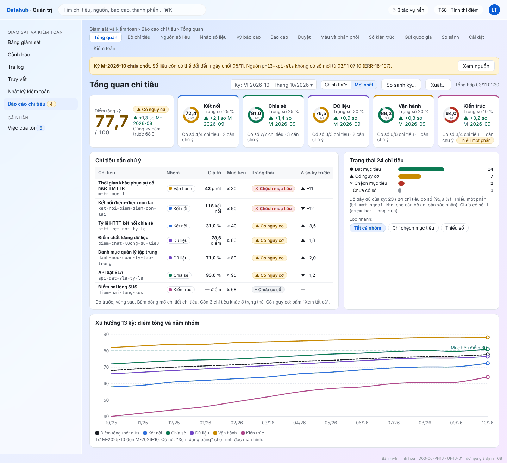
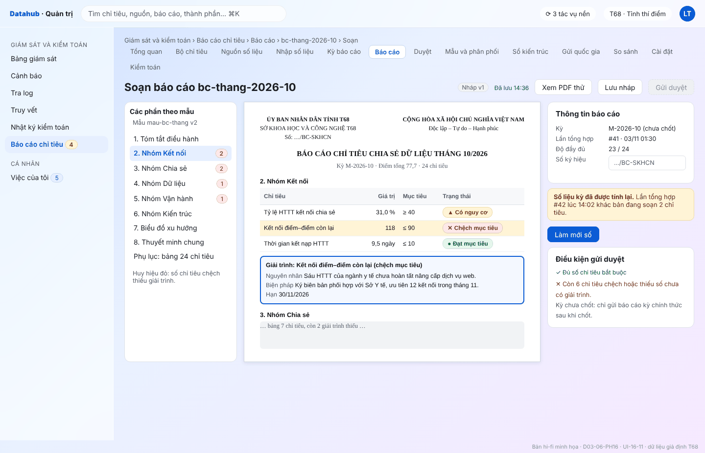

# D02-03-PH16 · Đặc tả yêu cầu chức năng Báo cáo chỉ tiêu và sổ kiến trúc

## Tóm tắt cho hội đồng thẩm định

**Mục tiêu.** PH-16 trả lời câu hỏi mà lãnh đạo UBND tỉnh và các sở phải trả lời hằng tháng, hằng quý, hằng năm: "Chuyển đổi số về kết nối, chia sẻ dữ liệu của tỉnh đang ở đâu so với mục tiêu, số liệu ấy lấy từ đâu và ai đã xác nhận?". Phân hệ tính tự động mười tám chỉ số đo KPI-01…18 của BRD và sáu chỉ tiêu bổ sung từ số liệu mà các phân hệ khác đã tổng hợp, cho phép nhập tay có bằng chứng với chỉ tiêu không đo tự động được, chốt số theo kỳ, lập báo cáo có thuyết minh, duyệt bốn mắt, ký số, lưu bất biến, rồi gửi gói báo cáo lên hệ quốc gia qua PH-14. Cùng phân hệ là **sổ kiến trúc tối thiểu**: danh sách thành phần kiến trúc của nền tảng (HTTT, API, luồng, topic, bộ điều hợp, dịch vụ nền, liên kết quốc gia), phiên bản, phụ thuộc, trạng thái vận hành và mức tuân thủ khung kiến trúc, đúng phạm vi D01-02 đặt cho bản v1.0.

**Phạm vi.** 58 yêu cầu chức năng chia chín nhóm: bộ chỉ tiêu; nguồn số liệu; tính toán theo kỳ; báo cáo; xuất và phân phối; bảng điều khiển; sổ kiến trúc; gửi quốc gia; quản trị. Phân hệ chạy trong DU `dh-platform` (control plane, Spring Boot 4 + Modulith, package `vn.datahub.platform.kpi` và `vn.datahub.platform.arch`), lưu trạng thái ở schema `ph16_kpi` của cụm `pg-core` có RLS theo `tenant_id`, Đợt 3, ngân sách 9 người-tháng.

**Căn cứ pháp lý.** CMP-LAW-01 (Luật Dữ liệu); CMP-LAW-03 và CMP-LAW-19 (NĐ 278/2025 về kết nối, chia sẻ dữ liệu, gồm nghĩa vụ báo cáo tình hình chia sẻ); CMP-LAW-10 (Khung kiến trúc Chính phủ điện tử 3.0) và CMP-LAW-11 (dự thảo Khung kiến trúc tổng thể quốc gia số, năng lực nền tảng tích hợp và bộ chỉ số); CMP-LAW-14 và CMP-LAW-21 (NĐ 224/2026, Luật Chuyển đổi số 148/2025 về đánh giá, báo cáo chuyển đổi số); CMP-LAW-16 (Luật An ninh mạng, lưu trữ trong nước, nhật ký); CMP-LAW-15 (NĐ 30/2020 về công tác văn thư, thể thức báo cáo xuất). Bộ chỉ số đánh giá chuyển đổi số cấp tỉnh (DTI) chưa có mã pháp lý trong D00-01, ghi ở Q16-01.

**Những điểm hội đồng cần lưu ý.**

1. PH-16 **không tự sinh dữ liệu thô**. Mọi số tự động truy được về quan sát đã tổng hợp ở phân hệ nguồn (sự kiện Kafka, API chỉ số, API đẩy `kpi.ingest`); số nhập tay phải có bằng chứng và người thứ hai xác nhận (BR-16-001, BR-16-005, BR-16-006).
2. **Công thức, ngưỡng, mục tiêu và mẫu gói quốc gia là cấu hình có phiên bản**, viết bằng biểu thức CEL trên quan sát đã chuẩn hóa, có duyệt bốn mắt. Khi cơ quan có thẩm quyền ban hành khung chỉ số chính thức (CMP-LAW-11 đang là dự thảo), chỉ nạp phiên bản định nghĩa mới, không sửa mã (BR-16-002).
3. **Thiếu nguồn vẫn ra số phần đã có, gắn nhãn `PARTIAL`, không bịa số** (fail-soft). Riêng báo cáo chính thức bị chặn khi chỉ tiêu bắt buộc không có số liệu (BR-16-007, BR-16-008).
4. **Báo cáo đã công bố bất biến**: bản PDF ký số, mã băm SHA-256, lưu kho WORM 10 năm; sửa sai bằng phiên bản đính chính, bản cũ chuyển `SUPERSEDED` và vẫn tra được (BR-16-009, BR-16-010).
5. PH-16 **không gọi thẳng hệ quốc gia**: gói báo cáo và sổ kiến trúc đi qua PH-14 như mọi kết nối quốc gia khác, có nhật ký nộp làm bằng chứng. PH-16 cũng không thay giám sát thời gian thực của PH-13, danh mục API của PH-02 hay điểm chất lượng của PH-08 (BR-16-021).

**Con số chính.**

| Chỉ số | Giá trị |
|---|---|
| Yêu cầu chức năng | 58 (M: 37, S: 17, C: 4) |
| Quy tắc nghiệp vụ | 35 (BR-16-001…035) |
| Yêu cầu phi chức năng | 22 (NFR-16-001…022) |
| Màn hình | 20 (UI-16-01…20) |
| API | 130 operation dự kiến (API-16-001…130), tiền tố `/api/kpi/v1` |
| Sự kiện | 13 phát (EVT-16-01…13); tiêu thụ sự kiện của PH-01, 02, 04, 05, 07, 08, 10, 13, 14, 19, 20 |
| Mã lỗi | 57 control (ERR-16-001…057), 25 thu thập, tính toán, gửi (ERR-16-101…125); `401`, `403`, `428` dùng ERR-00-401, ERR-00-403, ERR-00-428 |
| Thực thể mức logic | 39 (EN-16-01…39) |
| Bộ chỉ tiêu mặc định | 24 chỉ tiêu mẫu `COMMON` (18 ứng với KPI-01…18) |
| Tham số theo tenant | 24 khóa `16.*` (mục 8.2) |
| Chức năng hệ cũ được phủ | Không có `LGC` do PH-16 làm chính; 9 mục liên quan gián tiếp, kết luận "Nâng cấp (gián tiếp)" |
| FR của SRS cũ được phủ | 22/22 (bảng ánh xạ ở mục 11.3) |

: Con số chính của PH-16

## 1. Giới thiệu

### 1.1. Mục đích của tài liệu

Tài liệu đặc tả đầy đủ hành vi của PH-16 Báo cáo chỉ tiêu và sổ kiến trúc cho ba nhóm người đọc. Hội đồng thẩm định dùng tài liệu để đánh giá sự cần thiết, mức đáp ứng nghĩa vụ báo cáo chuyển đổi số và độ tin cậy của số liệu báo cáo. Kỹ sư dùng tài liệu làm đầu vào cho D03-02-PH16 (thiết kế chi tiết), D03-03-PH16 (CSDL), D03-04-PH16 (API) và D03-06-PH16 (màn hình). Kiểm thử viên dùng luồng xử lý, ngoại lệ, công thức, ngưỡng và quy tắc độ đầy đủ để viết ca ở D05-02-PH16.

Mỗi chức năng đặc tả theo khung 17 mục của K-TRINH-BAY §4. Phụ lục A là nguồn chuẩn của mọi giá trị liệt kê (enum) dùng trong bộ bảy tập PH-16; mục 9.4 là nguồn chuẩn của danh mục API mà tập API phải dùng đúng mã. Phụ lục B ghi các đề nghị sửa tài liệu chung và tài liệu phân hệ khác mà tập này kéo theo; Phụ lục C dành cho nhật ký hấp thụ đề nghị ở các bản sau.

### 1.2. Phạm vi

PH-16 chịu trách nhiệm chín nhóm việc dưới đây; mỗi nhóm ứng với một mục ở chương 6. Hai trụ cột của phân hệ (chỉ tiêu và sổ kiến trúc) dùng chung khung kỳ, duyệt, kiểm toán và kênh gửi quốc gia nên được gộp vào một phân hệ, đúng như SRS cũ đã lập luận.

| Nhóm | Trách nhiệm | FR |
|---|---|---|
| A · Bộ chỉ tiêu | Định nghĩa chỉ tiêu, công thức CEL, mục tiêu, ngưỡng có phiên bản và duyệt; nhóm và trọng số; kế thừa mẫu `COMMON` | 001–008 |
| B · Nguồn số liệu | Đăng ký nguồn, nhận quan sát từ sự kiện, kéo API, API đẩy; độ tươi; nhập tay có bằng chứng và xác nhận | 009–016 |
| C · Tính toán | Kỳ báo cáo, lần tổng hợp, giá trị chỉ tiêu có dòng truy nguồn, độ đầy đủ, trạng thái so mục tiêu, điểm nhóm, tính lại, chốt kỳ | 017–024 |
| D · Báo cáo | Mẫu báo cáo, bản nháp, thuyết minh, duyệt bốn mắt, công bố bất biến có ký số, đính chính, rút, báo cáo đột xuất | 025–032 |
| E · Xuất, phân phối | Xuất PDF, XLSX, CSV, JSON; danh sách phân phối; API đọc `kpi.read`; bằng chứng công bố; thẻ cho trang Tổng quan | 033–037 |
| F · Bảng điều khiển | Tổng quan năm nhóm, chi tiết chỉ tiêu, so sánh kỳ, so sánh liên tenant ẩn danh, theo dõi vận hành | 038–042 |
| G · Sổ kiến trúc | Thành phần, phiên bản, phụ thuộc; tự đăng ký từ sự kiện; trạng thái vận hành; đánh giá tuân thủ; đối chiếu; xuất | 043–049 |
| H · Gửi quốc gia | Mẫu gói có phiên bản; gửi gói báo cáo và sổ kiến trúc qua PH-14; nhật ký nộp, gửi lại; đối soát | 050–054 |
| I · Quản trị | Tham số `16.*`, kiểm toán, lưu giữ, chỉ số vận hành của chính PH-16 | 055–058 |

: Trách nhiệm của PH-16 theo nhóm chức năng

Những việc dưới đây liên quan nhưng không thuộc PH-16; tài liệu chỉ đặc tả phần giao tiếp với phân hệ chịu trách nhiệm.

| Việc ngoài phạm vi | Phân hệ chịu trách nhiệm | Giao tiếp với PH-16 |
|---|---|---|
| Giám sát thời gian thực, cảnh báo vận hành, nhật ký kiểm toán tập trung, kênh thông báo | PH-13 | PH-16 đọc chỉ số sẵn sàng, sự cố; ghi kiểm toán và gửi thông báo qua PH-13 |
| Danh mục API, vòng đời công bố, SLA | PH-02 | PH-16 đọc thống kê API (API-02-079, API-02-097), nhận EVT-02-05, EVT-02-06, EVT-02-13 |
| Chấm điểm chất lượng dữ liệu | PH-08 | PH-16 nhận EVT-08-14, đọc bù API-08-122 |
| Danh mục dùng chung | PH-07 | PH-16 nhận EVT-07-05, EVT-07-09 |
| Kết nối, ký kênh, gửi tới nền tảng quốc gia | PH-14 | PH-16 giao gói, nhận biên nhận |
| Hộp việc, lịch job dùng chung | PH-18 | PH-16 tạo việc duyệt; lịch tổng hợp do PH-16 tự giữ |
| Trợ lý hỏi đáp số liệu | PH-17 | PH-17 chỉ đọc qua scope `kpi.read` |
| Kho phân tích dài hạn, BI tự do | Ngoài v1.0 (lớp dữ liệu dùng chung sau này) | Không |

: Việc ngoài phạm vi PH-16 và phân hệ chịu trách nhiệm

### 1.3. Đối tượng sử dụng và cách đọc

Tài liệu dài vì có 58 khối đặc tả; mỗi nhóm người đọc chỉ cần một phần.

| Người đọc | Đọc phần | Mục đích |
|---|---|---|
| Hội đồng thẩm định | Tóm tắt, chương 1, 2, 11, 13, 14 | Đánh giá sự cần thiết, căn cứ pháp lý, rủi ro, câu hỏi còn mở |
| Lãnh đạo, quản trị tỉnh | Chương 2.5, 4.1, 6.5, 6.7, 10 | Hiểu số liệu đến từ đâu, cách duyệt và công bố |
| Kiến trúc sư, kỹ sư `dh-platform` | Chương 2.3–2.4, 4, 6, 8, 9, Phụ lục A | Thiết kế mô-đun, CSDL, API, sự kiện |
| Kỹ sư phân hệ nguồn | Mục 6.3 (nhóm B), 6.8 (nhóm G), Phụ lục B | Biết phải phát sự kiện, cung cấp API chỉ số nào |
| Kiểm thử viên | Chương 6, 7, 8, 9, 14 | Viết ca kiểm thử theo luồng, ngoại lệ, quy tắc |

: Người đọc và phần nên đọc

### 1.4. Thuật ngữ và chữ viết tắt

Bảng chỉ gồm thuật ngữ dùng trong tập này; thuật ngữ chung của dự án ở D00-01.

| Thuật ngữ | Giải thích |
|---|---|
| Chỉ tiêu (`indicator`) | Đại lượng đo được có định nghĩa, công thức, đơn vị, mục tiêu, ngưỡng; ví dụ tỷ lệ HTTT đang kết nối qua Datahub |
| KPI | Chỉ số đo hiệu quả chính (Key Performance Indicator); ở tập này là KPI-01…18 của D02-01 §3, mỗi KPI ứng với một chỉ tiêu mẫu |
| Phiên bản định nghĩa | Một lần chốt công thức, mục tiêu, ngưỡng của chỉ tiêu; chỉ một phiên bản `ACTIVE` tại một thời điểm |
| CEL | Common Expression Language, ngôn ngữ biểu thức không có vòng lặp, không truy cập ngoài, dùng để viết công thức chỉ tiêu |
| Quan sát (`observation`) | Một giá trị số đã tổng hợp do phân hệ nguồn cung cấp cho một kỳ, có mã chỉ số `metricCode`, chiều phân tích và tham chiếu nguồn |
| Nguồn số liệu (`data_source`) | Kênh PH-16 nhận quan sát: sự kiện Kafka, kéo API, API đẩy hoặc nhập tay |
| Độ tươi | Thời gian kể từ quan sát gần nhất của nguồn; quá `16.source.stale-hours` thì nguồn `STALE` |
| Kỳ báo cáo | Khoảng thời gian tháng, quý, năm mà giá trị chỉ tiêu được tính và chốt |
| Lần tổng hợp (`aggregation_run`) | Một lần tính mọi chỉ tiêu của một kỳ |
| Độ đầy đủ (`completeness`) | Mức có đủ số liệu của một giá trị chỉ tiêu (`COMPLETE`, `PARTIAL`, `NO_DATA`) hoặc tỷ lệ chỉ tiêu có số của lần tổng hợp |
| Dòng truy nguồn (`lineage`) | Danh sách quan sát, phiên bản công thức đã dùng để tính một giá trị |
| Fail-soft | Thiếu một phần đầu vào vẫn ra kết quả phần còn lại kèm nhãn thiếu, không dừng cả lần tính |
| Bốn mắt | Nguyên tắc người thứ hai khác người lập phải duyệt (FR-00-071) |
| WORM | Write Once Read Many, kho lưu chỉ ghi một lần, không sửa xóa trước hạn (ADR-031) |
| Sổ kiến trúc | Danh sách thành phần kiến trúc của nền tảng trong tenant cùng phiên bản, phụ thuộc, trạng thái và mức tuân thủ |
| Gói quốc gia | Tệp dữ liệu theo mẫu của hệ quốc gia chứa báo cáo chỉ tiêu hoặc sổ kiến trúc, gửi qua PH-14 |
| DTI | Bộ chỉ số đánh giá chuyển đổi số cấp tỉnh (Digital Transformation Index) |
| SUS | System Usability Scale, thang điểm hài lòng 0–100 dùng cho KPI-18 |
| VW, TA, TO, SO, DS, AU, PA, PO, PU | Viết tắt vai trò, xem mục 3.1 |

: Thuật ngữ và chữ viết tắt của FRS PH-16

### 1.5. Tài liệu tham chiếu

Tài liệu pháp lý dùng mã CMP-LAW của D00-01 §7; ADR có tệp được dẫn mã đầy đủ, ADR đề xuất của tập này dùng dạng "ADR 160" vì chưa có tệp.

| Loại | Tài liệu |
|---|---|
| Pháp lý | CMP-LAW-01, CMP-LAW-03, CMP-LAW-19, CMP-LAW-10, CMP-LAW-11, CMP-LAW-14, CMP-LAW-21, CMP-LAW-16, CMP-LAW-15 |
| Dự án | D01-02 Kế hoạch dự án §12.5; D02-01 BRD §3 (BO-01…09, KPI-01…18), REQ-16; D02-02 SRS (FR-00, NFR-00); D02-08 Ma trận phân quyền; D00-03 Ma trận truy vết; D00-04 Sổ tra cứu gọn; D03-06-00 IA và mẫu màn hình (dòng 37) |
| FRS phân hệ nguồn | D02-03-PH01, PH02, PH04, PH05, PH07, PH08, PH10, PH14, PH19 |
| ADR có tệp | ADR-001 (Spring Boot Modulith), ADR-003 (PostgreSQL RLS), ADR-004 (Kafka), ADR-006 (Keycloak, OPA), ADR-012 (OpenBao), ADR-020 (Liquid Glass), ADR-023 (ECharts), ADR-031 (kiểm toán chuỗi băm, WORM), ADR-042 (inbox, outbox), ADR-046 (phê duyệt bốn mắt), ADR-047 (lưu trữ phân vùng), ADR-057 (đồng bộ quốc gia qua PH-14) |
| ADR đề xuất | ADR 160–164 (mục 12.3); ADR 085 của PH-08 (cùng họ CEL); ADR 075 của PH-15 (bỏ Backstage) |
| SRS cũ | `docs/07-srs/SRS-PH-16-nas-kpi.md` (22 FR, 24 NFR, 6 BR, 6 màn) |

: Tài liệu tham chiếu của FRS PH-16

### 1.6. Cấu trúc tài liệu

Chương 2 trình bày bối cảnh, mục tiêu, vị trí và kiến trúc thành phần. Chương 3 nêu tác nhân, ma trận quyền và tách nhiệm vụ. Chương 4 định nghĩa khái niệm, thực thể và bảy máy trạng thái. Chương 5 liệt kê 58 chức năng; chương 6 đặc tả từng chức năng theo khung 17 mục, chia chín nhóm. Chương 7 là quy tắc nghiệp vụ; chương 8 là yêu cầu phi chức năng và tham số; chương 9 là mã lỗi, câu thông báo, sự kiện và danh mục API. Chương 10 liệt kê màn hình và mô tả hai giao diện tiêu biểu. Chương 11 truy vết hệ cũ, REQ và SRS cũ; chương 12 phụ thuộc, giả định, ràng buộc; chương 13 câu hỏi mở; chương 14 tiêu chí chấp nhận. Phụ lục A là nguồn chuẩn enum, Phụ lục B đề nghị đồng bộ, Phụ lục C nhật ký hấp thụ.

## 2. Tổng quan phân hệ

### 2.1. Bối cảnh và vấn đề cần giải quyết

Hệ LGSP cũ có nhiều bảng thống kê rời: dashboard hoạt động API, dashboard thanh toán, đếm publisher và topic của hub sự kiện, thống kê theo endpoint. Không bảng nào trả lời được câu hỏi của lãnh đạo về mục tiêu chuyển đổi số, và số liệu báo cáo lên trên vẫn được cán bộ tổng hợp tay từ nhiều màn hình, chép vào văn bản. D01-02 §12.5 đặt yêu cầu "số liệu KPI lấy từ PH-13 và PH-16 khi có, không nhập tay"; REQ-16 của BRD là năng lực mới. Đồng thời, khung kiến trúc Chính phủ điện tử 3.0 và dự thảo khung kiến trúc tổng thể quốc gia số đòi hỏi tỉnh nắm được danh sách thành phần kiến trúc của mình và mức tuân thủ, nhưng hiện chưa có sổ nào được duy trì tự động.

| Hạn chế hiện tại | Hệ quả | Cách PH-16 khắc phục |
|---|---|---|
| Số liệu báo cáo tổng hợp tay từ nhiều màn hình | Sai số chép, không truy được nguồn, mất nhiều ngày công mỗi kỳ | Thu quan sát tự động từ phân hệ nguồn, lưu dòng truy nguồn cho từng giá trị (FR-16-010, 011, 019) |
| Không có định nghĩa chỉ tiêu thống nhất | Mỗi kỳ, mỗi cán bộ hiểu công thức một kiểu | Định nghĩa có phiên bản, duyệt bốn mắt, công thức CEL thử được trên dữ liệu thật (FR-16-002…005) |
| Báo cáo là tệp Word sửa được sau khi gửi | Không chứng minh được số đã báo cáo | Bản công bố ký số, có mã băm, lưu WORM; đính chính bằng phiên bản mới (FR-16-029, 030) |
| Thiếu một nguồn thì không ra báo cáo, hoặc điền ước lượng | Lãnh đạo không biết số nào chắc, số nào thiếu | Fail-soft, nhãn `PARTIAL`, cờ thiếu nguồn hiện trên bảng điều khiển và báo cáo (FR-16-020) |
| Không có sổ kiến trúc | Không trả lời được hệ thống nào đang chạy, phụ thuộc gì, tuân thủ đến đâu | Sổ kiến trúc tự đăng ký từ sự kiện phân hệ nguồn, đánh giá tuân thủ có xác nhận (FR-16-044, 047) |
| Gửi báo cáo lên trên qua thư, công văn | Không có biên nhận điện tử, khó gửi lại | Gói quốc gia theo mẫu cấu hình, gửi qua PH-14, nhật ký nộp làm bằng chứng (FR-16-051, 053) |

: Hạn chế hiện tại, hệ quả và cách PH-16 khắc phục

### 2.2. Mục tiêu của phân hệ

Năm mục tiêu dưới đo được và gắn với yêu cầu phi chức năng ở mục 8.1.

| # | Mục tiêu | Đo bằng |
|---|---|---|
| 1 | Bỏ tổng hợp tay: ít nhất 19/24 chỉ tiêu mặc định tính tự động hoàn toàn, số còn lại nhập tay có bằng chứng | Đếm chỉ tiêu `measurement = AUTO` có giá trị `COMPLETE` ở kỳ thí điểm |
| 2 | Báo cáo tháng sẵn sàng sớm: lần tổng hợp kỳ tháng xong trong 5 phút, bản nháp báo cáo có ngay sau đó | NFR-16-001, NFR-16-009 |
| 3 | Số liệu tin cậy: 100% giá trị công bố truy được về quan sát và phiên bản công thức; tính lại cho cùng kết quả | NFR-16-011, NFR-16-013 |
| 4 | Không mất số liệu: 0 quan sát bị mất khi PH-16 dừng tới 1 giờ; mọi quan sát trùng bị loại đúng | NFR-16-012 |
| 5 | Sổ kiến trúc luôn mới: thành phần mới xuất hiện trong sổ ≤ 60 giây sau sự kiện của phân hệ nguồn | NFR-16-015 |

: Mục tiêu đo được của PH-16

### 2.3. Vị trí trong kiến trúc

PH-16 nằm trong DU `dh-platform` ở vùng ứng dụng nội bộ (control plane), cùng PH-13, PH-17, PH-18, PH-20. Phân hệ đứng **ở cuối** dòng số liệu: chỉ nhận số đã tổng hợp từ phân hệ khác, không chạm dữ liệu nghiệp vụ, không nằm trên đường gọi API của data plane. Mọi giao tiếp với hệ quốc gia đi qua PH-14.

```{.mermaid caption="Vị trí PH-16 trong kiến trúc Datahub"}
flowchart TB
  subgraph SRC["Phân hệ nguồn"]
    P01["PH-01 HTTT"]
    P02["PH-02 Danh mục API"]
    P04["PH-04 Luồng tích hợp"]
    P07["PH-07 Danh mục"]
    P08["PH-08 Chất lượng"]
    P10["PH-10 Sự kiện"]
    P13["PH-13 Giám sát"]
    P19["PH-19 Thanh toán"]
    P20["PH-20 Tenant"]
  end
  K["Kafka"]
  subgraph PLT["DU dh-platform"]
    KPI["PH-16 Báo cáo chỉ tiêu<br/>vn.datahub.platform.kpi"]
    ARCH["PH-16 Sổ kiến trúc<br/>vn.datahub.platform.arch"]
  end
  PG[("pg-core<br/>schema ph16_kpi")]
  WORM[("Kho WORM<br/>báo cáo công bố")]
  P14["PH-14 Kết nối quốc gia"]
  QG["Hệ quốc gia nhận báo cáo, sổ kiến trúc"]
  UI["dh-console /giam-sat/chi-tieu"]
  P17["PH-17 Trợ lý"]
  SRC -->|"EVT"| K
  K --> KPI
  K --> ARCH
  KPI -->|"kéo API chỉ số"| SRC
  KPI --> PG
  ARCH --> PG
  KPI --> WORM
  KPI -->|"gói báo cáo"| P14
  ARCH -->|"gói sổ kiến trúc"| P14
  P14 --> QG
  UI --> KPI
  P17 -->|"kpi.read"| KPI
  KPI -->|"EVT-16"| K
```

Hình cho thấy PH-16 có hai đường vào (sự kiện qua Kafka và kéo API chỉ số theo lịch) và hai đường ra (sự kiện `{tenant}.kpi.*` cho PH-13, PH-17, PH-18 và gói quốc gia qua PH-14). PH-16 chỉ ghi vào schema của mình và kho WORM; nếu PH-16 dừng, không phân hệ nào khác bị ảnh hưởng chức năng.

### 2.4. Kiến trúc thành phần và công nghệ

PH-16 là hai mô-đun Modulith trong `dh-platform`. Mô-đun `kpi` gồm bảy thành phần nội bộ. **Định nghĩa** (`kpi-definition`) lưu chỉ tiêu, phiên bản, mục tiêu, ngưỡng, nhóm, biên dịch công thức bằng `cel-java` (ADR 161, cùng họ ADR 085 của PH-08). **Thu thập** (`kpi-ingest`) tiêu thụ sự kiện Kafka qua inbox (ADR-042), kéo API chỉ số theo lịch, nhận API đẩy, chuẩn hóa thành quan sát và ghi bảng `observation` phân vùng theo tháng của kỳ (ADR 160, ADR-047). **Nhập tay** (`kpi-manual`) nhận biểu mẫu và tệp XLSX, lưu bằng chứng ở kho đối tượng. **Tính toán** (`kpi-compute`) chạy lần tổng hợp theo lịch nội bộ `ScheduleDispatcher` dưới khóa ShedLock, đánh giá công thức trên quan sát của kỳ, lưu giá trị và dòng truy nguồn. **Báo cáo** (`kpi-report`) dựng bản nháp từ mẫu, duyệt, công bố: dựng PDF bằng OpenHTMLtoPDF, ký số qua dịch vụ ký của nền tảng (khóa ở OpenBao, ADR-012), lưu WORM (ADR 162). **Xuất, phân phối** (`kpi-export`) sinh XLSX bằng Apache POI, CSV, JSON; gửi thông báo qua kênh PH-13. **Gửi quốc gia** (`kpi-national`) dựng gói theo mẫu cấu hình ngoài, kiểm lược đồ, giao PH-14 qua outbox (ADR 163, ADR-057). Mô-đun `arch` giữ sổ kiến trúc, tiêu thụ sự kiện đăng ký từ phân hệ nguồn, nhận API `arch.register` và chạy đánh giá tuân thủ.

Không dùng ClickHouse hay kho phân tích riêng: khối lượng chỉ tiêu nhỏ (24 chỉ tiêu × 36 kỳ × 34 tenant), PostgreSQL phân vùng đủ đáp ứng NFR-16-005 (ADR 160). Không dùng Backstage cho sổ kiến trúc (ADR-006 cũ của repo bị thay; PH-15 cũng bỏ Backstage theo ADR 075 đề xuất).

```{.mermaid caption="Trình tự luồng chính từ quan sát tới báo cáo công bố"}
sequenceDiagram
  participant S as Phân hệ nguồn
  participant K as Kafka
  participant I as kpi-ingest
  participant C as kpi-compute
  participant R as kpi-report
  actor TO as Cán bộ tổng hợp
  actor TA as Quản trị tỉnh
  participant W as Kho WORM
  S->>K: Sự kiện chỉ số (ví dụ EVT-08-14)
  K->>I: Tiêu thụ qua inbox
  I->>I: Chuẩn hóa, loại trùng theo idempotencyRef
  C->>I: Đọc quan sát của kỳ M-2026-10
  C->>C: Tính công thức, độ đầy đủ, trạng thái
  C->>K: EVT-16-05 period.computed
  TO->>R: Lập bản nháp, viết thuyết minh, gửi duyệt
  R->>K: EVT-16-07 report.submitted
  TA->>R: Duyệt và công bố
  R->>R: Dựng PDF, ký số, tính contentHash
  R->>W: Lưu bản công bố
  R->>K: EVT-16-08 report.published
```

Hình cho thấy ba điểm tách: thu thập không biết công thức, tính toán không biết báo cáo, báo cáo chỉ đọc giá trị đã tính. Nhờ vậy số liệu trễ chỉ kích hoạt tính lại kỳ chưa chốt (FR-16-023), không làm đổi báo cáo đã công bố.

### 2.5. Quy trình nghiệp vụ liên quan

Bộ quy trình BP-01…09 của D02-01 chưa có quy trình riêng cho báo cáo chỉ tiêu; BP-07 "Giám sát, xử lý sự cố, báo cáo" chỉ nhắc báo cáo vận hành. Tài liệu đề nghị bổ sung BP-11 "Tổng hợp và báo cáo chỉ tiêu chuyển đổi số" (Phụ lục B; BP-10 đã được PH-08 đề nghị).

| Quy trình | Bước có PH-16 |
|---|---|
| BP-01 Kết nạp HTTT | HTTT `ACTIVE` tự vào sổ kiến trúc (FR-16-044); thời gian kết nạp vào KPI-05 |
| BP-02 Xây dựng và phát hành luồng tích hợp | Luồng triển khai vào sổ kiến trúc; thời gian xây luồng vào KPI-06 |
| BP-03 Phát hành và đồng bộ danh mục | Số danh mục quản lý tập trung (KPI-10), độ trễ đồng bộ quốc gia (KPI-11) |
| BP-05 Thanh toán và đối soát | Tỷ lệ đối soát khớp (KPI-13), thời gian phát hiện lệch (KPI-14) |
| BP-07 Giám sát, xử lý sự cố, báo cáo | Sẵn sàng, độ trễ, MTTD, MTTR (KPI-03, 04, 15, 16); trạng thái vận hành của thành phần (FR-16-046) |
| BP-08 Khởi tạo tenant | Thời gian khởi tạo tenant (KPI-12); tenant mới kế thừa bộ chỉ tiêu `COMMON` (FR-16-008) |
| BP-11 (đề nghị) Tổng hợp và báo cáo chỉ tiêu | Mở kỳ, thu thập, nhập tay, tính, chốt, lập báo cáo, duyệt, công bố, phân phối, gửi quốc gia |

: Quy trình nghiệp vụ có PH-16 tham gia

```{.mermaid caption="Vòng báo cáo chỉ tiêu một kỳ tháng điển hình"}
flowchart TB
  A["Kỳ M-2026-10 tự mở ngày 01/10"] --> B["Thu quan sát tự động trong tháng"]
  B --> C["Ngày 01/11 tổng hợp lần đầu"]
  C --> D["Nhập số liệu tay, xác nhận bốn mắt"]
  D --> E["Tính lại khi có số trễ"]
  E --> F["Ngày 05/11 chốt kỳ"]
  F --> G["Lập báo cáo, thuyết minh chỉ tiêu chệch"]
  G --> H["Duyệt bốn mắt"]
  H -->|"yêu cầu sửa"| G
  H --> I["Công bố, ký số, lưu WORM"]
  I --> J["Phân phối, gửi quốc gia qua PH-14"]
```

Hình cho thấy kỳ chỉ chốt sau khi số liệu tay đã được xác nhận; báo cáo chính thức chỉ lập từ kỳ đã tính, và công bố chỉ sau khi người thứ hai duyệt. Ngày chốt mặc định là ngày 5 của tháng sau (`16.period.close-day`).

### 2.6. Chức năng hệ cũ được phủ

Hệ cũ không có chức năng báo cáo chỉ tiêu hay sổ kiến trúc nên D00-03 không có `LGC` nào ghi PH-16 làm chính, đúng với REQ-16 là năng lực mới. Chín mục dưới là bảng thống kê rời mà PH-16 nâng thành chỉ tiêu định kỳ; kết luận chính giữ ở phân hệ làm chính (mục 11.1).

| Mã | Chức năng hệ cũ | Vai trò của PH-16 |
|---|---|---|
| LGC-APIM-026 | Dashboard hoạt động chung của hệ thống API | Chỉ tiêu lượt khai thác, API đạt SLA theo kỳ (FR-16-010, 038) |
| LGC-PAY-013 | Dashboard tổng quan thanh toán | Chỉ tiêu giao dịch thanh toán trực tuyến (FR-16-010) |
| LGC-PAY-020 | Dashboard kênh thanh toán | Chỉ tiêu đối soát khớp, phát hiện lệch (KPI-13, 14) |
| LGC-HUB-001 | Dashboard tổng số publisher | Số thành phần `TOPIC` và nguồn phát trong sổ kiến trúc (FR-16-044) |
| LGC-HUB-002 | Dashboard tổng số subscriber | Như trên |
| LGC-HUB-003 | Dashboard tổng số project | Như trên |
| LGC-HUB-004 | Dashboard tổng số topic | Như trên |
| LGC-BUS-027 | Thống kê theo endpoint | Chỉ tiêu sẵn sàng, độ trễ theo kỳ từ PH-13 (KPI-03, 04) |
| LGC-NGSP-004 | Đồng bộ hồ sơ cấp mã số ĐVQHNS, tổng hợp kết quả | Mẫu gói quốc gia và nhật ký nộp dùng cùng kênh PH-14 (FR-16-051, 053) |

: Chức năng hệ cũ liên quan gián tiếp tới PH-16

## 3. Tác nhân, vai trò và quyền

### 3.1. Tác nhân

PH-16 không tạo vai trò mới; mọi vai trò lấy từ D02-08. Người duyệt báo cáo trên thực tế thường là lãnh đạo sở hoặc UBND; bản này giao việc duyệt cho TA được ủy quyền và ghi câu hỏi về vai trò riêng ở Q16-04.

| Viết tắt | Tác nhân | Loại | Mô tả | Tương tác chính |
|---|---|---|---|---|
| VW | ROLE-VIEWER | Người | Lãnh đạo UBND, sở ngành | Xem bảng điều khiển, báo cáo đã công bố |
| TA | ROLE-TENANT_ADMIN | Người | Quản trị tỉnh | Bộ chỉ tiêu của tỉnh, duyệt định nghĩa, duyệt và công bố báo cáo, gửi quốc gia, cài đặt |
| TO | ROLE-TENANT_OPERATOR | Người | Cán bộ tổng hợp | Quản lý nguồn, nhập số liệu tay, chạy tổng hợp, lập báo cáo, xuất |
| SO | ROLE-SECURITY_OFFICER | Người | Cán bộ an toàn thông tin | Đánh giá tuân thủ ATTT của thành phần; nhập, xác nhận KPI-08, KPI-09 |
| DS | ROLE-DATA_STEWARD | Người | Cán bộ quản lý dữ liệu | Nhập, xác nhận số liệu tay về danh mục, dữ liệu (KPI-10) |
| AU | ROLE-AUDITOR | Người | Kiểm toán viên tỉnh | Xem báo cáo, nhật ký kiểm toán, tải bằng chứng |
| PA | ROLE-PLATFORM_ADMIN | Người | Quản trị nền tảng | Bộ chỉ tiêu mẫu `COMMON`, mẫu gói quốc gia, so sánh liên tenant |
| PO | ROLE-PLATFORM_OPERATOR | Người | Vận hành nền tảng | Theo dõi job thu thập, tính toán toàn nền tảng |
| PU | ROLE-PLATFORM_AUDITOR | Người | Kiểm toán nền tảng | Kiểm toán liên tenant, chỉ đọc |
| Phân hệ nguồn | PH-01, 02, 04, 05, 07, 08, 10, 13, 19, 20 | Hệ thống | Cung cấp quan sát | Phát sự kiện, trả API chỉ số, gọi `kpi.ingest`, `arch.register` |
| PH-14 | Kết nối quốc gia | Hệ thống | Kênh gửi quốc gia | Nhận gói, trả biên nhận |
| PH-13 | Giám sát | Hệ thống | Kiểm toán, thông báo, chỉ số vận hành | Nhận kiểm toán, gửi thông báo, cung cấp `opsStatus` |
| PH-17, PH-18 | Trợ lý, hộp việc | Hệ thống | Bên đọc, bên nhận việc | `kpi.read`; tạo việc duyệt |

: Tác nhân của PH-16

### 3.2. Ma trận quyền

D02-08 hiện có `PERM-16-read` và `PERM-16-admin`; mười hai quyền còn lại là đề nghị, ghi ở Phụ lục B (đề nghị đồng bộ D02-08) và có hiệu lực khi được gộp. Ký hiệu: ● được cấp; ○ được cấp có giới hạn (ghi chú dưới bảng); trống là không.

| Quyền | Nghĩa | PA | TA | TO | SO | DS | AU | VW | PO | PU |
|---|---|---|---|---|---|---|---|---|---|---|
| `PERM-16-read` | Xem bảng điều khiển, chỉ tiêu, báo cáo đã công bố | ● | ● | ● | ● | ● | ● | ● | ● | ● |
| `PERM-16-admin` | Soạn định nghĩa chỉ tiêu, nhóm, mục tiêu, ngưỡng, mẫu báo cáo, gửi duyệt | ○ | ● | | | | | | | |
| `PERM-16-approve` | Duyệt định nghĩa và báo cáo, công bố, đính chính, rút | | ● | | | | | | | |
| `PERM-16-source` | Đăng ký, sửa, tạm dừng nguồn số liệu | | ● | ● | | | | | | |
| `PERM-16-manual` | Nhập số liệu tay kèm bằng chứng, gửi xác nhận, xác nhận | | | ● | ● | ● | | | | |
| `PERM-16-run` | Chạy tổng hợp, tính lại, chốt kỳ, mở lại kỳ | | ● | ○ | | | | | ○ | |
| `PERM-16-report` | Lập bản nháp báo cáo, viết thuyết minh, gửi duyệt | | ● | ● | | | | | | |
| `PERM-16-export` | Xuất, quản lý danh sách phân phối | | ● | ● | | | ○ | | | |
| `PERM-16-arch` | Sửa sổ kiến trúc | ○ | ● | ● | | | | | | |
| `PERM-16-arch-assess` | Đánh giá tuân thủ, xác nhận, miễn trừ | | ● | | ● | | | | | |
| `PERM-16-national` | Lập và gửi gói quốc gia, gửi lại | | ● | | | | | | | |
| `PERM-16-compare` | So sánh liên tenant ẩn danh | ● | | | | | | | | ● |
| `PERM-16-config` | Tham số `16.*` | ○ | ● | | | | | | | |
| `PERM-16-audit-read` | Xem nhật ký kiểm toán PH-16 | | ● | | | | ● | | | ● |

: Ma trận quyền PH-16 theo vai trò

Ghi chú: PA với `PERM-16-admin`, `PERM-16-arch` chỉ thao tác trên tenant `COMMON` (bộ chỉ tiêu mẫu, mẫu tiêu chí tuân thủ) và đặt trần tham số với `PERM-16-config`. TO với `PERM-16-run` chạy tổng hợp, tính lại nhưng không chốt, không mở lại kỳ (chỉ TA). PO với `PERM-16-run` chỉ hủy lần tổng hợp treo trên mọi tenant, không chạy mới. AU với `PERM-16-export` chỉ xuất báo cáo đã công bố và nhật ký. Người dùng giữ `PERM-16-manual` chỉ xác nhận số liệu trong phạm vi chỉ tiêu được giao (`confirmerRoles` của chỉ tiêu, ví dụ KPI-08 chỉ SO).

### 3.3. Tách nhiệm vụ và tài khoản máy

Bốn cặp loại trừ áp dụng trên cùng một đối tượng, không phụ thuộc vai trò (BR-16-003, 004, 005, 024). Tenant cần ít nhất hai người giữ `PERM-16-approve`; chỉ một người thì UI-16-19 cảnh báo và việc duyệt bị chặn chứ không cho tự duyệt (Q16-04).

| Cặp loại trừ | Áp dụng | Mã lỗi khi vi phạm |
|---|---|---|
| Người soạn, gửi duyệt phiên bản định nghĩa ≠ người duyệt | FR-16-005 | ERR-16-005 |
| Người lập, gửi duyệt báo cáo ≠ người duyệt, công bố | FR-16-028, 029, 030 | ERR-16-005 |
| Người nhập số liệu tay ≠ người xác nhận | FR-16-015 | ERR-16-005 |
| Người lập đánh giá tuân thủ ≠ người xác nhận | FR-16-047 | ERR-16-005 |

: Cặp loại trừ tách nhiệm vụ của PH-16

Tài khoản máy dùng token Keycloak luồng client credentials, mTLS trong cụm (ADR-006).

| Scope | Bên giữ | Được gọi |
|---|---|---|
| `kpi.read` | PH-17, cổng thông tin tỉnh, HTTT được cấp | API-16-086, API-16-087, API-16-089 |
| `kpi.ingest` | Phân hệ đẩy quan sát (PH-05, PH-19, PH-20 khi không phát sự kiện) | API-16-030 |
| `arch.register` | PH-01, PH-02, PH-04, PH-10, CI/GitOps | API-16-101 |
| `dq.read` (PH-16 gọi đi) | PH-16 | API-08-122 của PH-08 |
| `catalog:metrics-read` (PH-16 gọi đi) | PH-16 | API-02-079, API-02-097 của PH-02 |
| Scope đọc chỉ số của PH-01, 05, 07, 13, 19, 20 (PH-16 gọi đi) | PH-16 | API chỉ số do phân hệ đó cung cấp (đề nghị đồng bộ) |

: Scope dịch vụ liên quan tới PH-16

## 4. Khái niệm và mô hình nghiệp vụ

### 4.1. Khái niệm nghiệp vụ

Một **chỉ tiêu** thuộc một trong năm **nhóm** (`KET_NOI`, `CHIA_SE`, `DU_LIEU`, `VAN_HANH`, `KIEN_TRUC`, kế thừa năm nhóm KPI của SRS cũ). Chỉ tiêu có loại giá trị (`kind`), chiều tốt (`direction`), cách đo (`measurement`), đơn vị, cách gộp qua kỳ (`aggregation`) và cờ bắt buộc cho báo cáo chính thức (`mandatory`). Nội dung có thể đổi theo thời gian (công thức, mục tiêu, ngưỡng) nằm ở **phiên bản định nghĩa**; mỗi giá trị đã tính ghi rõ phiên bản nào đã dùng.

Công thức là biểu thức CEL trên **biến quan sát**. Hàm `obs("metricCode")` trả giá trị quan sát của kỳ đang tính sau khi gộp theo `aggregation`; `obs("metricCode", {"dim": "giá trị"})` lọc theo chiều; `manual("indicatorCode")` trả số liệu tay đã `ACCEPTED`; `prev()` trả giá trị kỳ trước của chính chỉ tiêu. Ví dụ KPI-01: `obs("ph01.httt.connected") / obs("ph01.httt.total") * 100`. Biến thiếu làm biểu thức trả `NO_DATA`, không trả 0 (BR-16-007).

**Quan sát** là số đã tổng hợp ở phân hệ nguồn, có `metricCode` dạng `ph{nn}.{đối-tượng}.{chỉ-số}`, `value`, `periodStart`, `periodEnd`, `dimensions`, `sourceRef`, `idempotencyRef`. PH-16 không nhận bản ghi giao dịch, lượt gọi hay dữ liệu cá nhân (BR-16-028). Quan sát đến qua bốn loại **nguồn**: `EVENT` (Kafka), `PULL_API` (gọi API chỉ số theo lịch, cũng dùng để đọc bù), `PUSH_API` (`kpi.ingest`) và `MANUAL`.

Giá trị được tính theo **kỳ báo cáo** tháng, quý, năm. Kỳ quý và năm không tính lại từ quan sát mà gộp giá trị tháng theo `aggregation` của chỉ tiêu (ví dụ KPI-03 sẵn sàng dùng `AVG`, KPI-15 MTTD dùng `AVG` có trọng số số sự cố, số API công bố dùng `LAST`). **Trạng thái** của chỉ tiêu trong kỳ so với ngưỡng ba mức: `GREEN` → `ON_TRACK`, `AMBER` → `AT_RISK`, `RED` → `OFF_TRACK`; không có số → `NO_DATA`.

Bảng dưới là bộ 24 chỉ tiêu mẫu ở tenant `COMMON` mà tenant mới kế thừa (FR-16-008). Mục tiêu lấy theo D02-01 §3; giá trị nền theo giả định GĐ-04.

| indicatorCode | KPI | Nhóm | Đo | Nguồn | Mục tiêu mặc định |
|---|---|---|---|---|---|
| `httt-ket-noi-ty-le` | KPI-01 | KET_NOI | AUTO | PH-01 (EVT-01-03, API thống kê); mẫu số nhập tay lần đầu (GĐ-04: 200) | ≥ 90% |
| `ket-noi-diem-diem-con-lai` | KPI-02 | KET_NOI | MANUAL | Khảo sát của TO (nền 150) | Giảm ≥ 80% so nền |
| `san-sang-data-plane` | KPI-03 | VAN_HANH | AUTO | PH-13 chỉ số sẵn sàng tháng | ≥ 99,9% |
| `tre-gateway-p95` | KPI-04 | VAN_HANH | AUTO | PH-13 (APISIX) | ≤ 50 ms |
| `thoi-gian-ket-nap-httt` | KPI-05 | KET_NOI | AUTO | PH-01 (nộp → `ACTIVE` + lượt gọi đầu ở PH-03) | ≤ 5 ngày làm việc |
| `thoi-gian-xay-luong` | KPI-06 | KET_NOI | AUTO | PH-04 (EVT-04-01 → EVT-04-07) | ≤ 2 ngày công |
| `nhat-ky-khai-thac-du` | KPI-07 | CHIA_SE | AUTO | PH-13 kiểm toán | 100% |
| `ho-so-cap-do-phe-duyet` | KPI-08 | VAN_HANH | MANUAL | SO nhập kèm quyết định phê duyệt | Được phê duyệt |
| `bi-mat-ngoai-kho` | KPI-09 | VAN_HANH | MIXED | PH-12, OpenBao quét + SO xác nhận | 0 |
| `danh-muc-quan-ly-tap-trung` | KPI-10 | DU_LIEU | AUTO | PH-07 (EVT-07-05, thống kê) | 100% danh mục bắt buộc |
| `tre-dong-bo-danh-muc-qg` | KPI-11 | DU_LIEU | AUTO | PH-07, PH-14 (EVT-07-09, EVT-14-12) | ≤ 24 giờ |
| `thoi-gian-khoi-tao-tenant` | KPI-12 | KIEN_TRUC | AUTO | PH-20 | ≤ 1 ngày làm việc |
| `doi-soat-tu-dong-khop` | KPI-13 | CHIA_SE | AUTO | PH-19 đối soát | ≥ 99,5% |
| `thoi-gian-phat-hien-lech` | KPI-14 | CHIA_SE | AUTO | PH-19 | ≤ 1 ngày làm việc |
| `mttd` | KPI-15 | VAN_HANH | AUTO | PH-13 sự cố | ≤ 5 phút |
| `mttr-muc-1` | KPI-16 | VAN_HANH | AUTO | PH-13 sự cố | ≤ 1 giờ |
| `so-giao-dien-quan-tri` | KPI-17 | KIEN_TRUC | MANUAL | TA xác nhận | 1 |
| `diem-hai-long-sus` | KPI-18 | KIEN_TRUC | MANUAL | Kết quả khảo sát SUS | ≥ 75 điểm |
| `api-cong-bo` | — | CHIA_SE | AUTO | PH-02 (EVT-02-05, API-02-079) | Theo tỉnh |
| `luot-khai-thac-thang` | — | CHIA_SE | AUTO | PH-02 API-02-079, PH-13 | Theo tỉnh |
| `api-dat-sla-ty-le` | — | CHIA_SE | AUTO | PH-02 (EVT-02-13, API-02-097) | ≥ 95% (giả định) |
| `diem-chat-luong-du-lieu` | — | DU_LIEU | AUTO | PH-08 EVT-08-14 `t68.dq.kpi.published.v1`, đọc bù API-08-122, lược đồ `kpiSchemaVersion` | ≥ 80 điểm (giả định) |
| `giao-dich-thanh-toan-truc-tuyen` | — | CHIA_SE | AUTO | PH-19 EVT-19-07 (lọc `isTest = true`) | Theo tỉnh |
| `thanh-phan-da-danh-gia-tuan-thu` | — | KIEN_TRUC | AUTO | Sổ kiến trúc PH-16 | 100% thành phần `ACTIVE` |

: Bộ 24 chỉ tiêu mẫu COMMON và nguồn số liệu

Nguồn bổ sung: PH-05 báo cáo sử dụng kết nối (FR-05-062, API-05-092); PH-10 số topic, publication (EVT-10-01, EVT-10-06); PH-14 giao dịch quốc gia (EVT-14-11, EVT-14-12).

Trụ cột thứ hai là **sổ kiến trúc**. Mỗi **thành phần** có loại (`HTTT`, `API`, `FLOW`, `TOPIC`, `ADAPTER`, `PLATFORM_SERVICE`, `NATIONAL_LINK`), vòng đời (`PLANNED`, `ACTIVE`, `DEPRECATED`, `RETIRED`), trạng thái vận hành (`UP`, `DEGRADED`, `DOWN`, `UNKNOWN`), nguồn gốc (`AUTO` từ sự kiện phân hệ nguồn, `MANUAL` do người khai), các phiên bản và phụ thuộc. Mức tuân thủ (`NOT_ASSESSED`, `COMPLIANT`, `PARTIAL`, `NON_COMPLIANT`, `EXEMPTED`) là kết quả của **đánh giá** theo **bộ tiêu chí** có phiên bản, mẫu theo Khung kiến trúc CPĐT 3.0 (CMP-LAW-10) và dự thảo CMP-LAW-11. Thành phần tự đăng ký từ: PH-01 EVT-01-03, PH-02 EVT-02-05 và EVT-02-06, PH-04 EVT-04-07 và EVT-04-09, PH-10 EVT-10-01 và EVT-10-04, PH-05 EVT-05-08, PH-14 EVT-14-01, và CI/GitOps qua `arch.register`.

### 4.2. Thực thể

Bảng dưới là thực thể mức logic; tên bảng vật lý, khóa, chỉ mục ở D03-03-PH16. Mọi thực thể có `tenant_id` và RLS, trừ khi ghi khác.

| Mã | Thực thể | Nội dung chính | Quan hệ |
|---|---|---|---|
| EN-16-01 | `indicator_group` | `groupCode`, tên, thứ tự, trọng số điểm nhóm | 1–n EN-16-02 |
| EN-16-02 | `indicator` | `indicatorCode`, `groupCode`, `scope`, `kind`, `direction`, `measurement`, `unit`, `mandatory`, `derivedFrom`, `state` | 1–n EN-16-03 |
| EN-16-03 | `indicator_version` | `version`, `formula`, `aggregation`, `decimals`, `effectiveFrom`, `state`, `contentHash`, người soạn, người duyệt | thuộc EN-16-02; 1–1 EN-16-04 |
| EN-16-04 | `indicator_target` | `target`, `targetDate`, `baseline`, `thresholds` (`GREEN`, `AMBER`, `RED`) | thuộc EN-16-03 |
| EN-16-05 | `metric` | `metricCode`, đơn vị, kiểu, chiều cho phép, phân hệ cung cấp, `schemaVersion` | n–n EN-16-06 |
| EN-16-06 | `data_source` | `sourceCode`, `sourceType`, `state`, cấu hình topic hoặc URL, lịch, `priority`, `lastObservedAt`, `failCount` | 1–n EN-16-07 |
| EN-16-07 | `source_contract` | Danh sách `metricCode` nguồn được phép gửi, ánh xạ trường | thuộc EN-16-06 |
| EN-16-08 | `observation` | `metricCode`, `value`, `periodStart`, `periodEnd`, `dimensions`, `sourceRef`, `idempotencyRef`, `receivedAt`, `late`; phân vùng theo tháng của kỳ | thuộc EN-16-06 |
| EN-16-09 | `rejected_observation` | Bản tin gốc, lý do (mã ERR-16-1nn), lần xử lý lại | thuộc EN-16-06 |
| EN-16-10 | `ingest_log` | Lần tiếp nhận hoặc kéo: thời điểm, số nhận, số loại, số trùng, lỗi | thuộc EN-16-06 |
| EN-16-11 | `manual_value` | `indicatorCode`, `periodCode`, `value`, `state`, người nhập, người xác nhận, ghi chú | 1–n EN-16-12 |
| EN-16-12 | `manual_evidence` | Tệp, số văn bản, ngày văn bản, băm tệp | thuộc EN-16-11 |
| EN-16-13 | `manual_import` | Tệp XLSX, kết quả kiểm từng dòng, trạng thái xem trước | 1–n EN-16-11 |
| EN-16-14 | `reporting_period` | `periodCode`, `periodType`, `startDate`, `endDate`, `state`, `closedAt`, lý do mở lại | 1–n EN-16-15 |
| EN-16-15 | `aggregation_run` | `runId`, `trigger`, `state`, `completeness`, `flags[]`, thời gian, người kích hoạt | 1–n EN-16-16 |
| EN-16-16 | `indicator_value` | `value`, `status`, `completeness`, `delta`, `deltaYoY`, `trend`, phiên bản định nghĩa, `lineage` | thuộc EN-16-15 |
| EN-16-17 | `group_score` | Điểm nhóm, tỷ lệ phủ, trọng số đã dùng | thuộc EN-16-15 |
| EN-16-18 | `status_change` | Chỉ tiêu, kỳ, trạng thái trước, sau, thời điểm | thuộc EN-16-14 |
| EN-16-19 | `report_template` | `templateCode`, `sections[]`, định dạng, phiên bản, `state` | 1–n EN-16-20 |
| EN-16-20 | `report` | `reportCode`, `reportType`, `periodCode` hoặc khoảng, `state`, người lập, người duyệt | 1–n EN-16-21, EN-16-22 |
| EN-16-21 | `report_version` | `version`, ảnh chụp giá trị, tệp PDF ký số, `contentHash`, khóa WORM, `supersedes` | thuộc EN-16-20 |
| EN-16-22 | `report_explanation` | Thuyết minh theo chỉ tiêu hoặc phần, tác giả | thuộc EN-16-20 |
| EN-16-23 | `export_job` | `exportId`, đối tượng xuất, định dạng, `state`, liên kết, hạn | độc lập |
| EN-16-24 | `distribution` | `distributionCode`, người nhận, nhóm, thư công vụ, lịch theo kỳ, loại báo cáo | 1–n EN-16-25 |
| EN-16-25 | `delivery` | Lần gửi, người nhận, `state`, lỗi | thuộc EN-16-24 |
| EN-16-26 | `arch_component` | `componentCode`, `componentType`, `lifecycle`, `opsStatus`, `origin`, `sourceRef`, chủ quản, `complianceLevel` | 1–n EN-16-27, EN-16-28 |
| EN-16-27 | `arch_component_version` | Phiên bản, ngày triển khai, môi trường, `contentHash` | thuộc EN-16-26 |
| EN-16-28 | `arch_dependency` | Thành phần gốc, đích, loại phụ thuộc | thuộc EN-16-26 |
| EN-16-29 | `compliance_criteria_set` | Phiên bản bộ tiêu chí, căn cứ (CMP-LAW-10, CMP-LAW-11), `state`; có bản ở `COMMON` | 1–n EN-16-30 |
| EN-16-30 | `compliance_criterion` | `criterionCode`, nội dung, loại thành phần áp dụng, bắt buộc, trọng số | thuộc EN-16-29 |
| EN-16-31 | `compliance_assessment` | Kết quả từng tiêu chí, bằng chứng, `complianceLevel` đề xuất, `state`, người lập, người xác nhận | thuộc EN-16-26 |
| EN-16-32 | `compliance_waiver` | Lý do, hạn, người duyệt, mức trước miễn trừ | thuộc EN-16-26 |
| EN-16-33 | `arch_reconciliation` | Lần đối chiếu, mục lệch (`MISSING`, `ORPHAN`, `MISMATCH`), cách xử lý | độc lập |
| EN-16-34 | `national_template` | `templateCode`, `submissionType`, phiên bản, lược đồ JSON, ánh xạ trường, `state` | ở `COMMON`, tenant đọc |
| EN-16-35 | `national_submission` | `submissionType`, đối tượng nguồn, phiên bản, `contentHash`, `state`, số lần gửi, mã biên nhận | 1–n EN-16-36 |
| EN-16-36 | `national_submission_log` | Lần gửi, phản hồi PH-14, mã lỗi hệ quốc gia; chỉ thêm | thuộc EN-16-35 |
| EN-16-37 | `national_reconciliation` | Lần đối soát sổ kiến trúc, gói đã nộp, chỉ tiêu; mục lệch | độc lập |
| EN-16-38 | `common_update` | Chỉ tiêu mẫu có phiên bản mới, quyết định của tenant (`ACCEPTED`, `DISMISSED`) | tham chiếu EN-16-02 |
| EN-16-39 | `kpi_setting` | Khóa `16.*`, giá trị, phạm vi `PLATFORM` hoặc tenant, người sửa | độc lập |

: Thực thể mức logic của PH-16

### 4.3. Máy trạng thái phiên bản định nghĩa chỉ tiêu

Phiên bản định nghĩa đi qua duyệt bốn mắt trước khi có hiệu lực; mỗi chỉ tiêu có tối đa một phiên bản `DRAFT` hoặc `PENDING_APPROVAL` và một phiên bản `ACTIVE`.

```{.mermaid caption="Máy trạng thái phiên bản định nghĩa chỉ tiêu"}
stateDiagram-v2
  [*] --> DRAFT
  DRAFT --> PENDING_APPROVAL: Gửi duyệt
  PENDING_APPROVAL --> CHANGES_REQUESTED: Yêu cầu sửa
  PENDING_APPROVAL --> DRAFT: Người gửi rút
  CHANGES_REQUESTED --> DRAFT: Sửa tiếp
  PENDING_APPROVAL --> ACTIVE: Duyệt
  ACTIVE --> SUPERSEDED: Phiên bản mới ACTIVE
  ACTIVE --> RETIRED: Ngừng chỉ tiêu
  SUPERSEDED --> [*]
  RETIRED --> [*]
```

`DRAFT`: người có `PERM-16-admin` sửa tự do. `PENDING_APPROVAL`: khóa nội dung, chờ người thứ hai. `CHANGES_REQUESTED`: bị trả về kèm ý kiến, người soạn mở lại thành `DRAFT`. `ACTIVE`: dùng cho mọi lần tổng hợp từ `effectiveFrom`. `SUPERSEDED`: không dùng cho kỳ mới, vẫn là căn cứ của giá trị đã tính trước đó. `RETIRED`: chỉ tiêu ngừng, không còn trong bảng điều khiển của kỳ mới.

### 4.4. Máy trạng thái nguồn số liệu

Trạng thái nguồn phản ánh độ tươi và lỗi tiếp nhận; chuyển trạng thái phát EVT-16-03.

```{.mermaid caption="Máy trạng thái nguồn số liệu"}
stateDiagram-v2
  [*] --> ACTIVE: Đăng ký, thử đạt
  ACTIVE --> STALE: Quá 16.source.stale-hours không có quan sát
  STALE --> ACTIVE: Có quan sát mới
  ACTIVE --> FAILED: Lỗi liên tiếp 16.source.fail-after lần
  STALE --> FAILED: Lỗi liên tiếp
  FAILED --> ACTIVE: Lần kéo hoặc nhận tiếp theo đạt
  ACTIVE --> PAUSED: Tạm dừng
  STALE --> PAUSED: Tạm dừng
  FAILED --> PAUSED: Tạm dừng
  PAUSED --> ACTIVE: Tiếp tục
  PAUSED --> RETIRED: Ngừng hẳn
  RETIRED --> [*]
```

`ACTIVE`: nhận quan sát bình thường. `STALE`: còn kết nối nhưng không có số mới, chỉ tiêu dùng nguồn bị gắn cờ `STALE_SOURCE`. `FAILED`: kéo hoặc giải mã lỗi liên tiếp, gắn cờ `MISSING_SOURCE` nếu kỳ không có quan sát. `PAUSED`: người dùng dừng chủ động, không tính là lỗi. `RETIRED`: không nhận nữa, quan sát cũ giữ theo hạn lưu.

### 4.5. Máy trạng thái kỳ báo cáo

Kỳ là đơn vị chốt số; sau `CLOSED` không tính lại trừ khi mở lại có lý do.

```{.mermaid caption="Máy trạng thái kỳ báo cáo"}
stateDiagram-v2
  [*] --> OPEN: Tới ngày bắt đầu kỳ
  OPEN --> COLLECTING: Tới ngày kết thúc kỳ
  COLLECTING --> COMPUTED: Lần tổng hợp đầu kết thúc
  COMPUTED --> COMPUTED: Tính lại
  COMPUTED --> CLOSED: Chốt kỳ
  CLOSED --> REOPENED: Mở lại có lý do
  REOPENED --> COMPUTED: Tính lại xong
  REOPENED --> CLOSED: Chốt lại
```

`OPEN`: kỳ đang diễn ra, quan sát được ghi nhận nhưng chưa tính chính thức (bảng điều khiển hiện số tạm "đến hôm nay"). `COLLECTING`: kỳ đã hết, chờ số trễ và số liệu tay. `COMPUTED`: đã có ít nhất một lần tổng hợp kết thúc. `CLOSED`: số chốt, báo cáo chính thức lập từ đây. `REOPENED`: TA mở lại để sửa số; báo cáo đã công bố của kỳ phải đính chính nếu số thay đổi.

### 4.6. Máy trạng thái lần tổng hợp

Mỗi lần tính một kỳ là một bản ghi có vòng đời riêng, để người vận hành biết lần nào đang chạy, lần nào thiếu số và lần nào là căn cứ của kỳ.

```{.mermaid caption="Máy trạng thái lần tổng hợp"}
stateDiagram-v2
  [*] --> QUEUED
  QUEUED --> RUNNING: Bộ tính nhận việc
  QUEUED --> CANCELLED: Hủy
  RUNNING --> SUCCEEDED: Mọi chỉ tiêu COMPLETE
  RUNNING --> PARTIAL: Có chỉ tiêu PARTIAL hoặc NO_DATA
  RUNNING --> FAILED: Lỗi hệ thống hoặc quá thời gian
  RUNNING --> CANCELLED: Hủy
  SUCCEEDED --> [*]
  PARTIAL --> [*]
  FAILED --> [*]
  CANCELLED --> [*]
```

`SUCCEEDED` và `PARTIAL` đều cho kết quả dùng được; `PARTIAL` mang `flags[]` (`MISSING_SOURCE`, `STALE_SOURCE`, `MANUAL_PENDING`, `FORMULA_ERROR`). `FAILED` không ghi đè kết quả của lần trước. Mỗi kỳ chỉ có một lần ở `QUEUED` hoặc `RUNNING`.

### 4.7. Máy trạng thái báo cáo

Báo cáo đi qua soạn, duyệt bốn mắt, công bố; sau công bố chỉ còn đính chính bằng phiên bản mới hoặc rút.

```{.mermaid caption="Máy trạng thái báo cáo"}
stateDiagram-v2
  [*] --> DRAFT
  DRAFT --> IN_REVIEW: Gửi duyệt
  IN_REVIEW --> CHANGES_REQUESTED: Yêu cầu sửa
  CHANGES_REQUESTED --> DRAFT: Sửa tiếp
  IN_REVIEW --> APPROVED: Duyệt
  APPROVED --> PUBLISHED: Công bố, ký số, lưu WORM
  APPROVED --> DRAFT: Hủy duyệt trước công bố
  PUBLISHED --> SUPERSEDED: Phiên bản đính chính công bố
  PUBLISHED --> WITHDRAWN: Rút
  SUPERSEDED --> [*]
  WITHDRAWN --> [*]
```

`DRAFT`: soạn thuyết minh, làm mới số. `IN_REVIEW`: khóa nội dung. `APPROVED`: đã duyệt, chờ công bố (cùng người duyệt hoặc người có `PERM-16-approve` khác, không phải người lập). `PUBLISHED`: bất biến. `SUPERSEDED`: đã có phiên bản đính chính, vẫn tải được kèm nhãn. `WITHDRAWN`: rút có lý do, vẫn lưu WORM, chỉ AU và TA thấy nội dung.

### 4.8. Máy trạng thái đánh giá tuân thủ

Đánh giá tuân thủ một thành phần kiến trúc do một người lập và người khác xác nhận; vòng đời ngắn vì mỗi lần đánh giá lại là một bản ghi mới.

```{.mermaid caption="Máy trạng thái đánh giá tuân thủ thành phần kiến trúc"}
stateDiagram-v2
  [*] --> DRAFT
  DRAFT --> SUBMITTED: Gửi xác nhận
  SUBMITTED --> CONFIRMED: Xác nhận
  SUBMITTED --> REJECTED: Từ chối
  REJECTED --> DRAFT: Lập lại
  CONFIRMED --> [*]
```

Chỉ đánh giá `CONFIRMED` mới đổi `complianceLevel` của thành phần. Miễn trừ (`EXEMPTED`) là bản ghi riêng có hạn; hết hạn, mức tuân thủ quay về kết quả đánh giá `CONFIRMED` gần nhất (BR-16-024).

### 4.9. Máy trạng thái gói gửi quốc gia

Gói quốc gia phản ánh hai bước tách biệt: PH-14 nhận và gửi đi, rồi hệ quốc gia trả biên nhận hoặc từ chối.

```{.mermaid caption="Máy trạng thái gói gửi quốc gia"}
stateDiagram-v2
  [*] --> PENDING: Lập gói, kiểm lược đồ đạt
  PENDING --> SENDING: Giao PH-14
  SENDING --> SENT: PH-14 xác nhận đã gửi
  SENDING --> FAILED: Lỗi kênh
  SENT --> ACKNOWLEDGED: Hệ quốc gia trả biên nhận
  SENT --> REJECTED: Hệ quốc gia từ chối
  FAILED --> SENDING: Gửi lại
  REJECTED --> [*]
  ACKNOWLEDGED --> [*]
```

`FAILED` tự gửi lại tới `16.national.retry-max` lần với giãn cách tăng dần, sau đó chờ TA gửi lại tay. `REJECTED` là kết luận của hệ quốc gia: sửa nguồn (đính chính báo cáo hoặc sổ) rồi lập gói mới. `ACKNOWLEDGED` kèm mã biên nhận là bằng chứng nộp.

## 5. Danh sách chức năng

Bảng dưới là khung chức năng cố định của PH-16; mã FR không đổi giữa các tập. Mức: M bắt buộc cho nghiệm thu, S nên có, C có thì tốt. Mọi FR thuộc Đợt 3.

| Mã | Nhóm | Chức năng | Mức | Đợt | Màn hình |
|---|---|---|---|---|---|
| FR-16-001 | A Bộ chỉ tiêu | Liệt kê, tìm, lọc bộ chỉ tiêu theo nhóm, trạng thái, cách đo | M | 3 | UI-16-03 |
| FR-16-002 | A | Tạo chỉ tiêu và phiên bản định nghĩa nháp | M | 3 | UI-16-04 |
| FR-16-003 | A | Soạn công thức CEL, biến quan sát, thử tính trên dữ liệu kỳ trước | M | 3 | UI-16-04 |
| FR-16-004 | A | Đặt mục tiêu, ngưỡng ba mức, chiều tốt, đơn vị, làm tròn | M | 3 | UI-16-04 |
| FR-16-005 | A | Gửi duyệt và duyệt bốn mắt phiên bản định nghĩa | M | 3 | UI-16-04, UI-16-12 |
| FR-16-006 | A | Ngừng, thay thế chỉ tiêu; lịch sử phiên bản, so sánh | S | 3 | UI-16-03 |
| FR-16-007 | A | Quản lý nhóm chỉ tiêu và trọng số điểm nhóm | S | 3 | UI-16-03 |
| FR-16-008 | A | Kế thừa bộ chỉ tiêu mẫu `COMMON`, nhận cập nhật mẫu | M | 3 | UI-16-03 |
| FR-16-009 | B Nguồn số liệu | Đăng ký nguồn (EVENT, PULL_API, PUSH_API, MANUAL) và hợp đồng chỉ số | M | 3 | UI-16-05 |
| FR-16-010 | B | Tiếp nhận quan sát từ sự kiện Kafka, idempotent, chuẩn hóa | M | 3 | UI-16-06 |
| FR-16-011 | B | Kéo API chỉ số của phân hệ theo lịch, đọc bù khi lỡ sự kiện | M | 3 | UI-16-06 |
| FR-16-012 | B | Nhận quan sát qua API `kpi.ingest` | S | 3 | UI-16-06 |
| FR-16-013 | B | Theo dõi độ tươi, chuyển STALE, FAILED, cảnh báo | M | 3 | UI-16-05, UI-16-06 |
| FR-16-014 | B | Nhập số liệu tay kèm bằng chứng (biểu mẫu và tệp XLSX có xem trước) | M | 3 | UI-16-07 |
| FR-16-015 | B | Xác nhận hoặc từ chối số liệu tay (bốn mắt) | M | 3 | UI-16-07 |
| FR-16-016 | B | Tra nhật ký tiếp nhận, quan sát bị loại, xử lý lại | S | 3 | UI-16-06 |
| FR-16-017 | C Tính toán | Quản lý lịch kỳ báo cáo theo tháng, quý, năm | M | 3 | UI-16-08 |
| FR-16-018 | C | Chạy tổng hợp theo lịch hoặc thủ công | M | 3 | UI-16-08, UI-16-09 |
| FR-16-019 | C | Tính giá trị chỉ tiêu theo phiên bản công thức có hiệu lực, lưu dòng truy nguồn | M | 3 | UI-16-09 |
| FR-16-020 | C | Đánh giá độ đầy đủ, gắn PARTIAL, cờ thiếu nguồn | M | 3 | UI-16-09 |
| FR-16-021 | C | Đánh giá trạng thái so mục tiêu, ngưỡng; phát cảnh báo chệch | M | 3 | UI-16-01, UI-16-02 |
| FR-16-022 | C | Tính điểm nhóm, xu hướng, chênh lệch so kỳ trước, cùng kỳ năm trước | S | 3 | UI-16-01 |
| FR-16-023 | C | Tính lại khi có số liệu trễ hoặc đổi công thức (kỳ chưa chốt) | M | 3 | UI-16-09 |
| FR-16-024 | C | Chốt kỳ, mở lại kỳ có lý do | M | 3 | UI-16-08 |
| FR-16-025 | D Báo cáo | Quản lý mẫu báo cáo (phần, biểu đồ, định dạng) | M | 3 | UI-16-13 |
| FR-16-026 | D | Lập bản nháp báo cáo từ kỳ đã tính | M | 3 | UI-16-10, UI-16-11 |
| FR-16-027 | D | Viết thuyết minh, giải trình chỉ tiêu chệch | M | 3 | UI-16-11 |
| FR-16-028 | D | Gửi duyệt, yêu cầu sửa, duyệt bốn mắt | M | 3 | UI-16-12 |
| FR-16-029 | D | Công bố báo cáo chính thức: chụp bất biến, ký số, lưu WORM | M | 3 | UI-16-12 |
| FR-16-030 | D | Đính chính báo cáo đã công bố bằng phiên bản mới; rút báo cáo | S | 3 | UI-16-10 |
| FR-16-031 | D | Liệt kê, tìm, xem báo cáo và lịch sử phiên bản | M | 3 | UI-16-10 |
| FR-16-032 | D | Báo cáo đột xuất theo khoảng thời gian, tập chỉ tiêu tự chọn | C | 3 | UI-16-11 |
| FR-16-033 | E Xuất, phân phối | Xuất báo cáo, bảng chỉ tiêu ra PDF, XLSX, CSV, JSON | M | 3 | UI-16-10 |
| FR-16-034 | E | Danh sách phân phối và lịch gửi theo kỳ qua kênh thông báo PH-13 | S | 3 | UI-16-13 |
| FR-16-035 | E | API đọc chỉ tiêu, báo cáo cho hệ khác (`kpi.read`) | M | 3 | — |
| FR-16-036 | E | Tải bằng chứng công bố (tệp ký, mã băm, nhật ký) | S | 3 | UI-16-10 |
| FR-16-037 | E | Cung cấp thẻ chỉ tiêu cho trang Tổng quan `/tong-quan` | S | 3 | UI-16-01 |
| FR-16-038 | F Bảng điều khiển | Bảng điều khiển tổng quan năm nhóm cho lãnh đạo | M | 3 | UI-16-01 |
| FR-16-039 | F | Chi tiết chỉ tiêu: chuỗi thời gian, mục tiêu, nguồn, truy tới quan sát | M | 3 | UI-16-02 |
| FR-16-040 | F | Lọc theo kỳ, nhóm, trạng thái; so sánh hai kỳ | S | 3 | UI-16-01, UI-16-02 |
| FR-16-041 | F | So sánh liên tenant ẩn danh cho quản trị nền tảng | C | 3 | UI-16-18 |
| FR-16-042 | F | Theo dõi tình trạng thu thập, tính toán (vận hành) | S | 3 | UI-16-08 |
| FR-16-043 | G Sổ kiến trúc | Liệt kê, tìm thành phần kiến trúc theo loại, vòng đời, tuân thủ | M | 3 | UI-16-14 |
| FR-16-044 | G | Tự đăng ký, cập nhật thành phần từ sự kiện phân hệ nguồn | M | 3 | UI-16-14 |
| FR-16-045 | G | Khai báo, sửa thành phần thủ công; phiên bản, phụ thuộc | S | 3 | UI-16-15 |
| FR-16-046 | G | Cập nhật trạng thái vận hành từ PH-13 | S | 3 | UI-16-15 |
| FR-16-047 | G | Đánh giá tuân thủ theo bộ tiêu chí, xác nhận, miễn trừ có hạn | M | 3 | UI-16-16 |
| FR-16-048 | G | Đối chiếu sổ kiến trúc với phân hệ nguồn, phát hiện lệch, mồ côi | S | 3 | UI-16-14 |
| FR-16-049 | G | Xuất sổ kiến trúc, sơ đồ phụ thuộc | C | 3 | UI-16-15 |
| FR-16-050 | H Gửi quốc gia | Quản lý mẫu gói quốc gia có phiên bản (cấu hình ngoài) | M | 3 | UI-16-17 |
| FR-16-051 | H | Lập và gửi gói báo cáo chỉ tiêu qua PH-14 | M | 3 | UI-16-17 |
| FR-16-052 | H | Gửi sổ kiến trúc (thành phần, phiên bản, trạng thái, tuân thủ) qua PH-14 | S | 3 | UI-16-17 |
| FR-16-053 | H | Nhật ký nộp làm bằng chứng, biên nhận, gửi lại khi lỗi | M | 3 | UI-16-17 |
| FR-16-054 | H | Đối soát sổ kiến trúc, gói đã nộp và chỉ tiêu | C | 3 | UI-16-17 |
| FR-16-055 | I Quản trị | Tham số phân hệ theo tenant | M | 3 | UI-16-19 |
| FR-16-056 | I | Nhật ký kiểm toán thao tác PH-16 (ghi sang PH-13), tra cứu | M | 3 | UI-16-20 |
| FR-16-057 | I | Lưu giữ, xóa dữ liệu theo hạn; giữ báo cáo công bố 10 năm | S | 3 | UI-16-19 |
| FR-16-058 | I | Chỉ số vận hành của chính PH-16 cho PH-13 | S | 3 | — |

: Danh sách chức năng của PH-16

## 6. Đặc tả chi tiết chức năng

### 6.1. Cách đọc bảng đặc tả

Mỗi chức năng được đặc tả bằng một bảng hai cột gồm 17 mục cố định, kết hợp 12 trường kỹ thuật của D00-01 §4.3 và các mục của mẫu thuyết minh. Mục không áp dụng ghi "Không" để người đọc biết đã được xét.

| Mục | Nội dung | Nguồn |
|---|---|---|
| Mục đích | Chức năng giúp ai làm được việc gì, vì sao cần | Mẫu thuyết minh |
| Tác nhân, quyền | Vai trò thực hiện và `PERM` hoặc scope | D00-01 §4.3 |
| Mức ưu tiên, đợt | M, S, C; đợt phát hành | D00-01 §4.3, mẫu |
| Truy vết | REQ, LGC, FR cũ, Q | D00-01 §4.3 |
| Tiền điều kiện | Trạng thái phải đúng trước khi chạy | D00-01 §4.3 |
| Kích hoạt | Thao tác hoặc sự kiện khởi động | Mẫu thuyết minh |
| Đầu vào | Tham số, trường nhập (bảng riêng khi từ 5 trường) | D00-01 §4.3 |
| Luồng xử lý chính | Bước đánh số, bước kiểm tra ghi mã lỗi | Cả hai |
| Luồng thay thế | Nhánh hợp lệ khác | Mẫu thuyết minh |
| Luồng ngoại lệ | Mã lỗi, HTTP, câu thông báo | Cả hai |
| Đầu ra | Mã HTTP, trường trả về | D00-01 §4.3 |
| Kết quả | Điều người dùng nhận được | Mẫu thuyết minh |
| Hậu điều kiện | Trạng thái dữ liệu sau khi xong | D00-01 §4.3 |
| Sự kiện phát ra | `EVT` | D00-01 §4.3 |
| Kiểm toán | Có ghi không, trường được ghi | D00-01 §4.3 |
| Quy tắc nghiệp vụ | `BR` áp dụng | Cả hai |
| Màn hình, API | `UI`, `API` | Mẫu thuyết minh |

: Các mục của bảng đặc tả chức năng PH-16

Ví dụ dùng tenant `T68` (topic `t68.`), kỳ `M-2026-10`, `Q-2026-Q3`, `Y-2026`; chỉ tiêu `httt-ket-noi-ty-le` (KPI-01), `diem-chat-luong-du-lieu`; nguồn `ph08-dq-kpi` (EVENT từ EVT-08-14), `ph02-catalog-stats` (PULL_API tới API-02-079); báo cáo `bc-thang-2026-10`; thành phần kiến trúc `httt-qlvb`, `api-tra-cuu-ho-tich`. Số liệu là giả lập theo GĐ-04. Mọi API dùng tiền tố `/api/kpi/v1`; mã API trong mục "Màn hình, API" tra ở mục 9.4. "FR cũ nnn" là FR của SRS cũ, mã cũ trùng dạng nhưng khác nghĩa với mã mới.

### 6.2. Nhóm A · Bộ chỉ tiêu

Nhóm A trả lời câu hỏi "đo cái gì, tính thế nào, bao nhiêu là đạt". Chỉ tiêu là khung cố định (mã, nhóm, loại, đơn vị); công thức, mục tiêu, ngưỡng nằm ở phiên bản định nghĩa có duyệt bốn mắt. Tenant mới nhận sẵn 24 chỉ tiêu mẫu từ `COMMON` và chỉ phải chỉnh mục tiêu cho phù hợp tỉnh.

```{.mermaid caption="Quan hệ giữa các chức năng nhóm A"}
flowchart TB
  F008["FR-16-008 Kế thừa mẫu COMMON"] --> F001["FR-16-001 Liệt kê bộ chỉ tiêu"]
  F002["FR-16-002 Tạo chỉ tiêu, phiên bản nháp"] --> F003["FR-16-003 Công thức CEL, thử tính"]
  F003 --> F004["FR-16-004 Mục tiêu, ngưỡng"]
  F004 --> F005["FR-16-005 Duyệt bốn mắt"]
  F005 --> C["Nhóm C dùng phiên bản ACTIVE"]
  F005 --> F006["FR-16-006 Ngừng, thay thế, lịch sử"]
  F007["FR-16-007 Nhóm, trọng số"] --> C
```

Hình cho thấy mọi đường vào bộ chỉ tiêu (tự tạo hoặc kế thừa) đều phải qua duyệt bốn mắt trước khi được nhóm C dùng để tính.

#### FR-16-001 · Liệt kê, tìm, lọc bộ chỉ tiêu theo nhóm, trạng thái, cách đo

::: dac-ta
**Mục đích.** Cho cán bộ tổng hợp và quản trị tỉnh thấy toàn bộ chỉ tiêu của tỉnh trên một màn, biết chỉ tiêu nào đang có hiệu lực, chỉ tiêu nào đang chờ duyệt, chỉ tiêu nào phải nhập tay.

**Tác nhân, quyền.** Mọi vai trò có `PERM-16-read`.

**Mức ưu tiên, đợt.** M · Đợt 3.

**Truy vết.** REQ-16; FR cũ 010 (cấu hình KPI).

**Tiền điều kiện.** Người dùng đã đăng nhập và chọn tenant làm việc (FR-00-004).

**Kích hoạt.** Mở UI-16-03 hoặc đổi bộ lọc.

**Đầu vào.** `q` (tìm không dấu trên mã, tên, 1…100 ký tự), `groupCode`, `state`, `measurement`, `mandatory`, `scope` (`TENANT` mặc định, `COMMON` để xem mẫu), `page`, `size` (≤ 200), `sort`.

**Luồng xử lý chính.**

1. Hệ thống kiểm tham số lọc thuộc miền giá trị ở Phụ lục A (sai: ERR-16-057).
2. Hệ thống truy vấn chỉ tiêu của tenant hiện hành (RLS), kèm phiên bản `ACTIVE` và phiên bản đang soạn nếu có.
3. Hệ thống trả danh sách kèm khối `facets` đếm theo nhóm, trạng thái, cách đo, và cờ `hasCommonUpdate` khi mẫu `COMMON` có phiên bản mới (FR-16-008).

**Luồng thay thế.** `scope = COMMON`: trả bộ chỉ tiêu mẫu chỉ đọc, kèm cờ tenant đã kế thừa hay chưa.

**Luồng ngoại lệ.**

- Tham số sai miền: ERR-16-057 (400); "Bộ lọc không hợp lệ: {trường}. Kiểm tra lại giá trị đã chọn."

**Đầu ra.** `200`; `items[]` (`indicatorCode`, `name`, `groupCode`, `kind`, `unit`, `measurement`, `mandatory`, `state`, `activeVersion`, `pendingVersion`, `scope`, `derivedFrom`), `page`, `size`, `totalElements`, `facets`.

**Kết quả.** Người dùng thấy danh sách chỉ tiêu theo năm nhóm, lọc nhanh chỉ tiêu cần nhập tay hoặc đang chờ duyệt.

**Hậu điều kiện.** Không thay đổi dữ liệu.

**Sự kiện phát ra.** Không.

**Kiểm toán.** Không.

**Quy tắc nghiệp vụ.** BR-16-018.

**Màn hình, API.** UI-16-03; API-16-001, API-16-003.
:::

#### FR-16-002 · Tạo chỉ tiêu và phiên bản định nghĩa nháp

::: dac-ta
**Mục đích.** Cho quản trị tỉnh thêm chỉ tiêu riêng của tỉnh ngoài bộ mẫu, hoặc mở phiên bản định nghĩa mới cho chỉ tiêu đang có để sửa công thức, mục tiêu mà không ảnh hưởng số đang tính.

**Tác nhân, quyền.** TA (`PERM-16-admin`); PA ở tenant `COMMON`.

**Mức ưu tiên, đợt.** M · Đợt 3.

**Truy vết.** REQ-16; FR cũ 010; CMP-LAW-11 (khung chỉ số chưa ban hành nên phải cấu hình được).

**Tiền điều kiện.** Nhóm chỉ tiêu tồn tại (FR-16-007); khi mở phiên bản mới, chỉ tiêu không có phiên bản `DRAFT` hoặc `PENDING_APPROVAL` khác.

**Kích hoạt.** Bấm "+ Chỉ tiêu" ở UI-16-03, hoặc "Tạo phiên bản mới" ở UI-16-04.

**Đầu vào.** Theo bảng dữ liệu vào của FR-16-002; `Idempotency-Key` khi tạo.

**Luồng xử lý chính.**

1. Người dùng nhập mã, tên, nhóm, loại, chiều tốt, cách đo, đơn vị, cách gộp, cờ bắt buộc rồi bấm "Tạo".
2. Hệ thống kiểm mã theo mẫu `^[a-z][a-z0-9-]{2,62}$` và chưa dùng trong tenant (sai mẫu: ERR-16-003; trùng: ERR-16-002).
3. Hệ thống kiểm tổ hợp hợp lệ: `kind = BOOLEAN` chỉ đi với `direction = TARGET_RANGE` và `aggregation = LAST`; `kind = RATIO` có `unit = %` (sai: ERR-16-003).
4. Hệ thống tạo chỉ tiêu `scope = TENANT` và phiên bản 1 ở `DRAFT`, chưa có công thức; ghi kiểm toán.
5. Khi mở phiên bản mới cho chỉ tiêu có sẵn, hệ thống sao nội dung phiên bản `ACTIVE` sang phiên bản `n+1` ở `DRAFT` (đang có bản nháp: ERR-16-006).

**Luồng thay thế.** Chỉ tiêu kế thừa từ `COMMON`: mở phiên bản mới tạo bản tùy biến của tenant (`derivedFrom` giữ mã và phiên bản mẫu), không sửa mẫu (BR-16-018).

**Luồng ngoại lệ.**

- Mã đã dùng: ERR-16-002 (409); "Mã {mã} đã được dùng. Chọn mã khác."
- Mã hoặc tổ hợp thuộc tính sai: ERR-16-003 (400); "Mã chỉ tiêu chỉ gồm chữ thường, số và gạch nối, 3 đến 63 ký tự."
- Đã có phiên bản đang soạn: ERR-16-006 (409); "Chỉ tiêu {mã} đang có phiên bản {n} ở trạng thái {trạng thái}. Hoàn tất hoặc rút phiên bản đó trước."
- Sửa trực tiếp chỉ tiêu mẫu: ERR-16-014 (403); "Chỉ tiêu mẫu dùng chung không sửa trực tiếp được. Tạo phiên bản tùy biến của tỉnh."

**Đầu ra.** `201`; `indicatorCode`, `version`, `state = DRAFT`, `ETag`; tiêu đề `Location`.

**Kết quả.** Chỉ tiêu mới xuất hiện ở bộ chỉ tiêu với nhãn "Nháp", người dùng chuyển sang soạn công thức.

**Hậu điều kiện.** Chỉ tiêu `state = DRAFT` (khi tạo mới) hoặc giữ `ACTIVE` kèm phiên bản nháp; số đang tính không đổi.

**Sự kiện phát ra.** Không.

**Kiểm toán.** Có: người tạo, mã, thuộc tính, phiên bản nguồn khi sao.

**Quy tắc nghiệp vụ.** BR-16-002, BR-16-018.

**Màn hình, API.** UI-16-03, UI-16-04; API-16-002, API-16-005.
:::

| Trường | Kiểu | Bắt buộc | Ràng buộc | Ví dụ |
|---|---|---|---|---|
| `indicatorCode` | T-CODE | Có | `^[a-z][a-z0-9-]{2,62}$`, duy nhất trong tenant | `api-dat-sla-ty-le` |
| `name` | T-NAME | Có | 1…255 ký tự | `Tỷ lệ API đạt SLA` |
| `description` | T-TEXT | Không | ≤ 4.000 ký tự, nêu định nghĩa nghiệp vụ | `Số API đạt SLA tháng trên số API công bố` |
| `groupCode` | enum | Có | Một trong năm nhóm | `CHIA_SE` |
| `kind` | enum | Có | `RATIO`, `COUNT`, `DURATION`, `SCORE`, `BOOLEAN` | `RATIO` |
| `direction` | enum | Có | `HIGHER_BETTER`, `LOWER_BETTER`, `TARGET_RANGE` | `HIGHER_BETTER` |
| `measurement` | enum | Có | `AUTO`, `MANUAL`, `MIXED` | `AUTO` |
| `unit` | T-NAME | Có | `%`, `lượt`, `ngày`, `giờ`, `phút`, `ms`, `điểm`, `cái` | `%` |
| `aggregation` | enum | Có | `LAST`, `SUM`, `AVG`, `P95`, `MAX`, `MIN` | `AVG` |
| `mandatory` | boolean | Không | Mặc định `false` | `true` |
| `confirmerRoles` | enum[] | Khi `MANUAL`, `MIXED` | Vai trò được xác nhận số liệu tay | `["SO"]` |

: Dữ liệu vào của FR-16-002

#### FR-16-003 · Soạn công thức CEL, biến quan sát, thử tính trên dữ liệu kỳ trước

::: dac-ta
**Mục đích.** Cho người soạn viết công thức bằng biến quan sát có sẵn và thấy ngay kết quả trên dữ liệu thật của các kỳ đã qua, để phát hiện sai công thức trước khi gửi duyệt.

**Tác nhân, quyền.** TA (`PERM-16-admin`); PA ở `COMMON` (thử trên dữ liệu tenant kiểm thử `T90`…`T99`).

**Mức ưu tiên, đợt.** M · Đợt 3.

**Truy vết.** REQ-16; FR cũ 010; ADR 161.

**Tiền điều kiện.** Phiên bản ở `DRAFT`.

**Kích hoạt.** Sửa ô công thức ở UI-16-04 tab "Công thức", bấm "Thử tính".

**Đầu vào.** `formula` (CEL, ≤ 2.000 ký tự), `variables[]` (tùy chọn, bí danh cho `metricCode`), `dryRunPeriods[]` (1…6 kỳ đã qua, mặc định ba kỳ tháng gần nhất), `If-Match`.

**Luồng xử lý chính.**

1. Người dùng chọn biến từ danh mục chỉ số (`GET /metrics`, lọc theo phân hệ, đơn vị) và viết biểu thức.
2. Hệ thống biên dịch CEL với môi trường chỉ có `obs`, `manual`, `prev`, toán tử số học, so sánh, `min`, `max`, `round`; kiểm kiểu trả về khớp `kind` (lỗi: ERR-16-008).
3. Hệ thống kiểm mọi `metricCode` dùng trong biểu thức có ít nhất một nguồn `ACTIVE` hoặc `PAUSED` khai báo trong hợp đồng (thiếu: ERR-16-009; chỉ tiêu `MANUAL` bỏ qua bước này).
4. Người dùng bấm "Thử tính"; hệ thống đánh giá biểu thức trên quan sát của từng kỳ chọn, không ghi giá trị, trả kết quả, độ đầy đủ, biến thiếu và thời gian tính.
5. Hệ thống lưu dấu thử tính (băm nội dung phiên bản, thời điểm) để kiểm khi gửi duyệt (FR-16-005).

**Luồng thay thế.** Biểu thức hợp lệ nhưng một kỳ thiếu quan sát: kết quả kỳ đó là `NO_DATA` kèm danh sách biến thiếu, không coi là lỗi.

**Luồng ngoại lệ.**

- Biểu thức sai cú pháp hoặc sai kiểu: ERR-16-008 (422); "Công thức chưa đúng ở vị trí {dòng}:{cột}: {mô tả}."
- Biến chưa có nguồn: ERR-16-009 (422); "Biến {metricCode} chưa có nguồn số liệu nào. Đăng ký nguồn trước khi dùng."
- Sửa đồng thời: ERR-16-004 (409); "Phiên bản đã được người khác sửa. Tải lại để xem thay đổi."
- Phiên bản không ở `DRAFT`: ERR-16-006 (409); "Không thể sửa khi phiên bản đang ở trạng thái {trạng thái}."

**Đầu ra.** Lưu: `200`, phiên bản với `formula`, `variables`, `ETag`. Thử tính: `200`, `results[]` (`periodCode`, `value`, `completeness`, `missingMetrics[]`, `elapsedMs`), `dryRunHash`.

**Kết quả.** Người soạn thấy giá trị công thức mới trên ba kỳ gần nhất cạnh giá trị đang công bố, nhận ra ngay công thức sai trước khi trình duyệt.

**Hậu điều kiện.** Phiên bản vẫn `DRAFT`; không giá trị chính thức nào thay đổi.

**Sự kiện phát ra.** Không.

**Kiểm toán.** Có khi lưu: người sửa, công thức trước và sau. Thử tính không ghi kiểm toán.

**Quy tắc nghiệp vụ.** BR-16-001, BR-16-002, BR-16-007, BR-16-034.

**Màn hình, API.** UI-16-04 tab "Công thức"; API-16-007, API-16-008, API-16-009, API-16-010.
:::

Ví dụ công thức và kết quả thử tính của KPI-01:

```json
{
  "formula": "obs(\"ph01.httt.connected\") / obs(\"ph01.httt.total\") * 100",
  "results": [
    {"periodCode": "M-2026-08", "value": 41.5, "completeness": "COMPLETE"},
    {"periodCode": "M-2026-09", "value": 43.0, "completeness": "COMPLETE"},
    {"periodCode": "M-2026-10", "value": null, "completeness": "NO_DATA", "missingMetrics": ["ph01.httt.total"]}
  ]
}
```

#### FR-16-004 · Đặt mục tiêu, ngưỡng ba mức, chiều tốt, đơn vị, làm tròn

::: dac-ta
**Mục đích.** Cho tỉnh nói rõ "bao nhiêu là đạt" cho từng chỉ tiêu, để hệ thống tự xếp màu xanh, vàng, đỏ và lãnh đạo nhìn là biết chỉ tiêu nào cần can thiệp.

**Tác nhân, quyền.** TA (`PERM-16-admin`); PA ở `COMMON`.

**Mức ưu tiên, đợt.** M · Đợt 3.

**Truy vết.** REQ-16; D02-01 §3 (mục tiêu KPI-01…18); FR cũ 010.

**Tiền điều kiện.** Phiên bản ở `DRAFT`.

**Kích hoạt.** Sửa tab "Mục tiêu và ngưỡng" ở UI-16-04.

**Đầu vào.** Theo bảng dữ liệu vào của FR-16-004; `If-Match`.

**Luồng xử lý chính.**

1. Người dùng nhập giá trị nền, mục tiêu, hạn mục tiêu, hai mốc ngưỡng (`greenFrom`, `amberFrom`) hoặc khoảng đích với `TARGET_RANGE`, số chữ số thập phân.
2. Hệ thống kiểm ngưỡng đơn điệu theo chiều tốt: `HIGHER_BETTER` cần `greenFrom > amberFrom`; `LOWER_BETTER` cần `greenFrom < amberFrom`; `TARGET_RANGE` cần `low ≤ high` (sai: ERR-16-010).
3. Hệ thống kiểm giá trị trong miền của loại: `RATIO` trong 0…100, `SCORE` trong 0…100, `COUNT`, `DURATION` ≥ 0 (sai: ERR-16-010).
4. Hệ thống lưu và hiện thanh xem trước ba vùng màu cùng vị trí giá trị ba kỳ gần nhất.

**Luồng thay thế.** Mục tiêu dạng tương đối (KPI-02 "giảm ≥ 80% so nền"): người dùng chọn `targetMode = RELATIVE_TO_BASELINE`, hệ thống quy đổi ngưỡng tuyệt đối từ giá trị nền khi tính.

**Luồng ngoại lệ.**

- Ngưỡng không đơn điệu hoặc ngoài miền: ERR-16-010 (422); "Ngưỡng chưa hợp lệ: với chiều {chiều}, mốc xanh phải {lớn hơn hoặc nhỏ hơn} mốc vàng."
- Sửa đồng thời: ERR-16-004 (409); "Phiên bản đã được người khác sửa. Tải lại để xem thay đổi."

**Đầu ra.** `200`; khối `target` (`baseline`, `target`, `targetDate`, `targetMode`), `thresholds`, `decimals`, `ETag`.

**Kết quả.** Chỉ tiêu có mục tiêu và ba vùng màu rõ ràng; sau khi duyệt, bảng điều khiển dùng ngay ngưỡng mới cho kỳ chưa chốt.

**Hậu điều kiện.** Phiên bản vẫn `DRAFT`; kỳ đã chốt giữ trạng thái theo ngưỡng cũ (BR-16-033).

**Sự kiện phát ra.** Không.

**Kiểm toán.** Có: người sửa, mục tiêu, ngưỡng trước và sau.

**Quy tắc nghiệp vụ.** BR-16-015, BR-16-033, BR-16-034.

**Màn hình, API.** UI-16-04 tab "Mục tiêu và ngưỡng"; API-16-007.
:::

| Trường | Kiểu | Bắt buộc | Ràng buộc | Ví dụ |
|---|---|---|---|---|
| `baseline` | decimal | Không | Cùng đơn vị chỉ tiêu | `40` |
| `target` | decimal | Có | Trong miền của `kind` | `90` |
| `targetDate` | T-DATE | Không | ≥ hôm nay | `2027-12-31` |
| `targetMode` | enum | Không | `ABSOLUTE` (mặc định), `RELATIVE_TO_BASELINE` | `ABSOLUTE` |
| `thresholds.greenFrom` | decimal | Có trừ `TARGET_RANGE` | Đơn điệu theo `direction` | `90` |
| `thresholds.amberFrom` | decimal | Có trừ `TARGET_RANGE` | Đơn điệu theo `direction` | `70` |
| `thresholds.range` | object | Khi `TARGET_RANGE` | `low ≤ high`; ngoài khoảng ±`tolerance` là `RED` | `{"low": 0, "high": 0}` |
| `decimals` | integer | Không | 0…4, mặc định 1 | `1` |

: Dữ liệu vào của FR-16-004

#### FR-16-005 · Gửi duyệt và duyệt bốn mắt phiên bản định nghĩa

::: dac-ta
**Mục đích.** Bảo đảm mọi thay đổi cách tính chỉ tiêu được người thứ hai có thẩm quyền xem lại, vì định nghĩa quyết định số báo cáo lên lãnh đạo và quốc gia.

**Tác nhân, quyền.** TA soạn, gửi (`PERM-16-admin`); TA khác duyệt, yêu cầu sửa (`PERM-16-approve`).

**Mức ưu tiên, đợt.** M · Đợt 3.

**Truy vết.** REQ-16; FR-00-071, FR-00-072; ADR-046.

**Tiền điều kiện.** Phiên bản `DRAFT` có công thức (trừ `MANUAL`), mục tiêu, ngưỡng; đã thử tính trên nội dung hiện tại.

**Kích hoạt.** Nút "Gửi duyệt" ở UI-16-04; mục trong hộp duyệt UI-16-12 và "Việc của tôi" (FR-00-070) cho người duyệt.

**Đầu vào.** Gửi: `changeNote` (≥ 20 ký tự), `effectiveFrom` (tùy chọn, mặc định kỳ đang mở). Duyệt: `decision` (`APPROVE`, `REQUEST_CHANGES`), `comment` (≥ 20 ký tự khi yêu cầu sửa), `If-Match`.

**Luồng xử lý chính.**

1. Người soạn gửi; hệ thống kiểm đủ nội dung và dấu thử tính khớp băm nội dung (chưa thử: ERR-16-011).
2. Hệ thống chuyển `PENDING_APPROVAL`, khóa nội dung, tạo việc duyệt kèm bản so sánh với phiên bản `ACTIVE` và kết quả thử tính.
3. Người duyệt mở việc; hệ thống kiểm người duyệt khác người soạn và người gửi (ERR-16-005).
4. Duyệt: hệ thống chuyển phiên bản `ACTIVE` từ `effectiveFrom`, phiên bản cũ `SUPERSEDED`, chỉ tiêu mới tạo chuyển `ACTIVE`; phát EVT-16-01.
5. Yêu cầu sửa: hệ thống chuyển `CHANGES_REQUESTED` kèm ý kiến, thông báo người gửi.
6. Nếu `effectiveFrom` thuộc kỳ chưa chốt đã có giá trị, hệ thống xếp tính lại kỳ đó (FR-16-023).

**Luồng thay thế.** Người gửi rút trước khi có quyết định: về `DRAFT`, không tính là bị trả.

**Luồng ngoại lệ.**

- Chưa thử tính nội dung hiện tại: ERR-16-011 (422); "Thử tính phiên bản sau lần sửa cuối trước khi gửi duyệt."
- Tự duyệt: ERR-16-005 (403); "Anh/chị là người soạn hoặc gửi duyệt nên không được tự duyệt."
- Thiếu ý kiến khi yêu cầu sửa: ERR-16-007 (422); "Nhập ý kiến (tối thiểu 20 ký tự)."
- Trạng thái đã đổi: ERR-16-006 (409); "Không thể duyệt khi phiên bản đang ở trạng thái {trạng thái}."

**Đầu ra.** `200`; `version`, `state`, `approvedBy`, `approvedAt`, `effectiveFrom`.

**Kết quả.** Định nghĩa mới chỉ có hiệu lực khi hai người đồng ý; mọi lần tổng hợp sau đó dùng phiên bản mới.

**Hậu điều kiện.** Phiên bản `ACTIVE` hoặc `CHANGES_REQUESTED`; tối đa một `ACTIVE` mỗi chỉ tiêu.

**Sự kiện phát ra.** EVT-16-01 khi `ACTIVE`.

**Kiểm toán.** Có: người gửi, người duyệt, quyết định, ý kiến, băm nội dung, `effectiveFrom`.

**Quy tắc nghiệp vụ.** BR-16-002, BR-16-003.

**Màn hình, API.** UI-16-04, UI-16-12; API-16-011, API-16-012, API-16-013, API-16-014, API-16-078.
:::

```{.mermaid caption="Trình tự duyệt bốn mắt phiên bản định nghĩa chỉ tiêu"}
sequenceDiagram
  actor TA1 as TA soạn
  actor TA2 as TA duyệt
  participant D as kpi-definition
  participant H as PH-18 hộp việc
  participant K as Kafka
  TA1->>D: Gửi duyệt (API-16-011)
  D->>D: Kiểm dấu thử tính khớp băm
  D->>H: Tạo việc duyệt kèm bản so sánh
  TA2->>D: Duyệt (API-16-012)
  D->>D: Kiểm người duyệt khác người gửi
  D->>D: ACTIVE, phiên bản cũ SUPERSEDED
  D->>K: EVT-16-01 indicator.activated
```

Hình cho thấy kiểm bốn mắt diễn ra ở máy chủ khi duyệt, không chỉ ẩn nút trên giao diện; sự kiện chỉ phát sau khi phiên bản đã `ACTIVE`.

#### FR-16-006 · Ngừng, thay thế chỉ tiêu; lịch sử phiên bản, so sánh

::: dac-ta
**Mục đích.** Cho quản trị tỉnh bỏ chỉ tiêu không còn dùng hoặc thay bằng chỉ tiêu mới khi khung quốc gia đổi, mà vẫn giữ lịch sử để giải thích số các kỳ trước.

**Tác nhân, quyền.** TA ngừng, thay thế (`PERM-16-approve`); mọi vai trò có `PERM-16-read` xem lịch sử.

**Mức ưu tiên, đợt.** S · Đợt 3.

**Truy vết.** REQ-16; FR cũ 010.

**Tiền điều kiện.** Chỉ tiêu `ACTIVE`; khi thay thế, chỉ tiêu thay có phiên bản `ACTIVE`.

**Kích hoạt.** Thao tác "Ngừng" hoặc "Thay bằng…" ở UI-16-03; tab "Lịch sử" ở UI-16-04.

**Đầu vào.** Ngừng: `reason` (≥ 20 ký tự), `replacedBy` (tùy chọn), `effectivePeriod`. So sánh: `version`, `compareTo`.

**Luồng xử lý chính.**

1. Người dùng chọn ngừng; hệ thống liệt kê mẫu báo cáo, báo cáo chưa công bố, chỉ tiêu khác dùng chỉ tiêu này qua `prev` hoặc gộp.
2. Hệ thống kiểm không còn báo cáo `IN_REVIEW`, `APPROVED` dùng chỉ tiêu (còn: ERR-16-013); mẫu báo cáo tự bỏ chỉ tiêu ở phiên bản mẫu kế tiếp.
3. Khi có `replacedBy`, hệ thống kiểm chỉ tiêu thay `ACTIVE`, cùng `kind` và cùng nhóm hoặc người dùng xác nhận đổi nhóm (sai: ERR-16-054).
4. Hệ thống chuyển phiên bản `ACTIVE` sang `RETIRED` từ kỳ `effectivePeriod`, phát EVT-16-02; bảng điều khiển hiện chuỗi nối "thay bằng" ở UI-16-02.
5. Xem lịch sử: hệ thống trả mọi phiên bản kèm người duyệt, thời gian hiệu lực; so sánh trả khác biệt từng trường (công thức, mục tiêu, ngưỡng).

**Luồng thay thế.** Không.

**Luồng ngoại lệ.**

- Còn báo cáo đang duyệt dùng chỉ tiêu: ERR-16-013 (409); "Chỉ tiêu {mã} đang có trong {n} báo cáo chờ duyệt. Hoàn tất các báo cáo này trước khi ngừng."
- Chỉ tiêu thay không hợp lệ: ERR-16-054 (422); "Chỉ tiêu thay thế {mã} phải đang hiệu lực và cùng loại giá trị."
- Thiếu lý do: ERR-16-007 (422); "Nhập lý do (tối thiểu 20 ký tự)."

**Đầu ra.** Ngừng: `200`, `state = RETIRED`, `replacedBy`. Lịch sử: `200`, `items[]`. So sánh: `200`, `diff[]` (`field`, `from`, `to`).

**Kết quả.** Chỉ tiêu cũ không còn ở kỳ mới nhưng số các kỳ trước vẫn tra được và giải thích được.

**Hậu điều kiện.** Chỉ tiêu `RETIRED`; giá trị đã tính giữ nguyên.

**Sự kiện phát ra.** EVT-16-02.

**Kiểm toán.** Có: người ngừng, lý do, chỉ tiêu thay, kỳ hiệu lực.

**Quy tắc nghiệp vụ.** BR-16-002, BR-16-009.

**Màn hình, API.** UI-16-03, UI-16-04 tab "Lịch sử"; API-16-003, API-16-004, API-16-006, API-16-015.
:::

#### FR-16-007 · Quản lý nhóm chỉ tiêu và trọng số điểm nhóm

::: dac-ta
**Mục đích.** Cho quản trị tỉnh đặt tên hiển thị, thứ tự và trọng số của năm nhóm chỉ tiêu để điểm tổng hợp phản ánh đúng ưu tiên của tỉnh.

**Tác nhân, quyền.** TA (`PERM-16-admin`); PA đặt mặc định ở `COMMON`.

**Mức ưu tiên, đợt.** S · Đợt 3.

**Truy vết.** REQ-16; FR cũ 012 (chấm điểm nhóm).

**Tiền điều kiện.** Không.

**Kích hoạt.** Tab "Nhóm và trọng số" ở UI-16-03.

**Đầu vào.** `groups[]` gồm `groupCode` (năm mã cố định), `displayName` (1…100 ký tự), `order`, `weight` (0…100); `If-Match`.

**Luồng xử lý chính.**

1. Người dùng sửa tên, thứ tự, trọng số; giao diện hiện tổng trọng số.
2. Hệ thống kiểm đủ năm nhóm, không thêm mã mới (sai: ERR-16-003) và tổng trọng số bằng 100 (sai: ERR-16-012).
3. Hệ thống lưu cấu hình nhóm mới có hiệu lực từ kỳ đang mở; kỳ đã chốt giữ trọng số đã dùng (ghi ở EN-16-17).

**Luồng thay thế.** Trọng số của một nhóm bằng 0: nhóm vẫn hiển thị nhưng không tham gia điểm tổng.

**Luồng ngoại lệ.**

- Tổng trọng số khác 100: ERR-16-012 (422); "Tổng trọng số năm nhóm đang là {tổng}. Điều chỉnh cho bằng 100."
- Mã nhóm lạ: ERR-16-003 (400); "Nhóm {mã} không thuộc năm nhóm chỉ tiêu."

**Đầu ra.** `200`; `groups[]`, `effectiveFrom`, `ETag`.

**Kết quả.** Bảng điều khiển hiện nhóm theo tên và thứ tự tỉnh chọn; điểm tổng dùng trọng số mới.

**Hậu điều kiện.** Cấu hình nhóm mới cho kỳ chưa chốt.

**Sự kiện phát ra.** Không.

**Kiểm toán.** Có: trọng số trước và sau.

**Quy tắc nghiệp vụ.** BR-16-016, BR-16-033.

**Màn hình, API.** UI-16-03 tab "Nhóm và trọng số"; API-16-016, API-16-017.
:::

#### FR-16-008 · Kế thừa bộ chỉ tiêu mẫu COMMON, nhận cập nhật mẫu

::: dac-ta
**Mục đích.** Cho tỉnh mới có ngay 24 chỉ tiêu chuẩn (gồm KPI-01…18) mà không phải tự định nghĩa, và nhận bản sửa của mẫu khi khung quốc gia thay đổi mà vẫn giữ quyền quyết định của tỉnh.

**Tác nhân, quyền.** TA (`PERM-16-admin` để nhận, `PERM-16-approve` để kích hoạt); PA soạn mẫu ở `COMMON`.

**Mức ưu tiên, đợt.** M · Đợt 3.

**Truy vết.** REQ-16; REQ-20 (khởi tạo tenant); D02-01 §3.

**Tiền điều kiện.** Mẫu ở `COMMON` có phiên bản `ACTIVE`.

**Kích hoạt.** PH-20 khởi tạo tenant (tự kế thừa); TA bấm "Kế thừa từ mẫu" hoặc mở thông báo "Mẫu có bản mới" ở UI-16-03.

**Đầu vào.** Kế thừa: `indicatorCodes[]` (rỗng là toàn bộ). Quyết định cập nhật: `decision` (`ACCEPT`, `DISMISS`), `comment`.

**Luồng xử lý chính.**

1. Khi tenant được khởi tạo, hệ thống sao 24 chỉ tiêu mẫu và năm nhóm sang tenant, mỗi chỉ tiêu một phiên bản `ACTIVE` gắn `derivedFrom`; mẫu số KPI-01 đặt `baseline` theo GĐ-04 chờ TA chỉnh.
2. Khi PA kích hoạt phiên bản mẫu mới, hệ thống tạo bản ghi cập nhật mẫu cho mọi tenant đã kế thừa và đánh dấu `hasCommonUpdate`.
3. TA mở cập nhật, xem so sánh mẫu mới với phiên bản tenant; chọn "Nhận" thì hệ thống tạo phiên bản `DRAFT` mới của tenant từ mẫu và đưa vào duyệt bốn mắt (FR-16-005).
4. Nếu tenant đã tùy biến cùng trường (công thức) mà mẫu cũng đổi, hệ thống yêu cầu chọn giữ của tỉnh hay của mẫu cho từng trường (chưa chọn: ERR-16-055).
5. Chọn "Bỏ qua" thì hệ thống ghi quyết định, không nhắc lại cho cùng phiên bản mẫu.

**Luồng thay thế.** Tenant chỉ kế thừa một phần: chỉ tiêu không chọn không được sao; có thể kế thừa sau.

**Luồng ngoại lệ.**

- Chỉ tiêu đã kế thừa: ERR-16-002 (409); "Chỉ tiêu {mã} đã có trong bộ chỉ tiêu của tỉnh."
- Xung đột tùy biến chưa giải quyết: ERR-16-055 (409); "Trường {trường} đã được tỉnh tùy biến và mẫu cũng thay đổi. Chọn giữ bản nào."

**Đầu ra.** Kế thừa: `201`, `adopted[]`, `skipped[]`. Cập nhật: `200`, `newDraftVersion` hoặc `dismissed = true`.

**Kết quả.** Tỉnh mới có bảng điều khiển đủ năm nhóm ngay khi số liệu đầu tiên về; khi mẫu đổi, tỉnh thấy rõ thay đổi và tự quyết.

**Hậu điều kiện.** Chỉ tiêu của tenant `ACTIVE` (khi khởi tạo) hoặc phiên bản `DRAFT` mới chờ duyệt; mẫu không tự áp lên tỉnh.

**Sự kiện phát ra.** EVT-16-01 cho mỗi chỉ tiêu `ACTIVE` khi khởi tạo.

**Kiểm toán.** Có: tenant, chỉ tiêu, phiên bản mẫu, quyết định.

**Quy tắc nghiệp vụ.** BR-16-018.

**Màn hình, API.** UI-16-03; API-16-001 (`scope = COMMON`), API-16-018, API-16-019, API-16-020.
:::

### 6.3. Nhóm B · Nguồn số liệu

Nhóm B đưa số liệu vào PH-16. Ba đường tự động (sự kiện, kéo API, API đẩy) đều đổ về cùng một bảng quan sát đã chuẩn hóa, loại trùng theo `idempotencyRef`; đường thứ tư là nhập tay có bằng chứng và người thứ hai xác nhận. Đường kéo API vừa là nguồn chính cho phân hệ không phát sự kiện chỉ số, vừa là đường đọc bù khi lỡ sự kiện.

```{.mermaid caption="Quan hệ giữa các chức năng nhóm B"}
flowchart TB
  F009["FR-16-009 Đăng ký nguồn, hợp đồng"] --> F010["FR-16-010 Sự kiện Kafka"]
  F009 --> F011["FR-16-011 Kéo API, đọc bù"]
  F009 --> F012["FR-16-012 API đẩy kpi.ingest"]
  F010 --> O[("Quan sát đã chuẩn hóa")]
  F011 --> O
  F012 --> O
  F014["FR-16-014 Nhập tay, bằng chứng"] --> F015["FR-16-015 Xác nhận bốn mắt"]
  F015 --> O
  O --> F013["FR-16-013 Độ tươi"]
  O --> F016["FR-16-016 Nhật ký, xử lý lại"]
```

Hình cho thấy nhóm C chỉ đọc một chỗ là bảng quan sát; số liệu tay chưa được xác nhận không bao giờ vào bảng này.

#### FR-16-009 · Đăng ký nguồn và hợp đồng chỉ số

::: dac-ta
**Mục đích.** Khai báo PH-16 nhận số liệu từ đâu, bằng kênh nào, được phép nhận những chỉ số gì, để mọi quan sát vào hệ thống đều có chủ và có hợp đồng.

**Tác nhân, quyền.** TA, TO (`PERM-16-source`).

**Mức ưu tiên, đợt.** M · Đợt 3.

**Truy vết.** REQ-16; FR cũ 013, 014, 015, 016 (bốn feed của SRS cũ).

**Tiền điều kiện.** Với `EVENT`, topic đã được PH-10 cấp và PH-16 có quyền đọc (FR-10-067); với `PULL_API`, phân hệ nguồn đã cấp scope đọc chỉ số cho tài khoản dịch vụ PH-16.

**Kích hoạt.** Bấm "+ Nguồn" ở UI-16-05; tenant mới nhận sẵn các nguồn mặc định khi kế thừa bộ mẫu (FR-16-008).

**Đầu vào.** Theo bảng dữ liệu vào của FR-16-009.

**Luồng xử lý chính.**

1. Người dùng chọn loại nguồn, nhập mã, tên, phân hệ cung cấp, cấu hình kênh và danh sách `metricCode` của hợp đồng.
2. Hệ thống kiểm mã theo mẫu, chưa dùng (ERR-16-003, ERR-16-002) và cấu hình đủ theo loại: `EVENT` cần `topic` và `schemaRef`; `PULL_API` cần `endpoint`, `scope`, `cron`; `PUSH_API` cần `clientId` (thiếu: ERR-16-015).
3. Hệ thống kiểm mọi `metricCode` có trong danh mục chỉ số (EN-16-05) hoặc tạo mục mới ở `DRAFT` nếu người dùng chọn "Khai báo chỉ số mới".
4. Người dùng bấm "Thử"; hệ thống đọc thử một bản tin gần nhất của topic hoặc gọi thử API, đối chiếu lược đồ (lỗi: ERR-16-016).
5. Hệ thống lưu nguồn `ACTIVE` khi thử đạt; ghi kiểm toán.

**Luồng thay thế.** `MANUAL`: không có cấu hình kênh, hợp đồng là danh sách chỉ tiêu nhập tay. Ngừng hẳn nguồn (`:retire`) chỉ khi không còn chỉ tiêu `ACTIVE` mà nguồn là nguồn duy nhất của biến (còn: ERR-16-017).

**Luồng ngoại lệ.**

- Cấu hình thiếu: ERR-16-015 (422); "Nguồn loại {loại} cần {trường}. Bổ sung trước khi lưu."
- Thử thất bại: ERR-16-016 (422); "Không đọc được dữ liệu từ nguồn {mã}: {lý do}. Kiểm tra quyền và cấu hình."
- Ngừng nguồn còn chỉ tiêu phụ thuộc: ERR-16-017 (409); "Nguồn {mã} là nguồn duy nhất của {n} chỉ tiêu đang hiệu lực."
- Mã đã dùng: ERR-16-002 (409); "Mã {mã} đã được dùng. Chọn mã khác."

**Đầu ra.** `201` hoặc `200`; `sourceCode`, `sourceType`, `state`, `contract.metricCodes[]`, `priority`, `ETag`.

**Kết quả.** Nguồn xuất hiện ở UI-16-05, bắt đầu nhận số; chỉ tiêu dùng biến của nguồn hết cảnh báo "chưa có nguồn".

**Hậu điều kiện.** Nguồn `ACTIVE`; bộ tiêu thụ hoặc lịch kéo được bật trong ≤ 60 giây.

**Sự kiện phát ra.** EVT-16-03 (`ACTIVE`, `RETIRED`).

**Kiểm toán.** Có: người thao tác, cấu hình trước và sau (không ghi thông tin xác thực, PH-16 không giữ).

**Quy tắc nghiệp vụ.** BR-16-012, BR-16-014.

**Màn hình, API.** UI-16-05, UI-16-06; API-16-010, API-16-021, API-16-022, API-16-023, API-16-024, API-16-025, API-16-028.
:::

| Trường | Kiểu | Bắt buộc | Ràng buộc | Ví dụ |
|---|---|---|---|---|
| `sourceCode` | T-CODE | Có | `^[a-z][a-z0-9-]{2,62}$` | `ph08-dq-kpi` |
| `sourceType` | enum | Có | `EVENT`, `PULL_API`, `PUSH_API`, `MANUAL` | `EVENT` |
| `providerModule` | T-CODE | Có trừ `MANUAL` | `PH-01`…`PH-20` | `PH-08` |
| `topic` | T-NAME | Khi `EVENT` | Mẫu `{tenant}.{miền}.{thực-thể}.{sự-kiện}.v{n}` | `t68.dq.kpi.published.v1` |
| `schemaRef` | T-NAME | Khi `EVENT` | Lược đồ ở registry, kèm phiên bản | `dq-kpi@kpiSchemaVersion=1` |
| `endpoint` | T-URL | Khi `PULL_API` | Đường dẫn nội bộ cụm | `/api/catalog/v1/stats/usage` |
| `scope` | T-NAME | Khi `PULL_API` | Scope đọc chỉ số đã cấp | `catalog:metrics-read` |
| `cron` | T-CRON | Khi `PULL_API` | Quartz, tối thiểu 15 phút | `0 0 2 * * ?` |
| `clientId` | T-ID | Khi `PUSH_API` | Tài khoản máy có `kpi.ingest` | `svc-ph19` |
| `contract.metricCodes` | T-CODE[] | Có | `ph{nn}.{đối-tượng}.{chỉ-số}` | `["ph08.dq.score"]` |
| `priority` | integer | Không | 1…9, nhỏ là ưu tiên cao; mặc định 5 | `3` |

: Dữ liệu vào của FR-16-009

#### FR-16-010 · Tiếp nhận quan sát từ sự kiện Kafka, idempotent, chuẩn hóa

::: dac-ta
**Mục đích.** Nhận số đã tổng hợp từ sự kiện của phân hệ nguồn ngay khi phát, không cần ai gõ lại, và bảo đảm một sự kiện đến hai lần chỉ được ghi một lần.

**Tác nhân, quyền.** Hệ thống (`kpi-ingest`); tài khoản Kafka của PH-16 chỉ đọc các topic trong hợp đồng.

**Mức ưu tiên, đợt.** M · Đợt 3.

**Truy vết.** REQ-16; FR cũ 013 (feed PH-08), 014 (feed PH-02), 015 (feed PH-07); LGC-APIM-026, LGC-HUB-001…004 (gián tiếp).

**Tiền điều kiện.** Nguồn `EVENT` ở `ACTIVE` hoặc `STALE`.

**Kích hoạt.** Bản tin mới trên topic của nguồn, ví dụ EVT-08-14 `t68.dq.kpi.published.v1`, EVT-02-13, EVT-19-07.

**Đầu vào.** Bản tin sự kiện theo lược đồ của nguồn; khóa bản tin; tiêu đề `eventId`, `tenantId`.

**Luồng xử lý chính.**

1. Bộ tiêu thụ ghi `eventId` vào inbox trong cùng giao dịch với quan sát (ADR-042); `eventId` đã có thì bỏ qua, ghi đếm "trùng".
2. Hệ thống giải mã theo `schemaRef`; lược đồ không khớp thì chuyển bản tin vào quan sát bị loại với ERR-16-105.
3. Hệ thống ánh xạ trường sang quan sát (`metricCode`, `value`, `periodStart`, `periodEnd`, `dimensions`, `sourceRef = eventId`, `idempotencyRef`), quy đổi đơn vị và múi giờ `Asia/Ho_Chi_Minh` (BR-16-013).
4. Hệ thống kiểm `metricCode` thuộc hợp đồng (ngoài: ERR-16-102) và `tenantId` của bản tin trùng tenant của topic (lệch: loại, ERR-16-101).
5. Hệ thống lọc bản ghi thử theo quy tắc của nguồn (PH-19: bỏ `isTest = true`, BR-16-019), ghi quan sát; kỳ của quan sát đã `CLOSED` thì ghi với `late = true` và không tính (ERR-16-104).
6. Kỳ `COMPUTED` chưa chốt nhận quan sát mới thì đánh dấu kỳ cần tính lại khi `16.late-data.recompute = true` (FR-16-023).

**Luồng thay thế.** Cùng `idempotencyRef` (ví dụ `snapshotId` của PH-08) đến lại với giá trị khác: không ghi đè, chuyển sang quan sát bị loại với ERR-16-103 để TO xem (BR-16-012).

**Luồng ngoại lệ.** Lỗi không có người nhìn trực tiếp; hiển thị ở UI-16-06 tab "Bị loại" và chỉ số PH-13.

- Lược đồ không khớp: ERR-16-105; "Bản tin không đúng lược đồ {schemaRef}: {chi tiết}."
- Chỉ số ngoài hợp đồng: ERR-16-102; "Chỉ số {metricCode} không thuộc hợp đồng của nguồn {mã}."
- Xung đột giá trị cùng tham chiếu: ERR-16-103; "Quan sát {idempotencyRef} đã có với giá trị khác. Cần kiểm tra ở phân hệ nguồn."
- Kỳ đã chốt: ERR-16-104; "Quan sát thuộc kỳ {kỳ} đã chốt, được lưu làm số liệu trễ và không tính."
- Phân vùng tháng chưa sẵn sàng: ERR-16-125; hiển thị ở PH-13 "Không ghi được quan sát kỳ {kỳ}: phân vùng chưa sẵn sàng." Offset không được xác nhận, bản tin được giao lại.

**Đầu ra.** Không có phản hồi đồng bộ; offset Kafka được xác nhận sau khi giao dịch ghi xong.

**Kết quả.** Số của phân hệ nguồn có trên bảng điều khiển trong vòng một phút; nguồn chuyển `ACTIVE` nếu đang `STALE`.

**Hậu điều kiện.** Quan sát được ghi đúng một lần; `lastObservedAt` của nguồn cập nhật.

**Sự kiện phát ra.** EVT-16-03 khi nguồn đổi trạng thái do có số mới.

**Kiểm toán.** Không ghi từng quan sát; nhật ký tiếp nhận (EN-16-10) gộp theo phút.

**Quy tắc nghiệp vụ.** BR-16-001, BR-16-012, BR-16-013, BR-16-019, BR-16-028.

**Màn hình, API.** UI-16-06; API-16-042, API-16-043, API-16-044.
:::

```{.mermaid caption="Trình tự tiếp nhận quan sát từ sự kiện"}
sequenceDiagram
  participant P as PH-08
  participant K as Kafka
  participant I as kpi-ingest
  participant DB as ph16_kpi
  participant C as kpi-compute
  P->>K: EVT-08-14 dq.kpi.published
  K->>I: Giao bản tin
  I->>DB: Kiểm inbox theo eventId
  I->>I: Giải mã, ánh xạ, kiểm hợp đồng
  I->>DB: Ghi quan sát và inbox cùng giao dịch
  I->>K: Xác nhận offset
  I-->>C: Đánh dấu kỳ cần tính lại nếu kỳ đã tính
```

Hình cho thấy xác nhận offset chỉ xảy ra sau khi ghi xong; PH-16 dừng giữa chừng thì bản tin được giao lại và inbox loại trùng, nên không mất và không đếm hai lần (NFR-16-012).

#### FR-16-011 · Kéo API chỉ số của phân hệ theo lịch, đọc bù khi lỡ sự kiện

::: dac-ta
**Mục đích.** Lấy số từ phân hệ chỉ cung cấp API thống kê (PH-02 API-02-079, API-02-097; PH-05 API-05-092; PH-13), và lấy lại số bị lỡ khi sự kiện mất hoặc PH-16 dừng lâu hơn thời gian giữ của Kafka.

**Tác nhân, quyền.** Hệ thống (`kpi-ingest`, lịch nội bộ); TA, TO kích hoạt kéo ngay (`PERM-16-source`).

**Mức ưu tiên, đợt.** M · Đợt 3.

**Truy vết.** REQ-16; FR cũ 016 (feed PH-13, Prometheus); LGC-BUS-027 (gián tiếp).

**Tiền điều kiện.** Nguồn `PULL_API` không ở `PAUSED`, `RETIRED`; hoặc nguồn `EVENT` có khai báo `backfillEndpoint` (ví dụ API-08-122 của PH-08 với scope `dq.read`).

**Kích hoạt.** Tới lịch `cron` của nguồn; nút "Kéo ngay" hoặc "Đọc bù" ở UI-16-06; kỳ chuyển `COLLECTING` mà biến của nguồn chưa có quan sát.

**Đầu vào.** Kéo ngay: không. Đọc bù: `from`, `to` (khoảng kỳ, ≤ 12 tháng), `reason`.

**Luồng xử lý chính.**

1. Hệ thống lấy token máy bằng scope của nguồn, gọi API với tham số kỳ, thời gian chờ 30 giây.
2. Hệ thống phân trang tới hết, ánh xạ từng bản ghi thành quan sát với `idempotencyRef = {sourceCode}:{metricCode}:{periodCode}:{dimensions-hash}`.
3. Hệ thống ghi quan sát như FR-16-010 bước 3–6; bản ghi đã có cùng giá trị bỏ qua, khác giá trị chuyển sang bị loại (ERR-16-103).
4. Lỗi gọi (hết thời gian, `5xx`): hệ thống thử lại 3 lần giãn cách 1, 2, 4 phút, rồi tăng `failCount` (ERR-16-106); đủ `16.source.fail-after` lần liên tiếp thì nguồn `FAILED` (FR-16-013).
5. Hệ thống ghi nhật ký tiếp nhận: số bản ghi, số mới, số trùng, số loại, thời gian.

**Luồng thay thế.** Đọc bù cho nguồn `EVENT`: dùng `backfillEndpoint`, quan sát có cùng `idempotencyRef` với sự kiện (ví dụ `snapshotId`) nên không trùng khi sự kiện đến muộn.

**Luồng ngoại lệ.**

- Gọi API lỗi: ERR-16-106; hiển thị ở UI-16-06 "Kéo số từ {mã} lỗi lần {n}: {mã HTTP hoặc lý do}."
- Khoảng đọc bù quá 12 tháng: ERR-16-057 (400); "Khoảng đọc bù tối đa 12 tháng."
- Nguồn đang tạm dừng: ERR-16-006 (409); "Nguồn {mã} đang tạm dừng. Tiếp tục nguồn trước khi kéo."

**Đầu ra.** Kéo ngay, đọc bù: `202`, `ingestLogId`; kết quả xem ở nhật ký tiếp nhận.

**Kết quả.** Bảng điều khiển có đủ số cả khi phân hệ nguồn không phát sự kiện hoặc sự kiện bị lỡ.

**Hậu điều kiện.** Quan sát mới được ghi; `failCount` về 0 khi lần kéo đạt.

**Sự kiện phát ra.** EVT-16-03 khi nguồn đổi trạng thái.

**Kiểm toán.** Có cho kéo ngay, đọc bù do người kích hoạt: người, khoảng, lý do.

**Quy tắc nghiệp vụ.** BR-16-012, BR-16-013, BR-16-014.

**Màn hình, API.** UI-16-06; API-16-029, API-16-042.
:::

#### FR-16-012 · Nhận quan sát qua API kpi.ingest

::: dac-ta
**Mục đích.** Cho phân hệ hoặc công cụ không phát sự kiện chỉ số (PH-20 thời gian khởi tạo tenant, CI đo thời gian xây luồng) đẩy thẳng quan sát vào PH-16 qua một API có hợp đồng.

**Tác nhân, quyền.** Tài khoản máy có scope `kpi.ingest`, được khai trong một nguồn `PUSH_API`.

**Mức ưu tiên, đợt.** S · Đợt 3.

**Truy vết.** REQ-16.

**Tiền điều kiện.** Nguồn `PUSH_API` gắn `clientId` của bên gọi ở `ACTIVE` hoặc `STALE`.

**Kích hoạt.** Bên gọi gọi `POST /api/kpi/v1/ingest/observations`.

**Đầu vào.** `sourceCode`, `observations[]` (1…500 phần tử, mỗi phần tử `metricCode`, `value`, `periodStart`, `periodEnd`, `dimensions`, `idempotencyRef`); tiêu đề `Idempotency-Key` cho cả lô.

**Luồng xử lý chính.**

1. Hệ thống kiểm token có `kpi.ingest`, `clientId` khớp nguồn (sai: ERR-00-403).
2. Hệ thống kiểm lược đồ từng phần tử (sai: ERR-16-101), `metricCode` thuộc hợp đồng (ngoài: ERR-16-102).
3. Hệ thống ghi các phần tử hợp lệ như FR-16-010 bước 3–6; phần tử trùng cùng giá trị trả `DUPLICATE`, khác giá trị trả ERR-16-103.
4. Hệ thống trả kết quả theo từng phần tử; lô gửi lại cùng `Idempotency-Key` nhận đúng phản hồi lần đầu.

**Luồng thay thế.** Lô có phần tử lỗi: phần tử hợp lệ vẫn được ghi (`207`), bên gọi sửa và gửi lại phần tử lỗi.

**Luồng ngoại lệ.** Trả cho bên gọi máy, đồng thời hiện ở UI-16-06.

- Lược đồ sai: ERR-16-101 (400); "Quan sát thứ {i} sai lược đồ: {trường}."
- Ngoài hợp đồng: ERR-16-102 (403); "Chỉ số {metricCode} không thuộc hợp đồng của nguồn {mã}."
- Xung đột tham chiếu: ERR-16-103 (409); "Quan sát {idempotencyRef} đã có với giá trị khác."
- Kỳ đã chốt: ERR-16-104 (422); "Kỳ {kỳ} đã chốt; quan sát lưu làm số liệu trễ."

**Đầu ra.** `202` khi mọi phần tử được nhận; `207` khi có phần tử lỗi; thân `results[]` (`index`, `status` `ACCEPTED`, `DUPLICATE`, `REJECTED`, `code`).

**Kết quả.** Bên gọi biết chính xác phần tử nào đã vào; TO thấy lỗi ở nhật ký nguồn.

**Hậu điều kiện.** Quan sát hợp lệ được ghi đúng một lần.

**Sự kiện phát ra.** EVT-16-03 khi nguồn đổi trạng thái.

**Kiểm toán.** Không ghi từng lô; nhật ký tiếp nhận gộp theo phút.

**Quy tắc nghiệp vụ.** BR-16-012, BR-16-013, BR-16-028.

**Màn hình, API.** UI-16-06; API-16-030.
:::

#### FR-16-013 · Theo dõi độ tươi, chuyển STALE, FAILED, cảnh báo

::: dac-ta
**Mục đích.** Phát hiện sớm nguồn ngừng gửi số để cán bộ xử lý trước ngày chốt kỳ, thay vì tới lúc lập báo cáo mới biết thiếu.

**Tác nhân, quyền.** Hệ thống; TA, TO tạm dừng, tiếp tục nguồn (`PERM-16-source`); mọi vai trò có `PERM-16-read` xem.

**Mức ưu tiên, đợt.** M · Đợt 3.

**Truy vết.** REQ-16; FR cũ 016; NFR cũ 008 (đọc đệm khi nguồn gián đoạn).

**Tiền điều kiện.** Nguồn không ở `RETIRED`.

**Kích hoạt.** Bộ quét độ tươi chạy mỗi 10 phút; lần kéo lỗi (FR-16-011); nút "Tạm dừng", "Tiếp tục" ở UI-16-05.

**Đầu vào.** Tạm dừng: `reason` (≥ 20 ký tự), `until` (tùy chọn). Tiếp tục: không.

**Luồng xử lý chính.**

1. Hệ thống tính tuổi quan sát mới nhất của mỗi nguồn `ACTIVE`; quá `16.source.stale-hours` (26 giờ) thì chuyển `STALE` (ERR-16-107), phát EVT-16-03.
2. Nguồn `PULL_API` có `failCount` ≥ `16.source.fail-after` thì chuyển `FAILED` (ERR-16-108), phát EVT-16-03.
3. PH-13 nhận EVT-16-03 và gửi thông báo cho TO của tenant; PH-18 tạo việc "Kiểm tra nguồn {mã}".
4. Nguồn `STALE` hoặc `FAILED` có quan sát mới hoặc lần kéo đạt thì về `ACTIVE`, phát EVT-16-03.
5. Tạm dừng: hệ thống chuyển `PAUSED`, ngừng tiêu thụ hoặc kéo, không cảnh báo; tới `until` thì tự tiếp tục.

**Luồng thay thế.** Nguồn chỉ có số theo tháng (ví dụ PH-08 đo hằng tháng): khai `staleHoursOverride` ở nguồn (ví dụ 744 giờ) để không báo `STALE` giả.

**Luồng ngoại lệ.**

- Nguồn quá hạn: ERR-16-107; hiển thị ở UI-16-05 "Nguồn {mã} không có số mới từ {thời điểm}."
- Nguồn lỗi liên tiếp: ERR-16-108; hiển thị "Nguồn {mã} lỗi {n} lần liên tiếp, đã chuyển trạng thái Lỗi."
- Tạm dừng thiếu lý do: ERR-16-007 (422); "Nhập lý do (tối thiểu 20 ký tự)."

**Đầu ra.** Tạm dừng, tiếp tục: `200`, `state`. Danh sách nguồn: `freshness` (`lastObservedAt`, `ageHours`, `state`).

**Kết quả.** TO nhận thông báo trong vòng 15 phút kể từ khi nguồn quá hạn (NFR-16-014); UI-16-05 hiện nguồn đỏ, vàng lên đầu.

**Hậu điều kiện.** Trạng thái nguồn phản ánh đúng độ tươi; lần tổng hợp sau gắn cờ `STALE_SOURCE` hoặc `MISSING_SOURCE`.

**Sự kiện phát ra.** EVT-16-03.

**Kiểm toán.** Có cho tạm dừng, tiếp tục: người, lý do, hạn.

**Quy tắc nghiệp vụ.** BR-16-007.

**Màn hình, API.** UI-16-05, UI-16-06; API-16-021, API-16-023, API-16-026, API-16-027.
:::

#### FR-16-014 · Nhập số liệu tay kèm bằng chứng

::: dac-ta
**Mục đích.** Cho cán bộ nhập số của chỉ tiêu không đo tự động được (KPI-02 khảo sát điểm–điểm, KPI-08 quyết định phê duyệt hồ sơ cấp độ, KPI-17, KPI-18) hoặc mẫu số lần đầu của KPI-01, kèm văn bản làm chứng, để số tay cũng truy được nguồn như số tự động.

**Tác nhân, quyền.** TO, DS, SO (`PERM-16-manual`) theo `confirmerRoles` và phạm vi chỉ tiêu.

**Mức ưu tiên, đợt.** M · Đợt 3.

**Truy vết.** REQ-16; D01-02 §12.5 (không nhập tay khi đo tự động được).

**Tiền điều kiện.** Chỉ tiêu `measurement = MANUAL` hoặc `MIXED`, phiên bản `ACTIVE`; kỳ không ở `CLOSED`.

**Kích hoạt.** UI-16-07, chọn "Nhập theo biểu mẫu" hoặc "Nhập từ tệp XLSX".

**Đầu vào.** Theo bảng dữ liệu vào của FR-16-014; tệp XLSX theo mẫu tải về (≤ 2.000 dòng, ≤ 10 MB); tệp bằng chứng PDF, PNG, JPG, XLSX, DOCX (≤ 20 MB mỗi tệp).

**Luồng xử lý chính.**

1. Người dùng chọn kỳ, chỉ tiêu, nhập giá trị, ghi chú phương pháp, gắn bằng chứng (tệp hoặc số và ngày văn bản) rồi bấm "Lưu nháp".
2. Hệ thống kiểm giá trị trong miền của chỉ tiêu (ERR-16-019), loại và cỡ tệp (ERR-16-053), băm SHA-256 tệp, lưu kho đối tượng.
3. Với nhập tệp: hệ thống đọc tệp, kiểm từng dòng (mẫu, kỳ, chỉ tiêu, giá trị) và hiện bảng xem trước đánh dấu dòng lỗi (tệp sai mẫu: ERR-16-020); người dùng bấm "Ghi các dòng hợp lệ".
4. Người dùng bấm "Gửi xác nhận"; hệ thống kiểm có bằng chứng khi `16.manual.evidence-required = true` (thiếu: ERR-16-018), chưa có giá trị `ACCEPTED` cùng chỉ tiêu và kỳ (có: ERR-16-021).
5. Hệ thống chuyển `SUBMITTED`, tạo việc xác nhận cho người có vai trò trong `confirmerRoles`, khác người nhập.

**Luồng thay thế.** Sửa số đã `ACCEPTED` của kỳ chưa chốt: người dùng tạo bản nhập mới có `supersedes`; bản cũ giữ hiệu lực tới khi bản mới được xác nhận.

**Luồng ngoại lệ.**

- Giá trị ngoài miền: ERR-16-019 (422); "Giá trị {giá trị} nằm ngoài miền cho phép của chỉ tiêu ({miền})."
- Thiếu bằng chứng: ERR-16-018 (422); "Số liệu tay cần ít nhất một bằng chứng (tệp hoặc số văn bản)."
- Tệp nhập sai mẫu hoặc quá giới hạn: ERR-16-020 (422); "Tệp không đúng mẫu nhập số liệu hoặc vượt 2.000 dòng. Tải mẫu mới nhất."
- Tệp bằng chứng sai loại, quá cỡ: ERR-16-053 (400); "Tệp {tên} không được nhận: chỉ PDF, ảnh, XLSX, DOCX tối đa 20 MB."
- Đã có số được xác nhận: ERR-16-021 (409); "Kỳ {kỳ} đã có số được xác nhận cho chỉ tiêu này. Tạo bản đính chính."
- Kỳ đã chốt: ERR-16-022 (409); "Kỳ {kỳ} đã chốt. Đề nghị quản trị tỉnh mở lại kỳ nếu cần sửa số."

**Đầu ra.** `201` hoặc `200`; `manualId`, `state`, `evidence[]` (`fileName`, `sha256`, `docNumber`, `docDate`). Nhập tệp: `200`, `importId`, `rows[]` (`row`, `status`, `errors[]`).

**Kết quả.** Số tay có bằng chứng đi kèm, nằm chờ người thứ hai xác nhận; bảng điều khiển hiện "Chờ xác nhận" thay vì số.

**Hậu điều kiện.** Bản nhập `DRAFT` hoặc `SUBMITTED`; chưa ảnh hưởng giá trị chỉ tiêu.

**Sự kiện phát ra.** Không.

**Kiểm toán.** Có: người nhập, chỉ tiêu, kỳ, giá trị, băm bằng chứng.

**Quy tắc nghiệp vụ.** BR-16-005, BR-16-006, BR-16-035.

**Màn hình, API.** UI-16-07; API-16-031, API-16-032, API-16-033, API-16-034, API-16-035, API-16-036, API-16-037, API-16-038, API-16-039.
:::

| Trường | Kiểu | Bắt buộc | Ràng buộc | Ví dụ |
|---|---|---|---|---|
| `indicatorCode` | T-CODE | Có | Chỉ tiêu `MANUAL` hoặc `MIXED` | `ho-so-cap-do-phe-duyet` |
| `periodCode` | T-CODE | Có | Mẫu kỳ, kỳ chưa chốt | `Q-2026-Q3` |
| `value` | decimal | Có | Trong miền của `kind`; `BOOLEAN` nhận 0 hoặc 1 | `1` |
| `dimensions` | object | Không | Theo chiều của chỉ tiêu | `{"don-vi": "so-tttt"}` |
| `method` | T-TEXT | Có | 20…2.000 ký tự, cách thu số | `Quyết định phê duyệt hồ sơ cấp độ 3` |
| `evidence[].docNumber` | T-NAME | Khi không có tệp | Số ký hiệu văn bản | `123/QĐ-UBND` |
| `evidence[].docDate` | T-DATE | Khi có `docNumber` | ≤ hôm nay | `2026-09-15` |
| `evidence[].file` | tệp | Khi không có số văn bản | PDF, ảnh, XLSX, DOCX ≤ 20 MB | `qd-phe-duyet.pdf` |

: Dữ liệu vào của FR-16-014

#### FR-16-015 · Xác nhận hoặc từ chối số liệu tay

::: dac-ta
**Mục đích.** Bảo đảm mọi số nhập tay được người thứ hai đúng chuyên môn xem bằng chứng và xác nhận trước khi vào chỉ tiêu, ví dụ SO xác nhận KPI-08 và KPI-09.

**Tác nhân, quyền.** Người có `PERM-16-manual` và vai trò trong `confirmerRoles` của chỉ tiêu, khác người nhập.

**Mức ưu tiên, đợt.** M · Đợt 3.

**Truy vết.** REQ-16; FR-00-071, FR-00-072.

**Tiền điều kiện.** Bản nhập `SUBMITTED`; kỳ chưa `CLOSED`.

**Kích hoạt.** Việc trong UI-16-12 hoặc UI-16-07 tab "Chờ xác nhận"; "Việc của tôi".

**Đầu vào.** `decision` (`ACCEPT`, `REJECT`), `comment` (≥ 20 ký tự khi từ chối), `If-Match`.

**Luồng xử lý chính.**

1. Người xác nhận mở bản nhập; hệ thống hiện giá trị, phương pháp, bằng chứng (xem trực tiếp tệp), giá trị kỳ trước.
2. Hệ thống kiểm người xác nhận khác người nhập và có vai trò được giao (ERR-16-005).
3. Chấp nhận: hệ thống chuyển `ACCEPTED`, ghi quan sát nguồn `MANUAL` với `sourceRef = manualId`; bản bị thay (`supersedes`) chuyển `REJECTED` lý do "đã đính chính".
4. Từ chối: hệ thống chuyển `REJECTED` kèm ý kiến, báo người nhập.
5. Hệ thống phát EVT-16-04; kỳ đã tính thì xếp tính lại (FR-16-023).

**Luồng thay thế.** Chỉ tiêu `MIXED` (KPI-09): giá trị quét tự động chỉ có hiệu lực khi SO xác nhận một bản nhập `MANUAL` cùng kỳ ghi "đồng ý với số quét" (BR-16-035).

**Luồng ngoại lệ.**

- Tự xác nhận hoặc không đúng vai trò: ERR-16-005 (403); "Anh/chị là người nhập hoặc không thuộc vai trò được xác nhận chỉ tiêu này."
- Từ chối thiếu ý kiến: ERR-16-007 (422); "Nhập lý do từ chối (tối thiểu 20 ký tự)."
- Trạng thái đã đổi: ERR-16-006 (409); "Bản nhập đang ở trạng thái {trạng thái}, không thể quyết định."

**Đầu ra.** `200`; `manualId`, `state`, `decidedBy`, `decidedAt`.

**Kết quả.** Số tay được xác nhận xuất hiện trên bảng điều khiển với biểu tượng "nhập tay, đã xác nhận" và liên kết tới bằng chứng.

**Hậu điều kiện.** Bản nhập `ACCEPTED` (có quan sát tương ứng) hoặc `REJECTED`.

**Sự kiện phát ra.** EVT-16-04.

**Kiểm toán.** Có: người xác nhận, quyết định, ý kiến, băm bằng chứng đã xem.

**Quy tắc nghiệp vụ.** BR-16-005, BR-16-035.

**Màn hình, API.** UI-16-07, UI-16-12; API-16-031, API-16-033, API-16-040, API-16-041, API-16-078.
:::

```{.mermaid caption="Trình tự nhập và xác nhận số liệu tay bốn mắt"}
sequenceDiagram
  actor TO
  actor SO
  participant M as kpi-manual
  participant S as Kho đối tượng
  participant H as PH-18 hộp việc
  participant K as Kafka
  TO->>M: Nhập giá trị, tải bằng chứng
  M->>S: Lưu tệp, băm SHA-256
  TO->>M: Gửi xác nhận (API-16-039)
  M->>H: Tạo việc cho SO
  SO->>M: Chấp nhận (API-16-040)
  M->>M: Kiểm SO khác TO, ghi quan sát MANUAL
  M->>K: EVT-16-04 manual-value.decided
```

Hình cho thấy quan sát nguồn `MANUAL` chỉ được ghi ở bước chấp nhận; trước đó số tay không có mặt trong bất kỳ lần tổng hợp nào.

#### FR-16-016 · Tra nhật ký tiếp nhận, quan sát bị loại, xử lý lại

::: dac-ta
**Mục đích.** Cho cán bộ tổng hợp tìm được vì sao một số không lên bảng điều khiển và xử lý lại sau khi phân hệ nguồn sửa.

**Tác nhân, quyền.** TA, TO (`PERM-16-source`) xử lý lại; mọi vai trò có `PERM-16-read` xem nhật ký; PO xem toàn nền tảng.

**Mức ưu tiên, đợt.** S · Đợt 3.

**Truy vết.** REQ-16; NFR cũ 015 (idempotent feed).

**Tiền điều kiện.** Không.

**Kích hoạt.** UI-16-06 tab "Nhật ký tiếp nhận", "Bị loại", "Quan sát".

**Đầu vào.** Lọc `sourceCode`, `metricCode`, `periodCode`, `code`, `from`, `to`, `page`, `size`. Xử lý lại: `ids[]` (≤ 500), `reason`.

**Luồng xử lý chính.**

1. Hệ thống kiểm bộ lọc (khoảng thời gian ≤ 36 tháng; sai: ERR-16-057) và trả nhật ký, quan sát, bản tin bị loại theo tenant.
2. Người dùng chọn bản tin bị loại sau khi đã sửa hợp đồng hoặc lược đồ, bấm "Xử lý lại".
3. Hệ thống chạy lại bước chuẩn hóa và kiểm (FR-16-010 bước 2–6) cho từng bản tin; đạt thì ghi quan sát và đánh dấu `REPROCESSED`, không đạt thì cập nhật lý do mới.
4. Hệ thống trả số đạt, số còn lỗi.

**Luồng thay thế.** Bản tin xung đột ERR-16-103: người dùng chọn "Giữ giá trị cũ" (đóng) hoặc "Nhận giá trị mới" (cần `PERM-16-run`, quan sát cũ đánh dấu bị thay, kỳ được tính lại).

**Luồng ngoại lệ.**

- Bộ lọc sai: ERR-16-057 (400); "Khoảng thời gian tra cứu tối đa 36 tháng."
- Bản tin đã xử lý: ERR-16-006 (409); "Bản tin {mã} đã được xử lý lại trước đó."

**Đầu ra.** Tra: `200`, `items[]`, `page`, `totalElements`. Xử lý lại: `200`, `reprocessed`, `stillRejected[]`.

**Kết quả.** Cán bộ thấy rõ từng bản tin bị loại vì sao và đưa được số đúng vào kỳ chưa chốt.

**Hậu điều kiện.** Quan sát mới được ghi; kỳ chưa chốt bị đánh dấu cần tính lại.

**Sự kiện phát ra.** Không.

**Kiểm toán.** Có cho xử lý lại: người, số bản tin, lý do, lựa chọn xung đột.

**Quy tắc nghiệp vụ.** BR-16-012.

**Màn hình, API.** UI-16-06; API-16-042, API-16-043, API-16-044, API-16-045.
:::

### 6.4. Nhóm C · Tính toán

Nhóm C biến quan sát thành giá trị chỉ tiêu theo kỳ. Mỗi lần tổng hợp dùng đúng phiên bản định nghĩa có hiệu lực của kỳ, ghi dòng truy nguồn cho từng giá trị, đánh giá độ đầy đủ và trạng thái so mục tiêu. Kỳ chỉ chốt khi đủ điều kiện; sau khi chốt, số không đổi trừ khi TA mở lại có lý do.

```{.mermaid caption="Quan hệ giữa các chức năng nhóm C"}
flowchart TB
  F017["FR-16-017 Lịch kỳ"] --> F018["FR-16-018 Chạy tổng hợp"]
  F018 --> F019["FR-16-019 Tính giá trị, truy nguồn"]
  F019 --> F020["FR-16-020 Độ đầy đủ, PARTIAL"]
  F020 --> F021["FR-16-021 Trạng thái, cảnh báo chệch"]
  F021 --> F022["FR-16-022 Điểm nhóm, xu hướng"]
  F023["FR-16-023 Tính lại"] --> F018
  F022 --> F024["FR-16-024 Chốt, mở lại kỳ"]
  F024 --> D["Nhóm D lập báo cáo"]
```

Hình cho thấy tính lại không phải đường riêng: nó tạo một lần tổng hợp mới cùng quy trình, nên giá trị tính lại có dòng truy nguồn như lần đầu.

#### FR-16-017 · Quản lý lịch kỳ báo cáo theo tháng, quý, năm

::: dac-ta
**Mục đích.** Bảo đảm luôn có kỳ đúng để ghi nhận và tính số, không phải ai tạo tay mỗi tháng, và mã kỳ thống nhất giữa báo cáo, gói quốc gia và các phân hệ.

**Tác nhân, quyền.** Hệ thống tự sinh; TA, TO tạo kỳ bổ sung (`PERM-16-run`); mọi vai trò có `PERM-16-read` xem.

**Mức ưu tiên, đợt.** M · Đợt 3.

**Truy vết.** REQ-16; FR cũ 011 (tổng hợp theo kỳ).

**Tiền điều kiện.** `16.period.types` có loại kỳ cần sinh.

**Kích hoạt.** Bộ lập lịch nội bộ chạy 00:05 hằng ngày; nút "+ Kỳ" ở UI-16-08 (kỳ quá khứ cần cho báo cáo nền).

**Đầu vào.** Tạo kỳ: `periodCode` theo mẫu `^(M|Q|Y)-\d{4}(-\d{2}|-Q[1-4])?$`, `reason`.

**Luồng xử lý chính.**

1. Hằng ngày, hệ thống tạo kỳ tháng, quý, năm bắt đầu trong 7 ngày tới ở `OPEN` (đã có thì bỏ qua).
2. Kỳ có `endDate` đã qua chuyển `COLLECTING`; tới 01:30 ngày đầu kỳ sau, lần tổng hợp đầu được xếp (FR-16-018).
3. Tạo kỳ tay: hệ thống kiểm mẫu mã, khớp loại kỳ, không ở tương lai quá 7 ngày, chưa có (ERR-16-024); kỳ quá khứ tạo ở `COLLECTING`.
4. Hệ thống tính `startDate`, `endDate` theo múi giờ `Asia/Ho_Chi_Minh`; kỳ quý, năm liên kết các kỳ tháng con.

**Luồng thay thế.** Không.

**Luồng ngoại lệ.**

- Mã kỳ sai, trùng hoặc tương lai: ERR-16-024 (422); "Kỳ {mã} không hợp lệ hoặc đã có. Mã kỳ có dạng M-2026-10, Q-2026-Q3, Y-2026."

**Đầu ra.** `200` danh sách `items[]` (`periodCode`, `periodType`, `startDate`, `endDate`, `state`, `lastRun`); `201` khi tạo.

**Kết quả.** UI-16-08 luôn có kỳ đang mở và kỳ chờ chốt, kèm ngày chốt dự kiến.

**Hậu điều kiện.** Kỳ `OPEN` hoặc `COLLECTING`.

**Sự kiện phát ra.** Không.

**Kiểm toán.** Có cho tạo kỳ tay: người, mã kỳ, lý do.

**Quy tắc nghiệp vụ.** BR-16-011, BR-16-013.

**Màn hình, API.** UI-16-08; API-16-046, API-16-047, API-16-048.
:::

#### FR-16-018 · Chạy tổng hợp theo lịch hoặc thủ công

::: dac-ta
**Mục đích.** Tính toàn bộ chỉ tiêu của một kỳ theo lịch hằng đêm, hoặc khi cán bộ cần số mới ngay, trong giới hạn thời gian để không chiếm tài nguyên control plane.

**Tác nhân, quyền.** Hệ thống (lịch `16.aggregate.cron`); TA, TO chạy tay, hủy (`PERM-16-run`); PO hủy lần treo.

**Mức ưu tiên, đợt.** M · Đợt 3.

**Truy vết.** REQ-16; FR cũ 011; NFR cũ 003.

**Tiền điều kiện.** Kỳ ở `OPEN`, `COLLECTING`, `COMPUTED` hoặc `REOPENED`; không có lần tổng hợp `QUEUED`, `RUNNING` cho kỳ.

**Kích hoạt.** Lịch `0 30 1 * * *` cho mọi kỳ chưa chốt; nút "Tổng hợp ngay" ở UI-16-08; FR-16-023.

**Đầu vào.** `trigger` (`SCHEDULE`, `MANUAL`, `RECOMPUTE`, `LATE_DATA`), `indicatorCodes[]` (tùy chọn, rỗng là toàn bộ), `reason` khi `MANUAL`.

**Luồng xử lý chính.**

1. Hệ thống kiểm kỳ cho phép và không có lần đang chạy (kỳ đã chốt: ERR-16-022; đang chạy: ERR-16-023), tạo lần `QUEUED`.
2. Bộ tính nhận việc dưới khóa ShedLock theo tenant, chuyển `RUNNING`, chụp danh sách phiên bản định nghĩa có hiệu lực của kỳ.
3. Hệ thống tính từng chỉ tiêu theo thứ tự phụ thuộc (FR-16-019, 020, 021, 022); một chỉ tiêu lỗi không dừng lần tổng hợp.
4. Kết thúc: `SUCCEEDED` khi mọi chỉ tiêu `COMPLETE`, `PARTIAL` khi có thiếu, ghi `completeness`, `flags[]`; kỳ `COLLECTING` chuyển `COMPUTED`; phát EVT-16-05.
5. Quá `16.aggregate.timeout-minutes` thì hệ thống chuyển `FAILED` (ERR-16-110), giữ kết quả lần trước.

**Luồng thay thế.** Hủy: lần `QUEUED` hoặc `RUNNING` chuyển `CANCELLED`, kết quả dở không được dùng.

**Luồng ngoại lệ.**

- Kỳ đã chốt: ERR-16-022 (409); "Kỳ {kỳ} đã chốt. Mở lại kỳ nếu cần tính lại."
- Đang có lần chạy: ERR-16-023 (409); "Kỳ {kỳ} đang được tổng hợp (bắt đầu {thời điểm}). Chờ lần này xong."
- Quá thời gian: ERR-16-110; hiển thị ở UI-16-09 "Lần tổng hợp vượt {n} phút và đã dừng. Kết quả lần trước được giữ."

**Đầu ra.** `202`, `runId`, `state = QUEUED`; chi tiết lần: `trigger`, `state`, `startedAt`, `finishedAt`, `completeness`, `flags[]`, `counts`.

**Kết quả.** Sáng hôm sau, bảng điều khiển có số mới của kỳ; người chạy tay thấy tiến độ ở UI-16-09.

**Hậu điều kiện.** Một lần tổng hợp kết thúc; giá trị mới là giá trị hiện hành của kỳ.

**Sự kiện phát ra.** EVT-16-05.

**Kiểm toán.** Có cho chạy tay, hủy: người, kỳ, lý do.

**Quy tắc nghiệp vụ.** BR-16-007, BR-16-030.

**Màn hình, API.** UI-16-08, UI-16-09; API-16-049, API-16-050, API-16-051, API-16-052.
:::

```{.mermaid caption="Trình tự một lần tổng hợp theo lịch"}
sequenceDiagram
  participant J as ScheduleDispatcher
  participant C as kpi-compute
  participant D as kpi-definition
  participant DB as ph16_kpi
  participant K as Kafka
  J->>C: Kích hoạt kỳ M-2026-10 (SCHEDULE)
  C->>D: Lấy phiên bản có hiệu lực của kỳ
  C->>DB: Đọc quan sát và số liệu tay ACCEPTED
  C->>C: Tính giá trị, độ đầy đủ, trạng thái, điểm nhóm
  C->>DB: Ghi giá trị, dòng truy nguồn, thay đổi trạng thái
  C->>K: EVT-16-05 period.computed
  C->>K: EVT-16-06 cho chỉ tiêu đổi trạng thái
```

Hình cho thấy danh sách phiên bản được chụp ở đầu lần tổng hợp; phiên bản mới được duyệt giữa chừng chỉ áp dụng ở lần sau.

#### FR-16-019 · Tính giá trị chỉ tiêu theo phiên bản công thức có hiệu lực, lưu dòng truy nguồn

::: dac-ta
**Mục đích.** Tính mỗi giá trị theo đúng định nghĩa đã duyệt và ghi lại đã dùng những quan sát nào, để bất kỳ số nào trên báo cáo cũng truy được tới phân hệ nguồn.

**Tác nhân, quyền.** Hệ thống (`kpi-compute`).

**Mức ưu tiên, đợt.** M · Đợt 3.

**Truy vết.** REQ-16; FR cũ 011; NFR cũ 017 (tái tính cho cùng kết quả).

**Tiền điều kiện.** Lần tổng hợp `RUNNING`.

**Kích hoạt.** Bước 3 của FR-16-018.

**Đầu vào.** Phiên bản định nghĩa có hiệu lực (`effectiveFrom` ≤ `endDate` của kỳ, mới nhất); quan sát có `periodEnd` trong kỳ, không `late`; số liệu tay `ACCEPTED`.

**Luồng xử lý chính.**

1. Với kỳ tháng, hệ thống gộp quan sát của từng `metricCode` theo `aggregation` của chỉ tiêu; nhiều nguồn cùng chỉ số thì lấy nguồn `priority` cao nhất có số (BR-16-014).
2. Hệ thống đánh giá công thức CEL với giới hạn 50 ms và 10.000 bước mỗi chỉ tiêu; lỗi chia cho 0, thiếu biến bắt buộc, quá giới hạn thì giá trị `NO_DATA` kèm cờ `FORMULA_ERROR` (ERR-16-109).
3. Với kỳ quý, năm, hệ thống gộp giá trị các kỳ tháng con theo `aggregation`, không đọc lại quan sát.
4. Hệ thống làm tròn hiển thị theo `decimals`, lưu giá trị đủ độ chính xác (BR-16-034).
5. Hệ thống ghi dòng truy nguồn: danh sách `observationId` (hoặc giá trị tháng con), `manualId`, phiên bản định nghĩa, băm công thức.

**Luồng thay thế.** Chỉ tiêu `MANUAL`: giá trị là số liệu tay `ACCEPTED` của kỳ; không có thì `NO_DATA` kèm cờ `MANUAL_PENDING` khi có bản `SUBMITTED`.

**Luồng ngoại lệ.**

- Công thức lỗi lúc tính: ERR-16-109; hiển thị ở UI-16-09 "Chỉ tiêu {mã}: công thức lỗi khi tính ({lý do}). Giá trị để trống."

**Đầu ra.** Bản ghi giá trị: `indicatorCode`, `periodCode`, `value`, `displayValue`, `versionUsed`, `lineage`.

**Kết quả.** Mỗi số trên UI-16-02 có nút "Nguồn số liệu" mở danh sách quan sát và phiên bản công thức đã dùng.

**Hậu điều kiện.** Giá trị của lần tổng hợp được ghi; lần trước giữ để so sánh.

**Sự kiện phát ra.** Không (gộp vào EVT-16-05).

**Kiểm toán.** Không cho từng giá trị; lần tổng hợp được kiểm toán ở FR-16-018.

**Quy tắc nghiệp vụ.** BR-16-001, BR-16-002, BR-16-014, BR-16-034.

**Màn hình, API.** UI-16-09, UI-16-02; API-16-053, API-16-054.
:::

#### FR-16-020 · Đánh giá độ đầy đủ, gắn PARTIAL, cờ thiếu nguồn

::: dac-ta
**Mục đích.** Cho người đọc biết số nào đủ, số nào thiếu một phần, số nào chưa có, thay vì để ô trống hoặc điền số kỳ trước.

**Tác nhân, quyền.** Hệ thống.

**Mức ưu tiên, đợt.** M · Đợt 3.

**Truy vết.** REQ-16; SRS cũ §2.6 (fail-soft).

**Tiền điều kiện.** Giá trị chỉ tiêu vừa tính (FR-16-019).

**Kích hoạt.** Bước 3 của FR-16-018, sau mỗi chỉ tiêu.

**Đầu vào.** Danh sách biến của công thức, quan sát tìm thấy, trạng thái nguồn, số liệu tay chờ.

**Luồng xử lý chính.**

1. Hệ thống đặt `COMPLETE` khi mọi biến có quan sát từ nguồn `ACTIVE` và mọi chiều bắt buộc đủ.
2. Hệ thống đặt `PARTIAL` khi có giá trị nhưng một biến lấy từ nguồn `STALE`, hoặc thiếu một phần chiều (ví dụ thiếu số của 2/20 sở); gắn cờ `STALE_SOURCE` hoặc `MISSING_SOURCE` (ERR-16-111).
3. Hệ thống đặt `NO_DATA` khi không tính được; gắn cờ tương ứng; không nội suy, không lấy số kỳ trước (BR-16-007).
4. Hệ thống tính độ đầy đủ của lần tổng hợp bằng số chỉ tiêu `COMPLETE` trên tổng chỉ tiêu `ACTIVE` của kỳ, ghi `flags[]` gộp (BR-16-030).

**Luồng thay thế.** Không.

**Luồng ngoại lệ.**

- Thiếu nguồn: ERR-16-111; hiển thị ở UI-16-09 và thẻ chỉ tiêu "Thiếu số liệu từ {nguồn} cho kỳ {kỳ}."
- Số liệu tay chờ xác nhận: ERR-16-112; hiển thị "Chỉ tiêu {mã} chờ xác nhận số liệu tay."

**Đầu ra.** Trên giá trị: `completeness`, `flags[]`, `missingMetrics[]`. Trên lần tổng hợp: `completeness` (tỷ lệ), `flags[]`.

**Kết quả.** Bảng điều khiển hiện nhãn "Thiếu một phần" màu xám sọc, kèm tên nguồn thiếu; lãnh đạo không đọc nhầm số thiếu là số đủ.

**Hậu điều kiện.** Mọi giá trị có nhãn độ đầy đủ.

**Sự kiện phát ra.** Không (gộp vào EVT-16-05).

**Kiểm toán.** Không.

**Quy tắc nghiệp vụ.** BR-16-007, BR-16-008, BR-16-030.

**Màn hình, API.** UI-16-09; API-16-048, API-16-051, API-16-053.
:::

#### FR-16-021 · Đánh giá trạng thái so mục tiêu, ngưỡng; phát cảnh báo chệch

::: dac-ta
**Mục đích.** Tự xếp mỗi chỉ tiêu vào đạt, có nguy cơ, chệch và báo cho lãnh đạo ngay khi một chỉ tiêu chuyển xấu.

**Tác nhân, quyền.** Hệ thống; PH-13 gửi thông báo.

**Mức ưu tiên, đợt.** M · Đợt 3.

**Truy vết.** REQ-16; FR cũ 020 (dashboard tuân thủ).

**Tiền điều kiện.** Giá trị có độ đầy đủ (FR-16-020).

**Kích hoạt.** Bước 3 của FR-16-018.

**Đầu vào.** Giá trị, ngưỡng và chiều tốt của phiên bản đã dùng, trạng thái lần trước của cùng kỳ.

**Luồng xử lý chính.**

1. Hệ thống so giá trị với ngưỡng theo chiều tốt: vùng `GREEN` → `ON_TRACK`, `AMBER` → `AT_RISK`, `RED` → `OFF_TRACK`; `NO_DATA` giữ `NO_DATA`.
2. Với `targetMode = RELATIVE_TO_BASELINE`, hệ thống quy đổi ngưỡng từ giá trị nền trước khi so.
3. Hệ thống so với trạng thái của lần trước cùng kỳ (hoặc kỳ trước nếu là lần đầu); khác thì ghi thay đổi trạng thái.
4. Hệ thống phát EVT-16-06 khi chuyển sang `AT_RISK`, `OFF_TRACK` hoặc trở về `ON_TRACK`; không phát lại khi trạng thái không đổi (BR-16-017).

**Luồng thay thế.** Chuyển sang `NO_DATA`: không phát EVT-16-06 mà dựa vào cảnh báo nguồn (FR-16-013).

**Luồng ngoại lệ.** Không.

**Đầu ra.** Trên giá trị: `status`, `threshold` vùng; danh sách thay đổi trạng thái của kỳ.

**Kết quả.** Lãnh đạo có đăng ký nhận nhận thông báo "Chỉ tiêu {tên} chuyển Chệch mục tiêu ở kỳ {kỳ}" qua kênh PH-13.

**Hậu điều kiện.** Mọi giá trị có trạng thái; lịch sử thay đổi trạng thái được ghi.

**Sự kiện phát ra.** EVT-16-06.

**Kiểm toán.** Không.

**Quy tắc nghiệp vụ.** BR-16-015, BR-16-017, BR-16-033.

**Màn hình, API.** UI-16-01, UI-16-02; API-16-053, API-16-056.
:::

#### FR-16-022 · Tính điểm nhóm, xu hướng, chênh lệch so kỳ trước, cùng kỳ năm trước

::: dac-ta
**Mục đích.** Tóm năm nhóm thành điểm dễ đọc và cho thấy chỉ tiêu đang tốt lên hay xấu đi.

**Tác nhân, quyền.** Hệ thống.

**Mức ưu tiên, đợt.** S · Đợt 3.

**Truy vết.** REQ-16; FR cũ 012.

**Tiền điều kiện.** Mọi chỉ tiêu của lần tổng hợp đã có trạng thái.

**Kích hoạt.** Cuối bước 3 của FR-16-018.

**Đầu vào.** Trạng thái chỉ tiêu, trọng số nhóm hiệu lực, giá trị kỳ trước và cùng kỳ năm trước.

**Luồng xử lý chính.**

1. Hệ thống quy điểm chỉ tiêu: `ON_TRACK` 100, `AT_RISK` 50, `OFF_TRACK` 0; `NO_DATA` bị loại khỏi mẫu số.
2. Điểm nhóm là trung bình điểm chỉ tiêu trong nhóm; tỷ lệ phủ là số chỉ tiêu có số trên tổng chỉ tiêu nhóm. Điểm tổng là trung bình có trọng số điểm nhóm (BR-16-016).
3. Hệ thống tính `delta` (so kỳ trước cùng loại), `deltaYoY` (so cùng kỳ năm trước), `trend` (`UP`, `DOWN`, `FLAT` khi |delta| < 1% giá trị kỳ trước) theo chiều tốt.
4. Hệ thống ghi điểm nhóm cùng trọng số đã dùng.

**Luồng thay thế.** Nhóm không có chỉ tiêu nào có số: điểm nhóm `null`, tỷ lệ phủ 0, không tham gia điểm tổng.

**Luồng ngoại lệ.** Không.

**Đầu ra.** `groupScores[]` (`groupCode`, `score`, `coverage`, `weight`); trên giá trị: `delta`, `deltaYoY`, `trend`.

**Kết quả.** UI-16-01 hiện năm vòng điểm nhóm, mũi tên xu hướng cạnh từng chỉ tiêu.

**Hậu điều kiện.** Điểm nhóm của lần tổng hợp được ghi.

**Sự kiện phát ra.** Không.

**Kiểm toán.** Không.

**Quy tắc nghiệp vụ.** BR-16-016.

**Màn hình, API.** UI-16-01; API-16-090.
:::

#### FR-16-023 · Tính lại khi có số liệu trễ hoặc đổi công thức

::: dac-ta
**Mục đích.** Giữ số của kỳ chưa chốt luôn đúng với dữ liệu mới nhất mà không cần người theo dõi, đồng thời không động vào kỳ đã chốt.

**Tác nhân, quyền.** Hệ thống; TA, TO tính lại tay (`PERM-16-run`).

**Mức ưu tiên, đợt.** M · Đợt 3.

**Truy vết.** REQ-16; NFR cũ 017.

**Tiền điều kiện.** Kỳ `COMPUTED` hoặc `REOPENED`.

**Kích hoạt.** Quan sát mới hoặc số tay `ACCEPTED` cho kỳ đã tính (FR-16-010, 015); phiên bản định nghĩa `ACTIVE` mới có hiệu lực trong kỳ (FR-16-005); nút "Tính lại" ở UI-16-09.

**Đầu vào.** `periodCode`, `reason` (tay), `indicatorCodes[]` (tùy chọn).

**Luồng xử lý chính.**

1. Hệ thống gom các yêu cầu tính lại của cùng kỳ trong cửa sổ 5 phút để chỉ chạy một lần.
2. Hệ thống kiểm kỳ chưa chốt (ERR-16-022) và `16.late-data.recompute = true` với kích hoạt tự động.
3. Hệ thống tạo lần tổng hợp `trigger = LATE_DATA` hoặc `RECOMPUTE` (FR-16-018).
4. Sau khi xong, báo cáo `DRAFT` của kỳ hiện dải "Số liệu kỳ đã được tính lại" với nút làm mới (FR-16-026).

**Luồng thay thế.** `16.late-data.recompute = false`: hệ thống chỉ ghi quan sát, hiện "Có {n} số liệu mới chưa tính" ở UI-16-08.

**Luồng ngoại lệ.**

- Kỳ đã chốt: ERR-16-022 (409); "Kỳ {kỳ} đã chốt. Mở lại kỳ nếu cần tính lại."
- Đang có lần chạy: ERR-16-023 (409); "Kỳ {kỳ} đang được tổng hợp. Yêu cầu tính lại sẽ chạy sau lần này."

**Đầu ra.** `202`, `runId`.

**Kết quả.** Số trễ tự phản ánh lên bảng điều khiển trong ≤ 10 phút (NFR-16-002).

**Hậu điều kiện.** Có lần tổng hợp mới; giá trị cũ giữ trong lịch sử lần tổng hợp.

**Sự kiện phát ra.** EVT-16-05 (qua FR-16-018).

**Kiểm toán.** Có cho tính lại tay: người, kỳ, lý do.

**Quy tắc nghiệp vụ.** BR-16-011.

**Màn hình, API.** UI-16-09; API-16-055, API-16-069.
:::

#### FR-16-024 · Chốt kỳ, mở lại kỳ có lý do

::: dac-ta
**Mục đích.** Cố định số của kỳ làm căn cứ báo cáo chính thức, và cho phép sửa có kiểm soát khi phát hiện sai sau khi chốt.

**Tác nhân, quyền.** TA (`PERM-16-run`); hệ thống tự chốt vào `16.period.close-day` khi đủ điều kiện.

**Mức ưu tiên, đợt.** M · Đợt 3.

**Truy vết.** REQ-16; NFR cũ 016 (bản chính thức bất biến).

**Tiền điều kiện.** Chốt: kỳ `COMPUTED` hoặc `REOPENED`. Mở lại: kỳ `CLOSED`.

**Kích hoạt.** Nút "Chốt kỳ", "Mở lại" ở UI-16-08; lịch tự chốt ngày 5 lúc 23:00.

**Đầu vào.** Chốt: `confirmPartial` (boolean khi còn `PARTIAL`). Mở lại: `reason` (≥ 50 ký tự), `indicatorCodes[]` cần sửa.

**Luồng xử lý chính.**

1. Chốt: hệ thống kiểm lần tổng hợp gần nhất đã kết thúc, không còn số liệu tay `SUBMITTED`, không có quan sát mới chưa tính (không đạt: ERR-16-025).
2. Hệ thống chuyển kỳ `CLOSED`, ghi `closedAt`, `closedBy`, lần tổng hợp chính thức; quan sát đến sau đó được ghi `late`.
3. Tự chốt: chỉ chốt khi đủ điều kiện bước 1; không đủ thì tạo việc cho TA "Kỳ {kỳ} chưa chốt được" kèm lý do.
4. Mở lại: hệ thống kiểm không có báo cáo của kỳ ở `IN_REVIEW`, `APPROVED` (có: ERR-16-026), chuyển `REOPENED`, ghi lý do.
5. Khi chốt lại kỳ đã mở lại mà giá trị của báo cáo `PUBLISHED` thay đổi, hệ thống gắn cờ "cần đính chính" cho báo cáo đó (FR-16-030).

**Luồng thay thế.** Chốt khi còn chỉ tiêu `PARTIAL`: TA đánh dấu `confirmPartial = true`; nhãn `PARTIAL` giữ trên số chốt.

**Luồng ngoại lệ.**

- Chưa đủ điều kiện chốt: ERR-16-025 (422); "Chưa chốt được kỳ {kỳ}: {lý do, ví dụ còn 2 số liệu tay chờ xác nhận}."
- Còn báo cáo đang duyệt: ERR-16-026 (409); "Kỳ {kỳ} có báo cáo đang duyệt. Trả báo cáo về nháp trước khi mở lại kỳ."
- Thiếu lý do: ERR-16-007 (422); "Nhập lý do mở lại (tối thiểu 50 ký tự)."

**Đầu ra.** `200`; `periodCode`, `state`, `closedAt`, `officialRunId`.

**Kết quả.** Báo cáo chính thức lập được từ kỳ đã chốt; số không đổi nữa trừ khi mở lại có lý do được lưu vết.

**Hậu điều kiện.** Kỳ `CLOSED` hoặc `REOPENED`.

**Sự kiện phát ra.** Không.

**Kiểm toán.** Có: người, kỳ, lý do, lần tổng hợp chính thức, danh sách báo cáo bị gắn cờ.

**Quy tắc nghiệp vụ.** BR-16-011, BR-16-033.

**Màn hình, API.** UI-16-08; API-16-057, API-16-058.
:::

### 6.5. Nhóm D · Báo cáo

Nhóm D biến số đã tính thành văn bản có thể ký và lưu. Báo cáo được lập từ mẫu, có thuyết minh của cán bộ, qua duyệt bốn mắt, rồi công bố: hệ thống chụp toàn bộ số liệu vào phiên bản, dựng PDF theo thể thức NĐ 30/2020, ký số, tính mã băm và lưu WORM. Sau công bố, chỉ còn đính chính hoặc rút.

```{.mermaid caption="Quan hệ giữa các chức năng nhóm D"}
flowchart TB
  F025["FR-16-025 Mẫu báo cáo"] --> F026["FR-16-026 Lập bản nháp"]
  F026 --> F027["FR-16-027 Thuyết minh"]
  F027 --> F028["FR-16-028 Duyệt bốn mắt"]
  F028 --> F029["FR-16-029 Công bố, ký số, WORM"]
  F029 --> F030["FR-16-030 Đính chính, rút"]
  F029 --> F031["FR-16-031 Tra cứu, lịch sử"]
  F032["FR-16-032 Báo cáo đột xuất"] --> F027
  F029 --> E["Nhóm E, nhóm H"]
```

Hình cho thấy báo cáo đột xuất đi cùng đường duyệt như báo cáo định kỳ; chỉ báo cáo `PUBLISHED` mới được phân phối và gửi quốc gia.

#### FR-16-025 · Quản lý mẫu báo cáo

::: dac-ta
**Mục đích.** Cho tỉnh định sẵn bố cục báo cáo tháng, quý, năm (phần tóm tắt, bảng theo nhóm, biểu đồ, thuyết minh, phụ lục) để mỗi kỳ chỉ cần bấm lập, không dựng lại.

**Tác nhân, quyền.** TA (`PERM-16-admin`); PA soạn mẫu chung ở `COMMON`.

**Mức ưu tiên, đợt.** M · Đợt 3.

**Truy vết.** REQ-16; FR cũ 018 (xuất theo cấu hình); CMP-LAW-15.

**Tiền điều kiện.** Không.

**Kích hoạt.** UI-16-13 tab "Mẫu báo cáo".

**Đầu vào.** `templateCode`, `name`, `reportType`, `periodTypes[]`, `sections[]` (mỗi phần `type` thuộc `SUMMARY`, `GROUP`, `INDICATOR_TABLE`, `CHART`, `NARRATIVE`, `ANNEX`, `title`, `indicatorCodes[]` hoặc `groupCode`, `chartType`), `formats[]` (`PDF`, `XLSX`, `CSV`, `JSON`), `letterhead` (cơ quan ban hành, số ký hiệu mẫu, nơi nhận); `If-Match`.

**Luồng xử lý chính.**

1. Người dùng thêm, sắp xếp phần, chọn chỉ tiêu hoặc nhóm cho từng phần, chọn định dạng.
2. Hệ thống kiểm mã mẫu, mỗi phần có tiêu đề, chỉ tiêu tham chiếu tồn tại và `ACTIVE`, có phần `SUMMARY` cho báo cáo `PERIODIC` (sai: ERR-16-027).
3. Người dùng bấm "Xem trước"; hệ thống dựng PDF mẫu với số của kỳ gần nhất đã tính.
4. Hệ thống lưu phiên bản mẫu mới; báo cáo đang soạn giữ phiên bản mẫu lúc lập.

**Luồng thay thế.** Ngừng mẫu: `state = RETIRED`, không dùng cho báo cáo mới.

**Luồng ngoại lệ.**

- Mẫu không hợp lệ: ERR-16-027 (422); "Mẫu chưa hợp lệ: {phần} {lý do}."
- Mã đã dùng: ERR-16-002 (409); "Mã {mã} đã được dùng. Chọn mã khác."

**Đầu ra.** `201` hoặc `200`; `templateCode`, `version`, `sections[]`, `ETag`. Xem trước: `200`, liên kết PDF tạm (hết hạn 1 giờ).

**Kết quả.** Mẫu sẵn sàng; lập báo cáo kỳ chỉ cần chọn mẫu và kỳ.

**Hậu điều kiện.** Mẫu `ACTIVE` phiên bản mới.

**Sự kiện phát ra.** Không.

**Kiểm toán.** Có: người sửa, phiên bản, khác biệt phần.

**Quy tắc nghiệp vụ.** BR-16-027.

**Màn hình, API.** UI-16-13; API-16-059, API-16-060, API-16-061, API-16-062, API-16-063.
:::

#### FR-16-026 · Lập bản nháp báo cáo từ kỳ đã tính

::: dac-ta
**Mục đích.** Cho cán bộ tổng hợp có ngay bản nháp đầy đủ số, bảng, biểu đồ của kỳ, chỉ còn viết thuyết minh.

**Tác nhân, quyền.** TA, TO (`PERM-16-report`).

**Mức ưu tiên, đợt.** M · Đợt 3.

**Truy vết.** REQ-16; FR cũ 018, 019.

**Tiền điều kiện.** Kỳ ở `COMPUTED`, `CLOSED` hoặc `REOPENED`; báo cáo `PERIODIC` chính thức yêu cầu kỳ `CLOSED` khi gửi duyệt; mẫu `ACTIVE`.

**Kích hoạt.** Nút "+ Báo cáo" ở UI-16-10; lịch tự lập bản nháp sau khi chốt kỳ (nếu bật trong mẫu).

**Đầu vào.** `reportCode` (`^[a-z][a-z0-9-]{2,62}$`, gợi ý `bc-thang-2026-10`), `templateCode`, `reportType`, `periodCode`, `title`.

**Luồng xử lý chính.**

1. Hệ thống kiểm mã, mẫu, kỳ (kỳ chưa tính: ERR-16-028).
2. Hệ thống tạo báo cáo `DRAFT`, chép bố cục mẫu, liên kết lần tổng hợp hiện hành của kỳ.
3. Hệ thống dựng bản xem trước HTML và PDF tạm; đánh dấu chỉ tiêu `OFF_TRACK`, chỉ tiêu bắt buộc `PARTIAL`, `NO_DATA` cần thuyết minh.
4. Khi kỳ được tính lại, bản nháp hiện dải thông báo; người dùng bấm "Làm mới số" để lấy lần tổng hợp mới.

**Luồng thay thế.** Báo cáo đột xuất (`AD_HOC`): xem FR-16-032.

**Luồng ngoại lệ.**

- Kỳ chưa tính: ERR-16-028 (422); "Kỳ {kỳ} chưa có kết quả tổng hợp. Chạy tổng hợp trước khi lập báo cáo."
- Mã đã dùng: ERR-16-002 (409); "Mã {mã} đã được dùng. Chọn mã khác."

**Đầu ra.** `201`; `reportCode`, `state = DRAFT`, `runId`, `requiredExplanations[]`, `ETag`.

**Kết quả.** Cán bộ mở UI-16-11 thấy báo cáo dựng sẵn và danh sách chỉ tiêu cần giải trình.

**Hậu điều kiện.** Báo cáo `DRAFT` gắn kỳ và lần tổng hợp.

**Sự kiện phát ra.** Không.

**Kiểm toán.** Có: người lập, mẫu, kỳ, lần tổng hợp.

**Quy tắc nghiệp vụ.** BR-16-008, BR-16-029.

**Màn hình, API.** UI-16-10, UI-16-11; API-16-065, API-16-069, API-16-070.
:::

#### FR-16-027 · Viết thuyết minh, giải trình chỉ tiêu chệch

::: dac-ta
**Mục đích.** Bảo đảm báo cáo không chỉ có số mà có lời giải thích vì sao chỉ tiêu chệch hoặc thiếu số và tỉnh sẽ làm gì, đúng yêu cầu của báo cáo gửi lãnh đạo.

**Tác nhân, quyền.** TA, TO (`PERM-16-report`).

**Mức ưu tiên, đợt.** M · Đợt 3.

**Truy vết.** REQ-16.

**Tiền điều kiện.** Báo cáo `DRAFT`.

**Kích hoạt.** Soạn ở UI-16-11, phần `NARRATIVE` hoặc ô "Giải trình" cạnh chỉ tiêu.

**Đầu vào.** Phần: `sectionId`, `content` (văn bản định dạng hạn chế: đoạn, danh sách, in đậm; ≤ 20.000 ký tự). Giải trình: `indicatorCode`, `cause`, `action`, `dueDate` (tùy chọn); `If-Match`.

**Luồng xử lý chính.**

1. Người dùng viết nội dung; hệ thống lọc định dạng ngoài danh sách cho phép (không HTML tự do, không liên kết ngoài).
2. Hệ thống lưu tự động mỗi 30 giây và khi rời ô; xung đột sửa đồng thời: ERR-16-004.
3. Hệ thống cập nhật danh sách giải trình còn thiếu cho chỉ tiêu `OFF_TRACK` và chỉ tiêu bắt buộc `PARTIAL`.

**Luồng thay thế.** Nhận gợi ý giải trình từ cờ hệ thống (ví dụ "Nguồn PH-13 gián đoạn 03–05/10"): người dùng chèn rồi sửa.

**Luồng ngoại lệ.**

- Sửa đồng thời: ERR-16-004 (409); "Báo cáo đã được người khác sửa. Tải lại để xem thay đổi."
- Báo cáo không ở nháp: ERR-16-006 (409); "Báo cáo đang ở trạng thái {trạng thái}, không sửa được."

**Đầu ra.** `200`; phần hoặc giải trình đã lưu, `missingExplanations[]`, `ETag`.

**Kết quả.** Báo cáo có thuyết minh đầy đủ; nút "Gửi duyệt" chỉ sáng khi không còn giải trình thiếu.

**Hậu điều kiện.** Báo cáo vẫn `DRAFT`.

**Sự kiện phát ra.** Không.

**Kiểm toán.** Có: người sửa, phần, độ dài trước và sau (không ghi toàn văn).

**Quy tắc nghiệp vụ.** BR-16-029.

**Màn hình, API.** UI-16-11; API-16-066, API-16-067, API-16-068.
:::

#### FR-16-028 · Gửi duyệt, yêu cầu sửa, duyệt bốn mắt

::: dac-ta
**Mục đích.** Bảo đảm báo cáo trước khi công bố được người có thẩm quyền khác người lập xem lại số và thuyết minh.

**Tác nhân, quyền.** TA, TO gửi (`PERM-16-report`); TA khác người lập duyệt (`PERM-16-approve`).

**Mức ưu tiên, đợt.** M · Đợt 3.

**Truy vết.** REQ-16; FR cũ 019; FR-00-071, FR-00-072; ADR-046; Q16-04.

**Tiền điều kiện.** Báo cáo `DRAFT`; với `PERIODIC`, `NATIONAL`: kỳ `CLOSED`.

**Kích hoạt.** Nút "Gửi duyệt" ở UI-16-11; việc ở UI-16-12.

**Đầu vào.** Gửi: `note`. Quyết định: `decision` (`APPROVE`, `REQUEST_CHANGES`), `comment` (≥ 20 ký tự khi yêu cầu sửa), `If-Match`.

**Luồng xử lý chính.**

1. Hệ thống kiểm kỳ đã chốt (ERR-16-028), không còn giải trình thiếu (ERR-16-030), chỉ tiêu `mandatory` không `NO_DATA` (ERR-16-029).
2. Hệ thống chuyển `IN_REVIEW`, khóa nội dung, phát EVT-16-07; PH-18 tạo việc cho người có `PERM-16-approve`.
3. Người duyệt mở UI-16-12, xem PDF xem trước, bảng số, thuyết minh; hệ thống kiểm người duyệt khác người lập và người gửi (ERR-16-005).
4. Duyệt: báo cáo `APPROVED`. Yêu cầu sửa: `CHANGES_REQUESTED` kèm ý kiến, phát EVT-16-09, người lập sửa tiếp ở `DRAFT`.

**Luồng thay thế.** `16.report.four-eyes = false` (chỉ cho `AD_HOC` nội bộ): người lập có `PERM-16-approve` tự duyệt, kiểm toán ghi "không bốn mắt"; không áp dụng cho `PERIODIC`, `NATIONAL` (BR-16-004).

**Luồng ngoại lệ.**

- Thiếu chỉ tiêu bắt buộc: ERR-16-029 (422); "Chỉ tiêu bắt buộc {danh sách} chưa có số liệu. Báo cáo chính thức chưa gửi duyệt được."
- Thiếu giải trình: ERR-16-030 (422); "Còn {n} chỉ tiêu chệch hoặc thiếu số chưa có giải trình."
- Tự duyệt: ERR-16-005 (403); "Anh/chị là người lập hoặc gửi báo cáo nên không được tự duyệt."
- Thiếu ý kiến: ERR-16-007 (422); "Nhập ý kiến (tối thiểu 20 ký tự)."

**Đầu ra.** `200`; `reportCode`, `state`, `submittedBy`, `reviewedBy`, `comment`.

**Kết quả.** Báo cáo chỉ được công bố khi người thứ hai đồng ý; ý kiến yêu cầu sửa hiện ngay cạnh phần liên quan.

**Hậu điều kiện.** Báo cáo `APPROVED` hoặc `CHANGES_REQUESTED`.

**Sự kiện phát ra.** EVT-16-07 khi gửi; EVT-16-09 khi `CHANGES_REQUESTED`.

**Kiểm toán.** Có: người gửi, người duyệt, quyết định, ý kiến, băm nội dung.

**Quy tắc nghiệp vụ.** BR-16-004, BR-16-008, BR-16-029.

**Màn hình, API.** UI-16-11, UI-16-12; API-16-071, API-16-072, API-16-073, API-16-078.
:::

```{.mermaid caption="Trình tự duyệt bốn mắt và công bố báo cáo"}
sequenceDiagram
  actor TO as Cán bộ lập
  actor TA as Quản trị tỉnh duyệt
  participant R as kpi-report
  participant G as Dịch vụ ký số
  participant W as Kho WORM
  participant K as Kafka
  TO->>R: Gửi duyệt (API-16-071)
  R->>R: Kiểm kỳ chốt, chỉ tiêu bắt buộc, giải trình
  R->>K: EVT-16-07 report.submitted
  TA->>R: Duyệt (API-16-072)
  R->>R: Kiểm người duyệt khác người lập
  TA->>R: Công bố (API-16-074)
  R->>R: Chụp số liệu, dựng PDF, băm SHA-256
  R->>G: Ký số tệp PDF
  R->>W: Lưu bản ký, khóa đến hạn lưu
  R->>K: EVT-16-08 report.published
```

Hình cho thấy công bố là một chuỗi nguyên tử: chỉ khi ký số và lưu WORM đều thành công báo cáo mới `PUBLISHED`; lỗi ở bước nào thì báo cáo giữ `APPROVED`.

#### FR-16-029 · Công bố báo cáo chính thức: chụp bất biến, ký số, lưu WORM

::: dac-ta
**Mục đích.** Tạo bản báo cáo chính thức không thể sửa, chứng minh được nội dung và thời điểm, làm căn cứ gửi lãnh đạo, quốc gia và thanh tra.

**Tác nhân, quyền.** TA (`PERM-16-approve`), khác người lập.

**Mức ưu tiên, đợt.** M · Đợt 3.

**Truy vết.** REQ-16; FR cũ 019; NFR cũ 012, 016; CMP-LAW-15; ADR 162.

**Tiền điều kiện.** Báo cáo `APPROVED`.

**Kích hoạt.** Nút "Công bố" ở UI-16-12.

**Đầu vào.** `publishNote` (tùy chọn), `If-Match`.

**Luồng xử lý chính.**

1. Hệ thống kiểm người công bố khác người lập (ERR-16-005) và báo cáo vẫn khớp lần tổng hợp chính thức của kỳ (kỳ bị mở lại: ERR-16-006).
2. Hệ thống chụp toàn bộ giá trị, trạng thái, độ đầy đủ, dòng truy nguồn, thuyết minh vào phiên bản báo cáo (JSON chuẩn hóa).
3. Hệ thống dựng PDF theo mẫu và thể thức NĐ 30/2020, tính `contentHash` SHA-256 của PDF và của JSON.
4. Hệ thống gọi dịch vụ ký số khi `16.report.signing = true` (không sẵn sàng: ERR-16-031); lưu PDF ký và JSON vào kho WORM với hạn `16.report.retention-years` (lỗi: ERR-16-114).
5. Hệ thống chuyển `PUBLISHED`, phát EVT-16-08; danh sách phân phối của loại báo cáo được kích hoạt (FR-16-034).

**Luồng thay thế.** Không.

**Luồng ngoại lệ.**

- Ký số không sẵn sàng: ERR-16-031 (503); "Dịch vụ ký số đang gián đoạn. Báo cáo vẫn ở trạng thái Đã duyệt, thử công bố lại sau."
- Dựng PDF lỗi: ERR-16-113; hiển thị ở UI-16-12 "Không dựng được tệp báo cáo: {lý do}."
- Lưu WORM lỗi: ERR-16-114; hiển thị "Không lưu được bản công bố vào kho lưu trữ. Báo cáo chưa được công bố."
- Tự công bố: ERR-16-005 (403); "Anh/chị là người lập báo cáo nên không được công bố."

**Đầu ra.** `200`; `reportCode`, `version`, `state = PUBLISHED`, `publishedAt`, `contentHash`, `signature` (người ký, thời điểm, chứng thư), `wormRef`.

**Kết quả.** Báo cáo có dấu "Đã công bố", tải được bản PDF ký số và bằng chứng; mọi người có `PERM-16-read` thấy báo cáo.

**Hậu điều kiện.** Phiên bản báo cáo bất biến; mọi lệnh sửa trả ERR-16-032.

**Sự kiện phát ra.** EVT-16-08.

**Kiểm toán.** Có: người công bố, `contentHash`, chứng thư ký, `wormRef`.

**Quy tắc nghiệp vụ.** BR-16-009, BR-16-010, BR-16-027.

**Màn hình, API.** UI-16-12; API-16-074.
:::

#### FR-16-030 · Đính chính báo cáo đã công bố bằng phiên bản mới; rút báo cáo

::: dac-ta
**Mục đích.** Sửa sai trong báo cáo đã công bố mà vẫn giữ nguyên bản cũ làm bằng chứng, hoặc rút báo cáo công bố nhầm.

**Tác nhân, quyền.** TA, TO lập đính chính (`PERM-16-report`); TA duyệt, công bố, rút (`PERM-16-approve`).

**Mức ưu tiên, đợt.** S · Đợt 3.

**Truy vết.** REQ-16; NFR cũ 016.

**Tiền điều kiện.** Báo cáo `PUBLISHED`.

**Kích hoạt.** Thao tác "Đính chính" hoặc "Rút" ở UI-16-10; cờ "cần đính chính" sau khi kỳ được mở lại (FR-16-024).

**Đầu vào.** `reason` (≥ 50 ký tự), `correctionNote` (đoạn đính chính in ở đầu bản mới).

**Luồng xử lý chính.**

1. Đính chính: hệ thống tạo phiên bản `n+1` ở `DRAFT` từ lần tổng hợp chính thức hiện hành, chép thuyết minh, thêm phần "Nội dung đính chính".
2. Phiên bản mới đi lại FR-16-027, 028, 029; khi công bố, phiên bản cũ chuyển `SUPERSEDED` (vẫn tải được, có dải "Đã được đính chính bởi phiên bản {n+1}"), phát EVT-16-09.
3. Rút: hệ thống kiểm lý do, người rút khác người lập; báo cáo `WITHDRAWN`, ẩn khỏi người có `PERM-16-read` trừ TA, AU; phát EVT-16-09.
4. Gói quốc gia đã nộp từ phiên bản cũ được gắn cờ "cần gửi đính chính" (FR-16-051).

**Luồng thay thế.** Không.

**Luồng ngoại lệ.**

- Thiếu lý do: ERR-16-007 (422); "Nhập lý do (tối thiểu 50 ký tự)."
- Báo cáo không ở `PUBLISHED`: ERR-16-006 (409); "Chỉ báo cáo đã công bố mới đính chính hoặc rút được."
- Sửa trực tiếp bản công bố: ERR-16-032 (409); "Báo cáo đã công bố không sửa được. Dùng chức năng đính chính."

**Đầu ra.** Đính chính: `201`, `version`, `state = DRAFT`. Rút: `200`, `state = WITHDRAWN`.

**Kết quả.** Người đọc luôn thấy phiên bản đúng nhất, đồng thời tra được bản cũ và lý do đính chính.

**Hậu điều kiện.** Bản cũ giữ nguyên trong WORM; không có tệp nào bị xóa.

**Sự kiện phát ra.** EVT-16-09.

**Kiểm toán.** Có: người, lý do, phiên bản cũ và mới.

**Quy tắc nghiệp vụ.** BR-16-009, BR-16-010.

**Màn hình, API.** UI-16-10; API-16-075, API-16-076.
:::

#### FR-16-031 · Liệt kê, tìm, xem báo cáo và lịch sử phiên bản

::: dac-ta
**Mục đích.** Cho lãnh đạo, kiểm toán và cán bộ tìm nhanh báo cáo theo kỳ, loại, trạng thái và xem đủ các phiên bản.

**Tác nhân, quyền.** Mọi vai trò có `PERM-16-read` (chỉ báo cáo `PUBLISHED`, `SUPERSEDED`); TA, TO thấy thêm `DRAFT`, `IN_REVIEW`, `APPROVED`; TA, AU thấy `WITHDRAWN`.

**Mức ưu tiên, đợt.** M · Đợt 3.

**Truy vết.** REQ-16; FR cũ 021.

**Tiền điều kiện.** Không.

**Kích hoạt.** Mở UI-16-10, chọn một báo cáo.

**Đầu vào.** `q`, `reportType`, `periodCode`, `state`, `from`, `to`, `page`, `size`.

**Luồng xử lý chính.**

1. Hệ thống kiểm bộ lọc (ERR-16-057), áp phạm vi trạng thái theo quyền.
2. Hệ thống trả danh sách kèm phiên bản mới nhất, người lập, người duyệt, ngày công bố, cờ "cần đính chính".
3. Mở chi tiết: hệ thống trả nội dung phiên bản, danh sách phiên bản với lý do đính chính.

**Luồng thay thế.** Không.

**Luồng ngoại lệ.**

- Không có quyền xem trạng thái: ERR-16-001 (404); "Không tìm thấy báo cáo {mã} trong tỉnh đang làm việc."

**Đầu ra.** `200`; `items[]` (`reportCode`, `title`, `reportType`, `periodCode`, `state`, `latestVersion`, `publishedAt`, `needsCorrection`), `versions[]`.

**Kết quả.** Người dùng mở được báo cáo bất kỳ trong 10 năm qua.

**Hậu điều kiện.** Không thay đổi dữ liệu.

**Sự kiện phát ra.** Không.

**Kiểm toán.** Có khi xem báo cáo `WITHDRAWN`: người xem, mã báo cáo.

**Quy tắc nghiệp vụ.** BR-16-009.

**Màn hình, API.** UI-16-10; API-16-064, API-16-066, API-16-077.
:::

#### FR-16-032 · Báo cáo đột xuất theo khoảng thời gian, tập chỉ tiêu tự chọn

::: dac-ta
**Mục đích.** Đáp ứng yêu cầu báo cáo nhanh của lãnh đạo cho một khoảng thời gian hoặc nhóm chỉ tiêu bất kỳ mà không phải đợi kỳ.

**Tác nhân, quyền.** TA, TO (`PERM-16-report`).

**Mức ưu tiên, đợt.** C · Đợt 3.

**Truy vết.** REQ-16.

**Tiền điều kiện.** Các kỳ tháng trong khoảng đã có kết quả tổng hợp.

**Kích hoạt.** "+ Báo cáo" chọn loại "Đột xuất" ở UI-16-10.

**Đầu vào.** `reportCode`, `title`, `from`, `to` (theo tháng, ≤ 24 tháng), `indicatorCodes[]` (1…50), `templateCode` (tùy chọn).

**Luồng xử lý chính.**

1. Hệ thống kiểm khoảng, chỉ tiêu tồn tại (ERR-16-033).
2. Hệ thống gộp giá trị các kỳ tháng trong khoảng theo `aggregation` của từng chỉ tiêu, ghi rõ kỳ thiếu.
3. Hệ thống tạo báo cáo `AD_HOC` ở `DRAFT`; các bước sau như FR-16-027…029.

**Luồng thay thế.** Không chọn mẫu: dùng mẫu mặc định gồm `SUMMARY`, `INDICATOR_TABLE`, `NARRATIVE`.

**Luồng ngoại lệ.**

- Khoảng không hợp lệ: ERR-16-033 (422); "Khoảng báo cáo từ {từ} đến {đến} không hợp lệ hoặc vượt 24 tháng."

**Đầu ra.** `201`; `reportCode`, `reportType = AD_HOC`, `periodsIncluded[]`, `periodsMissing[]`.

**Kết quả.** Lãnh đạo nhận báo cáo theo đúng câu hỏi trong ngày.

**Hậu điều kiện.** Báo cáo `AD_HOC` `DRAFT`; không gửi quốc gia (Q16-18).

**Sự kiện phát ra.** Không.

**Kiểm toán.** Có: người lập, khoảng, chỉ tiêu.

**Quy tắc nghiệp vụ.** BR-16-004, BR-16-007.

**Màn hình, API.** UI-16-11; API-16-065.
:::

### 6.6. Nhóm E · Xuất, phân phối

Nhóm E đưa số liệu và báo cáo ra ngoài PH-16: tệp tải về, thư gửi theo danh sách, API cho hệ khác, thẻ trên trang Tổng quan. Mọi đường ra đều theo quyền xem của người hoặc hệ nhận; báo cáo chưa công bố không ra khỏi phân hệ.

```{.mermaid caption="Quan hệ giữa các chức năng nhóm E"}
flowchart TB
  P["Báo cáo PUBLISHED, giá trị đã tính"] --> F033["FR-16-033 Xuất tệp"]
  P --> F034["FR-16-034 Phân phối qua PH-13"]
  P --> F035["FR-16-035 API kpi.read"]
  P --> F036["FR-16-036 Bằng chứng công bố"]
  P --> F037["FR-16-037 Thẻ Tổng quan"]
```

Hình cho thấy năm đường ra cùng đọc một nguồn đã tính, không đường nào tính lại số.

#### FR-16-033 · Xuất báo cáo, bảng chỉ tiêu ra PDF, XLSX, CSV, JSON

::: dac-ta
**Mục đích.** Cho người dùng lấy số liệu ra tệp để đính kèm văn bản, xử lý tiếp hoặc lưu hồ sơ.

**Tác nhân, quyền.** TA, TO (`PERM-16-export`); AU chỉ xuất báo cáo đã công bố.

**Mức ưu tiên, đợt.** M · Đợt 3.

**Truy vết.** REQ-16; FR cũ 018, 021.

**Tiền điều kiện.** Đối tượng xuất người dùng được xem.

**Kích hoạt.** Nút "Xuất" ở UI-16-10, UI-16-01, UI-16-02, UI-16-09.

**Đầu vào.** `subject` (`REPORT`, `INDICATOR_VALUES`, `OBSERVATIONS`, `ARCH_REGISTRY`, `ARCH_GRAPH`), `subjectRef` (mã báo cáo, kỳ, bộ lọc), `format` (`PDF`, `XLSX`, `CSV`, `JSON`).

**Luồng xử lý chính.**

1. Hệ thống kiểm quyền với đối tượng (ERR-16-037) và số dòng ước tính ≤ `16.export.max-rows` (vượt: ERR-16-034).
2. Hệ thống tạo việc xuất `QUEUED`, chạy nền; báo cáo `PUBLISHED` định dạng PDF thì trả ngay bản ký đã lưu, không dựng lại.
3. Xong, hệ thống lưu tệp ở kho đối tượng, tạo liên kết ký hạn `16.export.link-hours`, phát EVT-16-13 để thông báo người yêu cầu.
4. Tệp XLSX, CSV có dòng đầu ghi kỳ, thời điểm xuất, trạng thái báo cáo, nhãn độ đầy đủ từng giá trị.

**Luồng thay thế.** Không.

**Luồng ngoại lệ.**

- Vượt giới hạn dòng: ERR-16-034 (422); "Dữ liệu xuất vượt {n} dòng. Thu hẹp bộ lọc."
- Không đủ quyền với đối tượng: ERR-16-037 (403); "Anh/chị không được xuất {đối tượng} này."
- Liên kết hết hạn: ERR-16-035 (410); "Liên kết tải đã hết hạn. Tạo lại yêu cầu xuất."
- Xuất lỗi: ERR-16-115; hiển thị ở thông báo "Xuất {tên} không thành công: {lý do}."

**Đầu ra.** `202`, `exportId`; trạng thái: `state`, `downloadUrl`, `expiresAt`, `rowCount`, `sha256`.

**Kết quả.** Người dùng nhận thông báo và tải tệp trong 24 giờ.

**Hậu điều kiện.** Việc xuất `SUCCEEDED`, `FAILED`, sau hạn `EXPIRED`.

**Sự kiện phát ra.** EVT-16-13.

**Kiểm toán.** Có: người xuất, đối tượng, định dạng, số dòng.

**Quy tắc nghiệp vụ.** BR-16-026, BR-16-027.

**Màn hình, API.** UI-16-10; API-16-079, API-16-080, API-16-081.
:::

#### FR-16-034 · Danh sách phân phối và lịch gửi theo kỳ qua kênh thông báo PH-13

::: dac-ta
**Mục đích.** Tự gửi báo cáo mới công bố tới đúng người nhận mỗi kỳ (lãnh đạo UBND, giám đốc sở), không phải gửi thư tay.

**Tác nhân, quyền.** TA, TO (`PERM-16-export`).

**Mức ưu tiên, đợt.** S · Đợt 3.

**Truy vết.** REQ-16; REQ-13 (kênh thông báo).

**Tiền điều kiện.** Kênh thư công vụ được cấu hình ở PH-13.

**Kích hoạt.** UI-16-13 tab "Phân phối"; EVT-16-08 của báo cáo thuộc loại có danh sách.

**Đầu vào.** `distributionCode`, `name`, `reportTypes[]`, `periodTypes[]`, `recipients[]` (người dùng, nhóm, thư công vụ miền `.gov.vn`), `attach` (`LINK`, `PDF`), `active`.

**Luồng xử lý chính.**

1. Người dùng tạo danh sách; hệ thống kiểm người nhận tồn tại, thư thuộc miền cho phép (ERR-16-036).
2. Khi báo cáo công bố, hệ thống chọn danh sách khớp loại và kỳ, gửi yêu cầu thông báo qua PH-13 cho từng người nhận, ghi lần gửi `PENDING`.
3. PH-13 trả kết quả; hệ thống cập nhật `SENT` hoặc `FAILED` (ERR-16-116), thử lại 3 lần.
4. Người nhận ngoài hệ thống chỉ nhận liên kết tải có hạn, không nhận tệp đính kèm trừ khi `attach = PDF`.

**Luồng thay thế.** Danh sách `active = false`: giữ cấu hình, không gửi.

**Luồng ngoại lệ.**

- Người nhận không hợp lệ: ERR-16-036 (422); "Người nhận {địa chỉ} không hợp lệ hoặc không thuộc miền thư công vụ."
- Gửi lỗi: ERR-16-116; hiển thị ở UI-16-13 tab "Lịch sử gửi" "Gửi tới {người nhận} không thành công."

**Đầu ra.** `201` hoặc `200`; `distributionCode`, `recipients[]`, `active`. Lịch sử: `deliveries[]` (`reportCode`, `recipient`, `state`, `sentAt`).

**Kết quả.** Lãnh đạo nhận báo cáo ngay khi công bố.

**Hậu điều kiện.** Lần gửi được ghi cho từng người nhận.

**Sự kiện phát ra.** Không.

**Kiểm toán.** Có: sửa danh sách, mỗi lần gửi.

**Quy tắc nghiệp vụ.** BR-16-026.

**Màn hình, API.** UI-16-13; API-16-082, API-16-083, API-16-084, API-16-085.
:::

```{.mermaid caption="Trình tự phân phối báo cáo khi công bố"}
sequenceDiagram
  participant R as kpi-report
  participant K as Kafka
  participant E as kpi-export
  participant N as PH-13 thông báo
  actor L as Lãnh đạo
  R->>K: EVT-16-08 report.published
  K->>E: Nhận sự kiện
  E->>E: Chọn danh sách khớp loại và kỳ
  E->>N: Yêu cầu gửi cho từng người nhận
  N->>L: Thư công vụ có liên kết tải
  N-->>E: Kết quả SENT hoặc FAILED
```

Hình cho thấy PH-16 không tự gửi thư; mọi thông báo đi qua PH-13 để dùng chung cấu hình kênh và nhật ký gửi.

#### FR-16-035 · API đọc chỉ tiêu, báo cáo cho hệ khác (kpi.read)

::: dac-ta
**Mục đích.** Cho PH-17, cổng thông tin tỉnh và HTTT được cấp quyền đọc số đã công bố qua API, thay vì chép tay từ báo cáo.

**Tác nhân, quyền.** Tài khoản máy có scope `kpi.read`.

**Mức ưu tiên, đợt.** M · Đợt 3.

**Truy vết.** REQ-16; REQ-17; NFR cũ 004.

**Tiền điều kiện.** Bên gọi được cấp `kpi.read` cho tenant.

**Kích hoạt.** Gọi `GET /api/kpi/v1/feed/indicator-values` hoặc `/feed/reports`.

**Đầu vào.** `periodCode` hoặc `from`, `to`; `indicatorCodes[]`; `groupCode`; `onlyOfficial` (mặc định `true`); `page`, `size`.

**Luồng xử lý chính.**

1. Hệ thống kiểm token, scope, tenant (sai: ERR-00-403; khác tenant: ERR-16-037).
2. Với `onlyOfficial = true`, hệ thống chỉ trả giá trị của kỳ `CLOSED` thuộc báo cáo `PUBLISHED`; `false` trả thêm số tạm của kỳ chưa chốt kèm nhãn `provisional`.
3. Hệ thống trả giá trị kèm trạng thái, độ đầy đủ, phiên bản định nghĩa, mã báo cáo nguồn.

**Luồng thay thế.** Không.

**Luồng ngoại lệ.**

- Phạm vi không cho phép: ERR-16-037 (403); "Ứng dụng không được đọc chỉ tiêu của tỉnh {mã}."
- Bộ lọc sai: ERR-16-057 (400); "Tham số {tên} không hợp lệ."

**Đầu ra.** `200`; `items[]` (`indicatorCode`, `periodCode`, `value`, `unit`, `status`, `completeness`, `version`, `reportCode`, `provisional`); tiêu đề `ETag`, `Cache-Control: max-age=300`.

**Kết quả.** Cổng tỉnh và trợ lý PH-17 hiện cùng con số với báo cáo đã công bố.

**Hậu điều kiện.** Không thay đổi dữ liệu.

**Sự kiện phát ra.** Không.

**Kiểm toán.** Không cho từng lượt; PH-03 ghi lượt gọi.

**Quy tắc nghiệp vụ.** BR-16-009, BR-16-026.

**Màn hình, API.** Không có màn; API-16-086, API-16-087.
:::

#### FR-16-036 · Tải bằng chứng công bố (tệp ký, mã băm, nhật ký)

::: dac-ta
**Mục đích.** Cho kiểm toán và thanh tra tự kiểm chứng một báo cáo đã công bố không bị sửa: tệp ký, mã băm, chuỗi duyệt, dòng truy nguồn.

**Tác nhân, quyền.** AU, TA (`PERM-16-export`); PU chỉ đọc liên tenant.

**Mức ưu tiên, đợt.** S · Đợt 3.

**Truy vết.** REQ-16; CMP-LAW-16 (nhật ký); ADR-031.

**Tiền điều kiện.** Báo cáo `PUBLISHED`, `SUPERSEDED` hoặc `WITHDRAWN`.

**Kích hoạt.** Nút "Tải bằng chứng" ở UI-16-10.

**Đầu vào.** `reportCode`, `version`.

**Luồng xử lý chính.**

1. Hệ thống đọc bản ký từ WORM, tính lại SHA-256 và so với `contentHash` đã lưu.
2. Hệ thống kiểm chữ ký số với chứng thư lúc ký.
3. Hệ thống đóng gói ZIP gồm PDF ký, JSON ảnh chụp, tệp `manifest.json` (băm, chữ ký, người lập, người duyệt, người công bố, thời điểm, mã kiểm toán PH-13) và trả liên kết có hạn.

**Luồng thay thế.** Băm hoặc chữ ký không khớp: hệ thống vẫn trả gói kèm `verified = false`, phát cảnh báo an ninh sang PH-13 (ERR-16-124).

**Luồng ngoại lệ.**

- Bằng chứng không khớp: ERR-16-124; hiển thị ở UI-16-10 "Bản lưu của báo cáo {mã} không khớp mã băm đã công bố. Đã báo cán bộ an toàn thông tin."

**Đầu ra.** `200`; `verified`, `contentHash`, `signature`, `downloadUrl`, `expiresAt`.

**Kết quả.** Kiểm toán có gói bằng chứng tự kiểm chứng được ngoài hệ thống.

**Hậu điều kiện.** Không thay đổi dữ liệu.

**Sự kiện phát ra.** Không.

**Kiểm toán.** Có: người tải, báo cáo, kết quả kiểm.

**Quy tắc nghiệp vụ.** BR-16-010.

**Màn hình, API.** UI-16-10; API-16-088.
:::

#### FR-16-037 · Cung cấp thẻ chỉ tiêu cho trang Tổng quan /tong-quan

::: dac-ta
**Mục đích.** Đưa vài chỉ tiêu quan trọng nhất lên trang đầu của `dh-console`, để lãnh đạo thấy ngay khi đăng nhập.

**Tác nhân, quyền.** Người dùng có `PERM-16-read` (thẻ lắp theo quyền).

**Mức ưu tiên, đợt.** S · Đợt 3.

**Truy vết.** REQ-16; D03-06-00 (trang Tổng quan).

**Tiền điều kiện.** Tenant có ít nhất một kỳ đã tính.

**Kích hoạt.** Trang `/tong-quan` tải thẻ của PH-16.

**Đầu vào.** `limit` (1…8, mặc định 4).

**Luồng xử lý chính.**

1. Hệ thống chọn chỉ tiêu theo cấu hình "ghim lên Tổng quan" của tenant; không có thì lấy điểm tổng và chỉ tiêu `OFF_TRACK` có trọng số nhóm cao nhất.
2. Hệ thống trả giá trị kỳ tháng gần nhất đã tính, trạng thái, xu hướng, liên kết tới UI-16-02.

**Luồng thay thế.** Chưa có kỳ đã tính: trả thẻ rỗng với liên kết "Thiết lập chỉ tiêu".

**Luồng ngoại lệ.**

- Không có quyền: thẻ không hiển thị (ERR-00-403 không hiện cho người dùng).

**Đầu ra.** `200`; `cards[]` (`indicatorCode`, `name`, `displayValue`, `unit`, `status`, `trend`, `periodCode`, `link`).

**Kết quả.** Lãnh đạo thấy bốn số chính và màu trạng thái ngay trang đầu.

**Hậu điều kiện.** Không thay đổi dữ liệu.

**Sự kiện phát ra.** Không.

**Kiểm toán.** Không.

**Quy tắc nghiệp vụ.** BR-16-007.

**Màn hình, API.** UI-16-01, trang `/tong-quan`; API-16-089.
:::

### 6.7. Nhóm F · Bảng điều khiển

Nhóm F là phần lãnh đạo dùng hằng ngày. Bảng điều khiển hiện năm nhóm, điểm, trạng thái, xu hướng; từ mỗi số người dùng đi xuống chuỗi thời gian và tới tận quan sát gốc. Biểu đồ dùng ECharts (ADR-023) và luôn có bảng số thay thế cho người dùng trình đọc màn hình (NFR-16-021).

```{.mermaid caption="Quan hệ giữa các chức năng nhóm F"}
flowchart TB
  F038["FR-16-038 Tổng quan năm nhóm"] --> F039["FR-16-039 Chi tiết chỉ tiêu"]
  F038 --> F040["FR-16-040 Lọc, so sánh hai kỳ"]
  F039 --> F040
  F041["FR-16-041 So sánh liên tenant"]
  F042["FR-16-042 Vận hành thu thập, tính toán"]
```

Hình cho thấy ba chức năng đầu phục vụ lãnh đạo trong một tỉnh; so sánh liên tenant và theo dõi vận hành là màn riêng cho vai trò nền tảng và vận hành.

#### FR-16-038 · Bảng điều khiển tổng quan năm nhóm cho lãnh đạo

::: dac-ta
**Mục đích.** Cho lãnh đạo trả lời trong một màn: chuyển đổi số về chia sẻ dữ liệu đang đạt bao nhiêu, nhóm nào yếu, chỉ tiêu nào cần chỉ đạo.

**Tác nhân, quyền.** Mọi vai trò có `PERM-16-read`.

**Mức ưu tiên, đợt.** M · Đợt 3.

**Truy vết.** REQ-16; FR cũ 020; LGC-APIM-026, LGC-PAY-013 (gián tiếp).

**Tiền điều kiện.** Có ít nhất một kỳ đã tính.

**Kích hoạt.** Mở `/giam-sat/chi-tieu`.

**Đầu vào.** `periodCode` (mặc định kỳ tháng gần nhất đã tính), `view` (`OFFICIAL` chỉ kỳ đã chốt, `LATEST` gồm số tạm).

**Luồng xử lý chính.**

1. Hệ thống lấy lần tổng hợp chính thức (kỳ `CLOSED`) hoặc mới nhất (`LATEST`).
2. Hệ thống trả điểm tổng, năm điểm nhóm với tỷ lệ phủ, đếm chỉ tiêu theo trạng thái, danh sách chỉ tiêu `OFF_TRACK` và `AT_RISK` sắp theo trọng số, cờ thiếu nguồn.
3. Hệ thống trả chuỗi 13 kỳ gần nhất của điểm tổng và điểm nhóm cho biểu đồ đường.

**Luồng thay thế.** Kỳ chưa chốt: dải vàng "Số tạm tính đến {thời điểm}, chưa chốt".

**Luồng ngoại lệ.**

- Kỳ không tồn tại: ERR-16-001 (404); "Không tìm thấy kỳ {kỳ}."

**Đầu ra.** `200`; `overallScore`, `groups[]`, `statusCounts`, `attention[]`, `series[]`, `flags[]`, `provisional`.

**Kết quả.** Lãnh đạo thấy năm vòng điểm, số chỉ tiêu đỏ, vàng, xanh và danh sách việc cần chỉ đạo.

**Hậu điều kiện.** Không thay đổi dữ liệu.

**Sự kiện phát ra.** Không.

**Kiểm toán.** Không.

**Quy tắc nghiệp vụ.** BR-16-007, BR-16-016.

**Màn hình, API.** UI-16-01; API-16-090.
:::

#### FR-16-039 · Chi tiết chỉ tiêu: chuỗi thời gian, mục tiêu, nguồn, truy tới quan sát

::: dac-ta
**Mục đích.** Cho người dùng hiểu một chỉ tiêu: định nghĩa, diễn biến, khoảng cách tới mục tiêu và số đó đến từ đâu.

**Tác nhân, quyền.** Mọi vai trò có `PERM-16-read`; xem quan sát gốc cần thêm `PERM-16-source` hoặc AU.

**Mức ưu tiên, đợt.** M · Đợt 3.

**Truy vết.** REQ-16; FR cũ 020.

**Tiền điều kiện.** Chỉ tiêu tồn tại.

**Kích hoạt.** Bấm một chỉ tiêu ở UI-16-01; mở `/giam-sat/chi-tieu/chi-so/{ma}`.

**Đầu vào.** `indicatorCode`, `periodType`, `from`, `to` (≤ 36 tháng).

**Luồng xử lý chính.**

1. Hệ thống trả định nghĩa phiên bản hiệu lực (công thức hiển thị dạng đọc được, mục tiêu, ngưỡng, nguồn).
2. Hệ thống trả chuỗi giá trị theo kỳ kèm trạng thái, độ đầy đủ, đường mục tiêu, các mốc đổi phiên bản định nghĩa.
3. Người dùng chọn một kỳ, bấm "Nguồn số liệu"; hệ thống trả dòng truy nguồn: quan sát (nguồn, `metricCode`, giá trị, `sourceRef`), số liệu tay (người nhập, người xác nhận, bằng chứng).

**Luồng thay thế.** Chỉ tiêu đã được thay: hiện chuỗi nối với chỉ tiêu thay thế.

**Luồng ngoại lệ.**

- Chỉ tiêu không có: ERR-16-001 (404); "Không tìm thấy chỉ tiêu {mã} trong tỉnh đang làm việc."
- Khoảng quá dài: ERR-16-057 (400); "Khoảng thời gian tra cứu tối đa 36 tháng."

**Đầu ra.** `200`; `definition`, `series[]` (`periodCode`, `value`, `status`, `completeness`, `version`), `targetLine`, `lineage` khi yêu cầu.

**Kết quả.** Người dùng đi từ con số trên báo cáo tới đúng sự kiện hoặc văn bản gốc trong ba lần bấm.

**Hậu điều kiện.** Không thay đổi dữ liệu.

**Sự kiện phát ra.** Không.

**Kiểm toán.** Không.

**Quy tắc nghiệp vụ.** BR-16-001.

**Màn hình, API.** UI-16-02; API-16-003, API-16-043, API-16-054, API-16-091.
:::

#### FR-16-040 · Lọc theo kỳ, nhóm, trạng thái; so sánh hai kỳ

::: dac-ta
**Mục đích.** Cho lãnh đạo so nhanh hai kỳ (tháng này với tháng trước, quý này với cùng quý năm trước) để thấy tiến bộ.

**Tác nhân, quyền.** Mọi vai trò có `PERM-16-read`.

**Mức ưu tiên, đợt.** S · Đợt 3.

**Truy vết.** REQ-16; FR cũ 012.

**Tiền điều kiện.** Hai kỳ cùng loại đều đã tính.

**Kích hoạt.** Bật "So sánh" ở UI-16-01 hoặc UI-16-02.

**Đầu vào.** `periodCode`, `compareTo`, `groupCode`, `status`.

**Luồng xử lý chính.**

1. Hệ thống kiểm hai kỳ cùng loại (khác loại: ERR-16-057).
2. Hệ thống trả giá trị hai kỳ cạnh nhau, chênh lệch tuyệt đối và tương đối, trạng thái trước và sau.
3. Chỉ tiêu đổi phiên bản định nghĩa giữa hai kỳ được gắn nhãn "định nghĩa khác nhau".

**Luồng thay thế.** Không.

**Luồng ngoại lệ.**

- Hai kỳ khác loại: ERR-16-057 (400); "Chỉ so sánh được hai kỳ cùng loại."

**Đầu ra.** `200`; `items[]` (`indicatorCode`, `valueA`, `valueB`, `delta`, `deltaPct`, `statusA`, `statusB`, `definitionChanged`).

**Kết quả.** Lãnh đạo thấy chỉ tiêu nào cải thiện, chỉ tiêu nào xấu đi.

**Hậu điều kiện.** Không thay đổi dữ liệu.

**Sự kiện phát ra.** Không.

**Kiểm toán.** Không.

**Quy tắc nghiệp vụ.** BR-16-002.

**Màn hình, API.** UI-16-01, UI-16-02; API-16-090, API-16-091.
:::

#### FR-16-041 · So sánh liên tenant ẩn danh cho quản trị nền tảng

::: dac-ta
**Mục đích.** Cho quản trị nền tảng thấy tỉnh nào đang ở mức nào trên cùng chỉ tiêu mẫu để hỗ trợ đúng chỗ, mà không lộ số của từng tỉnh cho tỉnh khác.

**Tác nhân, quyền.** PA, PU (`PERM-16-compare`).

**Mức ưu tiên, đợt.** C · Đợt 3.

**Truy vết.** REQ-16; REQ-20; Q16-12.

**Tiền điều kiện.** Ít nhất `16.compare.min-tenants` tenant có giá trị chính thức của chỉ tiêu trong kỳ.

**Kích hoạt.** Mở UI-16-18.

**Đầu vào.** `indicatorCode` (chỉ tiêu mẫu `COMMON`), `periodCode`.

**Luồng xử lý chính.**

1. Hệ thống đọc qua khung nhìn tổng hợp có ngoại lệ RLS chỉ cho vai trò CSDL của báo cáo liên tenant, lấy giá trị chính thức của các tenant dùng cùng phiên bản mẫu (không tùy biến công thức).
2. Hệ thống kiểm số tenant ≥ ngưỡng (thiếu: ERR-16-038).
3. Hệ thống trả phân bố (trung vị, tứ phân vị, nhỏ nhất, lớn nhất) và danh sách tenant mang mã giả ổn định theo kỳ; PA thấy mã tỉnh thật, PU chỉ thấy mã giả.

**Luồng thay thế.** Không.

**Luồng ngoại lệ.**

- Không đủ tenant: ERR-16-038 (422); "Cần ít nhất {n} tỉnh có số chính thức để so sánh."

**Đầu ra.** `200`; `distribution`, `tenants[]` (`alias`, `value`, `status`), `tenantCount`.

**Kết quả.** Quản trị nền tảng thấy vị trí từng tỉnh trên phân bố chung.

**Hậu điều kiện.** Không thay đổi dữ liệu.

**Sự kiện phát ra.** Không.

**Kiểm toán.** Có: người xem, chỉ tiêu, kỳ.

**Quy tắc nghiệp vụ.** BR-16-020.

**Màn hình, API.** UI-16-18; API-16-092.
:::

#### FR-16-042 · Theo dõi tình trạng thu thập, tính toán (vận hành)

::: dac-ta
**Mục đích.** Cho người vận hành thấy một chỗ mọi nguồn, lần tổng hợp, việc xuất và gói quốc gia đang chạy thế nào, để xử lý trước khi ảnh hưởng báo cáo.

**Tác nhân, quyền.** TA, TO (`PERM-16-read`) trong tenant; PO trên mọi tenant.

**Mức ưu tiên, đợt.** S · Đợt 3.

**Truy vết.** REQ-16; FR cũ 017 (tham gia luồng F-12).

**Tiền điều kiện.** Không.

**Kích hoạt.** UI-16-08 tab "Vận hành".

**Đầu vào.** `tenantId` (PO), `from`, `to`.

**Luồng xử lý chính.**

1. Hệ thống trả đếm nguồn theo trạng thái, nguồn `STALE`, `FAILED` lâu nhất.
2. Hệ thống trả lần tổng hợp 7 ngày gần nhất (thời gian chạy, độ đầy đủ, cờ), lần `FAILED`, lần đang chạy quá 10 phút.
3. Hệ thống trả việc xuất lỗi, gói quốc gia `FAILED`, độ trễ outbox sự kiện.

**Luồng thay thế.** Không.

**Luồng ngoại lệ.**

- PO chọn tenant không tồn tại: ERR-16-001 (404); "Không tìm thấy tỉnh {mã}."

**Đầu ra.** `200`; `sources`, `runs[]`, `exports`, `national`, `outboxLagSeconds`.

**Kết quả.** Người vận hành phát hiện nguồn treo và lần tổng hợp lỗi trên một màn.

**Hậu điều kiện.** Không thay đổi dữ liệu.

**Sự kiện phát ra.** Không.

**Kiểm toán.** Không.

**Quy tắc nghiệp vụ.** BR-16-030.

**Màn hình, API.** UI-16-08; API-16-049, API-16-093.
:::

### 6.8. Nhóm G · Sổ kiến trúc

Nhóm G giữ sổ kiến trúc tối thiểu của tenant. Phần lớn thành phần tự vào sổ từ sự kiện của phân hệ nguồn (HTTT được kết nạp, API công bố, luồng triển khai, topic tạo, bộ điều hợp cài, liên kết quốc gia mở); người chỉ bổ sung chủ quản, mô tả, phụ thuộc và đánh giá tuân thủ. Đánh giá theo bộ tiêu chí có phiên bản, có người thứ hai xác nhận, miễn trừ có hạn.

```{.mermaid caption="Quan hệ giữa các chức năng nhóm G"}
flowchart TB
  F044["FR-16-044 Tự đăng ký từ sự kiện"] --> F043["FR-16-043 Liệt kê, tìm"]
  F045["FR-16-045 Khai báo tay, phiên bản, phụ thuộc"] --> F043
  F046["FR-16-046 Trạng thái vận hành PH-13"] --> F043
  F043 --> F047["FR-16-047 Đánh giá tuân thủ"]
  F043 --> F048["FR-16-048 Đối chiếu nguồn"]
  F043 --> F049["FR-16-049 Xuất sổ, sơ đồ"]
  F047 --> H["Nhóm H gửi sổ kiến trúc"]
```

Hình cho thấy sổ có ba đường cập nhật; đối chiếu định kỳ bắt lỗi khi một trong các đường đó bỏ sót.

#### FR-16-043 · Liệt kê, tìm thành phần kiến trúc theo loại, vòng đời, tuân thủ

::: dac-ta
**Mục đích.** Trả lời "tỉnh đang có những hệ thống, API, luồng nào, đang chạy hay đã ngừng, tuân thủ đến đâu" trên một màn.

**Tác nhân, quyền.** Mọi vai trò có `PERM-16-read`.

**Mức ưu tiên, đợt.** M · Đợt 3.

**Truy vết.** REQ-16; FR cũ 001, 005.

**Tiền điều kiện.** Không.

**Kích hoạt.** Mở UI-16-14.

**Đầu vào.** `q`, `componentType`, `lifecycle`, `opsStatus`, `complianceLevel`, `origin`, `ownerOrgId`, `page`, `size`.

**Luồng xử lý chính.**

1. Hệ thống kiểm bộ lọc (ERR-16-057), truy vấn thành phần của tenant.
2. Hệ thống trả danh sách kèm phiên bản hiện hành, số phụ thuộc vào và ra, mức tuân thủ, hạn miễn trừ, cờ lệch đối chiếu.
3. Hệ thống trả `facets` theo loại, vòng đời, mức tuân thủ để vẽ thanh tóm tắt.

**Luồng thay thế.** Không.

**Luồng ngoại lệ.**

- Bộ lọc sai: ERR-16-057 (400); "Bộ lọc không hợp lệ: {trường}."

**Đầu ra.** `200`; `items[]` (`componentCode`, `name`, `componentType`, `lifecycle`, `opsStatus`, `origin`, `complianceLevel`, `currentVersion`, `ownerOrgName`, `reconFlag`), `facets`.

**Kết quả.** Người dùng lọc nhanh "API đang hoạt động chưa đánh giá tuân thủ".

**Hậu điều kiện.** Không thay đổi dữ liệu.

**Sự kiện phát ra.** Không.

**Kiểm toán.** Không.

**Quy tắc nghiệp vụ.** BR-16-023.

**Màn hình, API.** UI-16-14; API-16-094, API-16-096.
:::

#### FR-16-044 · Tự đăng ký, cập nhật thành phần từ sự kiện phân hệ nguồn

::: dac-ta
**Mục đích.** Giữ sổ kiến trúc luôn khớp với thực tế mà không cần ai khai: thành phần mới vào sổ ngay khi phân hệ nguồn tạo ra nó.

**Tác nhân, quyền.** Hệ thống (`arch`); PH-01, 02, 04, 10, CI/GitOps qua scope `arch.register`.

**Mức ưu tiên, đợt.** M · Đợt 3.

**Truy vết.** REQ-16; FR cũ 007 (hook sau khi API công bố); LGC-HUB-001…004 (gián tiếp).

**Tiền điều kiện.** Tenant đã kế thừa ánh xạ sự kiện mặc định.

**Kích hoạt.** Sự kiện EVT-01-03 (HTTT `ACTIVE`), EVT-02-05, EVT-02-06 (API công bố, đổi vòng đời), EVT-04-07, EVT-04-09 (luồng triển khai, ngừng), EVT-10-01, EVT-10-04 (topic tạo, ngừng), EVT-05-08 (bộ điều hợp), EVT-14-01 (liên kết quốc gia); hoặc gọi API-16-101.

**Đầu vào.** Bản tin sự kiện; hoặc `components[]` (`componentCode`, `componentType`, `name`, `version`, `lifecycle`, `sourceRef`, `dependsOn[]`, `contentHash`).

**Luồng xử lý chính.**

1. Hệ thống loại trùng theo `eventId` hoặc `componentCode` + `version` + `contentHash`.
2. Hệ thống ánh xạ bản tin sang thành phần theo bảng ánh xạ loại sự kiện; thiếu trường bắt buộc hoặc tham chiếu thành phần cha không có thì ghi lỗi ERR-16-119 và đưa vào hàng đối chiếu.
3. Chưa có thành phần: hệ thống tạo `origin = AUTO`, `complianceLevel = NOT_ASSESSED`. Đã có: cập nhật trường do nguồn quản lý (tên, vòng đời, phiên bản), không đụng trường bổ sung của người.
4. Phiên bản mới thì thêm bản ghi phiên bản; `dependsOn` được ghi thành phụ thuộc loại `AUTO`.
5. Hệ thống phát EVT-16-10.

**Luồng thay thế.** Sự kiện ngừng (EVT-04-09, EVT-10-04): thành phần chuyển `RETIRED`; phụ thuộc tới nó bị gắn cờ trong đối chiếu.

**Luồng ngoại lệ.**

- Sự kiện thiếu trường hoặc tham chiếu không tồn tại: ERR-16-119; hiển thị ở UI-16-14 tab "Lệch" "Không đăng ký được thành phần từ sự kiện {mã}: {lý do}."
- API đăng ký sai lược đồ: ERR-16-039 (422); "Thành phần {mã} thiếu trường {trường} hoặc loại không hợp lệ."

**Đầu ra.** Sự kiện: không phản hồi. API: `202`, `results[]` (`componentCode`, `status` `CREATED`, `UPDATED`, `UNCHANGED`, `REJECTED`).

**Kết quả.** HTTT vừa kết nạp xuất hiện trong sổ kiến trúc ≤ 60 giây (NFR-16-015).

**Hậu điều kiện.** Thành phần `AUTO` phản ánh trạng thái mới nhất của nguồn.

**Sự kiện phát ra.** EVT-16-10.

**Kiểm toán.** Có: nguồn sự kiện, thành phần, trường thay đổi.

**Quy tắc nghiệp vụ.** BR-16-023, BR-16-025.

**Màn hình, API.** UI-16-14; API-16-101.
:::

```{.mermaid caption="Trình tự tự đăng ký thành phần kiến trúc từ sự kiện"}
sequenceDiagram
  participant P as PH-02
  participant K as Kafka
  participant A as arch
  participant DB as ph16_kpi
  participant P15 as PH-15
  P->>K: EVT-02-05 API công bố
  K->>A: Giao bản tin
  A->>DB: Loại trùng, tìm thành phần theo sourceRef
  A->>DB: Tạo hoặc cập nhật thành phần, phiên bản
  A->>K: EVT-16-10 arch-component.changed
  K->>P15: Cập nhật trang thông tin API
```

Hình cho thấy sổ kiến trúc không gọi ngược phân hệ nguồn khi nhận sự kiện; thông tin thiếu được bù ở đối chiếu định kỳ (FR-16-048).

#### FR-16-045 · Khai báo, sửa thành phần thủ công; phiên bản, phụ thuộc

::: dac-ta
**Mục đích.** Cho tỉnh đưa vào sổ những thành phần không có phân hệ nguồn phát sự kiện (HTTT chưa kết nối, dịch vụ nền ngoài Datahub) và bổ sung chủ quản, mô tả, phụ thuộc cho thành phần tự động.

**Tác nhân, quyền.** TA, TO (`PERM-16-arch`); PA ở `COMMON` cho thành phần nền tảng dùng chung.

**Mức ưu tiên, đợt.** S · Đợt 3.

**Truy vết.** REQ-16; FR cũ 001, 002.

**Tiền điều kiện.** Không.

**Kích hoạt.** "+ Thành phần" ở UI-16-14; sửa ở UI-16-15.

**Đầu vào.** Theo bảng dữ liệu vào của FR-16-045; `If-Match` khi sửa.

**Luồng xử lý chính.**

1. Người dùng nhập mã, tên, loại, vòng đời, chủ quản, mô tả; hệ thống kiểm mã, loại (ERR-16-003, ERR-16-002, ERR-16-039).
2. Với thành phần `AUTO`, hệ thống chỉ cho sửa trường bổ sung; sửa trường do nguồn quản lý trả ERR-16-040.
3. Thêm phiên bản: hệ thống ghi số phiên bản, ngày triển khai, môi trường, ghi chú.
4. Khai phụ thuộc: hệ thống kiểm đích tồn tại, không tạo vòng, không trỏ tới thành phần `RETIRED` (ERR-16-041).
5. Đổi vòng đời: hệ thống kiểm chuyển hợp lệ (`PLANNED` → `ACTIVE` → `DEPRECATED` → `RETIRED`); `RETIRED` khi còn thành phần `ACTIVE` phụ thuộc thì trả ERR-16-042; phát EVT-16-10.

**Luồng thay thế.** Không xóa thành phần; chỉ chuyển `RETIRED` (BR-16-025).

**Luồng ngoại lệ.**

- Trường do nguồn quản lý: ERR-16-040 (409); "Trường {trường} do {phân hệ} cập nhật tự động, không sửa tay được."
- Phụ thuộc vòng hoặc tới thành phần ngừng: ERR-16-041 (422); "Phụ thuộc tới {mã} tạo vòng hoặc thành phần đó đã ngừng."
- Chuyển vòng đời sai: ERR-16-042 (422); "Không chuyển được sang {trạng thái}: còn {n} thành phần đang hoạt động phụ thuộc."

**Đầu ra.** `201` hoặc `200`; thành phần với `versions[]`, `dependencies[]`, `ETag`.

**Kết quả.** Sổ kiến trúc có đủ thành phần cả trong và ngoài Datahub, có chủ quản rõ ràng.

**Hậu điều kiện.** Thành phần `origin = MANUAL` hoặc `AUTO` có trường bổ sung.

**Sự kiện phát ra.** EVT-16-10.

**Kiểm toán.** Có: người sửa, trường trước và sau.

**Quy tắc nghiệp vụ.** BR-16-023, BR-16-025.

**Màn hình, API.** UI-16-14, UI-16-15; API-16-095, API-16-096, API-16-097, API-16-098, API-16-099, API-16-100.
:::

| Trường | Kiểu | Bắt buộc | Ràng buộc | Ví dụ |
|---|---|---|---|---|
| `componentCode` | T-CODE | Có | `^[a-z][a-z0-9-]{2,62}$` | `httt-qlvb` |
| `name` | T-NAME | Có | 1…255 ký tự | `Hệ thống quản lý văn bản tỉnh` |
| `componentType` | enum | Có | `HTTT`, `API`, `FLOW`, `TOPIC`, `ADAPTER`, `PLATFORM_SERVICE`, `NATIONAL_LINK` | `HTTT` |
| `lifecycle` | enum | Có | `PLANNED`, `ACTIVE`, `DEPRECATED`, `RETIRED` | `ACTIVE` |
| `ownerOrgId` | T-ID | Có | Tổ chức ở PH-20 | `org-vp-ubnd` |
| `description` | T-TEXT | Không | ≤ 4.000 ký tự | `Phục vụ văn bản điện tử liên thông` |
| `externalRef` | T-NAME | Không | Mã ở hệ khác (mã HTTT quốc gia) | `000.00.68.H01` |
| `dependsOn[]` | T-CODE[] | Không | Thành phần tồn tại, không vòng | `["api-tra-cuu-ho-tich"]` |

: Dữ liệu vào của FR-16-045

#### FR-16-046 · Cập nhật trạng thái vận hành từ PH-13

::: dac-ta
**Mục đích.** Cho sổ kiến trúc biết thành phần nào đang chạy tốt, suy giảm hay ngừng, lấy từ giám sát của PH-13 thay vì khai tay.

**Tác nhân, quyền.** Hệ thống; PH-13 cung cấp trạng thái.

**Mức ưu tiên, đợt.** S · Đợt 3.

**Truy vết.** REQ-16; REQ-13; FR cũ 003.

**Tiền điều kiện.** Thành phần có ánh xạ tới đối tượng giám sát của PH-13 (`monitorRef`).

**Kích hoạt.** Sự kiện trạng thái sức khỏe của PH-13 (mã chờ PH-13, Phụ lục B); kéo API trạng thái của PH-13 mỗi 15 phút khi không có sự kiện.

**Đầu vào.** `monitorRef`, `status` (`UP`, `DEGRADED`, `DOWN`), thời điểm.

**Luồng xử lý chính.**

1. Hệ thống ánh xạ `monitorRef` sang thành phần; không ánh xạ được thì bỏ qua và đếm.
2. Hệ thống cập nhật `opsStatus` khi khác giá trị hiện tại, ghi lịch sử, phát EVT-16-10.
3. Quá 2 giờ không có tin trạng thái của thành phần `ACTIVE` thì đặt `UNKNOWN` (ERR-16-121).

**Luồng thay thế.** Thành phần không có `monitorRef`: `opsStatus = UNKNOWN`, UI-16-15 gợi ý "Gắn đối tượng giám sát".

**Luồng ngoại lệ.**

- Mất tin trạng thái: ERR-16-121; hiển thị ở UI-16-15 "Chưa nhận trạng thái vận hành của {mã} từ {thời điểm}."

**Đầu ra.** Không có phản hồi đồng bộ; trên thành phần: `opsStatus`, `opsStatusAt`, lịch sử 90 ngày.

**Kết quả.** Sổ kiến trúc hiện chấm xanh, vàng, đỏ, xám theo trạng thái thực.

**Hậu điều kiện.** `opsStatus` mới nhất được ghi.

**Sự kiện phát ra.** EVT-16-10 khi đổi `opsStatus`.

**Kiểm toán.** Không.

**Quy tắc nghiệp vụ.** BR-16-023.

**Màn hình, API.** UI-16-15; API-16-096.
:::

#### FR-16-047 · Đánh giá tuân thủ theo bộ tiêu chí, xác nhận, miễn trừ có hạn

::: dac-ta
**Mục đích.** Xác định từng thành phần tuân thủ khung kiến trúc đến đâu theo bộ tiêu chí thống nhất, có bằng chứng và người thứ hai xác nhận; cho phép miễn trừ có thời hạn với thành phần chưa thể sửa ngay.

**Tác nhân, quyền.** TA, SO lập và xác nhận (`PERM-16-arch-assess`), người xác nhận khác người lập; PA soạn bộ tiêu chí mẫu ở `COMMON`.

**Mức ưu tiên, đợt.** M · Đợt 3.

**Truy vết.** REQ-16; FR cũ 004; CMP-LAW-10, CMP-LAW-11; Q16-11.

**Tiền điều kiện.** Bộ tiêu chí `ACTIVE` có tiêu chí áp dụng cho loại thành phần.

**Kích hoạt.** Nút "Đánh giá" ở UI-16-15 mở ngăn kéo UI-16-16.

**Đầu vào.** `criteriaSetVersion`; `results[]` (`criterionCode`, `result` `PASS`, `FAIL`, `NA`, `evidence`, `note`); `proposedLevel`. Miễn trừ: `reason` (≥ 50 ký tự), `until` (≤ `16.compliance.waiver-max-days`), `planNote`.

**Luồng xử lý chính.**

1. Hệ thống tải tiêu chí áp dụng cho loại thành phần; người lập điền kết quả, gắn bằng chứng.
2. Hệ thống kiểm mọi tiêu chí bắt buộc có kết quả và tiêu chí `FAIL` có ghi chú (thiếu: ERR-16-043); tính mức đề xuất: mọi bắt buộc `PASS` → `COMPLIANT`; có bắt buộc `FAIL` → `NON_COMPLIANT`; còn lại → `PARTIAL`.
3. Người lập gửi; đánh giá `SUBMITTED`, việc tạo cho người xác nhận.
4. Người xác nhận khác người lập (ERR-16-005) chọn xác nhận hoặc từ chối kèm ý kiến; xác nhận thì `CONFIRMED`, `complianceLevel` của thành phần đổi, phát EVT-16-11.
5. Miễn trừ: hệ thống kiểm hạn (ERR-16-044), cần người xác nhận khác người đề nghị; thành phần `EXEMPTED` tới hạn; tới hạn, mức quay về kết quả `CONFIRMED` gần nhất và phát EVT-16-11.

**Luồng thay thế.** Soạn bộ tiêu chí (PA, TA): tạo phiên bản bộ tiêu chí, kiểm trùng mã tiêu chí, trọng số (ERR-16-045), kích hoạt; đánh giá cũ giữ phiên bản bộ đã dùng.

**Luồng ngoại lệ.**

- Thiếu kết quả hoặc bằng chứng: ERR-16-043 (422); "Còn {n} tiêu chí bắt buộc chưa có kết quả hoặc tiêu chí không đạt chưa có ghi chú."
- Miễn trừ quá hạn tối đa: ERR-16-044 (422); "Miễn trừ tối đa {n} ngày."
- Tự xác nhận: ERR-16-005 (403); "Anh/chị là người lập đánh giá nên không được tự xác nhận."
- Bộ tiêu chí sai: ERR-16-045 (422); "Bộ tiêu chí chưa hợp lệ: {lý do}."

**Đầu ra.** `201` hoặc `200`; `assessmentId`, `state`, `proposedLevel`, `confirmedLevel`, `confirmedBy`; miễn trừ: `waiverId`, `until`.

**Kết quả.** Sổ kiến trúc hiện mức tuân thủ có xác nhận và hạn miễn trừ; chỉ tiêu `thanh-phan-da-danh-gia-tuan-thu` tự cập nhật.

**Hậu điều kiện.** Đánh giá `CONFIRMED` hoặc `REJECTED`; thành phần có mức mới.

**Sự kiện phát ra.** EVT-16-11.

**Kiểm toán.** Có: người lập, người xác nhận, kết quả từng tiêu chí, băm bằng chứng, miễn trừ.

**Quy tắc nghiệp vụ.** BR-16-024.

**Màn hình, API.** UI-16-15, UI-16-16; API-16-102, API-16-103, API-16-104, API-16-105, API-16-106, API-16-107, API-16-108, API-16-109, API-16-110.
:::

```{.mermaid caption="Trình tự đánh giá tuân thủ bốn mắt"}
sequenceDiagram
  actor SO as Người lập
  actor TA as Người xác nhận
  participant A as arch
  participant H as PH-18 hộp việc
  participant K as Kafka
  SO->>A: Lập đánh giá, gửi (API-16-107)
  A->>A: Kiểm tiêu chí bắt buộc, tính mức đề xuất
  A->>H: Tạo việc xác nhận
  TA->>A: Xác nhận (API-16-108)
  A->>A: Kiểm người xác nhận khác người lập
  A->>A: Đổi complianceLevel của thành phần
  A->>K: EVT-16-11 arch-compliance.assessed
```

Hình cho thấy mức tuân thủ của thành phần chỉ đổi ở bước xác nhận, nên gói sổ kiến trúc gửi quốc gia luôn mang mức đã có hai người chịu trách nhiệm.

#### FR-16-048 · Đối chiếu sổ kiến trúc với phân hệ nguồn, phát hiện lệch, mồ côi

::: dac-ta
**Mục đích.** Bắt các thành phần bị bỏ sót (sự kiện mất), thành phần mồ côi (nguồn đã xóa mà sổ còn) và trường lệch, để sổ kiến trúc đáng tin khi gửi quốc gia.

**Tác nhân, quyền.** Hệ thống (hằng tuần); TA, TO chạy tay và xử lý mục lệch (`PERM-16-arch`).

**Mức ưu tiên, đợt.** S · Đợt 3.

**Truy vết.** REQ-16; FR cũ 022.

**Tiền điều kiện.** Phân hệ nguồn cung cấp API liệt kê đối tượng (đề nghị đồng bộ).

**Kích hoạt.** Lịch Chủ nhật 03:00; nút "Đối chiếu ngay" ở UI-16-14.

**Đầu vào.** `componentTypes[]` (tùy chọn).

**Luồng xử lý chính.**

1. Hệ thống kiểm không có lần đối chiếu đang chạy (ERR-16-056), tạo lần đối chiếu.
2. Hệ thống gọi API liệt kê của từng phân hệ nguồn, so với thành phần `AUTO` theo `sourceRef`.
3. Hệ thống ghi mục lệch: `MISSING` (nguồn có, sổ không), `ORPHAN` (sổ có, nguồn không), `MISMATCH` (vòng đời, phiên bản khác) (ERR-16-120).
4. Người dùng xử lý từng mục: "Đăng ký bổ sung", "Chuyển RETIRED", "Cập nhật theo nguồn" hoặc "Bỏ qua" kèm lý do.

**Luồng thay thế.** Phân hệ nguồn không trả lời: lần đối chiếu `PARTIAL`, ghi phân hệ bỏ qua.

**Luồng ngoại lệ.**

- Đang có lần đối chiếu: ERR-16-056 (409); "Đã có lần đối chiếu đang chạy. Chờ lần này xong."
- Lệch phát hiện: ERR-16-120; hiển thị ở UI-16-14 tab "Lệch" "{n} thành phần lệch với {phân hệ}."

**Đầu ra.** `202`, `reconId`; chi tiết: `items[]` (`kind`, `componentCode`, `sourceRef`, `diff`, `resolution`).

**Kết quả.** Sổ kiến trúc được làm sạch hằng tuần; mục lệch có người chịu trách nhiệm xử lý.

**Hậu điều kiện.** Mục lệch ở trạng thái mở hoặc đã xử lý.

**Sự kiện phát ra.** EVT-16-10 cho thành phần thay đổi khi xử lý.

**Kiểm toán.** Có: lần đối chiếu, từng quyết định xử lý.

**Quy tắc nghiệp vụ.** BR-16-023, BR-16-025.

**Màn hình, API.** UI-16-14; API-16-111, API-16-112, API-16-113.
:::

#### FR-16-049 · Xuất sổ kiến trúc, sơ đồ phụ thuộc

::: dac-ta
**Mục đích.** Cho tỉnh có bản sổ kiến trúc và sơ đồ phụ thuộc để đưa vào hồ sơ kiến trúc, hồ sơ cấp độ an toàn hoặc báo cáo.

**Tác nhân, quyền.** TA, TO, AU (`PERM-16-export`).

**Mức ưu tiên, đợt.** C · Đợt 3.

**Truy vết.** REQ-16; FR cũ 005.

**Tiền điều kiện.** Không.

**Kích hoạt.** Nút "Xuất sổ" ở UI-16-14, "Xuất sơ đồ" ở UI-16-15.

**Đầu vào.** `subject` (`ARCH_REGISTRY`, `ARCH_GRAPH`), bộ lọc như FR-16-043, `format` (`XLSX`, `CSV`, `JSON` cho sổ; `PDF`, `JSON` cho sơ đồ), `rootComponent`, `depth` (1…5) cho sơ đồ.

**Luồng xử lý chính.**

1. Hệ thống tạo việc xuất như FR-16-033.
2. Với sơ đồ, hệ thống dựng đồ thị phụ thuộc từ `rootComponent` tới độ sâu chọn (≤ 500 nút), vẽ bố cục phân lớp theo loại.
3. Hệ thống lưu tệp, trả liên kết có hạn, phát EVT-16-13.

**Luồng thay thế.** Không.

**Luồng ngoại lệ.**

- Sơ đồ quá lớn: ERR-16-034 (422); "Sơ đồ vượt 500 thành phần. Giảm độ sâu hoặc chọn thành phần gốc khác."

**Đầu ra.** `202`, `exportId`.

**Kết quả.** Tỉnh có sổ và sơ đồ cập nhật đến ngày xuất.

**Hậu điều kiện.** Việc xuất được ghi.

**Sự kiện phát ra.** EVT-16-13.

**Kiểm toán.** Có: người xuất, phạm vi.

**Quy tắc nghiệp vụ.** BR-16-026.

**Màn hình, API.** UI-16-14, UI-16-15; API-16-079, API-16-080, API-16-081.
:::

### 6.9. Nhóm H · Gửi quốc gia

Nhóm H giao báo cáo chỉ tiêu và sổ kiến trúc cho hệ quốc gia qua PH-14. Định dạng gói là mẫu cấu hình ngoài có phiên bản vì đặc tả hệ quốc gia chưa ban hành (Q16-02, Q16-03); khi có đặc tả, PA nạp mẫu mới, không sửa mã (ADR 163). Mỗi lần nộp có nhật ký chỉ thêm làm bằng chứng. Toàn bộ nhóm tắt khi `16.national.enabled = false`.

```{.mermaid caption="Quan hệ giữa các chức năng nhóm H"}
flowchart TB
  F050["FR-16-050 Mẫu gói có phiên bản"] --> F051["FR-16-051 Gói báo cáo chỉ tiêu"]
  F050 --> F052["FR-16-052 Gói sổ kiến trúc"]
  F051 --> F053["FR-16-053 Nhật ký nộp, gửi lại"]
  F052 --> F053
  F053 --> F054["FR-16-054 Đối soát"]
```

Hình cho thấy hai loại gói dùng chung khung mẫu và khung nhật ký; đối soát đọc nhật ký để so với sổ và báo cáo hiện hành.

#### FR-16-050 · Quản lý mẫu gói quốc gia có phiên bản

::: dac-ta
**Mục đích.** Cho quản trị nền tảng khai báo định dạng gói mà hệ quốc gia yêu cầu (lược đồ, ánh xạ chỉ tiêu, mã đơn vị) mà không cần phát hành phần mềm.

**Tác nhân, quyền.** PA (`PERM-16-admin` ở `COMMON`); TA xem.

**Mức ưu tiên, đợt.** M · Đợt 3.

**Truy vết.** REQ-16; FR cũ 018; NFR cũ 018 (lược đồ ngoài mã); ADR 163.

**Tiền điều kiện.** Không.

**Kích hoạt.** UI-16-17 tab "Mẫu gói" (PA).

**Đầu vào.** `templateCode`, `submissionType` (`KPI_REPORT`, `ARCH_REGISTRY`), `version`, `schema` (JSON Schema 2020-12), `mapping` (chỉ tiêu hoặc trường sổ → trường gói), `channelRef` (loại nền tảng ở PH-14), `effectiveFrom`.

**Luồng xử lý chính.**

1. PA tải lược đồ và ánh xạ; hệ thống kiểm lược đồ hợp lệ, ánh xạ trỏ tới chỉ tiêu mẫu `COMMON` hoặc trường sổ có thật (sai: ERR-16-047).
2. Hệ thống dựng gói thử từ dữ liệu tenant kiểm thử và kiểm theo lược đồ.
3. PA kích hoạt phiên bản; phiên bản cũ ngừng dùng cho gói mới từ `effectiveFrom`.

**Luồng thay thế.** Tenant cần ánh xạ chỉ tiêu riêng (chỉ tiêu tùy biến): TA khai `tenantMapping` bổ sung, không sửa mẫu.

**Luồng ngoại lệ.**

- Mẫu không hợp lệ: ERR-16-047 (422); "Mẫu gói {mã} phiên bản {n} chưa hợp lệ: {lý do}."

**Đầu ra.** `201` hoặc `200`; `templateCode`, `version`, `state`, `testResult`.

**Kết quả.** Mọi tỉnh dùng cùng mẫu gói đã kiểm, đổi đặc tả chỉ cần nạp phiên bản mới.

**Hậu điều kiện.** Mẫu `ACTIVE` phiên bản mới.

**Sự kiện phát ra.** Không.

**Kiểm toán.** Có: người nạp, phiên bản, băm lược đồ.

**Quy tắc nghiệp vụ.** BR-16-002, BR-16-021.

**Màn hình, API.** UI-16-17; API-16-114, API-16-115, API-16-116, API-16-117.
:::

#### FR-16-051 · Lập và gửi gói báo cáo chỉ tiêu qua PH-14

::: dac-ta
**Mục đích.** Gửi báo cáo chỉ tiêu đã công bố lên hệ quốc gia đúng định dạng, đúng một lần, có biên nhận.

**Tác nhân, quyền.** TA (`PERM-16-national`).

**Mức ưu tiên, đợt.** M · Đợt 3.

**Truy vết.** REQ-16; REQ-14; FR cũ 018; CMP-LAW-03, CMP-LAW-14; ADR-057.

**Tiền điều kiện.** `16.national.enabled = true`; báo cáo `PUBLISHED` loại `PERIODIC` hoặc `NATIONAL`; mẫu gói `KPI_REPORT` `ACTIVE`.

**Kích hoạt.** Nút "Gửi quốc gia" ở UI-16-10 hoặc UI-16-17; lịch tự gửi sau công bố nếu tenant bật.

**Đầu vào.** `submissionType = KPI_REPORT`, `reportCode`, `version`, `templateCode`.

**Luồng xử lý chính.**

1. Hệ thống kiểm chức năng đang bật (ERR-16-046), báo cáo đã công bố (ERR-16-052).
2. Hệ thống dựng gói theo mẫu từ ảnh chụp của phiên bản báo cáo, kiểm lược đồ (ERR-16-048), tính `contentHash`.
3. Hệ thống kiểm trùng theo `reportCode` + `version` + `contentHash` (đã nộp: ERR-16-049); tạo gói `PENDING`, hiện bản xem trước.
4. TA bấm "Gửi"; hệ thống ghi outbox, giao PH-14 (`SENDING`), phát EVT-16-12.
5. PH-14 xác nhận đã gửi (`SENT`), sau đó trả biên nhận (`ACKNOWLEDGED`) hoặc từ chối (`REJECTED`, ERR-16-117); mỗi bước ghi nhật ký nộp, phát EVT-16-12.

**Luồng thay thế.** Báo cáo được đính chính sau khi đã nộp: gói mới mang `supersedesSubmission`, hệ quốc gia nhận như bản đính chính.

**Luồng ngoại lệ.**

- Gửi quốc gia đang tắt: ERR-16-046 (409); "Chức năng gửi quốc gia chưa được bật cho tỉnh."
- Báo cáo chưa công bố: ERR-16-052 (422); "Chỉ gửi được báo cáo đã công bố."
- Gói sai lược đồ: ERR-16-048 (422); "Gói chưa đạt mẫu {mã}: {trường} {lý do}."
- Đã nộp: ERR-16-049 (409); "Báo cáo {mã} phiên bản {n} đã được nộp ngày {ngày}, mã biên nhận {mã}."
- Hệ quốc gia từ chối: ERR-16-117; hiển thị ở UI-16-17 "Hệ quốc gia từ chối gói: {mã lý do} {mô tả}."

**Đầu ra.** `201`, `submissionId`, `state = PENDING`, `preview`; gửi: `202`, `state = SENDING`.

**Kết quả.** TA thấy gói đi qua từng trạng thái tới khi có mã biên nhận.

**Hậu điều kiện.** Gói `ACKNOWLEDGED`, `REJECTED` hoặc `FAILED`; nhật ký nộp đầy đủ.

**Sự kiện phát ra.** EVT-16-12.

**Kiểm toán.** Có: người gửi, gói, `contentHash`, kết quả.

**Quy tắc nghiệp vụ.** BR-16-021, BR-16-022.

**Màn hình, API.** UI-16-10, UI-16-17; API-16-118, API-16-120, API-16-121.
:::

```{.mermaid caption="Trình tự gửi gói báo cáo chỉ tiêu qua PH-14"}
sequenceDiagram
  actor TA
  participant N as kpi-national
  participant O as Outbox
  participant P as PH-14
  participant Q as Hệ quốc gia
  TA->>N: Lập gói (API-16-118)
  N->>N: Dựng theo mẫu, kiểm lược đồ, băm, kiểm trùng
  TA->>N: Gửi (API-16-121)
  N->>O: Ghi lệnh gửi
  O->>P: Giao gói kèm contentHash
  P->>Q: Gửi qua kênh quốc gia đã ký
  Q-->>P: Biên nhận
  P-->>N: Biên nhận (API-16-124)
  N->>N: ACKNOWLEDGED, ghi nhật ký nộp
```

Hình cho thấy PH-16 chỉ nói chuyện với PH-14; thông tin xác thực, ký kênh và giao thức với hệ quốc gia nằm hoàn toàn ở PH-14.

#### FR-16-052 · Gửi sổ kiến trúc qua PH-14

::: dac-ta
**Mục đích.** Đăng ký thành phần kiến trúc của tỉnh (thành phần, phiên bản, trạng thái, mức tuân thủ) lên hệ quản lý kiến trúc quốc gia, thay việc khai tay.

**Tác nhân, quyền.** TA (`PERM-16-national`); hệ thống gửi định kỳ khi bật.

**Mức ưu tiên, đợt.** S · Đợt 3.

**Truy vết.** REQ-16; REQ-14; FR cũ 006; CMP-LAW-10, CMP-LAW-11; Q16-03, Q16-19.

**Tiền điều kiện.** `16.national.enabled = true`; mẫu gói `ARCH_REGISTRY` `ACTIVE`.

**Kích hoạt.** Nút "Gửi sổ kiến trúc" ở UI-16-17; lịch ngày 1 hằng tháng.

**Đầu vào.** `submissionType = ARCH_REGISTRY`, `mode` (`FULL`, `DELTA` từ lần nộp `ACKNOWLEDGED` gần nhất), `componentTypes[]`.

**Luồng xử lý chính.**

1. Hệ thống kiểm chức năng đang bật (ERR-16-046), chọn thành phần theo chế độ (chỉ thành phần `ACTIVE`, `DEPRECATED`, `RETIRED` trong 12 tháng).
2. Hệ thống dựng gói theo mẫu, kiểm lược đồ (ERR-16-048); mỗi thành phần mang `componentCode` + `version` + `contentHash` để hệ quốc gia loại trùng.
3. Gói trùng toàn bộ với lần nộp trước: trả ERR-16-049, không gửi.
4. Các bước gửi, biên nhận như FR-16-051 bước 4–5.

**Luồng thay thế.** Hệ quốc gia trả kết quả từng thành phần: hệ thống ghi thành phần bị từ chối vào nhật ký và hàng đối soát (FR-16-054).

**Luồng ngoại lệ.**

- Gói trùng: ERR-16-049 (409); "Sổ kiến trúc không thay đổi từ lần nộp {ngày}."
- Gói sai lược đồ: ERR-16-048 (422); "Gói chưa đạt mẫu {mã}: {trường} {lý do}."
- Lỗi kênh: ERR-16-118; hiển thị ở UI-16-17 "Gửi qua PH-14 không thành công, sẽ thử lại lần {n}."

**Đầu ra.** `201`, `submissionId`, `componentCount`, `state`.

**Kết quả.** Hệ quốc gia có sổ kiến trúc cập nhật của tỉnh kèm biên nhận.

**Hậu điều kiện.** Gói có trạng thái cuối và nhật ký nộp.

**Sự kiện phát ra.** EVT-16-12.

**Kiểm toán.** Có: người hoặc lịch gửi, số thành phần, `contentHash`.

**Quy tắc nghiệp vụ.** BR-16-021, BR-16-022, BR-16-024.

**Màn hình, API.** UI-16-17; API-16-118, API-16-120, API-16-121.
:::

#### FR-16-053 · Nhật ký nộp làm bằng chứng, biên nhận, gửi lại khi lỗi

::: dac-ta
**Mục đích.** Chứng minh tỉnh đã nộp gì, khi nào, hệ quốc gia trả lời gì; tự gửi lại khi kênh lỗi và cho TA gửi lại khi cần.

**Tác nhân, quyền.** TA gửi lại (`PERM-16-national`); AU, TA xem (`PERM-16-read`); PH-14 trả biên nhận qua API nội bộ.

**Mức ưu tiên, đợt.** M · Đợt 3.

**Truy vết.** REQ-16; FR cũ 008, 009; LGC-NGSP-004 (gián tiếp).

**Tiền điều kiện.** Gói đã được lập.

**Kích hoạt.** Mỗi lần đổi trạng thái gói; nút "Gửi lại" ở UI-16-17; PH-14 gọi API-16-124.

**Đầu vào.** Gửi lại: `reason`. Biên nhận (PH-14): `submissionId`, `channelMessageId`, `status`, `receiptNo`, `contentHash`, `rejectCode`, `rejectMessage`.

**Luồng xử lý chính.**

1. Hệ thống ghi dòng nhật ký chỉ thêm cho mỗi lần giao, phản hồi, biên nhận (thời điểm, mã thông điệp kênh, mã lỗi).
2. Nhận biên nhận: hệ thống kiểm `contentHash` khớp gói đã gửi (lệch: ERR-16-124, giữ `SENT`); khớp thì chuyển `ACKNOWLEDGED`, lưu `receiptNo`.
3. Gói `FAILED`: hệ thống tự gửi lại với giãn cách 5, 15, 45, 135 phút tới `16.national.retry-max` lần; quá thì tạo việc cho TA.
4. TA gửi lại tay: hệ thống kiểm gói `FAILED` và chưa quá số lần (ERR-16-050), giao lại với cùng `contentHash`.

**Luồng thay thế.** Gói `REJECTED` không gửi lại được; TA sửa nguồn rồi lập gói mới.

**Luồng ngoại lệ.**

- Gửi lại không cho phép: ERR-16-050 (409); "Gói {mã} đang ở trạng thái {trạng thái} hoặc đã gửi lại tối đa {n} lần."
- Biên nhận không khớp: ERR-16-124; hiển thị ở UI-16-17 "Biên nhận không khớp mã băm gói đã gửi."
- Kênh lỗi: ERR-16-118; hiển thị "Gửi qua PH-14 không thành công, sẽ thử lại lần {n}."

**Đầu ra.** Nhật ký: `200`, `logs[]` (`at`, `action`, `channelMessageId`, `status`, `code`). Gửi lại: `202`. Biên nhận: `204`.

**Kết quả.** TA và kiểm toán có chuỗi bằng chứng nộp cho từng gói, tải được kèm biên nhận.

**Hậu điều kiện.** Nhật ký không sửa, không xóa trước hạn lưu của báo cáo.

**Sự kiện phát ra.** EVT-16-12.

**Kiểm toán.** Có: gửi lại tay, nhận biên nhận.

**Quy tắc nghiệp vụ.** BR-16-021, BR-16-022.

**Màn hình, API.** UI-16-17; API-16-119, API-16-120, API-16-122, API-16-123, API-16-124.
:::

#### FR-16-054 · Đối soát sổ kiến trúc, gói đã nộp và chỉ tiêu

::: dac-ta
**Mục đích.** Kiểm ba nguồn khớp nhau: sổ kiến trúc hiện hành, những gì đã nộp quốc gia, và chỉ tiêu liên quan (ví dụ số HTTT kết nối ở KPI-01 so với số thành phần `HTTT` `ACTIVE`).

**Tác nhân, quyền.** TA (`PERM-16-national`); AU xem.

**Mức ưu tiên, đợt.** C · Đợt 3.

**Truy vết.** REQ-16; FR cũ 022.

**Tiền điều kiện.** Có ít nhất một gói `ACKNOWLEDGED`.

**Kích hoạt.** Nút "Đối soát" ở UI-16-17; lịch sau mỗi lần nộp sổ kiến trúc.

**Đầu vào.** `scope` (`ARCH`, `KPI`, `ALL`), `asOf`.

**Luồng xử lý chính.**

1. Hệ thống kiểm không có lần đối soát đang chạy (ERR-16-056).
2. Hệ thống so thành phần trong gói `ACKNOWLEDGED` gần nhất với sổ hiện hành: chưa nộp, đã nộp nhưng đổi, đã nộp nhưng `RETIRED`.
3. Hệ thống so báo cáo đã nộp với phiên bản báo cáo hiện hành: còn bản đính chính chưa nộp.
4. Hệ thống so chỉ tiêu có đối tượng đếm trong sổ (KPI-01 tử số, `thanh-phan-da-danh-gia-tuan-thu`) với số tính từ sổ; lệch quá 0 ghi mục.

**Luồng thay thế.** Không.

**Luồng ngoại lệ.**

- Đang có lần đối soát: ERR-16-056 (409); "Đã có lần đối soát đang chạy. Chờ lần này xong."

**Đầu ra.** `202`, `reconId`; chi tiết: `items[]` (`kind`, `ref`, `expected`, `actual`, `suggestion`).

**Kết quả.** TA biết cần nộp bổ sung gì và chỉ tiêu nào có thể lệch với sổ.

**Hậu điều kiện.** Mục đối soát được ghi.

**Sự kiện phát ra.** Không.

**Kiểm toán.** Có: người chạy, phạm vi, số mục.

**Quy tắc nghiệp vụ.** BR-16-021.

**Màn hình, API.** UI-16-17; API-16-125, API-16-126.
:::

### 6.10. Nhóm I · Quản trị

Nhóm I gồm tham số, kiểm toán, lưu giữ và chỉ số vận hành của chính PH-16. Tham số chỉnh không cần khởi động lại (NFR-00-052); PA đặt trần ở `PLATFORM`, TA chỉnh trong trần.

#### FR-16-055 · Tham số phân hệ theo tenant

::: dac-ta
**Mục đích.** Cho tỉnh chỉnh lịch, ngưỡng độ tươi, chính sách bằng chứng, ký số, lưu giữ, gửi quốc gia phù hợp quy định và quy mô của mình.

**Tác nhân, quyền.** TA (`PERM-16-config`); PA đặt trần, mặc định.

**Mức ưu tiên, đợt.** M · Đợt 3.

**Truy vết.** REQ-16; NFR-00-052.

**Tiền điều kiện.** Không.

**Kích hoạt.** UI-16-19.

**Đầu vào.** Danh sách khóa `16.*` và giá trị (mục 8.2); `If-Match`.

**Luồng xử lý chính.**

1. Hệ thống kiểm từng khóa có trong danh mục, giá trị đúng kiểu, trong miền và không vượt trần (ERR-16-051).
2. Một số khóa có ràng buộc thêm: `16.report.four-eyes = false` chỉ áp cho báo cáo `AD_HOC`; `16.report.retention-years` không nhỏ hơn 10; `16.national.enabled = true` cần mẫu gói `ACTIVE`.
3. Hệ thống lưu, phát tín hiệu làm mới cấu hình, áp dụng ≤ 60 giây.

**Luồng thay thế.** "Khôi phục mặc định" cho một khóa: lấy giá trị `PLATFORM`.

**Luồng ngoại lệ.**

- Giá trị ngoài miền hoặc vượt trần: ERR-16-051 (422); "Giá trị {giá trị} của {khóa} nằm ngoài miền cho phép ({miền})."
- Sửa đồng thời: ERR-16-004 (409); "Cài đặt đã được người khác sửa. Tải lại để xem thay đổi."

**Đầu ra.** `200`; `settings[]` (`key`, `value`, `default`, `ceiling`, `updatedBy`, `updatedAt`), `ETag`.

**Kết quả.** Thay đổi có hiệu lực trong một phút, không gián đoạn dịch vụ.

**Hậu điều kiện.** Giá trị mới áp dụng cho thao tác sau.

**Sự kiện phát ra.** Không.

**Kiểm toán.** Có: khóa, giá trị trước và sau.

**Quy tắc nghiệp vụ.** BR-16-004, BR-16-010.

**Màn hình, API.** UI-16-19; API-16-127, API-16-128.
:::

#### FR-16-056 · Nhật ký kiểm toán thao tác PH-16, tra cứu

::: dac-ta
**Mục đích.** Ghi mọi thao tác thay đổi số liệu, định nghĩa, báo cáo, sổ kiến trúc, gói quốc gia vào nhật ký tập trung có chuỗi băm của PH-13, và cho người có quyền tra cứu ngay trong PH-16.

**Tác nhân, quyền.** Hệ thống ghi; AU, TA, PU tra (`PERM-16-audit-read`).

**Mức ưu tiên, đợt.** M · Đợt 3.

**Truy vết.** REQ-16; REQ-13; FR-00-040…042; ADR-031; CMP-LAW-16.

**Tiền điều kiện.** Không.

**Kích hoạt.** Mỗi thao tác có ghi "Kiểm toán: Có" ở chương 6; mở UI-16-20.

**Đầu vào.** Tra: `actor`, `action`, `objectType`, `objectRef`, `from`, `to` (≤ 12 tháng mỗi lần), `page`, `size`.

**Luồng xử lý chính.**

1. Thao tác ghi bản ghi kiểm toán vào outbox trong cùng giao dịch (người, vai trò, thao tác, đối tượng, giá trị trước và sau đã lọc, `traceId`).
2. Bộ chuyển gửi sang PH-13 theo thứ tự; tồn đọng quá 5 phút thì báo vận hành (ERR-16-123).
3. Tra cứu: hệ thống kiểm phạm vi tenant (PU mọi tenant; AU, TA tenant mình), gọi API kiểm toán của PH-13 lọc `module = PH-16`.

**Luồng thay thế.** Không.

**Luồng ngoại lệ.**

- Khoảng tra quá dài: ERR-16-057 (400); "Khoảng thời gian tra cứu tối đa 12 tháng mỗi lần."
- Tồn đọng chuyển kiểm toán: ERR-16-123; hiển thị ở PH-13 "Kiểm toán PH-16 tồn {n} bản ghi chưa chuyển."

**Đầu ra.** `200`; `items[]` (`at`, `actor`, `role`, `action`, `objectType`, `objectRef`, `before`, `after`, `traceId`).

**Kết quả.** Kiểm toán thấy ai đã duyệt, công bố, mở lại kỳ, sửa số và khi nào.

**Hậu điều kiện.** Bản ghi kiểm toán không sửa, không xóa (do PH-13 bảo đảm).

**Sự kiện phát ra.** Không.

**Kiểm toán.** Bản thân là kiểm toán; lượt tra cứu được PH-13 ghi.

**Quy tắc nghiệp vụ.** BR-16-032.

**Màn hình, API.** UI-16-20; API-16-129.
:::

#### FR-16-057 · Lưu giữ, xóa dữ liệu theo hạn; giữ báo cáo công bố 10 năm

::: dac-ta
**Mục đích.** Giữ dữ liệu đủ lâu cho báo cáo và thanh tra, đồng thời không giữ quan sát chi tiết lâu hơn cần thiết.

**Tác nhân, quyền.** Hệ thống (hằng đêm); TA, PA xem tình trạng (`PERM-16-config`).

**Mức ưu tiên, đợt.** S · Đợt 3.

**Truy vết.** REQ-16; NFR-00-027; ADR-047; Q16-10.

**Tiền điều kiện.** Không.

**Kích hoạt.** Lịch 02:30 hằng ngày.

**Đầu vào.** `16.observation.retention-months`, `16.report.retention-years`, hạn liên kết xuất.

**Luồng xử lý chính.**

1. Hệ thống tách phân vùng quan sát quá `16.observation.retention-months` (36 tháng) có kỳ `CLOSED`, xóa phân vùng; giá trị chỉ tiêu, dòng truy nguồn dạng mã của kỳ vẫn giữ.
2. Hệ thống xóa tệp xuất đã `EXPIRED` quá 7 ngày, bản tin bị loại quá 13 tháng.
3. Báo cáo `PUBLISHED`, `SUPERSEDED`, `WITHDRAWN` và nhật ký nộp giữ tới hết `16.report.retention-years`; WORM khóa đến hạn, hệ thống không có lệnh xóa sớm.
4. Hệ thống ghi kết quả lần dọn; lỗi thì báo vận hành (ERR-16-122).

**Luồng thay thế.** Phân vùng còn kỳ `REOPENED`: hoãn tới khi kỳ chốt lại.

**Luồng ngoại lệ.**

- Dọn lỗi: ERR-16-122; hiển thị ở UI-16-19 tab "Lưu giữ" "Lần dọn dữ liệu ngày {ngày} lỗi: {lý do}."

**Đầu ra.** Tình trạng: `200`, `partitions[]`, `lastPurgeAt`, `nextPurgeAt`, `bytesFreed`.

**Kết quả.** Dung lượng `ph16_kpi` ổn định; báo cáo chính thức giữ đủ 10 năm.

**Hậu điều kiện.** Dữ liệu quá hạn bị xóa; báo cáo công bố không bị ảnh hưởng.

**Sự kiện phát ra.** Không.

**Kiểm toán.** Có: lần dọn, phân vùng bị xóa.

**Quy tắc nghiệp vụ.** BR-16-010, BR-16-031.

**Màn hình, API.** UI-16-19; API-16-130.
:::

#### FR-16-058 · Chỉ số vận hành của chính PH-16 cho PH-13

::: dac-ta
**Mục đích.** Cho PH-13 giám sát chính PH-16 (thu thập, tính toán, công bố, gửi) như mọi phân hệ khác.

**Tác nhân, quyền.** Hệ thống; PH-13 thu chỉ số.

**Mức ưu tiên, đợt.** S · Đợt 3.

**Truy vết.** REQ-16; REQ-13; FR cũ 017; NFR-00-050.

**Tiền điều kiện.** Không.

**Kích hoạt.** PH-13 thu chỉ số Prometheus mỗi 30 giây.

**Đầu vào.** Không.

**Luồng xử lý chính.**

1. Hệ thống xuất chỉ số tại `/actuator/prometheus` theo danh sách ở NFR-16-019.
2. Hệ thống xuất kiểm tra sức khỏe liveness, readiness; readiness sai khi mất kết nối `pg-core`.
3. Hệ thống gắn nhãn `tenant` cho chỉ số theo tenant, không gắn mã chỉ tiêu tự do để giới hạn số chuỗi.

**Luồng thay thế.** Không.

**Luồng ngoại lệ.** Không (lỗi thu chỉ số do PH-13 cảnh báo).

**Đầu ra.** Chỉ số Prometheus dạng văn bản.

**Kết quả.** PH-13 có bảng Grafana PH-16 và cảnh báo nguồn treo, lần tổng hợp lỗi, gói quốc gia lỗi.

**Hậu điều kiện.** Không thay đổi dữ liệu.

**Sự kiện phát ra.** Không.

**Kiểm toán.** Không.

**Quy tắc nghiệp vụ.** Không.

**Màn hình, API.** Không có màn; điểm cuối `/actuator/prometheus` (không thuộc `/api/kpi/v1`).
:::

## 7. Quy tắc nghiệp vụ

Quy tắc dưới là điều kiện bất biến mà mọi FR phải giữ; kiểm thử viên viết ít nhất một ca âm cho mỗi quy tắc. Cột "Nguồn" ghi quy tắc của SRS cũ được kế thừa (BR cũ nnn) hoặc căn cứ khác.

| Mã | Quy tắc | FR áp dụng | Nguồn |
|---|---|---|---|
| BR-16-001 | PH-16 không tự sinh dữ liệu thô; mọi giá trị `AUTO` phải truy được về quan sát có `sourceRef`, mọi giá trị tay về bản nhập `ACCEPTED` có bằng chứng | 003, 010, 019, 039 | BR cũ 001; D01-02 §12.5 |
| BR-16-002 | Công thức, mục tiêu, ngưỡng, mẫu gói là cấu hình có phiên bản; mỗi chỉ tiêu tối đa một phiên bản `ACTIVE`; giá trị của kỳ tính bằng phiên bản có `effectiveFrom` ≤ ngày cuối kỳ mới nhất | 002, 003, 005, 006, 019, 040, 050 | BR cũ 002; NFR cũ 018 |
| BR-16-003 | Người duyệt phiên bản định nghĩa khác người soạn và người gửi | 005 | FR-00-071 |
| BR-16-004 | Người duyệt, công bố, rút báo cáo khác người lập và người gửi; `16.report.four-eyes = false` chỉ áp cho báo cáo `AD_HOC` | 028, 029, 030, 032, 055 | BR cũ 004 |
| BR-16-005 | Người xác nhận số liệu tay khác người nhập và thuộc `confirmerRoles` của chỉ tiêu | 014, 015 | FR-00-071 |
| BR-16-006 | Khi `16.manual.evidence-required = true`, số liệu tay phải có ít nhất một tệp hoặc số văn bản làm bằng chứng | 014 | D01-02 §12.5 |
| BR-16-007 | Fail-soft: thiếu nguồn vẫn tính phần có, gắn `PARTIAL` hoặc `NO_DATA` kèm cờ; không nội suy, không điền số kỳ trước, không điền 0 | 003, 013, 018, 020, 032, 037, 038 | SRS cũ §2.6 |
| BR-16-008 | Báo cáo `PERIODIC`, `NATIONAL` không gửi duyệt khi chỉ tiêu `mandatory` có `NO_DATA`; chỉ tiêu `mandatory` `PARTIAL` được phép khi có giải trình | 020, 026, 028 | BR cũ 005 |
| BR-16-009 | Báo cáo `PUBLISHED` bất biến; sửa bằng phiên bản đính chính, bản cũ `SUPERSEDED`; rút giữ nguyên tệp | 006, 029, 030, 031, 035 | NFR cũ 016 |
| BR-16-010 | Bản công bố là PDF ký số (khi `16.report.signing = true`) kèm `contentHash` SHA-256, lưu WORM tới hết `16.report.retention-years` (không dưới 10 năm) | 029, 030, 036, 055, 057 | NFR cũ 012; ADR-031 |
| BR-16-011 | Kỳ `CLOSED` không tính lại; mở lại cần TA và lý do ≥ 50 ký tự; chốt lại làm đổi số của báo cáo đã công bố thì báo cáo đó bị gắn cờ cần đính chính | 017, 023, 024 | Mới |
| BR-16-012 | Quan sát idempotent theo (`sourceCode`, `idempotencyRef`); cùng tham chiếu khác giá trị là xung đột, không ghi đè | 009, 010, 011, 012, 016 | NFR cũ 015 |
| BR-16-013 | Kỳ và thời điểm tính theo múi giờ `Asia/Ho_Chi_Minh`; quan sát thuộc kỳ theo `periodEnd`; đơn vị quy về đơn vị của chỉ số | 010, 011, 012, 017 | GD cũ 06 |
| BR-16-014 | Nhiều nguồn cùng `metricCode` trong một kỳ: lấy nguồn `priority` cao nhất có số; trong cùng nguồn lấy quan sát mới nhất theo `receivedAt` | 009, 011, 019 | Mới |
| BR-16-015 | Trạng thái theo vùng ngưỡng: `GREEN` → `ON_TRACK`, `AMBER` → `AT_RISK`, `RED` → `OFF_TRACK`; ngưỡng đơn điệu theo `direction` | 004, 021 | BR cũ 003 |
| BR-16-016 | Điểm chỉ tiêu `ON_TRACK` 100, `AT_RISK` 50, `OFF_TRACK` 0; điểm nhóm là trung bình, loại `NO_DATA`; điểm tổng là trung bình có trọng số nhóm, tổng trọng số bằng 100 | 007, 022, 038 | FR cũ 012 |
| BR-16-017 | Cảnh báo chệch (EVT-16-06) chỉ phát khi trạng thái đổi, không phát lại ở mỗi lần tính | 021 | Mới |
| BR-16-018 | Chỉ tiêu mẫu `COMMON` không sửa tại tenant; tùy biến bằng phiên bản tenant có `derivedFrom`; cập nhật mẫu không tự áp, tenant quyết định qua duyệt bốn mắt | 001, 002, 008 | Mới |
| BR-16-019 | Giao dịch thử (`isTest = true`) và dữ liệu tenant kiểm thử `T90`…`T99` không vào chỉ tiêu của tenant thật | 010 | Mới |
| BR-16-020 | So sánh liên tenant chỉ khi có ít nhất `16.compare.min-tenants` tenant dùng cùng phiên bản mẫu; tenant khác hiện mã giả với PU | 041 | Mới |
| BR-16-021 | Gói quốc gia chỉ đi qua PH-14, chỉ từ báo cáo `PUBLISHED` hoặc sổ kiến trúc hiện hành, idempotent theo mã, phiên bản, `contentHash` | 050, 051, 052, 053, 054 | ADR-057 |
| BR-16-022 | Nhật ký nộp chỉ thêm, là bằng chứng, giữ cùng hạn với báo cáo | 051, 052, 053 | FR cũ 008 |
| BR-16-023 | Trường do phân hệ nguồn quản lý của thành phần `AUTO` chỉ cập nhật từ nguồn; người chỉ sửa trường bổ sung | 043, 044, 045, 046, 048 | Mới |
| BR-16-024 | Mức tuân thủ chỉ đổi khi đánh giá `CONFIRMED` bởi người khác người lập; miễn trừ ≤ `16.compliance.waiver-max-days`, hết hạn quay về mức `CONFIRMED` gần nhất | 047, 052 | FR cũ 004 |
| BR-16-025 | Không xóa thành phần kiến trúc, chỉ `RETIRED`; không `RETIRED` khi còn thành phần `ACTIVE` phụ thuộc; không thêm phụ thuộc vòng hoặc tới thành phần `RETIRED` | 044, 045, 048 | Mới |
| BR-16-026 | Xuất và đọc máy theo quyền xem: chỉ báo cáo `PUBLISHED` ra ngoài phân hệ; tệp xuất ≤ `16.export.max-rows` dòng, liên kết hết hạn sau `16.export.link-hours` | 033, 034, 035, 049 | Mới |
| BR-16-027 | Báo cáo xuất PDF theo thể thức NĐ 30/2020 (CMP-LAW-15): tên cơ quan, số ký hiệu, nơi nhận, chữ ký số | 025, 029, 033 | CMP-LAW-15 |
| BR-16-028 | Quan sát chỉ chứa số tổng hợp; `dimensions` không chứa định danh cá nhân (CCCD, họ tên, số điện thoại); dữ liệu lưu trong nước | 010, 012 | CMP-LAW-16, CMP-LAW-05 |
| BR-16-029 | Báo cáo chính thức phải có giải trình cho mọi chỉ tiêu `OFF_TRACK` và chỉ tiêu `mandatory` `PARTIAL` | 026, 027, 028 | Mới |
| BR-16-030 | Độ đầy đủ lần tổng hợp bằng số chỉ tiêu `COMPLETE` chia tổng chỉ tiêu `ACTIVE` của kỳ; lần `PARTIAL` khi < 100%; `FAILED` không ghi đè kết quả lần trước | 018, 020, 042 | BR cũ 006 |
| BR-16-031 | Quan sát giữ `16.observation.retention-months`; giá trị chỉ tiêu, lần tổng hợp chính thức giữ cùng báo cáo; tệp xuất hết hạn xóa sau 7 ngày | 057 | NFR-00-027 |
| BR-16-032 | Mọi thao tác ghi có kiểm toán được chuyển sang PH-13 theo thứ tự, không mất khi PH-16 khởi động lại | 056 | FR-00-040 |
| BR-16-033 | Thay đổi mục tiêu, ngưỡng, trọng số không làm đổi trạng thái và điểm của kỳ đã chốt | 004, 007, 021, 024 | Mới |
| BR-16-034 | Giá trị lưu đủ độ chính xác (6 chữ số thập phân), làm tròn hiển thị theo `decimals` của phiên bản; trạng thái so trên giá trị chưa làm tròn | 003, 004, 019 | NFR cũ 017 |
| BR-16-035 | Chỉ tiêu `MIXED`: số tự động chỉ có hiệu lực khi có xác nhận tay cùng kỳ; số tay chỉ thay số tự động khi số tự động `NO_DATA` | 014, 015 | Mới |

: Quy tắc nghiệp vụ của PH-16

## 8. Tham số và yêu cầu phi chức năng

### 8.1. Yêu cầu phi chức năng

Yêu cầu dưới đo được, chặt hơn hoặc bằng NFR-00 của SRS và NFR của SRS cũ. Điều kiện đo chung: hai bản sao `dh-platform` (4 vCPU, 8 GB mỗi bản), PostgreSQL 16 trên `pg-core`, bộ 24 chỉ tiêu mặc định, 36 kỳ tháng lịch sử, hồ sơ tỉnh vừa theo GĐ-04 (giả định).

| Mã | Yêu cầu | Chỉ tiêu | Điều kiện đo |
|---|---|---|---|
| NFR-16-001 | Lần tổng hợp kỳ tháng | ≤ 5 phút cho 24 chỉ tiêu (cũ ≤ 15 phút) | 10 triệu quan sát trong phân vùng tháng, một tenant |
| NFR-16-002 | Tính lại khi có số trễ | Giá trị mới hiển thị ≤ 10 phút từ khi nhận quan sát | Gồm cửa sổ gom 5 phút |
| NFR-16-003 | API đẩy quan sát | p95 ≤ 300 ms, p99 ≤ 500 ms mỗi lô 100 quan sát; ≥ 200 quan sát/giây | k6, 15 phút |
| NFR-16-004 | Tiêu thụ sự kiện | Trễ p95 ≤ 60 giây từ khi phân hệ nguồn phát tới khi quan sát được ghi | Tải 50 sự kiện/giây |
| NFR-16-005 | Bảng điều khiển UI-16-01 | Tải dữ liệu ≤ 2 giây p95; LCP ≤ 2,5 giây (NFR-00-005) | 24 chỉ tiêu, 13 kỳ, 200 người dùng đồng thời |
| NFR-16-006 | API đọc `kpi.read` | p99 ≤ 300 ms (NFR cũ 004) | 50 lượt/giây |
| NFR-16-007 | Màn danh sách, chi tiết | p95 ≤ 1,5 giây danh sách, ≤ 1 giây chi tiết (NFR-00-003, 004) | 10.000 thành phần kiến trúc, 1.000 báo cáo |
| NFR-16-008 | Sẵn sàng | API control ≥ 99,5% mỗi tháng (NFR-00-011); tối thiểu 2 bản sao | Theo dõi PH-13 |
| NFR-16-009 | Công bố báo cáo | Dựng PDF 50 trang, ký, lưu WORM ≤ 2 phút p95 | Dịch vụ ký sẵn sàng |
| NFR-16-010 | Xuất | 100.000 dòng XLSX ≤ 3 phút; CSV ≤ 1 phút | Một việc xuất |
| NFR-16-011 | Tái lập | Tính lại cùng quan sát, cùng phiên bản cho cùng giá trị lưu, sai số 0 | Hai lần trên dữ liệu đóng băng |
| NFR-16-012 | Không mất, không trùng quan sát | 0 quan sát mất, 0 quan sát trùng khi PH-16 dừng tới 1 giờ rồi bật lại | Kiểm thử hỗn loạn, Kafka giữ 7 ngày |
| NFR-16-013 | Bất biến bản công bố | 0 lệnh sửa thành công trên báo cáo `PUBLISHED`; kiểm băm hằng ngày khớp 100% | Kiểm thử âm, tác vụ kiểm băm |
| NFR-16-014 | Phát hiện nguồn quá hạn | Nguồn chuyển `STALE` và có thông báo ≤ 15 phút sau khi quá ngưỡng | Bộ quét 10 phút |
| NFR-16-015 | Tự đăng ký kiến trúc | Thành phần xuất hiện ≤ 60 giây p95 sau sự kiện nguồn | Tải 10 sự kiện/giây |
| NFR-16-016 | Gói sổ kiến trúc | Dựng và giao PH-14 gói 1.000 thành phần ≤ 5 phút (NFR cũ 001), không kể trễ hệ quốc gia | Một tenant |
| NFR-16-017 | Sự kiện phát | Giao ít nhất một lần, trễ outbox p95 ≤ 5 giây | `kpi_outbox_lag_seconds` |
| NFR-16-018 | Bảo mật kết nối | mTLS nội bộ (NFR-00-020); token máy đúng scope; 0 thông tin xác thực quốc gia trong `ph16_kpi`, log, cấu hình (NFR-00-022) | Quét gitleaks, kiểm cấu hình |
| NFR-16-019 | Quan sát | Tối thiểu `kpi_observations_total{source,result}`, `kpi_source_state{source}`, `kpi_run_duration_seconds`, `kpi_run_completeness`, `kpi_indicator_status{group,status}`, `kpi_report_publish_total{result}`, `kpi_national_submission_total{type,state}`, `kpi_outbox_lag_seconds` | Prometheus, `traceId` xuyên suốt (NFR-00-051) |
| NFR-16-020 | Cấu hình ngoài | Thêm chỉ tiêu, nguồn, mẫu gói không cần phát hành (NFR cũ 019); tham số áp dụng ≤ 60 giây (NFR-00-052) | Kiểm thử chức năng |
| NFR-16-021 | Khả năng truy cập | WCAG 2.2 AA trên UI-16-01…20 (NFR-00-040); mọi biểu đồ có bảng số thay thế và không chỉ dùng màu để phân biệt trạng thái | axe-core, NVDA |
| NFR-16-022 | Quy mô | 34 tenant × 50 chỉ tiêu × 120 kỳ tháng; 10 triệu quan sát mỗi tenant mỗi năm; 10.000 thành phần kiến trúc mỗi tenant | Ước lượng dung lượng ở D03-03 |

: Yêu cầu phi chức năng của PH-16

### 8.2. Tham số theo tenant

Hai mươi bốn khóa dưới chỉnh được ở FR-16-055; cột "Miền, trần" ghi giới hạn PA đặt ở `PLATFORM`.

| Khóa | Mặc định | Miền, trần | Ý nghĩa |
|---|---|---|---|
| `16.period.types` | `MONTH,QUARTER,YEAR` | Tập con của ba loại | Loại kỳ tự sinh |
| `16.period.close-day` | 5 | 1…28 | Ngày chốt kỳ tháng trước |
| `16.period.auto-close` | `true` | Boolean | Tự chốt khi đủ điều kiện |
| `16.aggregate.cron` | `0 30 1 * * *` | Quartz, không dày hơn 1 giờ | Lịch tổng hợp kỳ chưa chốt |
| `16.aggregate.timeout-minutes` | 15 | 5…60 | Giới hạn một lần tổng hợp |
| `16.aggregate.formula-timeout-ms` | 50 | 10…200 | Giới hạn đánh giá một công thức |
| `16.source.stale-hours` | 26 | 1…744 | Ngưỡng nguồn quá hạn (ghi đè được theo nguồn) |
| `16.source.fail-after` | 3 | 1…10 | Số lần kéo lỗi liên tiếp để `FAILED` |
| `16.late-data.recompute` | `true` | Boolean | Tự tính lại khi có số trễ |
| `16.late-data.debounce-minutes` | 5 | 1…60 | Cửa sổ gom yêu cầu tính lại |
| `16.manual.evidence-required` | `true` | Boolean; PA có thể khóa `true` | Bắt buộc bằng chứng số liệu tay |
| `16.manual.max-file-mb` | 20 | 1…50 | Cỡ tối đa tệp bằng chứng |
| `16.report.four-eyes` | `true` | Boolean; chỉ ảnh hưởng `AD_HOC` | Bốn mắt cho báo cáo |
| `16.report.signing` | `true` | Boolean | Ký số bản công bố |
| `16.report.retention-years` | 10 | 10…30 | Hạn lưu báo cáo công bố, nhật ký nộp |
| `16.report.auto-draft` | `true` | Boolean | Tự lập bản nháp sau khi chốt kỳ |
| `16.observation.retention-months` | 36 | 13…120 | Hạn lưu quan sát chi tiết |
| `16.export.link-hours` | 24 | 1…168 | Hạn liên kết tải |
| `16.export.max-rows` | 100000 | 1.000…1.000.000 | Số dòng tối đa mỗi tệp xuất |
| `16.national.enabled` | `false` | Boolean | Bật gửi quốc gia |
| `16.national.retry-max` | 5 | 0…10 | Số lần tự gửi lại |
| `16.national.arch-schedule` | `0 0 3 1 * ?` | Quartz | Lịch gửi sổ kiến trúc định kỳ |
| `16.compare.min-tenants` | 3 | 3…34 | Số tenant tối thiểu để so sánh |
| `16.compliance.waiver-max-days` | 180 | 30…365 | Hạn miễn trừ tối đa |

: Tham số theo tenant của PH-16

## 9. Mã lỗi, thông báo, sự kiện và API

### 9.1. Mã lỗi

Thân lỗi theo RFC 9457 kèm `code`, `traceId`, `errors[]` theo trường; định nghĩa đầy đủ ở D03-04-PH16. Lỗi `401`, `403` do thiếu quyền chức năng và `428` (thiếu `If-Match`) dùng mã nền ERR-00-401, ERR-00-403, ERR-00-428; `403` do bốn mắt, phạm vi dữ liệu hoặc mẫu dùng chung giữ mã ERR-16 (005, 014, 037). Dải 001–099 cho control; 101–199 cho thu thập, tính toán, gửi (mã 101–104 trả cho bên gọi máy, các mã còn lại hiển thị cho vận hành ở UI-16-06, UI-16-09, UI-16-17 và PH-13).

| Mã | HTTP | Ý nghĩa |
|---|---|---|
| ERR-16-001 | 404 | Không tìm thấy đối tượng hoặc thuộc tenant khác |
| ERR-16-002 | 409 | Mã đã tồn tại (chỉ tiêu, nguồn, báo cáo, mẫu, thành phần) |
| ERR-16-003 | 400 | Dữ liệu sai lược đồ, sai mẫu mã, tổ hợp thuộc tính không hợp lệ |
| ERR-16-004 | 409 | Xung đột phiên bản (`If-Match` không khớp `ETag`) |
| ERR-16-005 | 403 | Vi phạm bốn mắt hoặc không thuộc vai trò được xác nhận |
| ERR-16-006 | 409 | Trạng thái hiện tại không cho thao tác |
| ERR-16-007 | 422 | Thiếu lý do, ý kiến hoặc ngắn hơn mức tối thiểu |
| ERR-16-008 | 422 | Công thức CEL sai cú pháp hoặc sai kiểu |
| ERR-16-009 | 422 | Biến quan sát chưa có nguồn đăng ký |
| ERR-16-010 | 422 | Ngưỡng không đơn điệu theo chiều tốt hoặc mục tiêu ngoài miền |
| ERR-16-011 | 422 | Chưa thử tính phiên bản sau lần sửa cuối |
| ERR-16-012 | 422 | Tổng trọng số nhóm khác 100 |
| ERR-16-013 | 409 | Chỉ tiêu đang dùng trong báo cáo chờ duyệt |
| ERR-16-014 | 403 | Sửa trực tiếp chỉ tiêu mẫu `COMMON` ở tenant |
| ERR-16-015 | 422 | Cấu hình nguồn thiếu hoặc sai theo loại |
| ERR-16-016 | 422 | Thử nguồn thất bại |
| ERR-16-017 | 409 | Nguồn là nguồn duy nhất của chỉ tiêu đang hiệu lực |
| ERR-16-018 | 422 | Thiếu bằng chứng cho số liệu tay |
| ERR-16-019 | 422 | Giá trị nhập tay ngoài miền của chỉ tiêu |
| ERR-16-020 | 422 | Tệp nhập sai mẫu hoặc vượt giới hạn dòng |
| ERR-16-021 | 409 | Đã có số liệu tay `ACCEPTED` cho chỉ tiêu và kỳ |
| ERR-16-022 | 409 | Kỳ đã chốt |
| ERR-16-023 | 409 | Kỳ đang có lần tổng hợp chạy |
| ERR-16-024 | 422 | Mã kỳ sai mẫu, trùng hoặc ở tương lai |
| ERR-16-025 | 422 | Kỳ chưa đủ điều kiện chốt |
| ERR-16-026 | 409 | Mở lại kỳ khi còn báo cáo đang duyệt |
| ERR-16-027 | 422 | Mẫu báo cáo không hợp lệ |
| ERR-16-028 | 422 | Kỳ chưa có kết quả tổng hợp hoặc chưa chốt khi cần |
| ERR-16-029 | 422 | Báo cáo chính thức thiếu số của chỉ tiêu bắt buộc |
| ERR-16-030 | 422 | Thiếu giải trình chỉ tiêu chệch hoặc thiếu số |
| ERR-16-031 | 503 | Dịch vụ ký số không sẵn sàng |
| ERR-16-032 | 409 | Sửa báo cáo đã công bố |
| ERR-16-033 | 422 | Khoảng báo cáo đột xuất không hợp lệ |
| ERR-16-034 | 422 | Dữ liệu xuất hoặc sơ đồ vượt giới hạn |
| ERR-16-035 | 410 | Liên kết tải hết hạn |
| ERR-16-036 | 422 | Người nhận phân phối không hợp lệ |
| ERR-16-037 | 403 | Phạm vi dữ liệu không cho phép (tenant khác, đối tượng không được xem) |
| ERR-16-038 | 422 | Không đủ số tenant tối thiểu để so sánh |
| ERR-16-039 | 422 | Thành phần kiến trúc thiếu trường hoặc loại không hợp lệ |
| ERR-16-040 | 409 | Sửa trường do phân hệ nguồn quản lý |
| ERR-16-041 | 422 | Phụ thuộc vòng hoặc tới thành phần đã ngừng |
| ERR-16-042 | 422 | Chuyển vòng đời không hợp lệ |
| ERR-16-043 | 422 | Đánh giá thiếu kết quả tiêu chí bắt buộc hoặc ghi chú |
| ERR-16-044 | 422 | Miễn trừ vượt hạn tối đa |
| ERR-16-045 | 422 | Bộ tiêu chí không hợp lệ |
| ERR-16-046 | 409 | Gửi quốc gia đang tắt |
| ERR-16-047 | 422 | Mẫu gói quốc gia không hợp lệ hoặc không có phiên bản hiệu lực |
| ERR-16-048 | 422 | Gói không đạt lược đồ mẫu |
| ERR-16-049 | 409 | Gói trùng với lần nộp trước |
| ERR-16-050 | 409 | Gửi lại không cho phép |
| ERR-16-051 | 422 | Tham số ngoài miền hoặc vượt trần |
| ERR-16-052 | 422 | Đối tượng nguồn của gói chưa công bố |
| ERR-16-053 | 400 | Tệp bằng chứng sai loại hoặc quá cỡ |
| ERR-16-054 | 422 | Chỉ tiêu thay thế không hợp lệ |
| ERR-16-055 | 409 | Cập nhật mẫu xung đột với tùy biến của tenant |
| ERR-16-056 | 409 | Đã có lần đối chiếu, đối soát đang chạy |
| ERR-16-057 | 400 | Tham số lọc, phân trang, khoảng thời gian ngoài miền |
| ERR-16-101 | 400 | Quan sát sai lược đồ hoặc lệch tenant |
| ERR-16-102 | 403 | Chỉ số ngoài hợp đồng của nguồn |
| ERR-16-103 | 409 | Cùng `idempotencyRef` khác giá trị |
| ERR-16-104 | 422 | Quan sát thuộc kỳ đã chốt, lưu làm số trễ |
| ERR-16-105 | — | Bản tin sự kiện không đúng lược đồ |
| ERR-16-106 | — | Kéo API chỉ số lỗi (hết thời gian, `5xx`) |
| ERR-16-107 | — | Nguồn quá hạn, chuyển `STALE` |
| ERR-16-108 | — | Nguồn lỗi liên tiếp, chuyển `FAILED` |
| ERR-16-109 | — | Công thức lỗi khi tính (`FORMULA_ERROR`) |
| ERR-16-110 | — | Lần tổng hợp quá thời gian |
| ERR-16-111 | — | Thiếu nguồn cho chỉ tiêu (`MISSING_SOURCE`, `STALE_SOURCE`) |
| ERR-16-112 | — | Số liệu tay chờ xác nhận (`MANUAL_PENDING`) |
| ERR-16-113 | — | Dựng PDF báo cáo lỗi |
| ERR-16-114 | — | Lưu WORM lỗi |
| ERR-16-115 | — | Việc xuất lỗi |
| ERR-16-116 | — | Gửi phân phối lỗi |
| ERR-16-117 | — | Hệ quốc gia từ chối gói |
| ERR-16-118 | — | Lỗi kênh PH-14, sẽ gửi lại |
| ERR-16-119 | — | Sự kiện tự đăng ký kiến trúc thiếu trường hoặc tham chiếu |
| ERR-16-120 | — | Sổ kiến trúc lệch với phân hệ nguồn |
| ERR-16-121 | — | Mất tin trạng thái vận hành, đặt `UNKNOWN` |
| ERR-16-122 | — | Dọn dữ liệu theo hạn lỗi |
| ERR-16-123 | — | Tồn đọng chuyển kiểm toán sang PH-13 |
| ERR-16-124 | — | Mã băm bản lưu hoặc biên nhận không khớp |
| ERR-16-125 | — | Ghi phân vùng quan sát lỗi (phân vùng chưa tạo) |

: Mã lỗi của PH-16

### 9.2. Thông báo hiển thị cho người dùng

Câu dưới là câu chuẩn; `{…}` là biến điền lúc chạy. Tập màn hình D03-06-PH16 dùng đúng câu này; câu ở từng FR là biến thể theo ngữ cảnh của câu chuẩn.

| Mã | Câu hiển thị | Vị trí |
|---|---|---|
| ERR-16-001 | "Không tìm thấy {đối tượng} {mã} trong tỉnh đang làm việc." | Trang lỗi, thông báo nổi |
| ERR-16-002 | "Mã {mã} đã được dùng. Chọn mã khác." | Dưới trường mã |
| ERR-16-003 | "Mã chỉ tiêu chỉ gồm chữ thường, số và gạch nối, 3 đến 63 ký tự." | Dưới trường lỗi |
| ERR-16-004 | "{Đối tượng} đã được người khác sửa. Tải lại để xem thay đổi." | Hộp thoại |
| ERR-16-005 | "Anh/chị là người lập hoặc gửi nên không được tự duyệt." | Thanh hành động duyệt |
| ERR-16-006 | "Không thể thực hiện khi {đối tượng} đang ở trạng thái {trạng thái}." | Thông báo nổi |
| ERR-16-007 | "Nhập lý do (tối thiểu {n} ký tự)." | Dưới ô lý do |
| ERR-16-008 | "Công thức chưa đúng ở vị trí {dòng}:{cột}: {mô tả}." | Trình soạn công thức |
| ERR-16-009 | "Biến {metricCode} chưa có nguồn số liệu nào. Đăng ký nguồn trước khi dùng." | Trình soạn công thức |
| ERR-16-010 | "Ngưỡng chưa hợp lệ: với chiều {chiều}, mốc xanh phải {lớn hơn hoặc nhỏ hơn} mốc vàng." | Tab mục tiêu và ngưỡng |
| ERR-16-011 | "Thử tính phiên bản sau lần sửa cuối trước khi gửi duyệt." | Hộp thoại gửi duyệt |
| ERR-16-012 | "Tổng trọng số năm nhóm đang là {tổng}. Điều chỉnh cho bằng 100." | Tab nhóm và trọng số |
| ERR-16-013 | "Chỉ tiêu {mã} đang có trong {n} báo cáo chờ duyệt. Hoàn tất các báo cáo này trước khi ngừng." | Hộp thoại ngừng |
| ERR-16-014 | "Chỉ tiêu mẫu dùng chung không sửa trực tiếp được. Tạo phiên bản tùy biến của tỉnh." | Thông báo nổi |
| ERR-16-015 | "Nguồn loại {loại} cần {trường}. Bổ sung trước khi lưu." | Biểu mẫu nguồn |
| ERR-16-016 | "Không đọc được dữ liệu từ nguồn {mã}: {lý do}. Kiểm tra quyền và cấu hình." | Biểu mẫu nguồn |
| ERR-16-017 | "Nguồn {mã} là nguồn duy nhất của {n} chỉ tiêu đang hiệu lực." | Hộp thoại ngừng nguồn |
| ERR-16-018 | "Số liệu tay cần ít nhất một bằng chứng (tệp hoặc số văn bản)." | Biểu mẫu nhập tay |
| ERR-16-019 | "Giá trị {giá trị} nằm ngoài miền cho phép của chỉ tiêu ({miền})." | Dưới ô giá trị |
| ERR-16-020 | "Tệp không đúng mẫu nhập số liệu hoặc vượt 2.000 dòng. Tải mẫu mới nhất." | Bước tải tệp |
| ERR-16-021 | "Kỳ {kỳ} đã có số được xác nhận cho chỉ tiêu này. Tạo bản đính chính." | Biểu mẫu nhập tay |
| ERR-16-022 | "Kỳ {kỳ} đã chốt. Mở lại kỳ nếu cần sửa hoặc tính lại." | Thông báo nổi |
| ERR-16-023 | "Kỳ {kỳ} đang được tổng hợp (bắt đầu {thời điểm}). Chờ lần này xong." | Thông báo nổi |
| ERR-16-024 | "Kỳ {mã} không hợp lệ hoặc đã có. Mã kỳ có dạng M-2026-10, Q-2026-Q3, Y-2026." | Hộp thoại tạo kỳ |
| ERR-16-025 | "Chưa chốt được kỳ {kỳ}: {lý do}." | Hộp thoại chốt kỳ |
| ERR-16-026 | "Kỳ {kỳ} có báo cáo đang duyệt. Trả báo cáo về nháp trước khi mở lại kỳ." | Hộp thoại mở lại |
| ERR-16-027 | "Mẫu chưa hợp lệ: {phần} {lý do}." | Trình soạn mẫu |
| ERR-16-028 | "Kỳ {kỳ} chưa có kết quả tổng hợp hoặc chưa chốt. Hoàn tất trước khi lập hoặc gửi báo cáo." | Hộp thoại lập báo cáo |
| ERR-16-029 | "Chỉ tiêu bắt buộc {danh sách} chưa có số liệu. Báo cáo chính thức chưa gửi duyệt được." | Hộp thoại gửi duyệt |
| ERR-16-030 | "Còn {n} chỉ tiêu chệch hoặc thiếu số chưa có giải trình." | Hộp thoại gửi duyệt |
| ERR-16-031 | "Dịch vụ ký số đang gián đoạn. Báo cáo vẫn ở trạng thái Đã duyệt, thử công bố lại sau." | Thanh hành động công bố |
| ERR-16-032 | "Báo cáo đã công bố không sửa được. Dùng chức năng đính chính." | Thông báo nổi |
| ERR-16-033 | "Khoảng báo cáo từ {từ} đến {đến} không hợp lệ hoặc vượt 24 tháng." | Biểu mẫu báo cáo đột xuất |
| ERR-16-034 | "Dữ liệu xuất vượt {n} dòng. Thu hẹp bộ lọc." | Hộp thoại xuất |
| ERR-16-035 | "Liên kết tải đã hết hạn. Tạo lại yêu cầu xuất." | Trang tải |
| ERR-16-036 | "Người nhận {địa chỉ} không hợp lệ hoặc không thuộc miền thư công vụ." | Biểu mẫu phân phối |
| ERR-16-037 | "Anh/chị hoặc ứng dụng không được truy cập {đối tượng} này." | Thông báo nổi; trả cho bên gọi máy |
| ERR-16-038 | "Cần ít nhất {n} tỉnh có số chính thức để so sánh." | UI-16-18 |
| ERR-16-039 | "Thành phần {mã} thiếu trường {trường} hoặc loại không hợp lệ." | Biểu mẫu thành phần; trả cho bên gọi máy |
| ERR-16-040 | "Trường {trường} do {phân hệ} cập nhật tự động, không sửa tay được." | Biểu mẫu thành phần |
| ERR-16-041 | "Phụ thuộc tới {mã} tạo vòng hoặc thành phần đó đã ngừng." | Tab phụ thuộc |
| ERR-16-042 | "Không chuyển được sang {trạng thái}: còn {n} thành phần đang hoạt động phụ thuộc." | Hộp thoại vòng đời |
| ERR-16-043 | "Còn {n} tiêu chí bắt buộc chưa có kết quả hoặc tiêu chí không đạt chưa có ghi chú." | Ngăn kéo đánh giá |
| ERR-16-044 | "Miễn trừ tối đa {n} ngày." | Ngăn kéo đánh giá |
| ERR-16-045 | "Bộ tiêu chí chưa hợp lệ: {lý do}." | Trình soạn bộ tiêu chí |
| ERR-16-046 | "Chức năng gửi quốc gia chưa được bật cho tỉnh." | UI-16-17 |
| ERR-16-047 | "Mẫu gói {mã} phiên bản {n} chưa hợp lệ: {lý do}." | UI-16-17 tab mẫu gói |
| ERR-16-048 | "Gói chưa đạt mẫu {mã}: {trường} {lý do}." | Bản xem trước gói |
| ERR-16-049 | "Nội dung này đã được nộp ngày {ngày}, mã biên nhận {mã}." | Bản xem trước gói |
| ERR-16-050 | "Gói {mã} đang ở trạng thái {trạng thái} hoặc đã gửi lại tối đa {n} lần." | UI-16-17 |
| ERR-16-051 | "Giá trị {giá trị} của {khóa} nằm ngoài miền cho phép ({miền})." | UI-16-19 |
| ERR-16-052 | "Chỉ gửi được báo cáo đã công bố." | Hộp thoại gửi quốc gia |
| ERR-16-053 | "Tệp {tên} không được nhận: chỉ PDF, ảnh, XLSX, DOCX tối đa {n} MB." | Vùng tải tệp |
| ERR-16-054 | "Chỉ tiêu thay thế {mã} phải đang hiệu lực và cùng loại giá trị." | Hộp thoại ngừng |
| ERR-16-055 | "Trường {trường} đã được tỉnh tùy biến và mẫu cũng thay đổi. Chọn giữ bản nào." | Hộp thoại cập nhật mẫu |
| ERR-16-056 | "Đã có lần đối chiếu đang chạy. Chờ lần này xong." | Thông báo nổi |
| ERR-16-057 | "Bộ lọc không hợp lệ: {trường}. Kiểm tra lại giá trị đã chọn." | Thanh lọc |
| ERR-16-101 | "Quan sát thứ {i} sai lược đồ: {trường}." | Trả bên gọi máy; UI-16-06 |
| ERR-16-102 | "Chỉ số {metricCode} không thuộc hợp đồng của nguồn {mã}." | Trả bên gọi máy; UI-16-06 |
| ERR-16-103 | "Quan sát {idempotencyRef} đã có với giá trị khác. Cần kiểm tra ở phân hệ nguồn." | Trả bên gọi máy; UI-16-06 |
| ERR-16-104 | "Quan sát thuộc kỳ {kỳ} đã chốt, được lưu làm số liệu trễ và không tính." | Trả bên gọi máy; UI-16-06 |
| ERR-16-105 | "Bản tin không đúng lược đồ {schemaRef}: {chi tiết}." | UI-16-06, PH-13 |
| ERR-16-106 | "Kéo số từ {mã} lỗi lần {n}: {mã HTTP hoặc lý do}." | UI-16-06, PH-13 |
| ERR-16-107 | "Nguồn {mã} không có số mới từ {thời điểm}." | UI-16-05, thông báo PH-13 |
| ERR-16-108 | "Nguồn {mã} lỗi {n} lần liên tiếp, đã chuyển trạng thái Lỗi." | UI-16-05, thông báo PH-13 |
| ERR-16-109 | "Chỉ tiêu {mã}: công thức lỗi khi tính ({lý do}). Giá trị để trống." | UI-16-09 |
| ERR-16-110 | "Lần tổng hợp vượt {n} phút và đã dừng. Kết quả lần trước được giữ." | UI-16-09, PH-13 |
| ERR-16-111 | "Thiếu số liệu từ {nguồn} cho kỳ {kỳ}." | UI-16-09, thẻ chỉ tiêu |
| ERR-16-112 | "Chỉ tiêu {mã} chờ xác nhận số liệu tay." | UI-16-09, thẻ chỉ tiêu |
| ERR-16-113 | "Không dựng được tệp báo cáo: {lý do}." | UI-16-12 |
| ERR-16-114 | "Không lưu được bản công bố vào kho lưu trữ. Báo cáo chưa được công bố." | UI-16-12, PH-13 |
| ERR-16-115 | "Xuất {tên} không thành công: {lý do}." | Thông báo người yêu cầu |
| ERR-16-116 | "Gửi tới {người nhận} không thành công." | UI-16-13 lịch sử gửi |
| ERR-16-117 | "Hệ quốc gia từ chối gói: {mã lý do} {mô tả}." | UI-16-17 |
| ERR-16-118 | "Gửi qua PH-14 không thành công, sẽ thử lại lần {n}." | UI-16-17, PH-13 |
| ERR-16-119 | "Không đăng ký được thành phần từ sự kiện {mã}: {lý do}." | UI-16-14 tab lệch |
| ERR-16-120 | "{n} thành phần lệch với {phân hệ}." | UI-16-14 tab lệch |
| ERR-16-121 | "Chưa nhận trạng thái vận hành của {mã} từ {thời điểm}." | UI-16-15 |
| ERR-16-122 | "Lần dọn dữ liệu ngày {ngày} lỗi: {lý do}." | UI-16-19, PH-13 |
| ERR-16-123 | "Kiểm toán PH-16 tồn {n} bản ghi chưa chuyển." | PH-13 |
| ERR-16-124 | "Bản lưu hoặc biên nhận của {mã} không khớp mã băm đã ghi. Đã báo cán bộ an toàn thông tin." | UI-16-10, UI-16-17, PH-13 |
| ERR-16-125 | "Không ghi được quan sát kỳ {kỳ}: phân vùng chưa sẵn sàng." | PH-13 |

: Câu thông báo theo mã lỗi của PH-16

### 9.3. Sự kiện

Topic theo quy ước `{tenant}.kpi.{thực-thể}.{sự-kiện}.v1`, đăng ký qua FR-10-067; ví dụ với tenant `T68`. Sự kiện chỉ mang mã, trạng thái, số tổng hợp, không mang nội dung báo cáo hay bằng chứng; phát qua outbox (ADR-042).

| Mã | Topic | Khi nào | Bên tiêu thụ |
|---|---|---|---|
| EVT-16-01 | `t68.kpi.indicator.activated.v1` | Phiên bản định nghĩa `ACTIVE` | PH-13, PH-17 |
| EVT-16-02 | `t68.kpi.indicator.retired.v1` | Chỉ tiêu ngừng, thay thế | PH-13, PH-17 |
| EVT-16-03 | `t68.kpi.source.state-changed.v1` | Nguồn `ACTIVE`, `STALE`, `FAILED`, `PAUSED`, `RETIRED` | PH-13, PH-18 |
| EVT-16-04 | `t68.kpi.manual-value.decided.v1` | Số liệu tay `ACCEPTED` hoặc `REJECTED` | PH-18 |
| EVT-16-05 | `t68.kpi.period.computed.v1` | Lần tổng hợp kết thúc (kèm `completeness`, `flags`) | PH-13, PH-18 |
| EVT-16-06 | `t68.kpi.indicator.status-changed.v1` | Chỉ tiêu chuyển `AT_RISK`, `OFF_TRACK` hoặc về `ON_TRACK` | PH-13 (thông báo lãnh đạo) |
| EVT-16-07 | `t68.kpi.report.submitted.v1` | Báo cáo gửi duyệt | PH-18 |
| EVT-16-08 | `t68.kpi.report.published.v1` | Báo cáo `PUBLISHED` | PH-13, PH-17, `kpi-export` (phân phối) |
| EVT-16-09 | `t68.kpi.report.state-changed.v1` | `CHANGES_REQUESTED`, `SUPERSEDED`, `WITHDRAWN` | PH-13, PH-18 |
| EVT-16-10 | `t68.kpi.arch-component.changed.v1` | Thành phần tạo, đổi vòng đời, phiên bản, `opsStatus` | PH-13, PH-15 |
| EVT-16-11 | `t68.kpi.arch-compliance.assessed.v1` | Đánh giá `CONFIRMED`, miễn trừ, hết hạn miễn trừ | PH-13 |
| EVT-16-12 | `t68.kpi.national-submission.state-changed.v1` | Gói quốc gia đổi trạng thái | PH-13, PH-14 |
| EVT-16-13 | `t68.kpi.export.completed.v1` | Xuất xong hoặc lỗi | Người yêu cầu (qua PH-13) |

: Sự kiện PH-16 phát

PH-16 tiêu thụ: EVT-01-03, EVT-02-05, EVT-02-06, EVT-02-13, EVT-04-01, EVT-04-07, EVT-04-09, EVT-05-08, EVT-07-05, EVT-07-09, EVT-08-14, EVT-10-01, EVT-10-04, EVT-10-06, EVT-14-01, EVT-14-11, EVT-14-12, EVT-19-07; sự kiện chỉ số của PH-13 và PH-20 chờ hai phân hệ này cấp mã (Phụ lục B).

### 9.4. Danh mục API

Danh mục dưới là nguồn chuẩn mã API-16 cho tập D03-04-PH16 và `openapi-kpi.yaml`; đánh số liền theo nhóm chức năng, mỗi operation một mã. Tiền tố `/api/kpi/v1`; hành động dùng dạng `POST …/{ma}:{động-từ}`; đường dẫn `/ingest/*` dành cho tài khoản máy (`kpi.ingest`, `arch.register`), `/feed/*` và `/cards` cho `kpi.read`, `/internal/*` chỉ mở trong mạng nội bộ cho PH-14. FR-16-010, 046, 058 không có operation riêng (tiêu thụ sự kiện, chỉ số Prometheus).

| Mã | Phương thức | Đường dẫn | FR |
|---|---|---|---|
| API-16-001 | `GET` | `/indicators` | 001, 008 |
| API-16-002 | `POST` | `/indicators` | 002 |
| API-16-003 | `GET` | `/indicators/{indicatorCode}` | 001, 006, 039 |
| API-16-004 | `GET` | `/indicators/{indicatorCode}/versions` | 006 |
| API-16-005 | `POST` | `/indicators/{indicatorCode}/versions` | 002 |
| API-16-006 | `GET` | `/indicators/{indicatorCode}/versions/{version}` | 006 (tham số `compareTo`) |
| API-16-007 | `PATCH` | `/indicators/{indicatorCode}/versions/{version}` | 003, 004 |
| API-16-008 | `POST` | `/indicators/{indicatorCode}/versions/{version}:validate` | 003 |
| API-16-009 | `POST` | `/indicators/{indicatorCode}/versions/{version}:dry-run` | 003 |
| API-16-010 | `GET` | `/metrics` | 003, 009 |
| API-16-011 | `POST` | `/indicators/{indicatorCode}/versions/{version}:submit` | 005 |
| API-16-012 | `POST` | `/indicators/{indicatorCode}/versions/{version}:approve` | 005 |
| API-16-013 | `POST` | `/indicators/{indicatorCode}/versions/{version}:request-changes` | 005 |
| API-16-014 | `POST` | `/indicators/{indicatorCode}/versions/{version}:withdraw` | 005 |
| API-16-015 | `POST` | `/indicators/{indicatorCode}:retire` | 006 |
| API-16-016 | `GET` | `/groups` | 007 |
| API-16-017 | `PUT` | `/groups` | 007 |
| API-16-018 | `POST` | `/indicators:adopt-common` | 008 |
| API-16-019 | `GET` | `/common-updates` | 008 |
| API-16-020 | `POST` | `/common-updates/{indicatorCode}:decide` | 008 |
| API-16-021 | `GET` | `/sources` | 009, 013 |
| API-16-022 | `POST` | `/sources` | 009 |
| API-16-023 | `GET` | `/sources/{sourceCode}` | 009, 013 |
| API-16-024 | `PATCH` | `/sources/{sourceCode}` | 009 |
| API-16-025 | `POST` | `/sources/{sourceCode}:test` | 009 |
| API-16-026 | `POST` | `/sources/{sourceCode}:pause` | 013 |
| API-16-027 | `POST` | `/sources/{sourceCode}:resume` | 013 |
| API-16-028 | `POST` | `/sources/{sourceCode}:retire` | 009 |
| API-16-029 | `POST` | `/sources/{sourceCode}:pull` | 011 |
| API-16-030 | `POST` | `/ingest/observations` | 012 |
| API-16-031 | `GET` | `/manual-values` | 014, 015 |
| API-16-032 | `POST` | `/manual-values` | 014 |
| API-16-033 | `GET` | `/manual-values/{manualId}` | 014, 015 |
| API-16-034 | `PATCH` | `/manual-values/{manualId}` | 014 |
| API-16-035 | `POST` | `/manual-values/{manualId}/evidence` | 014 |
| API-16-036 | `GET` | `/manual-values/template` | 014 |
| API-16-037 | `POST` | `/manual-values:import` | 014 |
| API-16-038 | `POST` | `/manual-values/imports/{importId}:commit` | 014 |
| API-16-039 | `POST` | `/manual-values/{manualId}:submit` | 014 |
| API-16-040 | `POST` | `/manual-values/{manualId}:accept` | 015 |
| API-16-041 | `POST` | `/manual-values/{manualId}:reject` | 015 |
| API-16-042 | `GET` | `/sources/{sourceCode}/ingest-logs` | 010, 011, 016 |
| API-16-043 | `GET` | `/observations` | 010, 016, 039 |
| API-16-044 | `GET` | `/rejected-observations` | 010, 016 |
| API-16-045 | `POST` | `/rejected-observations:reprocess` | 016 |
| API-16-046 | `GET` | `/periods` | 017 |
| API-16-047 | `POST` | `/periods` | 017 |
| API-16-048 | `GET` | `/periods/{periodCode}` | 017, 020 |
| API-16-049 | `GET` | `/runs` | 018, 042 |
| API-16-050 | `POST` | `/periods/{periodCode}/runs` | 018 |
| API-16-051 | `GET` | `/runs/{runId}` | 018, 020 |
| API-16-052 | `POST` | `/runs/{runId}:cancel` | 018 |
| API-16-053 | `GET` | `/runs/{runId}/values` | 019, 020, 021 |
| API-16-054 | `GET` | `/values/{valueId}/lineage` | 019, 039 |
| API-16-055 | `POST` | `/periods/{periodCode}:recompute` | 023 |
| API-16-056 | `GET` | `/periods/{periodCode}/status-changes` | 021 |
| API-16-057 | `POST` | `/periods/{periodCode}:close` | 024 |
| API-16-058 | `POST` | `/periods/{periodCode}:reopen` | 024 |
| API-16-059 | `GET` | `/report-templates` | 025 |
| API-16-060 | `POST` | `/report-templates` | 025 |
| API-16-061 | `GET` | `/report-templates/{templateCode}` | 025 |
| API-16-062 | `PATCH` | `/report-templates/{templateCode}` | 025 |
| API-16-063 | `POST` | `/report-templates/{templateCode}:preview` | 025 |
| API-16-064 | `GET` | `/reports` | 031 |
| API-16-065 | `POST` | `/reports` | 026, 032 |
| API-16-066 | `GET` | `/reports/{reportCode}` | 027, 031 |
| API-16-067 | `PATCH` | `/reports/{reportCode}` | 027 |
| API-16-068 | `PUT` | `/reports/{reportCode}/explanations/{indicatorCode}` | 027 |
| API-16-069 | `POST` | `/reports/{reportCode}:refresh` | 023, 026 |
| API-16-070 | `GET` | `/reports/{reportCode}/preview` | 026 |
| API-16-071 | `POST` | `/reports/{reportCode}:submit` | 028 |
| API-16-072 | `POST` | `/reports/{reportCode}:approve` | 028 |
| API-16-073 | `POST` | `/reports/{reportCode}:request-changes` | 028 |
| API-16-074 | `POST` | `/reports/{reportCode}:publish` | 029 |
| API-16-075 | `POST` | `/reports/{reportCode}:correct` | 030 |
| API-16-076 | `POST` | `/reports/{reportCode}:withdraw` | 030 |
| API-16-077 | `GET` | `/reports/{reportCode}/versions` | 031 |
| API-16-078 | `GET` | `/review-queue` | 005, 015, 028 |
| API-16-079 | `POST` | `/exports` | 033, 049 |
| API-16-080 | `GET` | `/exports/{exportId}` | 033, 049 |
| API-16-081 | `GET` | `/exports/{exportId}/file` | 033, 049 |
| API-16-082 | `GET` | `/distributions` | 034 |
| API-16-083 | `POST` | `/distributions` | 034 |
| API-16-084 | `PATCH` | `/distributions/{distributionCode}` | 034 |
| API-16-085 | `GET` | `/distributions/{distributionCode}/deliveries` | 034 |
| API-16-086 | `GET` | `/feed/indicator-values` | 035 |
| API-16-087 | `GET` | `/feed/reports` | 035 |
| API-16-088 | `GET` | `/reports/{reportCode}/evidence` | 036 |
| API-16-089 | `GET` | `/cards` | 037 |
| API-16-090 | `GET` | `/dashboard` | 022, 038, 040 |
| API-16-091 | `GET` | `/indicators/{indicatorCode}/series` | 039, 040 |
| API-16-092 | `GET` | `/cross-tenant/comparison` | 041 |
| API-16-093 | `GET` | `/ops/overview` | 042 |
| API-16-094 | `GET` | `/arch/components` | 043 |
| API-16-095 | `POST` | `/arch/components` | 045 |
| API-16-096 | `GET` | `/arch/components/{componentCode}` | 043, 045, 046 |
| API-16-097 | `PATCH` | `/arch/components/{componentCode}` | 045 |
| API-16-098 | `POST` | `/arch/components/{componentCode}/versions` | 045 |
| API-16-099 | `PUT` | `/arch/components/{componentCode}/dependencies` | 045 |
| API-16-100 | `POST` | `/arch/components/{componentCode}:change-lifecycle` | 045 |
| API-16-101 | `POST` | `/ingest/arch-components` | 044 |
| API-16-102 | `GET` | `/compliance/criteria-sets` | 047 |
| API-16-103 | `POST` | `/compliance/criteria-sets` | 047 |
| API-16-104 | `POST` | `/compliance/criteria-sets/{version}:activate` | 047 |
| API-16-105 | `POST` | `/arch/components/{componentCode}/assessments` | 047 |
| API-16-106 | `PATCH` | `/arch/assessments/{assessmentId}` | 047 |
| API-16-107 | `POST` | `/arch/assessments/{assessmentId}:submit` | 047 |
| API-16-108 | `POST` | `/arch/assessments/{assessmentId}:confirm` | 047 |
| API-16-109 | `POST` | `/arch/assessments/{assessmentId}:reject` | 047 |
| API-16-110 | `POST` | `/arch/components/{componentCode}/waivers` | 047 |
| API-16-111 | `POST` | `/arch/reconciliations` | 048 |
| API-16-112 | `GET` | `/arch/reconciliations/{reconId}` | 048 |
| API-16-113 | `POST` | `/arch/reconciliations/{reconId}/items/{itemId}:resolve` | 048 |
| API-16-114 | `GET` | `/national/templates` | 050 |
| API-16-115 | `POST` | `/national/templates` | 050 |
| API-16-116 | `GET` | `/national/templates/{templateCode}` | 050 |
| API-16-117 | `POST` | `/national/templates/{templateCode}/versions/{version}:activate` | 050 |
| API-16-118 | `POST` | `/national/submissions` | 051, 052 |
| API-16-119 | `GET` | `/national/submissions` | 053 |
| API-16-120 | `GET` | `/national/submissions/{submissionId}` | 051, 052, 053 |
| API-16-121 | `POST` | `/national/submissions/{submissionId}:send` | 051, 052 |
| API-16-122 | `POST` | `/national/submissions/{submissionId}:retry` | 053 |
| API-16-123 | `GET` | `/national/submissions/{submissionId}/logs` | 053 |
| API-16-124 | `POST` | `/internal/national/receipts` | 053 |
| API-16-125 | `POST` | `/national/reconciliations` | 054 |
| API-16-126 | `GET` | `/national/reconciliations/{reconId}` | 054 |
| API-16-127 | `GET` | `/settings` | 055 |
| API-16-128 | `PATCH` | `/settings` | 055 |
| API-16-129 | `GET` | `/audit-events` | 056 |
| API-16-130 | `GET` | `/retention/status` | 057 |

: Danh mục API của PH-16

## 10. Giao diện

### 10.1. Danh sách màn hình

Hai mươi màn dưới nằm dưới route gốc `/giam-sat/chi-tieu` (D03-06-00 dòng 37, mẫu PTN-06 cho trang đầu, vai trò chính Lãnh đạo và Quản trị tỉnh); chi tiết bố cục, trạng thái và thành phần ở D03-06-PH16.

| UI | Tên (mẫu) | Route | Vai trò chính | Hành vi chính | FR |
|---|---|---|---|---|---|
| UI-16-01 | Tổng quan chỉ tiêu (PTN-06) | `/giam-sat/chi-tieu` | VW, TA | Điểm tổng, năm vòng nhóm, chỉ tiêu cần chú ý, xu hướng 13 kỳ, chọn kỳ, so sánh | 021, 022, 037, 038, 040 |
| UI-16-02 | Chi tiết chỉ tiêu (PTN-02) | `/giam-sat/chi-tieu/chi-so/{ma}` | VW, TO | Định nghĩa, chuỗi thời gian, đường mục tiêu, nguồn số liệu, truy tới quan sát | 021, 039, 040 |
| UI-16-03 | Bộ chỉ tiêu (PTN-01) | `/giam-sat/chi-tieu/bo-chi-tieu` | TA, TO | Lọc theo nhóm, trạng thái, cách đo; nhóm và trọng số; cập nhật mẫu | 001, 006, 007, 008 |
| UI-16-04 | Soạn định nghĩa chỉ tiêu (PTN-03) | `/giam-sat/chi-tieu/bo-chi-tieu/{ma}/sua` | TA | Tab thông tin, công thức và thử tính, mục tiêu và ngưỡng, lịch sử; gửi duyệt | 002, 003, 004, 005, 006 |
| UI-16-05 | Nguồn số liệu (PTN-01) | `/giam-sat/chi-tieu/nguon` | TA, TO | Danh sách nguồn theo độ tươi, thêm, tạm dừng, tiếp tục | 009, 013 |
| UI-16-06 | Chi tiết nguồn, nhật ký tiếp nhận (PTN-11) | `/giam-sat/chi-tieu/nguon/{ma}` | TO, PO | Cấu hình, hợp đồng, nhật ký, bị loại, xử lý lại, kéo ngay, đọc bù | 010, 011, 012, 013, 016 |
| UI-16-07 | Nhập số liệu tay (PTN-09) | `/giam-sat/chi-tieu/nhap` | TO, DS, SO | Biểu mẫu, nhập tệp có xem trước, bằng chứng, chờ xác nhận | 014, 015 |
| UI-16-08 | Kỳ báo cáo và lần tổng hợp (PTN-01) | `/giam-sat/chi-tieu/ky` | TA, TO, PO | Lịch kỳ, tổng hợp ngay, chốt, mở lại, tab vận hành | 017, 018, 024, 042 |
| UI-16-09 | Chi tiết lần tổng hợp (PTN-02) | `/giam-sat/chi-tieu/ky/{ma}` | TO | Tiến độ, độ đầy đủ, cờ, bảng giá trị, tính lại | 018, 019, 020, 023 |
| UI-16-10 | Danh sách báo cáo (PTN-01) | `/giam-sat/chi-tieu/bao-cao` | VW, TA, TO, AU | Lọc, xem, phiên bản, xuất, bằng chứng, đính chính, rút, gửi quốc gia | 026, 030, 031, 033, 036 |
| UI-16-11 | Soạn báo cáo (PTN-03) | `/giam-sat/chi-tieu/bao-cao/{ma}/sua` | TO, TA | Bản xem trước, thuyết minh, giải trình, làm mới số, gửi duyệt | 026, 027, 032 |
| UI-16-12 | Duyệt và công bố (PTN-10) | `/giam-sat/chi-tieu/duyet` | TA, SO, DS | Hộp việc định nghĩa, số liệu tay, báo cáo; duyệt, yêu cầu sửa, công bố | 005, 015, 028, 029 |
| UI-16-13 | Mẫu báo cáo và phân phối (PTN-12) | `/giam-sat/chi-tieu/mau-bao-cao` | TA | Mẫu, phần, xem trước; danh sách phân phối, lịch sử gửi | 025, 034 |
| UI-16-14 | Sổ kiến trúc (PTN-01) | `/giam-sat/chi-tieu/kien-truc` | TA, TO, SO | Lọc theo loại, vòng đời, tuân thủ; tab lệch; đối chiếu; xuất | 043, 044, 048, 049 |
| UI-16-15 | Chi tiết thành phần kiến trúc (PTN-02) | `/giam-sat/chi-tieu/kien-truc/{ma}` | TA, TO | Thông tin, phiên bản, phụ thuộc, vận hành, tuân thủ, sơ đồ | 045, 046, 047, 049 |
| UI-16-16 | Đánh giá tuân thủ (PTN-04, ngăn kéo) | `/giam-sat/chi-tieu/kien-truc/{ma}/danh-gia` | SO, TA | Tiêu chí, kết quả, bằng chứng, mức đề xuất, xác nhận, miễn trừ | 047 |
| UI-16-17 | Gửi quốc gia và nhật ký nộp (PTN-11) | `/giam-sat/chi-tieu/quoc-gia` | TA, AU, PA | Gói, trạng thái, nhật ký, biên nhận, gửi lại, mẫu gói, đối soát | 050, 051, 052, 053, 054 |
| UI-16-18 | So sánh liên tenant (PTN-06) | `/giam-sat/chi-tieu/so-sanh` | PA, PU | Phân bố, vị trí tỉnh ẩn danh | 041 |
| UI-16-19 | Cài đặt (PTN-12) | `/giam-sat/chi-tieu/cai-dat` | TA, PA | Tham số `16.*`, lưu giữ | 055, 057 |
| UI-16-20 | Nhật ký kiểm toán (PTN-11) | `/giam-sat/chi-tieu/kiem-toan` | AU, TA, PU | Tra cứu theo người, thao tác, đối tượng | 056 |

: Danh sách màn hình của PH-16

### 10.2. Giao diện tiêu biểu

Chưa có ảnh hi-fi cho PH-16; hai ảnh dưới sẽ được dựng ở tập màn hình D03-06-PH16 tại `03-thiet-ke/uiux/ph16/hifi/` theo bộ token Liquid Glass (ADR-020), biểu đồ ECharts (ADR-023). Đoạn thuyết minh là yêu cầu cho người dựng ảnh.

Màn tổng quan (UI-16-01, ảnh `ui-16-01.png`) là trang đầu của lãnh đạo. Thanh trên có bộ chọn kỳ (mặc định kỳ tháng gần nhất đã tính), công tắc "Chính thức, Mới nhất" và nút "So sánh". Hàng thứ nhất là thẻ điểm tổng (số lớn, mũi tên xu hướng, Δ so kỳ trước) cạnh năm vòng điểm nhóm Kết nối, Chia sẻ, Dữ liệu, Vận hành, Kiến trúc, mỗi vòng ghi tỷ lệ phủ. Hàng thứ hai là bảng "Chỉ tiêu cần chú ý" (đỏ trước, vàng sau) gồm tên, giá trị, mục tiêu, chip trạng thái có chữ và biểu tượng (không chỉ màu), nhãn "Thiếu một phần" khi `PARTIAL`. Dưới cùng là biểu đồ đường 13 kỳ của điểm tổng và năm nhóm, có nút "Xem dạng bảng". Dải vàng đầu trang hiện khi kỳ chưa chốt hoặc có nguồn `STALE`.



Màn soạn báo cáo (UI-16-11, ảnh `ui-16-11.png`) là nơi cán bộ tổng hợp làm việc nhiều nhất mỗi kỳ. Cột trái là mục lục các phần theo mẫu, phần thiếu giải trình có huy hiệu đỏ đếm số. Giữa là bản xem trước dạng trang A4 có quốc hiệu, tên cơ quan, số ký hiệu, bảng chỉ tiêu theo nhóm và biểu đồ; bấm một chỉ tiêu chệch mở ô "Giải trình" gồm nguyên nhân, biện pháp, hạn. Cột phải là khung thông tin: kỳ, lần tổng hợp dùng, độ đầy đủ, cờ thiếu nguồn, dải "Số liệu kỳ đã được tính lại" kèm nút "Làm mới số", và nút "Gửi duyệt" chỉ sáng khi không còn giải trình thiếu.



## 11. Truy vết

### 11.1. Chức năng hệ cũ → FR

Đã soát D00-03 ngày 26/11/2026: không có `LGC` nào ghi PH-16 ở cột phân hệ đích, đúng với REQ-16 là năng lực mới (BRD ghi "— (năng lực mới)"). Chín mục dưới là bảng thống kê rời của hệ cũ mà PH-16 nâng thành chỉ tiêu định kỳ; kết luận cho PH-16 là "Nâng cấp (gián tiếp)", kết luận chính giữ ở phân hệ làm chính.

| Mã | Chức năng hệ cũ | FR | Kết luận cho PH-16 | Làm chính |
|---|---|---|---|---|
| LGC-APIM-026 | Dashboard hoạt động chung của hệ thống API | 010, 011, 038 | Nâng cấp (gián tiếp) | PH-13, Giữ nguyên |
| LGC-PAY-013 | Dashboard tổng quan thanh toán | 010, 038 | Nâng cấp (gián tiếp) | PH-19, Giữ nguyên |
| LGC-PAY-020 | Dashboard kênh thanh toán | 010, 038 | Nâng cấp (gián tiếp) | PH-19, Giữ nguyên |
| LGC-HUB-001 | Dashboard tổng số publisher | 010, 044 | Nâng cấp (gián tiếp) | PH-10, Giữ nguyên |
| LGC-HUB-002 | Dashboard tổng số subscriber | 010, 044 | Nâng cấp (gián tiếp) | PH-10, Giữ nguyên |
| LGC-HUB-003 | Dashboard tổng số project | 010, 044 | Nâng cấp (gián tiếp) | PH-10, Giữ nguyên |
| LGC-HUB-004 | Dashboard tổng số topic | 010, 044 | Nâng cấp (gián tiếp) | PH-10, Giữ nguyên |
| LGC-BUS-027 | Thống kê theo endpoint | 011, 038 | Nâng cấp (gián tiếp) | PH-13, Thay thế |
| LGC-NGSP-004 | Đồng bộ hồ sơ cấp mã số ĐVQHNS, tổng hợp kết quả | 051, 053 | Nâng cấp (gián tiếp) | PH-14 |

: Chức năng hệ cũ liên quan gián tiếp tới PH-16 và kết luận

### 11.2. FR → REQ

Mọi FR truy về REQ-16; FR có trao đổi với phân hệ khác truy thêm REQ của phân hệ đó để hội đồng thấy phụ thuộc.

| FR | REQ |
|---|---|
| 001…007, 009…033, 036…040, 042, 043, 045, 047…050, 054, 055, 057 | REQ-16 |
| 008, 041 | REQ-16, REQ-20 |
| 034, 046, 056, 058 | REQ-16, REQ-13 |
| 035 | REQ-16, REQ-17 |
| 044 | REQ-16, REQ-01, REQ-02, REQ-04, REQ-10 |
| 051, 052, 053 | REQ-16, REQ-14 |

: Truy vết FR của PH-16 về REQ

### 11.3. SRS cũ → FR mới

Hai mươi hai FR của SRS cũ (`docs/07-srs/SRS-PH-16-nas-kpi.md`) đều được phủ. Mã cũ trùng dạng với mã mới nên bảng ghi "FR cũ nnn"; nghĩa của mã mới khác mã cũ cùng số.

| FR cũ | Nội dung cũ | FR mới |
|---|---|---|
| FR cũ 001 | Quản lý thành phần kiến trúc trong Registry | 043, 045 |
| FR cũ 002 | Quản lý phiên bản thành phần | 045 |
| FR cũ 003 | Cập nhật trạng thái vận hành | 046 |
| FR cũ 004 | Đánh giá và gắn mức tuân thủ | 047 |
| FR cũ 005 | Tra cứu và xuất sổ đăng ký nội bộ | 043, 049 |
| FR cũ 006 | Đẩy danh mục thành phần lên NAS | 052 |
| FR cũ 007 | Hook đăng ký kiến trúc sau công bố dịch vụ | 044 |
| FR cũ 008 | Log đồng bộ NAS (kiểm chứng CMP-33 cũ) | 053 |
| FR cũ 009 | Đồng bộ lại và xử lý lỗi NAS | 053 |
| FR cũ 010 | Định nghĩa công thức KPI cấu hình ngoài | 002, 003 |
| FR cũ 011 | Tổng hợp KPI theo kỳ | 018, 019 |
| FR cũ 012 | Chấm điểm nhóm và xu hướng | 022 |
| FR cũ 013 | Nhận feed PH-08 | 010 (nguồn PH-08) |
| FR cũ 014 | Nhận feed PH-02 Catalog | 010 (nguồn PH-02) |
| FR cũ 015 | Nhận feed PH-07 độ phủ từ điển | 010 (nguồn PH-07) |
| FR cũ 016 | Nhận feed PH-13, Prometheus | 011 (nguồn PH-13) |
| FR cũ 017 | Tham gia luồng giám sát F-12 | 058 |
| FR cũ 018 | Xuất KPI tự động theo cấu hình | 051, 033 |
| FR cũ 019 | Phê duyệt báo cáo KPI chính thức | 028, 029 |
| FR cũ 020 | Dashboard KPI tuân thủ | 038 |
| FR cũ 021 | Xuất thủ công, tải báo cáo | 033 |
| FR cũ 022 | Đối soát Registry, NAS, KPI | 054 |

: Ánh xạ 22 FR của SRS cũ sang FR mới

Các mã khác của SRS cũ đổi như sau: sáu màn UI cũ tách thành 20 màn (UI cũ 01 → UI-16-14, UI-16-15; 02 → UI-16-17; 03 → UI-16-01, UI-16-02; 04 → UI-16-04, UI-16-13; 05 → UI-16-12; 06 → UI-16-14 tab lệch, UI-16-17 đối soát); NFR cũ 001…024 gom vào NFR-16-001…022 (hiệu năng cũ 001…005 vào NFR-16-001, 003, 006, 016; sẵn sàng cũ 006…008 vào NFR-16-008, 012; bảo mật cũ 009…013 vào NFR-16-018, BR-16-003, 004, 009; toàn vẹn cũ 014…017 vào NFR-16-011, 012, 013; cấu hình ngoài cũ 018…020 vào NFR-16-020, BR-16-002; NFR cũ 021…024 về quan sát vào NFR-16-019); BR cũ 001…006 giữ nội dung ở BR-16-001…035 (cột "Nguồn" chương 7); trạng thái báo cáo cũ `OFFICIAL` đổi thành `PUBLISHED`; Backstage làm nền Registry (ADR-006 cũ của repo) bị thay bằng sổ kiến trúc tự xây trên PostgreSQL; tên "NAS" đổi thành "hệ quốc gia nhận sổ kiến trúc" và gửi qua PH-14 thay vì NAS Connector riêng; mã pháp lý cũ CMP-33, CMP-34 thay bằng CMP-LAW-10, CMP-LAW-11, CMP-LAW-14.

## 12. Phụ thuộc, giả định và ràng buộc

### 12.1. Phụ thuộc

Bảng dưới phân biệt phụ thuộc cứng và mềm, và ghi PH-16 ứng xử thế nào khi phụ thuộc không khả dụng; nguyên tắc chung là fail-soft cho số liệu, fail-closed cho công bố.

| Phụ thuộc | Loại | Dùng cho | Khi không khả dụng |
|---|---|---|---|
| PostgreSQL `pg-core` | Cứng | Mọi trạng thái | PH-16 không phục vụ; readiness sai |
| Kafka | Cứng cho nguồn `EVENT` | Nhận quan sát, phát sự kiện | Outbox giữ sự kiện phát; nguồn `EVENT` chuyển `STALE`, đọc bù bằng API khi Kafka trở lại |
| Kho đối tượng, kho WORM | Cứng cho công bố, bằng chứng | Tệp bằng chứng, bản công bố, xuất | Công bố bị chặn (ERR-16-114), báo cáo giữ `APPROVED`; nhập tay không gắn tệp được |
| Dịch vụ ký số (OpenBao) | Cứng khi `16.report.signing = true` | Ký bản công bố | ERR-16-031, thử lại sau |
| PH-13 | Mềm | Kiểm toán, thông báo, trạng thái vận hành, KPI-03, 04, 07, 15, 16 | Kiểm toán, thông báo xếp outbox; chỉ tiêu nguồn PH-13 `PARTIAL` hoặc `NO_DATA`; `opsStatus = UNKNOWN` |
| PH-01, 02, 04, 05, 07, 08, 10, 19, 20 | Mềm | Quan sát, tự đăng ký kiến trúc | Chỉ tiêu liên quan `PARTIAL`, `NO_DATA`; đọc bù khi trở lại |
| PH-14 | Mềm | Gửi quốc gia | Gói `FAILED`, tự gửi lại |
| PH-18 | Mềm | Hộp việc | Việc duyệt vẫn hiện ở UI-16-12 |
| PH-20 | Mềm | Tổ chức chủ quản, khởi tạo tenant | Không chọn được chủ quản mới; kế thừa mẫu chạy khi PH-20 gọi lại |
| Keycloak, OPA | Cứng | Xác thực, phân quyền | Theo NFR-00 |

: Phụ thuộc của PH-16

### 12.2. Giả định

Các giả định dưới thay cho số liệu thật chưa có; mỗi giả định có cơ sở và sẽ được kiểm ở UAT.

| Mã | Giả định | Cơ sở |
|---|---|---|
| GĐ-04 | Tỉnh quy mô vừa: khoảng 200 HTTT, 80 HTTT (40%) đang trao đổi qua LGSP cũ, khoảng 150 kết nối điểm–điểm ngoài nền tảng; nền KPI-01 = 40%, KPI-02 = 150 | D02-01 §3, giả định GĐ-04 |
| GĐ16-1 | Khối lượng quan sát ≤ 10 triệu mỗi tenant mỗi năm (khoảng 30 nguồn, đa số theo ngày, một số theo giờ, chiều theo sở) | Ước từ 24 chỉ tiêu × 20 sở × 365 ngày × hệ số chiều |
| GĐ16-2 | Báo cáo tháng ≤ 50 trang PDF; mỗi tenant ≤ 30 báo cáo công bố mỗi năm | 12 tháng + 4 quý + 1 năm + đột xuất |
| GĐ16-3 | Sổ kiến trúc ≤ 10.000 thành phần mỗi tenant (200 HTTT, 2.000 API, 500 luồng, 1.000 topic, thành phần nền tảng) | GĐ-04 và quy mô PH-02, PH-04, PH-10 |
| GĐ16-4 | Mục tiêu bổ sung `api-dat-sla-ty-le` ≥ 95%, `diem-chat-luong-du-lieu` ≥ 80 điểm được tỉnh chấp nhận lần đầu | Chưa có mục tiêu ở BRD; chỉnh ở FR-16-004 |
| GĐ16-5 | Đặc tả hệ quốc gia nhận báo cáo và sổ kiến trúc dùng JSON qua kênh PH-14, có biên nhận | Q16-02, Q16-03; xu hướng các nền tảng quốc gia hiện có |

: Giả định của FRS PH-16

### 12.3. Ràng buộc

FRS chịu ràng buộc từ tài liệu nền: stack Spring Boot 4 + Modulith (ADR-001), PostgreSQL có RLS (ADR-003), Kafka (ADR-004), Keycloak và OPA (ADR-006), OpenBao (ADR-012), kiểm toán chuỗi băm và WORM (ADR-031), inbox, outbox (ADR-042), bốn mắt (ADR-046), lưu trữ phân vùng (ADR-047), đồng bộ quốc gia qua PH-14 (ADR-057); phân quyền theo D02-08 (quyền mới ở Phụ lục B có hiệu lực khi được gộp); thể thức văn bản theo CMP-LAW-15; lưu trữ trong nước theo CMP-LAW-16. Năm quyết định kiến trúc được đề xuất ở dải ADR 160–164 (chưa có tệp, ghi vào sổ ADR khi được chấp nhận):

| Đề xuất | Nội dung | FR liên quan |
|---|---|---|
| ADR 160 | Lưu chỉ tiêu, quan sát trên PostgreSQL phân vùng theo tháng của kỳ, không dùng ClickHouse hay kho phân tích riêng | 010, 019, 057 |
| ADR 161 | Công thức chỉ tiêu bằng biểu thức CEL (`cel-java`) trên quan sát đã chuẩn hóa, có giới hạn thời gian và bước; cùng họ ADR 085 của PH-08 | 003, 019 |
| ADR 162 | Báo cáo chính thức bất biến: ảnh chụp JSON và PDF ký số, `contentHash` SHA-256, lưu kho WORM có Object Lock (Ceph RGW hoặc tương đương theo ADR-031) | 029, 030, 036 |
| ADR 163 | Gói gửi quốc gia theo mẫu cấu hình ngoài có phiên bản (JSON Schema và ánh xạ), gửi qua PH-14, idempotent theo `contentHash` | 050, 051, 052, 053 |
| ADR 164 | Sổ kiến trúc tự xây trong `dh-platform` trên PostgreSQL, tự đăng ký từ sự kiện phân hệ nguồn, không dùng Backstage | 043, 044, 045, 048 |

: Quyết định kiến trúc đề xuất cho PH-16

## 13. Câu hỏi mở

Các câu hỏi dưới chưa có câu trả lời; FRS đang dùng phương án ghi ở cột "Tạm dùng" để không chặn thiết kế.

| Mã | Câu hỏi | Tạm dùng |
|---|---|---|
| Q16-01 | Bộ chỉ số đánh giá chuyển đổi số cấp tỉnh (DTI) hiện hành gồm những chỉ số nào liên quan tới kết nối, chia sẻ dữ liệu; văn bản ban hành chưa có mã CMP-LAW | Bộ 24 chỉ tiêu mẫu; thêm chỉ tiêu DTI bằng phiên bản mẫu `COMMON` khi có văn bản |
| Q16-02 | Đặc tả hệ quốc gia nhận báo cáo chỉ tiêu: cơ quan đầu mối, lược đồ, giao thức, tần suất, biên nhận | Mẫu gói `KPI_REPORT` thử nghiệm, `16.national.enabled = false` |
| Q16-03 | Đặc tả hệ quản lý kiến trúc số quốc gia nhận sổ kiến trúc (SRS cũ gọi NAS): trường bắt buộc, mã định danh thành phần | Mẫu gói `ARCH_REGISTRY` theo trường của EN-16-26, 27 |
| Q16-04 | Người duyệt, công bố báo cáo thực tế là lãnh đạo UBND hoặc sở: có cần ROLE riêng (người duyệt lãnh đạo) trong D02-08 hay TA được ủy quyền | TA giữ `PERM-16-approve`; lãnh đạo xem bằng VW |
| Q16-05 | Công thức chính thức của KPI quốc gia theo khung CMP-LAW-11 khi ban hành (mẫu số, phạm vi HTTT, cách tính thời gian) | Công thức ở mục 4.1, cấu hình được |
| Q16-06 | Mẫu số KPI-01 (tổng HTTT có trao đổi dữ liệu) lấy từ danh mục HTTT của PH-01 hay số khai báo của Sở | Nhập tay lần đầu (200 theo GĐ-04), sau đó PH-01 khi khai đủ HTTT chưa kết nối |
| Q16-07 | Phương pháp và tần suất khảo sát kết nối điểm–điểm cho KPI-02 | Khảo sát quý do TO nhập, bằng chứng là biên bản khảo sát |
| Q16-08 | Ký số bản công bố bằng chứng thư cơ quan hay chứng thư cá nhân lãnh đạo (cùng Q08-06) | Chứng thư cơ quan qua dịch vụ ký của nền tảng |
| Q16-09 | Hạn nộp báo cáo kỳ tháng, quý, năm và nơi nhận | Chốt ngày 5, công bố trước ngày 10 tháng sau |
| Q16-10 | Thời hạn lưu báo cáo chỉ tiêu chính thức theo quy định lưu trữ | 10 năm |
| Q16-11 | Bộ tiêu chí tuân thủ mặc định theo Khung CPĐT 3.0 (CMP-LAW-10) hay dự thảo khung quốc gia số (CMP-LAW-11) | Mẫu theo CMP-LAW-10, bổ sung tiêu chí CMP-LAW-11 đánh dấu "dự thảo" |
| Q16-12 | So sánh liên tenant có cần thỏa thuận giữa các tỉnh (cùng Q08-11) | Chỉ PA, PU xem; ẩn danh với PU |
| Q16-13 | KPI-18 SUS: ai khảo sát, cỡ mẫu tối thiểu, chu kỳ | Khảo sát sau UAT và hằng năm, cỡ mẫu ≥ 20 người dùng nội bộ |
| Q16-14 | KPI-08 đo dạng có hoặc không (`BOOLEAN`) hay theo tiến độ hồ sơ cấp độ | `BOOLEAN`, bằng chứng là quyết định phê duyệt |
| Q16-15 | PH-13 cung cấp API hoặc sự kiện chỉ số sẵn sàng tháng, MTTD, MTTR, tỷ lệ nhật ký đủ theo hợp đồng nào (PH-13 chưa có FRS) | Kéo API chỉ số PH-13 hằng ngày, đề nghị ở Phụ lục B |
| Q16-16 | PH-20 phát sự kiện thời gian khởi tạo tenant hay PH-16 đọc API | API đẩy `kpi.ingest` từ PH-20 |
| Q16-17 | Báo cáo xuất có cần số ký hiệu cấp từ hệ quản lý văn bản (liên thông QLVB) hay số do cán bộ nhập | Cán bộ nhập số ký hiệu trước khi công bố |
| Q16-18 | Báo cáo đột xuất có được gửi quốc gia không | Không |
| Q16-19 | Tần suất gửi sổ kiến trúc lên quốc gia: theo mỗi thay đổi hay định kỳ | Định kỳ tháng (`16.national.arch-schedule`) và khi TA chọn gửi |

: Câu hỏi mở của FRS PH-16

## 14. Tiêu chí chấp nhận cấp phân hệ

PH-16 được nghiệm thu khi đạt đủ các tiêu chí dưới đây trên môi trường UAT với dữ liệu giả lập của tỉnh `T68` (hồ sơ GĐ-04).

| # | Tiêu chí |
|---|---|
| 1 | 37 FR mức M được cài đặt và có ca kiểm thử đạt ở D05-02-PH16; FR mức S, C có kế hoạch |
| 2 | Tenant mới kế thừa đủ 24 chỉ tiêu mẫu; ít nhất 19 chỉ tiêu `AUTO` có giá trị `COMPLETE` ở kỳ thí điểm từ nguồn thật của PH-01, 02, 04, 07, 08, 13, 19 |
| 3 | Vòng đầy đủ một kỳ tháng được diễn tập: thu thập → nhập tay và xác nhận bốn mắt → tổng hợp → tính lại khi có số trễ → chốt → lập báo cáo → duyệt bốn mắt → công bố ký số, WORM → phân phối |
| 4 | Diễn tập thiếu nguồn: tắt PH-13 một ngày cho đúng `STALE`, cờ `STALE_SOURCE`, nhãn `PARTIAL`, báo cáo chính thức bị chặn khi chỉ tiêu bắt buộc `NO_DATA` |
| 5 | Báo cáo công bố không sửa được qua API; đính chính tạo phiên bản mới, bản cũ `SUPERSEDED`; gói bằng chứng kiểm chứng được băm và chữ ký ngoài hệ thống |
| 6 | NFR-16-001, 003, 005, 011, 012 đạt trên môi trường chuẩn |
| 7 | Sổ kiến trúc tự có HTTT, API, luồng, topic từ sự kiện; đánh giá tuân thủ bốn mắt cho ít nhất 10 thành phần; đối chiếu tìm đúng thành phần mồ côi cài sẵn |
| 8 | Gói báo cáo và gói sổ kiến trúc đi qua PH-14 tới hệ giả lập quốc gia, có biên nhận; gửi lại sau lỗi kênh không tạo bản trùng |

: Tiêu chí chấp nhận cấp phân hệ PH-16

## Phụ lục A. Nguồn chuẩn giá trị liệt kê

Các enum dưới là nguồn chuẩn cho mọi tập PH-16 (UC, SDD, CSDL, API, MH, TC). Tập sau dùng đúng tên và giá trị; thêm giá trị phải sửa bảng này trước, không đổi tên giá trị đã có. Dòng ghi "thêm" là giá trị bổ sung so với brief chung.

| Enum | Giá trị | Dùng ở |
|---|---|---|
| `groupCode` | `KET_NOI`, `CHIA_SE`, `DU_LIEU`, `VAN_HANH`, `KIEN_TRUC` | Nhóm chỉ tiêu |
| `indicator.kind` | `RATIO`, `COUNT`, `DURATION`, `SCORE`, `BOOLEAN` | Chỉ tiêu |
| `indicator.direction` | `HIGHER_BETTER`, `LOWER_BETTER`, `TARGET_RANGE` | Chỉ tiêu |
| `indicator.measurement` | `AUTO`, `MANUAL`, `MIXED` | Chỉ tiêu |
| `indicator.aggregation` | `LAST`, `SUM`, `AVG`, `P95`, `MAX`, `MIN` | Gộp qua kỳ |
| `indicator.scope` | `TENANT`, `COMMON` | Chỉ tiêu, mẫu |
| `indicator.state` (thêm) | `DRAFT`, `ACTIVE`, `RETIRED` | Chỉ tiêu |
| `indicator_version.state` | `DRAFT`, `PENDING_APPROVAL`, `CHANGES_REQUESTED`, `ACTIVE`, `SUPERSEDED`, `RETIRED` | Mục 4.3 |
| `target.targetMode` (thêm) | `ABSOLUTE`, `RELATIVE_TO_BASELINE` | FR-16-004 |
| `threshold` | `GREEN`, `AMBER`, `RED` | Ngưỡng |
| `indicator_value.status` | `ON_TRACK`, `AT_RISK`, `OFF_TRACK`, `NO_DATA` | Giá trị chỉ tiêu |
| `indicator_value.completeness` | `COMPLETE`, `PARTIAL`, `NO_DATA` | Giá trị chỉ tiêu |
| `indicator_value.trend` (thêm) | `UP`, `DOWN`, `FLAT` | FR-16-022 |
| `data_source.sourceType` | `EVENT`, `PULL_API`, `PUSH_API`, `MANUAL` | Nguồn |
| `data_source.state` | `ACTIVE`, `STALE`, `FAILED`, `PAUSED`, `RETIRED` | Mục 4.4 |
| `ingest.result` (thêm) | `ACCEPTED`, `DUPLICATE`, `REJECTED`, `REPROCESSED` | FR-16-010, 012, 016 |
| `manual_value.state` | `DRAFT`, `SUBMITTED`, `ACCEPTED`, `REJECTED` | Số liệu tay |
| `manual_import.rowStatus` (thêm) | `VALID`, `INVALID`, `IMPORTED` | FR-16-014 |
| `reporting_period.periodType` | `MONTH`, `QUARTER`, `YEAR` | Kỳ |
| `reporting_period.state` | `OPEN`, `COLLECTING`, `COMPUTED`, `CLOSED`, `REOPENED` | Mục 4.5 |
| `aggregation_run.state` | `QUEUED`, `RUNNING`, `SUCCEEDED`, `PARTIAL`, `FAILED`, `CANCELLED` | Mục 4.6 |
| `aggregation_run.trigger` | `SCHEDULE`, `MANUAL`, `RECOMPUTE`, `LATE_DATA` | Lần tổng hợp |
| `aggregation_run.flags` | `MISSING_SOURCE`, `STALE_SOURCE`, `MANUAL_PENDING`, `FORMULA_ERROR` | Lần tổng hợp, giá trị |
| `report.reportType` | `PERIODIC`, `AD_HOC`, `NATIONAL` | Báo cáo |
| `report.state` | `DRAFT`, `IN_REVIEW`, `CHANGES_REQUESTED`, `APPROVED`, `PUBLISHED`, `SUPERSEDED`, `WITHDRAWN` | Mục 4.7 |
| `report_template.section.type` | `SUMMARY`, `GROUP`, `INDICATOR_TABLE`, `CHART`, `NARRATIVE`, `ANNEX` | Mẫu báo cáo |
| `report_template.state` (thêm) | `ACTIVE`, `RETIRED` | Mẫu báo cáo |
| `format` | `PDF`, `XLSX`, `CSV`, `JSON` | Mẫu, xuất |
| `export_job.subject` (thêm) | `REPORT`, `INDICATOR_VALUES`, `OBSERVATIONS`, `ARCH_REGISTRY`, `ARCH_GRAPH` | FR-16-033, 049 |
| `export_job.state` | `QUEUED`, `RUNNING`, `SUCCEEDED`, `FAILED`, `EXPIRED` | Xuất |
| `delivery.state` | `PENDING`, `SENT`, `FAILED` | Phân phối |
| `distribution.attach` (thêm) | `LINK`, `PDF` | FR-16-034 |
| `decision` (thêm) | `APPROVE`, `REQUEST_CHANGES` (định nghĩa, báo cáo); `ACCEPT`, `REJECT` (số liệu tay); `ACCEPT`, `DISMISS` (cập nhật mẫu) | Duyệt |
| `arch_component.componentType` | `HTTT`, `API`, `FLOW`, `TOPIC`, `ADAPTER`, `PLATFORM_SERVICE`, `NATIONAL_LINK` | Sổ kiến trúc |
| `arch_component.lifecycle` | `PLANNED`, `ACTIVE`, `DEPRECATED`, `RETIRED` | Sổ kiến trúc |
| `arch_component.opsStatus` | `UP`, `DEGRADED`, `DOWN`, `UNKNOWN` | Sổ kiến trúc |
| `arch_component.origin` | `AUTO`, `MANUAL` | Sổ kiến trúc |
| `arch_dependency.kind` (thêm) | `AUTO`, `MANUAL` | FR-16-044, 045 |
| `complianceLevel` | `NOT_ASSESSED`, `COMPLIANT`, `PARTIAL`, `NON_COMPLIANT`, `EXEMPTED` | Thành phần |
| `compliance_criterion.result` (thêm) | `PASS`, `FAIL`, `NA` | FR-16-047 |
| `compliance_assessment.state` | `DRAFT`, `SUBMITTED`, `CONFIRMED`, `REJECTED` | Mục 4.8 |
| `compliance_criteria_set.state` (thêm) | `DRAFT`, `ACTIVE`, `SUPERSEDED` | FR-16-047 |
| `arch_reconciliation.itemKind` (thêm) | `MISSING`, `ORPHAN`, `MISMATCH` | FR-16-048 |
| `national_submission.submissionType` | `KPI_REPORT`, `ARCH_REGISTRY` | Gói quốc gia |
| `national_submission.state` | `PENDING`, `SENDING`, `SENT`, `ACKNOWLEDGED`, `REJECTED`, `FAILED` | Mục 4.9 |
| `national_submission.mode` (thêm) | `FULL`, `DELTA` | FR-16-052 |
| `national_template.state` (thêm) | `DRAFT`, `ACTIVE`, `SUPERSEDED` | FR-16-050 |
| `common_update.decision` (thêm) | `ACCEPTED`, `DISMISSED` | FR-16-008 |
| `kpi_setting.scope` (thêm) | `PLATFORM`, `TENANT` | FR-16-055 |

: Nguồn chuẩn giá trị liệt kê của PH-16

## Phụ lục B. Đề nghị đồng bộ

PH-16 kéo theo thay đổi ở tài liệu chung và tài liệu phân hệ khác; tập này không sửa trực tiếp các tài liệu đó. Bảng dưới ghi từng tài liệu cần sửa và nội dung đề nghị; mọi dòng dồn vào đợt đồng bộ cuối.

| Tài liệu | Đề nghị |
|---|---|
| D02-08 §3.2, §4 | Giữ `PERM-16-read`, `PERM-16-admin` và mở rộng vai trò theo ma trận 3.2 (read thêm PA, TO, SO, DS, PO, PU; admin thêm PA ở `COMMON`); thêm mười hai quyền `PERM-16-approve`, `PERM-16-source`, `PERM-16-manual`, `PERM-16-run`, `PERM-16-report`, `PERM-16-export`, `PERM-16-arch`, `PERM-16-arch-assess`, `PERM-16-national`, `PERM-16-compare`, `PERM-16-config`, `PERM-16-audit-read` (brief ghi "11 quyền"; đếm theo bảng là 12, gồm cả `PERM-16-audit-read`); cặp loại trừ ở 3.3; scope máy `kpi.read` (PH-17, cổng tỉnh, HTTT được cấp), `kpi.ingest` (phân hệ đẩy quan sát), `arch.register` (PH-01, 02, 04, 10, CI/GitOps); cân nhắc vai trò người duyệt lãnh đạo (Q16-04) |
| D00-04 §2, §3.1, §3.2, D00-02 | Dòng PH-16: tên "Báo cáo chỉ tiêu và sổ kiến trúc", tình trạng theo tập đã nộp; mở dải ADR 160–164 (đề xuất, chưa có tệp, nội dung ở 12.3); tiền tố tham số `16.`; topic `{tenant}.kpi.*`; chạy lại `kiem_tra_ma.py --cap-nhat-so-tra-cuu` sau khi nhận đủ bảy tập |
| D00-03 | Ghi chú "PH-16 dùng gián tiếp, Nâng cấp (gián tiếp)" cho LGC-APIM-026, LGC-PAY-013, LGC-PAY-020, LGC-HUB-001…004, LGC-BUS-027, LGC-NGSP-004 (không đổi kết luận chính); xác nhận không có `LGC` nào do PH-16 làm chính |
| D02-01, D02-02 §5 | D02-01: thêm BP-11 "Tổng hợp và báo cáo chỉ tiêu chuyển đổi số" (mục 2.5); ghi KPI-01…18 được tính ở PH-16. D02-02 §5: dòng PH-16 có 58 FR, tham chiếu D02-03-PH16 |
| D02-03-PH14, D03-02-PH14, D03-04-PH14 | Thêm loại nền tảng quốc gia mới cho gửi báo cáo chỉ tiêu và gửi sổ kiến trúc (đích tạm thời là hệ giả lập khi chưa có đặc tả, Q16-02, Q16-03); nhận gói từ outbox PH-16 kèm `contentHash`, trả trạng thái gửi và biên nhận về API-16-124 hoặc sự kiện; giữ thông tin xác thực quốc gia ở OpenBao |
| D02-03-PH01, PH05, PH07, PH19 | Cung cấp API chỉ số theo kỳ (scope đọc chỉ số cấp cho PH-16): PH-01 số HTTT theo trạng thái, thời gian kết nạp (KPI-01, 05); PH-05 xác nhận API-05-092 cho PH-16; PH-07 số danh mục quản lý tập trung, độ trễ đồng bộ (KPI-10, 11); PH-19 tỷ lệ đối soát khớp, thời gian phát hiện lệch (KPI-13, 14), lọc `isTest`; API liệt kê đối tượng phục vụ đối chiếu sổ kiến trúc (FR-16-048) |
| PH-13 (khi viết) | Sự kiện hoặc API chỉ số sẵn sàng tháng, độ trễ gateway p95, MTTD, MTTR mức 1, tỷ lệ nhật ký khai thác đủ (KPI-03, 04, 07, 15, 16); sự kiện trạng thái sức khỏe đối tượng giám sát cho FR-16-046; tiêu thụ EVT-16-03, 05, 06, 08…12; nhận kiểm toán PH-16; kênh thư công vụ cho phân phối |
| PH-20 (khi viết) | Gọi FR-16-008 khi khởi tạo tenant; đẩy thời gian khởi tạo tenant (KPI-12) qua `kpi.ingest` hoặc sự kiện (Q16-16); API tổ chức chủ quản |
| D02-03-PH08 | Xác nhận lược đồ EVT-08-14 có trường `kpiSchemaVersion` và `snapshotId` dùng làm `idempotencyRef`; API-08-122 làm đường đọc bù với scope `dq.read`; ngưỡng KPI chất lượng do PH-16 quyết định (trả lời Q08-15: `diem-chat-luong-du-lieu` ≥ 80 điểm, giả định) |
| D02-03-PH02, PH04, PH10 | Xác nhận EVT-02-05, 06, 13, EVT-04-01, 07, 09, EVT-10-01, 04, 06 mang đủ trường cho tự đăng ký kiến trúc (`componentCode`, phiên bản, `dependsOn`) và cho chỉ tiêu; cấp scope `catalog:metrics-read` cho PH-16 (API-02-079, API-02-097); PH-10 đăng ký 13 topic `{tenant}.kpi.*` theo FR-10-067 |
| D02-03-PH15 | Tiêu thụ EVT-16-10 để hiển thị trạng thái kiến trúc trên trang API; xác nhận bỏ Backstage (ADR 075) để sổ kiến trúc PH-16 là nguồn duy nhất |
| Khung lỗi chung D03-04 §6 | Cấp ERR-00-401, ERR-00-403, ERR-00-428 mà PH-16 dẫn |
| D03-06-00 | Dòng 37: cây menu dưới `/giam-sat/chi-tieu` theo 10.1 (20 route con); thẻ PH-16 trên trang `/tong-quan` (FR-16-037) |
| `01-khoi-tao/_gia-dinh-nen.md`, D03-01 | Bỏ ghi chú "ClickHouse chờ ADR" cho chỉ tiêu; thay bằng "PostgreSQL phân vùng (ADR 160 đề xuất)" |
| D03-09, D03-10, D04-01 | D03-09: bucket `kpi-evidence`, `kpi-exports`, kho WORM `kpi-reports` có Object Lock; D03-10: schema `ph16_kpi`, vai trò CSDL đọc liên tenant cho FR-16-041; D04-01: quy tắc ArchUnit tách `kpi`, `arch` |

: Đề nghị đồng bộ với tài liệu khác

## Phụ lục C. Nhật ký hấp thụ đề nghị

Phụ lục ghi các đề nghị từ tập UC, SDD, CSDL, API, MH, TC của PH-16 được hấp thụ vào FRS ở các bản sau. Bản 0.1: chưa có.

| Mã | Nguồn | Đề nghị | Xử lý |
|---|---|---|---|
| — | — | Chưa có | — |

: Nhật ký hấp thụ đề nghị vào FRS PH-16

## Lịch sử phiên bản

| Phiên bản | Ngày | Người | Nội dung |
|---|---|---|---|
| 0.1 | 26/11/2026 | Nhóm viết tài liệu (Claude) | Bản đầu theo K-FRS và K-TRINH-BAY: 58 FR (M 37, S 17, C 4) đủ 17 mục chia chín nhóm, phủ 22 FR của SRS cũ; bộ 24 chỉ tiêu mẫu `COMMON` ứng với KPI-01…18; bảy máy trạng thái; 39 thực thể; 35 BR, 22 NFR, 24 tham số; 57 mã lỗi control và 25 mã thu thập, tính toán, gửi kèm câu thông báo; 13 sự kiện phát; 130 API dự kiến; 20 màn hình; 19 câu hỏi mở; Phụ lục A nguồn chuẩn enum, Phụ lục B đề nghị đồng bộ; đề xuất ADR 160–164; bỏ Backstage và NAS Connector riêng của SRS cũ |

: Lịch sử phiên bản
