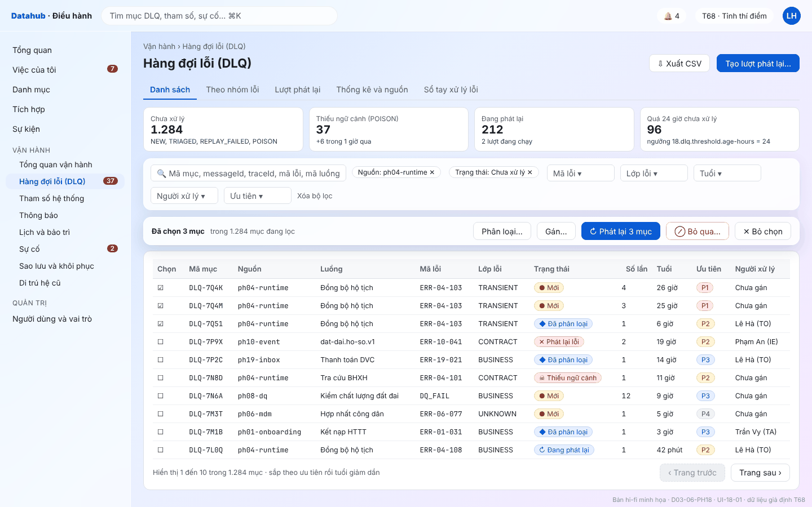
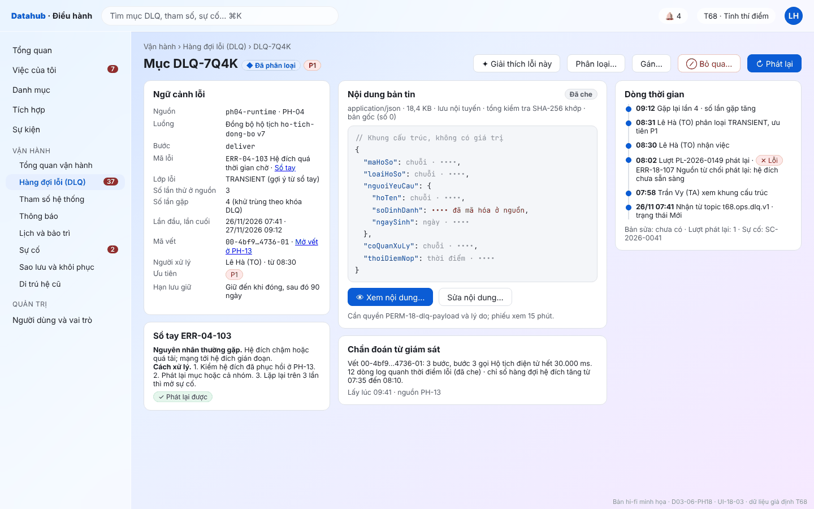

# D02-03-PH18 · Đặc tả yêu cầu chức năng Vận hành và xử lý lỗi

## Tóm tắt cho hội đồng thẩm định

**Mục tiêu.** PH-18 là "phòng máy" của Datahub: nơi người vận hành của tỉnh và của nền tảng xử lý mọi việc không thuộc nghiệp vụ của riêng phân hệ nào nhưng phải làm hằng ngày để hệ thống chạy đúng. Phân hệ giữ năm năng lực dùng chung: (1) kho tham số theo tenant cho mọi phân hệ, có phiên bản và kiểm trần; (2) hàng đợi bản tin lỗi (DLQ, Dead Letter Queue) hợp nhất, nơi bản tin không xử lý được của mọi phân hệ được chẩn đoán, sửa có kiểm soát, phát lại hoặc bỏ qua có lý do; (3) thông báo thư, SMS, trong ứng dụng và hộp "Việc của tôi"; (4) sao lưu, khôi phục một tenant và xuất dữ liệu tenant; (5) khung di trú từ hệ cũ và theo dõi chạy song song đến khi cắt chuyển. Phân hệ hiện thực REQ-18 và REQ-22 của BRD, thuộc MVP (mốc W2, ngân sách 10 người-tháng theo D01-02), và là điều kiện để thay dần hệ cũ theo cách chạy song song.

**Phạm vi.** 72 yêu cầu chức năng chia 10 nhóm A đến J. Phân hệ chạy trong DU `dh-platform` (Spring Boot 4 + Modulith, package `vn.datahub.platform.ops`, mô-đun con `param`, `dlq`, `notify`, `task`, `incident`, `backup`, `migration`), schema `ph18_ops` trên cụm `pg-core` có RLS theo `tenant_id`. Tác vụ nặng (khôi phục tenant, xuất tenant, di trú) chạy thành Job Kubernetes trong namespace `dh-batch` bằng ảnh `dh-ops-worker`. API người dùng ở `/api/ops/v1` qua APISIX; API cho phân hệ khác ở `/ops/internal/v1` (mTLS, SPIFFE, scope máy). Sự kiện phát trên topic `{tenant}.ops.*.v1`.

**Căn cứ pháp lý.** CMP-LAW-06 và CMP-LAW-08 (NĐ 331/2026, TCVN 14423:2026 cấp độ 3: sao lưu, khôi phục, quản lý sự cố, nhật ký thao tác quản trị); CMP-LAW-16 (Luật An ninh mạng 116/2025: dữ liệu và nhật ký lưu trong nước, ứng phó sự cố); CMP-LAW-05 và CMP-LAW-04 (Luật BVDLCN 91/2025, NĐ 356/2025: không đưa dữ liệu cá nhân vào thư, che dữ liệu khi chẩn đoán, chuyển sự cố có dữ liệu cá nhân cho PH-09 trong hạn 72 giờ); CMP-LAW-09 (Công văn 631/THH-THHT: LGSP phải bảo đảm tin cậy và xử lý được bản tin lỗi); CMP-LAW-01 (Luật Dữ liệu 60/2024: phân loại dữ liệu khi xem payload).

**Những điểm hội đồng cần lưu ý.**

1. **PH-18 vắng không chặn đường chính.** Bản tin lỗi được ghi vào topic Kafka trước rồi PH-18 mới tiêu thụ; tham số được đọc qua bộ đệm của từng phân hệ; thông báo đi qua outbox. Khi PH-18 ngừng, giao dịch của HTTT vẫn chạy; chỉ thao tác vận hành bị hoãn (FR-18-072).
2. **Bản tin gốc không bao giờ bị sửa.** Sửa payload tạo một bản sửa riêng có khác biệt, có người duyệt khi dữ liệu mức Hạn chế; phát lại luôn đi qua lối vào của phân hệ nguồn để mọi kiểm soát (quyền, chuẩn hóa, che dữ liệu) chạy lại, không gọi thẳng hệ đích (ADR-181, ADR-182).
3. **Bốn mắt cho mọi thao tác rủi ro cao**: phát lại loạt lớn, sửa payload có dữ liệu Hạn chế, đổi tham số bảo mật ★, khôi phục tenant, chạy di trú thật, cắt chuyển nhóm dịch vụ. Người đề nghị không tự duyệt.
4. **Khôi phục một tenant không ảnh hưởng tenant khác** và không khôi phục nhật ký kiểm toán: công cụ `dh-tenant-restore` theo runbook RBK-04 của D03-09, mục tiêu ≤ 4 giờ cho tenant ≤ 200 GB.
5. **Di trú chỉ đọc nguồn, ghi qua API nhập của phân hệ đích** (ADR-183), có chạy thử, báo cáo đối chiếu số lượng và tổng kiểm tra, không di trú thông tin xác thực, cắt chuyển có danh sách kiểm tra và quay lui trong 15 phút.

**Con số chính.**

| Chỉ số | Giá trị |
|---|---|
| Yêu cầu chức năng | 72 (M: 57, S: 12, C: 3) |
| Quy tắc nghiệp vụ | 50 (BR-18-001…050) |
| Yêu cầu phi chức năng | 22 (NFR-18-001…022) |
| Màn hình | 24 (UI-18-01…24) |
| API | 180 operation dự kiến (154 người dùng ở `/api/ops/v1`, 26 nội bộ ở `/ops/internal/v1`), 29 sự kiện phát (EVT-18-01…29) |
| Mã lỗi | 72 control plane (ERR-18-001…072), 24 worker, tiếp nhận DLQ, gửi thông báo (ERR-18-101…124); `401`, `403`, `428` dùng ERR-00-401, 403, 428 |
| Thực thể mức logic | 55 (EN-18-01…55) |
| Tham số theo tenant | 61 khóa `18.*` (mục 8.2) |
| Câu hỏi mở | 19 (Q18-01…19) |
| Chức năng hệ cũ được phủ | LGC-BUS-031, LGC-BUS-037 (Nâng cấp); LGC-NFR-004, LGC-NFR-005 (Nâng cấp, gián tiếp); đối tượng di trú LGC-HUB, LGC-APIM, LGC-DMDC, LGC-PAY, LGC-BUS |
| Đợt | MVP (mốc W2) cho 57 chức năng M; 4 chức năng phụ thuộc phân hệ đợt sau làm ở Đợt 2 |

: Con số chính của PH-18

## 1. Giới thiệu

### 1.1. Mục đích của tài liệu

Tài liệu đặc tả đầy đủ hành vi của PH-18 Vận hành và xử lý lỗi cho ba nhóm người đọc. Hội đồng thẩm định dùng tài liệu để đánh giá năng lực vận hành an toàn của nền tảng: xử lý bản tin lỗi không mất dữ liệu, khôi phục được dữ liệu từng tỉnh, chuyển đổi từ hệ cũ có kiểm soát. Kỹ sư dùng tài liệu làm đầu vào cho D03-02-PH18 (thiết kế chi tiết), D03-03-PH18 (CSDL `ph18_ops`), D03-04-PH18 (OpenAPI, AsyncAPI). Kiểm thử viên dùng luồng xử lý, ngoại lệ, quy tắc và ngưỡng để viết ca ở D05-02-PH18.

Mỗi chức năng đặc tả theo khung 17 mục của K-TRINH-BAY §4: mục đích, tác nhân, mức ưu tiên, truy vết, tiền điều kiện, kích hoạt, đầu vào, luồng chính, luồng thay thế, luồng ngoại lệ kèm câu thông báo, đầu ra, kết quả, hậu điều kiện, sự kiện, kiểm toán, quy tắc, màn hình và API. Mã lỗi, sự kiện, API, màn hình và thực thể được cấp ở chương 4, 9 và 10 và là nguồn mã cho sáu tập sau của PH-18.

### 1.2. Phạm vi

PH-18 chịu trách nhiệm 10 nhóm việc dưới đây. Mỗi nhóm là một mục ở chương 6.

| # | Trách nhiệm | Nhóm FR |
|---|---|---|
| 1 | Kho tham số theo tenant: đăng ký lược đồ khóa theo không gian tên, đọc có bộ đệm, ghi có kiểm miền và trần, bốn mắt cho khóa ★, phiên bản, sự kiện đổi, màn chung, gói tham số, cờ tính năng, danh sách egress, mặc định khi khởi tạo tenant | A |
| 2 | Tiếp nhận DLQ: đăng ký nguồn, tiêu thụ topic `{tenant}.ops.dlq.v1`, API ghi DLQ, hợp đồng ngữ cảnh, payload lớn ở Garage, khử trùng, liên thông DLQ tầng sự kiện PH-10, đối soát | B |
| 3 | Phân loại và xử lý: danh sách, nhóm theo dấu hiệu lỗi, chẩn đoán từ PH-13, xem payload có lý do, phân loại và gán, sửa payload có kiểm soát, sổ tay xử lý theo mã lỗi, API đọc cho PH-17 | C |
| 4 | Phát lại đơn và loạt, điều khiển tốc độ, nhận kết quả lũy đẳng, bỏ qua, mở lại, lưu giữ, thống kê và chỉ số | D |
| 5 | Thông báo: mẫu có phiên bản và kiểm trường cấm, gửi bất đồng bộ và đồng bộ, phân giải người nhận, tùy chọn nhận, quy tắc theo sự kiện, thử lại và thư trả lại, nhật ký gửi | E |
| 6 | Việc của tôi (`TaskInboxApi`), lịch ngày làm việc (`WorkingCalendarApi`), cửa sổ bảo trì và đóng băng thay đổi | F |
| 7 | Hồ sơ sự cố vận hành: mở từ sự kiện hoặc tạo tay, mức độ, mốc thời gian, liên kết, chuyển PH-09, đóng có bài học | G |
| 8 | Sao lưu và khôi phục: bảng điều khiển sao lưu, kiểm tra khôi phục, khôi phục tenant RBK-04, xuất tenant, chuyển dữ liệu khi sáp nhập tenant, ghi nhận diễn tập DR | H |
| 9 | Di trú hệ cũ và chạy song song: nguồn, kế hoạch, chạy thử, chạy thật, bản ghi lỗi, đối chiếu, cấp lại xác thực, chạy song song, đối soát kết quả, cắt chuyển và quay lui | I |
| 10 | Quản trị: tham số `18.*`, nhật ký thao tác, báo cáo vận hành, sức khỏe và chế độ suy giảm | J |

: Trách nhiệm của PH-18 theo nhóm chức năng

Những việc dưới đây liên quan nhưng không thuộc PH-18; tài liệu chỉ mô tả điểm giao tiếp.

| Không làm | Thuộc |
|---|---|
| Thử lại có giãn cách, ngắt mạch, `errorHandler` chuẩn, mã hóa trường Nhạy cảm trước khi vào DLQ | PH-04 (`dh-runtime-core`); PH-18 chỉ nhận bản tin cuối cùng |
| DLQ tầng sự kiện theo topic, subscription; duyệt và thực hiện phát lại sự kiện | PH-10; PH-18 chỉ hiển thị chung và đề nghị qua scope `event:replay` |
| Luật cảnh báo, lịch trực, bảng điều khiển, log, trace, kiểm toán WORM, kênh cảnh báo `CRITICAL` dự phòng | PH-13; PH-18 chỉ phát chỉ số, sự kiện và gửi thư, SMS khi được nhờ |
| Khởi tạo, tạm ngừng, sáp nhập, giải thể tenant; danh mục tổ chức | PH-20; PH-18 cung cấp công cụ chuyển dữ liệu, khôi phục, xuất |
| Người dùng, vai trò, gán `PERM-18-*`, chính sách OPA | PH-12 |
| Đồng hồ 72 giờ thông báo vi phạm dữ liệu cá nhân | PH-09; PH-18 chỉ chuyển hồ sơ sự cố |
| Lịch job nội bộ của PH-08, PH-16, PH-01 (ShedLock) | Từng phân hệ; PH-18 không lập lịch dùng chung |
| Tham số và lịch riêng `19.*` của thanh toán | PH-19 |
| Cầu nối Pulsar sang Kafka, đối chiếu hằng giờ của cầu nối | PH-10 (ADR-073); PH-18 chỉ theo dõi qua EVT-10-15, 16 |
| Chạy song song với NGSP cũ | PH-14 |
| Cấu hình hạ tầng không theo tenant (Helm values, ConfigMap cụm) | Kho GitOps, không qua PH-18 |
| Bốn mắt cho tham số bảo mật của PH-14, PH-17 | Phân hệ chủ (`approvalOwner`); PH-18 chỉ lưu giá trị đã duyệt |

: Việc ngoài phạm vi PH-18 và phân hệ chịu trách nhiệm

### 1.3. Đối tượng sử dụng và cách đọc

Mỗi nhóm người đọc có một lối vào riêng; bảng dưới chỉ rõ từng nhóm nên đọc chương nào để không phải đọc hết tài liệu.

| Người đọc | Đọc phần | Mục đích |
|---|---|---|
| Hội đồng thẩm định | Tóm tắt, chương 2, 5, 7, 11, 14 | Sự cần thiết, ranh giới trách nhiệm, an toàn khôi phục và di trú |
| Quản trị nền tảng (PA) | Mục 6.2, 6.9, 6.10, chương 8 | Trần tham số, duyệt khôi phục tenant, di trú, diễn tập DR |
| Quản trị tỉnh (TA), vận hành tỉnh (TO) | Mục 6.3 đến 6.8 | Xử lý DLQ, thông báo, Việc của tôi, sự cố, yêu cầu khôi phục |
| Cán bộ ATTT (SO), kiểm toán (AU) | Mục 6.4, 6.8, 6.11, chương 7 | Xem payload có lý do, sự cố, nhật ký thao tác |
| Kỹ sư `dh-platform`, `dh-ops-worker` | Chương 4, 6, 7, 8, 9 | Mô hình, luồng, mã lỗi, sự kiện, API |
| Kỹ sư các phân hệ khác | Mục 6.2, 6.3, 6.6, 6.7, chương 9 | Đăng ký tham số, ghi DLQ, cổng phát lại, gửi thông báo, tạo việc |
| Kiểm thử viên | Chương 6, 7, 8, 14 | Ca dương, ca âm, ca bốn mắt, ca suy giảm, ca rò rỉ chéo tenant |

: Người đọc và phần cần đọc

Chức năng dùng chung (đăng nhập, chọn tenant, danh sách chuẩn, xuất lớn, kiểm toán chung, hiển thị lỗi) theo nhóm FR-00 của D02-02 và không lặp lại; riêng FR-00-070 đến 072 ("Việc của tôi", bốn mắt) và FR-00-061, 062 (thông báo) do PH-18 hiện thực nên được đặc tả ở nhóm E và F.

### 1.4. Thuật ngữ và chữ viết tắt

Bảng dưới giải thích thuật ngữ và chữ viết tắt dùng trong tập này, để mọi chương hiểu thống nhất.

| Thuật ngữ, viết tắt | Giải thích |
|---|---|
| DLQ (Dead Letter Queue) | Hàng đợi bản tin lỗi: nơi chứa bản tin mà phân hệ nguồn đã thử hết số lần hoặc xác định không xử lý được |
| Mục DLQ | Một bản tin lỗi đã được PH-18 lập chỉ mục, kèm ngữ cảnh, phân loại và lịch sử thao tác (`dlq_message`) |
| Payload | Nội dung gốc của bản tin lỗi; trường Nhạy cảm đã được nguồn mã hóa bằng khóa của tenant trước khi vào DLQ |
| Bản sửa (revision) | Payload đã được người vận hành sửa, lưu riêng, không ghi đè bản gốc |
| Phát lại (replay) | Đưa bản tin (gốc hoặc bản sửa) trở lại lối vào của phân hệ nguồn để xử lý lại |
| Lượt phát lại | Một lần phát lại nhiều mục theo bộ lọc hoặc danh sách (`replay_job`) |
| Cổng phát lại (`ReplayPort`) | Điểm nhận phát lại do phân hệ nguồn khai báo: topic, API nội bộ hoặc API của PH-10 |
| Dấu hiệu lỗi | Khóa gom nhóm mục DLQ có cùng nguồn, luồng, mã lỗi và vị trí lỗi |
| POISON | Mục thiếu ngữ cảnh bắt buộc hoặc không giải mã được, không phát lại được |
| Khóa lũy đẳng | Khóa bảo đảm một thao tác thực hiện nhiều lần cho cùng kết quả (`dlqId:revision` khi phát lại) |
| Không gian tên tham số | Tiền tố khóa do một phân hệ sở hữu, ví dụ `07.rdm.`, `onboarding.`, `18.` |
| Khóa ★ | Tham số bảo mật, đổi cần bốn mắt |
| Trần nền tảng | Giới hạn trên hoặc dưới của giá trị do PA đặt, tenant không vượt được |
| Cờ tính năng | Tham số dạng `ff.{module}.{tính-năng}` bật tắt một tính năng, có chủ sở hữu và ngày gỡ |
| Danh sách egress | Danh sách đích bên ngoài mà tenant cho phép phân hệ gọi ra (HTTPS, FQDN) |
| Outbox | Bảng ghi sự kiện, thông báo cùng giao dịch nghiệp vụ, tác vụ riêng gửi đi sau (ADR-042) |
| Thư trả lại (bounce) | Thông báo từ máy chủ thư rằng thư không đến được người nhận |
| Giờ yên lặng | Khoảng giờ không gửi thông báo không khẩn cho người dùng |
| Cửa sổ bảo trì, đóng băng | Khoảng thời gian dự kiến gián đoạn, hoặc cấm thay đổi môi trường thật |
| PITR | Khôi phục cơ sở dữ liệu về một thời điểm bất kỳ trong cửa sổ lưu WAL |
| RBK-04 | Runbook khôi phục một tenant riêng lẻ của D03-09 §8.5 |
| Chạy song song | Hệ cũ và Datahub cùng nhận lưu lượng trong một thời gian để so sánh kết quả trước khi cắt chuyển |
| Cắt chuyển (cutover) | Chuyển hẳn một nhóm dịch vụ từ hệ cũ sang Datahub |
| Đối soát bóng (shadow) | So phản hồi của hệ cũ và Datahub cho cùng yêu cầu được nhân bản |
| PA, PO, TA, TO, SO, IE, AU, DS, VW | Quản trị nền tảng, vận hành nền tảng, quản trị tỉnh, vận hành tỉnh, cán bộ ATTT, kỹ sư tích hợp, kiểm toán, cán bộ dữ liệu, người xem (theo D02-08) |
| DLCN | Dữ liệu cá nhân |

: Thuật ngữ và chữ viết tắt của PH-18

### 1.5. Tài liệu tham chiếu

Tài liệu pháp lý dùng mã CMP-LAW của D00-01 §7; ADR dẫn theo mã đầy đủ ở `00-chung/adr/`.

| Loại | Tài liệu | Dùng cho |
|---|---|---|
| Pháp lý | CMP-LAW-06, CMP-LAW-08 | Cấp độ 3: sao lưu, khôi phục, sự cố, nhật ký quản trị |
| Pháp lý | CMP-LAW-16, CMP-LAW-05, CMP-LAW-04 | Lưu trong nước, ứng phó sự cố, dữ liệu cá nhân |
| Pháp lý | CMP-LAW-09, CMP-LAW-01 | Tin cậy bản tin LGSP, phân loại dữ liệu |
| Dự án | D02-01 BRD (REQ-18, REQ-22), D02-02 SRS (FR-00-050…054, 061, 062, 070…072, 090…093) | Yêu cầu gốc |
| Dự án | D02-07 (DD-13 thông báo, DD-14 tham số), D02-08 (`PERM-18-*`) | Thực thể dùng chung, quyền |
| Dự án | D03-01 SAD, D03-09 §8 (sao lưu, RBK-03, RBK-04), D03-10 (đa tenant) | Kiến trúc, hạ tầng, khôi phục |
| Dự án | Tập FRS, API của PH-01, 02, 04, 07, 10, 13, 17, 19 | Hợp đồng phân hệ khác kỳ vọng ở PH-18 |
| Repo cũ | `docs/07-srs/SRS-PH-18-ops.md` (FR-18-001…020 cũ, chỉ DLQ) | Đối chiếu ở mục 11.3 |
| ADR có tệp | ADR-001 (Spring Boot Modulith), ADR-003 (PostgreSQL RLS), ADR-004 (Kafka), ADR-012 (OpenBao), ADR-031 (kiểm toán chuỗi băm, WORM), ADR-042 (inbox, outbox), ADR-046 (bốn mắt), ADR-073 (cầu nối Pulsar) | Quyết định nền |
| ADR của phân hệ | ADR-180 (kho tham số tập trung trên `ph18_ops`), ADR-181 (DLQ hợp nhất, payload gốc bất biến, payload lớn ở Garage, liên thông PH-10), ADR-182 (phát lại qua lối vào của nguồn, khóa lũy đẳng, bốn mắt loạt lớn), ADR-183 (khung di trú `dh-migrate`, ghi qua API nhập), ADR-184 (thông báo outbox, Spring Mail, SMS gateway, mẫu Mustache không logic) | Mục 2.4, 12.3 |

: Tài liệu tham chiếu của PH-18

### 1.6. Cấu trúc tài liệu

Chương 2 trình bày bối cảnh, mục tiêu, vị trí và kiến trúc thành phần. Chương 3 nêu tác nhân, quyền và tách nhiệm vụ. Chương 4 định nghĩa khái niệm, 55 thực thể và các máy trạng thái. Chương 5 là danh sách chức năng; chương 6 đặc tả chi tiết từng chức năng theo 10 nhóm. Chương 7 đến 9 gom quy tắc nghiệp vụ, tham số và yêu cầu phi chức năng, mã lỗi, thông báo, sự kiện và danh mục API. Chương 10 liệt kê màn hình và hai giao diện tiêu biểu. Chương 11 truy vết tới hệ cũ, yêu cầu và SRS cũ. Chương 12 đến 14 nêu phụ thuộc, đề nghị đồng bộ, câu hỏi mở và tiêu chí chấp nhận.

## 2. Tổng quan phân hệ

### 2.1. Bối cảnh và vấn đề cần giải quyết

Hệ LGSP cũ có công cụ xử lý lỗi rời rạc theo từng thành phần (Bus, Hub, APIM), cấu hình hệ thống nằm trong bảng của từng thành phần, và không có quy trình sự cố hay khôi phục dữ liệu theo tỉnh. Datahub là nền tảng đa tenant với 20 phân hệ; nếu mỗi phân hệ tự làm màn xử lý lỗi, kho tham số, kênh thư thì người vận hành của tỉnh phải học 20 cách làm, và nền tảng không có một chỗ để biết "tỉnh này đang có bao nhiêu bản tin lỗi chưa xử lý". PH-18 gom các năng lực vận hành dùng chung về một phân hệ, còn logic nghiệp vụ vẫn ở phân hệ chủ.

| Hạn chế hệ cũ | Hệ quả | Cách PH-18 khắc phục |
|---|---|---|
| Xử lý lỗi chỉ "thực hiện lại hoặc bỏ qua" ngay trong luồng (LGC-BUS-037), không lưu bản tin lỗi có ngữ cảnh | Bản tin lỗi mất hoặc phải tra log thủ công | DLQ hợp nhất có ngữ cảnh chuẩn, chẩn đoán từ PH-13, phát lại lũy đẳng (nhóm B, C, D) |
| Thông số hệ thống sửa trực tiếp, không phiên bản, không kiểm miền (LGC-BUS-031) | Sửa sai không biết ai sửa, không quay lại được | Kho tham số có lược đồ, trần, phiên bản, bốn mắt, sự kiện đổi (nhóm A) |
| Log không có ID giao dịch liên kết giữa các thành phần (LGC-NFR-004) | Không chẩn đoán được nguyên nhân bản tin lỗi | Mỗi mục DLQ mang `traceparent`, PH-18 lấy ngữ cảnh từ PH-13 (FR-18-021) |
| Sao lưu log mỗi tháng một lần, không khôi phục theo đơn vị (LGC-NFR-005) | Không khôi phục được dữ liệu của một tỉnh mà không ảnh hưởng tỉnh khác | Khôi phục một tenant theo RBK-04, kiểm tra khôi phục tự động (nhóm H) |
| Không có công cụ di trú và đối chiếu khi đổi hệ | Rủi ro mất dữ liệu, không chứng minh được dữ liệu đã chuyển đủ | Khung di trú có chạy thử, đối chiếu tổng kiểm tra, chạy song song, quay lui (nhóm I) |
| Không có hộp việc chung và thư có mẫu | Người duyệt phải vào từng màn để biết việc chờ | Việc của tôi, mẫu thông báo có kiểm trường cấm (nhóm E, F) |

: Hạn chế hệ cũ, hệ quả và cách khắc phục

### 2.2. Mục tiêu của phân hệ

Năm mục tiêu dưới đây đo được và gắn với NFR ở mục 8.1; tiêu chí chấp nhận ở chương 14 kiểm chứng từng mục tiêu.

| # | Mục tiêu | Chỉ tiêu | NFR |
|---|---|---|---|
| 1 | Không mất bản tin lỗi nào và chỉ mục kịp thời | 0 mục mất trong kiểm thử chaos; mục xuất hiện trên màn ≤ 5 giây (p95) sau khi vào topic | NFR-18-001, 002 |
| 2 | Đổi tham số có hiệu lực nhanh ở mọi phân hệ mà không khởi động lại | p95 ≤ 60 giây từ lúc ghi đến khi mọi bản sao dùng giá trị mới | NFR-18-005 |
| 3 | Khôi phục một tenant đúng và nhanh | ≤ 4 giờ cho tenant ≤ 200 GB; 0 dòng của tenant khác bị chạm | NFR-18-010, 017 |
| 4 | Di trú chứng minh được đủ và không trùng | 100% đối tượng có báo cáo đối chiếu; 0 bản trùng khi chạy lại | NFR-18-013, 014 |
| 5 | Vận hành không chặn nghiệp vụ | 0 lỗi data plane do PH-18 vắng; quay lui cắt chuyển ≤ 15 phút | NFR-18-015, 018 |

: Mục tiêu đo được của PH-18

### 2.3. Vị trí trong kiến trúc

PH-18 nằm ở control plane trong DU `dh-platform` (vùng Z3), cùng DU với PH-11, PH-13 phần ứng dụng, PH-16 và PH-20. Hình dưới cho thấy các luồng chính đi vào và đi ra PH-18.

```{.mermaid caption="Vị trí PH-18 trong kiến trúc Datahub"}
flowchart TB
  subgraph NGUON["Phân hệ nguồn"]
    RT["dh-runtime PH-04, PH-05, PH-14"]
    PX["PH-01, PH-06, PH-08, PH-19"]
    P10["PH-10 DLQ tầng sự kiện"]
  end
  K["Kafka topic t68.ops.dlq.v1"]
  subgraph P18["dh-platform · PH-18"]
    PAR["param"]
    DLQ["dlq"]
    NOT["notify"]
    TSK["task"]
    INC["incident"]
    BAK["backup"]
    MIG["migration"]
  end
  PG["pg-core schema ph18_ops"]
  GA["Garage dh-t68-ops"]
  W["dh-batch Job dh-ops-worker"]
  P13["PH-13 chẩn đoán, kiểm toán"]
  MAIL["Máy chủ thư, SMS gateway IF-09"]
  RT --> K
  PX --> DLQ
  K --> DLQ
  DLQ --> P10
  DLQ --> RT
  DLQ --> P13
  PAR --> PG
  DLQ --> PG
  DLQ --> GA
  NOT --> MAIL
  BAK --> W
  MIG --> W
  INC --> P13
```

Hình cho thấy ba đặc điểm. Runtime ghi DLQ vào Kafka, không gọi thẳng PH-18, nên PH-18 vắng không chặn luồng. PH-18 đọc DLQ của PH-10 qua API (mũi tên sang PH-10) mà không sao chép nội dung. Tác vụ nặng (khôi phục, xuất, di trú) chạy ở `dh-batch` dưới dạng Job, tách khỏi tiến trình `dh-platform` để không ảnh hưởng thời gian đáp ứng của màn quản trị.

### 2.4. Kiến trúc thành phần và công nghệ

PH-18 gồm bảy mô-đun Modulith trong `dh-platform`, giao tiếp với nhau qua sự kiện ứng dụng nội bộ, và một ảnh worker chạy ở `dh-batch`.

| Thành phần | Trách nhiệm | Công nghệ |
|---|---|---|
| `ops.param` | Lược đồ khóa, giá trị theo tenant, phiên bản, bốn mắt, gói, cờ tính năng, egress | Spring Boot 4, PostgreSQL `ph18_ops`, Caffeine phía phân hệ đọc (ADR-180) |
| `ops.dlq` | Tiêu thụ topic DLQ, API ghi, chỉ mục, nhóm, bản sửa, phát lại, lưu giữ | Spring Kafka (commit sau khi chỉ mục bền), Garage S3 cho payload lớn, jsonschema cho kiểm bản sửa (ADR-181, ADR-182) |
| `ops.notify` | Mẫu, quy tắc, outbox thông báo, gửi thư, SMS, trong ứng dụng | Spring Mail SMTP/TLS, REST tới SMS gateway, Mustache không logic (ADR-184) |
| `ops.task` | Loại việc, việc, nhắc; lịch ngày làm việc; cửa sổ bảo trì | PostgreSQL, ShedLock cho tác vụ nhắc |
| `ops.incident` | Hồ sơ sự cố, mốc thời gian, liên kết, chuyển PH-09 | PostgreSQL, inbox sự kiện |
| `ops.backup` | Thu trạng thái sao lưu, kiểm tra khôi phục, yêu cầu khôi phục, xuất, chuyển sáp nhập | Thu từ CNPG/Barman, Velero, rclone, OpenBao; tạo Job Kubernetes `dh-tenant-restore`, `dh-tenant-export` |
| `ops.migration` | Nguồn, kế hoạch, lần chạy, đối chiếu, chạy song song, cắt chuyển | Job `dh-migrate` (Spring Batch, JDBC chỉ đọc), APISIX `proxy-mirror` cho đối soát bóng (ADR-183) |
| `dh-ops-worker` | Ảnh chạy công cụ `dh-tenant-restore`, `dh-tenant-export`, `dh-migrate` | Java 21, Spring Batch, `pg_dump`, `COPY`, chạy với vai `ph18_worker` |

: Thành phần của PH-18 và công nghệ

Trình tự dưới là luồng chính của nhóm DLQ, từ khi runtime gặp lỗi đến khi phát lại thành công; các luồng khác được vẽ ở đầu từng nhóm chương 6.

```{.mermaid caption="Trình tự luồng chính tiếp nhận, chẩn đoán và phát lại một bản tin lỗi"}
sequenceDiagram
  participant RT as dh-runtime PH-04
  participant K as Kafka t68.ops.dlq.v1
  participant D as PH-18 dlq
  participant G as Garage
  participant O as Người vận hành TO
  participant M as PH-13
  RT->>K: Ghi bản tin lỗi kèm header dh-dlq-*
  K->>D: Tiêu thụ, kiểm hợp đồng ngữ cảnh
  D->>G: Lưu payload nếu lớn hơn 256 KB
  D->>D: Ghi chỉ mục NEW, khử trùng theo dlqKey, commit offset
  O->>D: Mở chi tiết mục DLQ
  D->>M: Lấy ngữ cảnh chẩn đoán theo traceId
  M-->>D: Trace, log đã che, chỉ số
  O->>D: Phân loại rồi bấm Phát lại
  D->>K: Phát ops.replay.requested với khóa dlqId và revision
  K->>RT: Runtime nhận, chạy lại từ lối vào của luồng
  RT->>D: Báo kết quả qua replay-results
  D->>D: Chuyển RESOLVED, ghi kiểm toán
```

Hình cho thấy PH-18 không gọi hệ đích: bản tin quay về runtime của nguồn, đi lại toàn bộ luồng với mọi kiểm soát. Offset Kafka chỉ được commit sau khi chỉ mục bền, nên PH-18 dừng giữa chừng thì bản tin được đọc lại và khử trùng, không mất.

### 2.5. Quy trình nghiệp vụ liên quan

PH-18 tham gia ba quy trình nghiệp vụ của D02-01 và là chủ của phần vận hành trong cả ba.

| Quy trình | Bước có PH-18 |
|---|---|
| BP-07 Giám sát, xử lý sự cố, báo cáo | PH-13 cảnh báo; PH-18 mở hồ sơ sự cố, xử lý DLQ, phát lại, gửi thư cho người trực, lập báo cáo vận hành |
| BP-08 Khởi tạo tenant tỉnh mới | PH-20 khởi tạo; PH-18 ghi tham số mặc định, lịch mặc định, bật sao lưu và kiểm tra khôi phục cho tenant |
| BP-09 Chuyển đổi từ hệ cũ | PH-18 khai báo nguồn, lập kế hoạch, chạy thử, chạy thật, đối chiếu, theo dõi chạy song song, cắt chuyển nhóm dịch vụ |

: Quy trình nghiệp vụ có PH-18

Vòng đời điển hình của một mục DLQ (chi tiết ở 4.3) đi từ `NEW` qua `TRIAGED`, `REPLAY_PENDING`, `REPLAYING` tới `RESOLVED`; nhánh phụ `DISCARDED`, `POISON`, `EXPIRED` có quy tắc riêng.

### 2.6. Chức năng hệ cũ được phủ

D00-03 giao cho PH-18 hai chức năng hệ cũ trực tiếp; các nhóm LGC khác là đối tượng của khung di trú (nhóm I) chứ không phải chức năng PH-18 thay thế.

| LGC | Chức năng hệ cũ | Vai trò của PH-18 |
|---|---|---|
| LGC-BUS-031 | Cấu hình hệ thống: API lấy và cập nhật thông số hệ thống | Nâng cấp thành kho tham số theo tenant, cùng PH-20 (nhóm A) |
| LGC-BUS-037 | Error handling: thực hiện lại hoặc bỏ qua | Nâng cấp thành DLQ hợp nhất, cùng PH-04 (nhóm B, C, D) |
| LGC-NFR-004 | Log có ID giao dịch liên kết | Gián tiếp: dùng `traceparent` để chẩn đoán mục DLQ |
| LGC-NFR-005 | Sao lưu log mỗi tháng | Gián tiếp: bảng điều khiển sao lưu và kiểm tra khôi phục cho mọi đối tượng |
| LGC-HUB-008…013, LGC-APIM-*, LGC-DMDC-*, LGC-PAY-*, LGC-BUS-* (cấu hình) | Dữ liệu của hệ cũ | Đối tượng di trú: PH-18 cung cấp khung, phân hệ đích nhận qua API nhập |

: Chức năng hệ cũ được PH-18 phủ

## 3. Tác nhân, vai trò và quyền

### 3.1. Tác nhân

Bảng dưới liệt kê người và hệ thống tương tác với PH-18, kèm vai trò và việc chính. PH-18 không tạo ROLE mới; viết tắt vai trò theo D02-08.

| Tác nhân | Loại | Mô tả | Tương tác chính |
|---|---|---|---|
| Quản trị nền tảng (PA) | Người | Đơn vị vận hành nền tảng | Đặt trần tham số, duyệt khôi phục tenant, duyệt di trú thật, ghi nhận diễn tập DR, tham số `18.*` |
| Vận hành nền tảng (PO) | Người | Kỹ sư trực nền tảng | Xem DLQ liên tenant ở chế độ nền tảng, sức khỏe PH-18, bảng sao lưu |
| Quản trị tỉnh (TA) | Người | Quản trị Datahub của tỉnh | Sửa tham số tenant, duyệt bốn mắt trong tỉnh, tạo yêu cầu khôi phục, mẫu thông báo, lịch |
| Vận hành tỉnh (TO) | Người | Cán bộ trực của tỉnh | Phân loại, phát lại, bỏ qua mục DLQ; xử lý sự cố |
| Cán bộ ATTT (SO) | Người | An toàn thông tin của tỉnh | Xem payload có lý do, sự cố an ninh, chuyển PH-09 |
| Kỹ sư tích hợp (IE) | Người | Thiết kế luồng | Xem mục DLQ của luồng mình, sửa payload, sổ tay xử lý |
| Kiểm toán (AU) | Người | Thanh tra, kiểm toán | Xem nhật ký thao tác, báo cáo vận hành |
| Cán bộ dữ liệu (DS) | Người | Chuyên trách dữ liệu | Sửa dữ liệu di trú lỗi, xem DLQ lỗi `DQ_FAIL` |
| Người dùng có tài khoản (mọi vai trò) | Người | Người dùng cổng | Việc của tôi, thông báo trong ứng dụng, tùy chọn nhận |
| Phân hệ chủ tham số (PH-01…17, 20) | Hệ thống | Đăng ký lược đồ, đọc giá trị | `ops:param-register`, `ops:param-read` |
| Phân hệ nguồn DLQ (PH-04 runtime, PH-01, 06, 08, 19) | Hệ thống | Ghi bản tin lỗi, nhận phát lại | Topic DLQ, `ops:dlq-write`, `ops:replay-callback` |
| PH-10 | Hệ thống | DLQ tầng sự kiện, cầu nối | API-10-060, 061, 064; EVT-10-11, 12, 15, 16 |
| PH-13 | Hệ thống | Chẩn đoán, kiểm toán, cảnh báo | API-13-069; nhận kiểm toán; EVT-13-*; gửi thư qua PH-18 |
| PH-17 | Hệ thống | Trợ lý AI | Đọc DLQ và sổ tay ERR (`ops:dlq-read`), không ghi |
| PH-20 | Hệ thống | Quản trị tenant | Ghi mặc định, gọi chuyển sáp nhập, gửi thư; nguồn danh sách tenant |
| PH-09 | Hệ thống | Quyền riêng tư | Nhận sự cố có DLCN |
| Máy chủ thư, SMS gateway (IF-09), OpenBao, Garage, CNPG, Velero | Hệ thống | Hạ tầng | Gửi thông báo, bí mật, lưu payload, trạng thái sao lưu |

: Tác nhân của PH-18

### 3.2. Ma trận quyền

Mười một quyền đều có ở D02-08 (tám quyền `PERM-18-read`, `-dlq-payload`, `-approve`, `-template`, `-incident`, `-backup`, `-calendar`, `-admin` vừa được bổ sung); việc đối chiếu gán vai trò ghi ở mục 12.4. Ký hiệu theo D02-08: ● có quyền, ○ có quyền hạn chế (ghi chú dưới bảng), — không.

| Quyền | Ý nghĩa | PA | PO | TA | TO | SO | IE | DS | AU | VW |
|---|---|---|---|---|---|---|---|---|---|---|
| PERM-18-read | Xem màn vận hành: DLQ (siêu dữ liệu), tham số, sự cố, thống kê, sức khỏe | ● | ● | ● | ● | ● | ● | ● | ● | ○ |
| PERM-18-dlq | Phân loại, gán, phát lại, bỏ qua, mở lại mục DLQ; lượt phát lại dưới ngưỡng | ○ | ● | ● | ● | ● | ○ | ○ | — | — |
| PERM-18-dlq-payload | Xem payload có lý do, tạo bản sửa payload | — | ○ | ● | ● | ● | ● | — | — | — |
| PERM-18-approve | Duyệt bốn mắt chung của PH-18 | ● | — | ● | — | ● | — | — | — | — |
| PERM-18-config | Sửa giá trị tham số của tenant, cờ tính năng, egress | ● (trần) | — | ● | — | — | — | — | — | — |
| PERM-18-template | Mẫu thông báo, quy tắc, danh sách chặn | ● (COMMON) | — | ● | — | — | — | — | — | — |
| PERM-18-incident | Tạo, xử lý, đóng sự cố; chuyển PH-09 | ● | ● | ● | ● | ● | — | — | — | — |
| PERM-18-backup | Xem sao lưu, tạo yêu cầu khôi phục, xuất tenant | ● | ● | ● | — | — | — | — | — | — |
| PERM-18-calendar | Lịch ngày làm việc, cửa sổ bảo trì, đóng băng | ● | ● | ● | — | — | — | — | — | — |
| PERM-18-migration | Nguồn hệ cũ, kế hoạch, chạy thử, theo dõi song song | ● | ● | ● | — | — | — | ○ | — | — |
| PERM-18-admin | Tham số `18.*`, nguồn DLQ, sổ tay ERR, gói tham số, báo cáo | ● | — | ○ | — | — | — | — | — | — |

: Ma trận quyền của PH-18

Ô ○ của VW ở `PERM-18-read` chỉ gồm thống kê DLQ và sức khỏe, không xem danh sách mục. Ô ○ của PA ở `PERM-18-dlq` là thao tác ở chế độ nền tảng liên tenant, có lý do và ghi kiểm toán (SEC-85). Ô ○ của IE và DS ở `PERM-18-dlq` giới hạn ở mục DLQ của luồng hoặc tài sản mà họ được giao (lọc theo thuộc tính ABAC do PH-12 cấp). Ô ○ của PO ở `PERM-18-dlq-payload` chỉ khi tenant cấp phiên hỗ trợ có hạn. Ô ○ của TA ở `PERM-18-admin` giới hạn ở sổ tay ERR của tỉnh và báo cáo vận hành. Ô ○ của DS ở `PERM-18-migration` chỉ xem và sửa bản ghi lỗi. Thiếu quyền chức năng trả `403` với ERR-00-403, chưa xác thực `401` với ERR-00-401, thiếu `If-Match` `428` với ERR-00-428.

### 3.3. Tách nhiệm vụ và tài khoản máy

Bốn mắt (FR-00-071, ADR-046) áp dụng cho: lượt phát lại vượt `18.dlq.replay.approval-threshold`; bản sửa payload có trường mức Hạn chế hoặc Nhạy cảm; đổi tham số ★ khi `approvalOwner` là PH-18; áp gói tham số có khóa ★; phiên bản mẫu thông báo; khôi phục tenant (TA tạo, PA duyệt); chạy di trú thật; cắt chuyển nhóm dịch vụ. Người đề nghị không được là người duyệt (ERR-18-005). Hủy, tạm dừng, quay lui khẩn không cần bốn mắt vì làm giảm rủi ro.

Cặp loại trừ đề nghị cho D02-08 §4: người tạo bản sửa payload và người duyệt bản sửa đó; người tạo yêu cầu khôi phục và người duyệt; người tạo lần chạy di trú thật và người duyệt; AU giữ `PERM-18-read` nhưng không giữ `PERM-18-dlq` hay `PERM-18-approve`.

Tài khoản máy và scope (cấp khi triển khai, không gán cho người) được liệt kê dưới đây. Scope mới so với brief chung (`ops:backup-report`, `ops:merge-transfer`, `ops:shadow-ingest`) ghi ở mục 12.4.

| Scope | Bên giữ | Dùng cho |
|---|---|---|
| `ops:param-read` | Mọi DU | Đọc lô giá trị tham số, cờ, egress (FR-18-002) |
| `ops:param-register` | Mọi DU | Đăng ký lược đồ không gian tên của mình (FR-18-001) |
| `ops:param-write` | PH-20 | Ghi mặc định khi khởi tạo tenant (FR-18-011) |
| `ops:dlq-write` | PH-01, PH-06, PH-08, PH-19, `dh-runtime` | Ghi DLQ qua API, đăng ký nguồn (FR-18-012, 014) |
| `ops:dlq-read` | PH-17, PH-13 | Đọc siêu dữ liệu DLQ, sổ tay ERR bằng token đổi từ người dùng (FR-18-026) |
| `ops:replay-callback` | Phân hệ nguồn | Báo kết quả phát lại (FR-18-030) |
| `ops:notify` | Mọi DU gửi thông báo, máy chủ thư | Gửi, tra trạng thái, báo thư trả lại (FR-18-036, 040) |
| `ops:task` | PH-01, 02, 04, 11, 15, 16 và DU khác | Đăng ký loại việc, tạo, đóng việc (FR-18-042, 043) |
| `ops:calendar-read` | PH-01, 02, 04, 08 | Tính ngày làm việc, trạng thái đóng băng (FR-18-045, 046) |
| `ops:incident-write` | PH-13, PH-09 | Mở, cập nhật sự cố (FR-18-047) |
| `ops:migration-import` | Phân hệ đích | Nhận lô di trú từ `dh-migrate` (do PH-18 gọi ra) |
| `ops:backup-report` | Tác vụ thu thập, CronJob kiểm tra khôi phục | Báo bản sao lưu, kết quả kiểm tra (FR-18-052, 053) |
| `ops:merge-transfer` | PH-20 | Yêu cầu, hủy chuyển dữ liệu sáp nhập (FR-18-057) |
| `ops:shadow-ingest` | Bộ so sánh bóng | Gửi cặp phản hồi đã băm (FR-18-067) |

: Scope máy của PH-18

PH-18 gọi ra bằng danh tính `svc-ops` với scope do phân hệ kia cấp: `event:dlq-read`, `event:replay` (PH-10), `obs:diagnostics-read` (PH-13), `onboarding:internal-read` (PH-01), `tenant:registry-read` (PH-20). Worker `dh-ops-worker` dùng vai CSDL `ph18_worker` và danh tính riêng `svc-ops-worker`; vai `BYPASSRLS` chỉ tồn tại trên cụm tạm khi khôi phục.

## 4. Khái niệm và mô hình nghiệp vụ

### 4.1. Khái niệm nghiệp vụ

Một số khái niệm dễ nhầm giữa PH-18 và phân hệ nguồn nên được phân biệt từ đầu. Bảng dưới nêu các khái niệm nền.

| Khái niệm | Ý nghĩa nghiệp vụ trong PH-18 | Ghi chú |
|---|---|---|
| Lớp lỗi | `TRANSIENT` (tạm thời, có thể phát lại khi đích phục hồi), `BUSINESS` (sai nghiệp vụ, cần sửa dữ liệu), `CONTRACT` (sai lược đồ, hợp đồng), `POISON` (thiếu ngữ cảnh hoặc không giải mã được), `UNKNOWN` | Nguồn gắn nhãn ban đầu, người vận hành xác nhận hoặc sửa (FR-18-023) |
| Hợp đồng ngữ cảnh DLQ | Bộ header bắt buộc mọi nguồn phải gửi kèm bản tin lỗi | Bảng 4.1b |
| Nguồn DLQ và cổng phát lại | Phân hệ ghi DLQ và cách nhận lại bản tin: `KAFKA_TOPIC`, `HTTP_PORT`, `EVENT_LAYER` (qua PH-10), `NONE` | `NONE` thì chỉ bỏ qua được |
| Lược đồ khóa tham số | Khai báo của phân hệ chủ: khóa, kiểu, mặc định, miền, mức, cờ ★, `approvalOwner`, nhóm hiển thị | PH-18 lưu, không tự định nghĩa khóa của phân hệ khác |
| Giá trị hiệu lực | Giá trị dùng thật: tenant ghi đè nếu có, không thì mặc định của lược đồ, luôn bị kẹp bởi trần nền tảng | FR-18-002 |
| Loại việc và việc | Loại việc do phân hệ đăng ký (`ph01.approve-onboarding`); việc là một mục trong "Việc của tôi" do phân hệ nguồn tạo và đóng | PH-18 không quyết định nghiệp vụ |
| Tác vụ nặng của tenant | Khôi phục, xuất, di trú thật, chuyển sáp nhập | Một tenant chỉ một tác vụ nặng chạy cùng lúc (BR-18-039) |

: Khái niệm nghiệp vụ của PH-18

Hợp đồng ngữ cảnh DLQ dưới đây được chốt cho mọi nguồn, kể cả ghi qua topic và qua API. Header thiếu ở cột "Bắt buộc" làm mục thành `POISON` (FR-18-015). Lệch tên header hiện có ở PH-04 ghi ở mục 12.4.

| Header (topic) hoặc trường (API) | Bắt buộc | Ý nghĩa |
|---|---|---|
| `dh-tenant` / `tenant` | Có | Mã tenant, phải khớp tiền tố topic |
| `dh-source-ph` / `sourcePh` | Có | Phân hệ nguồn (`PH-04`, `PH-19`…) |
| `dh-dlq-reason` / `reason` | Có | Lý do ngắn, ví dụ `DQ_FAIL`, `TARGET_UNAVAILABLE`, `SCHEMA_INVALID` |
| `dh-dlq-error-code` / `errorCode` | Có | Mã ERR của nguồn, ví dụ `ERR-04-101` |
| `dh-dlq-stage` / `stage` | Có | Bước lỗi trong luồng hoặc tác vụ |
| `dh-dlq-attempts` / `attempts` | Có | Số lần nguồn đã thử |
| `dh-flow` / `flow` | Có với nguồn `KAFKA_TOPIC` | Mã luồng hoặc tác vụ để phát lại đúng lối vào |
| `dh-version` / `version` | Có với nguồn `KAFKA_TOPIC` | Phiên bản luồng lúc lỗi |
| `traceparent` / `traceId` | Nên có | W3C Trace Context để lấy chẩn đoán; thiếu thì không có ngữ cảnh PH-13 |
| `dh-message-id` / `messageId` | Nên có | Định danh bản tin gốc để khử trùng; thiếu thì dùng băm SHA-256 của payload |

: Hợp đồng ngữ cảnh DLQ chốt cho mọi nguồn

### 4.2. Thực thể

PH-18 có 55 thực thể mức logic, tất cả mang `tenant_id` và bật RLS (BR-18-047), trừ lược đồ khóa và không gian tên dùng chung do phân hệ chủ đăng ký mang `tenant_id` = `COMMON`. Thiết kế vật lý ở D03-03-PH18; bảng dưới là nguồn mã `EN-18-nn` cho các tập sau, theo đúng thứ tự đã chốt. Hai bảng kỹ thuật `outbox_event`, `inbox_event` không mang mã EN. Cột bắt buộc chung theo D02-07 không nhắc lại.

| Mã | Thực thể | Mô tả |
|---|---|---|
| EN-18-01 | `param_namespace` | Không gian tên tham số: tiền tố, PH chủ sở hữu, nhóm hiển thị, trạng thái |
| EN-18-02 | `param_definition` | Lược đồ một khóa: kiểu, mặc định, miền, trần `PLATFORM`/`TENANT`, cờ ★, `approvalOwner`, mô tả, phiên bản lược đồ |
| EN-18-03 | `param_value` | Giá trị hiện hành của một khóa cho một tenant, số phiên bản hiện hành |
| EN-18-04 | `param_value_version` | Lịch sử giá trị: số phiên bản, giá trị, lý do, người ghi, trạng thái `PENDING_APPROVAL`, `ACTIVE`, `SUPERSEDED`, `REJECTED` |
| EN-18-05 | `param_change_request` | Đề nghị đổi khóa ★: giá trị đề nghị, người đề nghị, người duyệt, quyết định |
| EN-18-06 | `feature_flag` | Cờ tính năng `ff.{module}.{tính-năng}`: chủ sở hữu, ngày gỡ dự kiến, giá trị theo tenant, trạng thái |
| EN-18-07 | `egress_allowlist_entry` | Một đích egress cho phép: FQDN, cổng, mục đích, phân hệ dùng, hạn dùng |
| EN-18-08 | `param_bundle` | Gói tham số xuất nhập: phạm vi không gian tên, tổng kiểm tra, kết quả so khớp, trạng thái |
| EN-18-09 | `dlq_message` | Mục DLQ: nguồn, luồng, mã lỗi, lớp lỗi, trạng thái, ưu tiên, `dlqKey`, số lần gặp, ngữ cảnh, tuổi |
| EN-18-10 | `dlq_payload_ref` | Tham chiếu payload: nội tuyến hay Garage, đường dẫn đối tượng, kích thước, SHA-256, loại nội dung |
| EN-18-11 | `dlq_revision` | Bản sửa payload: số bản sửa, nội dung (hoặc tham chiếu Garage), khác biệt, lý do, trạng thái duyệt |
| EN-18-12 | `dlq_audit` | Thao tác trên mục DLQ: loại, người, lý do, trạng thái trước và sau |
| EN-18-13 | `dlq_group` | Nhóm dấu hiệu lỗi: khóa dấu hiệu, số mục, mục đầu, mục cuối, người xử lý |
| EN-18-14 | `dlq_assignment` | Gán người xử lý cho mục hoặc nhóm, thời điểm nhận, hạn |
| EN-18-15 | `error_guide` | Sổ tay xử lý theo mã ERR: nguyên nhân, bước xử lý, có phát lại được, liên kết |
| EN-18-16 | `replay_job` | Lượt phát lại: bộ lọc hoặc danh sách, tổng, tốc độ, trạng thái, người duyệt |
| EN-18-17 | `replay_item` | Một mục trong lượt: khóa lũy đẳng `dlqId:revision`, kết quả, thời điểm, mã lỗi |
| EN-18-18 | `dlq_source` | Nguồn DLQ: PH, kiểu cổng phát lại, địa chỉ cổng, tốc độ tối đa, trạng thái |
| EN-18-19 | `notification_template` | Mẫu thông báo: mã, kênh, PH chủ, biến khai báo, trạng thái |
| EN-18-20 | `notification_template_version` | Phiên bản mẫu: tiêu đề, thân, kết quả kiểm trường cấm, người duyệt, trạng thái |
| EN-18-21 | `notification_rule` | Quy tắc: sự kiện, điều kiện, mẫu, người nhận, mức khẩn |
| EN-18-22 | `notification_message` | Thông báo cần gửi (outbox): bên gọi, khóa lũy đẳng, mẫu, biến, người nhận, mức |
| EN-18-23 | `notification_delivery` | Một lần gửi tới một người nhận qua một kênh: trạng thái, lần thử, mã phản hồi |
| EN-18-24 | `user_notification_pref` | Tùy chọn nhận của người dùng theo loại, kênh, giờ yên lặng |
| EN-18-25 | `suppression_entry` | Địa chỉ bị chặn: băm địa chỉ, lý do (thư trả lại cứng, hủy nhận), thời điểm |
| EN-18-26 | `task_type` | Loại việc do phân hệ đăng ký: mã, tên, quyền xem, hạn mặc định, liên kết màn |
| EN-18-27 | `task_item` | Việc: loại, `sourceRef`, người hoặc nhóm nhận, hạn, trạng thái |
| EN-18-28 | `task_reminder` | Lịch nhắc của việc: trước hạn, quá hạn, leo thang |
| EN-18-29 | `work_calendar` | Lịch năm của tenant: ngày nghỉ cuối tuần, múi giờ, nguồn |
| EN-18-30 | `calendar_holiday` | Ngày lễ hoặc ngày làm bù của lịch |
| EN-18-31 | `maintenance_window` | Cửa sổ bảo trì hoặc đóng băng: loại, môi trường, bắt đầu, kết thúc, lý do |
| EN-18-32 | `incident` | Sự cố vận hành: mã, mức độ, trạng thái, nguồn mở, người xử lý, có DLCN |
| EN-18-33 | `incident_timeline` | Mốc thời gian của sự cố: loại mốc, nội dung, người, thời điểm |
| EN-18-34 | `incident_link` | Liên kết sự cố với mục DLQ, nhóm lỗi, cảnh báo, sao lưu, hồ sơ PH-09 |
| EN-18-35 | `backup_object` | Đối tượng sao lưu theo D03-09 §8.2: công cụ, tần suất, thời gian giữ, ngưỡng độ tươi |
| EN-18-36 | `backup_run` | Một bản sao lưu thu từ nguồn: thời điểm, kết quả, kích thước, vị trí |
| EN-18-37 | `restore_verification` | Một lần kiểm tra khôi phục: đối tượng, cách kiểm, kết quả, số liệu đối chiếu |
| EN-18-38 | `tenant_restore_request` | Yêu cầu khôi phục tenant: thời điểm đích, phạm vi, người tạo, người duyệt, trạng thái |
| EN-18-39 | `tenant_restore_step` | Một bước trong tám bước RBK-04: thời gian, số dòng, kết quả |
| EN-18-40 | `tenant_export_job` | Lệnh xuất dữ liệu tenant: mục đích, phạm vi, kích thước, tổng kiểm tra, vị trí |
| EN-18-41 | `dr_drill` | Ghi nhận diễn tập DR hoặc PITR toàn cụm: loại, RTO, RPO đo được, biên bản |
| EN-18-42 | `legacy_source` | Nguồn hệ cũ: loại hệ, JDBC, tham chiếu OpenBao, trạng thái kết nối |
| EN-18-43 | `migration_plan` | Kế hoạch di trú của một nguồn: trạng thái `DRAFT`, `READY` |
| EN-18-44 | `migration_plan_item` | Loại đối tượng trong kế hoạch: bộ chuyển, PH đích, thứ tự, phụ thuộc |
| EN-18-45 | `migration_run` | Lần chạy `DRY_RUN` hoặc `REAL`: trạng thái, người duyệt, thời gian |
| EN-18-46 | `migration_run_item_result` | Kết quả theo loại đối tượng: đọc, chuyển, ghi, lỗi, bỏ qua |
| EN-18-47 | `migration_error_record` | Bản ghi không chuyển được: khóa nguồn, lý do, trạng thái sửa |
| EN-18-48 | `migration_reconciliation` | Báo cáo đối chiếu: số lượng và tổng kiểm tra nguồn, đích, chênh lệch |
| EN-18-49 | `credential_reissue_marker` | Đánh dấu thông tin xác thực cần cấp lại ở PH-01, PH-03 theo HTTT |
| EN-18-50 | `parallel_run_group` | Nhóm dịch vụ chạy song song: trạng thái cắt chuyển, tỷ lệ khớp, ngưỡng |
| EN-18-51 | `shadow_comparison_sample` | Mẫu so sánh phản hồi cũ và mới: băm, kết quả khớp, loại lệch |
| EN-18-52 | `cutover_checklist` | Danh sách kiểm tra cắt chuyển của nhóm: mục kiểm, kết quả, người xác nhận |
| EN-18-53 | `cutover_log` | Sổ cắt chuyển: thao tác, thời điểm, người, kết quả, quay lui |
| EN-18-54 | `ops_report` | Báo cáo vận hành định kỳ: kỳ, chỉ số, tệp ở Garage |
| EN-18-55 | `merge_transfer` | Chuyển dữ liệu một phân hệ khi sáp nhập tenant: `mergePlanId`, `module`, tenant nguồn, đích, ánh xạ, tiến độ, trạng thái |

: Thực thể mức logic của PH-18

### 4.3. Máy trạng thái mục DLQ

Mục DLQ là đối tượng trung tâm của nhóm B, C, D. Vòng đời dưới đây áp dụng cho mọi nguồn, kể cả mục ghi qua API.

```{.mermaid caption="Máy trạng thái mục DLQ"}
stateDiagram-v2
  [*] --> NEW : tiếp nhận đủ ngữ cảnh
  [*] --> POISON : thiếu ngữ cảnh
  NEW --> TRIAGED : phân loại
  TRIAGED --> REPLAY_PENDING : yêu cầu phát lại
  REPLAY_PENDING --> REPLAYING : gửi tới cổng nguồn
  REPLAYING --> RESOLVED : nguồn báo thành công
  REPLAYING --> REPLAY_FAILED : nguồn báo lỗi hoặc quá hạn
  REPLAY_FAILED --> REPLAY_PENDING : phát lại tiếp
  REPLAY_FAILED --> DISCARDED : bỏ qua
  NEW --> DISCARDED : bỏ qua
  TRIAGED --> DISCARDED : bỏ qua
  DISCARDED --> TRIAGED : mở lại trong hạn
  POISON --> TRIAGED : bản sửa được duyệt
  POISON --> DISCARDED : bỏ qua
  RESOLVED --> EXPIRED : hết hạn lưu giữ
  DISCARDED --> EXPIRED : hết hạn lưu giữ
  EXPIRED --> [*]
```

`NEW` là mục vừa vào, chưa ai xem. `TRIAGED` đã có lớp lỗi, ưu tiên, người xử lý. `REPLAY_PENDING` đã nằm trong lượt phát lại, chờ tới lượt theo tốc độ. `REPLAYING` đã gửi tới cổng của nguồn, chờ kết quả trong `18.dlq.replay.result-timeout-minutes`. `RESOLVED` nguồn báo xử lý thành công. `REPLAY_FAILED` nguồn báo vẫn lỗi hoặc quá hạn chờ. `DISCARDED` người vận hành bỏ qua có lý do. `POISON` thiếu ngữ cảnh, không phát lại được cho tới khi có bản sửa. `EXPIRED` đã quá hạn lưu giữ: payload bị xóa, chỉ còn siêu dữ liệu để thống kê.

### 4.4. Máy trạng thái lượt phát lại

Lượt phát lại gom nhiều mục để chạy theo tốc độ giới hạn; lượt vượt ngưỡng cần bốn mắt.

```{.mermaid caption="Máy trạng thái lượt phát lại"}
stateDiagram-v2
  [*] --> DRAFT
  DRAFT --> PENDING_APPROVAL : gửi, vượt ngưỡng
  DRAFT --> APPROVED : gửi, dưới ngưỡng
  PENDING_APPROVAL --> APPROVED : duyệt
  PENDING_APPROVAL --> REJECTED : từ chối
  APPROVED --> RUNNING : bắt đầu
  RUNNING --> PAUSED : tạm dừng
  PAUSED --> RUNNING : tiếp tục
  RUNNING --> COMPLETED : mọi mục thành công
  RUNNING --> PARTIAL : có mục lỗi
  RUNNING --> FAILED : tỷ lệ lỗi vượt ngưỡng
  RUNNING --> CANCELLED : hủy
  PAUSED --> CANCELLED : hủy
  COMPLETED --> [*]
  PARTIAL --> [*]
  FAILED --> [*]
  CANCELLED --> [*]
  REJECTED --> [*]
```

`FAILED` được đặt tự động khi tỷ lệ lỗi của 100 mục gần nhất vượt `18.dlq.threshold.replay-failure-percent`: lượt dừng để không đẩy thêm tải vào đích chưa phục hồi. `PARTIAL` là kết thúc bình thường khi có một số mục lỗi; các mục lỗi ở `REPLAY_FAILED` chờ xử lý tiếp.

### 4.5. Máy trạng thái tham số, mẫu thông báo, thông báo và việc

Bốn vòng đời ngắn dưới đây dùng chung cách vẽ để người đọc so sánh nhanh.

```{.mermaid caption="Vòng đời phiên bản giá trị tham số và phiên bản mẫu thông báo"}
stateDiagram-v2
  state "Phiên bản tham số" as P {
    [*] --> PENDING_APPROVAL : khóa ★
    [*] --> ACTIVE : khóa thường
    PENDING_APPROVAL --> ACTIVE : duyệt
    PENDING_APPROVAL --> REJECTED : từ chối
    ACTIVE --> SUPERSEDED : có phiên bản mới
  }
  state "Phiên bản mẫu" as T {
    [*] --> DRAFT
    DRAFT --> IN_REVIEW : gửi duyệt
    IN_REVIEW --> DRAFT : trả lại
    IN_REVIEW --> ACTIVE : duyệt
    ACTIVE --> RETIRED : ngừng
  }
```

Phiên bản tham số không sửa tại chỗ: mỗi lần ghi tạo phiên bản mới, phiên bản cũ thành `SUPERSEDED`. Mẫu thông báo chỉ một phiên bản `ACTIVE` mỗi kênh; phiên bản mới được duyệt thì phiên bản cũ thành `RETIRED`.

```{.mermaid caption="Vòng đời thông báo gửi và việc trong Việc của tôi"}
stateDiagram-v2
  state "Thông báo" as N {
    [*] --> QUEUED
    QUEUED --> SUPPRESSED : tùy chọn, giờ yên lặng, chặn
    QUEUED --> SENT : máy chủ thư nhận
    SENT --> DELIVERED : báo nhận
    SENT --> BOUNCED : thư trả lại
    QUEUED --> FAILED : hết lần thử
  }
  state "Việc" as W {
    [*] --> OPEN
    OPEN --> IN_PROGRESS : nhận việc
    OPEN --> DONE : nguồn đóng
    IN_PROGRESS --> DONE : nguồn đóng
    OPEN --> CANCELLED : nguồn hủy
    OPEN --> EXPIRED : quá hạn lưu
  }
```

`SUPPRESSED` không phải lỗi: thông báo bị giữ hoặc bỏ do người nhận tắt loại đó, đang trong giờ yên lặng (không khẩn) hoặc địa chỉ nằm trong danh sách chặn. Việc luôn do phân hệ nguồn đóng; người dùng chỉ "nhận việc" để báo người khác.

### 4.6. Máy trạng thái sự cố, khôi phục tenant, di trú và cắt chuyển

Các vòng đời dưới đây thuộc nhóm G, H, I.

```{.mermaid caption="Vòng đời sự cố vận hành và yêu cầu khôi phục tenant"}
stateDiagram-v2
  state "Sự cố" as I {
    [*] --> OPEN
    OPEN --> INVESTIGATING
    INVESTIGATING --> MITIGATED
    MITIGATED --> RESOLVED
    RESOLVED --> CLOSED : có nguyên nhân, bài học
    RESOLVED --> INVESTIGATING : tái diễn
  }
  state "Khôi phục tenant" as R {
    [*] --> DRAFT
    DRAFT --> PENDING_APPROVAL
    DRAFT --> CANCELLED
    PENDING_APPROVAL --> APPROVED
    PENDING_APPROVAL --> REJECTED
    APPROVED --> RUNNING : bước 1 đến 8
    RUNNING --> SUCCEEDED
    RUNNING --> FAILED
    FAILED --> ROLLED_BACK
  }
```

Sự cố chỉ `CLOSED` khi có nguyên nhân gốc và bài học (BR-18-037). Khôi phục `FAILED` ở bước 5 trở đi phải quay lui từ bản trích trước khi thay để tenant không ở trạng thái nửa vời; `ROLLED_BACK` đưa tenant về đúng dữ liệu trước khi bắt đầu.

```{.mermaid caption="Vòng đời lần chạy di trú và nhóm dịch vụ cắt chuyển"}
stateDiagram-v2
  state "Lần chạy di trú" as M {
    [*] --> PENDING_APPROVAL : REAL
    [*] --> QUEUED : DRY_RUN
    PENDING_APPROVAL --> QUEUED : duyệt
    QUEUED --> RUNNING
    RUNNING --> SUCCEEDED
    RUNNING --> SUCCEEDED_WITH_ERRORS
    RUNNING --> FAILED
    RUNNING --> CANCELLED
  }
  state "Nhóm cắt chuyển" as C {
    [*] --> PARALLEL
    PARALLEL --> SHADOW_OK : tỷ lệ khớp đạt
    SHADOW_OK --> PARTIAL_CUTOVER
    PARTIAL_CUTOVER --> CUT_OVER
    PARTIAL_CUTOVER --> ROLLED_BACK
    CUT_OVER --> ROLLED_BACK : trong cửa sổ quay lui
    ROLLED_BACK --> PARALLEL
  }
```

Kế hoạch di trú có hai trạng thái `DRAFT` và `READY`; chỉ kế hoạch `READY` mới tạo được lần chạy. Nhóm cắt chuyển chỉ sang `SHADOW_OK` khi tỷ lệ khớp trong cửa sổ quan sát đạt `18.migration.parallel.match-threshold-percent`; từ `CUT_OVER` chỉ quay lui được trong `18.migration.rollback-window-minutes`.

## 5. Danh sách chức năng

Phân hệ có 72 chức năng chia 10 nhóm A đến J. Mức ưu tiên theo MoSCoW: M phải có để nghiệm thu MVP (mốc W2), S nên có, C có thể có; chức năng mức C làm cuối đợt. Chức năng ghi "Đợt 2" phụ thuộc phân hệ đợt sau (PH-17, PH-20, PH-09 nhận sự cố). Cột màn hình lấy từ mục "Màn hình, API" của từng chức năng ở chương 6.

| Mã | Nhóm | Chức năng | Mức | Đợt | Màn hình |
|---|---|---|---|---|---|
| FR-18-001 | A | Đăng ký không gian tên và lược đồ khóa tham số | M | MVP | UI-18-08 |
| FR-18-002 | A | Đọc tham số có bộ đệm cho phân hệ khác | M | MVP | UI-18-08 |
| FR-18-003 | A | Ghi giá trị tham số theo tenant có kiểm miền, trần và lý do | M | MVP | UI-18-08 |
| FR-18-004 | A | Duyệt bốn mắt tham số bảo mật ★ | M | MVP | UI-18-08, UI-18-09, UI-18-15 |
| FR-18-005 | A | Xem lịch sử, so sánh và khôi phục phiên bản tham số | M | MVP | UI-18-09 |
| FR-18-006 | A | Phát sự kiện đổi tham số và làm mới bộ đệm | M | MVP | UI-18-08, UI-18-24 |
| FR-18-007 | A | Màn tham số chung nhúng theo không gian tên và nhóm | M | MVP | UI-18-08 |
| FR-18-008 | A | Xuất, nhập gói tham số giữa môi trường | C | MVP | UI-18-08 |
| FR-18-009 | A | Quản lý cờ tính năng theo tenant | M | MVP | UI-18-10, UI-18-15 |
| FR-18-010 | A | Quản lý danh sách egress cho phép theo tenant | S | Đợt 2 | UI-18-10 |
| FR-18-011 | A | Ghi tham số mặc định khi khởi tạo tenant | M | MVP | UI-18-08 |
| FR-18-012 | B | Đăng ký nguồn DLQ và cổng phát lại | M | MVP | UI-18-06 |
| FR-18-013 | B | Tiêu thụ topic DLQ và lập chỉ mục bền | M | MVP | UI-18-01, UI-18-24 |
| FR-18-014 | B | Nhận mục DLQ qua API ghi cho phân hệ khác | M | MVP | UI-18-01 |
| FR-18-015 | B | Kiểm hợp đồng ngữ cảnh và đánh dấu POISON | M | MVP | UI-18-01, UI-18-03 |
| FR-18-016 | B | Lưu payload lớn ở Garage và khử trùng theo khóa DLQ | M | MVP | UI-18-01, UI-18-03 |
| FR-18-017 | B | Liên thông DLQ tầng sự kiện của PH-10 | M | MVP | UI-18-01 |
| FR-18-018 | B | Đối soát chỉ mục DLQ với Kafka | S | MVP | UI-18-06 |
| FR-18-019 | C | Liệt kê, lọc và tìm mục DLQ | M | MVP | UI-18-01 |
| FR-18-020 | C | Gom nhóm mục DLQ theo dấu hiệu lỗi | C | MVP | UI-18-02 |
| FR-18-021 | C | Xem chi tiết mục DLQ và ngữ cảnh chẩn đoán | M | MVP | UI-18-03 |
| FR-18-022 | C | Xem payload có lý do | M | MVP | UI-18-03 |
| FR-18-023 | C | Phân loại, ưu tiên và gán người xử lý | M | MVP | UI-18-01, UI-18-02, UI-18-03 |
| FR-18-024 | C | Sửa payload có kiểm soát | M | MVP | UI-18-03, UI-18-04, UI-18-15 |
| FR-18-025 | C | Quản lý sổ tay xử lý theo mã lỗi | S | MVP | UI-18-03, UI-18-07 |
| FR-18-026 | C | Cung cấp API đọc DLQ cho PH-17 và PH-13 | S | Đợt 2 | Không |
| FR-18-027 | D | Phát lại một mục DLQ | M | MVP | UI-18-03 |
| FR-18-028 | D | Phát lại loạt theo bộ lọc hoặc danh sách | M | MVP | UI-18-01, UI-18-02, UI-18-05, UI-18-15 |
| FR-18-029 | D | Điều khiển lượt phát lại: tốc độ, tạm dừng, tiếp tục, hủy | M | MVP | UI-18-05 |
| FR-18-030 | D | Nhận kết quả phát lại và bảo đảm lũy đẳng | M | MVP | UI-18-03, UI-18-05 |
| FR-18-031 | D | Bỏ qua mục DLQ có lý do | M | MVP | UI-18-01, UI-18-03 |
| FR-18-032 | D | Mở lại mục đã bỏ qua | S | MVP | UI-18-03 |
| FR-18-033 | D | Lưu giữ và dọn mục DLQ | M | MVP | UI-18-06 |
| FR-18-034 | D | Thống kê DLQ, chỉ số và sự kiện vượt ngưỡng | M | MVP | UI-18-06, UI-18-24 |
| FR-18-035 | E | Quản lý mẫu thông báo có phiên bản và kiểm trường cấm | M | MVP | UI-18-11, UI-18-12, UI-18-15 |
| FR-18-036 | E | Gửi thông báo qua NotificationApi | M | MVP | UI-18-13, UI-18-14 |
| FR-18-037 | E | Phân giải người nhận từ tham chiếu | M | MVP | UI-18-13 |
| FR-18-038 | E | Quản lý tùy chọn nhận thông báo và giờ yên lặng | M | MVP | UI-18-14 |
| FR-18-039 | E | Cấu hình quy tắc thông báo theo sự kiện | M | MVP | UI-18-11 |
| FR-18-040 | E | Thử lại, xử lý thư trả lại và danh sách chặn | M | MVP | UI-18-13 |
| FR-18-041 | E | Tra cứu nhật ký gửi thông báo và kênh cho PH-13 | S | MVP | UI-18-13 |
| FR-18-042 | F | Đăng ký loại việc của phân hệ | M | MVP | UI-18-15 |
| FR-18-043 | F | Tạo, cập nhật và đóng việc lũy đẳng | M | MVP | UI-18-15 |
| FR-18-044 | F | Hiển thị Việc của tôi, nhắc và quá hạn | M | MVP | UI-18-15 |
| FR-18-045 | F | Quản lý lịch ngày làm việc và tính hạn cho phân hệ khác | M | MVP | UI-18-16 |
| FR-18-046 | F | Quản lý cửa sổ bảo trì và đóng băng thay đổi | M | MVP | UI-18-16 |
| FR-18-047 | G | Mở hồ sơ sự cố từ sự kiện | M | MVP | UI-18-17 |
| FR-18-048 | G | Tạo tay, phân mức và gán người xử lý sự cố | M | MVP | UI-18-17, UI-18-18 |
| FR-18-049 | G | Ghi mốc thời gian và liên kết sự cố | S | MVP | UI-18-18 |
| FR-18-050 | G | Chuyển sự cố có dữ liệu cá nhân sang PH-09 | S | Đợt 2 | UI-18-18 |
| FR-18-051 | G | Đóng sự cố có nguyên nhân gốc và bài học | M | MVP | UI-18-18 |
| FR-18-052 | H | Theo dõi sao lưu theo đối tượng và cảnh báo lỗi | M | MVP | UI-18-19 |
| FR-18-053 | H | Ghi nhận kết quả kiểm tra khôi phục tự động | M | MVP | UI-18-19 |
| FR-18-054 | H | Tạo yêu cầu khôi phục một tenant | M | MVP | UI-18-20 |
| FR-18-055 | H | Duyệt và chạy khôi phục tenant tám bước | M | MVP | UI-18-15, UI-18-20 |
| FR-18-056 | H | Xuất dữ liệu tenant | M | MVP | UI-18-20 |
| FR-18-057 | H | Chuyển dữ liệu phân hệ khi sáp nhập tenant | S | Đợt 2 | UI-18-20 |
| FR-18-058 | H | Ghi nhận diễn tập DR và PITR toàn cụm | C | MVP | UI-18-19 |
| FR-18-059 | I | Khai báo nguồn hệ cũ | M | MVP | UI-18-21 |
| FR-18-060 | I | Lập kế hoạch di trú theo loại đối tượng và thứ tự phụ thuộc | M | MVP | UI-18-21 |
| FR-18-061 | I | Chạy thử di trú không ghi | M | MVP | UI-18-21, UI-18-22 |
| FR-18-062 | I | Chạy thật di trú có duyệt bốn mắt | M | MVP | UI-18-15, UI-18-21, UI-18-22 |
| FR-18-063 | I | Quản lý bản ghi lỗi và chạy lại sau khi sửa | M | MVP | UI-18-22 |
| FR-18-064 | I | Lập báo cáo đối chiếu số lượng và tổng kiểm tra | M | MVP | UI-18-22 |
| FR-18-065 | I | Đánh dấu thông tin xác thực cần cấp lại | M | MVP | UI-18-22, UI-18-23 |
| FR-18-066 | I | Theo dõi chạy song song và cầu nối PH-10 | S | MVP | UI-18-23 |
| FR-18-067 | I | Đối soát kết quả hệ cũ và Datahub bằng lưu lượng nhân bản | S | MVP | UI-18-23 |
| FR-18-068 | I | Điều khiển cắt chuyển nhóm dịch vụ và quay lui | M | MVP | UI-18-15, UI-18-23 |
| FR-18-069 | J | Quản lý tham số của phân hệ vận hành | M | MVP | UI-18-08 |
| FR-18-070 | J | Ghi và tra nhật ký thao tác vận hành | M | MVP | UI-18-03, UI-18-24 |
| FR-18-071 | J | Lập báo cáo vận hành định kỳ | S | MVP | UI-18-24 |
| FR-18-072 | J | Theo dõi sức khỏe phân hệ và chế độ suy giảm | M | MVP | UI-18-24 |

: Danh sách chức năng của PH-18

## 6. Đặc tả chi tiết chức năng

### 6.1. Cách đọc bảng đặc tả

Mỗi chức năng được đặc tả bằng một khối hai cột gồm 17 mục cố định, kết hợp 12 trường kỹ thuật của D00-01 §4.3 và các mục của mẫu thuyết minh; mục không áp dụng ghi "Không". Bảng dưới liệt kê các mục và nguồn.

| Mục | Nội dung | Nguồn |
|---|---|---|
| Mục đích | Chức năng giúp ai làm được việc gì, vì sao cần | Mẫu thuyết minh |
| Tác nhân, quyền | Vai trò thực hiện và `PERM` hoặc scope | D00-01 §4.3 |
| Mức ưu tiên, đợt | M, S, C; đợt phát hành | D00-01 §4.3, mẫu |
| Truy vết | REQ, LGC, FR-00, SEC, FR cũ của repo | D00-01 §4.3 |
| Tiền điều kiện | Trạng thái phải đúng trước khi chạy | D00-01 §4.3 |
| Kích hoạt | Thao tác hoặc sự kiện khởi động | Mẫu thuyết minh |
| Đầu vào | Tham số, trường nhập | D00-01 §4.3 |
| Luồng xử lý chính | Bước đánh số, bước kiểm tra ghi mã lỗi | Cả hai |
| Luồng thay thế | Nhánh hợp lệ khác | Mẫu thuyết minh |
| Luồng ngoại lệ | Mã lỗi, HTTP, câu thông báo | Cả hai |
| Đầu ra | Mã HTTP, trường trả về | D00-01 §4.3 |
| Kết quả | Điều người dùng nhận được | Mẫu thuyết minh |
| Hậu điều kiện | Trạng thái dữ liệu sau khi xong | D00-01 §4.3 |
| Sự kiện phát ra | `EVT` | D00-01 §4.3 |
| Kiểm toán | Có ghi không, trường được ghi | D00-01 §4.3 |
| Quy tắc nghiệp vụ | `BR` áp dụng | Cả hai |
| Màn hình, API | `UI` và `API-18-nnn` (phương thức, đường dẫn ở mục 9.4) | Mẫu thuyết minh |

: Các mục của bảng đặc tả chức năng

Quy ước chung cho mọi chức năng, không lặp lại ở từng khối. API người dùng có tiền tố `/api/ops/v1`, API nội bộ `/ops/internal/v1`; mọi `POST` đổi dữ liệu nhận `Idempotency-Key` (dùng lại khóa với thân khác: ERR-18-009), mọi `PUT`, `PATCH` và chuyển trạng thái nhận `If-Match` (thiếu: `428`, lệch: ERR-18-004). Mọi thao tác ghi vận hành ghi kiểm toán PH-13 trước hiệu lực (BR-18-046; PH-13 không ghi được: ERR-18-008). Khi PH-18 ở chế độ chỉ đọc (FR-18-072), mọi thao tác ghi của người dùng trả ERR-18-071. Bước "chuyển duyệt bốn mắt" luôn theo trình tự dưới đây; người đề nghị và người duyệt phải khác nhau (ERR-18-005) và việc duyệt xuất hiện trong "Việc của tôi" của người có `PERM-18-approve` (FR-18-043).

```{.mermaid caption="Trình tự duyệt bốn mắt dùng chung của PH-18"}
sequenceDiagram
  actor A as Người đề nghị
  participant P as PH-18
  participant W as Việc của tôi
  actor B as Người duyệt
  participant K as Kiểm toán PH-13
  A->>P: Gửi đề nghị kèm lý do
  P->>P: Kiểm điều kiện, chuyển PENDING_APPROVAL
  P->>W: Tạo việc loại ph18.approve cho người có quyền duyệt
  B->>P: Duyệt hoặc từ chối kèm lý do
  P->>P: Kiểm B khác A, kiểm lại điều kiện
  P->>K: Ghi kiểm toán hai người, đối tượng, phiên bản
  P->>W: Đóng việc
```

Trình tự cho thấy hai kiểm tra ở bước duyệt: B khác A và mọi điều kiện của chức năng còn đúng tại thời điểm duyệt (ví dụ lược đồ khóa chưa đổi, tenant chưa có tác vụ nặng khác), vì giữa lúc gửi và lúc duyệt dữ liệu có thể đã đổi.

### 6.2. Nhóm A · Kho tham số và cờ tính năng

Nhóm A là kho tham số theo tenant dùng chung cho mọi phân hệ (DD-14, ADR-180). Phân hệ chủ đăng ký lược đồ khóa trong không gian tên của mình (FR-18-001), đọc giá trị có bộ đệm (002); người quản trị ghi giá trị có kiểm miền và trần (003), khóa ★ qua bốn mắt (004), xem lịch sử và khôi phục (005); PH-18 phát sự kiện đổi để mọi bản sao làm mới (006). Màn tham số chung (007) nhúng được vào màn của từng phân hệ. Gói tham số (008), cờ tính năng (009), danh sách egress (010) và mặc định khi khởi tạo tenant (011) dùng cùng cơ chế. Không gian tên đã biết: `onboarding.` (PH-01), `02.`, `04.`, `05.`, `07.rdm.`, `10.`, `12.`, `14.`, `15.`, `17.`, `18.`, `20.` (PH-20) và mở cho `06.`, `08.`, `09.`, `11.`, `13.`, `16.`; `19.*` do PH-19 tự giữ.

```{.mermaid caption="Quan hệ chức năng trong nhóm kho tham số"}
flowchart TB
  F1["001 Đăng ký lược đồ"] --> F3["003 Ghi giá trị"]
  F1 --> F2["002 Đọc có bộ đệm"]
  F3 --> F4["004 Bốn mắt khóa ★"]
  F3 --> F5["005 Lịch sử, khôi phục"]
  F3 --> F6["006 Sự kiện đổi"]
  F4 --> F6
  F6 --> F2
  F7["007 Màn chung"] --> F3
  F8["008 Gói tham số"] --> F3
  F9["009 Cờ tính năng"] --> F6
  F10["010 Egress"] --> F6
  F11["011 Mặc định tenant mới"] --> F3
```

Hình cho thấy mọi đường ghi (màn chung, gói, mặc định tenant mới) đều đi qua FR-18-003, nên kiểm miền, trần, phiên bản và kiểm toán chỉ nằm ở một chỗ; mọi đường đổi đều kết thúc ở FR-18-006 để bộ đệm của phân hệ đọc được làm mới.

#### FR-18-001 · Đăng ký không gian tên và lược đồ khóa tham số

::: dac-ta
**Mục đích.** Cho mỗi phân hệ khai báo các khóa tham số của mình (kiểu, mặc định, miền, trần, cờ ★) tại một chỗ, để PH-18 kiểm được giá trị và dựng được màn chung mà không phải biết nghiệp vụ của phân hệ đó.

**Tác nhân, quyền.** DU của phân hệ chủ (scope `ops:param-register`); PA xem (`PERM-18-read`).

**Mức ưu tiên, đợt.** M · MVP.

**Truy vết.** REQ-18; LGC-BUS-031; ADR-180.

**Tiền điều kiện.** Không gian tên đã được cấp cho phân hệ gọi trong cấu hình triển khai (`ops.param.namespace-owners`); danh tính SPIFFE của DU hợp lệ.

**Kích hoạt.** DU khởi động và gửi lược đồ của không gian tên; hoặc PA mở UI-18-08 xem lược đồ.

**Đầu vào.** Theo bảng dữ liệu vào của FR-18-001 dưới đây.

**Luồng xử lý chính.**

1. DU gửi lược đồ của không gian tên kèm `schemaVersion`. Hệ thống kiểm danh tính gọi là chủ của `ns` (không phải: ERR-18-017).
2. Hệ thống kiểm từng khóa: tiền tố khớp `ns`, kiểu thuộc tập cho phép, mặc định nằm trong miền và trong trần (sai: ERR-18-003 kèm danh sách khóa lỗi).
3. Hệ thống so với lược đồ đang lưu: khóa mới được thêm; khóa đổi kiểu không tương thích hoặc thu hẹp miền làm giá trị hiện có của tenant nào đó ra ngoài miền thì từ chối (ERR-18-016) kèm danh sách tenant bị ảnh hưởng.
4. Hệ thống lưu `param_namespace`, `param_definition` với `tenant_id = COMMON`, đánh dấu khóa không còn trong lược đồ là `DEPRECATED` (giá trị giữ nguyên, không đọc được nữa) và trả bản đối chiếu.

**Luồng thay thế.** Cùng `schemaVersion` và cùng nội dung: trả `200` không đổi gì (lũy đẳng). Lược đồ đổi mô tả, nhóm hiển thị: cập nhật ngay, không cần kiểm tenant.

**Luồng ngoại lệ.**

- Không gian tên không thuộc phân hệ gọi: ERR-18-017 (403); hiển thị cho người vận hành ở UI-18-24 "Phân hệ {ph} không sở hữu không gian tên {ns}."
- Đổi lược đồ làm giá trị tenant ra ngoài miền: ERR-18-016 (409); "Lược đồ mới của {ns} xung đột với giá trị đang dùng ở {số} tenant. Xem danh sách trong chi tiết."
- Lược đồ sai cấu trúc: ERR-18-003 (400); "Dữ liệu không hợp lệ: {chi tiết}."

**Đầu ra.** `200` với `ns`, `schemaVersion`, `added[]`, `changed[]`, `deprecated[]`.

**Kết quả.** Phân hệ thấy khóa của mình trên màn tham số chung ngay sau khi khởi động; PA thấy số khóa theo không gian tên.

**Hậu điều kiện.** Lược đồ mới có hiệu lực cho mọi lần đọc và ghi sau đó; giá trị tenant không bị đổi.

**Sự kiện phát ra.** EVT-18-01 (loại `SCHEMA_CHANGED`, chỉ khi có khóa thêm hoặc đổi).

**Kiểm toán.** Có: `ns`, `schemaVersion` trước và sau, khóa thêm, đổi, gỡ, DU gọi.

**Quy tắc nghiệp vụ.** BR-18-001; BR-18-002; BR-18-003.

**Màn hình, API.** UI-18-08; API-18-001 đến API-18-003, API-18-027.
:::

| Trường | Kiểu | Bắt buộc | Ràng buộc | Ví dụ |
|---|---|---|---|---|
| `ns` | T-CODE | Có | Tiền tố kết thúc bằng dấu chấm, thuộc danh sách cấp | `07.rdm.` |
| `schemaVersion` | T-INT | Có | Tăng dần | `12` |
| `definitions[].key` | T-CODE | Có | Bắt đầu bằng `ns`, chữ thường, số, dấu chấm, gạch nối | `07.rdm.batch-max-ops` |
| `definitions[].type` | Enum | Có | `INT`, `DECIMAL`, `BOOL`, `STRING`, `ENUM`, `DURATION`, `CRON`, `LIST<STRING>`, `LIST<HOST>`, `JSON` | `INT` |
| `definitions[].default` | Theo kiểu | Có | Nằm trong miền và trần | `500` |
| `definitions[].domain` | JSON | Có | `min`, `max`, `enum[]`, `pattern`, `maxItems` theo kiểu | `{"min":1,"max":5000}` |
| `definitions[].level` | Enum | Có | `PLATFORM` (chỉ PA ghi), `TENANT` | `TENANT` |
| `definitions[].ceiling` | JSON | Không | Trần, sàn do PA đặt; mặc định bằng miền | `{"max":2000}` |
| `definitions[].secure` | T-BOOL | Có | `true` là khóa ★ | `false` |
| `definitions[].approvalOwner` | T-CODE | Không | `PH-18` (mặc định) hoặc mã phân hệ tự giữ duyệt | `PH-14` |
| `definitions[].group`, `label`, `description` | T-TEXT | Có | Nhóm hiển thị, nhãn tiếng Việt, mô tả | `Nhập lô` |

: Dữ liệu vào của FR-18-001

#### FR-18-002 · Đọc tham số có bộ đệm cho phân hệ khác

::: dac-ta
**Mục đích.** Cho mọi phân hệ đọc giá trị hiệu lực của tham số theo tenant nhanh, ít tải, và vẫn chạy được khi PH-18 vắng, để kho tham số tập trung không thành điểm chặn.

**Tác nhân, quyền.** DU (scope `ops:param-read`); người dùng xem qua màn chung (`PERM-18-read`).

**Mức ưu tiên, đợt.** M · MVP.

**Truy vết.** REQ-18; LGC-BUS-031; NFR-00-052; ADR-180.

**Tiền điều kiện.** Không gian tên đã đăng ký (FR-18-001).

**Kích hoạt.** Bộ đệm phía DU hết hạn (`18.param.cache-ttl-seconds`, mặc định 60 giây), hoặc DU nhận EVT-18-01 của không gian tên mình.

**Đầu vào.** `tenant`; `keys[]` hoặc `ns`; tiêu đề `If-None-Match` (ETag của ảnh chụp trước).

**Luồng xử lý chính.**

1. DU gửi yêu cầu đọc lô. Hệ thống kiểm scope và kiểm `tenant` đang hoạt động theo registry PH-20 (không hoạt động: ERR-18-001).
2. Hệ thống tính giá trị hiệu lực cho từng khóa: giá trị tenant `ACTIVE` nếu có, không thì mặc định của lược đồ; kẹp bởi trần nền tảng. Khóa chưa đăng ký trả trong `unknown[]` (không làm hỏng cả lô).
3. Hệ thống tính ETag của ảnh chụp; khớp `If-None-Match` thì trả `304` không thân.
4. Hệ thống trả giá trị kèm `version`, `source` (`DEFAULT`, `TENANT`, `CEILING`) và `ETag`.

**Luồng thay thế.** DU đọc ảnh chụp cả không gian tên (`GET /ops/internal/v1/params/{tenant}/{ns}`) khi khởi động. PH-18 không phản hồi: thư viện khách `dh-ops-client` dùng bản đệm cũ (không giới hạn tuổi), không có bản đệm thì dùng mặc định đóng gói theo lược đồ, và tăng chỉ số `dh_ops_param_stale_total` để PH-13 cảnh báo (BR-18-007).

**Luồng ngoại lệ.**

- Tenant không tồn tại hoặc đã `DECOMMISSIONED`: ERR-18-001 (404); người vận hành thấy ở log của DU gọi "Không tìm thấy tenant {mã}."
- Quá giới hạn tần suất (> 50 yêu cầu mỗi giây mỗi DU): ERR-18-010 (429); "Quá nhiều yêu cầu. Thử lại sau {giây} giây."

**Đầu ra.** `200` với `values[]` (`key`, `value`, `version`, `source`), `unknown[]`, tiêu đề `ETag`; hoặc `304`.

**Kết quả.** Phân hệ dùng giá trị mới nhất trong ≤ 60 giây mà không phải khởi động lại.

**Hậu điều kiện.** Không thay đổi dữ liệu.

**Sự kiện phát ra.** Không.

**Kiểm toán.** Không (đọc cấu hình không chứa dữ liệu Nhạy cảm).

**Quy tắc nghiệp vụ.** BR-18-006; BR-18-007.

**Màn hình, API.** UI-18-08; API-18-004, API-18-005, API-18-028, API-18-029.
:::

```{.mermaid caption="Trình tự đọc tham số có bộ đệm và làm mới theo sự kiện"}
sequenceDiagram
  participant S as DU phân hệ chủ
  participant C as Bộ đệm dh-ops-client
  participant P as PH-18 param
  participant K as Kafka ops.param.changed
  S->>C: Đọc 07.rdm.batch-max-ops
  C->>P: batch-get kèm If-None-Match
  P-->>C: 200 giá trị và ETag mới
  C-->>S: 500
  P->>K: EVT-18-01 khi giá trị đổi
  K->>C: Xóa mục đệm của ns 07.rdm.
  C->>P: Đọc lại ở lần dùng kế tiếp
```

Hình cho thấy hai đường làm mới: hết thời hạn đệm (tối đa 60 giây) và sự kiện đổi; đường sự kiện giúp phân hệ có bộ đệm dài (PH-07, PH-10 đang để 5 phút) vẫn đạt hiệu lực ≤ 60 giây.

#### FR-18-003 · Ghi giá trị tham số theo tenant có kiểm miền, trần và lý do

::: dac-ta
**Mục đích.** Cho quản trị tỉnh chỉnh tham số của tỉnh mình trong giới hạn nền tảng cho phép, có lý do, có phiên bản, để mọi thay đổi cấu hình đều truy được ai đổi, vì sao và quay lại được.

**Tác nhân, quyền.** TA (`PERM-18-config`) cho khóa mức `TENANT`; PA (`PERM-18-config`) cho khóa mức `PLATFORM` và trần.

**Mức ưu tiên, đợt.** M · MVP.

**Truy vết.** REQ-18; LGC-BUS-031; FR-00-052; SEC-07.

**Tiền điều kiện.** Khóa đã đăng ký và không `DEPRECATED` (FR-18-001).

**Kích hoạt.** Người dùng sửa giá trị ở UI-18-08 hoặc ở màn tham số nhúng của phân hệ rồi bấm "Lưu".

**Đầu vào.** `key`; `value` (theo kiểu của lược đồ); `reason` (T-TEXT, ≥ `18.param.reason-min-length`, mặc định 10 ký tự); `If-Match`; `Idempotency-Key`.

**Luồng xử lý chính.**

1. Người dùng nhập giá trị mới và lý do rồi bấm "Lưu". Hệ thống kiểm khóa đã đăng ký (chưa: ERR-18-011) và lý do đủ dài (ERR-18-007).
2. Hệ thống kiểm mức khóa: khóa `PLATFORM` chỉ PA ghi (TA ghi: ERR-18-015).
3. Hệ thống kiểm kiểu (sai: ERR-18-012), miền (ngoài miền: ERR-18-013) và trần nền tảng (vượt: ERR-18-014); kiểm `If-Match` với phiên bản hiện hành (lệch: ERR-18-004).
4. Khóa ★: chuyển sang FR-18-004. Khóa thường: hệ thống ghi kiểm toán, tạo `param_value_version` mới `ACTIVE`, chuyển phiên bản cũ sang `SUPERSEDED`, cập nhật `param_value`, ghi outbox EVT-18-01 trong cùng giao dịch.

**Luồng thay thế.** Người dùng bấm "Về mặc định": giá trị mới là mặc định của lược đồ, vẫn tạo phiên bản. Kiểm thử trước khi lưu (`POST /params:validate`): chạy bước 2, 3, không ghi.

**Luồng ngoại lệ.**

- Giá trị ngoài miền: ERR-18-013 (422); "Giá trị {giá trị} nằm ngoài miền cho phép của {khóa}: {miền}."
- Vượt trần nền tảng: ERR-18-014 (422); "Giá trị vượt giới hạn nền tảng của {khóa} ({trần}). Liên hệ quản trị nền tảng nếu cần nâng."
- Khóa mức nền tảng: ERR-18-015 (403); "Tham số {khóa} do quản trị nền tảng đặt, tỉnh chỉ xem được."
- Phiên bản đã đổi: ERR-18-004 (412); "Tham số đã được người khác sửa. Tải lại để xem giá trị mới trước khi lưu."

**Đầu ra.** `200` với `key`, `value`, `version`, `status` (`ACTIVE` hoặc `PENDING_APPROVAL`), `ETag`.

**Kết quả.** Quản trị tỉnh thấy giá trị mới và phiên bản mới trong lịch sử; phân hệ chủ dùng giá trị mới trong ≤ 60 giây.

**Hậu điều kiện.** Một phiên bản mới `ACTIVE` (hoặc `PENDING_APPROVAL` cho khóa ★); không xóa phiên bản cũ.

**Sự kiện phát ra.** EVT-18-01.

**Kiểm toán.** Có: khóa, giá trị trước và sau (khóa có tên chứa dữ liệu nhạy cảm ghi băm), lý do, người, phiên bản.

**Quy tắc nghiệp vụ.** BR-18-002; BR-18-003; BR-18-005; BR-18-006; BR-18-049.

**Màn hình, API.** UI-18-08; API-18-006, API-18-007.
:::

#### FR-18-004 · Duyệt bốn mắt tham số bảo mật ★

::: dac-ta
**Mục đích.** Bảo đảm tham số bảo mật (ví dụ thời hạn phiên, cho phép mô hình ngoài, ngưỡng kiểm toán) không đổi được bởi một người, đúng nguyên tắc bốn mắt của FR-00-071.

**Tác nhân, quyền.** TA đề nghị (`PERM-18-config`); TA khác, SO hoặc PA duyệt (`PERM-18-approve`).

**Mức ưu tiên, đợt.** M · MVP.

**Truy vết.** REQ-18; FR-00-071; SEC-07; ADR-046.

**Tiền điều kiện.** Khóa có `secure = true` và `approvalOwner = PH-18`; chưa có đề nghị khác chờ duyệt cho cùng khóa và tenant.

**Kích hoạt.** FR-18-003 bước 4 gặp khóa ★; người duyệt mở việc "Duyệt tham số" trong Việc của tôi.

**Đầu vào.** Đề nghị: như FR-18-003. Duyệt: `requestId`, `decision` (`APPROVE`, `REJECT`), `comment` (≥ 10 ký tự khi từ chối), `If-Match`.

**Luồng xử lý chính.**

1. Hệ thống kiểm chưa có đề nghị chờ cho khóa (có: ERR-18-018) và tạo `param_change_request` kèm `param_value_version` `PENDING_APPROVAL`; tạo việc `ph18.approve-param` cho người có `PERM-18-approve` trong tenant.
2. Người duyệt mở việc, xem giá trị trước, sau, lý do. Hệ thống kiểm người duyệt khác người đề nghị (ERR-18-005).
3. Hệ thống kiểm lại miền, trần theo lược đồ hiện hành (lược đồ đã đổi làm giá trị không hợp lệ: ERR-18-013) và ghi kiểm toán trước khi đổi (ERR-18-008).
4. Duyệt: phiên bản thành `ACTIVE`, phiên bản cũ `SUPERSEDED`, phát EVT-18-01, đóng việc. Từ chối: phiên bản `REJECTED`, giá trị cũ giữ nguyên, báo người đề nghị.

**Luồng thay thế.** Khóa có `approvalOwner` là phân hệ khác (PH-14, PH-17): PH-18 trả ERR-18-019 cho người dùng và chỉ nhận giá trị đã duyệt từ phân hệ đó qua `PUT /params/{key}` với danh tính dịch vụ của phân hệ chủ kèm `approvalRef`. Người đề nghị rút đề nghị trước khi duyệt: phiên bản `REJECTED` với lý do "rút".

**Luồng ngoại lệ.**

- Đã có đề nghị chờ duyệt: ERR-18-018 (409); "Tham số {khóa} đang có đề nghị chờ duyệt của {người}. Chờ duyệt xong hoặc rút đề nghị."
- Người duyệt trùng người đề nghị: ERR-18-005 (403); "Bạn là người đề nghị nên không được duyệt đề nghị này."
- Khóa do phân hệ khác giữ duyệt: ERR-18-019 (409); "Tham số {khóa} được duyệt tại {phân hệ}. Mở màn {phân hệ} để đề nghị thay đổi."

**Đầu ra.** Đề nghị: `202` với `requestId`, `status = PENDING_APPROVAL`. Duyệt: `200` với phiên bản mới và `ETag`.

**Kết quả.** Người đề nghị thấy trạng thái "Chờ duyệt" trên khóa; người duyệt có việc trong Việc của tôi; sau duyệt, giá trị mới có hiệu lực.

**Hậu điều kiện.** Mỗi khóa và tenant có tối đa một đề nghị `PENDING_APPROVAL`.

**Sự kiện phát ra.** EVT-18-02 khi tạo đề nghị; EVT-18-01 khi duyệt.

**Kiểm toán.** Có: khóa, giá trị đề nghị, người đề nghị, người duyệt, quyết định, lý do.

**Quy tắc nghiệp vụ.** BR-18-004; BR-18-005; BR-18-046.

**Màn hình, API.** UI-18-08, UI-18-09, UI-18-15; API-18-006, API-18-008 đến API-18-012.
:::

```{.mermaid caption="Trình tự đổi tham số ★ qua bốn mắt"}
sequenceDiagram
  actor A as TA đề nghị
  participant P as PH-18 param
  participant W as Việc của tôi
  actor B as SO duyệt
  participant K as Kafka
  A->>P: PUT khóa ★ kèm lý do
  P->>P: Tạo phiên bản PENDING_APPROVAL
  P->>W: Tạo việc ph18.approve-param
  P->>K: EVT-18-02
  B->>P: Duyệt
  P->>P: Kiểm B khác A, kiểm lại miền
  P->>K: EVT-18-01, phiên bản ACTIVE
```

Hình cho thấy giá trị chỉ có hiệu lực ở bước cuối; trong thời gian chờ, phân hệ chủ vẫn đọc giá trị cũ.

#### FR-18-005 · Xem lịch sử, so sánh và khôi phục phiên bản tham số

::: dac-ta
**Mục đích.** Cho người quản trị biết tham số đã đổi thế nào qua thời gian và quay lại giá trị cũ nhanh khi một thay đổi gây lỗi.

**Tác nhân, quyền.** Xem: người có `PERM-18-read`; khôi phục: TA, PA (`PERM-18-config`).

**Mức ưu tiên, đợt.** M · MVP.

**Truy vết.** REQ-18; LGC-BUS-031; FR-00-052.

**Tiền điều kiện.** Khóa có ít nhất một phiên bản theo tenant.

**Kích hoạt.** Người dùng mở tab "Lịch sử" của một khóa ở UI-18-09, chọn hai phiên bản để so sánh hoặc bấm "Khôi phục phiên bản này".

**Đầu vào.** `key`; `from`, `to` (số phiên bản) để so sánh; `versionNo`, `reason` (≥ 10 ký tự), `If-Match` để khôi phục.

**Luồng xử lý chính.**

1. Người dùng mở lịch sử. Hệ thống trả danh sách phiên bản giảm dần kèm người, thời điểm, lý do, trạng thái.
2. Người dùng chọn hai phiên bản. Hệ thống trả khác biệt theo kiểu (số: giá trị cũ, mới; danh sách: thêm, bớt; JSON: khác biệt theo đường dẫn).
3. Người dùng bấm khôi phục và nhập lý do. Hệ thống kiểm giá trị cũ còn hợp lệ với lược đồ hiện hành (không: ERR-18-023) và lý do (ERR-18-007).
4. Hệ thống ghi giá trị cũ thành phiên bản mới theo đúng FR-18-003 (khóa ★ qua FR-18-004).

**Luồng thay thế.** So với mặc định: `to = default`. Xem nhật ký đổi toàn tenant theo thời gian ở `GET /param-changes`.

**Luồng ngoại lệ.**

- Giá trị cũ không còn hợp lệ với lược đồ mới: ERR-18-023 (409); "Phiên bản {số} không còn hợp lệ với lược đồ hiện hành của {khóa}: {lý do}."
- Không tìm thấy phiên bản: ERR-18-001 (404); "Không tìm thấy phiên bản {số} của {khóa}."

**Đầu ra.** Lịch sử: `200` với `items[]` phân trang. So sánh: `200` với `diff[]`. Khôi phục: `200` như FR-18-003.

**Kết quả.** Người quản trị thấy rõ ai đổi gì, so sánh được và khôi phục bằng một thao tác có lý do.

**Hậu điều kiện.** Khôi phục tạo phiên bản mới, không xóa phiên bản trung gian.

**Sự kiện phát ra.** EVT-18-01 khi khôi phục.

**Kiểm toán.** Có khi khôi phục: khóa, phiên bản nguồn, phiên bản mới, lý do.

**Quy tắc nghiệp vụ.** BR-18-005.

**Màn hình, API.** UI-18-09; API-18-003, API-18-013 đến API-18-016.
:::

#### FR-18-006 · Phát sự kiện đổi tham số và làm mới bộ đệm

::: dac-ta
**Mục đích.** Bảo đảm mọi bản sao của mọi phân hệ dùng giá trị mới trong ≤ 60 giây mà không khởi động lại, kể cả phân hệ có bộ đệm dài.

**Tác nhân, quyền.** Hệ thống (PH-18 outbox); người vận hành xem nhật ký đổi (`PERM-18-read`).

**Mức ưu tiên, đợt.** M · MVP.

**Truy vết.** REQ-18; NFR-00-052; ADR-042; ADR-180.

**Tiền điều kiện.** Có phiên bản mới `ACTIVE`, lược đồ đổi, cờ tính năng hoặc egress đổi.

**Kích hoạt.** Giao dịch ghi ở FR-18-001, 003, 004, 005, 008, 009, 010, 011 commit.

**Đầu vào.** Bản ghi outbox gồm `tenant`, `ns`, `keys[]`, `versions[]`, `changeType` (`VALUE_CHANGED`, `SCHEMA_CHANGED`, `FLAG_CHANGED`, `EGRESS_CHANGED`).

**Luồng xử lý chính.**

1. Tác vụ outbox đọc bản ghi mới (≤ 1 giây sau commit) và phát EVT-18-01 (hoặc EVT-18-03, EVT-18-04) với khóa phân vùng `tenant:ns`.
2. Kafka không nhận: tác vụ thử lại theo giãn cách 1, 2, 4, 8 giây tới 5 phút; quá hạn ghi ERR-18-124 vào log và tăng `dh_ops_outbox_lag_seconds`.
3. Thư viện `dh-ops-client` ở mỗi DU nhận sự kiện của không gian tên mình, xóa mục đệm tương ứng và tải lại ở lần dùng kế tiếp.
4. Hệ thống ghi một dòng nhật ký đổi tham số (đọc được ở `GET /param-changes`).

**Luồng thay thế.** Sự kiện đến trước khi bản sao đọc được phiên bản mới (đọc từ bản sao CSDL chậm): khách so `version` trong sự kiện với `version` đọc được, nhỏ hơn thì đọc lại sau 1 giây, tối đa 5 lần.

**Luồng ngoại lệ.**

- Không phát được sau 5 phút: ERR-18-124 (không có người nhìn trực tiếp); hiển thị ở UI-18-24 thẻ "Sự kiện đổi tham số đang chậm {phút} phút." Bộ đệm vẫn hết hạn sau 60 giây nên giá trị mới vẫn có hiệu lực.

**Đầu ra.** Sự kiện trên topic `{tenant}.ops.param.changed.v1`.

**Kết quả.** Người quản trị thấy giá trị mới được áp ở các phân hệ trong ≤ 60 giây; UI-18-08 hiển thị "Đã áp dụng" khi chỉ số đệm của mọi DU báo phiên bản mới.

**Hậu điều kiện.** Bản ghi outbox đánh dấu đã phát.

**Sự kiện phát ra.** EVT-18-01; EVT-18-03; EVT-18-04.

**Kiểm toán.** Không (đã kiểm toán ở thao tác gây đổi).

**Quy tắc nghiệp vụ.** BR-18-006.

**Màn hình, API.** UI-18-08, UI-18-24; API-18-016.
:::

```{.mermaid caption="Trình tự phát sự kiện đổi tham số qua outbox"}
sequenceDiagram
  participant P as PH-18 param
  participant DB as ph18_ops outbox
  participant K as Kafka
  participant A as DU PH-07
  participant B as DU PH-10
  P->>DB: Ghi phiên bản và outbox cùng giao dịch
  DB->>K: Tác vụ outbox phát EVT-18-01
  K->>A: Nhận sự kiện ns 07.rdm.
  K->>B: Nhận sự kiện ns 10.
  A->>P: Đọc lại giá trị mới
  B->>P: Đọc lại giá trị mới
```

Hình cho thấy mỗi DU chỉ đọc lại không gian tên của mình; khóa phân vùng `tenant:ns` giữ thứ tự sự kiện của cùng không gian tên.

#### FR-18-007 · Màn tham số chung nhúng theo không gian tên và nhóm

::: dac-ta
**Mục đích.** Cho mọi phân hệ dùng chung một màn tham số (lọc theo `ns`, `nhom`) thay vì mỗi phân hệ tự làm, để người quản trị có trải nghiệm thống nhất và kiểm tra chỉ nằm ở PH-18.

**Tác nhân, quyền.** Người có `PERM-18-read` xem; `PERM-18-config` sửa; phân hệ có thể yêu cầu thêm quyền riêng (ví dụ `PERM-07-configure`) bằng thuộc tính `editPermission` của nhóm.

**Mức ưu tiên, đợt.** M · MVP.

**Truy vết.** REQ-18; LGC-BUS-031.

**Tiền điều kiện.** Không gian tên đã đăng ký có nhóm hiển thị.

**Kích hoạt.** Người dùng mở `/van-hanh/tham-so?ns=07.rdm.&nhom=nhap-lo`, hoặc màn của phân hệ nhúng thành phần tham số chung.

**Đầu vào.** Query `ns`, `nhom`, `q` (tìm theo khóa, nhãn không dấu), `chi-thay-doi` (chỉ khóa đã khác mặc định).

**Luồng xử lý chính.**

1. Người dùng mở màn. Hệ thống tải lược đồ theo `ns`, `nhom` và giá trị hiệu lực của tenant.
2. Hệ thống hiển thị theo nhóm: nhãn, mô tả, giá trị hiện hành, mặc định, miền, trần, cờ ★, phiên bản, người đổi gần nhất; khóa `PLATFORM` ở chế độ chỉ đọc cho TA.
3. Người dùng sửa một hoặc nhiều khóa. Hệ thống kiểm tức thời bằng `POST /params:validate` và hiện lỗi dưới ô (ERR-18-012, 013, 014).
4. Người dùng bấm "Lưu" và nhập một lý do chung. Hệ thống gọi FR-18-003 cho từng khóa; khóa ★ thành đề nghị chờ duyệt.

**Luồng thay thế.** Phân hệ nhúng màn ở vị trí của mình (UI-04-20, UI-07-…): thành phần nhận `ns`, `nhom` cố định và ẩn bộ lọc. Người dùng không có quyền sửa: mọi ô chỉ đọc.

**Luồng ngoại lệ.**

- Một số khóa lưu lỗi: mỗi khóa lỗi hiện mã và câu riêng, các khóa khác vẫn lưu; thanh đầu trang "Đã lưu {n} tham số, {m} tham số lỗi."
- PH-18 ở chế độ chỉ đọc: ERR-18-071 (503); "Phân hệ vận hành đang ở chế độ chỉ đọc. Thay đổi tham số tạm thời không thực hiện được."

**Đầu ra.** `200` danh sách nhóm và khóa; lưu như FR-18-003.

**Kết quả.** Người quản trị chỉnh tham số của mọi phân hệ ở cùng một kiểu màn, thấy ngay giới hạn được phép.

**Hậu điều kiện.** Như FR-18-003.

**Sự kiện phát ra.** EVT-18-01 (qua FR-18-003).

**Kiểm toán.** Có (qua FR-18-003).

**Quy tắc nghiệp vụ.** BR-18-002; BR-18-003.

**Màn hình, API.** UI-18-08; API-18-001, API-18-002, API-18-004, API-18-005, API-18-007.
:::

#### FR-18-008 · Xuất, nhập gói tham số giữa môi trường

::: dac-ta
**Mục đích.** Cho quản trị nền tảng chuyển bộ tham số đã kiểm thử từ môi trường STAGING sang PROD, hoặc từ tenant mẫu sang tenant mới, mà không gõ tay từng khóa.

**Tác nhân, quyền.** PA (`PERM-18-admin`); khóa ★ trong gói cần người duyệt (`PERM-18-approve`).

**Mức ưu tiên, đợt.** C · MVP.

**Truy vết.** REQ-18; LGC-BUS-031; SEC-07.

**Tiền điều kiện.** Lược đồ ở môi trường đích đã đăng ký cùng hoặc mới hơn `schemaVersion` của gói.

**Kích hoạt.** PA bấm "Xuất gói" hoặc "Nhập gói" ở UI-18-08 tab "Gói tham số".

**Đầu vào.** Xuất: `namespaces[]`, `includeDefaults` (T-BOOL). Nhập: tệp JSON gói, `targetTenant`, `dryRun` (mặc định `true`).

**Luồng xử lý chính.**

1. PA chọn không gian tên và xuất. Hệ thống tạo gói JSON gồm khóa, giá trị, `schemaVersion`, SHA-256 toàn gói, lưu `param_bundle`.
2. PA nạp gói ở môi trường đích. Hệ thống kiểm tổng kiểm tra và cấu trúc (sai: ERR-18-020).
3. Hệ thống so khớp từng khóa với lược đồ đích: khóa chưa đăng ký, sai kiểu, ngoài miền, vượt trần được liệt kê; trả bảng khác biệt (thêm, đổi, giữ nguyên).
4. PA bấm "Áp". Hệ thống gọi FR-18-003 cho khóa thường; khóa ★ gom thành một đề nghị chờ duyệt.

**Luồng thay thế.** Chỉ xem khác biệt, không áp: dừng sau bước 3.

**Luồng ngoại lệ.**

- Gói hỏng hoặc khác tổng kiểm tra: ERR-18-020 (422); "Gói tham số không hợp lệ hoặc đã bị sửa: {chi tiết}."
- Gói có khóa sai lược đồ: ERR-18-013 (422) cho từng khóa; "Có {n} tham số không áp được. Xem danh sách trong báo cáo so khớp."

**Đầu ra.** Xuất: `201` với `bundleId`, liên kết tải. Nhập: `200` với `diff[]`. Áp: `200` với số khóa áp, số khóa chờ duyệt.

**Kết quả.** PA có báo cáo khác biệt rõ ràng trước khi áp và một lần áp có kiểm toán.

**Hậu điều kiện.** Gói lưu 90 ngày; mỗi khóa áp có phiên bản mới.

**Sự kiện phát ra.** EVT-18-01 (qua FR-18-003); EVT-18-02 khi có khóa ★.

**Kiểm toán.** Có: gói, tổng kiểm tra, tenant đích, số khóa áp, người áp.

**Quy tắc nghiệp vụ.** BR-18-002; BR-18-004; BR-18-048.

**Màn hình, API.** UI-18-08; API-18-017 đến API-18-019.
:::

#### FR-18-009 · Quản lý cờ tính năng theo tenant

::: dac-ta
**Mục đích.** Cho phép bật dần tính năng mới theo tỉnh bằng cờ `ff.{module}.{tính-năng}` có chủ sở hữu và ngày gỡ, đúng quy ước QT-BR-03, để cờ không tồn đọng thành nợ kỹ thuật.

**Tác nhân, quyền.** PA khai báo, gỡ cờ (`PERM-18-admin`); TA bật, tắt cho tenant (`PERM-18-config`); DU đọc (`ops:param-read`).

**Mức ưu tiên, đợt.** M · MVP.

**Truy vết.** REQ-18; QT-BR-03; CC-CFG-04.

**Tiền điều kiện.** Cờ được khai báo trước khi mã dùng nó được triển khai.

**Kích hoạt.** PA bấm "+ Cờ tính năng" ở UI-18-10; TA bật công tắc; tác vụ hằng ngày kiểm ngày gỡ.

**Đầu vào.** Theo bảng dữ liệu vào của FR-18-009 dưới đây.

**Luồng xử lý chính.**

1. PA khai báo cờ. Hệ thống kiểm mẫu khóa `^ff\.[a-z0-9-]+\.[a-z0-9-]+$`, có chủ sở hữu và ngày gỡ trong ≤ 365 ngày (thiếu: ERR-18-021; trùng: ERR-18-002).
2. TA bật hoặc tắt cờ cho tenant kèm lý do. Hệ thống kiểm `If-Match`, lưu giá trị tenant, phát EVT-18-03.
3. Tác vụ hằng ngày tìm cờ còn ≤ `18.ff.retire-warning-days` (mặc định 14) ngày tới ngày gỡ hoặc đã quá ngày gỡ và tạo việc cho chủ sở hữu (FR-18-043); không tự tắt cờ.
4. PA gỡ cờ khi mã đã bỏ nhánh: cờ `RETIRED`, DU đọc nhận `unknown`.

**Luồng thay thế.** Cờ mức `PLATFORM`: chỉ PA bật tắt, áp cho mọi tenant.

**Luồng ngoại lệ.**

- Thiếu chủ sở hữu hoặc ngày gỡ: ERR-18-021 (422); "Cờ tính năng cần chủ sở hữu và ngày gỡ dự kiến trong vòng 365 ngày."
- Khóa cờ đã có: ERR-18-002 (409); "Mã {mã} đã được dùng. Chọn mã khác."

**Đầu ra.** `201` cờ mới; `200` khi bật tắt, kèm `ETag`.

**Kết quả.** Quản trị tỉnh thấy danh sách cờ có mô tả, bật được tính năng thử nghiệm cho tỉnh mình; chủ sở hữu được nhắc gỡ cờ đúng hạn.

**Hậu điều kiện.** Cờ có trạng thái `ACTIVE` hoặc `RETIRED`; giá trị theo tenant có phiên bản.

**Sự kiện phát ra.** EVT-18-03.

**Kiểm toán.** Có: cờ, tenant, giá trị trước và sau, lý do, người.

**Quy tắc nghiệp vụ.** BR-18-008.

**Màn hình, API.** UI-18-10, UI-18-15; API-18-020 đến API-18-023, API-18-028.
:::

| Trường | Kiểu | Bắt buộc | Ràng buộc | Ví dụ |
|---|---|---|---|---|
| `flagKey` | T-CODE | Có | `ff.{module}.{tính-năng}` | `ff.rdm.hybrid` |
| `description` | T-TEXT | Có | 10…500 ký tự | `Chế độ danh mục lai` |
| `ownerPh`, `ownerUser` | T-CODE | Có | Phân hệ và người chịu trách nhiệm | `PH-07` |
| `retireBy` | T-DATE | Có | ≤ 365 ngày từ hôm nay | `2027-06-30` |
| `level` | Enum | Có | `PLATFORM`, `TENANT` | `TENANT` |
| `defaultValue` | T-BOOL | Có | | `false` |

: Dữ liệu vào của FR-18-009

#### FR-18-010 · Quản lý danh sách egress cho phép theo tenant

::: dac-ta
**Mục đích.** Cho tỉnh tự khai báo các đích bên ngoài được phép gọi ra (backend thử của cổng nhà phát triển, kho Git, webhook), để PH-15 và phân hệ khác kiểm trước khi gọi và PH-03 áp ở egress (giải Q15-10).

**Tác nhân, quyền.** TA (`PERM-18-config`); SO xem; DU đọc (`ops:param-read`).

**Mức ưu tiên, đợt.** S · Đợt 2.

**Truy vết.** REQ-18; SEC-16; Q15-10.

**Tiền điều kiện.** Không gian tên `18.egress` đã có trong lược đồ của PH-18 với kiểu `LIST<HOST>`.

**Kích hoạt.** TA bấm "+ Đích egress" ở UI-18-10 tab "Egress".

**Đầu vào.** Theo bảng dữ liệu vào của FR-18-010 dưới đây; `reason`.

**Luồng xử lý chính.**

1. TA nhập đích và mục đích. Hệ thống kiểm FQDN hợp lệ, chỉ cổng 443 hoặc cổng khai báo HTTPS, không phải IP literal, không thuộc dải nội bộ (10/8, 172.16/12, 192.168/16, 127/8, 169.254/16, `fc00::/7`), ký tự đại diện tối đa một cấp bên trái (sai: ERR-18-022).
2. Hệ thống kiểm số mục ≤ `18.egress.max-entries` (vượt: ERR-18-013) và không trùng (ERR-18-002).
3. Hệ thống lưu `egress_allowlist_entry` với hạn dùng (mặc định 365 ngày), ghi kiểm toán, phát EVT-18-04.
4. PH-15 và các DU kiểm đích lúc gọi theo bản đệm; PH-03 nhận EVT-18-04 để cập nhật tuyến egress.

**Luồng thay thế.** Gỡ đích: TA bấm "Gỡ" kèm lý do; phát EVT-18-04. Hết hạn dùng: tác vụ hằng ngày đánh dấu `EXPIRED` và tạo việc cho TA 14 ngày trước.

**Luồng ngoại lệ.**

- Đích nội bộ, IP hoặc không HTTPS: ERR-18-022 (422); "Đích {đích} không được phép: chỉ chấp nhận tên miền công khai qua HTTPS."
- Vượt số mục: ERR-18-013 (422); "Danh sách egress đã đủ {số} mục, gỡ bớt trước khi thêm."

**Đầu ra.** `201` mục mới; `204` khi gỡ.

**Kết quả.** Quản trị tỉnh kiểm soát được các đích mà nền tảng gọi ra thay mặt tỉnh, có hạn dùng và lý do.

**Hậu điều kiện.** Danh sách hiệu lực đọc được qua `params:batch-get` với khóa `18.egress.allowlist`.

**Sự kiện phát ra.** EVT-18-04.

**Kiểm toán.** Có: đích, mục đích, phân hệ dùng, hạn, người, lý do.

**Quy tắc nghiệp vụ.** BR-18-009.

**Màn hình, API.** UI-18-10; API-18-024 đến API-18-026, API-18-028.
:::

| Trường | Kiểu | Bắt buộc | Ràng buộc | Ví dụ |
|---|---|---|---|---|
| `host` | T-HOST | Có | FQDN hoặc `*.` một cấp | `api.vi-du.gov.vn` |
| `port` | T-INT | Không | Mặc định 443 | `443` |
| `purpose` | Enum | Có | `DEV_PORTAL_BACKEND`, `GIT_REPO`, `WEBHOOK`, `MODEL_PROVIDER`, `OTHER` | `GIT_REPO` |
| `usedBy` | T-CODE | Có | Mã phân hệ dùng | `PH-15` |
| `expiresAt` | T-DATE | Không | ≤ 730 ngày | `2027-11-27` |

: Dữ liệu vào của FR-18-010

#### FR-18-011 · Ghi tham số mặc định khi khởi tạo tenant

::: dac-ta
**Mục đích.** Bảo đảm tenant mới có đủ giá trị tham số, lịch làm việc và cờ mặc định ngay khi được PH-20 khởi tạo, mà không ghi đè giá trị đã có nếu chạy lại.

**Tác nhân, quyền.** PH-20 (scope `ops:param-write`); hoặc PH-18 tự chạy khi nhận sự kiện `platform.tenant.created.v1`.

**Mức ưu tiên, đợt.** M · MVP.

**Truy vết.** REQ-18; LGC-BUS-031; BP-08.

**Tiền điều kiện.** Tenant có trong registry PH-20 với trạng thái `PROVISIONING` hoặc `ACTIVE`.

**Kích hoạt.** PH-20 gọi API seed trong bước khởi tạo; hoặc PH-18 tiêu thụ `platform.tenant.created.v1`.

**Đầu vào.** `tenant`; `profile` (hồ sơ mặc định, ví dụ `QM-VUA`); `namespaces[]` (mặc định tất cả); `Idempotency-Key`.

**Luồng xử lý chính.**

1. PH-20 gọi API. Hệ thống kiểm tenant tồn tại trong registry qua `/internal/tenant/v1/tenants` (không: ERR-18-001).
2. Hệ thống duyệt mọi lược đồ đã đăng ký, với mỗi khóa chưa có giá trị cho tenant thì ghi mặc định của hồ sơ (hoặc của lược đồ), bỏ qua khóa đã có (BR-18-010).
3. Hệ thống tạo lịch năm hiện hành và năm sau từ lịch `COMMON` (FR-18-045), bật đối tượng sao lưu mức tenant (FR-18-052).
4. Hệ thống trả số khóa đã thêm, số khóa giữ nguyên, phát một EVT-18-01 tổng hợp.

**Luồng thay thế.** Phân hệ đăng ký lược đồ sau khi tenant đã tạo: khóa mới không cần seed vì đọc trả mặc định lược đồ (FR-18-002).

**Luồng ngoại lệ.**

- PH-18 không sẵn sàng: PH-20 nhận `503` (ERR-18-071) và thử lại theo lịch của PH-20; thông báo ở màn khởi tạo tenant của PH-20 "Chưa ghi được tham số mặc định. Hệ thống sẽ thử lại."
- Registry PH-20 không phản hồi khi PH-18 tự chạy từ sự kiện: ERR-18-124 sau 5 lần thử, sự kiện vào inbox `FAILED`, hiện ở UI-18-24.

**Đầu ra.** `200` với `added`, `kept`, `namespaces[]`.

**Kết quả.** Quản trị tỉnh mới mở màn tham số thấy đủ giá trị mặc định theo hồ sơ tỉnh.

**Hậu điều kiện.** Mỗi khóa của tenant có ít nhất mặc định; chạy lại không đổi gì.

**Sự kiện phát ra.** EVT-18-01; EVT-18-15.

**Kiểm toán.** Có: tenant, hồ sơ, số khóa thêm, bên gọi.

**Quy tắc nghiệp vụ.** BR-18-010.

**Màn hình, API.** Không có màn riêng (kết quả xem ở UI-18-08); API-18-030.
:::

```{.mermaid caption="Trình tự ghi mặc định khi PH-20 khởi tạo tenant"}
sequenceDiagram
  participant T as PH-20
  participant P as PH-18 param
  participant C as PH-18 task lịch
  participant K as Kafka
  T->>P: seed-defaults tenant T68 hồ sơ QM-VUA
  P->>T: Kiểm registry tenant
  P->>P: Thêm khóa chưa có, giữ khóa đã có
  P->>C: Tạo lịch năm từ COMMON
  P->>K: EVT-18-01 tổng hợp, EVT-18-15
  P-->>T: 200 added, kept
```

Hình cho thấy thao tác lũy đẳng: PH-20 gọi lại khi lỗi mạng không làm đổi giá trị mà tỉnh đã sửa.

### 6.3. Nhóm B · Tiếp nhận DLQ

Nhóm B đưa bản tin lỗi của mọi phân hệ vào một chỉ mục chung mà không chặn đường chính (ADR-181). Nguồn được đăng ký trước kèm cổng phát lại (FR-18-012). Bản tin vào qua hai đường: topic `{tenant}.ops.dlq.v1` do PH-18 làm chủ, dành cho `dh-runtime` (013), và API ghi cho phân hệ không ghi Kafka trực tiếp (014). Mọi bản tin được kiểm hợp đồng ngữ cảnh (015), payload lớn được đưa ra Garage và trùng lặp được gộp (016). DLQ tầng sự kiện của PH-10 được hiển thị chung mà không sao chép (017), và một tác vụ đối soát bảo đảm chỉ mục không lệch với Kafka (018).

```{.mermaid caption="Quan hệ chức năng trong nhóm tiếp nhận DLQ"}
flowchart TB
  S["012 Đăng ký nguồn"] --> T["013 Tiêu thụ topic"]
  S --> A["014 API ghi DLQ"]
  T --> C["015 Kiểm hợp đồng ngữ cảnh"]
  A --> C
  C --> G["016 Payload lớn, khử trùng"]
  G --> I["Chỉ mục dlq_message"]
  E["017 Liên thông PH-10"] --> V["Màn DLQ chung"]
  I --> V
  R["018 Đối soát"] --> I
```

Hình cho thấy hai đường vào hội tụ ở cùng bước kiểm hợp đồng (015), nên mục ghi qua API và mục từ topic có cùng chất lượng ngữ cảnh; DLQ của PH-10 đi đường riêng vào màn chung, không vào chỉ mục.

#### FR-18-012 · Đăng ký nguồn DLQ và cổng phát lại

::: dac-ta
**Mục đích.** Cho PH-18 biết mỗi nguồn DLQ là ai, phát lại cho nguồn đó bằng cách nào và với tốc độ tối đa bao nhiêu, để phát lại luôn đi qua lối vào của nguồn.

**Tác nhân, quyền.** DU nguồn tự đăng ký (scope `ops:dlq-write`); PA khai báo, sửa, tạm ngừng (`PERM-18-admin`).

**Mức ưu tiên, đợt.** M · MVP.

**Truy vết.** REQ-18; LGC-BUS-037; ADR-182.

**Tiền điều kiện.** Phân hệ nguồn có danh tính SPIFFE; với cổng `HTTP_PORT` thì đường dẫn nằm trong `/…/internal/v1` của DU nguồn.

**Kích hoạt.** DU nguồn khởi động và gửi thông tin nguồn; hoặc PA bấm "+ Nguồn" ở UI-18-06 tab "Nguồn".

**Đầu vào.** Theo bảng dữ liệu vào của FR-18-012 dưới đây.

**Luồng xử lý chính.**

1. Nguồn gửi thông tin đăng ký. Hệ thống kiểm `sourceCode` theo mẫu `^[a-z0-9-]{3,40}$` và `sourcePh` khớp danh tính gọi (không: ERR-18-026).
2. Hệ thống kiểm cổng phát lại: `KAFKA_TOPIC` phải là `{tenant}.ops.replay.requested.v1` (mặc định); `HTTP_PORT` phải là URL nội bộ cụm; `EVENT_LAYER` chỉ cho `sourcePh = PH-10`; `NONE` hợp lệ (sai: ERR-18-003).
3. Hệ thống lưu hoặc cập nhật `dlq_source` (lũy đẳng theo `sourceCode`), ghi kiểm toán.
4. Hệ thống trả nguồn ở trạng thái `ACTIVE`; mục DLQ của nguồn chưa đăng ký vẫn được nhận nhưng gắn `sourceStatus = UNREGISTERED` và không phát lại được.

**Luồng thay thế.** PA tạm ngừng nguồn (`SUSPENDED`): mục vẫn được nhận, mọi phát lại bị chặn (ERR-18-033) cho tới khi bật lại.

**Luồng ngoại lệ.**

- Danh tính gọi không khớp phân hệ nguồn: ERR-18-026 (403); hiển thị cho người vận hành ở UI-18-06 "Nguồn {mã} không được đăng ký bởi {danh tính}."
- Cổng phát lại không hợp lệ: ERR-18-003 (400); "Dữ liệu không hợp lệ: cổng phát lại {cổng}."

**Đầu ra.** `200` với `sourceCode`, `replayMode`, `status`, `ETag`.

**Kết quả.** Người vận hành thấy danh sách nguồn, cách phát lại và trạng thái, biết mục nào phát lại được.

**Hậu điều kiện.** Một `dlq_source` `ACTIVE` hoặc `SUSPENDED`.

**Sự kiện phát ra.** Không.

**Kiểm toán.** Có: nguồn, cổng, tốc độ tối đa, trạng thái trước và sau, người hoặc DU.

**Quy tắc nghiệp vụ.** BR-18-019; BR-18-022.

**Màn hình, API.** UI-18-06; API-18-031 đến API-18-034.
:::

| Trường | Kiểu | Bắt buộc | Ràng buộc | Ví dụ |
|---|---|---|---|---|
| `sourceCode` | T-CODE | Có | `^[a-z0-9-]{3,40}$` | `ph04-runtime` |
| `sourcePh` | T-CODE | Có | `PH-01`…`PH-20` | `PH-04` |
| `replayMode` | Enum | Có | `KAFKA_TOPIC`, `HTTP_PORT`, `EVENT_LAYER`, `NONE` | `KAFKA_TOPIC` |
| `replayTarget` | T-TEXT | Có khi khác `NONE` | Topic hoặc URL nội bộ | `t68.ops.replay.requested.v1` |
| `maxRatePerSecond` | T-INT | Có | 1…100, không vượt `18.dlq.replay.rate-per-second` của trần | `20` |
| `supportsRevision` | T-BOOL | Có | Nguồn nhận được payload đã sửa | `true` |
| `owners[]` | T-CODE | Không | Nhóm người xử lý mặc định | `nhom-tich-hop` |

: Dữ liệu vào của FR-18-012

#### FR-18-013 · Tiêu thụ topic DLQ và lập chỉ mục bền

::: dac-ta
**Mục đích.** Nhận mọi bản tin lỗi mà `dh-runtime` ghi vào topic `{tenant}.ops.dlq.v1` và lập chỉ mục bền trước khi xác nhận đã đọc, để không một bản tin lỗi nào bị mất kể cả khi PH-18 dừng giữa chừng.

**Tác nhân, quyền.** Hệ thống (consumer `ops-dlq-ingest`); người xem kết quả ở UI-18-01 (`PERM-18-dlq`).

**Mức ưu tiên, đợt.** M · MVP.

**Truy vết.** REQ-18; LGC-BUS-037; CMP-LAW-09; FR-18-001 cũ (repo).

**Tiền điều kiện.** Topic `{tenant}.ops.dlq.v1` đã được PH-10 cấp theo GitOps với PH-18 là chủ, ACL ghi cho `dh-runtime-{tenant}` và ACL đọc cho PH-18.

**Kích hoạt.** Có bản tin mới trên topic.

**Đầu vào.** Bản ghi Kafka: khóa (`messageId` hoặc băm), header theo hợp đồng ngữ cảnh (bảng 4.1b), thân payload.

**Luồng xử lý chính.**

1. Consumer đọc lô tới 500 bản ghi mỗi phân vùng. Hệ thống kiểm `dh-tenant` khớp tiền tố topic (lệch: ERR-18-103, ghi mục `POISON` vào tenant của topic).
2. Hệ thống chạy FR-18-015 (kiểm ngữ cảnh) và FR-18-016 (payload, khử trùng) cho từng bản ghi.
3. Hệ thống ghi `dlq_message`, `dlq_payload_ref` trong một giao dịch theo lô, trạng thái `NEW` hoặc `POISON`; ghi outbox EVT-18-05 gộp theo phút.
4. Sau khi giao dịch commit, consumer commit offset (BR-18-011); phát chỉ số `dh_ops_dlq_ingested_total{tenant,source,class}` và `dh_ops_dlq_ingest_lag_seconds`.

**Luồng thay thế.** CSDL không ghi được: consumer dừng phân vùng, không commit offset, thử lại sau 1, 2, 4… tới 60 giây; bản tin dồn trong Kafka, không mất. Bản ghi không giải mã được: ghi `POISON` với payload thô ra Garage (ERR-18-101).

**Luồng ngoại lệ.**

- Không giải mã được bản ghi: ERR-18-101; hiển thị ở UI-18-01 dòng mục `POISON` "Bản tin không đọc được định dạng. Xem nội dung thô để chẩn đoán."
- Tenant trong header không khớp topic: ERR-18-103; hiển thị cho PO ở UI-18-24 "Có bản tin lỗi mang tenant {mã} trên topic của tenant khác."
- Trễ tiêu thụ vượt 60 giây: chỉ số `dh_ops_dlq_ingest_lag_seconds` vượt ngưỡng, PH-13 cảnh báo theo luật của PH-13.

**Đầu ra.** Không có phản hồi đồng bộ; mục xuất hiện trong chỉ mục.

**Kết quả.** Người vận hành thấy mục lỗi mới trên UI-18-01 trong ≤ 5 giây sau khi runtime ghi.

**Hậu điều kiện.** Mỗi bản ghi đã commit offset có đúng một mục DLQ (hoặc tăng đếm lần gặp của mục trùng).

**Sự kiện phát ra.** EVT-18-05; EVT-18-06 khi `POISON`.

**Kiểm toán.** Không cho từng mục (khối lượng lớn); lần dừng và khởi động lại consumer ghi nhật ký vận hành.

**Quy tắc nghiệp vụ.** BR-18-011; BR-18-013; BR-18-015.

**Màn hình, API.** UI-18-01, UI-18-24; không có API (tiêu thụ topic `{tenant}.ops.dlq.v1`).
:::

```{.mermaid caption="Trình tự tiêu thụ topic DLQ, commit offset sau khi chỉ mục bền"}
sequenceDiagram
  participant K as Kafka t68.ops.dlq.v1
  participant C as PH-18 consumer
  participant G as Garage dh-t68-ops
  participant DB as ph18_ops
  K->>C: Lô bản ghi
  C->>C: Kiểm header, tính dlqKey
  C->>G: Ghi payload lớn hơn 256 KB
  C->>DB: Ghi dlq_message, payload_ref, outbox trong một giao dịch
  DB-->>C: Commit thành công
  C->>K: Commit offset
```

Hình cho thấy thứ tự bắt buộc: Garage trước, CSDL sau, offset cuối cùng. Garage ghi xong mà CSDL lỗi thì đối tượng mồ côi được tác vụ dọn xóa sau 24 giờ; không bao giờ có mục trong chỉ mục trỏ tới đối tượng chưa ghi.

#### FR-18-014 · Nhận mục DLQ qua API ghi cho phân hệ khác

::: dac-ta
**Mục đích.** Cho phân hệ không ghi Kafka trực tiếp (PH-01 sự kiện `DEAD`, PH-06 bản ghi lỗi job, PH-08 `DQ_FAIL`, PH-19 inbox `FAILED`) đưa bản tin lỗi vào DLQ chung bằng một API có hợp đồng rõ.

**Tác nhân, quyền.** DU nguồn (scope `ops:dlq-write`).

**Mức ưu tiên, đợt.** M · MVP.

**Truy vết.** REQ-18; LGC-BUS-037; ADR-181.

**Tiền điều kiện.** Nguồn đã đăng ký (FR-18-012) và `ACTIVE` hoặc đang đăng ký ngầm.

**Kích hoạt.** Phân hệ nguồn chuyển một bản tin sang trạng thái lỗi cuối cùng (hết số lần thử).

**Đầu vào.** Theo bảng dữ liệu vào của FR-18-014 dưới đây; `Idempotency-Key`.

**Luồng xử lý chính.**

1. Nguồn gửi một mục hoặc lô tới 500 mục. Hệ thống kiểm scope và nguồn (chưa đăng ký hoặc `SUSPENDED`: ERR-18-026).
2. Hệ thống kiểm trường bắt buộc của hợp đồng ngữ cảnh (thiếu: ERR-18-024, mục không được ghi để nguồn sửa ngay) và kích thước payload ≤ `18.dlq.payload.max-mb` (vượt: ERR-18-025).
3. Hệ thống chạy FR-18-016 (payload lớn, khử trùng) và ghi mục `NEW` cùng outbox.
4. Hệ thống trả `dlqId` cho từng mục; mục trùng trả `dlqId` cũ với `duplicate = true`.

**Luồng thay thế.** PH-18 không phản hồi: nguồn giữ bản tin trong bảng lỗi của mình (inbox `FAILED`, `DEAD`) và thử lại; mỗi nguồn vẫn xử lý lại được ở màn của mình (PH-19 UI-19-16, UI-19-24), nên PH-18 vắng không làm mất khả năng xử lý.

**Luồng ngoại lệ.**

- Thiếu trường ngữ cảnh: ERR-18-024 (422); bên gọi ghi log "Thiếu trường ngữ cảnh bắt buộc của DLQ: {danh sách trường}."
- Payload vượt giới hạn: ERR-18-025 (413); "Nội dung bản tin vượt {MB} MB. Lưu nội dung ở nguồn và gửi tham chiếu."
- Nguồn chưa đăng ký hoặc tạm ngừng: ERR-18-026 (403); "Nguồn {mã} chưa được đăng ký hoặc đang tạm ngừng ghi DLQ."

**Đầu ra.** `201` với `dlqId`, `duplicate`; lô: `207` với kết quả từng mục.

**Kết quả.** Bản tin lỗi của phân hệ nguồn hiện trên màn DLQ chung cùng các mục từ runtime.

**Hậu điều kiện.** Mục `NEW` trong chỉ mục; nguồn có thể đánh dấu bản tin của mình là "đã chuyển DLQ".

**Sự kiện phát ra.** EVT-18-05.

**Kiểm toán.** Không cho từng mục; thống kê theo nguồn ở FR-18-034.

**Quy tắc nghiệp vụ.** BR-18-011; BR-18-013; BR-18-014; BR-18-015.

**Màn hình, API.** UI-18-01; API-18-035, API-18-036.
:::

| Trường | Kiểu | Bắt buộc | Ràng buộc | Ví dụ |
|---|---|---|---|---|
| `sourceCode` | T-CODE | Có | Nguồn đã đăng ký | `ph19-ipn-inbox` |
| `messageId` | T-TEXT | Có | Định danh bản tin ở nguồn | `ipn-7f3a` |
| `reason` | T-CODE | Có | Mã lý do ngắn | `DQ_FAIL` |
| `errorCode` | T-CODE | Có | Mã ERR của nguồn | `ERR-19-040` |
| `stage`, `attempts` | T-TEXT, T-INT | Có | Bước lỗi, số lần đã thử | `decode`, `5` |
| `errorClass` | Enum | Không | `TRANSIENT`, `BUSINESS`, `CONTRACT`, `UNKNOWN` | `TRANSIENT` |
| `traceId` | T-TEXT | Không | W3C, 32 ký tự hex | (theo nguồn) |
| `payload` | T-JSON hoặc base64 | Có | ≤ `18.dlq.payload.max-mb` | (nội dung đã mã hóa trường Nhạy cảm) |
| `contentType` | T-TEXT | Có | Kiểu MIME | `application/json` |

: Dữ liệu vào của FR-18-014

#### FR-18-015 · Kiểm hợp đồng ngữ cảnh và đánh dấu POISON

::: dac-ta
**Mục đích.** Bảo đảm mọi mục DLQ đủ ngữ cảnh để chẩn đoán và phát lại; mục thiếu ngữ cảnh được tách thành `POISON` và báo ngay cho người vận hành thay vì nằm lẫn trong hàng.

**Tác nhân, quyền.** Hệ thống; người xem ở UI-18-01 (`PERM-18-dlq`).

**Mức ưu tiên, đợt.** M · MVP.

**Truy vết.** REQ-18; LGC-BUS-037; FR-18-002, 005, 019 cũ (repo).

**Tiền điều kiện.** Bản ghi đã đọc được (FR-18-013) hoặc đã qua kiểm trường của API (FR-18-014).

**Kích hoạt.** Bước 2 của FR-18-013 hoặc bước 3 của FR-18-014.

**Đầu vào.** Header hoặc trường ngữ cảnh theo bảng 4.1b.

**Luồng xử lý chính.**

1. Hệ thống kiểm đủ trường bắt buộc theo `replayMode` của nguồn (thiếu với topic: ERR-18-102).
2. Hệ thống chuẩn hóa: `attempts` về số, `errorCode` về dạng `ERR-nn-nnn`, `reason` về chữ hoa; lớp lỗi lấy theo nhãn nguồn, không có thì suy theo bảng ánh xạ mã lỗi của sổ tay (FR-18-025), không suy được thì `UNKNOWN`.
3. Thiếu trường bắt buộc: mục `POISON`, `missingFields[]` ghi lại, phát EVT-18-06 (gộp theo nguồn mỗi 5 phút); đủ: mục `NEW`.
4. Hệ thống tăng `dh_ops_dlq_poison_total{source}`; vượt `18.dlq.threshold.poison-per-hour` thì phát EVT-18-08 loại `POISON_RATE`.

**Luồng thay thế.** Nguồn gửi header tên cũ (`dh-error-code`, `dh-attempts` theo TC-04): hệ thống ánh xạ sang tên chuẩn và ghi cảnh báo `legacyHeaders = true` trên mục (mục 12.4 đề nghị PH-04 thống nhất).

**Luồng ngoại lệ.**

- Thiếu ngữ cảnh bắt buộc: ERR-18-102; hiển thị ở UI-18-03 khung cảnh báo "Bản tin thiếu ngữ cảnh {danh sách trường} nên không phát lại được. Sửa bản tin hoặc bỏ qua."

**Đầu ra.** Mục có `status`, `errorClass`, `missingFields[]`.

**Kết quả.** Người vận hành thấy ngay mục nào không thể phát lại và vì sao.

**Hậu điều kiện.** Mục `POISON` chỉ chuyển được sang `DISCARDED` hoặc `TRIAGED` qua bản sửa được duyệt (FR-18-024).

**Sự kiện phát ra.** EVT-18-06; EVT-18-08.

**Kiểm toán.** Không.

**Quy tắc nghiệp vụ.** BR-18-013; BR-18-023.

**Màn hình, API.** UI-18-01, UI-18-03; không có API riêng (bước của FR-18-013, 014).
:::

#### FR-18-016 · Lưu payload lớn ở Garage và khử trùng theo khóa DLQ

::: dac-ta
**Mục đích.** Giữ chỉ mục gọn và nhanh bằng cách đưa payload lớn ra kho đối tượng, và gộp bản tin lỗi lặp lại (cùng bản tin gặp lỗi nhiều lần) thành một mục có bộ đếm.

**Tác nhân, quyền.** Hệ thống.

**Mức ưu tiên, đợt.** M · MVP.

**Truy vết.** REQ-18; ADR-181; FR-18-003 cũ (repo).

**Tiền điều kiện.** Bucket `dh-{tenant}-ops` tồn tại trên Garage, mã hóa phía máy khách bằng khóa tenant.

**Kích hoạt.** Bước 2 của FR-18-013 hoặc bước 3 của FR-18-014.

**Đầu vào.** Payload, `sourceCode`, `flow`, `messageId`, `stage`.

**Luồng xử lý chính.**

1. Hệ thống tính SHA-256 của payload và `dlqKey = sourceCode:flow:messageId:stage` (thiếu `messageId` thì dùng SHA-256).
2. Hệ thống tìm mục chưa đóng cùng `dlqKey`: có thì tăng `occurrences`, cập nhật `lastSeenAt`, `attempts`, bỏ payload trùng (ERR-18-105 chỉ ghi chỉ số), kết thúc.
3. Payload ≤ `18.dlq.payload.inline-max-kb` (mặc định 256 KB): lưu nội tuyến trong `dlq_payload_ref`. Lớn hơn: ghi đối tượng `dlq/{yyyy}/{mm}/{dlqId}` vào Garage, lưu đường dẫn, kích thước, SHA-256.
4. Ghi Garage lỗi: thử lại 3 lần; vẫn lỗi thì không commit (FR-18-013 dừng phân vùng) hoặc trả `503` cho API (ERR-18-104).

**Luồng thay thế.** Mục trùng đã `RESOLVED` hoặc `DISCARDED`: tạo mục mới, liên kết `previousDlqId` để người vận hành thấy lỗi tái diễn.

**Luồng ngoại lệ.**

- Garage không ghi được: ERR-18-104 (503 với API); hiển thị ở UI-18-24 "Kho đối tượng của DLQ không ghi được. Bản tin lỗi đang được giữ trong hàng đợi."

**Đầu ra.** `dlq_payload_ref` với `storage` (`INLINE`, `GARAGE`), `sizeBytes`, `sha256`.

**Kết quả.** Danh sách DLQ hiển thị nhanh; lỗi lặp lại thấy ở cột "Số lần gặp" thay vì hàng nghìn dòng giống nhau.

**Hậu điều kiện.** Mỗi `dlqKey` chưa đóng có đúng một mục.

**Sự kiện phát ra.** Không.

**Kiểm toán.** Không.

**Quy tắc nghiệp vụ.** BR-18-014; BR-18-015.

**Màn hình, API.** UI-18-01, UI-18-03; không có API riêng (bước của FR-18-013, 014).
:::

#### FR-18-017 · Liên thông DLQ tầng sự kiện của PH-10

::: dac-ta
**Mục đích.** Cho người vận hành thấy cả DLQ tầng sự kiện (subscription không giao được) trên cùng màn DLQ chung, mà không sao chép nội dung từ PH-10, đúng ranh giới PH-10 giữ DLQ tầng sự kiện.

**Tác nhân, quyền.** TO, TA (`PERM-18-dlq`); PH-18 gọi PH-10 bằng scope `event:dlq-read`, `event:replay`.

**Mức ưu tiên, đợt.** M · MVP.

**Truy vết.** REQ-18; LGC-BUS-037; ADR-181; Q10-35.

**Tiền điều kiện.** PH-10 cấp scope cho `svc-ops`; nguồn `ph10-event` đăng ký với `replayMode = EVENT_LAYER`.

**Kích hoạt.** Người dùng mở tab "Tầng sự kiện" ở UI-18-01; hoặc PH-18 nhận EVT-10-11 và cập nhật bộ đếm.

**Đầu vào.** Bộ lọc `subscriptionCode`, `topic`, `errorCode`, `tu`, `den`, `trang`, `co`.

**Luồng xử lý chính.**

1. Người dùng mở tab. Hệ thống gọi API-10-060 bằng token đổi từ người dùng (người dùng không có `PERM-10-read` thì chỉ thấy số đếm), timeout 3 giây.
2. Hệ thống trả siêu dữ liệu (subscription, topic, mã lỗi, `eventId`, lần thử, thời điểm) kèm nhãn "Tầng sự kiện"; không lưu nội dung vào `ph18_ops`.
3. Người dùng chọn mục và bấm "Đề nghị phát lại". Hệ thống gọi API-10-064 với `dlqEntryIds[]`; PH-10 duyệt bốn mắt theo `PERM-10-approve` và thực hiện.
4. Hệ thống nhận EVT-10-12 và hiển thị kết quả lượt phát lại của PH-10 trên mục.

**Luồng thay thế.** Loại bỏ mục tầng sự kiện: PH-18 mở liên kết sang UI-10-15 vì API-10-062 cần `PERM-10-operate` (Q18-03). Bộ đếm theo EVT-10-11 hiện trên thẻ thống kê ngay cả khi người dùng không mở tab.

**Luồng ngoại lệ.**

- PH-10 không phản hồi: ERR-18-035 (503); tab hiện "Chưa lấy được DLQ tầng sự kiện từ phân hệ sự kiện. Dữ liệu DLQ khác vẫn đầy đủ." và các tab khác vẫn chạy.

**Đầu ra.** `200` danh sách siêu dữ liệu; đề nghị phát lại `202` với `replayCode` của PH-10.

**Kết quả.** Người vận hành không phải chuyển giữa hai màn để biết tổng số bản tin lỗi của tỉnh.

**Hậu điều kiện.** Không thay đổi dữ liệu ở PH-18 ngoài nhật ký thao tác.

**Sự kiện phát ra.** Không.

**Kiểm toán.** Có khi đề nghị phát lại: mục, người, `replayCode`.

**Quy tắc nghiệp vụ.** BR-18-016; BR-18-019.

**Màn hình, API.** UI-18-01; API-18-039, API-18-040.
:::

```{.mermaid caption="Trình tự liên thông DLQ tầng sự kiện với PH-10"}
sequenceDiagram
  actor O as TO
  participant D as PH-18 dlq
  participant E as PH-10
  actor B as Người duyệt PH-10
  O->>D: Mở tab Tầng sự kiện
  D->>E: API-10-060 bằng token đổi
  E-->>D: Siêu dữ liệu, không nội dung
  O->>D: Đề nghị phát lại
  D->>E: API-10-064 dlqEntryIds
  B->>E: Duyệt bốn mắt
  E->>D: EVT-10-12 kết quả
```

Hình cho thấy PH-18 chỉ là khách của PH-10: dữ liệu và duyệt vẫn ở PH-10.

#### FR-18-018 · Đối soát chỉ mục DLQ với Kafka

::: dac-ta
**Mục đích.** Phát hiện bản tin lỗi có trên topic mà chưa có trong chỉ mục (do lỗi phần mềm hoặc khôi phục), để bảo đảm chỉ tiêu "không mất bản tin lỗi" có bằng chứng.

**Tác nhân, quyền.** Hệ thống theo lịch `18.dlq.reconcile.cron`; TO chạy tay (`PERM-18-dlq`).

**Mức ưu tiên, đợt.** S · MVP.

**Truy vết.** REQ-18; FR-18-004 cũ (repo).

**Tiền điều kiện.** Topic DLQ giữ dữ liệu ≥ 7 ngày (cấu hình topic của PH-10).

**Kích hoạt.** Lịch hằng ngày 02:30; hoặc TO bấm "Đối soát ngay" ở UI-18-06.

**Đầu vào.** `tenant`; khoảng offset hoặc thời gian (mặc định 24 giờ gần nhất).

**Luồng xử lý chính.**

1. Hệ thống đọc offset đầu, cuối của từng phân vùng trong khoảng và đếm bản ghi bằng consumer riêng không commit.
2. Hệ thống đếm mục chỉ mục theo `kafkaPartition`, `kafkaOffset` trong cùng khoảng.
3. Hệ thống so từng offset: thiếu trong chỉ mục thì nạp lại theo FR-18-013 (khử trùng bảo đảm không trùng); có trong chỉ mục mà không còn trên topic là bình thường do hết hạn giữ.
4. Hệ thống lưu kết quả (số bản ghi, số thiếu, số đã nạp lại) và phát chỉ số `dh_ops_dlq_reconcile_missing`.

**Luồng thay thế.** Không có chênh lệch: kết quả `OK`.

**Luồng ngoại lệ.**

- Không đọc được topic: ERR-18-124; hiển thị ở UI-18-06 "Lần đối soát {thời điểm} không đọc được topic DLQ. Lần sau sẽ chạy lại."
- Đã có lần đối soát đang chạy: ERR-18-006 (409); "Đối soát đang chạy. Chờ lần hiện tại xong."

**Đầu ra.** `202` khi chạy tay với `runId`; `200` kết quả gần nhất.

**Kết quả.** Người vận hành có báo cáo đối soát hằng ngày; mục bị sót được nạp lại tự động.

**Hậu điều kiện.** Chỉ mục khớp topic trong khoảng đã đối soát.

**Sự kiện phát ra.** EVT-18-08 loại `RECONCILE_MISSING` khi số thiếu > 0.

**Kiểm toán.** Có khi chạy tay: người, khoảng, kết quả.

**Quy tắc nghiệp vụ.** BR-18-011; BR-18-015.

**Màn hình, API.** UI-18-06; API-18-037, API-18-038.
:::

### 6.4. Nhóm C · Phân loại và xử lý

Nhóm C là phần người vận hành làm việc hằng ngày: tìm mục lỗi (FR-18-019), nhìn theo nhóm dấu hiệu lỗi để xử lý một lần cho nhiều mục (020), xem chi tiết và ngữ cảnh chẩn đoán (021), xem nội dung khi thật cần (022), phân loại và giao việc (023), sửa nội dung có kiểm soát (024), tra sổ tay xử lý theo mã lỗi (025). PH-17 đọc cùng dữ liệu qua API chỉ đọc (026) để giải thích bản tin lỗi cho người dùng.

```{.mermaid caption="Quan hệ chức năng trong nhóm phân loại và xử lý"}
flowchart TB
  L["019 Danh sách, lọc"] --> D["021 Chi tiết, chẩn đoán"]
  G["020 Nhóm dấu hiệu lỗi"] --> T["023 Phân loại, gán"]
  L --> T
  D --> P["022 Xem payload có lý do"]
  P --> E["024 Sửa payload"]
  D --> H["025 Sổ tay mã lỗi"]
  T --> R["Nhóm D phát lại, bỏ qua"]
  E --> R
  A["026 API đọc cho PH-17"] --> D
```

Hình cho thấy xem payload (022) là cửa bắt buộc trước khi sửa (024); mọi đường đều dẫn sang nhóm D để kết thúc mục bằng phát lại hoặc bỏ qua.

#### FR-18-019 · Liệt kê, lọc và tìm mục DLQ

::: dac-ta
**Mục đích.** Cho người vận hành tìm nhanh mục lỗi cần xử lý theo nguồn, luồng, mã lỗi, lớp lỗi, trạng thái, tuổi, người xử lý, để ưu tiên đúng việc.

**Tác nhân, quyền.** TO, TA, SO, IE, DS (`PERM-18-dlq`, IE và DS lọc theo luồng, tài sản được giao); PA, PO ở chế độ nền tảng.

**Mức ưu tiên, đợt.** M · MVP.

**Truy vết.** REQ-18; LGC-BUS-037; FR-00-010; FR-18-007 cũ (repo).

**Tiền điều kiện.** Người dùng đã chọn tenant làm việc.

**Kích hoạt.** Người dùng mở `/van-hanh/dlq` hoặc bấm số đếm DLQ ở thẻ trang chủ, màn của PH-04, PH-10.

**Đầu vào.** Theo bảng dữ liệu vào của FR-18-019 dưới đây.

**Luồng xử lý chính.**

1. Người dùng mở màn. Hệ thống áp bộ lọc mặc định "Chưa xử lý" (`NEW`, `TRIAGED`, `REPLAY_FAILED`, `POISON`), sắp xếp theo ưu tiên rồi tuổi giảm dần.
2. Hệ thống kiểm tham số (sai miền: ERR-18-003; `co` > 100: ERR-18-003) và áp lọc quyền: IE, DS chỉ thấy mục của luồng, tài sản được giao.
3. Hệ thống trả trang kết quả với cột mã, nguồn, luồng, mã lỗi, lớp lỗi, trạng thái, số lần gặp, tuổi, người xử lý, ưu tiên; khối `facets` đếm theo nguồn, lớp lỗi, trạng thái.
4. Người dùng chọn nhiều mục để phân loại hàng loạt (FR-18-023), phát lại loạt (FR-18-028) hoặc bỏ qua hàng loạt (FR-18-031); hoặc xuất CSV siêu dữ liệu.

**Luồng thay thế.** Tìm theo `q`: khớp mã mục, `messageId`, `traceId`, mã lỗi, mã luồng (không tìm trong payload). Liên kết từ màn khác mang sẵn query (`?nguon=ph04-runtime&luong={mã}`).

**Luồng ngoại lệ.**

- Bộ lọc sai: ERR-18-003 (400); "Dữ liệu không hợp lệ: bộ lọc {tên}."
- Xuất vượt 50.000 dòng: ERR-18-003 (400); "Kết quả lọc có {n} dòng, vượt giới hạn xuất 50.000. Thu hẹp bộ lọc."

**Đầu ra.** `200` với `items[]`, `page`, `size`, `totalElements`, `facets`; xuất: `200` `text/csv`.

**Kết quả.** Người vận hành thấy ngay số mục chưa xử lý, mục cũ nhất và mục ưu tiên cao.

**Hậu điều kiện.** Không thay đổi dữ liệu.

**Sự kiện phát ra.** Không.

**Kiểm toán.** Có khi xuất CSV: người, bộ lọc, số dòng.

**Quy tắc nghiệp vụ.** BR-18-047.

**Màn hình, API.** UI-18-01; API-18-041, API-18-042.
:::

| Tham số | Kiểu | Bắt buộc | Ràng buộc | Ví dụ |
|---|---|---|---|---|
| `nguon` | T-CODE | Không | Mã nguồn, nhiều giá trị | `ph04-runtime` |
| `luong` | T-CODE | Không | Mã luồng | `ho-tich-dong-bo` |
| `ma-loi` | T-CODE | Không | Mã ERR của nguồn | `ERR-04-101` |
| `lop-loi` | Enum | Không | `TRANSIENT`, `BUSINESS`, `CONTRACT`, `POISON`, `UNKNOWN` | `TRANSIENT` |
| `trang-thai` | Enum | Không | Trạng thái 4.3 | `NEW` |
| `tuoi` | T-DURATION | Không | `>1h`, `>24h`, `>7d` | `>24h` |
| `nguoi-xu-ly` | T-CODE | Không | Người hoặc `me` | `me` |
| `uu-tien` | Enum | Không | `P1`, `P2`, `P3`, `P4` | `P1` |
| `q`, `trang`, `co`, `sap-xep` | Chuẩn D00-04 §4 | Không | `co` ≤ 100 | `?trang=2&co=50` |

: Dữ liệu vào của FR-18-019

#### FR-18-020 · Gom nhóm mục DLQ theo dấu hiệu lỗi

::: dac-ta
**Mục đích.** Khi một sự cố đích làm hàng nghìn bản tin lỗi giống nhau, người vận hành xử lý theo nhóm (một nguyên nhân, một hành động) thay vì từng mục.

**Tác nhân, quyền.** TO, TA (`PERM-18-dlq`).

**Mức ưu tiên, đợt.** C · MVP.

**Truy vết.** REQ-18; LGC-BUS-037.

**Tiền điều kiện.** Có mục chưa đóng.

**Kích hoạt.** Người dùng mở tab "Theo nhóm lỗi" ở UI-18-02; tác vụ gom chạy mỗi phút.

**Đầu vào.** Bộ lọc như FR-18-019; `cua-so` (mặc định `18.dlq.group.window-hours` = 24 giờ).

**Luồng xử lý chính.**

1. Tác vụ gom tính khóa dấu hiệu `sourceCode:flow:errorCode:stage` cho mục mới và gắn vào `dlq_group` (tạo nhóm khi chưa có trong cửa sổ).
2. Người dùng mở tab. Hệ thống trả danh sách nhóm: dấu hiệu, số mục, mục đầu, mục cuối, nguồn, trạng thái chiếm đa số, người xử lý.
3. Người dùng mở một nhóm để xem mục, hoặc bấm "Gán nhóm" để gán người xử lý và ưu tiên cho mọi mục chưa gán (FR-18-023).
4. Người dùng bấm "Phát lại nhóm": hệ thống tạo lượt phát lại với bộ lọc `groupId` (FR-18-028).

**Luồng thay thế.** Nhóm có mục mới sau khi đã gán: mục mới thừa hưởng người xử lý và ưu tiên của nhóm.

**Luồng ngoại lệ.**

- Nhóm không còn mục chưa đóng: ERR-18-006 (409); "Nhóm {mã} không còn mục cần xử lý."

**Đầu ra.** `200` với `groups[]`; gán `200`.

**Kết quả.** Người vận hành thấy "1 nhóm, 3.200 mục, cùng lỗi đích không phản hồi" và xử lý bằng một lượt.

**Hậu điều kiện.** Mục mới luôn thuộc đúng một nhóm trong cửa sổ.

**Sự kiện phát ra.** Không.

**Kiểm toán.** Có khi gán nhóm: nhóm, người được gán, ưu tiên, số mục.

**Quy tắc nghiệp vụ.** BR-18-047.

**Màn hình, API.** UI-18-02; API-18-043, API-18-044.
:::

#### FR-18-021 · Xem chi tiết mục DLQ và ngữ cảnh chẩn đoán

::: dac-ta
**Mục đích.** Cho người vận hành đủ thông tin để hiểu vì sao bản tin lỗi: ngữ cảnh do nguồn gửi, trace và log quanh thời điểm lỗi do PH-13 cấp, hướng dẫn của sổ tay, lịch sử thao tác.

**Tác nhân, quyền.** TO, TA, SO, IE, DS (`PERM-18-dlq`); PH-18 gọi PH-13 bằng `obs:diagnostics-read` và token đổi từ người dùng.

**Mức ưu tiên, đợt.** M · MVP.

**Truy vết.** REQ-18; LGC-BUS-037; LGC-NFR-004; FR-18-008 cũ (repo).

**Tiền điều kiện.** Mục thuộc tenant hiện hành và người dùng được xem theo lọc quyền.

**Kích hoạt.** Người dùng bấm một dòng ở UI-18-01.

**Đầu vào.** `dlqId`.

**Luồng xử lý chính.**

1. Người dùng mở mục. Hệ thống kiểm mục tồn tại trong tenant (không: ERR-18-001) và trả ngữ cảnh: nguồn, luồng, phiên bản, bước, mã lỗi, lớp lỗi, lần thử, số lần gặp, thời điểm, trạng thái, người xử lý.
2. Hệ thống tải song song: sổ tay của mã lỗi (FR-18-025), lịch sử trạng thái, bản sửa, lượt phát lại liên quan, sự cố liên kết.
3. Có `traceId`: hệ thống gọi API-13-069 với `contextWindow` 5 phút, timeout `18.dlq.diagnostics.timeout-ms` (mặc định 3.000 ms); nhận trace, ≤ 200 dòng log đã che, chỉ số quanh thời điểm lỗi.
4. Hệ thống hiển thị khung "Chẩn đoán" và gợi ý hành động theo lớp lỗi (ví dụ `TRANSIENT` và đích đã phục hồi: gợi ý phát lại).

**Luồng thay thế.** Không có `traceId` hoặc PH-13 vắng: khung chẩn đoán hiện "Không có ngữ cảnh từ giám sát", các phần khác đầy đủ (fail-soft, ERR-18-106). Người dùng bấm "Giải thích lỗi này" mở bảng bên PH-17 với `dlqId`.

**Luồng ngoại lệ.**

- Không tìm thấy mục: ERR-18-001 (404); "Không tìm thấy mục DLQ {mã}."
- PH-13 quá thời gian: ERR-18-106; khung chẩn đoán hiện "Chưa lấy được ngữ cảnh chẩn đoán từ giám sát. Thử lại sau."

**Đầu ra.** `200` chi tiết mục; `200` chẩn đoán hoặc `206` khi một phần.

**Kết quả.** Người vận hành đọc được nguyên nhân và hướng xử lý trên một màn, không phải mở công cụ log riêng.

**Hậu điều kiện.** Mục `NEW` không đổi trạng thái chỉ vì được mở; hệ thống ghi `firstViewedAt`.

**Sự kiện phát ra.** Không.

**Kiểm toán.** Không (chỉ siêu dữ liệu); xem payload kiểm toán ở FR-18-022.

**Quy tắc nghiệp vụ.** BR-18-017; BR-18-047.

**Màn hình, API.** UI-18-03; API-18-045, API-18-046, API-18-058.
:::

```{.mermaid caption="Trình tự xem chi tiết mục DLQ kèm chẩn đoán fail-soft"}
sequenceDiagram
  actor O as TO
  participant D as PH-18 dlq
  participant H as Sổ tay ERR
  participant M as PH-13
  O->>D: Mở mục DLQ
  D->>H: Lấy hướng dẫn theo errorCode
  D->>M: API-13-069 traceId, cửa sổ 5 phút
  M-->>D: Trace, log đã che, chỉ số
  D-->>O: Chi tiết, chẩn đoán, gợi ý hành động
```

Hình cho thấy chẩn đoán là phần bổ sung: PH-13 không trả lời trong 3 giây thì màn vẫn hiển thị đủ ngữ cảnh do nguồn gửi.

#### FR-18-022 · Xem payload có lý do

::: dac-ta
**Mục đích.** Cho người có trách nhiệm xem nội dung bản tin lỗi khi thật cần chẩn đoán, có lý do và có dấu vết, vì payload có thể chứa dữ liệu nghiệp vụ của HTTT.

**Tác nhân, quyền.** TO, TA, SO, IE (`PERM-18-dlq-payload`).

**Mức ưu tiên, đợt.** M · MVP.

**Truy vết.** REQ-18; CMP-LAW-05; SEC-31; SEC-60.

**Tiền điều kiện.** Mục chưa `EXPIRED`; payload còn trong chỉ mục hoặc Garage.

**Kích hoạt.** Người dùng bấm "Xem nội dung" ở UI-18-03.

**Đầu vào.** `dlqId`; `reason` (T-TEXT, ≥ 10 ký tự); `purpose` (`DIAGNOSE`, `EDIT`, `SUPPORT`).

**Luồng xử lý chính.**

1. Người dùng nhập lý do. Hệ thống kiểm quyền và lý do (thiếu: ERR-18-007) và payload còn (đã xóa do hết hạn: ERR-18-027).
2. Hệ thống ghi kiểm toán trước khi trả nội dung (PH-13 không ghi được: ERR-18-008).
3. Hệ thống đọc payload (nội tuyến hoặc Garage), kiểm SHA-256, giữ nguyên trường đã được nguồn mã hóa (hiện "•••• đã mã hóa"), che thêm theo bộ che dùng chung của PH-09 cho trường định danh nhận diện được.
4. Hệ thống trả nội dung kèm phiếu xem hạn `18.dlq.reveal.ttl-minutes` (mặc định 15 phút); hết phiếu thì phải nhập lý do lại.

**Luồng thay thế.** Người dùng chỉ cần cấu trúc: "Xem khung" trả tên trường và kiểu, không giá trị, không cần lý do.

**Luồng ngoại lệ.**

- Thiếu lý do: ERR-18-007 (422); "Nhập lý do xem nội dung (ít nhất 10 ký tự)."
- Payload đã xóa do hết hạn lưu giữ: ERR-18-027 (409); "Nội dung bản tin đã bị xóa do hết hạn lưu giữ. Chỉ còn thông tin mô tả."
- Tổng kiểm tra lệch: ERR-18-104 (503); "Nội dung bản tin trong kho không khớp tổng kiểm tra. Báo quản trị nền tảng."

**Đầu ra.** `200` với `content`, `contentType`, `maskedFields[]`, `revealExpiresAt`.

**Kết quả.** Người vận hành xem được nội dung cần cho chẩn đoán; dữ liệu Nhạy cảm không bao giờ hiện rõ ở PH-18.

**Hậu điều kiện.** Một bản ghi kiểm toán "xem payload".

**Sự kiện phát ra.** Không.

**Kiểm toán.** Có: mục, người, lý do, mục đích, thời điểm, hạn phiếu.

**Quy tắc nghiệp vụ.** BR-18-017.

**Màn hình, API.** UI-18-03; API-18-047, API-18-048.
:::

#### FR-18-023 · Phân loại, ưu tiên và gán người xử lý

::: dac-ta
**Mục đích.** Ghi nhận đánh giá của người vận hành về mục lỗi (lớp lỗi đúng, mức ưu tiên, ai lo), để hàng đợi có chủ và có thứ tự.

**Tác nhân, quyền.** TO, TA, SO (`PERM-18-dlq`).

**Mức ưu tiên, đợt.** M · MVP.

**Truy vết.** REQ-18; LGC-BUS-037; FR-18-005, 006, 007, 020 cũ (repo).

**Tiền điều kiện.** Mục ở `NEW`, `TRIAGED`, `REPLAY_FAILED` hoặc `POISON`.

**Kích hoạt.** Người dùng bấm "Phân loại" hoặc "Gán" ở UI-18-03; chọn nhiều mục ở UI-18-01.

**Đầu vào.** `errorClass`; `priority` (`P1`…`P4`); `assignee` (người hoặc nhóm); `note` (≤ 2.000 ký tự); `notifyOwner` (T-BOOL, báo chủ quản HTTT khi lỗi nghiệp vụ); `If-Match`.

**Luồng xử lý chính.**

1. Người dùng chọn lớp lỗi, ưu tiên, người xử lý. Hệ thống kiểm trạng thái cho phép (không: ERR-18-006) và `If-Match` (ERR-18-004).
2. Hệ thống lưu phân loại, `NEW` sang `TRIAGED` (`POISON` giữ nguyên), tạo `dlq_assignment` và việc `ph18.dlq-assigned` cho người được gán (FR-18-043).
3. `notifyOwner = true` và lớp `BUSINESS`: hệ thống gửi thông báo cho đầu mối HTTT nguồn theo quy tắc `dlq.business-error` (FR-18-039), không kèm payload.
4. Hệ thống ghi `dlq_audit`, phát EVT-18-07.

**Luồng thay thế.** Hàng loạt tới 1.000 mục: kết quả từng mục, mục không hợp lệ bị bỏ qua kèm lý do. Người dùng "Nhận việc" cho chính mình: `assignee = me`.

**Luồng ngoại lệ.**

- Trạng thái không cho phép: ERR-18-006 (409); "Mục DLQ đang ở trạng thái {trạng thái} nên không thể phân loại."
- Người được gán không có `PERM-18-dlq`: ERR-18-003 (400); "Người {tên} không có quyền xử lý DLQ."

**Đầu ra.** `200` mục cập nhật kèm `ETag`; hàng loạt `207`.

**Kết quả.** Hàng đợi có người lo cho từng mục; người được gán thấy việc trong Việc của tôi.

**Hậu điều kiện.** Mục `TRIAGED` có lớp lỗi, ưu tiên, người xử lý.

**Sự kiện phát ra.** EVT-18-07.

**Kiểm toán.** Có: mục, lớp lỗi trước và sau, ưu tiên, người gán, người được gán.

**Quy tắc nghiệp vụ.** BR-18-032; BR-18-046.

**Màn hình, API.** UI-18-01, UI-18-02, UI-18-03; API-18-041, API-18-044, API-18-049 đến API-18-051, API-18-063.
:::

#### FR-18-024 · Sửa payload có kiểm soát

::: dac-ta
**Mục đích.** Cho phép sửa bản tin lỗi do sai dữ liệu (ví dụ sai định dạng ngày) để phát lại, mà không làm mất bản gốc và không để một người tự sửa rồi tự đẩy dữ liệu Hạn chế vào hệ thống.

**Tác nhân, quyền.** TO, TA, IE (`PERM-18-dlq-payload`) tạo bản sửa; người khác có `PERM-18-approve` duyệt khi cần.

**Mức ưu tiên, đợt.** M · MVP.

**Truy vết.** REQ-18; LGC-BUS-037; CMP-LAW-05; ADR-181.

**Tiền điều kiện.** Mục ở `TRIAGED`, `REPLAY_FAILED` hoặc `POISON`; nguồn có `supportsRevision = true`; người dùng đã có phiếu xem payload còn hạn (FR-18-022).

**Kích hoạt.** Người dùng bấm "Sửa nội dung" ở UI-18-03, mở UI-18-04.

**Đầu vào.** `content` (nội dung mới); `reason` (≥ 10 ký tự); `schemaRef` (tùy chọn, lấy theo nguồn); `If-Match`.

**Luồng xử lý chính.**

1. Người dùng sửa trong trình soạn có so sánh và lưu. Hệ thống kiểm chưa có bản sửa chờ duyệt (có: ERR-18-030) và lý do (ERR-18-007).
2. Hệ thống kiểm nội dung theo lược đồ của nguồn (JSON Schema từ PH-10 hoặc PH-04, sai: ERR-18-029) và tính khác biệt theo đường dẫn trường.
3. Hệ thống tra mức phân loại của các trường bị sửa với PH-09: có trường mức Hạn chế hoặc Nhạy cảm thì bản sửa `PENDING_APPROVAL` và chuyển duyệt bốn mắt; không thì `APPROVED` ngay.
4. Bản sửa được duyệt: lưu `dlq_revision` số mới, mục `POISON` sang `TRIAGED`, phát lại dùng `revision` mới (khóa lũy đẳng `dlqId:revision`).

**Luồng thay thế.** Người duyệt từ chối: bản sửa `REJECTED`, mục giữ trạng thái. Nguồn không nhận bản sửa: nút "Sửa nội dung" bị ẩn, gợi ý sửa ở nguồn rồi gửi lại.

**Luồng ngoại lệ.**

- Bản sửa sai lược đồ: ERR-18-029 (422); "Nội dung sửa không đúng lược đồ {lược đồ}: {chi tiết}."
- Đã có bản sửa chờ duyệt: ERR-18-030 (409); "Mục đã có bản sửa số {n} chờ duyệt. Chờ duyệt xong trước khi sửa tiếp."
- Người duyệt trùng người sửa: ERR-18-005 (403); "Bạn là người tạo bản sửa nên không được duyệt bản sửa này."

**Đầu ra.** `201` với `revisionNo`, `status`, `diff[]`; duyệt `200`.

**Kết quả.** Người vận hành sửa được bản tin sai và phát lại; bản gốc vẫn xem được để so sánh.

**Hậu điều kiện.** Bản gốc không đổi; mục có thêm một bản sửa.

**Sự kiện phát ra.** EVT-18-07.

**Kiểm toán.** Có: mục, số bản sửa, đường dẫn trường đổi (không ghi giá trị), lý do, người sửa, người duyệt.

**Quy tắc nghiệp vụ.** BR-18-012; BR-18-018; BR-18-020.

**Màn hình, API.** UI-18-03, UI-18-04, UI-18-15; API-18-052 đến API-18-056.
:::

```{.mermaid caption="Trình tự sửa payload có dữ liệu Hạn chế qua bốn mắt"}
sequenceDiagram
  actor A as IE sửa
  participant D as PH-18 dlq
  participant C as PH-09 phân loại
  participant W as Việc của tôi
  actor B as TA duyệt
  A->>D: Lưu bản sửa kèm lý do
  D->>D: Kiểm lược đồ, tính khác biệt
  D->>C: Hỏi mức phân loại trường đổi
  C-->>D: RESTRICTED
  D->>W: Tạo việc duyệt bản sửa
  B->>D: Duyệt
  D->>D: Kiểm B khác A, bản sửa APPROVED
```

Hình cho thấy quyết định cần bốn mắt dựa vào mức phân loại do PH-09 trả, không dựa vào phán đoán của người sửa.

#### FR-18-025 · Quản lý sổ tay xử lý theo mã lỗi

::: dac-ta
**Mục đích.** Gom hướng dẫn xử lý cho từng mã lỗi (nguyên nhân thường gặp, bước kiểm tra, có phát lại được không) để người vận hành mới xử lý đúng, và làm nguồn tri thức cho PH-17.

**Tác nhân, quyền.** PA soạn mã lỗi dùng chung, TA soạn phần bổ sung của tỉnh (`PERM-18-admin`); mọi người có `PERM-18-read` xem; PH-17 đọc (`ops:dlq-read`).

**Mức ưu tiên, đợt.** S · MVP.

**Truy vết.** REQ-18; LGC-BUS-037; Q17-08.

**Tiền điều kiện.** Mã lỗi có định nghĩa ở chương 9 của FRS phân hệ chủ.

**Kích hoạt.** PA mở UI-18-07; tác vụ nạp ban đầu từ danh mục mã lỗi của các phân hệ.

**Đầu vào.** `errCode`; `title`; `causes[]`; `steps[]` (Markdown giới hạn, không HTML); `replayable` (`YES`, `AFTER_FIX`, `NO`); `defaultClass`; `links[]`; `If-Match`.

**Luồng xử lý chính.**

1. PA nhập hoặc sửa hướng dẫn. Hệ thống kiểm mã theo mẫu `^ERR-\d{2}-\d{3}$` (sai: ERR-18-003).
2. Hệ thống lọc nội dung: bỏ thẻ HTML, chặn liên kết ra ngoài danh sách cho phép, không cho chứa mẫu số định danh hay địa chỉ thư (sai: ERR-18-003).
3. Hệ thống lưu `error_guide` (phiên bản tăng), phát EVT-18-11 để PH-17 lập chỉ mục lại.
4. FR-18-015 và FR-18-021 dùng `defaultClass`, `replayable` để gợi ý lớp lỗi và hành động.

**Luồng thay thế.** TA thêm ghi chú riêng của tỉnh: lưu như lớp phủ theo tenant, hiện dưới phần dùng chung.

**Luồng ngoại lệ.**

- Nội dung bị lọc: ERR-18-003 (400); "Dữ liệu không hợp lệ: nội dung hướng dẫn chứa {loại} không được phép."
- Phiên bản đã đổi: ERR-18-004 (412); "Hướng dẫn đã được người khác sửa. Tải lại trước khi lưu."

**Đầu ra.** `200` hướng dẫn với `version`, `ETag`.

**Kết quả.** Người vận hành thấy hướng dẫn ngay trên chi tiết mục lỗi; trợ lý AI trả lời theo cùng hướng dẫn.

**Hậu điều kiện.** Hướng dẫn mới có hiệu lực cho mục mở sau đó.

**Sự kiện phát ra.** EVT-18-11.

**Kiểm toán.** Có: mã, phiên bản, người sửa.

**Quy tắc nghiệp vụ.** BR-18-050.

**Màn hình, API.** UI-18-07, UI-18-03; API-18-057 đến API-18-059, API-18-062.
:::

#### FR-18-026 · Cung cấp API đọc DLQ cho PH-17 và PH-13

::: dac-ta
**Mục đích.** Cho trợ lý AI giải thích bản tin lỗi (FR-17-038) và PH-13 liên kết cảnh báo với mục DLQ, bằng API chỉ đọc chạy trong phạm vi quyền của chính người dùng.

**Tác nhân, quyền.** PH-17, PH-13 (scope `ops:dlq-read`, token đổi từ người dùng theo RFC 8693).

**Mức ưu tiên, đợt.** S · Đợt 2.

**Truy vết.** REQ-18; BR-17-054; FR-17-038.

**Tiền điều kiện.** Token mang người dùng có `PERM-18-dlq` trong tenant.

**Kích hoạt.** Người dùng bấm "Giải thích lỗi này"; PH-17 gọi công cụ `view_dlq_message`.

**Đầu vào.** `dlqId` hoặc bộ lọc như FR-18-019 (tối đa 50 mục); `includePayload` (T-BOOL, mặc định `false`).

**Luồng xử lý chính.**

1. PH-17 gọi API với token đổi. Hệ thống kiểm scope máy và quyền của người dùng trong token (thiếu: ERR-00-403).
2. Hệ thống trả siêu dữ liệu: nguồn, luồng, mã lỗi, lớp lỗi, lần thử, thông điệp lỗi, thời điểm, trạng thái, hướng dẫn sổ tay.
3. `includePayload = true`: hệ thống kiểm người dùng có `PERM-18-dlq-payload` và lý do trong tiêu đề `X-Reveal-Reason`, rồi xử lý như FR-18-022; không thì trả khung không giá trị.
4. Hệ thống không nhận bất kỳ thao tác ghi nào từ scope này (BR-18-016).

**Luồng thay thế.** PH-17 lập chỉ mục sổ tay: gọi `error-guides:feed` theo `updatedSince`.

**Luồng ngoại lệ.**

- Người dùng không có quyền: ERR-00-403 (403); PH-17 hiển thị "Bạn không có quyền xem bản tin lỗi này."
- Quá giới hạn tần suất (20 yêu cầu mỗi giây mỗi người): ERR-18-010 (429); "Quá nhiều yêu cầu. Thử lại sau {giây} giây."

**Đầu ra.** `200` siêu dữ liệu; payload hoặc khung theo quyền.

**Kết quả.** Người dùng hỏi trợ lý về một bản tin lỗi nhận câu trả lời dựa trên đúng dữ liệu mà chính họ được xem.

**Hậu điều kiện.** Không thay đổi dữ liệu.

**Sự kiện phát ra.** Không.

**Kiểm toán.** Có khi trả payload: như FR-18-022, kèm `client = PH-17`.

**Quy tắc nghiệp vụ.** BR-18-016; BR-18-017.

**Màn hình, API.** Không có màn của PH-18 (hiển thị ở UI-17-03); API-18-048, API-18-060 đến API-18-062.
:::

### 6.5. Nhóm D · Phát lại, bỏ qua và lưu giữ

Nhóm D kết thúc vòng đời mục DLQ. Phát lại đơn (FR-18-027) và loạt (028) đều đi qua cổng của nguồn với khóa lũy đẳng `dlqId:revision` (ADR-182); lượt loạt chạy theo tốc độ giới hạn, tạm dừng, hủy được (029); kết quả về qua callback hoặc sự kiện (030). Mục không cần xử lý được bỏ qua có lý do (031) và mở lại được trong hạn (032). Tác vụ lưu giữ dọn payload quá hạn (033). Thống kê và chỉ số (034) là đầu vào cho luật cảnh báo của PH-13; PH-18 không tự làm luật cảnh báo.

```{.mermaid caption="Quan hệ chức năng trong nhóm phát lại, bỏ qua, lưu giữ"}
flowchart TB
  A["027 Phát lại đơn"] --> R["030 Nhận kết quả, lũy đẳng"]
  B["028 Phát lại loạt"] --> C["029 Điều khiển lượt"]
  C --> R
  R --> S["Mục RESOLVED hoặc REPLAY_FAILED"]
  D["031 Bỏ qua"] --> E["032 Mở lại"]
  S --> F["033 Lưu giữ, dọn"]
  D --> F
  S --> G["034 Thống kê, chỉ số"]
```

Hình cho thấy mọi đường phát lại hội tụ ở FR-18-030, nơi duy nhất đổi mục sang `RESOLVED` hay `REPLAY_FAILED`; người vận hành không tự đánh dấu "đã xử lý".

#### FR-18-027 · Phát lại một mục DLQ

::: dac-ta
**Mục đích.** Đưa một bản tin lỗi (gốc hoặc bản sửa đã duyệt) về lối vào của phân hệ nguồn để xử lý lại sau khi nguyên nhân đã khắc phục.

**Tác nhân, quyền.** TO, TA, SO (`PERM-18-dlq`).

**Mức ưu tiên, đợt.** M · MVP.

**Truy vết.** REQ-18; LGC-BUS-037; FR-00-050; FR-18-009 cũ (repo).

**Tiền điều kiện.** Mục ở `NEW`, `TRIAGED` hoặc `REPLAY_FAILED`; nguồn `ACTIVE` có cổng phát lại khác `NONE`; không trong lượt phát lại khác.

**Kích hoạt.** Người dùng bấm "Phát lại" ở UI-18-03 và xác nhận.

**Đầu vào.** `dlqId`; `revision` (mặc định bản sửa `APPROVED` mới nhất, không có thì bản gốc `0`); `note`; `Idempotency-Key`.

**Luồng xử lý chính.**

1. Người dùng bấm "Phát lại", hộp xác nhận nêu nguồn, luồng, bản dùng (gốc hay bản sửa số mấy). Hệ thống kiểm mục không `POISON` (ERR-18-028), không trong lượt khác (ERR-18-031) và nguồn có cổng (ERR-18-033).
2. Hệ thống kiểm trạng thái đóng băng của môi trường (FR-18-046): phát lại không bị chặn bởi đóng băng thay đổi vì không đổi cấu hình, chỉ hiển thị cảnh báo.
3. Hệ thống chuyển mục sang `REPLAY_PENDING` rồi `REPLAYING`, gửi tới cổng: `KAFKA_TOPIC` phát EVT-18-09 với khóa lũy đẳng; `HTTP_PORT` gọi cổng nội bộ của nguồn (timeout 10 giây, lỗi: ERR-18-107, 108).
4. Hệ thống ghi `dlq_audit`, tăng `replayCount` và chờ kết quả (FR-18-030) trong `18.dlq.replay.result-timeout-minutes`.

**Luồng thay thế.** Nguồn `EVENT_LAYER`: chuyển sang FR-18-017 bước 3. Cổng `HTTP_PORT` trả kết quả đồng bộ: chạy ngay FR-18-030.

**Luồng ngoại lệ.**

- Mục `POISON`: ERR-18-028 (409); "Bản tin thiếu ngữ cảnh nên không phát lại được. Sửa nội dung hoặc bỏ qua."
- Mục đang trong lượt khác: ERR-18-031 (409); "Mục đang được phát lại trong lượt {mã}."
- Nguồn không có cổng hoặc tạm ngừng: ERR-18-033 (409); "Nguồn {mã} chưa có cổng phát lại hoặc đang tạm ngừng."
- Cổng nguồn từ chối: ERR-18-107; mục sang `REPLAY_FAILED`, UI-18-03 hiện "Phân hệ nguồn từ chối phát lại: {lý do}."

**Đầu ra.** `202` với `dlqId`, `status = REPLAYING`, `idempotencyKey`.

**Kết quả.** Người vận hành thấy trạng thái "Đang phát lại" và kết quả trong vài giây đến vài phút.

**Hậu điều kiện.** Mục ở `REPLAYING` cho tới khi có kết quả hoặc quá hạn.

**Sự kiện phát ra.** EVT-18-09; EVT-18-07.

**Kiểm toán.** Có: mục, bản dùng, người, ghi chú, cổng.

**Quy tắc nghiệp vụ.** BR-18-019; BR-18-020; BR-18-023.

**Màn hình, API.** UI-18-03; API-18-064.
:::

```{.mermaid caption="Trình tự phát lại một mục qua cổng của nguồn"}
sequenceDiagram
  actor O as TO
  participant D as PH-18 dlq
  participant K as Kafka ops.replay.requested
  participant RT as dh-runtime PH-04
  participant T as Hệ đích
  O->>D: Phát lại mục, bản sửa 1
  D->>K: EVT-18-09 khóa dlqId và revision
  K->>RT: Nhận, kiểm khóa lũy đẳng
  RT->>T: Chạy lại luồng từ lối vào
  T-->>RT: Thành công
  RT->>D: replay-results SUCCEEDED
```

Hình cho thấy PH-18 không bao giờ gọi hệ đích; runtime kiểm khóa lũy đẳng trước khi chạy để một yêu cầu phát lại gửi hai lần chỉ xử lý một lần.

#### FR-18-028 · Phát lại loạt theo bộ lọc hoặc danh sách

::: dac-ta
**Mục đích.** Sau khi hệ đích phục hồi, phát lại hàng trăm đến hàng nghìn mục cùng lúc theo bộ lọc, có giới hạn và có người duyệt khi loạt lớn để không vô tình đẩy lại khối lượng lớn dữ liệu sai.

**Tác nhân, quyền.** TO, TA (`PERM-18-dlq`) tạo; người khác có `PERM-18-approve` duyệt khi vượt ngưỡng.

**Mức ưu tiên, đợt.** M · MVP.

**Truy vết.** REQ-18; LGC-BUS-037; FR-00-053; FR-18-010 cũ (repo).

**Tiền điều kiện.** Bộ lọc hoặc danh sách cho ra ít nhất một mục phát lại được.

**Kích hoạt.** Người dùng chọn nhiều mục ở UI-18-01, bấm "Phát lại nhóm" ở UI-18-02, hoặc "Tạo lượt phát lại" ở UI-18-05.

**Đầu vào.** Theo bảng dữ liệu vào của FR-18-028 dưới đây.

**Luồng xử lý chính.**

1. Người dùng tạo lượt. Hệ thống đánh giá bộ lọc tại thời điểm tạo và chốt danh sách mục (`replay_item`); 0 mục: ERR-18-036; vượt `18.dlq.replay.batch-max` (mặc định 10.000): ERR-18-032.
2. Hệ thống bỏ khỏi danh sách mục `POISON`, mục đang trong lượt khác, mục của nguồn không có cổng, và báo số mục bị bỏ theo lý do; lượt ở `DRAFT`.
3. Người dùng bấm "Gửi". Số mục ≤ `18.dlq.replay.approval-threshold` (mặc định 500): lượt `APPROVED` và chạy; lớn hơn: `PENDING_APPROVAL`, tạo việc duyệt.
4. Người duyệt duyệt (khác người tạo: ERR-18-005); hệ thống kiểm lại danh sách (mục đã đóng trong lúc chờ thì bỏ), chuyển `APPROVED` rồi `RUNNING` theo FR-18-029.

**Luồng thay thế.** Người duyệt từ chối: lượt `REJECTED`, mục giữ nguyên trạng thái. Danh sách thay vì bộ lọc: tối đa 1.000 `dlqId`.

**Luồng ngoại lệ.**

- Bộ lọc không có mục: ERR-18-036 (422); "Bộ lọc không có mục nào phát lại được."
- Vượt số mục tối đa: ERR-18-032 (422); "Lượt có {n} mục, vượt giới hạn {tối đa}. Thu hẹp bộ lọc hoặc chia thành nhiều lượt."
- Người duyệt trùng người tạo: ERR-18-005 (403); "Bạn là người tạo lượt nên không được duyệt lượt này."

**Đầu ra.** `201` với `jobId`, `status`, `total`, `excluded[]`; gửi `200`; duyệt `200`.

**Kết quả.** Người vận hành thấy lượt với số mục, tốc độ dự kiến, thời gian ước tính và người duyệt.

**Hậu điều kiện.** Mục trong lượt ở `REPLAY_PENDING` khi lượt `APPROVED`.

**Sự kiện phát ra.** EVT-18-10.

**Kiểm toán.** Có: lượt, bộ lọc, số mục, người tạo, người duyệt, quyết định.

**Quy tắc nghiệp vụ.** BR-18-020; BR-18-021; BR-18-022.

**Màn hình, API.** UI-18-01, UI-18-02, UI-18-05, UI-18-15; API-18-065 đến API-18-071.
:::

| Trường | Kiểu | Bắt buộc | Ràng buộc | Ví dụ |
|---|---|---|---|---|
| `filter` | JSON | Có nếu không có `dlqIds` | Như tham số FR-18-019, hoặc `groupId` | `{"nguon":"ph04-runtime","ma-loi":"ERR-04-101"}` |
| `dlqIds[]` | T-ID | Có nếu không có `filter` | ≤ 1.000 | |
| `useRevision` | Enum | Có | `LATEST_APPROVED`, `ORIGINAL` | `LATEST_APPROVED` |
| `ratePerSecond` | T-INT | Không | 1…trần nguồn, mặc định `18.dlq.replay.rate-per-second` | `10` |
| `stopOnFailurePercent` | T-INT | Không | 1…100, mặc định `18.dlq.threshold.replay-failure-percent` | `20` |
| `reason` | T-TEXT | Có | ≥ 10 ký tự | `Đích đã phục hồi lúc 9:40` |

: Dữ liệu vào của FR-18-028

```{.mermaid caption="Trình tự phát lại loạt lớn có duyệt bốn mắt"}
sequenceDiagram
  actor A as TO tạo lượt
  participant D as PH-18 dlq
  participant W as Việc của tôi
  actor B as TA duyệt
  participant RT as Cổng nguồn
  A->>D: Tạo lượt 3.200 mục
  D->>D: Chốt danh sách, DRAFT
  A->>D: Gửi, vượt ngưỡng 500
  D->>W: Việc duyệt lượt phát lại
  B->>D: Duyệt
  D->>D: Kiểm lại danh sách, RUNNING
  D->>RT: Phát lại theo tốc độ 10 mục mỗi giây
```

Hình cho thấy danh sách mục được chốt khi tạo và kiểm lại khi duyệt; người duyệt duyệt đúng danh sách đã thấy, không phải bộ lọc có thể trả thêm mục mới.

#### FR-18-029 · Điều khiển lượt phát lại: tốc độ, tạm dừng, tiếp tục, hủy

::: dac-ta
**Mục đích.** Cho người vận hành kiểm soát tải đổ vào hệ đích vừa phục hồi và dừng ngay khi thấy lỗi lặp lại.

**Tác nhân, quyền.** TO, TA (`PERM-18-dlq`).

**Mức ưu tiên, đợt.** M · MVP.

**Truy vết.** REQ-18; FR-00-053; FR-00-054; FR-18-010, 018 cũ (repo).

**Tiền điều kiện.** Lượt ở `APPROVED`, `RUNNING` hoặc `PAUSED`.

**Kích hoạt.** Lượt được duyệt; người dùng bấm "Tạm dừng", "Tiếp tục", "Hủy" hoặc đổi tốc độ ở UI-18-05.

**Đầu vào.** `jobId`; `ratePerSecond` khi đổi tốc độ; `reason` khi hủy; `If-Match`.

**Luồng xử lý chính.**

1. Tác vụ chạy lượt lấy mục theo thứ tự, gửi qua cổng như FR-18-027 bước 3, giữ tốc độ bằng bộ giới hạn token-bucket theo `ratePerSecond` và trần của nguồn (vượt trần: ERR-18-037).
2. Hệ thống cập nhật tiến độ mỗi 5 giây (đã gửi, thành công, thất bại, đang chờ) và tính tỷ lệ lỗi trên 100 kết quả gần nhất.
3. Tỷ lệ lỗi vượt `stopOnFailurePercent`: lượt `FAILED`, mục chưa gửi về `TRIAGED`, phát EVT-18-08 loại `REPLAY_FAILURE_RATE`.
4. Mọi mục có kết quả: lượt `COMPLETED` (không mục lỗi) hoặc `PARTIAL`; phát EVT-18-10.

**Luồng thay thế.** Tạm dừng: không gửi mục mới, mục đã gửi vẫn nhận kết quả; tiếp tục: chạy từ mục kế tiếp. Hủy: mục chưa gửi về `TRIAGED`, lượt `CANCELLED`. Lượt chạy dài là tác vụ lâu theo FR-00-053: tiến độ hiện ở UI-18-05 và thanh tác vụ chung.

**Luồng ngoại lệ.**

- Lượt không ở trạng thái điều khiển được: ERR-18-006 (409); "Lượt phát lại đang ở trạng thái {trạng thái} nên không thể {thao tác}."
- Tốc độ vượt trần của nguồn: ERR-18-037 (422); "Tốc độ {n} mục mỗi giây vượt giới hạn {trần} của nguồn {mã}."

**Đầu ra.** `200` lượt với trạng thái, tiến độ, `ETag`.

**Kết quả.** Người vận hành theo dõi thanh tiến độ, dừng ngay khi đích lại lỗi.

**Hậu điều kiện.** Không mục nào bị gửi khi lượt `PAUSED`, `CANCELLED`, `FAILED`.

**Sự kiện phát ra.** EVT-18-10; EVT-18-08; EVT-18-09 cho từng mục.

**Kiểm toán.** Có cho tạm dừng, tiếp tục, hủy, đổi tốc độ: người, lý do, tiến độ tại thời điểm.

**Quy tắc nghiệp vụ.** BR-18-021; BR-18-022.

**Màn hình, API.** UI-18-05; API-18-066, API-18-067, API-18-072 đến API-18-075.
:::

#### FR-18-030 · Nhận kết quả phát lại và bảo đảm lũy đẳng

::: dac-ta
**Mục đích.** Chốt kết quả cuối của mỗi lần phát lại từ chính nguồn đã xử lý, và bảo đảm một yêu cầu phát lại gửi nhiều lần không tạo xử lý trùng ở hệ đích.

**Tác nhân, quyền.** DU nguồn (scope `ops:replay-callback`); PH-10 qua EVT-10-12.

**Mức ưu tiên, đợt.** M · MVP.

**Truy vết.** REQ-18; LGC-BUS-037; D05-01 (phát lại idempotent); FR-18-011, 012 cũ (repo).

**Tiền điều kiện.** Mục ở `REPLAYING` với `idempotencyKey` đã gửi.

**Kích hoạt.** Nguồn gọi callback; hoặc PH-18 nhận EVT-10-12; hoặc hết `18.dlq.replay.result-timeout-minutes`.

**Đầu vào.** `idempotencyKey` (`dlqId:revision`); `result` (`SUCCEEDED`, `FAILED`, `DUPLICATE_IGNORED`); `errorCode`, `message` khi lỗi; `processedAt`.

**Luồng xử lý chính.**

1. Nguồn gọi callback. Hệ thống kiểm danh tính gọi là nguồn của mục (không: ERR-18-038) và khóa tồn tại.
2. Hệ thống kiểm khóa đã có kết quả cuối: có thì trả `200` không đổi gì (lũy đẳng).
3. `SUCCEEDED` hoặc `DUPLICATE_IGNORED`: mục `RESOLVED`; `FAILED`: mục `REPLAY_FAILED` kèm mã lỗi mới, `errorClass` cập nhật nếu nguồn gửi.
4. Hệ thống cập nhật `replay_item` và tiến độ lượt, ghi `dlq_audit`, phát EVT-18-07; đóng việc `ph18.dlq-assigned` khi mục `RESOLVED`.

**Luồng thay thế.** Quá hạn chờ: mục `REPLAY_FAILED` với ERR-18-109; kết quả đến muộn sau đó vẫn được nhận và ghi đè thành `RESOLVED` nếu thành công (nhật ký ghi rõ "kết quả đến muộn"). Phía nguồn, `dh-runtime` giữ bảng khóa đã xử lý 30 ngày và trả `DUPLICATE_IGNORED` khi gặp lại khóa.

**Luồng ngoại lệ.**

- Callback từ nguồn khác: ERR-18-038 (403); hiển thị cho PO ở UI-18-24 "Có kết quả phát lại từ danh tính {danh tính} không khớp nguồn của mục {mã}."
- Quá hạn chờ kết quả: ERR-18-109; UI-18-03 hiện "Chưa nhận kết quả phát lại sau {phút} phút. Kiểm tra phân hệ nguồn."

**Đầu ra.** `200` với trạng thái mới của mục.

**Kết quả.** Người vận hành thấy mục chuyển "Đã xử lý" hoặc "Phát lại lỗi" kèm mã lỗi mới; lượt cập nhật tiến độ.

**Hậu điều kiện.** Mỗi khóa lũy đẳng có tối đa một kết quả cuối.

**Sự kiện phát ra.** EVT-18-07; EVT-18-10.

**Kiểm toán.** Có: mục, khóa, kết quả, nguồn.

**Quy tắc nghiệp vụ.** BR-18-020.

**Màn hình, API.** UI-18-03, UI-18-05; API-18-064, API-18-067, API-18-068, API-18-076.
:::

#### FR-18-031 · Bỏ qua mục DLQ có lý do

::: dac-ta
**Mục đích.** Cho phép kết thúc mục không cần hoặc không thể xử lý (bản tin thử, bản tin đã được xử lý tay ở nguồn), có lý do để sau này giải trình được.

**Tác nhân, quyền.** TO, TA, SO (`PERM-18-dlq`).

**Mức ưu tiên, đợt.** M · MVP.

**Truy vết.** REQ-18; LGC-BUS-037; FR-00-050; FR-18-013 cũ (repo).

**Tiền điều kiện.** Mục ở `NEW`, `TRIAGED`, `REPLAY_FAILED` hoặc `POISON`.

**Kích hoạt.** Người dùng bấm "Bỏ qua" ở UI-18-03 hoặc chọn nhiều mục ở UI-18-01.

**Đầu vào.** `dlqId` hoặc `dlqIds[]` (≤ 1.000); `reasonCode` (`HANDLED_AT_SOURCE`, `TEST_MESSAGE`, `OBSOLETE`, `DUPLICATE`, `OTHER`); `reason` (≥ 10 ký tự); `If-Match` khi một mục.

**Luồng xử lý chính.**

1. Người dùng chọn lý do và nhập mô tả. Hệ thống kiểm lý do (ERR-18-007) và trạng thái (ERR-18-006).
2. Hộp xác nhận nêu số mục và hạn mở lại (FR-00-050).
3. Hệ thống chuyển mục sang `DISCARDED`, ghi `discardedAt`, tính `expiresAt` theo `18.dlq.retention.closed-days`.
4. Hệ thống ghi `dlq_audit`, phát EVT-18-07, đóng việc liên quan.

**Luồng thay thế.** Hàng loạt: kết quả theo từng mục, mục không hợp lệ được báo lại.

**Luồng ngoại lệ.**

- Lý do thiếu hoặc ngắn: ERR-18-007 (422); "Nhập lý do bỏ qua (ít nhất 10 ký tự)."
- Trạng thái không cho phép: ERR-18-006 (409); "Mục DLQ đang ở trạng thái {trạng thái} nên không thể bỏ qua."

**Đầu ra.** `200` mục; hàng loạt `207`.

**Kết quả.** Mục rời hàng chưa xử lý; lý do hiện trên chi tiết mục.

**Hậu điều kiện.** Mục `DISCARDED` giữ payload tới hết hạn lưu giữ.

**Sự kiện phát ra.** EVT-18-07.

**Kiểm toán.** Có: mục, mã lý do, mô tả, người.

**Quy tắc nghiệp vụ.** BR-18-023; BR-18-025.

**Màn hình, API.** UI-18-01, UI-18-03; API-18-077, API-18-078.
:::

#### FR-18-032 · Mở lại mục đã bỏ qua

::: dac-ta
**Mục đích.** Sửa quyết định bỏ qua nhầm khi phát hiện bản tin vẫn cần xử lý, trong hạn còn giữ payload.

**Tác nhân, quyền.** TO, TA (`PERM-18-dlq`).

**Mức ưu tiên, đợt.** S · MVP.

**Truy vết.** REQ-18; FR-18-015 cũ (repo).

**Tiền điều kiện.** Mục `DISCARDED`, chưa `EXPIRED`.

**Kích hoạt.** Người dùng bấm "Mở lại" ở UI-18-03.

**Đầu vào.** `dlqId`; `reason` (≥ 10 ký tự); `If-Match`.

**Luồng xử lý chính.**

1. Người dùng nhập lý do. Hệ thống kiểm mục `DISCARDED` (không: ERR-18-006) và chưa hết hạn (hết: ERR-18-034).
2. Hệ thống chuyển mục sang `TRIAGED`, giữ phân loại cũ, xóa `expiresAt`.
3. Hệ thống ghi `dlq_audit`, phát EVT-18-07.

**Luồng thay thế.** Không.

**Luồng ngoại lệ.**

- Mục đã hết hạn lưu giữ: ERR-18-034 (409); "Mục đã hết hạn lưu giữ nên không thể mở lại."

**Đầu ra.** `200` mục với trạng thái `TRIAGED`.

**Kết quả.** Mục trở lại hàng cần xử lý.

**Hậu điều kiện.** Mục `TRIAGED`.

**Sự kiện phát ra.** EVT-18-07.

**Kiểm toán.** Có: mục, lý do, người.

**Quy tắc nghiệp vụ.** BR-18-024.

**Màn hình, API.** UI-18-03; API-18-079.
:::

#### FR-18-033 · Lưu giữ và dọn mục DLQ

::: dac-ta
**Mục đích.** Giới hạn thời gian giữ nội dung bản tin lỗi (có thể chứa dữ liệu nghiệp vụ) theo nguyên tắc tối thiểu hóa dữ liệu, mà vẫn giữ siêu dữ liệu cho thống kê.

**Tác nhân, quyền.** Hệ thống theo lịch hằng ngày; TO xem (`PERM-18-dlq`).

**Mức ưu tiên, đợt.** M · MVP.

**Truy vết.** REQ-18; CMP-LAW-05; SEC-30.

**Tiền điều kiện.** Có mục `RESOLVED` hoặc `DISCARDED` quá `18.dlq.retention.closed-days` (mặc định 90 ngày).

**Kích hoạt.** Tác vụ 03:00 hằng ngày (ShedLock, một bản chạy).

**Đầu vào.** Tham số lưu giữ của tenant.

**Luồng xử lý chính.**

1. Tác vụ chọn mục đóng quá hạn theo lô 1.000.
2. Tác vụ xóa payload nội tuyến, xóa đối tượng Garage và bản sửa; giữ siêu dữ liệu (nguồn, mã lỗi, lớp lỗi, thời điểm, kết quả).
3. Tác vụ chuyển mục sang `EXPIRED`, ghi số mục và dung lượng đã dọn.
4. Mục mở quá `18.dlq.retention.open-max-days` (mặc định 365 ngày) không bị xóa; tác vụ tạo việc nhắc người xử lý và phát EVT-18-08 loại `AGE`.

**Luồng thay thế.** Mục liên kết sự cố chưa đóng hoặc lệnh giữ pháp lý của PH-09: hoãn dọn tới khi gỡ.

**Luồng ngoại lệ.**

- Garage xóa lỗi: ERR-18-104; tác vụ thử lại lần sau, UI-18-06 hiện "Còn {n} nội dung DLQ quá hạn chưa xóa được."

**Đầu ra.** Kết quả dọn hiện ở UI-18-06.

**Kết quả.** Nội dung bản tin lỗi không bị giữ lâu hơn cần thiết.

**Hậu điều kiện.** Mục `EXPIRED` chỉ còn siêu dữ liệu.

**Sự kiện phát ra.** EVT-18-08 loại `AGE` cho mục mở quá lâu.

**Kiểm toán.** Có cho mỗi lần dọn: số mục, dung lượng, khoảng thời gian.

**Quy tắc nghiệp vụ.** BR-18-025.

**Màn hình, API.** UI-18-06; API-18-080.
:::

#### FR-18-034 · Thống kê DLQ, chỉ số và sự kiện vượt ngưỡng

::: dac-ta
**Mục đích.** Cho lãnh đạo và người vận hành thấy tình trạng bản tin lỗi theo thời gian, và cho PH-13 dữ liệu để cảnh báo theo luật của PH-13.

**Tác nhân, quyền.** Mọi người có `PERM-18-read` (VW chỉ thống kê); PH-13 thu chỉ số Prometheus.

**Mức ưu tiên, đợt.** M · MVP.

**Truy vết.** REQ-18; FR-18-016, 017, 018, 019 cũ (repo).

**Tiền điều kiện.** Không.

**Kích hoạt.** Người dùng mở UI-18-06; tác vụ ngưỡng chạy mỗi phút.

**Đầu vào.** `khoang` (`24h`, `7d`, `30d`, `90d`); `nguon`; `nhom-theo` (`nguon`, `luong`, `lop-loi`, `trang-thai`).

**Luồng xử lý chính.**

1. Hệ thống tổng hợp số mục theo trạng thái, nguồn, lớp lỗi, tuổi, thời gian xử lý trung vị, tỷ lệ phát lại thành công, xu hướng theo ngày.
2. Hệ thống phát chỉ số `dh_ops_dlq_depth{tenant,source,status}`, `dh_ops_dlq_oldest_age_seconds`, `dh_ops_dlq_replay_total{result}`, `dh_ops_dlq_poison_total`.
3. Tác vụ ngưỡng so độ sâu với `18.dlq.threshold.depth`, tuổi với `18.dlq.threshold.age-hours`, tỷ lệ phát lại lỗi với `18.dlq.threshold.replay-failure-percent`; vượt thì phát EVT-18-08 (một lần khi vượt, một lần khi trở lại dưới ngưỡng).
4. Hệ thống hiển thị thẻ tổng, biểu đồ xu hướng, bảng theo nguồn ở UI-18-06.

**Luồng thay thế.** Dữ liệu kỳ dài (90 ngày) đọc từ bảng tổng hợp ngày, không quét chỉ mục.

**Luồng ngoại lệ.**

- Khoảng không hợp lệ: ERR-18-003 (400); "Dữ liệu không hợp lệ: khoảng thời gian {giá trị}."

**Đầu ra.** `200` thống kê; chỉ số ở `/actuator/prometheus`.

**Kết quả.** Người vận hành biết DLQ đang tăng hay giảm; PH-13 cảnh báo người trực khi vượt ngưỡng.

**Hậu điều kiện.** Không thay đổi dữ liệu.

**Sự kiện phát ra.** EVT-18-08.

**Kiểm toán.** Không.

**Quy tắc nghiệp vụ.** BR-18-026.

**Màn hình, API.** UI-18-06, UI-18-24; API-18-081.
:::

### 6.6. Nhóm E · Thông báo

Nhóm E là kênh thông báo dùng chung của nền tảng (IF-09, DD-13, ADR-184). Mẫu thông báo có phiên bản và được kiểm không chứa trường mức Hạn chế, Nhạy cảm trước khi duyệt (FR-18-035, FR-00-062). Phân hệ gửi qua `NotificationApi` bất đồng bộ có khóa lũy đẳng, hoặc đồng bộ cho thư mang liên kết (036). Người nhận được chỉ định bằng `recipientRef`, PH-18 tự phân giải địa chỉ (037), theo tùy chọn nhận và giờ yên lặng của người dùng (038). Quy tắc theo sự kiện (039) cho phép tỉnh cấu hình thông báo mà không sửa mã. Thử lại, thư trả lại, danh sách chặn (040) và nhật ký gửi (041) hoàn tất vòng.

```{.mermaid caption="Quan hệ chức năng trong nhóm thông báo"}
flowchart TB
  T["035 Mẫu có phiên bản"] --> S["036 Gửi bất đồng bộ, đồng bộ"]
  R["039 Quy tắc theo sự kiện"] --> S
  S --> P["037 Phân giải người nhận"]
  P --> F["038 Tùy chọn, giờ yên lặng"]
  F --> D["Gửi thư, SMS, trong ứng dụng"]
  D --> B["040 Thử lại, thư trả lại, chặn"]
  D --> L["041 Nhật ký gửi"]
  B --> L
```

Hình cho thấy mọi thông báo, dù do phân hệ gọi trực tiếp hay do quy tắc sự kiện sinh ra, đều qua cùng chuỗi phân giải, lọc tùy chọn, gửi và ghi nhật ký.

#### FR-18-035 · Quản lý mẫu thông báo có phiên bản và kiểm trường cấm

::: dac-ta
**Mục đích.** Cho tỉnh và nền tảng soạn nội dung thư, SMS, thông báo trong ứng dụng thống nhất, có duyệt, và bảo đảm thư không bao giờ mang dữ liệu mức Hạn chế, Nhạy cảm (FR-00-062) mà chỉ mang liên kết về hệ thống.

**Tác nhân, quyền.** TA, PA cho mẫu `COMMON` (`PERM-18-template`) soạn; người khác có `PERM-18-approve` duyệt.

**Mức ưu tiên, đợt.** M · MVP.

**Truy vết.** REQ-18; FR-00-062; CMP-LAW-05; ADR-184.

**Tiền điều kiện.** Phân hệ chủ đã khai báo biến của loại thông báo kèm mức phân loại của từng biến.

**Kích hoạt.** Người dùng mở UI-18-11, bấm "+ Mẫu" hoặc sửa mẫu ở UI-18-12.

**Đầu vào.** Theo bảng dữ liệu vào của FR-18-035 dưới đây.

**Luồng xử lý chính.**

1. Người dùng soạn phiên bản. Hệ thống kiểm cú pháp Mustache không logic: chỉ `{{biến}}`, khối lặp đơn, không hàm, không phần tử HTML ngoài danh sách cho phép (sai hoặc biến chưa khai báo: ERR-18-040).
2. Hệ thống kiểm trường cấm: mọi biến dùng trong mẫu phải có mức `PUBLIC` hoặc `INTERNAL`; biến mức `RESTRICTED`, `SENSITIVE` hoặc chưa xác định mức bị chặn (ERR-18-039); kênh SMS giới hạn 320 ký tự sau khi điền.
3. Người dùng bấm "Xem thử" với dữ liệu mẫu; rồi "Gửi duyệt" (`DRAFT` sang `IN_REVIEW`).
4. Người duyệt (khác người soạn: ERR-18-005) duyệt: phiên bản `ACTIVE`, phiên bản `ACTIVE` cũ của cùng kênh thành `RETIRED`.

**Luồng thay thế.** Tỉnh không có mẫu riêng: dùng mẫu `COMMON` (ví dụ mẫu PH-01 ở CSDL-01). Người duyệt trả lại: về `DRAFT` kèm lý do. Ngừng mẫu: `RETIRED`, quy tắc dùng mẫu bị tắt và báo người quản trị.

**Luồng ngoại lệ.**

- Mẫu dùng trường cấm: ERR-18-039 (422); "Mẫu dùng trường {biến} mức {mức}. Thư chỉ được chứa liên kết, không chứa dữ liệu mức Hạn chế hoặc Nhạy cảm."
- Cú pháp sai hoặc biến chưa khai báo: ERR-18-040 (422); "Mẫu có lỗi tại dòng {dòng}: {chi tiết}."
- Người duyệt trùng người soạn: ERR-18-005 (403); "Bạn là người soạn phiên bản này nên không được duyệt."

**Đầu ra.** `201` mẫu hoặc phiên bản; xem thử `200` với nội dung đã dựng; duyệt `200`.

**Kết quả.** Tỉnh có bộ mẫu được duyệt, xem trước được; người nhận chỉ nhận liên kết tới hệ thống.

**Hậu điều kiện.** Mỗi mẫu và kênh có tối đa một phiên bản `ACTIVE`.

**Sự kiện phát ra.** Không.

**Kiểm toán.** Có: mẫu, phiên bản, kết quả kiểm trường cấm, người soạn, người duyệt.

**Quy tắc nghiệp vụ.** BR-18-027.

**Màn hình, API.** UI-18-11, UI-18-12, UI-18-15; API-18-082 đến API-18-090.
:::

| Trường | Kiểu | Bắt buộc | Ràng buộc | Ví dụ |
|---|---|---|---|---|
| `templateCode` | T-CODE | Có | `^[a-z0-9.-]{3,80}$` | `ph01.review-decided` |
| `channel` | Enum | Có | `EMAIL`, `SMS`, `IN_APP` | `EMAIL` |
| `ownerPh` | T-CODE | Có | Phân hệ chủ | `PH-01` |
| `subject` | T-TEXT | Có với `EMAIL` | ≤ 200 ký tự | `Hồ sơ {{systemCode}} đã có kết quả` |
| `body` | T-TEXT | Có | Mustache không logic, ≤ 20.000 ký tự | |
| `variables[]` | JSON | Có | Tên, mức phân loại, ví dụ | `{"name":"link","level":"PUBLIC"}` |
| `locale` | T-CODE | Có | `vi` | `vi` |

: Dữ liệu vào của FR-18-035

```{.mermaid caption="Trình tự soạn và duyệt mẫu thông báo có kiểm trường cấm"}
sequenceDiagram
  actor A as TA soạn
  participant N as PH-18 notify
  participant C as Danh mục biến PH chủ
  actor B as Người duyệt
  A->>N: Lưu phiên bản nháp
  N->>C: Lấy mức phân loại của biến
  N->>N: Kiểm cú pháp, kiểm trường cấm
  A->>N: Gửi duyệt
  B->>N: Duyệt
  N->>N: Phiên bản ACTIVE, bản cũ RETIRED
```

Hình cho thấy kiểm trường cấm dựa trên mức phân loại do phân hệ chủ khai báo cho từng biến; mẫu không qua được kiểm thì không gửi duyệt được.

#### FR-18-036 · Gửi thông báo qua NotificationApi

::: dac-ta
**Mục đích.** Cho mọi phân hệ gửi thông báo thư, SMS, trong ứng dụng bằng một API lũy đẳng, không phải tự giữ máy chủ thư hay địa chỉ người nhận; có chế độ đồng bộ cho thư mang liên kết cần biết chắc đã gửi (Q01-52).

**Tác nhân, quyền.** DU (scope `ops:notify`); người dùng xem thông báo trong ứng dụng (đăng nhập).

**Mức ưu tiên, đợt.** M · MVP.

**Truy vết.** REQ-18; FR-00-061; FR-00-062; ADR-042; ADR-184.

**Tiền điều kiện.** Loại thông báo có mẫu `ACTIVE` cho kênh (tenant hoặc `COMMON`).

**Kích hoạt.** Phân hệ gọi API; quy tắc sự kiện sinh thông báo (FR-18-039).

**Đầu vào.** Theo bảng dữ liệu vào của FR-18-036 dưới đây; `Idempotency-Key`.

**Luồng xử lý chính.**

1. Phân hệ gọi API. Hệ thống kiểm khóa lũy đẳng trong 24 giờ (trùng cùng thân: trả kết quả cũ; khác thân: ERR-18-009) và mẫu có phiên bản `ACTIVE` (không: ERR-18-041).
2. Hệ thống kiểm biến truyền vào khớp khai báo và không có biến mức cấm (ERR-18-039), ghi `notification_message` vào outbox trong giao dịch, trả `202`.
3. Tác vụ gửi phân giải người nhận (FR-18-037), áp tùy chọn và giờ yên lặng (FR-18-038), dựng nội dung, gửi theo kênh: `EMAIL` qua SMTP/TLS, `SMS` qua gateway REST, `IN_APP` ghi hộp thông báo của người dùng.
4. Hệ thống ghi `notification_delivery` cho từng người nhận và kênh (`SENT`, `SUPPRESSED`), thử lại khi lỗi (FR-18-040).

**Luồng thay thế.** Chế độ đồng bộ (`:send-sync`, chỉ kênh `EMAIL`, một người nhận): hệ thống chạy bước 3 ngay, chờ máy chủ thư nhận trong `18.notify.sync.timeout-ms` (mặc định 3.000 ms), trả `200 SENT` hoặc lỗi ERR-18-044 để bên gọi xử lý. Mức `URGENT` (PH-13 gửi người trực): bỏ qua giờ yên lặng, ưu tiên hàng đợi riêng.

**Luồng ngoại lệ.**

- Không có mẫu đang dùng: ERR-18-041 (409); bên gọi ghi log "Loại thông báo {mã} chưa có mẫu đang dùng cho kênh {kênh}."
- Máy chủ thư không sẵn sàng ở chế độ đồng bộ: ERR-18-044 (503); bên gọi hiển thị "Chưa gửi được thư. Hệ thống sẽ thử lại hoặc bạn có thể gửi lại sau."
- Khóa lũy đẳng dùng lại với nội dung khác: ERR-18-009 (409); "Yêu cầu trùng khóa với một yêu cầu khác nội dung."

**Đầu ra.** `202` với `messageId`, `status = QUEUED`; đồng bộ `200` với `status`.

**Kết quả.** Người nhận nhận thư hoặc SMS chỉ có liên kết, hoặc thấy chấm đỏ trên biểu tượng chuông.

**Hậu điều kiện.** Một `notification_message` và các `notification_delivery`.

**Sự kiện phát ra.** EVT-18-13 khi thất bại cuối cùng.

**Kiểm toán.** Không cho từng thông báo (nhật ký gửi ở FR-18-041); có cho thông báo mức `URGENT`.

**Quy tắc nghiệp vụ.** BR-18-027; BR-18-028; BR-18-029; BR-18-030.

**Màn hình, API.** UI-18-13, UI-18-14; API-18-091 đến API-18-093, API-18-097, API-18-098.
:::

| Trường | Kiểu | Bắt buộc | Ràng buộc | Ví dụ |
|---|---|---|---|---|
| `type` | T-CODE | Có | Loại thông báo, trùng `templateCode` | `ph02.change-notice` |
| `channels[]` | Enum | Không | Mặc định theo quy tắc của loại | `["EMAIL","IN_APP"]` |
| `recipients[]` | `recipientRef` | Có | ≤ 500 tham chiếu | `{"kind":"ROLE","ref":"TA"}` |
| `variables` | JSON | Có | Theo khai báo của mẫu | `{"link":"/ket-noi/he-thong/QLVB"}` |
| `priority` | Enum | Không | `NORMAL`, `HIGH`, `URGENT` | `NORMAL` |
| `sourceRef` | T-TEXT | Có | Tham chiếu đối tượng ở phân hệ gọi | `subscription:SUB-0091` |
| `expiresAt` | T-TS | Không | Bỏ gửi nếu quá hạn | |

: Dữ liệu vào của FR-18-036

```{.mermaid caption="Trình tự gửi thông báo bất đồng bộ qua outbox"}
sequenceDiagram
  participant S as PH-02
  participant N as PH-18 notify
  participant R as Phân giải PH-01, PH-12
  participant M as Máy chủ thư
  S->>N: POST notifications kèm Idempotency-Key
  N->>N: Ghi outbox, trả 202
  N->>R: Phân giải recipientRef
  R-->>N: Danh sách người, địa chỉ
  N->>N: Áp tùy chọn, giờ yên lặng, danh sách chặn
  N->>M: SMTP TLS
  M-->>N: 250 đã nhận
```

Hình cho thấy phân hệ gọi chỉ chờ bước ghi outbox; địa chỉ người nhận không bao giờ về tới phân hệ gọi.

#### FR-18-037 · Phân giải người nhận từ tham chiếu

::: dac-ta
**Mục đích.** Cho phân hệ chỉ định người nhận bằng tham chiếu nghiệp vụ (người, nhóm, vai trò, đầu mối HTTT) mà không lưu địa chỉ thư, số điện thoại, để dữ liệu liên lạc chỉ ở nguồn chuẩn.

**Tác nhân, quyền.** Hệ thống; DU gọi thử phân giải (scope `ops:notify`); PH-18 gọi PH-12 (người, vai trò) và PH-01 (đầu mối, scope `onboarding:internal-read`).

**Mức ưu tiên, đợt.** M · MVP.

**Truy vết.** REQ-18; FR-00-061; CMP-LAW-05.

**Tiền điều kiện.** Không.

**Kích hoạt.** Bước 3 của FR-18-036; hoặc DU gọi `recipients:resolve` để biết số người nhận.

**Đầu vào.** `recipientRef[]` với `kind` (`USER`, `GROUP`, `ROLE`, `SYSTEM_CONTACT`, `ON_CALL`) và `ref` (mã người, mã nhóm, mã vai trò kèm phạm vi, `systemCode` kèm loại đầu mối).

**Luồng xử lý chính.**

1. Hệ thống tách tham chiếu theo loại và tra bộ đệm 5 phút.
2. `USER`, `GROUP`, `ROLE`: hỏi PH-12 danh sách người còn hoạt động trong tenant; `SYSTEM_CONTACT`: hỏi PH-01 đầu mối theo `systemCode` và loại (kỹ thuật, nghiệp vụ, ATTT); `ON_CALL`: lấy theo lịch trực do PH-13 cung cấp.
3. Hệ thống gộp trùng người, bỏ tài khoản bị vô hiệu, lấy địa chỉ kênh tương ứng.
4. Không phân giải được tham chiếu nào: ERR-18-042; phân giải được một phần thì gửi cho phần được và ghi tham chiếu lỗi vào nhật ký.

**Luồng thay thế.** DU gọi thử: hệ thống trả số người nhận theo kênh, không trả địa chỉ.

**Luồng ngoại lệ.**

- Không phân giải được người nhận: ERR-18-042 (422); hiển thị ở UI-18-13 dòng gửi "Không xác định được người nhận từ {tham chiếu}."
- PH-01 hoặc PH-12 không phản hồi: thông báo giữ ở `QUEUED` và thử lại theo FR-18-040; UI-18-13 hiện "Đang chờ phân giải người nhận."

**Đầu ra.** Nội bộ: danh sách người nhận; thử: `200` với `counts`.

**Kết quả.** Phân hệ gửi đúng người mà không biết địa chỉ; đầu mối đổi ở PH-01 có hiệu lực ngay ở lần gửi sau (≤ 5 phút).

**Hậu điều kiện.** Không lưu địa chỉ rõ ngoài bản ghi gửi đã băm.

**Sự kiện phát ra.** Không.

**Kiểm toán.** Không.

**Quy tắc nghiệp vụ.** BR-18-029.

**Màn hình, API.** UI-18-13; API-18-091, API-18-092, API-18-094.
:::

#### FR-18-038 · Quản lý tùy chọn nhận thông báo và giờ yên lặng

::: dac-ta
**Mục đích.** Cho người dùng chọn loại thông báo và kênh muốn nhận, đặt giờ yên lặng, đúng FR-00-061, trừ thông báo bắt buộc và khẩn.

**Tác nhân, quyền.** Mọi người dùng đăng nhập (dữ liệu của chính mình).

**Mức ưu tiên, đợt.** M · MVP.

**Truy vết.** REQ-18; FR-00-061.

**Tiền điều kiện.** Không.

**Kích hoạt.** Người dùng mở `/ca-nhan/thong-bao` (UI-18-14).

**Đầu vào.** `prefs[]` gồm `typeGroup`, `channel`, `enabled`; `quietHours` (`HH:mm-HH:mm`, mặc định `18.notify.quiet-hours`); `If-Match`.

**Luồng xử lý chính.**

1. Người dùng mở màn. Hệ thống trả danh sách nhóm loại thông báo, kênh, trạng thái; nhóm bắt buộc (bốn mắt, an ninh, thay đổi API bắt buộc BR-02-029) hiện khóa.
2. Người dùng đổi và lưu. Hệ thống kiểm không tắt nhóm bắt buộc (ERR-18-046) và định dạng giờ (ERR-18-003).
3. Hệ thống lưu `user_notification_pref` có phiên bản.
4. Tác vụ gửi áp tùy chọn: kênh tắt thì `SUPPRESSED`; trong giờ yên lặng thì giữ đến hết giờ (trừ `URGENT`), tối đa 12 giờ.

**Luồng thay thế.** Người dùng xem hộp thông báo trong ứng dụng: danh sách mới nhất, đánh dấu đã đọc.

**Luồng ngoại lệ.**

- Tắt nhóm bắt buộc: ERR-18-046 (422); "Không tắt được nhóm thông báo {nhóm} vì là thông báo bắt buộc."

**Đầu ra.** `200` tùy chọn kèm `ETag`.

**Kết quả.** Người dùng không bị làm phiền ngoài giờ bởi thông báo thường, vẫn nhận thông báo bắt buộc.

**Hậu điều kiện.** Tùy chọn mới áp cho thông báo tạo sau đó.

**Sự kiện phát ra.** Không.

**Kiểm toán.** Không.

**Quy tắc nghiệp vụ.** BR-18-030.

**Màn hình, API.** UI-18-14; API-18-091, API-18-095 đến API-18-097.
:::

#### FR-18-039 · Cấu hình quy tắc thông báo theo sự kiện

::: dac-ta
**Mục đích.** Cho tỉnh cấu hình "khi sự kiện X xảy ra thì gửi mẫu Y cho người Z" bằng dữ liệu, để thêm thông báo mới không phải sửa mã của phân hệ phát sự kiện.

**Tác nhân, quyền.** TA, PA cho quy tắc `COMMON` (`PERM-18-template`).

**Mức ưu tiên, đợt.** M · MVP.

**Truy vết.** REQ-18; FR-00-061; FR-18-020 cũ (repo).

**Tiền điều kiện.** Sự kiện thuộc bảng sự kiện PH-18 tiêu thụ (9.3b); mẫu có phiên bản `ACTIVE`.

**Kích hoạt.** TA mở UI-18-11 tab "Quy tắc"; PH-18 tiêu thụ sự kiện qua inbox.

**Đầu vào.** `eventType` (topic chuẩn); `condition` (biểu thức trên trường của phong bì, ví dụ `data.decision == 'REJECTED'`); `templateCode`; `recipients[]`; `priority`; `createTask` (T-BOOL, kèm `taskType`); `enabled`.

**Luồng xử lý chính.**

1. TA tạo quy tắc. Hệ thống kiểm sự kiện đã đăng ký tiêu thụ (không: ERR-18-045), biểu thức điều kiện đúng cú pháp CEL rút gọn và chỉ dùng trường mã, trạng thái (sai: ERR-18-003), mẫu `ACTIVE` (ERR-18-041).
2. Hệ thống lưu `notification_rule`.
3. Consumer nhận sự kiện qua inbox (khử trùng theo `eventId`), tìm quy tắc khớp của tenant (cùng quy tắc `COMMON` nếu tenant không ghi đè) và đánh giá điều kiện.
4. Quy tắc khớp: tạo thông báo qua FR-18-036 với `Idempotency-Key = eventId:ruleId`; có `createTask` thì tạo việc qua FR-18-043.

**Luồng thay thế.** Tenant tắt một quy tắc `COMMON`: ghi lớp phủ `enabled = false`. Sự kiện không xử lý được sau 5 lần: inbox `FAILED`, ghi ERR-18-124, hiện ở UI-18-24.

**Luồng ngoại lệ.**

- Sự kiện chưa đăng ký tiêu thụ: ERR-18-045 (422); "Sự kiện {sự kiện} chưa được phân hệ vận hành tiêu thụ nên không tạo được quy tắc."
- Mẫu chưa có phiên bản đang dùng: ERR-18-041 (409); "Mẫu {mã} chưa có phiên bản đang dùng."

**Đầu ra.** `201` quy tắc; `200` khi sửa.

**Kết quả.** Tỉnh tự bật thông báo cho các sự kiện của mọi phân hệ, ví dụ báo đầu mối khi đăng ký API bị từ chối.

**Hậu điều kiện.** Quy tắc có hiệu lực cho sự kiện đến sau khi lưu.

**Sự kiện phát ra.** Không.

**Kiểm toán.** Có: quy tắc, sự kiện, mẫu, người nhận, người sửa.

**Quy tắc nghiệp vụ.** BR-18-028; BR-18-032.

**Màn hình, API.** UI-18-11; API-18-099 đến API-18-101.
:::

#### FR-18-040 · Thử lại, xử lý thư trả lại và danh sách chặn

::: dac-ta
**Mục đích.** Bảo đảm thông báo đến được người nhận khi máy chủ thư tạm lỗi, và không gửi mãi vào địa chỉ hỏng; báo cho PH-01 biết đầu mối cần cập nhật.

**Tác nhân, quyền.** Hệ thống; máy chủ thư báo về (scope `ops:notify`); TA gỡ chặn, gửi lại (`PERM-18-template`).

**Mức ưu tiên, đợt.** M · MVP.

**Truy vết.** REQ-18; FR-00-061.

**Tiền điều kiện.** Có `notification_delivery` lỗi hoặc thư trả lại.

**Kích hoạt.** Gửi lỗi tạm thời; máy chủ thư gửi báo cáo trả lại; TA bấm "Gửi lại" hoặc "Gỡ chặn".

**Đầu vào.** Báo cáo trả lại: `messageRef`, `bounceType` (`HARD`, `SOFT`), mã SMTP, thời điểm. Gửi lại: `deliveryId`. Gỡ chặn: `suppressionId`, `reason`.

**Luồng xử lý chính.**

1. Gửi lỗi tạm thời (mã SMTP 4xx, gateway 5xx): hệ thống thử lại tới `18.notify.retry.max-attempts` (mặc định 5) lần trong `18.notify.retry.window-hours` (24 giờ), giãn cách 1, 5, 30 phút, 2 giờ, 6 giờ (ERR-18-110, 111).
2. Hết lần thử: lần gửi `FAILED`, phát EVT-18-13.
3. Báo trả lại cứng: lần gửi `BOUNCED`, thêm băm địa chỉ vào `suppression_entry`, phát EVT-18-12 với `recipientRef` gốc để PH-01 cập nhật đầu mối (ERR-18-112). Trả lại mềm quá `18.notify.bounce.soft-limit` lần trong 30 ngày: xử lý như cứng.
4. Lần gửi sau tới địa chỉ bị chặn: `SUPPRESSED` (ERR-18-113), không gửi.

**Luồng thay thế.** TA gửi lại sau khi đầu mối đã sửa: tạo lần gửi mới cho người nhận đó. TA gỡ chặn kèm lý do.

**Luồng ngoại lệ.**

- Gửi đồng bộ tới địa chỉ bị chặn: ERR-18-043 (409); bên gọi hiển thị "Địa chỉ nhận đang bị chặn do thư trả lại. Cập nhật đầu mối rồi gửi lại."
- Gửi lại thông báo đã `DELIVERED`: ERR-18-006 (409); "Thông báo đã được gửi thành công, không cần gửi lại."

**Đầu ra.** Báo cáo trả lại `202`; gửi lại `202`; gỡ chặn `204`.

**Kết quả.** Thông báo đến được khi lỗi tạm thời; đầu mối hỏng được PH-01 biết để sửa.

**Hậu điều kiện.** Mỗi lần gửi có trạng thái cuối.

**Sự kiện phát ra.** EVT-18-12; EVT-18-13.

**Kiểm toán.** Có cho gỡ chặn và gửi lại: người, lý do.

**Quy tắc nghiệp vụ.** BR-18-031.

**Màn hình, API.** UI-18-13; API-18-102 đến API-18-106.
:::

#### FR-18-041 · Tra cứu nhật ký gửi thông báo và kênh cho PH-13

::: dac-ta
**Mục đích.** Cho người quản trị biết thông báo nào đã gửi cho ai, qua kênh nào, kết quả ra sao, để giải trình "đã thông báo" và xử lý khi người nhận nói không nhận được; đồng thời là kênh thư, SMS mà PH-13 dùng cho cảnh báo không phải `CRITICAL`.

**Tác nhân, quyền.** TA, TO (`PERM-18-read`); AU xem; DU tra trạng thái thông báo mình gửi (scope `ops:notify`).

**Mức ưu tiên, đợt.** S · MVP.

**Truy vết.** REQ-18; FR-00-061; SEC-60.

**Tiền điều kiện.** Không.

**Kích hoạt.** Người dùng mở `/van-hanh/thong-bao/nhat-ky` (UI-18-13).

**Đầu vào.** Lọc `loai`, `kenh`, `trang-thai`, `nguoi-nhan` (mã người, không nhập địa chỉ), `nguon`, `tu`, `den`.

**Luồng xử lý chính.**

1. Người dùng mở màn. Hệ thống trả danh sách lần gửi với loại, kênh, người nhận (tên và địa chỉ đã che, ví dụ `n***@t68.gov.vn`), trạng thái, lần thử, nguồn, thời điểm.
2. Người dùng mở một lần gửi: thấy mẫu và phiên bản, mã phản hồi của máy chủ, lịch sử thử; không thấy nội dung đã dựng (chỉ xem lại được bằng xem thử mẫu với biến đã lưu ở mức `PUBLIC`).
3. Người dùng gửi lại khi `FAILED` hoặc `BOUNCED` (FR-18-040).
4. Hệ thống giữ nhật ký gửi `18.notify.log-retention-days` (mặc định 180 ngày) rồi xóa.

**Luồng thay thế.** PH-13 tra trạng thái thông báo cảnh báo đã gửi người trực qua `GET /ops/internal/v1/notifications/{messageId}`; kênh `CRITICAL` dự phòng vẫn do `alert-relay` của PH-13 giữ.

**Luồng ngoại lệ.**

- Bộ lọc sai: ERR-18-003 (400); "Dữ liệu không hợp lệ: bộ lọc {tên}."

**Đầu ra.** `200` danh sách phân trang.

**Kết quả.** Người quản trị trả lời được "thư đã gửi lúc nào, đến hay bị trả lại".

**Hậu điều kiện.** Không thay đổi dữ liệu.

**Sự kiện phát ra.** Không.

**Kiểm toán.** Không cho xem danh sách.

**Quy tắc nghiệp vụ.** BR-18-029.

**Màn hình, API.** UI-18-13; API-18-093, API-18-102, API-18-103.
:::

### 6.7. Nhóm F · Việc của tôi và lịch

Nhóm F hiện thực FR-00-070 đến 072: một hộp việc chung cho mọi yêu cầu chờ người dùng ở mọi phân hệ (`TaskInboxApi`). Phân hệ đăng ký loại việc (FR-18-042), tạo, cập nhật, đóng việc lũy đẳng (043); người dùng thấy việc của mình kèm hạn, nhắc, quá hạn (044). Lịch ngày làm việc theo tenant (045, `WorkingCalendarApi`) giúp PH-01, PH-02, PH-08 tính hạn đúng ngày lễ của tỉnh; cửa sổ bảo trì và đóng băng (046) cho PH-02, PH-04 biết khi nào không được thay đổi môi trường thật. PH-18 không lập lịch job dùng chung (BR-18-033).

```{.mermaid caption="Quan hệ chức năng trong nhóm Việc của tôi và lịch"}
flowchart TB
  T["042 Loại việc"] --> I["043 Tạo, đóng việc"]
  I --> M["044 Việc của tôi, nhắc"]
  C["045 Lịch ngày làm việc"] --> M
  C --> X["Hạn ở PH-01, 02, 08"]
  W["046 Bảo trì, đóng băng"] --> Y["PH-02, PH-04 kiểm trước thay đổi"]
  W --> N["Nhóm E thông báo bảo trì"]
```

Hình cho thấy lịch ngày làm việc phục vụ cả tính hạn việc ở PH-18 và tính hạn nghiệp vụ ở phân hệ khác.

#### FR-18-042 · Đăng ký loại việc của phân hệ

::: dac-ta
**Mục đích.** Cho mỗi phân hệ khai báo loại việc mình sẽ đưa vào "Việc của tôi" (tên, ai được thấy, hạn mặc định, mở màn nào), để hộp việc hiển thị thống nhất mà không cần biết nghiệp vụ.

**Tác nhân, quyền.** DU (scope `ops:task`); người có `PERM-18-read` xem danh sách loại.

**Mức ưu tiên, đợt.** M · MVP.

**Truy vết.** REQ-18; FR-00-070.

**Tiền điều kiện.** Không.

**Kích hoạt.** DU khởi động và đăng ký loại việc.

**Đầu vào.** Theo bảng dữ liệu vào của FR-18-042 dưới đây.

**Luồng xử lý chính.**

1. DU gửi danh sách loại việc. Hệ thống kiểm mã có tiền tố của phân hệ (`ph01.`, `ph02.`… khác: ERR-18-017) và quyền xem là mã `PERM-*` hợp lệ (ERR-18-003).
2. Hệ thống kiểm liên kết màn là route tương đối thuộc cây route của `dh-console` (ERR-18-003).
3. Hệ thống lưu hoặc cập nhật `task_type` lũy đẳng theo mã.
4. Hệ thống trả danh sách loại đã đăng ký.

**Luồng thay thế.** Loại việc của chính PH-18 (`ph18.approve-param`, `ph18.approve-replay`, `ph18.approve-revision`, `ph18.approve-template`, `ph18.approve-restore`, `ph18.approve-migration`, `ph18.approve-cutover`, `ph18.dlq-assigned`, `ph18.ff-retire`, `ph18.incident-assigned`) được nạp sẵn.

**Luồng ngoại lệ.**

- Mã loại không thuộc phân hệ gọi: ERR-18-017 (403); hiển thị ở UI-18-24 "Phân hệ {ph} không được đăng ký loại việc {mã}."

**Đầu ra.** `200` danh sách loại việc.

**Kết quả.** Việc của mọi phân hệ hiện cùng kiểu trong hộp việc.

**Hậu điều kiện.** Loại việc `ACTIVE`.

**Sự kiện phát ra.** Không.

**Kiểm toán.** Có: loại, phân hệ, thay đổi.

**Quy tắc nghiệp vụ.** BR-18-032.

**Màn hình, API.** UI-18-15; API-18-107, API-18-108.
:::

| Trường | Kiểu | Bắt buộc | Ràng buộc | Ví dụ |
|---|---|---|---|---|
| `taskType` | T-CODE | Có | Tiền tố `ph{nn}.` | `ph01.approve-onboarding` |
| `title` | T-TEXT | Có | ≤ 120 ký tự | `Duyệt hồ sơ kết nạp HTTT` |
| `viewPermission` | T-CODE | Có | `PERM-*` | `PERM-01-approve` |
| `defaultDueWorkingDays` | T-INT | Không | 0…60 | `2` |
| `linkTemplate` | T-TEXT | Có | Route có biến `{ref}` | `/ket-noi/ho-so/{ref}` |
| `fourEyes` | T-BOOL | Không | Việc duyệt bốn mắt: ẩn với người tạo đối tượng | `true` |

: Dữ liệu vào của FR-18-042

#### FR-18-043 · Tạo, cập nhật và đóng việc lũy đẳng

::: dac-ta
**Mục đích.** Cho phân hệ đưa yêu cầu chờ người dùng vào hộp việc và đóng khi xong, chịu được gọi lặp và gọi sai thứ tự, vì phân hệ nguồn là chủ trạng thái nghiệp vụ.

**Tác nhân, quyền.** DU (scope `ops:task`); PH-18 cho việc của chính mình.

**Mức ưu tiên, đợt.** M · MVP.

**Truy vết.** REQ-18; FR-00-070; FR-00-071; FR-00-072.

**Tiền điều kiện.** Loại việc đã đăng ký (FR-18-042).

**Kích hoạt.** Phân hệ tạo đối tượng chờ duyệt hoặc chờ xử lý; phân hệ hoàn tất hoặc hủy.

**Đầu vào.** `sourceRef` (T-TEXT, duy nhất theo tenant và loại); `taskType`; `assignees[]` (`recipientRef`); `excludeUsers[]` (người tạo đối tượng, cho việc bốn mắt); `dueAt` hoặc `dueWorkingDays`; `summary` (không chứa dữ liệu Hạn chế); `sourceVersion` (T-INT tăng dần); khi đóng: `outcome` (`DONE`, `CANCELLED`).

**Luồng xử lý chính.**

1. Phân hệ gọi `PUT /tasks/{sourceRef}`. Hệ thống kiểm loại việc (chưa đăng ký: ERR-18-047) và `summary` không có trường mức cấm theo khai báo loại (ERR-18-039).
2. Hệ thống so `sourceVersion`: nhỏ hơn bản đã lưu thì bỏ qua (gọi sai thứ tự), lớn hơn hoặc mới thì ghi.
3. Hệ thống tính hạn theo lịch ngày làm việc của tenant (FR-18-045), phân giải người nhận, bỏ người trong `excludeUsers[]`, tạo hoặc cập nhật `task_item` `OPEN` và lịch nhắc.
4. Đóng: hệ thống đặt `DONE` hoặc `CANCELLED`, hủy nhắc, phát EVT-18-14; đóng lại việc đã đóng trả `200` không đổi.

**Luồng thay thế.** Phân hệ nguồn đã đóng việc trước khi PH-18 nhận lệnh tạo (sai thứ tự): lệnh tạo có `sourceVersion` nhỏ hơn bị bỏ qua. PH-18 vắng: phân hệ giữ hàng đợi việc của mình, việc duyệt vẫn hiện ở màn của phân hệ đó (phụ thuộc mềm).

**Luồng ngoại lệ.**

- Loại việc chưa đăng ký: ERR-18-047 (422); bên gọi ghi log "Loại việc {mã} chưa được đăng ký."
- Cập nhật việc đã đóng với `sourceVersion` mới: ERR-18-048 (409); bên gọi ghi log "Việc {mã} đã đóng."

**Đầu ra.** `200` với `taskId`, `status`, `dueAt`.

**Kết quả.** Người nhận thấy việc mới trong ≤ 10 giây; việc tự biến mất khi phân hệ nguồn đóng.

**Hậu điều kiện.** Mỗi `sourceRef` và loại có đúng một việc.

**Sự kiện phát ra.** EVT-18-14.

**Kiểm toán.** Không cho tạo, đóng (phân hệ nguồn kiểm toán thao tác nghiệp vụ).

**Quy tắc nghiệp vụ.** BR-18-032.

**Màn hình, API.** UI-18-15; API-18-109, API-18-110.
:::

```{.mermaid caption="Trình tự tạo và đóng việc duyệt từ phân hệ nguồn"}
sequenceDiagram
  participant S as PH-01
  participant T as PH-18 task
  participant C as Lịch tenant
  actor U as Người duyệt
  S->>T: PUT tasks ho-so-0123, version 1
  T->>C: Hạn bằng 2 ngày làm việc
  T-->>U: Việc mới trong Việc của tôi
  U->>S: Mở liên kết, duyệt ở màn PH-01
  S->>T: close DONE, version 2
  T->>T: Việc DONE, hủy nhắc
```

Hình cho thấy người dùng duyệt ở màn của phân hệ nguồn; PH-18 chỉ là hộp việc, không nhận quyết định nghiệp vụ.

#### FR-18-044 · Hiển thị Việc của tôi, nhắc và quá hạn

::: dac-ta
**Mục đích.** Cho người dùng một danh sách duy nhất mọi việc đang chờ mình ở mọi phân hệ, sắp theo hạn, có nhắc trước hạn và leo thang khi quá hạn.

**Tác nhân, quyền.** Mọi người dùng đăng nhập; chỉ thấy việc mà mình là người nhận và vẫn có `viewPermission`.

**Mức ưu tiên, đợt.** M · MVP.

**Truy vết.** REQ-18; FR-00-070; FR-00-072.

**Tiền điều kiện.** Người dùng đã chọn tenant.

**Kích hoạt.** Người dùng mở `/ca-nhan/viec` hoặc xem thẻ "Việc của tôi" trên trang chủ.

**Đầu vào.** Lọc `loai`, `phan-he`, `han` (`qua-han`, `hom-nay`, `tuan-nay`), `trang-thai`; `summary=true` cho thẻ trang chủ.

**Luồng xử lý chính.**

1. Người dùng mở danh sách. Hệ thống trả việc `OPEN`, `IN_PROGRESS` của người dùng, kiểm lại quyền xem tại thời điểm đọc (mất quyền thì ẩn).
2. Hệ thống hiển thị tên loại, tóm tắt, phân hệ, hạn (đỏ khi quá hạn), người cùng nhận, liên kết.
3. Người dùng bấm "Nhận việc" để báo người cùng nhận (`IN_PROGRESS`), hoặc bấm liên kết sang màn của phân hệ nguồn.
4. Tác vụ nhắc mỗi 15 phút: gửi nhắc trước hạn `18.task.reminder.before-hours` (24 giờ), quá hạn; quá hạn `18.task.overdue.escalate-hours` (48 giờ) thì gửi cho người quản lý theo `recipientRef` leo thang của loại.

**Luồng thay thế.** Thẻ trang chủ: số việc theo hạn và năm việc gần hạn nhất. Việc `DONE` quá `18.task.retention-days` thì xóa.

**Luồng ngoại lệ.**

- Việc không còn thuộc người dùng: ERR-18-001 (404); "Không tìm thấy việc {mã} hoặc việc đã được người khác xử lý."
- Nhận việc đã đóng: ERR-18-048 (409); "Việc {mã} đã đóng."

**Đầu ra.** `200` danh sách hoặc tóm tắt.

**Kết quả.** Người dùng biết hôm nay phải làm gì mà không cần mở từng phân hệ.

**Hậu điều kiện.** Không thay đổi dữ liệu, trừ khi nhận việc.

**Sự kiện phát ra.** EVT-18-14 khi nhận việc.

**Kiểm toán.** Không.

**Quy tắc nghiệp vụ.** BR-18-032.

**Màn hình, API.** UI-18-15; API-18-111, API-18-112.
:::

#### FR-18-045 · Quản lý lịch ngày làm việc và tính hạn cho phân hệ khác

::: dac-ta
**Mục đích.** Giữ một lịch ngày làm việc theo tỉnh (cuối tuần, ngày lễ, ngày làm bù) để mọi hạn nghiệp vụ tính theo ngày làm việc đều đúng như nhau ở mọi phân hệ.

**Tác nhân, quyền.** TA (`PERM-18-calendar`); PA cho lịch `COMMON`; DU gọi tính hạn (scope `ops:calendar-read`).

**Mức ưu tiên, đợt.** M · MVP.

**Truy vết.** REQ-18; Q02-27; Q01-23.

**Tiền điều kiện.** Lịch `COMMON` của năm đã có ngày lễ quốc gia.

**Kích hoạt.** TA mở `/van-hanh/lich` tab "Ngày làm việc"; DU gọi API tính hạn.

**Đầu vào.** Lịch năm: `year`, `weekendDays` (mặc định `18.calendar.weekend-days`), `holidays[]` (`date`, `name`, `kind` = `HOLIDAY` hoặc `MAKEUP_WORKDAY`). Tính hạn: `from` (T-TS), `workingDays` (T-INT) hoặc `from`, `to`.

**Luồng xử lý chính.**

1. TA mở lịch năm: hệ thống trả lịch tenant, không có thì sao từ `COMMON`.
2. TA thêm, sửa ngày lễ, ngày làm bù và lưu. Hệ thống kiểm ngày thuộc năm, không trùng, ngày làm bù không rơi vào ngày làm việc sẵn (ERR-18-049).
3. Hệ thống lưu `work_calendar`, `calendar_holiday`, phát EVT-18-15.
4. DU gọi tính hạn: hệ thống cộng ngày làm việc theo lịch tenant và múi giờ `18.calendar.timezone`, trả mốc hạn và danh sách ngày đã bỏ qua.

**Luồng thay thế.** Năm chưa có lịch: dùng `COMMON`; `COMMON` cũng chưa có thì chỉ bỏ cuối tuần và trả cờ `calendarMissing = true` (BR-18-034). DU giữ đệm 24 giờ và làm mới khi nhận EVT-18-15.

**Luồng ngoại lệ.**

- Lịch không hợp lệ: ERR-18-049 (422); "Lịch năm {năm} không hợp lệ: {chi tiết}."
- PH-18 vắng khi DU tính hạn: DU dùng bản đệm, quá 24 giờ thì tính theo cuối tuần và ghi cảnh báo (phụ thuộc mềm của PH-01).

**Đầu ra.** `200` lịch kèm `ETag`; tính hạn `200` với `dueAt`, `skippedDates[]`.

**Kết quả.** Hạn thẩm định ở PH-01, nhắc đăng ký ở PH-02 tính đúng ngày nghỉ lễ của tỉnh.

**Hậu điều kiện.** Lịch năm có phiên bản.

**Sự kiện phát ra.** EVT-18-15.

**Kiểm toán.** Có: năm, ngày thêm, bớt, người.

**Quy tắc nghiệp vụ.** BR-18-034; BR-18-033.

**Màn hình, API.** UI-18-16; API-18-113 đến API-18-117.
:::

#### FR-18-046 · Quản lý cửa sổ bảo trì và đóng băng thay đổi

::: dac-ta
**Mục đích.** Cho nền tảng và tỉnh công bố cửa sổ bảo trì (người dùng được báo trước) và cửa sổ đóng băng (không phát hành thay đổi lên môi trường thật), để PH-02, PH-04 kiểm trước khi thay đổi.

**Tác nhân, quyền.** PA cho cửa sổ nền tảng, TA cho tenant (`PERM-18-calendar`); DU đọc trạng thái (scope `ops:calendar-read`).

**Mức ưu tiên, đợt.** M · MVP.

**Truy vết.** REQ-18; Q02-27; ERR-02-039.

**Tiền điều kiện.** Không.

**Kích hoạt.** Người dùng mở `/van-hanh/lich` tab "Bảo trì, đóng băng"; PH-20 gửi `platform.release.published.v1` kèm cửa sổ bảo trì.

**Đầu vào.** `kind` (`MAINTENANCE`, `FREEZE`); `scope` (`PLATFORM`, `TENANT`); `environments[]` (mặc định `18.freeze.default-envs`); `startsAt`, `endsAt`; `reason`; `notify` (T-BOOL); `exemptions[]` (loại thay đổi được miễn, ví dụ vá ATTT khẩn).

**Luồng xử lý chính.**

1. Người dùng tạo cửa sổ. Hệ thống kiểm thời gian hợp lệ, không chồng cửa sổ cùng loại và phạm vi (ERR-18-050).
2. Hệ thống lưu `maintenance_window`, phát EVT-18-16.
3. `notify = true` với `MAINTENANCE`: hệ thống gửi thông báo trước `18.maintenance.notice-hours` (72 giờ) cho người dùng tenant theo quy tắc `ops.maintenance` (FR-18-039).
4. DU gọi `freeze-status`: hệ thống trả cửa sổ đang hiệu lực theo môi trường; PH-02, PH-04 tự quyết định chặn thao tác.

**Luồng thay thế.** Hủy cửa sổ chưa kết thúc kèm lý do: phát EVT-18-16. PH-04 vẫn giữ `04.freeze.windows` riêng cho tới khi hợp nhất (Q18-07); PH-18 trả cả hai nguồn trong `freeze-status` khi PH-04 đăng ký.

**Luồng ngoại lệ.**

- Cửa sổ chồng lấn: ERR-18-050 (409); "Cửa sổ {loại} chồng với cửa sổ {mã} từ {bắt đầu} đến {kết thúc}."
- PH-18 vắng khi DU đọc: DU coi là không đóng băng (theo PH-04) và ghi cảnh báo.

**Đầu ra.** `201` cửa sổ; `freeze-status` `200` với `active[]`.

**Kết quả.** Người dùng được báo trước giờ bảo trì; kỹ sư không phát hành được luồng lên PROD trong đóng băng.

**Hậu điều kiện.** Cửa sổ có trạng thái `SCHEDULED`, `ACTIVE`, `ENDED`, `CANCELLED`.

**Sự kiện phát ra.** EVT-18-16.

**Kiểm toán.** Có: cửa sổ, phạm vi, thời gian, người, lý do.

**Quy tắc nghiệp vụ.** BR-18-035.

**Màn hình, API.** UI-18-16; API-18-118 đến API-18-122.
:::

### 6.8. Nhóm G · Sự cố vận hành

Nhóm G giữ hồ sơ sự cố vận hành từ khi phát hiện tới khi đóng có bài học. Sự cố được mở tự động từ sự kiện (cảnh báo an ninh EVT-13-04, đứt chuỗi kiểm toán EVT-13-05, DLQ vượt ngưỡng, sao lưu lỗi) (FR-18-047) hoặc tạo tay, có mức độ và người xử lý (048), mốc thời gian và liên kết (049). Sự cố có dữ liệu cá nhân được chuyển PH-09, nơi giữ đồng hồ 72 giờ (050). Sự cố chỉ đóng khi có nguyên nhân gốc và bài học (051). PH-13 lập mẫu báo cáo sự cố (giả định theo Q13-10); PH-18 cung cấp dữ liệu hồ sơ.

```{.mermaid caption="Quan hệ chức năng trong nhóm sự cố vận hành"}
flowchart TB
  E["047 Mở từ sự kiện"] --> H["048 Mức độ, gán người"]
  M["048 Tạo tay"] --> H
  H --> T["049 Mốc thời gian, liên kết"]
  T --> P["050 Chuyển PH-09"]
  T --> C["051 Đóng có bài học"]
  P --> C
```

Hình cho thấy chuyển PH-09 là nhánh bắt buộc trước khi đóng sự cố có dữ liệu cá nhân.

#### FR-18-047 · Mở hồ sơ sự cố từ sự kiện

::: dac-ta
**Mục đích.** Bảo đảm mọi tín hiệu sự cố nghiêm trọng từ giám sát và vận hành đều thành hồ sơ có người lo, không bị bỏ sót trong kênh chat.

**Tác nhân, quyền.** Hệ thống (inbox sự kiện); PH-13, PH-09 gọi API (scope `ops:incident-write`).

**Mức ưu tiên, đợt.** M · MVP.

**Truy vết.** REQ-18; SEC-72; CMP-LAW-06; LGC-NFR-004.

**Tiền điều kiện.** Quy tắc mở sự cố của tenant đang bật (mặc định bật cho EVT-13-04, EVT-13-05, EVT-18-08 loại `DEPTH` mức P1, EVT-18-19).

**Kích hoạt.** PH-18 tiêu thụ sự kiện; hoặc PH-13 gọi `POST /ops/internal/v1/incidents`.

**Đầu vào.** `sourceRef` (ví dụ `alertId`), `sourceType`, `severity` đề xuất, `title`, `tenant`, `occurredAt`, `links[]`.

**Luồng xử lý chính.**

1. Consumer nhận sự kiện qua inbox (khử trùng `eventId`). Hệ thống tìm sự cố đang mở cùng `sourceRef` hoặc cùng dấu hiệu trong 60 phút.
2. Có: thêm mốc thời gian "tín hiệu lặp" vào sự cố đó. Không: tạo `incident` `OPEN` với mức độ theo bảng ánh xạ (EVT-13-04 `SEV1`, EVT-13-05 `SEV1`, DLQ vượt ngưỡng `SEV2`, sao lưu lỗi `SEV2`).
3. Hệ thống gán người xử lý theo lịch trực do PH-13 cung cấp (`recipientRef` loại `ON_CALL`), tạo việc `ph18.incident-assigned`, gửi thông báo mức `URGENT` cho `SEV1`.
4. Hệ thống phát EVT-18-17.

**Luồng thay thế.** EVT-13-02 (cảnh báo hết): thêm mốc "tín hiệu đã hết"; nếu sự cố còn `OPEN` chưa ai nhận thì gợi ý chuyển `MITIGATED`.

**Luồng ngoại lệ.**

- Không xử lý được sự kiện sau 5 lần: ERR-18-124; inbox `FAILED`, hiện ở UI-18-24 "Có {n} sự kiện mở sự cố chưa xử lý được."

**Đầu ra.** API: `201` với `incidentCode` hoặc `200` khi cập nhật sự cố có sẵn.

**Kết quả.** Người trực nhận thư hoặc SMS có liên kết tới hồ sơ sự cố trong ≤ 30 giây sau tín hiệu `SEV1`.

**Hậu điều kiện.** Mỗi `sourceRef` có tối đa một sự cố mở.

**Sự kiện phát ra.** EVT-18-17.

**Kiểm toán.** Có: sự cố, nguồn, mức độ, người được gán.

**Quy tắc nghiệp vụ.** BR-18-036; BR-18-046.

**Màn hình, API.** UI-18-17; API-18-123, API-18-132.
:::

```{.mermaid caption="Trình tự mở sự cố từ cảnh báo an ninh của PH-13"}
sequenceDiagram
  participant M as PH-13
  participant K as Kafka
  participant I as PH-18 incident
  participant N as PH-18 notify
  actor O as Người trực
  M->>K: EVT-13-04 security-alert.raised
  K->>I: Tiêu thụ qua inbox
  I->>I: Tạo sự cố SEV1, gán theo lịch trực
  I->>N: Thông báo URGENT
  N-->>O: Thư, SMS kèm liên kết hồ sơ
  I->>K: EVT-18-17
```

Hình cho thấy thông báo khẩn đi qua kênh thư, SMS của PH-18; kênh `CRITICAL` dự phòng của PH-13 vẫn chạy song song, không phụ thuộc PH-18.

#### FR-18-048 · Tạo tay, phân mức và gán người xử lý sự cố

::: dac-ta
**Mục đích.** Cho người vận hành ghi nhận sự cố phát hiện bằng cách khác (người dùng báo, quan sát), phân mức độ và giao việc, theo quy trình ứng phó sáu bước của D03-07 §8.

**Tác nhân, quyền.** TO, TA, SO, PA, PO (`PERM-18-incident`).

**Mức ưu tiên, đợt.** M · MVP.

**Truy vết.** REQ-18; SEC-72; SEC-73.

**Tiền điều kiện.** Không.

**Kích hoạt.** Người dùng bấm "+ Sự cố" ở UI-18-17; đổi trạng thái ở UI-18-18.

**Đầu vào.** `title`; `description`; `severity` (`SEV1`…`SEV4`); `category` (`AVAILABILITY`, `DATA_INTEGRITY`, `SECURITY`, `PERFORMANCE`, `OTHER`); `assignee`; `hasPersonalData` (T-BOOL, mặc định chưa xác định); `affectedSystems[]`.

**Luồng xử lý chính.**

1. Người dùng nhập thông tin và lưu. Hệ thống kiểm trường bắt buộc (ERR-18-003), tạo sự cố `OPEN` với mã `SC-{yyyy}-{nnnn}`.
2. Người xử lý chuyển trạng thái theo vòng đời 4.6 (`INVESTIGATING`, `MITIGATED`, `RESOLVED`); chuyển sai thứ tự: ERR-18-006.
3. Đổi mức độ hoặc người xử lý: hệ thống ghi mốc thời gian, gửi thông báo cho người mới, cập nhật việc.
4. Hệ thống tính và hiển thị thời gian nhận (`acknowledgedAt` so với `18.incident.sev1-ack-minutes`), thời gian khắc phục; phát EVT-18-18 mỗi lần đổi trạng thái.

**Luồng thay thế.** `SEV1` chưa ai nhận sau `18.incident.sev1-ack-minutes` (15 phút): leo thang cho TA và PA.

**Luồng ngoại lệ.**

- Chuyển trạng thái sai: ERR-18-006 (409); "Sự cố đang ở trạng thái {trạng thái} nên không thể chuyển sang {trạng thái mới}."

**Đầu ra.** `201` sự cố; `200` khi cập nhật, kèm `ETag`.

**Kết quả.** Sự cố có chủ, có mức, có thời gian phản ứng đo được.

**Hậu điều kiện.** Mọi thay đổi có mốc thời gian.

**Sự kiện phát ra.** EVT-18-17; EVT-18-18.

**Kiểm toán.** Có: sự cố, trường đổi, người.

**Quy tắc nghiệp vụ.** BR-18-036; BR-18-037.

**Màn hình, API.** UI-18-17, UI-18-18; API-18-123 đến API-18-127.
:::

#### FR-18-049 · Ghi mốc thời gian và liên kết sự cố

::: dac-ta
**Mục đích.** Giữ dòng thời gian đầy đủ của sự cố (phát hiện, hành động, quyết định) và liên kết với bằng chứng vận hành (mục DLQ, nhóm lỗi, cảnh báo, lượt phát lại, bản sao lưu) để viết báo cáo và rút bài học.

**Tác nhân, quyền.** TO, TA, SO (`PERM-18-incident`).

**Mức ưu tiên, đợt.** S · MVP.

**Truy vết.** REQ-18; SEC-72; SEC-75.

**Tiền điều kiện.** Sự cố chưa `CLOSED`.

**Kích hoạt.** Người dùng thêm ghi chú hoặc bấm "Liên kết" ở UI-18-18; hệ thống tự thêm mốc khi có sự kiện liên quan.

**Đầu vào.** Mốc: `kind` (`NOTE`, `ACTION`, `DECISION`, `COMMUNICATION`), `content` (≤ 4.000 ký tự), `occurredAt`. Liên kết: `targetType` (`DLQ_MESSAGE`, `DLQ_GROUP`, `ALERT`, `REPLAY_JOB`, `BACKUP_RUN`, `PRIVACY_CASE`), `targetRef`.

**Luồng xử lý chính.**

1. Người dùng thêm mốc. Hệ thống ghi `incident_timeline` với người và thời điểm; nội dung không được chỉnh sửa sau 15 phút (chỉ thêm mốc đính chính).
2. Người dùng liên kết đối tượng. Hệ thống kiểm đối tượng tồn tại trong tenant (không: ERR-18-001), ghi `incident_link`.
3. Hệ thống tự thêm mốc khi mục DLQ liên kết đổi trạng thái, khi lượt phát lại liên kết kết thúc, khi PH-09 cập nhật hồ sơ (EVT-09-30, 31).

**Luồng thay thế.** Gỡ liên kết nhầm: thêm mốc "gỡ liên kết" thay vì xóa.

**Luồng ngoại lệ.**

- Đối tượng liên kết không tồn tại: ERR-18-001 (404); "Không tìm thấy {đối tượng} {mã}."
- Sự cố đã đóng: ERR-18-006 (409); "Sự cố đã đóng nên không thể thêm mốc thời gian."

**Đầu ra.** `201` mốc hoặc liên kết.

**Kết quả.** Hồ sơ sự cố có dòng thời gian đủ để lập báo cáo theo mẫu của PH-13.

**Hậu điều kiện.** Mốc chỉ thêm, không xóa.

**Sự kiện phát ra.** Không.

**Kiểm toán.** Có: mốc, liên kết, người.

**Quy tắc nghiệp vụ.** BR-18-037.

**Màn hình, API.** UI-18-18; API-18-125, API-18-128, API-18-129.
:::

#### FR-18-050 · Chuyển sự cố có dữ liệu cá nhân sang PH-09

::: dac-ta
**Mục đích.** Bảo đảm sự cố có liên quan dữ liệu cá nhân được chuyển ngay cho phân hệ quyền riêng tư để đánh giá và thông báo vi phạm trong 72 giờ theo Luật BVDLCN, PH-18 không tự giữ đồng hồ này.

**Tác nhân, quyền.** SO, TA (`PERM-18-incident`); PH-18 gọi PH-09.

**Mức ưu tiên, đợt.** S · Đợt 2.

**Truy vết.** REQ-18; CMP-LAW-05; CMP-LAW-18; SEC-74.

**Tiền điều kiện.** Sự cố có `hasPersonalData = true` hoặc nghi ngờ.

**Kích hoạt.** Người dùng bấm "Chuyển quyền riêng tư" ở UI-18-18; hoặc người dùng đặt `hasPersonalData = true`.

**Đầu vào.** `incidentCode`; `dataCategories[]`; `estimatedSubjects` (T-INT, ước tính); `discoveredAt`; `summary` (không chứa dữ liệu cá nhân).

**Luồng xử lý chính.**

1. Người dùng điền thông tin tối thiểu. Hệ thống kiểm đủ trường (thiếu: ERR-18-053).
2. Hệ thống gọi API nhận sự cố của PH-09 với `source = INCIDENT_PH18`, `incidentRef = incidentCode`, `discoveredAt` (mốc bắt đầu đồng hồ 72 giờ ở PH-09).
3. PH-09 trả mã hồ sơ; hệ thống ghi liên kết `PRIVACY_CASE`, thêm mốc "đã chuyển PH-09".
4. Hệ thống nhận EVT-09-30, EVT-09-31 về sau và thêm mốc tương ứng (hồ sơ ghi nhận, sắp đến hạn).

**Luồng thay thế.** PH-09 xác định không phải vi phạm: hồ sơ PH-09 đóng, sự cố PH-18 tiếp tục theo vòng đời thường.

**Luồng ngoại lệ.**

- Thiếu thông tin: ERR-18-053 (422); "Cần nêu loại dữ liệu cá nhân, số người ước tính và thời điểm phát hiện."
- PH-09 không nhận: ERR-18-054 (503); "Chưa chuyển được sang phân hệ quyền riêng tư. Hệ thống sẽ thử lại mỗi 5 phút; báo ngay cán bộ ATTT nếu quá 1 giờ." Hệ thống thử lại và gửi thông báo `URGENT` cho SO.

**Đầu ra.** `200` với `privacyCaseRef`.

**Kết quả.** Cán bộ ATTT thấy mã hồ sơ PH-09 trên sự cố và biết đồng hồ 72 giờ đã chạy ở PH-09.

**Hậu điều kiện.** Sự cố có liên kết `PRIVACY_CASE`.

**Sự kiện phát ra.** EVT-18-18.

**Kiểm toán.** Có: sự cố, hồ sơ PH-09, người chuyển, thời điểm.

**Quy tắc nghiệp vụ.** BR-18-036.

**Màn hình, API.** UI-18-18; API-18-130.
:::

```{.mermaid caption="Trình tự chuyển sự cố có dữ liệu cá nhân sang PH-09"}
sequenceDiagram
  actor S as SO
  participant I as PH-18 incident
  participant P as PH-09
  participant K as Kafka
  S->>I: Chuyển quyền riêng tư kèm thông tin tối thiểu
  I->>P: Tạo hồ sơ INCIDENT_PH18
  P-->>I: Mã hồ sơ, đồng hồ 72 giờ bắt đầu
  I->>I: Liên kết PRIVACY_CASE, thêm mốc
  P->>K: EVT-09-31 breach.deadline-near
  K->>I: Thêm mốc sắp đến hạn
```

Hình cho thấy đồng hồ 72 giờ thuộc PH-09; PH-18 chỉ phản chiếu mốc vào hồ sơ sự cố.

#### FR-18-051 · Đóng sự cố có nguyên nhân gốc và bài học

::: dac-ta
**Mục đích.** Không cho sự cố "biến mất" mà không rút kinh nghiệm: đóng sự cố cần nguyên nhân gốc, bài học và việc khắc phục có người chịu trách nhiệm.

**Tác nhân, quyền.** TA, SO, PA (`PERM-18-incident`).

**Mức ưu tiên, đợt.** M · MVP.

**Truy vết.** REQ-18; SEC-72; SEC-73.

**Tiền điều kiện.** Sự cố `RESOLVED`; nếu có `PRIVACY_CASE` thì hồ sơ PH-09 đã có kết luận.

**Kích hoạt.** Người dùng bấm "Đóng sự cố" ở UI-18-18.

**Đầu vào.** `rootCause` (≥ 30 ký tự); `lessonsLearned` (≥ 30 ký tự); `actions[]` (`title`, `owner`, `dueAt`); `If-Match`.

**Luồng xử lý chính.**

1. Người dùng nhập nguyên nhân, bài học, việc khắc phục. Hệ thống kiểm đủ và đủ dài (ERR-18-052).
2. Hệ thống kiểm sự cố `RESOLVED` (không: ERR-18-006) và hồ sơ PH-09 (nếu có) không còn mở.
3. Hệ thống tạo việc cho từng hành động khắc phục (FR-18-043), chuyển sự cố `CLOSED`, phát EVT-18-18.
4. Hệ thống đưa sự cố vào báo cáo vận hành kỳ (FR-18-071).

**Luồng thay thế.** Sự cố tái diễn sau khi `RESOLVED`: mở lại `INVESTIGATING`.

**Luồng ngoại lệ.**

- Thiếu nguyên nhân hoặc bài học: ERR-18-052 (422); "Đóng sự cố cần nêu nguyên nhân gốc và bài học (mỗi phần ít nhất 30 ký tự)."
- Hồ sơ PH-09 còn mở: ERR-18-006 (409); "Hồ sơ quyền riêng tư {mã} chưa kết luận nên chưa đóng được sự cố."

**Đầu ra.** `200` sự cố `CLOSED`.

**Kết quả.** Hồ sơ sự cố hoàn chỉnh, có việc khắc phục được theo dõi trong Việc của tôi.

**Hậu điều kiện.** Sự cố `CLOSED` chỉ đọc.

**Sự kiện phát ra.** EVT-18-18.

**Kiểm toán.** Có: sự cố, người đóng, nguyên nhân, số hành động.

**Quy tắc nghiệp vụ.** BR-18-037.

**Màn hình, API.** UI-18-18; API-18-127, API-18-131.
:::

### 6.9. Nhóm H · Sao lưu và khôi phục

Nhóm H biến các quy định sao lưu của D03-09 §8 thành thứ người vận hành nhìn thấy và kiểm chứng được. Bảng điều khiển (FR-18-052) thu trạng thái từ CNPG/Barman, Velero, rclone Garage, OpenBao, `dh-tenant-export` cho từng đối tượng ở D03-09 §8.2 và cảnh báo khi sao lưu lỗi hoặc trễ; kết quả kiểm tra khôi phục tự động là điều kiện "0 lỗi" của quy tắc 3-2-1-1-0 (053). Khôi phục một tenant theo RBK-04 do TA yêu cầu (054) và PA duyệt rồi chạy tám bước (055). Xuất dữ liệu tenant (056) và chuyển dữ liệu khi sáp nhập tenant (057) dùng cùng công cụ trích, nạp. Diễn tập DR và PITR toàn cụm do PA thực hiện ngoài ứng dụng, PH-18 chỉ ghi nhận (058).

```{.mermaid caption="Quan hệ chức năng trong nhóm sao lưu và khôi phục"}
flowchart TB
  B["052 Bảng điều khiển sao lưu"] --> V["053 Kiểm tra khôi phục"]
  R["054 Yêu cầu khôi phục tenant"] --> X["055 Duyệt, chạy 8 bước"]
  X --> W["Job dh-tenant-restore"]
  E["056 Xuất tenant"] --> J["Job dh-tenant-export"]
  M["057 Chuyển sáp nhập"] --> J
  D["058 Diễn tập DR"] --> B
  B --> I["Nhóm G sự cố khi lỗi"]
```

Hình cho thấy ba chức năng tác vụ nặng (055, 056, 057) đều chạy thành Job trong `dh-batch`; một tenant chỉ có một tác vụ nặng chạy cùng lúc (BR-18-039).

#### FR-18-052 · Theo dõi sao lưu theo đối tượng và cảnh báo lỗi

::: dac-ta
**Mục đích.** Cho quản trị nền tảng và quản trị tỉnh biết mọi đối tượng cần sao lưu có bản sao lưu gần đây, thành công và còn trong hạn giữ hay không, thay vì tin rằng "chắc đã chạy".

**Tác nhân, quyền.** PA, PO xem mọi đối tượng; TA xem đối tượng mức tenant (`PERM-18-backup`); tác vụ thu thập báo bản sao lưu (scope `ops:backup-report`).

**Mức ưu tiên, đợt.** M · MVP.

**Truy vết.** REQ-18; LGC-NFR-005; SEC-70; CMP-LAW-08.

**Tiền điều kiện.** Danh mục `backup_object` được nạp từ D03-09 §8.2 khi triển khai (PostgreSQL bản sao cơ sở, WAL, xuất logic theo tenant, Garage, OpenBao, Velero, kho Git, Harbor, ClickHouse, WORM kiểm toán).

**Kích hoạt.** Tác vụ thu thập chạy mỗi 5 phút; CronJob báo bản sao lưu; người dùng mở `/van-hanh/sao-luu`.

**Đầu vào.** Báo cáo bản sao lưu: `objectCode`, `tool`, `startedAt`, `finishedAt`, `result`, `sizeBytes`, `location` (đường dẫn kho, không khóa truy cập), `tenant` (khi theo tenant).

**Luồng xử lý chính.**

1. Tác vụ thu thập đọc trạng thái `Backup`, `ScheduledBackup` của CNPG, bản sao lưu Velero, nhật ký rclone, snapshot OpenBao qua API chỉ đọc; CronJob gọi API báo (danh tính sai: ERR-00-403).
2. Hệ thống ghi `backup_run`, tính độ tươi từng đối tượng so với tần suất (ví dụ bản sao cơ sở PostgreSQL hằng ngày: trễ khi quá `18.backup.stale-hours` = 26 giờ).
3. Bản sao lưu lỗi hoặc đối tượng trễ: hệ thống phát EVT-18-19 (một lần khi chuyển trạng thái), mở sự cố `SEV2` (FR-18-047).
4. Người dùng mở bảng điều khiển: thấy mỗi đối tượng với lần thành công gần nhất, độ tươi, thời gian giữ, kết quả kiểm tra khôi phục gần nhất, màu theo trạng thái.

**Luồng thay thế.** Nguồn không trả lời (ví dụ API Velero lỗi): đối tượng hiện "Không rõ" kèm thời điểm thu gần nhất (ERR-18-122), không coi là lỗi sao lưu nhưng vẫn cảnh báo sau 3 lần thu liên tiếp lỗi.

**Luồng ngoại lệ.**

- Không thu được trạng thái: ERR-18-055 (503 với API đọc khi mọi nguồn lỗi); UI-18-19 hiện "Chưa thu được trạng thái sao lưu từ {công cụ}. Số liệu đang hiển thị là của {thời điểm}."

**Đầu ra.** `200` danh sách đối tượng và bản sao lưu; báo cáo `202`.

**Kết quả.** Bảng điều khiển trả lời ngay "đêm qua sao lưu có chạy không, khôi phục thử có đạt không".

**Hậu điều kiện.** Mỗi bản sao lưu có một `backup_run`.

**Sự kiện phát ra.** EVT-18-19.

**Kiểm toán.** Không cho thu thập; có cho thay đổi danh mục đối tượng.

**Quy tắc nghiệp vụ.** BR-18-047; BR-18-048.

**Màn hình, API.** UI-18-19; API-18-133 đến API-18-135.
:::

```{.mermaid caption="Trình tự thu trạng thái sao lưu và cảnh báo khi lỗi"}
sequenceDiagram
  participant C as Tác vụ thu thập PH-18
  participant N as CNPG Barman
  participant V as Velero
  participant B as PH-18 backup
  participant I as PH-18 incident
  C->>N: Đọc Backup, ScheduledBackup
  C->>V: Đọc Backup Velero
  C->>B: Ghi backup_run, tính độ tươi
  B->>B: Bản sao cơ sở pg-core quá 26 giờ
  B->>I: EVT-18-19, mở sự cố SEV2
```

Hình cho thấy PH-18 chỉ đọc trạng thái từ công cụ sao lưu; lịch sao lưu và thao tác sao lưu vẫn do công cụ hạ tầng giữ.

#### FR-18-053 · Ghi nhận kết quả kiểm tra khôi phục tự động

::: dac-ta
**Mục đích.** Chứng minh bản sao lưu khôi phục được thật, theo tần suất kiểm tra ở D03-09 §8.2, thay vì chỉ biết là đã sao lưu.

**Tác nhân, quyền.** CronJob kiểm tra khôi phục ở `dh-batch` (scope `ops:backup-report`); PA, TA xem (`PERM-18-backup`).

**Mức ưu tiên, đợt.** M · MVP.

**Truy vết.** REQ-18; SEC-70; SEC-71; D05-01 §khôi phục.

**Tiền điều kiện.** Đối tượng có cách kiểm tra khôi phục được khai báo.

**Kích hoạt.** CronJob chạy theo lịch (PostgreSQL hằng ngày, PITR hằng tuần, xuất tenant hằng tháng, Garage hằng tuần) và báo kết quả.

**Đầu vào.** `objectCode`; `method` (`RESTORE_LATEST`, `PITR_RANDOM`, `TENANT_IMPORT`, `SAMPLE_FILES`, `HASH_CHAIN`); `result` (`PASSED`, `FAILED`); `metrics` (số dòng so khớp, tệp so khớp, chuỗi băm hợp lệ, thời gian khôi phục); `evidenceRef` (đường dẫn biên bản ở Garage).

**Luồng xử lý chính.**

1. CronJob khôi phục vào cụm tạm, chạy kiểm tra số dòng và chuỗi băm kiểm toán, rồi báo kết quả. Hệ thống kiểm `objectCode` đã khai báo (ERR-18-001).
2. Hệ thống ghi `restore_verification`, cập nhật "kiểm tra gần nhất" của đối tượng.
3. `FAILED` hoặc quá tần suất kiểm tra mà không có kết quả: phát EVT-18-20 với `result = FAILED`, mở sự cố `SEV2`.
4. Hệ thống tính chỉ số "tỷ lệ đối tượng có kiểm tra khôi phục đạt trong kỳ" cho báo cáo vận hành (FR-18-071).

**Luồng thay thế.** Kết quả `PASSED` nhưng thời gian khôi phục vượt RTO của tầng (`TPH-1` 4 giờ): ghi `PASSED_SLOW` và cảnh báo.

**Luồng ngoại lệ.**

- Đối tượng chưa khai báo: ERR-18-001 (404); CronJob ghi log "Không tìm thấy đối tượng sao lưu {mã}."

**Đầu ra.** `202` khi báo; `200` danh sách kết quả.

**Kết quả.** PA có bằng chứng định kỳ rằng khôi phục được, dùng cho hồ sơ cấp độ 3.

**Hậu điều kiện.** Mỗi lần kiểm tra có một bản ghi kèm biên bản.

**Sự kiện phát ra.** EVT-18-20.

**Kiểm toán.** Không.

**Quy tắc nghiệp vụ.** BR-18-048.

**Màn hình, API.** UI-18-19; API-18-136, API-18-137.
:::

#### FR-18-054 · Tạo yêu cầu khôi phục một tenant

::: dac-ta
**Mục đích.** Cho quản trị tỉnh yêu cầu đưa dữ liệu của tỉnh mình về một thời điểm quá khứ (ví dụ sau khi nhập nhầm và phát hành danh mục), mà không ảnh hưởng tỉnh khác, theo RBK-04.

**Tác nhân, quyền.** TA (`PERM-18-backup`).

**Mức ưu tiên, đợt.** M · MVP.

**Truy vết.** REQ-18; SEC-71; FR-00-071; D03-09 §8.5.

**Tiền điều kiện.** Tenant `ACTIVE`; không có tác vụ nặng khác đang chạy cho tenant.

**Kích hoạt.** TA bấm "Yêu cầu khôi phục" ở UI-18-20.

**Đầu vào.** Theo bảng dữ liệu vào của FR-18-054 dưới đây.

**Luồng xử lý chính.**

1. TA chọn thời điểm đích và phạm vi. Hệ thống kiểm thời điểm nằm trong cửa sổ PITR 30 ngày và không ở tương lai (ERR-18-056).
2. Hệ thống kiểm phạm vi hợp lệ: danh sách phân hệ thuộc schema có `tenant_id`, kèm tùy chọn khôi phục Garage, realm Keycloak, OpenBao (ERR-18-058); kiểm không có tác vụ nặng khác (ERR-18-057).
3. Hệ thống ước tính thời gian theo kích thước dữ liệu của tenant (PITR, trích, thay) và hiển thị cảnh báo: tenant sẽ `SUSPENDED` trong bước 4 đến 8, dữ liệu sau thời điểm đích trong phạm vi sẽ mất, nhật ký kiểm toán không bị khôi phục.
4. TA xác nhận đã đọc cảnh báo và gửi: yêu cầu `PENDING_APPROVAL`, tạo việc `ph18.approve-restore` cho PA.

**Luồng thay thế.** TA lưu nháp (`DRAFT`) để chỉnh sau; hủy yêu cầu chưa duyệt (`CANCELLED`).

**Luồng ngoại lệ.**

- Thời điểm ngoài cửa sổ PITR: ERR-18-056 (422); "Thời điểm {thời điểm} nằm ngoài cửa sổ khôi phục 30 ngày."
- Tenant đang có tác vụ nặng khác: ERR-18-057 (409); "Tỉnh đang có {tác vụ} chạy. Chờ xong trước khi yêu cầu khôi phục."
- Phạm vi không hợp lệ: ERR-18-058 (422); "Phạm vi khôi phục không hợp lệ: {chi tiết}."

**Đầu ra.** `201` yêu cầu `DRAFT`; gửi `200` `PENDING_APPROVAL` kèm `estimate`.

**Kết quả.** TA thấy yêu cầu chờ PA duyệt, kèm ước tính thời gian và tác động.

**Hậu điều kiện.** Một yêu cầu `PENDING_APPROVAL`; dữ liệu chưa đổi.

**Sự kiện phát ra.** EVT-18-21.

**Kiểm toán.** Có: tenant, thời điểm đích, phạm vi, người tạo, lý do.

**Quy tắc nghiệp vụ.** BR-18-038; BR-18-039.

**Màn hình, API.** UI-18-20; API-18-138 đến API-18-141, API-18-144.
:::

| Trường | Kiểu | Bắt buộc | Ràng buộc | Ví dụ |
|---|---|---|---|---|
| `targetTime` | T-TS | Có | Trong 30 ngày, không tương lai | `2026-11-25T08:30:00+07:00` |
| `scope` | Enum | Có | `FULL_TENANT`, `MODULES` | `MODULES` |
| `modules[]` | T-CODE | Có khi `MODULES` | Mã schema có `tenant_id` | `["ph07_rdm"]` |
| `includeObjects` | T-BOOL | Không | Khôi phục tệp `dh-{tenant}-*` | `true` |
| `includeIdentity` | T-BOOL | Không | Khôi phục realm (người dùng, vai trò) | `false` |
| `includeSecrets` | T-BOOL | Không | Đưa `kv/dh/{tenant}/` về phiên bản cũ | `false` |
| `reason` | T-TEXT | Có | ≥ 30 ký tự, có số văn bản nếu có | `Nhập nhầm danh mục DM_DON_VI ngày 25/11` |

: Dữ liệu vào của FR-18-054

#### FR-18-055 · Duyệt và chạy khôi phục tenant tám bước

::: dac-ta
**Mục đích.** Thực hiện khôi phục một tenant an toàn: có người thứ hai duyệt, tenant tạm ngừng khi thay dữ liệu, RLS bảo đảm không chạm tenant khác, có kiểm tra trước khi mở lại và quay lui được khi lỗi.

**Tác nhân, quyền.** PA duyệt (`PERM-18-approve`); Job `dh-tenant-restore` chạy với vai `ph18_worker`.

**Mức ưu tiên, đợt.** M · MVP.

**Truy vết.** REQ-18; SEC-71; SEC-85; FR-00-071; D03-09 §8.5.

**Tiền điều kiện.** Yêu cầu `PENDING_APPROVAL` (FR-18-054); người duyệt khác người tạo.

**Kích hoạt.** PA bấm "Duyệt" trên việc `ph18.approve-restore`.

**Đầu vào.** `requestId`; `decision`; `comment`; `maintenanceNotice` (T-BOOL, gửi thông báo bảo trì cho người dùng tenant); `If-Match`.

**Luồng xử lý chính.**

1. PA duyệt. Hệ thống kiểm người duyệt khác người tạo (ERR-18-005), kiểm lại điều kiện (thời điểm còn trong cửa sổ, không tác vụ nặng khác), ghi kiểm toán, tạo Job `dh-tenant-restore` trong `dh-batch`; yêu cầu `RUNNING`.
2. Job chạy tám bước của RBK-04 và báo từng bước về `tenant_restore_step`: (1) phê duyệt đã ghi; (2) PITR ô CSDL vào cụm tạm cô lập; (3) trích dòng `tenant_id` của tenant theo thứ tự khóa ngoại bằng `COPY`, kèm bản trích dữ liệu hiện tại để quay lui; (4) gọi PH-20 chuyển tenant sang `SUSPENDED`, dừng luồng, tạm dừng consumer outbox của tenant.
3. Job tiếp tục: (5) thay dữ liệu từng phân hệ trong một giao dịch với `SET LOCAL app.tenant_id`, tắt trigger outbox, phát một sự kiện EVT-18-22; (6) khôi phục kho khác theo phạm vi (Garage, realm, OpenBao), đặt lại offset consumer nếu cần; (7) ghi bản kiểm toán khôi phục (không khôi phục nhật ký kiểm toán); (8) chạy kiểm tra khói, đối chiếu số dòng với bản trích (lệch: ERR-18-115), gọi PH-20 chuyển tenant về `ACTIVE`, xóa cụm tạm.
4. Hệ thống đặt yêu cầu `SUCCEEDED`, gửi thông báo cho TA và PA, phát EVT-18-21.

**Luồng thay thế.** Lỗi ở bước 2 đến 4: Job dừng, dữ liệu chưa đổi, tenant trở về `ACTIVE`, yêu cầu `FAILED`. Lỗi ở bước 5 đến 8: Job tự quay lui từ bản trích hiện tại; PA có thể bấm "Quay lui" khi tự động thất bại; yêu cầu `ROLLED_BACK`. PA từ chối: `REJECTED`.

**Luồng ngoại lệ.**

- Người duyệt trùng người tạo: ERR-18-005 (403); "Bạn là người tạo yêu cầu nên không được duyệt."
- Bước của Job lỗi: ERR-18-114; UI-18-20 hiện "Bước {n} của khôi phục lỗi: {mô tả}. Hệ thống đang quay lui."
- Đối chiếu số dòng lệch: ERR-18-115; UI-18-20 hiện "Số dòng sau khôi phục không khớp bản trích ở {bảng}. Tenant giữ trạng thái tạm ngừng chờ quản trị nền tảng quyết định."

**Đầu ra.** Duyệt: `200` yêu cầu `RUNNING` kèm `jobName`. Bước: `200` danh sách tám bước.

**Kết quả.** Tỉnh có dữ liệu về đúng thời điểm đích trong ≤ 4 giờ (tenant ≤ 200 GB), các tỉnh khác không bị ảnh hưởng.

**Hậu điều kiện.** Tenant `ACTIVE` với dữ liệu tại thời điểm đích trong phạm vi; bản ghi kiểm toán khôi phục có số dòng thay thế mỗi bảng.

**Sự kiện phát ra.** EVT-18-21; EVT-18-22.

**Kiểm toán.** Có: yêu cầu, người tạo, người duyệt, thời điểm đích, phạm vi, số dòng thay mỗi bảng, thời gian từng bước, kết quả.

**Quy tắc nghiệp vụ.** BR-18-038; BR-18-039; BR-18-047.

**Màn hình, API.** UI-18-20, UI-18-15; API-18-139, API-18-140, API-18-142, API-18-143, API-18-145, API-18-146.
:::

```{.mermaid caption="Trình tự duyệt và chạy khôi phục tenant theo RBK-04"}
sequenceDiagram
  actor A as PA duyệt
  participant B as PH-18 backup
  participant J as Job dh-tenant-restore
  participant T as PH-20
  participant DB as Ô CSDL pg-core
  A->>B: Duyệt yêu cầu
  B->>J: Tạo Job trong dh-batch
  J->>J: Bước 2, 3 PITR cụm tạm và trích COPY
  J->>T: Bước 4 chuyển tenant SUSPENDED
  J->>DB: Bước 5 thay dữ liệu với SET LOCAL app.tenant_id
  J->>J: Bước 6, 7 kho khác, kiểm toán
  J->>T: Bước 8 kiểm tra khói rồi ACTIVE
  J->>B: Báo SUCCEEDED, EVT-18-22
```

Hình cho thấy tenant chỉ tạm ngừng từ bước 4 đến bước 8; bước 2, 3 chạy trên cụm tạm nên không ảnh hưởng người dùng.

#### FR-18-056 · Xuất dữ liệu tenant

::: dac-ta
**Mục đích.** Xuất toàn bộ dữ liệu của một tenant thành gói có tổng kiểm tra, để bàn giao cho tỉnh khi tenant `DECOMMISSIONED`, chuyển tenant giữa các ô CSDL hoặc từ `SHARED` sang `DEDICATED_DB`.

**Tác nhân, quyền.** PA (`PERM-18-backup`); PH-20 kích hoạt qua `platform.tenant.export-ready.v1`.

**Mức ưu tiên, đợt.** M · MVP.

**Truy vết.** REQ-18; SEC-70; D03-10 (vòng đời tenant).

**Tiền điều kiện.** Mục đích `HANDOVER` cần tenant `DECOMMISSIONED` hoặc `SUSPENDED`; `CELL_MOVE` cần cửa sổ bảo trì; không tác vụ nặng khác.

**Kích hoạt.** PA bấm "Xuất dữ liệu" ở UI-18-20; PH-18 nhận sự kiện `platform.tenant.export-ready.v1`.

**Đầu vào.** `tenant`; `purpose` (`HANDOVER`, `CELL_MOVE`, `DEDICATED_DB`, `ARCHIVE`); `includeObjects`; `format` (`PG_COPY`, `PG_DUMP`); `recipientRef` (người nhận liên kết tải khi bàn giao).

**Luồng xử lý chính.**

1. PA tạo lệnh. Hệ thống kiểm trạng thái tenant phù hợp mục đích (ERR-18-059) và không tác vụ nặng khác (ERR-18-057).
2. Hệ thống tạo Job `dh-tenant-export`: xuất dòng `tenant_id` của mọi schema theo thứ tự khóa ngoại, sao tệp `dh-{tenant}-*`, tạo tệp kê khai có SHA-256 từng tệp và số dòng từng bảng.
3. Job mã hóa gói bằng khóa công khai của người nhận (bàn giao) hoặc khóa nền tảng (chuyển ô), ghi vào bucket xuất, báo kết quả (lỗi: ERR-18-116).
4. Hệ thống phát EVT-18-23; người có quyền bấm "Cấp liên kết tải" nhận liên kết có hạn `18.export.link-ttl-hours` (24 giờ), mỗi lần cấp ghi kiểm toán.

**Luồng thay thế.** Mục đích `CELL_MOVE`, `DEDICATED_DB`: không cấp liên kết tải; PH-20 dùng gói để nạp vào ô đích. Gói tự xóa sau `18.export.retention-days` (30 ngày).

**Luồng ngoại lệ.**

- Trạng thái tenant không phù hợp: ERR-18-059 (409); "Tỉnh đang ở trạng thái {trạng thái}, chưa xuất được với mục đích {mục đích}."
- Job xuất lỗi: ERR-18-116; UI-18-20 hiện "Xuất dữ liệu lỗi ở {bước}. Không có gói nào được tạo."

**Đầu ra.** `201` lệnh xuất; chi tiết `200` với kích thước, tổng kiểm tra; liên kết `200` với `url` có hạn.

**Kết quả.** Tỉnh nhận gói dữ liệu đầy đủ, có kê khai để tự kiểm.

**Hậu điều kiện.** Một `tenant_export_job` `SUCCEEDED` hoặc `FAILED`.

**Sự kiện phát ra.** EVT-18-23.

**Kiểm toán.** Có: tenant, mục đích, kích thước, tổng kiểm tra, người tạo, mỗi lần cấp liên kết.

**Quy tắc nghiệp vụ.** BR-18-039; BR-18-048.

**Màn hình, API.** UI-18-20; API-18-147 đến API-18-149.
:::

#### FR-18-057 · Chuyển dữ liệu phân hệ khi sáp nhập tenant

::: dac-ta
**Mục đích.** Khi hai tỉnh sáp nhập, chuyển dữ liệu của từng phân hệ từ tenant nguồn sang tenant đích theo kế hoạch do PH-20 điều phối, giữ `id` gốc và ghi `origin_tenant_id` để truy được nguồn gốc.

**Tác nhân, quyền.** PH-20 (scope `ops:merge-transfer`); PA xem (`PERM-18-backup`); Job `dh-tenant-export` chạy chế độ trích và nạp.

**Mức ưu tiên, đợt.** S · Đợt 2.

**Truy vết.** REQ-18; SEC-85; D03-10 (sáp nhập tenant); Q01-54.

**Tiền điều kiện.** PH-20 đã có kế hoạch sáp nhập `mergePlanId` và tenant nguồn đã `SUSPENDED`; tenant đích `ACTIVE`; không tác vụ nặng khác trên hai tenant.

**Kích hoạt.** PH-20 gọi `POST /merge-transfers` cho từng phân hệ tham gia; PH-18 nhận `platform.tenant.merge-started.v1`.

**Đầu vào.** Theo bảng dữ liệu vào của FR-18-057 dưới đây; `Idempotency-Key`.

**Luồng xử lý chính.**

1. PH-20 gửi yêu cầu. Hệ thống kiểm lũy đẳng theo `mergePlanId:module` (đã có với thân khác: ERR-18-061), kiểm `mappingRef` đọc được và `module` là schema có `tenant_id` (ERR-18-060).
2. Hệ thống tạo `merge_transfer` `QUEUED` và Job: trích dòng tenant nguồn, áp ánh xạ mã (ví dụ mã đơn vị, mã danh mục trùng), đặt `tenant_id` đích và `origin_tenant_id` nguồn, giữ `id` gốc.
3. `dryRun = true`: Job chỉ đếm, kiểm xung đột khóa, trả báo cáo; không ghi. `dryRun = false`: Job nạp vào tenant đích trong giao dịch theo phân hệ với `SET LOCAL app.tenant_id` đích, tắt trigger outbox.
4. Job báo tiến độ về PH-20 qua `POST /internal/tenant/v1/merge-plans/{id}/participants/{module}:report` (lỗi: ERR-18-123, thử lại), cập nhật `merge_transfer`, phát EVT-18-24.

**Luồng thay thế.** PH-20 hủy chuyển chưa xong: Job dừng sau giao dịch hiện tại, dữ liệu đã nạp của phân hệ đó được xóa theo `origin_tenant_id` và `mergePlanId`. Định danh người dùng chuyển qua PH-12 (API-12-045, API-12-046), không qua công cụ này.

**Luồng ngoại lệ.**

- Yêu cầu không hợp lệ: ERR-18-060 (422); PH-20 hiển thị "Yêu cầu chuyển dữ liệu {phân hệ} không hợp lệ: {chi tiết}."
- Trùng `mergePlanId` và `module` với nội dung khác: ERR-18-061 (409); "Đã có yêu cầu chuyển dữ liệu {phân hệ} cho kế hoạch {mã} với nội dung khác."
- Xung đột khóa khi nạp: Job dừng phân hệ đó, báo `FAILED` kèm danh sách khóa xung đột về PH-20.

**Đầu ra.** `202` với `transferId`, `status`; chi tiết `200` với số bản ghi đọc, nạp, xung đột.

**Kết quả.** PH-20 có tiến độ chuyển từng phân hệ trên màn sáp nhập; dữ liệu tỉnh nguồn xuất hiện ở tỉnh đích với nguồn gốc rõ.

**Hậu điều kiện.** Bản ghi đã chuyển có `origin_tenant_id`; tenant nguồn giữ nguyên tới khi PH-20 giải thể.

**Sự kiện phát ra.** EVT-18-24.

**Kiểm toán.** Có: kế hoạch, phân hệ, tenant nguồn, đích, số bản ghi, chế độ chạy thử hay thật.

**Quy tắc nghiệp vụ.** BR-18-039; BR-18-045; BR-18-047.

**Màn hình, API.** UI-18-20; API-18-150 đến API-18-153.
:::

| Trường | Kiểu | Bắt buộc | Ràng buộc | Ví dụ |
|---|---|---|---|---|
| `mergePlanId` | T-ID | Có | Kế hoạch của PH-20 | (theo PH-20) |
| `module` | T-CODE | Có | Schema có `tenant_id` | `ph07_rdm` |
| `sourceTenant` | T-CODE | Có | `SUSPENDED` | `T68` |
| `targetTenant` | T-CODE | Có | `ACTIVE`, khác nguồn | `T01` |
| `mappingRef` | T-TEXT | Có | Tham chiếu bảng ánh xạ mã do PH-20 giữ | `merge-plan/ánh-xạ/ph07` |
| `dryRun` | T-BOOL | Có | | `true` |

: Dữ liệu vào của FR-18-057

```{.mermaid caption="Trình tự chuyển dữ liệu một phân hệ khi sáp nhập tenant"}
sequenceDiagram
  participant T as PH-20
  participant B as PH-18 backup
  participant J as Job dh-tenant-export
  participant DB as pg-core
  T->>B: POST merge-transfers module ph07_rdm dryRun false
  B->>J: Tạo Job trích và nạp
  J->>DB: Trích T68, áp ánh xạ, nạp T01 giữ id gốc
  J->>T: participants ph07_rdm report tiến độ
  J->>B: SUCCEEDED, EVT-18-24
```

Hình cho thấy PH-20 là người điều phối toàn kế hoạch; PH-18 chỉ thực thi phần chuyển dữ liệu của từng phân hệ và báo lại.

#### FR-18-058 · Ghi nhận diễn tập DR và PITR toàn cụm

::: dac-ta
**Mục đích.** Lưu bằng chứng các lần diễn tập chuyển site DR, khôi phục toàn bộ RBK-03 và PITR toàn cụm do quản trị nền tảng thực hiện ngoài ứng dụng, để hồ sơ cấp độ 3 có số liệu RTO, RPO đo thật.

**Tác nhân, quyền.** PA (`PERM-18-admin`); PA, PO, AU xem (`PERM-18-backup`, `PERM-18-read`).

**Mức ưu tiên, đợt.** C · MVP.

**Truy vết.** REQ-18; SEC-71; SEC-73; CMP-LAW-08.

**Tiền điều kiện.** Diễn tập đã diễn ra.

**Kích hoạt.** PA bấm "+ Diễn tập" ở UI-18-19 tab "Diễn tập".

**Đầu vào.** `kind` (`DR_SWITCHOVER`, `RBK_03`, `PITR_CLUSTER`, `TABLETOP`); `startedAt`, `finishedAt`; `rtoMeasuredMinutes`, `rpoMeasuredSeconds`; `result` (`PASSED`, `PASSED_WITH_ISSUES`, `FAILED`); `issues[]`; `evidenceRef` (biên bản đã tải lên Garage).

**Luồng xử lý chính.**

1. PA nhập kết quả diễn tập. Hệ thống kiểm thời gian hợp lệ và có biên bản (ERR-18-003).
2. Hệ thống so RTO, RPO đo được với chỉ tiêu của tầng phục hồi và ghi `dr_drill` kèm kết luận đạt hay không.
3. Có vấn đề: hệ thống tạo việc khắc phục cho người được nêu (FR-18-043).

**Luồng thay thế.** Không.

**Luồng ngoại lệ.**

- Thiếu biên bản: ERR-18-003 (400); "Dữ liệu không hợp lệ: cần tải biên bản diễn tập."

**Đầu ra.** `201` bản ghi diễn tập.

**Kết quả.** PA có danh sách diễn tập theo quý với RTO, RPO thật để báo cáo.

**Hậu điều kiện.** Bản ghi chỉ thêm.

**Sự kiện phát ra.** Không.

**Kiểm toán.** Có: loại, kết quả, người ghi.

**Quy tắc nghiệp vụ.** BR-18-048.

**Màn hình, API.** UI-18-19; API-18-154, API-18-155.
:::

### 6.10. Nhóm I · Di trú hệ cũ và chạy song song

Nhóm I hiện thực FR-00-090 đến 093 và REQ-22: chuyển dữ liệu từ hệ cũ (Bus, Hub, APIM, Danh mục Aita, PayGov) sang Datahub có kiểm chứng, rồi chạy song song đến khi cắt chuyển từng nhóm dịch vụ. Khung di trú (ADR-183) chỉ đọc nguồn qua JDBC (FR-18-059), lập kế hoạch theo loại đối tượng và thứ tự phụ thuộc (060), chạy thử không ghi (061) rồi chạy thật có bốn mắt (062), quản lý bản ghi lỗi (063), lập báo cáo đối chiếu số lượng và tổng kiểm tra (064), đánh dấu thông tin xác thực cần cấp lại (065). Phần chạy song song theo dõi cầu nối PH-10 (066), đối soát kết quả cũ và mới (067) và điều khiển cắt chuyển có quay lui (068).

Bảng dưới là thứ tự và phân hệ đích mặc định của các loại đối tượng; công cụ ghi vào phân hệ đích **qua API nhập của phân hệ đó**, không ghi thẳng schema phân hệ khác.

| Thứ tự | Loại đối tượng hệ cũ | Phân hệ đích, cách nhập | LGC |
|---|---|---|---|
| 1 | Danh mục dùng chung Aita (EAV) | PH-07, API-07-002, 033, 036, 020 | LGC-DMDC-001…019 |
| 2 | HTTT, application, publisher, subscriber | PH-01, API-01-080 (hồ sơ `DRAFT`, bỏ bí mật) | LGC-HUB-010, 011, LGC-APIM-* |
| 3 | API, plan, subscription của APIM | PH-02 (FR-02-061), PH-03 (FR-03-059) | LGC-APIM-* |
| 4 | Topic, publication, subscription của Hub | PH-10 (API nhập, đề nghị đồng bộ) | LGC-HUB-008, 009, 012, 013 |
| 5 | Luồng Camel XML của Bus | PH-04 ở trạng thái nháp (nhóm G của FRS-04) | LGC-BUS-* |
| 6 | Danh mục và giao dịch thanh toán lịch sử | PH-19 qua API nhập FR-19-065…068 | LGC-PAY-* |

: Thứ tự di trú và phân hệ đích theo loại đối tượng

```{.mermaid caption="Quan hệ chức năng trong nhóm di trú và chạy song song"}
flowchart TB
  S["059 Nguồn hệ cũ"] --> P["060 Kế hoạch"]
  P --> D["061 Chạy thử"]
  D --> R["062 Chạy thật"]
  R --> E["063 Bản ghi lỗi"]
  E --> R
  R --> C["064 Đối chiếu"]
  R --> K["065 Cấp lại xác thực"]
  C --> G["066 Chạy song song"]
  G --> H["067 Đối soát bóng"]
  H --> X["068 Cắt chuyển, quay lui"]
  K --> X
```

Hình cho thấy cắt chuyển (068) chỉ mở khi có cả đối chiếu dữ liệu (064 qua 066, 067) và xác thực đã cấp lại (065).

#### FR-18-059 · Khai báo nguồn hệ cũ

::: dac-ta
**Mục đích.** Khai báo CSDL của hệ cũ làm nguồn di trú với quyền chỉ đọc và thông tin kết nối nằm trong kho bí mật, để công cụ không bao giờ ghi vào hệ cũ và không lộ mật khẩu.

**Tác nhân, quyền.** PA, TA (`PERM-18-migration`).

**Mức ưu tiên, đợt.** M · MVP.

**Truy vết.** REQ-22; FR-00-090; IF-07; SEC-33.

**Tiền điều kiện.** Bí mật kết nối đã được ghi vào OpenBao theo đường dẫn `kv/dh/{tenant}/migration/{sourceCode}` bởi người có quyền ở OpenBao.

**Kích hoạt.** Người dùng bấm "+ Nguồn hệ cũ" ở UI-18-21.

**Đầu vào.** `sourceCode`; `legacySystem` (`BUS`, `HUB`, `APIM`, `AITA`, `PAYGOV`, `OTHER`); `jdbcUrl` (không chứa thông tin đăng nhập); `credentialRef` (đường dẫn OpenBao); `schemas[]`; `networkZone`.

**Luồng xử lý chính.**

1. Người dùng nhập thông tin. Hệ thống kiểm `jdbcUrl` không chứa tham số người dùng, mật khẩu và `credentialRef` có dạng `kv/dh/{tenant}/...` (sai: ERR-18-070).
2. Hệ thống lưu `legacy_source` `DRAFT`.
3. Người dùng bấm "Thử kết nối". Worker kết nối bằng bí mật đọc từ OpenBao, kiểm tài khoản chỉ có quyền `SELECT` (thử `CREATE TEMP TABLE` phải bị từ chối, nếu được thì không đạt), đếm bảng và dòng theo schema (lỗi hoặc không chỉ đọc: ERR-18-062).
4. Đạt: nguồn `READY`, lưu số bảng, số dòng ước tính.

**Luồng thay thế.** Nguồn là bản sao lưu đã phục hồi vào cụm tạm: `jdbcUrl` trỏ cụm tạm, cùng kiểm chỉ đọc.

**Luồng ngoại lệ.**

- Thông tin kết nối có mật khẩu: ERR-18-070 (422); "Thông tin kết nối phải là tham chiếu kho bí mật, không nhập mật khẩu trực tiếp."
- Không kết nối được hoặc tài khoản có quyền ghi: ERR-18-062 (422); "Nguồn {mã} không kết nối được hoặc tài khoản không phải chỉ đọc: {chi tiết}."

**Đầu ra.** `201` nguồn; thử kết nối `200` với `readOnly`, `tables`, `estimatedRows`.

**Kết quả.** Đội di trú có nguồn đã kiểm chỉ đọc, không ai nhìn thấy mật khẩu.

**Hậu điều kiện.** Nguồn `READY` hoặc `DRAFT`.

**Sự kiện phát ra.** Không.

**Kiểm toán.** Có: nguồn, `credentialRef` (không giá trị), kết quả thử, người.

**Quy tắc nghiệp vụ.** BR-18-040; BR-18-048.

**Màn hình, API.** UI-18-21; API-18-156 đến API-18-158.
:::

#### FR-18-060 · Lập kế hoạch di trú theo loại đối tượng và thứ tự phụ thuộc

::: dac-ta
**Mục đích.** Xác định di trú những gì, bằng bộ chuyển nào, vào phân hệ nào và theo thứ tự nào, để đối tượng phụ thuộc (ví dụ subscription cần API) luôn đi sau đối tượng được phụ thuộc.

**Tác nhân, quyền.** PA, TA (`PERM-18-migration`).

**Mức ưu tiên, đợt.** M · MVP.

**Truy vết.** REQ-22; FR-00-090; FR-00-091.

**Tiền điều kiện.** Nguồn `READY` (FR-18-059).

**Kích hoạt.** Người dùng bấm "+ Kế hoạch" ở UI-18-21 và thêm loại đối tượng.

**Đầu vào.** `planCode`; `sourceCode`; `items[]` gồm `objectType`, `converter` (mã bộ chuyển có phiên bản), `targetPh`, `order`, `dependsOn[]`, `filter` (điều kiện chọn bản ghi nguồn), `fixRules[]` (quy tắc sửa lỗi thiết kế FR-00-091); `If-Match`.

**Luồng xử lý chính.**

1. Người dùng thêm loại đối tượng. Hệ thống gợi ý bộ chuyển và phân hệ đích theo bảng thứ tự ở đầu nhóm.
2. Hệ thống kiểm bộ chuyển tồn tại cho loại hệ cũ và phiên bản API nhập của phân hệ đích (sai: ERR-18-003).
3. Người dùng bấm "Sẵn sàng". Hệ thống kiểm đồ thị phụ thuộc không vòng và đối tượng phụ thuộc đã có trong kế hoạch hoặc đã di trú xong (lỗi: ERR-18-063).
4. Hệ thống chuyển kế hoạch `READY`; mọi thay đổi sau đó đưa kế hoạch về `DRAFT`.

**Luồng thay thế.** Kế hoạch theo đợt: một nguồn có nhiều kế hoạch theo nhóm dịch vụ (ví dụ "nhóm hộ tịch").

**Luồng ngoại lệ.**

- Phụ thuộc vòng hoặc thiếu tiền đề: ERR-18-063 (422); "Kế hoạch có phụ thuộc vòng hoặc thiếu đối tượng tiền đề: {danh sách}."

**Đầu ra.** `201` kế hoạch; `200` khi cập nhật hoặc sẵn sàng, kèm thứ tự đã tính.

**Kết quả.** Đội di trú có kế hoạch rõ thứ tự, xem được ước tính số bản ghi từng loại.

**Hậu điều kiện.** Kế hoạch `READY` hoặc `DRAFT`.

**Sự kiện phát ra.** Không.

**Kiểm toán.** Có: kế hoạch, mục, người.

**Quy tắc nghiệp vụ.** BR-18-040.

**Màn hình, API.** UI-18-21; API-18-159 đến API-18-163.
:::

#### FR-18-061 · Chạy thử di trú không ghi

::: dac-ta
**Mục đích.** Chạy toàn bộ chuyển đổi và kiểm tra ở chế độ không ghi để biết trước bao nhiêu bản ghi chuyển được, bao nhiêu lỗi và vì sao, trước khi quyết định chạy thật.

**Tác nhân, quyền.** PA, TA (`PERM-18-migration`).

**Mức ưu tiên, đợt.** M · MVP.

**Truy vết.** REQ-22; FR-00-090; FR-00-091; FR-00-092.

**Tiền điều kiện.** Kế hoạch `READY`.

**Kích hoạt.** Người dùng bấm "Chạy thử" ở UI-18-21.

**Đầu vào.** `planCode`; `mode = DRY_RUN`; `items[]` (tùy chọn, mặc định tất cả); `sampleLimit` (T-INT, tùy chọn để chạy nhanh trên mẫu).

**Luồng xử lý chính.**

1. Người dùng bấm chạy thử. Hệ thống kiểm kế hoạch `READY` (ERR-18-065), tạo `migration_run` `QUEUED` và Job `dh-migrate`.
2. Job đọc nguồn theo lô `18.migration.batch-size` (500), chuyển đổi bằng bộ chuyển, áp quy tắc sửa lỗi, gọi API nhập của phân hệ đích ở chế độ kiểm (`validateOnly = true`).
3. Job ghi kết quả từng loại (đọc, chuyển, hợp lệ, lỗi) và bản ghi lỗi (FR-18-063); tính tổng kiểm tra nguồn và kết quả chuyển đổi (FR-18-064).
4. Job kết thúc `SUCCEEDED` hoặc `SUCCEEDED_WITH_ERRORS`, phát EVT-18-25.

**Luồng thay thế.** Phân hệ đích chưa có chế độ kiểm: Job chỉ kiểm lược đồ chuyển đổi và ghi cờ `targetValidated = false`.

**Luồng ngoại lệ.**

- Kế hoạch chưa sẵn sàng: ERR-18-065 (409); "Kế hoạch {mã} chưa ở trạng thái sẵn sàng."
- Đọc nguồn lỗi: ERR-18-117; UI-18-22 hiện "Không đọc được nguồn hệ cũ ở bảng {bảng}: {chi tiết}."
- Bộ chuyển lỗi một bản ghi: ERR-18-118; bản ghi vào danh sách lỗi, lần chạy tiếp tục.

**Đầu ra.** `202` với `runId`.

**Kết quả.** Đội di trú thấy dự báo đầy đủ trước khi động vào hệ mới.

**Hậu điều kiện.** Không dữ liệu nào ghi vào phân hệ đích.

**Sự kiện phát ra.** EVT-18-25.

**Kiểm toán.** Có: kế hoạch, người, kết quả.

**Quy tắc nghiệp vụ.** BR-18-040; BR-18-041; BR-18-043.

**Màn hình, API.** UI-18-21, UI-18-22; API-18-164 đến API-18-166, API-18-169.
:::

#### FR-18-062 · Chạy thật di trú có duyệt bốn mắt

::: dac-ta
**Mục đích.** Ghi dữ liệu di trú vào phân hệ đích một cách lũy đẳng (chạy lại không tạo bản trùng), có người thứ hai duyệt và không phát sự kiện nghiệp vụ hàng loạt.

**Tác nhân, quyền.** PA, TA tạo (`PERM-18-migration`); người khác có `PERM-18-approve` duyệt.

**Mức ưu tiên, đợt.** M · MVP.

**Truy vết.** REQ-22; FR-00-090; FR-00-091; FR-00-071.

**Tiền điều kiện.** Kế hoạch `READY`; có lần chạy thử `SUCCEEDED` hoặc `SUCCEEDED_WITH_ERRORS` trong `18.migration.dry-run-valid-days` (7 ngày) với cùng phiên bản kế hoạch; không trong đóng băng của môi trường đích; không tác vụ nặng khác cho tenant.

**Kích hoạt.** Người dùng bấm "Chạy thật" ở UI-18-21.

**Đầu vào.** `planCode`; `mode = REAL`; `basedOnDryRun` (`runId`); `reason`.

**Luồng xử lý chính.**

1. Người dùng tạo lần chạy thật. Hệ thống kiểm lần chạy thử hợp lệ (ERR-18-064), không đóng băng (ERR-18-051), không tác vụ nặng khác (ERR-18-057); lần chạy `PENDING_APPROVAL`.
2. Người duyệt xem báo cáo chạy thử và duyệt (khác người tạo: ERR-18-005); lần chạy `QUEUED`, Job `dh-migrate` bắt đầu.
3. Job đọc, chuyển đổi, gọi API nhập của phân hệ đích với khóa lũy đẳng `legacySystem:objectType:legacyKey` và cờ `migration = true` (phân hệ đích không phát sự kiện nghiệp vụ, BR-18-043); bản ghi đã có với cùng khóa được bỏ qua hoặc cập nhật theo chính sách của bộ chuyển.
4. Job ghi kết quả, bản ghi lỗi, báo cáo đối chiếu, đánh dấu cấp lại xác thực (FR-18-065); kết thúc và phát EVT-18-25.

**Luồng thay thế.** Hủy giữa chừng: Job dừng sau lô hiện hành, bản ghi đã ghi giữ nguyên (chạy lại tiếp được nhờ lũy đẳng). Chạy lại chỉ bản ghi lỗi sau khi sửa: `POST /migration-runs` với `retryOf` (FR-18-063).

**Luồng ngoại lệ.**

- Chưa có chạy thử hợp lệ: ERR-18-064 (409); "Cần một lần chạy thử thành công trong {ngày} ngày gần nhất trước khi chạy thật."
- Đang đóng băng: ERR-18-051 (409); "Đang trong thời gian đóng băng thay đổi {cửa sổ} nên chưa chạy thật được."
- Phân hệ đích không nhận lô: ERR-18-069 (503); UI-18-22 hiện "Phân hệ {ph} không nhận dữ liệu. Lần chạy tạm dừng và tự thử lại sau {phút} phút."
- Phân hệ đích từ chối bản ghi: ERR-18-119; bản ghi vào danh sách lỗi.

**Đầu ra.** `202` với `runId`, `status = PENDING_APPROVAL`; duyệt `200`.

**Kết quả.** Dữ liệu hệ cũ nằm ở phân hệ đích, có báo cáo đối chiếu và danh sách lỗi để xử lý tiếp.

**Hậu điều kiện.** Mỗi bản ghi nguồn có tối đa một bản ghi đích.

**Sự kiện phát ra.** EVT-18-25; EVT-18-26.

**Kiểm toán.** Có: kế hoạch, lần chạy, người tạo, người duyệt, số bản ghi ghi, lỗi.

**Quy tắc nghiệp vụ.** BR-18-040; BR-18-041; BR-18-042; BR-18-043.

**Màn hình, API.** UI-18-21, UI-18-22, UI-18-15; API-18-164 đến API-18-169.
:::

```{.mermaid caption="Trình tự chạy thật di trú qua API nhập của phân hệ đích"}
sequenceDiagram
  actor A as TA tạo
  actor B as PA duyệt
  participant M as PH-18 migration
  participant J as Job dh-migrate
  participant L as CSDL hệ cũ chỉ đọc
  participant P as PH-07 API nhập
  A->>M: Chạy thật dựa trên chạy thử
  B->>M: Duyệt
  M->>J: Tạo Job
  J->>L: SELECT theo lô 500
  J->>J: Chuyển đổi, sửa lỗi thiết kế
  J->>P: Nhập lô, khóa lũy đẳng, migration true
  P-->>J: Kết quả từng bản ghi
  J->>M: Kết quả, đối chiếu, EVT-18-25
```

Hình cho thấy công cụ không có đường ghi trực tiếp vào schema của PH-07; mọi quy tắc nghiệp vụ của phân hệ đích vẫn được áp khi nhập.

#### FR-18-063 · Quản lý bản ghi lỗi và chạy lại sau khi sửa

::: dac-ta
**Mục đích.** Cho đội di trú thấy từng bản ghi không chuyển được kèm lý do, sửa ở nguồn hoặc bổ sung quy tắc, rồi chạy lại riêng các bản ghi đó.

**Tác nhân, quyền.** PA, TA (`PERM-18-migration`); DS xem và cập nhật trạng thái sửa (○).

**Mức ưu tiên, đợt.** M · MVP.

**Truy vết.** REQ-22; FR-00-091; FR-00-092.

**Tiền điều kiện.** Lần chạy có bản ghi lỗi.

**Kích hoạt.** Người dùng mở tab "Bản ghi lỗi" ở UI-18-22.

**Đầu vào.** Lọc `objectType`, `reasonCode`, `trang-thai` (`OPEN`, `FIXED_AT_SOURCE`, `RULE_ADDED`, `WONT_MIGRATE`); khi chạy lại: `retryOf` (`runId`), `errorIds[]` hoặc bộ lọc.

**Luồng xử lý chính.**

1. Người dùng xem danh sách lỗi với khóa nguồn, loại, lý do (mã ERR của phân hệ đích hoặc của bộ chuyển), bước lỗi; xuất CSV.
2. Người dùng đánh dấu cách xử lý từng bản ghi hoặc nhóm (sửa ở nguồn, thêm quy tắc, không di trú kèm lý do).
3. Người dùng bấm "Chạy lại bản ghi lỗi": hệ thống tạo lần chạy mới chỉ gồm bản ghi chọn, cùng chế độ với lần gốc (chạy thật vẫn cần duyệt theo FR-18-062).
4. Bản ghi chuyển được ở lần sau thì đóng; còn lỗi thì cập nhật lý do mới.

**Luồng thay thế.** Bản ghi `WONT_MIGRATE` được đưa vào báo cáo đối chiếu như chênh lệch đã giải trình.

**Luồng ngoại lệ.**

- Lần chạy gốc không có bản ghi lỗi: ERR-18-036 (422); "Không có bản ghi lỗi nào để chạy lại."

**Đầu ra.** `200` danh sách lỗi; chạy lại `202` với `runId` mới.

**Kết quả.** Số bản ghi lỗi giảm qua từng vòng; mọi bản ghi không di trú đều có lý do.

**Hậu điều kiện.** Mỗi bản ghi lỗi có trạng thái xử lý.

**Sự kiện phát ra.** EVT-18-25 (qua lần chạy mới).

**Kiểm toán.** Có: bản ghi, trạng thái xử lý, lý do, người.

**Quy tắc nghiệp vụ.** BR-18-041.

**Màn hình, API.** UI-18-22; API-18-164, API-18-170.
:::

#### FR-18-064 · Lập báo cáo đối chiếu số lượng và tổng kiểm tra

::: dac-ta
**Mục đích.** Chứng minh với chủ đầu tư rằng dữ liệu đã chuyển đủ và đúng: số lượng và tổng kiểm tra ở nguồn, sau chuyển đổi và ở đích khớp nhau, chênh lệch nào cũng có giải trình (FR-00-092).

**Tác nhân, quyền.** PA, TA (`PERM-18-migration`); AU xem.

**Mức ưu tiên, đợt.** M · MVP.

**Truy vết.** REQ-22; FR-00-092.

**Tiền điều kiện.** Lần chạy đã kết thúc.

**Kích hoạt.** Job kết thúc lần chạy; người dùng mở tab "Đối chiếu" ở UI-18-22.

**Đầu vào.** `runId`.

**Luồng xử lý chính.**

1. Job tính cho từng loại đối tượng: số bản ghi nguồn theo bộ lọc, số bản ghi chuyển đổi, số ghi thành công, số lỗi, số bỏ qua.
2. Job tính tổng kiểm tra SHA-256 trên danh sách khóa và các trường nghiệp vụ chính đã chuẩn hóa ở nguồn, và cùng phép tính trên dữ liệu đọc lại từ phân hệ đích qua API đọc (lệch: ERR-18-120).
3. Hệ thống lưu `migration_reconciliation`, đánh dấu chênh lệch chưa giải trình.
4. Người dùng tải báo cáo PDF, CSV (lưu Garage, liên kết có hạn).

**Luồng thay thế.** Phân hệ đích chưa có API đọc lại: tổng kiểm tra phía đích ghi `NOT_AVAILABLE`, báo cáo nêu rõ.

**Luồng ngoại lệ.**

- Tổng kiểm tra lệch: ERR-18-120; UI-18-22 hiện "Tổng kiểm tra của {loại} không khớp giữa nguồn và đích. Xem danh sách khóa lệch."

**Đầu ra.** `200` báo cáo, liên kết tải.

**Kết quả.** Có biên bản đối chiếu dùng để nghiệm thu từng đợt di trú.

**Hậu điều kiện.** Mỗi lần chạy có một báo cáo đối chiếu.

**Sự kiện phát ra.** Không.

**Kiểm toán.** Có khi tải báo cáo.

**Quy tắc nghiệp vụ.** BR-18-041.

**Màn hình, API.** UI-18-22; API-18-171.
:::

#### FR-18-065 · Đánh dấu thông tin xác thực cần cấp lại

::: dac-ta
**Mục đích.** Thực hiện FR-00-093: không di trú mật khẩu, khóa truy cập, chứng thư của hệ cũ, mà đánh dấu từng HTTT, application cần cấp lại ở PH-01, PH-03, để cắt chuyển không bị chặn vì thiếu xác thực.

**Tác nhân, quyền.** Hệ thống (Job di trú); PA, TA xem (`PERM-18-migration`).

**Mức ưu tiên, đợt.** M · MVP.

**Truy vết.** REQ-22; FR-00-093; SEC-33.

**Tiền điều kiện.** Lần chạy có loại đối tượng mang thông tin xác thực (application, subscription có khóa, client chứng thư).

**Kích hoạt.** Bước 4 của FR-18-062.

**Đầu vào.** Kết quả chuyển đổi gồm `systemCode`, `applicationRef`, `credentialKind` (`PASSWORD`, `API_KEY_LEGACY`, `CLIENT_CERT`, `OAUTH_CLIENT`).

**Luồng xử lý chính.**

1. Bộ chuyển bỏ trường xác thực khỏi bản ghi trước khi gửi phân hệ đích và đếm số trường đã bỏ.
2. Job ghi `credential_reissue_marker` cho từng HTTT và loại xác thực, trạng thái `PENDING`.
3. Hệ thống phát EVT-18-26 để PH-01, PH-03 tạo việc cấp lại cho đầu mối HTTT.
4. Hệ thống cập nhật dấu sang `DONE` khi nhận sự kiện cấp thông tin xác thực của PH-01 (EVT-01-05) cho đúng HTTT.

**Luồng thay thế.** HTTT không còn dùng: TA đánh dấu `NOT_NEEDED` kèm lý do.

**Luồng ngoại lệ.**

- Không phát được sự kiện: ERR-18-124; UI-18-22 hiện "Chưa báo được danh sách cần cấp lại xác thực cho phân hệ kết nạp."

**Đầu ra.** `200` danh sách dấu theo HTTT, trạng thái.

**Kết quả.** Đội cắt chuyển biết HTTT nào đã có thông tin xác thực mới, HTTT nào còn chờ.

**Hậu điều kiện.** Không có thông tin xác thực hệ cũ nào nằm trong Datahub.

**Sự kiện phát ra.** EVT-18-26.

**Kiểm toán.** Có: số trường xác thực đã bỏ theo loại, theo lần chạy.

**Quy tắc nghiệp vụ.** BR-18-042.

**Màn hình, API.** UI-18-22, UI-18-23; API-18-172.
:::

#### FR-18-066 · Theo dõi chạy song song và cầu nối PH-10

::: dac-ta
**Mục đích.** Cho đội chuyển đổi một màn duy nhất để theo dõi từng nhóm dịch vụ đang chạy song song: cầu nối Pulsar sang Kafka do PH-10 quản, tỷ lệ khớp, thời gian còn lại của cầu nối.

**Tác nhân, quyền.** PA, TA, TO xem (`PERM-18-migration`, `PERM-18-read`).

**Mức ưu tiên, đợt.** S · MVP.

**Truy vết.** REQ-22; ADR-073; FR-10-072…076.

**Tiền điều kiện.** Nhóm dịch vụ đã được khai báo (`parallel_run_group`) từ kế hoạch di trú.

**Kích hoạt.** Người dùng mở `/van-hanh/di-tru/song-song`; PH-18 nhận EVT-10-15, EVT-10-16.

**Đầu vào.** Lọc `trang-thai`, `nhom`.

**Luồng xử lý chính.**

1. Hệ thống tiêu thụ EVT-10-16 (trạng thái cầu nối) và EVT-10-15 (cắt chuyển ở tầng sự kiện) qua inbox, cập nhật nhóm liên quan.
2. Người dùng mở màn: thấy mỗi nhóm với trạng thái (`PARALLEL`, `SHADOW_OK`, `PARTIAL_CUTOVER`, `CUT_OVER`, `ROLLED_BACK`), cầu nối, tỷ lệ khớp đối soát bóng (FR-18-067), số HTTT đã cấp lại xác thực, ngày hết hạn cầu nối.
3. Hệ thống tô cảnh báo khi cầu nối còn ≤ 7 ngày hết hạn mà nhóm chưa `CUT_OVER`.
4. EVT-10-15 cho nhóm: hệ thống ghi sổ cắt chuyển và "đóng theo dõi" phần sự kiện của nhóm.

**Luồng thay thế.** Nhóm không dùng sự kiện: bỏ phần cầu nối.

**Luồng ngoại lệ.**

- Không xử lý được sự kiện của PH-10: ERR-18-124; hiện ở UI-18-24.

**Đầu ra.** `200` danh sách và chi tiết nhóm.

**Kết quả.** Đội chuyển đổi biết nhóm nào sẵn sàng cắt chuyển.

**Hậu điều kiện.** Không thay đổi dữ liệu ngoài cập nhật từ sự kiện.

**Sự kiện phát ra.** Không.

**Kiểm toán.** Không.

**Quy tắc nghiệp vụ.** BR-18-044.

**Màn hình, API.** UI-18-23; API-18-173, API-18-174.
:::

#### FR-18-067 · Đối soát kết quả hệ cũ và Datahub bằng lưu lượng nhân bản

::: dac-ta
**Mục đích.** Chứng minh Datahub trả cùng kết quả như hệ cũ cho cùng yêu cầu trước khi cắt chuyển, bằng cách nhân bản lưu lượng thật sang Datahub và so phản hồi.

**Tác nhân, quyền.** Bộ so sánh (scope `ops:shadow-ingest`); PA, TA xem (`PERM-18-migration`).

**Mức ưu tiên, đợt.** S · MVP.

**Truy vết.** REQ-22; D01-01 (đối soát chạy song song); Q18-14.

**Tiền điều kiện.** PH-03 bật `proxy-mirror` cho tuyến của nhóm với tỷ lệ `18.migration.shadow.sample-percent` (5%); phản hồi của Datahub ở chế độ bóng không gửi về HTTT.

**Kích hoạt.** Có cặp phản hồi cũ và mới.

**Đầu vào.** `groupCode`; `requestHash`; `legacyStatus`, `datahubStatus`; `legacyBodyHash`, `datahubBodyHash` (băm sau khi chuẩn hóa: bỏ trường thời gian, mã giao dịch, sắp khóa JSON); `diffPaths[]` (đường dẫn trường lệch, không giá trị); `latencyMs`.

**Luồng xử lý chính.**

1. Bộ so sánh nhận cặp phản hồi từ APISIX (bản gốc và bản nhân bản), chuẩn hóa theo quy tắc của nhóm và băm; không lưu thân phản hồi.
2. Bộ so sánh gửi mẫu về PH-18. Hệ thống ghi `shadow_comparison_sample` với kết quả `MATCH`, `STATUS_DIFF`, `BODY_DIFF`.
3. Hệ thống tính tỷ lệ khớp trượt 24 giờ và 7 ngày của nhóm; đạt `18.migration.parallel.match-threshold-percent` (99,5%) trong 7 ngày liên tục với ≥ 1.000 mẫu thì nhóm sang `SHADOW_OK`.
4. Tỷ lệ tụt dưới ngưỡng: nhóm về `PARALLEL`, gửi thông báo cho đội chuyển đổi (ERR-18-121 cho từng mẫu lệch chỉ ghi chỉ số).

**Luồng thay thế.** Lệch đã biết và chấp nhận (ví dụ định dạng ngày): người dùng thêm quy tắc chuẩn hóa cho nhóm; mẫu cũ được tính lại.

**Luồng ngoại lệ.**

- Mẫu lệch: ERR-18-121; UI-18-23 hiện danh sách đường dẫn trường lệch nhiều nhất "Trường {đường dẫn} lệch ở {n} mẫu."

**Đầu ra.** `202` khi nhận mẫu; xem ở chi tiết nhóm.

**Kết quả.** Đội chuyển đổi có số liệu khớp thật trước khi cắt chuyển.

**Hậu điều kiện.** Mẫu giữ 90 ngày.

**Sự kiện phát ra.** EVT-18-27 khi nhóm đổi trạng thái.

**Kiểm toán.** Không cho mẫu.

**Quy tắc nghiệp vụ.** BR-18-044.

**Màn hình, API.** UI-18-23; API-18-173, API-18-174, API-18-176.
:::

```{.mermaid caption="Trình tự đối soát bóng bằng lưu lượng nhân bản"}
sequenceDiagram
  participant H as HTTT
  participant A as APISIX PH-03
  participant L as Hệ cũ
  participant D as Datahub
  participant C as Bộ so sánh
  participant M as PH-18 migration
  H->>A: Yêu cầu
  A->>L: Chuyển tiếp, phản hồi về HTTT
  A->>D: Nhân bản 5 phần trăm
  A->>C: Hai phản hồi
  C->>C: Chuẩn hóa, băm, so
  C->>M: Mẫu MATCH hoặc BODY_DIFF
```

Hình cho thấy HTTT chỉ nhận phản hồi của hệ cũ trong giai đoạn bóng; PH-18 chỉ nhận băm và đường dẫn trường lệch, không nhận nội dung.

#### FR-18-068 · Điều khiển cắt chuyển nhóm dịch vụ và quay lui

::: dac-ta
**Mục đích.** Cắt chuyển từng nhóm dịch vụ từ hệ cũ sang Datahub khi danh sách kiểm tra đạt, có người duyệt, có sổ ghi và quay lui được trong 15 phút (D01-02).

**Tác nhân, quyền.** PA, TA (`PERM-18-migration`) đề nghị; người khác có `PERM-18-approve` duyệt; quay lui không cần duyệt.

**Mức ưu tiên, đợt.** M · MVP.

**Truy vết.** REQ-22; FR-00-071; D01-02 (quay lui 15 phút).

**Tiền điều kiện.** Nhóm `SHADOW_OK` (cắt chuyển một phần) hoặc `PARTIAL_CUTOVER` (cắt chuyển toàn phần).

**Kích hoạt.** Người dùng bấm "Cắt chuyển" hoặc "Quay lui" ở UI-18-23.

**Đầu vào.** `groupCode`; `target` (`PARTIAL_CUTOVER`, `CUT_OVER`, `ROLLED_BACK`); `trafficPercent` (khi một phần); `reason`; `If-Match`.

**Luồng xử lý chính.**

1. Người dùng mở danh sách kiểm tra. Hệ thống tự đánh giá: DLQ của nhóm không còn mục `NEW`, `TRIAGED`, `REPLAY_FAILED`; tỷ lệ khớp ≥ ngưỡng (ERR-18-066); 100% HTTT của nhóm đã cấp lại xác thực; báo cáo đối chiếu không còn chênh lệch chưa giải trình; không trong đóng băng (ERR-18-051). Mục tay (thông báo HTTT, người trực) do người dùng xác nhận.
2. Thiếu mục nào: ERR-18-067. Đủ: người dùng gửi đề nghị, chuyển duyệt bốn mắt.
3. Người duyệt duyệt (khác người đề nghị: ERR-18-005). Hệ thống ghi `cutover_log`, gửi yêu cầu đổi tuyến cho PH-03 (tỷ lệ lưu lượng sang Datahub) và PH-10 (cắt chuyển cầu nối nếu có), chuyển trạng thái nhóm, phát EVT-18-27.
4. Quay lui: người dùng bấm "Quay lui" trong `18.migration.rollback-window-minutes` (15 phút) kể từ `CUT_OVER`, hoặc bất cứ lúc nào khi `PARTIAL_CUTOVER`; hệ thống ghi sổ, yêu cầu PH-03 trả tuyến về hệ cũ, nhóm `ROLLED_BACK` rồi `PARALLEL`.

**Luồng thay thế.** Sau cửa sổ quay lui: muốn trở lại hệ cũ phải lập kế hoạch đảo ngược riêng (ngoài phạm vi chức năng này).

**Luồng ngoại lệ.**

- Danh sách kiểm tra chưa đạt: ERR-18-067 (409); "Chưa cắt chuyển được nhóm {nhóm}: còn {n} mục kiểm tra chưa đạt."
- Tỷ lệ khớp chưa đạt: ERR-18-066 (422); "Tỷ lệ khớp {tỷ lệ} thấp hơn ngưỡng {ngưỡng}."
- Quá cửa sổ quay lui: ERR-18-068 (409); "Đã quá {phút} phút kể từ khi cắt chuyển nên không quay lui tự động được."

**Đầu ra.** `200` nhóm với trạng thái mới, mục sổ cắt chuyển.

**Kết quả.** Nhóm dịch vụ chạy trên Datahub; nếu có vấn đề, quay lại hệ cũ trong vài phút.

**Hậu điều kiện.** Mọi thao tác có dòng trong sổ cắt chuyển.

**Sự kiện phát ra.** EVT-18-27.

**Kiểm toán.** Có: nhóm, trạng thái, tỷ lệ lưu lượng, danh sách kiểm tra, người đề nghị, người duyệt, thời điểm.

**Quy tắc nghiệp vụ.** BR-18-044.

**Màn hình, API.** UI-18-23, UI-18-15; API-18-174, API-18-175.
:::

```{.mermaid caption="Trình tự cắt chuyển một nhóm dịch vụ có bốn mắt và quay lui"}
sequenceDiagram
  actor A as TA đề nghị
  actor B as PA duyệt
  participant M as PH-18 migration
  participant G as PH-03 APISIX
  participant E as PH-10 cầu nối
  A->>M: Đề nghị CUT_OVER, danh sách kiểm tra đạt
  B->>M: Duyệt
  M->>G: Chuyển 100 phần trăm tuyến sang Datahub
  M->>E: Cắt chuyển cầu nối
  M->>M: Ghi sổ, mở cửa sổ quay lui 15 phút
  A->>M: Quay lui khi có sự cố
  M->>G: Trả tuyến về hệ cũ
```

Hình cho thấy quay lui chỉ đảo tuyến, không đảo dữ liệu; dữ liệu phát sinh trên Datahub trong 15 phút được giữ để xử lý khi cắt chuyển lại.

### 6.11. Nhóm J · Quản trị, kiểm toán và báo cáo

Nhóm J lo phần quản trị của chính PH-18: tham số `18.*` (FR-18-069), nhật ký thao tác vận hành ghi sang PH-13 (070), báo cáo vận hành định kỳ cho lãnh đạo và PH-16 (071), sức khỏe phân hệ và chế độ suy giảm (072) bảo đảm PH-18 vắng không chặn đường chính.

```{.mermaid caption="Quan hệ chức năng trong nhóm quản trị"}
flowchart TB
  P["069 Tham số 18.*"] --> A["Nhóm A kho tham số"]
  L["070 Nhật ký thao tác"] --> K["PH-13 kiểm toán"]
  R["071 Báo cáo vận hành"] --> S["PH-16 qua sự kiện"]
  H["072 Sức khỏe, suy giảm"] --> M["PH-13 giám sát"]
```

Hình cho thấy tham số của PH-18 dùng chính kho tham số của nhóm A, không có cơ chế riêng.

#### FR-18-069 · Quản lý tham số của phân hệ vận hành

::: dac-ta
**Mục đích.** Cho phép chỉnh ngưỡng, hạn, tốc độ của PH-18 theo tỉnh (bảng 8.2) trong trần nền tảng, qua cùng màn và cùng cơ chế với tham số của phân hệ khác.

**Tác nhân, quyền.** PA đặt trần và khóa `PLATFORM` (`PERM-18-admin`); TA chỉnh khóa `TENANT` (`PERM-18-config`).

**Mức ưu tiên, đợt.** M · MVP.

**Truy vết.** REQ-18; LGC-BUS-031.

**Tiền điều kiện.** PH-18 đã đăng ký không gian tên `18.` (FR-18-001).

**Kích hoạt.** Người dùng mở `/van-hanh/tham-so?ns=18.`.

**Đầu vào.** Như FR-18-003.

**Luồng xử lý chính.**

1. Người dùng mở nhóm `18.`. Hệ thống hiển thị khóa theo nhóm con (`param`, `dlq`, `notify`, `task`, `calendar`, `incident`, `backup`, `restore`, `export`, `migration`).
2. Người dùng sửa giá trị. Hệ thống kiểm như FR-18-003 (ERR-18-012, 013, 014, 015).
3. Khóa ★ của PH-18 (`18.restore.approval-required`, `18.dlq.replay.approval-threshold`, `18.dlq.reveal.ttl-minutes`) qua bốn mắt (FR-18-004).
4. Mô-đun PH-18 đọc giá trị mới qua bộ đệm trong ≤ 60 giây (FR-18-002); thay đổi không ảnh hưởng lượt phát lại, Job đang chạy (áp từ lần tạo sau).

**Luồng thay thế.** Không.

**Luồng ngoại lệ.**

- Vượt trần: ERR-18-014 (422); "Giá trị vượt giới hạn nền tảng của {khóa} ({trần}). Liên hệ quản trị nền tảng nếu cần nâng."

**Đầu ra.** Như FR-18-003.

**Kết quả.** Tỉnh điều chỉnh được ngưỡng vận hành phù hợp quy mô.

**Hậu điều kiện.** Như FR-18-003.

**Sự kiện phát ra.** EVT-18-01.

**Kiểm toán.** Có (qua FR-18-003).

**Quy tắc nghiệp vụ.** BR-18-002; BR-18-004.

**Màn hình, API.** UI-18-08; API-18-004, API-18-006.
:::

#### FR-18-070 · Ghi và tra nhật ký thao tác vận hành

::: dac-ta
**Mục đích.** Bảo đảm mọi thao tác ghi của người vận hành (phát lại, bỏ qua, xem payload, đổi tham số, khôi phục, di trú, cắt chuyển) có bản ghi kiểm toán không sửa được ở PH-13, và tra được ngay trên màn vận hành.

**Tác nhân, quyền.** Hệ thống ghi; AU, SO, TA xem (`PERM-18-read`).

**Mức ưu tiên, đợt.** M · MVP.

**Truy vết.** REQ-18; SEC-60; CMP-LAW-08; FR-18-014 cũ (repo).

**Tiền điều kiện.** Thư viện kiểm toán chung của PH-13 sẵn sàng.

**Kích hoạt.** Mọi thao tác có mục "Kiểm toán: Có" ở chương 6; người dùng mở tab "Nhật ký" ở UI-18-24 hoặc tab nhật ký của mục DLQ.

**Đầu vào.** Ghi: `action`, `objectType`, `objectId`, `before`, `after` (đã bỏ giá trị nhạy cảm), `reason`, `actor`, `approver`. Tra: lọc `hanh-dong`, `doi-tuong`, `nguoi`, `tu`, `den`.

**Luồng xử lý chính.**

1. Trước khi đổi dữ liệu, mô-đun gọi thư viện kiểm toán ghi bản ghi `ops.*` (PH-13 không ghi được: ERR-18-008, thao tác bị từ chối).
2. Thư viện ghi bản ghi có chuỗi băm ở PH-13; PH-18 giữ thêm `dlq_audit` cho thao tác trên mục DLQ để hiển thị nhanh.
3. Người dùng tra nhật ký: hệ thống đọc từ PH-13 theo bộ lọc, chỉ trong tenant hiện hành.

**Luồng thay thế.** Hủy, tạm dừng, quay lui khẩn khi PH-13 vắng: vẫn thực hiện để giảm rủi ro, bản ghi kiểm toán giữ ở outbox và gửi khi PH-13 trở lại (ngoại lệ có ghi rõ).

**Luồng ngoại lệ.**

- PH-13 không ghi được: ERR-18-008 (503); "Chưa ghi được nhật ký kiểm toán nên thao tác bị từ chối. Thử lại sau."

**Đầu ra.** `200` danh sách bản ghi kiểm toán.

**Kết quả.** Kiểm toán viên tra được ai làm gì, khi nào, vì sao, ai duyệt.

**Hậu điều kiện.** Bản ghi kiểm toán chỉ thêm.

**Sự kiện phát ra.** Không.

**Kiểm toán.** Có (chính chức năng này).

**Quy tắc nghiệp vụ.** BR-18-046.

**Màn hình, API.** UI-18-24, UI-18-03; API-18-016, API-18-063, API-18-177.
:::

#### FR-18-071 · Lập báo cáo vận hành định kỳ

::: dac-ta
**Mục đích.** Cho lãnh đạo tỉnh và nền tảng một báo cáo định kỳ về sức khỏe vận hành (DLQ, sao lưu, kiểm tra khôi phục, sự cố, di trú) và cấp số liệu cho chỉ tiêu ở PH-16.

**Tác nhân, quyền.** Hệ thống theo lịch `18.report.schedule`; TA, PA dựng tay (`PERM-18-admin`); mọi người có `PERM-18-read` xem.

**Mức ưu tiên, đợt.** S · MVP.

**Truy vết.** REQ-18; BP-07.

**Tiền điều kiện.** Kỳ đã kết thúc.

**Kích hoạt.** Ngày đầu kỳ mới 06:00; người dùng bấm "Dựng báo cáo".

**Đầu vào.** `period` (`MONTH`, `QUARTER`), `from`, `to`.

**Luồng xử lý chính.**

1. Hệ thống kiểm kỳ hợp lệ, đã kết thúc (ERR-18-072).
2. Hệ thống tổng hợp chỉ số: số mục DLQ mới, đã xử lý, tồn, thời gian xử lý trung vị, tỷ lệ phát lại thành công; tỷ lệ đối tượng sao lưu đúng hạn và kiểm tra khôi phục đạt; số sự cố theo mức, thời gian nhận và khắc phục; tiến độ di trú, tỷ lệ khớp.
3. Hệ thống dựng tệp PDF, XLSX lưu Garage bucket `dh-{tenant}-ops`, ghi `ops_report`; không chứa payload hay dữ liệu cá nhân.
4. Hệ thống phát EVT-18-28 mang số liệu tổng hợp để PH-16 dùng làm nguồn chỉ tiêu.

**Luồng thay thế.** Dựng lại kỳ đã có: tạo phiên bản báo cáo mới, giữ bản cũ.

**Luồng ngoại lệ.**

- Kỳ không hợp lệ: ERR-18-072 (422); "Kỳ báo cáo {kỳ} không hợp lệ hoặc chưa kết thúc."

**Đầu ra.** `202` khi dựng; `200` danh sách báo cáo với liên kết tải.

**Kết quả.** Lãnh đạo có báo cáo vận hành hằng tháng; PH-16 có số liệu vận hành mà không gọi API của PH-18.

**Hậu điều kiện.** Một `ops_report` mỗi kỳ.

**Sự kiện phát ra.** EVT-18-28.

**Kiểm toán.** Có khi dựng tay và khi tải.

**Quy tắc nghiệp vụ.** BR-18-050.

**Màn hình, API.** UI-18-24; API-18-081, API-18-178, API-18-179.
:::

#### FR-18-072 · Theo dõi sức khỏe phân hệ và chế độ suy giảm

::: dac-ta
**Mục đích.** Bảo đảm PH-18 vắng hoặc chậm không chặn đường chính của Datahub, và người vận hành biết ngay khi PH-18 đang suy giảm.

**Tác nhân, quyền.** Hệ thống; PA, PO xem và bật chế độ chỉ đọc (`PERM-18-admin`); PH-13 thu chỉ số.

**Mức ưu tiên, đợt.** M · MVP.

**Truy vết.** REQ-18; LGC-NFR-001; LGC-NFR-006.

**Tiền điều kiện.** Không.

**Kích hoạt.** Kiểm tra sức khỏe mỗi 15 giây; PA bật `18.degraded.read-only`; người dùng mở UI-18-24.

**Đầu vào.** Không (chỉ số nội bộ); bật chỉ đọc: `reason`.

**Luồng xử lý chính.**

1. Hệ thống kiểm từng mô-đun: CSDL, Kafka (độ trễ tiêu thụ DLQ, inbox), Garage, máy chủ thư, SMS gateway, PH-13, PH-10, registry PH-20, Kubernetes API (tạo Job); phát chỉ số `dh_ops_component_up{component}`.
2. Hệ thống xác định trạng thái `UP`, `DEGRADED`, `DOWN` của PH-18 và phát EVT-18-29 khi đổi.
3. Chế độ chỉ đọc (PA bật khi bảo trì CSDL): API ghi của người dùng trả ERR-18-071; tiêu thụ DLQ tạm dừng (bản tin dồn ở Kafka); thông báo vẫn gửi từ outbox đã có.
4. Người dùng mở UI-18-24: thấy trạng thái từng thành phần, độ trễ tiêu thụ, outbox tồn, inbox `FAILED`, Job đang chạy.

**Luồng thay thế.** Thành phần phụ lỗi (ví dụ SMS gateway): chỉ chức năng liên quan suy giảm, phần khác chạy bình thường.

**Luồng ngoại lệ.**

- Chế độ chỉ đọc: ERR-18-071 (503); "Phân hệ vận hành đang ở chế độ chỉ đọc. Thao tác tạm thời không thực hiện được."

**Đầu ra.** `200` trạng thái thành phần.

**Kết quả.** Giao dịch của HTTT không bị ảnh hưởng khi PH-18 gặp sự cố; người vận hành thấy rõ phần nào đang suy giảm.

**Hậu điều kiện.** Không thay đổi dữ liệu nghiệp vụ.

**Sự kiện phát ra.** EVT-18-29.

**Kiểm toán.** Có khi bật, tắt chế độ chỉ đọc.

**Quy tắc nghiệp vụ.** BR-18-007; BR-18-011.

**Màn hình, API.** UI-18-24; API-18-180.
:::

## 7. Quy tắc nghiệp vụ

Bảng dưới gom mọi quy tắc nghiệp vụ của PH-18. Mỗi quy tắc được viện dẫn ở mục "Quy tắc nghiệp vụ" của khối đặc tả; cột "FR áp dụng" được lập từ các viện dẫn đó.

| Mã | Quy tắc | FR áp dụng |
|---|---|---|
| BR-18-001 | Mỗi khóa tham số thuộc đúng một không gian tên do một phân hệ sở hữu; phân hệ chỉ đăng ký, sửa lược đồ trong không gian tên được cấp. `19.*` không lưu ở PH-18 | 001 |
| BR-18-002 | Giá trị tham số luôn được kiểm kiểu, miền và trần nền tảng ở PH-18 tại thời điểm ghi; phân hệ chủ vẫn kiểm lại khi dùng | 001, 003, 007, 008, 069 |
| BR-18-003 | Khóa mức `PLATFORM` chỉ PA ghi; tenant chỉ đọc. Trần do PA đặt không yếu hơn mức sàn an ninh của TCVN 14423:2026 | 001, 003, 007 |
| BR-18-004 | Đổi khóa ★ cần bốn mắt; khi `approvalOwner` là phân hệ khác thì PH-18 chỉ nhận giá trị đã duyệt từ danh tính dịch vụ của phân hệ đó kèm `approvalRef` | 004, 008, 069 |
| BR-18-005 | Mỗi lần ghi giá trị tạo phiên bản mới bất biến; khôi phục là tạo phiên bản mới mang giá trị cũ, không xóa phiên bản trung gian | 003, 004, 005 |
| BR-18-006 | Thay đổi tham số có hiệu lực ≤ 60 giây không cần khởi động lại: PH-18 phát EVT-18-01 trong ≤ 5 giây sau commit; bộ đệm phía phân hệ ≤ `18.param.cache-ttl-seconds` | 002, 003, 006 |
| BR-18-007 | PH-18 vắng không chặn phân hệ khác: đọc dùng bản đệm rồi mặc định đóng gói; ghi bị từ chối bằng `503` và bên gọi thử lại | 002, 072 |
| BR-18-008 | Cờ tính năng có chủ sở hữu và ngày gỡ ≤ 365 ngày; quá ngày gỡ thì nhắc chủ sở hữu, không tự tắt | 009 |
| BR-18-009 | Đích egress chỉ là FQDN công khai qua HTTPS, ký tự đại diện tối đa một cấp, cấm IP literal và dải nội bộ; mỗi mục có hạn dùng | 010 |
| BR-18-010 | Ghi mặc định khi khởi tạo tenant chỉ thêm khóa chưa có, không ghi đè giá trị đã có; chạy lại không đổi gì | 011 |
| BR-18-011 | Bản tin lỗi đi qua Kafka hoặc hàng lỗi của nguồn trước; PH-18 commit offset chỉ sau khi chỉ mục bền. PH-18 vắng không chặn đường chính | 013, 014, 018, 072 |
| BR-18-012 | Payload gốc của mục DLQ không bao giờ bị sửa; mọi sửa đổi tạo bản sửa riêng có số thứ tự và khác biệt | 024 |
| BR-18-013 | Mục thiếu trường bắt buộc của hợp đồng ngữ cảnh (bảng 4.1b) là `POISON` | 013, 014, 015 |
| BR-18-014 | Payload lớn hơn `18.dlq.payload.inline-max-kb` (256 KB) lưu ở Garage bucket `dh-{tenant}-ops`, chỉ mục giữ đường dẫn, kích thước và SHA-256; vượt `18.dlq.payload.max-mb` bị từ chối | 014, 016 |
| BR-18-015 | Khử trùng theo `dlqKey = sourceCode:flow:messageId:stage`; mục chưa đóng cùng khóa chỉ tăng bộ đếm lần gặp | 013, 014, 016, 018 |
| BR-18-016 | DLQ tầng sự kiện của PH-10 không sao chép nội dung vào PH-18; PH-18 chỉ hiển thị siêu dữ liệu và đề nghị phát lại qua API-10. Scope `ops:dlq-read` không có thao tác ghi | 017, 026 |
| BR-18-017 | Xem payload cần `PERM-18-dlq-payload`, lý do ≥ 10 ký tự, ghi kiểm toán trước khi trả, phiếu xem hạn `18.dlq.reveal.ttl-minutes`; trường đã được nguồn mã hóa vẫn che | 021, 022, 026 |
| BR-18-018 | Bản sửa payload chạm trường mức Hạn chế hoặc Nhạy cảm (theo PH-09) cần bốn mắt | 024 |
| BR-18-019 | Phát lại luôn đi qua cổng của nguồn (topic, API nội bộ, PH-10); PH-18 không gọi thẳng hệ đích | 012, 017, 027 |
| BR-18-020 | Khóa lũy đẳng phát lại là `dlqId:revision`; nguồn giữ khóa đã xử lý ≥ 30 ngày; kết quả cuối của một khóa chỉ ghi một lần | 024, 027, 028, 030 |
| BR-18-021 | Lượt phát lại vượt `18.dlq.replay.approval-threshold` cần bốn mắt; vượt `18.dlq.replay.batch-max` bị từ chối; danh sách mục được chốt khi tạo và kiểm lại khi duyệt | 028, 029 |
| BR-18-022 | Tốc độ phát lại không vượt trần của nguồn và `18.dlq.replay.rate-per-second`; lượt tự dừng khi tỷ lệ lỗi vượt `18.dlq.threshold.replay-failure-percent` | 012, 028, 029 |
| BR-18-023 | Bỏ qua cần mã lý do và mô tả ≥ 10 ký tự; mục `POISON` chỉ bỏ qua hoặc sửa, không phát lại | 015, 027, 031 |
| BR-18-024 | Mục `DISCARDED` mở lại được tới khi `EXPIRED` | 032 |
| BR-18-025 | Mục đóng giữ payload `18.dlq.retention.closed-days` (90 ngày) rồi `EXPIRED`, chỉ còn siêu dữ liệu; mục mở giữ tới khi đóng; mục liên kết sự cố mở hoặc lệnh giữ pháp lý được hoãn dọn | 031, 033 |
| BR-18-026 | PH-18 không tự làm luật cảnh báo; chỉ phát chỉ số Prometheus và EVT-18-08; luật, kênh trực thuộc PH-13 | 034 |
| BR-18-027 | Mẫu và nội dung thông báo không chứa biến mức Hạn chế, Nhạy cảm hoặc chưa xác định mức; thư chỉ mang liên kết về hệ thống (FR-00-062) | 035, 036 |
| BR-18-028 | Gửi thông báo lũy đẳng theo `Idempotency-Key` của bên gọi trong 24 giờ; thông báo từ quy tắc sự kiện dùng khóa `eventId:ruleId` | 036, 039 |
| BR-18-029 | Chỉ PH-18 phân giải địa chỉ người nhận; phân hệ gọi không lưu và không nhận địa chỉ; nhật ký gửi hiển thị địa chỉ đã che | 036, 037, 041 |
| BR-18-030 | Tùy chọn nhận và giờ yên lặng không áp cho thông báo bắt buộc và mức `URGENT`; thông báo giữ trong giờ yên lặng tối đa 12 giờ | 036, 038 |
| BR-18-031 | Thư trả lại cứng, hoặc trả lại mềm quá `18.notify.bounce.soft-limit` lần trong 30 ngày, đưa địa chỉ vào danh sách chặn và phát EVT-18-12 | 040 |
| BR-18-032 | Việc lũy đẳng theo `sourceRef` và loại; phân hệ nguồn là chủ trạng thái và là bên đóng việc; người dùng chỉ thấy việc mình được giao và còn quyền xem; việc bốn mắt ẩn với người tạo đối tượng | 023, 039, 042, 043, 044 |
| BR-18-033 | PH-18 không lập lịch job dùng chung cho phân hệ khác; chỉ chạy tác vụ của chính mình và cấp lịch ngày làm việc | 045 |
| BR-18-034 | Ngày làm việc tính theo lịch năm của tenant; thiếu lịch tenant dùng `COMMON`; thiếu cả hai thì chỉ bỏ cuối tuần và báo cờ `calendarMissing` | 045 |
| BR-18-035 | PH-18 chỉ cung cấp trạng thái bảo trì, đóng băng; phân hệ chủ quyết định chặn. PH-18 vắng thì phân hệ coi là không đóng băng và ghi cảnh báo | 046 |
| BR-18-036 | Sự cố có dữ liệu cá nhân được chuyển PH-09 với `source = INCIDENT_PH18`; đồng hồ 72 giờ do PH-09 giữ; mỗi `sourceRef` có tối đa một sự cố mở | 047, 048, 050 |
| BR-18-037 | Sự cố chỉ `CLOSED` khi có nguyên nhân gốc và bài học ≥ 30 ký tự mỗi phần; mốc thời gian chỉ thêm, không xóa | 048, 049, 051 |
| BR-18-038 | Khôi phục tenant: TA tạo, PA duyệt, người duyệt khác người tạo; tenant `SUSPENDED` trong bước 4 đến 8; nhật ký kiểm toán không bao giờ bị khôi phục; lỗi từ bước 5 phải quay lui | 054, 055 |
| BR-18-039 | Một tenant chỉ có một tác vụ nặng (khôi phục, xuất, di trú thật, chuyển sáp nhập) chạy cùng lúc | 054, 055, 056, 057 |
| BR-18-040 | Di trú chỉ đọc nguồn bằng tài khoản chỉ `SELECT`; ghi vào phân hệ đích chỉ qua API nhập của phân hệ đó, không ghi thẳng schema | 059, 060, 061, 062 |
| BR-18-041 | Chạy thật cần chạy thử thành công trong `18.migration.dry-run-valid-days` và bốn mắt; chạy lại không tạo bản trùng nhờ khóa `legacySystem:objectType:legacyKey`; mọi chênh lệch đối chiếu có giải trình | 061, 062, 063, 064 |
| BR-18-042 | Không di trú thông tin xác thực; mỗi thông tin bị bỏ có dấu cấp lại ở PH-01, PH-03 | 062, 065 |
| BR-18-043 | Di trú không phát sự kiện nghiệp vụ hàng loạt: API nhập của phân hệ đích chạy với cờ `migration = true` | 061, 062 |
| BR-18-044 | Cắt chuyển cần danh sách kiểm tra đạt (DLQ của nhóm rỗng, tỷ lệ khớp ≥ ngưỡng, xác thực đã cấp lại, đối chiếu đã giải trình) và bốn mắt; quay lui trong `18.migration.rollback-window-minutes` (15 phút) không cần duyệt | 066, 067, 068 |
| BR-18-045 | Chuyển sáp nhập giữ `id` gốc, ghi `origin_tenant_id`, lũy đẳng theo `mergePlanId:module`; PH-20 là bên điều phối | 057 |
| BR-18-046 | Mọi thao tác ghi vận hành ghi kiểm toán PH-13 trước khi có hiệu lực; trừ hủy, tạm dừng, quay lui khẩn được ghi trễ qua outbox | 004, 023, 047, 070 |
| BR-18-047 | Mọi dữ liệu của PH-18 có `tenant_id` và RLS; PA, PO xem liên tenant qua chế độ nền tảng có lý do và kiểm toán (SEC-85); công cụ khôi phục, xuất, chuyển chạy với `SET LOCAL app.tenant_id` | 019, 020, 021, 052, 055, 057 |
| BR-18-048 | Bí mật chỉ là tham chiếu OpenBao `kv/dh/{tenant}/...`; gói tham số, gói xuất, biên bản có tổng kiểm tra SHA-256 | 008, 052, 053, 056, 058, 059 |
| BR-18-049 | Mọi `POST` đổi dữ liệu nhận `Idempotency-Key`; mọi `PUT`, `PATCH`, chuyển trạng thái nhận `If-Match` | 003 |
| BR-18-050 | Sổ tay xử lý, báo cáo vận hành và sự kiện của PH-18 không chứa payload, dữ liệu cá nhân hay giá trị dữ liệu nghiệp vụ | 025, 071 |

: Quy tắc nghiệp vụ của PH-18

## 8. Tham số và yêu cầu phi chức năng

### 8.1. Yêu cầu phi chức năng

Điều kiện đo chung: hồ sơ "tỉnh vừa" (GĐ-07, tỉnh T01, 200 HTTT theo GĐ-06), giả định 1 triệu mục DLQ tồn trong chỉ mục mỗi tenant, 200 người dùng vận hành đồng thời, `dh-platform` 3 bản sao, Kafka 3 broker. Đo bằng k6 tại APISIX và chỉ số Prometheus của `dh-platform`, `dh-ops-worker`.

| Mã | Yêu cầu | Chỉ tiêu | Điều kiện đo |
|---|---|---|---|
| NFR-18-001 | Thông lượng tiếp nhận DLQ | ≥ 200 bản tin mỗi giây mỗi phân vùng; trễ từ lúc ghi topic đến khi mục hiện trên màn p95 ≤ 5 s | 6 phân vùng, payload trung bình 8 KB, 5% lớn hơn 256 KB |
| NFR-18-002 | Không mất bản tin lỗi | 0 mục mất; 0 mục trùng sau khử trùng | Kiểm thử chaos: giết bản sao `dh-platform`, ngắt CSDL 60 s, ngắt Garage 60 s trong lúc nạp 100.000 bản tin |
| NFR-18-003 | Độ trễ danh sách DLQ | p95 ≤ 1,5 s, p99 ≤ 3 s cho trang 50 dòng có `facets` | 1 triệu mục, 200 người dùng đồng thời |
| NFR-18-004 | Độ trễ đọc tham số lô | p95 ≤ 50 ms; `304` p95 ≤ 20 ms | 100 khóa mỗi yêu cầu, 500 yêu cầu mỗi giây |
| NFR-18-005 | Lan truyền đổi tham số | p95 ≤ 60 s từ commit đến khi mọi bản sao của mọi DU dùng giá trị mới | Đo bằng chỉ số phiên bản đệm của `dh-ops-client` |
| NFR-18-006 | Thời gian phát lại loạt | 10.000 mục ≤ 20 phút ở tốc độ mặc định 10 mục mỗi giây; sai lệch tốc độ thực tế ≤ 10% | Cổng nguồn giả lập phản hồi 50 ms |
| NFR-18-007 | Độ trễ thông báo | Bất đồng bộ: p95 ≤ 60 s từ khi nhận đến khi máy chủ thư nhận; đồng bộ: p95 ≤ 3 s | 10.000 thông báo mỗi giờ |
| NFR-18-008 | Thông báo khẩn | `URGENT` p95 ≤ 30 s đến máy chủ thư hoặc SMS gateway | Hàng đợi thường đang tồn 5.000 thông báo |
| NFR-18-009 | Việc của tôi | Danh sách p95 ≤ 800 ms; việc hiện ≤ 10 s sau khi phân hệ tạo | 50 việc mở mỗi người |
| NFR-18-010 | Khôi phục một tenant | ≤ 4 giờ từ khi duyệt tới `SUCCEEDED` | Tenant `QM-VUA` ≤ 200 GB, theo D03-09 §8.5 |
| NFR-18-011 | Xuất tenant | ≤ 2 giờ cho 200 GB, tổng kiểm tra 100% tệp | Như trên |
| NFR-18-012 | Độ tươi bảng điều khiển sao lưu | Trạng thái đối tượng trễ ≤ `18.backup.freshness-max-minutes` (15 phút) so với công cụ nguồn | Tác vụ thu thập 5 phút |
| NFR-18-013 | Thông lượng di trú | ≥ 300 bản ghi mỗi giây qua API nhập của phân hệ đích | Danh mục Aita, lô 500 |
| NFR-18-014 | Di trú lũy đẳng | 0 bản ghi trùng khi chạy lại toàn bộ lần chạy thật | Chạy lại ba lần liên tiếp |
| NFR-18-015 | Quay lui cắt chuyển | ≤ 15 phút từ khi bấm đến khi 100% lưu lượng của nhóm về hệ cũ | Nhóm 20 tuyến |
| NFR-18-016 | Sẵn sàng | 99,5% mỗi tháng cho API người dùng; tiếp nhận DLQ không mất bản tin khi PH-18 gián đoạn ≤ 7 ngày (thời hạn giữ topic) | Theo LGC-NFR-001 |
| NFR-18-017 | Cô lập tenant | 0 bản ghi của tenant khác trong kết quả API; khôi phục, chuyển sáp nhập không chạm dòng của tenant khác | Bộ kiểm thử rò rỉ chéo tenant chạy trong CI (SEC-87) |
| NFR-18-018 | Suy giảm không chặn đường chính | 0 lỗi data plane do PH-18 vắng; p95 độ trễ giao dịch HTTT không tăng quá 5% | Tắt `dh-platform` 30 phút trong kiểm thử tải data plane |
| NFR-18-019 | Kiểm toán | 100% thao tác ghi có bản ghi kiểm toán ở PH-13 | Đối chiếu nhật ký thao tác với kiểm toán hằng ngày |
| NFR-18-020 | Khả năng tiếp cận | Mọi màn PH-18 đạt WCAG 2.2 AA | Kiểm thử axe và kiểm tay |
| NFR-18-021 | Đối soát chỉ mục | Sau đối soát, số mục thiếu so với topic = 0 trong khoảng đã đối soát | Đối soát hằng ngày |
| NFR-18-022 | Chuyển sáp nhập | 50 GB dữ liệu một phân hệ ≤ 2 giờ; 0 bản ghi mất `origin_tenant_id` | Hai tenant `QM-VUA` |

: Yêu cầu phi chức năng của PH-18

### 8.2. Tham số theo tenant

Các tham số dưới đây thuộc không gian tên `18.` và được chỉnh qua FR-18-069 bằng chính kho tham số của nhóm A. Cột "Mức" ghi `PLATFORM` (chỉ PA) hoặc `TENANT`; ★ là khóa bảo mật đổi qua bốn mắt. Miền là trần nền tảng mặc định; PA có thể thu hẹp thêm.

| Khóa | Kiểu | Mặc định | Miền | Mức | Ý nghĩa |
|---|---|---|---|---|---|
| `18.param.cache-ttl-seconds` | INT | `60` | 10…60 | PLATFORM | Thời hạn bộ đệm tham số phía `dh-ops-client` |
| `18.param.reason-min-length` | INT | `10` | 10…200 | TENANT | Độ dài tối thiểu của lý do đổi tham số |
| `18.param.history-retention-days` | INT | `1825` | 365…3650 | PLATFORM | Thời gian giữ phiên bản tham số |
| `18.param.change-request-ttl-hours` | INT | `72` | 1…720 | TENANT | Đề nghị đổi khóa ★ chưa duyệt quá hạn thì tự hết hiệu lực |
| `18.ff.retire-warning-days` | INT | `14` | 1…90 | TENANT | Số ngày trước ngày gỡ cờ thì nhắc chủ sở hữu |
| `18.egress.allowlist` | LIST<HOST> | rỗng | ≤ `18.egress.max-entries` mục | TENANT | Danh sách đích egress cho phép (FR-18-010) |
| `18.egress.max-entries` | INT | `200` | 1…1000 | PLATFORM | Số mục egress tối đa mỗi tenant |
| `18.dlq.payload.inline-max-kb` | INT | `256` | 64…256 | PLATFORM | Ngưỡng payload lưu nội tuyến, lớn hơn lưu Garage |
| `18.dlq.payload.max-mb` | INT | `20` | 1…100 | PLATFORM | Kích thước payload tối đa nhận vào DLQ |
| `18.dlq.retention.closed-days` | INT | `90` | 30…365 | TENANT | Thời gian giữ payload của mục đã đóng |
| `18.dlq.retention.metadata-days` | INT | `365` | 90…1825 | TENANT | Thời gian giữ siêu dữ liệu của mục `EXPIRED` |
| `18.dlq.audit.retention-months` | INT | `60` | 12…120 | PLATFORM | Thời gian giữ bản sao nhật ký thao tác DLQ (`dlq_audit`); bản chính thức ở PH-13 |
| `18.dlq.dedup-window-days` | INT | `7` | 1…30 | PLATFORM | Cửa sổ khử trùng của inbox tiêu thụ DLQ |
| `18.dlq.retention.open-max-days` | INT | `365` | 90…1825 | TENANT | Tuổi mục mở thì nhắc và phát sự kiện `AGE` |
| `18.dlq.reveal.ttl-minutes` ★ | INT | `15` | 5…60 | TENANT | Hạn phiếu xem payload |
| `18.dlq.replay.batch-max` | INT | `10000` | 100…50000 | TENANT | Số mục tối đa một lượt phát lại |
| `18.dlq.replay.approval-threshold` ★ | INT | `500` | 10…10000 | TENANT | Lượt vượt số mục này cần bốn mắt |
| `18.dlq.replay.rate-per-second` | INT | `10` | 1…100 | TENANT | Tốc độ phát lại mặc định |
| `18.dlq.replay.result-timeout-minutes` | INT | `30` | 1…1440 | TENANT | Thời gian chờ kết quả phát lại |
| `18.dlq.threshold.depth` | INT | `1000` | 10…1000000 | TENANT | Ngưỡng số mục chưa xử lý để phát EVT-18-08 |
| `18.dlq.threshold.age-hours` | INT | `24` | 1…720 | TENANT | Ngưỡng tuổi mục cũ nhất chưa xử lý |
| `18.dlq.threshold.poison-per-hour` | INT | `10` | 1…10000 | TENANT | Ngưỡng số mục `POISON` mỗi giờ |
| `18.dlq.threshold.replay-failure-percent` | INT | `20` | 1…100 | TENANT | Tỷ lệ lỗi làm lượt phát lại tự dừng |
| `18.dlq.group.window-hours` | INT | `24` | 1…168 | TENANT | Cửa sổ gom nhóm dấu hiệu lỗi |
| `18.dlq.reconcile.cron` | CRON | `0 30 2 * * *` | Biểu thức Spring | PLATFORM | Lịch đối soát chỉ mục với Kafka |
| `18.dlq.diagnostics.timeout-ms` | INT | `3000` | 500…5000 | PLATFORM | Thời gian chờ ngữ cảnh chẩn đoán từ PH-13 |
| `18.notify.quiet-hours` | STRING | `22:00-06:00` | `HH:mm-HH:mm` | TENANT | Giờ yên lặng mặc định của tenant |
| `18.notify.retry.max-attempts` | INT | `5` | 1…10 | PLATFORM | Số lần thử gửi tối đa |
| `18.notify.retry.window-hours` | INT | `24` | 1…72 | PLATFORM | Khoảng thời gian thử gửi tối đa |
| `18.notify.sync.timeout-ms` | INT | `3000` | 1000…10000 | PLATFORM | Thời gian chờ ở chế độ gửi đồng bộ |
| `18.notify.bounce.soft-limit` | INT | `3` | 1…10 | TENANT | Số lần trả lại mềm trong 30 ngày thì chặn |
| `18.notify.log-retention-days` | INT | `180` | 30…730 | TENANT | Thời gian giữ nhật ký gửi |
| `18.notify.sms.enabled` | BOOL | `false` | `true`, `false` | TENANT | Bật kênh SMS cho tenant |
| `18.notify.sender-name` | STRING | `Datahub {tỉnh}` | ≤ 60 ký tự | TENANT | Tên người gửi hiển thị trên thư |
| `18.task.reminder.before-hours` | INT | `24` | 1…168 | TENANT | Nhắc trước hạn việc |
| `18.task.overdue.escalate-hours` | INT | `48` | 1…336 | TENANT | Quá hạn bao lâu thì leo thang |
| `18.task.retention-days` | INT | `365` | 30…1825 | TENANT | Thời gian giữ việc đã đóng |
| `18.calendar.weekend-days` | LIST<STRING> | `SAT,SUN` | Thứ trong tuần | TENANT | Ngày nghỉ cuối tuần |
| `18.calendar.timezone` | STRING | `Asia/Ho_Chi_Minh` | Tên múi giờ IANA | PLATFORM | Múi giờ tính ngày làm việc |
| `18.maintenance.notice-hours` | INT | `72` | 1…336 | TENANT | Báo trước bảo trì bao nhiêu giờ |
| `18.freeze.default-envs` | LIST<STRING> | `PROD` | `DEV`, `TEST`, `STAGING`, `PROD` | TENANT | Môi trường mặc định của cửa sổ đóng băng |
| `18.incident.sev1-ack-minutes` | INT | `15` | 5…60 | TENANT | Thời hạn nhận sự cố `SEV1` trước khi leo thang |
| `18.incident.sev2-ack-minutes` | INT | `60` | 15…240 | TENANT | Thời hạn nhận sự cố `SEV2` |
| `18.incident.retention-years` | INT | `5` | 3…10 | PLATFORM | Thời gian giữ hồ sơ sự cố đã đóng |
| `18.backup.stale-hours` | INT | `26` | 2…72 | PLATFORM | Bản sao lưu hằng ngày quá số giờ này là trễ |
| `18.backup.freshness-max-minutes` | INT | `15` | 5…60 | PLATFORM | Độ trễ tối đa của trạng thái thu thập |
| `18.backup.verification-interval-days` | INT | `1` | 1…90 | PLATFORM | Chu kỳ kiểm tra khôi phục tự động mỗi đối tượng |
| `18.restore.max-duration-hours` | INT | `4` | 1…24 | PLATFORM | Chỉ tiêu thời gian khôi phục, vượt thì cảnh báo |
| `18.restore.approval-required` ★ | BOOL | `true` | `true` | PLATFORM | Khôi phục tenant bắt buộc bốn mắt (không tắt được) |
| `18.export.link-ttl-hours` | INT | `24` | 1…72 | PLATFORM | Hạn liên kết tải gói xuất |
| `18.export.retention-days` | INT | `30` | 7…90 | PLATFORM | Thời gian giữ gói xuất |
| `18.migration.dry-run-valid-days` | INT | `7` | 1…30 | TENANT | Hạn hiệu lực của lần chạy thử |
| `18.migration.batch-size` | INT | `500` | 50…5000 | TENANT | Kích thước lô đọc và nhập |
| `18.migration.parallel.match-threshold-percent` | DECIMAL | `99.5` | 90…100 | TENANT | Ngưỡng tỷ lệ khớp để sang `SHADOW_OK` |
| `18.migration.shadow.sample-percent` | INT | `5` | 1…100 | TENANT | Tỷ lệ lưu lượng nhân bản |
| `18.migration.shadow.sample-retention-days` | INT | `90` | 7…365 | TENANT | Thời gian giữ mẫu so sánh chạy bóng (chỉ tổng kiểm tra) |
| `18.migration.rollback-window-minutes` | INT | `15` | 5…120 | PLATFORM | Cửa sổ quay lui sau cắt chuyển |
| `18.report.schedule` | ENUM | `MONTHLY` | `MONTHLY`, `QUARTERLY` | TENANT | Kỳ báo cáo vận hành tự động |
| `18.report.retention-months` | INT | `24` | 12…120 | TENANT | Thời gian giữ báo cáo vận hành |
| `18.degraded.read-only` | BOOL | `false` | `true`, `false` | PLATFORM | Chế độ chỉ đọc của PH-18 |
| `18.outbox.retention-days` | INT | `3` | 1…30 | PLATFORM | Thời gian giữ bản ghi outbox đã gửi |

: Tham số `18.*` của PH-18

Ngoài các khóa `18.*`, PH-18 lưu tham số của mọi không gian tên đã đăng ký (khoảng 340 khóa theo danh sách của các phân hệ: `onboarding.*` 30, `02.*` 28, `04.*` 23, `05.*` 17, `07.rdm.*` 23, `10.*` 59, `12.*` 38, `14.*` 51, `15.*` 27, `17.*` 49); định nghĩa của các khóa đó nằm ở mục 8.2 của FRS từng phân hệ.

## 9. Mã lỗi, thông báo, sự kiện và API

Chương này là nguồn của D03-04-PH18 (OpenAPI, AsyncAPI). Mã lỗi theo khung RFC 9457 của D00-04 §6: thân lỗi có `type`, `title`, `status`, `detail`, `code`, `traceId`; `401`, `403` (thiếu quyền chung) và `428` (thiếu `If-Match`) dùng ERR-00-401, ERR-00-403, ERR-00-428.

### 9.1. Mã lỗi

Mã 001 đến 072 là lỗi control plane trả cho người dùng hoặc phân hệ gọi. Mã 101 đến 124 là lỗi của luồng tiếp nhận DLQ, worker và gửi thông báo: không trả qua HTTP mà ghi vào trạng thái của đối tượng (mục DLQ, lần gửi, bước Job), vào log có `trace_id` và chỉ số `dh_ops_errors_total{code}`. Cột FR được lập từ mục "Luồng xử lý chính" và "Luồng ngoại lệ" của chương 6.

| Mã | HTTP | Ý nghĩa | Thông báo | FR |
|---|---|---|---|---|
| ERR-18-001 | 404 | Không tìm thấy đối tượng | "Không tìm thấy phiên bản {số} của {khóa}." | 002, 005, 011, 021, 044, 049, 053 |
| ERR-18-002 | 409 | Mã đã tồn tại | "Mã {mã} đã được dùng. Chọn mã khác." | 009, 010 |
| ERR-18-003 | 400 | Dữ liệu vào không hợp lệ | "Dữ liệu không hợp lệ: {chi tiết}." | 001, 012, 019, 023, 025, 034, 038, 039, 041, 042, 048, 058, 060 |
| ERR-18-004 | 412 | ETag lệch, dữ liệu đã đổi | "Tham số đã được người khác sửa. Tải lại để xem giá trị mới trước khi lưu." | 003, 023, 025 |
| ERR-18-005 | 403 | Người duyệt trùng người đề nghị | "Bạn là người đề nghị nên không được duyệt đề nghị này." | 004, 024, 028, 035, 055, 062, 068 |
| ERR-18-006 | 409 | Trạng thái không cho phép thao tác | "Đối soát đang chạy. Chờ lần hiện tại xong." | 018, 020, 023, 029, 031, 032, 040, 048, 049, 051 |
| ERR-18-007 | 422 | Thiếu lý do hoặc lý do quá ngắn | "Nhập lý do xem nội dung (ít nhất 10 ký tự)." | 003, 005, 022, 024, 031 |
| ERR-18-008 | 503 | Không ghi được kiểm toán PH-13 | "Chưa ghi được nhật ký kiểm toán nên thao tác bị từ chối. Thử lại sau." | 004, 022, 070 |
| ERR-18-009 | 409 | Idempotency-Key dùng lại với thân khác | "Yêu cầu trùng khóa với một yêu cầu khác nội dung." | 036 |
| ERR-18-010 | 429 | Vượt giới hạn tần suất | "Quá nhiều yêu cầu. Thử lại sau {giây} giây." | 002, 026 |
| ERR-18-011 | 404 | Khóa tham số chưa đăng ký | "Khóa {khóa} chưa được đăng ký." | 003 |
| ERR-18-012 | 422 | Sai kiểu giá trị | "Giá trị của {khóa} phải có kiểu {kiểu}." | 003, 007, 069 |
| ERR-18-013 | 422 | Giá trị ngoài miền | "Giá trị {giá trị} nằm ngoài miền cho phép của {khóa}: {miền}." | 003, 004, 008, 010 |
| ERR-18-014 | 422 | Giá trị vượt trần nền tảng | "Giá trị vượt giới hạn nền tảng của {khóa} ({trần}). Liên hệ quản trị nền tảng nếu cần nâng." | 003, 069 |
| ERR-18-015 | 403 | Khóa mức PLATFORM | "Tham số {khóa} do quản trị nền tảng đặt, tỉnh chỉ xem được." | 003 |
| ERR-18-016 | 409 | Lược đồ khóa xung đột | "Lược đồ mới của {ns} xung đột với giá trị đang dùng ở {số} tenant. Xem danh sách trong chi tiết." | 001 |
| ERR-18-017 | 403 | Không gian tên không thuộc phân hệ gọi | "Phân hệ không sở hữu không gian tên {ns}." | 001, 042 |
| ERR-18-018 | 409 | Đã có đề nghị chờ duyệt | "Tham số {khóa} đang có đề nghị chờ duyệt của {người}. Chờ duyệt xong hoặc rút đề nghị." | 004 |
| ERR-18-019 | 409 | Khóa do phân hệ khác giữ duyệt | "Tham số {khóa} được duyệt tại {phân hệ}. Mở màn {phân hệ} để đề nghị thay đổi." | 004 |
| ERR-18-020 | 422 | Gói tham số không hợp lệ | "Gói tham số không hợp lệ hoặc đã bị sửa: {chi tiết}." | 008 |
| ERR-18-021 | 422 | Cờ thiếu chủ sở hữu hoặc ngày gỡ | "Cờ tính năng cần chủ sở hữu và ngày gỡ dự kiến trong vòng 365 ngày." | 009 |
| ERR-18-022 | 422 | Đích egress không hợp lệ | "Đích {đích} không được phép: chỉ chấp nhận tên miền công khai qua HTTPS." | 010 |
| ERR-18-023 | 409 | Phiên bản cũ không hợp lệ với lược đồ hiện hành | "Phiên bản {số} không còn hợp lệ với lược đồ hiện hành của {khóa}: {lý do}." | 005 |
| ERR-18-024 | 422 | Thiếu ngữ cảnh bắt buộc khi ghi DLQ | "Thiếu trường ngữ cảnh bắt buộc: {trường}." | 014 |
| ERR-18-025 | 413 | Payload vượt giới hạn | "Nội dung bản tin vượt {MB} MB. Lưu nội dung ở nguồn và gửi tham chiếu." | 014 |
| ERR-18-026 | 403 | Nguồn chưa đăng ký hoặc tạm ngừng | "Nguồn {mã} chưa được đăng ký hoặc đang tạm ngừng ghi DLQ." | 012, 014 |
| ERR-18-027 | 409 | Payload đã xóa do hết hạn | "Nội dung bản tin đã bị xóa do hết hạn lưu giữ. Chỉ còn thông tin mô tả." | 022 |
| ERR-18-028 | 409 | Mục POISON không phát lại được | "Bản tin thiếu ngữ cảnh nên không phát lại được. Sửa nội dung hoặc bỏ qua." | 027 |
| ERR-18-029 | 422 | Bản sửa sai lược đồ | "Nội dung sửa không đúng lược đồ {lược đồ}: {chi tiết}." | 024 |
| ERR-18-030 | 409 | Đã có bản sửa chờ duyệt | "Mục đã có bản sửa số {n} chờ duyệt. Chờ duyệt xong trước khi sửa tiếp." | 024 |
| ERR-18-031 | 409 | Mục đang trong lượt khác | "Mục đang được phát lại trong lượt {mã}." | 027 |
| ERR-18-032 | 422 | Vượt số mục tối đa một lượt | "Lượt có {n} mục, vượt giới hạn {tối đa}. Thu hẹp bộ lọc hoặc chia thành nhiều lượt." | 028 |
| ERR-18-033 | 409 | Nguồn không có cổng phát lại | "Nguồn {mã} chưa có cổng phát lại hoặc đang tạm ngừng." | 012, 027 |
| ERR-18-034 | 409 | Mục hết hạn, không mở lại được | "Mục đã hết hạn lưu giữ nên không thể mở lại." | 032 |
| ERR-18-035 | 503 | PH-10 không phản hồi | "Chưa lấy được dữ liệu từ phân hệ sự kiện. Thử lại sau." | 017 |
| ERR-18-036 | 422 | Bộ lọc rỗng | "Bộ lọc không có mục nào phát lại được." | 028, 063 |
| ERR-18-037 | 422 | Tốc độ vượt trần | "Tốc độ {n} mục mỗi giây vượt giới hạn {trần} của nguồn {mã}." | 029 |
| ERR-18-038 | 403 | Callback không khớp nguồn | "Danh tính gọi không khớp nguồn của mục." | 030 |
| ERR-18-039 | 422 | Mẫu chứa trường cấm | "Mẫu dùng trường {biến} mức {mức}. Thư chỉ được chứa liên kết, không chứa dữ liệu mức Hạn chế hoặc Nhạy cảm." | 035, 036, 043 |
| ERR-18-040 | 422 | Cú pháp mẫu lỗi hoặc biến chưa khai báo | "Mẫu có lỗi tại dòng {dòng}: {chi tiết}." | 035 |
| ERR-18-041 | 409 | Không có mẫu ACTIVE | "Mẫu {mã} chưa có phiên bản đang dùng." | 036, 039 |
| ERR-18-042 | 422 | Không phân giải được người nhận | "Không xác định được người nhận {mã}." | 037 |
| ERR-18-043 | 409 | Người nhận bị chặn | "Người nhận đang trong danh sách chặn." | 040 |
| ERR-18-044 | 503 | Thư, SMS không sẵn sàng (gửi đồng bộ) | "Kênh gửi đang gián đoạn. Thử lại sau." | 036 |
| ERR-18-045 | 422 | Sự kiện chưa đăng ký tiêu thụ | "Sự kiện {sự kiện} chưa được phân hệ vận hành tiêu thụ nên không tạo được quy tắc." | 039 |
| ERR-18-046 | 422 | Không tắt được nhóm bắt buộc | "Không tắt được nhóm thông báo {nhóm} vì là thông báo bắt buộc." | 038 |
| ERR-18-047 | 422 | Loại việc chưa đăng ký | "Loại việc {loại} chưa được đăng ký." | 043 |
| ERR-18-048 | 409 | Việc đã đóng | "Việc {mã} đã đóng." | 043, 044 |
| ERR-18-049 | 422 | Lịch không hợp lệ | "Lịch năm {năm} không hợp lệ: {chi tiết}." | 045 |
| ERR-18-050 | 409 | Cửa sổ chồng lấn | "Cửa sổ {loại} chồng với cửa sổ {mã} từ {bắt đầu} đến {kết thúc}." | 046 |
| ERR-18-051 | 409 | Đang trong cửa sổ đóng băng | "Đang trong thời gian đóng băng thay đổi {cửa sổ} nên chưa chạy thật được." | 062, 068 |
| ERR-18-052 | 422 | Đóng sự cố thiếu nguyên nhân, bài học | "Đóng sự cố cần nêu nguyên nhân gốc và bài học (mỗi phần ít nhất 30 ký tự)." | 051 |
| ERR-18-053 | 422 | Chuyển PH-09 thiếu thông tin | "Cần nêu loại dữ liệu cá nhân, số người ước tính và thời điểm phát hiện." | 050 |
| ERR-18-054 | 503 | PH-09 không nhận sự cố | "Chưa chuyển được sang phân hệ quyền riêng tư. Hệ thống sẽ thử lại mỗi 5 phút; báo ngay cán bộ ATTT nếu quá 1 giờ." | 050 |
| ERR-18-055 | 503 | Không thu được trạng thái sao lưu | "Chưa thu được trạng thái sao lưu từ {công cụ}." | 052 |
| ERR-18-056 | 422 | Thời điểm ngoài cửa sổ PITR | "Thời điểm {thời điểm} nằm ngoài cửa sổ khôi phục 30 ngày." | 054 |
| ERR-18-057 | 409 | Tenant đang có tác vụ nặng khác | "Tỉnh đang có {tác vụ} chạy. Chờ xong trước khi yêu cầu khôi phục." | 054, 056, 062 |
| ERR-18-058 | 422 | Phạm vi khôi phục không hợp lệ | "Phạm vi khôi phục không hợp lệ: {chi tiết}." | 054 |
| ERR-18-059 | 409 | Trạng thái tenant không phù hợp | "Tỉnh đang ở trạng thái {trạng thái}, chưa xuất được với mục đích {mục đích}." | 056 |
| ERR-18-060 | 422 | Yêu cầu sáp nhập không hợp lệ | "Yêu cầu chuyển sáp nhập không hợp lệ: {lý do}." | 057 |
| ERR-18-061 | 409 | Trùng mergePlanId và module với nội dung khác | "Đã có yêu cầu chuyển dữ liệu {phân hệ} cho kế hoạch {mã} với nội dung khác." | 057 |
| ERR-18-062 | 422 | Nguồn di trú không kết nối được hoặc không chỉ đọc | "Nguồn {mã} không kết nối được hoặc tài khoản không phải chỉ đọc: {chi tiết}." | 059 |
| ERR-18-063 | 422 | Phụ thuộc vòng trong kế hoạch | "Kế hoạch có phụ thuộc vòng hoặc thiếu đối tượng tiền đề: {danh sách}." | 060 |
| ERR-18-064 | 409 | Cần chạy thử gần đây | "Cần một lần chạy thử thành công trong {ngày} ngày gần nhất trước khi chạy thật." | 062 |
| ERR-18-065 | 409 | Kế hoạch chưa READY | "Kế hoạch {mã} chưa ở trạng thái sẵn sàng." | 061 |
| ERR-18-066 | 422 | Tỷ lệ khớp chưa đạt | "Tỷ lệ khớp {tỷ lệ} thấp hơn ngưỡng {ngưỡng}." | 068 |
| ERR-18-067 | 409 | Danh sách kiểm tra chưa đạt | "Chưa cắt chuyển được nhóm {nhóm}: còn {n} mục kiểm tra chưa đạt." | 068 |
| ERR-18-068 | 409 | Quá cửa sổ quay lui | "Đã quá {phút} phút kể từ khi cắt chuyển nên không quay lui tự động được." | 068 |
| ERR-18-069 | 503 | Phân hệ đích không nhận lô | "Phân hệ {ph} chưa nhận lô. Lần chạy tạm dừng." | 062 |
| ERR-18-070 | 422 | Thông tin kết nối không phải tham chiếu kho bí mật | "Thông tin kết nối phải là tham chiếu kho bí mật, không nhập mật khẩu trực tiếp." | 059 |
| ERR-18-071 | 503 | Chế độ chỉ đọc | "Phân hệ vận hành đang ở chế độ chỉ đọc. Thay đổi tham số tạm thời không thực hiện được." | 007, 011, 072 |
| ERR-18-072 | 422 | Kỳ báo cáo không hợp lệ | "Kỳ báo cáo {kỳ} không hợp lệ hoặc chưa kết thúc." | 071 |
| ERR-18-101 | Không (worker) | Không giải mã được bản tin | "Không đọc được nội dung bản tin; lưu dạng nhị phân." | 013 |
| ERR-18-102 | Không (worker) | Thiếu header ngữ cảnh | "Thiếu thông tin ngữ cảnh: {trường}." | 015 |
| ERR-18-103 | Không (worker) | Tenant trong header lệch topic | "Tenant của bản tin không khớp topic." | 013 |
| ERR-18-104 | Không (worker) | Garage lỗi hoặc tổng kiểm tra lệch | "Nội dung bản tin trong kho không khớp tổng kiểm tra. Báo quản trị nền tảng." | 016, 022, 033 |
| ERR-18-105 | Không (worker) | Trùng dlqKey | "Bản tin trùng mục đang mở; đã tăng số lần gặp." | 016 |
| ERR-18-106 | Không (worker) | PH-13 quá thời gian khi lấy chẩn đoán | "Chưa lấy được ngữ cảnh chẩn đoán." | 021 |
| ERR-18-107 | Không (worker) | Cổng nguồn từ chối phát lại | "Nguồn từ chối phát lại: {lý do}." | 027 |
| ERR-18-108 | Không (worker) | Cổng nguồn quá thời gian | "Nguồn không phản hồi; mục sẽ được thử lại." | Chung |
| ERR-18-109 | Không (worker) | Kết quả phát lại quá hạn | "Chưa nhận kết quả phát lại sau {n} phút." | 030 |
| ERR-18-110 | Không (worker) | Máy chủ thư lỗi | "Gửi thư chưa thành công; đang thử lại." | 040 |
| ERR-18-111 | Không (worker) | SMS gateway lỗi | "Gửi SMS chưa thành công; đang thử lại." | Chung |
| ERR-18-112 | Không (worker) | Thư trả lại | "Thư bị trả lại ({loại})." | 040 |
| ERR-18-113 | Không (worker) | Người nhận bị chặn | "Không gửi vì người nhận trong danh sách chặn." | 040 |
| ERR-18-114 | Không (worker) | Bước khôi phục lỗi | "Bước {n} lỗi: {lý do}. Đang quay lui." | 055 |
| ERR-18-115 | Không (worker) | Đối chiếu số dòng sau khôi phục lệch | "Số dòng sau khôi phục lệch ở {bảng}." | 055 |
| ERR-18-116 | Không (worker) | Xuất tenant lỗi | "Xuất dữ liệu chưa thành công: {lý do}." | 056 |
| ERR-18-117 | Không (worker) | Đọc nguồn di trú lỗi | "Đọc nguồn {mã} lỗi." | 061 |
| ERR-18-118 | Không (worker) | Bộ chuyển đổi lỗi bản ghi | "Bản ghi {khóa} không chuyển đổi được: {lý do}." | 061 |
| ERR-18-119 | Không (worker) | Phân hệ đích từ chối bản ghi | "Phân hệ đích từ chối bản ghi {khóa}: {mã lỗi}." | 062 |
| ERR-18-120 | Không (worker) | Tổng kiểm tra di trú lệch | "Tổng kiểm tra của {đối tượng} lệch." | 064 |
| ERR-18-121 | Không (worker) | Mẫu chạy bóng lệch | "Kết quả hệ mới khác hệ cũ ở {tuyến}." | 067 |
| ERR-18-122 | Không (worker) | Thu trạng thái sao lưu lỗi | "Chưa thu được trạng thái của {đối tượng}." | 052 |
| ERR-18-123 | Không (worker) | Báo tiến độ về PH-20 lỗi | "Chưa báo được tiến độ sáp nhập; đang thử lại." | 057 |
| ERR-18-124 | Không (worker) | Inbox hoặc outbox xử lý thất bại | "Xử lý sự kiện {mã} thất bại; đã chuyển vào DLQ." | 006, 011, 018, 039, 047, 065, 066 |

: Bảng 9.1. Mã lỗi của PH-18

### 9.2. Thông báo hiển thị cho người dùng

Thông báo nằm ở cột "Thông báo" của 9.1. Vị trí hiển thị theo D03-05: lỗi theo trường (ERR-18-003, 012, 013, 014, 021, 022, 029, 039, 040, 049) hiện dưới ô nhập kèm biểu tượng và chữ, không chỉ bằng màu; lỗi theo thao tác hiện ở thanh thông báo đầu trang hoặc trong hộp thoại đang mở, không tự tắt trước 8 giây; lỗi xung đột phiên bản (ERR-18-004) hiện hộp thoại "Dữ liệu đã đổi" với nút "Tải lại"; lỗi chế độ chỉ đọc (ERR-18-071) hiện dải cảnh báo cố định trên mọi màn `/van-hanh`. Lỗi 101 đến 124 hiện thành nhãn trạng thái và dòng lý do trong chi tiết mục DLQ (UI-18-03), nhật ký gửi (UI-18-13), lần chạy di trú (UI-18-22) và bước khôi phục (UI-18-20). Câu thông báo nói điều đã xảy ra và việc làm tiếp; không nêu địa chỉ nội bộ, tên bảng, nội dung payload hay địa chỉ thư chưa che (BR-18-050).

### 9.3. Sự kiện

Sự kiện phát qua Kafka theo mẫu outbox (ADR-042), phong bì CloudEvents, khóa phân vùng ghi ở cột "Khóa"; topic `{tenant}.ops.<tên>.v1`. Sự kiện chỉ mang mã, trạng thái, số đếm và thời điểm; không mang payload, giá trị tham số mức ★ hay địa chỉ người nhận (BR-18-050).

| Mã | Topic | Khóa | Trường chính | Bên nhận | FR |
|---|---|---|---|---|---|
| EVT-18-01 | `{tenant}.ops.param.changed.v1` | `ns` | `ns`, `key`, `version`, `scope`, `changedBy`; không mang giá trị khóa ★ | Mọi DU dùng `dh-ops-client` (làm mới đệm), PH-13 | 001, 002, 003, 004, 005, 006, 007, 008, 011, 069 |
| EVT-18-02 | `{tenant}.ops.param.approval-requested.v1` | `requestId` | `requestId`, `key`, `requestedBy`, `approvalOwner` | PH-18 (Việc của tôi), PH-13 | 004, 008 |
| EVT-18-03 | `{tenant}.ops.feature-flag.changed.v1` | `flagKey` | `flagKey`, `enabled`, `owner`, `retireBy` | Mọi DU, `dh-console` | 006, 009 |
| EVT-18-04 | `{tenant}.ops.egress.changed.v1` | `tenantId` | `entryId`, `host`, `port`, `purpose`, `action`, `expiresAt` | PH-13 (cập nhật egress), `dh-platform`, `dh-runtime` | 006, 010 |
| EVT-18-05 | `{tenant}.ops.dlq.received.v1` | `sourceCode` | `sourceCode`, `count`, `poisonCount`, `windowStart` (gộp theo phút) | PH-13 (bảng điều khiển), `dh-console` | 013, 014 |
| EVT-18-06 | `{tenant}.ops.dlq.poison-detected.v1` | `sourceCode` | `dlqId`, `sourceCode`, `missingFields`, `errorCode` | PH-13, chủ nguồn | 013, 015 |
| EVT-18-07 | `{tenant}.ops.dlq.state-changed.v1` | `dlqId` | `dlqId`, `from`, `to`, `reasonCode`, `actor` | PH-13, PH-17 (đọc ngữ cảnh) | 023, 024, 027, 030, 031, 032 |
| EVT-18-08 | `{tenant}.ops.dlq.threshold-crossed.v1` | `sourceCode` | `type` (`DEPTH`, `AGE`, `POISON_RATE`, `REPLAY_FAILURE_RATE`, `RECONCILE_MISSING`), `value`, `threshold` | PH-13 (luật cảnh báo, lịch trực) | 015, 018, 029, 033, 034, 047 |
| EVT-18-09 | `{tenant}.ops.replay.requested.v1` | `sourceCode` | `dlqId`, `revision`, `idempotencyKey`, `jobId`, `payloadRef` | Nguồn có cổng `KAFKA_TOPIC` (PH-04, PH-05, PH-06, PH-07, PH-08) | 027, 029 |
| EVT-18-10 | `{tenant}.ops.replay-job.state-changed.v1` | `jobId` | `jobId`, `from`, `to`, `total`, `succeeded`, `failed` | PH-13, `dh-console` | 028, 029, 030 |
| EVT-18-11 | `{tenant}.ops.error-guide.changed.v1` | `errorCode` | `errorCode`, `version`, `owner` | PH-17 (lập chỉ mục tri thức) | 025 |
| EVT-18-12 | `{tenant}.ops.notification.bounced.v1` | `recipientRef` | `recipientRef`, `bounceType`, `suppressed` | PH-12 (đánh dấu liên hệ), PH-01 (đầu mối HTTT), PH-13 | 040 |
| EVT-18-13 | `{tenant}.ops.notification.failed.v1` | `notificationId` | `notificationId`, `templateCode`, `channel`, `errorCode`, `callerPh` | Phân hệ gọi, PH-13 | 036, 040 |
| EVT-18-14 | `{tenant}.ops.task.state-changed.v1` | `taskId` | `taskId`, `type`, `sourceRef`, `from`, `to`, `assignee` | `dh-console` (đếm việc), PH-16 | 043, 044 |
| EVT-18-15 | `{tenant}.ops.calendar.changed.v1` | `year` | `year`, `calendarScope`, `version` | PH-01, PH-02, PH-09, PH-12, PH-16 (tính hạn) | 011, 045 |
| EVT-18-16 | `{tenant}.ops.maintenance-window.changed.v1` | `windowId` | `windowId`, `kind` (`MAINTENANCE`, `FREEZE`), `envs`, `start`, `end`, `state` | PH-02, PH-04, PH-10, PH-15, PH-20, `dh-console` | 046 |
| EVT-18-17 | `{tenant}.ops.incident.opened.v1` | `incidentId` | `incidentId`, `severity`, `sourceRef`, `hasPersonalData` | PH-13 (lịch trực), PH-09 (khi `hasPersonalData`) | 047, 048 |
| EVT-18-18 | `{tenant}.ops.incident.state-changed.v1` | `incidentId` | `incidentId`, `from`, `to`, `severity` | PH-13, PH-16 | 048, 050, 051 |
| EVT-18-19 | `{tenant}.ops.backup.failed.v1` | `objectRef` | `objectRef`, `tool`, `lastSuccessAt`, `reason` | PH-13 (cảnh báo) | 047, 052 |
| EVT-18-20 | `{tenant}.ops.restore-verification.completed.v1` | `objectRef` | `objectRef`, `result`, `rowCountDiff`, `durationSec` | PH-13, PH-16 | 053 |
| EVT-18-21 | `{tenant}.ops.tenant-restore.state-changed.v1` | `restoreId` | `restoreId`, `step`, `from`, `to`, `pointInTime` | PH-13, PH-20 | 054, 055 |
| EVT-18-22 | `{tenant}.ops.tenant.restored.v1` | `tenantId` | `restoreId`, `pointInTime`, `scope`, `completedAt` | Mọi DU (xóa bộ đệm, đồng bộ lại), PH-10, PH-20 | 055 |
| EVT-18-23 | `{tenant}.ops.tenant-export.completed.v1` | `exportId` | `exportId`, `result`, `sizeBytes`, `manifestSha256` | PH-20 (sáp nhập, ngừng tenant), PH-13 | 056 |
| EVT-18-24 | `{tenant}.ops.merge-transfer.state-changed.v1` | `mergePlanId` | `mergePlanId`, `module`, `from`, `to`, `rows`, `dryRun` | PH-20, PH-13 | 057 |
| EVT-18-25 | `{tenant}.ops.migration.run-completed.v1` | `runId` | `runId`, `planCode`, `mode`, `result`, `read`, `written`, `rejected` | PH-13, PH-16, phân hệ đích | 061, 062, 063 |
| EVT-18-26 | `{tenant}.ops.migration.credential-reissue-required.v1` | `systemCode` | `systemCode`, `credentialType`, `count`, `runId` | PH-01, PH-03 (tạo việc cấp lại) | 062, 065 |
| EVT-18-27 | `{tenant}.ops.cutover.state-changed.v1` | `groupCode` | `groupCode`, `from`, `to`, `routes`, `rollbackUntil` | PH-03 (APISIX), PH-10, PH-13 | 067, 068 |
| EVT-18-28 | `{tenant}.ops.report.published.v1` | `period` | `period`, `reportId`, chỉ số tổng hợp | PH-16 (nguồn chỉ tiêu vận hành) | 071 |
| EVT-18-29 | `{tenant}.ops.health.changed.v1` | `component` | `component`, `from`, `to`, `readOnly` | PH-13, `dh-console` (dải cảnh báo) | 072 |

: Bảng 9.3a. Sự kiện PH-18 phát

PH-18 tiêu thụ các sự kiện dưới để mở việc, gửi thông báo theo quy tắc (FR-18-039), mở sự cố (FR-18-047) hoặc theo dõi di trú. Mỗi bộ tiêu thụ có inbox khử trùng theo `eventId`; lỗi xử lý ghi ERR-18-124 và mục vào DLQ của chính PH-18 (nguồn `PH18_INBOX`).

| Phân hệ phát | Sự kiện | PH-18 dùng để | FR |
|---|---|---|---|
| PH-01 | EVT-01-01, EVT-01-02, EVT-01-08, EVT-01-12, EVT-01-13, EVT-01-14 | Việc và thông báo hồ sơ kết nạp, nhắc thông tin xác thực sắp hết hạn, cập nhật đầu mối | 065 |
| PH-02 | EVT-02-04, EVT-02-06, EVT-02-07, EVT-02-09, EVT-02-12, EVT-02-15, EVT-02-16 | Việc duyệt phiên bản, rà soát đăng ký; thông báo bắt buộc khi đổi dịch vụ; cảnh báo lệch cổng | Chung |
| PH-04 | EVT-04-01, EVT-04-03, EVT-04-04, EVT-04-05, EVT-04-07, EVT-04-10 | Thông báo người soạn, người duyệt, người phát hành luồng | Chung |
| PH-06 | EVT-06-09 | Job MDM lỗi hiện trên màn xử lý lỗi chung | Chung |
| PH-08 | EVT-08-02, EVT-08-03 | Thông báo kết quả quét chất lượng, quét lỗi | Chung |
| PH-09 | EVT-09-13, EVT-09-14, EVT-09-16, EVT-09-19, EVT-09-30, EVT-09-31 | Cảnh báo an ninh dữ liệu, nhắc đồng hồ 72 giờ của sự cố có dữ liệu cá nhân | 049, 050 |
| PH-10 | EVT-10-03, EVT-10-07, EVT-10-09, EVT-10-10, EVT-10-11, EVT-10-12, EVT-10-14, EVT-10-15, EVT-10-16 | Thông báo; hiển thị mục DLQ tầng sự kiện mới; kết quả phát lại; theo dõi cắt chuyển cầu nối | 017, 030, 066 |
| PH-13 | EVT-13-01, EVT-13-02, EVT-13-03, EVT-13-04, EVT-13-05, EVT-13-07, EVT-13-09, EVT-13-10, EVT-13-11, EVT-13-13, EVT-13-14 | Gửi thư, SMS theo lịch trực; mở sự cố; nhắc | 047 |
| PH-16 | EVT-16-03, EVT-16-04, EVT-16-05, EVT-16-07, EVT-16-09, EVT-16-14 | Việc trong "Việc của tôi" | Chung |
| PH-17 | EVT-17-01 | Làm mới sổ tay lỗi gắn tri thức | Chung |
| PH-19 | EVT-19-01, EVT-19-02, EVT-19-17 | Cảnh báo kênh thanh toán, chênh lệch đối soát | Chung |
| PH-20 | `platform.tenant.created.v1` | Ghi tham số mặc định (FR-18-011), lịch mặc định, mẫu thông báo mặc định | 011, 045 |
| PH-20 | `platform.tenant.status-changed.v1` | Dừng tác vụ nền của tenant `SUSPENDED`; chặn gửi thông báo trừ nhóm bắt buộc; điều kiện của khôi phục (FR-18-055) | 036, 055, 072 |
| PH-20 | `platform.tenant.merge-started.v1` | Chuẩn bị chuyển sáp nhập, khóa tác vụ nặng khác của hai tenant | 057 |
| PH-20 | `platform.tenant.export-ready.v1` | Đối chiếu với gói xuất của PH-18 khi ngừng tenant | 056 |
| PH-20 | `platform.release.published.v1` | Thông báo phát hành và tạo cửa sổ bảo trì | 036, 046 |
| PH-20 | `platform.tenant.upgrade-changed.v1` | Cập nhật cửa sổ bảo trì của tenant | 046 |

: Bảng 9.3b. Sự kiện PH-18 tiêu thụ

Mã sự kiện của PH-20 sẽ theo D03-04-PH20; ở đây ghi tên topic của hợp đồng. Ngoài sự kiện, PH-20 dùng hai hợp đồng đồng bộ của PH-18: đăng ký không gian tên `20.*` qua `PUT /ops/internal/v1/param-namespaces/{ns}/schema` và gửi thư (kích hoạt, tạm ngừng tenant, bảo trì, phát hành) qua NotificationApi (FR-18-036). Danh sách tenant hoạt động cho mọi tác vụ nền (đối soát, thu trạng thái sao lưu, báo cáo) PH-18 lấy từ registry `/internal/tenant/v1/tenants?status=ACTIVE` với scope `tenant:registry-read`.

Kênh DLQ chung `{tenant}.ops.dlq.v1` không mang mã EVT: đây là topic hạ tầng mà nguồn ghi bản tin lỗi kèm header của hợp đồng ngữ cảnh (bảng 4.1b), PH-18 là bên tiêu thụ duy nhất (FR-18-013). Thời hạn giữ topic 7 ngày, 6 phân vùng, khóa `dh-source-ph:dh-flow`. Tên topic chờ chốt với CC-CAMEL-05 (Q18-01).

### 9.4. Danh mục API

API người dùng ở `/api/ops/v1` qua APISIX, xác thực JWT của PH-12; mọi `POST` đổi dữ liệu nhận `Idempotency-Key` và mọi `PUT`, `PATCH`, chuyển trạng thái nhận `If-Match` (BR-18-049). API nội bộ ở `/ops/internal/v1` chỉ trong cụm, mTLS, danh tính SPIFFE và scope máy (bảng 3.3). Đường dẫn người dùng viết tắt, bỏ tiền tố `/api/ops/v1`; đường dẫn nội bộ viết đầy đủ. Cột "Quyền, scope" ghi viết tắt của `PERM-18-*` (ví dụ `dlq` là `PERM-18-dlq`) hoặc scope máy; cột FR ghi số của FR-18-nnn.

| Mã | Phương thức, đường dẫn | FR | Quyền, scope | Mô tả |
|---|---|---|---|---|
| API-18-001 | `GET /param-namespaces` | 001, 007 | read | Danh sách không gian tên tham số đã đăng ký, PH chủ sở hữu, số khóa, nhóm hiển thị |
| API-18-002 | `GET /param-definitions` | 001, 007 | read | Lược đồ khóa theo `ns`, `nhom`, cờ ★, mức `PLATFORM`/`TENANT`; dùng dựng màn tham số chung |
| API-18-003 | `GET /param-definitions/{key}` | 001, 005 | read | Lược đồ một khóa: kiểu, mặc định, miền, trần, `approvalOwner`, mô tả |
| API-18-004 | `GET /params` | 002, 007, 069 | read | Giá trị hiệu lực của tenant theo `ns`, `nhom`, kèm nguồn giá trị (mặc định, tenant, trần) |
| API-18-005 | `GET /params/{key}` | 002, 007 | read | Giá trị hiệu lực của một khóa kèm `ETag` và phiên bản |
| API-18-006 | `PUT /params/{key}` | 003, 004, 069 | config | Ghi giá trị theo tenant có `If-Match`, lý do; khóa ★ tạo đề nghị chờ duyệt |
| API-18-007 | `POST /params:validate` | 003, 007 | config | Kiểm kiểu, miền, trần của một hoặc nhiều giá trị mà không ghi |
| API-18-008 | `GET /param-change-requests` | 004 | config, approve | Danh sách đề nghị đổi tham số ★ theo trạng thái |
| API-18-009 | `GET /param-change-requests/{requestId}` | 004 | config, approve | Chi tiết đề nghị: giá trị trước, sau, lý do, người đề nghị |
| API-18-010 | `POST /param-change-requests/{requestId}:approve` | 004 | approve | Duyệt đề nghị (người thứ hai), giá trị thành `ACTIVE` |
| API-18-011 | `POST /param-change-requests/{requestId}:reject` | 004 | approve | Từ chối đề nghị kèm lý do |
| API-18-012 | `POST /param-change-requests/{requestId}:withdraw` | 004 | config | Người đề nghị rút đề nghị chưa duyệt |
| API-18-013 | `GET /params/{key}/versions` | 005 | read | Lịch sử phiên bản giá trị của khóa theo tenant |
| API-18-014 | `GET /params/{key}/versions:compare` | 005 | read | So sánh hai phiên bản (`from`, `to`) hoặc so với mặc định |
| API-18-015 | `POST /params/{key}/versions/{versionNo}:restore` | 005 | config | Khôi phục giá trị của phiên bản cũ thành phiên bản mới |
| API-18-016 | `GET /param-changes` | 005, 006, 070 | read | Nhật ký đổi tham số của tenant theo thời gian, không gian tên, người đổi |
| API-18-017 | `POST /param-bundles:export` | 008 | admin | Xuất gói tham số của tenant theo không gian tên, có chữ ký và tổng kiểm tra |
| API-18-018 | `POST /param-bundles:import` | 008 | admin | Nạp gói và chạy so khớp với lược đồ đích (`dryRun` mặc định `true`) |
| API-18-019 | `POST /param-bundles/{bundleId}:apply` | 008 | admin | Áp gói đã so khớp; khóa ★ trong gói tạo đề nghị chờ duyệt |
| API-18-020 | `GET /feature-flags` | 009 | read | Danh sách cờ tính năng `ff.*`, chủ sở hữu, ngày gỡ, giá trị theo tenant |
| API-18-021 | `POST /feature-flags` | 009 | admin | Khai báo cờ tính năng mới có chủ sở hữu, ngày gỡ dự kiến |
| API-18-022 | `PATCH /feature-flags/{flagKey}` | 009 | config | Bật, tắt cờ cho tenant hoặc đổi ngày gỡ (`If-Match`) |
| API-18-023 | `POST /feature-flags/{flagKey}:retire` | 009 | admin | Gỡ cờ sau khi mã đã bỏ nhánh cờ |
| API-18-024 | `GET /egress-allowlist` | 010 | read | Danh sách đích egress cho phép của tenant theo mục đích |
| API-18-025 | `POST /egress-allowlist` | 010 | config | Thêm đích egress (FQDN, cổng, mục đích, hạn dùng) |
| API-18-026 | `DELETE /egress-allowlist/{entryId}` | 010 | config | Gỡ đích egress kèm lý do |
| API-18-027 | `PUT /ops/internal/v1/param-namespaces/{ns}/schema` | 001 | `ops:param-register` | PH chủ đăng ký hoặc cập nhật lược đồ khóa của không gian tên khi khởi động |
| API-18-028 | `POST /ops/internal/v1/params:batch-get` | 002, 009, 010 | `ops:param-read` | Đọc lô giá trị hiệu lực của nhiều khóa, cờ, egress cho một tenant; hỗ trợ `If-None-Match` |
| API-18-029 | `GET /ops/internal/v1/params/{tenant}/{ns}` | 002 | `ops:param-read` | Ảnh chụp toàn bộ không gian tên của tenant kèm `ETag` để làm bộ đệm |
| API-18-030 | `POST /ops/internal/v1/tenants/{tenant}/params:seed-defaults` | 011 | `ops:param-write` | PH-20 ghi mặc định khi khởi tạo tenant, chỉ thêm khóa chưa có |
| API-18-031 | `GET /dlq-sources` | 012 | read | Danh sách nguồn DLQ đã đăng ký, kiểu cổng phát lại, trạng thái |
| API-18-032 | `POST /dlq-sources` | 012 | admin | Khai báo nguồn DLQ thủ công (nguồn không tự đăng ký) |
| API-18-033 | `PATCH /dlq-sources/{sourceCode}` | 012 | admin | Sửa cổng phát lại, tạm ngừng hoặc bật lại nguồn (`If-Match`) |
| API-18-034 | `POST /ops/internal/v1/dlq-sources:register` | 012 | `ops:dlq-write` | Nguồn tự đăng ký hoặc cập nhật cổng phát lại khi khởi động |
| API-18-035 | `POST /ops/internal/v1/dlq/messages` | 014, 015, 016 | `ops:dlq-write` | PH khác ghi một mục DLQ kèm ngữ cảnh chuẩn (PH-01, PH-06, PH-08, PH-19) |
| API-18-036 | `POST /ops/internal/v1/dlq/messages:batch` | 014, 015, 016 | `ops:dlq-write` | Ghi lô tới 500 mục DLQ, kết quả theo từng mục |
| API-18-037 | `GET /dlq/reconciliation` | 018 | dlq | Kết quả đối soát chỉ mục và Kafka gần nhất theo phân vùng |
| API-18-038 | `POST /dlq/reconciliation:run` | 018 | dlq | Chạy đối soát ngay ngoài lịch |
| API-18-039 | `GET /dlq/event-dead-letters` | 017 | dlq | Siêu dữ liệu DLQ tầng sự kiện của PH-10 hiển thị chung (gọi API-10-060) |
| API-18-040 | `POST /dlq/event-dead-letters/{entryRef}:request-replay` | 017 | dlq | Đề nghị PH-10 phát lại mục DLQ tầng sự kiện (gọi API-10-064) |
| API-18-041 | `GET /dlq/messages` | 019, 023 | dlq | Danh sách mục DLQ: lọc, tìm, sắp xếp, phân trang, khối `facets` |
| API-18-042 | `GET /dlq/messages:export` | 019 | dlq | Xuất danh sách đang lọc ra CSV (chỉ siêu dữ liệu, tối đa 50.000 dòng) |
| API-18-043 | `GET /dlq/groups` | 020 | dlq | Nhóm mục DLQ theo dấu hiệu lỗi, số mục, tuổi, nguồn |
| API-18-044 | `POST /dlq/groups/{groupId}:assign` | 020, 023 | dlq | Gán người xử lý, ưu tiên cho cả nhóm |
| API-18-045 | `GET /dlq/messages/{dlqId}` | 021 | dlq | Chi tiết mục: ngữ cảnh, phân loại, lịch sử trạng thái, bản sửa, lượt phát lại |
| API-18-046 | `GET /dlq/messages/{dlqId}/diagnostics` | 021 | dlq | Ngữ cảnh chẩn đoán từ PH-13 (API-13-069), trả một phần khi PH-13 vắng |
| API-18-047 | `POST /dlq/messages/{dlqId}/payload:reveal` | 022 | dlq-payload | Mở xem payload có lý do, trả phiếu xem 15 phút và nội dung đã che trường mã hóa |
| API-18-048 | `GET /dlq/messages/{dlqId}/payload/skeleton` | 022, 026 | dlq | Khung cấu trúc payload không có giá trị (tên trường, kiểu) |
| API-18-049 | `POST /dlq/messages/{dlqId}:triage` | 023 | dlq | Gán lớp lỗi, ưu tiên, ghi chú; `NEW` sang `TRIAGED` |
| API-18-050 | `POST /dlq/messages/{dlqId}:assign` | 023 | dlq | Gán hoặc nhận người xử lý |
| API-18-051 | `POST /dlq/messages:bulk-triage` | 023 | dlq | Phân loại, gán hàng loạt theo danh sách tới 1.000 mục |
| API-18-052 | `GET /dlq/messages/{dlqId}/revisions` | 024 | dlq | Danh sách bản sửa payload và trạng thái duyệt |
| API-18-053 | `POST /dlq/messages/{dlqId}/revisions` | 024 | dlq-payload | Tạo bản sửa payload (nội dung mới, lý do), kiểm lược đồ |
| API-18-054 | `GET /dlq/messages/{dlqId}/revisions/{revisionNo}/diff` | 024 | dlq-payload | Khác biệt giữa bản gốc và bản sửa, trường nhạy cảm che |
| API-18-055 | `POST /dlq/messages/{dlqId}/revisions/{revisionNo}:approve` | 024 | approve | Duyệt bản sửa có dữ liệu Hạn chế (người thứ hai) |
| API-18-056 | `POST /dlq/messages/{dlqId}/revisions/{revisionNo}:reject` | 024 | approve | Từ chối bản sửa kèm lý do |
| API-18-057 | `GET /error-guides` | 025 | read | Sổ tay xử lý theo mã lỗi: tìm theo mã, PH, lớp lỗi |
| API-18-058 | `GET /error-guides/{errCode}` | 025, 021 | read | Hướng dẫn của một mã lỗi: nguyên nhân, bước xử lý, có phát lại được không |
| API-18-059 | `PUT /error-guides/{errCode}` | 025 | admin | Soạn, sửa hướng dẫn của một mã (`If-Match`), phát EVT-18-11 |
| API-18-060 | `GET /ops/internal/v1/dlq/messages` | 026 | `ops:dlq-read` | PH-17, PH-13 đọc danh sách siêu dữ liệu DLQ bằng token đổi từ người dùng |
| API-18-061 | `GET /ops/internal/v1/dlq/messages/{dlqId}` | 026 | `ops:dlq-read` | PH-17 đọc siêu dữ liệu một mục; payload chỉ khi người dùng có `PERM-18-dlq-payload` |
| API-18-062 | `GET /ops/internal/v1/error-guides:feed` | 025, 026 | `ops:dlq-read` | Nguồn tri thức sổ tay ERR cho PH-17 lập chỉ mục, theo `updatedSince` |
| API-18-063 | `GET /dlq/messages/{dlqId}/audit` | 023, 070 | dlq | Nhật ký thao tác trên một mục DLQ |
| API-18-064 | `POST /dlq/messages/{dlqId}:replay` | 027, 030 | dlq | Phát lại một mục (bản gốc hoặc bản sửa đã duyệt) |
| API-18-065 | `POST /replay-jobs` | 028 | dlq | Tạo lượt phát lại loạt theo bộ lọc hoặc danh sách (`DRAFT`) |
| API-18-066 | `GET /replay-jobs` | 028, 029 | dlq | Danh sách lượt phát lại, tiến độ, trạng thái |
| API-18-067 | `GET /replay-jobs/{jobId}` | 028, 029, 030 | dlq | Chi tiết lượt: tổng, thành công, thất bại, tốc độ, người duyệt |
| API-18-068 | `GET /replay-jobs/{jobId}/items` | 028, 030 | dlq | Kết quả từng mục trong lượt |
| API-18-069 | `POST /replay-jobs/{jobId}:submit` | 028 | dlq | Gửi lượt; dưới ngưỡng chạy ngay, trên ngưỡng chuyển chờ duyệt |
| API-18-070 | `POST /replay-jobs/{jobId}:approve` | 028 | approve | Duyệt lượt loạt lớn (người thứ hai) |
| API-18-071 | `POST /replay-jobs/{jobId}:reject` | 028 | approve | Từ chối lượt kèm lý do |
| API-18-072 | `POST /replay-jobs/{jobId}:pause` | 029 | dlq | Tạm dừng lượt đang chạy |
| API-18-073 | `POST /replay-jobs/{jobId}:resume` | 029 | dlq | Tiếp tục lượt đã tạm dừng |
| API-18-074 | `POST /replay-jobs/{jobId}:cancel` | 029 | dlq | Hủy lượt, mục chưa chạy trở về `TRIAGED` |
| API-18-075 | `PATCH /replay-jobs/{jobId}` | 029 | dlq | Đổi tốc độ phát lại của lượt (`If-Match`) |
| API-18-076 | `POST /ops/internal/v1/replay-results` | 030 | `ops:replay-callback` | Nguồn báo kết quả phát lại theo khóa lũy đẳng `dlqId:revision` |
| API-18-077 | `POST /dlq/messages/{dlqId}:discard` | 031 | dlq | Bỏ qua một mục kèm lý do ≥ 10 ký tự |
| API-18-078 | `POST /dlq/messages:bulk-discard` | 031 | dlq | Bỏ qua hàng loạt tới 1.000 mục kèm một lý do chung |
| API-18-079 | `POST /dlq/messages/{dlqId}:reopen` | 032 | dlq | Mở lại mục đã bỏ qua trong hạn lưu giữ |
| API-18-080 | `GET /dlq/retention` | 033 | dlq | Số mục sắp hết hạn, lần dọn gần nhất, dung lượng Garage của DLQ |
| API-18-081 | `GET /dlq/stats` | 034, 071 | read | Thống kê DLQ theo nguồn, luồng, lớp lỗi, trạng thái, tuổi, xu hướng theo `khoang` |
| API-18-082 | `GET /notification-templates` | 035 | template | Danh sách mẫu thông báo theo kênh, PH, trạng thái |
| API-18-083 | `POST /notification-templates` | 035 | template | Tạo mẫu mới (mã, kênh, PH chủ, biến khai báo) |
| API-18-084 | `GET /notification-templates/{templateCode}` | 035 | template | Chi tiết mẫu và các phiên bản |
| API-18-085 | `POST /notification-templates/{templateCode}/versions` | 035 | template | Tạo phiên bản nháp nội dung mẫu |
| API-18-086 | `POST /notification-templates/{templateCode}/versions/{versionNo}:preview` | 035 | template | Dựng thử với dữ liệu mẫu, chạy kiểm trường cấm |
| API-18-087 | `POST /notification-templates/{templateCode}/versions/{versionNo}:submit` | 035 | template | Gửi duyệt phiên bản (`DRAFT` sang `IN_REVIEW`) |
| API-18-088 | `POST /notification-templates/{templateCode}/versions/{versionNo}:approve` | 035 | approve | Duyệt phiên bản thành `ACTIVE` (người thứ hai) |
| API-18-089 | `POST /notification-templates/{templateCode}/versions/{versionNo}:reject` | 035 | approve | Trả phiên bản về `DRAFT` kèm lý do |
| API-18-090 | `POST /notification-templates/{templateCode}:retire` | 035 | template | Ngừng mẫu (`RETIRED`) |
| API-18-091 | `POST /ops/internal/v1/notifications` | 036, 037, 038 | `ops:notify` | Gửi thông báo bất đồng bộ (outbox), lũy đẳng theo `Idempotency-Key` |
| API-18-092 | `POST /ops/internal/v1/notifications:send-sync` | 036, 037 | `ops:notify` | Gửi thư mang liên kết ở chế độ đồng bộ, chờ máy chủ thư nhận |
| API-18-093 | `GET /ops/internal/v1/notifications/{messageId}` | 036, 041 | `ops:notify` | Trạng thái một thông báo đã gửi cho bên gọi |
| API-18-094 | `POST /ops/internal/v1/recipients:resolve` | 037 | `ops:notify` | Phân giải `recipientRef` thành danh sách người nhận (không trả địa chỉ cho bên gọi) |
| API-18-095 | `GET /me/notification-preferences` | 038 | đăng nhập | Tùy chọn nhận thông báo của người dùng theo loại, kênh, giờ yên lặng |
| API-18-096 | `PUT /me/notification-preferences` | 038 | đăng nhập | Lưu tùy chọn nhận thông báo (`If-Match`) |
| API-18-097 | `GET /me/notifications` | 036, 038 | đăng nhập | Thông báo trong ứng dụng của người dùng, số chưa đọc |
| API-18-098 | `POST /me/notifications/{notificationId}:read` | 036 | đăng nhập | Đánh dấu đã đọc một hoặc tất cả thông báo |
| API-18-099 | `GET /notification-rules` | 039 | template | Quy tắc sự kiện sang mẫu và người nhận |
| API-18-100 | `POST /notification-rules` | 039 | template | Tạo quy tắc (sự kiện, điều kiện, mẫu, người nhận, mức) |
| API-18-101 | `PATCH /notification-rules/{ruleId}` | 039 | template | Sửa, bật, tắt quy tắc (`If-Match`) |
| API-18-102 | `GET /notification-deliveries` | 040, 041 | read | Nhật ký gửi theo người nhận đã che, kênh, trạng thái, nguồn |
| API-18-103 | `POST /notification-deliveries/{deliveryId}:resend` | 040, 041 | template | Gửi lại một thông báo `FAILED` hoặc `BOUNCED` sau khi sửa đầu mối |
| API-18-104 | `GET /suppressions` | 040 | template | Danh sách chặn do thư trả lại cứng hoặc người dùng hủy nhận |
| API-18-105 | `DELETE /suppressions/{suppressionId}` | 040 | template | Gỡ địa chỉ khỏi danh sách chặn kèm lý do |
| API-18-106 | `POST /ops/internal/v1/notifications/bounces` | 040 | `ops:notify` | Máy chủ thư hoặc SMS gateway báo thư trả lại, báo nhận |
| API-18-107 | `POST /ops/internal/v1/task-types` | 042 | `ops:task` | PH đăng ký loại việc (mã, tên, quyền xem, hạn mặc định, liên kết màn) |
| API-18-108 | `GET /task-types` | 042 | read | Danh sách loại việc đã đăng ký theo PH |
| API-18-109 | `PUT /ops/internal/v1/tasks/{sourceRef}` | 043 | `ops:task` | Tạo hoặc cập nhật việc lũy đẳng theo `sourceRef` |
| API-18-110 | `POST /ops/internal/v1/tasks/{sourceRef}:close` | 043 | `ops:task` | Đóng việc (`DONE`, `CANCELLED`) lũy đẳng |
| API-18-111 | `GET /me/tasks` | 044 | đăng nhập | Việc của tôi: lọc theo loại, hạn, trạng thái; `?summary=true` cho thẻ trang chủ |
| API-18-112 | `GET /me/tasks/{taskId}` | 044 | đăng nhập | Chi tiết việc và liên kết sang màn của PH nguồn |
| API-18-113 | `GET /calendars` | 045 | read | Lịch năm của tenant: ngày nghỉ cuối tuần, ngày lễ, ngày làm bù |
| API-18-114 | `PUT /calendars/{year}` | 045 | calendar | Ghi lịch năm của tenant (`If-Match`) |
| API-18-115 | `POST /calendars/{year}/holidays` | 045 | calendar | Thêm ngày lễ hoặc ngày làm bù |
| API-18-116 | `GET /ops/internal/v1/calendar/{tenant}:working-days` | 045 | `ops:calendar-read` | Số ngày làm việc, danh sách ngày làm việc trong khoảng |
| API-18-117 | `POST /ops/internal/v1/calendar/{tenant}:add-working-days` | 045 | `ops:calendar-read` | Tính hạn: mốc cộng n ngày làm việc |
| API-18-118 | `GET /maintenance-windows` | 046 | read | Cửa sổ bảo trì và đóng băng theo môi trường, thời gian |
| API-18-119 | `POST /maintenance-windows` | 046 | calendar | Tạo cửa sổ bảo trì hoặc đóng băng |
| API-18-120 | `PATCH /maintenance-windows/{windowId}` | 046 | calendar | Sửa cửa sổ chưa bắt đầu (`If-Match`) |
| API-18-121 | `POST /maintenance-windows/{windowId}:cancel` | 046 | calendar | Hủy cửa sổ kèm lý do |
| API-18-122 | `GET /ops/internal/v1/freeze-status/{tenant}` | 046 | `ops:calendar-read` | Trạng thái đóng băng, bảo trì hiện hành theo môi trường cho PH-02, PH-04 |
| API-18-123 | `GET /incidents` | 047, 048 | read | Danh sách sự cố vận hành theo mức, trạng thái, người xử lý |
| API-18-124 | `POST /incidents` | 048 | incident | Tạo sự cố thủ công |
| API-18-125 | `GET /incidents/{incidentCode}` | 048, 049 | read | Chi tiết sự cố, mốc thời gian, liên kết |
| API-18-126 | `PATCH /incidents/{incidentCode}` | 048 | incident | Đổi mức độ, người xử lý, tóm tắt (`If-Match`) |
| API-18-127 | `POST /incidents/{incidentCode}:transition` | 048, 051 | incident | Chuyển trạng thái sự cố theo vòng đời |
| API-18-128 | `POST /incidents/{incidentCode}/timeline` | 049 | incident | Thêm mốc thời gian, ghi chú, hành động |
| API-18-129 | `POST /incidents/{incidentCode}/links` | 049 | incident | Liên kết mục DLQ, nhóm lỗi, cảnh báo, lượt phát lại, sao lưu |
| API-18-130 | `POST /incidents/{incidentCode}:escalate-privacy` | 050 | incident | Chuyển sự cố có DLCN sang PH-09 (`INCIDENT_PH18`) |
| API-18-131 | `POST /incidents/{incidentCode}:close` | 051 | incident | Đóng sự cố với nguyên nhân gốc, bài học, việc khắc phục |
| API-18-132 | `POST /ops/internal/v1/incidents` | 047 | `ops:incident-write` | PH-13, PH-09 mở hoặc cập nhật sự cố theo `sourceRef` lũy đẳng |
| API-18-133 | `GET /backup/objects` | 052 | backup | Bảng đối tượng sao lưu, lần chạy gần nhất, độ tươi, kiểm tra khôi phục |
| API-18-134 | `GET /backup/runs` | 052 | backup | Lịch sử bản sao lưu theo đối tượng, kết quả, dung lượng |
| API-18-135 | `POST /ops/internal/v1/backup/runs` | 052 | `ops:backup-report` | Tác vụ thu thập hoặc CronJob báo một bản sao lưu |
| API-18-136 | `GET /backup/verifications` | 053 | backup | Kết quả kiểm tra khôi phục tự động theo đối tượng |
| API-18-137 | `POST /ops/internal/v1/backup/verifications` | 053 | `ops:backup-report` | CronJob kiểm tra khôi phục báo kết quả |
| API-18-138 | `POST /tenant-restores` | 054 | backup | Tạo yêu cầu khôi phục tenant (thời điểm đích, phạm vi) ở `DRAFT` |
| API-18-139 | `GET /tenant-restores` | 054, 055 | backup | Danh sách yêu cầu khôi phục |
| API-18-140 | `GET /tenant-restores/{requestId}` | 054, 055 | backup | Chi tiết yêu cầu, ước tính, bước đang chạy |
| API-18-141 | `POST /tenant-restores/{requestId}:submit` | 054 | backup | Gửi duyệt yêu cầu |
| API-18-142 | `POST /tenant-restores/{requestId}:approve` | 055 | approve | PA duyệt, tạo Job `dh-tenant-restore` |
| API-18-143 | `POST /tenant-restores/{requestId}:reject` | 055 | approve | Từ chối kèm lý do |
| API-18-144 | `POST /tenant-restores/{requestId}:cancel` | 054 | backup | Hủy yêu cầu chưa chạy |
| API-18-145 | `GET /tenant-restores/{requestId}/steps` | 055 | backup | Tám bước, thời gian, số dòng thay thế theo bảng |
| API-18-146 | `POST /tenant-restores/{requestId}:rollback` | 055 | approve | Quay lui khi bước 5 đến 8 lỗi (từ bản trích trước khi thay) |
| API-18-147 | `POST /tenant-exports` | 056 | backup | Tạo lệnh xuất dữ liệu tenant (bàn giao, chuyển ô) |
| API-18-148 | `GET /tenant-exports/{exportId}` | 056 | backup | Chi tiết lệnh xuất, kích thước, tổng kiểm tra |
| API-18-149 | `POST /tenant-exports/{exportId}:download-link` | 056 | backup | Cấp liên kết tải có hạn 24 giờ, ghi kiểm toán |
| API-18-150 | `POST /merge-transfers` | 057 | `ops:merge-transfer` | PH-20 yêu cầu chuyển dữ liệu một phân hệ khi sáp nhập tenant (`mergePlanId`, `module`, `dryRun`) |
| API-18-151 | `GET /merge-transfers` | 057 | backup | Danh sách chuyển sáp nhập theo `mergePlanId` |
| API-18-152 | `GET /merge-transfers/{transferId}` | 057 | backup | Tiến độ, số bản ghi, lỗi của một chuyển |
| API-18-153 | `POST /merge-transfers/{transferId}:cancel` | 057 | `ops:merge-transfer` | PH-20 hủy chuyển chưa xong |
| API-18-154 | `GET /dr-drills` | 058 | backup | Danh sách diễn tập DR, PITR toàn cụm đã ghi nhận |
| API-18-155 | `POST /dr-drills` | 058 | admin | Ghi nhận diễn tập: loại, thời điểm, RTO, RPO đo được, biên bản |
| API-18-156 | `GET /legacy-sources` | 059 | migration | Danh sách nguồn hệ cũ và trạng thái kết nối |
| API-18-157 | `POST /legacy-sources` | 059 | migration | Khai báo nguồn hệ cũ (JDBC chỉ đọc, tham chiếu OpenBao) |
| API-18-158 | `POST /legacy-sources/{sourceCode}:test-connection` | 059 | migration | Thử kết nối, kiểm quyền chỉ đọc, đếm bảng |
| API-18-159 | `GET /migration-plans` | 060 | migration | Danh sách kế hoạch di trú |
| API-18-160 | `POST /migration-plans` | 060 | migration | Tạo kế hoạch di trú cho nguồn |
| API-18-161 | `GET /migration-plans/{planCode}` | 060 | migration | Chi tiết kế hoạch, thứ tự đối tượng, lần chạy |
| API-18-162 | `PUT /migration-plans/{planCode}/items` | 060 | migration | Ghi danh sách loại đối tượng, bộ chuyển, PH đích, thứ tự (`If-Match`) |
| API-18-163 | `POST /migration-plans/{planCode}:mark-ready` | 060 | migration | Kiểm thứ tự phụ thuộc, chuyển `READY` |
| API-18-164 | `POST /migration-runs` | 061, 062, 063 | migration | Tạo lần chạy `DRY_RUN` hoặc `REAL`, hoặc chạy lại bản ghi lỗi |
| API-18-165 | `GET /migration-runs` | 061, 062 | migration | Danh sách lần chạy theo kế hoạch |
| API-18-166 | `GET /migration-runs/{runId}` | 061, 062 | migration | Tiến độ, số bản ghi theo đối tượng, trạng thái |
| API-18-167 | `POST /migration-runs/{runId}:approve` | 062 | approve | Duyệt chạy thật (người thứ hai) |
| API-18-168 | `POST /migration-runs/{runId}:reject` | 062 | approve | Từ chối chạy thật kèm lý do |
| API-18-169 | `POST /migration-runs/{runId}:cancel` | 061, 062 | migration | Hủy lần chạy, dừng sau lô hiện hành |
| API-18-170 | `GET /migration-runs/{runId}/errors` | 063 | migration | Danh sách bản ghi lỗi, lý do, xuất CSV |
| API-18-171 | `GET /migration-runs/{runId}/reconciliation` | 064 | migration | Báo cáo đối chiếu số lượng, tổng kiểm tra; tải PDF, CSV |
| API-18-172 | `GET /credential-reissues` | 065 | migration | Danh sách thông tin xác thực cần cấp lại theo HTTT, trạng thái |
| API-18-173 | `GET /parallel-groups` | 066, 067 | migration | Nhóm dịch vụ chạy song song, trạng thái cầu nối, tỷ lệ khớp |
| API-18-174 | `GET /parallel-groups/{groupCode}` | 066, 067, 068 | migration | Chi tiết nhóm, mẫu so sánh lệch, danh sách kiểm tra cắt chuyển, sổ cắt chuyển |
| API-18-175 | `POST /parallel-groups/{groupCode}:transition` | 068 | migration, approve | Cắt chuyển một phần, toàn phần hoặc quay lui (bốn mắt khi cắt chuyển) |
| API-18-176 | `POST /ops/internal/v1/shadow-samples` | 067 | `ops:shadow-ingest` | Bộ so sánh nhận cặp phản hồi cũ và mới đã băm |
| API-18-177 | `GET /audit-log` | 070 | read | Nhật ký thao tác vận hành của PH-18 (chỉ đọc, từ PH-13) |
| API-18-178 | `GET /reports` | 071 | read | Danh sách báo cáo vận hành định kỳ |
| API-18-179 | `POST /reports:generate` | 071 | admin | Dựng báo cáo vận hành cho kỳ chọn |
| API-18-180 | `GET /health` | 072 | read | Sức khỏe các mô-đun PH-18, chế độ suy giảm, độ trễ tiêu thụ |

: Bảng 9.4. Danh mục API của PH-18

## 10. Giao diện

### 10.1. Danh sách màn hình

PH-18 có 24 màn hình. Hai mươi hai màn nằm trong khu `/van-hanh` của `dh-console` (menu "Vận hành"), hai màn cá nhân nằm ở `/ca-nhan` (Tùy chọn nhận thông báo UI-18-14, Việc của tôi UI-18-15). Các route `/van-hanh`, `/van-hanh/thong-bao`, `/van-hanh/su-co`, `/van-hanh/lich`, `/ca-nhan/thong-bao` là đề nghị bổ sung vào D03-06-00 (mục 12.4). Cột "PTN" là mẫu giao diện chuẩn của D03-05; chi tiết bố cục, trạng thái rỗng, lỗi, đáp ứng nằm ở D03-06-PH18. Cột FR được lập từ mục "Màn hình, API" của chương 6.

| Mã | Tên | Route | PTN | Vai trò | FR |
|---|---|---|---|---|---|
| UI-18-01 | Danh sách DLQ | `/van-hanh/dlq` | PTN-01 | TO, IE, TA | 013, 014, 015, 016, 017, 019, 023, 028, 031 |
| UI-18-02 | DLQ theo nhóm lỗi | `/van-hanh/dlq?tab=nhom` | PTN-01 | TO, IE | 020, 023, 028 |
| UI-18-03 | Chi tiết mục DLQ | `/van-hanh/dlq/{dlqId}` | PTN-02 | TO, IE, SO | 015, 016, 021, 022, 023, 024, 025, 027, 030, 031, 032, 070 |
| UI-18-04 | Sửa payload | `/van-hanh/dlq/{dlqId}/sua` | PTN-03 | TO, IE | 024 |
| UI-18-05 | Lượt phát lại | `/van-hanh/dlq/phat-lai`, `/van-hanh/dlq/phat-lai/{jobId}` | PTN-11 | TO, TA | 028, 029, 030 |
| UI-18-06 | Thống kê và nguồn DLQ | `/van-hanh/dlq/thong-ke` | PTN-06 | TO, TA, PO | 012, 018, 033, 034 |
| UI-18-07 | Sổ tay xử lý lỗi | `/van-hanh/dlq/so-tay` | PTN-01 | TO, IE, PH chủ | 025 |
| UI-18-08 | Tham số | `/van-hanh/tham-so` | PTN-12 | TA, PA | 001, 002, 003, 004, 006, 007, 008, 011, 069 |
| UI-18-09 | Lịch sử và đề nghị đổi tham số | `/van-hanh/tham-so/{khoa}/lich-su` | PTN-02 | TA, SO, PA | 004, 005 |
| UI-18-10 | Cờ tính năng và egress | `/van-hanh/tham-so?tab=co-tinh-nang`, `?tab=egress` | PTN-01 | TA, PA | 009, 010 |
| UI-18-11 | Mẫu và quy tắc thông báo | `/van-hanh/thong-bao` | PTN-01 | TA | 035, 039 |
| UI-18-12 | Soạn mẫu thông báo | `/van-hanh/thong-bao/mau/{ma}` | PTN-03 | TA | 035 |
| UI-18-13 | Nhật ký gửi thông báo | `/van-hanh/thong-bao/nhat-ky` | PTN-11 | TA, TO, AU | 036, 037, 040, 041 |
| UI-18-14 | Tùy chọn nhận thông báo | `/ca-nhan/thong-bao` | PTN-12 | Mọi người dùng | 036, 038 |
| UI-18-15 | Việc của tôi | `/ca-nhan/viec` | PTN-10 | Mọi người dùng | 004, 009, 024, 028, 035, 042, 043, 044, 055, 062, 068 |
| UI-18-16 | Lịch, bảo trì và đóng băng | `/van-hanh/lich` | PTN-01 | TA, PA, PO | 045, 046 |
| UI-18-17 | Danh sách sự cố | `/van-hanh/su-co` | PTN-01 | TO, SO, TA | 047, 048 |
| UI-18-18 | Chi tiết sự cố | `/van-hanh/su-co/{ma}` | PTN-02 | TO, SO, DPO | 048, 049, 050, 051 |
| UI-18-19 | Bảng điều khiển sao lưu | `/van-hanh/sao-luu` | PTN-06 | PO, PA, TA | 052, 053, 058 |
| UI-18-20 | Khôi phục, xuất và sáp nhập | `/van-hanh/sao-luu/khoi-phuc` | PTN-11 | TA, PA | 054, 055, 056, 057 |
| UI-18-21 | Nguồn và kế hoạch di trú | `/van-hanh/di-tru` | PTN-05 | MO, TA | 059, 060, 061, 062 |
| UI-18-22 | Lần chạy di trú | `/van-hanh/di-tru/lan-chay/{ma}` | PTN-11 | MO, TA | 061, 062, 063, 064, 065 |
| UI-18-23 | Chạy song song và cắt chuyển | `/van-hanh/di-tru/song-song` | PTN-06 | MO, TA, PA | 065, 066, 067, 068 |
| UI-18-24 | Tổng quan vận hành và sức khỏe | `/van-hanh` | PTN-06 | TO, TA, PA, PO, AU | 006, 013, 034, 070, 071, 072 |

: Danh sách màn hình của PH-18

### 10.2. Màn hình chính

Hai màn được dùng nhiều nhất là danh sách DLQ và chi tiết mục DLQ: người vận hành của tỉnh mở hai màn này mỗi ngày để giảm số bản tin lỗi tồn.



Màn UI-18-01 mở bằng dải bốn thẻ số (chưa xử lý, `POISON`, đang phát lại, quá hạn `18.dlq.threshold.age-hours`) để người vận hành thấy ngay mức tồn. Thanh lọc giữ trạng thái trên URL (`?nguon=`, `?trang-thai=`, `?ma-loi=`, `?tu=`, `?den=`) để chia sẻ được. Bảng phân trang con trỏ, mỗi dòng có nhãn nguồn, luồng, mã lỗi, số lần gặp, tuổi và nhãn trạng thái có chữ (không chỉ màu). Chọn nhiều dòng mở thanh thao tác "Phát lại", "Bỏ qua", "Gán"; khi số mục chọn vượt `18.dlq.replay.approval-threshold` nút đổi thành "Gửi duyệt phát lại" (FR-18-028). Người chỉ có `PERM-18-read` không thấy thanh thao tác.



Màn UI-18-03 chia ba cột ở `bp-xl` và xếp thành tab ở màn hẹp. Cột trái là ngữ cảnh: nguồn, luồng, bước, mã lỗi kèm liên kết sổ tay (FR-18-025), `traceparent` mở PH-13, số lần gặp. Cột giữa là payload đã che; nút "Xem nội dung" yêu cầu lý do và chỉ hiện khi người dùng có `PERM-18-dlq-payload` (FR-18-022), phiếu xem đếm ngược 15 phút. Cột phải là dòng thời gian: bản sửa (có khác biệt), lượt phát lại, kết quả, chuyển trạng thái, người làm và người duyệt (FR-18-070). Mục `POISON` hiện cảnh báo "Thiếu ngữ cảnh, không phát lại được" và ẩn nút "Phát lại".

### 10.3. Quy ước route và tab

Mọi route của PH-18 dùng chữ thường không dấu, gạch nối; tab là tham số `?tab=` (ví dụ `?tab=nhom`, `?tab=co-tinh-nang`), bộ lọc là tham số tiếng Việt không dấu. Mã đối tượng trên URL là mã nghiệp vụ (`{ma}` của sự cố, kế hoạch di trú) hoặc định danh (`{dlqId}`, `{jobId}`); không đặt giá trị nhạy cảm trên URL. Màn của PH khác nhúng màn tham số chung bằng `/van-hanh/tham-so?ns={ns}`; liên kết cũ `/quan-tri/tham-so?nhom={ns}` của PH-04 chuyển hướng về route này (đề nghị đồng bộ 12.4).

## 11. Truy vết

### 11.1. Chức năng hệ cũ tới chức năng mới

Bảng dưới cho từng mã LGC có trong D00-03 liên quan PH-18 và kết luận về mức phủ. Cột FR được lập từ mục "Truy vết" của chương 6.

| LGC | Kết luận | FR |
|---|---|---|
| LGC-BUS-031 | Nâng cấp: cấu hình hệ thống thành kho tham số theo tenant có lược đồ, trần, phiên bản, bốn mắt; API cũ "lấy, cập nhật thông số" được thay bằng API-18 của nhóm A | 001, 002, 003, 005, 007, 008, 011, 069 |
| LGC-BUS-037 | Nâng cấp: "thực hiện lại hoặc bỏ qua" thành DLQ hợp nhất có chẩn đoán, sửa có kiểm soát, phát lại lũy đẳng qua nguồn, bỏ qua có lý do | 012, 013, 014, 015, 017, 019, 020, 021, 023, 024, 025, 027, 028, 030, 031 |
| LGC-NFR-001 | Phủ gián tiếp: PH-18 vắng không chặn đường chính, góp vào sẵn sàng chung | 072 |
| LGC-NFR-004 | Phủ gián tiếp: `traceparent` liên kết mục DLQ với log và vết của PH-13 | 021, 047 |
| LGC-NFR-005 | Nâng cấp gián tiếp: từ "sao lưu log mỗi tháng" thành bảng điều khiển sao lưu mọi đối tượng và kiểm tra khôi phục định kỳ | 052 |
| LGC-NFR-006 | Phủ gián tiếp: chế độ suy giảm và chỉ đọc | 072 |
| LGC-HUB-008 | Đối tượng di trú: dữ liệu cấu hình của hệ cũ được đọc chỉ đọc và nạp qua API nhập của PH đích | Gián tiếp |
| LGC-HUB-010 | Đối tượng di trú như trên | Gián tiếp |
| LGC-DMDC-001 | Đối tượng di trú: danh mục dùng chung nạp sang PH-07 | Gián tiếp |

: Chức năng hệ cũ tới FR của PH-18

Các nhóm LGC-APIM, LGC-PAY và phần còn lại của LGC-HUB, LGC-BUS là đối tượng di trú do phân hệ đích kết luận ở FRS của mình; PH-18 chỉ cung cấp khung (FR-18-059 đến FR-18-068).

### 11.2. Chức năng mới tới yêu cầu, bảo mật và căn cứ pháp lý

Bảng dưới liệt kê từng FR với phần truy vết ghi ở mục "Truy vết" của khối đặc tả. Bảng để tra nhanh; nguồn chuẩn là khối đặc tả.

| FR | Tên | Truy vết |
|---|---|---|
| FR-18-001 | Đăng ký không gian tên và lược đồ khóa tham số | REQ-18; LGC-BUS-031; ADR-180 |
| FR-18-002 | Đọc tham số có bộ đệm cho phân hệ khác | REQ-18; LGC-BUS-031; NFR-00-052; ADR-180 |
| FR-18-003 | Ghi giá trị tham số theo tenant có kiểm miền, trần và lý do | REQ-18; LGC-BUS-031; FR-00-052; SEC-07 |
| FR-18-004 | Duyệt bốn mắt tham số bảo mật ★ | REQ-18; FR-00-071; SEC-07; ADR-046 |
| FR-18-005 | Xem lịch sử, so sánh và khôi phục phiên bản tham số | REQ-18; LGC-BUS-031; FR-00-052 |
| FR-18-006 | Phát sự kiện đổi tham số và làm mới bộ đệm | REQ-18; NFR-00-052; ADR-042; ADR-180 |
| FR-18-007 | Màn tham số chung nhúng theo không gian tên và nhóm | REQ-18; LGC-BUS-031 |
| FR-18-008 | Xuất, nhập gói tham số giữa môi trường | REQ-18; LGC-BUS-031; SEC-07 |
| FR-18-009 | Quản lý cờ tính năng theo tenant | REQ-18; QT-BR-03; CC-CFG-04 |
| FR-18-010 | Quản lý danh sách egress cho phép theo tenant | REQ-18; SEC-16; Q15-10 |
| FR-18-011 | Ghi tham số mặc định khi khởi tạo tenant | REQ-18; LGC-BUS-031; BP-08 |
| FR-18-012 | Đăng ký nguồn DLQ và cổng phát lại | REQ-18; LGC-BUS-037; ADR-182 |
| FR-18-013 | Tiêu thụ topic DLQ và lập chỉ mục bền | REQ-18; LGC-BUS-037; CMP-LAW-09; FR-18-001 cũ (repo) |
| FR-18-014 | Nhận mục DLQ qua API ghi cho phân hệ khác | REQ-18; LGC-BUS-037; ADR-181 |
| FR-18-015 | Kiểm hợp đồng ngữ cảnh và đánh dấu POISON | REQ-18; LGC-BUS-037; FR-18-002, 005, 019 cũ (repo) |
| FR-18-016 | Lưu payload lớn ở Garage và khử trùng theo khóa DLQ | REQ-18; ADR-181; FR-18-003 cũ (repo) |
| FR-18-017 | Liên thông DLQ tầng sự kiện của PH-10 | REQ-18; LGC-BUS-037; ADR-181; Q10-35 |
| FR-18-018 | Đối soát chỉ mục DLQ với Kafka | REQ-18; FR-18-004 cũ (repo) |
| FR-18-019 | Liệt kê, lọc và tìm mục DLQ | REQ-18; LGC-BUS-037; FR-00-010; FR-18-007 cũ (repo) |
| FR-18-020 | Gom nhóm mục DLQ theo dấu hiệu lỗi | REQ-18; LGC-BUS-037 |
| FR-18-021 | Xem chi tiết mục DLQ và ngữ cảnh chẩn đoán | REQ-18; LGC-BUS-037; LGC-NFR-004; FR-18-008 cũ (repo) |
| FR-18-022 | Xem payload có lý do | REQ-18; CMP-LAW-05; SEC-31; SEC-60 |
| FR-18-023 | Phân loại, ưu tiên và gán người xử lý | REQ-18; LGC-BUS-037; FR-18-005, 006, 007, 020 cũ (repo) |
| FR-18-024 | Sửa payload có kiểm soát | REQ-18; LGC-BUS-037; CMP-LAW-05; ADR-181 |
| FR-18-025 | Quản lý sổ tay xử lý theo mã lỗi | REQ-18; LGC-BUS-037; Q17-08 |
| FR-18-026 | Cung cấp API đọc DLQ cho PH-17 và PH-13 | REQ-18; BR-17-054; FR-17-038 |
| FR-18-027 | Phát lại một mục DLQ | REQ-18; LGC-BUS-037; FR-00-050; FR-18-009 cũ (repo) |
| FR-18-028 | Phát lại loạt theo bộ lọc hoặc danh sách | REQ-18; LGC-BUS-037; FR-00-053; FR-18-010 cũ (repo) |
| FR-18-029 | Điều khiển lượt phát lại: tốc độ, tạm dừng, tiếp tục, hủy | REQ-18; FR-00-053; FR-00-054; FR-18-010, 018 cũ (repo) |
| FR-18-030 | Nhận kết quả phát lại và bảo đảm lũy đẳng | REQ-18; LGC-BUS-037; D05-01 (phát lại idempotent); FR-18-011, 012 cũ (repo) |
| FR-18-031 | Bỏ qua mục DLQ có lý do | REQ-18; LGC-BUS-037; FR-00-050; FR-18-013 cũ (repo) |
| FR-18-032 | Mở lại mục đã bỏ qua | REQ-18; FR-18-015 cũ (repo) |
| FR-18-033 | Lưu giữ và dọn mục DLQ | REQ-18; CMP-LAW-05; SEC-30 |
| FR-18-034 | Thống kê DLQ, chỉ số và sự kiện vượt ngưỡng | REQ-18; FR-18-016, 017, 018, 019 cũ (repo) |
| FR-18-035 | Quản lý mẫu thông báo có phiên bản và kiểm trường cấm | REQ-18; FR-00-062; CMP-LAW-05; ADR-184 |
| FR-18-036 | Gửi thông báo qua NotificationApi | REQ-18; FR-00-061; FR-00-062; ADR-042; ADR-184 |
| FR-18-037 | Phân giải người nhận từ tham chiếu | REQ-18; FR-00-061; CMP-LAW-05 |
| FR-18-038 | Quản lý tùy chọn nhận thông báo và giờ yên lặng | REQ-18; FR-00-061 |
| FR-18-039 | Cấu hình quy tắc thông báo theo sự kiện | REQ-18; FR-00-061; FR-18-020 cũ (repo) |
| FR-18-040 | Thử lại, xử lý thư trả lại và danh sách chặn | REQ-18; FR-00-061 |
| FR-18-041 | Tra cứu nhật ký gửi thông báo và kênh cho PH-13 | REQ-18; FR-00-061; SEC-60 |
| FR-18-042 | Đăng ký loại việc của phân hệ | REQ-18; FR-00-070 |
| FR-18-043 | Tạo, cập nhật và đóng việc lũy đẳng | REQ-18; FR-00-070; FR-00-071; FR-00-072 |
| FR-18-044 | Hiển thị Việc của tôi, nhắc và quá hạn | REQ-18; FR-00-070; FR-00-072 |
| FR-18-045 | Quản lý lịch ngày làm việc và tính hạn cho phân hệ khác | REQ-18; Q02-27; Q01-23 |
| FR-18-046 | Quản lý cửa sổ bảo trì và đóng băng thay đổi | REQ-18; Q02-27; ERR-02-039 |
| FR-18-047 | Mở hồ sơ sự cố từ sự kiện | REQ-18; SEC-72; CMP-LAW-06; LGC-NFR-004 |
| FR-18-048 | Tạo tay, phân mức và gán người xử lý sự cố | REQ-18; SEC-72; SEC-73 |
| FR-18-049 | Ghi mốc thời gian và liên kết sự cố | REQ-18; SEC-72; SEC-75 |
| FR-18-050 | Chuyển sự cố có dữ liệu cá nhân sang PH-09 | REQ-18; CMP-LAW-05; CMP-LAW-18; SEC-74 |
| FR-18-051 | Đóng sự cố có nguyên nhân gốc và bài học | REQ-18; SEC-72; SEC-73 |
| FR-18-052 | Theo dõi sao lưu theo đối tượng và cảnh báo lỗi | REQ-18; LGC-NFR-005; SEC-70; CMP-LAW-08 |
| FR-18-053 | Ghi nhận kết quả kiểm tra khôi phục tự động | REQ-18; SEC-70; SEC-71; D05-01 §khôi phục |
| FR-18-054 | Tạo yêu cầu khôi phục một tenant | REQ-18; SEC-71; FR-00-071; D03-09 §8.5 |
| FR-18-055 | Duyệt và chạy khôi phục tenant tám bước | REQ-18; SEC-71; SEC-85; FR-00-071; D03-09 §8.5 |
| FR-18-056 | Xuất dữ liệu tenant | REQ-18; SEC-70; D03-10 (vòng đời tenant) |
| FR-18-057 | Chuyển dữ liệu phân hệ khi sáp nhập tenant | REQ-18; SEC-85; D03-10 (sáp nhập tenant); Q01-54 |
| FR-18-058 | Ghi nhận diễn tập DR và PITR toàn cụm | REQ-18; SEC-71; SEC-73; CMP-LAW-08 |
| FR-18-059 | Khai báo nguồn hệ cũ | REQ-22; FR-00-090; IF-07; SEC-33 |
| FR-18-060 | Lập kế hoạch di trú theo loại đối tượng và thứ tự phụ thuộc | REQ-22; FR-00-090; FR-00-091 |
| FR-18-061 | Chạy thử di trú không ghi | REQ-22; FR-00-090; FR-00-091; FR-00-092 |
| FR-18-062 | Chạy thật di trú có duyệt bốn mắt | REQ-22; FR-00-090; FR-00-091; FR-00-071 |
| FR-18-063 | Quản lý bản ghi lỗi và chạy lại sau khi sửa | REQ-22; FR-00-091; FR-00-092 |
| FR-18-064 | Lập báo cáo đối chiếu số lượng và tổng kiểm tra | REQ-22; FR-00-092 |
| FR-18-065 | Đánh dấu thông tin xác thực cần cấp lại | REQ-22; FR-00-093; SEC-33 |
| FR-18-066 | Theo dõi chạy song song và cầu nối PH-10 | REQ-22; ADR-073; FR-10-072…076 |
| FR-18-067 | Đối soát kết quả hệ cũ và Datahub bằng lưu lượng nhân bản | REQ-22; D01-01 (đối soát chạy song song); Q18-14 |
| FR-18-068 | Điều khiển cắt chuyển nhóm dịch vụ và quay lui | REQ-22; FR-00-071; D01-02 (quay lui 15 phút) |
| FR-18-069 | Quản lý tham số của phân hệ vận hành | REQ-18; LGC-BUS-031 |
| FR-18-070 | Ghi và tra nhật ký thao tác vận hành | REQ-18; SEC-60; CMP-LAW-08; FR-18-014 cũ (repo) |
| FR-18-071 | Lập báo cáo vận hành định kỳ | REQ-18; BP-07 |
| FR-18-072 | Theo dõi sức khỏe phân hệ và chế độ suy giảm | REQ-18; LGC-NFR-001; LGC-NFR-006 |

: Truy vết FR của PH-18 tới yêu cầu, bảo mật và pháp lý

### 11.3. Chức năng cũ của SRS-PH-18 tới FR mới

SRS cũ `docs/07-srs/SRS-PH-18-ops.md` có 20 chức năng, tập trung vào DLQ. Mọi chức năng cũ đều được phủ; phạm vi mới rộng hơn (tham số, thông báo, việc, sự cố, sao lưu, di trú).

| FR cũ | Nội dung cũ | FR mới |
|---|---|---|
| FR-18-001 cũ | Tiếp nhận bản tin lỗi từ topic | FR-18-013 |
| FR-18-002 cũ | Lưu ngữ cảnh lỗi | FR-18-015 |
| FR-18-003 cũ | Lưu payload | FR-18-016 |
| FR-18-004 cũ | Đối soát với Kafka | FR-18-018 |
| FR-18-005 cũ | Phân loại tự động | FR-18-015, FR-18-023 |
| FR-18-006 cũ | Phân loại tay | FR-18-023 |
| FR-18-007 cũ | Danh sách và lọc | FR-18-019, FR-18-023 |
| FR-18-008 cũ | Chi tiết mục | FR-18-021 |
| FR-18-009 cũ | Phát lại một mục | FR-18-027 |
| FR-18-010 cũ | Phát lại loạt | FR-18-028, FR-18-029 |
| FR-18-011 cũ | Kết quả phát lại | FR-18-030 |
| FR-18-012 cũ | Lũy đẳng khi phát lại | FR-18-030 |
| FR-18-013 cũ | Bỏ qua | FR-18-031 |
| FR-18-014 cũ | Nhật ký thao tác | FR-18-070 |
| FR-18-015 cũ | Mở lại | FR-18-032 |
| FR-18-016 cũ | Thống kê | FR-18-034 |
| FR-18-017 cũ | Biểu đồ xu hướng | FR-18-034 |
| FR-18-018 cũ | Theo dõi lượt | FR-18-034, FR-18-029 |
| FR-18-019 cũ | Ngưỡng cảnh báo | FR-18-015, FR-18-034 |
| FR-18-020 cũ | Quy tắc tự động | FR-18-039, FR-18-023 |

: Chức năng của SRS cũ tới FR mới

## 12. Phụ thuộc, giả định và ràng buộc

### 12.1. Phụ thuộc

| Phụ thuộc | Nội dung | FR | Khi không có |
|---|---|---|---|
| PH-12 | JWT, vai trò, quyền `PERM-18-*`, địa chỉ thư và số điện thoại người dùng | Mọi FR; 037 | Không đăng nhập được; thông báo không phân giải được (ERR-18-042) |
| PH-13 | Thư viện kiểm toán, log, vết, chỉ số, luật cảnh báo, lịch trực | 021, 047, 070, 072 | Thao tác ghi bị từ chối (ERR-18-008) trừ thao tác khẩn |
| PH-10 | API DLQ tầng sự kiện (API-10-060 đến 065, API-10-104), EVT-10-11, EVT-10-12 | 017, 027 | Tab DLQ tầng sự kiện báo ERR-18-035 |
| PH-04, PH-05, PH-06, PH-07, PH-08 | Ghi `{tenant}.ops.dlq.v1` đúng hợp đồng ngữ cảnh; cổng phát lại | 012, 013, 027 | Mục thiếu ngữ cảnh thành `POISON` |
| PH-09 | Mức phân loại trường, API nhận sự cố có dữ liệu cá nhân | 022, 024, 050 | Coi như mức Hạn chế (che hết, sửa cần bốn mắt); sự cố giữ ở PH-18 và nhắc tay |
| PH-20 | Registry tenant, sự kiện `platform.tenant.*`, điều phối sáp nhập | 011, 055, 057 | Tác vụ nền dùng danh sách tenant đã đệm; sáp nhập không chạy |
| PH-01, PH-03 | Cấp lại thông tin xác thực sau di trú | 065 | Cắt chuyển không qua danh sách kiểm tra |
| PH đích của di trú | API nhập có cờ `migration = true` | 062 | Lần chạy dừng ở ERR-18-069 |
| Hạ tầng | Kafka, `pg-core`, Garage, OpenBao, máy chủ thư, SMS gateway, pgBackRest, Velero, Kubernetes API | 013, 016, 036, 052, 054, 056 | Suy giảm theo FR-18-072 |

: Phụ thuộc của PH-18

### 12.2. Giả định

| Mã | Giả định | Cơ sở |
|---|---|---|
| GĐ-18-01 | Tối đa 1 triệu mục DLQ tồn mỗi tenant; trung bình 5.000 mục mới mỗi ngày ở tỉnh vừa | GĐ-07, tỷ lệ lỗi 0,1% của 5 triệu giao dịch mỗi ngày |
| GĐ-18-02 | Tối đa 10.000 thông báo mỗi giờ mỗi tenant | 200 HTTT, 2.000 người dùng nội bộ |
| GĐ-18-03 | Tenant `QM-VUA` có dữ liệu ≤ 200 GB | D03-09 §8.5 |
| GĐ-18-04 | Máy chủ thư của tỉnh (hoặc dịch vụ thư nhà nước) hỗ trợ SMTP có xác thực và báo thư trả lại | Q18-11 |
| GĐ-18-05 | Hệ cũ cung cấp được tài khoản chỉ `SELECT` cho di trú | BR-18-040 |

: Giả định của PH-18

### 12.3. Ràng buộc

PH-18 chạy trong DU `dh-platform`, không có DU riêng; tác vụ nặng chạy bằng Job trong `dh-batch`. Các quyết định kiến trúc riêng của PH-18: ADR-180 (kho tham số dùng chung ở PH-18 với bộ đệm phía phân hệ), ADR-181 (DLQ hợp nhất qua topic `{tenant}.ops.dlq.v1` và hợp đồng ngữ cảnh), ADR-182 (phát lại qua cổng của nguồn, khóa lũy đẳng `dlqId:revision`), ADR-183 (di trú chỉ đọc nguồn, ghi qua API nhập), ADR-184 (thông báo qua outbox, SMTP và SMS gateway). Các ràng buộc chung: ADR-042 (outbox), SEC-85 (chế độ nền tảng), SEC-87 (kiểm thử cô lập tenant).

### 12.4. Đề nghị đồng bộ

| Tài liệu, phân hệ | Đề nghị | Lý do |
|---|---|---|
| D02-08 | Tám quyền `PERM-18-read`, `PERM-18-dlq-payload`, `PERM-18-approve`, `PERM-18-template`, `PERM-18-incident`, `PERM-18-backup`, `PERM-18-calendar`, `PERM-18-admin` đã có; đối chiếu gán vai trò theo bảng 3.2 và thêm scope `ops:backup-report`, `ops:merge-transfer`, `ops:shadow-ingest` | Bảng 3.2, 3.3 |
| D03-06-00 | Thêm route `/van-hanh`, `/van-hanh/thong-bao`, `/van-hanh/su-co`, `/van-hanh/lich`, `/ca-nhan/thong-bao`; chuyển hướng `/quan-tri/tham-so` về `/van-hanh/tham-so` | Bảng 10.1 |
| CC-CAMEL-05 | Chốt tên topic DLQ chung `{tenant}.ops.dlq.v1` thay cho tên riêng theo luồng | Q18-01 |
| PH-04 | Ghi đủ header của bảng 4.1b khi đẩy DLQ, kể cả `dh-message-id`; khai cổng phát lại `KAFKA_TOPIC` nghe EVT-18-09 | Q18-02 |
| PH-10 | Chốt Q10-35: PH-10 giữ thao tác loại bỏ, phát lại DLQ tầng sự kiện; PH-18 hiển thị chung và đề nghị qua API-10-064 | Q18-03 |
| PH-02 | Đọc trạng thái đóng băng qua API của PH-18 (FR-18-046); bỏ cửa sổ đóng băng riêng | Q18-07 |
| PH-15 | Chốt Q15-10: cổng nhà phát triển nhận thông báo bảo trì từ EVT-18-16 | Q18-04 |
| PH-01 | Đổi tiền tố `onboarding.` thành `01.` hoặc khai đăng ký riêng | Q18-05 |
| PH-07, PH-10 | Rút bộ đệm tham số từ 5 phút về ≤ 60 giây để đạt BR-18-006 | Q18-06 |
| PH-06, PH-08, PH-09, PH-11, PH-13, PH-16 | Khai rõ có lưu tham số ở PH-18 hay không; nếu có, đăng ký không gian tên | Q18-04 |
| PH-13 | Nhận EVT-18-04 để cập nhật egress thay cho ConfigMap riêng; cung cấp lịch trực cho quy tắc thông báo | Q18-08 |
| PH-09 | Mở API nhận sự cố `source = INCIDENT_PH18` | FR-18-050 |
| PH-20 | Ghi nhận hợp đồng: `POST /merge-transfers`, báo tiến độ về `:report`, sáu topic `platform.*`, registry `tenant:registry-read` | Mục 9.3 |
| D00-02 | Đưa ADR-180 đến ADR-184 vào danh mục ADR | Mục 12.3 |
| D03-03-PH18 | Đổi tên khóa `18.*` ở §8.2 của tập CSDL theo bảng 8.2 của FRS (FRS là nguồn chuẩn): `18.param.cache-seconds` thành `18.param.cache-ttl-seconds`, `18.param.history-retention-years` thành `18.param.history-retention-days`, `18.dlq.replay.rate-per-minute` thành `18.dlq.replay.rate-per-second`, `18.dlq.threshold.open-count` thành `18.dlq.threshold.depth`, `18.dlq.discard.reason-min-chars` bỏ (BR-18-023 cố định 10 ký tự), `18.calendar.working-days` thành `18.calendar.weekend-days`, `18.export.download-ttl-days` thành `18.export.link-ttl-hours`, `18.notify.delivery-retention-days` thành `18.notify.log-retention-days`, `18.restore.target-hours` thành `18.restore.max-duration-hours`, `18.task.reminder-before-hours` thành `18.task.reminder.before-hours`, `18.migration.cutover.rollback-minutes` thành `18.migration.rollback-window-minutes`, `18.migration.shadow.match-threshold-percent` thành `18.migration.parallel.match-threshold-percent` | Mục 8.2 |
| D00-04 | Thêm tiền tố `/api/ops/v1`, `/ops/internal/v1` và họ topic `{tenant}.ops.*.v1` | Mục 9 |

: Đề nghị đồng bộ của PH-18

## 13. Câu hỏi mở

| Mã | Câu hỏi | Ảnh hưởng | Đề xuất tạm | Bên trả lời |
|---|---|---|---|---|
| Q18-01 | Topic DLQ chung `{tenant}.ops.dlq.v1` hay giữ tên theo luồng của CC-CAMEL-05? | FR-18-013 | Topic chung, nguồn phân biệt bằng header | Kiến trúc, PH-04 |
| Q18-02 | PH-04 ghi được đủ header ngữ cảnh ở mọi route Camel không? | FR-18-015 | Bắt buộc; thiếu là `POISON` | PH-04 |
| Q18-03 | Ai giữ thao tác loại bỏ, phát lại DLQ tầng sự kiện (Q10-35)? | FR-18-017 | PH-10 giữ, PH-18 đề nghị | PH-10 |
| Q18-04 | PH-06, PH-08, PH-09, PH-11, PH-13, PH-16 có lưu tham số ở PH-18 không? | FR-18-001 | Có, khi phân hệ có khóa chỉnh theo tỉnh | Các PH |
| Q18-05 | Tiền tố `onboarding.` của PH-01 có đổi thành `01.` không? | FR-18-001 | Đổi; giữ bí danh một đợt | PH-01 |
| Q18-06 | PH-07, PH-10 có rút bộ đệm 5 phút xuống 60 giây không? | BR-18-006 | Rút | PH-07, PH-10 |
| Q18-07 | `04.freeze.windows` có hợp nhất vào lịch đóng băng chung không? | FR-18-046 | Hợp nhất | PH-04, PH-02 |
| Q18-08 | Egress do PH-18 giữ, PH-13 có bỏ ConfigMap riêng không? | FR-18-010 | Bỏ, nhận EVT-18-04 | PH-13 |
| Q18-09 | Mẫu báo cáo sự cố theo Q13-10 là của PH-13 hay PH-18? | FR-18-051 | PH-18 giữ mẫu, PH-13 cấp số liệu | PH-13 |
| Q18-10 | Gửi thư đồng bộ 3 giây có đủ cho mã OTP của PH-12 không? | FR-18-036 | Đủ; OTP dùng kênh riêng của PH-12 nếu cần nhanh hơn | PH-12 |
| Q18-11 | Nhà cung cấp SMS và máy chủ thư của tỉnh? | FR-18-036 | Theo hợp đồng tỉnh; SMS mặc định tắt | Chủ đầu tư |
| Q18-12 | Khung di trú tự viết hay dùng công cụ ETL có sẵn? | FR-18-059 đến 068 | Tự viết trên `dh-migrate`, bộ chuyển đổi theo đối tượng | Kiến trúc |
| Q18-13 | Sau khôi phục, tham chiếu sang danh mục `COMMON` đã đổi xử lý thế nào (Q342)? | FR-18-055 | Giữ tham chiếu, báo danh sách lệch | PH-07 |
| Q18-14 | Nhân bản lưu lượng khi chạy song song có được mang dữ liệu cá nhân không? | FR-18-066 | Chỉ so tổng kiểm tra, không lưu nội dung | PH-09, DPO |
| Q18-15 | Ngưỡng khớp 99,5% có phù hợp mọi nhóm dịch vụ? | FR-18-066 | Mặc định 99,5%, chỉnh theo nhóm | Chủ đầu tư |
| Q18-16 | Ai biên soạn sổ tay mã lỗi của phân hệ khác? | FR-18-025 | PH chủ mã lỗi biên soạn, PH-18 lưu | Các PH |
| Q18-17 | Payload DLQ của tenant `DECOMMISSIONED` giữ bao lâu? | FR-18-033 | Xóa cùng dữ liệu tenant sau xuất | PH-20 |
| Q18-18 | Scope `ops:merge-transfer` và nơi giữ ánh xạ `id` khi sáp nhập? | FR-18-057 | PH-20 giữ ánh xạ, gửi `mappingRef` | PH-20 |
| Q18-19 | Ai cập nhật ngày lễ của lịch `COMMON`? | FR-18-045 | PA nền tảng mỗi năm | Chủ đầu tư |

: Câu hỏi mở của PH-18

## 14. Tiêu chí chấp nhận cấp phân hệ

Mỗi tiêu chí kiểm ở mức phân hệ trên hồ sơ "tỉnh vừa" (GĐ-07). Hành vi chi tiết của từng FR được kiểm theo "Luồng xử lý chính", "Luồng ngoại lệ" và "Hậu điều kiện" của khối đặc tả.

| Mã | Tiêu chí | Cách kiểm | Nhóm FR |
|---|---|---|---|
| AC-18-01 | Đổi tham số có hiệu lực ở mọi bản sao ≤ 60 giây; khóa ★ chỉ có hiệu lực sau người duyệt thứ hai khác người đề nghị | Kiểm thử có đo thời gian, kiểm tra đối kháng | A |
| AC-18-02 | Tắt `dh-platform` 30 phút: data plane không lỗi, phân hệ đọc tham số từ đệm; bản tin lỗi dồn ở Kafka và được nhận đủ khi PH-18 trở lại | Kiểm thử chaos (NFR-18-002, NFR-18-018) | A, B, J |
| AC-18-03 | Bản tin thiếu header ngữ cảnh thành `POISON`, không phát lại được | Kiểm thử chức năng | B |
| AC-18-04 | Payload gốc không đổi sau sửa; bản sửa có khác biệt; trường Hạn chế cần bốn mắt | Kiểm thử chức năng, rà CSDL | C |
| AC-18-05 | Xem payload ghi kiểm toán có lý do trước khi trả; trường đã mã hóa vẫn che | Kiểm thử chức năng, rà kiểm toán | C |
| AC-18-06 | Phát lại cùng mục hai lần không tạo xử lý trùng ở nguồn; lượt vượt ngưỡng cần bốn mắt; lượt tự dừng khi tỷ lệ lỗi vượt ngưỡng | Kiểm thử lũy đẳng, kiểm thử tải | D |
| AC-18-07 | Thông báo không chứa trường Hạn chế; thư chỉ mang liên kết; thư trả lại cứng đưa địa chỉ vào danh sách chặn | Kiểm thử mẫu, kiểm thử với máy chủ thư giả | E |
| AC-18-08 | Việc chỉ hiện với người được giao còn quyền; việc bốn mắt ẩn với người tạo đối tượng | Kiểm thử quyền | F |
| AC-18-09 | Sự cố có dữ liệu cá nhân được chuyển PH-09; đóng sự cố cần nguyên nhân và bài học | Kiểm thử luồng | G |
| AC-18-10 | Khôi phục một tenant 200 GB ≤ 4 giờ, không chạm dòng của tenant khác, không khôi phục kiểm toán | Diễn tập khôi phục (NFR-18-010, NFR-18-017) | H |
| AC-18-11 | Chạy lại di trú không tạo bản trùng; báo cáo đối chiếu khớp số lượng và tổng kiểm tra; không di trú thông tin xác thực | Chạy lại ba lần, rà báo cáo | I |
| AC-18-12 | Cắt chuyển chỉ khi danh sách kiểm tra đạt; quay lui ≤ 15 phút | Diễn tập cắt chuyển (NFR-18-015) | I |
| AC-18-13 | 100% thao tác ghi có bản ghi kiểm toán; mọi màn đạt WCAG 2.2 AA | Đối chiếu kiểm toán, axe | J |

: Tiêu chí chấp nhận của PH-18

## Lịch sử phiên bản

| Phiên bản | Ngày | Người thực hiện | Thay đổi |
|---|---|---|---|
| 0.1 | 27/11/2026 | Nhóm viết tài liệu (Claude) | Bản đầu của FRS PH-18: 72 FR, 50 BR, 22 NFR, 24 màn hình, 180 API, 29 sự kiện phát, 96 mã lỗi, 55 thực thể, 61 tham số `18.*`, 19 câu hỏi mở; gồm hợp đồng với PH-20 (chuyển sáp nhập, sự kiện `platform.*`) |

: Lịch sử phiên bản
