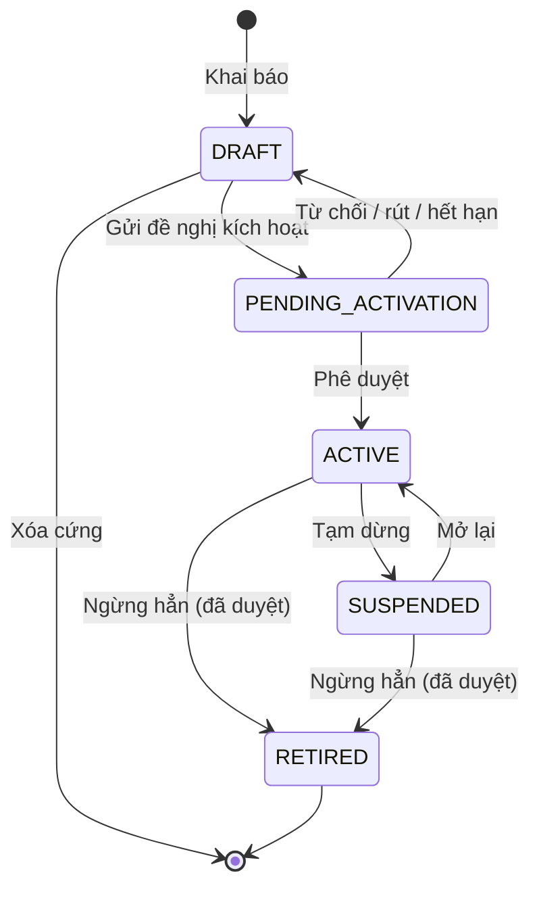
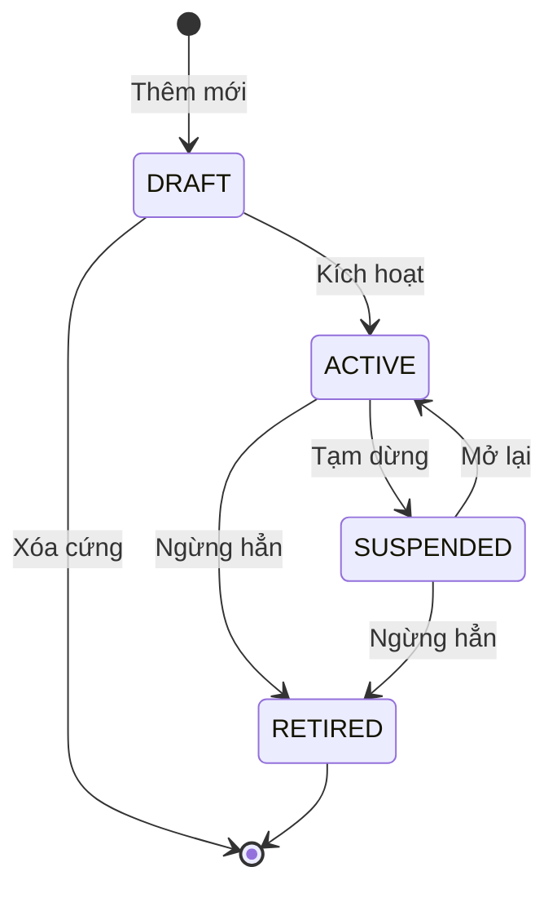
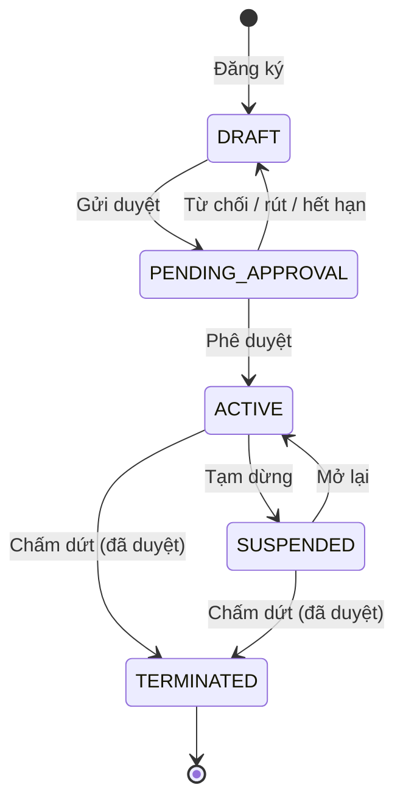
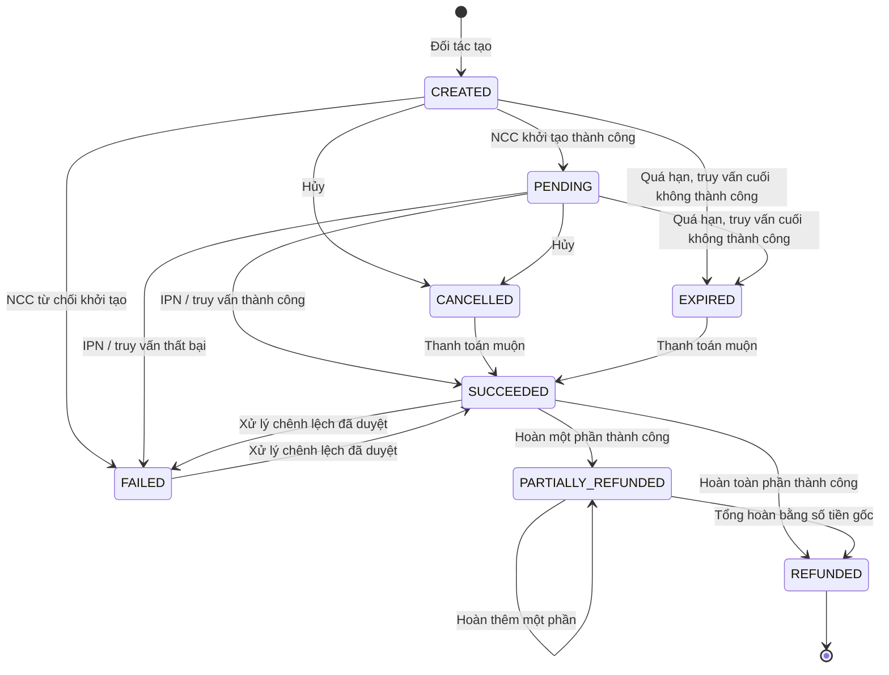
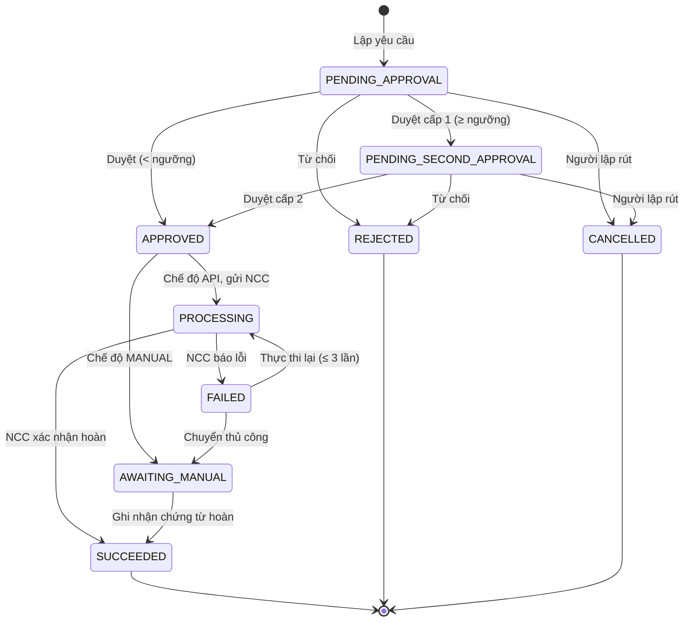
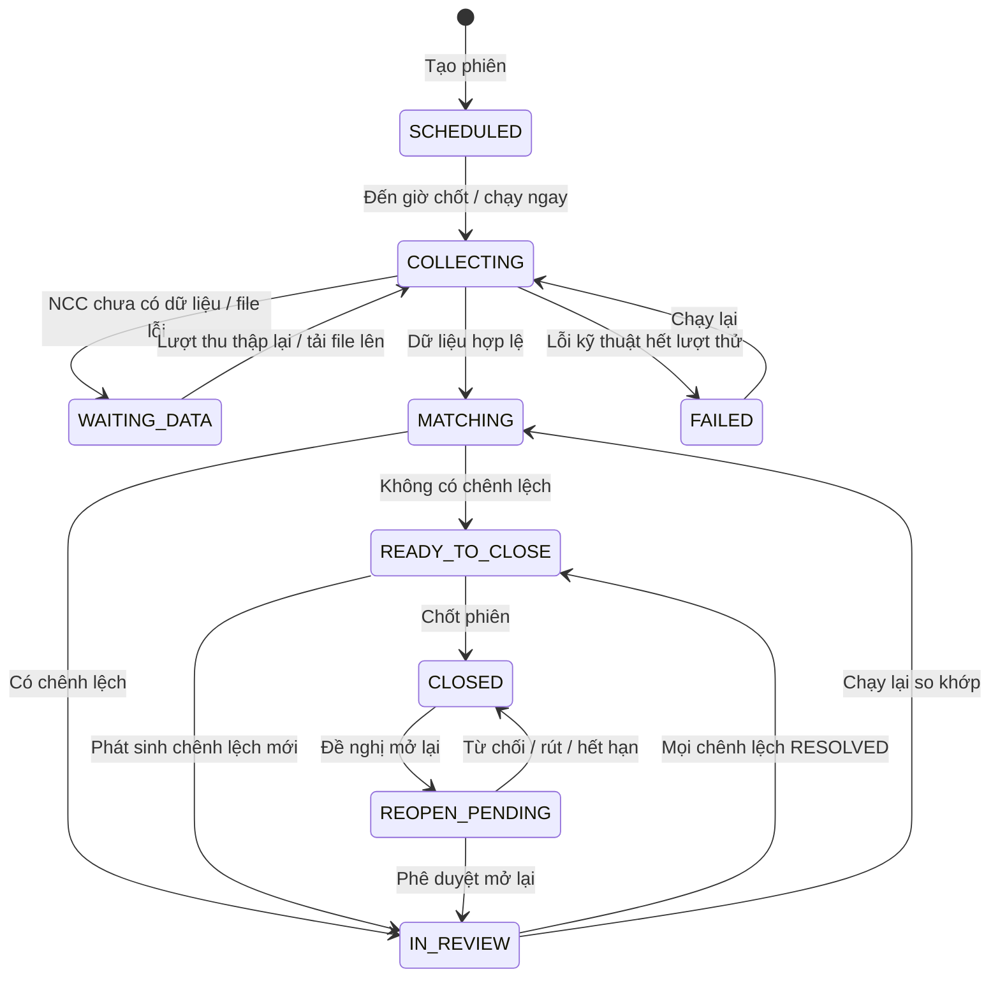
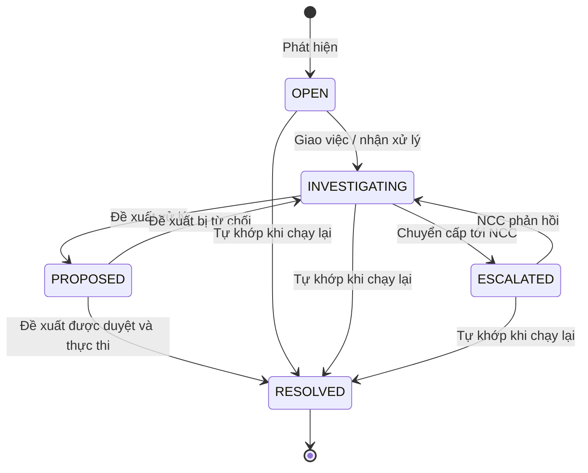
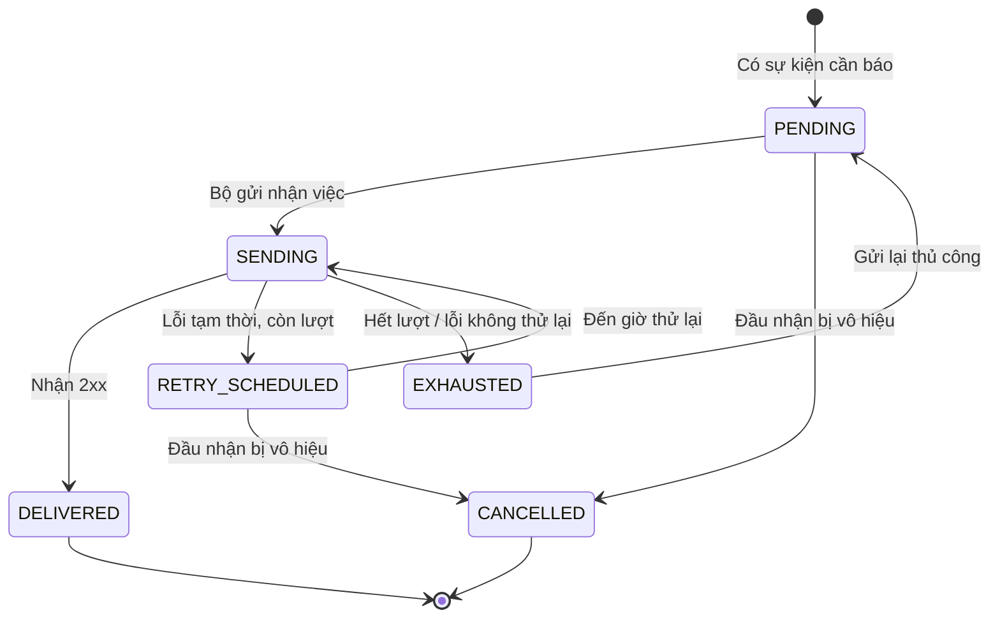
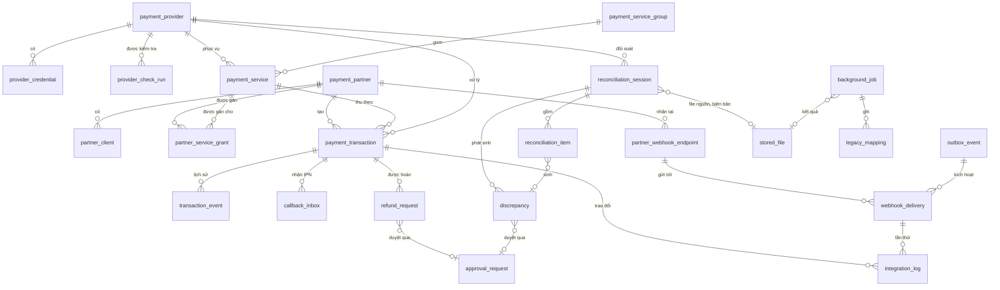

# D02-03-PH19-00 · Khung truy vết phân hệ PH-19 Thanh toán điện tử

## 0. Cách dùng tài liệu này

Tài liệu này là "xương sống" của toàn bộ bộ tài liệu PH-19. Nó không đặc tả chi tiết một chức năng nào, mà cấp phát và cố định **mọi mã truy vết** của phân hệ (FR, NFR, BR, UC, US, EN, API, EVT, UI, ERR, PERM, ROLE, TS/TC, OQ, giả định, ADR) cùng các quyết định nền mà bảy luồng viết song song phải dùng chung: máy trạng thái, tên cột, đường dẫn API, tên topic, mã lỗi và ma trận quyền. Lý do phải có một tài liệu như vậy là bảy luồng viết cùng lúc; nếu mỗi luồng tự đặt mã thì FRS, use case, CSDL, API, màn hình và test case sẽ không khớp nhau, và ma trận truy vết D00-03 không dựng được.

Ba quy tắc áp dụng cho mọi luồng viết sau tài liệu này:

1. **Chỉ dùng mã có trong tài liệu này.** Luồng nào thấy thiếu thì ghi vào mục "Đề xuất bổ sung mã" ở cuối tài liệu của mình, lấy số kế tiếp sau số lớn nhất của dải tương ứng tại đây và ghi rõ "đề xuất". Không sửa file này.
2. **Một sự thật, một nơi.** Tài liệu này chỉ đặt tên và phạm vi; nội dung chi tiết nằm ở tài liệu chủ quản ghi trong mục 16. Khi hai tài liệu mâu thuẫn thì thứ tự ưu tiên là: D00-01 → tài liệu này → tài liệu chủ quản của mã → các tài liệu tham chiếu.
3. **Mọi thứ liên quan tới PayGov là giả định.** Tài liệu hệ cũ không kèm đặc tả kỹ thuật của PayGov. Bất kỳ tên trường, tham số, thuật toán ký hay mã lỗi nào của PayGov xuất hiện trong bộ tài liệu đều phải kèm cụm "Giả định – cần đối chiếu Tài liệu kỹ thuật kết nối Nền tảng thanh toán của Cổng DVCQG do VPCP cấp" và tham chiếu một câu hỏi mở `OQ-19-nn` ở mục 15.

Quy ước mã tuân theo D00-01 §3. Riêng ba điểm sau khác với bản brief đầu tiên và đã được chốt theo D00-01: mã lỗi là `ERR-19-nnn` (không dùng `PAY-xxxx`); quyền là `PERM-19-{tài-nguyên}-{động-từ}`; đường dẫn REST theo dạng `/api/{nhóm}/v{n}/…` (D00-01 §6) nên ba nhóm API của PH-19 là `/api/payment/v1` (quản trị), `/api/payment-partner/v1` (đối tác) và `/api/payment-callback/v1` (nhà cung cấp gọi về).

| Loại mã | Dải đã cấp trong tài liệu này | Số lượng | Tài liệu chủ quản nội dung chi tiết |
|---|---|---|---|
| `LGC-PAY-nnn` | 001–023 (D00-03 §4.6), đề xuất thêm 024–026 | 23 + 3 | D00-03 |
| `REQ-nn`, `BP-nn` (mã con đề xuất) | REQ-91…99 (con của REQ-19), BP-91…96 (con của BP-05) | 9 / 6 | D02-01 (mã cha), D02-01-PH19 (mã con) |
| `SH-nn` | Chính thức SH-02, 03, 04, 05, 07, 09, 10, 11, 12 (D02-01); đề xuất thêm SH-92, 93, 97 | 9 + 3 | D02-01 |
| `BO-nn`, `KPI-nn` (mã con đề xuất) | BO-91…96 (con của BO-07), KPI-91…99 (tinh chỉnh KPI-13, KPI-14) | 6 / 9 | D02-01 (mã cha), D02-01-PH19 (mã con) |
| `FR-19-nnn` | 001–068 | 68 | D02-03-PH19 (FRS) |
| `NFR-19-nnn` | 001–032 | 32 | D02-03-PH19 (FRS) |
| `BR-19-nnn` | 001–034 | 34 | D02-03-PH19 (FRS) |
| `UC-19-nn` | 01–29 | 29 | D02-04-PH19 |
| `US-19-nnn` | 001–056 | 56 | D02-05-PH19 |
| `EN-19-nn` | 01–25 | 25 | D03-03-PH19 (CSDL) |
| `API-19-nnn` | 001–090, 101–110, 201–204 | 104 | D03-04-PH19 |
| `EVT-19-nn` | 01–18 | 18 | D03-04-PH19 |
| `UI-19-nn` | 01–28 | 28 | D03-06-PH19 |
| `ERR-19-nnn` | 001–050, 099 | 51 | D03-04-PH19 |
| `PERM-19-*` | 48 quyền | 48 | D02-08 (đề xuất từ tài liệu này) |
| `ROLE-*` | 9 vai trò | 9 | D02-08 (đề xuất từ tài liệu này) |
| `TS-19-nn` / `TC-19-nnn` | TS 01–34; TC 001–850 (mỗi TS 25 số) | 34 | D05-02-PH19 |
| `OQ-19-nn` / `A-19-nn` | OQ 01–20; A 01–14 | 20 / 14 | Tài liệu này |
| `ADR-nnn` | 040–049 | 10 | `00-chung/adr/` |

Các mã `REQ`, `SH`, `BP`, `BO`, `KPI` do D02-01 chủ quản. BRD tổng đã cấp mã cha chính thức cho thanh toán: `REQ-19` (trung gian thanh toán đa kênh), `BP-05` (thanh toán dịch vụ công và đối soát), `BO-07` cùng `KPI-13` (tỷ lệ đối soát tự động khớp ≥ 99,5%) và `KPI-14` (phát hiện giao dịch lệch ≤ 1 ngày làm việc). Các mã dải 91–99 trong tài liệu này là **mã con đề xuất** tinh chỉnh các mã cha đó ở mức đủ chi tiết để truy vết FR; mỗi lần dùng mã con phải ghi kèm mã cha (ví dụ `REQ-94 ⊂ REQ-19`). Bên liên quan dùng mã `SH` chính thức của D02-01; chỉ ba bên D02-01 chưa có mới giữ mã đề xuất `SH-92`, `SH-93`, `SH-97`. Nếu luồng lõi quyết định gộp mã con vào mã cha thì việc thay thế là cơ học một-một. Về kiến trúc, PH-19 chạy trong đơn vị triển khai (DU) riêng `dh-payment` gồm cả control plane và data plane (D03-01 §4.2), theo mô hình đa tenant của D03-10.

## 1. Phạm vi, tác nhân và phụ thuộc

### 1.1. PH-19 là gì

PH-19 là lớp trung gian thanh toán của tỉnh: các HTTT của tỉnh (Cổng DVC, HTTT giải quyết TTHC, các ứng dụng chuyên ngành — gọi chung là **đối tác**) gọi vào PH-19 để tạo yêu cầu thu phí, lệ phí, nghĩa vụ tài chính; PH-19 chuyển yêu cầu tới **nhà cung cấp thanh toán** (kênh đầu tiên và mặc định là PayGov), nhận kết quả, lưu toàn bộ lịch sử, báo lại cho đối tác, rồi đối soát với nhà cung cấp vào ngày hôm sau. PH-19 **không giữ tiền, không là trung gian thanh toán** theo nghĩa pháp lý; tiền đi từ người nộp tới tài khoản thụ hưởng qua PayGov và ngân hàng/trung gian thanh toán kết nối với PayGov. PH-19 chỉ giữ **chứng cứ điện tử** về yêu cầu, kết quả và việc đối soát.

Hệ cũ (Payment Đắk Nông, 2021) chỉ hiện thực phần danh mục, ghi nhận giao dịch và ba màn hình xem; tài liệu hệ cũ không mô tả bảo mật callback, idempotency, đối soát hay hoàn tiền, và mô hình dữ liệu có hai lỗi phải sửa khi di trú: số tiền kiểu `int(10)` (trần khoảng 2,1 tỷ đồng) và ngày thanh toán kiểu `varchar`. PH-19 làm đầy đủ các phần còn thiếu này.

### 1.2. Phạm vi làm và không làm

Bảng sau là ranh giới phạm vi. Mọi nội dung nằm ở cột "Không làm" mà một luồng thấy cần thì phải nêu thành câu hỏi mở, không tự mở rộng.

| Nhóm | Làm (trong phạm vi PH-19) | Không làm (ngoài phạm vi, nêu rõ ai làm) |
|---|---|---|
| Nhà cung cấp | Vòng đời NCC: khai báo, gắn thông tin xác thực (chỉ lưu tham chiếu kho bí mật), kiểm tra kết nối, giao dịch thử, kích hoạt có phê duyệt, tạm dừng, ngừng hẳn; giám sát sức khỏe; xoay khóa. Kiến trúc đa kênh qua adapter, PayGov là adapter đầu tiên | Tích hợp trực tiếp với từng ngân hàng, ví điện tử (đi qua PayGov). Đàm phán, ký thỏa thuận kết nối với VPCP (việc của chủ đầu tư) |
| Danh mục | Nhóm dịch vụ, dịch vụ thanh toán, gắn với lĩnh vực TTHC và loại phí qua mã danh mục PH-07 | Giữ bảng danh mục ngân hàng, kênh, lĩnh vực, loại phí (PH-07 chủ quản). Tính mức phí, lệ phí của từng TTHC (HTTT đối tác tính và gửi số tiền) |
| Đối tác | Đăng ký, phê duyệt, cấp client máy-máy, gán dịch vụ được dùng, hạn mức, webhook | Kết nạp HTTT thành viên nói chung (PH-01); cấp phát danh tính (PH-12 thực hiện, PH-19 gọi qua API) |
| Giao dịch | Tạo, khởi tạo tại NCC, điều hướng người nộp, nhận IPN, truy vấn trạng thái, hủy, hết hạn, lịch sử bất biến, idempotency | Giao diện chọn ngân hàng/nhập thẻ (PayGov cung cấp). Lưu số thẻ, số tài khoản đầy đủ của người nộp (cấm lưu). Phát hành biên lai/chứng từ điện tử thu phí có giá trị pháp lý (HTTT đối tác hoặc hệ thống biên lai; xem OQ-19-14) |
| Hoàn tiền | Yêu cầu, phê duyệt bốn mắt, thực thi qua API của NCC nếu có, hoặc chế độ thủ công có ghi nhận chứng cứ | Quyết định hành chính về việc hoàn phí (cơ quan thu quyết định ngoài hệ thống) |
| Đối soát | Đối soát T+1 theo NCC, phát hiện và xử lý chênh lệch, chốt phiên, biên bản, cung cấp kết quả cho đối tác | Hạch toán kế toán, lập báo cáo quyết toán ngân sách, đối soát giữa ngân hàng và Kho bạc |
| Tra cứu, báo cáo | Tra cứu, chi tiết, nhật ký, hai dashboard, báo cáo định kỳ, xuất file | Kho phân tích dài hạn/BI (PH-16 và lớp dữ liệu dùng chung tiêu thụ sự kiện) |
| Thông báo | Webhook có ký tới đối tác; sự kiện Kafka qua outbox | Gửi SMS/email/Zalo cho người nộp (đối tác thực hiện) |
| Đa tenant | Cấu hình theo tenant, RLS, tiền tố topic, khóa và chứng thư riêng từng tenant | Khởi tạo tenant, bật/tắt gói phân hệ (PH-20; PH-19 cung cấp hook) |
| Di trú | Nhập danh mục và giao dịch lịch sử từ hệ cũ, chạy song song, chuyển từng đối tác, lớp tương thích API cũ, đối chiếu sau di trú | Sửa mã nguồn hệ cũ; di trú người dùng (PH-12) |

### 1.3. Tác nhân là người

Bảng sau liệt kê các vai trò con người. Mã `ROLE-*` là đề xuất cho D02-08; quyền chi tiết ở mục 13.

| Vai trò | Mã | Tầng | Trách nhiệm trong PH-19 |
|---|---|---|---|
| Quản trị nền tảng | `ROLE-PLATFORM_ADMIN` | Nền tảng | Cài đặt adapter NCC, tham số mặc định của sản phẩm, hỗ trợ sự cố xuyên tenant. Không xem dữ liệu giao dịch của tenant khi không có phiên hỗ trợ được cấp (break-glass, PH-12) |
| Quản trị tenant | `ROLE-TENANT_ADMIN` | Tenant | Gán vai trò thanh toán cho cán bộ của tỉnh; bật phân hệ; không mặc nhiên có quyền nghiệp vụ thanh toán |
| Quản trị thanh toán | `ROLE-PAYMENT_ADMIN` | Tenant | Khai báo NCC, dịch vụ, nhóm dịch vụ, đối tác, client, webhook, cấu hình thanh toán; lập đề nghị kích hoạt |
| Người phê duyệt thanh toán | `ROLE-PAYMENT_APPROVER` | Tenant | Phê duyệt bốn mắt: kích hoạt NCC, duyệt đối tác, duyệt hoàn tiền, duyệt xử lý chênh lệch, mở lại phiên đối soát, chuyển chế độ định tuyến |
| Kế toán / đối soát viên | `ROLE-PAYMENT_ACCOUNTANT` | Tenant | Chạy và theo dõi đối soát, xử lý chênh lệch, lập yêu cầu hoàn tiền, chốt phiên, xuất biên bản và báo cáo |
| Cán bộ tra cứu / hỗ trợ | `ROLE-PAYMENT_OPERATOR` | Tenant | Tra cứu giao dịch, xem chi tiết, đồng bộ trạng thái thủ công, gửi lại webhook, xử lý lại callback |
| Kiểm toán viên | `ROLE-AUDITOR` | Tenant | Chỉ đọc toàn bộ dữ liệu, nhật ký và biên bản; không có thao tác ghi |
| Cán bộ ATTT | `ROLE-SECURITY_OFFICER` | Tenant / nền tảng | Quản lý thông tin xác thực NCC, xoay khóa, xem callback bị từ chối, xem nhật ký an ninh |
| Người nộp tiền | — (không đăng nhập PH-19) | Bên ngoài | Công dân, doanh nghiệp thanh toán trên trang PayGov rồi được chuyển về trang kết quả |

### 1.4. Tác nhân là hệ thống

| Hệ thống | Mã vai trò / ký hiệu | Chiều tương tác | Giao thức và ghi chú |
|---|---|---|---|
| HTTT đối tác (Cổng DVC tỉnh, HTTT giải quyết TTHC, ứng dụng chuyên ngành) | `ROLE-PARTNER_SYSTEM` | Gọi vào `/api/payment-partner/v1`; nhận webhook; tiêu thụ sự kiện | OAuth 2.1 `client_credentials` kèm mTLS hoặc `private_key_jwt`; đi qua PH-03 |
| PayGov (Nền tảng thanh toán của Cổng DVCQG) | NCC `PAYGOV` | PH-19 gọi ra để khởi tạo, truy vấn, hoàn tiền, lấy dữ liệu đối soát; PayGov gọi về `/api/payment-callback/v1/paygov/*` | Giả định HTTPS + chữ ký số; chi tiết chờ OQ-19-01…08 |
| Ngân hàng / trung gian thanh toán | — | Không kết nối trực tiếp | Chỉ xuất hiện dưới dạng mã ngân hàng, mã kênh trong kết quả PayGov trả về |
| PH-03 Cổng API (APISIX) | — | Đứng trước cả ba nhóm API | Xác thực token, mTLS, rate limit, danh sách IP cho callback, sinh `traceparent` |
| PH-12 Định danh, ủy quyền | — | PH-19 gọi | Token người dùng, tạo/thu hồi client đối tác, kiểm tra quyền (OPA) |
| PH-13 Giám sát, ghi vết | — | PH-19 đẩy | Nhật ký kiểm toán, metric, trace, log, cảnh báo |
| PH-10 Truyền thông sự kiện | — | PH-19 phát và nhận | Topic Kafka có tiền tố tenant, lược đồ tại Apicurio |
| PH-07 Danh mục dùng chung | — | PH-19 đọc | Tra mã danh mục, nhận sự kiện danh mục thay đổi |
| PH-01 Kết nạp HTTT | — | PH-19 đọc | Đối tác tham chiếu một HTTT thành viên đã kết nạp |
| PH-20 Quản trị tenant | — | PH-20 gọi PH-19 | Khởi tạo, tạm ngừng tenant; bật/tắt phân hệ; cấu hình mặc định |
| PH-18 Vận hành | — | PH-19 đẩy | Bản tin lỗi không tự xử lý được (DLQ) và quy trình xử lý sự cố |
| PH-09 Bảo vệ dữ liệu cá nhân | — | PH-19 gọi | Che dữ liệu người nộp khi hiển thị và xuất; nhãn phân loại |
| Kho bí mật (OpenBao/Vault), kho đối tượng (Garage), Valkey | — | Hạ tầng | Khóa ký và chứng thư; file đối soát và file xuất; khóa phân tán và bộ đệm |
| Hệ Payment cũ | `LEGACY` | Nguồn di trú; chạy song song | Đọc CSDL cũ khi di trú; định tuyến strangler tại PH-03 |

### 1.5. Phụ thuộc và danh mục dùng chung

PH-19 phụ thuộc cứng vào PH-03, PH-12, PH-13, PH-10, PH-07, PH-20 (đều thuộc MVP đợt 1) và phụ thuộc mềm vào PH-01, PH-09, PH-18. "Phụ thuộc cứng" nghĩa là PH-19 không khởi động được hoặc không đạt nghiệm thu nếu phân hệ kia chưa sẵn sàng. Theo ADR-001, PH-19 là một module Spring Modulith và chỉ được dùng gói `api/` và `events/` của module khác.

| Phân hệ | Mức | PH-19 dùng gì | Nếu phân hệ kia không sẵn sàng |
|---|---|---|---|
| PH-03 | Cứng | Định tuyến, xác thực biên, rate limit, allowlist IP callback | Không nhận được yêu cầu; không có phương án thay thế |
| PH-12 | Cứng | OIDC người dùng, client máy-máy của đối tác, quyết định OPA | Từ chối mọi yêu cầu (deny-by-default) |
| PH-13 | Cứng | Kho nhật ký kiểm toán, metric, cảnh báo | Thao tác quản trị bị chặn nếu không ghi được kiểm toán (BR-19-029); giao dịch vẫn chạy, kiểm toán xếp hàng trong outbox |
| PH-10 | Cứng | Kafka, Schema Registry | Sự kiện nằm lại trong `outbox_event`, phát bù khi Kafka phục hồi; webhook không bị ảnh hưởng |
| PH-07 | Cứng (lúc cấu hình), mềm (lúc chạy) | Tra và kiểm tra mã danh mục | Dùng bản đệm cục bộ trong Valkey; không cho tạo mới dịch vụ khi không xác thực được mã |
| PH-20 | Cứng | Vòng đời tenant, cờ bật phân hệ | Không tạo được cấu hình tenant mới |
| PH-01 | Mềm | Định danh HTTT thành viên của đối tác | Cho phép đối tác chưa gắn HTTT ở trạng thái `DRAFT`, không cho kích hoạt |
| PH-09 | Mềm | Chính sách che dữ liệu | Áp quy tắc che mặc định cứng trong PH-19 (BR-19-031) |
| PH-18 | Mềm | Hàng xử lý lỗi vận hành | Callback và webhook lỗi vẫn xem được tại UI-19-16, UI-19-24 |

**Danh mục dùng chung do PH-07 chủ quản.** PH-19 không tạo bảng danh mục trùng lặp. Các cột tham chiếu danh mục lưu **mã mục** (`T-CODE`) và được kiểm tra với PH-07 khi ghi (FR-19-016). Bảng sau liệt kê các mã danh mục PH-19 cần; luồng PH-07 chịu trách nhiệm khởi tạo dữ liệu.

| Mã danh mục | Nội dung | PH-19 dùng ở đâu | Ghi chú |
|---|---|---|---|
| `DM_LINH_VUC_TTHC` | Lĩnh vực thủ tục hành chính | `payment_service_group.sector_code`; bộ lọc "Lĩnh vực" | Nhóm dịch vụ của PH-19 là cách tenant gom dịch vụ để báo cáo; mỗi nhóm trỏ tới tối đa một lĩnh vực |
| `DM_KENH_THANH_TOAN` | Kênh/phương thức thanh toán (thẻ nội địa, QR, ví, chuyển khoản…) | `payment_transaction.channel_code` | Giá trị do NCC trả về, ánh xạ qua bảng ánh xạ mã của PH-07 |
| `DM_NGAN_HANG` | Ngân hàng, trung gian thanh toán | `payment_transaction.bank_code`; `refund_request.bank_code` | Như trên |
| `DM_LOAI_PHI_LE_PHI` | Loại khoản thu: phí, lệ phí, thuế, nghĩa vụ tài chính khác | `payment_service.fee_type_code` | |
| `DM_CO_QUAN` | Cơ quan, đơn vị (đơn vị thu, đơn vị chủ quản đối tác) | `payment_service.collecting_agency_code`; `payment_partner.agency_code` | Tên chính thức của danh mục do PH-07 chốt |
| `DM_DON_VI_HANH_CHINH` | Đơn vị hành chính | Báo cáo theo địa bàn (tùy chọn) | Có lịch sử sáp nhập |
| `DM_THU_TUC_HANH_CHINH` | Thủ tục hành chính | `payment_service.procedure_code` (tùy chọn); `payment_transaction.procedure_code` | |
| `DM_LOAI_TIEN_TE` | Loại tiền | Kiểm tra `currency = VND` | PH-19 đợt 2 chỉ nhận `VND` (BR-19-001) |
| `DM_LY_DO_HOAN_TIEN` | Lý do hoàn tiền | `refund_request.reason_code` | Đề xuất PH-07 bổ sung |
| `DM_LOAI_CHENH_LECH_DOI_SOAT` | Loại chênh lệch đối soát | Hiển thị nhãn cho `discrepancy.type` | Giá trị enum cố định trong mã nguồn (mục 7.7); danh mục chỉ giữ nhãn hiển thị |
| `DM_MA_LOI_NCC_THANH_TOAN` | Bảng ánh xạ mã kết quả của NCC sang trạng thái và thông điệp chuẩn | Adapter PayGov | Dùng tính năng ánh xạ mã giữa hệ thống của PH-07 |

Trạng thái vòng đời (mục 7) **không** phải danh mục PH-07: chúng là enum cố định trong mã nguồn vì máy trạng thái phụ thuộc vào chúng.

### 1.6. Yêu cầu nghiệp vụ cấp cao, bên liên quan, quy trình TO-BE (mã con đề xuất cho D02-01)

Theo D00-01 §3.2, mỗi FR phải tham chiếu ít nhất một `REQ`. BRD tổng chỉ có một yêu cầu cấp cao cho thanh toán là `REQ-19`, quá rộng để truy vết 68 FR, nên tài liệu này đề xuất chín mã con `REQ-91…99`, **đều thuộc `REQ-19`**; luồng BRD-PH19 đặc tả chi tiết. Các FR về di trú (`REQ-99`) đồng thời hiện thực các yêu cầu dùng chung `FR-00-090…093` của D02-02.

| Mã con (đề xuất, ⊂ REQ-19) | Yêu cầu nghiệp vụ cấp cao |
|---|---|
| REQ-91 | Tỉnh phải quản lý được vòng đời các nhà cung cấp thanh toán và chỉ đưa vào sử dụng nhà cung cấp đã được kiểm tra, phê duyệt |
| REQ-92 | Tỉnh phải quản lý được danh mục dịch vụ thanh toán và các HTTT được phép thu qua nền tảng |
| REQ-93 | Mọi HTTT của tỉnh phải thu được phí, lệ phí trực tuyến qua một giao diện thống nhất, không phụ thuộc đặc tả riêng của nhà cung cấp |
| REQ-94 | Kết quả thanh toán phải được ghi nhận chính xác, đúng một lần, có chứng cứ, và được báo lại cho HTTT gọi kịp thời |
| REQ-95 | Tỉnh phải đối soát hằng ngày với nhà cung cấp và xử lý dứt điểm mọi chênh lệch có kiểm soát |
| REQ-96 | Tỉnh phải xử lý được việc hoàn tiền có phê duyệt và lưu vết |
| REQ-97 | Cán bộ phải tra cứu, giám sát, lập báo cáo về giao dịch và kênh thanh toán; kiểm toán viên phải truy được mọi thao tác |
| REQ-98 | Phân hệ phải vận hành đa tenant, an toàn theo cấp độ 3 (sẵn sàng cấp độ 4), bảo vệ dữ liệu cá nhân và lưu trữ chứng từ theo quy định |
| REQ-99 | Việc chuyển từ hệ Payment cũ phải diễn ra từng bước, không gián đoạn thu và không mất dữ liệu lịch sử |

Bảng bên liên quan dưới đây dùng mã chính thức của D02-01; cột cuối giữ mã đề xuất cũ để các bản nháp đã trích dẫn tra được.

| Mã | Bên liên quan | Quan tâm chính trong PH-19 | Mã đề xuất cũ |
|---|---|---|---|
| SH-02 | Sở KH&CN (chủ đầu tư) | Quản lý tập trung việc thu trực tuyến, kiểm soát chi phí | SH-91 |
| SH-03 | Trung tâm dữ liệu / Trung tâm CNTT tỉnh (vận hành Datahub) | Vận hành ổn định, an toàn, giám sát chủ động | SH-91 |
| SH-04 | Sở, ngành, UBND cấp xã có HTTT thu phí (chủ quản đối tác) | Tích hợp đơn giản, kết quả tin cậy | SH-94 |
| SH-05 | Đơn vị phát triển HTTT đối tác | Đặc tả API rõ, môi trường thử, webhook ổn định | SH-94 |
| SH-07 | Cơ quan chuyên trách ATTT | Hồ sơ cấp độ, bảo vệ khóa ký và dữ liệu giao dịch | — |
| SH-09 | Cổng thanh toán quốc gia (PayGov, VPCP vận hành) và đơn vị cung cấp dịch vụ thanh toán | Tích hợp đúng đặc tả, đối soát khớp | SH-95 |
| SH-10 | Người dân và doanh nghiệp (người nộp tiền) | Nộp một lần, không bị trừ tiền hai lần, được hoàn khi sai | SH-96 |
| SH-11 | Đơn vị cung cấp sản phẩm Datahub | Một bản mã cho nhiều tỉnh, nâng cấp đồng loạt | SH-98 |
| SH-12 | Đơn vị vận hành hệ LGSP/Payment cũ | Chuyển giao an toàn, không mất dữ liệu | — |
| SH-92 (đề xuất) | Sở Tài chính và bộ phận kế toán của cơ quan thu | Số liệu đúng, đối soát khớp, chứng từ | SH-92 |
| SH-93 (đề xuất) | Văn phòng UBND tỉnh / Trung tâm phục vụ hành chính công | Tỷ lệ thanh toán trực tuyến, trải nghiệm người dân | SH-93 |
| SH-97 (đề xuất) | Cơ quan kiểm toán, thanh tra | Truy vết, toàn vẹn chứng cứ | SH-97 |

| Mã con (đề xuất, ⊂ BP-05) | Quy trình nghiệp vụ TO-BE | UC chính |
|---|---|---|
| BP-91 | Đưa một nhà cung cấp thanh toán vào sử dụng | UC-19-01…04 |
| BP-92 | Đăng ký một HTTT đối tác được thu qua nền tảng | UC-19-08…10 |
| BP-93 | Thu một khoản phí, lệ phí trực tuyến (từ tạo yêu cầu tới báo kết quả) | UC-19-11…16, UC-19-27 |
| BP-94 | Hoàn tiền một giao dịch | UC-19-17, UC-19-18 |
| BP-95 | Đối soát ngày và xử lý chênh lệch | UC-19-19…21 |
| BP-96 | Chuyển một đối tác từ hệ cũ sang Datahub | UC-19-29 |

## 2. Chức năng hệ cũ và FR phủ (`LGC-PAY`)

D00-03 §4.6 đã kiểm kê 23 chức năng hệ cũ `LGC-PAY-001…023` từ bốn nguồn: tài liệu phân tích yêu cầu (20 chức năng), thiết kế chi tiết (dashboard tổng quan, bảng tra cứu, chi tiết giao dịch, tra cứu nâng cao, dashboard kênh), thiết kế CSDL (năm bảng) và HDSD. Bảng dưới đây giữ nguyên mã và kết luận của D00-03, bổ sung cột FR phủ và màn hình mới. Không LGC nào bị loại bỏ. Mỗi LGC có ít nhất một FR; chiều ngược lại xem cột "LGC" ở mục 4.

| Mã | Chức năng hệ cũ (rút gọn) | Nguồn hệ cũ | Kết luận | FR phủ | UI mới |
|---|---|---|---|---|---|
| LGC-PAY-001 | Thêm NCC: khai báo, liên kết API, thử luồng thanh toán, kiểm tra phản hồi, đưa vào danh sách khi thử thành công | PTYC #1 | Nâng cấp | FR-19-001, 002, 003, 004, 005 | UI-19-05, UI-19-06 |
| LGC-PAY-002 | Xem danh sách NCC | PTYC #2 | Giữ nguyên | FR-19-007 | UI-19-03 |
| LGC-PAY-003 | Xem chi tiết NCC: ngày bắt đầu, đầu mối, điện thoại, tình trạng, số dịch vụ, biểu đồ giao dịch theo ngày | PTYC #3, HDSD 4.3 | Giữ nguyên | FR-19-008, 057 | UI-19-04, UI-19-02 |
| LGC-PAY-004 | Chỉnh sửa NCC | PTYC #4 | Giữ nguyên | FR-19-009, 002 | UI-19-05 |
| LGC-PAY-005 | Xóa NCC | PTYC #5 | Nâng cấp | FR-19-010 | UI-19-03, UI-19-04 |
| LGC-PAY-006 | Tìm kiếm NCC | PTYC #6 | Giữ nguyên | FR-19-007 | UI-19-03 |
| LGC-PAY-007 | Kích hoạt NCC: kiểm tra hiện trạng, kết nối, giao dịch mẫu, nhận phản hồi | PTYC #7 | Giữ nguyên | FR-19-003, 004, 005 | UI-19-06, UI-19-13 |
| LGC-PAY-008 | Dừng NCC | PTYC #8 | Giữ nguyên | FR-19-006 | UI-19-04 |
| LGC-PAY-009 | Thông báo lỗi kết nối với NCC | PTYC #9 | Nâng cấp | FR-19-011, 059 | UI-19-04, UI-19-01 |
| LGC-PAY-010 | Nhận kết quả thanh toán từ NCC | PTYC #10 | Nâng cấp | FR-19-029, 030, 031, 032 | UI-19-16 |
| LGC-PAY-011 | Lưu dữ liệu quá trình thanh toán vào CSDL | PTYC #11, CSDL | Nâng cấp | FR-19-022, 028, 054 | UI-19-15 |
| LGC-PAY-012 | Thông báo kết quả thanh toán cho HTTT gọi | PTYC #12 | Nâng cấp | FR-19-025, 060, 061, 062 | UI-19-24, UI-19-28 |
| LGC-PAY-013 | Dashboard tổng quan: số dịch vụ, số hệ thống áp dụng, tổng giao dịch, giao dịch trong ngày, biểu đồ theo dịch vụ, bảng giao dịch trong ngày | TKCT 3.1, HDSD 4.1 | Giữ nguyên | FR-19-056 | UI-19-01 |
| LGC-PAY-014 | Bảng tra cứu giao dịch | TKCT 3.2 | Giữ nguyên | FR-19-049 | UI-19-14 |
| LGC-PAY-015 | Tìm kiếm nâng cao theo trạng thái (chọn nhiều) | TKCT 3.4, HDSD 4.2.2 | Giữ nguyên | FR-19-050 | UI-19-14 |
| LGC-PAY-016 | Tìm kiếm nâng cao theo lĩnh vực (chọn nhiều) | TKCT 3.4, HDSD 4.2.3 | Giữ nguyên | FR-19-050 | UI-19-14 |
| LGC-PAY-017 | Tìm kiếm nâng cao theo thời gian (mẫu 1 tháng, 3 tháng, 1 quý; tùy chọn từ ngày – đến ngày) | TKCT 3.4, HDSD 4.2.4 | Giữ nguyên | FR-19-050 | UI-19-14 |
| LGC-PAY-018 | Tìm theo từ khóa, phân trang khi > 20 dòng, tiêu chí sắp xếp | PTYC #13–15 | Giữ nguyên | FR-19-049 | UI-19-14 |
| LGC-PAY-019 | Xem chi tiết giao dịch và lịch sử trạng thái | PTYC #16, TKCT 3.3 | Giữ nguyên | FR-19-051, 028 | UI-19-15 |
| LGC-PAY-020 | Dashboard kênh thanh toán (30 ngày gần nhất) | TKCT 3.5 | Giữ nguyên | FR-19-057 | UI-19-02 |
| LGC-PAY-021 | Danh sách, lọc, sắp xếp, xem chi tiết nhật ký giao dịch | PTYC #17–20 | Giữ nguyên | FR-19-053, 054, 055 | UI-19-23 |
| LGC-PAY-022 | Quản lý đối tác, nhóm dịch vụ và dịch vụ thanh toán | CSDL 2.1.1, 2.1.2, 2.1.4 | Giữ nguyên | FR-19-013, 014, 015, 017, 018, 020 | UI-19-07…12 |
| LGC-PAY-023 | Giám sát nhiều NCC; hệ cũ chỉ hiện thực PayGov | TKCT 1.2 | Nâng cấp | FR-19-011, 024, 057 | UI-19-02, UI-19-03 |

Khi đối chiếu lại tài liệu gốc, có ba hành vi của hệ cũ chưa có dòng riêng trong D00-03. Tài liệu này **đề xuất** luồng lõi bổ sung vào D00-03 §4.6; trong lúc chờ, các luồng PH-19 được phép tham chiếu ba mã này kèm chữ "(đề xuất)".

| Mã (đã vào D00-03 §4.6 ngày 26/11/2026) | Chức năng hệ cũ | Nguồn | Kết luận | FR phủ |
|---|---|---|---|---|
| LGC-PAY-024 | Nhận yêu cầu thanh toán của người dùng, gửi yêu cầu thanh toán, xử lý quá trình thanh toán theo NCC | HDSD mục 3, dòng 9–11 | Nâng cấp | FR-19-022, 023, 024, 025, 033, 034 |
| LGC-PAY-025 | Bộ trạng thái giao dịch có ba trạng thái hoàn trả `REFUND_PENDING`, `REFUND_SUCCESS`, `REFUND_FAILED` (chỉ có trạng thái, không mô tả chức năng) | TKCT 3.4 | Nâng cấp | FR-19-038, 039, 040, 041 |
| LGC-PAY-026 | Số liệu tổng trên dashboard được đệm 10 phút | TKCT 3.1 | Nâng cấp | FR-19-056 (NFR-19-006: số liệu trễ tối đa 60 giây) |

Các yêu cầu phi chức năng của hệ cũ đã có mã `LGC-NFR-001…014` và `LGC-IAM-001` tại D00-03; ánh xạ sang NFR của PH-19 xem cột "Truy vết" ở mục 5.

## 3. Mục tiêu nghiệp vụ và chỉ số (`BO`, `KPI`)

Mục tiêu nghiệp vụ trả lời câu hỏi "vì sao tỉnh cần PH-19"; chỉ số cho biết khi nào coi là đạt. Mã là mã con đề xuất cho D02-01 (dải 91–99): `BO-91…96` tinh chỉnh `BO-07`; `KPI-94` tinh chỉnh `KPI-13` (mục tiêu PH-19 ≥ 99,9% chặt hơn mức ≥ 99,5% của BRD) và `KPI-95`, `KPI-96` tinh chỉnh `KPI-14`. Mọi KPI đều tính được từ dữ liệu của chính PH-19 hoặc PH-13, không cần nhập tay.

| Mã | Mục tiêu nghiệp vụ | REQ |
|---|---|---|
| BO-91 | Mọi HTTT của tỉnh thu phí, lệ phí trực tuyến qua một đầu mối duy nhất, thay cho việc từng HTTT tự tích hợp PayGov | REQ-92, REQ-93 |
| BO-92 | Không sai, không mất, không ghi trùng một giao dịch nào; mỗi kết quả đều có chứng cứ truy lại được | REQ-94, REQ-98 |
| BO-93 | Đối soát xong trong ngày làm việc kế tiếp và mọi chênh lệch được xử lý dứt điểm, có người chịu trách nhiệm | REQ-95, REQ-96 |
| BO-94 | Chủ động với sự cố kênh thanh toán: phát hiện trong vài phút và có sẵn kiến trúc để thêm kênh thứ hai | REQ-91 |
| BO-95 | Lãnh đạo và kế toán có số liệu thu trực tuyến tức thời, không phải tổng hợp thủ công | REQ-97 |
| BO-96 | Tắt được hệ Payment cũ mà không gián đoạn việc thu và không mất dữ liệu lịch sử | REQ-99 |

| Mã | Chỉ số | Công thức và nguồn | Mục tiêu | BO |
|---|---|---|---|---|
| KPI-91 | Tỷ lệ HTTT có thu phí của tỉnh đã thu qua PH-19 | Số đối tác `ACTIVE` ở chế độ `DATAHUB` ÷ số HTTT có thu phí theo danh sách của tỉnh | ≥ 90% sau 6 tháng vận hành; 100% trước khi tắt hệ cũ | BO-91, BO-96 |
| KPI-92 | Tỷ lệ giao dịch có kết quả cuối trong 15 phút | Số giao dịch đạt `SUCCEEDED`/`FAILED`/`CANCELLED`/`EXPIRED` trong ≤ 15 phút kể từ `created_at` ÷ tổng giao dịch | ≥ 99,5% mỗi tháng | BO-92 |
| KPI-93 | Số giao dịch bị ghi nhận trùng hoặc sai số tiền | Số chênh lệch loại `DUPLICATE`, `AMOUNT_MISMATCH` có nguyên nhân gốc tại PH-19 | 0 mỗi tháng | BO-92 |
| KPI-94 | Tỷ lệ khớp tự động khi đối soát | Số `reconciliation_item` khớp tự động ÷ tổng số dòng | ≥ 99,9% mỗi phiên | BO-93 |
| KPI-95 | Thời gian chốt phiên đối soát | Thời điểm `CLOSED` trừ thời điểm kết thúc ngày giao dịch | ≤ 1 ngày làm việc với ≥ 95% số phiên | BO-93 |
| KPI-96 | Thời gian xử lý một chênh lệch | Trung vị `resolved_at − detected_at` | ≤ 3 ngày làm việc; không chênh lệch nào mở quá 10 ngày làm việc | BO-93 |
| KPI-97 | Thời gian phát hiện sự cố kênh | Từ lần kiểm tra sức khỏe thất bại đầu tiên tới khi cảnh báo được gửi | ≤ 3 phút | BO-94 |
| KPI-98 | Tỷ lệ thông báo kết quả tới đối tác thành công | Số `webhook_delivery` đạt `DELIVERED` trong ≤ 60 giây ÷ tổng số | ≥ 99% trong 60 giây; 100% trong 24 giờ hoặc có cảnh báo | BO-92 |
| KPI-99 | Độ lệch số liệu sau di trú | Chênh lệch số lượng và tổng tiền giữa hệ cũ và Datahub theo từng tháng lịch sử | 0 giao dịch, 0 đồng | BO-96 |

## 4. Danh mục yêu cầu chức năng (`FR-19-nnn`)

Có 68 FR, chia thành 15 nhóm miền (A–O). Mỗi dòng nêu vừa đủ để luồng FRS viết đặc tả đầy đủ theo mẫu D00-01 §4.3. Cột "Quyền" ghi phần sau tiền tố `PERM-19-` (ví dụ `provider-write` nghĩa là `PERM-19-provider-write`); chữ "hệ thống" nghĩa là tác vụ nền không có người gọi. Cột "Ưu tiên" dùng M/S/C theo D00-01 §4.1. Cột "Đợt": "Đ2" là đợt 2 (đợt phát hành đầu tiên của PH-19), "Sau" là sau đợt 2. API, màn hình, thực thể và kịch bản kiểm thử của từng FR tra ngược ở các mục 9–11, 14 và bảng tổng hợp mục 17.

### 4.1. Nhóm A — Nhà cung cấp thanh toán

| Mã | Tên | Mô tả | Tác nhân | Quyền | ƯT | REQ | LGC | UC | Đợt |
|---|---|---|---|---|---|---|---|---|---|
| FR-19-001 | Khai báo nhà cung cấp | Tạo NCC ở trạng thái `DRAFT` với mã, tên, loại adapter, đầu mối liên hệ, địa chỉ môi trường thử và chính thức, ngày hiệu lực. Mã NCC duy nhất trong tenant và bất biến. | Quản trị thanh toán | provider-write | M | REQ-91 | 001 | UC-19-01 | Đ2 |
| FR-19-002 | Gắn thông tin xác thực NCC | Khai báo các tham chiếu bí mật (khóa ký, chứng thư mTLS, mã đơn vị kết nối) theo từng môi trường; hệ thống chỉ lưu đường dẫn kho bí mật, dấu vân tay và hạn dùng. | Cán bộ ATTT, Quản trị thanh toán | credential-manage | M | REQ-91, REQ-98 | 001, 004 | UC-19-01 | Đ2 |
| FR-19-003 | Kiểm tra kết nối NCC | Gọi phép thử kết nối của adapter (bắt tay TLS, xác thực, gọi API kiểm tra) và lưu kết quả từng bước làm bằng chứng. | Quản trị thanh toán | provider-test | M | REQ-91 | 001, 007 | UC-19-02 | Đ2 |
| FR-19-004 | Thực hiện giao dịch thử | Tạo một giao dịch đánh dấu `is_test = true` qua môi trường thử của NCC, theo dõi tới khi có callback, và ghi nhận kết quả vào checklist kích hoạt. | Quản trị thanh toán | provider-test | M | REQ-91 | 001, 007 | UC-19-02 | Đ2 |
| FR-19-005 | Kích hoạt NCC có phê duyệt | Người lập gửi đề nghị kích hoạt khi checklist đạt đủ; người phê duyệt khác người lập duyệt thì NCC chuyển `ACTIVE`. | Quản trị thanh toán; Người phê duyệt | provider-write; provider-activate | M | REQ-91 | 001, 007 | UC-19-03 | Đ2 |
| FR-19-006 | Tạm dừng và mở lại NCC | Tạm dừng thì NCC không nhận giao dịch mới nhưng vẫn nhận callback, truy vấn và đối soát cho giao dịch dở; mở lại yêu cầu kiểm tra kết nối đạt. | Quản trị thanh toán | provider-suspend | M | REQ-91 | 008 | UC-19-04 | Đ2 |
| FR-19-007 | Danh sách, tìm kiếm, sắp xếp NCC | Liệt kê NCC có lọc theo trạng thái, sức khỏe, từ khóa (mã, tên); sắp xếp và phân trang con trỏ. | Mọi vai trò thanh toán | provider-read | M | REQ-91 | 002, 006 | UC-19-05 | Đ2 |
| FR-19-008 | Xem chi tiết NCC | Hiển thị thông tin, trạng thái vòng đời, sức khỏe, dịch vụ đang dùng, hạn chứng thư, lịch sử thay đổi và kết quả kiểm tra gần nhất. | Mọi vai trò thanh toán | provider-read | M | REQ-91 | 003 | UC-19-05 | Đ2 |
| FR-19-009 | Chỉnh sửa NCC | Sửa các thuộc tính không định danh; thay đổi địa chỉ kết nối hoặc thông tin xác thực của NCC `ACTIVE` buộc kiểm tra kết nối lại trước khi có hiệu lực. | Quản trị thanh toán | provider-write | M | REQ-91 | 004 | UC-19-05 | Đ2 |
| FR-19-010 | Xóa hoặc ngừng hẳn NCC | Chỉ xóa cứng NCC `DRAFT` chưa từng có giao dịch; NCC đã có giao dịch chỉ chuyển `RETIRED` sau khi không còn giao dịch dở và phiên đối soát mở. | Quản trị thanh toán; Người phê duyệt | provider-delete | M | REQ-91 | 005 | UC-19-04 | Đ2 |
| FR-19-011 | Giám sát sức khỏe và cảnh báo lỗi kết nối | Kiểm tra sức khỏe định kỳ từng NCC `ACTIVE`, tính trạng thái `HEALTHY`/`DEGRADED`/`DOWN`, mở/đóng mạch ngắt và gửi cảnh báo qua PH-13. | Hệ thống; Cán bộ tra cứu | hệ thống; provider-read | M | REQ-91, REQ-97 | 009, 023 | UC-19-06 | Đ2 |
| FR-19-012 | Xoay khóa và chứng thư NCC | Thay thông tin xác thực không gián đoạn (chấp nhận song song khóa cũ và mới trong thời gian chuyển tiếp); cảnh báo trước hạn 30, 14, 7 ngày. | Cán bộ ATTT | credential-manage | S | REQ-98 | — | UC-19-06 | Đ2 |

### 4.2. Nhóm B — Nhóm dịch vụ và dịch vụ thanh toán

| Mã | Tên | Mô tả | Tác nhân | Quyền | ƯT | REQ | LGC | UC | Đợt |
|---|---|---|---|---|---|---|---|---|---|
| FR-19-013 | Quản lý nhóm dịch vụ | Thêm, sửa, xem, xóa nhóm dịch vụ (hệ cũ gọi "lĩnh vực giao dịch"); mỗi nhóm trỏ tới một mã `DM_LINH_VUC_TTHC`. Không xóa nhóm còn dịch vụ. | Quản trị thanh toán | service-write; service-read | M | REQ-92 | 022 | UC-19-07 | Đ2 |
| FR-19-014 | Quản lý dịch vụ thanh toán | Thêm, sửa, xem, tìm dịch vụ: mã, tên, nhóm, NCC, loại khoản thu, đơn vị thu, tham chiếu tài khoản thụ hưởng, khoảng số tiền cho phép, thời hạn thanh toán riêng. | Quản trị thanh toán | service-write; service-read | M | REQ-92 | 022 | UC-19-08 | Đ2 |
| FR-19-015 | Điều khiển vòng đời dịch vụ | Kích hoạt, tạm dừng, ngừng hẳn dịch vụ; dịch vụ chỉ `ACTIVE` được khi NCC của nó `ACTIVE`; xóa cứng chỉ khi chưa có giao dịch. | Quản trị thanh toán | service-activate | M | REQ-92 | 022 | UC-19-08 | Đ2 |
| FR-19-016 | Kiểm tra và đồng bộ mã danh mục PH-07 | Khi ghi, kiểm tra mọi mã danh mục với PH-07; lắng nghe sự kiện danh mục thay đổi để đánh dấu dịch vụ, nhóm đang dùng mã hết hiệu lực. | Hệ thống | hệ thống | S | REQ-92 | — | UC-19-07, UC-19-08 | Đ2 |

### 4.3. Nhóm C — Đối tác và thông tin xác thực

| Mã | Tên | Mô tả | Tác nhân | Quyền | ƯT | REQ | LGC | UC | Đợt |
|---|---|---|---|---|---|---|---|---|---|
| FR-19-017 | Quản lý hồ sơ đối tác | Thêm, sửa, xem, tìm đối tác: mã, tên, cơ quan chủ quản, HTTT thành viên (PH-01), đầu mối kỹ thuật và nghiệp vụ, mã ứng dụng hệ cũ (`app_code`). | Quản trị thanh toán | partner-write; partner-read | M | REQ-92 | 022 | UC-19-09 | Đ2 |
| FR-19-018 | Điều khiển vòng đời đối tác | Gửi duyệt, phê duyệt, tạm dừng, mở lại, chấm dứt đối tác; đối tác bị tạm dừng không tạo được giao dịch mới nhưng vẫn truy vấn và nhận thông báo. | Quản trị thanh toán; Người phê duyệt | partner-write; partner-approve; partner-suspend | M | REQ-92 | 022 | UC-19-09 | Đ2 |
| FR-19-019 | Cấp và thu hồi client của đối tác | Tạo client máy-máy tại PH-12 (mTLS hoặc `private_key_jwt`), gắn với đối tác, đặt hạn dùng, thu hồi tức thì; không hiển thị lại bí mật sau khi cấp. | Quản trị thanh toán; Cán bộ ATTT | partner-client-manage | M | REQ-92, REQ-98 | — | UC-19-10 | Đ2 |
| FR-19-020 | Gán dịch vụ và hạn mức cho đối tác | Khai báo đối tác được dùng dịch vụ nào, hạn mức số tiền mỗi giao dịch, hạn mức số giao dịch và tổng tiền mỗi ngày. | Quản trị thanh toán | partner-write | M | REQ-92 | 022 | UC-19-10 | Đ2 |
| FR-19-021 | Cấu hình webhook của đối tác | Khai báo địa chỉ nhận thông báo (bắt buộc HTTPS), loại sự kiện nhận, bí mật ký; gửi thử và xoay bí mật ký. | Quản trị thanh toán | partner-webhook-manage | M | REQ-94 | — | UC-19-10 | Đ2 |

### 4.4. Nhóm D — Giao dịch thanh toán và kết nối PayGov

| Mã | Tên | Mô tả | Tác nhân | Quyền | ƯT | REQ | LGC | UC | Đợt |
|---|---|---|---|---|---|---|---|---|---|
| FR-19-022 | Tạo giao dịch thanh toán | Đối tác gửi yêu cầu thu (dịch vụ, số tiền, mã đơn hàng, nội dung, người nộp, địa chỉ quay về); hệ thống ghi giao dịch `CREATED`, sinh mã giao dịch và trả về địa chỉ thanh toán. | HTTT đối tác | partner-pay-create | M | REQ-93 | 011, 024 | UC-19-11 | Đ2 |
| FR-19-023 | Kiểm tra hợp lệ yêu cầu thanh toán | Kiểm tra theo thứ tự cố định: đối tác hoạt động, dịch vụ hoạt động và được gán, số tiền nguyên dương trong khoảng cho phép, hạn mức, định dạng trường; trả đúng một mã lỗi đầu tiên gặp. | Hệ thống | hệ thống | M | REQ-93 | 024 | UC-19-11 | Đ2 |
| FR-19-024 | Khởi tạo thanh toán tại NCC qua adapter | Chọn NCC theo dịch vụ, gọi adapter (lớp chống nhiễm, ADR-040) để khởi tạo; thành công thì giao dịch chuyển `PENDING` và lưu mã tham chiếu của NCC; lỗi thì xử lý theo BR-19-012. | Hệ thống | hệ thống | M | REQ-93 | 023, 024 | UC-19-11 | Đ2 |
| FR-19-025 | Xử lý người nộp quay về | Nhận lượt quay về từ NCC, xác minh chữ ký tham số, hiển thị trang kết quả trung gian rồi chuyển người nộp về địa chỉ của đối tác kèm kết quả có ký. Lượt quay về **không** được dùng để chốt trạng thái (BR-19-014). | Người nộp tiền; Hệ thống | công khai (có chữ ký) | M | REQ-93, REQ-94 | 012, 024 | UC-19-12 | Đ2 |
| FR-19-026 | Hủy giao dịch chưa thanh toán | Đối tác hoặc cán bộ hủy giao dịch `CREATED`/`PENDING`; nếu NCC có API hủy thì gọi, nếu không thì đánh dấu và xử lý callback thành công đến sau như thanh toán muộn. | HTTT đối tác; Cán bộ tra cứu | partner-pay-create; transaction-cancel | S | REQ-93 | — | UC-19-14 | Đ2 |
| FR-19-027 | Tự động hết hạn giao dịch | Tác vụ nền chuyển giao dịch quá `expires_at` sang `EXPIRED` sau khi đã truy vấn NCC lần cuối và không có kết quả thành công. | Hệ thống | hệ thống | M | REQ-94 | — | UC-19-14 | Đ2 |
| FR-19-028 | Ghi lịch sử trạng thái bất biến | Mỗi lần đổi trạng thái giao dịch ghi một dòng `transaction_event` (trạng thái cũ, mới, nguồn, lý do, người/hệ thống, `trace_id`) trong cùng giao dịch CSDL; không sửa, không xóa. | Hệ thống | hệ thống | M | REQ-94, REQ-98 | 011, 019 | UC-19-11, UC-19-13 | Đ2 |

### 4.5. Nhóm E — Callback / IPN

| Mã | Tên | Mô tả | Tác nhân | Quyền | ƯT | REQ | LGC | UC | Đợt |
|---|---|---|---|---|---|---|---|---|---|
| FR-19-029 | Tiếp nhận và xác minh IPN | Nhận thông báo kết quả từ NCC, xác minh nguồn (IP, mTLS nếu có), chữ ký, thời hạn và tính duy nhất; ghi nguyên văn vào `callback_inbox` rồi mới trả lời NCC. | PayGov | công khai (xác minh chữ ký) | M | REQ-94, REQ-98 | 010 | UC-19-13 | Đ2 |
| FR-19-030 | Xử lý IPN đúng một lần | Xử lý bản ghi inbox: khóa giao dịch, đối chiếu số tiền và mã tham chiếu, chuyển trạng thái theo máy trạng thái, ghi sự kiện và outbox trong một giao dịch CSDL; IPN lặp lại cho cùng kết quả thì không đổi gì. | Hệ thống | hệ thống | M | REQ-94 | 010 | UC-19-13 | Đ2 |
| FR-19-031 | Cách ly IPN bất thường | IPN sai số tiền, không tìm thấy giao dịch, trái trạng thái, hoặc báo thành công cho giao dịch đã hết hạn/hủy được đánh dấu, cảnh báo, và sinh bản ghi chênh lệch khi cần. | Hệ thống | hệ thống | M | REQ-94, REQ-95 | 010 | UC-19-13 | Đ2 |
| FR-19-032 | Xem và xử lý lại IPN | Cán bộ xem danh sách IPN theo trạng thái xử lý, xem nguyên văn đã che, và yêu cầu xử lý lại một IPN lỗi sau khi nguyên nhân được khắc phục. | Cán bộ tra cứu; Cán bộ ATTT | callback-read; callback-replay | S | REQ-94 | 010 | UC-19-16 | Đ2 |

### 4.6. Nhóm F — Idempotency

| Mã | Tên | Mô tả | Tác nhân | Quyền | ƯT | REQ | LGC | UC | Đợt |
|---|---|---|---|---|---|---|---|---|---|
| FR-19-033 | Bảo đảm idempotency theo `Idempotency-Key` | Mọi API ghi của đối tác bắt buộc header `Idempotency-Key`; cùng khóa và cùng nội dung trả lại đúng phản hồi cũ, cùng khóa khác nội dung bị từ chối, yêu cầu đang xử lý trả 409. | HTTT đối tác | partner-pay-create | M | REQ-94 | 024 | UC-19-11 | Đ2 |
| FR-19-034 | Chống trùng theo mã đơn hàng của đối tác | Trong một đối tác, một `partner_order_id` chỉ có tối đa một giao dịch chưa kết thúc hoặc đã thành công; yêu cầu trùng trả lỗi kèm mã giao dịch hiện có. | Hệ thống | hệ thống | M | REQ-94 | 024 | UC-19-11 | Đ2 |

### 4.7. Nhóm G — Truy vấn và đồng bộ trạng thái

| Mã | Tên | Mô tả | Tác nhân | Quyền | ƯT | REQ | LGC | UC | Đợt |
|---|---|---|---|---|---|---|---|---|---|
| FR-19-035 | Đối tác truy vấn trạng thái giao dịch | Truy vấn theo mã giao dịch hoặc theo `partner_order_id`; trả trạng thái hiện tại, thời điểm thanh toán, số tiền, mã tham chiếu NCC; chỉ thấy giao dịch của chính đối tác. | HTTT đối tác | partner-pay-read | M | REQ-93, REQ-94 | — | UC-19-15 | Đ2 |
| FR-19-036 | Chủ động truy vấn NCC cho giao dịch treo | Tác vụ nền truy vấn NCC cho giao dịch `PENDING` chưa có IPN theo lịch giãn dần (BR-19-016) và áp kết quả như một IPN. | Hệ thống | hệ thống | M | REQ-94 | — | UC-19-16 | Đ2 |
| FR-19-037 | Đồng bộ trạng thái thủ công | Cán bộ yêu cầu truy vấn NCC ngay cho một giao dịch; kết quả hiển thị và được áp theo cùng quy tắc với FR-19-036; giới hạn tần suất mỗi giao dịch. | Cán bộ tra cứu | transaction-sync | S | REQ-94, REQ-97 | — | UC-19-16 | Đ2 |

### 4.8. Nhóm H — Hoàn tiền

| Mã | Tên | Mô tả | Tác nhân | Quyền | ƯT | REQ | LGC | UC | Đợt |
|---|---|---|---|---|---|---|---|---|---|
| FR-19-038 | Lập yêu cầu hoàn tiền | Lập yêu cầu hoàn toàn phần hoặc một phần cho giao dịch `SUCCEEDED`/`PARTIALLY_REFUNDED`, kèm lý do và tài liệu; tổng hoàn không vượt số tiền gốc. Đối tác lập qua API, kế toán lập trên màn hình. | Kế toán; HTTT đối tác | refund-create; partner-refund-create | M | REQ-96 | 025 | UC-19-17 | Đ2 |
| FR-19-039 | Phê duyệt hoặc từ chối hoàn tiền | Người phê duyệt khác người lập duyệt hoặc từ chối kèm lý do; yêu cầu vượt ngưỡng số tiền cấu hình cần thêm một người duyệt thứ hai. | Người phê duyệt | refund-approve | M | REQ-96 | 025 | UC-19-18 | Đ2 |
| FR-19-040 | Thực thi hoàn tiền | Chế độ `API`: gọi NCC hoàn tiền và theo dõi kết quả. Chế độ `MANUAL` (khi NCC không có API): kế toán ghi nhận chứng từ hoàn ngoài hệ thống. Chế độ theo cấu hình NCC. | Hệ thống; Kế toán | hệ thống; refund-execute | M | REQ-96 | 025 | UC-19-18 | Đ2 |
| FR-19-041 | Theo dõi kết quả hoàn tiền | Danh sách, chi tiết, lịch sử yêu cầu hoàn; nhận kết quả hoàn từ NCC (IPN hoặc truy vấn); cập nhật trạng thái giao dịch gốc; đối tác truy vấn qua API. | Kế toán; HTTT đối tác | refund-read; partner-pay-read | M | REQ-96 | 025 | UC-19-18 | Đ2 |

### 4.9. Nhóm I — Đối soát và chênh lệch

| Mã | Tên | Mô tả | Tác nhân | Quyền | ƯT | REQ | LGC | UC | Đợt |
|---|---|---|---|---|---|---|---|---|---|
| FR-19-042 | Lập lịch và khởi tạo phiên đối soát | Mỗi ngày tự tạo một phiên cho mỗi NCC `ACTIVE`/`SUSPENDED` cho ngày giao dịch liền trước, theo giờ chốt của tenant; kế toán tạo phiên thủ công cho ngày bất kỳ chưa có phiên. | Hệ thống; Kế toán | hệ thống; recon-run | M | REQ-95 | — | UC-19-19 | Đ2 |
| FR-19-043 | Thu thập dữ liệu đối soát của NCC | Lấy dữ liệu từ NCC theo cách adapter hỗ trợ (tải file, gọi API) hoặc kế toán tải file lên; kiểm tra định dạng, mã băm; lưu file gốc vào kho đối tượng. | Hệ thống; Kế toán | hệ thống; recon-upload | M | REQ-95 | — | UC-19-19 | Đ2 |
| FR-19-044 | So khớp tự động | So từng giao dịch và từng khoản hoàn của hai phía theo mã tham chiếu, số tiền, trạng thái; phân loại dòng khớp và dòng lệch; tính tổng số lượng và tổng tiền hai phía. | Hệ thống | hệ thống | M | REQ-95 | — | UC-19-19 | Đ2 |
| FR-19-045 | Quản lý bản ghi chênh lệch | Danh sách, lọc, chi tiết chênh lệch theo loại, tuổi, người phụ trách; giao việc; chuyển cấp tới NCC; ghi chú và đính kèm. | Kế toán | discrepancy-read; discrepancy-handle | M | REQ-95 | — | UC-19-20 | Đ2 |
| FR-19-046 | Đề xuất và phê duyệt xử lý chênh lệch | Kế toán đề xuất cách xử lý (cập nhật trạng thái theo NCC, lập hoàn tiền, chấp nhận theo số của NCC, ghi nhận không xử lý kèm lý do); người phê duyệt khác người đề xuất duyệt thì hệ thống thực thi. | Kế toán; Người phê duyệt | discrepancy-handle; discrepancy-approve | M | REQ-95 | — | UC-19-20 | Đ2 |
| FR-19-047 | Chốt và mở lại phiên đối soát | Chỉ chốt khi mọi chênh lệch đã `RESOLVED`; phiên đã chốt là bất biến; mở lại cần đề nghị có lý do và phê duyệt. | Kế toán; Người phê duyệt | recon-close; recon-reopen-approve | M | REQ-95 | — | UC-19-21 | Đ2 |
| FR-19-048 | Xuất biên bản và cung cấp kết quả đối soát | Sinh biên bản đối soát (PDF và XLSX) cho phiên đã chốt, lưu kho đối tượng kèm mã băm; đối tác tải kết quả đối soát phần của mình qua API. | Kế toán; HTTT đối tác | report-export; partner-recon-read | S | REQ-95 | — | UC-19-21 | Đ2 |

### 4.10. Nhóm J — Tra cứu giao dịch

| Mã | Tên | Mô tả | Tác nhân | Quyền | ƯT | REQ | LGC | UC | Đợt |
|---|---|---|---|---|---|---|---|---|---|
| FR-19-049 | Danh sách giao dịch, tìm theo từ khóa | Bảng giao dịch với các cột của hệ cũ (dịch vụ, người thanh toán, lĩnh vực, trạng thái, thời điểm) và cột mới; tìm từ khóa theo mã giao dịch, mã đơn hàng, mã tham chiếu NCC, tên dịch vụ, người nộp; phân trang 20 dòng mặc định, sắp xếp. | Mọi vai trò thanh toán | transaction-read | M | REQ-97 | 014, 018 | UC-19-22 | Đ2 |
| FR-19-050 | Tra cứu nâng cao | Lọc kết hợp: lĩnh vực (nhiều), trạng thái (nhiều), khoảng thời gian (mẫu 30 ngày, 90 ngày, quý trước, tùy chọn), đối tác, NCC, dịch vụ, khoảng số tiền, kênh, ngân hàng, cờ giao dịch thử, có chênh lệch. | Mọi vai trò thanh toán | transaction-read | M | REQ-97 | 015, 016, 017 | UC-19-22 | Đ2 |
| FR-19-051 | Xem chi tiết giao dịch | Hiển thị toàn bộ thuộc tính, dòng thời gian trạng thái, các IPN, lần truy vấn NCC, webhook đã gửi, yêu cầu hoàn và chênh lệch liên quan; dữ liệu người nộp bị che nếu thiếu quyền. | Mọi vai trò thanh toán | transaction-read; transaction-read-pii | M | REQ-97 | 019 | UC-19-23 | Đ2 |
| FR-19-052 | Xuất danh sách giao dịch | Xuất kết quả tra cứu ra CSV/XLSX bằng tác vụ nền, giới hạn số dòng, che dữ liệu cá nhân theo quyền, ghi kiểm toán, đường tải có hạn. | Kế toán; Kiểm toán viên | transaction-export | S | REQ-97 | — | UC-19-22 | Đ2 |

### 4.11. Nhóm K — Nhật ký và kiểm toán

| Mã | Tên | Mô tả | Tác nhân | Quyền | ƯT | REQ | LGC | UC | Đợt |
|---|---|---|---|---|---|---|---|---|---|
| FR-19-053 | Ghi nhật ký kiểm toán | Mọi thao tác ghi của người dùng và mọi quyết định phê duyệt được gửi tới PH-13 với ai, khi nào, làm gì, trên đối tượng nào, giá trị trước và sau (đã che bí mật), kết quả. | Hệ thống | hệ thống | M | REQ-97, REQ-98 | 021 | UC-19-24 | Đ2 |
| FR-19-054 | Nhật ký tích hợp giao dịch | Lưu và cho xem từng lượt trao đổi với NCC và đối tác (hướng, thao tác, mã kết quả, độ trễ, nội dung đã che); danh sách có lọc, sắp xếp, chi tiết. | Cán bộ tra cứu; Kiểm toán viên | log-read | M | REQ-97 | 011, 021 | UC-19-24 | Đ2 |
| FR-19-055 | Liên kết truy vết đầu-cuối | Mọi bản ghi giao dịch, sự kiện, nhật ký, webhook mang `trace_id`; từ màn hình chi tiết mở được vết tương ứng ở PH-13. | Cán bộ tra cứu | log-read | S | REQ-97 | 021 | UC-19-23, UC-19-24 | Đ2 |

### 4.12. Nhóm L — Dashboard và báo cáo

| Mã | Tên | Mô tả | Tác nhân | Quyền | ƯT | REQ | LGC | UC | Đợt |
|---|---|---|---|---|---|---|---|---|---|
| FR-19-056 | Dashboard tổng quan | Số dịch vụ, số hệ thống áp dụng, tổng giao dịch, giao dịch trong ngày, biểu đồ giao dịch trong ngày theo dịch vụ (giảm dần), bảng giao dịch trong ngày; bổ sung tổng tiền, tỷ lệ thành công, số giao dịch treo, số chênh lệch mở. | Mọi vai trò thanh toán | dashboard-read | M | REQ-97 | 013, 026 | UC-19-25 | Đ2 |
| FR-19-057 | Dashboard kênh thanh toán | Theo từng NCC: tên, ngày hiệu lực, đầu mối, tình trạng, số dịch vụ, biểu đồ số giao dịch theo ngày trong 30 ngày; bổ sung sức khỏe, độ trễ, tỷ lệ lỗi, hạn chứng thư. | Mọi vai trò thanh toán | dashboard-read | M | REQ-97 | 003, 020, 023 | UC-19-25 | Đ2 |
| FR-19-058 | Báo cáo định kỳ và xuất | Báo cáo theo ngày/tháng/quý: tổng hợp thu theo dịch vụ, lĩnh vực, đối tác, NCC, kênh; hoàn tiền; đối soát; tỷ lệ thành công. Xuất XLSX/PDF. Lập lịch gửi tự động để sau. | Kế toán; Kiểm toán viên | report-read; report-export | S | REQ-97 | — | UC-19-26 | Đ2 (lập lịch gửi: Sau) |
| FR-19-059 | Phát chỉ số vận hành và cảnh báo | Phát metric chuẩn (số giao dịch theo trạng thái, độ trễ NCC, tuổi giao dịch treo, hàng đợi inbox/outbox, webhook lỗi) và bộ luật cảnh báo mặc định tới PH-13. | Hệ thống | hệ thống | M | REQ-97 | 009 | UC-19-25 | Đ2 |

### 4.13. Nhóm M — Thông báo cho đối tác

| Mã | Tên | Mô tả | Tác nhân | Quyền | ƯT | REQ | LGC | UC | Đợt |
|---|---|---|---|---|---|---|---|---|---|
| FR-19-060 | Gửi webhook kết quả có ký | Khi giao dịch hoặc yêu cầu hoàn đạt trạng thái cuối, gửi thông báo tới các địa chỉ của đối tác, ký HMAC-SHA256, kèm mã sự kiện duy nhất và thời điểm; thử lại theo lịch giãn dần (BR-19-020). | Hệ thống | hệ thống | M | REQ-94 | 012 | UC-19-27 | Đ2 |
| FR-19-061 | Phát sự kiện qua outbox | Ghi sự kiện vào `outbox_event` cùng giao dịch CSDL với thay đổi trạng thái, rồi phát lên Kafka theo đúng thứ tự trong từng khóa phân vùng. | Hệ thống | hệ thống | M | REQ-94 | 012 | UC-19-27 | Đ2 |
| FR-19-062 | Theo dõi và gửi lại webhook | Danh sách lượt gửi theo trạng thái, xem chi tiết từng lần thử, gửi lại thủ công một lượt đã hết lần thử. | Cán bộ tra cứu | webhook-read; webhook-resend | S | REQ-94 | 012 | UC-19-27 | Đ2 |

### 4.14. Nhóm N — Cấu hình theo tenant

| Mã | Tên | Mô tả | Tác nhân | Quyền | ƯT | REQ | LGC | UC | Đợt |
|---|---|---|---|---|---|---|---|---|---|
| FR-19-063 | Cấu hình thanh toán của tenant | Xem và sửa tham số: thời hạn giao dịch, giờ chốt đối soát, hạn xử lý chênh lệch, bật hoàn tiền, ngưỡng duyệt hai cấp, hạn hoàn tiền, lịch thử lại webhook, thời gian lưu; mỗi lần sửa tạo phiên bản mới có hiệu lực từ thời điểm xác định. | Quản trị thanh toán | config-read; config-write | M | REQ-98 | — | UC-19-28 | Đ2 |
| FR-19-064 | Khởi tạo và tạm ngừng phân hệ theo tenant | Khi PH-20 bật PH-19 cho một tenant: tạo cấu hình mặc định, topic, chính sách RLS; khi tắt: chặn giao dịch mới, giữ nguyên dữ liệu và việc đối soát dở. | PH-20; Quản trị tenant | hệ thống | M | REQ-98 | — | UC-19-28 | Đ2 |

### 4.15. Nhóm O — Di trú từ hệ cũ và chạy song song

| Mã | Tên | Mô tả | Tác nhân | Quyền | ƯT | REQ | LGC | UC | Đợt |
|---|---|---|---|---|---|---|---|---|---|
| FR-19-065 | Nhập danh mục và giao dịch lịch sử từ hệ cũ | Nhập năm bảng của hệ cũ theo lô, chuyển đổi kiểu (số tiền, ngày thanh toán, trạng thái), ghi `legacy_mapping`; chạy lại được nhiều lần mà không sinh trùng; báo cáo dòng lỗi. | Quản trị thanh toán | migration-run | M | REQ-99 | 011, 022 | UC-19-29 | Đ2 |
| FR-19-066 | Chuyển chế độ định tuyến theo đối tác | Mỗi đối tác có chế độ `LEGACY`, `SHADOW` (hệ cũ xử lý, Datahub ghi nhận song song để so sánh) hoặc `DATAHUB`; chuyển chế độ cần phê duyệt và quay lui được. | Quản trị thanh toán; Người phê duyệt | migration-switch | M | REQ-99 | — | UC-19-29 | Đ2 |
| FR-19-067 | Lớp tương thích API hệ cũ | Cung cấp mặt nạ API theo hợp đồng của hệ cũ cho đối tác chưa kịp sửa mã, ánh xạ sang API mới; có ngày ngừng hỗ trợ công bố trước. | HTTT đối tác | partner-pay-create | C | REQ-99 | 024 | UC-19-29 | Sau (chỉ làm khi OQ-19-17 xác nhận cần) |
| FR-19-068 | Đối chiếu sau di trú | So số lượng, tổng tiền, phân bố trạng thái giữa hệ cũ và Datahub theo tháng và theo đối tác; liệt kê từng bản ghi lệch; kết quả là điều kiện để chuyển chế độ. | Kế toán; Quản trị thanh toán | migration-run | M | REQ-99 | — | UC-19-29 | Đ2 |

## 5. Yêu cầu phi chức năng (`NFR-19-nnn`)

Mục này cấp mã và chốt **con số đo** cho 32 yêu cầu phi chức năng riêng của PH-19. Các yêu cầu phi chức năng cấp hệ thống (`NFR-00-*` của D02-02) vẫn áp dụng; NFR dưới đây chỉ thêm hoặc làm chặt hơn những điểm mà nghiệp vụ thanh toán đòi hỏi: độ trễ của luồng tạo giao dịch, khả năng xử lý callback đúng một lần, an toàn của khóa ký, thời gian lưu chứng từ và cách ly tenant. Mọi con số đều kèm điều kiện đo để đội kiểm thử dựng được kịch bản (TS-19-30…34). Con số nào phụ thuộc vào PayGov hoặc quy mô thực tế của tỉnh thì có câu hỏi mở đi kèm; trong lúc chờ trả lời, con số ghi ở đây là mục tiêu thiết kế bắt buộc.

Hai quy ước đo dùng xuyên suốt. Thứ nhất, "không tính thời gian PayGov" nghĩa là lấy tổng độ trễ đo tại PH-03 trừ đi độ dài span gọi adapter ra nhà cung cấp (span `payment.provider.call` theo OpenTelemetry, ADR-011). Thứ hai, "mỗi tenant" là đo trên một tenant trong khi các tenant khác của cùng cụm dùng chung chạy ở mức tải nền 20% đỉnh của chúng, để phản ánh hiện tượng "hàng xóm ồn ào". Cột "Truy vết" ghi mã yêu cầu hệ cũ (`LGC-NFR`, D00-03 §4.9) và mã con REQ.

### 5.1. Hiệu năng và dung lượng

| Mã | Yêu cầu (đo được) | Cách kiểm chứng | Truy vết |
|---|---|---|---|
| NFR-19-001 | Hệ thống phải trả lời API tạo giao dịch (API-19-101) với độ trễ p95 ≤ 300 ms và p99 ≤ 800 ms, **không tính thời gian PayGov**, đo tại PH-03, ở tải 200 giao dịch/giây của một tenant. | Kiểm thử tải với adapter giả lập trả lời cố định 50 ms; đọc histogram `http.server.duration` trừ span adapter | REQ-93, LGC-NFR-002 |
| NFR-19-002 | Hệ thống phải chịu được tải đỉnh 200 giao dịch tạo mới/giây mỗi tenant trong 15 phút liên tục, tỷ lệ lỗi do PH-19 < 0,1%; cụm dùng chung phải chịu tổng 600 giao dịch/giây. Con số cần xác nhận theo OQ-19-20. | Kiểm thử tải bậc thang 50 → 200 TPS, giữ 15 phút | REQ-98, LGC-NFR-003 |
| NFR-19-003 | Endpoint nhận IPN (API-19-201) phải trả lời nhà cung cấp với p95 ≤ 200 ms (chỉ xác minh và ghi `callback_inbox`); việc xử lý IPN, gồm đổi trạng thái giao dịch và ghi outbox, phải xong trong p95 ≤ 2 s, p99 ≤ 5 s kể từ lúc nhận. | Kiểm thử tải 300 IPN/giây; đo hiệu `processed_at − received_at` | REQ-94 |
| NFR-19-004 | API truy vấn trạng thái của đối tác (API-19-102, 103) phải có p95 ≤ 150 ms ở tải 300 yêu cầu/giây mỗi tenant. | Kiểm thử tải | REQ-93 |
| NFR-19-005 | Lần gửi webhook đầu tiên phải bắt đầu trong p95 ≤ 5 s kể từ khi giao dịch hoặc yêu cầu hoàn đạt trạng thái cuối; ≥ 99% lượt gửi đạt `DELIVERED` trong 60 s khi đầu nhận của đối tác hoạt động bình thường (KPI-98). | Đầu nhận giả lập; đo `first_attempt_at − event.occurred_at` | REQ-94, LGC-PAY-012 |
| NFR-19-006 | Số liệu trên hai dashboard (UI-19-01, UI-19-02) trễ tối đa 60 s so với dữ liệu giao dịch; trang dashboard tải xong p95 ≤ 2 s. Thay cho cơ chế đệm 10 phút của hệ cũ (LGC-PAY-026). | So sánh số đếm dashboard với truy vấn trực tiếp sau khi bơm giao dịch | REQ-97, LGC-PAY-026 |
| NFR-19-007 | Màn tra cứu giao dịch (UI-19-14) trả trang đầu p95 ≤ 1,5 s với 10 triệu giao dịch mỗi tenant và 200 người dùng đồng thời mỗi tenant; tra cứu theo mã giao dịch, mã đơn hàng, mã tham chiếu NCC p95 ≤ 300 ms. | Kiểm thử tải trên dữ liệu sinh 10 triệu dòng phân vùng theo tháng | REQ-97, LGC-NFR-002 |
| NFR-19-008 | Một phiên đối soát 100.000 dòng mỗi phía phải so khớp xong ≤ 10 phút; phiên tự động phải ở trạng thái `IN_REVIEW` hoặc `READY_TO_CLOSE` trước 08:00 nếu dữ liệu NCC có trước 06:00. | Kiểm thử với file đối soát sinh 100.000 dòng, 0,5% dòng lệch | REQ-95, KPI-13 |
| NFR-19-009 | Tác vụ xuất (FR-19-052, FR-19-058) xử lý 1.000.000 dòng ≤ 10 phút; giới hạn mỗi lần xuất 1.000.000 dòng; đường tải có hạn 24 giờ. | Kiểm thử xuất trên dữ liệu 10 triệu dòng | REQ-97 |

### 5.2. Sẵn sàng, phục hồi và chịu lỗi

| Mã | Yêu cầu (đo được) | Cách kiểm chứng | Truy vết |
|---|---|---|---|
| NFR-19-010 | Nhóm API dữ liệu (API đối tác `/api/payment-partner/v1` và callback `/api/payment-callback/v1`) phải sẵn sàng ≥ 99,9% mỗi tháng (tối đa 43 phút gián đoạn); nhóm API quản trị và giao diện ≥ 99,5% mỗi tháng. Thời gian NCC ngừng không tính vào chỉ số của PH-19. | Đo bằng probe tổng hợp mỗi 30 s từ PH-13 | REQ-98, LGC-NFR-001 |
| NFR-19-011 | Trong một cụm: RPO = 0 cho giao dịch đã xác nhận (CNPG đồng bộ tối thiểu một bản sao) và RTO ≤ 15 phút khi mất một nút CSDL. Khi mất cả site: RPO ≤ 5 phút, RTO ≤ 4 giờ, dữ liệu phục hồi phải được đối chiếu lại với NCC bằng phiên đối soát chạy lại. | Diễn tập chuyển đổi dự phòng hằng quý theo D03-07 | REQ-98 |
| NFR-19-012 | Lỗi của một NCC không được làm suy giảm API khác: mỗi NCC có bulkhead riêng (tối đa 50 lời gọi đồng thời mỗi tenant), timeout khởi tạo 10 s, truy vấn 5 s; mạch ngắt mở khi ≥ 50% lỗi trong tối thiểu 20 lời gọi ở cửa sổ 60 s, nửa mở sau 30 s (BR-19-013). | Tiêm lỗi: adapter giả lập trả 100% timeout, đo độ trễ API tra cứu | REQ-91, LGC-NFR-006 |
| NFR-19-013 | Khi Kafka không sẵn sàng, không sự kiện nào bị mất: sự kiện nằm trong `outbox_event` và phải được phát bù trong ≤ 5 phút sau khi Kafka phục hồi; outbox chứa được tối thiểu 24 giờ sự kiện ở tải đỉnh. Webhook không phụ thuộc Kafka (ADR-042). | Ngắt Kafka 30 phút trong kiểm thử tải, so số sự kiện | REQ-94 |

### 5.3. Lưu trữ, toàn vẹn và dữ liệu

| Mã | Yêu cầu (đo được) | Cách kiểm chứng | Truy vết |
|---|---|---|---|
| NFR-19-014 | Giao dịch, lịch sử trạng thái, IPN nguyên văn, yêu cầu hoàn, phiên đối soát và biên bản phải được lưu ≥ 10 năm, tương ứng thời hạn lưu chứng từ kế toán dùng trực tiếp để ghi sổ theo Luật Kế toán 2015 (cần đối chiếu, OQ-19-12): 24 tháng gần nhất ở CSDL trực tuyến, phần cũ hơn chuyển sang kho đối tượng Garage (ADR-008) dạng nén có khóa đối tượng (object lock) và vẫn tra cứu được trong ≤ 1 ngày làm việc. | Kiểm tra chính sách vòng đời và thử khôi phục một tháng lưu trữ | REQ-98, ADR-047 |
| NFR-19-015 | Nhật ký tích hợp (`integration_log`) lưu trực tuyến 12 tháng, lưu nén 5 năm; log ứng dụng lưu 90 ngày; nhật ký kiểm toán lưu theo PH-13 và không ngắn hơn 10 năm với thao tác tài chính (phê duyệt, hoàn tiền, xử lý chênh lệch). | Kiểm tra cấu hình lưu giữ | REQ-98, LGC-NFR-005 |
| NFR-19-016 | Bản ghi `transaction_event`, `callback_inbox` (phần nguyên văn), phiên đối soát đã `CLOSED` và biên bản phải bất biến: vai trò CSDL của ứng dụng không có quyền `UPDATE`/`DELETE` trên các bảng chỉ-ghi-thêm; mỗi ngày tính chuỗi băm SHA-256 của các dòng phát sinh và lưu vào kho WORM; biên bản có mã băm SHA-256 lưu kèm. | Kiểm thử quyền CSDL; kiểm tra chuỗi băm | REQ-94, REQ-98, BR-19-030 |
| NFR-19-017 | Mọi số tiền dùng kiểu `T-MONEY` (`numeric(19,0)` / `integer` int64), không dùng số thực ở bất kỳ tầng nào, kể cả JavaScript (hiển thị bằng chuỗi hoặc `BigInt`); mọi thời điểm dùng `T-TS` (UTC). Sửa hai lỗi của hệ cũ theo FR-00-091. | Rà soát lược đồ, kiểm thử biên 999.999.999.999 đ | REQ-94, FR-00-091 |

### 5.4. An toàn thông tin và bảo vệ dữ liệu cá nhân

| Mã | Yêu cầu (đo được) | Cách kiểm chứng | Truy vết |
|---|---|---|---|
| NFR-19-018 | Mọi kết nối ra ngoài cụm dùng TLS 1.3 (TLS 1.2 với bộ mã AEAD chỉ khi PayGov chưa hỗ trợ 1.3, OQ-19-02); mọi kết nối trong cụm dùng mTLS của Istio ambient. Kết nối ra PayGov đi qua egress gateway riêng của DU `dh-payment` với allowlist tên miền. | Quét cấu hình TLS; kiểm tra chính sách egress | REQ-98, ADR-013 |
| NFR-19-019 | Hệ thống xác thực HTTT đối tác bằng OAuth 2.1 `client_credentials` kèm token ràng buộc chứng thư mTLS (RFC 8705) hoặc `private_key_jwt`; token sống ≤ 5 phút; client bị thu hồi mất quyền trong ≤ 60 s (ADR-006). | Kiểm thử thu hồi client trong khi đang gọi | REQ-98 |
| NFR-19-020 | Mọi IPN phải qua bốn lớp xác minh trước khi được xử lý: nguồn (allowlist IP tại PH-03 và mTLS nếu PayGov hỗ trợ), chữ ký số (thuật toán theo OQ-19-02), cửa sổ thời gian ±5 phút so với đồng hồ hệ thống, và nonce/mã thông báo chưa từng gặp (lưu trong Valkey 24 giờ, đồng thời ràng buộc duy nhất trong CSDL). IPN không đạt bị từ chối, ghi sự kiện an ninh và tăng chỉ số `payment_callback_rejected_total`. | Kiểm thử bảo mật TS-19-30: sai chữ ký, quá hạn, phát lại | REQ-94, REQ-98, LGC-PAY-010 |
| NFR-19-021 | Webhook gửi đối tác được ký HMAC-SHA256 trên chuỗi `{id}.{timestamp}.{body}` với bí mật ≥ 256 bit riêng mỗi đầu nhận; khi xoay bí mật, hai bí mật cùng hiệu lực trong 7 ngày (ADR-044). Lượt quay về của người nộp được ký và chỉ chuyển hướng tới địa chỉ đã đăng ký của đối tác (chống chuyển hướng mở). | Kiểm thử chữ ký; kiểm thử chuyển hướng mở | REQ-94 |
| NFR-19-022 | Khóa ký, chứng thư và bí mật của NCC, đối tác chỉ nằm trong OpenBao (ADR-012) theo đường dẫn `kv/dh/{tenant}/payment/...`, đưa vào pod qua External Secrets; CSDL chỉ lưu `T-SECRET-REF`, dấu vân tay và hạn dùng. Không bí mật nào xuất hiện trong log, nhật ký tích hợp hoặc phản hồi API. Thông tin xác thực của hệ cũ được cấp lại, không di trú (FR-00-093). | Quét bí mật trong log và mã nguồn; kiểm thử tĩnh | REQ-98, LGC-NFR-007, FR-00-093 |
| NFR-19-023 | PH-19 phải đạt yêu cầu an toàn HTTT cấp độ 3 và thiết kế sẵn sàng cấp độ 4 theo Nghị định 85/2016/NĐ-CP, Thông tư 12/2022/TT-BTTTT, TCVN 11930:2017; mức kiểm chứng ứng dụng OWASP ASVS cấp 2, riêng API đối tác và callback cấp 3. Biện pháp chi tiết ánh xạ sang `SEC-nn` ở D03-07. | Đánh giá ATTT, kiểm thử xâm nhập theo OWASP WSTG | REQ-98, LGC-NFR-008 |
| NFR-19-024 | Dữ liệu cá nhân của người nộp (họ tên, số định danh, điện thoại, thư điện tử, địa chỉ) phải được mã hóa mức trường bằng khóa riêng mỗi tenant qua OpenBao Transit (ADR-048), được che khi hiển thị và khi xuất theo BR-19-031, và gắn nhãn phân loại của PH-09. Hệ thống không lưu số thẻ, số tài khoản đầy đủ (BR-19-032). Căn cứ Nghị định 13/2023/NĐ-CP và Luật Bảo vệ dữ liệu cá nhân 2025. | Kiểm tra CSDL thô không đọc được PII; kiểm thử che | REQ-98 |
| NFR-19-025 | Cách ly tenant tuyệt đối theo D03-10 và ADR-003: mọi bảng có `tenant_id` và RLS `FORCE`; khóa Valkey có tiền tố tenant; topic có tiền tố tenant; bucket `dh-{tenant}-payment`; khóa ký và chứng thư riêng mỗi tenant. 100% API của PH-19 nằm trong bộ kiểm thử rò rỉ chéo tenant tự động; rate limit riêng mỗi tenant tại PH-03. | TS-19-31 | REQ-98 |

### 5.5. Quan sát, vận hành, giao diện và khả năng mở rộng

| Mã | Yêu cầu (đo được) | Cách kiểm chứng | Truy vết |
|---|---|---|---|
| NFR-19-026 | Mọi yêu cầu, sự kiện, IPN, webhook và bản ghi nghiệp vụ mang `trace_id` W3C; log có cấu trúc JSON; trace lấy mẫu theo đuôi, giữ 100% vết có lỗi hoặc liên quan giao dịch không thành công và tối thiểu 10% vết thành công; metric RED cho từng API và từng NCC (ADR-011). Cảnh báo sự cố kênh được gửi trong ≤ 3 phút kể từ lần kiểm tra sức khỏe thất bại đầu tiên (KPI-97). | Diễn tập sự cố NCC; kiểm tra liên kết vết | REQ-97, LGC-NFR-004 |
| NFR-19-027 | Thêm một NCC mới chỉ cần thêm một adapter cài theo giao diện cổng (port) của lõi, không sửa mã lõi, lược đồ CSDL lõi hay hợp đồng API đối tác (ADR-040); đổi đặc tả PayGov chỉ ảnh hưởng adapter PayGov (RSK-A04 của D03-01). | Rà soát kiến trúc bằng kiểm thử Spring Modulith (`ApplicationModules.verify()`) | REQ-91, LGC-PAY-023 |
| NFR-19-028 | Đồng hồ của mọi nút đồng bộ NTP với độ lệch ≤ 1 s; ngày giao dịch dùng cho đối soát, hạn mức ngày và báo cáo tính theo giờ Việt Nam (UTC+7) (BR-19-025). | Giám sát độ lệch đồng hồ | REQ-95 |
| NFR-19-029 | Giao diện quản trị đạt WCAG 2.2 mức AA; chạy trên hai phiên bản mới nhất của Chrome, Edge, Firefox, Safari; độ phân giải tối thiểu 1280×720; khóa chiều cao cửa sổ và cuộn bên trong khung nội dung (AGENTS.md §6.1); theo design system Liquid Glass (ADR-020). Trang kết quả cho người nộp (UI-19-28) dùng được trên điện thoại từ 360 px. | Kiểm thử khả năng truy cập tự động và thủ công | REQ-97, LGC-NFR-009, LGC-NFR-010 |
| NFR-19-030 | Số tiền hiển thị dạng `1.250.000 ₫` (dấu chấm phân cách nghìn), thời điểm dạng `dd/MM/yyyy HH:mm:ss` giờ Việt Nam; mọi nhãn, thông báo lỗi bằng tiếng Việt; trường `detail` của lỗi RFC 9457 có bản tiếng Việt. | Rà soát giao diện | REQ-97 |
| NFR-19-031 | Triển khai phiên bản mới không gián đoạn (rolling, tối thiểu 2 bản sao, PodDisruptionBudget); thay đổi CSDL bằng Liquibase theo mẫu mở rộng – thu hẹp, tương thích ngược ít nhất một phiên bản; đổi cấu hình tenant có hiệu lực không cần khởi động lại. Có HDSD, HDVH cho PH-19 (D06-02, D06-03). | Kiểm thử nâng cấp dưới tải 50 TPS: 0 giao dịch lỗi | REQ-98, LGC-NFR-012, LGC-NFR-013, LGC-NFR-014 |
| NFR-19-032 | Có bộ giả lập PayGov (mock adapter) tái hiện đủ luồng khởi tạo, IPN, truy vấn, hoàn tiền, file đối soát và các lỗi để kiểm thử tự động; hợp đồng OpenAPI 3.1 và AsyncAPI 3 được kiểm thử hợp đồng trong CI; API `v1` được duy trì tối thiểu 12 tháng sau khi phát hành `v2`. | Pipeline CI | REQ-93 |

## 6. Quy tắc nghiệp vụ (`BR-19-nnn`)

Quy tắc nghiệp vụ là các ràng buộc mà mọi FR, API và màn hình phải tôn trọng như nhau; chúng được tách khỏi FR để không phải nhắc lại ở nhiều nơi và để đội kiểm thử viết được ca kiểm thử riêng cho từng quy tắc. Mỗi quy tắc dưới đây có một tham số mặc định; tham số nào ghi "cấu hình" thì quản trị thanh toán sửa được tại UI-19-26 (FR-19-063) trong khoảng cho phép, mọi thay đổi có phiên bản và có hiệu lực từ thời điểm xác định. Mã lỗi trả về khi vi phạm quy tắc xem mục 12.

### 6.1. Giao dịch, số tiền và hợp lệ

| Mã | Quy tắc | Tham số mặc định | FR |
|---|---|---|---|
| BR-19-001 | Đồng tiền duy nhất là `VND`. Số tiền là số nguyên dương kiểu `T-MONEY`, lớn nhất 999.999.999.999 đ, và phải nằm trong khoảng `[min_amount, max_amount]` của dịch vụ. | `VND`; trần 999.999.999.999 | FR-19-022, 023 |
| BR-19-002 | Mã giao dịch PH-19 (`transaction_code`) gồm mã tenant, ngày tạo `yyMMdd` và 10 ký tự ngẫu nhiên Base32 Crockford (ví dụ `T68261121K7M2Q9XW4P`), duy nhất toàn cục, không đoán được, bất biến. Mã gửi sang NCC là mã này; độ dài tối đa NCC chấp nhận chờ OQ-19-01. | 19 ký tự | FR-19-022 |
| BR-19-003 | Giao dịch có thời hạn `expires_at = created_at + thời hạn`; thời hạn lấy theo dịch vụ, nếu dịch vụ không khai thì lấy theo tenant. | Cấu hình 5–1.440 phút; mặc định 15 phút | FR-19-022, 027 |
| BR-19-004 | Kiểm tra hợp lệ yêu cầu tạo giao dịch theo thứ tự cố định và dừng ở lỗi đầu tiên: (1) phân hệ bật cho tenant; (2) đối tác `ACTIVE`; (3) chế độ định tuyến của đối tác là `DATAHUB` hoặc `SHADOW`; (4) `Idempotency-Key` hợp lệ; (5) định dạng trường; (6) dịch vụ tồn tại; (7) dịch vụ `ACTIVE` và NCC của nó `ACTIVE`; (8) dịch vụ được gán cho đối tác; (9) đồng tiền; (10) số tiền dương; (11) khoảng số tiền của dịch vụ; (12) hạn mức mỗi giao dịch; (13) hạn mức ngày; (14) trùng `partner_order_id`; (15) địa chỉ quay về thuộc danh sách cho phép. | — | FR-19-023 |
| BR-19-005 | Hạn mức ngày của đối tác (số giao dịch và tổng tiền) tính theo ngày giờ Việt Nam trên các giao dịch đã tạo, trừ giao dịch `FAILED` do NCC từ chối khởi tạo và giao dịch thử; bộ đếm giữ trong Valkey, đối chiếu lại với CSDL mỗi 5 phút. | Không giới hạn nếu không khai | FR-19-020, 023 |
| BR-19-006 | `Idempotency-Key` là chuỗi 16–64 ký tự `[A-Za-z0-9_-]` (khuyến nghị UUID); phạm vi là bộ (tenant, client, method, path); nội dung so sánh bằng SHA-256 của thân yêu cầu đã chuẩn hóa JSON (RFC 8785); bản ghi giữ 24 giờ. Cùng khóa cùng nội dung → trả lại nguyên phản hồi cũ kèm header `Idempotent-Replayed: true`; cùng khóa khác nội dung → ERR-19-003; yêu cầu trước đang xử lý → ERR-19-004. | 24 giờ | FR-19-033 |
| BR-19-007 | Trong một đối tác, mỗi `partner_order_id` có tối đa một giao dịch ở các trạng thái `CREATED`, `PENDING`, `SUCCEEDED`, `PARTIALLY_REFUNDED`, `REFUNDED`. Được tạo giao dịch mới cho cùng mã khi mọi giao dịch trước đó đã `FAILED`, `CANCELLED` hoặc `EXPIRED`. Bảo đảm bằng chỉ mục duy nhất có điều kiện. | — | FR-19-034 |
| BR-19-008 | Mỗi dịch vụ gắn đúng một NCC. Đợt 2 không định tuyến tự động sang NCC khác khi NCC chính lỗi; việc đổi NCC của dịch vụ là thao tác quản trị có kiểm toán. | — | FR-19-014, 024 |
| BR-19-009 | Dịch vụ chỉ chuyển `ACTIVE` khi NCC của nó `ACTIVE` và mọi mã danh mục PH-07 của nó còn hiệu lực. Khi NCC bị tạm dừng, dịch vụ giữ nguyên trạng thái nhưng không nhận giao dịch mới (ERR-19-017). | — | FR-19-006, 015, 016 |
| BR-19-033 | Giao dịch thử (`is_test = true`) chỉ tạo được qua FR-19-004 trên môi trường thử của NCC; bị loại khỏi dashboard, báo cáo, hạn mức và phiên đối soát chính thức; không được hoàn tiền. | — | FR-19-004, 056, 058 |

### 6.2. Nhà cung cấp, đối tác và phê duyệt

| Mã | Quy tắc | Tham số mặc định | FR |
|---|---|---|---|
| BR-19-010 | Checklist kích hoạt NCC đạt khi đủ cả bốn điều kiện: kiểm tra kết nối môi trường chính thức thành công trong 24 giờ gần nhất; một giao dịch thử thành công kèm IPN hợp lệ trong 7 ngày gần nhất; thông tin xác thực môi trường chính thức còn hạn ≥ 30 ngày; có đầu mối kỹ thuật và nghiệp vụ. | 24 giờ / 7 ngày / 30 ngày | FR-19-003, 004, 005 |
| BR-19-011 | Nguyên tắc bốn mắt: người phê duyệt phải khác người lập đề nghị (so sánh theo định danh người dùng của PH-12, không theo tên). Đề nghị chưa được quyết định trong thời hạn thì tự hết hạn và đối tượng trở về trạng thái trước. Áp dụng cho: kích hoạt và ngừng hẳn NCC, duyệt và chấm dứt đối tác, hoàn tiền, xử lý chênh lệch, mở lại phiên đối soát, chuyển chế độ định tuyến. | Hạn 7 ngày | FR-19-005, 010, 018, 039, 046, 047, 066 |
| BR-19-012 | Khi khởi tạo tại NCC: NCC từ chối rõ ràng → giao dịch `FAILED` với mã lý do của NCC, đối tác nhận ERR-19-018; lỗi không xác định (timeout, lỗi 5xx, mất kết nối) → giao dịch giữ `CREATED` với cờ `init_uncertain = true`, đối tác nhận ERR-19-019 (được thử lại bằng cùng `Idempotency-Key`), tác vụ truy vấn chủ động xác định kết quả theo BR-19-016. Không bao giờ tự gọi khởi tạo lần hai cho cùng giao dịch. | — | FR-19-024 |
| BR-19-013 | Khi mạch ngắt của NCC đang mở, yêu cầu tạo giao dịch bị từ chối **trước khi ghi CSDL** với ERR-19-017 kèm header `Retry-After`; truy vấn, IPN và đối soát vẫn chạy. | Nửa mở sau 30 s | FR-19-011, 024 |
| BR-19-026 | Thay đổi địa chỉ kết nối hoặc thông tin xác thực của NCC `ACTIVE` chỉ có hiệu lực sau khi kiểm tra kết nối với giá trị mới thành công; trong lúc chờ, giá trị cũ tiếp tục được dùng. Khi xoay khóa, khóa cũ và khóa mới cùng được chấp nhận để xác minh IPN trong thời gian chuyển tiếp. | Chuyển tiếp 7 ngày | FR-19-009, 012 |
| BR-19-027 | Ngừng hẳn NCC hoặc dịch vụ chỉ được phép khi không còn giao dịch `CREATED`/`PENDING`, không còn yêu cầu hoàn chưa kết thúc và không còn phiên đối soát chưa `CLOSED` liên quan. Xóa cứng chỉ áp dụng cho bản ghi `DRAFT` chưa từng có giao dịch (kể cả giao dịch thử). | — | FR-19-010, 015 |

### 6.3. Kết quả thanh toán, truy vấn và thông báo

| Mã | Quy tắc | Tham số mặc định | FR |
|---|---|---|---|
| BR-19-014 | Trạng thái cuối của giao dịch chỉ được xác lập từ ba nguồn có xác thực: IPN đã xác minh, kết quả truy vấn NCC qua kênh có xác thực, hoặc quyết định xử lý chênh lệch đã phê duyệt. Lượt quay về của người nộp (FR-19-025) chỉ dùng để hiển thị, không bao giờ đổi trạng thái. | — | FR-19-025, 030, 036, 046 |
| BR-19-015 | Khi xử lý IPN: số tiền phải bằng đúng số tiền giao dịch (dung sai 0 đ) và mã tham chiếu NCC phải khớp (nếu đã có); không khớp → cách ly với chênh lệch `AMOUNT_MISMATCH`, không đổi trạng thái. IPN báo thất bại cho giao dịch đã `SUCCEEDED` → không đổi trạng thái, sinh chênh lệch `STATUS_MISMATCH`. IPN thành công cho giao dịch `FAILED` → cách ly, sinh chênh lệch `STATUS_MISMATCH`; chỉ quyết định xử lý chênh lệch mới đổi được trạng thái. IPN lặp cùng kết quả → trả lời thành công, không đổi gì. | — | FR-19-030, 031 |
| BR-19-016 | Lịch truy vấn chủ động cho giao dịch `PENDING` (và `CREATED` có `init_uncertain`) chưa có IPN: sau 2, 5, 10, 15 phút kể từ khi tạo; sau đó 30 phút, 1, 2, 4 giờ; rồi mỗi 6 giờ tới 72 giờ. Kết quả truy vấn được áp như một IPN (BR-19-015). Tôn trọng giới hạn tần suất của NCC (OQ-19-04). | Như bên trái | FR-19-036 |
| BR-19-017 | Giao dịch quá `expires_at` 30 phút mà chưa có kết quả thì được truy vấn lần cuối: NCC trả "chưa thanh toán/không tồn tại/thất bại" → `EXPIRED`; NCC không trả lời → giữ nguyên, thử lại theo BR-19-016; quá 72 giờ vẫn không xác định → `EXPIRED` kèm cờ `needs_reconciliation = true` để đối soát xác nhận. | Trễ 30 phút; trần 72 giờ | FR-19-027 |
| BR-19-018 | Thanh toán muộn: IPN hoặc truy vấn thành công hợp lệ cho giao dịch `CANCELLED`/`EXPIRED` → giao dịch chuyển `SUCCEEDED` với `late_paid = true`, sinh chênh lệch `LATE_PAYMENT` để kế toán quyết định giữ khoản thu hay hoàn tiền, và webhook gửi đối tác mang cờ `latePaid`. | — | FR-19-026, 031 |
| BR-19-019 | Chỉ hủy được giao dịch `CREATED`/`PENDING`. Nếu NCC có API hủy (OQ-19-10) thì gọi trước, NCC xác nhận mới chuyển `CANCELLED`; nếu không có thì chuyển `CANCELLED` cục bộ và áp BR-19-018 cho kết quả đến sau. | — | FR-19-026 |
| BR-19-020 | Lịch gửi webhook: lần đầu ngay; thử lại sau 10 s, 30 s, 1 phút, 5 phút, 15 phút, 30 phút, 1 giờ, 2 giờ, 4 giờ, 8 giờ (11 lần, khoảng 16 giờ) rồi `EXHAUSTED`. Thành công là mã HTTP 2xx trong 10 s. Mã 4xx khác 408, 425, 429 → `EXHAUSTED` ngay. Lần thử có độ ngẫu nhiên ±10%. | Cấu hình được lịch | FR-19-060, 062 |
| BR-19-021 | Sự kiện và webhook của một giao dịch mang số thứ tự `sequence` tăng dần; Kafka giữ thứ tự theo khóa phân vùng `transaction_id`; đối tác phải bỏ qua thông báo có `sequence` nhỏ hơn thông báo đã xử lý. Mỗi thông báo có `id` duy nhất để đối tác chống trùng. | — | FR-19-060, 061 |

### 6.4. Hoàn tiền

| Mã | Quy tắc | Tham số mặc định | FR |
|---|---|---|---|
| BR-19-022 | Chỉ lập yêu cầu hoàn cho giao dịch `SUCCEEDED` hoặc `PARTIALLY_REFUNDED`, không phải giao dịch thử, còn trong hạn hoàn tính từ `paid_at`; tổng số tiền hoàn (đang xử lý cộng đã thành công) không vượt số tiền gốc; mỗi giao dịch có tối đa một yêu cầu hoàn chưa kết thúc. | Hạn 180 ngày (cấu hình, OQ-19-09) | FR-19-038 |
| BR-19-023 | Yêu cầu hoàn có số tiền ≥ ngưỡng cần hai người phê duyệt khác nhau và đều khác người lập; dưới ngưỡng cần một người. | Ngưỡng 5.000.000 đ (cấu hình, OQ-19-09) | FR-19-039 |
| BR-19-024 | Chế độ thực thi hoàn tiền lấy theo NCC: `API` khi adapter khai báo hỗ trợ hoàn và tenant bật hoàn tiền; ngược lại `MANUAL`. Ở chế độ `MANUAL`, việc xác nhận đã hoàn bắt buộc có số chứng từ, ngày chứng từ và tệp chứng từ, và người xác nhận phải khác người phê duyệt. Thực thi lại sau `FAILED` tối đa 3 lần. | — | FR-19-040 |

### 6.5. Đối soát và chênh lệch

| Mã | Quy tắc | Tham số mặc định | FR |
|---|---|---|---|
| BR-19-025 | Ngày giao dịch đối soát là ngày lịch giờ Việt Nam (00:00:00–23:59:59 UTC+7) theo thời điểm thanh toán `paid_at` do NCC xác nhận (khoản hoàn: theo thời điểm hoàn thành). Phiên tự động được tạo lúc giờ chốt ngày T+1; nếu chưa có dữ liệu NCC thì thu thập lại mỗi 30 phút tới 12:00 rồi cảnh báo. Cách NCC tính ngày giao dịch cần đối chiếu (OQ-19-07). | Giờ chốt 06:00 (cấu hình) | FR-19-042, 043 |
| BR-19-028 | So khớp theo khóa mã tham chiếu NCC, dự phòng theo `transaction_code`; một dòng khớp khi số tiền bằng nhau (dung sai 0 đ) và trạng thái tương đương theo bảng ánh xạ của adapter. Mỗi dòng không khớp sinh đúng một bản ghi chênh lệch, phân loại theo mục 7.7. Chênh lệch có hạn xử lý; quá hạn thì nhắc người phụ trách, quá 10 ngày làm việc thì chuyển cấp tới người phê duyệt. Phiên chỉ được chốt khi mọi chênh lệch của nó đã `RESOLVED`; phiên `CLOSED` bất biến; mở lại cần đề nghị có lý do và phê duyệt (BR-19-011), không xóa kết quả cũ mà tạo một lần chạy mới có số thứ tự, biên bản cũ được giữ và đánh dấu "bị thay thế". | Hạn 3 ngày làm việc (cấu hình) | FR-19-044, 045, 047 |

### 6.6. Kiểm toán, bất biến, dữ liệu cá nhân và di trú

| Mã | Quy tắc | Tham số mặc định | FR |
|---|---|---|---|
| BR-19-029 | Mọi thao tác ghi của người dùng và mọi quyết định phê duyệt phải ghi bản ghi kiểm toán vào outbox trong **cùng giao dịch CSDL** với thay đổi nghiệp vụ; không ghi được thì toàn bộ thao tác bị hủy và trả ERR-19-050. Việc chuyển bản ghi từ outbox tới PH-13 là bất đồng bộ nên PH-13 tạm ngừng không chặn thao tác. | — | FR-19-053 |
| BR-19-030 | Lịch sử trạng thái, IPN nguyên văn, phiên đã chốt, biên bản và quyết định phê duyệt không được sửa hay xóa; mọi điều chỉnh thực hiện bằng bản ghi bù có tham chiếu bản ghi gốc. | — | FR-19-028, 029, 047 |
| BR-19-031 | Quy tắc che mặc định (áp dụng khi PH-09 không trả chính sách): họ tên giữ chữ cái đầu mỗi từ và từ cuối (`Nguyễn V*** A**`); điện thoại giữ 4 số cuối; thư điện tử giữ 2 ký tự đầu và tên miền; số định danh giữ 4 số cuối; địa chỉ chỉ giữ cấp tỉnh. Người có `PERM-19-transaction-read-pii` xem bản đầy đủ, mỗi lần xem ghi kiểm toán. File xuất mặc định che. | — | FR-19-051, 052 |
| BR-19-032 | Không lưu số thẻ, số tài khoản đầy đủ, mã CVV, mã OTP của người nộp ở bất kỳ bảng, log hay nhật ký tích hợp nào; chỉ lưu mã ngân hàng, mã kênh và tối đa 4 số cuối nếu NCC trả về. Adapter phải lọc các trường này trước khi ghi nhật ký. | — | FR-19-024, 029, 054 |
| BR-19-034 | Mỗi đối tác có đúng một chế độ định tuyến: `LEGACY` (hệ cũ xử lý, PH-03 chuyển tiếp sang hệ cũ), `SHADOW` (hệ cũ xử lý; PH-19 nhận bản sao yêu cầu, ghi giao dịch với cờ `is_shadow = true`, không gọi NCC, chỉ để so sánh) hoặc `DATAHUB`. Chuyển chế độ cần phê duyệt (BR-19-011). Chỉ được chuyển sang `DATAHUB` khi đối chiếu FR-19-068 cho đối tác đó đạt 0 bản ghi lệch chưa giải thích trong số ngày `SHADOW` liên tiếp tối thiểu do tỉnh cấu hình (mặc định 7 ngày, OQ-19-18) và không còn phiên đối soát mở của đối tác. Được quay lui `DATAHUB → LEGACY` trong 30 ngày; giao dịch đang dở tiếp tục được xử lý ở hệ đã tạo ra nó. Giao dịch `is_shadow` bị loại khỏi báo cáo, hạn mức và đối soát. | 7 ngày SHADOW (cấu hình); quay lui 30 ngày | FR-19-066, 068 |

## 7. Máy trạng thái

Tám thực thể của PH-19 có vòng đời và mỗi vòng đời được chốt tại đây thành một máy trạng thái duy nhất. Giá trị trạng thái là `T-ENUM` viết hoa (cột `status` của bảng tương ứng, có ràng buộc `CHECK`) và là enum cố định trong mã nguồn, không phải danh mục PH-07. Mọi chuyển trạng thái không có trong các bảng dưới đây đều bị từ chối với ERR-19-021. Mỗi lần chuyển trạng thái đều ghi kiểm toán (BR-19-029); riêng giao dịch thanh toán ghi thêm một dòng `transaction_event` (FR-19-028). Thuật ngữ "hệ thống" trong cột sự kiện là tác vụ nền hoặc phản ứng với sự kiện của PH-19, không có người thực hiện.

### 7.1. Nhà cung cấp thanh toán (`payment_provider.status`)

Nhà cung cấp bắt đầu ở `DRAFT`, nơi quản trị thanh toán khai báo thông tin, gắn tham chiếu bí mật, kiểm tra kết nối và chạy giao dịch thử. Chỉ khi checklist kích hoạt đạt (BR-19-010) mới gửi được đề nghị kích hoạt; trong lúc chờ duyệt, NCC ở `PENDING_ACTIVATION` và không sửa được thông tin kết nối. Sau khi `ACTIVE`, NCC có thể bị tạm dừng: khi đó không nhận giao dịch mới nhưng vẫn nhận IPN, truy vấn và đối soát cho giao dịch dở. `RETIRED` là trạng thái cuối, giữ nguyên dữ liệu để tra cứu và đối soát lịch sử. **Sức khỏe** (`health_status`: `UNKNOWN`, `HEALTHY`, `DEGRADED`, `DOWN`) là một chiều độc lập với vòng đời, chỉ được tính cho NCC `ACTIVE`/`SUSPENDED` (FR-19-011) và không làm đổi `status`.

| Từ | Đến | Sự kiện kích hoạt | Điều kiện | FR |
|---|---|---|---|---|
| — | `DRAFT` | Quản trị thanh toán khai báo (API-19-002) | Mã NCC chưa tồn tại trong tenant | FR-19-001 |
| `DRAFT` | `PENDING_ACTIVATION` | Gửi đề nghị `ACTIVATE` (API-19-012) | Checklist đạt (BR-19-010) | FR-19-005 |
| `PENDING_ACTIVATION` | `ACTIVE` | Người phê duyệt chấp thuận (API-19-050) | Người duyệt ≠ người lập (BR-19-011); checklist vẫn đạt tại thời điểm duyệt | FR-19-005 |
| `PENDING_ACTIVATION` | `DRAFT` | Từ chối, người lập rút, hoặc quá 7 ngày | — | FR-19-005 |
| `ACTIVE` | `SUSPENDED` | Quản trị thanh toán tạm dừng (API-19-013), kèm lý do | — | FR-19-006 |
| `SUSPENDED` | `ACTIVE` | Mở lại (API-19-014) | Kiểm tra kết nối thành công trong 1 giờ gần nhất | FR-19-006 |
| `ACTIVE`, `SUSPENDED` | `RETIRED` | Đề nghị `RETIRE` (API-19-012) được phê duyệt | BR-19-027; người duyệt ≠ người lập | FR-19-010 |
| `DRAFT` | (xóa) | Xóa cứng (API-19-005) | Chưa từng có giao dịch, kể cả giao dịch thử (BR-19-027) | FR-19-010 |

### 7.2. Dịch vụ thanh toán (`payment_service.status`)

Dịch vụ thanh toán có vòng đời đơn giản hơn vì không cần phê duyệt: rủi ro đã được kiểm soát ở NCC (kích hoạt có duyệt) và ở đối tác (gán dịch vụ là thao tác riêng). Dịch vụ chỉ `ACTIVE` được khi NCC của nó `ACTIVE` (BR-19-009). Khi một mã danh mục mà dịch vụ dùng hết hiệu lực ở PH-07, hệ thống bật cờ `catalog_invalid` và cảnh báo (FR-19-016) chứ không tự đổi trạng thái, để không làm gián đoạn việc thu; quản trị thanh toán phải sửa mã trước lần sửa tiếp theo.

| Từ | Đến | Sự kiện kích hoạt | Điều kiện | FR |
|---|---|---|---|---|
| — | `DRAFT` | Thêm dịch vụ (API-19-021) | Mã duy nhất trong tenant; mã danh mục hợp lệ | FR-19-014, 016 |
| `DRAFT` | `ACTIVE` | Kích hoạt (API-19-025) | NCC `ACTIVE`; mã danh mục còn hiệu lực; đã khai tham chiếu tài khoản thụ hưởng | FR-19-015 |
| `ACTIVE` | `SUSPENDED` | Tạm dừng (API-19-026) | — | FR-19-015 |
| `SUSPENDED` | `ACTIVE` | Mở lại (API-19-025) | Như kích hoạt | FR-19-015 |
| `ACTIVE`, `SUSPENDED` | `RETIRED` | Ngừng hẳn (API-19-027) | BR-19-027 | FR-19-015 |
| `DRAFT` | (xóa) | Xóa cứng (API-19-024) | Chưa từng có giao dịch | FR-19-015 |

### 7.3. Đối tác (`payment_partner.status`)

Đối tác là HTTT được phép gọi PH-19 để thu tiền, nên việc đưa vào sử dụng và chấm dứt đều qua phê duyệt. Đối tác `SUSPENDED` không tạo được giao dịch mới nhưng vẫn truy vấn được và vẫn nhận webhook cho giao dịch cũ (FR-19-018). Khi `TERMINATED`, mọi client máy-máy bị thu hồi tại PH-12, webhook của giao dịch còn dở tiếp tục được gửi tối đa 30 ngày. **Chế độ định tuyến** (`routing_mode`: `LEGACY`, `SHADOW`, `DATAHUB`) là chiều độc lập với vòng đời, đổi qua FR-19-066 theo BR-19-034.

| Từ | Đến | Sự kiện kích hoạt | Điều kiện | FR |
|---|---|---|---|---|
| — | `DRAFT` | Đăng ký đối tác (API-19-030) | Mã duy nhất trong tenant | FR-19-017 |
| `DRAFT` | `PENDING_APPROVAL` | Gửi đề nghị `ONBOARD` (API-19-033) | Đã gắn HTTT thành viên PH-01 (DD-01); có đầu mối; có ít nhất một dịch vụ được gán | FR-19-018 |
| `PENDING_APPROVAL` | `ACTIVE` | Phê duyệt (API-19-050) | BR-19-011 | FR-19-018 |
| `PENDING_APPROVAL` | `DRAFT` | Từ chối, rút, hết hạn 7 ngày | — | FR-19-018 |
| `ACTIVE` | `SUSPENDED` | Tạm dừng (API-19-034), kèm lý do | — | FR-19-018 |
| `SUSPENDED` | `ACTIVE` | Mở lại (API-19-035) | — | FR-19-018 |
| `ACTIVE`, `SUSPENDED` | `TERMINATED` | Đề nghị `TERMINATE` (API-19-033) được phê duyệt | BR-19-011; hệ thống thu hồi client | FR-19-018, 019 |

### 7.4. Giao dịch thanh toán (`payment_transaction.status`)

Giao dịch là thực thể trung tâm và có ba nhóm trạng thái. Nhóm **đang xử lý** gồm `CREATED` (đã ghi nhận, chưa khởi tạo xong tại NCC) và `PENDING` (đã khởi tạo, chờ người nộp thanh toán). Nhóm **kết thúc** gồm `SUCCEEDED`, `FAILED`, `CANCELLED`, `EXPIRED`; trong đó ba trạng thái không thành công là "kết thúc mềm" vì thực tế tiền vẫn có thể về sau (thanh toán muộn, BR-19-018) hoặc đối soát có thể chứng minh khác (BR-19-015). Nhóm **sau hoàn tiền** gồm `PARTIALLY_REFUNDED` và `REFUNDED`; trạng thái chi tiết của từng lần hoàn nằm ở yêu cầu hoàn (mục 7.5), nhờ đó bỏ được ba trạng thái `REFUND_*` lẫn lộn của hệ cũ. Hai chuyển trạng thái `FAILED → SUCCEEDED` và `SUCCEEDED → FAILED` chỉ xảy ra qua quyết định xử lý chênh lệch đã được phê duyệt (FR-19-046), không bao giờ tự động. Bảng ánh xạ trạng thái hệ cũ khi di trú: `NEW → CREATED`, `PENDING → PENDING`, `SUCCESS → SUCCEEDED`, `FAILED → FAILED`, `REFUND_PENDING → SUCCEEDED` kèm một yêu cầu hoàn `PROCESSING`, `REFUND_SUCCESS → REFUNDED`, `REFUND_FAILED → SUCCEEDED` kèm một yêu cầu hoàn `FAILED`.

| Từ | Đến | Sự kiện kích hoạt | Điều kiện | FR |
|---|---|---|---|---|
| — | `CREATED` | Đối tác gọi API-19-101 | Hợp lệ theo BR-19-004 | FR-19-022, 023, 033, 034 |
| `CREATED` | `PENDING` | Adapter trả khởi tạo thành công | Lưu `provider_reference`, `payment_url` | FR-19-024 |
| `CREATED` | `FAILED` | Adapter trả NCC từ chối | BR-19-012 | FR-19-024 |
| `CREATED`, `PENDING` | `CANCELLED` | Đối tác (API-19-104) hoặc cán bộ (API-19-055) hủy | BR-19-019 | FR-19-026 |
| `CREATED`, `PENDING` | `EXPIRED` | Tác vụ hết hạn của hệ thống | Quá `expires_at` + 30 phút và truy vấn cuối không thành công, hoặc quá 72 giờ (BR-19-017) | FR-19-027 |
| `PENDING` (và `CREATED` có `init_uncertain`) | `SUCCEEDED` | IPN hợp lệ (API-19-201) hoặc truy vấn NCC | Số tiền và tham chiếu khớp (BR-19-015) | FR-19-030, 036, 037 |
| `PENDING` (và `CREATED` có `init_uncertain`) | `FAILED` | IPN hoặc truy vấn báo thất bại | BR-19-015 | FR-19-030, 036, 037 |
| `CANCELLED`, `EXPIRED` | `SUCCEEDED` | IPN hoặc truy vấn thành công hợp lệ | Đặt `late_paid = true`; sinh chênh lệch `LATE_PAYMENT` (BR-19-018) | FR-19-031 |
| `FAILED` | `SUCCEEDED` | Thực thi quyết định xử lý chênh lệch | Quyết định `UPDATE_STATUS_FROM_PROVIDER` đã duyệt | FR-19-046 |
| `SUCCEEDED` | `FAILED` | Thực thi quyết định xử lý chênh lệch | Chênh lệch `MISSING_AT_PROVIDER` hoặc `STATUS_MISMATCH` đã xác minh với NCC và đã duyệt | FR-19-046 |
| `SUCCEEDED`, `PARTIALLY_REFUNDED` | `PARTIALLY_REFUNDED` | Yêu cầu hoàn chuyển `SUCCEEDED` | Tổng đã hoàn < số tiền gốc | FR-19-041 |
| `SUCCEEDED`, `PARTIALLY_REFUNDED` | `REFUNDED` | Yêu cầu hoàn chuyển `SUCCEEDED` | Tổng đã hoàn = số tiền gốc | FR-19-041 |

### 7.5. Yêu cầu hoàn tiền (`refund_request.status`)

Yêu cầu hoàn đi qua hai giai đoạn: phê duyệt và thực thi. Ở giai đoạn phê duyệt, số cấp duyệt phụ thuộc số tiền so với ngưỡng (BR-19-023), mỗi cấp do một người khác nhau và khác người lập. Ở giai đoạn thực thi, chế độ `API` gọi NCC và chờ kết quả qua IPN hoàn tiền (API-19-203) hoặc truy vấn; chế độ `MANUAL` dành cho trường hợp NCC không có API hoàn (OQ-19-06), khi đó việc hoàn diễn ra ngoài hệ thống và kế toán ghi nhận chứng từ (BR-19-024). `FAILED` không phải trạng thái cuối: kế toán có thể thực thi lại hoặc chuyển sang thủ công. Khi yêu cầu hoàn đạt `SUCCEEDED`, giao dịch gốc chuyển trạng thái theo mục 7.4.

| Từ | Đến | Sự kiện kích hoạt | Điều kiện | FR |
|---|---|---|---|---|
| — | `PENDING_APPROVAL` | Kế toán (API-19-059) hoặc đối tác (API-19-105) lập | BR-19-022 | FR-19-038 |
| `PENDING_APPROVAL` | `PENDING_SECOND_APPROVAL` | Người phê duyệt thứ nhất chấp thuận | Số tiền ≥ ngưỡng (BR-19-023) | FR-19-039 |
| `PENDING_APPROVAL` | `APPROVED` | Người phê duyệt chấp thuận | Số tiền < ngưỡng | FR-19-039 |
| `PENDING_SECOND_APPROVAL` | `APPROVED` | Người phê duyệt thứ hai chấp thuận | Khác người lập và người duyệt thứ nhất | FR-19-039 |
| `PENDING_APPROVAL`, `PENDING_SECOND_APPROVAL` | `REJECTED` | Từ chối kèm lý do, hoặc hết hạn 7 ngày | — | FR-19-039 |
| `PENDING_APPROVAL`, `PENDING_SECOND_APPROVAL` | `CANCELLED` | Người lập rút | — | FR-19-038 |
| `APPROVED` | `PROCESSING` | Hệ thống gửi lệnh hoàn tới NCC | Chế độ `API` (BR-19-024) | FR-19-040 |
| `APPROVED` | `AWAITING_MANUAL` | Hệ thống | Chế độ `MANUAL` | FR-19-040 |
| `PROCESSING` | `SUCCEEDED` | IPN hoàn tiền hoặc truy vấn thành công | Số tiền khớp | FR-19-041 |
| `PROCESSING` | `FAILED` | NCC báo lỗi, hoặc quá 72 giờ không có kết quả | — | FR-19-041 |
| `FAILED` | `PROCESSING` | Kế toán thực thi lại (API-19-062) | Số lần thực thi < 3 | FR-19-040 |
| `FAILED` | `AWAITING_MANUAL` | Kế toán chọn chuyển thủ công (API-19-062) | — | FR-19-040 |
| `AWAITING_MANUAL` | `SUCCEEDED` | Kế toán ghi nhận chứng từ (API-19-062) | Có số, ngày, tệp chứng từ; người xác nhận ≠ người phê duyệt | FR-19-040 |

### 7.6. Phiên đối soát (`reconciliation_session.status`)

Mỗi phiên đối soát ứng với một cặp (NCC, ngày giao dịch) và là duy nhất trong tenant. Phiên đi từ thu thập dữ liệu, qua so khớp tự động, tới xem xét chênh lệch và chốt. `WAITING_DATA` phản ánh tình huống thường gặp là NCC chưa xuất dữ liệu: hệ thống tự thu thập lại mỗi 30 phút (BR-19-025) hoặc chờ kế toán tải file lên; file sai định dạng hay sai mã băm cũng đưa phiên về đây kèm thông báo lỗi. `FAILED` chỉ dành cho lỗi kỹ thuật (kho đối tượng, CSDL) đã hết lượt thử tự động. Phiên `CLOSED` là bất biến; mở lại đi qua `REOPEN_PENDING` để phê duyệt, khi được duyệt thì quay về `IN_REVIEW` với một lần chạy mới (BR-19-028).

| Từ | Đến | Sự kiện kích hoạt | Điều kiện | FR |
|---|---|---|---|---|
| — | `SCHEDULED` | Hệ thống lúc giờ chốt, hoặc kế toán tạo (API-19-063) | Chưa có phiên cho (NCC, ngày); NCC `ACTIVE`/`SUSPENDED` | FR-19-042 |
| `SCHEDULED` | `COLLECTING` | Đến giờ chốt hoặc chạy ngay (API-19-066) | — | FR-19-043 |
| `COLLECTING` | `WAITING_DATA` | NCC chưa có dữ liệu, hoặc file sai định dạng/mã băm | — | FR-19-043 |
| `WAITING_DATA` | `COLLECTING` | Lượt thu thập lại theo lịch, hoặc kế toán tải file (API-19-065) | — | FR-19-043 |
| `COLLECTING` | `MATCHING` | File hoặc dữ liệu API hợp lệ, đã lưu Garage | — | FR-19-043, 044 |
| `COLLECTING` | `FAILED` | Lỗi kỹ thuật sau 3 lần thử | — | FR-19-043 |
| `FAILED` | `COLLECTING` | Kế toán chạy lại (API-19-066) | — | FR-19-043 |
| `MATCHING` | `READY_TO_CLOSE` | So khớp xong, 0 dòng lệch | — | FR-19-044 |
| `MATCHING` | `IN_REVIEW` | So khớp xong, có dòng lệch; sinh chênh lệch | — | FR-19-044, 045 |
| `IN_REVIEW` | `READY_TO_CLOSE` | Chênh lệch cuối cùng chuyển `RESOLVED` | — | FR-19-046 |
| `READY_TO_CLOSE` | `IN_REVIEW` | Chênh lệch mới gắn vào phiên (ví dụ IPN bất thường của ngày đó) | — | FR-19-031 |
| `IN_REVIEW`, `READY_TO_CLOSE` | `MATCHING` | Kế toán chạy lại so khớp (API-19-066) | — | FR-19-044 |
| `READY_TO_CLOSE` | `CLOSED` | Kế toán chốt (API-19-068) | Mọi chênh lệch `RESOLVED` (BR-19-028); hệ thống sinh biên bản | FR-19-047, 048 |
| `CLOSED` | `REOPEN_PENDING` | Đề nghị mở lại có lý do (API-19-069) | — | FR-19-047 |
| `REOPEN_PENDING` | `CLOSED` | Từ chối, rút, hết hạn 7 ngày | — | FR-19-047 |
| `REOPEN_PENDING` | `IN_REVIEW` | Phê duyệt mở lại | BR-19-011 | FR-19-047 |

### 7.7. Bản ghi chênh lệch (`discrepancy.status`)

Bản ghi chênh lệch được sinh từ hai nguồn: so khớp đối soát (FR-19-044) và cách ly IPN bất thường (FR-19-031). Chênh lệch không bao giờ bị xóa; nó chỉ kết thúc ở `RESOLVED` theo một trong hai cách: kế toán đề xuất và người phê duyệt khác duyệt, hoặc hệ thống tự đóng với cách xử lý `AUTO_MATCHED` khi lần so khớp lại cho thấy hai phía đã khớp (ví dụ IPN đến muộn). `detected_at` và `resolved_at` là căn cứ tính KPI-96.

Loại chênh lệch (`discrepancy.type`, T-ENUM cố định; nhãn hiển thị lấy từ `DM_LOAI_CHENH_LECH_DOI_SOAT`):

| Giá trị | Ý nghĩa | Nguồn phát hiện |
|---|---|---|
| `MISSING_AT_PROVIDER` | PH-19 ghi `SUCCEEDED` nhưng NCC không có giao dịch thành công | Đối soát |
| `MISSING_AT_DATAHUB` | NCC có giao dịch thành công nhưng PH-19 không có hoặc chưa ở `SUCCEEDED` | Đối soát |
| `STATUS_MISMATCH` | Hai phía khác trạng thái | Đối soát, IPN |
| `AMOUNT_MISMATCH` | Hai phía khác số tiền | Đối soát, IPN |
| `DUPLICATE` | Một yêu cầu bị ghi nhận thành công hai lần ở một phía | Đối soát |
| `LATE_PAYMENT` | Thành công đến sau khi giao dịch `CANCELLED`/`EXPIRED` | IPN, truy vấn |
| `REFUND_MISMATCH` | Khoản hoàn lệch số tiền hoặc trạng thái giữa hai phía | Đối soát |
| `ORPHAN_CALLBACK` | IPN hợp lệ về chữ ký nhưng không tìm thấy giao dịch | IPN |

Cách xử lý (`discrepancy.resolution_type`): `UPDATE_STATUS_FROM_PROVIDER` (cập nhật trạng thái giao dịch theo NCC), `CREATE_REFUND` (lập yêu cầu hoàn), `ACCEPT_PROVIDER_FIGURE` (chấp nhận số liệu của NCC, ghi bản ghi bù), `NO_ACTION` (ghi nhận không xử lý, bắt buộc lý do), `AUTO_MATCHED` (chỉ hệ thống dùng).

| Từ | Đến | Sự kiện kích hoạt | Điều kiện | FR |
|---|---|---|---|---|
| — | `OPEN` | Hệ thống phát hiện khi so khớp hoặc cách ly IPN | Gắn với phiên của ngày giao dịch tương ứng (tạo phiên `SCHEDULED` nếu chưa có) | FR-19-031, 044 |
| `OPEN` | `INVESTIGATING` | Giao việc hoặc tự nhận (API-19-072) | Người phụ trách có `discrepancy-handle` | FR-19-045 |
| `INVESTIGATING` | `ESCALATED` | Chuyển cấp tới NCC (API-19-072), ghi mã yêu cầu hỗ trợ | — | FR-19-045 |
| `ESCALATED` | `INVESTIGATING` | Ghi nhận phản hồi của NCC | — | FR-19-045 |
| `INVESTIGATING` | `PROPOSED` | Kế toán đề xuất cách xử lý (API-19-073); tạo đề nghị phê duyệt | — | FR-19-046 |
| `PROPOSED` | `INVESTIGATING` | Người phê duyệt từ chối, hoặc hết hạn 7 ngày | — | FR-19-046 |
| `PROPOSED` | `RESOLVED` | Người phê duyệt chấp thuận; hệ thống thực thi cách xử lý | Người duyệt ≠ người đề xuất (BR-19-011) | FR-19-046 |
| `OPEN`, `INVESTIGATING`, `ESCALATED` | `RESOLVED` | So khớp lại thấy hai phía khớp | `resolution_type = AUTO_MATCHED` | FR-19-044 |

### 7.8. Lần gửi webhook (`webhook_delivery.status`)

Mỗi `webhook_delivery` là việc gửi một sự kiện tới một đầu nhận của đối tác; mỗi lần thử HTTP được ghi thành một dòng `integration_log` gắn với nó. Bộ gửi đọc trực tiếp từ outbox trong DU `dh-payment` nên không phụ thuộc Kafka (ADR-042). `EXHAUSTED` không phải kết thúc hẳn: cán bộ tra cứu gửi lại thủ công sau khi đối tác khắc phục, số thứ tự lần thử tiếp tục tăng. Đối tác cũng có thể chủ động kéo các thông báo đã lỡ qua API-19-109.

| Từ | Đến | Sự kiện kích hoạt | Điều kiện | FR |
|---|---|---|---|---|
| — | `PENDING` | Giao dịch hoặc yêu cầu hoàn đạt trạng thái cuối; outbox có sự kiện | Đầu nhận `ACTIVE` đăng ký loại sự kiện đó | FR-19-060 |
| `PENDING` | `SENDING` | Bộ gửi lấy việc (khóa `SKIP LOCKED`) | — | FR-19-060 |
| `SENDING` | `DELIVERED` | Đối tác trả 2xx trong 10 s | — | FR-19-060 |
| `SENDING` | `RETRY_SCHEDULED` | Timeout, lỗi mạng, 5xx, 408, 425, 429 | Còn lượt theo BR-19-020 | FR-19-060 |
| `RETRY_SCHEDULED` | `SENDING` | Đến `next_attempt_at` | — | FR-19-060 |
| `SENDING` | `EXHAUSTED` | Hết lượt, hoặc 4xx không thử lại | BR-19-020; phát cảnh báo | FR-19-060 |
| `EXHAUSTED` | `PENDING` | Cán bộ gửi lại (API-19-078) | Đầu nhận `ACTIVE` | FR-19-062 |
| `PENDING`, `RETRY_SCHEDULED` | `CANCELLED` | Đầu nhận bị vô hiệu hoặc đối tác `TERMINATED` quá 30 ngày | — | FR-19-021, 018 |

## 8. Use case và user story

### 8.1. Use case (`UC-19-nn`)

Bảng dưới đây cấp 29 use case. Mỗi use case là một mục tiêu trọn vẹn của một tác nhân (D02-04 đặc tả luồng chính, luồng thay thế, ngoại lệ, sơ đồ tuần tự). Cột FR là chiều ngược của cột UC ở mục 4 và đã được đối chiếu một-một: mọi FR xuất hiện trong ít nhất một UC, và mọi cặp (FR, UC) ở mục 4 đều có mặt ở đây. Cột BP cho biết use case thuộc quy trình TO-BE nào (mã con của BP-05); use case không có BP là chức năng hỗ trợ quản lý, giám sát.

| Mã | Tên use case | Tác nhân chính | Tác nhân phụ | FR | BP |
|---|---|---|---|---|---|
| UC-19-01 | Khai báo nhà cung cấp và thông tin xác thực | Quản trị thanh toán | Cán bộ ATTT; OpenBao | FR-19-001, 002 | BP-91 |
| UC-19-02 | Kiểm tra kết nối và giao dịch thử với nhà cung cấp | Quản trị thanh toán | PayGov (môi trường thử) | FR-19-003, 004 | BP-91 |
| UC-19-03 | Kích hoạt nhà cung cấp có phê duyệt | Quản trị thanh toán | Người phê duyệt | FR-19-005 | BP-91 |
| UC-19-04 | Tạm dừng, mở lại, ngừng hẳn nhà cung cấp | Quản trị thanh toán | Người phê duyệt | FR-19-006, 010 | BP-91 |
| UC-19-05 | Tra cứu và cập nhật nhà cung cấp | Quản trị thanh toán | Mọi vai trò thanh toán (xem) | FR-19-007, 008, 009 | — |
| UC-19-06 | Giám sát sức khỏe và xoay khóa nhà cung cấp | Hệ thống | Cán bộ tra cứu; Cán bộ ATTT; PH-13 | FR-19-011, 012 | — |
| UC-19-07 | Quản lý nhóm dịch vụ | Quản trị thanh toán | PH-07 | FR-19-013, 016 | — |
| UC-19-08 | Quản lý dịch vụ thanh toán | Quản trị thanh toán | PH-07 | FR-19-014, 015, 016 | — |
| UC-19-09 | Đăng ký và phê duyệt đối tác | Quản trị thanh toán | Người phê duyệt; PH-01 | FR-19-017, 018 | BP-92 |
| UC-19-10 | Cấp client, gán dịch vụ, cấu hình webhook cho đối tác | Quản trị thanh toán | Cán bộ ATTT; PH-12 | FR-19-019, 020, 021 | BP-92 |
| UC-19-11 | Tạo giao dịch thanh toán | HTTT đối tác | PayGov | FR-19-022, 023, 024, 028, 033, 034 | BP-93 |
| UC-19-12 | Người nộp thanh toán và quay về | Người nộp tiền | PayGov; HTTT đối tác | FR-19-025 | BP-93 |
| UC-19-13 | Nhận và xử lý kết quả thanh toán (IPN) | PayGov | Hệ thống | FR-19-028, 029, 030, 031 | BP-93 |
| UC-19-14 | Hủy và hết hạn giao dịch | HTTT đối tác | Cán bộ tra cứu; Hệ thống; PayGov | FR-19-026, 027 | BP-93 |
| UC-19-15 | Đối tác truy vấn trạng thái giao dịch | HTTT đối tác | — | FR-19-035 | BP-93 |
| UC-19-16 | Đồng bộ trạng thái và xử lý lại IPN | Cán bộ tra cứu | Hệ thống; PayGov | FR-19-032, 036, 037 | BP-93 |
| UC-19-17 | Lập yêu cầu hoàn tiền | Kế toán | HTTT đối tác | FR-19-038 | BP-94 |
| UC-19-18 | Phê duyệt và thực thi hoàn tiền | Người phê duyệt | Kế toán; PayGov; HTTT đối tác | FR-19-039, 040, 041 | BP-94 |
| UC-19-19 | Đối soát ngày với nhà cung cấp | Hệ thống | Kế toán; PayGov | FR-19-042, 043, 044 | BP-95 |
| UC-19-20 | Xử lý chênh lệch đối soát | Kế toán | Người phê duyệt; PayGov | FR-19-045, 046 | BP-95 |
| UC-19-21 | Chốt, mở lại phiên đối soát và xuất biên bản | Kế toán | Người phê duyệt; HTTT đối tác | FR-19-047, 048 | BP-95 |
| UC-19-22 | Tra cứu và xuất danh sách giao dịch | Cán bộ tra cứu | Kế toán; Kiểm toán viên | FR-19-049, 050, 052 | — |
| UC-19-23 | Xem chi tiết giao dịch | Cán bộ tra cứu | PH-13; PH-09 | FR-19-051, 055 | — |
| UC-19-24 | Xem nhật ký kiểm toán và nhật ký tích hợp | Kiểm toán viên | Cán bộ tra cứu; PH-13 | FR-19-053, 054, 055 | — |
| UC-19-25 | Giám sát qua dashboard và cảnh báo | Cán bộ tra cứu | Lãnh đạo (xem); PH-13 | FR-19-056, 057, 059 | — |
| UC-19-26 | Lập và xuất báo cáo định kỳ | Kế toán | Kiểm toán viên | FR-19-058 | — |
| UC-19-27 | Thông báo kết quả cho đối tác | Hệ thống | HTTT đối tác; Cán bộ tra cứu; PH-10 | FR-19-060, 061, 062 | BP-93 |
| UC-19-28 | Cấu hình và khởi tạo phân hệ theo tenant | Quản trị thanh toán | PH-20; Quản trị tenant | FR-19-063, 064 | — |
| UC-19-29 | Di trú từ hệ cũ và chạy song song | Quản trị thanh toán | Người phê duyệt; Kế toán; Hệ Payment cũ; PH-03 | FR-19-065, 066, 067, 068 | BP-96 |

### 8.2. User story (`US-19-nnn`)

User story là đơn vị lập kế hoạch của đội phát triển; D02-05 đặc tả tiêu chí chấp nhận dạng Given/When/Then và xuất file CSV để nạp vào công cụ quản lý công việc. Epic trùng với 15 nhóm miền A–O của mục 4. Điểm câu chuyện (SP) theo dãy Fibonacci, quy chiếu 1 SP ≈ một ngày công của một lập trình viên kể cả kiểm thử tự động; tổng là cơ sở ước lượng, không phải cam kết. Cột "Đợt" theo mục 4: "Đ2" là đợt phát hành đầu tiên của PH-19, "Sau" là sau đợt 2.

| Mã | User story | Epic | UC | FR | SP | Đợt |
|---|---|---|---|---|---|---|
| US-19-001 | Là quản trị thanh toán, tôi muốn khai báo một nhà cung cấp mới với mã, tên, loại adapter, đầu mối và địa chỉ hai môi trường, để chuẩn bị đưa kênh thanh toán vào sử dụng. | A. Nhà cung cấp | UC-19-01 | FR-19-001 | 3 | Đ2 |
| US-19-002 | Là cán bộ ATTT, tôi muốn gắn tham chiếu khóa ký và chứng thư của từng môi trường mà không phải nhập bí mật vào hệ thống, để bí mật chỉ nằm trong kho bí mật. | A. Nhà cung cấp | UC-19-01 | FR-19-002 | 5 | Đ2 |
| US-19-003 | Là quản trị thanh toán, tôi muốn chạy kiểm tra kết nối và xem kết quả từng bước, để biết chính xác kết nối hỏng ở đâu. | A. Nhà cung cấp | UC-19-02 | FR-19-003 | 5 | Đ2 |
| US-19-004 | Là quản trị thanh toán, tôi muốn thực hiện một giao dịch thử tới khi nhận được IPN, để chứng minh luồng thanh toán chạy trọn vẹn trước khi kích hoạt. | A. Nhà cung cấp | UC-19-02 | FR-19-004 | 8 | Đ2 |
| US-19-005 | Là quản trị thanh toán, tôi muốn gửi đề nghị kích hoạt khi checklist đã đạt, để người phê duyệt có đủ bằng chứng ra quyết định. | A. Nhà cung cấp | UC-19-03 | FR-19-005 | 3 | Đ2 |
| US-19-006 | Là người phê duyệt thanh toán, tôi muốn xem bằng chứng checklist và duyệt hoặc từ chối kích hoạt, để chỉ nhà cung cấp đạt yêu cầu mới được thu tiền. | A. Nhà cung cấp | UC-19-03 | FR-19-005 | 3 | Đ2 |
| US-19-007 | Là quản trị thanh toán, tôi muốn tạm dừng và mở lại một nhà cung cấp, để ngừng nhận giao dịch mới khi kênh có sự cố mà không bỏ dở giao dịch đang chạy. | A. Nhà cung cấp | UC-19-04 | FR-19-006 | 3 | Đ2 |
| US-19-008 | Là quản trị thanh toán, tôi muốn xóa nhà cung cấp nháp hoặc đề nghị ngừng hẳn nhà cung cấp đã dùng, để danh sách gọn mà không mất dữ liệu lịch sử. | A. Nhà cung cấp | UC-19-04 | FR-19-010 | 3 | Đ2 |
| US-19-009 | Là cán bộ thanh toán, tôi muốn tìm, lọc danh sách nhà cung cấp và xem chi tiết từng nhà cung cấp, để nắm tình trạng các kênh thanh toán. | A. Nhà cung cấp | UC-19-05 | FR-19-007, 008 | 5 | Đ2 |
| US-19-010 | Là quản trị thanh toán, tôi muốn sửa thông tin nhà cung cấp và được buộc kiểm tra lại khi đổi địa chỉ kết nối, để thay đổi không làm hỏng kênh đang chạy. | A. Nhà cung cấp | UC-19-05 | FR-19-009 | 3 | Đ2 |
| US-19-011 | Là cán bộ tra cứu, tôi muốn nhận cảnh báo trong vòng 3 phút khi nhà cung cấp lỗi, để xử lý sự cố trước khi người dân phản ánh. | A. Nhà cung cấp | UC-19-06 | FR-19-011 | 5 | Đ2 |
| US-19-012 | Là cán bộ ATTT, tôi muốn xoay khóa, chứng thư không gián đoạn và được nhắc trước hạn 30, 14, 7 ngày, để không bao giờ để chứng thư hết hạn. | A. Nhà cung cấp | UC-19-06 | FR-19-012 | 5 | Đ2 |
| US-19-013 | Là quản trị thanh toán, tôi muốn quản lý nhóm dịch vụ gắn với lĩnh vực TTHC, để báo cáo thu theo lĩnh vực. | B. Dịch vụ | UC-19-07 | FR-19-013 | 3 | Đ2 |
| US-19-014 | Là quản trị thanh toán, tôi muốn khai báo dịch vụ thanh toán với NCC, loại khoản thu, đơn vị thu và khoảng số tiền, để đối tác có dịch vụ để thu. | B. Dịch vụ | UC-19-08 | FR-19-014 | 5 | Đ2 |
| US-19-015 | Là quản trị thanh toán, tôi muốn kích hoạt, tạm dừng, ngừng hẳn dịch vụ, để kiểm soát dịch vụ nào đang được thu. | B. Dịch vụ | UC-19-08 | FR-19-015 | 3 | Đ2 |
| US-19-016 | Là quản trị thanh toán, tôi muốn được cảnh báo khi mã danh mục mà dịch vụ dùng hết hiệu lực ở PH-07, để sửa kịp thời. | B. Dịch vụ | UC-19-07, UC-19-08 | FR-19-016 | 3 | Đ2 |
| US-19-017 | Là quản trị thanh toán, tôi muốn lập hồ sơ đối tác gắn với HTTT thành viên, để biết rõ HTTT nào đang thu qua nền tảng. | C. Đối tác | UC-19-09 | FR-19-017 | 3 | Đ2 |
| US-19-018 | Là người phê duyệt thanh toán, tôi muốn duyệt, tạm dừng, chấm dứt đối tác, để chỉ HTTT được phép mới tạo được giao dịch. | C. Đối tác | UC-19-09 | FR-19-018 | 3 | Đ2 |
| US-19-019 | Là quản trị thanh toán, tôi muốn cấp và thu hồi client máy-máy cho đối tác, để đối tác xác thực an toàn và bị chặn ngay khi cần. | C. Đối tác | UC-19-10 | FR-19-019 | 5 | Đ2 |
| US-19-020 | Là quản trị thanh toán, tôi muốn gán dịch vụ và hạn mức cho từng đối tác, để hạn chế rủi ro thu sai, thu vượt. | C. Đối tác | UC-19-10 | FR-19-020 | 3 | Đ2 |
| US-19-021 | Là quản trị thanh toán, tôi muốn khai báo và gửi thử webhook của đối tác, để chắc chắn đối tác nhận được kết quả. | C. Đối tác | UC-19-10 | FR-19-021 | 3 | Đ2 |
| US-19-022 | Là HTTT đối tác, tôi muốn gửi yêu cầu thu và nhận ngay địa chỉ thanh toán hoặc một mã lỗi rõ ràng, để chuyển người nộp sang trang thanh toán. | D. Giao dịch | UC-19-11 | FR-19-022, 023 | 8 | Đ2 |
| US-19-023 | Là HTTT đối tác, tôi muốn yêu cầu của mình được khởi tạo tại PayGov qua một hợp đồng API không đổi, để không phải sửa mã khi đặc tả PayGov thay đổi. | D. Giao dịch | UC-19-11 | FR-19-024 | 13 | Đ2 |
| US-19-024 | Là người nộp tiền, tôi muốn sau khi thanh toán được chuyển về trang kết quả rồi về cổng dịch vụ công, để biết ngay mình đã nộp thành công hay chưa. | D. Giao dịch | UC-19-12 | FR-19-025 | 5 | Đ2 |
| US-19-025 | Là HTTT đối tác, tôi muốn hủy giao dịch chưa thanh toán và để giao dịch quá hạn tự hết hạn, để hồ sơ không bị treo. | D. Giao dịch | UC-19-14 | FR-19-026, 027 | 5 | Đ2 |
| US-19-026 | Là kiểm toán viên, tôi muốn mọi lần đổi trạng thái giao dịch được ghi lại bất biến, để truy được ai, khi nào, vì sao. | D. Giao dịch | UC-19-11, UC-19-13 | FR-19-028 | 3 | Đ2 |
| US-19-027 | Là kế toán, tôi muốn mọi IPN được xác minh nguồn, chữ ký, thời hạn và tính duy nhất trước khi ghi nhận, để không ghi nhận kết quả giả mạo. | E. Callback | UC-19-13 | FR-19-029 | 8 | Đ2 |
| US-19-028 | Là HTTT đối tác, tôi muốn kết quả được ghi nhận đúng một lần dù PayGov gửi IPN nhiều lần, để không xử lý hồ sơ hai lần. | E. Callback | UC-19-13 | FR-19-030 | 5 | Đ2 |
| US-19-029 | Là kế toán, tôi muốn IPN sai số tiền, không tìm thấy giao dịch hay đến muộn được cách ly và sinh chênh lệch, để không có khoản thu nào bị bỏ sót. | E. Callback | UC-19-13 | FR-19-031 | 5 | Đ2 |
| US-19-030 | Là cán bộ tra cứu, tôi muốn xem danh sách IPN và xử lý lại IPN lỗi sau khi khắc phục, để không phải nhờ PayGov gửi lại. | E. Callback | UC-19-16 | FR-19-032 | 3 | Đ2 |
| US-19-031 | Là HTTT đối tác, tôi muốn gửi lại yêu cầu an toàn bằng `Idempotency-Key` và không tạo trùng giao dịch cho cùng mã đơn hàng, để người dân không bị thu hai lần. | F. Idempotency | UC-19-11 | FR-19-033, 034 | 8 | Đ2 |
| US-19-032 | Là HTTT đối tác, tôi muốn truy vấn trạng thái theo mã giao dịch hoặc mã đơn hàng, để tự kiểm tra khi chưa nhận được webhook. | G. Truy vấn | UC-19-15 | FR-19-035 | 3 | Đ2 |
| US-19-033 | Là cán bộ tra cứu, tôi muốn giao dịch treo được tự truy vấn PayGov theo lịch và có thể đồng bộ ngay khi cần, để không giao dịch nào treo mãi. | G. Truy vấn | UC-19-16 | FR-19-036, 037 | 5 | Đ2 |
| US-19-034 | Là kế toán hoặc HTTT đối tác, tôi muốn lập yêu cầu hoàn toàn phần hoặc một phần kèm lý do và tài liệu, để trả lại tiền thu sai cho người nộp. | H. Hoàn tiền | UC-19-17 | FR-19-038 | 5 | Đ2 |
| US-19-035 | Là người phê duyệt thanh toán, tôi muốn duyệt hoặc từ chối yêu cầu hoàn, với yêu cầu lớn cần thêm một người duyệt, để kiểm soát dòng tiền ra. | H. Hoàn tiền | UC-19-18 | FR-19-039 | 5 | Đ2 |
| US-19-036 | Là kế toán, tôi muốn hoàn tiền được thực thi qua API của NCC hoặc ghi nhận chứng từ khi hoàn thủ công, để mọi khoản hoàn đều có bằng chứng. | H. Hoàn tiền | UC-19-18 | FR-19-040 | 8 | Đ2 |
| US-19-037 | Là kế toán, tôi muốn theo dõi kết quả hoàn và thấy giao dịch gốc cập nhật trạng thái, để trả lời người nộp chính xác. | H. Hoàn tiền | UC-19-18 | FR-19-041 | 3 | Đ2 |
| US-19-038 | Là kế toán, tôi muốn phiên đối soát được tự tạo mỗi ngày và tự lấy dữ liệu của NCC, để không phải làm thủ công. | I. Đối soát | UC-19-19 | FR-19-042, 043 | 8 | Đ2 |
| US-19-039 | Là kế toán, tôi muốn tải file đối soát lên khi NCC chỉ gửi qua kênh khác, để vẫn đối soát được. | I. Đối soát | UC-19-19 | FR-19-043 | 3 | Đ2 |
| US-19-040 | Là kế toán, tôi muốn hệ thống so khớp tự động từng dòng và tổng hợp số lượng, số tiền hai phía, để chỉ phải xem các dòng lệch. | I. Đối soát | UC-19-19 | FR-19-044 | 8 | Đ2 |
| US-19-041 | Là kế toán, tôi muốn lọc, giao việc, chuyển cấp và ghi chú chênh lệch, để mỗi chênh lệch có người chịu trách nhiệm. | I. Đối soát | UC-19-20 | FR-19-045 | 5 | Đ2 |
| US-19-042 | Là người phê duyệt thanh toán, tôi muốn duyệt cách xử lý chênh lệch do kế toán đề xuất, để không ai tự điều chỉnh số liệu một mình. | I. Đối soát | UC-19-20 | FR-19-046 | 5 | Đ2 |
| US-19-043 | Là kế toán, tôi muốn chốt phiên, đề nghị mở lại khi cần và xuất biên bản đối soát, để có hồ sơ đối soát chính thức. | I. Đối soát | UC-19-21 | FR-19-047, 048 | 5 | Đ2 |
| US-19-044 | Là cán bộ tra cứu, tôi muốn tìm giao dịch theo từ khóa và lọc nâng cao theo lĩnh vực, trạng thái, thời gian, để trả lời nhanh phản ánh của người dân. | J. Tra cứu | UC-19-22 | FR-19-049, 050 | 5 | Đ2 |
| US-19-045 | Là cán bộ tra cứu, tôi muốn xem chi tiết giao dịch với dòng thời gian, IPN, webhook, hoàn tiền và mở vết ở PH-13, để hiểu đầy đủ chuyện gì đã xảy ra. | J. Tra cứu | UC-19-23 | FR-19-051, 055 | 5 | Đ2 |
| US-19-046 | Là kế toán, tôi muốn xuất danh sách giao dịch ra CSV/XLSX đã che dữ liệu cá nhân, để xử lý ngoài hệ thống khi cần. | J. Tra cứu | UC-19-22 | FR-19-052 | 3 | Đ2 |
| US-19-047 | Là kiểm toán viên, tôi muốn xem nhật ký kiểm toán và nhật ký trao đổi với NCC, đối tác, để kiểm tra tính tuân thủ. | K. Nhật ký | UC-19-24 | FR-19-053, 054, 055 | 5 | Đ2 |
| US-19-048 | Là cán bộ thanh toán, tôi muốn dashboard tổng quan với số liệu trễ không quá 60 giây và các chỉ số vận hành chuẩn, để nắm tình hình thu trong ngày. | L. Dashboard | UC-19-25 | FR-19-056, 059 | 8 | Đ2 |
| US-19-049 | Là cán bộ thanh toán, tôi muốn dashboard kênh thanh toán 30 ngày với sức khỏe, độ trễ, hạn chứng thư, để so sánh và theo dõi các kênh. | L. Dashboard | UC-19-25 | FR-19-057 | 5 | Đ2 |
| US-19-050 | Là kế toán, tôi muốn báo cáo thu theo ngày, tháng, quý và xuất XLSX/PDF (lập lịch gửi tự động làm sau đợt 2), để báo cáo lãnh đạo và Sở Tài chính. | L. Dashboard | UC-19-26 | FR-19-058 | 8 | Đ2 |
| US-19-051 | Là HTTT đối tác, tôi muốn nhận webhook có ký và sự kiện Kafka theo đúng thứ tự, đồng thời cán bộ gửi lại được lượt hỏng, để cập nhật hồ sơ kịp thời. | M. Thông báo | UC-19-27 | FR-19-060, 061, 062 | 8 | Đ2 |
| US-19-052 | Là quản trị thanh toán, tôi muốn cấu hình tham số thanh toán của tỉnh có phiên bản, và phân hệ tự khởi tạo khi PH-20 bật, để tỉnh tự vận hành theo quy định riêng. | N. Cấu hình | UC-19-28 | FR-19-063, 064 | 5 | Đ2 |
| US-19-053 | Là quản trị thanh toán, tôi muốn nhập danh mục và giao dịch lịch sử của hệ cũ, sửa kiểu số tiền và ngày thanh toán, chạy lại nhiều lần không trùng, để không mất dữ liệu (FR-00-090, 091, 093). | O. Di trú | UC-19-29 | FR-19-065 | 8 | Đ2 |
| US-19-054 | Là kế toán, tôi muốn đối chiếu số lượng, tổng tiền giữa hệ cũ và Datahub theo tháng và đối tác, để xác nhận di trú đúng (FR-00-092). | O. Di trú | UC-19-29 | FR-19-068 | 5 | Đ2 |
| US-19-055 | Là quản trị thanh toán, tôi muốn chuyển từng đối tác qua các chế độ LEGACY, SHADOW, DATAHUB có phê duyệt và quay lui được, để chuyển đổi không gián đoạn thu. | O. Di trú | UC-19-29 | FR-19-066 | 8 | Đ2 |
| US-19-056 | Là HTTT đối tác chưa kịp sửa mã, tôi muốn gọi PH-19 theo hợp đồng API cũ trong một thời gian có hạn, để vẫn thu được trong lúc nâng cấp. | O. Di trú | UC-19-29 | FR-19-067 | 8 | Sau |

Tổng điểm ước lượng của 55 câu chuyện đợt 2 là 281 SP; câu chuyện US-19-056 chỉ được lập kế hoạch khi OQ-19-17 xác nhận có nhu cầu.

## 9. Thực thể dữ liệu (`EN-19-nn`)

Mục này cấp mã cho 25 thực thể của PH-19 và chốt tên bảng, các cột chính, khóa quan trọng và quan hệ, để luồng CSDL (D03-03-PH19) viết DDL và changeset Liquibase, luồng API viết lược đồ và luồng kiểm thử sinh dữ liệu mà không phải đoán. Mọi bảng nằm trong schema `ph19_payment` của CSDL thuộc DU `dh-payment`, tuân theo D03-10 và ADR-003: có đủ cột ngữ cảnh `id`, `tenant_id`, `created_at`, `created_by`, `updated_at`, `updated_by`, `version` (D00-01 §5.1, không nhắc lại trong từng bảng dưới đây), có chính sách RLS `FORCE` trong cùng changeset, và mọi khóa duy nhất nghiệp vụ đều bắt đầu bằng `tenant_id`. Bảng chỉ-ghi-thêm (append-only) không có `updated_*` có ý nghĩa và vai trò ứng dụng không có quyền `UPDATE`/`DELETE` trên chúng (NFR-19-016); ngoại lệ này được ghi trong SDD. Cột "B" là bắt buộc (`NOT NULL`).

Bảng hệ cũ được thay thế như sau: `payment_provider` → EN-19-01, `payment_service_group` → EN-19-04, `payment_service` → EN-19-05, `payment_partner` → EN-19-06, `payment_transaction` → EN-19-10 (số tiền `int(10)` thành `T-MONEY`, `pay_date` chuỗi thành `paid_at` kiểu `T-TS`, theo FR-00-091). Khóa số tự tăng của hệ cũ được giữ trong `legacy_mapping` (EN-19-25).

### 9.1. Thực thể dùng chung và danh mục tham chiếu

PH-19 không sở hữu bản sao của thực thể dùng chung; nó lưu khóa tham chiếu và đọc qua `api/` của module chủ quản hoặc qua API của phân hệ khác. Mã `DD-nn` lấy theo từ điển dữ liệu hiện hành (SRS-00 của repo) và chờ D02-07 xác nhận.

| Mã | Thực thể dùng chung | Chủ quản | PH-19 dùng ở đâu |
|---|---|---|---|
| DD-01 | Hệ thống thông tin thành viên | PH-01 | `payment_partner.member_system_id` |
| DD-03 | Người dùng | PH-12 | Mọi cột `*_by`; người phụ trách chênh lệch; người lập, người duyệt |
| DD-04 | Vai trò và quyền | PH-12 | `ROLE-*`, `PERM-19-*` (mục 13) |
| DD-05 | Bản ghi kiểm toán | PH-13 | FR-19-053; bản ghi đi qua `outbox_event` |
| DD-06 | Danh mục dùng chung | PH-07 | Mọi cột `*_code` tham chiếu danh mục ở mục 1.5 |
| DD-08 | Vết xử lý bản tin | PH-13 | `trace_id` trên mọi bảng giao dịch (FR-19-055) |
| DD-09 | Bản tin lỗi (DLQ) | PH-18 | IPN và webhook không tự xử lý được |
| DD-10 | Sự kiện nghiệp vụ | PH-10 | EVT-19-01…18 |
| DD-11 | Nhãn phân loại dữ liệu | PH-09 | Nhãn của cột dữ liệu cá nhân người nộp |

Các cột tham chiếu danh mục PH-07 dùng kiểu `T-CODE` và mã danh mục sau: `sector_code` → `DM_LINH_VUC_TTHC`; `channel_code` → `DM_KENH_THANH_TOAN`; `bank_code` → `DM_NGAN_HANG`; `fee_type_code` → `DM_LOAI_PHI_LE_PHI`; `collecting_agency_code`, `agency_code` → `DM_CO_QUAN`; `procedure_code` → `DM_THU_TUC_HANH_CHINH`; `currency` → `DM_LOAI_TIEN_TE`; `reason_code` của hoàn tiền → `DM_LY_DO_HOAN_TIEN`; nhãn của `discrepancy.type` → `DM_LOAI_CHENH_LECH_DOI_SOAT`; ánh xạ mã kết quả NCC → `DM_MA_LOI_NCC_THANH_TOAN`.

### 9.2. Danh mục thực thể

| Mã | Bảng | Thực thể | Loại | FR chính |
|---|---|---|---|---|
| EN-19-01 | `payment_provider` | Nhà cung cấp thanh toán | Danh mục có vòng đời | FR-19-001…012 |
| EN-19-02 | `provider_credential` | Tham chiếu thông tin xác thực NCC | Cấu hình | FR-19-002, 012 |
| EN-19-03 | `provider_check_run` | Lần kiểm tra kết nối, giao dịch thử | Chỉ-ghi-thêm | FR-19-003, 004, 005 |
| EN-19-04 | `payment_service_group` | Nhóm dịch vụ | Danh mục | FR-19-013 |
| EN-19-05 | `payment_service` | Dịch vụ thanh toán | Danh mục có vòng đời | FR-19-014, 015, 016 |
| EN-19-06 | `payment_partner` | Đối tác | Danh mục có vòng đời | FR-19-017, 018, 066 |
| EN-19-07 | `partner_client` | Client máy-máy của đối tác | Cấu hình | FR-19-019 |
| EN-19-08 | `partner_service_grant` | Gán dịch vụ và hạn mức | Cấu hình | FR-19-020 |
| EN-19-09 | `partner_webhook_endpoint` | Đầu nhận webhook | Cấu hình | FR-19-021 |
| EN-19-10 | `payment_transaction` | Giao dịch thanh toán | Giao dịch, phân vùng tháng | FR-19-022…037 |
| EN-19-11 | `transaction_event` | Lịch sử trạng thái giao dịch | Chỉ-ghi-thêm, phân vùng tháng | FR-19-028 |
| EN-19-12 | `idempotency_record` | Bản ghi idempotency | Tạm thời (24 giờ) | FR-19-033 |
| EN-19-13 | `callback_inbox` | Hộp nhận IPN | Chỉ-ghi-thêm (phần nguyên văn), phân vùng tháng | FR-19-029…032 |
| EN-19-14 | `integration_log` | Nhật ký tích hợp | Chỉ-ghi-thêm, phân vùng tháng | FR-19-054, 055, 060 |
| EN-19-15 | `refund_request` | Yêu cầu hoàn tiền | Giao dịch | FR-19-038…041 |
| EN-19-16 | `approval_request` | Đề nghị phê duyệt bốn mắt | Giao dịch | FR-19-005, 010, 018, 039, 046, 047, 066 |
| EN-19-17 | `reconciliation_session` | Phiên đối soát | Giao dịch | FR-19-042, 043, 047, 048 |
| EN-19-18 | `reconciliation_item` | Dòng đối soát | Chỉ-ghi-thêm theo lần chạy | FR-19-044 |
| EN-19-19 | `discrepancy` | Bản ghi chênh lệch | Giao dịch | FR-19-031, 045, 046 |
| EN-19-20 | `webhook_delivery` | Lần gửi webhook | Giao dịch | FR-19-060, 062 |
| EN-19-21 | `outbox_event` | Hộp gửi sự kiện | Tạm thời (xóa sau khi phát, giữ 7 ngày) | FR-19-053, 061 |
| EN-19-22 | `tenant_payment_config` | Phiên bản cấu hình thanh toán của tenant | Có phiên bản | FR-19-063, 064 |
| EN-19-23 | `stored_file` | Tệp lưu ở kho đối tượng | Siêu dữ liệu tệp | FR-19-040, 043, 045, 048, 052, 058 |
| EN-19-24 | `background_job` | Tác vụ nền (xuất, báo cáo, biên bản, di trú) | Giao dịch | FR-19-048, 052, 058, 065, 068 |
| EN-19-25 | `legacy_mapping` | Ánh xạ khóa hệ cũ | Chỉ-ghi-thêm | FR-19-065, 068 |

### 9.3. Cột chính của từng thực thể

Các bảng dưới đây liệt kê cột nghiệp vụ chính (ngoài cột ngữ cảnh). D03-03-PH19 được thêm cột kỹ thuật (chỉ mục, cột tính toán) nhưng không được đổi tên hay kiểu các cột này mà không cập nhật tài liệu này.

**EN-19-01 `payment_provider`** — một bản ghi là một kết nối tới một nhà cung cấp. Một tenant được có nhiều bản ghi cùng `adapter_type = PAYGOV` (mỗi bản ghi một mã đơn vị kết nối), phục vụ trường hợp sáp nhập tỉnh khi kết nối PayGov của tỉnh cũ còn hiệu lực (OQ-19-19). Xóa mềm (`deleted_at`) không dùng; ngừng hẳn bằng `RETIRED`.

| Cột | Kiểu | B | Mô tả |
|---|---|---|---|
| `code` | T-CODE | ✓ | Mã NCC, duy nhất trong tenant, bất biến |
| `name` | T-NAME | ✓ | Tên hiển thị |
| `adapter_type` | T-ENUM | ✓ | `PAYGOV`, `MOCK` (giả lập, chỉ môi trường thử); thêm giá trị khi có adapter mới |
| `status` | T-ENUM | ✓ | Mục 7.1 |
| `health_status` | T-ENUM | ✓ | `UNKNOWN`, `HEALTHY`, `DEGRADED`, `DOWN` |
| `health_checked_at` | T-TS | | Lần kiểm tra sức khỏe gần nhất |
| `circuit_state` | T-ENUM | ✓ | `CLOSED`, `OPEN`, `HALF_OPEN` (bản sao để hiển thị; nguồn thật trong bộ nhớ, đồng bộ qua Valkey) |
| `sandbox_base_url`, `production_base_url` | T-URI | | Địa chỉ hai môi trường |
| `connection_key` | varchar(32) | ✓ | Khóa định tuyến callback ngẫu nhiên, không đoán được, xuất hiện trong đường dẫn callback (API-19-201…204); duy nhất toàn cục (ADR-045) |
| `merchant_ref` | T-CODE | | Mã đơn vị kết nối do NCC cấp (giả định, OQ-19-08) |
| `refund_mode` | T-ENUM | ✓ | `API`, `MANUAL` (BR-19-024) |
| `effective_from` | T-DATE | | Ngày bắt đầu hiệu lực (hệ cũ: "ngày bắt đầu") |
| `tech_contact_name`, `biz_contact_name` | T-NAME | | Đầu mối kỹ thuật, nghiệp vụ |
| `tech_contact_phone`, `biz_contact_phone` | T-PHONE | | |
| `tech_contact_email`, `biz_contact_email` | T-EMAIL | | |
| `capabilities` | T-JSON | ✓ | Năng lực adapter khai báo: hủy, truy vấn, hoàn, hoàn một phần, kiểu dữ liệu đối soát |
| `pending_change` | T-JSON | | Thay đổi kết nối chờ kiểm tra lại (BR-19-026) |

Khóa: duy nhất (`tenant_id`, `code`); duy nhất (`connection_key`). Quan hệ: 1–n với EN-19-02, 03, 05, 10, 17.

**EN-19-02 `provider_credential`** — tham chiếu bí mật của một NCC theo môi trường và mục đích; không bao giờ chứa giá trị bí mật (NFR-19-022).

| Cột | Kiểu | B | Mô tả |
|---|---|---|---|
| `provider_id` | T-ID | ✓ | FK → EN-19-01 |
| `environment` | T-ENUM | ✓ | `SANDBOX`, `PRODUCTION` |
| `purpose` | T-ENUM | ✓ | `SIGNING_KEY`, `VERIFY_CERT` (chứng thư của NCC để xác minh IPN), `MTLS_CLIENT_CERT`, `API_CREDENTIAL` |
| `secret_ref` | T-SECRET-REF | ✓ | Đường dẫn OpenBao `kv/dh/{tenant}/payment/...` |
| `fingerprint` | varchar(128) | | Dấu vân tay SHA-256 của chứng thư/khóa công khai |
| `valid_from`, `valid_to` | T-TS | | Hạn dùng; căn cứ cảnh báo 30/14/7 ngày |
| `credential_status` | T-ENUM | ✓ | `ACTIVE`, `NEXT` (đang chuyển tiếp khi xoay), `RETIRED` |

Khóa: tối đa một `ACTIVE` và một `NEXT` cho mỗi (`tenant_id`, `provider_id`, `environment`, `purpose`).

**EN-19-03 `provider_check_run`** — mỗi lần kiểm tra kết nối hoặc giao dịch thử, làm bằng chứng cho checklist kích hoạt.

| Cột | Kiểu | B | Mô tả |
|---|---|---|---|
| `provider_id` | T-ID | ✓ | FK → EN-19-01 |
| `check_type` | T-ENUM | ✓ | `CONNECTION`, `TEST_TRANSACTION` |
| `environment` | T-ENUM | ✓ | `SANDBOX`, `PRODUCTION` |
| `result` | T-ENUM | ✓ | `RUNNING`, `PASSED`, `FAILED` |
| `steps` | T-JSON | ✓ | Kết quả từng bước: TLS, xác thực, gọi thử, IPN (tên bước, kết quả, độ trễ, thông điệp đã che) |
| `test_transaction_id` | T-ID | | FK → EN-19-10 khi là giao dịch thử |
| `started_at`, `finished_at` | T-TS | | |
| `trace_id` | T-TRACE | ✓ | |

**EN-19-04 `payment_service_group`** — nhóm dịch vụ (hệ cũ gọi "lĩnh vực giao dịch").

| Cột | Kiểu | B | Mô tả |
|---|---|---|---|
| `code` | T-CODE | ✓ | Duy nhất trong tenant |
| `name` | T-NAME | ✓ | |
| `sector_code` | T-CODE | | `DM_LINH_VUC_TTHC` |
| `description` | T-TEXT | | |
| `display_order` | integer | ✓ | Thứ tự hiển thị |

Xóa mềm (`deleted_at`); không xóa khi còn dịch vụ. Khóa: duy nhất (`tenant_id`, `code`) với `deleted_at IS NULL`.

**EN-19-05 `payment_service`** — dịch vụ thanh toán mà đối tác dùng để thu.

| Cột | Kiểu | B | Mô tả |
|---|---|---|---|
| `code` | T-CODE | ✓ | Duy nhất trong tenant, bất biến |
| `name` | T-NAME | ✓ | |
| `group_id` | T-ID | ✓ | FK → EN-19-04 |
| `provider_id` | T-ID | ✓ | FK → EN-19-01 (BR-19-008) |
| `status` | T-ENUM | ✓ | Mục 7.2 |
| `fee_type_code` | T-CODE | ✓ | `DM_LOAI_PHI_LE_PHI` |
| `collecting_agency_code` | T-CODE | ✓ | `DM_CO_QUAN` |
| `procedure_code` | T-CODE | | `DM_THU_TUC_HANH_CHINH` |
| `beneficiary_ref` | T-CODE | | Tham chiếu tài khoản thụ hưởng đã đăng ký với NCC (OQ-19-11) |
| `min_amount`, `max_amount` | T-MONEY | ✓ | Khoảng số tiền cho phép (BR-19-001) |
| `expiry_minutes` | integer | | Thời hạn riêng (BR-19-003) |
| `catalog_invalid` | T-BOOL | ✓ | Cờ mã danh mục hết hiệu lực (FR-19-016) |

Khóa: duy nhất (`tenant_id`, `code`). `CHECK (min_amount > 0 AND max_amount >= min_amount)`.

**EN-19-06 `payment_partner`** — HTTT được phép thu qua PH-19.

| Cột | Kiểu | B | Mô tả |
|---|---|---|---|
| `code` | T-CODE | ✓ | Duy nhất trong tenant |
| `name` | T-NAME | ✓ | |
| `status` | T-ENUM | ✓ | Mục 7.3 |
| `routing_mode` | T-ENUM | ✓ | `LEGACY`, `SHADOW`, `DATAHUB` (BR-19-034) |
| `agency_code` | T-CODE | ✓ | `DM_CO_QUAN` – cơ quan chủ quản |
| `member_system_id` | T-ID | | HTTT thành viên PH-01 (DD-01); bắt buộc trước khi gửi duyệt |
| `legacy_app_code` | varchar(255) | | `app_code` của hệ cũ, dùng khi di trú và cho lớp tương thích |
| `allowed_return_urls` | T-JSON | ✓ | Danh sách tiền tố địa chỉ quay về được phép (BR-19-004 bước 15) |
| `tech_contact_*`, `biz_contact_*` | T-NAME, T-PHONE, T-EMAIL | | Đầu mối |

Khóa: duy nhất (`tenant_id`, `code`); duy nhất (`tenant_id`, `legacy_app_code`) khi khác rỗng.

**EN-19-07 `partner_client`** — client máy-máy tại PH-12 gắn với đối tác.

| Cột | Kiểu | B | Mô tả |
|---|---|---|---|
| `partner_id` | T-ID | ✓ | FK → EN-19-06 |
| `idp_client_id` | varchar(255) | ✓ | `client_id` trong realm `dh-{tenant}` của Keycloak |
| `auth_method` | T-ENUM | ✓ | `MTLS`, `PRIVATE_KEY_JWT` |
| `cert_fingerprint` | varchar(128) | | Với `MTLS` |
| `expires_at` | T-TS | | |
| `revoked_at` | T-TS | | Thu hồi tức thì |

Khóa: duy nhất (`tenant_id`, `idp_client_id`).

**EN-19-08 `partner_service_grant`** — dịch vụ đối tác được dùng và hạn mức.

| Cột | Kiểu | B | Mô tả |
|---|---|---|---|
| `partner_id` | T-ID | ✓ | FK → EN-19-06 |
| `service_id` | T-ID | ✓ | FK → EN-19-05 |
| `max_amount_per_txn` | T-MONEY | | Hạn mức mỗi giao dịch |
| `daily_txn_limit` | integer | | Hạn mức số giao dịch mỗi ngày |
| `daily_amount_limit` | T-MONEY | | Hạn mức tổng tiền mỗi ngày |
| `valid_from`, `valid_to` | T-TS | | |

Khóa: duy nhất (`tenant_id`, `partner_id`, `service_id`).

**EN-19-09 `partner_webhook_endpoint`** — đầu nhận thông báo của đối tác.

| Cột | Kiểu | B | Mô tả |
|---|---|---|---|
| `partner_id` | T-ID | ✓ | FK → EN-19-06 |
| `url` | T-URI | ✓ | Bắt buộc `https`, không trỏ địa chỉ nội bộ (ERR-19-044) |
| `event_types` | T-JSON | ✓ | Danh sách loại sự kiện đăng ký nhận (mục 10.4) |
| `secret_ref`, `next_secret_ref` | T-SECRET-REF | ✓ / | Bí mật ký hiện hành và bí mật mới khi xoay (NFR-19-021) |
| `endpoint_status` | T-ENUM | ✓ | `ACTIVE`, `DISABLED` |

**EN-19-10 `payment_transaction`** — giao dịch thanh toán; phân vùng theo tháng của `created_at` (ADR-047).

| Cột | Kiểu | B | Mô tả |
|---|---|---|---|
| `transaction_code` | varchar(32) | ✓ | Mã giao dịch PH-19 (BR-19-002) |
| `partner_id`, `service_id`, `provider_id` | T-ID | ✓ | FK → EN-19-06, 05, 01 |
| `partner_order_id` | varchar(64) | ✓ | Mã đơn hàng / mã hồ sơ của đối tác (hệ cũ `order_id`) |
| `status` | T-ENUM | ✓ | Mục 7.4 |
| `amount` | T-MONEY | ✓ | Số tiền (hệ cũ `amount int(10)`) |
| `refunded_amount` | T-MONEY | ✓ | Tổng đã hoàn thành công, mặc định 0 |
| `currency` | varchar(3) | ✓ | `VND` |
| `description` | T-TEXT | ✓ | Nội dung thu (hệ cũ `order_info`) |
| `payer_name_enc`, `payer_id_no_enc`, `payer_phone_enc`, `payer_email_enc` | bytea | | Dữ liệu cá nhân người nộp đã mã hóa mức trường (NFR-19-024) |
| `payer_search_hash` | varchar(64) | | HMAC của tên chuẩn hóa để tìm kiếm mà không giải mã |
| `return_url` | T-URI | ✓ | Địa chỉ quay về của đối tác |
| `payment_url` | T-URI | | Địa chỉ trang thanh toán NCC trả về |
| `provider_reference` | varchar(128) | | Mã tham chiếu của NCC (hệ cũ `transaction_no`) |
| `channel_code`, `bank_code` | T-CODE | | `DM_KENH_THANH_TOAN`, `DM_NGAN_HANG` |
| `procedure_code` | T-CODE | | `DM_THU_TUC_HANH_CHINH` |
| `expires_at` | T-TS | ✓ | BR-19-003 |
| `paid_at` | T-TS | | Thời điểm thanh toán NCC xác nhận (hệ cũ `pay_date` kiểu chuỗi) |
| `finalized_at` | T-TS | | Thời điểm đạt trạng thái kết thúc lần đầu (KPI-92) |
| `is_test`, `is_shadow`, `late_paid`, `init_uncertain`, `needs_reconciliation` | T-BOOL | ✓ | Cờ theo BR-19-033, 034, 018, 012, 017 |
| `next_poll_at` | T-TS | | Lần truy vấn chủ động kế tiếp (BR-19-016) |
| `client_ip` | inet | | Địa chỉ IP người nộp nếu đối tác gửi (hệ cũ `ip_address`) |
| `sequence` | integer | ✓ | Số thứ tự thông báo (BR-19-021) |
| `trace_id` | T-TRACE | ✓ | |

Khóa: khóa chính (`id`, `created_at`) do phân vùng; duy nhất (`transaction_code`); duy nhất có điều kiện (`tenant_id`, `partner_id`, `partner_order_id`) khi `status` thuộc nhóm của BR-19-007; chỉ mục (`tenant_id`, `provider_id`, `provider_reference`); chỉ mục (`tenant_id`, `status`, `next_poll_at`).

**EN-19-11 `transaction_event`** — mỗi lần đổi trạng thái giao dịch, ghi cùng giao dịch CSDL (FR-19-028); bất biến.

| Cột | Kiểu | B | Mô tả |
|---|---|---|---|
| `transaction_id` | T-ID | ✓ | FK → EN-19-10 |
| `from_status`, `to_status` | T-ENUM | / ✓ | Trạng thái cũ (rỗng khi tạo), mới |
| `source` | T-ENUM | ✓ | `PARTNER_API`, `PROVIDER_INIT`, `IPN`, `POLL`, `MANUAL_SYNC`, `USER`, `EXPIRY_JOB`, `DISCREPANCY_RESOLUTION`, `REFUND`, `MIGRATION` |
| `source_ref_id` | T-ID | | Bản ghi gây ra (IPN, yêu cầu hoàn, chênh lệch…) |
| `reason` | T-TEXT | | Lý do, mã kết quả NCC |
| `actor_id` | T-ID | | Người thực hiện nếu có |
| `occurred_at` | T-TS | ✓ | |
| `trace_id` | T-TRACE | ✓ | |

**EN-19-12 `idempotency_record`** — kết quả của yêu cầu ghi có `Idempotency-Key` (BR-19-006); xóa sau 24 giờ.

| Cột | Kiểu | B | Mô tả |
|---|---|---|---|
| `client_id` | varchar(255) | ✓ | Client gọi |
| `idempotency_key` | varchar(64) | ✓ | |
| `request_method`, `request_path` | varchar(8), varchar(512) | ✓ | |
| `request_hash` | varchar(64) | ✓ | SHA-256 thân yêu cầu chuẩn hóa |
| `state` | T-ENUM | ✓ | `IN_PROGRESS`, `COMPLETED` |
| `response_status` | smallint | | |
| `response_body` | T-JSON | | |
| `expires_at` | T-TS | ✓ | |

Khóa: duy nhất (`tenant_id`, `client_id`, `request_method`, `request_path`, `idempotency_key`).

**EN-19-13 `callback_inbox`** — mọi IPN (thanh toán, hoàn tiền, thông báo dữ liệu đối soát) nhận được, kể cả bị từ chối; phân vùng theo tháng.

| Cột | Kiểu | B | Mô tả |
|---|---|---|---|
| `provider_id` | T-ID | ✓ | Xác định từ `connection_key` của đường dẫn |
| `callback_type` | T-ENUM | ✓ | `PAYMENT`, `REFUND`, `RECON_NOTICE` |
| `received_at` | T-TS | ✓ | |
| `source_ip` | inet | ✓ | |
| `raw_headers`, `raw_body` | T-JSON, text | ✓ | Nguyên văn (đã lọc theo BR-19-032), bất biến |
| `raw_hash` | varchar(64) | ✓ | SHA-256 nguyên văn |
| `nonce` | varchar(128) | | Mã duy nhất của thông báo (giả định, OQ-19-03) |
| `provider_reference`, `transaction_code` | varchar(128), varchar(32) | | Trích xuất từ nội dung |
| `verification_result` | T-ENUM | ✓ | `VERIFIED`, `BAD_SIGNATURE`, `EXPIRED`, `REPLAYED`, `SOURCE_DENIED`, `MALFORMED` |
| `processing_status` | T-ENUM | ✓ | `RECEIVED`, `PROCESSED`, `DUPLICATE`, `QUARANTINED`, `FAILED`, `REJECTED` |
| `processing_error` | T-TEXT | | |
| `processed_at` | T-TS | | |
| `attempt_count` | integer | ✓ | Số lần xử lý (kể cả xử lý lại FR-19-032) |
| `transaction_id`, `refund_request_id` | T-ID | | Liên kết sau khi xử lý |
| `trace_id` | T-TRACE | ✓ | |

Khóa: duy nhất (`tenant_id`, `provider_id`, `nonce`) khi `nonce` khác rỗng; chỉ mục (`processing_status`, `received_at`).

**EN-19-14 `integration_log`** — mỗi lượt trao đổi với NCC hoặc đối tác (FR-19-054), gồm cả từng lần thử webhook; phân vùng theo tháng.

| Cột | Kiểu | B | Mô tả |
|---|---|---|---|
| `direction` | T-ENUM | ✓ | `OUT_PROVIDER`, `IN_PROVIDER`, `IN_PARTNER`, `OUT_PARTNER` |
| `operation` | T-ENUM | ✓ | `INIT`, `QUERY`, `CANCEL`, `REFUND`, `RECON_FETCH`, `HEALTH`, `IPN`, `RETURN`, `CREATE`, `READ`, `WEBHOOK` |
| `provider_id`, `partner_id` | T-ID | | |
| `transaction_id`, `refund_request_id`, `webhook_delivery_id` | T-ID | | |
| `attempt_no` | integer | | Với webhook |
| `http_status` | smallint | | |
| `result_code` | varchar(64) | | Mã kết quả NCC hoặc `ERR-19-nnn` |
| `latency_ms` | integer | ✓ | |
| `request_body_masked`, `response_body_masked` | T-JSON | | Đã che và cắt ở 64 KB |
| `occurred_at` | T-TS | ✓ | |
| `trace_id` | T-TRACE | ✓ | |

**EN-19-15 `refund_request`** — yêu cầu hoàn tiền.

| Cột | Kiểu | B | Mô tả |
|---|---|---|---|
| `refund_code` | varchar(32) | ✓ | Mã yêu cầu hoàn, duy nhất toàn cục |
| `transaction_id` | T-ID | ✓ | FK → EN-19-10 |
| `requested_by_type` | T-ENUM | ✓ | `USER`, `PARTNER` |
| `partner_refund_id` | varchar(64) | | Mã của đối tác khi lập qua API |
| `amount` | T-MONEY | ✓ | |
| `status` | T-ENUM | ✓ | Mục 7.5 |
| `mode` | T-ENUM | ✓ | `API`, `MANUAL` |
| `reason_code` | T-CODE | ✓ | `DM_LY_DO_HOAN_TIEN` |
| `reason_text` | T-TEXT | | |
| `bank_code` | T-CODE | | `DM_NGAN_HANG` (khi hoàn thủ công) |
| `provider_refund_ref` | varchar(128) | | |
| `voucher_no`, `voucher_date` | varchar(64), T-DATE | | Chứng từ hoàn thủ công (BR-19-024) |
| `execution_count` | integer | ✓ | ≤ 3 |
| `approval_id` | T-ID | | FK → EN-19-16 |
| `completed_at` | T-TS | | |
| `trace_id` | T-TRACE | ✓ | |

Khóa: duy nhất (`refund_code`); duy nhất có điều kiện (`tenant_id`, `transaction_id`) khi trạng thái chưa kết thúc (BR-19-022).

**EN-19-16 `approval_request`** — đề nghị phê duyệt bốn mắt dùng chung cho mọi loại đối tượng (ADR-046); chứa tối đa hai quyết định.

| Cột | Kiểu | B | Mô tả |
|---|---|---|---|
| `approval_type` | T-ENUM | ✓ | `PROVIDER_ACTIVATE`, `PROVIDER_RETIRE`, `PARTNER_ONBOARD`, `PARTNER_TERMINATE`, `REFUND`, `DISCREPANCY_RESOLUTION`, `RECON_REOPEN`, `ROUTING_MODE_CHANGE` |
| `target_type`, `target_id` | T-ENUM, T-ID | ✓ | Đối tượng được phê duyệt |
| `payload` | T-JSON | ✓ | Nội dung đề nghị và ảnh chụp bằng chứng (checklist, số tiền, cách xử lý) |
| `required_approvals` | smallint | ✓ | 1 hoặc 2 |
| `status` | T-ENUM | ✓ | `PENDING`, `APPROVED`, `REJECTED`, `WITHDRAWN`, `EXPIRED` |
| `requested_by` | T-ID | ✓ | Người lập |
| `first_approver_id`, `first_decided_at` | T-ID, T-TS | | |
| `second_approver_id`, `second_decided_at` | T-ID, T-TS | | |
| `decision_note` | T-TEXT | | Bắt buộc khi từ chối |
| `expires_at` | T-TS | ✓ | BR-19-011 |

`CHECK (first_approver_id <> requested_by AND second_approver_id NOT IN (requested_by, first_approver_id))`; tối đa một `PENDING` cho mỗi (`tenant_id`, `target_type`, `target_id`, `approval_type`).

**EN-19-17 `reconciliation_session`** — phiên đối soát của một NCC cho một ngày.

| Cột | Kiểu | B | Mô tả |
|---|---|---|---|
| `provider_id` | T-ID | ✓ | FK → EN-19-01 |
| `business_date` | T-DATE | ✓ | Ngày giao dịch (BR-19-025) |
| `status` | T-ENUM | ✓ | Mục 7.6 |
| `run_no` | integer | ✓ | Số lần chạy, tăng khi chạy lại hoặc mở lại |
| `source_type` | T-ENUM | | `API`, `FILE_FETCH`, `FILE_UPLOAD` |
| `source_file_id` | T-ID | | FK → EN-19-23 |
| `dh_count`, `provider_count` | integer | | Số dòng hai phía |
| `dh_amount`, `provider_amount` | T-MONEY | | Tổng tiền hai phía |
| `matched_count`, `discrepancy_count` | integer | | |
| `next_collect_at` | T-TS | | |
| `closed_at`, `closed_by` | T-TS, T-ID | | |
| `minutes_file_id` | T-ID | | Biên bản (FR-19-048) |

Khóa: duy nhất (`tenant_id`, `provider_id`, `business_date`).

**EN-19-18 `reconciliation_item`** — một dòng so khớp của một lần chạy.

| Cột | Kiểu | B | Mô tả |
|---|---|---|---|
| `session_id` | T-ID | ✓ | FK → EN-19-17 |
| `run_no` | integer | ✓ | |
| `item_kind` | T-ENUM | ✓ | `PAYMENT`, `REFUND` |
| `transaction_id`, `refund_request_id` | T-ID | | Phía PH-19 |
| `provider_reference` | varchar(128) | | Phía NCC |
| `dh_amount`, `provider_amount` | T-MONEY | | |
| `dh_status`, `provider_status` | varchar(32) | | |
| `match_result` | T-ENUM | ✓ | `MATCHED`, `MISMATCHED`, `MISSING_DH`, `MISSING_PROVIDER` |
| `discrepancy_id` | T-ID | | FK → EN-19-19 |

**EN-19-19 `discrepancy`** — bản ghi chênh lệch.

| Cột | Kiểu | B | Mô tả |
|---|---|---|---|
| `session_id` | T-ID | ✓ | FK → EN-19-17 |
| `type` | T-ENUM | ✓ | Mục 7.7 |
| `status` | T-ENUM | ✓ | Mục 7.7 |
| `transaction_id`, `refund_request_id`, `callback_id` | T-ID | | Đối tượng liên quan |
| `dh_amount`, `provider_amount` | T-MONEY | | |
| `assignee_id` | T-ID | | Người phụ trách |
| `due_at` | T-TS | ✓ | BR-19-028 |
| `escalation_ref` | varchar(128) | | Mã yêu cầu hỗ trợ gửi NCC |
| `notes` | T-JSON | | Ghi chú theo thời gian (người, lúc, nội dung) |
| `resolution_type` | T-ENUM | | Mục 7.7 |
| `resolution_note` | T-TEXT | | Bắt buộc khi `NO_ACTION` |
| `approval_id` | T-ID | | FK → EN-19-16 |
| `detected_at`, `resolved_at` | T-TS | ✓ / | KPI-96 |

**EN-19-20 `webhook_delivery`** — việc gửi một sự kiện tới một đầu nhận.

| Cột | Kiểu | B | Mô tả |
|---|---|---|---|
| `endpoint_id` | T-ID | ✓ | FK → EN-19-09 |
| `event_id` | T-ID | ✓ | `id` của sự kiện (trùng `outbox_event.id`) |
| `event_type` | varchar(64) | ✓ | Ví dụ `transaction.succeeded` |
| `payload` | T-JSON | ✓ | Thân thông báo (đã ký khi gửi) |
| `status` | T-ENUM | ✓ | Mục 7.8 |
| `attempt_count` | integer | ✓ | |
| `next_attempt_at` | T-TS | | |
| `last_http_status` | smallint | | |
| `delivered_at` | T-TS | | KPI-98 |

Khóa: duy nhất (`tenant_id`, `endpoint_id`, `event_id`).

**EN-19-21 `outbox_event`** — hộp gửi transactional outbox cho sự kiện Kafka, bản ghi kiểm toán và webhook (ADR-042).

| Cột | Kiểu | B | Mô tả |
|---|---|---|---|
| `aggregate_type`, `aggregate_id` | varchar(64), T-ID | ✓ | Khóa phân vùng Kafka là `aggregate_id` |
| `event_type` | varchar(64) | ✓ | Tên sự kiện, ví dụ `transaction.succeeded` |
| `topic` | varchar(255) | ✓ | Tạo bằng hàm đặt tên có tenant (D03-10) |
| `payload` | T-JSON | ✓ | CloudEvents, có header `dhtenant` |
| `occurred_at` | T-TS | ✓ | |
| `published_at` | T-TS | | |
| `publish_attempts` | integer | ✓ | |

**EN-19-22 `tenant_payment_config`** — mỗi dòng là một phiên bản cấu hình; phiên bản có hiệu lực là dòng có `effective_from` lớn nhất ≤ hiện tại.

| Cột | Kiểu | B | Mô tả |
|---|---|---|---|
| `config_version` | integer | ✓ | Tăng dần |
| `effective_from` | T-TS | ✓ | |
| `settings` | T-JSON | ✓ | Thời hạn giao dịch, giờ chốt, hạn xử lý chênh lệch, bật hoàn tiền, ngưỡng duyệt hai cấp, hạn hoàn, lịch webhook, số ngày SHADOW, thời gian lưu (lược đồ JSON trong SDD) |
| `module_enabled` | T-BOOL | ✓ | Cờ bật phân hệ do PH-20 đặt (FR-19-064) |
| `change_note` | T-TEXT | | |

Khóa: duy nhất (`tenant_id`, `config_version`).

**EN-19-23 `stored_file`** — siêu dữ liệu của tệp trong bucket `dh-{tenant}-payment` (ADR-008): file đối soát, biên bản, file xuất, chứng từ hoàn, đính kèm chênh lệch, báo cáo lỗi di trú.

| Cột | Kiểu | B | Mô tả |
|---|---|---|---|
| `purpose` | T-ENUM | ✓ | `RECON_SOURCE`, `RECON_MINUTES`, `EXPORT`, `REPORT`, `REFUND_VOUCHER`, `ATTACHMENT`, `MIGRATION_REPORT` |
| `owner_type`, `owner_id` | T-ENUM, T-ID | | Đối tượng sở hữu |
| `object_key` | varchar(1024) | ✓ | |
| `file_name` | T-NAME | ✓ | |
| `content_type` | varchar(127) | ✓ | |
| `size_bytes` | bigint | ✓ | |
| `sha256` | varchar(64) | ✓ | |
| `retention_until` | T-DATE | | Khóa đối tượng (NFR-19-014) |
| `superseded_by` | T-ID | | Biên bản bị thay thế khi mở lại phiên |

**EN-19-24 `background_job`** — tác vụ nền dài.

| Cột | Kiểu | B | Mô tả |
|---|---|---|---|
| `job_type` | T-ENUM | ✓ | `TRANSACTION_EXPORT`, `REPORT_EXPORT`, `RECON_MINUTES`, `MIGRATION_IMPORT`, `MIGRATION_COMPARE` |
| `parameters` | T-JSON | ✓ | Bộ lọc, kỳ báo cáo, lô di trú |
| `job_status` | T-ENUM | ✓ | `QUEUED`, `RUNNING`, `SUCCEEDED`, `FAILED`, `CANCELLED` |
| `progress_pct` | smallint | ✓ | |
| `result_summary` | T-JSON | | Số dòng, tổng tiền, số lỗi, kết quả đối chiếu |
| `result_file_id` | T-ID | | FK → EN-19-23 |
| `requested_by` | T-ID | ✓ | |
| `started_at`, `finished_at` | T-TS | | |

**EN-19-25 `legacy_mapping`** — ánh xạ khóa hệ cũ sang khóa mới, bảo đảm di trú chạy lại không sinh trùng (FR-19-065).

| Cột | Kiểu | B | Mô tả |
|---|---|---|---|
| `legacy_table` | varchar(64) | ✓ | Một trong năm bảng hệ cũ |
| `legacy_key` | varchar(255) | ✓ | Khóa hệ cũ (`id` hoặc `code`) |
| `target_type`, `target_id` | T-ENUM, T-ID | ✓ | Bản ghi mới |
| `source_hash` | varchar(64) | ✓ | Băm dòng nguồn, phát hiện thay đổi khi chạy lại |
| `job_id` | T-ID | ✓ | FK → EN-19-24 |

Khóa: duy nhất (`tenant_id`, `legacy_table`, `legacy_key`).

### 9.4. Sơ đồ quan hệ tổng

Sơ đồ cho thấy ba cụm dữ liệu. Cụm **cấu hình** (NCC, dịch vụ, nhóm dịch vụ, đối tác và các bảng con) thay đổi chậm và do người quản trị ghi. Cụm **giao dịch** xoay quanh `payment_transaction`, với lịch sử bất biến, IPN, hoàn tiền, nhật ký tích hợp và webhook là các bảng vệ tinh; đây là cụm có khối lượng lớn nên được phân vùng theo tháng. Cụm **đối soát** gắn với NCC theo ngày và tham chiếu ngược vào giao dịch qua dòng đối soát và chênh lệch. `approval_request`, `stored_file`, `background_job` và `outbox_event` là các bảng hạ tầng nghiệp vụ dùng chung trong phân hệ; `tenant_payment_config` và `idempotency_record` đứng độc lập nên không vẽ.

## 10. Giao diện lập trình và sự kiện

### 10.1. Quy ước chung

PH-19 có ba nhóm API REST, mỗi nhóm một tệp OpenAPI 3.1 riêng (mục 16), đều đi qua PH-03 (APISIX). Nhóm **quản trị** `/api/payment/v1` (API-19-001…090) phục vụ giao diện quản trị, xác thực bằng token OIDC của người dùng và kiểm tra quyền `PERM-19-*` qua OPA (ADR-006). Nhóm **đối tác** `/api/payment-partner/v1` (API-19-101…110) cho HTTT đối tác gọi bằng token máy-máy (NFR-19-019); quyền của đối tác là bốn quyền `PERM-19-partner-pay-create`, `PERM-19-partner-pay-read`, `PERM-19-partner-refund-create`, `PERM-19-partner-recon-read` gán cho vai trò `ROLE-PARTNER_SYSTEM`, đồng thời mọi truy vấn bị giới hạn trong dữ liệu của chính đối tác. Nhóm **callback** `/api/payment-callback/v1` (API-19-201…204 cho nhà cung cấp gọi về; API-19-205 cho trang kết quả UI-19-28 thăm dò trạng thái); không có token, thay vào đó xác minh theo NFR-19-020. Đường dẫn callback chứa `connectionKey`, khóa ngẫu nhiên riêng của từng bản ghi NCC (EN-19-01), để xác định tenant và NCC trước khi xác minh chữ ký, vì IPN không mang token và một tenant có thể có nhiều kết nối PayGov (ADR-045).

Mọi API tuân theo: lỗi dạng `application/problem+json` (RFC 9457) với trường mở rộng `code` = `ERR-19-nnn` và `traceId`; phân trang con trỏ (`cursor`, `limit` mặc định 20, tối đa 200); header `traceparent`; khóa lạc quan bằng `ETag`/`If-Match` cho mọi `PATCH`, `PUT` và thao tác đổi trạng thái; mọi `POST` của nhóm đối tác bắt buộc `Idempotency-Key` (BR-19-006); thao tác đổi trạng thái được mô hình hóa thành tài nguyên con danh từ số nhiều (`/suspensions`, `/lifecycle-requests`) theo D00-01 §6. Cột "PERM" ghi phần sau `PERM-19-`.

### 10.2. API quản trị (`/api/payment/v1`)

| Mã | Method | Đường dẫn (sau `/api/payment/v1`) | Mô tả | PERM | FR |
|---|---|---|---|---|---|
| API-19-001 | GET | `/providers` | Danh sách NCC, lọc trạng thái, sức khỏe, từ khóa | provider-read | FR-19-007 |
| API-19-002 | POST | `/providers` | Khai báo NCC (`DRAFT`) | provider-write | FR-19-001 |
| API-19-003 | GET | `/providers/{providerId}` | Chi tiết NCC kèm sức khỏe, mạch ngắt, hạn chứng thư, số dịch vụ | provider-read | FR-19-008, 011 |
| API-19-004 | PATCH | `/providers/{providerId}` | Sửa NCC (BR-19-026) | provider-write | FR-19-009 |
| API-19-005 | DELETE | `/providers/{providerId}` | Xóa cứng NCC `DRAFT` | provider-delete | FR-19-010 |
| API-19-006 | GET | `/providers/{providerId}/credentials` | Danh sách tham chiếu bí mật (chỉ siêu dữ liệu) | provider-read | FR-19-002 |
| API-19-007 | PUT | `/providers/{providerId}/credentials/{environment}` | Gắn tham chiếu bí mật của một môi trường | credential-manage | FR-19-002 |
| API-19-008 | POST | `/providers/{providerId}/credentials/{environment}/rotations` | Xoay khóa, chứng thư (tạo bản `NEXT`, chuyển tiếp) | credential-manage | FR-19-012 |
| API-19-009 | POST | `/providers/{providerId}/connection-tests` | Chạy kiểm tra kết nối | provider-test | FR-19-003 |
| API-19-010 | POST | `/providers/{providerId}/test-transactions` | Tạo giao dịch thử | provider-test | FR-19-004 |
| API-19-011 | GET | `/providers/{providerId}/check-runs` | Kết quả kiểm tra, giao dịch thử, trạng thái checklist | provider-read | FR-19-003, 004, 005 |
| API-19-012 | POST | `/providers/{providerId}/lifecycle-requests` | Đề nghị `ACTIVATE` hoặc `RETIRE` (tạo `approval_request`) | provider-write (ACTIVATE); provider-delete (RETIRE) | FR-19-005, 010 |
| API-19-013 | POST | `/providers/{providerId}/suspensions` | Tạm dừng NCC | provider-suspend | FR-19-006 |
| API-19-014 | POST | `/providers/{providerId}/resumptions` | Mở lại NCC | provider-suspend | FR-19-006 |
| API-19-015 | GET | `/service-groups` | Danh sách nhóm dịch vụ | service-read | FR-19-013 |
| API-19-016 | POST | `/service-groups` | Thêm nhóm dịch vụ | service-write | FR-19-013, 016 |
| API-19-017 | GET | `/service-groups/{groupId}` | Chi tiết nhóm dịch vụ | service-read | FR-19-013 |
| API-19-018 | PATCH | `/service-groups/{groupId}` | Sửa nhóm dịch vụ | service-write | FR-19-013, 016 |
| API-19-019 | DELETE | `/service-groups/{groupId}` | Xóa mềm nhóm (không còn dịch vụ) | service-write | FR-19-013 |
| API-19-020 | GET | `/services` | Danh sách, tìm dịch vụ | service-read | FR-19-014 |
| API-19-021 | POST | `/services` | Thêm dịch vụ | service-write | FR-19-014, 016 |
| API-19-022 | GET | `/services/{serviceId}` | Chi tiết dịch vụ | service-read | FR-19-014 |
| API-19-023 | PATCH | `/services/{serviceId}` | Sửa dịch vụ | service-write | FR-19-014, 016 |
| API-19-024 | DELETE | `/services/{serviceId}` | Xóa cứng dịch vụ `DRAFT` chưa có giao dịch | service-activate | FR-19-015 |
| API-19-025 | POST | `/services/{serviceId}/activations` | Kích hoạt hoặc mở lại dịch vụ | service-activate | FR-19-015 |
| API-19-026 | POST | `/services/{serviceId}/suspensions` | Tạm dừng dịch vụ | service-activate | FR-19-015 |
| API-19-027 | POST | `/services/{serviceId}/retirements` | Ngừng hẳn dịch vụ | service-activate | FR-19-015 |
| API-19-028 | GET | `/catalog-lookups/{catalogCode}/items` | Tra mục danh mục PH-07 cho biểu mẫu (có đệm, chỉ các danh mục ở mục 1.5) | service-read | FR-19-016 |
| API-19-029 | GET | `/partners` | Danh sách, tìm đối tác | partner-read | FR-19-017 |
| API-19-030 | POST | `/partners` | Đăng ký đối tác (`DRAFT`) | partner-write | FR-19-017 |
| API-19-031 | GET | `/partners/{partnerId}` | Chi tiết đối tác | partner-read | FR-19-017 |
| API-19-032 | PATCH | `/partners/{partnerId}` | Sửa hồ sơ đối tác | partner-write | FR-19-017 |
| API-19-033 | POST | `/partners/{partnerId}/lifecycle-requests` | Đề nghị `ONBOARD` hoặc `TERMINATE` | partner-write | FR-19-018 |
| API-19-034 | POST | `/partners/{partnerId}/suspensions` | Tạm dừng đối tác | partner-suspend | FR-19-018 |
| API-19-035 | POST | `/partners/{partnerId}/resumptions` | Mở lại đối tác | partner-suspend | FR-19-018 |
| API-19-036 | GET | `/partners/{partnerId}/clients` | Danh sách client của đối tác | partner-read | FR-19-019 |
| API-19-037 | POST | `/partners/{partnerId}/clients` | Cấp client tại PH-12 | partner-client-manage | FR-19-019 |
| API-19-038 | DELETE | `/partners/{partnerId}/clients/{clientId}` | Thu hồi client | partner-client-manage | FR-19-019 |
| API-19-039 | GET | `/partners/{partnerId}/service-grants` | Dịch vụ được gán và hạn mức | partner-read | FR-19-020 |
| API-19-040 | PUT | `/partners/{partnerId}/service-grants/{serviceId}` | Gán dịch vụ, đặt hạn mức | partner-write | FR-19-020 |
| API-19-041 | DELETE | `/partners/{partnerId}/service-grants/{serviceId}` | Bỏ gán dịch vụ | partner-write | FR-19-020 |
| API-19-042 | GET | `/partners/{partnerId}/webhook-endpoints` | Danh sách đầu nhận webhook | partner-read | FR-19-021 |
| API-19-043 | POST | `/partners/{partnerId}/webhook-endpoints` | Thêm đầu nhận | partner-webhook-manage | FR-19-021 |
| API-19-044 | PATCH | `/partners/{partnerId}/webhook-endpoints/{endpointId}` | Sửa, vô hiệu đầu nhận | partner-webhook-manage | FR-19-021 |
| API-19-045 | POST | `/partners/{partnerId}/webhook-endpoints/{endpointId}/test-deliveries` | Gửi thử webhook | partner-webhook-manage | FR-19-021 |
| API-19-046 | POST | `/partners/{partnerId}/webhook-endpoints/{endpointId}/secret-rotations` | Xoay bí mật ký | partner-webhook-manage | FR-19-021 |
| API-19-047 | POST | `/partners/{partnerId}/routing-mode-requests` | Đề nghị đổi chế độ định tuyến | migration-switch | FR-19-066 |
| API-19-048 | GET | `/approval-requests` | Hộp phê duyệt: đề nghị người dùng lập hoặc có quyền quyết định | (theo loại đề nghị) | FR-19-005, 010, 018, 039, 046, 047, 066 |
| API-19-049 | GET | `/approval-requests/{approvalId}` | Chi tiết đề nghị kèm bằng chứng | (theo loại đề nghị) | như trên |
| API-19-050 | POST | `/approval-requests/{approvalId}/decisions` | Duyệt, từ chối, hoặc người lập rút đề nghị | provider-activate; partner-approve; refund-approve; discrepancy-approve; recon-reopen-approve; migration-switch (theo loại) | như trên |
| API-19-051 | GET | `/transactions` | Danh sách, tìm từ khóa, tra cứu nâng cao | transaction-read | FR-19-049, 050 |
| API-19-052 | GET | `/transactions/{transactionId}` | Chi tiết giao dịch (PII che theo quyền) | transaction-read; transaction-read-pii | FR-19-051, 055 |
| API-19-053 | POST | `/transactions/{transactionId}/status-syncs` | Đồng bộ trạng thái thủ công | transaction-sync | FR-19-037 |
| API-19-054 | GET | `/transactions/{transactionId}/events` | Dòng thời gian trạng thái | transaction-read | FR-19-028, 051 |
| API-19-055 | POST | `/transactions/{transactionId}/cancellations` | Cán bộ hủy giao dịch | transaction-cancel | FR-19-026 |
| API-19-056 | GET | `/callbacks` | Danh sách IPN theo trạng thái xử lý, kết quả xác minh | callback-read | FR-19-032 |
| API-19-057 | GET | `/callbacks/{callbackId}` | Chi tiết IPN (nguyên văn đã che) | callback-read | FR-19-032 |
| API-19-058 | POST | `/callbacks/{callbackId}/replays` | Xử lý lại IPN | callback-replay | FR-19-032 |
| API-19-059 | POST | `/refunds` | Kế toán lập yêu cầu hoàn | refund-create | FR-19-038 |
| API-19-060 | GET | `/refunds` | Danh sách yêu cầu hoàn | refund-read | FR-19-041 |
| API-19-061 | GET | `/refunds/{refundId}` | Chi tiết, lịch sử yêu cầu hoàn | refund-read | FR-19-041 |
| API-19-062 | POST | `/refunds/{refundId}/executions` | Thực thi lại, chuyển thủ công, hoặc ghi nhận chứng từ hoàn thủ công | refund-execute | FR-19-040 |
| API-19-063 | POST | `/reconciliation-sessions` | Tạo phiên thủ công cho một ngày | recon-run | FR-19-042 |
| API-19-064 | GET | `/reconciliation-sessions` | Danh sách phiên | discrepancy-read | FR-19-042, 047 |
| API-19-065 | POST | `/reconciliation-sessions/{sessionId}/files` | Tải file đối soát lên | recon-upload | FR-19-043 |
| API-19-066 | POST | `/reconciliation-sessions/{sessionId}/runs` | Thu thập lại, chạy lại so khớp | recon-run | FR-19-043, 044 |
| API-19-067 | GET | `/reconciliation-sessions/{sessionId}` | Chi tiết phiên, tổng hợp hai phía | discrepancy-read | FR-19-044, 047 |
| API-19-068 | POST | `/reconciliation-sessions/{sessionId}/closures` | Chốt phiên | recon-close | FR-19-047, 048 |
| API-19-069 | POST | `/reconciliation-sessions/{sessionId}/reopen-requests` | Đề nghị mở lại phiên | recon-close | FR-19-047 |
| API-19-070 | GET | `/reconciliation-sessions/{sessionId}/items` | Dòng đối soát của lần chạy | discrepancy-read | FR-19-044 |
| API-19-071 | GET | `/discrepancies` | Danh sách chênh lệch, lọc loại, tuổi, người phụ trách | discrepancy-read | FR-19-045 |
| API-19-072 | PATCH | `/discrepancies/{discrepancyId}` | Giao việc, nhận việc, chuyển cấp NCC, ghi chú | discrepancy-handle | FR-19-045 |
| API-19-073 | POST | `/discrepancies/{discrepancyId}/resolution-proposals` | Đề xuất cách xử lý (tạo đề nghị phê duyệt) | discrepancy-handle | FR-19-046 |
| API-19-074 | GET | `/discrepancies/{discrepancyId}` | Chi tiết chênh lệch | discrepancy-read | FR-19-045 |
| API-19-075 | GET | `/integration-logs` | Danh sách nhật ký tích hợp | log-read | FR-19-054 |
| API-19-076 | GET | `/integration-logs/{logId}` | Chi tiết một lượt trao đổi, liên kết vết PH-13 | log-read | FR-19-054, 055 |
| API-19-077 | GET | `/webhook-deliveries` | Danh sách lượt gửi webhook | webhook-read | FR-19-062 |
| API-19-078 | POST | `/webhook-deliveries/{deliveryId}/resends` | Gửi lại thủ công | webhook-resend | FR-19-062 |
| API-19-079 | GET | `/webhook-deliveries/{deliveryId}` | Chi tiết lượt gửi và các lần thử | webhook-read | FR-19-062 |
| API-19-080 | GET | `/dashboards/overview` | Số liệu dashboard tổng quan | dashboard-read | FR-19-056 |
| API-19-081 | GET | `/dashboards/channels` | Số liệu dashboard kênh thanh toán 30 ngày | dashboard-read | FR-19-057 |
| API-19-082 | GET | `/reports/{reportCode}` | Dữ liệu một báo cáo định kỳ theo kỳ | report-read | FR-19-058 |
| API-19-083 | POST | `/export-jobs` | Tạo tác vụ xuất: danh sách giao dịch, báo cáo, biên bản đối soát | transaction-export; report-export (theo loại) | FR-19-048, 052, 058 |
| API-19-084 | GET | `/export-jobs/{jobId}` | Tiến độ và đường tải kết quả (chỉ người tạo) | transaction-export; report-export | FR-19-048, 052, 058 |
| API-19-085 | GET | `/config` | Cấu hình hiện hành và lịch sử phiên bản | config-read | FR-19-063 |
| API-19-086 | POST | `/config/versions` | Tạo phiên bản cấu hình mới có ngày hiệu lực | config-write | FR-19-063 |
| API-19-087 | POST | `/files` | Tải lên tệp đính kèm (chứng từ, tài liệu hoàn tiền, chênh lệch) | refund-create; refund-execute; discrepancy-handle (theo mục đích) | FR-19-038, 040, 045 |
| API-19-088 | GET | `/files/{fileId}` | Siêu dữ liệu và đường tải có hạn của tệp | theo đối tượng sở hữu | FR-19-040, 045, 048, 065 |
| API-19-089 | POST | `/migration-runs` | Chạy lô nhập dữ liệu hệ cũ hoặc đối chiếu sau di trú | migration-run | FR-19-065, 068 |
| API-19-090 | GET | `/migration-runs` | Danh sách lần chạy di trú, kết quả đối chiếu, đường tải báo cáo lỗi | migration-run | FR-19-065, 068 |

### 10.3. API đối tác và API callback

| Mã | Method | Đường dẫn | Mô tả | PERM | FR |
|---|---|---|---|---|---|
| API-19-101 | POST | `/api/payment-partner/v1/payments` | Tạo giao dịch, trả `transactionCode`, `paymentUrl`, `expiresAt` | partner-pay-create | FR-19-022, 023, 024, 033, 034 |
| API-19-102 | GET | `/api/payment-partner/v1/payments/{transactionCode}` | Truy vấn trạng thái theo mã giao dịch | partner-pay-read | FR-19-035 |
| API-19-103 | GET | `/api/payment-partner/v1/payments?partnerOrderId=` | Truy vấn theo mã đơn hàng (mọi lượt giao dịch của mã đó) | partner-pay-read | FR-19-035 |
| API-19-104 | POST | `/api/payment-partner/v1/payments/{transactionCode}/cancellations` | Đối tác hủy giao dịch chưa thanh toán | partner-pay-create | FR-19-026 |
| API-19-105 | POST | `/api/payment-partner/v1/refunds` | Đối tác lập yêu cầu hoàn | partner-refund-create | FR-19-038 |
| API-19-106 | GET | `/api/payment-partner/v1/refunds/{refundCode}` | Truy vấn yêu cầu hoàn | partner-pay-read | FR-19-041 |
| API-19-107 | GET | `/api/payment-partner/v1/reconciliation-reports?date=` | Tải kết quả đối soát phần của đối tác cho phiên đã chốt | partner-recon-read | FR-19-048 |
| API-19-108 | GET | `/api/payment-partner/v1/services` | Danh sách dịch vụ được gán và hạn mức còn lại trong ngày | partner-pay-read | FR-19-020, 022 |
| API-19-109 | GET | `/api/payment-partner/v1/notifications?after=` | Kéo các thông báo đã phát (dự phòng khi webhook lỡ), theo con trỏ | partner-pay-read | FR-19-060, 062 |
| API-19-110 | POST | `/api/payment-partner/v1/legacy-compat/{operation}` | Mặt nạ tương thích hợp đồng API hệ cũ, ánh xạ sang API-19-101…103 (đường dẫn thật theo hợp đồng cũ, OQ-19-17) | partner-pay-create | FR-19-067 |
| API-19-201 | POST | `/api/payment-callback/v1/paygov/{connectionKey}/ipn` | Nhận IPN kết quả thanh toán | công khai, xác minh chữ ký | FR-19-029, 030, 031 |
| API-19-202 | GET | `/api/payment-callback/v1/paygov/{connectionKey}/return` | Người nộp quay về: xác minh tham số, hiển thị UI-19-28, chuyển về đối tác | công khai, xác minh chữ ký | FR-19-025 |
| API-19-205 | GET | `/api/payment-callback/v1/result-status` | Trạng thái rút gọn cho trang UI-19-28 thăm dò (bổ sung 0.2) | công khai, chữ ký phiên trang | FR-19-025 |
| API-19-203 | POST | `/api/payment-callback/v1/paygov/{connectionKey}/refund-ipn` | Nhận kết quả hoàn tiền (nếu PayGov hỗ trợ, OQ-19-06) | công khai, xác minh chữ ký | FR-19-041 |
| API-19-204 | POST | `/api/payment-callback/v1/paygov/{connectionKey}/reconciliation-notices` | Nhận thông báo dữ liệu đối soát sẵn sàng (nếu PayGov hỗ trợ, OQ-19-07) | công khai, xác minh chữ ký | FR-19-043 |

Tên trường, định dạng ký và mã phản hồi của bốn API callback là **Giả định – cần đối chiếu Tài liệu kỹ thuật kết nối Nền tảng thanh toán của Cổng DVCQG do VPCP cấp** (OQ-19-01…07). Tệp `ph19-paygov-callback.yaml` mô tả hợp đồng phía PH-19; phần ánh xạ sang đặc tả PayGov nằm trong adapter (ADR-040).

Các FR không có API riêng vì là tác vụ nền hoặc phản ứng với sự kiện: FR-19-011 (lịch kiểm tra sức khỏe, kết quả đọc qua API-19-003), FR-19-016 (tiêu thụ sự kiện danh mục thay đổi của PH-07), FR-19-023 (bên trong API-19-101), FR-19-024 (adapter gọi ra NCC), FR-19-027 và FR-19-036 (tác vụ định kỳ), FR-19-028 và FR-19-053 (ghi trong cùng giao dịch CSDL), FR-19-059 (phát metric qua OpenTelemetry), FR-19-061 (bộ phát outbox), FR-19-064 (tiêu thụ sự kiện vòng đời tenant của PH-20 qua `events/` của module, D03-10).

### 10.4. Sự kiện (`EVT-19-nn`)

Sự kiện được ghi vào `outbox_event` trong cùng giao dịch CSDL với thay đổi trạng thái (FR-19-061) rồi phát lên Kafka (ADR-004) với lược đồ đăng ký tại Apicurio, định dạng CloudEvents có header `dhtenant` (D03-10). Tên topic theo mẫu `{tenant}.payment.{thực-thể}.{sự-kiện}.v1` với `{tenant}` là mã tenant viết thường, ví dụ `t68.payment.transaction.succeeded.v1`. Mọi payload có `eventId`, `occurredAt`, `tenantId`, `traceId` và `sequence` (BR-19-021); payload không chứa dữ liệu cá nhân người nộp. Việc HTTT đối tác tiêu thụ trực tiếp topic (qua ACL theo tiền tố của PH-10) hay chỉ nhận webhook chờ OQ-19-15; webhook dùng cùng `eventId` và cùng thân nội dung với sự kiện.

| Mã | Topic (sau `{tenant}.payment.`) | Khóa phân vùng | Payload chính | Bên tiêu thụ | FR |
|---|---|---|---|---|---|
| EVT-19-01 | `provider.status-changed.v1` | `providerId` | `providerCode`, `fromStatus`, `toStatus`, `reason` | PH-13, PH-16 | FR-19-005, 006, 010 |
| EVT-19-02 | `provider.health-changed.v1` | `providerId` | `providerCode`, `healthStatus`, `circuitState`, `errorRate`, `p95LatencyMs` | PH-13, PH-18 | FR-19-011 |
| EVT-19-03 | `service.status-changed.v1` | `serviceId` | `serviceCode`, `fromStatus`, `toStatus`, `catalogInvalid` | HTTT đối tác, PH-16 | FR-19-015, 016 |
| EVT-19-04 | `partner.status-changed.v1` | `partnerId` | `partnerCode`, `fromStatus`, `toStatus`, `routingMode` | PH-13, PH-03 (định tuyến strangler) | FR-19-018, 066 |
| EVT-19-05 | `transaction.created.v1` | `transactionId` | `transactionCode`, `partnerCode`, `partnerOrderId`, `serviceCode`, `amount`, `expiresAt`, `isTest` | PH-16, lớp dữ liệu dùng chung | FR-19-022 |
| EVT-19-06 | `transaction.pending.v1` | `transactionId` | `transactionCode`, `providerCode`, `providerReference`, `isTest` | PH-16 | FR-19-024 |
| EVT-19-07 | `transaction.succeeded.v1` | `transactionId` | `transactionCode`, `partnerOrderId`, `amount`, `paidAt`, `providerReference`, `channelCode`, `bankCode`, `latePaid`, `isTest` | HTTT đối tác (webhook), PH-16, lớp dữ liệu dùng chung | FR-19-030, 031, 060 |
| EVT-19-08 | `transaction.failed.v1` | `transactionId` | `transactionCode`, `partnerOrderId`, `reasonCode`, `providerResultCode`, `isTest` | HTTT đối tác (webhook), PH-16 | FR-19-024, 030 |
| EVT-19-09 | `transaction.cancelled.v1` | `transactionId` | `transactionCode`, `partnerOrderId`, `cancelledBy`, `isTest` | HTTT đối tác (webhook), PH-16 | FR-19-026 |
| EVT-19-10 | `transaction.expired.v1` | `transactionId` | `transactionCode`, `partnerOrderId`, `needsReconciliation`, `isTest` | HTTT đối tác (webhook), PH-16 | FR-19-027 |
| EVT-19-11 | `refund.requested.v1` | `transactionId` | `refundCode`, `transactionCode`, `amount`, `reasonCode`, `requestedByType` | PH-13, PH-16 | FR-19-038 |
| EVT-19-12 | `refund.decided.v1` | `transactionId` | `refundCode`, `decision` (`APPROVED`/`REJECTED`), `approvalLevel` | HTTT đối tác (webhook), PH-13 | FR-19-039 |
| EVT-19-13 | `refund.succeeded.v1` | `transactionId` | `refundCode`, `transactionCode`, `amount`, `completedAt`, `transactionStatus` | HTTT đối tác (webhook), PH-16 | FR-19-041, 060 |
| EVT-19-14 | `refund.failed.v1` | `transactionId` | `refundCode`, `transactionCode`, `reasonCode`, `executionCount` | HTTT đối tác (webhook), PH-13 | FR-19-041 |
| EVT-19-15 | `reconciliation.matched.v1` | `sessionId` | `providerCode`, `businessDate`, `runNo`, số lượng và tổng tiền hai phía, `discrepancyCount` | PH-16, PH-13 | FR-19-044 |
| EVT-19-16 | `reconciliation.closed.v1` | `sessionId` | `providerCode`, `businessDate`, `runNo`, `minutesFileSha256` | HTTT đối tác, PH-16 | FR-19-047, 048 |
| EVT-19-17 | `discrepancy.detected.v1` | `discrepancyId` | `type`, `transactionCode`, `businessDate`, `dhAmount`, `providerAmount` | PH-13 (cảnh báo), PH-18 | FR-19-031, 044 |
| EVT-19-18 | `discrepancy.resolved.v1` | `discrepancyId` | `type`, `resolutionType`, `transactionCode` | PH-13, PH-16 | FR-19-046 |

Sự kiện của yêu cầu hoàn dùng khóa phân vùng `transactionId` (không phải `refundId`) để sự kiện hoàn và sự kiện giao dịch gốc nằm cùng phân vùng, giữ đúng thứ tự cho bên tiêu thụ. PH-19 tiêu thụ hai loại sự kiện của phân hệ khác: danh mục thay đổi của PH-07 (FR-19-016) và vòng đời tenant của PH-20 (FR-19-064); tên topic của chúng do phân hệ chủ quản định nghĩa.

## 11. Màn hình (`UI-19-nn`)

PH-19 có 28 màn hình: 27 màn hình quản trị trong giao diện điều hành của Datahub và một trang công khai cho người nộp tiền (UI-19-28). Mọi màn quản trị dùng React, Ant Design v6 và design system Liquid Glass (ADR-020): lớp điều hướng và lớp nổi dùng hiệu ứng kính, vùng nội dung dày (bảng, biểu mẫu) dùng nền đặc để đạt tương phản WCAG 2.2 AA; màn hình khóa chiều cao cửa sổ và cuộn bên trong khung (AGENTS.md §6.1); màn CRUD theo `docs/ui_ux_rule.md` với ProTable. Mã mẫu bố cục `PTN-nn` do D03-06 cấp và chưa có, nên cột "Mẫu bố cục" tạm mô tả bằng năm mẫu dưới đây; luồng màn hình thay bằng mã PTN khi D03-06 chốt.

| Ký hiệu tạm | Mẫu bố cục | Mô tả |
|---|---|---|
| (DS) | Danh sách CRUD | Breadcrumb, tiêu đề, nút chính góc phải, bộ lọc cơ bản và nâng cao thu gọn được, ProTable có phân trang, cấu hình cột, thao tác dòng |
| (CT) | Chi tiết có tab | Đầu trang tóm tắt (mã, tên, trạng thái, nút thao tác theo máy trạng thái), các tab nội dung, dòng thời gian bên phải |
| (BM) | Biểu mẫu trong ngăn kéo | Ngăn kéo bên phải trên nền danh sách, kiểm tra hợp lệ tại chỗ, nút Lưu/Hủy cố định đáy |
| (HD) | Trình hướng dẫn nhiều bước | Thanh bước, mỗi bước có kết quả và bằng chứng, nút gửi ở bước cuối |
| (DB) | Dashboard | Hàng thẻ chỉ số, lưới biểu đồ, bảng tóm tắt; tự làm mới |

| Mã | Màn hình | Mẫu bố cục | FR | API chính |
|---|---|---|---|---|
| UI-19-01 | Dashboard tổng quan thanh toán | (DB) | FR-19-056, 059, 011 | API-19-080 |
| UI-19-02 | Dashboard kênh thanh toán | (DB) | FR-19-057, 003 (hiển thị), 023 | API-19-081, 003 |
| UI-19-03 | Danh sách nhà cung cấp | (DS) | FR-19-007, 010 | API-19-001, 005 |
| UI-19-04 | Chi tiết nhà cung cấp (tab: thông tin, thông tin xác thực, kiểm tra, dịch vụ, sức khỏe, lịch sử) | (CT) | FR-19-008, 002, 006, 010, 011, 012 | API-19-003, 006, 007, 008, 011, 012, 013, 014 |
| UI-19-05 | Biểu mẫu thêm, sửa nhà cung cấp | (BM) | FR-19-001, 009 | API-19-002, 004 |
| UI-19-06 | Trình hướng dẫn kích hoạt nhà cung cấp (kết nối → giao dịch thử → checklist → gửi duyệt) | (HD) | FR-19-003, 004, 005 | API-19-009, 010, 011, 012 |
| UI-19-07 | Danh sách nhóm dịch vụ | (DS) | FR-19-013 | API-19-015, 019 |
| UI-19-08 | Biểu mẫu nhóm dịch vụ | (BM) | FR-19-013, 016 | API-19-016, 017, 018, 028 |
| UI-19-09 | Danh sách dịch vụ thanh toán | (DS) | FR-19-014, 015, 016 | API-19-020, 024, 025, 026, 027 |
| UI-19-10 | Chi tiết, biểu mẫu dịch vụ thanh toán | (CT) + (BM) | FR-19-014, 015, 016 | API-19-021, 022, 023, 028 |
| UI-19-11 | Danh sách đối tác | (DS) | FR-19-017, 018 | API-19-029, 034, 035 |
| UI-19-12 | Chi tiết đối tác (tab: hồ sơ, client, dịch vụ và hạn mức, webhook, chế độ định tuyến) | (CT) | FR-19-017, 018, 019, 020, 021, 066 | API-19-030…047 |
| UI-19-13 | Hộp phê duyệt | (DS) + ngăn kéo bằng chứng | FR-19-005, 010, 018, 039, 046, 047, 066 | API-19-048, 049, 050 |
| UI-19-14 | Tra cứu giao dịch | (DS) | FR-19-049, 050, 052 | API-19-051, 083, 084 |
| UI-19-15 | Chi tiết giao dịch (tab: thông tin, dòng thời gian, IPN, truy vấn NCC, webhook, hoàn tiền, chênh lệch) | (CT) | FR-19-051, 028, 026, 037, 055 | API-19-052, 053, 054, 055 |
| UI-19-16 | Danh sách và chi tiết IPN | (DS) + ngăn kéo | FR-19-032, 029, 031 | API-19-056, 057, 058 |
| UI-19-17 | Danh sách yêu cầu hoàn tiền | (DS) | FR-19-041 | API-19-060 |
| UI-19-18 | Lập, xem chi tiết yêu cầu hoàn tiền | (CT) + (BM) | FR-19-038, 039, 040, 041 | API-19-059, 061, 062, 087 |
| UI-19-19 | Danh sách phiên đối soát | (DS) | FR-19-042 | API-19-063, 064 |
| UI-19-20 | Chi tiết phiên đối soát (tổng hợp hai phía, dòng đối soát, chênh lệch, file, biên bản) | (CT) | FR-19-043, 044, 047, 048 | API-19-065…070, 083 |
| UI-19-21 | Danh sách chênh lệch | (DS) | FR-19-045 | API-19-071 |
| UI-19-22 | Chi tiết chênh lệch và đề xuất xử lý | (CT) | FR-19-045, 046 | API-19-072, 073, 074, 087 |
| UI-19-23 | Nhật ký tích hợp | (DS) + ngăn kéo | FR-19-054, 055 | API-19-075, 076 |
| UI-19-24 | Theo dõi webhook | (DS) + ngăn kéo | FR-19-062 | API-19-077, 078, 079 |
| UI-19-25 | Báo cáo định kỳ | (DS) + biểu đồ | FR-19-058 | API-19-082, 083, 084 |
| UI-19-26 | Cấu hình thanh toán của tenant | (CT) + (BM) | FR-19-063 | API-19-085, 086 |
| UI-19-27 | Di trú và chạy song song (lô nhập, đối chiếu, chế độ từng đối tác) | (CT) | FR-19-065, 066, 068 | API-19-089, 090, 047, 088 |
| UI-19-28 | Trang kết quả thanh toán cho người nộp (công khai) | Trang đơn, tối ưu điện thoại | FR-19-025 | API-19-202, 205 |

Nhật ký kiểm toán (FR-19-053) được xem tại màn kiểm toán dùng chung của PH-13, mở từ tab "Lịch sử" của UI-19-04, UI-19-12 và từ UI-19-15; PH-19 không làm màn riêng. FR không có màn hình vì không có tương tác người dùng: FR-19-022, 023, 024, 027, 029 (phần tiếp nhận), 030, 033, 034, 035, 036, 060, 061, 064, 067.

## 12. Mã lỗi (`ERR-19-nnn`)

Mọi lỗi nghiệp vụ của PH-19 trả về theo RFC 9457 (`application/problem+json`) với các trường `type` (URI tương đối `/problems/ERR-19-nnn`, tài liệu hóa ở D03-04), `title` (tiêu đề cố định dưới đây), `status` (mã HTTP), `detail` (mô tả cụ thể bằng tiếng Việt, không chứa dữ liệu cá nhân hay bí mật), `instance`, và các trường mở rộng `code` (mã `ERR-19-nnn`), `traceId`, `errors` (danh sách lỗi trường với ERR-19-001). Cột "Thử lại" cho biết bên gọi được phép gửi lại **cùng** yêu cầu (cùng `Idempotency-Key`) hay không: "Có" nghĩa là lỗi tạm thời; "Sau khi sửa" nghĩa là phải sửa dữ liệu hoặc cấu hình trước; "Không" nghĩa là gửi lại sẽ cho cùng kết quả. Với lỗi có thể thử lại, phản hồi có header `Retry-After` khi hệ thống biết thời điểm phù hợp. Thứ tự kiểm tra khi nhiều lỗi cùng xảy ra theo BR-19-004.

Riêng nhóm callback, PH-19 trả lời PayGov theo mã phản hồi mà đặc tả PayGov yêu cầu (OQ-19-03); mã `ERR-19-024…028` dưới đây được dùng trong `callback_inbox`, nhật ký và cảnh báo, và chỉ được ánh xạ sang mã HTTP như bảng khi đặc tả PayGov không quy định khác.

| Mã | HTTP | Tiêu đề | Khi nào | Thử lại |
|---|---|---|---|---|
| ERR-19-001 | 400 | Yêu cầu không hợp lệ | Thiếu trường bắt buộc, sai kiểu, sai định dạng, vượt độ dài | Sau khi sửa |
| ERR-19-002 | 400 | Thiếu Idempotency-Key | API ghi của đối tác không có header hoặc header sai định dạng (BR-19-006) | Sau khi sửa |
| ERR-19-003 | 422 | Idempotency-Key đã dùng cho nội dung khác | Cùng khóa nhưng băm nội dung khác bản ghi cũ | Không |
| ERR-19-004 | 409 | Yêu cầu cùng Idempotency-Key đang được xử lý | Yêu cầu trước với cùng khóa chưa xong | Có |
| ERR-19-005 | 403 | Đối tác không ở trạng thái hoạt động | Đối tác `DRAFT`, `PENDING_APPROVAL`, `SUSPENDED` hoặc `TERMINATED` gọi API tạo giao dịch, hoàn tiền | Không |
| ERR-19-006 | 409 | Đối tác chưa chuyển sang Datahub | Đối tác ở chế độ `LEGACY` gọi trực tiếp API của PH-19 (BR-19-034) | Không |
| ERR-19-007 | 404 | Dịch vụ không tồn tại | Mã dịch vụ không có trong tenant | Sau khi sửa |
| ERR-19-008 | 422 | Dịch vụ không hoạt động | Dịch vụ không `ACTIVE` | Không |
| ERR-19-009 | 403 | Dịch vụ chưa được gán cho đối tác | Không có `partner_service_grant` còn hiệu lực | Sau khi sửa |
| ERR-19-010 | 422 | Số tiền không hợp lệ | Số tiền ≤ 0, không nguyên, vượt trần BR-19-001 | Sau khi sửa |
| ERR-19-011 | 422 | Số tiền ngoài khoảng cho phép của dịch vụ | Ngoài `[min_amount, max_amount]` | Sau khi sửa |
| ERR-19-012 | 422 | Vượt hạn mức mỗi giao dịch | Lớn hơn `max_amount_per_txn` của đối tác | Sau khi sửa |
| ERR-19-013 | 422 | Vượt hạn mức trong ngày | Vượt số giao dịch hoặc tổng tiền trong ngày (BR-19-005) | Có (ngày hôm sau) |
| ERR-19-014 | 422 | Loại tiền không được hỗ trợ | `currency` khác `VND` | Sau khi sửa |
| ERR-19-015 | 409 | Mã đơn hàng đã có giao dịch | Trùng `partner_order_id` theo BR-19-007; `detail` kèm mã giao dịch hiện có | Không |
| ERR-19-016 | 422 | Địa chỉ quay về không được phép | `return_url` không thuộc danh sách đăng ký của đối tác | Sau khi sửa |
| ERR-19-017 | 503 | Kênh thanh toán tạm thời không khả dụng | NCC `SUSPENDED` hoặc mạch ngắt đang mở (BR-19-009, 013); không ghi giao dịch | Có |
| ERR-19-018 | 502 | Nhà cung cấp từ chối khởi tạo thanh toán | NCC trả lỗi xác định; giao dịch `FAILED`; `detail` kèm mã kết quả đã ánh xạ | Không |
| ERR-19-019 | 504 | Chưa xác định được kết quả khởi tạo | Timeout hoặc lỗi không xác định khi gọi NCC; giao dịch giữ `CREATED` (BR-19-012) | Có (cùng khóa; hoặc truy vấn API-19-102) |
| ERR-19-020 | 404 | Không tìm thấy tài nguyên | Tài nguyên không tồn tại hoặc nằm ngoài phạm vi truy cập của bên gọi (khác tenant, khác đối tác); không phân biệt hai trường hợp để không lộ thông tin | Không |
| ERR-19-021 | 409 | Chuyển trạng thái không hợp lệ | Thao tác không được máy trạng thái (mục 7) cho phép ở trạng thái hiện tại | Không |
| ERR-19-022 | 422 | Thông tin xác thực NCC thiếu hoặc hết hạn | Kiểm tra kết nối, giao dịch thử hoặc kích hoạt khi chưa gắn đủ tham chiếu bí mật hoặc đã hết hạn | Sau khi sửa |
| ERR-19-023 | 429 | Vượt tần suất đồng bộ thủ công | Đồng bộ một giao dịch quá 1 lần mỗi 60 giây hoặc 10 lần mỗi ngày | Có |
| ERR-19-024 | 401 | Chữ ký callback không hợp lệ | Chữ ký IPN không xác minh được bằng chứng thư `ACTIVE` hoặc `NEXT` | Không |
| ERR-19-025 | 401 | Callback quá hạn | Dấu thời gian lệch quá ±5 phút (NFR-19-020) | Không |
| ERR-19-026 | 409 | Callback bị phát lại | Nonce đã gặp nhưng nội dung khác (IPN lặp đúng nội dung được trả thành công, không dùng mã này) | Không |
| ERR-19-027 | 403 | Nguồn callback không được phép | IP nguồn hoặc chứng thư mTLS không thuộc danh sách cho phép; `connectionKey` không tồn tại | Không |
| ERR-19-028 | 200 | Callback bị cách ly | IPN hợp lệ nhưng sai số tiền, sai tham chiếu, không tìm thấy giao dịch hoặc trái trạng thái (BR-19-015); NCC nhận phản hồi đã tiếp nhận, mã này chỉ ghi nội bộ | Không |
| ERR-19-029 | 409 | Giao dịch không đủ điều kiện hoàn tiền | Trạng thái không phải `SUCCEEDED`/`PARTIALLY_REFUNDED`, là giao dịch thử, hoặc đang có yêu cầu hoàn chưa kết thúc | Không |
| ERR-19-030 | 422 | Số tiền hoàn vượt số còn được hoàn | Tổng hoàn vượt số tiền gốc (BR-19-022) | Sau khi sửa |
| ERR-19-031 | 422 | Quá hạn hoàn tiền | Quá số ngày cho phép kể từ `paid_at` | Không |
| ERR-19-032 | 422 | Hoàn tiền chưa được bật | Tenant tắt hoàn tiền, hoặc chế độ thực thi không phù hợp thao tác | Không |
| ERR-19-033 | 403 | Vi phạm nguyên tắc tách nhiệm | Người duyệt trùng người lập, trùng người duyệt cấp trước, hoặc người xác nhận hoàn thủ công trùng người duyệt (mục 13.4) | Không |
| ERR-19-034 | 409 | Đề nghị phê duyệt không còn chờ quyết định | Đề nghị đã được duyệt, từ chối, rút hoặc hết hạn | Không |
| ERR-19-035 | 422 | Checklist kích hoạt chưa đạt | Gửi đề nghị kích hoạt hoặc duyệt khi BR-19-010 không đạt; `detail` liệt kê mục thiếu | Sau khi sửa |
| ERR-19-036 | 409 | Còn giao dịch hoặc phiên đối soát dở | Ngừng hẳn NCC, dịch vụ khi vi phạm BR-19-027 | Có (khi hết việc dở) |
| ERR-19-037 | 409 | Còn dữ liệu phụ thuộc | Xóa NCC, dịch vụ đã có giao dịch; xóa nhóm còn dịch vụ | Không |
| ERR-19-038 | 409 | Mã đã tồn tại | Trùng mã NCC, nhóm, dịch vụ, đối tác trong tenant | Sau khi sửa |
| ERR-19-039 | 422 | Mã danh mục không hợp lệ | Mã PH-07 không tồn tại hoặc hết hiệu lực; hoặc PH-07 không kiểm tra được khi tạo mới (mục 1.5) | Sau khi sửa |
| ERR-19-040 | 409 | Phiên đối soát đã tồn tại | Tạo phiên cho (NCC, ngày) đã có phiên | Không |
| ERR-19-041 | 422 | File đối soát không hợp lệ | Sai định dạng, sai mã băm, sai NCC hoặc sai ngày | Sau khi sửa |
| ERR-19-042 | 409 | Còn chênh lệch chưa xử lý | Chốt phiên khi còn chênh lệch chưa `RESOLVED` | Sau khi sửa |
| ERR-19-043 | 409 | Phiên đối soát đã chốt | Thay đổi dữ liệu của phiên `CLOSED` | Không |
| ERR-19-044 | 422 | Địa chỉ webhook không hợp lệ | Không dùng `https`, trỏ tới địa chỉ nội bộ, riêng hoặc loopback | Sau khi sửa |
| ERR-19-045 | 412 | Dữ liệu đã bị thay đổi | `If-Match` không khớp `version` hiện tại | Sau khi tải lại |
| ERR-19-046 | 403 | Không có quyền thực hiện | OPA từ chối: thiếu `PERM-19-*` cần thiết | Không |
| ERR-19-047 | 422 | Kết quả xuất vượt giới hạn | Kết quả lọc vượt 1.000.000 dòng (NFR-19-009) | Sau khi sửa |
| ERR-19-048 | 429 | Vượt giới hạn tốc độ | Vượt hạn mức gọi API của client hoặc tenant | Có |
| ERR-19-049 | 503 | Phân hệ thanh toán chưa bật cho tenant | PH-20 chưa bật hoặc đã tạm ngừng PH-19 cho tenant (FR-19-064) | Không |
| ERR-19-050 | 503 | Không ghi được nhật ký kiểm toán | Không ghi được bản ghi kiểm toán vào outbox; thao tác bị hủy (BR-19-029) | Có |
| ERR-19-099 | 500 | Lỗi hệ thống | Lỗi không lường trước; `detail` không chứa thông tin nội bộ, chỉ có `traceId` | Có |

Lỗi xác thực token (401) và lỗi mTLS ở biên do PH-03 và PH-12 trả theo mã lỗi của các phân hệ đó, không thuộc dải này.

## 13. Vai trò, quyền và tách nhiệm

Mục này đề xuất cho D02-08 chín vai trò và 48 quyền của PH-19. Quyền là đơn vị kiểm tra của OPA (ADR-006) theo nguyên tắc từ chối mặc định: một API chỉ chạy khi token có vai trò mang quyền ghi ở cột "PERM" của mục 10 **và** dữ liệu nằm trong tenant của token (RLS, ADR-003) **và** các ràng buộc tách nhiệm dưới đây được thỏa. Vai trò được gán tại PH-12 trong realm `dh-{tenant}`; PH-19 không tự quản lý người dùng.

### 13.1. Vai trò

Chín vai trò dưới đây là chi tiết hóa mục 1.3 và 1.4. Ký hiệu viết tắt dùng cho ma trận ở mục 13.3.

| Ký hiệu | Mã vai trò | Tầng | Gán cho | Ghi chú |
|---|---|---|---|---|
| PLA | `ROLE-PLATFORM_ADMIN` | Nền tảng | Kỹ sư của đơn vị cung cấp sản phẩm (SH-11) | Cài adapter, tham số mặc định; không đọc dữ liệu giao dịch của tenant trừ phiên break-glass có thời hạn do PH-12 cấp và ghi kiểm toán |
| TEN | `ROLE-TENANT_ADMIN` | Tenant | Quản trị Datahub của tỉnh (SH-03) | Gán vai trò thanh toán tại PH-12; chỉ xem cấu hình |
| ADM | `ROLE-PAYMENT_ADMIN` | Tenant | Cán bộ quản trị thanh toán | Cấu hình NCC, dịch vụ, đối tác; lập đề nghị |
| APR | `ROLE-PAYMENT_APPROVER` | Tenant | Lãnh đạo đơn vị vận hành hoặc Sở Tài chính theo phân công (OQ-19-18) | Chỉ quyết định đề nghị, không tự lập |
| ACC | `ROLE-PAYMENT_ACCOUNTANT` | Tenant | Kế toán, đối soát viên (SH-92) | Đối soát, chênh lệch, hoàn tiền, báo cáo |
| OPR | `ROLE-PAYMENT_OPERATOR` | Tenant | Cán bộ hỗ trợ, tra cứu | Tra cứu, đồng bộ, xử lý lại IPN, gửi lại webhook |
| AUD | `ROLE-AUDITOR` | Tenant | Kiểm toán viên, thanh tra (SH-97) | Chỉ đọc |
| SEC | `ROLE-SECURITY_OFFICER` | Tenant / nền tảng | Cán bộ ATTT | Khóa, chứng thư, client; tạm dừng khẩn cấp |
| PTN | `ROLE-PARTNER_SYSTEM` | Máy | Client máy-máy của HTTT đối tác | Chỉ gán cho client, không gán cho người |

### 13.2. Quyền (`PERM-19-*`)

Bảng sau định nghĩa 48 quyền, gồm toàn bộ các quyền đã dùng ở dạng rút gọn trong cột "Quyền" của mục 4 và cột "PERM" của mục 10; dạng rút gọn `x` tương ứng mã đầy đủ `PERM-19-x`. Quyền `PERM-19-discrepancy-read` có phạm vi bao gồm cả dữ liệu phiên và dòng đối soát, để không phải thêm một quyền đọc đối soát riêng ngoài dải đã cấp.

| # | Mã quyền | Tên | Phạm vi | FR |
|---|---|---|---|---|
| 1 | `PERM-19-provider-read` | Xem nhà cung cấp | Danh sách, chi tiết, sức khỏe, siêu dữ liệu thông tin xác thực, kết quả kiểm tra | FR-19-007, 008, 011 |
| 2 | `PERM-19-provider-write` | Khai báo, sửa nhà cung cấp | Tạo, sửa, gửi đề nghị kích hoạt | FR-19-001, 005, 009 |
| 3 | `PERM-19-provider-test` | Kiểm tra nhà cung cấp | Kiểm tra kết nối, giao dịch thử | FR-19-003, 004 |
| 4 | `PERM-19-provider-activate` | Duyệt kích hoạt, ngừng hẳn nhà cung cấp | Quyết định đề nghị `PROVIDER_ACTIVATE`, `PROVIDER_RETIRE` | FR-19-005, 010 |
| 5 | `PERM-19-provider-suspend` | Tạm dừng, mở lại nhà cung cấp | Kể cả tạm dừng khẩn cấp khi lộ khóa | FR-19-006 |
| 6 | `PERM-19-provider-delete` | Xóa, đề nghị ngừng hẳn nhà cung cấp | Xóa cứng `DRAFT`; lập đề nghị `RETIRE` | FR-19-010 |
| 7 | `PERM-19-credential-manage` | Quản lý thông tin xác thực nhà cung cấp | Gắn tham chiếu bí mật, xoay khóa, chứng thư | FR-19-002, 012 |
| 8 | `PERM-19-service-read` | Xem dịch vụ, nhóm dịch vụ | — | FR-19-013, 014 |
| 9 | `PERM-19-service-write` | Quản lý dịch vụ, nhóm dịch vụ | Thêm, sửa, xóa nhóm; thêm, sửa dịch vụ | FR-19-013, 014 |
| 10 | `PERM-19-service-activate` | Điều khiển vòng đời dịch vụ | Kích hoạt, tạm dừng, ngừng hẳn, xóa cứng dịch vụ | FR-19-015 |
| 11 | `PERM-19-partner-read` | Xem đối tác | Hồ sơ, client, dịch vụ được gán, webhook | FR-19-017 |
| 12 | `PERM-19-partner-write` | Quản lý hồ sơ đối tác | Thêm, sửa, gán dịch vụ và hạn mức, lập đề nghị duyệt, chấm dứt | FR-19-017, 018, 020 |
| 13 | `PERM-19-partner-approve` | Duyệt đối tác | Quyết định đề nghị `PARTNER_ONBOARD`, `PARTNER_TERMINATE` | FR-19-018 |
| 14 | `PERM-19-partner-suspend` | Tạm dừng, mở lại đối tác | — | FR-19-018 |
| 15 | `PERM-19-partner-client-manage` | Cấp, thu hồi client đối tác | — | FR-19-019 |
| 16 | `PERM-19-partner-webhook-manage` | Quản lý webhook đối tác | Thêm, sửa, gửi thử, xoay bí mật | FR-19-021 |
| 17 | `PERM-19-partner-pay-create` | Đối tác tạo, hủy giao dịch | Gán cho client máy-máy; gồm lớp tương thích | FR-19-022, 026, 033, 067 |
| 18 | `PERM-19-partner-pay-read` | Đối tác truy vấn | Giao dịch, hoàn tiền, dịch vụ được gán, thông báo của chính đối tác | FR-19-035, 041 |
| 19 | `PERM-19-partner-refund-create` | Đối tác lập yêu cầu hoàn | — | FR-19-038 |
| 20 | `PERM-19-partner-recon-read` | Đối tác tải kết quả đối soát | Chỉ phần của chính đối tác, phiên đã chốt | FR-19-048 |
| 21 | `PERM-19-transaction-read` | Xem giao dịch | Danh sách, tra cứu, chi tiết (dữ liệu cá nhân bị che) | FR-19-049, 050, 051 |
| 22 | `PERM-19-transaction-read-pii` | Xem dữ liệu cá nhân người nộp | Bỏ che; mỗi lần xem ghi kiểm toán (BR-19-031) | FR-19-051 |
| 23 | `PERM-19-transaction-cancel` | Hủy giao dịch | Hủy giao dịch chưa thanh toán thay đối tác | FR-19-026 |
| 24 | `PERM-19-transaction-sync` | Đồng bộ trạng thái thủ công | — | FR-19-037 |
| 25 | `PERM-19-transaction-export` | Xuất danh sách giao dịch | — | FR-19-052 |
| 26 | `PERM-19-callback-read` | Xem IPN | Danh sách, nguyên văn đã che | FR-19-032 |
| 27 | `PERM-19-callback-replay` | Xử lý lại IPN | — | FR-19-032 |
| 28 | `PERM-19-refund-read` | Xem yêu cầu hoàn | — | FR-19-041 |
| 29 | `PERM-19-refund-create` | Lập yêu cầu hoàn | Lập, rút yêu cầu; tải tài liệu | FR-19-038 |
| 30 | `PERM-19-refund-approve` | Duyệt hoàn tiền | Quyết định đề nghị `REFUND` cấp 1, cấp 2 | FR-19-039 |
| 31 | `PERM-19-refund-execute` | Thực thi hoàn tiền | Thực thi lại, chuyển thủ công, ghi nhận chứng từ | FR-19-040 |
| 32 | `PERM-19-recon-run` | Chạy đối soát | Tạo phiên thủ công, thu thập lại, chạy lại so khớp | FR-19-042, 044 |
| 33 | `PERM-19-recon-upload` | Tải file đối soát | — | FR-19-043 |
| 34 | `PERM-19-recon-close` | Chốt, đề nghị mở lại phiên | — | FR-19-047 |
| 35 | `PERM-19-recon-reopen-approve` | Duyệt mở lại phiên | Quyết định đề nghị `RECON_REOPEN` | FR-19-047 |
| 36 | `PERM-19-discrepancy-read` | Xem đối soát và chênh lệch | Phiên, dòng đối soát, chênh lệch (phạm vi gồm cả dữ liệu phiên đối soát) | FR-19-042, 044, 045 |
| 37 | `PERM-19-discrepancy-handle` | Xử lý chênh lệch | Giao việc, chuyển cấp, ghi chú, đề xuất cách xử lý | FR-19-045, 046 |
| 38 | `PERM-19-discrepancy-approve` | Duyệt xử lý chênh lệch | Quyết định đề nghị `DISCREPANCY_RESOLUTION` | FR-19-046 |
| 39 | `PERM-19-report-read` | Xem báo cáo | — | FR-19-058 |
| 40 | `PERM-19-report-export` | Xuất báo cáo, biên bản | Xuất báo cáo, sinh và tải biên bản đối soát | FR-19-048, 058 |
| 41 | `PERM-19-dashboard-read` | Xem dashboard | — | FR-19-056, 057 |
| 42 | `PERM-19-log-read` | Xem nhật ký tích hợp | Nhật ký tích hợp và liên kết vết | FR-19-054, 055 |
| 43 | `PERM-19-webhook-read` | Xem lượt gửi webhook | — | FR-19-062 |
| 44 | `PERM-19-webhook-resend` | Gửi lại webhook | — | FR-19-062 |
| 45 | `PERM-19-config-read` | Xem cấu hình thanh toán | — | FR-19-063 |
| 46 | `PERM-19-config-write` | Sửa cấu hình thanh toán | Tạo phiên bản cấu hình mới | FR-19-063 |
| 47 | `PERM-19-migration-run` | Chạy di trú, đối chiếu | Lô nhập, đối chiếu sau di trú, xem kết quả | FR-19-065, 068 |
| 48 | `PERM-19-migration-switch` | Đổi chế độ định tuyến | Lập và quyết định đề nghị `ROUTING_MODE_CHANGE` (người lập ≠ người duyệt) | FR-19-066 |

### 13.3. Ma trận vai trò × quyền

Dấu ✓ nghĩa là vai trò mặc định có quyền. Tỉnh được phép thu hẹp nhưng không được mở rộng ma trận cho các ô ở hàng của quyền phê duyệt (cột APR) và hàng của quyền đối tác (cột PTN); các thay đổi khác cần ghi nhận trong hồ sơ ATTT.

| Quyền | PLA | TEN | ADM | APR | ACC | OPR | AUD | SEC | PTN |
|---|---|---|---|---|---|---|---|---|---|
| `provider-read` |  |  | ✓ | ✓ | ✓ | ✓ | ✓ | ✓ |  |
| `provider-write` |  |  | ✓ |  |  |  |  |  |  |
| `provider-test` |  |  | ✓ |  |  |  |  |  |  |
| `provider-activate` |  |  |  | ✓ |  |  |  |  |  |
| `provider-suspend` |  |  | ✓ |  |  |  |  | ✓ |  |
| `provider-delete` |  |  | ✓ |  |  |  |  |  |  |
| `credential-manage` |  |  | ✓ |  |  |  |  | ✓ |  |
| `service-read` |  |  | ✓ | ✓ | ✓ | ✓ | ✓ |  |  |
| `service-write` |  |  | ✓ |  |  |  |  |  |  |
| `service-activate` |  |  | ✓ |  |  |  |  |  |  |
| `partner-read` |  |  | ✓ | ✓ | ✓ | ✓ | ✓ | ✓ |  |
| `partner-write` |  |  | ✓ |  |  |  |  |  |  |
| `partner-approve` |  |  |  | ✓ |  |  |  |  |  |
| `partner-suspend` |  |  | ✓ | ✓ |  |  |  |  |  |
| `partner-client-manage` |  |  | ✓ |  |  |  |  | ✓ |  |
| `partner-webhook-manage` |  |  | ✓ |  |  |  |  |  |  |
| `partner-pay-create` |  |  |  |  |  |  |  |  | ✓ |
| `partner-pay-read` |  |  |  |  |  |  |  |  | ✓ |
| `partner-refund-create` |  |  |  |  |  |  |  |  | ✓ |
| `partner-recon-read` |  |  |  |  |  |  |  |  | ✓ |
| `transaction-read` |  |  | ✓ | ✓ | ✓ | ✓ | ✓ |  |  |
| `transaction-read-pii` |  |  |  |  | ✓ | ✓ | ✓ |  |  |
| `transaction-cancel` |  |  |  |  |  | ✓ |  |  |  |
| `transaction-sync` |  |  |  |  | ✓ | ✓ |  |  |  |
| `transaction-export` |  |  |  |  | ✓ |  | ✓ |  |  |
| `callback-read` |  |  |  |  | ✓ | ✓ | ✓ | ✓ |  |
| `callback-replay` |  |  |  |  |  | ✓ |  |  |  |
| `refund-read` |  |  |  | ✓ | ✓ | ✓ | ✓ |  |  |
| `refund-create` |  |  |  |  | ✓ |  |  |  |  |
| `refund-approve` |  |  |  | ✓ |  |  |  |  |  |
| `refund-execute` |  |  |  |  | ✓ |  |  |  |  |
| `recon-run` |  |  |  |  | ✓ |  |  |  |  |
| `recon-upload` |  |  |  |  | ✓ |  |  |  |  |
| `recon-close` |  |  |  |  | ✓ |  |  |  |  |
| `recon-reopen-approve` |  |  |  | ✓ |  |  |  |  |  |
| `discrepancy-read` |  |  |  | ✓ | ✓ | ✓ | ✓ |  |  |
| `discrepancy-handle` |  |  |  |  | ✓ |  |  |  |  |
| `discrepancy-approve` |  |  |  | ✓ |  |  |  |  |  |
| `report-read` |  |  | ✓ | ✓ | ✓ |  | ✓ |  |  |
| `report-export` |  |  |  |  | ✓ |  | ✓ |  |  |
| `dashboard-read` |  |  | ✓ | ✓ | ✓ | ✓ | ✓ | ✓ |  |
| `log-read` |  |  |  |  |  | ✓ | ✓ | ✓ |  |
| `webhook-read` |  |  | ✓ |  |  | ✓ | ✓ |  |  |
| `webhook-resend` |  |  |  |  |  | ✓ |  |  |  |
| `config-read` | ✓ | ✓ | ✓ |  |  |  | ✓ |  |  |
| `config-write` |  |  | ✓ |  |  |  |  |  |  |
| `migration-run` |  |  | ✓ |  | ✓ |  |  |  |  |
| `migration-switch` |  |  | ✓ | ✓ |  |  |  |  |  |
| **Số quyền** | **1** | **1** | **22** | **15** | **20** | **15** | **15** | **8** | **4** |

### 13.4. Quy tắc tách nhiệm

Tách nhiệm có hai lớp. Lớp **động** được kiểm tra ở mỗi thao tác bằng định danh người dùng (claim `sub` của PH-12), không phụ thuộc người đó có bao nhiêu vai trò; vi phạm trả ERR-19-033 và ghi sự kiện an ninh. Lớp **tĩnh** là ràng buộc khi gán vai trò tại PH-12.

| # | Lớp | Quy tắc | Căn cứ |
|---|---|---|---|
| 1 | Động | Người quyết định một đề nghị phê duyệt (`approval_request`) phải khác người lập đề nghị, với mọi loại đề nghị: kích hoạt, ngừng hẳn NCC; duyệt, chấm dứt đối tác; hoàn tiền; xử lý chênh lệch; mở lại phiên; đổi chế độ định tuyến | BR-19-011 |
| 2 | Động | Yêu cầu hoàn hai cấp: người lập, người duyệt cấp 1 và người duyệt cấp 2 là ba người khác nhau | BR-19-023 |
| 3 | Động | Người xác nhận đã hoàn tiền thủ công (ghi chứng từ) phải khác mọi người đã duyệt yêu cầu hoàn đó | BR-19-024 |
| 4 | Động | Người đề xuất cách xử lý chênh lệch phải khác người duyệt; chênh lệch có cách xử lý `CREATE_REFUND` thì yêu cầu hoàn sinh ra vẫn phải qua phê duyệt hoàn tiền riêng với người duyệt khác người đề xuất chênh lệch | BR-19-011 |
| 5 | Động | Người chốt phiên đối soát không được là người duyệt mở lại chính phiên đó | BR-19-028 |
| 6 | Động | Người có `transaction-read-pii` xem dữ liệu cá nhân phải nhập lý do tra cứu; mỗi lần xem ghi kiểm toán | BR-19-031 |
| 7 | Tĩnh | `ROLE-AUDITOR` không được gán cùng bất kỳ vai trò nào có quyền ghi trong PH-19 | Độc lập kiểm toán |
| 8 | Tĩnh | `ROLE-PAYMENT_APPROVER` không nên gán cùng `ROLE-PAYMENT_ADMIN` hoặc `ROLE-PAYMENT_ACCOUNTANT` cho một người; nếu tỉnh thiếu nhân sự thì PH-12 cho phép kèm cảnh báo và ghi nhận, các quy tắc động 1–5 vẫn áp dụng | Bốn mắt |
| 9 | Tĩnh | `ROLE-PARTNER_SYSTEM` chỉ gán cho client máy-máy; mọi vai trò khác chỉ gán cho người | Phân tách người – máy |
| 10 | Tĩnh | `ROLE-PLATFORM_ADMIN` không mang quyền nghiệp vụ của tenant; truy cập dữ liệu tenant chỉ qua phiên break-glass có thời hạn ≤ 4 giờ, được quản trị tenant chấp thuận | D03-10 |

## 14. Kịch bản kiểm thử (`TS-19-nn`, `TC-19-nnn`)

D05-02-PH19 đặc tả 34 kịch bản kiểm thử: 29 kịch bản theo use case (TS-19-01…29, cùng số với UC-19-01…29) và 5 kịch bản xuyên suốt cho bảo mật, cách ly tenant, hiệu năng, phân quyền và chịu lỗi (TS-19-30…34). Để các luồng viết song song không trùng mã ca kiểm thử, mỗi kịch bản được cấp sẵn một dải 25 số TC liên tiếp: TS-19-nn dùng TC-19-(25×(nn−1)+1) đến TC-19-(25×nn). Cột "TC dự kiến" là ước lượng số phép kiểm (bước có mong đợi riêng) của kịch bản; một ca TC được phép gộp nhiều phép kiểm cùng tiền điều kiện, và D05-02-PH19 §3.1 báo cả số ca lẫn số bước kiểm thực tế. Phần còn lại của dải để dự phòng và không được dùng cho kịch bản khác.

Quy tắc phủ bắt buộc, theo D00-01 §3.2: mỗi FR mức **M** có ít nhất **một ca dương tính và một ca âm tính**; mỗi quy tắc BR có ít nhất một ca kiểm chứng; mỗi chuyển trạng thái ở mục 7 có ít nhất một ca, và mỗi trạng thái có ít nhất một ca thử chuyển trạng thái không hợp lệ (ERR-19-021); mỗi mã lỗi ERR-19-001…050 xuất hiện ở ít nhất một ca âm; mỗi NFR có ít nhất một ca hoặc một phép đo ở TS-19-30…34. Ca dùng adapter giả lập PayGov (NFR-19-032) trừ khi ghi rõ môi trường thử thật của PayGov. Ca tự động hóa được viết thành tệp `.feature` (Gherkin) theo mục 16.

| Mã | Kịch bản | UC | FR / NFR chính | Dải TC | TC dự kiến | Trọng tâm âm tính |
|---|---|---|---|---|---|---|
| TS-19-01 | Khai báo NCC và thông tin xác thực | UC-19-01 | FR-19-001, 002 | TC-19-001…025 | 14 | Không lưu giá trị bí mật; mã NCC bất biến |
| TS-19-02 | Kiểm tra kết nối và giao dịch thử | UC-19-02 | FR-19-003, 004 | TC-19-026…050 | 14 | Adapter giả lập lỗi từng bước |
| TS-19-03 | Kích hoạt NCC có phê duyệt | UC-19-03 | FR-19-005 | TC-19-051…075 | 12 | Checklist thiếu từng điều kiện; người duyệt trùng người lập |
| TS-19-04 | Tạm dừng, mở lại, ngừng hẳn NCC | UC-19-04 | FR-19-006, 010 | TC-19-076…100 | 14 | Giao dịch dở vẫn nhận IPN khi NCC tạm dừng |
| TS-19-05 | Tra cứu và cập nhật NCC | UC-19-05 | FR-19-007, 008, 009 | TC-19-101…125 | 12 | Đổi địa chỉ kết nối buộc kiểm tra lại |
| TS-19-06 | Giám sát sức khỏe và xoay khóa | UC-19-06 | FR-19-011, 012 | TC-19-126…150 | 14 | Mạch ngắt; IPN ký bằng khóa cũ và mới trong thời gian chuyển tiếp |
| TS-19-07 | Quản lý nhóm dịch vụ | UC-19-07 | FR-19-013, 016 | TC-19-151…175 | 10 | Không xóa nhóm còn dịch vụ; mã lĩnh vực hết hiệu lực |
| TS-19-08 | Quản lý dịch vụ thanh toán | UC-19-08 | FR-19-014, 015, 016 | TC-19-176…200 | 14 | Dịch vụ không kích hoạt được khi NCC chưa `ACTIVE` |
| TS-19-09 | Đăng ký và phê duyệt đối tác | UC-19-09 | FR-19-017, 018 | TC-19-201…225 | 12 | Đối tác tạm dừng không tạo được giao dịch |
| TS-19-10 | Client, dịch vụ được gán, webhook đối tác | UC-19-10 | FR-19-019, 020, 021 | TC-19-226…250 | 16 | Client bị thu hồi mất quyền ≤ 60 s; webhook trỏ địa chỉ nội bộ bị từ chối |
| TS-19-11 | Tạo giao dịch thanh toán | UC-19-11 | FR-19-022, 023, 024, 028, 033, 034 | TC-19-251…275 | 25 | Mỗi bước của BR-19-004 một ca âm; idempotency; khởi tạo không xác định |
| TS-19-12 | Người nộp quay về | UC-19-12 | FR-19-025 | TC-19-276…300 | 8 | Tham số quay về bị sửa; chuyển hướng mở |
| TS-19-13 | Nhận và xử lý IPN | UC-19-13 | FR-19-028, 029, 030, 031 | TC-19-301…325 | 22 | IPN lặp, sai số tiền, không tìm thấy giao dịch, thanh toán muộn |
| TS-19-14 | Hủy và hết hạn giao dịch | UC-19-14 | FR-19-026, 027 | TC-19-326…350 | 12 | Hủy rồi IPN thành công đến sau |
| TS-19-15 | Đối tác truy vấn trạng thái | UC-19-15 | FR-19-035 | TC-19-351…375 | 6 | Đối tác không đọc được giao dịch của đối tác khác |
| TS-19-16 | Đồng bộ trạng thái và xử lý lại IPN | UC-19-16 | FR-19-032, 036, 037 | TC-19-376…400 | 14 | Lịch truy vấn giãn dần; giới hạn tần suất đồng bộ |
| TS-19-17 | Lập yêu cầu hoàn tiền | UC-19-17 | FR-19-038 | TC-19-401…425 | 12 | Hoàn vượt số tiền gốc; quá hạn; giao dịch thử |
| TS-19-18 | Phê duyệt và thực thi hoàn tiền | UC-19-18 | FR-19-039, 040, 041 | TC-19-426…450 | 20 | Duyệt hai cấp; chế độ API và MANUAL; thực thi lại |
| TS-19-19 | Đối soát ngày | UC-19-19 | FR-19-042, 043, 044 | TC-19-451…475 | 22 | File sai mã băm; NCC chưa có dữ liệu; mỗi loại chênh lệch |
| TS-19-20 | Xử lý chênh lệch | UC-19-20 | FR-19-045, 046 | TC-19-476…500 | 14 | Từng cách xử lý; tự khớp khi chạy lại |
| TS-19-21 | Chốt, mở lại phiên và biên bản | UC-19-21 | FR-19-047, 048 | TC-19-501…525 | 12 | Không chốt khi còn chênh lệch; phiên đã chốt bất biến |
| TS-19-22 | Tra cứu và xuất giao dịch | UC-19-22 | FR-19-049, 050, 052 | TC-19-526…550 | 14 | Lọc kết hợp; xuất vượt giới hạn; che dữ liệu cá nhân |
| TS-19-23 | Chi tiết giao dịch | UC-19-23 | FR-19-051, 055 | TC-19-551…575 | 8 | Che theo quyền; liên kết vết |
| TS-19-24 | Nhật ký kiểm toán và tích hợp | UC-19-24 | FR-19-053, 054, 055 | TC-19-576…600 | 12 | Không ghi được kiểm toán thì hủy thao tác |
| TS-19-25 | Dashboard và cảnh báo | UC-19-25 | FR-19-056, 057, 059 | TC-19-601…625 | 12 | Số liệu trễ ≤ 60 s; giao dịch thử bị loại |
| TS-19-26 | Báo cáo định kỳ | UC-19-26 | FR-19-058 | TC-19-626…650 | 8 | Đối chiếu tổng báo cáo với dữ liệu giao dịch |
| TS-19-27 | Thông báo kết quả cho đối tác | UC-19-27 | FR-19-060, 061, 062 | TC-19-651…675 | 18 | Chữ ký HMAC; lịch thử lại; thứ tự `sequence`; Kafka ngừng |
| TS-19-28 | Cấu hình và khởi tạo tenant | UC-19-28 | FR-19-063, 064 | TC-19-676…700 | 10 | Phiên bản cấu hình có hiệu lực theo thời điểm; tenant tạm ngừng |
| TS-19-29 | Di trú và chạy song song | UC-19-29 | FR-19-065, 066, 067, 068 | TC-19-701…725 | 20 | Chạy lại không trùng; số tiền > 2,1 tỷ; `pay_date` sai định dạng; quay lui chế độ |
| TS-19-30 | Bảo mật callback và webhook | UC-19-12, 13, 27 | NFR-19-020, 021; FR-19-025, 029 | TC-19-726…750 | 18 | Sai chữ ký, lệch thời gian ±5 phút, phát lại nonce, IP lạ, `connectionKey` sai |
| TS-19-31 | Cách ly tenant và RLS | Mọi UC | NFR-19-025 | TC-19-751…775 | 20 | 100% API: đọc, ghi chéo tenant; topic, khóa Valkey, bucket, khóa ký |
| TS-19-32 | Hiệu năng, tải và dung lượng | UC-19-11, 13, 15, 19, 22, 25 | NFR-19-001…009 | TC-19-776…800 | 12 | Các con số của mục 5.1 |
| TS-19-33 | Phân quyền và tách nhiệm | Mọi UC có phê duyệt | Mục 13; BR-19-011, 023, 024 | TC-19-801…825 | 20 | Mỗi ô ma trận một ca dương hoặc âm theo mẫu; mười quy tắc tách nhiệm |
| TS-19-34 | Chịu lỗi, phục hồi và an toàn dữ liệu | UC-19-11, 13, 19, 27 | NFR-19-010…017, 022, 024 | TC-19-826…850 | 14 | Tiêm lỗi NCC, Kafka, CSDL; bất biến; không lộ bí mật, không lưu dữ liệu thẻ |

Tổng số ca dự kiến là 485 trên 850 số được cấp. Với 57 FR mức M, quy tắc phủ đòi tối thiểu 114 ca; con số dự kiến lớn hơn nhiều vì phải phủ thêm quy tắc, chuyển trạng thái và mã lỗi.

## 15. Câu hỏi mở, giả định và quyết định kiến trúc

### 15.1. Câu hỏi mở (`OQ-19-nn`)

Câu hỏi mở là thông tin bộ tài liệu chưa có và không được tự suy đoán. Mỗi câu hỏi có người cần trả lời, nơi bị ảnh hưởng và thời hạn cần trả lời so với kế hoạch đợt 2; trong lúc chờ, các tài liệu dùng giả định ở mục 15.2 hoặc giá trị mặc định ghi trong BR, NFR. Nhóm OQ-19-01…08 là các điểm đặc tả kỹ thuật PayGov mà mọi nội dung PayGov trong bộ tài liệu phải tham chiếu (mục 0, quy tắc 3). Chín câu hỏi Q01…Q09 của BRD-PH19 (mục 10.3 của tài liệu đó) được chuyển thành OQ-19 như cột "Nguồn" ghi.

| Mã | Câu hỏi | Người trả lời | Ảnh hưởng tới | Cần trước | Nguồn |
|---|---|---|---|---|---|
| OQ-19-01 | Đặc tả API khởi tạo thanh toán của PayGov: tên và định dạng trường, độ dài tối đa của mã giao dịch bên gọi, cách truyền địa chỉ quay về, thời hạn thanh toán phía PayGov? | VPCP qua chủ đầu tư | BR-19-002, 003; FR-19-024; adapter | Thiết kế chi tiết adapter | Khung |
| OQ-19-02 | Thuật toán ký và xác minh (RSA-SHA256, HMAC hay khác), cách trao đổi và gia hạn chứng thư, phiên bản TLS và có dùng mTLS không? | VPCP | NFR-19-018, 020; EN-19-02; ADR-040 | Thiết kế chi tiết adapter | Khung |
| OQ-19-03 | Cơ chế IPN của PayGov: có gửi lại không và theo lịch nào, mã phản hồi PayGov chờ, có dấu thời gian và nonce không, dải IP nguồn, IPN có mang mã đơn vị kết nối không, được đăng ký nhiều địa chỉ nhận hoặc đổi địa chỉ nhận mà không gián đoạn không? | VPCP | FR-19-029; NFR-19-020; API-19-201; ADR-045, 049 | Thiết kế chi tiết adapter | Khung; BRD Q08 |
| OQ-19-04 | PayGov có API truy vấn trạng thái giao dịch không, giới hạn tần suất là bao nhiêu? | VPCP | FR-19-027, 036, 037; BR-19-016, 017 | Thiết kế chi tiết adapter | Khung |
| OQ-19-05 | Bảng trạng thái và mã kết quả PayGov trả về, ý nghĩa từng mã, mã nào là kết quả cuối? | VPCP | Mục 7.4; `DM_MA_LOI_NCC_THANH_TOAN`; BR-19-012 | Thiết kế chi tiết adapter | Khung; D00-03 Q03 |
| OQ-19-06 | PayGov có hỗ trợ hoàn tiền qua API không, có hoàn một phần không, hạn hoàn, có IPN kết quả hoàn không? | VPCP | FR-19-040, 041; BR-19-024; API-19-203 | Thiết kế chi tiết hoàn tiền | Khung |
| OQ-19-07 | Dữ liệu đối soát của PayGov: hình thức (tải file, SFTP, API), định dạng, thời điểm có dữ liệu, múi giờ và cách tính ngày giao dịch, có thông báo khi dữ liệu sẵn sàng không? | VPCP | FR-19-042, 043; BR-19-025; API-19-204 | Thiết kế chi tiết đối soát | Khung |
| OQ-19-08 | Thủ tục kết nối của tỉnh với PayGov, tỉnh có được kết nối qua nền tảng trung gian cấp tỉnh như Datahub không, môi trường thử cấp thế nào, mã đơn vị kết nối cấp theo tỉnh hay theo cơ quan thu? | Chủ đầu tư làm việc với VPCP | Phạm vi PH-19; EN-19-01 `merchant_ref`; FR-19-004 | Trước khi khởi động đợt 2 | Khung; BRD Q03 |
| OQ-19-09 | Ngưỡng số tiền cần duyệt hai cấp khi hoàn tiền, hạn hoàn tiền và giờ chốt đối soát mặc định? | Sở Tài chính tỉnh thí điểm | BR-19-022, 023, 025 | Nghiệm thu đợt 2 (mặc định tạm thời đã có) | BRD Q09 |
| OQ-19-10 | PayGov có API hủy giao dịch chưa thanh toán không? | VPCP | FR-19-026; BR-19-019 | Thiết kế chi tiết adapter | Khung |
| OQ-19-11 | PH-19 cần lưu số tài khoản thụ hưởng đầy đủ của cơ quan thu hay chỉ mã tham chiếu đã đăng ký với PayGov; tài khoản theo cơ quan thu hay theo tỉnh? | VPCP; Sở Tài chính | EN-19-05 `beneficiary_ref`; FR-19-014 | Thiết kế CSDL | BRD Q05 |
| OQ-19-12 | Thời hạn lưu trữ bắt buộc với giao dịch, IPN nguyên văn và biên bản đối soát; dữ liệu của PH-19 có được coi là chứng từ kế toán theo Luật Kế toán không? | Sở Tài chính; pháp chế | NFR-19-014, 015; ADR-047 | Thiết kế CSDL | BRD Q04 |
| OQ-19-13 | Đợt 2 có cần thêm nhà cung cấp thứ hai ngoài PayGov (cổng thanh toán của ngân hàng, trung gian thanh toán) không? | Chủ đầu tư | Phạm vi adapter; NFR-19-027 | Lập kế hoạch đợt 2 | Khung |
| OQ-19-14 | Ai phát hành biên lai điện tử thu phí, lệ phí (HTTT đối tác, hệ thống biên lai của tỉnh hay PayGov); PH-19 có phải chuyển tiếp thông tin cho bên phát hành không? | Sở Tài chính; chủ đầu tư | Phạm vi (mục 1.2); EVT-19-07; CMP-LAW-96 (đề xuất) | Lập kế hoạch đợt 2 | Khung |
| OQ-19-15 | HTTT đối tác có được tiêu thụ trực tiếp topic Kafka của PH-19 không, hay chỉ nhận webhook và gọi API? | Chủ đầu tư; luồng PH-10 | Mục 10.4; FR-19-061 | Thiết kế API | Khung |
| OQ-19-16 | Nguồn lịch ngày làm việc và ngày nghỉ lễ để tính hạn xử lý chênh lệch và KPI theo ngày làm việc (danh mục của PH-07 hay cấu hình của tenant)? | Luồng PH-07 | BR-19-028; KPI-95, 96 | Thiết kế chi tiết đối soát | Khung |
| OQ-19-17 | Có HTTT đối tác nào không sửa được mã để chuyển sang API mới trước khi tắt hệ cũ không; hợp đồng API của hệ cũ cụ thể là gì? Nếu có thì làm lớp tương thích FR-19-067. | Đơn vị vận hành hệ cũ (SH-12); SH-04 | FR-19-067; API-19-110; US-19-056 | Trước khi chuyển đối tác đầu tiên | Khung |
| OQ-19-18 | Đơn vị nào chủ trì nghiệp vụ đối soát, ký biên bản và giữ vai trò người phê duyệt thanh toán; số ngày chạy `SHADOW` không lệch tối thiểu trước khi chuyển một đối tác sang `DATAHUB`? | UBND tỉnh; Sở Tài chính | ROLE-PAYMENT_APPROVER; BR-19-034; FR-19-048 | Nghiệm thu đợt 2 | BRD Q07 |
| OQ-19-19 | Sau sắp xếp đơn vị hành chính 2025, kết nối PayGov và dữ liệu hệ Payment của tỉnh cũ (Đắk Nông) thuộc tenant nào; VPCP có cấp lại kết nối hợp nhất cho tỉnh mới không và khi nào? | Chủ đầu tư; VPCP | EN-19-01 (nhiều bản ghi `PAYGOV` mỗi tenant); FR-19-065; quy trình sáp nhập tenant D03-10 | Trước khi di trú | BRD Q06 |
| OQ-19-20 | Danh sách và số HTTT có thu phí của tỉnh thí điểm (đang thu qua hệ cũ, tự kết nối PayGov); khối lượng giao dịch hiện tại và cao điểm, số tiền lớn nhất? | Đơn vị vận hành hệ cũ; Sở KH&CN | KPI-91; NFR-19-002, 007; hồ sơ quy mô | Thiết kế hạ tầng | BRD Q01, Q02 |

### 15.2. Giả định (`A-19-nn`)

Giả định là điều bộ tài liệu coi là đúng để thiết kế được ngay. Mỗi giả định gắn với câu hỏi mở xác nhận nó; nếu giả định sai, tài liệu ghi ở cột "Nếu sai" phải được xem lại. Mọi giả định về PayGov thuộc diện **Giả định – cần đối chiếu Tài liệu kỹ thuật kết nối Nền tảng thanh toán của Cổng DVCQG do VPCP cấp**.

| Mã | Giả định | Xác nhận bởi | Nếu sai |
|---|---|---|---|
| A-19-01 | PayGov cung cấp trang thanh toán; PH-19 chỉ chuyển hướng người nộp tới địa chỉ PayGov trả về và nhận người nộp quay về | OQ-19-01 | FR-19-024, 025; UI-19-28 |
| A-19-02 | PayGov gửi IPN qua HTTPS, có chữ ký số, có mã tham chiếu duy nhất của PayGov và mã giao dịch của bên gọi | OQ-19-02, 03 | FR-19-029; NFR-19-020 |
| A-19-03 | PayGov có API truy vấn trạng thái giao dịch có xác thực | OQ-19-04 | FR-19-027, 036, 037; nếu không có, giao dịch treo chỉ được xác định qua đối soát |
| A-19-04 | PayGov cung cấp dữ liệu đối soát của ngày T trước 06:00 ngày T+1, tính ngày theo giờ Việt Nam | OQ-19-07 | BR-19-025; NFR-19-008 |
| A-19-05 | Mỗi tenant có thỏa thuận và bộ thông tin xác thực PayGov riêng; một tenant có thể có nhiều kết nối (nhiều bản ghi NCC `PAYGOV`) trong giai đoạn sáp nhập | OQ-19-08, 19 | EN-19-01, 02; ADR-045 |
| A-19-06 | Tenant và NCC của một callback được xác định bằng `connectionKey` trong đường dẫn callback mà tỉnh đăng ký với PayGov, rồi được đối chiếu với mã đơn vị kết nối trong nội dung đã ký (nếu có); vì IPN không mang token nên không dùng header để xác định tenant | OQ-19-03 | API-19-201…204; ADR-045 |
| A-19-07 | Trong giai đoạn chạy song song, tỉnh chỉ đăng ký một địa chỉ callback với PayGov; PH-03 định tuyến callback theo **hệ đã tạo giao dịch**, nhận diện qua tiền tố mã giao dịch (mã của PH-19 bắt đầu bằng mã tenant theo BR-19-002, khác mẫu mã của hệ cũ), nên một kết quả không bao giờ bị gửi nhầm hệ kể cả khi đối tác vừa đổi chế độ | OQ-19-03, 17 | ADR-049; BR-19-002, 034 |
| A-19-08 | Đối tác tự tính số tiền phí, lệ phí; mỗi giao dịch là một khoản thu của một dịch vụ, không gộp nhiều khoản | OQ-19-01 | FR-19-022; EN-19-10 (nếu cần gộp phải thêm bảng dòng chi tiết) |
| A-19-09 | Chỉ thu bằng VND | — | BR-19-001 |
| A-19-10 | Đối tác nhận được webhook HTTPS hoặc chủ động truy vấn, kéo thông báo (API-19-102, 109) | OQ-19-15 | FR-19-060 |
| A-19-11 | PH-12 cung cấp API quản trị để tạo, thu hồi client máy-máy trong realm của tenant; PH-07 cung cấp API tra mã và sự kiện danh mục thay đổi trước khi PH-19 triển khai | Luồng PH-12, PH-07 | FR-19-016, 019 |
| A-19-12 | Hệ cũ cho phép đọc CSDL ở chế độ chỉ đọc để di trú và để lấy dữ liệu so sánh ở chế độ `SHADOW` | OQ-19-17, 20 | FR-19-065, 066, 068 |
| A-19-13 | Tải đỉnh không vượt 200 giao dịch tạo mới/giây mỗi tenant | OQ-19-20 | NFR-19-002 |
| A-19-14 | Đồng hồ mọi hệ thống đồng bộ NTP; dấu thời gian của PayGov có múi giờ rõ ràng hoặc là giờ Việt Nam | OQ-19-03, 07 | NFR-19-020, 028; BR-19-025 |

### 15.3. Quyết định kiến trúc cần viết (`ADR-040…049`)

Mười ADR dưới đây là các quyết định riêng của thanh toán, mỗi ADR một file trong `00-chung/adr/` theo khung MADR rút gọn của D00-01 §9.2. Các quyết định nền đã có (ADR-001 Spring Boot 4 + Modulith, ADR-003 PostgreSQL + RLS, ADR-004 Kafka, ADR-006 Keycloak + OPA, ADR-007 Flowable, ADR-008 Garage, ADR-011 OpenTelemetry + LGTM, ADR-012 OpenBao, ADR-013 tách control/data plane) được tham chiếu, không viết lại. Cột "Đề xuất" là phương án luồng thiết kế khuyến nghị; trạng thái ban đầu của mọi ADR là `Đề xuất`.

| Mã | Tên file | Câu hỏi quyết định | Các phương án | Đề xuất |
|---|---|---|---|---|
| ADR-040 | `ADR-040-adapter-chong-nhiem-nha-cung-cap.md` | Cô lập đặc tả PayGov khỏi lõi thế nào để đổi đặc tả hoặc thêm kênh không ảnh hưởng lõi (RSK-A04)? | (a) Gọi PayGov trực tiếp từ lõi; (b) Lớp chống nhiễm: cổng (port) `PaymentProviderPort` trong lõi, mỗi NCC một adapter trong `internal/adapter/{ncc}` dịch mô hình và mã kết quả; (c) Tách adapter thành dịch vụ riêng | (b), adapter đóng gói trong DU `dh-payment`, kiểm thử hợp đồng bằng bộ giả lập (NFR-19-027, 032) |
| ADR-041 | `ADR-041-idempotency-giao-dich.md` | Lưu và khóa idempotency ở đâu để bảo đảm đúng một lần khi nhiều bản sao chạy song song? | (a) Chỉ Valkey; (b) Chỉ PostgreSQL (`idempotency_record` + ràng buộc duy nhất); (c) PostgreSQL là nguồn sự thật, Valkey làm khóa nhanh và bộ đệm | (c); thêm chỉ mục duy nhất có điều kiện cho `partner_order_id` (BR-19-006, 007) |
| ADR-042 | `ADR-042-inbox-outbox-thanh-toan.md` | Nhận IPN và phát sự kiện, webhook thế nào để không mất, không trùng khi Kafka hoặc đối tác lỗi? | (a) Xử lý IPN đồng bộ và phát Kafka trực tiếp; (b) Inbox cho IPN + transactional outbox, bộ phát đọc outbox (poller `SKIP LOCKED`); (c) Outbox + CDC Debezium | (b) cho đợt 2 (ít thành phần vận hành), webhook đọc outbox nên không phụ thuộc Kafka; xem lại (c) khi tải vượt 1.000 sự kiện/giây |
| ADR-043 | `ADR-043-mo-hinh-trang-thai-giao-dich.md` | Nguồn nào được xác lập trạng thái cuối và xử lý thanh toán muộn, kết quả mâu thuẫn ra sao? | (a) Tin lượt quay về; (b) Chỉ IPN; (c) IPN + truy vấn có xác thực + quyết định chênh lệch đã duyệt, thanh toán muộn tự áp kèm chênh lệch | (c), như mục 7.4 và BR-19-014, 015, 018 |
| ADR-044 | `ADR-044-ky-webhook-doi-tac.md` | Ký thông báo gửi đối tác theo chuẩn nào? | (a) HMAC-SHA256 theo mẫu Standard Webhooks (`webhook-id`, `webhook-timestamp`, `webhook-signature`); (b) JWS với khóa bất đối xứng; (c) mTLS hai chiều tới đối tác | (a), bí mật riêng từng đầu nhận, chồng lấn 7 ngày khi xoay; (b) để mở cho đối tác yêu cầu chống chối bỏ (NFR-19-021) |
| ADR-045 | `ADR-045-xac-dinh-tenant-cua-callback.md` | Xác định tenant và kết nối NCC của một callback không mang token thế nào, kể cả khi một tenant có nhiều kết nối PayGov? | (a) Tên miền riêng mỗi tenant; (b) Mã tenant trong đường dẫn; (c) `connectionKey` ngẫu nhiên mỗi bản ghi NCC trong đường dẫn, đối chiếu với mã đơn vị kết nối trong nội dung đã ký; (d) Tra mã giao dịch toàn cục | (c), kết hợp (d) làm kiểm tra chéo; tenant đặt vào `TenantContext` trước khi mở giao dịch CSDL (A-19-06, D03-10) |
| ADR-046 | `ADR-046-phe-duyet-bon-mat.md` | Thực hiện phê duyệt bốn mắt bằng gì? | (a) Bảng `approval_request` trong module; (b) Quy trình Flowable (ADR-007); (c) Phê duyệt ngoài hệ thống | (a) cho đợt 2 vì luồng duyệt ngắn, tối đa hai cấp, cần ràng buộc CSDL chặt; chuyển (b) khi tỉnh cần luồng duyệt cấu hình được |
| ADR-047 | `ADR-047-luu-tru-va-phan-vung-giao-dich.md` | Lưu giao dịch và chứng cứ ≥ 10 năm thế nào mà vẫn tra cứu nhanh? | (a) Một bảng lớn; (b) Phân vùng theo tháng, 24 tháng trực tuyến, phần cũ xuất Parquet nén lên Garage có object lock; (c) Chuyển kho phân tích riêng | (b); tra cứu phần lưu trữ bằng tác vụ khôi phục theo tháng (NFR-19-014) |
| ADR-048 | `ADR-048-ma-hoa-du-lieu-ca-nhan-nguoi-nop.md` | Bảo vệ dữ liệu cá nhân người nộp trong CSDL thế nào? | (a) Chỉ mã hóa ổ đĩa; (b) `pgcrypto` với khóa trong CSDL; (c) Mã hóa mức trường ở ứng dụng bằng OpenBao Transit, khóa riêng mỗi tenant, tìm kiếm qua HMAC | (c) (NFR-19-024, ADR-012) |
| ADR-049 | `ADR-049-strangler-thanh-toan-theo-doi-tac.md` | Chuyển từ hệ Payment cũ sang PH-19 thế nào để không gián đoạn thu và không gửi nhầm kết quả? | (a) Chuyển một lần toàn tỉnh; (b) Theo từng đối tác với ba chế độ `LEGACY`/`SHADOW`/`DATAHUB` tại PH-03, callback định tuyến theo tiền tố mã giao dịch của hệ đã tạo; (c) Chạy hai hệ độc lập, mỗi hệ một kết nối PayGov | (b) (BR-19-034, A-19-07); (c) chỉ khi VPCP cho đăng ký nhiều địa chỉ callback (OQ-19-03) |

### 15.4. Căn cứ pháp lý riêng cho thanh toán (đề xuất)

BRD-PH19 (mục 2.1) đề xuất bảy mã điều khoản pháp lý `CMP-LAW-91…97` cho thanh toán: Nghị định 45/2020/NĐ-CP (91), Nghị định 42/2022/NĐ-CP (92), Nghị định 61/2018/NĐ-CP sửa đổi bởi Nghị định 107/2021/NĐ-CP (93), Nghị định 52/2024/NĐ-CP (94), Luật Giao dịch điện tử 2023 (95), văn bản của Bộ Tài chính về thu phí, lệ phí và biên lai điện tử (96), Luật Kế toán 2015 và Luật Lưu trữ 2024 (97). Các tài liệu PH-19 dẫn các mã này kèm chữ "(đề xuất)" cho tới khi luồng lõi gộp vào D00-01 §7; nội dung và trạng thái kiểm tra xem BRD-PH19. Các căn cứ dùng chung (CMP-LAW-04…08, 15, 16) giữ mã của D00-01.

## 16. Phân công tài liệu chủ quản và đường dẫn file

Bảng dưới đây là nơi duy nhất ghi đường dẫn chính thức của các tài liệu PH-19 và loại mã mà mỗi tài liệu chủ quản nội dung chi tiết. "Chủ quản" nghĩa là tài liệu đó đặc tả đầy đủ đối tượng mang mã; tài liệu khác chỉ tham chiếu theo mã (nguyên tắc một sự thật, một nơi). Mọi đường dẫn tính từ thư mục gốc `datahub-docs/`. Bản `.docx` do luồng điều phối sinh vào `xuat-ban/PH19/`.

| Tài liệu | Mã tài liệu | Chủ quản mã | Đường dẫn |
|---|---|---|---|
| Khung truy vết (tài liệu này) | D02-03-PH19-00 | Cấp phát mọi mã; OQ-19, A-19; danh mục ROLE, PERM đề xuất | `02-yeu-cau/frs/D02-03-PH19-00-khung-truy-vet.md` |
| BRD phần thanh toán | D02-01-PH19 | REQ-91…99, SH-92/93/97, BP-91…96, BO-91…96, KPI-91…99 (mã con đề xuất); CMP-LAW-91…97 (đề xuất) | `02-yeu-cau/brd/D02-01-PH19-brd-thanh-toan.md` |
| Đặc tả yêu cầu chức năng | D02-03-PH19 | FR-19, NFR-19, BR-19 | `02-yeu-cau/frs/D02-03-PH19-frs-thanh-toan.md` |
| Use case | D02-04-PH19 | UC-19 | `02-yeu-cau/use-case/D02-04-PH19-use-case-thanh-toan.md` |
| User story | D02-05-PH19 | US-19 | `02-yeu-cau/user-story/D02-05-PH19-user-story-thanh-toan.md` và `02-yeu-cau/user-story/D02-05-PH19-user-story-thanh-toan.csv` |
| Sơ đồ luồng dữ liệu | D02-06-PH19 | — (tham chiếu EN, API, EVT) | `02-yeu-cau/dfd/D02-06-PH19-dfd-thanh-toan.md` |
| Thiết kế phần mềm | D03-02-PH19 | Cấu trúc module, gói `api/`, `events/`, `internal/` của DU `dh-payment`; lược đồ JSON của các cột `T-JSON` | `03-thiet-ke/sdd/D03-02-PH19-sdd-thanh-toan.md` |
| Thiết kế CSDL | D03-03-PH19 | EN-19 | `03-thiet-ke/csdl/D03-03-PH19-csdl-thanh-toan.md`, `03-thiet-ke/csdl/PH19/ddl/*.sql`, `03-thiet-ke/csdl/PH19/liquibase/*.yaml` |
| Thiết kế API và sự kiện | D03-04-PH19 | API-19, EVT-19, ERR-19 | `03-thiet-ke/api/D03-04-PH19-api-thanh-toan.md`, `03-thiet-ke/api/PH19/openapi/ph19-payment-admin.yaml`, `03-thiet-ke/api/PH19/openapi/ph19-payment-partner.yaml`, `03-thiet-ke/api/PH19/openapi/ph19-paygov-callback.yaml`, `03-thiet-ke/api/PH19/asyncapi/ph19-payment-events.yaml` |
| Thiết kế màn hình | D03-06-PH19 | UI-19 (PTN do D03-06 chung cấp) | `03-thiet-ke/uiux/D03-06-PH19-man-hinh-thanh-toan.md` |
| Test case | D05-02-PH19 | TS-19, TC-19 | `05-kiem-thu/test-case/D05-02-PH19-test-case-thanh-toan.md`, `05-kiem-thu/test-case/PH19/D05-02-PH19-test-case.csv`, `05-kiem-thu/test-case/PH19/features/*.feature` |
| Quyết định kiến trúc | ADR-040…049 | ADR-040…049 | `00-chung/adr/ADR-040-…md` … `00-chung/adr/ADR-049-…md` (tên file ở mục 15.3) |
| Vai trò và quyền (cấp hệ thống) | D02-08 | ROLE, PERM (nhận đề xuất từ mục 13) | Luồng lõi |
| Ma trận truy vết tổng | D00-03 | LGC-PAY (nhận đề xuất LGC-PAY-024…026 từ mục 2) | `00-chung/D00-03-ma-tran-truy-vet.md` |
| Bản xuất .docx | — | — | `xuat-ban/PH19/` (luồng điều phối) |

## 17. Tổng kiểm tra độ phủ

Mục này là bảng tổng hợp mà mục 4 nhắc tới. Các bảng dưới đây được dựng trực tiếp từ các mục 2, 4, 10, 11 và 14 của chính tài liệu này, nên chúng là phép kiểm tra chéo: một ô ghi **THIẾU** là lỗi phải sửa trước khi tài liệu chuyển trạng thái `Chờ duyệt`. Ở phiên bản này không còn ô nào thiếu.

### 17.1. Mỗi chức năng hệ cũ có FR và kịch bản kiểm thử

Mọi `LGC-PAY` (23 mã chính thức và 3 mã đề xuất) đều có ít nhất một FR và do đó ít nhất một kịch bản kiểm thử; không LGC nào bị loại bỏ.

| LGC | FR phủ | TS |
|---|---|---|
| LGC-PAY-001 | FR-19-001, FR-19-002, FR-19-003, FR-19-004, FR-19-005 | TS-19-01, TS-19-02, TS-19-03, TS-19-32 |
| LGC-PAY-002 | FR-19-007 | TS-19-05, TS-19-32 |
| LGC-PAY-003 | FR-19-008, FR-19-057 | TS-19-05, TS-19-25, TS-19-32 |
| LGC-PAY-004 | FR-19-002, FR-19-009 | TS-19-01, TS-19-05, TS-19-32 |
| LGC-PAY-005 | FR-19-010 | TS-19-04, TS-19-34 |
| LGC-PAY-006 | FR-19-007 | TS-19-05, TS-19-32 |
| LGC-PAY-007 | FR-19-003, FR-19-004, FR-19-005 | TS-19-02, TS-19-03, TS-19-32 |
| LGC-PAY-008 | FR-19-006 | TS-19-04, TS-19-32 |
| LGC-PAY-009 | FR-19-011, FR-19-059 | TS-19-06, TS-19-25, TS-19-34 |
| LGC-PAY-010 | FR-19-029, FR-19-030, FR-19-031, FR-19-032 | TS-19-13, TS-19-16, TS-19-30 |
| LGC-PAY-011 | FR-19-022, FR-19-028, FR-19-054 | TS-19-11, TS-19-13, TS-19-24 |
| LGC-PAY-012 | FR-19-025, FR-19-060, FR-19-061, FR-19-062 | TS-19-12, TS-19-27, TS-19-30, TS-19-31 |
| LGC-PAY-013 | FR-19-056 | TS-19-25 |
| LGC-PAY-014 | FR-19-049 | TS-19-22 |
| LGC-PAY-015 | FR-19-050 | TS-19-22 |
| LGC-PAY-016 | FR-19-050 | TS-19-22 |
| LGC-PAY-017 | FR-19-050 | TS-19-22 |
| LGC-PAY-018 | FR-19-049 | TS-19-22 |
| LGC-PAY-019 | FR-19-028, FR-19-051 | TS-19-11, TS-19-13, TS-19-23 |
| LGC-PAY-020 | FR-19-057 | TS-19-25 |
| LGC-PAY-021 | FR-19-053, FR-19-054, FR-19-055 | TS-19-23, TS-19-24 |
| LGC-PAY-022 | FR-19-013, FR-19-014, FR-19-015, FR-19-017, FR-19-018, FR-19-020 | TS-19-07, TS-19-08, TS-19-09, TS-19-10, TS-19-30, TS-19-34 |
| LGC-PAY-023 | FR-19-011, FR-19-024, FR-19-057 | TS-19-06, TS-19-11, TS-19-25, TS-19-34 |
| LGC-PAY-024 | FR-19-022, FR-19-023, FR-19-024, FR-19-025, FR-19-033, FR-19-034 | TS-19-11, TS-19-12, TS-19-30, TS-19-31 |
| LGC-PAY-025 | FR-19-038, FR-19-039, FR-19-040, FR-19-041 | TS-19-17, TS-19-18 |
| LGC-PAY-026 | FR-19-006, FR-19-056 | TS-19-04, TS-19-25, TS-19-32 |

### 17.2. Mỗi FR có UC, API (hoặc lý do), UI (khi có tương tác người dùng) và TS

Cột API ghi dấu "—" kèm lý do khi FR là tác vụ nền hoặc phản ứng với sự kiện (mục 10.3); cột UI ghi "—" khi FR không có tương tác người dùng (mục 11). Mã API, UI, TS ghi rút gọn phần số.

| FR | ƯT | UC | API | UI | TS |
|---|---|---|---|---|---|
| FR-19-001 | REQ-91 | Đ2 | 19-002 | UI-19-05 | TS-19-01, TS-19-32 |
| FR-19-002 | REQ-91, REQ-98 | Đ2 | 19-006, 19-007 | UI-19-04 | TS-19-01, TS-19-32 |
| FR-19-003 | REQ-91 | Đ2 | 19-009, 19-011 | UI-19-02, UI-19-06 | TS-19-02, TS-19-32 |
| FR-19-004 | REQ-91 | Đ2 | 19-010, 19-011 | UI-19-06 | TS-19-02, TS-19-32 |
| FR-19-005 | REQ-91 | Đ2 | 19-011, 19-012, 19-048 | UI-19-06, UI-19-13 | TS-19-03, TS-19-32 |
| FR-19-006 | REQ-91 | Đ2 | 19-013, 19-014 | UI-19-04 | TS-19-04, TS-19-32 |
| FR-19-007 | REQ-91 | Đ2 | 19-001 | UI-19-03 | TS-19-05, TS-19-32 |
| FR-19-008 | REQ-91 | Đ2 | 19-003 | UI-19-04 | TS-19-05, TS-19-32 |
| FR-19-009 | REQ-91 | Đ2 | 19-004 | UI-19-05 | TS-19-05, TS-19-32 |
| FR-19-010 | REQ-91 | Đ2 | 19-005, 19-012, 19-048 | UI-19-03, UI-19-04, UI-19-13 | TS-19-04, TS-19-34 |
| FR-19-011 | REQ-91, REQ-97 | Đ2 | 19-003 | UI-19-01, UI-19-04 | TS-19-06, TS-19-34 |
| FR-19-012 | REQ-98 | Đ2 | 19-008 | UI-19-04 | TS-19-06, TS-19-34 |
| FR-19-013 | REQ-92 | Đ2 | 19-015, 19-016, 19-017, 19-018, 19-019 | UI-19-07, UI-19-08 | TS-19-07, TS-19-34 |
| FR-19-014 | REQ-92 | Đ2 | 19-020, 19-021, 19-022, 19-023 | UI-19-09, UI-19-10 | TS-19-08, TS-19-34 |
| FR-19-015 | REQ-92 | Đ2 | 19-024, 19-025, 19-026, 19-027 | UI-19-09, UI-19-10 | TS-19-08, TS-19-34 |
| FR-19-016 | REQ-92 | Đ2 | 19-016, 19-018, 19-021, 19-023, 19-028 | UI-19-08, UI-19-09, UI-19-10 | TS-19-07, TS-19-08, TS-19-34 |
| FR-19-017 | REQ-92 | Đ2 | 19-029, 19-030, 19-031, 19-032 | UI-19-11, UI-19-12 | TS-19-09, TS-19-34 |
| FR-19-018 | REQ-92 | Đ2 | 19-033, 19-034, 19-035, 19-048 | UI-19-11, UI-19-12, UI-19-13 | TS-19-09 |
| FR-19-019 | REQ-92, REQ-98 | Đ2 | 19-036, 19-037, 19-038 | UI-19-12 | TS-19-10 |
| FR-19-020 | REQ-92 | Đ2 | 19-039, 19-040, 19-041, 19-108 | UI-19-12 | TS-19-10, TS-19-30 |
| FR-19-021 | REQ-94 | Đ2 | 19-042, 19-043, 19-044, 19-045, 19-046 | UI-19-12 | TS-19-10, TS-19-30 |
| FR-19-022 | REQ-93 | Đ2 | 19-101, 19-108 | — (không tương tác người dùng) | TS-19-11 |
| FR-19-023 | REQ-93 | Đ2 | 19-101 | — (không tương tác người dùng) | TS-19-11 |
| FR-19-024 | REQ-93 | Đ2 | 19-101 | — (không tương tác người dùng) | TS-19-11 |
| FR-19-025 | REQ-93, REQ-94 | Đ2 | 19-202 | UI-19-28 | TS-19-12, TS-19-30, TS-19-31 |
| FR-19-026 | REQ-93 | Đ2 | 19-055, 19-104 | UI-19-15 | TS-19-14 |
| FR-19-027 | REQ-94 | Đ2 | — (Tác vụ định kỳ) | — (không tương tác người dùng) | TS-19-14 |
| FR-19-028 | REQ-94, REQ-98 | Đ2 | 19-054 | UI-19-15 | TS-19-11, TS-19-13 |
| FR-19-029 | REQ-94, REQ-98 | Đ2 | 19-201 | UI-19-16 | TS-19-13, TS-19-30 |
| FR-19-030 | REQ-94 | Đ2 | 19-201 | — (không tương tác người dùng) | TS-19-13 |
| FR-19-031 | REQ-94, REQ-95 | Đ2 | 19-201 | UI-19-16 | TS-19-13 |
| FR-19-032 | REQ-94 | Đ2 | 19-056, 19-057, 19-058 | UI-19-16 | TS-19-16 |
| FR-19-033 | REQ-94 | Đ2 | 19-101 | — (không tương tác người dùng) | TS-19-11 |
| FR-19-034 | REQ-94 | Đ2 | 19-101 | — (không tương tác người dùng) | TS-19-11 |
| FR-19-035 | REQ-93, REQ-94 | Đ2 | 19-102, 19-103 | — (không tương tác người dùng) | TS-19-15 |
| FR-19-036 | REQ-94 | Đ2 | — (Tác vụ định kỳ) | — (không tương tác người dùng) | TS-19-16 |
| FR-19-037 | REQ-94, REQ-97 | Đ2 | 19-053 | UI-19-15 | TS-19-16 |
| FR-19-038 | REQ-96 | Đ2 | 19-059, 19-087, 19-105 | UI-19-18 | TS-19-17 |
| FR-19-039 | REQ-96 | Đ2 | 19-048 | UI-19-13, UI-19-18 | TS-19-18 |
| FR-19-040 | REQ-96 | Đ2 | 19-062, 19-087, 19-088 | UI-19-18 | TS-19-18 |
| FR-19-041 | REQ-96 | Đ2 | 19-060, 19-061, 19-106, 19-203 | UI-19-17, UI-19-18 | TS-19-18 |
| FR-19-042 | REQ-95 | Đ2 | 19-063, 19-064 | UI-19-19 | TS-19-19 |
| FR-19-043 | REQ-95 | Đ2 | 19-065, 19-066, 19-204 | UI-19-20 | TS-19-19 |
| FR-19-044 | REQ-95 | Đ2 | 19-066, 19-067, 19-070 | UI-19-20 | TS-19-19 |
| FR-19-045 | REQ-95 | Đ2 | 19-071, 19-072, 19-074, 19-087, 19-088 | UI-19-21, UI-19-22 | TS-19-20 |
| FR-19-046 | REQ-95 | Đ2 | 19-048, 19-073 | UI-19-13, UI-19-22 | TS-19-20 |
| FR-19-047 | REQ-95 | Đ2 | 19-048, 19-064, 19-067, 19-068, 19-069 | UI-19-13, UI-19-20 | TS-19-21 |
| FR-19-048 | REQ-95 | Đ2 | 19-068, 19-083, 19-084, 19-088, 19-107 | UI-19-20 | TS-19-21 |
| FR-19-049 | REQ-97 | Đ2 | 19-051 | UI-19-14 | TS-19-22 |
| FR-19-050 | REQ-97 | Đ2 | 19-051 | UI-19-14 | TS-19-22 |
| FR-19-051 | REQ-97 | Đ2 | 19-052, 19-054 | UI-19-15 | TS-19-23 |
| FR-19-052 | REQ-97 | Đ2 | 19-083, 19-084 | UI-19-14 | TS-19-22 |
| FR-19-053 | REQ-97, REQ-98 | Đ2 | — (Ghi qua outbox tới PH-13) | **THIẾU** | TS-19-24 |
| FR-19-054 | REQ-97 | Đ2 | 19-075, 19-076 | UI-19-23 | TS-19-24 |
| FR-19-055 | REQ-97 | Đ2 | 19-052, 19-076 | UI-19-15, UI-19-23 | TS-19-23, TS-19-24 |
| FR-19-056 | REQ-97 | Đ2 | 19-080 | UI-19-01 | TS-19-25 |
| FR-19-057 | REQ-97 | Đ2 | 19-081 | UI-19-02 | TS-19-25 |
| FR-19-058 | REQ-97 | Đ2 (lập lịch gửi: Sau) | 19-082, 19-083, 19-084 | UI-19-25 | TS-19-26 |
| FR-19-059 | REQ-97 | Đ2 | — (Phát metric OpenTelemetry) | UI-19-01 | TS-19-25 |
| FR-19-060 | REQ-94 | Đ2 | 19-109 | — (không tương tác người dùng) | TS-19-27 |
| FR-19-061 | REQ-94 | Đ2 | — (Bộ phát outbox) | — (không tương tác người dùng) | TS-19-27 |
| FR-19-062 | REQ-94 | Đ2 | 19-077, 19-078, 19-079, 19-109 | UI-19-24 | TS-19-27 |
| FR-19-063 | REQ-98 | Đ2 | 19-085, 19-086 | UI-19-26 | TS-19-28 |
| FR-19-064 | REQ-98 | Đ2 | — (Tiêu thụ sự kiện vòng đời tenant PH-20) | — (không tương tác người dùng) | TS-19-28 |
| FR-19-065 | REQ-99 | Đ2 | 19-088, 19-089, 19-090 | UI-19-27 | TS-19-29 |
| FR-19-066 | REQ-99 | Đ2 | 19-047, 19-048 | UI-19-12, UI-19-13, UI-19-27 | TS-19-29 |
| FR-19-067 | REQ-99 | Sau (chỉ làm khi OQ-19-17 xác nhận cần) | 19-110 | — (không tương tác người dùng) | TS-19-29 |
| FR-19-068 | REQ-99 | Đ2 | 19-089, 19-090 | UI-19-27 | TS-19-29 |

## Lịch sử phiên bản

| Phiên bản | Ngày | Nội dung |
|---|---|---|
| 0.1 | 2026-11-21 | Bản đầu: mã FR, NFR, BR, ERR, API, UI, TS, ma trận quyền, máy trạng thái |
| 0.2 | 2026-11-26 | Thêm API-19-205 (trang kết quả thăm dò trạng thái, thay chuyển hướng 302 của API-19-202 để trang kết quả hiển thị đúng FRS); UI-19-28 dẫn API-19-202, 205; làm rõ cột "TC dự kiến" của §14 là số phép kiểm |
| 0.3 | 2026-11-27 | Đồng bộ chéo cuối: khung: thêm `isTest` vào payload EVT-19-05…10 |
