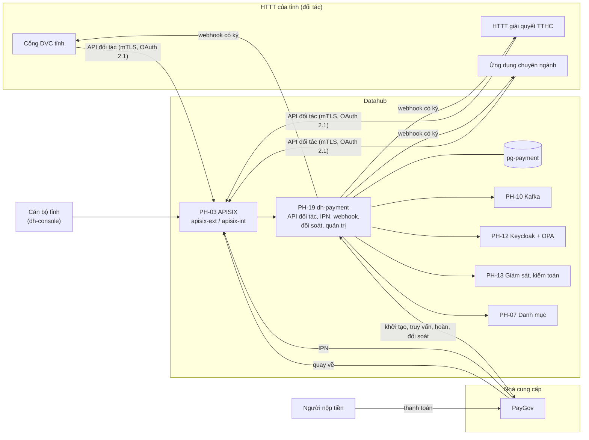
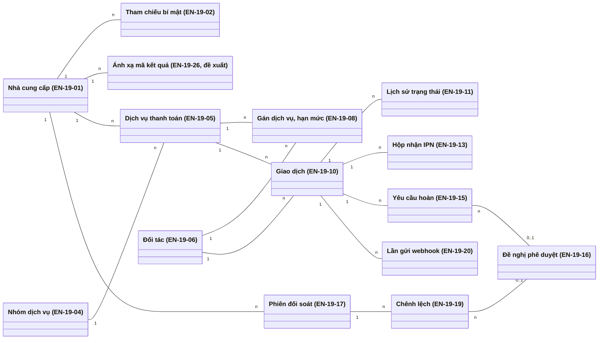
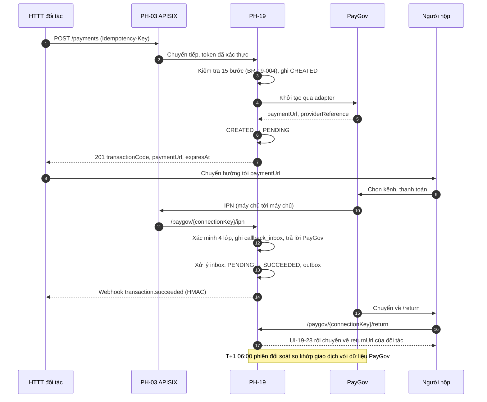

# D02-03-PH19 · Đặc tả chức năng phân hệ PH-19 Thanh toán điện tử

## Tóm tắt cho hội đồng thẩm định

PH-19 Thanh toán điện tử là lớp trung gian thanh toán của tỉnh. Các hệ thống thông tin (HTTT) của tỉnh có thu phí, lệ phí và nghĩa vụ tài chính (Cổng dịch vụ công tỉnh, HTTT giải quyết thủ tục hành chính, các ứng dụng chuyên ngành; tài liệu này gọi chung là **đối tác**) gọi vào PH-19 qua một giao diện lập trình thống nhất. PH-19 chuyển yêu cầu tới **nhà cung cấp thanh toán** (kênh đầu tiên và mặc định là PayGov, Nền tảng thanh toán của Cổng Dịch vụ công quốc gia), nhận kết quả, lưu lịch sử bất biến, báo lại cho đối tác, rồi đối soát với nhà cung cấp vào ngày làm việc kế tiếp. PH-19 **không giữ tiền và không là trung gian thanh toán** theo nghĩa pháp lý: tiền đi thẳng từ người nộp tới tài khoản thụ hưởng của cơ quan thu qua PayGov và ngân hàng. PH-19 chỉ giữ chứng cứ điện tử về yêu cầu, kết quả, hoàn tiền và đối soát.

PH-19 thay khối Payment của LGSP cũ (Viettel 2021). Hệ cũ là một "danh mục ghi nhận": khai báo nhà cung cấp, nhóm dịch vụ, dịch vụ, đối tác, ghi giao dịch và cho xem lại qua hai dashboard và màn tra cứu. Hệ cũ không xác minh kết quả gọi về, không chống ghi trùng, không đối soát, không hoàn tiền, lưu số tiền kiểu `int(10)` (trần khoảng 2,1 tỷ đồng) và ngày thanh toán kiểu chuỗi. Toàn bộ 23 chức năng hệ cũ đã kiểm kê ở D00-03 (LGC-PAY-001…023) cùng ba hành vi được đề xuất bổ sung (LGC-PAY-024…026) đều có FR phủ; không chức năng nào bị loại bỏ (mục 9.1).

Tài liệu đặc tả **69 yêu cầu chức năng** (68 FR do khung truy vết cấp và một FR đề xuất bổ sung FR-19-069 về bảng ánh xạ mã kết quả theo giả định GĐ-03), **32 yêu cầu phi chức năng** và **34 quy tắc nghiệp vụ**, chia thành 15 nhóm miền: nhà cung cấp, dịch vụ, đối tác, giao dịch, nhận kết quả (IPN), chống trùng, truy vấn trạng thái, hoàn tiền, đối soát, tra cứu, nhật ký, dashboard và báo cáo, thông báo cho đối tác, cấu hình theo tenant, di trú. Phạm vi **MVP của PH-19** (mục 9.3) gồm 58 FR, đủ để chuyển đối tác đầu tiên của tỉnh thí điểm từ hệ cũ sang Datahub; 10 FR còn lại thuộc bản tăng cường của đợt 2 hoặc sau đợt 2.

Năm điểm thiết kế chính mà hội đồng cần biết:

1. **Chỉ ba nguồn có xác thực được chốt kết quả**: thông báo kết quả từ máy chủ nhà cung cấp đã xác minh chữ ký (IPN), kết quả truy vấn nhà cung cấp qua kênh có xác thực, và quyết định xử lý chênh lệch đã qua phê duyệt bốn mắt. Việc người nộp được chuyển về trang của đối tác không bao giờ làm đổi trạng thái giao dịch (BR-19-014).
2. **Đúng một lần**: mọi yêu cầu ghi của đối tác mang khóa lũy đẳng `Idempotency-Key`; mỗi mã hồ sơ của đối tác chỉ có tối đa một giao dịch đang mở hoặc đã thành công; IPN đến nhiều lần chỉ được áp một lần (BR-19-006, 007, 015).
3. **Bộ trạng thái nội bộ, không phụ thuộc mã PayGov** (giả định GĐ-03): máy trạng thái giao dịch dùng tám trạng thái của Datahub; mã kết quả của PayGov chỉ đi vào hệ thống qua bảng ánh xạ cấu hình có phê duyệt, mã chưa biết luôn rơi về "chờ xác minh" và không bao giờ tự coi là thành công (mục 4.3, FR-19-069).
4. **Đối soát hằng ngày bắt buộc**: mỗi nhà cung cấp, mỗi ngày giao dịch có một phiên đối soát; mọi dòng lệch sinh bản ghi chênh lệch có người phụ trách và hạn xử lý; phiên chỉ chốt được khi mọi chênh lệch đã xử lý và phiên đã chốt là bất biến (BR-19-028).
5. **Tách nhiệm và an toàn**: kích hoạt nhà cung cấp, duyệt đối tác, hoàn tiền, xử lý chênh lệch, mở lại phiên đối soát, đổi chế độ định tuyến và đổi bảng ánh xạ mã đều qua phê duyệt bốn mắt; khóa ký chỉ nằm trong kho bí mật; dữ liệu cá nhân người nộp được mã hóa mức trường bằng khóa riêng của từng tenant; phân hệ chạy ở đơn vị triển khai riêng `dh-payment` với CSDL riêng `pg-payment` (chốt Q340) để vẫn thu được tiền khi khối điều khiển ngừng.

Mọi chi tiết kỹ thuật của PayGov (tên trường, thuật toán ký, cơ chế gửi lại kết quả, định dạng dữ liệu đối soát, khả năng hoàn tiền qua API) là **Giả định – cần đối chiếu Tài liệu kỹ thuật kết nối Nền tảng thanh toán của Cổng DVCQG do VPCP cấp**, được cô lập trong một bộ chuyển đổi (adapter) theo ADR-040 và gom thành nhóm câu hỏi mở OQ-19-01…08. Khi đặc tả PayGov thay đổi, chỉ adapter và bảng ánh xạ mã thay đổi; lõi nghiệp vụ, CSDL và hợp đồng API với đối tác giữ nguyên.

## 1. Mục đích, phạm vi và người đọc

### 1.1. Mục đích

Tài liệu đặc tả đầy đủ các yêu cầu chức năng (FR), yêu cầu phi chức năng (NFR) và quy tắc nghiệp vụ (BR) của PH-19 ở mức đủ để đội phát triển hiện thực và đội kiểm thử viết ca kiểm thử mà không phải hỏi lại. Theo khung truy vết D02-03-PH19-00 §16, đây là tài liệu **chủ quản** của ba loại mã FR-19, NFR-19 và BR-19: khi tài liệu khác mâu thuẫn với nội dung FR, NFR, BR ở đây thì tài liệu này đúng, trừ khi D00-01 hoặc khung truy vết quy định khác.

### 1.2. Phạm vi

Phạm vi của PH-19 theo bảng "làm / không làm" ở khung truy vết §1.2 và yêu cầu nghiệp vụ REQ-91…99 ở D02-01-PH19 §6. Tóm tắt:

| Thuộc phạm vi | Ngoài phạm vi (ai làm) |
|---|---|
| Vòng đời nhà cung cấp thanh toán, thông tin xác thực (chỉ tham chiếu kho bí mật), kiểm tra kết nối, giao dịch thử, kích hoạt có phê duyệt, giám sát sức khỏe, xoay khóa | Ký thỏa thuận kết nối với VPCP (chủ đầu tư); tích hợp trực tiếp từng ngân hàng, ví (đi qua PayGov) |
| Nhóm dịch vụ, dịch vụ thanh toán gắn với mã danh mục PH-07 | Bảng danh mục ngân hàng, kênh, lĩnh vực, loại phí, cơ quan (PH-07); tính mức phí, lệ phí (HTTT đối tác) |
| Đối tác, client máy-máy, dịch vụ được gán, hạn mức, webhook | Kết nạp HTTT nói chung (PH-01); cấp phát danh tính (PH-12) |
| Giao dịch: tạo, khởi tạo tại nhà cung cấp, quay về, IPN, truy vấn, hủy, hết hạn, lịch sử bất biến, lũy đẳng | Trang chọn ngân hàng, nhập thẻ (PayGov); lưu số thẻ, số tài khoản đầy đủ (cấm); phát hành biên lai điện tử có giá trị pháp lý (OQ-19-14) |
| Hoàn tiền có phê duyệt, chế độ API hoặc thủ công có chứng từ | Quyết định hành chính về việc hoàn phí (cơ quan thu) |
| Đối soát T+1, chênh lệch, chốt phiên, biên bản | Hạch toán kế toán, quyết toán ngân sách, đối soát ngân hàng – Kho bạc |
| Tra cứu, chi tiết, nhật ký, hai dashboard, báo cáo định kỳ, xuất tệp | Kho phân tích dài hạn, BI (PH-16) |
| Webhook có ký, sự kiện Kafka qua outbox | Gửi SMS, thư điện tử cho người nộp (đối tác) |
| Cấu hình theo tenant, RLS, khóa và chứng thư riêng từng tenant | Khởi tạo tenant, bật gói phân hệ (PH-20) |
| Di trú dữ liệu hệ cũ, chạy song song theo đối tác, đối chiếu sau di trú | Sửa mã nguồn hệ cũ; di trú người dùng (PH-12) |

### 1.3. Người đọc và cách đọc

| Người đọc | Đọc trước | Sau đó |
|---|---|---|
| Hội đồng thẩm định, chủ đầu tư | Tóm tắt, mục 2, mục 9.3 (MVP), mục 13 | D02-01-PH19 |
| Sở Tài chính, kế toán | Mục 4.4 (vòng đời giao dịch), nhóm H, I, L ở mục 5, mục 6 | D02-04-PH19 UC-19-17…21 |
| Kiến trúc sư, trưởng nhóm phát triển | Mục 4, 5, 6, 7 | D03-02-PH19 (SDD), D03-03-PH19 (CSDL), D03-04-PH19 (API) |
| Lập trình viên `dh-payment` | Mục 5.0 rồi nhóm FR được giao | SDD, API |
| Lập trình viên giao diện | Mục 12 rồi FR của màn được giao | D03-06-PH19 |
| Kiểm thử viên | Mục 5, 6, 7, 13 | D05-02-PH19 |
| Cán bộ ATTT | NFR-19-018…025, nhóm A (thông tin xác thực), E (IPN), M (webhook) | D03-07 |

### 1.4. Tài liệu liên quan

| Mã | Tài liệu | Quan hệ |
|---|---|---|
| D00-01 | Thuật ngữ và quy ước | Kiểu dữ liệu `T-*`, quy ước mã, đường dẫn REST, topic |
| D00-02 | Sổ ADR | ADR-001, 003, 004, 005, 006, 008, 011, 012, 013, 030…035; ADR-040…049 của PH-19 |
| D00-03 | Ma trận truy vết | LGC-PAY-001…023; giả định GĐ-03 |
| D02-01, D02-01-PH19 | BRD tổng và BRD thanh toán | REQ-19 và mã con REQ-91…99, BP-91…96, BO-91…96, KPI-91…99 |
| D02-02 | SRS cấp hệ thống | FR-00-*, NFR-00-*; FR-00-090…093 về di trú |
| D02-03-PH19-00 | Khung truy vết PH-19 | Cấp phát mọi mã của PH-19; máy trạng thái (§7); thực thể (§9); API (§10); lỗi (§12); quyền (§13) |
| D02-04-PH19 | Đặc tả use case | UC-19-01…29 |
| D02-08 | Ma trận phân quyền | ROLE, PERM-19-* (đề xuất từ khung §13) |
| D03-01 | SAD | DU `dh-payment`, cụm `pg-payment`, tầng phục hồi `TPH-0` |
| D03-02-PH19, D03-03-PH19, D03-04-PH19, D03-06-PH19 | SDD, CSDL, API, màn hình | Hiện thực FR của tài liệu này |
| D03-07, D03-08 | Thiết kế ATTT, hồ sơ cấp độ | Biện pháp SEC-nn cho NFR-19-018…025 |
| D03-10 | Thiết kế đa tenant | RLS, tiền tố topic, bucket, khóa theo tenant |
| D05-02-PH19 | Kịch bản và test case | TS-19-01…34 |

### 1.5. Quy ước riêng của tài liệu và điểm điều chỉnh so với khung 0.1

Tài liệu dùng nguyên quy ước của D00-01 và khung truy vết. Cột "Phát hành" của mỗi FR nhận một trong ba giá trị: **MVP** (bản phát hành đầu tiên của PH-19, đủ để chuyển đối tác đầu tiên), **Đ2b** (bản tăng cường trong đợt 2, sau MVP; mô hình dữ liệu và API đã chừa sẵn từ MVP) và **Sau** (sau đợt 2, chỉ làm khi có điều kiện ghi kèm).

Khung truy vết bản 0.1 được lập ngày 21/11/2026, trước một số quyết định ngày 25/11/2026. Tài liệu này áp các điều chỉnh dưới đây; khung được cập nhật lên bản 0.2 trong cùng đợt (khung §0 cho phép tài liệu chủ quản đề xuất, luồng PH-19 đã gộp):

| # | Điểm | Khung 0.1 | Áp dụng từ bản này | Căn cứ |
|---|---|---|---|---|
| 1 | Căn cứ ATTT | NĐ 85/2016, TT 12/2022, TCVN 11930:2017 | NĐ 331/2026/NĐ-CP (CMP-LAW-06), TCVN 14423:2026 (CMP-LAW-08); văn bản cũ ở cột kế thừa | D00-01 §7, ADR-030 |
| 2 | Căn cứ dữ liệu cá nhân | NĐ 13/2023 | Luật BVDLCN 91/2025/QH15 (CMP-LAW-05), NĐ 356/2025/NĐ-CP (CMP-LAW-04) | D00-01 §7 |
| 3 | Kết nối, chia sẻ dữ liệu | NĐ 47/2020 | NĐ 278/2025/NĐ-CP (CMP-LAW-03) | D00-01 §7 |
| 4 | Lưu trữ bất biến | Garage có object lock | Garage cho tệp nghiệp vụ (bucket `dh-{tenant}-payment`); chứng cứ cần WORM (chuỗi băm hằng ngày, biên bản đã chốt, dữ liệu lưu trữ quá 24 tháng) trên Ceph RGW Object Lock chế độ compliance, bucket riêng `dh-{tenant}-payment-worm` | ADR-008 (chốt Q306, Q347), ADR-031 |
| 5 | Mã hóa dữ liệu cá nhân | ADR-048 độc lập | ADR-048 chi tiết hóa ADR-032 (mã hóa envelope qua OpenBao) cho dữ liệu người nộp, thêm HMAC tìm kiếm | ADR-032 |
| 6 | Trạng thái giao dịch | Tám trạng thái tiếng Anh, ánh xạ mã PayGov qua danh mục PH-07 `DM_MA_LOI_NCC_THANH_TOAN` | Giữ tám giá trị enum (quy ước `T-ENUM` của D00-01); bảng tương ứng với nhãn GĐ-03 ở mục 4.3; thêm cột cờ đối soát `recon_status`; ánh xạ mã nhà cung cấp qua bảng cấu hình `provider_result_mapping` (EN-19-26, đề xuất) có phê duyệt; danh mục PH-07 chỉ giữ nhãn tham khảo | GĐ-03 (D00-03 §6) |
| 7 | Đường dẫn tệp đi kèm | Thư mục `PH19/` | Thư mục chữ thường `ph19/` như PH-04, PH-07 | Thống nhất bộ tài liệu |
| 8 | Mã tenant ví dụ | `T68` | Giữ `T68` (ví dụ của D00-01); tỉnh thí điểm trong giả định GĐ-06 gọi là `T01` | D00-01 §5 |

Kiểu dữ liệu theo D00-01 §5. Tài liệu dùng thêm: `T-TXN-CODE` mã giao dịch PH-19 (BR-19-002, mẫu `^T[0-9]{2}[0-9]{6}[0-9A-HJKMNP-TV-Z]{10}$`, 19 ký tự); `T-ORDER-ID` mã đơn hàng, mã hồ sơ của đối tác (`varchar(64)`, mẫu `^[A-Za-z0-9._:/-]{1,64}$`); `T-IDEM-KEY` khóa lũy đẳng (16…64 ký tự `[A-Za-z0-9_-]`).

### 1.6. Căn cứ pháp lý riêng của PH-19

Căn cứ dùng chung của Datahub giữ mã của D00-01 §7. Các văn bản riêng của thanh toán do D02-01-PH19 §2.1 đề xuất ở dải `CMP-LAW-91…97` và được dẫn kèm chữ "(đề xuất)" cho tới khi gộp vào D00-01. Mọi văn bản ở bảng dưới cần đối chiếu số hiệu, hiệu lực và điều khoản với Công báo trước bản 1.0 (OQ-19-21).

| Mã | Văn bản | FR, NFR chịu chi phối | Kế thừa, chuyển tiếp |
|---|---|---|---|
| CMP-LAW-91 (đề xuất) | Nghị định 45/2020/NĐ-CP về thực hiện thủ tục hành chính trên môi trường điện tử | Nhóm D, E, M (kết quả thanh toán là một phần hồ sơ điện tử) | — |
| CMP-LAW-92 (đề xuất) | Nghị định 42/2022/NĐ-CP về cung cấp thông tin và dịch vụ công trực tuyến | Nhóm D | — |
| CMP-LAW-93 (đề xuất) | Nghị định 61/2018/NĐ-CP sửa đổi bởi Nghị định 107/2021/NĐ-CP về cơ chế một cửa | Nhóm D, J | — |
| CMP-LAW-94 (đề xuất) | Nghị định 52/2024/NĐ-CP về thanh toán không dùng tiền mặt | Phạm vi (PH-19 không giữ tiền); nhóm H | — |
| CMP-LAW-95 (đề xuất) | Luật Giao dịch điện tử số 20/2023/QH15 | FR-19-028, 029, 047, 048; NFR-19-016 | — |
| CMP-LAW-96 (đề xuất) | Thông tư 74/2022/TT-BTC hoặc văn bản thay thế; Nghị định 123/2020/NĐ-CP về hóa đơn, chứng từ | Nhóm D, H; OQ-19-14 | — |
| CMP-LAW-97 (đề xuất) | Luật Kế toán số 88/2015/QH13; Luật Lưu trữ năm 2024 | NFR-19-014, 015 | — |
| CMP-LAW-03 | Nghị định 278/2025/NĐ-CP về kết nối, chia sẻ dữ liệu | Nhóm M (sự kiện cho lớp dữ liệu dùng chung) | NĐ 47/2020/NĐ-CP |
| CMP-LAW-04, 05 | Luật BVDLCN 91/2025/QH15; Nghị định 356/2025/NĐ-CP | NFR-19-024; BR-19-031, 032; FR-19-051, 052 | NĐ 13/2023/NĐ-CP |
| CMP-LAW-06, 08 | Nghị định 331/2026/NĐ-CP; TCVN 14423:2026 | NFR-19-018…023 | NĐ 85/2016/NĐ-CP, TT 12/2022/TT-BTTTT (CMP-LAW-07), TCVN 11930:2017 |
| CMP-LAW-16 | Luật An ninh mạng số 116/2025/QH15 | NFR-19-014, 015 (lưu trữ trong nước) | Luật ANM 2018, Luật ATTT mạng 2015 |

## 2. Bối cảnh nghiệp vụ

### 2.1. Vai trò của PH-19 trong Datahub

PH-19 là phân hệ duy nhất của Datahub xử lý dòng thông tin tài chính. Nó đứng giữa ba nhóm: các HTTT đối tác của tỉnh (gọi vào để thu), các nhà cung cấp thanh toán (PayGov, sau này có thể thêm kênh khác) và cán bộ của tỉnh (quản trị, phê duyệt, kế toán, tra cứu, kiểm toán). Theo SAD D03-01 §4.2, PH-19 chạy trong đơn vị triển khai riêng `dh-payment` gồm cả phần điều khiển (API quản trị, màn hình) và phần dữ liệu (API đối tác, nhận IPN, bộ gửi webhook). Phân hệ dùng cụm CSDL riêng `pg-payment` và thuộc tầng phục hồi `TPH-0` (chốt Q340) để việc thu tiền và nhận kết quả vẫn chạy khi khối điều khiển của Datahub (`pg-core`) ngừng (NFR-00-012).

### 2.2. Hệ Payment cũ

Hệ cũ gồm năm bảng (`payment_partner`, `payment_provider`, `payment_service_group`, `payment_service`, `payment_transaction`), chạy chung một tiến trình Tomcat với khối khác, một máy chủ PostgreSQL. Các điểm yếu đã phân tích ở D02-01-PH19 §3.3 (14 điểm) là nguồn gốc của phần lớn FR mới của PH-19. Bảng sau tóm tắt cách PH-19 xử lý từng nhóm điểm yếu.

| Điểm yếu hệ cũ (D02-01-PH19 §3.3) | Cách PH-19 xử lý | FR, BR chính |
|---|---|---|
| 1. Không đối soát | Phiên đối soát T+1 theo nhà cung cấp, chênh lệch có người phụ trách, phiên chốt bất biến | FR-19-042…048; BR-19-025, 028 |
| 2. Không hoàn tiền (chỉ có ba trạng thái `REFUND_*`) | Yêu cầu hoàn có phê duyệt một hoặc hai cấp, chế độ API hoặc thủ công có chứng từ | FR-19-038…041; BR-19-022…024 |
| 3. Không bảo mật kết quả gọi về | Bốn lớp xác minh IPN; ghi nguyên văn vào hộp nhận trước khi trả lời | FR-19-029; NFR-19-020 |
| 4. Không chống ghi trùng | Khóa lũy đẳng; chỉ mục duy nhất có điều kiện theo mã đơn hàng; IPN áp đúng một lần | FR-19-030, 033, 034; BR-19-006, 007 |
| 5, 6. Số tiền `int(10)`, ngày thanh toán chuỗi | `T-MONEY` = `numeric(19,0)`, `paid_at` kiểu `T-TS`; chuyển đổi khi di trú có báo cáo dòng lỗi | FR-19-065; NFR-19-017 |
| 7. Một nhà cung cấp mã hóa cứng | Kiến trúc adapter, thêm kênh không sửa lõi | FR-19-024; NFR-19-027; ADR-040 |
| 8. Không lịch sử trạng thái | `transaction_event` bất biến, ghi cùng giao dịch CSDL | FR-19-028 |
| 9. Thông báo kết quả không tin cậy | Webhook ký HMAC, thử lại giãn dần, kéo thông báo bù, sự kiện Kafka qua outbox | FR-19-060…062 |
| 10. Không cách ly theo tỉnh | `tenant_id` và RLS `FORCE` trên mọi bảng; khóa, topic, bucket riêng | NFR-19-025 |
| 11. Bí mật trong tệp cấu hình | Chỉ lưu tham chiếu OpenBao; xoay khóa không gián đoạn | FR-19-002, 012; NFR-19-022 |
| 12. Không ràng buộc toàn vẹn | Khóa ngoại thật, mã duy nhất trong tenant, mã danh mục kiểm tra với PH-07 | FR-19-016; EN-19-* |
| 13. Số liệu chậm 10 phút, không cảnh báo | Số liệu trễ ≤ 60 giây; cảnh báo sự cố kênh ≤ 3 phút | FR-19-011, 056, 059; NFR-19-006, 026 |
| 14. Chỉ tiêu phi chức năng thấp | Sẵn sàng 99,9% cho API dữ liệu; 200 giao dịch/giây mỗi tenant | NFR-19-001…013 |

### 2.3. Yêu cầu mới không có ở hệ cũ

Ngoài phần thay thế hệ cũ, PH-19 có các năng lực mới mà BRD-PH19 yêu cầu: phê duyệt bốn mắt dùng chung cho mọi thao tác rủi ro cao (ADR-046); chế độ chạy song song từng đối tác `LEGACY` → `SHADOW` → `DATAHUB` để chuyển đổi không gián đoạn thu (ADR-049); kéo thông báo bù qua API khi webhook lỡ; bảng ánh xạ mã kết quả có phê duyệt (FR-19-069); biên bản đối soát có mã băm lưu kho bất biến; cấu hình thanh toán theo tenant có phiên bản và ngày hiệu lực.

### 2.4. Đa tenant trong PH-19

PH-19 tuân thủ D03-10. Tenant của một yêu cầu xác định theo ba cách tùy nhóm API: token người dùng (API quản trị), token client máy-máy (API đối tác), và `connectionKey` trong đường dẫn callback (API callback, vì IPN không mang token; ADR-045). Mỗi tenant có kết nối PayGov, khóa ký, chứng thư, khóa mã hóa dữ liệu cá nhân, bí mật ký webhook, bucket và tiền tố topic riêng. Một tenant được có nhiều bản ghi nhà cung cấp cùng loại `PAYGOV` (mỗi bản ghi một mã đơn vị kết nối), phục vụ giai đoạn sau sáp nhập tỉnh khi kết nối của tỉnh cũ còn hiệu lực (OQ-19-19).

## 3. Tác nhân, vai trò và quyền

### 3.1. Tác nhân

Tác nhân là người và hệ thống theo khung truy vết §1.3, §1.4. Chín vai trò (ROLE-PLATFORM_ADMIN, TENANT_ADMIN, PAYMENT_ADMIN, PAYMENT_APPROVER, PAYMENT_ACCOUNTANT, PAYMENT_OPERATOR, AUDITOR, SECURITY_OFFICER, PARTNER_SYSTEM) và 48 quyền `PERM-19-*` cùng ma trận vai trò × quyền được đề xuất cho D02-08 ở khung §13. Các FR ở mục 5 ghi quyền ở dạng rút gọn (ví dụ `provider-write` là `PERM-19-provider-write`). Người nộp tiền không đăng nhập PH-19; họ chỉ thấy trang kết quả công khai UI-19-28.

### 3.2. Tách nhiệm

Mười quy tắc tách nhiệm ở khung §13.4 áp dụng cho mọi FR có phê duyệt. Lớp động được kiểm tra ở máy chủ cho từng thao tác theo claim `sub` của PH-12, không phụ thuộc giao diện có ẩn nút hay không; vi phạm trả ERR-19-033 (403) và ghi sự kiện an ninh vào PH-13.

### 3.3. Quyền đề xuất bổ sung

FR-19-069 (đề xuất) dùng lại quyền đã có, không thêm quyền mới: lập đề nghị đổi bảng ánh xạ cần `provider-write`, quyết định đề nghị cần `provider-activate`. Loại đề nghị phê duyệt mới `RESULT_MAPPING_CHANGE` được thêm vào `approval_request.approval_type` (đề xuất bổ sung EN-19-16).

## 4. Khái niệm và mô hình nghiệp vụ

### 4.1. Mô hình khái niệm

Mô hình chia ba cụm. Cụm **cấu hình** (nhà cung cấp, nhóm dịch vụ, dịch vụ, đối tác và các bảng con) do cán bộ quản trị ghi và thay đổi chậm. Cụm **giao dịch** xoay quanh giao dịch thanh toán với lịch sử, IPN, hoàn tiền, nhật ký tích hợp và webhook; đây là cụm có khối lượng lớn. Cụm **đối soát** gắn với nhà cung cấp theo ngày. Đề nghị phê duyệt, tệp, tác vụ nền và outbox là hạ tầng nghiệp vụ dùng chung trong phân hệ. Tên bảng, cột, khóa và quan hệ chi tiết theo khung §9 và D03-03-PH19.

### 4.2. Máy trạng thái

PH-19 có chín máy trạng thái: tám máy do khung truy vết §7 chốt (nhà cung cấp, dịch vụ, đối tác, giao dịch, yêu cầu hoàn, phiên đối soát, chênh lệch, lần gửi webhook) và máy trạng thái của đề nghị phê duyệt (`PENDING` → `APPROVED`/`REJECTED`/`WITHDRAWN`/`EXPIRED`, khung §9.3 EN-19-16). Sơ đồ, bảng chuyển trạng thái, sự kiện kích hoạt và điều kiện là nội dung của khung §7; FRS không chép lại mà dẫn chiếu. Ba nguyên tắc dùng chung: (1) mọi chuyển trạng thái ngoài bảng bị từ chối với ERR-19-021; (2) mọi chuyển trạng thái ghi kiểm toán cùng giao dịch CSDL (BR-19-029); (3) với giao dịch thanh toán, mỗi chuyển trạng thái ghi thêm một dòng `transaction_event` (FR-19-028).

### 4.3. Bộ trạng thái nội bộ của giao dịch và ánh xạ mã nhà cung cấp (GĐ-03)

Giả định GĐ-03 (D00-03 §6, thay câu hỏi Q03 ngày 25/11/2026) quy định máy trạng thái giao dịch dùng bộ trạng thái **nội bộ** của Datahub, cờ đối soát tách riêng, và mã kết quả của PayGov chỉ đi vào qua bảng cấu hình. Bảng dưới là tương ứng một-một giữa nhãn của GĐ-03 và giá trị enum lưu trong CSDL, API, sự kiện. Giá trị enum giữ tiếng Anh viết hoa theo quy ước `T-ENUM` của D00-01 §5 để thống nhất với các phân hệ khác; nhãn tiếng Việt là nhãn hiển thị trên giao diện và báo cáo.

| Nhãn GĐ-03 | Enum `payment_transaction.status` | Nhãn hiển thị | Nhóm | Kết thúc? |
|---|---|---|---|---|
| `KHOI_TAO` | `CREATED` | Khởi tạo | Đang xử lý | Không |
| `CHO_THANH_TOAN` | `PENDING` | Chờ thanh toán | Đang xử lý | Không |
| `THANH_CONG` | `SUCCEEDED` | Thành công | Kết thúc | Có |
| `THAT_BAI` | `FAILED` | Thất bại | Kết thúc mềm | Có (có thể đảo qua xử lý chênh lệch) |
| `HET_HAN` | `EXPIRED` | Hết hạn | Kết thúc mềm | Có (có thể thanh toán muộn) |
| `DA_HUY` | `CANCELLED` | Đã hủy | Kết thúc mềm | Có (có thể thanh toán muộn) |
| `HOAN_TIEN_MOT_PHAN` | `PARTIALLY_REFUNDED` | Đã hoàn một phần | Sau hoàn tiền | Không |
| `HOAN_TIEN_TOAN_PHAN` | `REFUNDED` | Đã hoàn toàn phần | Sau hoàn tiền | Có |

| Nhãn GĐ-03 | Enum `payment_transaction.recon_status` (đề xuất bổ sung EN-19-10) | Ý nghĩa |
|---|---|---|
| `CHUA_DOI_SOAT` | `UNRECONCILED` | Giao dịch chưa thuộc phiên đối soát đã so khớp, hoặc chưa có kết quả cuối |
| `KHOP` | `MATCHED` | Dòng đối soát của giao dịch ở lần chạy mới nhất là `MATCHED`, hoặc chênh lệch của nó đã `RESOLVED` |
| `LECH` | `MISMATCHED` | Giao dịch có chênh lệch chưa `RESOLVED` |

Cờ `recon_status` do hệ thống cập nhật khi so khớp (FR-19-044) và khi chênh lệch chuyển `RESOLVED` (FR-19-046); người dùng không sửa được. Cờ dùng để lọc ở màn tra cứu (bộ lọc "có chênh lệch" của FR-19-050) và cho đối tác biết giao dịch đã được đối soát chưa.

**Ánh xạ mã kết quả nhà cung cấp.** Mỗi kết quả nhà cung cấp trả về (khởi tạo, IPN, truy vấn, hoàn tiền, dòng đối soát) mang một mã kết quả của nhà cung cấp. Adapter không tự diễn giải mã này; nó tra bảng `provider_result_mapping` (EN-19-26, đề xuất) theo bộ (nhà cung cấp, thao tác, mã) để lấy **kết cục nội bộ** thuộc một trong bốn giá trị:

| Kết cục nội bộ | Hành vi của lõi |
|---|---|
| `SUCCEEDED` | Áp như thành công theo BR-19-015 (kiểm tra số tiền, tham chiếu) |
| `FAILED` | Áp như thất bại; lưu mã lý do đã ánh xạ |
| `PENDING` | Chưa có kết quả cuối; giữ nguyên trạng thái, tiếp tục lịch truy vấn BR-19-016 |
| `UNKNOWN` | Mã không có trong bảng, hoặc dòng ánh xạ ghi `UNKNOWN`: **chờ xác minh**. Giữ nguyên trạng thái, đặt `needs_reconciliation = true`, đánh dấu bản ghi IPN `QUARANTINED` với ERR-19-028, phát cảnh báo "mã kết quả chưa biết" tới PH-13, tiếp tục truy vấn. Không bao giờ coi là thành công |

Bảng ánh xạ được nạp mặc định theo loại adapter khi khai báo nhà cung cấp và chỉ được đổi qua đề nghị phê duyệt bốn mắt (FR-19-069). Danh mục `DM_MA_LOI_NCC_THANH_TOAN` của PH-07 (khung §1.5) không còn là nguồn ánh xạ lúc chạy, chỉ giữ nhãn tham khảo dùng chung giữa các tỉnh; lý do là máy trạng thái tài chính không được phụ thuộc vào một phân hệ khác lúc chạy và mỗi lần đổi ánh xạ phải có phê duyệt của chính tỉnh. Khi có tài liệu kỹ thuật PayGov, chỉ điền bảng ánh xạ; máy trạng thái chỉ đổi khi PayGov có trạng thái không quy được về bốn kết cục trên (GĐ-03, cách cập nhật).

### 4.4. Vòng đời một khoản thu

### 4.5. Thuật ngữ bổ sung

| Thuật ngữ | Nghĩa trong PH-19 |
|---|---|
| Đối tác | HTTT của tỉnh được phép gọi PH-19 để thu tiền; một đối tác gắn với một HTTT thành viên của PH-01 |
| Nhà cung cấp (NCC) | Một kết nối tới một nền tảng thanh toán (PayGov là loại `PAYGOV`); một tenant có thể có nhiều kết nối cùng loại |
| Adapter | Thành phần dịch giữa mô hình nội bộ và đặc tả của một loại nhà cung cấp (lớp chống nhiễm, ADR-040) |
| IPN | Thông báo kết quả do máy chủ nhà cung cấp gửi tới máy chủ PH-19 (Instant Payment Notification) |
| Lượt quay về | Việc trình duyệt của người nộp được nhà cung cấp chuyển về PH-19 sau khi thanh toán; chỉ để hiển thị |
| Kết thúc mềm | Trạng thái kết thúc không thành công (`FAILED`, `CANCELLED`, `EXPIRED`) mà về sau vẫn có thể chuyển `SUCCEEDED` theo BR-19-015, 018 |
| Thanh toán muộn | Kết quả thành công hợp lệ đến sau khi giao dịch đã `CANCELLED` hoặc `EXPIRED` (BR-19-018) |
| Phiên đối soát | Việc so khớp dữ liệu của một nhà cung cấp cho một ngày giao dịch; có số lần chạy `run_no` |
| Chênh lệch | Một dòng không khớp giữa hai phía, hoặc một IPN bất thường; có vòng đời và người phụ trách |
| Bốn mắt | Người quyết định một đề nghị phải khác người lập (BR-19-011) |
| Chế độ định tuyến | Trạng thái chuyển đổi của một đối tác: `LEGACY`, `SHADOW`, `DATAHUB` (BR-19-034) |
| `connectionKey` | Khóa ngẫu nhiên 32 ký tự của một bản ghi nhà cung cấp, nằm trong đường dẫn callback để xác định tenant và kết nối (ADR-045) |

## 5. Đặc tả chi tiết yêu cầu chức năng

### 5.0. Cách đọc đặc tả và quy định chung cho mọi FR

Mỗi FR gồm một đoạn mở đầu nêu mục đích và chức năng hệ cũ tương ứng, một bảng tóm tắt theo mẫu D00-01 §4.3, bảng đầu vào khi FR có đầu vào đáng kể, các bước xử lý đánh số và bảng ngoại lệ. Cột "Truy vết" ghi theo thứ tự REQ con, LGC, BR, UC, API, UI, EN, TS. Các quy định chung dưới đây áp dụng cho mọi FR và không lặp lại.

**Tenant và phạm vi dữ liệu.** Tenant lấy từ ngữ cảnh xác thực (token người dùng, token client hoặc `connectionKey`), không lấy từ tham số do bên gọi gửi (FR-00-010). Mọi truy vấn chạy dưới RLS với `app.tenant_id` của phiên CSDL. Với API đối tác, mọi truy vấn còn bị giới hạn trong dữ liệu của chính đối tác gắn với client. Đối tượng nằm ngoài phạm vi trả ERR-19-020 (404) thay vì 403 để không lộ sự tồn tại (FR-00-011).

**Phân hệ chưa bật.** Khi PH-20 chưa bật hoặc đã tạm ngừng PH-19 cho tenant (cờ `module_enabled` của EN-19-22 là `false`), mọi API ghi của nhóm quản trị và đối tác trả ERR-19-049 (503); API đọc của nhóm quản trị vẫn chạy để tra cứu và đối soát dữ liệu dở; nhóm callback vẫn nhận IPN cho giao dịch đã tạo (FR-19-064).

**Lũy đẳng và khóa lạc quan.** Mọi `POST` của nhóm đối tác bắt buộc `Idempotency-Key` theo BR-19-006. Mọi `POST` tạo mới của nhóm quản trị nhận `Idempotency-Key` tùy chọn với cùng quy tắc. Mọi `PATCH`, `PUT`, `DELETE` và thao tác đổi trạng thái của nhóm quản trị bắt buộc `If-Match` chứa ETag (`W/"{version}"`); không khớp trả ERR-19-045 (412), thiếu trả ERR-19-001 (400) với lỗi trường `If-Match`.

**Lỗi.** Lỗi trả theo RFC 9457 (`application/problem+json`) với `type`, `title`, `status`, `detail` tiếng Việt, `instance`, `code` (`ERR-19-nnn`), `traceId`; lỗi trường thêm mảng `errors` gồm `{field, code, message}`. Thông điệp nói rõ sai gì và sửa thế nào (FR-00-080), không chứa dữ liệu cá nhân, bí mật hay thông tin nội bộ. Bảng mã lỗi chính thức ở khung §12 và D03-04-PH19 §6.

**Kiểm toán.** Mọi thao tác ghi của người dùng và mọi quyết định phê duyệt ghi bản ghi kiểm toán vào `outbox_event` trong cùng giao dịch CSDL với thay đổi nghiệp vụ (BR-19-029), gồm: thời điểm, tenant, chủ thể (`sub`), địa chỉ nguồn, hành động, loại và mã đối tượng, giá trị trước và sau của các trường thay đổi (đã che bí mật và dữ liệu cá nhân), kết quả, lý do, `traceId`. Không ghi được bản ghi kiểm toán thì toàn bộ thao tác bị hủy và trả ERR-19-050. Cột "Kiểm toán" của từng FR chỉ ghi phần riêng. Thao tác đọc không ghi kiểm toán, trừ xem dữ liệu cá nhân bỏ che (BR-19-031), xem nguyên văn IPN và tải tệp xuất.

**Sự kiện.** Sự kiện `EVT-19-nn` ghi vào `outbox_event` cùng giao dịch CSDL với thay đổi trạng thái và phát lên topic `{tenant}.payment.{thực-thể}.{sự-kiện}.v1` (FR-19-061). Payload không chứa dữ liệu cá nhân người nộp.

**Phê duyệt bốn mắt.** Mọi đề nghị phê duyệt dùng chung một cơ chế (EN-19-16, ADR-046): người lập tạo `approval_request` ở trạng thái `PENDING` với `payload` chứa nội dung đề nghị và ảnh chụp bằng chứng tại thời điểm lập; người quyết định gọi API-19-050; người quyết định khác người lập (BR-19-011); đề nghị quá hạn 7 ngày tự chuyển `EXPIRED` và đối tượng trở về trạng thái trước; mỗi đối tượng có tối đa một đề nghị `PENDING` cùng loại. Hệ thống kiểm tra lại điều kiện nghiệp vụ tại thời điểm quyết định (ví dụ checklist kích hoạt vẫn đạt), không chỉ tại thời điểm lập.

**Số tiền và thời gian.** Số tiền là `T-MONEY` (số nguyên đồng, không dùng số thực ở bất kỳ tầng nào; JSON dùng số nguyên, giao diện dùng chuỗi hoặc `BigInt`). Thời điểm lưu UTC (`T-TS`); "ngày" nghiệp vụ (hạn mức ngày, ngày giao dịch đối soát, báo cáo) tính theo giờ Việt Nam UTC+7 (BR-19-025, NFR-19-028).

**Phân trang.** Danh sách của nhóm quản trị dùng phân trang con trỏ `cursor`, `limit` (mặc định 20, tối đa 200), sắp xếp `sort` theo danh sách trường cho phép của từng API; trả `items[]`, `page.next`, `page.hasMore` và, khi bên gọi yêu cầu `withTotal=true`, `page.total` (đếm có giới hạn 100.000, vượt thì trả `100000+`).

**Tham số cấu hình.** Tham số có tiền tố `19.` là khóa trong `tenant_payment_config.settings` (EN-19-22), sửa tại UI-19-26 theo FR-19-063; bảng tham số đầy đủ ở mục 7.1.

### 5.1. Nhóm A — Nhà cung cấp thanh toán

#### FR-19-001 · Khai báo nhà cung cấp

Thay chức năng "Thêm nhà cung cấp" của hệ cũ (LGC-PAY-001, phần khai báo). Quản trị thanh toán tạo một bản ghi kết nối tới một nhà cung cấp ở trạng thái `DRAFT`. Bản ghi `DRAFT` chưa thu được tiền; nó chỉ là nơi gắn thông tin xác thực, chạy kiểm tra và giao dịch thử trước khi đề nghị kích hoạt.

| Trường | Nội dung |
|---|---|
| Mức ưu tiên, phát hành | M · MVP |
| Truy vết | REQ-91; LGC-PAY-001; BR-19-027; UC-19-01; API-19-002; UI-19-05; EN-19-01; TS-19-01 |
| Tác nhân, quyền | Quản trị thanh toán · `provider-write` |
| Tiền điều kiện | Phân hệ bật cho tenant; loại adapter đã được cài trên nền tảng (`ROLE-PLATFORM_ADMIN` cài, danh sách đọc từ cấu hình triển khai) |
| Đầu ra | Bản ghi NCC `DRAFT` với `id`, `connectionKey` (chỉ hiển thị dạng che `ab12…9f`, xem đầy đủ cần `credential-manage`), ETag; bảng ánh xạ mã kết quả mặc định của adapter (FR-19-069) |
| Hậu điều kiện | `status = DRAFT`, `health_status = UNKNOWN`, `circuit_state = CLOSED`, `capabilities` lấy từ khai báo của adapter |
| Sự kiện, kiểm toán | Kiểm toán `PROVIDER_CREATE`; không phát sự kiện (EVT-19-01 chỉ phát khi đổi trạng thái) |

| Trường đầu vào | Kiểu | Bắt buộc | Ràng buộc | Ví dụ |
|---|---|---|---|---|
| `code` | T-CODE | Có | Duy nhất trong tenant, bất biến sau khi tạo; chuyển chữ hoa | `PAYGOV-T68` |
| `name` | T-NAME | Có | 3…255 ký tự | `PayGov – kết nối tỉnh T68` |
| `adapterType` | T-ENUM | Có | Thuộc danh sách adapter đã cài: `PAYGOV`, `MOCK`; `MOCK` chỉ cho phép ở tenant có cờ môi trường thử | `PAYGOV` |
| `sandboxBaseUrl`, `productionBaseUrl` | T-URI | Không | `https`; không trỏ địa chỉ nội bộ, riêng, loopback; tên miền thuộc danh sách egress của DU (NFR-19-018) | |
| `merchantRef` | T-CODE | Không | Mã đơn vị kết nối do NCC cấp (giả định, OQ-19-08) | `T68-PG-001` |
| `refundMode` | T-ENUM | Không | `API` chỉ khi `capabilities.refund = true`; mặc định `MANUAL` | `MANUAL` |
| `effectiveFrom` | T-DATE | Không | Ngày bắt đầu hiệu lực (hệ cũ "ngày bắt đầu") | `2027-01-01` |
| `techContact`, `bizContact` | đối tượng `{name, phone, email}` | Không | T-NAME, T-PHONE (E.164), T-EMAIL | |
| `description` | T-TEXT | Không | ≤ 4.000 ký tự | |

Xử lý gồm các bước sau.

1. Hệ thống kiểm tra quyền, trạng thái phân hệ, định dạng trường; sai trả ERR-19-001 với `errors`.
2. Hệ thống chuẩn hóa `code` thành chữ hoa và kiểm tra trùng trong tenant (ERR-19-038).
3. Hệ thống kiểm tra `adapterType` có trong danh sách đã cài và `refundMode` phù hợp năng lực adapter.
4. Hệ thống sinh `connectionKey` 32 ký tự Base32 Crockford từ nguồn ngẫu nhiên mật mã (160 bit), kiểm tra duy nhất toàn cục (ADR-045).
5. Hệ thống ghi bản ghi, sao chép bảng ánh xạ mã mặc định của adapter vào `provider_result_mapping` với `mapping_version = 1`, ghi kiểm toán trong cùng giao dịch CSDL.
6. Hệ thống trả 201 kèm `Location` và ETag.

| Điều kiện | Mã lỗi | HTTP |
|---|---|---|
| Trường sai định dạng, thiếu trường bắt buộc | ERR-19-001 | 400 |
| Mã đã tồn tại | ERR-19-038 | 409 |
| Địa chỉ không phải `https` hoặc trỏ địa chỉ nội bộ | ERR-19-001 | 400 |
| Loại adapter chưa cài, hoặc `MOCK` ở tenant chính thức | ERR-19-001 | 400 |
| `refundMode = API` khi adapter không hỗ trợ hoàn | ERR-19-032 | 422 |

#### FR-19-002 · Gắn thông tin xác thực nhà cung cấp

Thay việc sửa `username`, `password` trong tệp cấu hình rồi khởi động lại Tomcat của hệ cũ (điểm yếu 11). Mỗi NCC có tham chiếu bí mật theo môi trường (`SANDBOX`, `PRODUCTION`) và mục đích (`SIGNING_KEY`, `VERIFY_CERT`, `MTLS_CLIENT_CERT`, `API_CREDENTIAL`). Giá trị bí mật do cán bộ ATTT nạp thẳng vào OpenBao qua quy trình của D03-07; PH-19 chỉ lưu đường dẫn, dấu vân tay và hạn dùng.

| Trường | Nội dung |
|---|---|
| Mức ưu tiên, phát hành | M · MVP |
| Truy vết | REQ-91, REQ-98; LGC-PAY-001, 004; BR-19-010, 026; UC-19-01; API-19-006, 007; UI-19-04 (tab Thông tin xác thực); EN-19-02; TS-19-01, 34 |
| Tác nhân, quyền | Cán bộ ATTT, quản trị thanh toán · `credential-manage` (gắn), `provider-read` (xem siêu dữ liệu) |
| Tiền điều kiện | NCC ở `DRAFT`, `ACTIVE` hoặc `SUSPENDED`; bí mật đã có tại đường dẫn OpenBao `kv/dh/{tenant}/payment/{providerCode}/{environment}/{purpose}` |
| Đầu ra | Danh sách tham chiếu theo môi trường và mục đích: `secretRef`, `fingerprint`, `validFrom`, `validTo`, `credentialStatus`, số ngày còn hạn; không bao giờ có giá trị bí mật |
| Hậu điều kiện | Với NCC `DRAFT`: bản ghi `ACTIVE` mới thay bản cũ (bản cũ `RETIRED`). Với NCC `ACTIVE`: thay đổi đi vào `pending_change`, chỉ có hiệu lực sau khi kiểm tra kết nối với giá trị mới đạt (BR-19-026) |
| Sự kiện, kiểm toán | Kiểm toán `PROVIDER_CREDENTIAL_BIND` ghi đường dẫn và dấu vân tay, không ghi giá trị |

| Trường đầu vào (theo từng mục đích) | Kiểu | Bắt buộc | Ràng buộc |
|---|---|---|---|
| `{environment}` (đường dẫn) | T-ENUM | Có | `SANDBOX`, `PRODUCTION` |
| `items[].purpose` | T-ENUM | Có | Bốn mục đích ở trên; adapter khai mục đích nào là bắt buộc |
| `items[].secretRef` | T-SECRET-REF | Có | Bắt đầu bằng `kv/dh/{tenant}/payment/` của đúng tenant; không chứa ký tự điều khiển |

Xử lý gồm các bước sau.

1. Hệ thống kiểm tra tiền tố đường dẫn thuộc đúng tenant (chống trỏ sang bí mật của tenant khác); sai trả ERR-19-001.
2. Hệ thống gọi OpenBao bằng danh tính của DU `dh-payment` (chỉ quyền đọc siêu dữ liệu và đọc khóa công khai, không đọc khóa riêng) để xác nhận đường dẫn tồn tại; với chứng thư, đọc chứng thư công khai để tính dấu vân tay SHA-256 và hạn dùng.
3. Không xác nhận được (đường dẫn không tồn tại, chứng thư hết hạn hoặc còn dưới 30 ngày với `PRODUCTION`) thì trả ERR-19-022, `detail` nêu mục đích và lý do.
4. Với NCC `DRAFT`, ghi bản ghi `ACTIVE`, chuyển bản cũ cùng mục đích sang `RETIRED`. Với NCC `ACTIVE`, `SUSPENDED`, ghi bản ghi `NEXT` và đặt `pending_change.credentials`; bản `NEXT` chỉ được dùng cho kiểm tra kết nối cho tới khi đạt (FR-19-003), khi đạt thì hệ thống đổi `NEXT` thành `ACTIVE` và bản cũ thành `RETIRED` trong một giao dịch.
5. Ghi kiểm toán, trả danh sách tham chiếu.

| Điều kiện | Mã lỗi | HTTP |
|---|---|---|
| Đường dẫn sai tenant, sai định dạng | ERR-19-001 | 400 |
| Bí mật không tồn tại, chứng thư hết hạn hoặc sắp hết hạn | ERR-19-022 | 422 |
| NCC `PENDING_ACTIVATION` hoặc `RETIRED` | ERR-19-021 | 409 |
| Đã có bản `NEXT` đang chờ cho cùng mục đích | ERR-19-021 | 409 |

#### FR-19-003 · Kiểm tra kết nối nhà cung cấp

Thay bước "liên kết API, kiểm tra phản hồi" khi thêm và kích hoạt NCC của hệ cũ (LGC-PAY-001, 007). Phép kiểm tra chạy từng bước và lưu kết quả từng bước làm bằng chứng cho checklist kích hoạt.

| Trường | Nội dung |
|---|---|
| Mức ưu tiên, phát hành | M · MVP |
| Truy vết | REQ-91; LGC-PAY-001, 007; BR-19-010, 026; UC-19-02; API-19-009, 011; UI-19-06, UI-19-04; EN-19-03; TS-19-02 |
| Tác nhân, quyền | Quản trị thanh toán · `provider-test` |
| Tiền điều kiện | NCC không ở `RETIRED`; có đủ tham chiếu bí mật bắt buộc của môi trường được chọn (FR-19-002) |
| Đầu vào | `environment` (`SANDBOX` hoặc `PRODUCTION`); `useNextCredentials` (T-BOOL, mặc định `true` khi có `pending_change`) |
| Đầu ra | Bản ghi `provider_check_run` loại `CONNECTION` với `steps[]`: `DNS`, `TLS_HANDSHAKE` (phiên bản, bộ mã, hạn chứng thư máy chủ), `MTLS` (nếu dùng), `AUTH` (xác thực API), `PING` (gọi API kiểm tra của adapter); mỗi bước có `result`, `latencyMs`, `message` đã che |
| Hậu điều kiện | Khi đạt và có `pending_change`: áp thay đổi kết nối (BR-19-026) |
| Sự kiện, kiểm toán | Kiểm toán `PROVIDER_CONNECTION_TEST`; nhật ký tích hợp `HEALTH` cho từng lời gọi ra (FR-19-054) |

Xử lý gồm các bước sau.

1. Hệ thống tạo `provider_check_run` ở `RUNNING` và trả 202 kèm `Location` của lần kiểm tra; giao diện theo dõi bằng API-19-011.
2. Adapter chạy các bước theo thứ tự; bước sau chỉ chạy khi bước trước đạt. Mỗi bước có thời hạn 10 giây; toàn bộ phép kiểm tra tối đa 60 giây.
3. TLS phải đạt NFR-19-018 (TLS 1.3, hoặc 1.2 với bộ mã AEAD khi NCC chưa hỗ trợ 1.3 theo OQ-19-02); thấp hơn thì bước `TLS_HANDSHAKE` thất bại kèm lý do.
4. Kết thúc: `result = PASSED` nếu mọi bước đạt, ngược lại `FAILED`; ghi `finished_at`.
5. Nếu `PASSED`, môi trường là `PRODUCTION` và NCC có `pending_change`, hệ thống áp thay đổi trong một giao dịch: đổi địa chỉ, đổi bản `NEXT` thành `ACTIVE`, xóa `pending_change`, ghi kiểm toán `PROVIDER_CHANGE_APPLIED`.
6. Một NCC chỉ có một phép kiểm tra `RUNNING` mỗi môi trường; gọi thêm khi đang chạy trả lại lần đang chạy (200).

| Điều kiện | Mã lỗi | HTTP |
|---|---|---|
| Thiếu hoặc hết hạn thông tin xác thực bắt buộc | ERR-19-022 | 422 |
| NCC `RETIRED` | ERR-19-021 | 409 |
| Môi trường không có địa chỉ | ERR-19-001 | 400 |
| Bước kiểm tra thất bại | — | 202, kết quả `FAILED` ở bản ghi; không phải lỗi API |

#### FR-19-004 · Thực hiện giao dịch thử

Thay bước "kiểm tra luồng thanh toán thử, giao dịch mẫu" của hệ cũ (LGC-PAY-001, 007). Giao dịch thử chứng minh luồng khởi tạo → thanh toán → IPN chạy trọn vẹn với NCC trước khi kích hoạt.

| Trường | Nội dung |
|---|---|
| Mức ưu tiên, phát hành | M · MVP |
| Truy vết | REQ-91; LGC-PAY-001, 007; BR-19-010, 033; UC-19-02; API-19-010, 011; UI-19-06; EN-19-03, EN-19-10; TS-19-02 |
| Tác nhân, quyền | Quản trị thanh toán · `provider-test` |
| Tiền điều kiện | NCC `DRAFT`, `ACTIVE` hoặc `SUSPENDED`; kiểm tra kết nối của cùng môi trường đạt trong 24 giờ gần nhất |
| Đầu vào | `environment`; `amount` (T-MONEY, 1.000…100.000 đ, mặc định 10.000 đ); `description` (mặc định "Giao dịch thử kích hoạt kênh {code}") |
| Đầu ra | `provider_check_run` loại `TEST_TRANSACTION` gắn `test_transaction_id`; `paymentUrl` để người kiểm thử mở và thanh toán trên trang thử của NCC; các bước `INIT`, `PAYER_REDIRECT`, `IPN_RECEIVED`, `IPN_VERIFIED`, `QUERY_CONFIRMED` |
| Hậu điều kiện | Giao dịch có `is_test = true`, thuộc đối tác kỹ thuật ẩn `__TEST__` của tenant, không tính vào dashboard, báo cáo, hạn mức, đối soát chính thức (BR-19-033) |
| Sự kiện, kiểm toán | Kiểm toán `PROVIDER_TEST_TRANSACTION`; sự kiện giao dịch được phát với cờ `isTest = true` để PH-16 lọc |

Xử lý gồm các bước sau.

1. Hệ thống kiểm tra tiền điều kiện; thiếu kiểm tra kết nối gần đây trả ERR-19-035 kèm mục thiếu.
2. Hệ thống tạo giao dịch thử theo cùng đường xử lý của FR-19-022…024 nhưng bỏ các bước hạn mức, gán dịch vụ, chế độ định tuyến; NCC được chỉ định trực tiếp thay vì chọn theo dịch vụ.
3. Hệ thống ghi `provider_check_run` ở `RUNNING`, trả `paymentUrl`.
4. Khi IPN của giao dịch thử đến và được xác minh (FR-19-029, 030), hệ thống cập nhật bước `IPN_VERIFIED`; sau đó gọi truy vấn NCC (nếu adapter hỗ trợ) để cập nhật `QUERY_CONFIRMED`.
5. Phép thử `PASSED` khi giao dịch đạt `SUCCEEDED` qua IPN hợp lệ; `FAILED` khi giao dịch `FAILED`, `EXPIRED` hoặc sau 30 phút chưa có IPN.
6. Giao dịch thử không được hoàn tiền (ERR-19-029) và không được đưa vào phiên đối soát chính thức; nếu NCC đưa giao dịch thử vào dữ liệu đối soát thì dòng đó được đánh dấu `TEST` và bỏ qua khi so khớp.

| Điều kiện | Mã lỗi | HTTP |
|---|---|---|
| Kiểm tra kết nối chưa đạt trong 24 giờ | ERR-19-035 | 422 |
| Số tiền ngoài 1.000…100.000 đ | ERR-19-010 | 422 |
| NCC `RETIRED` hoặc `PENDING_ACTIVATION` | ERR-19-021 | 409 |
| Mạch ngắt đang mở | ERR-19-017 | 503 |

#### FR-19-005 · Kích hoạt nhà cung cấp có phê duyệt

Thay chức năng "Kích hoạt nhà cung cấp" (LGC-PAY-007) và nguyên tắc "đưa vào danh sách khi thử thành công" của hệ cũ (LGC-PAY-001), bổ sung phê duyệt bốn mắt.

| Trường | Nội dung |
|---|---|
| Mức ưu tiên, phát hành | M · MVP |
| Truy vết | REQ-91; LGC-PAY-001, 007; BR-19-010, 011; UC-19-03; API-19-011, 012, 048…050; UI-19-06, UI-19-13; EN-19-01, 03, 16; TS-19-03, 33 |
| Tác nhân, quyền | Quản trị thanh toán · `provider-write` (lập đề nghị); người phê duyệt thanh toán · `provider-activate` (quyết định) |
| Tiền điều kiện | NCC `DRAFT`; checklist kích hoạt đạt (BR-19-010) |
| Đầu vào | Đề nghị: `action = ACTIVATE`, `note` (10…1.000 ký tự). Quyết định: `decision` ∈ {`APPROVE`, `REJECT`, `WITHDRAW`}, `note` (bắt buộc khi `REJECT`) |
| Đầu ra | `approval_request` loại `PROVIDER_ACTIVATE` với `payload.checklist` (ảnh chụp bốn điều kiện kèm mã lần kiểm tra, thời điểm, kết quả) |
| Hậu điều kiện | Lập đề nghị: NCC `PENDING_ACTIVATION`, không sửa được địa chỉ, thông tin xác thực. Duyệt: NCC `ACTIVE`, bắt đầu kiểm tra sức khỏe (FR-19-011), phiên đối soát tự động từ ngày kế tiếp (FR-19-042). Từ chối, rút, hết hạn: NCC về `DRAFT` |
| Sự kiện, kiểm toán | Kiểm toán `APPROVAL_REQUEST_CREATE`, `APPROVAL_DECISION`; EVT-19-01 khi NCC đổi trạng thái |

Checklist kích hoạt (BR-19-010) gồm bốn mục, mỗi mục có kết quả `PASSED`/`FAILED` và bằng chứng:

| Mục | Điều kiện đạt | Bằng chứng |
|---|---|---|
| C1 Kết nối chính thức | `provider_check_run` loại `CONNECTION`, môi trường `PRODUCTION`, `PASSED`, trong 24 giờ gần nhất | Mã lần kiểm tra, thời điểm, các bước |
| C2 Giao dịch thử | `provider_check_run` loại `TEST_TRANSACTION`, `PASSED`, có IPN hợp lệ, trong 7 ngày gần nhất (môi trường do adapter quy định: PayGov giả định là `SANDBOX`, OQ-19-08) | Mã giao dịch thử, mã IPN |
| C3 Thông tin xác thực | Mọi mục đích bắt buộc của `PRODUCTION` có bản `ACTIVE` còn hạn ≥ 30 ngày | Dấu vân tay, ngày hết hạn |
| C4 Đầu mối | Có đủ tên và một kênh liên lạc của đầu mối kỹ thuật và đầu mối nghiệp vụ | Tên đầu mối |

Xử lý gồm các bước sau.

1. Người lập gọi API-19-012 với `action = ACTIVATE`. Hệ thống tính checklist; mục nào không đạt thì trả ERR-19-035 với `detail` và `errors` liệt kê từng mục thiếu.
2. Hệ thống tạo `approval_request` (`required_approvals = 1`, `expires_at = now + 7 ngày`), chụp checklist vào `payload`, chuyển NCC sang `PENDING_ACTIVATION` trong cùng giao dịch CSDL.
3. Người phê duyệt mở đề nghị ở UI-19-13, xem bằng chứng và gọi API-19-050.
4. Với `APPROVE`: hệ thống kiểm tra người quyết định ≠ người lập (ERR-19-033), đề nghị còn `PENDING` (ERR-19-034), **tính lại checklist** tại thời điểm duyệt; không đạt thì từ chối quyết định với ERR-19-035 và giữ đề nghị `PENDING`. Đạt thì chuyển NCC `ACTIVE`, đề nghị `APPROVED`.
5. Với `REJECT` (người phê duyệt) hoặc `WITHDRAW` (chỉ người lập): đề nghị `REJECTED` hoặc `WITHDRAWN`, NCC về `DRAFT`.
6. Tác vụ nền mỗi 15 phút chuyển đề nghị quá hạn sang `EXPIRED` và NCC về `DRAFT`.

| Điều kiện | Mã lỗi | HTTP |
|---|---|---|
| Checklist không đạt khi lập hoặc khi duyệt | ERR-19-035 | 422 |
| Người duyệt trùng người lập | ERR-19-033 | 403 |
| Đề nghị không còn `PENDING` | ERR-19-034 | 409 |
| NCC không ở `DRAFT` khi lập | ERR-19-021 | 409 |
| Đã có đề nghị `PENDING` cùng loại | ERR-19-021 | 409 |
| Người rút không phải người lập | ERR-19-046 | 403 |

#### FR-19-006 · Tạm dừng và mở lại nhà cung cấp

Thay chức năng "Dừng nhà cung cấp" của hệ cũ (LGC-PAY-008), bổ sung nguyên tắc xử lý giao dịch dở. Tạm dừng không cần phê duyệt để phản ứng nhanh khi có sự cố hoặc nghi lộ khóa; cán bộ ATTT cũng được tạm dừng khẩn cấp.

| Trường | Nội dung |
|---|---|
| Mức ưu tiên, phát hành | M · MVP |
| Truy vết | REQ-91; LGC-PAY-008; BR-19-009, 013; UC-19-04; API-19-013, 014; UI-19-04; EN-19-01; TS-19-04 |
| Tác nhân, quyền | Quản trị thanh toán, cán bộ ATTT · `provider-suspend` |
| Tiền điều kiện | Tạm dừng: NCC `ACTIVE`. Mở lại: NCC `SUSPENDED`, có kiểm tra kết nối `PRODUCTION` `PASSED` trong 1 giờ gần nhất |
| Đầu vào | `reason` (10…1.000 ký tự); `reasonCode` ∈ {`INCIDENT`, `MAINTENANCE`, `SECURITY`, `CONTRACT`, `OTHER`} |
| Đầu ra | NCC với trạng thái mới, ETag mới |
| Hậu điều kiện | Khi `SUSPENDED`: yêu cầu tạo giao dịch mới cho mọi dịch vụ của NCC bị từ chối với ERR-19-017 trước khi ghi CSDL; IPN, truy vấn chủ động, hủy, hoàn tiền đang dở và đối soát vẫn chạy; kiểm tra sức khỏe vẫn chạy. Trạng thái dịch vụ không đổi (BR-19-009) |
| Sự kiện, kiểm toán | EVT-19-01; kiểm toán `PROVIDER_SUSPEND`, `PROVIDER_RESUME` kèm lý do; khi `reasonCode = SECURITY` phát thêm sự kiện an ninh tới PH-13 |

Xử lý gồm các bước sau.

1. Hệ thống kiểm tra trạng thái theo máy trạng thái khung §7.1 (ERR-19-021).
2. Tạm dừng: chuyển `SUSPENDED`, xóa bộ đệm "NCC hoạt động" của các dịch vụ liên quan trong Valkey để mọi bản sao thấy ngay (≤ 1 giây).
3. Mở lại: kiểm tra có lần kiểm tra kết nối đạt trong 1 giờ; không có trả ERR-19-035 kèm gợi ý chạy kiểm tra; có thì chuyển `ACTIVE`.
4. Ghi kiểm toán và outbox trong cùng giao dịch CSDL.

| Điều kiện | Mã lỗi | HTTP |
|---|---|---|
| Trạng thái không cho phép | ERR-19-021 | 409 |
| Mở lại khi chưa kiểm tra kết nối trong 1 giờ | ERR-19-035 | 422 |
| ETag không khớp | ERR-19-045 | 412 |

#### FR-19-007 · Danh sách, tìm kiếm, sắp xếp nhà cung cấp

Giữ nguyên chức năng "Xem danh sách" và "Tìm kiếm nhà cung cấp" của hệ cũ (LGC-PAY-002, 006), bổ sung lọc theo trạng thái và sức khỏe.

| Trường | Nội dung |
|---|---|
| Mức ưu tiên, phát hành | M · MVP |
| Truy vết | REQ-91; LGC-PAY-002, 006; UC-19-05; API-19-001; UI-19-03; EN-19-01; TS-19-05 |
| Tác nhân, quyền | Mọi vai trò thanh toán · `provider-read` |
| Đầu ra | `items[]`: `id`, `code`, `name`, `adapterType`, `status`, `healthStatus`, `circuitState`, `effectiveFrom`, số dịch vụ `ACTIVE`, số giao dịch hôm nay, ngày hết hạn chứng thư sớm nhất, `hasPendingChange`, `allowedActions`; `facets` đếm theo `status`, `healthStatus` |
| Hậu điều kiện, sự kiện, kiểm toán | Không |

| Tham số | Kiểu | Ràng buộc |
|---|---|---|
| `q` | chuỗi | 1…100 ký tự; tìm không dấu trên `code`, `name` |
| `status` | T-ENUM[] | Mặc định mọi trạng thái trừ `RETIRED` |
| `healthStatus` | T-ENUM[] | `UNKNOWN`, `HEALTHY`, `DEGRADED`, `DOWN` |
| `adapterType` | T-ENUM[] | |
| `sort` | chuỗi | `code`, `name`, `status`, `healthStatus`, `effectiveFrom`, `updatedAt` kèm `,asc`/`,desc`; mặc định `name,asc` |
| `cursor`, `limit` | | Theo mục 5.0 |

Xử lý: hệ thống kiểm tra tham số (ERR-19-001), lọc dưới RLS, tính `facets` trên tập trước phân trang, tính `allowedActions` theo quyền và trạng thái (khung §7.1), trả trang kết quả. Số giao dịch hôm nay lấy từ bộ đếm dashboard (FR-19-056), không đếm trực tiếp bảng giao dịch.

#### FR-19-008 · Xem chi tiết nhà cung cấp

Giữ nguyên chức năng "Xem chi tiết nhà cung cấp" của hệ cũ (LGC-PAY-003: ngày bắt đầu, đầu mối, điện thoại, tình trạng, số dịch vụ, biểu đồ giao dịch theo ngày), bổ sung sức khỏe, mạch ngắt, hạn chứng thư, lịch sử thay đổi và kết quả kiểm tra gần nhất.

| Trường | Nội dung |
|---|---|
| Mức ưu tiên, phát hành | M · MVP |
| Truy vết | REQ-91; LGC-PAY-003; UC-19-05; API-19-003, 006, 011, 091; UI-19-04; EN-19-01, 02, 03, 26; TS-19-05 |
| Tác nhân, quyền | Mọi vai trò thanh toán · `provider-read` |
| Đầu ra | Mọi trường của EN-19-01 (trừ `connectionKey` đầy đủ); `capabilities`; `pendingChange` (nếu có); sức khỏe gồm `healthStatus`, `healthCheckedAt`, `circuitState`, tỷ lệ lỗi và độ trễ p95 trong 15 phút; danh sách dịch vụ gắn NCC; tham chiếu bí mật (siêu dữ liệu); 10 lần kiểm tra gần nhất; trạng thái checklist kích hoạt; phiên bản bảng ánh xạ mã đang hiệu lực; biểu đồ số giao dịch theo ngày 30 ngày (dùng chung nguồn với FR-19-057); liên kết sang nhật ký kiểm toán PH-13 lọc theo đối tượng; ETag |
| Hậu điều kiện, sự kiện, kiểm toán | Không; xem `connectionKey` đầy đủ (chỉ `credential-manage`) ghi kiểm toán `PROVIDER_CONNECTION_KEY_VIEW` |

Xử lý: hệ thống tìm NCC (ERR-19-020), ghép các khối thông tin, che `connectionKey` theo quyền. Biểu đồ 30 ngày đọc từ bảng tổng hợp của dashboard (SDD), không quét bảng giao dịch.

#### FR-19-009 · Chỉnh sửa nhà cung cấp

Giữ nguyên chức năng "Chỉnh sửa nhà cung cấp" của hệ cũ (LGC-PAY-004), bổ sung quy tắc an toàn khi đổi thông tin kết nối của NCC đang thu (BR-19-026).

| Trường | Nội dung |
|---|---|
| Mức ưu tiên, phát hành | M · MVP |
| Truy vết | REQ-91; LGC-PAY-004; BR-19-026; UC-19-05; API-19-004; UI-19-05; EN-19-01; TS-19-05 |
| Tác nhân, quyền | Quản trị thanh toán · `provider-write` |
| Tiền điều kiện | NCC không ở `PENDING_ACTIVATION`, `RETIRED`; `If-Match` khớp |
| Đầu vào | Các trường của FR-19-001 trừ `code`, `adapterType` (bất biến); chỉ gửi trường thay đổi (JSON Merge Patch, RFC 7396) |
| Đầu ra | NCC sau sửa, ETag mới; khi có thay đổi kết nối của NCC `ACTIVE`, `SUSPENDED`: khối `pendingChange` và thông báo "Cần kiểm tra kết nối để áp dụng" |
| Sự kiện, kiểm toán | Kiểm toán `PROVIDER_UPDATE` (trước, sau); `PROVIDER_CHANGE_PENDING` khi thay đổi bị hoãn |

Xử lý gồm các bước sau.

1. Hệ thống kiểm tra `If-Match` (ERR-19-045), trạng thái (ERR-19-021), trường bất biến (gửi `code` hoặc `adapterType` khác giá trị hiện tại trả ERR-19-001).
2. Phân loại trường: **trường kết nối** (`sandboxBaseUrl`, `productionBaseUrl`, `merchantRef`) và **trường mô tả** (tên, đầu mối, mô tả, `effectiveFrom`, `refundMode`).
3. Với NCC `DRAFT`: áp mọi trường ngay.
4. Với NCC `ACTIVE`, `SUSPENDED`: trường mô tả áp ngay; trường kết nối ghi vào `pending_change` và chỉ áp khi kiểm tra kết nối `PRODUCTION` với giá trị mới đạt (FR-19-003 bước 5). Trong lúc chờ, giá trị cũ tiếp tục được dùng.
5. Đổi `refundMode` sang `API` khi adapter không hỗ trợ trả ERR-19-032.

| Điều kiện | Mã lỗi | HTTP |
|---|---|---|
| Sửa trường bất biến | ERR-19-001 | 400 |
| NCC `PENDING_ACTIVATION`, `RETIRED` | ERR-19-021 | 409 |
| ETag không khớp | ERR-19-045 | 412 |

#### FR-19-010 · Xóa hoặc ngừng hẳn nhà cung cấp

Nâng cấp chức năng "Xóa nhà cung cấp" của hệ cũ (LGC-PAY-005): chỉ xóa cứng bản nháp chưa từng có giao dịch; NCC đã dùng chỉ được ngừng hẳn qua phê duyệt, dữ liệu giữ nguyên để tra cứu và đối soát lịch sử.

| Trường | Nội dung |
|---|---|
| Mức ưu tiên, phát hành | M · MVP |
| Truy vết | REQ-91; LGC-PAY-005; BR-19-011, 027; UC-19-04; API-19-005, 012, 050; UI-19-03, UI-19-04, UI-19-13; EN-19-01, 16; TS-19-04 |
| Tác nhân, quyền | Quản trị thanh toán · `provider-delete` (xóa, lập đề nghị `RETIRE`); người phê duyệt · `provider-activate` (quyết định) |
| Tiền điều kiện | Xóa: NCC `DRAFT`, không có giao dịch nào kể cả giao dịch thử. Ngừng hẳn: NCC `ACTIVE`, `SUSPENDED`; điều kiện BR-19-027 |
| Đầu vào | Xóa: `If-Match`. Ngừng hẳn: `action = RETIRE`, `note` |
| Hậu điều kiện | Xóa: bản ghi NCC, tham chiếu bí mật, bảng ánh xạ, lần kiểm tra bị xóa (không có dữ liệu giao dịch phụ thuộc). Ngừng hẳn được duyệt: NCC `RETIRED`, kiểm tra sức khỏe dừng, không tạo phiên đối soát mới; dịch vụ còn `ACTIVE`, `SUSPENDED` của NCC chuyển `RETIRED` cùng giao dịch |
| Sự kiện, kiểm toán | Kiểm toán `PROVIDER_DELETE`, `APPROVAL_*`; EVT-19-01 khi `RETIRED`; EVT-19-03 cho từng dịch vụ bị ngừng theo |

Xử lý gồm các bước sau.

1. Xóa: hệ thống kiểm tra trạng thái `DRAFT` (ERR-19-021) và không có dòng `payment_transaction` nào tham chiếu NCC (ERR-19-037); xóa trong một giao dịch.
2. Ngừng hẳn: khi lập đề nghị, hệ thống kiểm tra BR-19-027: không còn giao dịch `CREATED`/`PENDING`, không còn yêu cầu hoàn chưa kết thúc, không còn phiên đối soát chưa `CLOSED` của NCC; vi phạm trả ERR-19-036 với số lượng từng loại việc dở. Hợp lệ thì tạo `approval_request` loại `PROVIDER_RETIRE`; NCC giữ nguyên trạng thái trong lúc chờ duyệt.
3. Khi duyệt, hệ thống kiểm tra lại BR-19-027; vi phạm thì quyết định bị từ chối với ERR-19-036, đề nghị vẫn `PENDING`. Đạt thì chuyển NCC và các dịch vụ liên quan sang `RETIRED`.

| Điều kiện | Mã lỗi | HTTP |
|---|---|---|
| Xóa NCC không ở `DRAFT` | ERR-19-021 | 409 |
| Xóa NCC đã có giao dịch | ERR-19-037 | 409 |
| Còn việc dở khi lập hoặc duyệt ngừng hẳn | ERR-19-036 | 409 |
| Người duyệt trùng người lập | ERR-19-033 | 403 |

#### FR-19-011 · Giám sát sức khỏe và cảnh báo lỗi kết nối

Nâng cấp chức năng "Thông báo lỗi kết nối với nhà cung cấp" của hệ cũ (LGC-PAY-009) và yêu cầu giám sát nhiều NCC (LGC-PAY-023): sức khỏe được tính tự động, có mạch ngắt và cảnh báo trong 3 phút.

| Trường | Nội dung |
|---|---|
| Mức ưu tiên, phát hành | M · MVP |
| Truy vết | REQ-91, REQ-97; LGC-PAY-009, 023; BR-19-013; NFR-19-012, 026; UC-19-06; API-19-003 (đọc kết quả); UI-19-04, UI-19-01, UI-19-02; EN-19-01; TS-19-06, 34 |
| Tác nhân, quyền | Hệ thống (tác vụ nền); cán bộ tra cứu xem · `provider-read` |
| Tiền điều kiện | NCC `ACTIVE` hoặc `SUSPENDED` |
| Đầu ra | `health_status`, `health_checked_at`, `circuit_state` cập nhật; metric `payment_provider_health`, `payment_provider_call_duration`, `payment_provider_errors_total`; cảnh báo PH-13 |
| Sự kiện, kiểm toán | EVT-19-02 khi `health_status` hoặc `circuit_state` đổi; không ghi kiểm toán người dùng |

Sức khỏe được tính từ hai nguồn: phép thăm dò định kỳ (`PING` của adapter, mỗi `19.provider.health-interval-seconds`, mặc định 60 giây) và số liệu lời gọi thật trong cửa sổ trượt 5 phút.

| Trạng thái | Điều kiện |
|---|---|
| `HEALTHY` | Thăm dò gần nhất đạt; tỷ lệ lỗi lời gọi thật < 5%; p95 khởi tạo < 3 giây |
| `DEGRADED` | Thăm dò đạt nhưng tỷ lệ lỗi 5…50% hoặc p95 ≥ 3 giây; hoặc một lần thăm dò thất bại |
| `DOWN` | Hai lần thăm dò liên tiếp thất bại; hoặc mạch ngắt `OPEN` |
| `UNKNOWN` | Chưa có dữ liệu (mới kích hoạt) |

Xử lý gồm các bước sau.

1. Bộ lập lịch (một bản sao giữ khóa Valkey `{tenant}:payment:health-leader`) chạy thăm dò từng NCC.
2. Mạch ngắt chạy trong bộ nhớ mỗi bản sao theo NFR-19-012 (mở khi ≥ 50% lỗi trong tối thiểu 20 lời gọi ở cửa sổ 60 giây, nửa mở sau 30 giây); trạng thái được đồng bộ qua Valkey để mọi bản sao cùng mở mạch trong ≤ 5 giây và sao vào cột `circuit_state` để hiển thị.
3. Khi `health_status` chuyển sang `DOWN` hoặc mạch mở, hệ thống phát EVT-19-02 và metric để PH-13 cảnh báo theo bộ luật mặc định (FR-19-059) trong ≤ 3 phút kể từ lần thất bại đầu (KPI-97).
4. Khi mạch `OPEN`, yêu cầu tạo giao dịch bị từ chối trước khi ghi CSDL (BR-19-013); truy vấn, IPN, đối soát không bị chặn.

| Điều kiện | Xử lý |
|---|---|
| Không giữ được khóa lập lịch | Bản sao khác giữ khóa; thăm dò không trùng lặp |
| Valkey không sẵn sàng | Mỗi bản sao tự tính mạch ngắt cục bộ; cảnh báo "Valkey ngừng" của PH-13 |

#### FR-19-012 · Xoay khóa và chứng thư nhà cung cấp

Năng lực mới, không có ở hệ cũ. Cho phép thay khóa ký, chứng thư mTLS hoặc chứng thư xác minh IPN không gián đoạn, nhắc trước hạn.

| Trường | Nội dung |
|---|---|
| Mức ưu tiên, phát hành | S · Đ2b (MVP thay khóa bằng FR-19-002 kèm kiểm tra kết nối; nhắc hạn có từ MVP qua FR-19-059) |
| Truy vết | REQ-98; BR-19-026; NFR-19-021, 022; UC-19-06; API-19-008; UI-19-04; EN-19-02; TS-19-06 |
| Tác nhân, quyền | Cán bộ ATTT · `credential-manage` |
| Tiền điều kiện | NCC `ACTIVE` hoặc `SUSPENDED`; bản `ACTIVE` của mục đích cần xoay tồn tại; bí mật mới đã nạp vào OpenBao |
| Đầu vào | `purpose`, `newSecretRef`, `overlapDays` (1…30, mặc định 7) |
| Đầu ra | Bản `NEXT` với `valid_from`, dấu vân tay; lịch chuyển tiếp |
| Hậu điều kiện | Trong thời gian chuyển tiếp: IPN được xác minh bằng cả chứng thư `ACTIVE` và `NEXT` (`VERIFY_CERT`); lời gọi ra dùng khóa `NEXT` sau khi kiểm tra kết nối đạt (`SIGNING_KEY`, `MTLS_CLIENT_CERT`). Hết chuyển tiếp: `NEXT` thành `ACTIVE`, bản cũ `RETIRED` |
| Sự kiện, kiểm toán | Kiểm toán `PROVIDER_CREDENTIAL_ROTATE`; nhắc hạn 30, 14, 7 ngày qua cảnh báo PH-13 cho cán bộ ATTT |

Xử lý gồm các bước sau.

1. Hệ thống kiểm tra như FR-19-002 bước 1–3 cho bí mật mới.
2. Ghi bản `NEXT`; với `SIGNING_KEY`, `MTLS_CLIENT_CERT` yêu cầu chạy kiểm tra kết nối bằng khóa mới trước khi dùng cho lời gọi thật.
3. Tác vụ nền hằng ngày hoàn tất chuyển tiếp khi quá `overlapDays`, và tính số ngày còn hạn của mọi bản `ACTIVE` để phát cảnh báo nhắc hạn.

| Điều kiện | Mã lỗi | HTTP |
|---|---|---|
| Đã có bản `NEXT` của cùng mục đích | ERR-19-021 | 409 |
| Bí mật mới không hợp lệ | ERR-19-022 | 422 |

