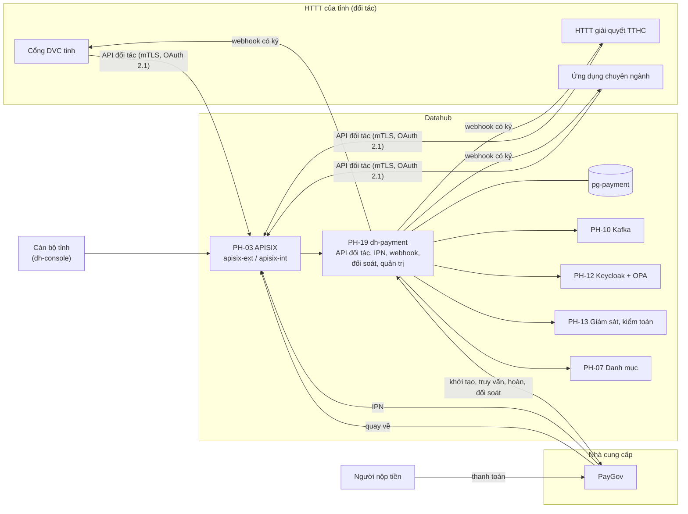
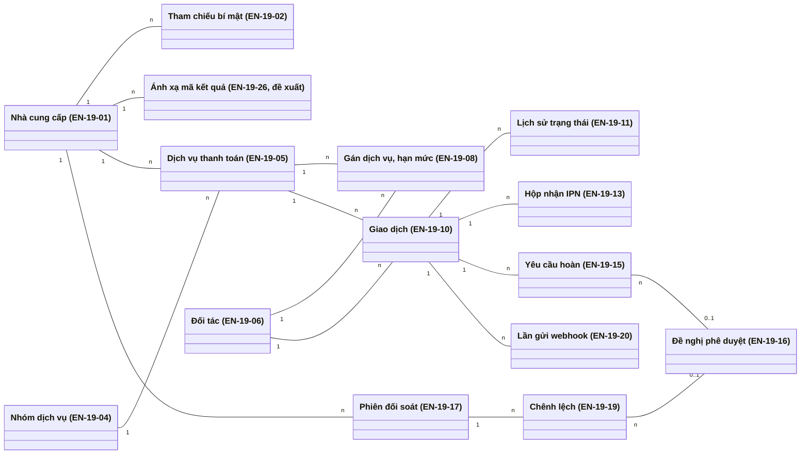
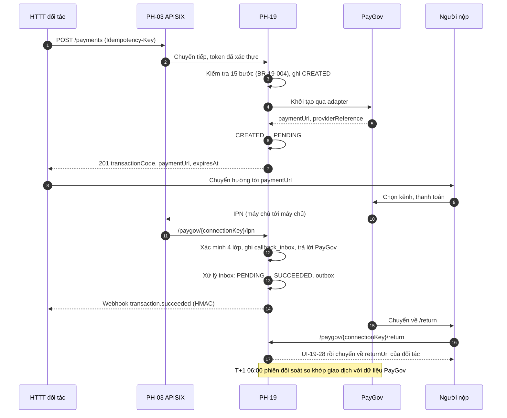

# D02-03-PH19 · Đặc tả chức năng phân hệ PH-19 Thanh toán điện tử

## Tóm tắt cho hội đồng thẩm định

PH-19 Thanh toán điện tử là lớp trung gian thanh toán của tỉnh. Các hệ thống thông tin (HTTT) của tỉnh có thu phí, lệ phí và nghĩa vụ tài chính (Cổng dịch vụ công tỉnh, HTTT giải quyết thủ tục hành chính, các ứng dụng chuyên ngành; tài liệu này gọi chung là **đối tác**) gọi vào PH-19 qua một giao diện lập trình thống nhất. PH-19 chuyển yêu cầu tới **nhà cung cấp thanh toán** (kênh đầu tiên và mặc định là PayGov, Nền tảng thanh toán của Cổng Dịch vụ công quốc gia), nhận kết quả, lưu lịch sử bất biến, báo lại cho đối tác, rồi đối soát với nhà cung cấp vào ngày làm việc kế tiếp. PH-19 **không giữ tiền và không là trung gian thanh toán** theo nghĩa pháp lý: tiền đi thẳng từ người nộp tới tài khoản thụ hưởng của cơ quan thu qua PayGov và ngân hàng. PH-19 chỉ giữ chứng cứ điện tử về yêu cầu, kết quả, hoàn tiền và đối soát.

PH-19 thay khối Payment của LGSP cũ (Viettel 2021). Hệ cũ là một "danh mục ghi nhận": khai báo nhà cung cấp, nhóm dịch vụ, dịch vụ, đối tác, ghi giao dịch và cho xem lại qua hai dashboard và màn tra cứu. Hệ cũ không xác minh kết quả gọi về, không chống ghi trùng, không đối soát, không hoàn tiền, lưu số tiền kiểu `int(10)` (trần khoảng 2,1 tỷ đồng) và ngày thanh toán kiểu chuỗi. Toàn bộ 23 chức năng hệ cũ đã kiểm kê ở D00-03 (LGC-PAY-001…023) cùng ba hành vi được đề xuất bổ sung (LGC-PAY-024…026) đều có FR phủ; không chức năng nào bị loại bỏ (mục 9.1).

Tài liệu đặc tả **69 yêu cầu chức năng** (68 FR do khung truy vết cấp và một FR đề xuất bổ sung FR-19-069 về bảng ánh xạ mã kết quả theo giả định GĐ-03), **32 yêu cầu phi chức năng** và **34 quy tắc nghiệp vụ**, chia thành 15 nhóm miền: nhà cung cấp, dịch vụ, đối tác, giao dịch, nhận kết quả (IPN), chống trùng, truy vấn trạng thái, hoàn tiền, đối soát, tra cứu, nhật ký, dashboard và báo cáo, thông báo cho đối tác, cấu hình theo tenant, di trú. Phạm vi **MVP của PH-19** (mục 9.3) gồm 58 FR, đủ để chuyển đối tác đầu tiên của tỉnh thí điểm từ hệ cũ sang Datahub; 10 FR còn lại thuộc bản tăng cường của đợt 2 hoặc sau đợt 2.

Năm điểm thiết kế chính mà hội đồng cần biết:

1. **Chỉ ba nguồn có xác thực được chốt kết quả**: thông báo kết quả từ máy chủ nhà cung cấp đã xác minh chữ ký (IPN), kết quả truy vấn nhà cung cấp qua kênh có xác thực, và quyết định xử lý chênh lệch đã qua phê duyệt bốn mắt. Việc người nộp được chuyển về trang của đối tác không bao giờ làm đổi trạng thái giao dịch (BR-19-014).
2. **Đúng một lần**: mọi yêu cầu ghi của đối tác mang khóa lũy đẳng `Idempotency-Key`; mỗi mã hồ sơ của đối tác chỉ có tối đa một giao dịch đang mở hoặc đã thành công; IPN đến nhiều lần chỉ được áp một lần (BR-19-006, 007, 015).
3. **Bộ trạng thái nội bộ, không phụ thuộc mã PayGov** (giả định GĐ-03): máy trạng thái giao dịch dùng tám trạng thái của Datahub; mã kết quả của PayGov chỉ đi vào hệ thống qua bảng ánh xạ cấu hình có phê duyệt, mã chưa biết luôn rơi về "chờ xác minh" và không bao giờ tự coi là thành công (mục 4.3, FR-19-069).
4. **Đối soát hằng ngày bắt buộc**: mỗi nhà cung cấp, mỗi ngày giao dịch có một phiên đối soát; mọi dòng lệch sinh bản ghi chênh lệch có người phụ trách và hạn xử lý; phiên chỉ chốt được khi mọi chênh lệch đã xử lý và phiên đã chốt là bất biến (BR-19-028).
5. **Tách nhiệm và an toàn**: kích hoạt nhà cung cấp, duyệt đối tác, hoàn tiền, xử lý chênh lệch, mở lại phiên đối soát, đổi chế độ định tuyến và đổi bảng ánh xạ mã đều qua phê duyệt bốn mắt; khóa ký chỉ nằm trong kho bí mật; dữ liệu cá nhân người nộp được mã hóa mức trường bằng khóa riêng của từng tenant; phân hệ chạy ở đơn vị triển khai riêng `dh-payment` với CSDL riêng `pg-payment` (chốt Q340) để vẫn thu được tiền khi khối điều khiển ngừng.

Mọi chi tiết kỹ thuật của PayGov (tên trường, thuật toán ký, cơ chế gửi lại kết quả, định dạng dữ liệu đối soát, khả năng hoàn tiền qua API) là **Giả định – cần đối chiếu Tài liệu kỹ thuật kết nối Nền tảng thanh toán của Cổng DVCQG do VPCP cấp**, được cô lập trong một bộ chuyển đổi (adapter) theo ADR-040 và gom thành nhóm câu hỏi mở OQ-19-01…08. Khi đặc tả PayGov thay đổi, chỉ adapter và bảng ánh xạ mã thay đổi; lõi nghiệp vụ, CSDL và hợp đồng API với đối tác giữ nguyên.

## 1. Mục đích, phạm vi và người đọc

### 1.1. Mục đích

Tài liệu đặc tả đầy đủ các yêu cầu chức năng (FR), yêu cầu phi chức năng (NFR) và quy tắc nghiệp vụ (BR) của PH-19 ở mức đủ để đội phát triển hiện thực và đội kiểm thử viết ca kiểm thử mà không phải hỏi lại. Theo khung truy vết D02-03-PH19-00 §16, đây là tài liệu **chủ quản** của ba loại mã FR-19, NFR-19 và BR-19: khi tài liệu khác mâu thuẫn với nội dung FR, NFR, BR ở đây thì tài liệu này đúng, trừ khi D00-01 hoặc khung truy vết quy định khác.

### 1.2. Phạm vi

Phạm vi của PH-19 theo bảng "làm / không làm" ở khung truy vết §1.2 và yêu cầu nghiệp vụ REQ-91…99 ở D02-01-PH19 §6. Tóm tắt:

| Thuộc phạm vi | Ngoài phạm vi (ai làm) |
|---|---|
| Vòng đời nhà cung cấp thanh toán, thông tin xác thực (chỉ tham chiếu kho bí mật), kiểm tra kết nối, giao dịch thử, kích hoạt có phê duyệt, giám sát sức khỏe, xoay khóa | Ký thỏa thuận kết nối với VPCP (chủ đầu tư); tích hợp trực tiếp từng ngân hàng, ví (đi qua PayGov) |
| Nhóm dịch vụ, dịch vụ thanh toán gắn với mã danh mục PH-07 | Bảng danh mục ngân hàng, kênh, lĩnh vực, loại phí, cơ quan (PH-07); tính mức phí, lệ phí (HTTT đối tác) |
| Đối tác, client máy-máy, dịch vụ được gán, hạn mức, webhook | Kết nạp HTTT nói chung (PH-01); cấp phát danh tính (PH-12) |
| Giao dịch: tạo, khởi tạo tại nhà cung cấp, quay về, IPN, truy vấn, hủy, hết hạn, lịch sử bất biến, lũy đẳng | Trang chọn ngân hàng, nhập thẻ (PayGov); lưu số thẻ, số tài khoản đầy đủ (cấm); phát hành biên lai điện tử có giá trị pháp lý (OQ-19-14) |
| Hoàn tiền có phê duyệt, chế độ API hoặc thủ công có chứng từ | Quyết định hành chính về việc hoàn phí (cơ quan thu) |
| Đối soát T+1, chênh lệch, chốt phiên, biên bản | Hạch toán kế toán, quyết toán ngân sách, đối soát ngân hàng – Kho bạc |
| Tra cứu, chi tiết, nhật ký, hai dashboard, báo cáo định kỳ, xuất tệp | Kho phân tích dài hạn, BI (PH-16) |
| Webhook có ký, sự kiện Kafka qua outbox | Gửi SMS, thư điện tử cho người nộp (đối tác) |
| Cấu hình theo tenant, RLS, khóa và chứng thư riêng từng tenant | Khởi tạo tenant, bật gói phân hệ (PH-20) |
| Di trú dữ liệu hệ cũ, chạy song song theo đối tác, đối chiếu sau di trú | Sửa mã nguồn hệ cũ; di trú người dùng (PH-12) |

### 1.3. Người đọc và cách đọc

| Người đọc | Đọc trước | Sau đó |
|---|---|---|
| Hội đồng thẩm định, chủ đầu tư | Tóm tắt, mục 2, mục 9.3 (MVP), mục 13 | D02-01-PH19 |
| Sở Tài chính, kế toán | Mục 4.4 (vòng đời giao dịch), nhóm H, I, L ở mục 5, mục 6 | D02-04-PH19 UC-19-17…21 |
| Kiến trúc sư, trưởng nhóm phát triển | Mục 4, 5, 6, 7 | D03-02-PH19 (SDD), D03-03-PH19 (CSDL), D03-04-PH19 (API) |
| Lập trình viên `dh-payment` | Mục 5.0 rồi nhóm FR được giao | SDD, API |
| Lập trình viên giao diện | Mục 12 rồi FR của màn được giao | D03-06-PH19 |
| Kiểm thử viên | Mục 5, 6, 7, 13 | D05-02-PH19 |
| Cán bộ ATTT | NFR-19-018…025, nhóm A (thông tin xác thực), E (IPN), M (webhook) | D03-07 |

### 1.4. Tài liệu liên quan

| Mã | Tài liệu | Quan hệ |
|---|---|---|
| D00-01 | Thuật ngữ và quy ước | Kiểu dữ liệu `T-*`, quy ước mã, đường dẫn REST, topic |
| D00-02 | Sổ ADR | ADR-001, 003, 004, 005, 006, 008, 011, 012, 013, 030…035; ADR-040…049 của PH-19 |
| D00-03 | Ma trận truy vết | LGC-PAY-001…023; giả định GĐ-03 |
| D02-01, D02-01-PH19 | BRD tổng và BRD thanh toán | REQ-19 và mã con REQ-91…99, BP-91…96, BO-91…96, KPI-91…99 |
| D02-02 | SRS cấp hệ thống | FR-00-*, NFR-00-*; FR-00-090…093 về di trú |
| D02-03-PH19-00 | Khung truy vết PH-19 | Cấp phát mọi mã của PH-19; máy trạng thái (§7); thực thể (§9); API (§10); lỗi (§12); quyền (§13) |
| D02-04-PH19 | Đặc tả use case | UC-19-01…29 |
| D02-08 | Ma trận phân quyền | ROLE, PERM-19-* (đề xuất từ khung §13) |
| D03-01 | SAD | DU `dh-payment`, cụm `pg-payment`, tầng phục hồi `TPH-0` |
| D03-02-PH19, D03-03-PH19, D03-04-PH19, D03-06-PH19 | SDD, CSDL, API, màn hình | Hiện thực FR của tài liệu này |
| D03-07, D03-08 | Thiết kế ATTT, hồ sơ cấp độ | Biện pháp SEC-nn cho NFR-19-018…025 |
| D03-10 | Thiết kế đa tenant | RLS, tiền tố topic, bucket, khóa theo tenant |
| D05-02-PH19 | Kịch bản và test case | TS-19-01…34 |

### 1.5. Quy ước riêng của tài liệu và điểm điều chỉnh so với khung 0.1

Tài liệu dùng nguyên quy ước của D00-01 và khung truy vết. Cột "Phát hành" của mỗi FR nhận một trong ba giá trị: **MVP** (bản phát hành đầu tiên của PH-19, đủ để chuyển đối tác đầu tiên), **Đ2b** (bản tăng cường trong đợt 2, sau MVP; mô hình dữ liệu và API đã chừa sẵn từ MVP) và **Sau** (sau đợt 2, chỉ làm khi có điều kiện ghi kèm).

Khung truy vết bản 0.1 được lập ngày 21/11/2026, trước một số quyết định ngày 25/11/2026. Tài liệu này áp các điều chỉnh dưới đây; khung được cập nhật lên bản 0.2 trong cùng đợt (khung §0 cho phép tài liệu chủ quản đề xuất, luồng PH-19 đã gộp):

| # | Điểm | Khung 0.1 | Áp dụng từ bản này | Căn cứ |
|---|---|---|---|---|
| 1 | Căn cứ ATTT | NĐ 85/2016, TT 12/2022, TCVN 11930:2017 | NĐ 331/2026/NĐ-CP (CMP-LAW-06), TCVN 14423:2026 (CMP-LAW-08); văn bản cũ ở cột kế thừa | D00-01 §7, ADR-030 |
| 2 | Căn cứ dữ liệu cá nhân | NĐ 13/2023 | Luật BVDLCN 91/2025/QH15 (CMP-LAW-05), NĐ 356/2025/NĐ-CP (CMP-LAW-04) | D00-01 §7 |
| 3 | Kết nối, chia sẻ dữ liệu | NĐ 47/2020 | NĐ 278/2025/NĐ-CP (CMP-LAW-03) | D00-01 §7 |
| 4 | Lưu trữ bất biến | Garage có object lock | Garage cho tệp nghiệp vụ (bucket `dh-{tenant}-payment`); chứng cứ cần WORM (chuỗi băm hằng ngày, biên bản đã chốt, dữ liệu lưu trữ quá 24 tháng) trên Ceph RGW Object Lock chế độ compliance, bucket riêng `dh-{tenant}-payment-worm` | ADR-008 (chốt Q306, Q347), ADR-031 |
| 5 | Mã hóa dữ liệu cá nhân | ADR-048 độc lập | ADR-048 chi tiết hóa ADR-032 (mã hóa envelope qua OpenBao) cho dữ liệu người nộp, thêm HMAC tìm kiếm | ADR-032 |
| 6 | Trạng thái giao dịch | Tám trạng thái tiếng Anh, ánh xạ mã PayGov qua danh mục PH-07 `DM_MA_LOI_NCC_THANH_TOAN` | Giữ tám giá trị enum (quy ước `T-ENUM` của D00-01); bảng tương ứng với nhãn GĐ-03 ở mục 4.3; thêm cột cờ đối soát `recon_status`; ánh xạ mã nhà cung cấp qua bảng cấu hình `provider_result_mapping` (EN-19-26, đề xuất) có phê duyệt; danh mục PH-07 chỉ giữ nhãn tham khảo | GĐ-03 (D00-03 §6) |
| 7 | Đường dẫn tệp đi kèm | Thư mục `PH19/` | Thư mục chữ thường `ph19/` như PH-04, PH-07 | Thống nhất bộ tài liệu |
| 8 | Mã tenant ví dụ | `T68` | Giữ `T68` (ví dụ của D00-01); tỉnh thí điểm trong giả định GĐ-06 gọi là `T01` | D00-01 §5 |

Kiểu dữ liệu theo D00-01 §5. Tài liệu dùng thêm: `T-TXN-CODE` mã giao dịch PH-19 (BR-19-002, mẫu `^T[0-9]{2}[0-9]{6}[0-9A-HJKMNP-TV-Z]{10}$`, 19 ký tự); `T-ORDER-ID` mã đơn hàng, mã hồ sơ của đối tác (`varchar(64)`, mẫu `^[A-Za-z0-9._:/-]{1,64}$`); `T-IDEM-KEY` khóa lũy đẳng (16…64 ký tự `[A-Za-z0-9_-]`).

### 1.6. Căn cứ pháp lý riêng của PH-19

Căn cứ dùng chung của Datahub giữ mã của D00-01 §7. Các văn bản riêng của thanh toán do D02-01-PH19 §2.1 đề xuất ở dải `CMP-LAW-91…97` và được dẫn kèm chữ "(đề xuất)" cho tới khi gộp vào D00-01. Mọi văn bản ở bảng dưới cần đối chiếu số hiệu, hiệu lực và điều khoản với Công báo trước bản 1.0 (OQ-19-21).

| Mã | Văn bản | FR, NFR chịu chi phối | Kế thừa, chuyển tiếp |
|---|---|---|---|
| CMP-LAW-91 (đề xuất) | Nghị định 45/2020/NĐ-CP về thực hiện thủ tục hành chính trên môi trường điện tử | Nhóm D, E, M (kết quả thanh toán là một phần hồ sơ điện tử) | — |
| CMP-LAW-92 (đề xuất) | Nghị định 42/2022/NĐ-CP về cung cấp thông tin và dịch vụ công trực tuyến | Nhóm D | — |
| CMP-LAW-93 (đề xuất) | Nghị định 61/2018/NĐ-CP sửa đổi bởi Nghị định 107/2021/NĐ-CP về cơ chế một cửa | Nhóm D, J | — |
| CMP-LAW-94 (đề xuất) | Nghị định 52/2024/NĐ-CP về thanh toán không dùng tiền mặt | Phạm vi (PH-19 không giữ tiền); nhóm H | — |
| CMP-LAW-95 (đề xuất) | Luật Giao dịch điện tử số 20/2023/QH15 | FR-19-028, 029, 047, 048; NFR-19-016 | — |
| CMP-LAW-96 (đề xuất) | Thông tư 74/2022/TT-BTC hoặc văn bản thay thế; Nghị định 123/2020/NĐ-CP về hóa đơn, chứng từ | Nhóm D, H; OQ-19-14 | — |
| CMP-LAW-97 (đề xuất) | Luật Kế toán số 88/2015/QH13; Luật Lưu trữ năm 2024 | NFR-19-014, 015 | — |
| CMP-LAW-03 | Nghị định 278/2025/NĐ-CP về kết nối, chia sẻ dữ liệu | Nhóm M (sự kiện cho lớp dữ liệu dùng chung) | NĐ 47/2020/NĐ-CP |
| CMP-LAW-04, 05 | Luật BVDLCN 91/2025/QH15; Nghị định 356/2025/NĐ-CP | NFR-19-024; BR-19-031, 032; FR-19-051, 052 | NĐ 13/2023/NĐ-CP |
| CMP-LAW-06, 08 | Nghị định 331/2026/NĐ-CP; TCVN 14423:2026 | NFR-19-018…023 | NĐ 85/2016/NĐ-CP, TT 12/2022/TT-BTTTT (CMP-LAW-07), TCVN 11930:2017 |
| CMP-LAW-16 | Luật An ninh mạng số 116/2025/QH15 | NFR-19-014, 015 (lưu trữ trong nước) | Luật ANM 2018, Luật ATTT mạng 2015 |

## 2. Bối cảnh nghiệp vụ

### 2.1. Vai trò của PH-19 trong Datahub

PH-19 là phân hệ duy nhất của Datahub xử lý dòng thông tin tài chính. Nó đứng giữa ba nhóm: các HTTT đối tác của tỉnh (gọi vào để thu), các nhà cung cấp thanh toán (PayGov, sau này có thể thêm kênh khác) và cán bộ của tỉnh (quản trị, phê duyệt, kế toán, tra cứu, kiểm toán). Theo SAD D03-01 §4.2, PH-19 chạy trong đơn vị triển khai riêng `dh-payment` gồm cả phần điều khiển (API quản trị, màn hình) và phần dữ liệu (API đối tác, nhận IPN, bộ gửi webhook). Phân hệ dùng cụm CSDL riêng `pg-payment` và thuộc tầng phục hồi `TPH-0` (chốt Q340) để việc thu tiền và nhận kết quả vẫn chạy khi khối điều khiển của Datahub (`pg-core`) ngừng (NFR-00-012).



### 2.2. Hệ Payment cũ

Hệ cũ gồm năm bảng (`payment_partner`, `payment_provider`, `payment_service_group`, `payment_service`, `payment_transaction`), chạy chung một tiến trình Tomcat với khối khác, một máy chủ PostgreSQL. Các điểm yếu đã phân tích ở D02-01-PH19 §3.3 (14 điểm) là nguồn gốc của phần lớn FR mới của PH-19. Bảng sau tóm tắt cách PH-19 xử lý từng nhóm điểm yếu.

| Điểm yếu hệ cũ (D02-01-PH19 §3.3) | Cách PH-19 xử lý | FR, BR chính |
|---|---|---|
| 1. Không đối soát | Phiên đối soát T+1 theo nhà cung cấp, chênh lệch có người phụ trách, phiên chốt bất biến | FR-19-042…048; BR-19-025, 028 |
| 2. Không hoàn tiền (chỉ có ba trạng thái `REFUND_*`) | Yêu cầu hoàn có phê duyệt một hoặc hai cấp, chế độ API hoặc thủ công có chứng từ | FR-19-038…041; BR-19-022…024 |
| 3. Không bảo mật kết quả gọi về | Bốn lớp xác minh IPN; ghi nguyên văn vào hộp nhận trước khi trả lời | FR-19-029; NFR-19-020 |
| 4. Không chống ghi trùng | Khóa lũy đẳng; chỉ mục duy nhất có điều kiện theo mã đơn hàng; IPN áp đúng một lần | FR-19-030, 033, 034; BR-19-006, 007 |
| 5, 6. Số tiền `int(10)`, ngày thanh toán chuỗi | `T-MONEY` = `numeric(19,0)`, `paid_at` kiểu `T-TS`; chuyển đổi khi di trú có báo cáo dòng lỗi | FR-19-065; NFR-19-017 |
| 7. Một nhà cung cấp mã hóa cứng | Kiến trúc adapter, thêm kênh không sửa lõi | FR-19-024; NFR-19-027; ADR-040 |
| 8. Không lịch sử trạng thái | `transaction_event` bất biến, ghi cùng giao dịch CSDL | FR-19-028 |
| 9. Thông báo kết quả không tin cậy | Webhook ký HMAC, thử lại giãn dần, kéo thông báo bù, sự kiện Kafka qua outbox | FR-19-060…062 |
| 10. Không cách ly theo tỉnh | `tenant_id` và RLS `FORCE` trên mọi bảng; khóa, topic, bucket riêng | NFR-19-025 |
| 11. Bí mật trong tệp cấu hình | Chỉ lưu tham chiếu OpenBao; xoay khóa không gián đoạn | FR-19-002, 012; NFR-19-022 |
| 12. Không ràng buộc toàn vẹn | Khóa ngoại thật, mã duy nhất trong tenant, mã danh mục kiểm tra với PH-07 | FR-19-016; EN-19-* |
| 13. Số liệu chậm 10 phút, không cảnh báo | Số liệu trễ ≤ 60 giây; cảnh báo sự cố kênh ≤ 3 phút | FR-19-011, 056, 059; NFR-19-006, 026 |
| 14. Chỉ tiêu phi chức năng thấp | Sẵn sàng 99,9% cho API dữ liệu; 200 giao dịch/giây mỗi tenant | NFR-19-001…013 |

### 2.3. Yêu cầu mới không có ở hệ cũ

Ngoài phần thay thế hệ cũ, PH-19 có các năng lực mới mà BRD-PH19 yêu cầu: phê duyệt bốn mắt dùng chung cho mọi thao tác rủi ro cao (ADR-046); chế độ chạy song song từng đối tác `LEGACY` → `SHADOW` → `DATAHUB` để chuyển đổi không gián đoạn thu (ADR-049); kéo thông báo bù qua API khi webhook lỡ; bảng ánh xạ mã kết quả có phê duyệt (FR-19-069); biên bản đối soát có mã băm lưu kho bất biến; cấu hình thanh toán theo tenant có phiên bản và ngày hiệu lực.

### 2.4. Đa tenant trong PH-19

PH-19 tuân thủ D03-10. Tenant của một yêu cầu xác định theo ba cách tùy nhóm API: token người dùng (API quản trị), token client máy-máy (API đối tác), và `connectionKey` trong đường dẫn callback (API callback, vì IPN không mang token; ADR-045). Mỗi tenant có kết nối PayGov, khóa ký, chứng thư, khóa mã hóa dữ liệu cá nhân, bí mật ký webhook, bucket và tiền tố topic riêng. Một tenant được có nhiều bản ghi nhà cung cấp cùng loại `PAYGOV` (mỗi bản ghi một mã đơn vị kết nối), phục vụ giai đoạn sau sáp nhập tỉnh khi kết nối của tỉnh cũ còn hiệu lực (OQ-19-19).

## 3. Tác nhân, vai trò và quyền

### 3.1. Tác nhân

Tác nhân là người và hệ thống theo khung truy vết §1.3, §1.4. Chín vai trò (ROLE-PLATFORM_ADMIN, TENANT_ADMIN, PAYMENT_ADMIN, PAYMENT_APPROVER, PAYMENT_ACCOUNTANT, PAYMENT_OPERATOR, AUDITOR, SECURITY_OFFICER, PARTNER_SYSTEM) và 48 quyền `PERM-19-*` cùng ma trận vai trò × quyền được đề xuất cho D02-08 ở khung §13. Các FR ở mục 5 ghi quyền ở dạng rút gọn (ví dụ `provider-write` là `PERM-19-provider-write`). Người nộp tiền không đăng nhập PH-19; họ chỉ thấy trang kết quả công khai UI-19-28.

### 3.2. Tách nhiệm

Mười quy tắc tách nhiệm ở khung §13.4 áp dụng cho mọi FR có phê duyệt. Lớp động được kiểm tra ở máy chủ cho từng thao tác theo claim `sub` của PH-12, không phụ thuộc giao diện có ẩn nút hay không; vi phạm trả ERR-19-033 (403) và ghi sự kiện an ninh vào PH-13.

### 3.3. Quyền đề xuất bổ sung

FR-19-069 (đề xuất) dùng lại quyền đã có, không thêm quyền mới: lập đề nghị đổi bảng ánh xạ cần `provider-write`, quyết định đề nghị cần `provider-activate`. Loại đề nghị phê duyệt mới `RESULT_MAPPING_CHANGE` được thêm vào `approval_request.approval_type` (đề xuất bổ sung EN-19-16).

## 4. Khái niệm và mô hình nghiệp vụ

### 4.1. Mô hình khái niệm



Mô hình chia ba cụm. Cụm **cấu hình** (nhà cung cấp, nhóm dịch vụ, dịch vụ, đối tác và các bảng con) do cán bộ quản trị ghi và thay đổi chậm. Cụm **giao dịch** xoay quanh giao dịch thanh toán với lịch sử, IPN, hoàn tiền, nhật ký tích hợp và webhook; đây là cụm có khối lượng lớn. Cụm **đối soát** gắn với nhà cung cấp theo ngày. Đề nghị phê duyệt, tệp, tác vụ nền và outbox là hạ tầng nghiệp vụ dùng chung trong phân hệ. Tên bảng, cột, khóa và quan hệ chi tiết theo khung §9 và D03-03-PH19.

### 4.2. Máy trạng thái

PH-19 có chín máy trạng thái: tám máy do khung truy vết §7 chốt (nhà cung cấp, dịch vụ, đối tác, giao dịch, yêu cầu hoàn, phiên đối soát, chênh lệch, lần gửi webhook) và máy trạng thái của đề nghị phê duyệt (`PENDING` → `APPROVED`/`REJECTED`/`WITHDRAWN`/`EXPIRED`, khung §9.3 EN-19-16). Sơ đồ, bảng chuyển trạng thái, sự kiện kích hoạt và điều kiện là nội dung của khung §7; FRS không chép lại mà dẫn chiếu. Ba nguyên tắc dùng chung: (1) mọi chuyển trạng thái ngoài bảng bị từ chối với ERR-19-021; (2) mọi chuyển trạng thái ghi kiểm toán cùng giao dịch CSDL (BR-19-029); (3) với giao dịch thanh toán, mỗi chuyển trạng thái ghi thêm một dòng `transaction_event` (FR-19-028).

### 4.3. Bộ trạng thái nội bộ của giao dịch và ánh xạ mã nhà cung cấp (GĐ-03)

Giả định GĐ-03 (D00-03 §6, thay câu hỏi Q03 ngày 25/11/2026) quy định máy trạng thái giao dịch dùng bộ trạng thái **nội bộ** của Datahub, cờ đối soát tách riêng, và mã kết quả của PayGov chỉ đi vào qua bảng cấu hình. Bảng dưới là tương ứng một-một giữa nhãn của GĐ-03 và giá trị enum lưu trong CSDL, API, sự kiện. Giá trị enum giữ tiếng Anh viết hoa theo quy ước `T-ENUM` của D00-01 §5 để thống nhất với các phân hệ khác; nhãn tiếng Việt là nhãn hiển thị trên giao diện và báo cáo.

| Nhãn GĐ-03 | Enum `payment_transaction.status` | Nhãn hiển thị | Nhóm | Kết thúc? |
|---|---|---|---|---|
| `KHOI_TAO` | `CREATED` | Khởi tạo | Đang xử lý | Không |
| `CHO_THANH_TOAN` | `PENDING` | Chờ thanh toán | Đang xử lý | Không |
| `THANH_CONG` | `SUCCEEDED` | Thành công | Kết thúc | Có |
| `THAT_BAI` | `FAILED` | Thất bại | Kết thúc mềm | Có (có thể đảo qua xử lý chênh lệch) |
| `HET_HAN` | `EXPIRED` | Hết hạn | Kết thúc mềm | Có (có thể thanh toán muộn) |
| `DA_HUY` | `CANCELLED` | Đã hủy | Kết thúc mềm | Có (có thể thanh toán muộn) |
| `HOAN_TIEN_MOT_PHAN` | `PARTIALLY_REFUNDED` | Đã hoàn một phần | Sau hoàn tiền | Không |
| `HOAN_TIEN_TOAN_PHAN` | `REFUNDED` | Đã hoàn toàn phần | Sau hoàn tiền | Có |

| Nhãn GĐ-03 | Enum `payment_transaction.recon_status` (đề xuất bổ sung EN-19-10) | Ý nghĩa |
|---|---|---|
| `CHUA_DOI_SOAT` | `UNRECONCILED` | Giao dịch chưa thuộc phiên đối soát đã so khớp, hoặc chưa có kết quả cuối |
| `KHOP` | `MATCHED` | Dòng đối soát của giao dịch ở lần chạy mới nhất là `MATCHED`, hoặc chênh lệch của nó đã `RESOLVED` |
| `LECH` | `MISMATCHED` | Giao dịch có chênh lệch chưa `RESOLVED` |

Cờ `recon_status` do hệ thống cập nhật khi so khớp (FR-19-044) và khi chênh lệch chuyển `RESOLVED` (FR-19-046); người dùng không sửa được. Cờ dùng để lọc ở màn tra cứu (bộ lọc "có chênh lệch" của FR-19-050) và cho đối tác biết giao dịch đã được đối soát chưa.

**Ánh xạ mã kết quả nhà cung cấp.** Mỗi kết quả nhà cung cấp trả về (khởi tạo, IPN, truy vấn, hoàn tiền, dòng đối soát) mang một mã kết quả của nhà cung cấp. Adapter không tự diễn giải mã này; nó tra bảng `provider_result_mapping` (EN-19-26, đề xuất) theo bộ (nhà cung cấp, thao tác, mã) để lấy **kết cục nội bộ** thuộc một trong bốn giá trị:

| Kết cục nội bộ | Hành vi của lõi |
|---|---|
| `SUCCEEDED` | Áp như thành công theo BR-19-015 (kiểm tra số tiền, tham chiếu) |
| `FAILED` | Áp như thất bại; lưu mã lý do đã ánh xạ |
| `PENDING` | Chưa có kết quả cuối; giữ nguyên trạng thái, tiếp tục lịch truy vấn BR-19-016 |
| `UNKNOWN` | Mã không có trong bảng, hoặc dòng ánh xạ ghi `UNKNOWN`: **chờ xác minh**. Giữ nguyên trạng thái, đặt `needs_reconciliation = true`, đánh dấu bản ghi IPN `QUARANTINED` với ERR-19-028, phát cảnh báo "mã kết quả chưa biết" tới PH-13, tiếp tục truy vấn. Không bao giờ coi là thành công |

Bảng ánh xạ được nạp mặc định theo loại adapter khi khai báo nhà cung cấp và chỉ được đổi qua đề nghị phê duyệt bốn mắt (FR-19-069). Danh mục `DM_MA_LOI_NCC_THANH_TOAN` của PH-07 (khung §1.5) không còn là nguồn ánh xạ lúc chạy, chỉ giữ nhãn tham khảo dùng chung giữa các tỉnh; lý do là máy trạng thái tài chính không được phụ thuộc vào một phân hệ khác lúc chạy và mỗi lần đổi ánh xạ phải có phê duyệt của chính tỉnh. Khi có tài liệu kỹ thuật PayGov, chỉ điền bảng ánh xạ; máy trạng thái chỉ đổi khi PayGov có trạng thái không quy được về bốn kết cục trên (GĐ-03, cách cập nhật).

### 4.4. Vòng đời một khoản thu



### 4.5. Thuật ngữ bổ sung

| Thuật ngữ | Nghĩa trong PH-19 |
|---|---|
| Đối tác | HTTT của tỉnh được phép gọi PH-19 để thu tiền; một đối tác gắn với một HTTT thành viên của PH-01 |
| Nhà cung cấp (NCC) | Một kết nối tới một nền tảng thanh toán (PayGov là loại `PAYGOV`); một tenant có thể có nhiều kết nối cùng loại |
| Adapter | Thành phần dịch giữa mô hình nội bộ và đặc tả của một loại nhà cung cấp (lớp chống nhiễm, ADR-040) |
| IPN | Thông báo kết quả do máy chủ nhà cung cấp gửi tới máy chủ PH-19 (Instant Payment Notification) |
| Lượt quay về | Việc trình duyệt của người nộp được nhà cung cấp chuyển về PH-19 sau khi thanh toán; chỉ để hiển thị |
| Kết thúc mềm | Trạng thái kết thúc không thành công (`FAILED`, `CANCELLED`, `EXPIRED`) mà về sau vẫn có thể chuyển `SUCCEEDED` theo BR-19-015, 018 |
| Thanh toán muộn | Kết quả thành công hợp lệ đến sau khi giao dịch đã `CANCELLED` hoặc `EXPIRED` (BR-19-018) |
| Phiên đối soát | Việc so khớp dữ liệu của một nhà cung cấp cho một ngày giao dịch; có số lần chạy `run_no` |
| Chênh lệch | Một dòng không khớp giữa hai phía, hoặc một IPN bất thường; có vòng đời và người phụ trách |
| Bốn mắt | Người quyết định một đề nghị phải khác người lập (BR-19-011) |
| Chế độ định tuyến | Trạng thái chuyển đổi của một đối tác: `LEGACY`, `SHADOW`, `DATAHUB` (BR-19-034) |
| `connectionKey` | Khóa ngẫu nhiên 32 ký tự của một bản ghi nhà cung cấp, nằm trong đường dẫn callback để xác định tenant và kết nối (ADR-045) |

## 5. Đặc tả chi tiết yêu cầu chức năng

### 5.0. Cách đọc đặc tả và quy định chung cho mọi FR

Mỗi FR gồm một đoạn mở đầu nêu mục đích và chức năng hệ cũ tương ứng, một bảng tóm tắt theo mẫu D00-01 §4.3, bảng đầu vào khi FR có đầu vào đáng kể, các bước xử lý đánh số và bảng ngoại lệ. Cột "Truy vết" ghi theo thứ tự REQ con, LGC, BR, UC, API, UI, EN, TS. Các quy định chung dưới đây áp dụng cho mọi FR và không lặp lại.

**Tenant và phạm vi dữ liệu.** Tenant lấy từ ngữ cảnh xác thực (token người dùng, token client hoặc `connectionKey`), không lấy từ tham số do bên gọi gửi (FR-00-010). Mọi truy vấn chạy dưới RLS với `app.tenant_id` của phiên CSDL. Với API đối tác, mọi truy vấn còn bị giới hạn trong dữ liệu của chính đối tác gắn với client. Đối tượng nằm ngoài phạm vi trả ERR-19-020 (404) thay vì 403 để không lộ sự tồn tại (FR-00-011).

**Phân hệ chưa bật.** Khi PH-20 chưa bật hoặc đã tạm ngừng PH-19 cho tenant (cờ `module_enabled` của EN-19-22 là `false`), mọi API ghi của nhóm quản trị và đối tác trả ERR-19-049 (503); API đọc của nhóm quản trị vẫn chạy để tra cứu và đối soát dữ liệu dở; nhóm callback vẫn nhận IPN cho giao dịch đã tạo (FR-19-064).

**Lũy đẳng và khóa lạc quan.** Mọi `POST` của nhóm đối tác bắt buộc `Idempotency-Key` theo BR-19-006. Mọi `POST` tạo mới của nhóm quản trị nhận `Idempotency-Key` tùy chọn với cùng quy tắc. Mọi `PATCH`, `PUT`, `DELETE` và thao tác đổi trạng thái của nhóm quản trị bắt buộc `If-Match` chứa ETag (`W/"{version}"`); không khớp trả ERR-19-045 (412), thiếu trả ERR-19-001 (400) với lỗi trường `If-Match`.

**Lỗi.** Lỗi trả theo RFC 9457 (`application/problem+json`) với `type`, `title`, `status`, `detail` tiếng Việt, `instance`, `code` (`ERR-19-nnn`), `traceId`; lỗi trường thêm mảng `errors` gồm `{field, code, message}`. Thông điệp nói rõ sai gì và sửa thế nào (FR-00-080), không chứa dữ liệu cá nhân, bí mật hay thông tin nội bộ. Bảng mã lỗi chính thức ở khung §12 và D03-04-PH19 §6.

**Kiểm toán.** Mọi thao tác ghi của người dùng và mọi quyết định phê duyệt ghi bản ghi kiểm toán vào `outbox_event` trong cùng giao dịch CSDL với thay đổi nghiệp vụ (BR-19-029), gồm: thời điểm, tenant, chủ thể (`sub`), địa chỉ nguồn, hành động, loại và mã đối tượng, giá trị trước và sau của các trường thay đổi (đã che bí mật và dữ liệu cá nhân), kết quả, lý do, `traceId`. Không ghi được bản ghi kiểm toán thì toàn bộ thao tác bị hủy và trả ERR-19-050. Cột "Kiểm toán" của từng FR chỉ ghi phần riêng. Thao tác đọc không ghi kiểm toán, trừ xem dữ liệu cá nhân bỏ che (BR-19-031), xem nguyên văn IPN và tải tệp xuất.

**Sự kiện.** Sự kiện `EVT-19-nn` ghi vào `outbox_event` cùng giao dịch CSDL với thay đổi trạng thái và phát lên topic `{tenant}.payment.{thực-thể}.{sự-kiện}.v1` (FR-19-061). Payload không chứa dữ liệu cá nhân người nộp.

**Phê duyệt bốn mắt.** Mọi đề nghị phê duyệt dùng chung một cơ chế (EN-19-16, ADR-046): người lập tạo `approval_request` ở trạng thái `PENDING` với `payload` chứa nội dung đề nghị và ảnh chụp bằng chứng tại thời điểm lập; người quyết định gọi API-19-050; người quyết định khác người lập (BR-19-011); đề nghị quá hạn 7 ngày tự chuyển `EXPIRED` và đối tượng trở về trạng thái trước; mỗi đối tượng có tối đa một đề nghị `PENDING` cùng loại. Hệ thống kiểm tra lại điều kiện nghiệp vụ tại thời điểm quyết định (ví dụ checklist kích hoạt vẫn đạt), không chỉ tại thời điểm lập.

**Số tiền và thời gian.** Số tiền là `T-MONEY` (số nguyên đồng, không dùng số thực ở bất kỳ tầng nào; JSON dùng số nguyên, giao diện dùng chuỗi hoặc `BigInt`). Thời điểm lưu UTC (`T-TS`); "ngày" nghiệp vụ (hạn mức ngày, ngày giao dịch đối soát, báo cáo) tính theo giờ Việt Nam UTC+7 (BR-19-025, NFR-19-028).

**Phân trang.** Danh sách của nhóm quản trị dùng phân trang con trỏ `cursor`, `limit` (mặc định 20, tối đa 200), sắp xếp `sort` theo danh sách trường cho phép của từng API; trả `items[]`, `page.next`, `page.hasMore` và, khi bên gọi yêu cầu `withTotal=true`, `page.total` (đếm có giới hạn 100.000, vượt thì trả `100000+`).

**Tham số cấu hình.** Tham số có tiền tố `19.` là khóa trong `tenant_payment_config.settings` (EN-19-22), sửa tại UI-19-26 theo FR-19-063; bảng tham số đầy đủ ở mục 7.1.

### 5.1. Nhóm A — Nhà cung cấp thanh toán

#### FR-19-001 · Khai báo nhà cung cấp

Thay chức năng "Thêm nhà cung cấp" của hệ cũ (LGC-PAY-001, phần khai báo). Quản trị thanh toán tạo một bản ghi kết nối tới một nhà cung cấp ở trạng thái `DRAFT`. Bản ghi `DRAFT` chưa thu được tiền; nó chỉ là nơi gắn thông tin xác thực, chạy kiểm tra và giao dịch thử trước khi đề nghị kích hoạt.

| Trường | Nội dung |
|---|---|
| Mức ưu tiên, phát hành | M · MVP |
| Truy vết | REQ-91; LGC-PAY-001; BR-19-027; UC-19-01; API-19-002; UI-19-05; EN-19-01; TS-19-01 |
| Tác nhân, quyền | Quản trị thanh toán · `provider-write` |
| Tiền điều kiện | Phân hệ bật cho tenant; loại adapter đã được cài trên nền tảng (`ROLE-PLATFORM_ADMIN` cài, danh sách đọc từ cấu hình triển khai) |
| Đầu ra | Bản ghi NCC `DRAFT` với `id`, `connectionKey` (chỉ hiển thị dạng che `ab12…9f`, xem đầy đủ cần `credential-manage`), ETag; bảng ánh xạ mã kết quả mặc định của adapter (FR-19-069) |
| Hậu điều kiện | `status = DRAFT`, `health_status = UNKNOWN`, `circuit_state = CLOSED`, `capabilities` lấy từ khai báo của adapter |
| Sự kiện, kiểm toán | Kiểm toán `PROVIDER_CREATE`; không phát sự kiện (EVT-19-01 chỉ phát khi đổi trạng thái) |

| Trường đầu vào | Kiểu | Bắt buộc | Ràng buộc | Ví dụ |
|---|---|---|---|---|
| `code` | T-CODE | Có | Duy nhất trong tenant, bất biến sau khi tạo; chuyển chữ hoa | `PAYGOV-T68` |
| `name` | T-NAME | Có | 3…255 ký tự | `PayGov – kết nối tỉnh T68` |
| `adapterType` | T-ENUM | Có | Thuộc danh sách adapter đã cài: `PAYGOV`, `MOCK`; `MOCK` chỉ cho phép ở tenant có cờ môi trường thử | `PAYGOV` |
| `sandboxBaseUrl`, `productionBaseUrl` | T-URI | Không | `https`; không trỏ địa chỉ nội bộ, riêng, loopback; tên miền thuộc danh sách egress của DU (NFR-19-018) | |
| `merchantRef` | T-CODE | Không | Mã đơn vị kết nối do NCC cấp (giả định, OQ-19-08) | `T68-PG-001` |
| `refundMode` | T-ENUM | Không | `API` chỉ khi `capabilities.refund = true`; mặc định `MANUAL` | `MANUAL` |
| `effectiveFrom` | T-DATE | Không | Ngày bắt đầu hiệu lực (hệ cũ "ngày bắt đầu") | `2027-01-01` |
| `techContact`, `bizContact` | đối tượng `{name, phone, email}` | Không | T-NAME, T-PHONE (E.164), T-EMAIL | |
| `description` | T-TEXT | Không | ≤ 4.000 ký tự | |

Xử lý gồm các bước sau.

1. Hệ thống kiểm tra quyền, trạng thái phân hệ, định dạng trường; sai trả ERR-19-001 với `errors`.
2. Hệ thống chuẩn hóa `code` thành chữ hoa và kiểm tra trùng trong tenant (ERR-19-038).
3. Hệ thống kiểm tra `adapterType` có trong danh sách đã cài và `refundMode` phù hợp năng lực adapter.
4. Hệ thống sinh `connectionKey` 32 ký tự Base32 Crockford từ nguồn ngẫu nhiên mật mã (160 bit), kiểm tra duy nhất toàn cục (ADR-045).
5. Hệ thống ghi bản ghi, sao chép bảng ánh xạ mã mặc định của adapter vào `provider_result_mapping` với `mapping_version = 1`, ghi kiểm toán trong cùng giao dịch CSDL.
6. Hệ thống trả 201 kèm `Location` và ETag.

| Điều kiện | Mã lỗi | HTTP |
|---|---|---|
| Trường sai định dạng, thiếu trường bắt buộc | ERR-19-001 | 400 |
| Mã đã tồn tại | ERR-19-038 | 409 |
| Địa chỉ không phải `https` hoặc trỏ địa chỉ nội bộ | ERR-19-001 | 400 |
| Loại adapter chưa cài, hoặc `MOCK` ở tenant chính thức | ERR-19-001 | 400 |
| `refundMode = API` khi adapter không hỗ trợ hoàn | ERR-19-032 | 422 |

#### FR-19-002 · Gắn thông tin xác thực nhà cung cấp

Thay việc sửa `username`, `password` trong tệp cấu hình rồi khởi động lại Tomcat của hệ cũ (điểm yếu 11). Mỗi NCC có tham chiếu bí mật theo môi trường (`SANDBOX`, `PRODUCTION`) và mục đích (`SIGNING_KEY`, `VERIFY_CERT`, `MTLS_CLIENT_CERT`, `API_CREDENTIAL`). Giá trị bí mật do cán bộ ATTT nạp thẳng vào OpenBao qua quy trình của D03-07; PH-19 chỉ lưu đường dẫn, dấu vân tay và hạn dùng.

| Trường | Nội dung |
|---|---|
| Mức ưu tiên, phát hành | M · MVP |
| Truy vết | REQ-91, REQ-98; LGC-PAY-001, 004; BR-19-010, 026; UC-19-01; API-19-006, 007; UI-19-04 (tab Thông tin xác thực); EN-19-02; TS-19-01, 34 |
| Tác nhân, quyền | Cán bộ ATTT, quản trị thanh toán · `credential-manage` (gắn), `provider-read` (xem siêu dữ liệu) |
| Tiền điều kiện | NCC ở `DRAFT`, `ACTIVE` hoặc `SUSPENDED`; bí mật đã có tại đường dẫn OpenBao `kv/dh/{tenant}/payment/{providerCode}/{environment}/{purpose}` |
| Đầu ra | Danh sách tham chiếu theo môi trường và mục đích: `secretRef`, `fingerprint`, `validFrom`, `validTo`, `credentialStatus`, số ngày còn hạn; không bao giờ có giá trị bí mật |
| Hậu điều kiện | Với NCC `DRAFT`: bản ghi `ACTIVE` mới thay bản cũ (bản cũ `RETIRED`). Với NCC `ACTIVE`: thay đổi đi vào `pending_change`, chỉ có hiệu lực sau khi kiểm tra kết nối với giá trị mới đạt (BR-19-026) |
| Sự kiện, kiểm toán | Kiểm toán `PROVIDER_CREDENTIAL_BIND` ghi đường dẫn và dấu vân tay, không ghi giá trị |

| Trường đầu vào (theo từng mục đích) | Kiểu | Bắt buộc | Ràng buộc |
|---|---|---|---|
| `{environment}` (đường dẫn) | T-ENUM | Có | `SANDBOX`, `PRODUCTION` |
| `items[].purpose` | T-ENUM | Có | Bốn mục đích ở trên; adapter khai mục đích nào là bắt buộc |
| `items[].secretRef` | T-SECRET-REF | Có | Bắt đầu bằng `kv/dh/{tenant}/payment/` của đúng tenant; không chứa ký tự điều khiển |

Xử lý gồm các bước sau.

1. Hệ thống kiểm tra tiền tố đường dẫn thuộc đúng tenant (chống trỏ sang bí mật của tenant khác); sai trả ERR-19-001.
2. Hệ thống gọi OpenBao bằng danh tính của DU `dh-payment` (chỉ quyền đọc siêu dữ liệu và đọc khóa công khai, không đọc khóa riêng) để xác nhận đường dẫn tồn tại; với chứng thư, đọc chứng thư công khai để tính dấu vân tay SHA-256 và hạn dùng.
3. Không xác nhận được (đường dẫn không tồn tại, chứng thư hết hạn hoặc còn dưới 30 ngày với `PRODUCTION`) thì trả ERR-19-022, `detail` nêu mục đích và lý do.
4. Với NCC `DRAFT`, ghi bản ghi `ACTIVE`, chuyển bản cũ cùng mục đích sang `RETIRED`. Với NCC `ACTIVE`, `SUSPENDED`, ghi bản ghi `NEXT` và đặt `pending_change.credentials`; bản `NEXT` chỉ được dùng cho kiểm tra kết nối cho tới khi đạt (FR-19-003), khi đạt thì hệ thống đổi `NEXT` thành `ACTIVE` và bản cũ thành `RETIRED` trong một giao dịch.
5. Ghi kiểm toán, trả danh sách tham chiếu.

| Điều kiện | Mã lỗi | HTTP |
|---|---|---|
| Đường dẫn sai tenant, sai định dạng | ERR-19-001 | 400 |
| Bí mật không tồn tại, chứng thư hết hạn hoặc sắp hết hạn | ERR-19-022 | 422 |
| NCC `PENDING_ACTIVATION` hoặc `RETIRED` | ERR-19-021 | 409 |
| Đã có bản `NEXT` đang chờ cho cùng mục đích | ERR-19-021 | 409 |

#### FR-19-003 · Kiểm tra kết nối nhà cung cấp

Thay bước "liên kết API, kiểm tra phản hồi" khi thêm và kích hoạt NCC của hệ cũ (LGC-PAY-001, 007). Phép kiểm tra chạy từng bước và lưu kết quả từng bước làm bằng chứng cho checklist kích hoạt.

| Trường | Nội dung |
|---|---|
| Mức ưu tiên, phát hành | M · MVP |
| Truy vết | REQ-91; LGC-PAY-001, 007; BR-19-010, 026; UC-19-02; API-19-009, 011; UI-19-06, UI-19-04; EN-19-03; TS-19-02 |
| Tác nhân, quyền | Quản trị thanh toán · `provider-test` |
| Tiền điều kiện | NCC không ở `RETIRED`; có đủ tham chiếu bí mật bắt buộc của môi trường được chọn (FR-19-002) |
| Đầu vào | `environment` (`SANDBOX` hoặc `PRODUCTION`); `useNextCredentials` (T-BOOL, mặc định `true` khi có `pending_change`) |
| Đầu ra | Bản ghi `provider_check_run` loại `CONNECTION` với `steps[]`: `DNS`, `TLS_HANDSHAKE` (phiên bản, bộ mã, hạn chứng thư máy chủ), `MTLS` (nếu dùng), `AUTH` (xác thực API), `PING` (gọi API kiểm tra của adapter); mỗi bước có `result`, `latencyMs`, `message` đã che |
| Hậu điều kiện | Khi đạt và có `pending_change`: áp thay đổi kết nối (BR-19-026) |
| Sự kiện, kiểm toán | Kiểm toán `PROVIDER_CONNECTION_TEST`; nhật ký tích hợp `HEALTH` cho từng lời gọi ra (FR-19-054) |

Xử lý gồm các bước sau.

1. Hệ thống tạo `provider_check_run` ở `RUNNING` và trả 202 kèm `Location` của lần kiểm tra; giao diện theo dõi bằng API-19-011.
2. Adapter chạy các bước theo thứ tự; bước sau chỉ chạy khi bước trước đạt. Mỗi bước có thời hạn 10 giây; toàn bộ phép kiểm tra tối đa 60 giây.
3. TLS phải đạt NFR-19-018 (TLS 1.3, hoặc 1.2 với bộ mã AEAD khi NCC chưa hỗ trợ 1.3 theo OQ-19-02); thấp hơn thì bước `TLS_HANDSHAKE` thất bại kèm lý do.
4. Kết thúc: `result = PASSED` nếu mọi bước đạt, ngược lại `FAILED`; ghi `finished_at`.
5. Nếu `PASSED`, môi trường là `PRODUCTION` và NCC có `pending_change`, hệ thống áp thay đổi trong một giao dịch: đổi địa chỉ, đổi bản `NEXT` thành `ACTIVE`, xóa `pending_change`, ghi kiểm toán `PROVIDER_CHANGE_APPLIED`.
6. Một NCC chỉ có một phép kiểm tra `RUNNING` mỗi môi trường; gọi thêm khi đang chạy trả lại lần đang chạy (200).

| Điều kiện | Mã lỗi | HTTP |
|---|---|---|
| Thiếu hoặc hết hạn thông tin xác thực bắt buộc | ERR-19-022 | 422 |
| NCC `RETIRED` | ERR-19-021 | 409 |
| Môi trường không có địa chỉ | ERR-19-001 | 400 |
| Bước kiểm tra thất bại | — | 202, kết quả `FAILED` ở bản ghi; không phải lỗi API |

#### FR-19-004 · Thực hiện giao dịch thử

Thay bước "kiểm tra luồng thanh toán thử, giao dịch mẫu" của hệ cũ (LGC-PAY-001, 007). Giao dịch thử chứng minh luồng khởi tạo → thanh toán → IPN chạy trọn vẹn với NCC trước khi kích hoạt.

| Trường | Nội dung |
|---|---|
| Mức ưu tiên, phát hành | M · MVP |
| Truy vết | REQ-91; LGC-PAY-001, 007; BR-19-010, 033; UC-19-02; API-19-010, 011; UI-19-06; EN-19-03, EN-19-10; TS-19-02 |
| Tác nhân, quyền | Quản trị thanh toán · `provider-test` |
| Tiền điều kiện | NCC `DRAFT`, `ACTIVE` hoặc `SUSPENDED`; kiểm tra kết nối của cùng môi trường đạt trong 24 giờ gần nhất |
| Đầu vào | `environment`; `amount` (T-MONEY, 1.000…100.000 đ, mặc định 10.000 đ); `description` (mặc định "Giao dịch thử kích hoạt kênh {code}") |
| Đầu ra | `provider_check_run` loại `TEST_TRANSACTION` gắn `test_transaction_id`; `paymentUrl` để người kiểm thử mở và thanh toán trên trang thử của NCC; các bước `INIT`, `PAYER_REDIRECT`, `IPN_RECEIVED`, `IPN_VERIFIED`, `QUERY_CONFIRMED` |
| Hậu điều kiện | Giao dịch có `is_test = true`, thuộc đối tác kỹ thuật ẩn `__TEST__` của tenant, không tính vào dashboard, báo cáo, hạn mức, đối soát chính thức (BR-19-033) |
| Sự kiện, kiểm toán | Kiểm toán `PROVIDER_TEST_TRANSACTION`; sự kiện giao dịch được phát với cờ `isTest = true` để PH-16 lọc |

Xử lý gồm các bước sau.

1. Hệ thống kiểm tra tiền điều kiện; thiếu kiểm tra kết nối gần đây trả ERR-19-035 kèm mục thiếu.
2. Hệ thống tạo giao dịch thử theo cùng đường xử lý của FR-19-022…024 nhưng bỏ các bước hạn mức, gán dịch vụ, chế độ định tuyến; NCC được chỉ định trực tiếp thay vì chọn theo dịch vụ.
3. Hệ thống ghi `provider_check_run` ở `RUNNING`, trả `paymentUrl`.
4. Khi IPN của giao dịch thử đến và được xác minh (FR-19-029, 030), hệ thống cập nhật bước `IPN_VERIFIED`; sau đó gọi truy vấn NCC (nếu adapter hỗ trợ) để cập nhật `QUERY_CONFIRMED`.
5. Phép thử `PASSED` khi giao dịch đạt `SUCCEEDED` qua IPN hợp lệ; `FAILED` khi giao dịch `FAILED`, `EXPIRED` hoặc sau 30 phút chưa có IPN.
6. Giao dịch thử không được hoàn tiền (ERR-19-029) và không được đưa vào phiên đối soát chính thức; nếu NCC đưa giao dịch thử vào dữ liệu đối soát thì dòng đó được đánh dấu `TEST` và bỏ qua khi so khớp.

| Điều kiện | Mã lỗi | HTTP |
|---|---|---|
| Kiểm tra kết nối chưa đạt trong 24 giờ | ERR-19-035 | 422 |
| Số tiền ngoài 1.000…100.000 đ | ERR-19-010 | 422 |
| NCC `RETIRED` hoặc `PENDING_ACTIVATION` | ERR-19-021 | 409 |
| Mạch ngắt đang mở | ERR-19-017 | 503 |

#### FR-19-005 · Kích hoạt nhà cung cấp có phê duyệt

Thay chức năng "Kích hoạt nhà cung cấp" (LGC-PAY-007) và nguyên tắc "đưa vào danh sách khi thử thành công" của hệ cũ (LGC-PAY-001), bổ sung phê duyệt bốn mắt.

| Trường | Nội dung |
|---|---|
| Mức ưu tiên, phát hành | M · MVP |
| Truy vết | REQ-91; LGC-PAY-001, 007; BR-19-010, 011; UC-19-03; API-19-011, 012, 048…050; UI-19-06, UI-19-13; EN-19-01, 03, 16; TS-19-03, 33 |
| Tác nhân, quyền | Quản trị thanh toán · `provider-write` (lập đề nghị); người phê duyệt thanh toán · `provider-activate` (quyết định) |
| Tiền điều kiện | NCC `DRAFT`; checklist kích hoạt đạt (BR-19-010) |
| Đầu vào | Đề nghị: `action = ACTIVATE`, `note` (10…1.000 ký tự). Quyết định: `decision` ∈ {`APPROVE`, `REJECT`, `WITHDRAW`}, `note` (bắt buộc khi `REJECT`) |
| Đầu ra | `approval_request` loại `PROVIDER_ACTIVATE` với `payload.checklist` (ảnh chụp bốn điều kiện kèm mã lần kiểm tra, thời điểm, kết quả) |
| Hậu điều kiện | Lập đề nghị: NCC `PENDING_ACTIVATION`, không sửa được địa chỉ, thông tin xác thực. Duyệt: NCC `ACTIVE`, bắt đầu kiểm tra sức khỏe (FR-19-011), phiên đối soát tự động từ ngày kế tiếp (FR-19-042). Từ chối, rút, hết hạn: NCC về `DRAFT` |
| Sự kiện, kiểm toán | Kiểm toán `APPROVAL_REQUEST_CREATE`, `APPROVAL_DECISION`; EVT-19-01 khi NCC đổi trạng thái |

Checklist kích hoạt (BR-19-010) gồm bốn mục, mỗi mục có kết quả `PASSED`/`FAILED` và bằng chứng:

| Mục | Điều kiện đạt | Bằng chứng |
|---|---|---|
| C1 Kết nối chính thức | `provider_check_run` loại `CONNECTION`, môi trường `PRODUCTION`, `PASSED`, trong 24 giờ gần nhất | Mã lần kiểm tra, thời điểm, các bước |
| C2 Giao dịch thử | `provider_check_run` loại `TEST_TRANSACTION`, `PASSED`, có IPN hợp lệ, trong 7 ngày gần nhất (môi trường do adapter quy định: PayGov giả định là `SANDBOX`, OQ-19-08) | Mã giao dịch thử, mã IPN |
| C3 Thông tin xác thực | Mọi mục đích bắt buộc của `PRODUCTION` có bản `ACTIVE` còn hạn ≥ 30 ngày | Dấu vân tay, ngày hết hạn |
| C4 Đầu mối | Có đủ tên và một kênh liên lạc của đầu mối kỹ thuật và đầu mối nghiệp vụ | Tên đầu mối |

Xử lý gồm các bước sau.

1. Người lập gọi API-19-012 với `action = ACTIVATE`. Hệ thống tính checklist; mục nào không đạt thì trả ERR-19-035 với `detail` và `errors` liệt kê từng mục thiếu.
2. Hệ thống tạo `approval_request` (`required_approvals = 1`, `expires_at = now + 7 ngày`), chụp checklist vào `payload`, chuyển NCC sang `PENDING_ACTIVATION` trong cùng giao dịch CSDL.
3. Người phê duyệt mở đề nghị ở UI-19-13, xem bằng chứng và gọi API-19-050.
4. Với `APPROVE`: hệ thống kiểm tra người quyết định ≠ người lập (ERR-19-033), đề nghị còn `PENDING` (ERR-19-034), **tính lại checklist** tại thời điểm duyệt; không đạt thì từ chối quyết định với ERR-19-035 và giữ đề nghị `PENDING`. Đạt thì chuyển NCC `ACTIVE`, đề nghị `APPROVED`.
5. Với `REJECT` (người phê duyệt) hoặc `WITHDRAW` (chỉ người lập): đề nghị `REJECTED` hoặc `WITHDRAWN`, NCC về `DRAFT`.
6. Tác vụ nền mỗi 15 phút chuyển đề nghị quá hạn sang `EXPIRED` và NCC về `DRAFT`.

| Điều kiện | Mã lỗi | HTTP |
|---|---|---|
| Checklist không đạt khi lập hoặc khi duyệt | ERR-19-035 | 422 |
| Người duyệt trùng người lập | ERR-19-033 | 403 |
| Đề nghị không còn `PENDING` | ERR-19-034 | 409 |
| NCC không ở `DRAFT` khi lập | ERR-19-021 | 409 |
| Đã có đề nghị `PENDING` cùng loại | ERR-19-021 | 409 |
| Người rút không phải người lập | ERR-19-046 | 403 |

#### FR-19-006 · Tạm dừng và mở lại nhà cung cấp

Thay chức năng "Dừng nhà cung cấp" của hệ cũ (LGC-PAY-008), bổ sung nguyên tắc xử lý giao dịch dở. Tạm dừng không cần phê duyệt để phản ứng nhanh khi có sự cố hoặc nghi lộ khóa; cán bộ ATTT cũng được tạm dừng khẩn cấp.

| Trường | Nội dung |
|---|---|
| Mức ưu tiên, phát hành | M · MVP |
| Truy vết | REQ-91; LGC-PAY-008; BR-19-009, 013; UC-19-04; API-19-013, 014; UI-19-04; EN-19-01; TS-19-04 |
| Tác nhân, quyền | Quản trị thanh toán, cán bộ ATTT · `provider-suspend` |
| Tiền điều kiện | Tạm dừng: NCC `ACTIVE`. Mở lại: NCC `SUSPENDED`, có kiểm tra kết nối `PRODUCTION` `PASSED` trong 1 giờ gần nhất |
| Đầu vào | `reason` (10…1.000 ký tự); `reasonCode` ∈ {`INCIDENT`, `MAINTENANCE`, `SECURITY`, `CONTRACT`, `OTHER`} |
| Đầu ra | NCC với trạng thái mới, ETag mới |
| Hậu điều kiện | Khi `SUSPENDED`: yêu cầu tạo giao dịch mới cho mọi dịch vụ của NCC bị từ chối với ERR-19-017 trước khi ghi CSDL; IPN, truy vấn chủ động, hủy, hoàn tiền đang dở và đối soát vẫn chạy; kiểm tra sức khỏe vẫn chạy. Trạng thái dịch vụ không đổi (BR-19-009) |
| Sự kiện, kiểm toán | EVT-19-01; kiểm toán `PROVIDER_SUSPEND`, `PROVIDER_RESUME` kèm lý do; khi `reasonCode = SECURITY` phát thêm sự kiện an ninh tới PH-13 |

Xử lý gồm các bước sau.

1. Hệ thống kiểm tra trạng thái theo máy trạng thái khung §7.1 (ERR-19-021).
2. Tạm dừng: chuyển `SUSPENDED`, xóa bộ đệm "NCC hoạt động" của các dịch vụ liên quan trong Valkey để mọi bản sao thấy ngay (≤ 1 giây).
3. Mở lại: kiểm tra có lần kiểm tra kết nối đạt trong 1 giờ; không có trả ERR-19-035 kèm gợi ý chạy kiểm tra; có thì chuyển `ACTIVE`.
4. Ghi kiểm toán và outbox trong cùng giao dịch CSDL.

| Điều kiện | Mã lỗi | HTTP |
|---|---|---|
| Trạng thái không cho phép | ERR-19-021 | 409 |
| Mở lại khi chưa kiểm tra kết nối trong 1 giờ | ERR-19-035 | 422 |
| ETag không khớp | ERR-19-045 | 412 |

#### FR-19-007 · Danh sách, tìm kiếm, sắp xếp nhà cung cấp

Giữ nguyên chức năng "Xem danh sách" và "Tìm kiếm nhà cung cấp" của hệ cũ (LGC-PAY-002, 006), bổ sung lọc theo trạng thái và sức khỏe.

| Trường | Nội dung |
|---|---|
| Mức ưu tiên, phát hành | M · MVP |
| Truy vết | REQ-91; LGC-PAY-002, 006; UC-19-05; API-19-001; UI-19-03; EN-19-01; TS-19-05 |
| Tác nhân, quyền | Mọi vai trò thanh toán · `provider-read` |
| Đầu ra | `items[]`: `id`, `code`, `name`, `adapterType`, `status`, `healthStatus`, `circuitState`, `effectiveFrom`, số dịch vụ `ACTIVE`, số giao dịch hôm nay, ngày hết hạn chứng thư sớm nhất, `hasPendingChange`, `allowedActions`; `facets` đếm theo `status`, `healthStatus` |
| Hậu điều kiện, sự kiện, kiểm toán | Không |

| Tham số | Kiểu | Ràng buộc |
|---|---|---|
| `q` | chuỗi | 1…100 ký tự; tìm không dấu trên `code`, `name` |
| `status` | T-ENUM[] | Mặc định mọi trạng thái trừ `RETIRED` |
| `healthStatus` | T-ENUM[] | `UNKNOWN`, `HEALTHY`, `DEGRADED`, `DOWN` |
| `adapterType` | T-ENUM[] | |
| `sort` | chuỗi | `code`, `name`, `status`, `healthStatus`, `effectiveFrom`, `updatedAt` kèm `,asc`/`,desc`; mặc định `name,asc` |
| `cursor`, `limit` | | Theo mục 5.0 |

Xử lý: hệ thống kiểm tra tham số (ERR-19-001), lọc dưới RLS, tính `facets` trên tập trước phân trang, tính `allowedActions` theo quyền và trạng thái (khung §7.1), trả trang kết quả. Số giao dịch hôm nay lấy từ bộ đếm dashboard (FR-19-056), không đếm trực tiếp bảng giao dịch.

#### FR-19-008 · Xem chi tiết nhà cung cấp

Giữ nguyên chức năng "Xem chi tiết nhà cung cấp" của hệ cũ (LGC-PAY-003: ngày bắt đầu, đầu mối, điện thoại, tình trạng, số dịch vụ, biểu đồ giao dịch theo ngày), bổ sung sức khỏe, mạch ngắt, hạn chứng thư, lịch sử thay đổi và kết quả kiểm tra gần nhất.

| Trường | Nội dung |
|---|---|
| Mức ưu tiên, phát hành | M · MVP |
| Truy vết | REQ-91; LGC-PAY-003; UC-19-05; API-19-003, 006, 011, 091; UI-19-04; EN-19-01, 02, 03, 26; TS-19-05 |
| Tác nhân, quyền | Mọi vai trò thanh toán · `provider-read` |
| Đầu ra | Mọi trường của EN-19-01 (trừ `connectionKey` đầy đủ); `capabilities`; `pendingChange` (nếu có); sức khỏe gồm `healthStatus`, `healthCheckedAt`, `circuitState`, tỷ lệ lỗi và độ trễ p95 trong 15 phút; danh sách dịch vụ gắn NCC; tham chiếu bí mật (siêu dữ liệu); 10 lần kiểm tra gần nhất; trạng thái checklist kích hoạt; phiên bản bảng ánh xạ mã đang hiệu lực; biểu đồ số giao dịch theo ngày 30 ngày (dùng chung nguồn với FR-19-057); liên kết sang nhật ký kiểm toán PH-13 lọc theo đối tượng; ETag |
| Hậu điều kiện, sự kiện, kiểm toán | Không; xem `connectionKey` đầy đủ (chỉ `credential-manage`) ghi kiểm toán `PROVIDER_CONNECTION_KEY_VIEW` |

Xử lý: hệ thống tìm NCC (ERR-19-020), ghép các khối thông tin, che `connectionKey` theo quyền. Biểu đồ 30 ngày đọc từ bảng tổng hợp của dashboard (SDD), không quét bảng giao dịch.

#### FR-19-009 · Chỉnh sửa nhà cung cấp

Giữ nguyên chức năng "Chỉnh sửa nhà cung cấp" của hệ cũ (LGC-PAY-004), bổ sung quy tắc an toàn khi đổi thông tin kết nối của NCC đang thu (BR-19-026).

| Trường | Nội dung |
|---|---|
| Mức ưu tiên, phát hành | M · MVP |
| Truy vết | REQ-91; LGC-PAY-004; BR-19-026; UC-19-05; API-19-004; UI-19-05; EN-19-01; TS-19-05 |
| Tác nhân, quyền | Quản trị thanh toán · `provider-write` |
| Tiền điều kiện | NCC không ở `PENDING_ACTIVATION`, `RETIRED`; `If-Match` khớp |
| Đầu vào | Các trường của FR-19-001 trừ `code`, `adapterType` (bất biến); chỉ gửi trường thay đổi (JSON Merge Patch, RFC 7396) |
| Đầu ra | NCC sau sửa, ETag mới; khi có thay đổi kết nối của NCC `ACTIVE`, `SUSPENDED`: khối `pendingChange` và thông báo "Cần kiểm tra kết nối để áp dụng" |
| Sự kiện, kiểm toán | Kiểm toán `PROVIDER_UPDATE` (trước, sau); `PROVIDER_CHANGE_PENDING` khi thay đổi bị hoãn |

Xử lý gồm các bước sau.

1. Hệ thống kiểm tra `If-Match` (ERR-19-045), trạng thái (ERR-19-021), trường bất biến (gửi `code` hoặc `adapterType` khác giá trị hiện tại trả ERR-19-001).
2. Phân loại trường: **trường kết nối** (`sandboxBaseUrl`, `productionBaseUrl`, `merchantRef`) và **trường mô tả** (tên, đầu mối, mô tả, `effectiveFrom`, `refundMode`).
3. Với NCC `DRAFT`: áp mọi trường ngay.
4. Với NCC `ACTIVE`, `SUSPENDED`: trường mô tả áp ngay; trường kết nối ghi vào `pending_change` và chỉ áp khi kiểm tra kết nối `PRODUCTION` với giá trị mới đạt (FR-19-003 bước 5). Trong lúc chờ, giá trị cũ tiếp tục được dùng.
5. Đổi `refundMode` sang `API` khi adapter không hỗ trợ trả ERR-19-032.

| Điều kiện | Mã lỗi | HTTP |
|---|---|---|
| Sửa trường bất biến | ERR-19-001 | 400 |
| NCC `PENDING_ACTIVATION`, `RETIRED` | ERR-19-021 | 409 |
| ETag không khớp | ERR-19-045 | 412 |

#### FR-19-010 · Xóa hoặc ngừng hẳn nhà cung cấp

Nâng cấp chức năng "Xóa nhà cung cấp" của hệ cũ (LGC-PAY-005): chỉ xóa cứng bản nháp chưa từng có giao dịch; NCC đã dùng chỉ được ngừng hẳn qua phê duyệt, dữ liệu giữ nguyên để tra cứu và đối soát lịch sử.

| Trường | Nội dung |
|---|---|
| Mức ưu tiên, phát hành | M · MVP |
| Truy vết | REQ-91; LGC-PAY-005; BR-19-011, 027; UC-19-04; API-19-005, 012, 050; UI-19-03, UI-19-04, UI-19-13; EN-19-01, 16; TS-19-04 |
| Tác nhân, quyền | Quản trị thanh toán · `provider-delete` (xóa, lập đề nghị `RETIRE`); người phê duyệt · `provider-activate` (quyết định) |
| Tiền điều kiện | Xóa: NCC `DRAFT`, không có giao dịch nào kể cả giao dịch thử. Ngừng hẳn: NCC `ACTIVE`, `SUSPENDED`; điều kiện BR-19-027 |
| Đầu vào | Xóa: `If-Match`. Ngừng hẳn: `action = RETIRE`, `note` |
| Hậu điều kiện | Xóa: bản ghi NCC, tham chiếu bí mật, bảng ánh xạ, lần kiểm tra bị xóa (không có dữ liệu giao dịch phụ thuộc). Ngừng hẳn được duyệt: NCC `RETIRED`, kiểm tra sức khỏe dừng, không tạo phiên đối soát mới; dịch vụ còn `ACTIVE`, `SUSPENDED` của NCC chuyển `RETIRED` cùng giao dịch |
| Sự kiện, kiểm toán | Kiểm toán `PROVIDER_DELETE`, `APPROVAL_*`; EVT-19-01 khi `RETIRED`; EVT-19-03 cho từng dịch vụ bị ngừng theo |

Xử lý gồm các bước sau.

1. Xóa: hệ thống kiểm tra trạng thái `DRAFT` (ERR-19-021) và không có dòng `payment_transaction` nào tham chiếu NCC (ERR-19-037); xóa trong một giao dịch.
2. Ngừng hẳn: khi lập đề nghị, hệ thống kiểm tra BR-19-027: không còn giao dịch `CREATED`/`PENDING`, không còn yêu cầu hoàn chưa kết thúc, không còn phiên đối soát chưa `CLOSED` của NCC; vi phạm trả ERR-19-036 với số lượng từng loại việc dở. Hợp lệ thì tạo `approval_request` loại `PROVIDER_RETIRE`; NCC giữ nguyên trạng thái trong lúc chờ duyệt.
3. Khi duyệt, hệ thống kiểm tra lại BR-19-027; vi phạm thì quyết định bị từ chối với ERR-19-036, đề nghị vẫn `PENDING`. Đạt thì chuyển NCC và các dịch vụ liên quan sang `RETIRED`.

| Điều kiện | Mã lỗi | HTTP |
|---|---|---|
| Xóa NCC không ở `DRAFT` | ERR-19-021 | 409 |
| Xóa NCC đã có giao dịch | ERR-19-037 | 409 |
| Còn việc dở khi lập hoặc duyệt ngừng hẳn | ERR-19-036 | 409 |
| Người duyệt trùng người lập | ERR-19-033 | 403 |

#### FR-19-011 · Giám sát sức khỏe và cảnh báo lỗi kết nối

Nâng cấp chức năng "Thông báo lỗi kết nối với nhà cung cấp" của hệ cũ (LGC-PAY-009) và yêu cầu giám sát nhiều NCC (LGC-PAY-023): sức khỏe được tính tự động, có mạch ngắt và cảnh báo trong 3 phút.

| Trường | Nội dung |
|---|---|
| Mức ưu tiên, phát hành | M · MVP |
| Truy vết | REQ-91, REQ-97; LGC-PAY-009, 023; BR-19-013; NFR-19-012, 026; UC-19-06; API-19-003 (đọc kết quả); UI-19-04, UI-19-01, UI-19-02; EN-19-01; TS-19-06, 34 |
| Tác nhân, quyền | Hệ thống (tác vụ nền); cán bộ tra cứu xem · `provider-read` |
| Tiền điều kiện | NCC `ACTIVE` hoặc `SUSPENDED` |
| Đầu ra | `health_status`, `health_checked_at`, `circuit_state` cập nhật; metric `payment_provider_health`, `payment_provider_call_duration`, `payment_provider_errors_total`; cảnh báo PH-13 |
| Sự kiện, kiểm toán | EVT-19-02 khi `health_status` hoặc `circuit_state` đổi; không ghi kiểm toán người dùng |

Sức khỏe được tính từ hai nguồn: phép thăm dò định kỳ (`PING` của adapter, mỗi `19.provider.health-interval-seconds`, mặc định 60 giây) và số liệu lời gọi thật trong cửa sổ trượt 5 phút.

| Trạng thái | Điều kiện |
|---|---|
| `HEALTHY` | Thăm dò gần nhất đạt; tỷ lệ lỗi lời gọi thật < 5%; p95 khởi tạo < 3 giây |
| `DEGRADED` | Thăm dò đạt nhưng tỷ lệ lỗi 5…50% hoặc p95 ≥ 3 giây; hoặc một lần thăm dò thất bại |
| `DOWN` | Hai lần thăm dò liên tiếp thất bại; hoặc mạch ngắt `OPEN` |
| `UNKNOWN` | Chưa có dữ liệu (mới kích hoạt) |

Xử lý gồm các bước sau.

1. Bộ lập lịch (một bản sao giữ khóa Valkey `{tenant}:payment:health-leader`) chạy thăm dò từng NCC.
2. Mạch ngắt chạy trong bộ nhớ mỗi bản sao theo NFR-19-012 (mở khi ≥ 50% lỗi trong tối thiểu 20 lời gọi ở cửa sổ 60 giây, nửa mở sau 30 giây); trạng thái được đồng bộ qua Valkey để mọi bản sao cùng mở mạch trong ≤ 5 giây và sao vào cột `circuit_state` để hiển thị.
3. Khi `health_status` chuyển sang `DOWN` hoặc mạch mở, hệ thống phát EVT-19-02 và metric để PH-13 cảnh báo theo bộ luật mặc định (FR-19-059) trong ≤ 3 phút kể từ lần thất bại đầu (KPI-97).
4. Khi mạch `OPEN`, yêu cầu tạo giao dịch bị từ chối trước khi ghi CSDL (BR-19-013); truy vấn, IPN, đối soát không bị chặn.

| Điều kiện | Xử lý |
|---|---|
| Không giữ được khóa lập lịch | Bản sao khác giữ khóa; thăm dò không trùng lặp |
| Valkey không sẵn sàng | Mỗi bản sao tự tính mạch ngắt cục bộ; cảnh báo "Valkey ngừng" của PH-13 |

#### FR-19-012 · Xoay khóa và chứng thư nhà cung cấp

Năng lực mới, không có ở hệ cũ. Cho phép thay khóa ký, chứng thư mTLS hoặc chứng thư xác minh IPN không gián đoạn, nhắc trước hạn.

| Trường | Nội dung |
|---|---|
| Mức ưu tiên, phát hành | S · Đ2b (MVP thay khóa bằng FR-19-002 kèm kiểm tra kết nối; nhắc hạn có từ MVP qua FR-19-059) |
| Truy vết | REQ-98; BR-19-026; NFR-19-021, 022; UC-19-06; API-19-008; UI-19-04; EN-19-02; TS-19-06 |
| Tác nhân, quyền | Cán bộ ATTT · `credential-manage` |
| Tiền điều kiện | NCC `ACTIVE` hoặc `SUSPENDED`; bản `ACTIVE` của mục đích cần xoay tồn tại; bí mật mới đã nạp vào OpenBao |
| Đầu vào | `purpose`, `newSecretRef`, `overlapDays` (1…30, mặc định 7) |
| Đầu ra | Bản `NEXT` với `valid_from`, dấu vân tay; lịch chuyển tiếp |
| Hậu điều kiện | Trong thời gian chuyển tiếp: IPN được xác minh bằng cả chứng thư `ACTIVE` và `NEXT` (`VERIFY_CERT`); lời gọi ra dùng khóa `NEXT` sau khi kiểm tra kết nối đạt (`SIGNING_KEY`, `MTLS_CLIENT_CERT`). Hết chuyển tiếp: `NEXT` thành `ACTIVE`, bản cũ `RETIRED` |
| Sự kiện, kiểm toán | Kiểm toán `PROVIDER_CREDENTIAL_ROTATE`; nhắc hạn 30, 14, 7 ngày qua cảnh báo PH-13 cho cán bộ ATTT |

Xử lý gồm các bước sau.

1. Hệ thống kiểm tra như FR-19-002 bước 1–3 cho bí mật mới.
2. Ghi bản `NEXT`; với `SIGNING_KEY`, `MTLS_CLIENT_CERT` yêu cầu chạy kiểm tra kết nối bằng khóa mới trước khi dùng cho lời gọi thật.
3. Tác vụ nền hằng ngày hoàn tất chuyển tiếp khi quá `overlapDays`, và tính số ngày còn hạn của mọi bản `ACTIVE` để phát cảnh báo nhắc hạn.

| Điều kiện | Mã lỗi | HTTP |
|---|---|---|
| Đã có bản `NEXT` của cùng mục đích | ERR-19-021 | 409 |
| Bí mật mới không hợp lệ | ERR-19-022 | 422 |

#### FR-19-069 · Quản lý bảng ánh xạ mã kết quả nhà cung cấp (đề xuất)

FR đề xuất bổ sung để hiện thực giả định GĐ-03: mã kết quả của nhà cung cấp chỉ đi vào máy trạng thái qua bảng cấu hình, và việc đổi bảng phải có phê duyệt vì một dòng ánh xạ sai có thể biến giao dịch thất bại thành thành công. FR được xếp vào nhóm A vì bảng gắn với từng bản ghi nhà cung cấp.

| Trường | Nội dung |
|---|---|
| Mức ưu tiên, phát hành | M · MVP |
| Truy vết | REQ-91, REQ-94; GĐ-03; BR-19-011, 012, 015; UC-19-05; API-19-091, 092 (đề xuất), 048…050; UI-19-04 (tab Ánh xạ mã); EN-19-26 (đề xuất), EN-19-16; TS-19-05 |
| Tác nhân, quyền | Quản trị thanh toán · `provider-write` (lập đề nghị); người phê duyệt · `provider-activate` (quyết định); mọi vai trò có `provider-read` (xem) |
| Tiền điều kiện | NCC không ở `RETIRED` |
| Đầu vào | Đề nghị đổi: danh sách dòng thêm, sửa, ngừng (`operation`, `providerCode`, `outcome`, `isFinal`, `reasonCode`, `messageVi`), `note` |
| Đầu ra | Bảng ánh xạ phiên bản hiện hành; lịch sử phiên bản; đề nghị `RESULT_MAPPING_CHANGE` kèm bảng so sánh trước – sau |
| Hậu điều kiện | Khi duyệt: tạo `mapping_version` mới có hiệu lực ngay; mọi kết quả nhận sau thời điểm đó dùng phiên bản mới; bản ghi IPN và giao dịch lưu phiên bản ánh xạ đã dùng để truy vết |
| Sự kiện, kiểm toán | Kiểm toán `RESULT_MAPPING_CHANGE_REQUEST`, `APPROVAL_DECISION`, `RESULT_MAPPING_APPLIED` |

Mỗi dòng ánh xạ gồm: thao tác (`INIT`, `IPN`, `QUERY`, `CANCEL`, `REFUND`, `REFUND_IPN`, `RECON`), mã kết quả nhà cung cấp (chuỗi ≤ 64 ký tự, so sánh chính xác), kết cục nội bộ (`SUCCEEDED`, `FAILED`, `PENDING`, `UNKNOWN`), cờ "kết quả cuối", mã lý do nội bộ (`T-CODE`, dùng cho `transaction_event.reason` và trường `reasonCode` của webhook) và thông điệp tiếng Việt hiển thị cho cán bộ và đối tác.

Xử lý gồm các bước sau.

1. Khi tạo NCC (FR-19-001), hệ thống nạp bảng mặc định do adapter khai báo (với PayGov, bảng giả định ở D03-02-PH19 §7; cần đối chiếu OQ-19-05).
2. Người lập soạn thay đổi trên UI-19-04; hệ thống kiểm tra: không có hai dòng trùng (thao tác, mã); dòng có `outcome = SUCCEEDED` phải `isFinal = true`; không được xóa dòng, chỉ được ngừng (giữ lịch sử).
3. Hệ thống tạo `approval_request` loại `RESULT_MAPPING_CHANGE` với `payload` gồm bảng so sánh; mọi dòng đổi kết cục từ `FAILED`, `PENDING`, `UNKNOWN` sang `SUCCEEDED` được tô cảnh báo ở UI-19-13.
4. Người phê duyệt khác người lập duyệt (BR-19-011); hệ thống ghi phiên bản mới.
5. Lõi tra bảng theo (NCC, thao tác, mã); không thấy thì kết cục là `UNKNOWN` (mục 4.3). Bảng được đệm trong bộ nhớ mỗi bản sao, làm mới khi có sự kiện nội bộ "mapping-changed" và tối đa mỗi 60 giây.

| Điều kiện | Mã lỗi | HTTP |
|---|---|---|
| Dòng trùng, dòng `SUCCEEDED` không phải kết quả cuối | ERR-19-001 | 400 |
| Đã có đề nghị đổi ánh xạ `PENDING` cho NCC | ERR-19-021 | 409 |
| Người duyệt trùng người lập | ERR-19-033 | 403 |

### 5.2. Nhóm B — Nhóm dịch vụ và dịch vụ thanh toán

#### FR-19-013 · Quản lý nhóm dịch vụ

Giữ nguyên phần "nhóm dịch vụ" (hệ cũ gọi "lĩnh vực giao dịch") của chức năng quản lý danh mục hệ cũ (LGC-PAY-022). Nhóm là cách tenant gom dịch vụ để báo cáo; mỗi nhóm trỏ tới tối đa một lĩnh vực TTHC của PH-07.

| Trường | Nội dung |
|---|---|
| Mức ưu tiên, phát hành | M · MVP |
| Truy vết | REQ-92; LGC-PAY-022; UC-19-07; API-19-015…019; UI-19-07, UI-19-08; EN-19-04; TS-19-07 |
| Tác nhân, quyền | Quản trị thanh toán · `service-write`; mọi vai trò thanh toán · `service-read` |
| Đầu vào | `code` (T-CODE, duy nhất trong tenant trong các nhóm chưa xóa), `name` (T-NAME), `sectorCode` (T-CODE, `DM_LINH_VUC_TTHC`, tùy chọn), `description` (T-TEXT), `displayOrder` (số nguyên 0…9.999, mặc định 100) |
| Đầu ra | Nhóm kèm số dịch vụ theo trạng thái; danh sách có `q`, `sectorCode`, sắp xếp `displayOrder`, `name` |
| Hậu điều kiện | Xóa là xóa mềm (`deleted_at`); mã của nhóm đã xóa được dùng lại |
| Sự kiện, kiểm toán | Kiểm toán `SERVICE_GROUP_CREATE`, `UPDATE`, `DELETE` |

Xử lý gồm các bước sau.

1. Tạo, sửa: kiểm tra định dạng (ERR-19-001), trùng mã (ERR-19-038), mã lĩnh vực với PH-07 theo FR-19-016 (ERR-19-039).
2. Sửa không được đổi `code`.
3. Xóa: kiểm tra không còn dịch vụ nào chưa xóa trong nhóm (kể cả `RETIRED`); còn thì trả ERR-19-037 kèm số dịch vụ.

| Điều kiện | Mã lỗi | HTTP |
|---|---|---|
| Mã trùng | ERR-19-038 | 409 |
| Mã lĩnh vực không hợp lệ | ERR-19-039 | 422 |
| Xóa nhóm còn dịch vụ | ERR-19-037 | 409 |
| ETag không khớp | ERR-19-045 | 412 |

#### FR-19-014 · Quản lý dịch vụ thanh toán

Giữ nguyên phần "dịch vụ" của LGC-PAY-022, bổ sung các thuộc tính cần cho kiểm soát thu: khoảng số tiền, thời hạn thanh toán, đơn vị thu, tài khoản thụ hưởng.

| Trường | Nội dung |
|---|---|
| Mức ưu tiên, phát hành | M · MVP |
| Truy vết | REQ-92; LGC-PAY-022; BR-19-001, 003, 008; UC-19-08; API-19-020…023, 028; UI-19-09, UI-19-10; EN-19-05; TS-19-08 |
| Tác nhân, quyền | Quản trị thanh toán · `service-write`; mọi vai trò thanh toán · `service-read` |
| Tiền điều kiện | Nhóm dịch vụ và NCC tồn tại; NCC không `RETIRED` |
| Đầu ra | Dịch vụ `DRAFT` (tạo), dịch vụ sau sửa; danh sách có lọc `q`, `groupId`, `providerId`, `status`, `feeTypeCode`, `collectingAgencyCode`, `catalogInvalid` |
| Sự kiện, kiểm toán | Kiểm toán `SERVICE_CREATE`, `SERVICE_UPDATE`; đổi `providerId` ghi kiểm toán riêng `SERVICE_PROVIDER_CHANGE` (BR-19-008) |

| Trường đầu vào | Kiểu | Bắt buộc | Ràng buộc | Ví dụ |
|---|---|---|---|---|
| `code` | T-CODE | Có | Duy nhất trong tenant, bất biến | `LPTB-OTO` |
| `name` | T-NAME | Có | | `Lệ phí trước bạ ô tô` |
| `groupId` | T-ID | Có | Nhóm chưa xóa | |
| `providerId` | T-ID | Có | NCC không `RETIRED` | |
| `feeTypeCode` | T-CODE | Có | `DM_LOAI_PHI_LE_PHI` còn hiệu lực | `LE_PHI` |
| `collectingAgencyCode` | T-CODE | Có | `DM_CO_QUAN` còn hiệu lực | `000.00.20.H68` |
| `procedureCode` | T-CODE | Không | `DM_THU_TUC_HANH_CHINH` | |
| `beneficiaryRef` | T-CODE | Không, bắt buộc trước kích hoạt | Mã tham chiếu tài khoản thụ hưởng đã đăng ký với NCC; không lưu số tài khoản đầy đủ (OQ-19-11) | `TH-68-0012` |
| `minAmount`, `maxAmount` | T-MONEY | Có | `0 < minAmount ≤ maxAmount ≤ 999.999.999.999` | `1000`, `500000000` |
| `expiryMinutes` | số nguyên | Không | 5…1.440; không khai thì lấy `19.txn.default-expiry-minutes` | `30` |
| `description` | T-TEXT | Không | | |

Xử lý gồm các bước sau.

1. Kiểm tra định dạng, khoảng số tiền (ERR-19-001), mã trùng (ERR-19-038).
2. Kiểm tra mọi mã danh mục với PH-07 (FR-19-016); khi tạo mới mà PH-07 không trả lời thì từ chối với ERR-19-039 (không cho tạo bằng bản đệm, khung §1.5); khi sửa trường không phải mã danh mục thì không cần gọi PH-07.
3. Sửa dịch vụ `ACTIVE`: được sửa tên, mô tả, khoảng số tiền, thời hạn; thay đổi có hiệu lực với giao dịch tạo sau thời điểm sửa. Đổi `providerId` của dịch vụ `ACTIVE` chỉ khi NCC mới `ACTIVE`, ghi kiểm toán riêng; giao dịch dở giữ NCC cũ.
4. Sửa xong, xóa bộ đệm dịch vụ trong Valkey.

| Điều kiện | Mã lỗi | HTTP |
|---|---|---|
| Khoảng số tiền sai | ERR-19-001 | 400 |
| Mã trùng | ERR-19-038 | 409 |
| Mã danh mục không hợp lệ hoặc PH-07 không kiểm tra được khi tạo | ERR-19-039 | 422 |
| Đổi sang NCC không `ACTIVE` khi dịch vụ `ACTIVE` | ERR-19-021 | 409 |

#### FR-19-015 · Điều khiển vòng đời dịch vụ

Năng lực bổ sung cho LGC-PAY-022: dịch vụ có vòng đời `DRAFT` → `ACTIVE` ⇄ `SUSPENDED` → `RETIRED` (khung §7.2), không cần phê duyệt vì rủi ro đã kiểm soát ở NCC và ở việc gán dịch vụ cho đối tác.

| Trường | Nội dung |
|---|---|
| Mức ưu tiên, phát hành | M · MVP |
| Truy vết | REQ-92; LGC-PAY-022; BR-19-009, 027; UC-19-08; API-19-024…027; UI-19-09, UI-19-10; EN-19-05; TS-19-08 |
| Tác nhân, quyền | Quản trị thanh toán · `service-activate` |
| Đầu vào | Kích hoạt, mở lại: không có thân. Tạm dừng, ngừng hẳn: `reason` (10…1.000 ký tự). Xóa: `If-Match` |
| Hậu điều kiện | `ACTIVE`: đối tác được gán tạo được giao dịch. `SUSPENDED`: yêu cầu tạo mới bị từ chối ERR-19-008; giao dịch dở không ảnh hưởng. `RETIRED`: bất biến; gán dịch vụ của mọi đối tác hết hiệu lực |
| Sự kiện, kiểm toán | EVT-19-03; kiểm toán theo hành động |

Xử lý gồm các bước sau.

1. Kích hoạt, mở lại: kiểm tra NCC của dịch vụ `ACTIVE`, mọi mã danh mục còn hiệu lực (`catalog_invalid = false`), đã có `beneficiaryRef`; thiếu điều kiện nào trả ERR-19-035 với `errors` liệt kê điều kiện.
2. Ngừng hẳn: kiểm tra BR-19-027 cho dịch vụ (không còn giao dịch `CREATED`/`PENDING`, yêu cầu hoàn chưa kết thúc); vi phạm trả ERR-19-036.
3. Xóa: chỉ `DRAFT` (ERR-19-021) và chưa từng có giao dịch (ERR-19-037).
4. Xóa bộ đệm dịch vụ; phát EVT-19-03.

| Điều kiện | Mã lỗi | HTTP |
|---|---|---|
| Kích hoạt khi NCC không `ACTIVE`, mã danh mục hết hiệu lực, thiếu tài khoản thụ hưởng | ERR-19-035 | 422 |
| Ngừng hẳn khi còn việc dở | ERR-19-036 | 409 |
| Chuyển trạng thái không hợp lệ | ERR-19-021 | 409 |
| Xóa dịch vụ đã có giao dịch | ERR-19-037 | 409 |

#### FR-19-016 · Kiểm tra và đồng bộ mã danh mục PH-07

Năng lực mới. PH-19 không tạo bảng danh mục trùng với PH-07; mọi cột `*_code` lưu mã mục và được kiểm tra với PH-07 khi ghi.

| Trường | Nội dung |
|---|---|
| Mức ưu tiên, phát hành | S · MVP (kiểm tra khi ghi và tra cứu cho biểu mẫu); phần lắng nghe sự kiện danh mục thay đổi cũng thuộc MVP vì là điều kiện của BR-19-009 |
| Truy vết | REQ-92; BR-19-009; UC-19-07, UC-19-08; API-19-028; UI-19-08, UI-19-10; EN-19-04, 05; TS-19-07, 08 |
| Tác nhân, quyền | Hệ thống; người dùng biểu mẫu · `service-read` (tra cứu) |
| Đầu ra | API-19-028 trả mục của 11 danh mục ở khung §1.5 (mã, tên, hiệu lực), có tìm kiếm; cờ `catalog_invalid` trên dịch vụ và nhóm |
| Sự kiện, kiểm toán | Khi bật cờ: cảnh báo PH-13 cho quản trị thanh toán; EVT-19-03 với `catalogInvalid = true` |

Xử lý gồm các bước sau.

1. Tra cứu cho biểu mẫu: API-19-028 chỉ chấp nhận mã danh mục thuộc danh sách khung §1.5; kết quả đệm Valkey 10 phút theo (tenant, danh mục, phiên bản danh mục).
2. Kiểm tra khi ghi: hệ thống gọi API kiểm tra mã của PH-07 qua `api/` của module danh mục (ADR-001) hoặc qua API nội bộ khi chạy khác tiến trình; mã không tồn tại hoặc hết hiệu lực trả ERR-19-039.
3. Lắng nghe sự kiện danh mục thay đổi (`{tenant}.rdm.catalog.published.v1`, PH-07): với mỗi mã bị ngừng hiệu lực hoặc thay thế, bật `catalog_invalid = true` cho nhóm, dịch vụ đang dùng mã đó; không đổi trạng thái dịch vụ để không gián đoạn việc thu.
4. Khi quản trị sửa dịch vụ có `catalog_invalid = true`, biểu mẫu buộc chọn mã mới trước khi lưu; lưu xong cờ tự tắt.
5. Khi PH-07 không sẵn sàng lúc chạy, giao dịch vẫn được tạo (mã đã kiểm tra khi cấu hình); chỉ thao tác tạo mới cấu hình bị chặn.

### 5.3. Nhóm C — Đối tác và thông tin xác thực

#### FR-19-017 · Quản lý hồ sơ đối tác

Giữ nguyên phần "đối tác" của LGC-PAY-022, bổ sung liên kết với HTTT thành viên của PH-01, đầu mối, danh sách địa chỉ quay về được phép và mã ứng dụng hệ cũ để di trú.

| Trường | Nội dung |
|---|---|
| Mức ưu tiên, phát hành | M · MVP |
| Truy vết | REQ-92; LGC-PAY-022; BR-19-004 (bước 15); UC-19-09; API-19-029…032; UI-19-11, UI-19-12; EN-19-06; TS-19-09 |
| Tác nhân, quyền | Quản trị thanh toán · `partner-write`; mọi vai trò thanh toán, cán bộ ATTT · `partner-read` |
| Đầu ra | Đối tác `DRAFT` (tạo) với `routingMode = LEGACY` nếu có `legacyAppCode`, ngược lại `DATAHUB`; chi tiết gồm hồ sơ, số client còn hiệu lực, dịch vụ được gán, đầu nhận webhook, chế độ định tuyến, số giao dịch 30 ngày |
| Sự kiện, kiểm toán | Kiểm toán `PARTNER_CREATE`, `PARTNER_UPDATE` |

| Trường đầu vào | Kiểu | Bắt buộc | Ràng buộc | Ví dụ |
|---|---|---|---|---|
| `code` | T-CODE | Có | Duy nhất trong tenant, bất biến | `DVC-T68` |
| `name` | T-NAME | Có | | `Cổng dịch vụ công tỉnh` |
| `agencyCode` | T-CODE | Có | `DM_CO_QUAN` – cơ quan chủ quản | `000.00.20.H68` |
| `memberSystemId` | T-ID | Không, bắt buộc trước gửi duyệt | HTTT thành viên `ACTIVE` của PH-01 (DD-01) | |
| `legacyAppCode` | chuỗi ≤ 255 | Không | `app_code` của hệ cũ; duy nhất trong tenant | `dvc_dnong` |
| `allowedReturnUrls` | T-URI[] | Có | 1…20 tiền tố `https://`; không chứa ký tự đại diện; không trỏ địa chỉ nội bộ | `["https://dichvucong.t68.gov.vn/thanh-toan/"]` |
| `techContact`, `bizContact` | `{name, phone, email}` | Có ít nhất một | | |

Xử lý gồm các bước sau.

1. Kiểm tra định dạng; kiểm tra từng tiền tố quay về là `https`, có đường dẫn kết thúc bằng `/`, tên miền không phải địa chỉ IP nội bộ (ERR-19-001).
2. Kiểm tra trùng `code` (ERR-19-038), trùng `legacyAppCode` (ERR-19-038).
3. Kiểm tra `agencyCode` với PH-07 (ERR-19-039), `memberSystemId` với PH-01 nếu có; PH-01 không sẵn sàng thì cho lưu `DRAFT` kèm cảnh báo, không cho gửi duyệt (khung §1.5).
4. Sửa đối tác `ACTIVE`: đổi `allowedReturnUrls` có hiệu lực ngay với giao dịch tạo sau; mọi thay đổi khác áp ngay.

| Điều kiện | Mã lỗi | HTTP |
|---|---|---|
| Địa chỉ quay về sai | ERR-19-001 | 400 |
| Mã hoặc `legacyAppCode` trùng | ERR-19-038 | 409 |
| Mã cơ quan không hợp lệ | ERR-19-039 | 422 |

#### FR-19-018 · Điều khiển vòng đời đối tác

Năng lực bổ sung cho LGC-PAY-022: đưa đối tác vào sử dụng và chấm dứt đều qua phê duyệt (khung §7.3).

| Trường | Nội dung |
|---|---|
| Mức ưu tiên, phát hành | M · MVP |
| Truy vết | REQ-92; LGC-PAY-022; BR-19-011; UC-19-09; API-19-033…035, 048…050; UI-19-11, UI-19-12, UI-19-13; EN-19-06, 16; TS-19-09 |
| Tác nhân, quyền | Quản trị thanh toán · `partner-write` (gửi duyệt, đề nghị chấm dứt); người phê duyệt · `partner-approve`; quản trị, người phê duyệt · `partner-suspend` |
| Đầu vào | Đề nghị: `action` ∈ {`ONBOARD`, `TERMINATE`}, `note`. Tạm dừng: `reason`, `reasonCode`. Mở lại: không thân |
| Hậu điều kiện | `ACTIVE`: tạo được giao dịch. `SUSPENDED`: tạo giao dịch, hoàn tiền trả ERR-19-005; truy vấn, nhận webhook, kéo thông báo vẫn chạy. `TERMINATED`: mọi client bị thu hồi tại PH-12; webhook của giao dịch dở tiếp tục tối đa 30 ngày |
| Sự kiện, kiểm toán | EVT-19-04; kiểm toán theo hành động |

Xử lý gồm các bước sau.

1. `ONBOARD`: kiểm tra đối tác `DRAFT`, đã có `memberSystemId`, có ít nhất một đầu mối, có ít nhất một dịch vụ được gán (FR-19-020); thiếu trả ERR-19-035. Tạo đề nghị `PARTNER_ONBOARD`, chuyển `PENDING_APPROVAL`.
2. Duyệt: người duyệt ≠ người lập; kiểm tra lại điều kiện bước 1; chuyển `ACTIVE`. Từ chối, rút, hết hạn: về `DRAFT`.
3. Tạm dừng: chuyển `SUSPENDED` ngay, xóa bộ đệm đối tác; mở lại chuyển `ACTIVE`.
4. `TERMINATE`: tạo đề nghị `PARTNER_TERMINATE`; khi duyệt, chuyển `TERMINATED`, gọi PH-12 thu hồi mọi client trong cùng thao tác (lỗi gọi PH-12 làm thao tác thất bại, không chấm dứt dở dang), đặt lịch hủy đầu nhận webhook sau 30 ngày.

| Điều kiện | Mã lỗi | HTTP |
|---|---|---|
| Thiếu điều kiện gửi duyệt | ERR-19-035 | 422 |
| Chuyển trạng thái không hợp lệ | ERR-19-021 | 409 |
| Người duyệt trùng người lập | ERR-19-033 | 403 |
| PH-12 không thu hồi được client | ERR-19-099 | 500 (thao tác không áp dụng) |

#### FR-19-019 · Cấp và thu hồi client của đối tác

Năng lực mới. Đối tác xác thực bằng client máy-máy tại PH-12 (OAuth 2.1 `client_credentials` kèm mTLS RFC 8705 hoặc `private_key_jwt`). PH-19 chỉ lưu liên kết client – đối tác, không giữ bí mật.

| Trường | Nội dung |
|---|---|
| Mức ưu tiên, phát hành | M · MVP |
| Truy vết | REQ-92, REQ-98; NFR-19-019; UC-19-10; API-19-036…038; UI-19-12 (tab Client); EN-19-07; TS-19-10 |
| Tác nhân, quyền | Quản trị thanh toán, cán bộ ATTT · `partner-client-manage` |
| Tiền điều kiện | Đối tác `DRAFT`, `PENDING_APPROVAL`, `ACTIVE` hoặc `SUSPENDED` |
| Đầu vào | `authMethod` ∈ {`MTLS`, `PRIVATE_KEY_JWT`}; với `MTLS`: chứng thư công khai PEM của đối tác (không bao giờ khóa riêng); với `PRIVATE_KEY_JWT`: JWKS URL hoặc khóa công khai JWK; `expiresAt` (≤ 2 năm, mặc định 1 năm) |
| Đầu ra | `idpClientId`, `authMethod`, dấu vân tay chứng thư, `expiresAt`; hướng dẫn lấy token (URL token của realm `dh-{tenant}`) |
| Hậu điều kiện | Client tại PH-12 có vai trò `ROLE-PARTNER_SYSTEM` và claim `partner_id`; thu hồi có hiệu lực ≤ 60 giây (NFR-19-019) |
| Sự kiện, kiểm toán | Kiểm toán `PARTNER_CLIENT_ISSUE`, `PARTNER_CLIENT_REVOKE`; nhắc hạn 30, 7 ngày |

Xử lý gồm các bước sau.

1. Kiểm tra chứng thư hoặc khóa công khai (định dạng, độ dài khóa RSA ≥ 3.072 bit hoặc EC P-256 trở lên, còn hạn); sai trả ERR-19-001.
2. Gọi API quản trị của PH-12 tạo client trong realm của tenant (A-19-11) với `token lifetime ≤ 5 phút`, ràng buộc chứng thư (`cnf.x5t#S256`) khi `MTLS`.
3. Ghi `partner_client`; trả thông tin client. PH-19 không có bí mật nào để hiển thị lại.
4. Thu hồi: gọi PH-12 vô hiệu client và thu hồi phiên; ghi `revoked_at`; đưa `idpClientId` vào danh sách chặn của PH-19 trong Valkey (kiểm tra ở mỗi yêu cầu, TTL bằng thời gian sống token) để chặn ngay cả token còn hạn.

| Điều kiện | Mã lỗi | HTTP |
|---|---|---|
| Khóa, chứng thư không hợp lệ | ERR-19-001 | 400 |
| Đối tác `TERMINATED` | ERR-19-021 | 409 |
| PH-12 không phản hồi | ERR-19-099 | 500 |

#### FR-19-020 · Gán dịch vụ và hạn mức cho đối tác

Giữ quan hệ đối tác – dịch vụ của hệ cũ (LGC-PAY-022), bổ sung hạn mức để hạn chế rủi ro thu sai, thu vượt.

| Trường | Nội dung |
|---|---|
| Mức ưu tiên, phát hành | M · MVP |
| Truy vết | REQ-92; LGC-PAY-022; BR-19-004, 005; UC-19-10; API-19-039…041, 108; UI-19-12 (tab Dịch vụ và hạn mức); EN-19-08; TS-19-10 |
| Tác nhân, quyền | Quản trị thanh toán · `partner-write` |
| Đầu vào | `{serviceId}` (đường dẫn); `maxAmountPerTxn` (T-MONEY, ≤ `maxAmount` của dịch vụ), `dailyTxnLimit` (1…1.000.000), `dailyAmountLimit` (T-MONEY), `validFrom`, `validTo` (tùy chọn) |
| Đầu ra | Danh sách gán kèm hạn mức đã dùng trong ngày (từ bộ đếm Valkey) |
| Hậu điều kiện | Gán có hiệu lực ngay; bỏ gán không ảnh hưởng giao dịch đã tạo |
| Sự kiện, kiểm toán | Kiểm toán `PARTNER_GRANT_SET`, `PARTNER_GRANT_REMOVE` |

Xử lý: hệ thống kiểm tra dịch vụ tồn tại và không `RETIRED` (ERR-19-007, ERR-19-021), hạn mức hợp lệ (ERR-19-001), ghi gán (PUT là ghi đè toàn bộ hạn mức của cặp), xóa bộ đệm gán của đối tác. Bộ đếm hạn mức ngày theo BR-19-005 được đối chiếu lại với CSDL mỗi 5 phút; khi lệch, giá trị CSDL thắng.

#### FR-19-021 · Cấu hình webhook của đối tác

Năng lực mới, thay chức năng "thông báo kết quả cho HTTT gọi" không mô tả cơ chế của hệ cũ (LGC-PAY-012) ở phần cấu hình.

| Trường | Nội dung |
|---|---|
| Mức ưu tiên, phát hành | M · MVP |
| Truy vết | REQ-94; NFR-19-021; UC-19-10; API-19-042…046; UI-19-12 (tab Webhook); EN-19-09; TS-19-10, 27, 30 |
| Tác nhân, quyền | Quản trị thanh toán · `partner-webhook-manage` |
| Đầu vào | `url` (T-URI `https`), `eventTypes` (tập con của `transaction.succeeded`, `transaction.failed`, `transaction.cancelled`, `transaction.expired`, `refund.decided`, `refund.succeeded`, `refund.failed`, `reconciliation.closed`), `description` |
| Đầu ra | Đầu nhận với `endpointStatus`; **bí mật ký hiển thị đúng một lần** khi tạo và khi xoay (≥ 256 bit, tiền tố `whsec_`), sau đó chỉ còn 4 ký tự cuối |
| Hậu điều kiện | Bí mật nằm ở OpenBao `kv/dh/{tenant}/payment/partners/{partnerCode}/webhooks/{endpointId}`; CSDL lưu tham chiếu |
| Sự kiện, kiểm toán | Kiểm toán `WEBHOOK_ENDPOINT_*`, `WEBHOOK_SECRET_ROTATE` (không ghi bí mật) |

Xử lý gồm các bước sau.

1. Kiểm tra địa chỉ: bắt buộc `https`; phân giải DNS tại thời điểm lưu và tại mỗi lần gửi, từ chối địa chỉ loopback, riêng (RFC 1918), liên kết cục bộ, siêu dữ liệu đám mây, và địa chỉ thuộc dải của cụm Datahub (chống SSRF); sai trả ERR-19-044.
2. Sinh bí mật ngẫu nhiên 32 byte, ghi vào OpenBao, trả một lần.
3. Gửi thử (API-19-045): gửi sự kiện `ping` có ký theo FR-19-060, trả mã HTTP, độ trễ, và 1 KB đầu của phản hồi đã che.
4. Xoay bí mật (API-19-046): sinh bí mật mới vào `next_secret_ref`; trong 7 ngày mỗi webhook mang hai chữ ký (ADR-044); hết hạn thì bí mật mới thay bí mật cũ.
5. Vô hiệu đầu nhận (`endpointStatus = DISABLED`): lượt gửi `PENDING`, `RETRY_SCHEDULED` chuyển `CANCELLED` (khung §7.8).

| Điều kiện | Mã lỗi | HTTP |
|---|---|---|
| Địa chỉ không hợp lệ hoặc nội bộ | ERR-19-044 | 422 |
| Loại sự kiện không hỗ trợ | ERR-19-001 | 400 |
| Đã có xoay bí mật đang chuyển tiếp | ERR-19-021 | 409 |

### 5.4. Nhóm D — Giao dịch thanh toán và kết nối PayGov

#### FR-19-022 · Tạo giao dịch thanh toán

Nâng cấp chức năng "Nhận yêu cầu thanh toán của người dùng" và "Lưu dữ liệu quá trình thanh toán" của hệ cũ (LGC-PAY-024 đề xuất, LGC-PAY-011). Đây là API được gọi nhiều nhất của PH-19 và là điểm vào của quy trình BP-93.

| Trường | Nội dung |
|---|---|
| Mức ưu tiên, phát hành | M · MVP |
| Truy vết | REQ-93; LGC-PAY-011, 024; BR-19-001…007, 033, 034; NFR-19-001, 002; UC-19-11; API-19-101; EN-19-10, 11, 12; EVT-19-05; TS-19-11, 32 |
| Tác nhân, quyền | HTTT đối tác · `partner-pay-create` |
| Tiền điều kiện | Client hợp lệ, chưa bị thu hồi; đối tác `ACTIVE` ở chế độ `DATAHUB` hoặc `SHADOW` |
| Đầu ra | 201 với `transactionCode`, `status` (`PENDING`, hoặc `CREATED` khi khởi tạo chưa xác định), `paymentUrl`, `expiresAt`, `amount`, `serviceCode`, `partnerOrderId`, `createdAt`; header `Location`, `Idempotent-Replayed` khi trả lại |
| Hậu điều kiện | Giao dịch ghi trong `pg-payment` với `transaction_event` đầu tiên (`→ CREATED`, nguồn `PARTNER_API`); bộ đếm hạn mức ngày tăng |
| Sự kiện, kiểm toán | EVT-19-05; nhật ký tích hợp `IN_PARTNER`/`CREATE` (FR-19-054); không ghi kiểm toán người dùng (máy-máy) |

| Trường đầu vào | Kiểu | Bắt buộc | Ràng buộc | Ví dụ |
|---|---|---|---|---|
| Header `Idempotency-Key` | T-IDEM-KEY | Có | BR-19-006 | `7c1f9a0e-2b7d-4c3a-9f1e-0b6f5c2d8a11` |
| `serviceCode` | T-CODE | Có | Dịch vụ của tenant | `LPTB-OTO` |
| `partnerOrderId` | T-ORDER-ID | Có | Mã đơn hàng hoặc mã hồ sơ của đối tác (hệ cũ `order_id`) | `H68.12-261121-0042` |
| `amount` | T-MONEY | Có | Số nguyên dương ≤ 999.999.999.999 (BR-19-001) | `2350000000` |
| `currency` | chuỗi 3 | Không | Chỉ `VND`; mặc định `VND` | `VND` |
| `description` | T-TEXT | Có | 1…255 ký tự (hệ cũ `order_info`); không chứa dữ liệu cá nhân nhạy cảm | `Lệ phí trước bạ hồ sơ H68.12-261121-0042` |
| `returnUrl` | T-URI | Có | Khớp một tiền tố trong `allowedReturnUrls` của đối tác (BR-19-004 bước 15) | `https://dichvucong.t68.gov.vn/thanh-toan/ket-qua` |
| `payer.name` | T-NAME | Không | Họ tên người nộp | `Nguyễn Văn An` |
| `payer.idNumber` | chuỗi ≤ 20 | Không | Số định danh cá nhân hoặc mã số thuế | |
| `payer.phone` | T-PHONE | Không | | `+84912345678` |
| `payer.email` | T-EMAIL | Không | | |
| `procedureCode` | T-CODE | Không | `DM_THU_TUC_HANH_CHINH` | |
| `expiryMinutes` | số nguyên | Không | 5…`expiryMinutes` của dịch vụ; ngắn hơn được, dài hơn không | `15` |
| `clientIp` | chuỗi | Không | Địa chỉ IP của người nộp nếu đối tác biết (hệ cũ `ip_address`) | |
| `metadata` | đối tượng | Không | ≤ 10 cặp khóa – giá trị chuỗi ≤ 255 ký tự; trả lại nguyên trong truy vấn và webhook; không được chứa dữ liệu cá nhân | `{"hoSoId":"42"}` |

Xử lý gồm các bước sau.

1. Kiểm tra hợp lệ theo FR-19-023 (15 bước của BR-19-004); dừng ở lỗi đầu tiên.
2. Kiểm tra lũy đẳng theo FR-19-033 trước mọi ghi: khóa đã có và `COMPLETED` → trả lại nguyên phản hồi cũ; đang `IN_PROGRESS` → ERR-19-004; khác nội dung → ERR-19-003. Chưa có → ghi `idempotency_record` ở `IN_PROGRESS`.
3. Với đối tác chế độ `SHADOW`: ghi giao dịch với `is_shadow = true`, **không** gọi NCC, trả `201` với `status = CREATED`, `paymentUrl = null` (PH-03 đã chuyển yêu cầu gốc tới hệ cũ, bản sao chỉ để so sánh; BR-19-034).
4. Sinh `transaction_code` theo BR-19-002; mã hóa dữ liệu người nộp mức trường (NFR-19-024) và tính `payer_search_hash`; tính `expires_at` theo BR-19-003.
5. Trong một giao dịch CSDL: ghi `payment_transaction` ở `CREATED` (ràng buộc duy nhất có điều kiện của BR-19-007 là chốt chặn cuối của bước 14), ghi `transaction_event`, ghi EVT-19-05 vào outbox, tăng bộ đếm hạn mức.
6. Gọi FR-19-024 để khởi tạo tại NCC **sau khi** giao dịch CSDL đã ghi (không giữ giao dịch CSDL mở trong lúc gọi ra ngoài).
7. Ghi kết quả vào `idempotency_record` (`COMPLETED`, mã HTTP, thân phản hồi); trả phản hồi.

| Điều kiện | Mã lỗi | HTTP |
|---|---|---|
| Theo bảng của FR-19-023 | ERR-19-001…016, 049 | 400…503 |
| Mạch ngắt mở, NCC tạm dừng | ERR-19-017 | 503, `Retry-After` |
| NCC từ chối khởi tạo | ERR-19-018 | 502 (giao dịch `FAILED`) |
| Khởi tạo không xác định | ERR-19-019 | 504 (giao dịch `CREATED`, `init_uncertain`) |

Ví dụ phản hồi thành công:

```json
{
  "transactionCode": "T68261126K7M2Q9XW4P",
  "status": "PENDING",
  "serviceCode": "LPTB-OTO",
  "partnerOrderId": "H68.12-261121-0042",
  "amount": 2350000000,
  "currency": "VND",
  "paymentUrl": "https://paygov.example.vn/pay?ref=PG-7781234",
  "expiresAt": "2026-11-26T03:15:00Z",
  "createdAt": "2026-11-26T03:00:00Z"
}
```

#### FR-19-023 · Kiểm tra hợp lệ yêu cầu thanh toán

Năng lực mới (hệ cũ không mô tả kiểm tra). Thứ tự kiểm tra cố định để đối tác luôn nhận cùng một mã lỗi cho cùng một yêu cầu, và để các kiểm tra rẻ chạy trước kiểm tra cần đọc CSDL.

| Trường | Nội dung |
|---|---|
| Mức ưu tiên, phát hành | M · MVP |
| Truy vết | REQ-93; LGC-PAY-024; BR-19-001, 004, 005, 006, 007; UC-19-11; API-19-101 (bên trong); TS-19-11 |
| Tác nhân, quyền | Hệ thống |
| Đầu ra | Chấp nhận, hoặc đúng một lỗi RFC 9457 (lỗi định dạng ở bước 5 có thể kèm nhiều phần tử `errors`) |

| Bước | Kiểm tra | Mã lỗi khi vi phạm | Nguồn dữ liệu |
|---|---|---|---|
| 1 | Phân hệ bật cho tenant | ERR-19-049 | Bộ đệm cấu hình tenant |
| 2 | Đối tác của client ở `ACTIVE` | ERR-19-005 | Bộ đệm đối tác (Valkey, TTL 30 giây) |
| 3 | Chế độ định tuyến `DATAHUB` hoặc `SHADOW` | ERR-19-006 | Bộ đệm đối tác |
| 4 | `Idempotency-Key` có và đúng định dạng | ERR-19-002 | Header |
| 5 | Định dạng mọi trường (kiểu, độ dài, mẫu) | ERR-19-001 | Thân yêu cầu |
| 6 | Dịch vụ `serviceCode` tồn tại trong tenant | ERR-19-007 | Bộ đệm dịch vụ |
| 7 | Dịch vụ `ACTIVE` và NCC của nó `ACTIVE`, mạch ngắt không mở | ERR-19-008 (dịch vụ); ERR-19-017 (NCC, mạch ngắt) | Bộ đệm dịch vụ, NCC; trạng thái mạch |
| 8 | Dịch vụ được gán cho đối tác, gán còn hiệu lực | ERR-19-009 | Bộ đệm gán |
| 9 | `currency = VND` | ERR-19-014 | |
| 10 | `amount` nguyên dương, ≤ trần | ERR-19-010 | |
| 11 | `amount` trong `[minAmount, maxAmount]` của dịch vụ | ERR-19-011 | |
| 12 | `amount` ≤ `maxAmountPerTxn` của gán | ERR-19-012 | |
| 13 | Số giao dịch và tổng tiền trong ngày sau khi cộng không vượt hạn mức | ERR-19-013 | Bộ đếm Valkey `{tenant}:payment:quota:{partnerId}:{serviceId}:{yyyyMMdd}` |
| 14 | Không có giao dịch khác của cùng `partnerOrderId` ở nhóm trạng thái của BR-19-007 | ERR-19-015 (kèm mã giao dịch hiện có trong `existingTransactionCode`) | CSDL (chỉ mục duy nhất có điều kiện) |
| 15 | `returnUrl` khớp tiền tố trong `allowedReturnUrls` | ERR-19-016 | Bộ đệm đối tác |

Bước 4 nằm sau bước 1–3 để đối tác không hoạt động nhận ERR-19-005 thay vì lỗi thiếu khóa; việc ghi bản ghi lũy đẳng (FR-19-033) xảy ra sau bước 15 nên một yêu cầu bị từ chối ở bước 1–15 không chiếm khóa, đối tác sửa rồi gửi lại cùng khóa được. Bước 13 dùng thao tác cộng có điều kiện nguyên tử trong Valkey (kịch bản Lua) để hai yêu cầu đồng thời không cùng vượt hạn mức; giao dịch `FAILED` do NCC từ chối khởi tạo được trừ lại khỏi bộ đếm (BR-19-005).

#### FR-19-024 · Khởi tạo thanh toán tại nhà cung cấp qua adapter

Nâng cấp chức năng "gửi yêu cầu thanh toán, xử lý quá trình thanh toán theo NCC" (LGC-PAY-024 đề xuất) và yêu cầu đa kênh (LGC-PAY-023). Lõi gọi cổng `PaymentProviderPort`; adapter của loại NCC dịch sang đặc tả của NCC (ADR-040).

| Trường | Nội dung |
|---|---|
| Mức ưu tiên, phát hành | M · MVP |
| Truy vết | REQ-93; LGC-PAY-023, 024; BR-19-008, 012, 013, 032; NFR-19-012, 018, 027; UC-19-11; EN-19-10, 14, 26; EVT-19-06, 08; TS-19-11, 34 |
| Tác nhân, quyền | Hệ thống |
| Đầu vào | Giao dịch `CREATED`; NCC của dịch vụ; tham chiếu bí mật `ACTIVE` của môi trường `PRODUCTION` (hoặc `SANDBOX` với giao dịch thử) |
| Đầu ra | Một trong ba kết cục: `ACCEPTED` (có `providerReference`, `paymentUrl`), `REJECTED` (mã kết quả NCC), `UNCERTAIN` (timeout, 5xx, mất kết nối) |
| Hậu điều kiện | `ACCEPTED` → `PENDING`, đặt `next_poll_at` theo BR-19-016. `REJECTED` → `FAILED`, trừ lại hạn mức. `UNCERTAIN` → giữ `CREATED`, `init_uncertain = true`, `next_poll_at` sau 2 phút |
| Sự kiện, kiểm toán | EVT-19-06 (`ACCEPTED`), EVT-19-08 (`REJECTED`); nhật ký tích hợp `OUT_PROVIDER`/`INIT` có độ trễ, mã kết quả, thân đã che |

Xử lý gồm các bước sau.

1. Kiểm tra lại trạng thái mạch ngắt (có thể đã đổi từ bước 7 của FR-19-023); mạch mở thì coi như `UNCERTAIN` không gọi ra và để truy vấn chủ động xác định (giao dịch đã ghi, không thể từ chối trước ghi nữa).
2. Gọi `PaymentProviderPort.initiate()` trong bulkhead của NCC (tối đa 50 lời gọi đồng thời mỗi tenant) với timeout 10 giây, qua egress gateway của DU (NFR-19-018). Adapter dựng yêu cầu theo đặc tả NCC (PayGov: giả định, OQ-19-01), ký bằng `SIGNING_KEY`, gửi `transaction_code` làm mã giao dịch bên gọi, gửi địa chỉ quay về là `…/paygov/{connectionKey}/return` (không phải `returnUrl` của đối tác, để PH-19 xác minh trước khi chuyển tiếp).
3. Adapter dịch phản hồi: mã kết quả tra bảng ánh xạ (FR-19-069) với thao tác `INIT`; `SUCCEEDED`/`PENDING` → `ACCEPTED`; `FAILED` → `REJECTED`; `UNKNOWN` → `UNCERTAIN` kèm cảnh báo mã chưa biết.
4. Adapter lọc các trường cấm lưu (BR-19-032) trước khi trả về lõi và trước khi ghi nhật ký.
5. Lõi áp kết cục trong một giao dịch CSDL có khóa hàng (`SELECT … FOR UPDATE`) để không xung đột với IPN có thể đến rất sớm: nếu giao dịch đã rời `CREATED` (IPN đến trước phản hồi khởi tạo) thì chỉ lưu `provider_reference`, `payment_url` mà không đổi trạng thái.
6. **Không bao giờ** gọi khởi tạo lần hai cho cùng giao dịch (BR-19-012). Đối tác gửi lại cùng `Idempotency-Key` khi nhận ERR-19-019 sẽ nhận lại phản hồi của giao dịch hiện có với trạng thái mới nhất (FR-19-033 bước 4).

| Điều kiện | Xử lý | Mã lỗi trả đối tác |
|---|---|---|
| NCC từ chối rõ ràng | `FAILED`, `reason` = mã lý do đã ánh xạ | ERR-19-018 (502) |
| Timeout, 5xx, lỗi mạng, mã chưa biết | `CREATED` + `init_uncertain` | ERR-19-019 (504) |
| Thiếu thông tin xác thực lúc chạy (bị xóa khỏi OpenBao) | Như `UNCERTAIN`; cảnh báo nghiêm trọng tới cán bộ ATTT | ERR-19-019 |

#### FR-19-025 · Xử lý người nộp quay về

Nâng cấp phần hiển thị kết quả của LGC-PAY-012 cho người nộp và LGC-PAY-024. Lượt quay về **chỉ để hiển thị**, không bao giờ đổi trạng thái (BR-19-014), vì trình duyệt của người nộp là kênh không tin cậy.

| Trường | Nội dung |
|---|---|
| Mức ưu tiên, phát hành | M · MVP |
| Truy vết | REQ-93, REQ-94; LGC-PAY-012, 024; BR-19-014; NFR-19-021, 029; UC-19-12; API-19-202; UI-19-28; EN-19-10, 13, 14; TS-19-12, 30 |
| Tác nhân, quyền | Người nộp tiền (trình duyệt); công khai, xác minh chữ ký tham số |
| Đầu vào | Tham số quay về do NCC gắn (giả định, OQ-19-01): mã giao dịch, mã tham chiếu NCC, mã kết quả, chữ ký |
| Đầu ra | Trang UI-19-28 hiển thị kết quả **theo trạng thái trong CSDL** (không theo tham số), sau 5 giây tự chuyển về `returnUrl` của đối tác kèm `transactionCode`, `status`, `ts`, `sig` |
| Hậu điều kiện | Không đổi trạng thái giao dịch; nếu giao dịch còn `PENDING` thì kích hoạt một lần truy vấn NCC sớm (đặt `next_poll_at = now`) |
| Sự kiện, kiểm toán | Nhật ký tích hợp `IN_PROVIDER`/`RETURN`; tham số sai chữ ký ghi sự kiện an ninh |

Xử lý gồm các bước sau.

1. Xác định NCC và tenant từ `connectionKey` (ADR-045); không thấy trả trang lỗi chung, không lộ lý do (HTTP 404).
2. Adapter xác minh chữ ký tham số bằng `VERIFY_CERT`; sai chữ ký thì trang hiển thị "Không xác nhận được kết quả. Vui lòng quay lại cổng dịch vụ để kiểm tra" và **không** chuyển hướng tới bất kỳ địa chỉ nào ngoài trang chủ cấu hình của tenant.
3. Tìm giao dịch theo `transaction_code`; đọc trạng thái hiện tại.
4. Nếu trạng thái là `PENDING` hoặc `CREATED`: hiển thị "Đang xác nhận kết quả với ngân hàng" và thăm dò trạng thái trong tối đa 20 giây (trang gọi API trạng thái công khai rút gọn chỉ trả `status`, có chữ ký phiên ngắn hạn), đồng thời yêu cầu truy vấn NCC sớm.
5. Dựng địa chỉ chuyển về: `returnUrl` đã lưu của giao dịch (đã kiểm tra thuộc danh sách cho phép khi tạo) cộng tham số `transactionCode`, `status`, `ts` (Unix giây) và `sig` = HMAC-SHA256 bằng bí mật ký webhook hiện hành của đối tác trên chuỗi `{transactionCode}.{status}.{ts}` (NFR-19-021). Đối tác phải xác minh `sig` và vẫn coi webhook hoặc truy vấn là nguồn chính.
6. Không bao giờ chuyển hướng tới địa chỉ lấy từ tham số của yêu cầu (chống chuyển hướng mở).

| Điều kiện | Hiển thị | HTTP |
|---|---|---|
| `connectionKey` không tồn tại | Trang lỗi chung | 404 |
| Sai chữ ký tham số | Thông báo không xác nhận được, không chuyển hướng tới đối tác | 400 |
| Không tìm thấy giao dịch | Như trên | 404 |
| Giao dịch thử | Trang kết quả có nhãn "Giao dịch thử", chuyển về trang kiểm tra của UI-19-06 | 200 |

#### FR-19-026 · Hủy giao dịch chưa thanh toán

Năng lực mới. Đối tác hủy khi hồ sơ bị rút hoặc tạo lại; cán bộ hủy thay đối tác khi được yêu cầu.

| Trường | Nội dung |
|---|---|
| Mức ưu tiên, phát hành | S · Đ2b (MVP: giao dịch không thanh toán tự hết hạn theo FR-19-027; đối tác cần thu lại thì tạo giao dịch mới sau khi giao dịch cũ hết hạn) |
| Truy vết | REQ-93; BR-19-018, 019; UC-19-14; API-19-104, 055; UI-19-15; EN-19-10, 11; EVT-19-09; TS-19-14 |
| Tác nhân, quyền | HTTT đối tác · `partner-pay-create`; cán bộ tra cứu · `transaction-cancel` |
| Đầu vào | `reason` (1…255 ký tự); cán bộ: thêm `If-Match` |
| Đầu ra | Giao dịch `CANCELLED`, hoặc 202 `CANCELLATION_REQUESTED` khi đang chờ NCC xác nhận |
| Sự kiện, kiểm toán | EVT-19-09 kèm `cancelledBy` (`PARTNER`, `USER`); kiểm toán `TRANSACTION_CANCEL` khi cán bộ hủy |

Xử lý gồm các bước sau.

1. Kiểm tra trạng thái `CREATED` hoặc `PENDING` (ERR-19-021).
2. Nếu NCC có năng lực hủy (`capabilities.cancel`, OQ-19-10): gọi hủy; NCC xác nhận thì chuyển `CANCELLED`; NCC báo đã thanh toán thì áp kết quả thành công như IPN và trả ERR-19-021 kèm trạng thái mới; không xác định thì trả 202 và để truy vấn chủ động quyết định.
3. Nếu NCC không có năng lực hủy: chuyển `CANCELLED` cục bộ; kết quả thành công đến sau được áp theo BR-19-018 (thanh toán muộn).
4. Ghi `transaction_event` (nguồn `PARTNER_API` hoặc `USER`), outbox, kiểm toán.

#### FR-19-027 · Tự động hết hạn giao dịch

Năng lực mới, giải quyết tình trạng "hồ sơ treo" của hệ cũ.

| Trường | Nội dung |
|---|---|
| Mức ưu tiên, phát hành | M · MVP |
| Truy vết | REQ-94; BR-19-003, 017; UC-19-14; EN-19-10, 11; EVT-19-10; TS-19-14 |
| Tác nhân, quyền | Hệ thống (tác vụ mỗi phút) |
| Hậu điều kiện | Giao dịch quá hạn không có kết quả thành công chuyển `EXPIRED`; quá 72 giờ không xác định được thì `EXPIRED` kèm `needs_reconciliation = true` |
| Sự kiện, kiểm toán | EVT-19-10; `transaction_event` nguồn `EXPIRY_JOB` |

Xử lý gồm các bước sau.

1. Tác vụ chọn tối đa 500 giao dịch mỗi lượt có `status IN (CREATED, PENDING)` và `expires_at + 30 phút ≤ now`, khóa `FOR UPDATE SKIP LOCKED`.
2. Với mỗi giao dịch, truy vấn NCC lần cuối (FR-19-036). Kết cục `SUCCEEDED` → áp thành công. `FAILED` hoặc "không tồn tại" hoặc "chưa thanh toán" → `EXPIRED`. Không trả lời hoặc `UNKNOWN` → giữ nguyên, để lịch BR-19-016 thử lại.
3. Giao dịch quá `created_at + 72 giờ` vẫn chưa xác định → `EXPIRED`, `needs_reconciliation = true`; phiên đối soát của ngày đó sẽ xác nhận.
4. Giao dịch `is_shadow` hết hạn không truy vấn NCC.

#### FR-19-028 · Ghi lịch sử trạng thái bất biến

Nâng cấp LGC-PAY-011 và LGC-PAY-019 (hệ cũ ghi đè trạng thái, không có bảng lịch sử; điểm yếu 8).

| Trường | Nội dung |
|---|---|
| Mức ưu tiên, phát hành | M · MVP |
| Truy vết | REQ-94, REQ-98; LGC-PAY-011, 019; BR-19-030; NFR-19-016; UC-19-11, UC-19-13; API-19-054 (đọc); UI-19-15 (tab Dòng thời gian); EN-19-11; TS-19-13, 34 |
| Tác nhân, quyền | Hệ thống |
| Hậu điều kiện | Mỗi lần `payment_transaction.status` đổi có đúng một dòng `transaction_event` ghi trong cùng giao dịch CSDL; tăng `sequence` của giao dịch |

Xử lý gồm các bước sau.

1. Mọi thay đổi trạng thái đi qua một hàm miền duy nhất `TransactionStateMachine.transition(from, to, source, ref, reason, actor)`; hàm từ chối cặp (from, to) không có trong khung §7.4 (ERR-19-021).
2. Hàm ghi `transaction_event` với `from_status`, `to_status`, `source`, `source_ref_id`, `reason`, `actor_id`, `occurred_at`, `trace_id`, và số phiên bản ánh xạ mã đã dùng (khi nguồn là IPN, truy vấn).
3. Vai trò CSDL của ứng dụng chỉ có quyền `INSERT`, `SELECT` trên `transaction_event`; trigger từ chối `UPDATE`, `DELETE` kể cả với chủ sở hữu bảng (NFR-19-016).
4. Chuỗi băm hằng ngày của các dòng phát sinh được tính và lưu kho WORM theo ADR-031 (mục 1.5 điểm 4).

### 5.5. Nhóm E — Nhận kết quả thanh toán (IPN)

#### FR-19-029 · Tiếp nhận và xác minh IPN

Nâng cấp chức năng "Nhận kết quả thanh toán từ nhà cung cấp" của hệ cũ (LGC-PAY-010), vốn không xác minh nguồn, chữ ký hay chống phát lại (điểm yếu 3). Endpoint nhận chỉ làm hai việc: xác minh và ghi nguyên văn; việc đổi trạng thái do FR-19-030 làm bất đồng bộ, để trả lời NCC nhanh (NFR-19-003) và để không mất IPN khi xử lý lỗi.

| Trường | Nội dung |
|---|---|
| Mức ưu tiên, phát hành | M · MVP |
| Truy vết | REQ-94, REQ-98; LGC-PAY-010; BR-19-030, 032; NFR-19-003, 020; UC-19-13; API-19-201, 203, 204; EN-19-13, 14; TS-19-13, 30 |
| Tác nhân, quyền | PayGov (máy chủ); công khai, xác minh bốn lớp |
| Đầu vào | Yêu cầu HTTP của NCC: header, thân nguyên văn (giới hạn 256 KB), IP nguồn do PH-03 chuyển trong header tin cậy `X-Forwarded-For` đã ký nội bộ |
| Đầu ra | Phản hồi cho NCC theo đặc tả NCC (giả định: HTTP 200 với thân xác nhận; OQ-19-03); bản ghi `callback_inbox` |
| Hậu điều kiện | Mọi IPN, kể cả bị từ chối, có một dòng `callback_inbox` với `verification_result`; IPN `VERIFIED` ở `processing_status = RECEIVED` chờ xử lý |
| Sự kiện, kiểm toán | IPN bị từ chối: sự kiện an ninh tới PH-13, metric `payment_callback_rejected_total{reason}`; nhật ký tích hợp `IN_PROVIDER`/`IPN` |

Bốn lớp xác minh chạy theo thứ tự (NFR-19-020); lớp nào thất bại thì dừng, ghi inbox với kết quả tương ứng:

| Lớp | Kiểm tra | Kết quả khi sai | Mã lỗi nội bộ |
|---|---|---|---|
| 0 | `connectionKey` tồn tại, NCC không `RETIRED` (ADR-045); đặt `TenantContext` từ NCC trước khi mở giao dịch CSDL | `SOURCE_DENIED` (không ghi inbox vì chưa có tenant; ghi log an ninh cấp nền tảng) | ERR-19-027 |
| 1 | Nguồn: IP thuộc danh sách cho phép của NCC (PH-03 chặn trước, PH-19 kiểm tra lại); chứng thư mTLS của NCC nếu NCC hỗ trợ | `SOURCE_DENIED` | ERR-19-027 |
| 2 | Cú pháp: thân phân tích được theo đặc tả adapter; có mã giao dịch hoặc mã tham chiếu NCC | `MALFORMED` | ERR-19-001 |
| 3 | Chữ ký số hợp lệ với chứng thư `VERIFY_CERT` ở trạng thái `ACTIVE` hoặc `NEXT` (FR-19-012) | `BAD_SIGNATURE` | ERR-19-024 |
| 4 | Dấu thời gian trong nội dung đã ký lệch ≤ ±5 phút so với đồng hồ hệ thống | `EXPIRED` | ERR-19-025 |
| 5 | Nonce chưa gặp: kiểm tra Valkey `{tenant}:payment:nonce:{providerId}:{nonce}` (TTL 24 giờ) rồi ràng buộc duy nhất CSDL. Đã gặp với cùng `raw_hash` → IPN lặp hợp lệ; đã gặp với nội dung khác → phát lại | `VERIFIED` + `DUPLICATE` (lặp); `REPLAYED` (phát lại) | — ; ERR-19-026 |
| 6 | Mã đơn vị kết nối trong nội dung đã ký (nếu có) khớp `merchant_ref` của NCC (kiểm tra chéo ADR-045) | `SOURCE_DENIED` | ERR-19-027 |

Xử lý gồm các bước sau.

1. Đo thời điểm nhận; chạy các lớp 0…6.
2. Adapter lọc trường cấm lưu (BR-19-032) khỏi bản sao `raw_body` lưu inbox; giữ `raw_hash` của **thân gốc chưa lọc** để chứng minh toàn vẹn với NCC.
3. Ghi `callback_inbox` trong một giao dịch CSDL ngắn (không khóa giao dịch thanh toán). Trích `transaction_code`, `provider_reference` vào cột riêng.
4. Trả lời NCC: `VERIFIED` (kể cả `DUPLICATE`) → phản hồi "đã nhận" theo đặc tả NCC; bị từ chối ở lớp 1…6 → phản hồi lỗi theo đặc tả NCC (giả định HTTP 401/403; OQ-19-03). Không bao giờ đưa thông tin nội bộ vào phản hồi.
5. Kích hoạt xử lý (FR-19-030) qua hàng đợi nội bộ; nếu tiến trình dừng ngay sau khi trả lời, tác vụ quét inbox mỗi 10 giây sẽ xử lý bản ghi `RECEIVED` còn sót.
6. IPN loại `REFUND` (API-19-203) và `RECON_NOTICE` (API-19-204) đi cùng đường xác minh; khác ở bước xử lý.

#### FR-19-030 · Xử lý IPN đúng một lần

Nâng cấp LGC-PAY-010 với bảo đảm "đúng một lần" (điểm yếu 4).

| Trường | Nội dung |
|---|---|
| Mức ưu tiên, phát hành | M · MVP |
| Truy vết | REQ-94; LGC-PAY-010; BR-19-014, 015, 021; NFR-19-003; UC-19-13; EN-19-10, 11, 13, 21, 26; EVT-19-07, 08; TS-19-13 |
| Tác nhân, quyền | Hệ thống |
| Đầu vào | Bản ghi `callback_inbox` `VERIFIED`, `processing_status = RECEIVED` |
| Đầu ra | Inbox `PROCESSED`, `DUPLICATE`, `QUARANTINED` hoặc `FAILED`; giao dịch chuyển trạng thái khi hợp lệ |
| Sự kiện, kiểm toán | EVT-19-07 hoặc 08; webhook (FR-19-060) qua outbox |

Xử lý gồm các bước sau.

1. Bộ xử lý lấy bản ghi inbox bằng `FOR UPDATE SKIP LOCKED`, tăng `attempt_count`.
2. Adapter dịch nội dung thành **kết quả chuẩn**: `transactionCode`, `providerReference`, `amount`, `paidAt` (chuyển về UTC, giả định nội dung có múi giờ hoặc là giờ Việt Nam, A-19-14), `channelCode`, `bankCode`, mã kết quả NCC. Mã kết quả tra bảng ánh xạ thao tác `IPN` (FR-19-069) ra kết cục nội bộ. Mã kênh, ngân hàng của NCC được chuyển sang mã `DM_KENH_THANH_TOAN`, `DM_NGAN_HANG` qua bảng ánh xạ mã của PH-07; không chuyển được thì lưu mã gốc ở trường phụ và để trống mã chuẩn.
3. Tìm giao dịch theo `transaction_code` (dự phòng theo `provider_reference`) và khóa hàng `FOR UPDATE`. Không thấy → cách ly `ORPHAN_CALLBACK` (FR-19-031).
4. Áp BR-19-015 theo bảng dưới; mọi nhánh ghi `transaction_event`, outbox, cập nhật inbox trong **một** giao dịch CSDL.
5. Thành công: ghi `paid_at`, `channel_code`, `bank_code`, `provider_reference` (nếu chưa có), `finalized_at` (nếu lần đầu), tăng `sequence`, đặt `next_poll_at = null`.
6. Lỗi kỹ thuật (CSDL, giải mã): inbox giữ `RECEIVED`, thử lại sau 10 giây, 1 phút, 5 phút; quá 5 lần → `FAILED`, chuyển bản tin tới DLQ của PH-18 và cảnh báo.

| Trạng thái hiện tại | Kết cục IPN | Số tiền, tham chiếu | Hành động | Inbox |
|---|---|---|---|---|
| `PENDING`, `CREATED` (`init_uncertain`) | `SUCCEEDED` | Khớp | → `SUCCEEDED` | `PROCESSED` |
| `PENDING`, `CREATED` (`init_uncertain`) | `FAILED` | Khớp tham chiếu | → `FAILED` | `PROCESSED` |
| `PENDING`, `CREATED` | `PENDING` | — | Không đổi; ghi nhận | `PROCESSED` |
| Mọi trạng thái | `UNKNOWN` | — | Không đổi; `needs_reconciliation = true`; cảnh báo mã chưa biết | `QUARANTINED` (ERR-19-028) |
| Mọi trạng thái | `SUCCEEDED` | Số tiền khác (dung sai 0 đ) hoặc tham chiếu khác | Không đổi; chênh lệch `AMOUNT_MISMATCH` | `QUARANTINED` |
| `SUCCEEDED` (hoặc sau hoàn) | `SUCCEEDED` | Khớp | Không đổi (IPN lặp nội dung khác nonce) | `DUPLICATE` |
| `SUCCEEDED` | `FAILED` | — | Không đổi; chênh lệch `STATUS_MISMATCH` | `QUARANTINED` |
| `FAILED` | `SUCCEEDED` | Khớp | Không đổi; chênh lệch `STATUS_MISMATCH` (chỉ xử lý chênh lệch mới đổi được) | `QUARANTINED` |
| `CANCELLED`, `EXPIRED` | `SUCCEEDED` | Khớp | → `SUCCEEDED`, `late_paid = true`; chênh lệch `LATE_PAYMENT` (BR-19-018) | `PROCESSED` |
| `CANCELLED`, `EXPIRED`, `FAILED` | `FAILED` | — | Không đổi | `DUPLICATE` |
| Giao dịch `is_shadow` | Mọi | — | Không đổi (giao dịch bóng không có IPN thật; nếu có là định tuyến sai) | `QUARANTINED`, cảnh báo |

#### FR-19-031 · Cách ly IPN bất thường

Nâng cấp LGC-PAY-010: không IPN hợp lệ nào bị bỏ qua lặng lẽ.

| Trường | Nội dung |
|---|---|
| Mức ưu tiên, phát hành | M · MVP |
| Truy vết | REQ-94, REQ-95; LGC-PAY-010; BR-19-015, 018; UC-19-13; EN-19-13, 19; EVT-19-17; TS-19-13 |
| Tác nhân, quyền | Hệ thống |
| Hậu điều kiện | Inbox `QUARANTINED` với `processing_error`; bản ghi chênh lệch `OPEN` gắn phiên đối soát của ngày giao dịch (tạo phiên `SCHEDULED` nếu chưa có); phiên đang `READY_TO_CLOSE` quay về `IN_REVIEW` |
| Sự kiện, kiểm toán | EVT-19-17; cảnh báo PH-13 mức cao với `AMOUNT_MISMATCH`, `ORPHAN_CALLBACK` |

Xử lý: với mỗi trường hợp cách ly ở bảng của FR-19-030 và trường hợp không tìm thấy giao dịch, hệ thống tạo một chênh lệch với loại tương ứng (`AMOUNT_MISMATCH`, `STATUS_MISMATCH`, `LATE_PAYMENT`, `ORPHAN_CALLBACK`), `callback_id`, số tiền hai phía, `due_at` theo BR-19-028, ngày giao dịch lấy theo `paidAt` của IPN (nếu không có thì theo thời điểm nhận). Một IPN chỉ sinh tối đa một chênh lệch (khóa duy nhất theo `callback_id`). IPN `UNKNOWN` không sinh chênh lệch ngay; giao dịch được đánh dấu `needs_reconciliation` và phiên đối soát sẽ sinh chênh lệch nếu hai phía lệch.

#### FR-19-032 · Xem và xử lý lại IPN

Năng lực mới cho cán bộ hỗ trợ, thay việc phải đề nghị NCC gửi lại.

| Trường | Nội dung |
|---|---|
| Mức ưu tiên, phát hành | S · Đ2b cho xử lý lại; xem danh sách và chi tiết thuộc MVP |
| Truy vết | REQ-94; LGC-PAY-010; UC-19-16; API-19-056…058; UI-19-16; EN-19-13; TS-19-16 |
| Tác nhân, quyền | Cán bộ tra cứu, kế toán, kiểm toán viên, cán bộ ATTT · `callback-read`; cán bộ tra cứu · `callback-replay` |
| Đầu vào | Lọc: `providerId`, `callbackType`, `verificationResult[]`, `processingStatus[]`, `receivedFrom`, `receivedTo`, `transactionCode`, `providerReference`. Xử lý lại: `reason` |
| Đầu ra | Danh sách; chi tiết gồm header và thân nguyên văn đã che (giá trị chữ ký rút gọn, dữ liệu cá nhân che theo BR-19-031), các lần xử lý, liên kết giao dịch, chênh lệch |
| Sự kiện, kiểm toán | Xem nguyên văn: kiểm toán `CALLBACK_RAW_VIEW`. Xử lý lại: kiểm toán `CALLBACK_REPLAY` |

Xử lý lại: chỉ áp cho inbox `VERIFIED` ở `FAILED` hoặc `QUARANTINED` loại `ORPHAN_CALLBACK` (khi giao dịch đã được di trú về sau); không bao giờ xác minh lại chữ ký với khóa khác và không áp cho IPN bị từ chối ở lớp xác minh (ERR-19-021). Hệ thống đặt lại `processing_status = RECEIVED` và chạy FR-19-030; kết quả xử lý lại mang `source = IPN` và `reason = REPLAY:{người thực hiện}`.

### 5.6. Nhóm F — Lũy đẳng và chống trùng

#### FR-19-033 · Bảo đảm idempotency theo `Idempotency-Key`

Năng lực mới (điểm yếu 4).

| Trường | Nội dung |
|---|---|
| Mức ưu tiên, phát hành | M · MVP |
| Truy vết | REQ-94; LGC-PAY-024; BR-19-006; UC-19-11; API-19-101, 104, 105; EN-19-12; TS-19-11; ADR-041 |
| Tác nhân, quyền | HTTT đối tác · `partner-pay-create`, `partner-refund-create` |
| Hậu điều kiện | Mỗi bộ (tenant, client, method, path, key) có tối đa một bản ghi trong 24 giờ |

Xử lý gồm các bước sau.

1. Tính `request_hash` = SHA-256 của thân yêu cầu đã chuẩn hóa JSON theo RFC 8785 (sắp khóa, chuẩn hóa số và chuỗi).
2. Đặt khóa nhanh Valkey `SET NX` `{tenant}:payment:idem:{clientId}:{method}:{pathHash}:{key}` TTL 60 giây để chặn hai yêu cầu đồng thời; không đặt được → đọc bản ghi CSDL.
3. Trong CSDL (nguồn sự thật, ADR-041): `INSERT … ON CONFLICT DO NOTHING` bản ghi `IN_PROGRESS`. Xung đột → đọc bản ghi hiện có:
   - `COMPLETED`, cùng `request_hash` → trả lại `response_status`, `response_body` cũ kèm `Idempotent-Replayed: true`;
   - `IN_PROGRESS` → ERR-19-004 (409) kèm `Retry-After: 1`;
   - khác `request_hash` → ERR-19-003 (422).
4. Ngoại lệ cho tạo giao dịch khi phản hồi cũ là ERR-19-019 (khởi tạo không xác định): trả lại thông tin **mới nhất** của giao dịch đã tạo (trạng thái có thể đã là `PENDING` hoặc `SUCCEEDED`), không trả lại lỗi 504 cũ, để đối tác thử lại an toàn mà không tạo giao dịch thứ hai.
5. Lỗi kiểm tra hợp lệ (4xx ở FR-19-023) không ghi bản ghi lũy đẳng. Lỗi hệ thống (5xx khác ERR-19-019) xóa bản ghi `IN_PROGRESS` để cho phép thử lại.
6. Tác vụ dọn xóa bản ghi quá `expires_at` (24 giờ) mỗi giờ.

#### FR-19-034 · Chống trùng theo mã đơn hàng của đối tác

Năng lực mới, chốt chặn thứ hai sau lũy đẳng: kể cả khi đối tác dùng khóa lũy đẳng khác cho cùng hồ sơ, người nộp không bị tạo hai yêu cầu đang mở.

| Trường | Nội dung |
|---|---|
| Mức ưu tiên, phát hành | M · MVP |
| Truy vết | REQ-94; LGC-PAY-024; BR-19-007; UC-19-11; API-19-101, 103; EN-19-10; TS-19-11 |
| Tác nhân, quyền | Hệ thống |

Xử lý: chỉ mục duy nhất có điều kiện trên (`tenant_id`, `partner_id`, `partner_order_id`) với `status IN (CREATED, PENDING, SUCCEEDED, PARTIALLY_REFUNDED, REFUNDED)` và `is_shadow = false`. Vi phạm (bước 14 của FR-19-023, hoặc lỗi ràng buộc khi ghi do yêu cầu đồng thời) trả ERR-19-015 kèm `existingTransactionCode` và `existingStatus` để đối tác dẫn người nộp tới giao dịch hiện có. Khi mọi giao dịch trước của mã đã `FAILED`, `CANCELLED` hoặc `EXPIRED`, đối tác được tạo giao dịch mới; API-19-103 trả mọi lượt giao dịch của mã theo thứ tự thời gian. Vì phân vùng theo tháng, ràng buộc duy nhất được bảo đảm bằng bảng khóa phụ không phân vùng `transaction_order_guard` (D03-03-PH19), không bằng chỉ mục trên bảng phân vùng.

### 5.7. Nhóm G — Truy vấn và đồng bộ trạng thái

#### FR-19-035 · Đối tác truy vấn trạng thái giao dịch

Năng lực mới, kênh dự phòng khi đối tác chưa nhận webhook.

| Trường | Nội dung |
|---|---|
| Mức ưu tiên, phát hành | M · MVP |
| Truy vết | REQ-93, REQ-94; NFR-19-004; UC-19-15; API-19-102, 103, 108, 109; EN-19-10; TS-19-15, 31 |
| Tác nhân, quyền | HTTT đối tác · `partner-pay-read` |
| Đầu vào | `{transactionCode}`, hoặc `partnerOrderId` (truy vấn danh sách) |
| Đầu ra | `transactionCode`, `partnerOrderId`, `serviceCode`, `status`, `reconStatus`, `amount`, `refundedAmount`, `currency`, `createdAt`, `expiresAt`, `paidAt`, `providerCode`, `providerReference`, `channelCode`, `bankCode`, `latePaid`, `failureReasonCode`, `sequence`, `metadata`, danh sách yêu cầu hoàn rút gọn; không có dữ liệu cá nhân người nộp |

Xử lý: hệ thống lấy `partner_id` từ client, tìm giao dịch trong tenant và của chính đối tác; không thấy hoặc của đối tác khác trả ERR-19-020 (không phân biệt). Kết quả đọc thẳng CSDL (bản sao đọc đồng bộ của CNPG khi tải cao), không đọc bộ đệm, để luôn phản ánh trạng thái mới nhất. Truy vấn không kích hoạt truy vấn NCC. API-19-109 (kéo thông báo) thuộc FR-19-060.

#### FR-19-036 · Chủ động truy vấn nhà cung cấp cho giao dịch treo

Năng lực mới, cùng FR-19-027 bảo đảm không giao dịch nào treo mãi khi IPN bị lỡ.

| Trường | Nội dung |
|---|---|
| Mức ưu tiên, phát hành | M · MVP |
| Truy vết | REQ-94; BR-19-016, 017; UC-19-16; EN-19-10, 14; TS-19-16 |
| Tác nhân, quyền | Hệ thống (tác vụ mỗi 30 giây) |
| Hậu điều kiện | Kết quả truy vấn được áp như IPN (bảng của FR-19-030) với `source = POLL` |

Xử lý gồm các bước sau.

1. Tác vụ chọn giao dịch `PENDING` hoặc `CREATED` có `init_uncertain`, `next_poll_at ≤ now`, `is_shadow = false`, theo thứ tự `next_poll_at`, tối đa 200 mỗi lượt mỗi NCC, `SKIP LOCKED`.
2. Gọi `PaymentProviderPort.query()` timeout 5 giây trong bulkhead truy vấn riêng, tôn trọng giới hạn tần suất của NCC (`capabilities.queryRateLimitPerSecond`, OQ-19-04) bằng bộ giới hạn token dùng chung qua Valkey.
3. Dịch kết quả qua bảng ánh xạ thao tác `QUERY`; áp như IPN trong một giao dịch CSDL có khóa hàng.
4. Đặt `next_poll_at` kế tiếp theo lịch BR-19-016 (2, 5, 10, 15 phút; 30 phút, 1, 2, 4 giờ; rồi 6 giờ tới 72 giờ). Hết lịch mà vẫn chưa có kết quả → FR-19-027 bước 3.
5. NCC không có năng lực truy vấn (A-19-03 sai): tác vụ bỏ qua; giao dịch chỉ được xác định qua đối soát; FR-19-027 dùng mốc 72 giờ.

#### FR-19-037 · Đồng bộ trạng thái thủ công

Năng lực mới cho cán bộ hỗ trợ khi người dân phản ánh đã trả tiền nhưng hồ sơ chưa ghi nhận.

| Trường | Nội dung |
|---|---|
| Mức ưu tiên, phát hành | S · Đ2b (MVP dựa vào truy vấn tự động và đối soát) |
| Truy vết | REQ-94, REQ-97; BR-19-016; UC-19-16; API-19-053; UI-19-15; EN-19-10, 14; TS-19-16 |
| Tác nhân, quyền | Cán bộ tra cứu, kế toán · `transaction-sync` |
| Đầu vào | `reason` (bắt buộc, 10…500 ký tự) |
| Đầu ra | Kết quả truy vấn đã dịch (kết cục, mã NCC, số tiền, thời điểm), trạng thái giao dịch trước và sau |
| Sự kiện, kiểm toán | Kiểm toán `TRANSACTION_MANUAL_SYNC`; `transaction_event` nguồn `MANUAL_SYNC` khi trạng thái đổi |

Xử lý: hệ thống kiểm tra giới hạn tần suất (1 lần mỗi 60 giây, 10 lần mỗi ngày cho mỗi giao dịch; ERR-19-023), gọi truy vấn như FR-19-036 bước 2–3 và trả kết quả đồng bộ (timeout 5 giây; quá hạn trả 202 và kết quả hiện ở tab "Truy vấn NCC" của UI-19-15). Áp được cho mọi trạng thái trừ `REFUNDED`; với trạng thái kết thúc, kết quả khác chỉ sinh chênh lệch, không đổi trạng thái (BR-19-015).

### 5.8. Nhóm H — Hoàn tiền

Nhóm H thay ba trạng thái `REFUND_PENDING`, `REFUND_SUCCESS`, `REFUND_FAILED` của hệ cũ, vốn chỉ có trạng thái mà không có chức năng sinh ra chúng (LGC-PAY-025 đề xuất). Ở MVP, hoàn tiền chạy ở chế độ `MANUAL` (tiền được hoàn ngoài hệ thống, kế toán ghi nhận chứng từ) vì chưa biết PayGov có API hoàn hay không (OQ-19-06); chế độ `API` được bật ở Đ2b khi adapter khai năng lực hoàn. Hai chế độ dùng chung một máy trạng thái (khung §7.5) nên việc bật `API` không đổi quy trình phê duyệt.

#### FR-19-038 · Lập yêu cầu hoàn tiền

| Trường | Nội dung |
|---|---|
| Mức ưu tiên, phát hành | M · MVP |
| Truy vết | REQ-96; LGC-PAY-025; BR-19-022, 033; UC-19-17; API-19-059, 105, 087; UI-19-18; EN-19-15, 16, 23; EVT-19-11; TS-19-17 |
| Tác nhân, quyền | Kế toán · `refund-create`; HTTT đối tác · `partner-refund-create` |
| Tiền điều kiện | Tenant bật hoàn tiền (`19.refund.enabled = true`); giao dịch `SUCCEEDED` hoặc `PARTIALLY_REFUNDED`, `is_test = false`, `is_shadow = false`, còn trong hạn hoàn |
| Đầu ra | Yêu cầu hoàn `PENDING_APPROVAL` với `refundCode` (mẫu `R` + mã giao dịch rút gọn + 4 ký tự, duy nhất toàn cục), `approvalLevel` cần (1 hoặc 2), `mode` dự kiến |
| Sự kiện, kiểm toán | EVT-19-11; kiểm toán `REFUND_CREATE` (khi kế toán lập) |

| Trường đầu vào | Kiểu | Bắt buộc | Ràng buộc |
|---|---|---|---|
| `transactionId` (quản trị) hoặc `transactionCode` (đối tác) | T-ID / T-TXN-CODE | Có | Giao dịch của tenant; với đối tác, của chính đối tác |
| `amount` | T-MONEY | Có | > 0; `amount + refunded_amount + tổng hoàn đang xử lý ≤ amount gốc` |
| `reasonCode` | T-CODE | Có | `DM_LY_DO_HOAN_TIEN` (ví dụ `THU_TRUNG`, `THU_SAI_SO_TIEN`, `HO_SO_BI_TU_CHOI`, `KHAC`) |
| `reasonText` | T-TEXT | Có khi `reasonCode = KHAC` | 10…1.000 ký tự |
| `attachmentFileIds` | T-ID[] | Không | Tệp đã tải qua API-19-087, mục đích `ATTACHMENT`; tối đa 5 tệp |
| `partnerRefundId` | T-ORDER-ID | Có với đối tác | Duy nhất trong đối tác; cùng `Idempotency-Key` |
| `Idempotency-Key` | T-IDEM-KEY | Có với đối tác | BR-19-006 |

Xử lý gồm các bước sau.

1. Kiểm tra tenant bật hoàn tiền (ERR-19-032).
2. Khóa hàng giao dịch; kiểm tra trạng thái, cờ thử, cờ bóng và yêu cầu hoàn chưa kết thúc khác (ERR-19-029); kiểm tra hạn hoàn tính từ `paid_at` theo `19.refund.window-days` (mặc định 180, ERR-19-031); kiểm tra số tiền (ERR-19-030).
3. Xác định `required_approvals`: 2 nếu `amount ≥ 19.refund.two-level-threshold` (mặc định 5.000.000 đ), ngược lại 1 (BR-19-023). Xác định `mode` dự kiến theo BR-19-024.
4. Trong một giao dịch CSDL: ghi `refund_request` `PENDING_APPROVAL`, `approval_request` loại `REFUND` (`requested_by` là người dùng, hoặc định danh client với đối tác), outbox EVT-19-11, kiểm toán.
5. Đối tác nhận 201 với `refundCode`, `status`; kết quả cuối báo qua webhook `refund.*` hoặc API-19-106.
6. Người lập rút yêu cầu khi còn chờ duyệt (API-19-050 `WITHDRAW`): yêu cầu chuyển `CANCELLED`.

| Điều kiện | Mã lỗi | HTTP |
|---|---|---|
| Tenant tắt hoàn tiền | ERR-19-032 | 422 |
| Giao dịch không đủ điều kiện | ERR-19-029 | 409 |
| Số tiền vượt số còn được hoàn | ERR-19-030 | 422 |
| Quá hạn hoàn | ERR-19-031 | 422 |
| Đối tác không hoạt động | ERR-19-005 | 403 |

#### FR-19-039 · Phê duyệt hoặc từ chối hoàn tiền

| Trường | Nội dung |
|---|---|
| Mức ưu tiên, phát hành | M · MVP |
| Truy vết | REQ-96; LGC-PAY-025; BR-19-011, 023; UC-19-18; API-19-048…050; UI-19-13, UI-19-18; EN-19-15, 16; EVT-19-12; TS-19-18, 33 |
| Tác nhân, quyền | Người phê duyệt · `refund-approve` |
| Đầu vào | `decision` (`APPROVE`, `REJECT`), `note` (bắt buộc khi `REJECT`), `If-Match` của đề nghị |
| Hậu điều kiện | Một cấp: `APPROVED`. Hai cấp: cấp 1 → `PENDING_SECOND_APPROVAL`, cấp 2 → `APPROVED`. Từ chối ở cấp nào → `REJECTED`. Quá 7 ngày → `REJECTED` (đề nghị `EXPIRED`) |
| Sự kiện, kiểm toán | EVT-19-12 khi `APPROVED` hoặc `REJECTED`; kiểm toán `APPROVAL_DECISION` mỗi cấp |

Xử lý: hệ thống kiểm tra người quyết định ≠ người lập; ở cấp 2, ≠ cả người duyệt cấp 1 (ERR-19-033); kiểm tra lại điều kiện của BR-19-022 tại thời điểm duyệt (giao dịch có thể đã bị đảo trạng thái qua xử lý chênh lệch), không đạt thì từ chối quyết định với ERR-19-029. Khi `APPROVED`, hệ thống chuyển ngay sang FR-19-040.

#### FR-19-040 · Thực thi hoàn tiền

| Trường | Nội dung |
|---|---|
| Mức ưu tiên, phát hành | M · MVP với chế độ `MANUAL`; chế độ `API` thuộc Đ2b khi OQ-19-06 xác nhận |
| Truy vết | REQ-96; LGC-PAY-025; BR-19-024; UC-19-18; API-19-062, 087; UI-19-18; EN-19-15, 23; TS-19-18 |
| Tác nhân, quyền | Hệ thống (chế độ `API`); kế toán · `refund-execute` |
| Đầu vào (API-19-062) | `action` ∈ {`RETRY`, `SWITCH_TO_MANUAL`, `CONFIRM_MANUAL`}; với `CONFIRM_MANUAL`: `voucherNo` (≤ 64 ký tự), `voucherDate` (T-DATE, không sau hôm nay, không trước `paid_at`), `voucherFileId` (mục đích `REFUND_VOUCHER`, bắt buộc), `bankCode` (tùy chọn), `note` |
| Hậu điều kiện | Xem bảng dưới |
| Sự kiện, kiểm toán | Kiểm toán `REFUND_EXECUTE`, `REFUND_CONFIRM_MANUAL`; nhật ký tích hợp `OUT_PROVIDER`/`REFUND` |

| Chế độ, hành động | Điều kiện | Kết quả |
|---|---|---|
| `API`, hệ thống tự gửi sau duyệt | Adapter có `capabilities.refund`; giao dịch có `provider_reference` | `APPROVED` → `PROCESSING`; gọi `PaymentProviderPort.refund()` với mã `refundCode` làm khóa lũy đẳng phía NCC; `execution_count + 1` |
| `MANUAL`, hệ thống sau duyệt | Không có năng lực hoàn hoặc tenant cấu hình thủ công | `APPROVED` → `AWAITING_MANUAL`; nhắc kế toán mỗi ngày tới khi ghi nhận |
| `RETRY` | `FAILED`, `execution_count < 3`, chế độ `API` | `FAILED` → `PROCESSING` |
| `SWITCH_TO_MANUAL` | `FAILED` | `FAILED` → `AWAITING_MANUAL`, `mode = MANUAL` |
| `CONFIRM_MANUAL` | `AWAITING_MANUAL`; người xác nhận ≠ mọi người đã duyệt (khung §13.4 quy tắc 3) | → `SUCCEEDED`; cập nhật giao dịch gốc theo FR-19-041 |

Xử lý chế độ `API`: lời gọi hoàn timeout 10 giây; kết cục `ACCEPTED` giữ `PROCESSING` chờ IPN hoàn (API-19-203) hoặc truy vấn (lịch như BR-19-016); `REJECTED` → `FAILED`; `UNCERTAIN` giữ `PROCESSING` và truy vấn. Quá 72 giờ không có kết quả → `FAILED` kèm cảnh báo (khung §7.5). Không bao giờ gửi lệnh hoàn lần hai cho cùng `execution_count`.

| Điều kiện | Mã lỗi | HTTP |
|---|---|---|
| Hành động không hợp lệ ở trạng thái hiện tại | ERR-19-021 | 409 |
| Hết lượt thực thi lại | ERR-19-021 | 409 |
| Thiếu chứng từ khi ghi nhận thủ công | ERR-19-001 | 400 |
| Người xác nhận trùng người duyệt | ERR-19-033 | 403 |
| `RETRY` ở chế độ `MANUAL` | ERR-19-032 | 422 |

#### FR-19-041 · Theo dõi kết quả hoàn tiền

| Trường | Nội dung |
|---|---|
| Mức ưu tiên, phát hành | M · MVP |
| Truy vết | REQ-96; LGC-PAY-025; UC-19-18; API-19-060, 061, 106, 203; UI-19-17, UI-19-18; EN-19-10, 15; EVT-19-13, 14; TS-19-18 |
| Tác nhân, quyền | Kế toán, người phê duyệt, cán bộ tra cứu, kiểm toán viên · `refund-read`; đối tác · `partner-pay-read` |
| Đầu ra | Danh sách lọc theo `status[]`, `mode`, `reasonCode`, khoảng ngày lập, khoảng số tiền, `transactionCode`, người lập; chi tiết gồm giao dịch gốc, các cấp duyệt, các lần thực thi, chứng từ, nhật ký trao đổi |

Xử lý khi yêu cầu hoàn đạt `SUCCEEDED` (từ IPN hoàn, truy vấn hoặc ghi nhận thủ công), trong một giao dịch CSDL có khóa hàng giao dịch gốc:

1. Cộng `refund_request.amount` vào `payment_transaction.refunded_amount`.
2. Chuyển giao dịch gốc `SUCCEEDED`/`PARTIALLY_REFUNDED` → `PARTIALLY_REFUNDED` nếu tổng hoàn < số tiền gốc, → `REFUNDED` nếu bằng; ghi `transaction_event` nguồn `REFUND`.
3. Ghi `completed_at`, outbox EVT-19-13 (khóa phân vùng `transactionId` để cùng thứ tự với sự kiện giao dịch).

Khi yêu cầu `FAILED`: outbox EVT-19-14; giao dịch gốc không đổi. Hoàn tiền thủ công cũng đi vào đối soát: dòng hoàn của NCC (nếu NCC có ghi nhận) so với yêu cầu hoàn `SUCCEEDED` (FR-19-044, loại `REFUND_MISMATCH`).

### 5.9. Nhóm I — Đối soát và chênh lệch

Nhóm I là năng lực mới hoàn toàn (hệ cũ không đối soát, điểm yếu 1), hiện thực REQ-95 và các chỉ số KPI-13, KPI-14, KPI-94…96.

#### FR-19-042 · Lập lịch và khởi tạo phiên đối soát

| Trường | Nội dung |
|---|---|
| Mức ưu tiên, phát hành | M · MVP |
| Truy vết | REQ-95; BR-19-025; UC-19-19; API-19-063, 064; UI-19-19; EN-19-17; TS-19-19 |
| Tác nhân, quyền | Hệ thống; kế toán · `recon-run` (tạo thủ công) |
| Đầu vào (thủ công) | `providerId`, `businessDate` (T-DATE, trước hôm nay, không trước ngày kích hoạt NCC) |
| Đầu ra | Phiên `SCHEDULED` với `run_no = 1`, `next_collect_at` |
| Sự kiện, kiểm toán | Kiểm toán `RECON_SESSION_CREATE` (thủ công) |

Xử lý: tác vụ chạy lúc `19.recon.cutoff-time` (mặc định 06:00 giờ Việt Nam) hằng ngày tạo phiên cho mỗi NCC `ACTIVE`, `SUSPENDED` cho ngày T−1, rồi chuyển ngay sang thu thập (FR-19-043). Phiên đã tồn tại cho (NCC, ngày) thì bỏ qua (tự động) hoặc trả ERR-19-040 (thủ công). Ngày nào NCC không có giao dịch nào ở cả hai phía vẫn có phiên để chứng minh "0 giao dịch, 0 đồng". Tác vụ chạy lại được an toàn (ràng buộc duy nhất).

#### FR-19-043 · Thu thập dữ liệu đối soát của nhà cung cấp

| Trường | Nội dung |
|---|---|
| Mức ưu tiên, phát hành | M · MVP |
| Truy vết | REQ-95; BR-19-025; NFR-19-008; UC-19-19; API-19-065, 066, 204; UI-19-20; EN-19-17, 23; TS-19-19 |
| Tác nhân, quyền | Hệ thống; kế toán · `recon-upload` (tải tệp), `recon-run` (thu thập lại) |
| Đầu vào (tải tệp) | Tệp CSV/XLSX hoặc định dạng do adapter khai (≤ 100 MB), `sha256` do người tải khai báo (tùy chọn, đối chiếu với tệp), `note` |
| Đầu ra | Tệp gốc lưu `dh-{tenant}-payment` (Garage) với `stored_file` mục đích `RECON_SOURCE`; tập dòng chuẩn hóa của NCC |
| Hậu điều kiện | Hợp lệ → `MATCHING`; NCC chưa có dữ liệu, tệp sai định dạng, sai mã băm, sai NCC, sai ngày → `WAITING_DATA` kèm lỗi; lỗi kỹ thuật 3 lần → `FAILED` |
| Sự kiện, kiểm toán | Kiểm toán `RECON_FILE_UPLOAD`; nhật ký tích hợp `RECON_FETCH` |

Xử lý gồm các bước sau.

1. `SCHEDULED` → `COLLECTING`. Theo `capabilities.reconSource` của adapter: `API` (gọi API lấy dữ liệu ngày), `FILE_FETCH` (tải tệp từ NCC, ví dụ SFTP), hoặc `FILE_UPLOAD` (chờ kế toán tải; giả định khi OQ-19-07 chưa trả lời).
2. Adapter đọc dữ liệu, kiểm tra cấu trúc, mã NCC, ngày, chữ ký hoặc mã băm do NCC cung cấp (nếu có); chuyển mỗi dòng thành **dòng đối soát chuẩn**: loại (`PAYMENT`, `REFUND`), `providerReference`, `transactionCode` (nếu có), số tiền, trạng thái NCC đã ánh xạ (thao tác `RECON`), thời điểm thanh toán; bỏ qua dòng thử.
3. Tệp gốc được lưu trước khi phân tích, với SHA-256; phiên trỏ `source_file_id`. Tệp trùng mã băm với tệp đã nạp của cùng phiên được nhận diện và không nạp lại.
4. Không có dữ liệu: `WAITING_DATA`, `next_collect_at = now + 30 phút`; tới `19.recon.collect-deadline` (mặc định 12:00) vẫn chưa có thì cảnh báo kế toán và ngừng tự thu thập, chờ tải tệp.
5. Thông báo dữ liệu sẵn sàng (API-19-204, nếu NCC hỗ trợ) đặt `next_collect_at = now`.

| Điều kiện | Mã lỗi | HTTP |
|---|---|---|
| Tệp sai định dạng, sai mã băm, sai NCC, sai ngày | ERR-19-041 | 422 (phiên về `WAITING_DATA`) |
| Phiên đã `CLOSED` | ERR-19-043 | 409 |
| Tải tệp khi phiên không ở `WAITING_DATA`, `SCHEDULED`, `FAILED` | ERR-19-021 | 409 |

#### FR-19-044 · So khớp tự động

| Trường | Nội dung |
|---|---|
| Mức ưu tiên, phát hành | M · MVP |
| Truy vết | REQ-95; BR-19-028; NFR-19-008; KPI-94; UC-19-19; API-19-066, 067, 070; UI-19-20; EN-19-10, 15, 17, 18, 19; EVT-19-15, 17, 18; TS-19-19, 32 |
| Tác nhân, quyền | Hệ thống; kế toán chạy lại · `recon-run` |
| Đầu ra | Các dòng `reconciliation_item` của lần chạy; tổng số lượng và tổng tiền hai phía; chênh lệch mới; `recon_status` của giao dịch |
| Hậu điều kiện | 0 dòng lệch → `READY_TO_CLOSE`; có dòng lệch → `IN_REVIEW` |
| Sự kiện, kiểm toán | EVT-19-15 khi so khớp xong; EVT-19-17 cho mỗi chênh lệch mới; EVT-19-18 cho chênh lệch tự khớp |

Xử lý gồm các bước sau.

1. **Tập phía Datahub** của ngày T: giao dịch có `paid_at` thuộc ngày T giờ Việt Nam (BR-19-025), trạng thái `SUCCEEDED`, `PARTIALLY_REFUNDED`, `REFUNDED`, của NCC, `is_test = false`, `is_shadow = false`; cộng giao dịch có `needs_reconciliation = true` với `created_at` thuộc ngày T; cộng yêu cầu hoàn `SUCCEEDED` có `completed_at` thuộc ngày T.
2. **Ghép** theo `providerReference`; dòng NCC không có tham chiếu thì ghép theo `transactionCode`. Ghép là quan hệ một-một; dòng NCC thứ hai cho cùng tham chiếu là `DUPLICATE`.
3. **Phân loại** mỗi cặp hoặc dòng lẻ:

| Phía Datahub | Phía NCC | Điều kiện | `match_result` | Loại chênh lệch |
|---|---|---|---|---|
| Có, thành công | Có, thành công | Số tiền bằng nhau | `MATCHED` | — |
| Có | Có | Số tiền khác | `MISMATCHED` | `AMOUNT_MISMATCH` |
| Có, thành công | Có, thất bại hoặc chưa thanh toán | | `MISMATCHED` | `STATUS_MISMATCH` |
| Có, thành công | Không có | | `MISSING_PROVIDER` | `MISSING_AT_PROVIDER` |
| Không có, hoặc chưa ở `SUCCEEDED` | Có, thành công | | `MISSING_DH` | `MISSING_AT_DATAHUB` |
| Một | Hai dòng thành công cùng tham chiếu | | `MISMATCHED` | `DUPLICATE` |
| Hoàn `SUCCEEDED` | Hoàn khác số tiền, khác trạng thái, hoặc không có | | `MISMATCHED` | `REFUND_MISMATCH` |

4. Với lần chạy thứ hai trở đi (`run_no > 1`), chênh lệch cũ chưa `RESOLVED` mà dòng tương ứng nay `MATCHED` được đóng `RESOLVED` với `AUTO_MATCHED`; chênh lệch cũ vẫn lệch được giữ và liên kết dòng mới, không sinh bản trùng.
5. Ghi dòng đối soát theo lô 5.000; tính tổng; cập nhật `recon_status` của giao dịch (`MATCHED` hoặc `MISMATCHED`).
6. Mục tiêu tỷ lệ khớp tự động ≥ 99,9% mỗi phiên (KPI-94) được đo từ `matched_count / (matched_count + discrepancy_count)`; dưới mục tiêu thì cảnh báo kế toán trưởng.

#### FR-19-045 · Quản lý bản ghi chênh lệch

| Trường | Nội dung |
|---|---|
| Mức ưu tiên, phát hành | M · MVP |
| Truy vết | REQ-95; BR-19-028; KPI-96; UC-19-20; API-19-071, 072, 074, 087; UI-19-21, UI-19-22; EN-19-19, 23; TS-19-20 |
| Tác nhân, quyền | Kế toán · `discrepancy-handle`; người phê duyệt, cán bộ tra cứu, kiểm toán viên · `discrepancy-read` |
| Đầu vào (API-19-072) | `action` ∈ {`ASSIGN`, `CLAIM`, `ESCALATE`, `PROVIDER_RESPONDED`, `ADD_NOTE`}; `assigneeId` (với `ASSIGN`, người có `discrepancy-handle`); `escalationRef` (với `ESCALATE`, mã yêu cầu hỗ trợ đã gửi NCC); `note` (≤ 2.000 ký tự); `attachmentFileIds` |
| Đầu ra | Danh sách lọc theo `type[]`, `status[]`, `providerId`, `businessDate` (khoảng), tuổi (ngày làm việc), `assigneeId`, `overdue`; chi tiết gồm dữ liệu hai phía, dòng đối soát, giao dịch, IPN liên quan, ghi chú theo thời gian, đề xuất và quyết định |
| Sự kiện, kiểm toán | Kiểm toán theo hành động |

Xử lý: chuyển trạng thái theo khung §7.7 (`OPEN` → `INVESTIGATING` khi giao hoặc nhận; `INVESTIGATING` ⇄ `ESCALATED`); ghi chú là danh sách chỉ thêm, không sửa, không xóa. Tác vụ hằng ngày tính tuổi theo ngày làm việc (lịch ngày nghỉ: giả định cấu hình theo tenant, OQ-19-16): quá `due_at` (mặc định 3 ngày làm việc) thì nhắc người phụ trách; quá 10 ngày làm việc thì chuyển cấp tới nhóm người phê duyệt (thông báo, không đổi trạng thái).

#### FR-19-046 · Đề xuất và phê duyệt xử lý chênh lệch

| Trường | Nội dung |
|---|---|
| Mức ưu tiên, phát hành | M · MVP |
| Truy vết | REQ-95; BR-19-011, 014, 015, 028; UC-19-20; API-19-073, 048…050; UI-19-22, UI-19-13; EN-19-10, 15, 16, 19; EVT-19-18; TS-19-20, 33 |
| Tác nhân, quyền | Kế toán · `discrepancy-handle` (đề xuất); người phê duyệt · `discrepancy-approve` |
| Đầu vào | `resolutionType` ∈ {`UPDATE_STATUS_FROM_PROVIDER`, `CREATE_REFUND`, `ACCEPT_PROVIDER_FIGURE`, `NO_ACTION`}; `note` (bắt buộc, bắt buộc ≥ 30 ký tự với `NO_ACTION`); `evidenceFileIds`; với `UPDATE_STATUS_FROM_PROVIDER`: `targetStatus` (`SUCCEEDED` hoặc `FAILED`) và bằng chứng xác minh với NCC (kết quả truy vấn gần nhất hoặc văn bản của NCC); với `CREATE_REFUND`: `refundAmount`, `reasonCode` |
| Hậu điều kiện | Duyệt → hệ thống thực thi cách xử lý trong một giao dịch CSDL, chênh lệch `RESOLVED`; phiên `IN_REVIEW` → `READY_TO_CLOSE` khi chênh lệch cuối cùng đóng |
| Sự kiện, kiểm toán | EVT-19-18; kiểm toán `DISCREPANCY_PROPOSE`, `APPROVAL_DECISION`, `DISCREPANCY_RESOLVE` |

Cách xử lý được phép theo loại chênh lệch:

| Loại | Cách xử lý được phép | Hệ quả khi thực thi |
|---|---|---|
| `MISSING_AT_DATAHUB`, `STATUS_MISMATCH` (NCC thành công) | `UPDATE_STATUS_FROM_PROVIDER` (`SUCCEEDED`), `NO_ACTION` | Giao dịch → `SUCCEEDED` nguồn `DISCREPANCY_RESOLUTION`; webhook `transaction.succeeded`. Nếu NCC có giao dịch mà PH-19 không có bản ghi nào: tạo giao dịch bù gắn đối tác theo `transactionCode` của dòng NCC (nếu có), không thì `NO_ACTION` kèm biên bản |
| `MISSING_AT_PROVIDER`, `STATUS_MISMATCH` (NCC thất bại) | `UPDATE_STATUS_FROM_PROVIDER` (`FAILED`), `NO_ACTION` | Giao dịch → `FAILED`; webhook `transaction.failed` kèm `reasonCode = RECON_REVERSAL` |
| `AMOUNT_MISMATCH` | `ACCEPT_PROVIDER_FIGURE`, `CREATE_REFUND`, `NO_ACTION` | `ACCEPT_PROVIDER_FIGURE`: ghi bản ghi bù có tham chiếu (BR-19-030), số tiền gốc không sửa; báo cáo dùng số đã điều chỉnh |
| `DUPLICATE` | `CREATE_REFUND`, `NO_ACTION` | `CREATE_REFUND`: tạo yêu cầu hoàn `PENDING_APPROVAL`, đi tiếp quy trình duyệt hoàn riêng với người duyệt khác người đề xuất chênh lệch (khung §13.4 quy tắc 4) |
| `LATE_PAYMENT` | `NO_ACTION` (giữ khoản thu), `CREATE_REFUND` | Như trên |
| `REFUND_MISMATCH` | `ACCEPT_PROVIDER_FIGURE`, `NO_ACTION` | Điều chỉnh `refunded_amount` bằng bản ghi bù |
| `ORPHAN_CALLBACK` | `NO_ACTION`, `UPDATE_STATUS_FROM_PROVIDER` (khi đã tìm được giao dịch sau di trú) | |

Xử lý: đề xuất chuyển chênh lệch `INVESTIGATING` → `PROPOSED` và tạo `approval_request` loại `DISCREPANCY_RESOLUTION`; người duyệt ≠ người đề xuất (ERR-19-033); từ chối hoặc hết hạn → `INVESTIGATING`. Khi duyệt, hệ thống kiểm tra lại trạng thái giao dịch không đổi kể từ lúc đề xuất (so `version`), khác thì từ chối với ERR-19-045 để kế toán đề xuất lại.

#### FR-19-047 · Chốt và mở lại phiên đối soát

| Trường | Nội dung |
|---|---|
| Mức ưu tiên, phát hành | M · MVP |
| Truy vết | REQ-95; BR-19-011, 028, 030; KPI-95; UC-19-21; API-19-068, 069, 050; UI-19-20, UI-19-13; EN-19-16, 17, 23; EVT-19-16; TS-19-21 |
| Tác nhân, quyền | Kế toán · `recon-close`; người phê duyệt · `recon-reopen-approve` |
| Đầu vào | Chốt: `note`, `If-Match`. Mở lại: `reason` (≥ 30 ký tự) |
| Hậu điều kiện | Chốt: phiên `CLOSED` bất biến, sinh biên bản (FR-19-048). Mở lại được duyệt: phiên `IN_REVIEW`, `run_no + 1`, biên bản cũ đánh dấu `superseded_by` |
| Sự kiện, kiểm toán | EVT-19-16 khi chốt; kiểm toán theo hành động |

Xử lý: chốt chỉ khi phiên `READY_TO_CLOSE` và mọi chênh lệch `RESOLVED` (ERR-19-042); ghi `closed_at`, `closed_by`; sinh biên bản đồng bộ (≤ 30 giây với phiên 100.000 dòng; dài hơn thì sinh bằng tác vụ nền và phiên chỉ chuyển `CLOSED` khi biên bản đã lưu). Mọi thao tác ghi lên phiên `CLOSED` và dòng, chênh lệch của nó trả ERR-19-043. Mở lại: phiên `CLOSED` → `REOPEN_PENDING`, tạo đề nghị `RECON_REOPEN`; người duyệt ≠ người lập và ≠ người đã chốt phiên (khung §13.4 quy tắc 5); duyệt thì phiên `IN_REVIEW` với lần chạy mới; kết quả cũ không bị xóa.

#### FR-19-048 · Xuất biên bản và cung cấp kết quả đối soát

| Trường | Nội dung |
|---|---|
| Mức ưu tiên, phát hành | S · MVP cho biên bản; API tải kết quả của đối tác (API-19-107) thuộc Đ2b |
| Truy vết | REQ-95; CMP-LAW-15, CMP-LAW-95 (đề xuất); UC-19-21; API-19-083, 084, 088, 107; UI-19-20; EN-19-17, 23, 24; TS-19-21 |
| Tác nhân, quyền | Kế toán, kiểm toán viên · `report-export`; đối tác · `partner-recon-read` |
| Đầu ra | Biên bản PDF (theo thể thức NĐ 30/2020, có ô ký của bên lập, bên kiểm tra, đại diện đơn vị chủ trì đối soát theo OQ-19-18) và XLSX (chi tiết dòng); mã băm SHA-256 in trên biên bản; tệp lưu bucket WORM với `retention_until` theo NFR-19-014 |

Nội dung biên bản: thông tin phiên (NCC, ngày giao dịch, lần chạy, thời điểm chốt, người chốt), tổng hợp hai phía (số giao dịch, tổng tiền thu, số khoản hoàn, tổng tiền hoàn), số dòng khớp, danh sách chênh lệch và cách xử lý đã duyệt, phần tổng hợp theo đối tác và theo dịch vụ. Kết quả cho đối tác (API-19-107) chỉ gồm giao dịch của đối tác đó, trạng thái đối soát từng giao dịch và tổng; chỉ có sau khi phiên `CLOSED`, ngược lại trả ERR-19-020.

