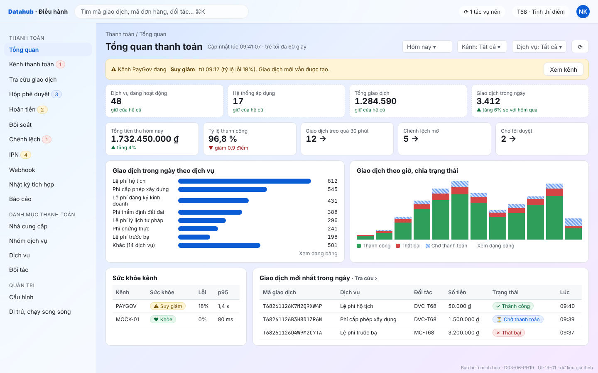
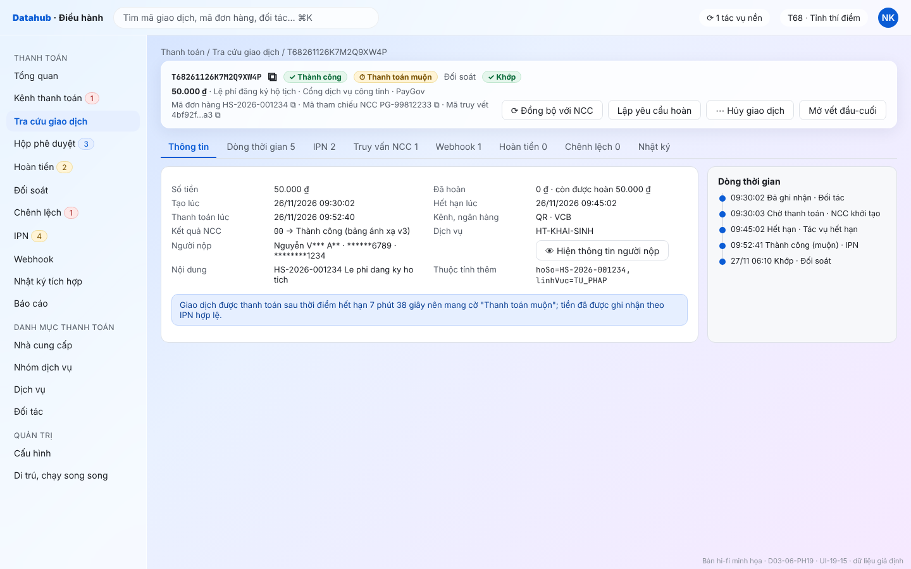

# D02-03-PH19 · Đặc tả chức năng phân hệ PH-19 Thanh toán điện tử

## Tóm tắt cho hội đồng thẩm định

PH-19 Thanh toán điện tử là lớp trung gian thanh toán của tỉnh. Các hệ thống thông tin (HTTT) của tỉnh có thu phí, lệ phí và nghĩa vụ tài chính (Cổng dịch vụ công tỉnh, HTTT giải quyết thủ tục hành chính, các ứng dụng chuyên ngành; tài liệu này gọi chung là **đối tác**) gọi vào PH-19 qua một giao diện lập trình thống nhất. PH-19 chuyển yêu cầu tới **nhà cung cấp thanh toán** (kênh đầu tiên và mặc định là PayGov, Nền tảng thanh toán của Cổng Dịch vụ công quốc gia), nhận kết quả, lưu lịch sử bất biến, báo lại cho đối tác, rồi đối soát với nhà cung cấp vào ngày làm việc kế tiếp. PH-19 **không giữ tiền và không là trung gian thanh toán** theo nghĩa pháp lý: tiền đi thẳng từ người nộp tới tài khoản thụ hưởng của cơ quan thu qua PayGov và ngân hàng. PH-19 chỉ giữ chứng cứ điện tử về yêu cầu, kết quả, hoàn tiền và đối soát.

PH-19 thay khối Payment của LGSP cũ (Viettel 2021). Hệ cũ là một "danh mục ghi nhận": khai báo nhà cung cấp, nhóm dịch vụ, dịch vụ, đối tác, ghi giao dịch và cho xem lại qua hai dashboard và màn tra cứu. Hệ cũ không xác minh kết quả gọi về, không chống ghi trùng, không đối soát, không hoàn tiền, lưu số tiền kiểu `int(10)` (trần khoảng 2,1 tỷ đồng) và ngày thanh toán kiểu chuỗi. Toàn bộ 23 chức năng hệ cũ đã kiểm kê ở D00-03 (LGC-PAY-001…023) cùng ba hành vi được đề xuất bổ sung (LGC-PAY-024…026) đều có FR phủ; không chức năng nào bị loại bỏ (mục 11.1).

Tài liệu đặc tả **69 yêu cầu chức năng** (68 FR do khung truy vết cấp và một FR đề xuất bổ sung FR-19-069 về bảng ánh xạ mã kết quả theo giả định GĐ-03), **32 yêu cầu phi chức năng** và **34 quy tắc nghiệp vụ**, chia thành 15 nhóm miền: nhà cung cấp, dịch vụ, đối tác, giao dịch, nhận kết quả (IPN), chống trùng, truy vấn trạng thái, hoàn tiền, đối soát, tra cứu, nhật ký, dashboard và báo cáo, thông báo cho đối tác, cấu hình theo tenant, di trú. Phạm vi **MVP của PH-19** (mục 11.3) gồm 63 FR (60 FR trọn vẹn và 3 FR có một phần ở MVP), đủ để chuyển đối tác đầu tiên của tỉnh thí điểm từ hệ cũ sang Datahub; 5 FR thuộc bản tăng cường Đ2b và 1 FR (lớp tương thích API hệ cũ) để sau, chỉ làm khi có nhu cầu.

Năm điểm thiết kế chính mà hội đồng cần biết:

1. **Chỉ ba nguồn có xác thực được chốt kết quả**: thông báo kết quả từ máy chủ nhà cung cấp đã xác minh chữ ký (IPN), kết quả truy vấn nhà cung cấp qua kênh có xác thực, và quyết định xử lý chênh lệch đã qua phê duyệt bốn mắt. Việc người nộp được chuyển về trang của đối tác không bao giờ làm đổi trạng thái giao dịch (BR-19-014).
2. **Đúng một lần**: mọi yêu cầu ghi của đối tác mang khóa lũy đẳng `Idempotency-Key`; mỗi mã hồ sơ của đối tác chỉ có tối đa một giao dịch đang mở hoặc đã thành công; IPN đến nhiều lần chỉ được áp một lần (BR-19-006, 007, 015).
3. **Bộ trạng thái nội bộ, không phụ thuộc mã PayGov** (giả định GĐ-03): máy trạng thái giao dịch dùng tám trạng thái của Datahub; mã kết quả của PayGov chỉ đi vào hệ thống qua bảng ánh xạ cấu hình có phê duyệt, mã chưa biết luôn rơi về "chờ xác minh" và không bao giờ tự coi là thành công (mục 4.3, FR-19-069).
4. **Đối soát hằng ngày bắt buộc**: mỗi nhà cung cấp, mỗi ngày giao dịch có một phiên đối soát; mọi dòng lệch sinh bản ghi chênh lệch có người phụ trách và hạn xử lý; phiên chỉ chốt được khi mọi chênh lệch đã xử lý và phiên đã chốt là bất biến (BR-19-028).
5. **Tách nhiệm và an toàn**: kích hoạt nhà cung cấp, duyệt đối tác, hoàn tiền, xử lý chênh lệch, mở lại phiên đối soát, đổi chế độ định tuyến và đổi bảng ánh xạ mã đều qua phê duyệt bốn mắt; khóa ký chỉ nằm trong kho bí mật; dữ liệu cá nhân người nộp được mã hóa mức trường bằng khóa riêng của từng tenant; phân hệ chạy ở đơn vị triển khai riêng `dh-payment` với CSDL riêng `pg-payment` (chốt Q340) để vẫn thu được tiền khi khối điều khiển ngừng.

Mọi chi tiết kỹ thuật của PayGov (tên trường, thuật toán ký, cơ chế gửi lại kết quả, định dạng dữ liệu đối soát, khả năng hoàn tiền qua API) là **Giả định – cần đối chiếu Tài liệu kỹ thuật kết nối Nền tảng thanh toán của Cổng DVCQG do VPCP cấp**, được cô lập trong một bộ chuyển đổi (adapter) theo ADR-040 và gom thành nhóm câu hỏi mở OQ-19-01…08. Khi đặc tả PayGov thay đổi, chỉ adapter và bảng ánh xạ mã thay đổi; lõi nghiệp vụ, CSDL và hợp đồng API với đối tác giữ nguyên.

Bảng dưới tóm tắt các con số chính của tài liệu. Số FR theo mức ưu tiên lấy từ chương 5; phạm vi đợt phát hành ở mục 11.3.

| Hạng mục | Số lượng | Ghi chú |
|---|---|---|
| Yêu cầu chức năng (FR-19) | 69 | M 58, S 10, C 1; MVP 60, MVP một phần 3, Đ2b 5, Sau 1 |
| Nhóm chức năng | 15 | Nhóm A…O, chương 6 |
| Quy tắc nghiệp vụ (BR-19) | 34 | BR-19-001…034, chương 7 |
| Yêu cầu phi chức năng (NFR-19) | 32 | NFR-19-001…032, mục 8.2 |
| Màn hình (UI-19) | 28 | UI-19-01…28, mục 10.1 |
| API (API-19) | 92 thao tác ở ba nhóm API | Danh mục theo FR ở mục 9.4; đặc tả ở D03-04-PH19 |
| Mã lỗi (ERR-19) | 51 | ERR-19-001…050, 099, mục 9.1 |
| Sự kiện (EVT-19) | 18 | EVT-19-01…18, mục 9.3 |
| Chức năng hệ cũ được phủ (LGC-PAY) | 26 | LGC-PAY-001…023 và ba hành vi đề xuất 024…026, mục 11.1 |
| Tiêu chí chấp nhận (AC-19) | 13 | Chương 14 |

: Các con số chính của PH-19

## 1. Giới thiệu

Chương này cho biết tài liệu dùng để làm gì, bao quát những gì, ai đọc phần nào, các thuật ngữ, quy ước riêng và tài liệu viện dẫn. Người đọc lần đầu nên đọc mục 1.3 để biết lộ trình đọc phù hợp với vai trò của mình.

### 1.1. Mục đích của tài liệu

Tài liệu đặc tả đầy đủ các yêu cầu chức năng (FR), yêu cầu phi chức năng (NFR) và quy tắc nghiệp vụ (BR) của PH-19 ở mức đủ để đội phát triển hiện thực và đội kiểm thử viết ca kiểm thử mà không phải hỏi lại. Theo khung truy vết D02-03-PH19-00 §16, đây là tài liệu **chủ quản** của ba loại mã FR-19, NFR-19 và BR-19: khi tài liệu khác mâu thuẫn với nội dung FR, NFR, BR ở đây thì tài liệu này đúng, trừ khi D00-01 hoặc khung truy vết quy định khác.

Mỗi chức năng được đặc tả bằng một bảng hai cột 17 mục theo chuẩn kết hợp của D00-01 §4.3 và K-TRINH-BAY §4 (mục 6.1). Các mục kỹ thuật (tác nhân và quyền, truy vết, tiền điều kiện, đầu vào, luồng xử lý có mã lỗi, đầu ra, hậu điều kiện, sự kiện, kiểm toán) để kỹ sư lập trình và kiểm thử viên viết ca kiểm thử; các mục thuyết minh (mục đích, kích hoạt, luồng thay thế, câu thông báo người dùng nhìn thấy, kết quả, quy tắc nghiệp vụ, màn hình) để hội đồng thẩm định và cán bộ nghiệp vụ đọc mà không cần đọc mã. Bản 0.2 giữ nguyên toàn bộ chi tiết kỹ thuật của bản 0.1 và bổ sung lớp thuyết minh này.

### 1.2. Phạm vi

Phạm vi của PH-19 theo bảng "làm / không làm" ở khung truy vết §1.2 và yêu cầu nghiệp vụ REQ-91…99 ở D02-01-PH19 §6. Tóm tắt:

| Thuộc phạm vi | Ngoài phạm vi (ai làm) |
|---|---|
| Vòng đời nhà cung cấp thanh toán, thông tin xác thực (chỉ tham chiếu kho bí mật), kiểm tra kết nối, giao dịch thử, kích hoạt có phê duyệt, giám sát sức khỏe, xoay khóa | Ký thỏa thuận kết nối với VPCP (chủ đầu tư); tích hợp trực tiếp từng ngân hàng, ví (đi qua PayGov) |
| Nhóm dịch vụ, dịch vụ thanh toán gắn với mã danh mục PH-07 | Bảng danh mục ngân hàng, kênh, lĩnh vực, loại phí, cơ quan (PH-07); tính mức phí, lệ phí (HTTT đối tác) |
| Đối tác, client máy-máy, dịch vụ được gán, hạn mức, webhook | Kết nạp HTTT nói chung (PH-01); cấp phát danh tính (PH-12) |
| Giao dịch: tạo, khởi tạo tại nhà cung cấp, quay về, IPN, truy vấn, hủy, hết hạn, lịch sử bất biến, lũy đẳng | Trang chọn ngân hàng, nhập thẻ (PayGov); lưu số thẻ, số tài khoản đầy đủ (cấm); phát hành biên lai điện tử có giá trị pháp lý (OQ-19-14) |
| Hoàn tiền có phê duyệt, chế độ API hoặc thủ công có chứng từ | Quyết định hành chính về việc hoàn phí (cơ quan thu) |
| Đối soát T+1, chênh lệch, chốt phiên, biên bản | Hạch toán kế toán, quyết toán ngân sách, đối soát ngân hàng – Kho bạc |
| Tra cứu, chi tiết, nhật ký, hai dashboard, báo cáo định kỳ, xuất tệp | Kho phân tích dài hạn, BI (PH-16) |
| Webhook có ký, sự kiện Kafka qua outbox | Gửi SMS, thư điện tử cho người nộp (đối tác) |
| Cấu hình theo tenant, RLS, khóa và chứng thư riêng từng tenant | Khởi tạo tenant, bật gói phân hệ (PH-20) |
| Di trú dữ liệu hệ cũ, chạy song song theo đối tác, đối chiếu sau di trú | Sửa mã nguồn hệ cũ; di trú người dùng (PH-12) |

: Phạm vi thuộc và ngoài trách nhiệm của PH-19

Bảng sau nêu trách nhiệm của PH-19 theo từng nhóm chức năng của chương 6, kèm dải FR tương ứng.

| Nhóm | Trách nhiệm | FR |
|---|---|---|
| A | Vòng đời nhà cung cấp, thông tin xác thực, kiểm tra, kích hoạt, giám sát sức khỏe, xoay khóa, bảng ánh xạ mã kết quả | FR-19-001…012, 069 |
| B | Nhóm dịch vụ, dịch vụ thanh toán, mã danh mục PH-07 | FR-19-013…016 |
| C | Đối tác, client máy-máy, dịch vụ và hạn mức, webhook | FR-19-017…021 |
| D | Tạo, kiểm tra, khởi tạo, quay về, hủy, hết hạn giao dịch; lịch sử bất biến | FR-19-022…028 |
| E | Tiếp nhận, xác minh, xử lý đúng một lần, cách ly IPN | FR-19-029…032 |
| F | Lũy đẳng và chống trùng | FR-19-033, 034 |
| G | Truy vấn trạng thái, truy vấn chủ động, đồng bộ thủ công | FR-19-035…037 |
| H | Hoàn tiền có phê duyệt | FR-19-038…041 |
| I | Đối soát hằng ngày, chênh lệch, chốt phiên, biên bản | FR-19-042…048 |
| J | Tra cứu, chi tiết, xuất giao dịch | FR-19-049…052 |
| K | Nhật ký kiểm toán, nhật ký tích hợp, truy vết | FR-19-053…055 |
| L | Dashboard, báo cáo, chỉ số và cảnh báo | FR-19-056…059 |
| M | Webhook, sự kiện qua outbox, gửi lại | FR-19-060…062 |
| N | Cấu hình tenant, bật và tạm ngừng phân hệ | FR-19-063, 064 |
| O | Di trú, chạy song song, lớp tương thích, đối chiếu | FR-19-065…068 |

: Trách nhiệm của PH-19 theo nhóm chức năng

### 1.3. Đối tượng sử dụng và cách đọc

Bảng sau gợi ý phần cần đọc trước và tài liệu đọc tiếp cho từng nhóm người đọc.

| Người đọc | Đọc trước | Sau đó |
|---|---|---|
| Hội đồng thẩm định, chủ đầu tư | Tóm tắt, chương 2, mục 11.3 (MVP), chương 14 | D02-01-PH19 |
| Sở Tài chính, kế toán | Mục 2.7 (vòng đời giao dịch), nhóm H, I, L ở chương 6, chương 7 | D02-04-PH19 UC-19-17…21 |
| Kiến trúc sư, trưởng nhóm phát triển | Chương 4, 6, 7, 8 | D03-02-PH19 (SDD), D03-03-PH19 (CSDL), D03-04-PH19 (API) |
| Lập trình viên `dh-payment` | Mục 6.1 rồi nhóm FR được giao | SDD, API |
| Lập trình viên giao diện | Mục 10.1 rồi FR của màn được giao | D03-06-PH19 |
| Kiểm thử viên | Chương 6, 7, 8, 14 | D05-02-PH19 |
| Cán bộ ATTT | NFR-19-018…025, nhóm A (thông tin xác thực), E (IPN), M (webhook) | D03-07 |

: Người đọc và phần nên đọc

### 1.4. Thuật ngữ và chữ viết tắt

Tài liệu dùng thuật ngữ và kiểu dữ liệu chung của D00-01. Mục này liệt kê chữ viết tắt, ký hiệu vai trò và quy ước riêng của tài liệu; thuật ngữ nghiệp vụ riêng của thanh toán (đối tác, nhà cung cấp, adapter, IPN, kết thúc mềm, thanh toán muộn, bốn mắt…) ở mục 4.4.

#### 1.4.1. Chữ viết tắt

| Viết tắt | Nghĩa |
|---|---|
| NCC | Nhà cung cấp thanh toán (PayGov và các kênh thêm về sau) |
| HTTT | Hệ thống thông tin; ở PH-19 là HTTT đối tác gọi vào để thu tiền |
| IPN | Instant Payment Notification, thông báo kết quả do máy chủ NCC gửi tới máy chủ PH-19 |
| DU | Deployment Unit, đơn vị triển khai (PH-19 chạy ở `dh-payment`) |
| RLS | Row-Level Security, chính sách lọc dòng theo tenant của PostgreSQL |
| WORM | Write Once Read Many, kho ghi một lần không sửa không xóa (Ceph RGW Object Lock) |
| ETag | Thẻ phiên bản của đối tượng, dùng với `If-Match` để khóa lạc quan |
| HMAC | Mã xác thực thông điệp dùng khóa bí mật, dùng ký webhook và tham số quay về |
| SSRF | Server-Side Request Forgery, tấn công lừa máy chủ gọi tới địa chỉ nội bộ |
| OPA | Open Policy Agent, bộ quyết định quyền của PH-12 |
| CSDL | Cơ sở dữ liệu |
| MVP, Đ2b, Sau | Ba mức đợt phát hành của FR (mục 1.4.3) |
| BP, BO, KPI, REQ | Mã quy trình, mục tiêu, chỉ số và yêu cầu nghiệp vụ của BRD D02-01-PH19 |
| LGC-PAY | Mã chức năng hệ Payment cũ ở D00-03 |
| GĐ | Giả định cấp dự án ở D00-03 §6 (ví dụ GĐ-03) |
| A-19, OQ-19, AC-19 | Giả định, câu hỏi mở và tiêu chí chấp nhận của PH-19 |
| T+1 | Ngày làm việc kế tiếp ngày giao dịch |

: Chữ viết tắt dùng trong tài liệu

#### 1.4.2. Ký hiệu vai trò

Ký hiệu vai trò dưới đây dùng ở ma trận quyền mục 3.2; trong khối đặc tả, vai trò được gọi bằng tên tiếng Việt (ví dụ "Quản trị thanh toán").

| Ký hiệu | Mã vai trò | Tầng | Gán cho |
|---|---|---|---|
| PLA | `ROLE-PLATFORM_ADMIN` | Nền tảng | Kỹ sư của đơn vị cung cấp sản phẩm (SH-11) |
| TEN | `ROLE-TENANT_ADMIN` | Tenant | Quản trị Datahub của tỉnh (SH-03) |
| ADM | `ROLE-PAYMENT_ADMIN` | Tenant | Cán bộ quản trị thanh toán |
| APR | `ROLE-PAYMENT_APPROVER` | Tenant | Lãnh đạo đơn vị vận hành hoặc Sở Tài chính theo phân công (OQ-19-18) |
| ACC | `ROLE-PAYMENT_ACCOUNTANT` | Tenant | Kế toán, đối soát viên (SH-92) |
| OPR | `ROLE-PAYMENT_OPERATOR` | Tenant | Cán bộ hỗ trợ, tra cứu |
| AUD | `ROLE-AUDITOR` | Tenant | Kiểm toán viên, thanh tra (SH-97) |
| SEC | `ROLE-SECURITY_OFFICER` | Tenant / nền tảng | Cán bộ ATTT |
| PTN | `ROLE-PARTNER_SYSTEM` | Máy | Client máy-máy của HTTT đối tác |

: Ký hiệu vai trò của PH-19 (khung §13.1)

#### 1.4.3. Quy ước riêng và điểm điều chỉnh so với khung 0.1

Tài liệu dùng nguyên quy ước của D00-01 và khung truy vết. Cột "Phát hành" của mỗi FR nhận một trong ba giá trị: **MVP** (bản phát hành đầu tiên của PH-19, đủ để chuyển đối tác đầu tiên), **Đ2b** (bản tăng cường trong đợt 2, sau MVP; mô hình dữ liệu và API đã chừa sẵn từ MVP) và **Sau** (sau đợt 2, chỉ làm khi có điều kiện ghi kèm).

Khung truy vết bản 0.1 được lập ngày 21/11/2026, trước một số quyết định ngày 25/11/2026. Tài liệu này áp các điều chỉnh dưới đây; khung được cập nhật lên bản 0.2 trong cùng đợt (khung §0 cho phép tài liệu chủ quản đề xuất, luồng PH-19 đã gộp):

| # | Điểm | Khung 0.1 | Áp dụng từ bản này | Căn cứ |
|---|---|---|---|---|
| 1 | Căn cứ ATTT | NĐ 85/2016, TT 12/2022, TCVN 11930:2017 | NĐ 331/2026/NĐ-CP (CMP-LAW-06), TCVN 14423:2026 (CMP-LAW-08); văn bản cũ ở cột kế thừa | D00-01 §7, ADR-030 |
| 2 | Căn cứ dữ liệu cá nhân | NĐ 13/2023 | Luật BVDLCN 91/2025/QH15 (CMP-LAW-05), NĐ 356/2025/NĐ-CP (CMP-LAW-04) | D00-01 §7 |
| 3 | Kết nối, chia sẻ dữ liệu | NĐ 47/2020 | NĐ 278/2025/NĐ-CP (CMP-LAW-03) | D00-01 §7 |
| 4 | Lưu trữ bất biến | Garage có object lock | Garage cho tệp nghiệp vụ (bucket `dh-{tenant}-payment`); chứng cứ cần WORM (chuỗi băm hằng ngày, biên bản đã chốt, dữ liệu lưu trữ quá 24 tháng) trên Ceph RGW Object Lock chế độ compliance, bucket riêng `dh-{tenant}-payment-worm` | ADR-008 (chốt Q306, Q347), ADR-031 |
| 5 | Mã hóa dữ liệu cá nhân | ADR-048 độc lập | ADR-048 chi tiết hóa ADR-032 (mã hóa envelope qua OpenBao) cho dữ liệu người nộp, thêm HMAC tìm kiếm | ADR-032 |
| 6 | Trạng thái giao dịch | Tám trạng thái tiếng Anh, ánh xạ mã PayGov qua danh mục PH-07 `DM_MA_LOI_NCC_THANH_TOAN` | Giữ tám giá trị enum (quy ước `T-ENUM` của D00-01); bảng tương ứng với nhãn GĐ-03 ở mục 4.3; thêm cột cờ đối soát `recon_status`; ánh xạ mã nhà cung cấp qua bảng cấu hình `provider_result_mapping` (EN-19-26, đề xuất) có phê duyệt; danh mục PH-07 chỉ giữ nhãn tham khảo | GĐ-03 (D00-03 §6) |
| 7 | Đường dẫn tệp đi kèm | Thư mục `PH19/` | Thư mục chữ thường `ph19/` như PH-04, PH-07 | Thống nhất bộ tài liệu |
| 8 | Mã tenant ví dụ | `T68` | Giữ `T68` (ví dụ của D00-01); tỉnh thí điểm trong giả định GĐ-06 gọi là `T01` | D00-01 §5 |

: Điểm điều chỉnh so với khung truy vết 0.1

Kiểu dữ liệu theo D00-01 §5. Tài liệu dùng thêm: `T-TXN-CODE` mã giao dịch PH-19 (BR-19-002, mẫu `^T[0-9]{2}[0-9]{6}[0-9A-HJKMNP-TV-Z]{10}$`, 19 ký tự); `T-ORDER-ID` mã đơn hàng, mã hồ sơ của đối tác (`varchar(64)`, mẫu `^[A-Za-z0-9._:/-]{1,64}$`); `T-IDEM-KEY` khóa lũy đẳng (16…64 ký tự `[A-Za-z0-9_-]`).

### 1.5. Tài liệu tham chiếu

Mục này liệt kê tài liệu dự án có quan hệ với FRS (mục 1.5.1) và văn bản pháp lý riêng của thanh toán (mục 1.5.2). Căn cứ pháp lý dùng chung của Datahub theo D00-01 §7.

#### 1.5.1. Tài liệu dự án

| Mã | Tài liệu | Quan hệ |
|---|---|---|
| D00-01 | Thuật ngữ và quy ước | Kiểu dữ liệu `T-*`, quy ước mã, đường dẫn REST, topic |
| D00-02 | Sổ ADR | ADR-001, 003, 004, 005, 006, 008, 011, 012, 013, 030…035; ADR-040…049 của PH-19 |
| D00-03 | Ma trận truy vết | LGC-PAY-001…023; giả định GĐ-03 |
| D02-01, D02-01-PH19 | BRD tổng và BRD thanh toán | REQ-19 và mã con REQ-91…99, BP-91…96, BO-91…96, KPI-91…99 |
| D02-02 | SRS cấp hệ thống | FR-00-*, NFR-00-*; FR-00-090…093 về di trú |
| D02-03-PH19-00 | Khung truy vết PH-19 | Cấp phát mọi mã của PH-19; máy trạng thái (§7); thực thể (§9); API (§10); lỗi (§12); quyền (§13) |
| D02-04-PH19 | Đặc tả use case | UC-19-01…29 |
| D02-08 | Ma trận phân quyền | ROLE, PERM-19-* (đề xuất từ khung §13) |
| D03-01 | SAD | DU `dh-payment`, cụm `pg-payment`, tầng phục hồi `TPH-0` |
| D03-02-PH19, D03-03-PH19, D03-04-PH19, D03-06-PH19 | SDD, CSDL, API, màn hình | Hiện thực FR của tài liệu này |
| D03-07, D03-08 | Thiết kế ATTT, hồ sơ cấp độ | Biện pháp SEC-nn cho NFR-19-018…025 |
| D03-10 | Thiết kế đa tenant | RLS, tiền tố topic, bucket, khóa theo tenant |
| D05-02-PH19 | Kịch bản và test case | TS-19-01…34 |

: Tài liệu dự án liên quan

#### 1.5.2. Căn cứ pháp lý riêng của PH-19

Căn cứ dùng chung của Datahub giữ mã của D00-01 §7. Các văn bản riêng của thanh toán do D02-01-PH19 §2.1 đề xuất ở dải `CMP-LAW-91…97` và được dẫn kèm chữ "(đề xuất)" cho tới khi gộp vào D00-01. Mọi văn bản ở bảng dưới cần đối chiếu số hiệu, hiệu lực và điều khoản với Công báo trước bản 1.0 (OQ-19-21).

| Mã | Văn bản | FR, NFR chịu chi phối | Kế thừa, chuyển tiếp |
|---|---|---|---|
| CMP-LAW-91 (đề xuất) | Nghị định 45/2020/NĐ-CP về thực hiện thủ tục hành chính trên môi trường điện tử | Nhóm D, E, M (kết quả thanh toán là một phần hồ sơ điện tử) | — |
| CMP-LAW-92 (đề xuất) | Nghị định 42/2022/NĐ-CP về cung cấp thông tin và dịch vụ công trực tuyến | Nhóm D | — |
| CMP-LAW-93 (đề xuất) | Nghị định 61/2018/NĐ-CP sửa đổi bởi Nghị định 107/2021/NĐ-CP về cơ chế một cửa | Nhóm D, J | — |
| CMP-LAW-94 (đề xuất) | Nghị định 52/2024/NĐ-CP về thanh toán không dùng tiền mặt | Phạm vi (PH-19 không giữ tiền); nhóm H | — |
| CMP-LAW-95 (đề xuất) | Luật Giao dịch điện tử số 20/2023/QH15 | FR-19-028, 029, 047, 048; NFR-19-016 | — |
| CMP-LAW-96 (đề xuất) | Thông tư 74/2022/TT-BTC hoặc văn bản thay thế; Nghị định 123/2020/NĐ-CP về hóa đơn, chứng từ | Nhóm D, H; OQ-19-14 | — |
| CMP-LAW-97 (đề xuất) | Luật Kế toán số 88/2015/QH13; Luật Lưu trữ năm 2024 | NFR-19-014, 015 | — |
| CMP-LAW-03 | Nghị định 278/2025/NĐ-CP về kết nối, chia sẻ dữ liệu | Nhóm M (sự kiện cho lớp dữ liệu dùng chung) | NĐ 47/2020/NĐ-CP |
| CMP-LAW-04, 05 | Luật BVDLCN 91/2025/QH15; Nghị định 356/2025/NĐ-CP | NFR-19-024; BR-19-031, 032; FR-19-051, 052 | NĐ 13/2023/NĐ-CP |
| CMP-LAW-06, 08 | Nghị định 331/2026/NĐ-CP; TCVN 14423:2026 | NFR-19-018…023 | NĐ 85/2016/NĐ-CP, TT 12/2022/TT-BTTTT (CMP-LAW-07), TCVN 11930:2017 |
| CMP-LAW-16 | Luật An ninh mạng số 116/2025/QH15 | NFR-19-014, 015 (lưu trữ trong nước) | Luật ANM 2018, Luật ATTT mạng 2015 |

: Căn cứ pháp lý riêng của PH-19

### 1.6. Cấu trúc tài liệu

Chương 2 trình bày tổng quan phân hệ cho hội đồng thẩm định: vai trò trong Datahub, hệ cũ và hạn chế, mục tiêu đo được, vị trí trong kiến trúc, thành phần và luồng chính, quy trình nghiệp vụ, chức năng hệ cũ được phủ. Chương 3 nêu tác nhân, ma trận quyền và tách nhiệm. Chương 4 mô tả khái niệm, mô hình nghiệp vụ và máy trạng thái. Chương 5 là bảng danh sách 69 chức năng. Chương 6 đặc tả chi tiết từng chức năng bằng khối 17 mục, chia 15 nhóm A…O. Chương 7 liệt kê quy tắc nghiệp vụ; chương 8 tham số cấu hình và yêu cầu phi chức năng; chương 9 mã lỗi, câu thông báo, sự kiện và danh mục API theo FR. Chương 10 liệt kê màn hình và giới thiệu hai giao diện tiêu biểu. Chương 11 là ma trận truy vết và phạm vi MVP; chương 12 phụ thuộc, giả định, ràng buộc; chương 13 câu hỏi mở; chương 14 tiêu chí chấp nhận cấp phân hệ. Phụ lục A liệt kê mã đề xuất bổ sung cho khung truy vết, phụ lục B các đề nghị đồng bộ sang tập khác.

## 2. Tổng quan phân hệ

Chương này viết cho hội đồng thẩm định và chủ đầu tư: PH-19 giải quyết vấn đề gì của hệ cũ, đặt ở đâu trong kiến trúc Datahub, gồm những thành phần nào, phục vụ quy trình nghiệp vụ nào và cam kết những mục tiêu đo được nào.

### 2.1. Vai trò của PH-19 trong Datahub

PH-19 là phân hệ duy nhất của Datahub xử lý dòng thông tin tài chính. Nó đứng giữa ba nhóm: các HTTT đối tác của tỉnh (gọi vào để thu), các nhà cung cấp thanh toán (PayGov, sau này có thể thêm kênh khác) và cán bộ của tỉnh (quản trị, phê duyệt, kế toán, tra cứu, kiểm toán). Theo SAD D03-01 §4.2, PH-19 chạy trong đơn vị triển khai riêng `dh-payment` gồm cả phần điều khiển (API quản trị, màn hình) và phần dữ liệu (API đối tác, nhận IPN, bộ gửi webhook). Phân hệ dùng cụm CSDL riêng `pg-payment` và thuộc tầng phục hồi `TPH-0` (chốt Q340) để việc thu tiền và nhận kết quả vẫn chạy khi khối điều khiển của Datahub (`pg-core`) ngừng (NFR-00-012).

```{.mermaid caption="Bối cảnh trao đổi của PH-19 với đối tác, PayGov, cán bộ và các phân hệ"}
flowchart TB
  subgraph TINH["HTTT của tỉnh (đối tác)"]
    P1["Cổng DVC tỉnh"]
    P2["HTTT giải quyết TTHC"]
    P3["Ứng dụng chuyên ngành"]
  end
  subgraph DH["Datahub"]
    GW["PH-03 APISIX<br/>apisix-ext / apisix-int"]
    PAY["PH-19 dh-payment<br/>API đối tác, IPN, webhook,<br/>đối soát, quản trị"]
    DB[("pg-payment")]
    K["PH-10 Kafka"]
    IAM["PH-12 Keycloak + OPA"]
    MON["PH-13 Giám sát, kiểm toán"]
    RDM["PH-07 Danh mục"]
  end
  subgraph NCC["Nhà cung cấp"]
    PG["PayGov"]
  end
  CB["Cán bộ tỉnh<br/>(dh-console)"]
  NN["Người nộp tiền"]
  P1 & P2 & P3 -->|"API đối tác (mTLS, OAuth 2.1)"| GW --> PAY
  PAY -->|"webhook có ký"| P1 & P2 & P3
  PAY <-->|"khởi tạo, truy vấn, hoàn, đối soát"| PG
  PG -->|"IPN"| GW
  NN -->|"thanh toán"| PG
  PG -->|"quay về"| GW
  CB --> GW
  PAY --- DB
  PAY --> K
  PAY --> MON
  PAY --> IAM
  PAY --> RDM
```

Hình cho thấy PH-19 là điểm duy nhất mà HTTT đối tác, PayGov và cán bộ tỉnh cùng trao đổi về một khoản thu: đối tác gọi vào qua PH-03, PayGov gửi IPN và chuyển người nộp quay về cũng qua PH-03, còn PH-19 gọi ra PayGov, gửi webhook cho đối tác và đẩy sự kiện, kiểm toán sang PH-10, PH-13. Người nộp không đăng nhập PH-19 mà chỉ thanh toán trên trang PayGov.

### 2.2. Hệ Payment cũ và các hạn chế

Hệ cũ gồm năm bảng (`payment_partner`, `payment_provider`, `payment_service_group`, `payment_service`, `payment_transaction`), chạy chung một tiến trình Tomcat với khối khác, một máy chủ PostgreSQL. Các điểm yếu đã phân tích ở D02-01-PH19 §3.3 (14 điểm) là nguồn gốc của phần lớn FR mới của PH-19. Bảng sau tóm tắt cách PH-19 xử lý từng nhóm điểm yếu.

| Điểm yếu hệ cũ (D02-01-PH19 §3.3) | Cách PH-19 xử lý | FR, BR chính |
|---|---|---|
| 1. Không đối soát | Phiên đối soát T+1 theo nhà cung cấp, chênh lệch có người phụ trách, phiên chốt bất biến | FR-19-042…048; BR-19-025, 028 |
| 2. Không hoàn tiền (chỉ có ba trạng thái `REFUND_*`) | Yêu cầu hoàn có phê duyệt một hoặc hai cấp, chế độ API hoặc thủ công có chứng từ | FR-19-038…041; BR-19-022…024 |
| 3. Không bảo mật kết quả gọi về | Bốn lớp xác minh IPN; ghi nguyên văn vào hộp nhận trước khi trả lời | FR-19-029; NFR-19-020 |
| 4. Không chống ghi trùng | Khóa lũy đẳng; chỉ mục duy nhất có điều kiện theo mã đơn hàng; IPN áp đúng một lần | FR-19-030, 033, 034; BR-19-006, 007 |
| 5, 6. Số tiền `int(10)`, ngày thanh toán chuỗi | `T-MONEY` = `numeric(19,0)`, `paid_at` kiểu `T-TS`; chuyển đổi khi di trú có báo cáo dòng lỗi | FR-19-065; NFR-19-017 |
| 7. Một nhà cung cấp mã hóa cứng | Kiến trúc adapter, thêm kênh không sửa lõi | FR-19-024; NFR-19-027; ADR-040 |
| 8. Không lịch sử trạng thái | `transaction_event` bất biến, ghi cùng giao dịch CSDL | FR-19-028 |
| 9. Thông báo kết quả không tin cậy | Webhook ký HMAC, thử lại giãn dần, kéo thông báo bù, sự kiện Kafka qua outbox | FR-19-060…062 |
| 10. Không cách ly theo tỉnh | `tenant_id` và RLS `FORCE` trên mọi bảng; khóa, topic, bucket riêng | NFR-19-025 |
| 11. Bí mật trong tệp cấu hình | Chỉ lưu tham chiếu OpenBao; xoay khóa không gián đoạn | FR-19-002, 012; NFR-19-022 |
| 12. Không ràng buộc toàn vẹn | Khóa ngoại thật, mã duy nhất trong tenant, mã danh mục kiểm tra với PH-07 | FR-19-016; EN-19-* |
| 13. Số liệu chậm 10 phút, không cảnh báo | Số liệu trễ ≤ 60 giây; cảnh báo sự cố kênh ≤ 3 phút | FR-19-011, 056, 059; NFR-19-006, 026 |
| 14. Chỉ tiêu phi chức năng thấp | Sẵn sàng 99,9% cho API dữ liệu; 200 giao dịch/giây mỗi tenant | NFR-19-001…013 |

: Hạn chế của hệ cũ và cách PH-19 khắc phục

### 2.3. Yêu cầu mới không có ở hệ cũ

Ngoài phần thay thế hệ cũ, PH-19 có các năng lực mới mà BRD-PH19 yêu cầu: phê duyệt bốn mắt dùng chung cho mọi thao tác rủi ro cao (ADR-046); chế độ chạy song song từng đối tác `LEGACY` → `SHADOW` → `DATAHUB` để chuyển đổi không gián đoạn thu (ADR-049); kéo thông báo bù qua API khi webhook lỡ; bảng ánh xạ mã kết quả có phê duyệt (FR-19-069); biên bản đối soát có mã băm lưu kho bất biến; cấu hình thanh toán theo tenant có phiên bản và ngày hiệu lực.

### 2.4. Đa tenant trong PH-19

PH-19 tuân thủ D03-10. Tenant của một yêu cầu xác định theo ba cách tùy nhóm API: token người dùng (API quản trị), token client máy-máy (API đối tác), và `connectionKey` trong đường dẫn callback (API callback, vì IPN không mang token; ADR-045). Mỗi tenant có kết nối PayGov, khóa ký, chứng thư, khóa mã hóa dữ liệu cá nhân, bí mật ký webhook, bucket và tiền tố topic riêng. Một tenant được có nhiều bản ghi nhà cung cấp cùng loại `PAYGOV` (mỗi bản ghi một mã đơn vị kết nối), phục vụ giai đoạn sau sáp nhập tỉnh khi kết nối của tỉnh cũ còn hiệu lực (OQ-19-19).

### 2.5. Mục tiêu của phân hệ

PH-19 cam kết năm mục tiêu đo được dưới đây. Mỗi mục tiêu gắn với yêu cầu phi chức năng ở mục 8.2 (đơn vị, điều kiện đo, phân vị) và chỉ số nghiệp vụ KPI của BRD D02-01-PH19; tiêu chí nghiệm thu tương ứng ở chương 14.

| # | Mục tiêu | Chỉ tiêu đo được | NFR, KPI | Nghiệm thu |
|---|---|---|---|---|
| 1 | Thu tiền nhanh và chịu tải đỉnh của tỉnh | API tạo giao dịch p95 ≤ 300 ms, p99 ≤ 800 ms (không tính PayGov) ở 200 giao dịch/giây mỗi tenant; lỗi do PH-19 < 0,1% | NFR-19-001, 002 | AC-19-06 |
| 2 | Không mất, không ghi trùng kết quả thanh toán | Endpoint IPN trả lời p95 ≤ 200 ms; IPN lặp chỉ áp một lần; không sự kiện nào mất khi Kafka ngừng, phát bù ≤ 5 phút | NFR-19-003, 013, 020 | AC-19-03, 04, 05 |
| 3 | Đối soát hằng ngày đầy đủ | Phiên 100.000 dòng so khớp ≤ 10 phút; tỷ lệ khớp tự động ≥ 99,9% mỗi phiên; mỗi ngày mỗi NCC có một phiên | NFR-19-008; KPI-94…96 | AC-19-07 |
| 4 | Vận hành minh bạch, phát hiện sự cố sớm | Số liệu dashboard trễ ≤ 60 giây (hệ cũ 10 phút); cảnh báo kênh ngừng ≤ 3 phút; mọi bản ghi mang `trace_id` | NFR-19-006, 026; KPI-97 | AC-19-12 |
| 5 | Sẵn sàng cao, an toàn và cách ly theo tỉnh | API dữ liệu sẵn sàng ≥ 99,9% mỗi tháng; RPO = 0, RTO ≤ 15 phút; cấp độ 3 ATTT; RLS `FORCE` mọi bảng; dữ liệu người nộp mã hóa mức trường | NFR-19-010, 011, 023, 024, 025 | AC-19-09, 10, 13 |

: Mục tiêu đo được của PH-19

### 2.6. Vị trí trong kiến trúc

PH-19 chạy trong DU riêng `dh-payment` (D00-04 §2, SAD D03-01 §4.2), namespace `dh-payment` ở vùng Z3, tầng phục hồi `TPH-0`, với cụm CSDL riêng `pg-payment` (chốt Q340). Lưu lượng từ ngoài (đối tác, PayGov, trình duyệt người nộp) vào qua `apisix-ext` ở vùng Z1; console của cán bộ và mọi lời gọi ra ngoài (PayGov, webhook) đi qua `apisix-int` ở vùng Z2. Trên đường thu tiền, `dh-payment` không gọi đồng bộ DU nào của khối điều khiển.

```{.mermaid caption="Vị trí của DU dh-payment trong kiến trúc Datahub theo vùng mạng"}
flowchart TB
  subgraph NGOAI["Bên ngoài"]
    DT[["HTTT đối tác"]]
    PG[["PayGov"]]
    NN(["Người nộp"])
  end
  subgraph Z1["Z1 biên ngoài"]
    AX["apisix-ext (PH-03)"]
  end
  subgraph Z2["Z2 cổng nội bộ"]
    AI["apisix-int (PH-03), cửa ra"]
    CON["dh-console"]
  end
  subgraph Z3["Z3 namespace dh-payment, TPH-0"]
    API["dh-payment api"]
    CB["dh-payment callback"]
    WK["dh-payment worker"]
    DB[("pg-payment")]
    VK[("Valkey")]
    OBAO[("OpenBao")]
    S3[("Garage, Ceph RGW WORM")]
  end
  subgraph CP["Khối dùng chung"]
    KF["PH-10 Kafka"]
    IAM["PH-12 Keycloak, OPA"]
    MON["PH-13 giám sát, kiểm toán"]
    RDM["PH-07 danh mục (dh-data)"]
  end
  DT --> AX
  PG --> AX
  NN --> AX
  AX --> API
  AX --> CB
  CON --> AI --> API
  API --> DB
  CB --> DB
  WK --> DB
  API --> VK
  WK --> S3
  API --> OBAO
  WK --> AI
  AI --> PG
  AI --> DT
  WK --> KF
  KF --> MON
  API --> IAM
  API -.-> RDM
```

Hình cho thấy ba vai trò tiến trình của `dh-payment` (`api`, `callback`, `worker`) cùng các kho dữ liệu riêng nằm trọn trong vùng Z3 và tầng `TPH-0`. Khối dùng chung chỉ được gọi bất đồng bộ (Kafka, PH-13) hoặc ngoài đường thu tiền (PH-07 khi ghi cấu hình, nét đứt), nên khi khối điều khiển ngừng thì việc tạo giao dịch, nhận IPN và gửi webhook vẫn chạy (NFR-00-012, AC-19-13).

### 2.7. Kiến trúc thành phần và luồng chính

Một ảnh container của `dh-payment` chạy ba vai trò chọn theo hồ sơ Spring, mở rộng độc lập theo tải (chi tiết ở D03-02-PH19 §2). Bảng dưới nêu thành phần, công nghệ và nhóm chức năng mỗi thành phần hiện thực.

| Thành phần | Vai trò tiến trình | Công nghệ | Nhóm FR |
|---|---|---|---|
| API quản trị `/api/payment/v1` | `api` | Java 21, Spring Boot 4, Spring Modulith | A, B, C, H, I, J, K, L, N, O |
| API đối tác `/api/payment-partner/v1` | `api` | Spring Boot, OAuth 2.1 mTLS hoặc `private_key_jwt` qua PH-12 | D, F, G, H (đối tác), M (kéo thông báo) |
| Adapter nhà cung cấp (`PaymentProviderPort`) | `api`, `worker` | Lớp chống nhiễm theo ADR-040, bulkhead, mạch ngắt, egress gateway | A, D, G, H, I |
| Callback `/api/payment-callback/v1` | `callback` | Xác minh bốn lớp, `callback_inbox` | D (quay về), E |
| Bộ xử lý inbox | `worker` | `FOR UPDATE SKIP LOCKED`, thử lại giãn dần, DLQ PH-18 | E |
| Bộ lập lịch, tác vụ nền | `worker` | ShedLock, khóa lãnh đạo Valkey, KEDA | A (sức khỏe), D (hết hạn), G (truy vấn bù), I (đối soát), J, L (xuất) |
| Bộ gửi webhook | `worker` | HMAC-SHA256, CloudEvents 1.0, cửa ra `apisix-int` | M |
| Bộ phát outbox | `worker` hoặc Debezium | Outbox Event Router, Kafka, Apicurio | K, M |
| CSDL `pg-payment` | — | PostgreSQL 18 trên CloudNativePG, RLS `FORCE`, phân vùng theo tháng | Mọi nhóm |
| Kho tệp | — | Garage (`dh-{tenant}-payment`), Ceph RGW Object Lock (`dh-{tenant}-payment-worm`) | I, J, L, O |
| Kho bí mật | — | OpenBao, đường `kv/dh/{tenant}/payment/` | A, C, M |

: Thành phần và công nghệ của PH-19

Sơ đồ trình tự dưới đây là luồng chính của phân hệ, từ lúc đối tác tạo giao dịch, qua PayGov và IPN, tới khi đối tác nhận webhook và giao dịch được đối soát ngày hôm sau (chuyển từ mục 4.4 của bản 0.1).

```{.mermaid caption="Luồng chính: tạo giao dịch, thanh toán trên PayGov, IPN, webhook đối tác và đối soát T+1"}
sequenceDiagram
  autonumber
  participant DT as HTTT đối tác
  participant GW as PH-03 APISIX
  participant PAY as PH-19
  participant PG as PayGov
  participant NN as Người nộp
  DT->>GW: POST /payments (Idempotency-Key)
  GW->>PAY: Chuyển tiếp, token đã xác thực
  PAY->>PAY: Kiểm tra 15 bước (BR-19-004), ghi CREATED
  PAY->>PG: Khởi tạo qua adapter
  PG-->>PAY: paymentUrl, providerReference
  PAY->>PAY: CREATED → PENDING
  PAY-->>DT: 201 transactionCode, paymentUrl, expiresAt
  DT->>NN: Chuyển hướng tới paymentUrl
  NN->>PG: Chọn kênh, thanh toán
  PG->>GW: IPN (máy chủ tới máy chủ)
  GW->>PAY: /paygov/{connectionKey}/ipn
  PAY->>PAY: Xác minh 4 lớp, ghi callback_inbox, trả lời PayGov
  PAY->>PAY: Xử lý inbox: PENDING → SUCCEEDED, outbox
  PAY-->>DT: Webhook transaction.succeeded (HMAC)
  PG->>NN: Chuyển về /return
  NN->>PAY: /paygov/{connectionKey}/return
  PAY-->>NN: UI-19-28 rồi chuyển về returnUrl của đối tác
  Note over PAY,PG: T+1 06:00 phiên đối soát so khớp giao dịch với dữ liệu PayGov
```

Hình cho thấy ba điểm thiết kế chính. Thứ nhất, PH-19 trả `paymentUrl` cho đối tác ngay sau khi PayGov khởi tạo (bước 5 đến 7), còn kết quả thanh toán đến sau qua IPN máy chủ tới máy chủ (bước 10 đến 13). Thứ hai, IPN được xác minh và ghi hộp nhận trước khi trả lời PayGov, việc đổi trạng thái và gửi webhook diễn ra bất đồng bộ qua outbox. Thứ ba, lượt quay về của người nộp (bước 15 đến 17) chỉ để hiển thị trang kết quả UI-19-28 và không đổi trạng thái giao dịch (BR-19-014). Phiên đối soát lúc 06:00 ngày hôm sau xác nhận lại giao dịch với dữ liệu của PayGov.

### 2.8. Quy trình nghiệp vụ liên quan

PH-19 tham gia sáu quy trình nghiệp vụ của BRD D02-01-PH19. Bảng dưới nêu các bước có PH-19 và chức năng tương ứng.

| BP | Quy trình | Bước có PH-19 | FR chính |
|---|---|---|---|
| BP-91 | Đưa một nhà cung cấp thanh toán vào sử dụng | Khai báo, gắn thông tin xác thực, kiểm tra kết nối, giao dịch thử, đề nghị và duyệt kích hoạt | FR-19-001…005, 069 |
| BP-92 | Đăng ký một HTTT đối tác được thu qua nền tảng | Hồ sơ đối tác, cấp client, gán dịch vụ và hạn mức, webhook, duyệt đưa vào sử dụng | FR-19-017…021 |
| BP-93 | Thu một khoản phí, lệ phí trực tuyến | Tạo giao dịch, khởi tạo tại PayGov, quay về, IPN, truy vấn bù, webhook | FR-19-022…037, 060…062 |
| BP-94 | Hoàn tiền một giao dịch | Lập yêu cầu, duyệt một hoặc hai cấp, thực thi, cập nhật giao dịch gốc | FR-19-038…041 |
| BP-95 | Đối soát ngày và xử lý chênh lệch | Lập phiên, thu dữ liệu, so khớp, xử lý chênh lệch có duyệt, chốt, biên bản | FR-19-042…048 |
| BP-96 | Chuyển một đối tác từ hệ cũ sang Datahub | Nhập dữ liệu, chạy bóng, đối chiếu, chuyển chế độ định tuyến | FR-19-065…068 |

: Quy trình nghiệp vụ có PH-19 tham gia

```{.mermaid caption="Vòng đời điển hình của một khoản thu qua các quy trình BP-93, BP-95, BP-94"}
flowchart TB
  A["BP-93 Đối tác tạo giao dịch"] --> B["Người nộp thanh toán trên PayGov"]
  B --> C["IPN hoặc truy vấn bù chốt kết quả"]
  C --> D["Webhook báo đối tác, hồ sơ được ghi nhận"]
  D --> E["BP-95 Đối soát T+1 với PayGov"]
  E --> F{"Khớp?"}
  F -- "Có" --> G["Chốt phiên, biên bản WORM"]
  F -- "Không" --> H["Chênh lệch, đề xuất và duyệt xử lý"]
  H --> G
  D --> I["BP-94 Hoàn tiền khi có quyết định hoàn phí"]
  I --> E
```

Hình cho thấy một khoản thu chỉ được coi là khép lại khi phiên đối soát của ngày giao dịch đã chốt; hoàn tiền, nếu có, cũng quay về bước đối soát. Trình tự kỹ thuật chi tiết của bước thu ở mục 2.7, máy trạng thái giao dịch ở mục 4.2.

### 2.9. Chức năng hệ cũ được phủ

Hệ Payment cũ có 23 chức năng đã kiểm kê (LGC-PAY-001…023) và ba hành vi được đề xuất bổ sung (LGC-PAY-024…026). Tất cả đều có FR phủ, không chức năng nào bị loại bỏ. Bảng dưới tóm tắt theo nhóm; bảng đầy đủ từng LGC kèm kết luận ở mục 11.1.

| Nhóm chức năng hệ cũ | LGC-PAY | Kết luận chung | Nhóm FR mới |
|---|---|---|---|
| Quản lý nhà cung cấp (thêm, xem, sửa, xóa, kích hoạt, dừng, tìm, cảnh báo lỗi kết nối) | 001…009, 023 | Giữ nguyên, nâng cấp | A, L |
| Nhận kết quả, lưu quá trình thanh toán, thông báo HTTT gọi | 010…012, 024 | Nâng cấp | D, E, F, M |
| Hai dashboard và số liệu tổng | 013, 020, 026 | Giữ nguyên, nâng cấp | L |
| Tra cứu, chi tiết giao dịch, nhật ký | 014…019, 021 | Giữ nguyên, nâng cấp | J, K |
| Quản lý nhóm dịch vụ, dịch vụ, đối tác | 022 | Giữ nguyên, nâng cấp | B, C |
| Trạng thái hoàn tiền không có chức năng sinh ra | 025 | Thay thế | H |

: Tóm tắt chức năng hệ cũ được phủ

## 3. Tác nhân, vai trò và quyền

Chương này nêu ai tương tác với PH-19, mỗi vai trò có quyền gì và các ràng buộc tách nhiệm. Quyền được kiểm tra ở máy chủ bởi OPA theo nguyên tắc từ chối mặc định (ADR-006), giao diện ẩn nút chỉ để tiện dùng.

### 3.1. Tác nhân

Tác nhân là người và hệ thống theo khung truy vết §1.3, §1.4. Chín vai trò (ROLE-PLATFORM_ADMIN, TENANT_ADMIN, PAYMENT_ADMIN, PAYMENT_APPROVER, PAYMENT_ACCOUNTANT, PAYMENT_OPERATOR, AUDITOR, SECURITY_OFFICER, PARTNER_SYSTEM) và 48 quyền `PERM-19-*` cùng ma trận vai trò × quyền được đề xuất cho D02-08 ở khung §13. Các FR ở chương 6 ghi quyền ở dạng rút gọn (ví dụ `provider-write` là `PERM-19-provider-write`). Người nộp tiền không đăng nhập PH-19; họ chỉ thấy trang kết quả công khai UI-19-28.

| Tác nhân | Loại | Mô tả | Tương tác chính |
|---|---|---|---|
| Quản trị thanh toán (ADM) | Người | Cán bộ cấu hình NCC, dịch vụ, đối tác, tham số | Nhóm A, B, C, N, O; lập đề nghị |
| Người phê duyệt thanh toán (APR) | Người | Lãnh đạo đơn vị vận hành hoặc Sở Tài chính theo phân công | Quyết định mọi đề nghị bốn mắt (UI-19-13) |
| Kế toán, đối soát viên (ACC) | Người | Cán bộ đối soát, hoàn tiền, báo cáo | Nhóm H, I, L |
| Cán bộ tra cứu, hỗ trợ (OPR) | Người | Cán bộ trả lời người dân, đối tác | Nhóm G, J, K, M |
| Kiểm toán viên (AUD) | Người | Thanh tra, kiểm toán | Chỉ đọc mọi dữ liệu, nhật ký, biên bản |
| Cán bộ ATTT (SEC) | Người | Quản lý khóa, chứng thư, client | FR-19-002, 006, 012, 019 |
| Quản trị tenant (TEN), quản trị nền tảng (PLA) | Người | Gán vai trò, bật phân hệ; cài adapter | FR-19-064; cấu hình nền |
| Người nộp tiền | Người, bên ngoài | Công dân, doanh nghiệp; không đăng nhập PH-19 | Trang PayGov, trang kết quả UI-19-28 |
| HTTT đối tác (PTN) | Hệ thống | Cổng DVC tỉnh, HTTT giải quyết TTHC, ứng dụng chuyên ngành | API đối tác, webhook (nhóm D, F, G, H, M) |
| PayGov | Hệ thống | Nền tảng thanh toán của Cổng DVCQG | Khởi tạo, IPN, truy vấn, hoàn, đối soát |
| PH-03, PH-07, PH-10, PH-12, PH-13, PH-20, PH-05, PH-09 | Hệ thống | Phân hệ dùng chung của Datahub | Mục 12.1 |
| Hệ Payment cũ | Hệ thống | Nguồn di trú, chạy song song | Nhóm O |

: Tác nhân của PH-19

### 3.2. Ma trận quyền

Ma trận dưới chép từ khung truy vết §13.3: dấu ✓ là vai trò mặc định có quyền; tên quyền ghi dạng rút gọn, mã đầy đủ là `PERM-19-{tên}`. Định nghĩa 48 quyền ở khung §13.2 và được đề xuất cho D02-08. Tỉnh được thu hẹp nhưng không được mở rộng các ô ở cột APR và PTN.

| Quyền | PLA | TEN | ADM | APR | ACC | OPR | AUD | SEC | PTN |
|---|---|---|---|---|---|---|---|---|---|
| `provider-read` |  |  | ✓ | ✓ | ✓ | ✓ | ✓ | ✓ |  |
| `provider-write` |  |  | ✓ |  |  |  |  |  |  |
| `provider-test` |  |  | ✓ |  |  |  |  |  |  |
| `provider-activate` |  |  |  | ✓ |  |  |  |  |  |
| `provider-suspend` |  |  | ✓ |  |  |  |  | ✓ |  |
| `provider-delete` |  |  | ✓ |  |  |  |  |  |  |
| `credential-manage` |  |  | ✓ |  |  |  |  | ✓ |  |
| `service-read` |  |  | ✓ | ✓ | ✓ | ✓ | ✓ |  |  |
| `service-write` |  |  | ✓ |  |  |  |  |  |  |
| `service-activate` |  |  | ✓ |  |  |  |  |  |  |
| `partner-read` |  |  | ✓ | ✓ | ✓ | ✓ | ✓ | ✓ |  |
| `partner-write` |  |  | ✓ |  |  |  |  |  |  |
| `partner-approve` |  |  |  | ✓ |  |  |  |  |  |
| `partner-suspend` |  |  | ✓ | ✓ |  |  |  |  |  |
| `partner-client-manage` |  |  | ✓ |  |  |  |  | ✓ |  |
| `partner-webhook-manage` |  |  | ✓ |  |  |  |  |  |  |
| `partner-pay-create` |  |  |  |  |  |  |  |  | ✓ |
| `partner-pay-read` |  |  |  |  |  |  |  |  | ✓ |
| `partner-refund-create` |  |  |  |  |  |  |  |  | ✓ |
| `partner-recon-read` |  |  |  |  |  |  |  |  | ✓ |
| `transaction-read` |  |  | ✓ | ✓ | ✓ | ✓ | ✓ |  |  |
| `transaction-read-pii` |  |  |  |  | ✓ | ✓ | ✓ |  |  |
| `transaction-cancel` |  |  |  |  |  | ✓ |  |  |  |
| `transaction-sync` |  |  |  |  | ✓ | ✓ |  |  |  |
| `transaction-export` |  |  |  |  | ✓ |  | ✓ |  |  |
| `callback-read` |  |  |  |  | ✓ | ✓ | ✓ | ✓ |  |
| `callback-replay` |  |  |  |  |  | ✓ |  |  |  |
| `refund-read` |  |  |  | ✓ | ✓ | ✓ | ✓ |  |  |
| `refund-create` |  |  |  |  | ✓ |  |  |  |  |
| `refund-approve` |  |  |  | ✓ |  |  |  |  |  |
| `refund-execute` |  |  |  |  | ✓ |  |  |  |  |
| `recon-run` |  |  |  |  | ✓ |  |  |  |  |
| `recon-upload` |  |  |  |  | ✓ |  |  |  |  |
| `recon-close` |  |  |  |  | ✓ |  |  |  |  |
| `recon-reopen-approve` |  |  |  | ✓ |  |  |  |  |  |
| `discrepancy-read` |  |  |  | ✓ | ✓ | ✓ | ✓ |  |  |
| `discrepancy-handle` |  |  |  |  | ✓ |  |  |  |  |
| `discrepancy-approve` |  |  |  | ✓ |  |  |  |  |  |
| `report-read` |  |  | ✓ | ✓ | ✓ |  | ✓ |  |  |
| `report-export` |  |  |  |  | ✓ |  | ✓ |  |  |
| `dashboard-read` |  |  | ✓ | ✓ | ✓ | ✓ | ✓ | ✓ |  |
| `log-read` |  |  |  |  |  | ✓ | ✓ | ✓ |  |
| `webhook-read` |  |  | ✓ |  |  | ✓ | ✓ |  |  |
| `webhook-resend` |  |  |  |  |  | ✓ |  |  |  |
| `config-read` | ✓ | ✓ | ✓ |  |  |  | ✓ |  |  |
| `config-write` |  |  | ✓ |  |  |  |  |  |  |
| `migration-run` |  |  | ✓ |  | ✓ |  |  |  |  |
| `migration-switch` |  |  | ✓ | ✓ |  |  |  |  |  |
| **Số quyền** | **1** | **1** | **22** | **15** | **20** | **15** | **15** | **8** | **4** |

: Ma trận vai trò × quyền của PH-19

### 3.3. Tách nhiệm và tài khoản máy

Mười quy tắc tách nhiệm ở khung §13.4 áp dụng cho mọi FR có phê duyệt. Lớp động được kiểm tra ở máy chủ cho từng thao tác theo claim `sub` của PH-12, không phụ thuộc giao diện có ẩn nút hay không; vi phạm trả ERR-19-033 (403) và ghi sự kiện an ninh vào PH-13.

Bảng dưới chép mười quy tắc tách nhiệm của khung §13.4 để người đọc FRS không phải mở khung.

| # | Lớp | Quy tắc | Căn cứ |
|---|---|---|---|
| 1 | Động | Người quyết định một đề nghị phê duyệt (`approval_request`) phải khác người lập đề nghị, với mọi loại đề nghị: kích hoạt, ngừng hẳn NCC; duyệt, chấm dứt đối tác; hoàn tiền; xử lý chênh lệch; mở lại phiên; đổi chế độ định tuyến | BR-19-011 |
| 2 | Động | Yêu cầu hoàn hai cấp: người lập, người duyệt cấp 1 và người duyệt cấp 2 là ba người khác nhau | BR-19-023 |
| 3 | Động | Người xác nhận đã hoàn tiền thủ công (ghi chứng từ) phải khác mọi người đã duyệt yêu cầu hoàn đó | BR-19-024 |
| 4 | Động | Người đề xuất cách xử lý chênh lệch phải khác người duyệt; chênh lệch có cách xử lý `CREATE_REFUND` thì yêu cầu hoàn sinh ra vẫn phải qua phê duyệt hoàn tiền riêng với người duyệt khác người đề xuất chênh lệch | BR-19-011 |
| 5 | Động | Người chốt phiên đối soát không được là người duyệt mở lại chính phiên đó | BR-19-028 |
| 6 | Động | Người có `transaction-read-pii` xem dữ liệu cá nhân phải nhập lý do tra cứu; mỗi lần xem ghi kiểm toán | BR-19-031 |
| 7 | Tĩnh | `ROLE-AUDITOR` không được gán cùng bất kỳ vai trò nào có quyền ghi trong PH-19 | Độc lập kiểm toán |
| 8 | Tĩnh | `ROLE-PAYMENT_APPROVER` không nên gán cùng `ROLE-PAYMENT_ADMIN` hoặc `ROLE-PAYMENT_ACCOUNTANT` cho một người; nếu tỉnh thiếu nhân sự thì PH-12 cho phép kèm cảnh báo và ghi nhận, các quy tắc động 1–5 vẫn áp dụng | Bốn mắt |
| 9 | Tĩnh | `ROLE-PARTNER_SYSTEM` chỉ gán cho client máy-máy; mọi vai trò khác chỉ gán cho người | Phân tách người – máy |
| 10 | Tĩnh | `ROLE-PLATFORM_ADMIN` không mang quyền nghiệp vụ của tenant; truy cập dữ liệu tenant chỉ qua phiên break-glass có thời hạn ≤ 4 giờ, được quản trị tenant chấp thuận | D03-10 |

: Quy tắc tách nhiệm của PH-19

Tài khoản máy có ba loại. Client của HTTT đối tác mang duy nhất vai trò `ROLE-PARTNER_SYSTEM` và claim `partner_id`, cấp tại PH-12 theo FR-19-019, token sống ≤ 5 phút và ràng buộc chứng thư. DU `dh-payment` dùng danh tính dịch vụ của mình để đọc OpenBao (chỉ siêu dữ liệu và khóa công khai khi gắn thông tin xác thực, khóa ký khi gọi NCC). PayGov không có tài khoản trong PH-12; nguồn gọi về được xác định bằng `connectionKey`, danh sách IP và chữ ký (FR-19-029).

### 3.4. Quyền đề xuất bổ sung

FR-19-069 (đề xuất) dùng lại quyền đã có, không thêm quyền mới: lập đề nghị đổi bảng ánh xạ cần `provider-write`, quyết định đề nghị cần `provider-activate`. Loại đề nghị phê duyệt mới `RESULT_MAPPING_CHANGE` được thêm vào `approval_request.approval_type` (đề xuất bổ sung EN-19-16).

## 4. Khái niệm và mô hình nghiệp vụ

Chương này mô tả các khái niệm nghiệp vụ, thực thể mức logic và máy trạng thái mà chương 6 dùng. Tên bảng, cột chi tiết ở khung §9 và D03-03-PH19.

### 4.1. Mô hình khái niệm

```{.mermaid caption="Mô hình khái niệm của PH-19"}
classDiagram
  direction LR
  class NhaCungCap["Nhà cung cấp (EN-19-01)"]
  class ThongTinXacThuc["Tham chiếu bí mật (EN-19-02)"]
  class AnhXaMa["Ánh xạ mã kết quả (EN-19-26, đề xuất)"]
  class NhomDichVu["Nhóm dịch vụ (EN-19-04)"]
  class DichVu["Dịch vụ thanh toán (EN-19-05)"]
  class DoiTac["Đối tác (EN-19-06)"]
  class GanDichVu["Gán dịch vụ, hạn mức (EN-19-08)"]
  class GiaoDich["Giao dịch (EN-19-10)"]
  class LichSu["Lịch sử trạng thái (EN-19-11)"]
  class IPN["Hộp nhận IPN (EN-19-13)"]
  class HoanTien["Yêu cầu hoàn (EN-19-15)"]
  class PheDuyet["Đề nghị phê duyệt (EN-19-16)"]
  class PhienDoiSoat["Phiên đối soát (EN-19-17)"]
  class ChenhLech["Chênh lệch (EN-19-19)"]
  class Webhook["Lần gửi webhook (EN-19-20)"]
  NhaCungCap "1" -- "n" ThongTinXacThuc
  NhaCungCap "1" -- "n" AnhXaMa
  NhaCungCap "1" -- "n" DichVu
  NhomDichVu "1" -- "n" DichVu
  DoiTac "1" -- "n" GanDichVu
  DichVu "1" -- "n" GanDichVu
  DoiTac "1" -- "n" GiaoDich
  DichVu "1" -- "n" GiaoDich
  GiaoDich "1" -- "n" LichSu
  GiaoDich "1" -- "n" IPN
  GiaoDich "1" -- "n" HoanTien
  HoanTien "n" -- "0..1" PheDuyet
  NhaCungCap "1" -- "n" PhienDoiSoat
  PhienDoiSoat "1" -- "n" ChenhLech
  ChenhLech "n" -- "0..1" PheDuyet
  GiaoDich "1" -- "n" Webhook
```

Mô hình chia ba cụm. Cụm **cấu hình** (nhà cung cấp, nhóm dịch vụ, dịch vụ, đối tác và các bảng con) do cán bộ quản trị ghi và thay đổi chậm. Cụm **giao dịch** xoay quanh giao dịch thanh toán với lịch sử, IPN, hoàn tiền, nhật ký tích hợp và webhook; đây là cụm có khối lượng lớn. Cụm **đối soát** gắn với nhà cung cấp theo ngày. Đề nghị phê duyệt, tệp, tác vụ nền và outbox là hạ tầng nghiệp vụ dùng chung trong phân hệ. Tên bảng, cột, khóa và quan hệ chi tiết theo khung §9 và D03-03-PH19.

### 4.2. Máy trạng thái

PH-19 có chín máy trạng thái: tám máy do khung truy vết §7 chốt (nhà cung cấp, dịch vụ, đối tác, giao dịch, yêu cầu hoàn, phiên đối soát, chênh lệch, lần gửi webhook) và máy trạng thái của đề nghị phê duyệt (`PENDING` → `APPROVED`/`REJECTED`/`WITHDRAWN`/`EXPIRED`, khung §9.3 EN-19-16). Sơ đồ, bảng chuyển trạng thái, sự kiện kích hoạt và điều kiện là nội dung của khung §7; FRS không chép lại mà dẫn chiếu. Ba nguyên tắc dùng chung: (1) mọi chuyển trạng thái ngoài bảng bị từ chối với ERR-19-021; (2) mọi chuyển trạng thái ghi kiểm toán cùng giao dịch CSDL (BR-19-029); (3) với giao dịch thanh toán, mỗi chuyển trạng thái ghi thêm một dòng `transaction_event` (FR-19-028).

Máy trạng thái giao dịch là máy trung tâm của phân hệ; sơ đồ dưới chép từ khung §7.4 để người đọc FRS thấy ngay các chuyển trạng thái mà chương 6 nhắc tới.

```{.mermaid caption="Máy trạng thái giao dịch thanh toán (khung §7.4)"}
stateDiagram-v2
    [*] --> CREATED: Đối tác tạo
    CREATED --> PENDING: NCC khởi tạo thành công
    CREATED --> FAILED: NCC từ chối khởi tạo
    CREATED --> CANCELLED: Hủy
    CREATED --> EXPIRED: Quá hạn, truy vấn cuối không thành công
    PENDING --> SUCCEEDED: IPN / truy vấn thành công
    PENDING --> FAILED: IPN / truy vấn thất bại
    PENDING --> CANCELLED: Hủy
    PENDING --> EXPIRED: Quá hạn, truy vấn cuối không thành công
    CANCELLED --> SUCCEEDED: Thanh toán muộn
    EXPIRED --> SUCCEEDED: Thanh toán muộn
    FAILED --> SUCCEEDED: Xử lý chênh lệch đã duyệt
    SUCCEEDED --> FAILED: Xử lý chênh lệch đã duyệt
    SUCCEEDED --> PARTIALLY_REFUNDED: Hoàn một phần thành công
    SUCCEEDED --> REFUNDED: Hoàn toàn phần thành công
    PARTIALLY_REFUNDED --> PARTIALLY_REFUNDED: Hoàn thêm một phần
    PARTIALLY_REFUNDED --> REFUNDED: Tổng hoàn bằng số tiền gốc
    REFUNDED --> [*]
```

Hình có ba nhóm trạng thái. Thuyết minh từng trạng thái như sau.

| Trạng thái | Nhãn hiển thị | Ý nghĩa | Vào từ | FR |
|---|---|---|---|---|
| `CREATED` | Khởi tạo | Giao dịch đã ghi CSDL, chưa khởi tạo xong tại NCC; có thể mang `init_uncertain` khi khởi tạo không xác định | Đối tác tạo | FR-19-022, 024 |
| `PENDING` | Chờ thanh toán | Đã khởi tạo tại NCC, người nộp đang hoặc chưa thanh toán; được truy vấn bù theo lịch | `CREATED` | FR-19-024, 036 |
| `SUCCEEDED` | Thành công | Kết quả thành công từ một trong ba nguồn có xác thực (IPN, truy vấn, xử lý chênh lệch đã duyệt) | `PENDING`, `CREATED` có `init_uncertain`, `CANCELLED`, `EXPIRED` (thanh toán muộn), `FAILED` (xử lý chênh lệch) | FR-19-030, 031, 036, 046 |
| `FAILED` | Thất bại | NCC từ chối khởi tạo hoặc báo thất bại; kết thúc mềm, chỉ xử lý chênh lệch đã duyệt mới đảo được | `CREATED`, `PENDING`, `SUCCEEDED` (xử lý chênh lệch) | FR-19-024, 030, 046 |
| `CANCELLED` | Đã hủy | Đối tác hoặc cán bộ hủy khi chưa thanh toán; kết thúc mềm, thanh toán muộn vẫn được ghi nhận | `CREATED`, `PENDING` | FR-19-026 |
| `EXPIRED` | Hết hạn | Quá hạn mà truy vấn cuối không thành công, hoặc quá 72 giờ chưa xác định (kèm `needs_reconciliation`) | `CREATED`, `PENDING` | FR-19-027 |
| `PARTIALLY_REFUNDED` | Đã hoàn một phần | Đã hoàn một phần số tiền; còn hoàn thêm được | `SUCCEEDED`, `PARTIALLY_REFUNDED` | FR-19-041 |
| `REFUNDED` | Đã hoàn toàn phần | Tổng hoàn bằng số tiền gốc; kết thúc | `SUCCEEDED`, `PARTIALLY_REFUNDED` | FR-19-041 |

: Thuyết minh trạng thái giao dịch

Tám máy trạng thái còn lại (nhà cung cấp, dịch vụ, đối tác, yêu cầu hoàn, phiên đối soát, chênh lệch, lần gửi webhook, đề nghị phê duyệt) có sơ đồ và bảng chuyển trạng thái ở khung §7.1…7.8 và §9.3; nhóm chức năng tương ứng ở chương 6 dẫn chiếu tới đó.

### 4.3. Bộ trạng thái nội bộ của giao dịch và ánh xạ mã nhà cung cấp (GĐ-03)

Giả định GĐ-03 (D00-03 §6, thay câu hỏi Q03 ngày 25/11/2026) quy định máy trạng thái giao dịch dùng bộ trạng thái **nội bộ** của Datahub, cờ đối soát tách riêng, và mã kết quả của PayGov chỉ đi vào qua bảng cấu hình. Bảng dưới là tương ứng một-một giữa nhãn của GĐ-03 và giá trị enum lưu trong CSDL, API, sự kiện. Giá trị enum giữ tiếng Anh viết hoa theo quy ước `T-ENUM` của D00-01 §5 để thống nhất với các phân hệ khác; nhãn tiếng Việt là nhãn hiển thị trên giao diện và báo cáo.

| Nhãn GĐ-03 | Enum `payment_transaction.status` | Nhãn hiển thị | Nhóm | Kết thúc? |
|---|---|---|---|---|
| `KHOI_TAO` | `CREATED` | Khởi tạo | Đang xử lý | Không |
| `CHO_THANH_TOAN` | `PENDING` | Chờ thanh toán | Đang xử lý | Không |
| `THANH_CONG` | `SUCCEEDED` | Thành công | Kết thúc | Có |
| `THAT_BAI` | `FAILED` | Thất bại | Kết thúc mềm | Có (có thể đảo qua xử lý chênh lệch) |
| `HET_HAN` | `EXPIRED` | Hết hạn | Kết thúc mềm | Có (có thể thanh toán muộn) |
| `DA_HUY` | `CANCELLED` | Đã hủy | Kết thúc mềm | Có (có thể thanh toán muộn) |
| `HOAN_TIEN_MOT_PHAN` | `PARTIALLY_REFUNDED` | Đã hoàn một phần | Sau hoàn tiền | Không |
| `HOAN_TIEN_TOAN_PHAN` | `REFUNDED` | Đã hoàn toàn phần | Sau hoàn tiền | Có |

: Tương ứng nhãn GĐ-03 và trạng thái giao dịch

| Nhãn GĐ-03 | Enum `payment_transaction.recon_status` (đề xuất bổ sung EN-19-10) | Ý nghĩa |
|---|---|---|
| `CHUA_DOI_SOAT` | `UNRECONCILED` | Giao dịch chưa thuộc phiên đối soát đã so khớp, hoặc chưa có kết quả cuối |
| `KHOP` | `MATCHED` | Dòng đối soát của giao dịch ở lần chạy mới nhất là `MATCHED`, hoặc chênh lệch của nó đã `RESOLVED` |
| `LECH` | `MISMATCHED` | Giao dịch có chênh lệch chưa `RESOLVED` |

: Cờ đối soát của giao dịch

Cờ `recon_status` do hệ thống cập nhật khi so khớp (FR-19-044) và khi chênh lệch chuyển `RESOLVED` (FR-19-046); người dùng không sửa được. Cờ dùng để lọc ở màn tra cứu (bộ lọc "có chênh lệch" của FR-19-050) và cho đối tác biết giao dịch đã được đối soát chưa.

**Ánh xạ mã kết quả nhà cung cấp.** Mỗi kết quả nhà cung cấp trả về (khởi tạo, IPN, truy vấn, hoàn tiền, dòng đối soát) mang một mã kết quả của nhà cung cấp. Adapter không tự diễn giải mã này; nó tra bảng `provider_result_mapping` (EN-19-26, đề xuất) theo bộ (nhà cung cấp, thao tác, mã) để lấy **kết cục nội bộ** thuộc một trong bốn giá trị:

| Kết cục nội bộ | Hành vi của lõi |
|---|---|
| `SUCCEEDED` | Áp như thành công theo BR-19-015 (kiểm tra số tiền, tham chiếu) |
| `FAILED` | Áp như thất bại; lưu mã lý do đã ánh xạ |
| `PENDING` | Chưa có kết quả cuối; giữ nguyên trạng thái, tiếp tục lịch truy vấn BR-19-016 |
| `UNKNOWN` | Mã không có trong bảng, hoặc dòng ánh xạ ghi `UNKNOWN`: **chờ xác minh**. Giữ nguyên trạng thái, đặt `needs_reconciliation = true`, đánh dấu bản ghi IPN `QUARANTINED` với ERR-19-028, phát cảnh báo "mã kết quả chưa biết" tới PH-13, tiếp tục truy vấn. Không bao giờ coi là thành công |

: Kết cục nội bộ của mã kết quả nhà cung cấp

Bảng ánh xạ được nạp mặc định theo loại adapter khi khai báo nhà cung cấp và chỉ được đổi qua đề nghị phê duyệt bốn mắt (FR-19-069). Danh mục `DM_MA_LOI_NCC_THANH_TOAN` của PH-07 (khung §1.5) không còn là nguồn ánh xạ lúc chạy, chỉ giữ nhãn tham khảo dùng chung giữa các tỉnh; lý do là máy trạng thái tài chính không được phụ thuộc vào một phân hệ khác lúc chạy và mỗi lần đổi ánh xạ phải có phê duyệt của chính tỉnh. Khi có tài liệu kỹ thuật PayGov, chỉ điền bảng ánh xạ; máy trạng thái chỉ đổi khi PayGov có trạng thái không quy được về bốn kết cục trên (GĐ-03, cách cập nhật).

### 4.4. Thuật ngữ bổ sung

| Thuật ngữ | Nghĩa trong PH-19 |
|---|---|
| Đối tác | HTTT của tỉnh được phép gọi PH-19 để thu tiền; một đối tác gắn với một HTTT thành viên của PH-01 |
| Nhà cung cấp (NCC) | Một kết nối tới một nền tảng thanh toán (PayGov là loại `PAYGOV`); một tenant có thể có nhiều kết nối cùng loại |
| Adapter | Thành phần dịch giữa mô hình nội bộ và đặc tả của một loại nhà cung cấp (lớp chống nhiễm, ADR-040) |
| IPN | Thông báo kết quả do máy chủ nhà cung cấp gửi tới máy chủ PH-19 (Instant Payment Notification) |
| Lượt quay về | Việc trình duyệt của người nộp được nhà cung cấp chuyển về PH-19 sau khi thanh toán; chỉ để hiển thị |
| Kết thúc mềm | Trạng thái kết thúc không thành công (`FAILED`, `CANCELLED`, `EXPIRED`) mà về sau vẫn có thể chuyển `SUCCEEDED` theo BR-19-015, 018 |
| Thanh toán muộn | Kết quả thành công hợp lệ đến sau khi giao dịch đã `CANCELLED` hoặc `EXPIRED` (BR-19-018) |
| Phiên đối soát | Việc so khớp dữ liệu của một nhà cung cấp cho một ngày giao dịch; có số lần chạy `run_no` |
| Chênh lệch | Một dòng không khớp giữa hai phía, hoặc một IPN bất thường; có vòng đời và người phụ trách |
| Bốn mắt | Người quyết định một đề nghị phải khác người lập (BR-19-011) |
| Chế độ định tuyến | Trạng thái chuyển đổi của một đối tác: `LEGACY`, `SHADOW`, `DATAHUB` (BR-19-034) |
| `connectionKey` | Khóa ngẫu nhiên 32 ký tự của một bản ghi nhà cung cấp, nằm trong đường dẫn callback để xác định tenant và kết nối (ADR-045) |

: Thuật ngữ nghiệp vụ của PH-19

## 5. Danh sách chức năng

Bảng sau liệt kê 69 chức năng của PH-19 theo 15 nhóm A…O, đúng thứ tự đặc tả ở chương 6. Cột "Mức" theo MoSCoW rút gọn (M bắt buộc, S nên có, C có thể có); cột "Đợt" là đợt phát hành (MVP, Đ2b, Sau, chi tiết ở mục 11.3); cột "Màn hình" là màn chính hiện thực chức năng, "—" với chức năng của hệ thống không có màn riêng.

| Mã | Nhóm | Chức năng | Mức | Đợt | Màn hình |
|---|---|---|---|---|---|
| FR-19-001 | A | Khai báo nhà cung cấp | M | MVP | — |
| FR-19-002 | A | Gắn thông tin xác thực nhà cung cấp | M | MVP | — |
| FR-19-003 | A | Kiểm tra kết nối nhà cung cấp | M | MVP | — |
| FR-19-004 | A | Thực hiện giao dịch thử | M | MVP | — |
| FR-19-005 | A | Kích hoạt nhà cung cấp có phê duyệt | M | MVP | — |
| FR-19-006 | A | Tạm dừng và mở lại nhà cung cấp | M | MVP | — |
| FR-19-007 | A | Danh sách, tìm kiếm, sắp xếp nhà cung cấp | M | MVP | — |
| FR-19-008 | A | Xem chi tiết nhà cung cấp | M | MVP | — |
| FR-19-009 | A | Chỉnh sửa nhà cung cấp | M | MVP | UI-19-05 |
| FR-19-010 | A | Xóa hoặc ngừng hẳn nhà cung cấp | M | MVP | UI-19-03, 04, 13 |
| FR-19-011 | A | Giám sát sức khỏe và cảnh báo lỗi kết nối | M | MVP | UI-19-01, 04 |
| FR-19-012 | A | Xoay khóa và chứng thư nhà cung cấp | S | Đ2b | UI-19-04 |
| FR-19-069 | A | Quản lý bảng ánh xạ mã kết quả nhà cung cấp (đề xuất) | M | MVP | UI-19-04 |
| FR-19-013 | B | Quản lý nhóm dịch vụ | M | MVP | UI-19-07, 08 |
| FR-19-014 | B | Quản lý dịch vụ thanh toán | M | MVP | UI-19-09, 10 |
| FR-19-015 | B | Điều khiển vòng đời dịch vụ | M | MVP | UI-19-09, 10 |
| FR-19-016 | B | Kiểm tra và đồng bộ mã danh mục PH-07 | S | MVP | UI-19-08…10 |
| FR-19-017 | C | Quản lý hồ sơ đối tác | M | MVP | UI-19-11, 12 |
| FR-19-018 | C | Điều khiển vòng đời đối tác | M | MVP | UI-19-11…13 |
| FR-19-019 | C | Cấp và thu hồi client của đối tác | M | MVP | UI-19-12 |
| FR-19-020 | C | Gán dịch vụ và hạn mức cho đối tác | M | MVP | UI-19-12 |
| FR-19-021 | C | Cấu hình webhook của đối tác | M | MVP | UI-19-12 |
| FR-19-022 | D | Tạo giao dịch thanh toán | M | MVP | — |
| FR-19-023 | D | Kiểm tra hợp lệ yêu cầu thanh toán | M | MVP | — |
| FR-19-024 | D | Khởi tạo thanh toán tại nhà cung cấp qua adapter | M | MVP | — |
| FR-19-025 | D | Xử lý người nộp quay về | M | MVP | UI-19-28 |
| FR-19-026 | D | Hủy giao dịch chưa thanh toán | S | Đ2b | UI-19-15 |
| FR-19-027 | D | Tự động hết hạn giao dịch | M | MVP | — |
| FR-19-028 | D | Ghi lịch sử trạng thái bất biến | M | MVP | UI-19-15 |
| FR-19-029 | E | Tiếp nhận và xác minh IPN | M | MVP | UI-19-16 |
| FR-19-030 | E | Xử lý IPN đúng một lần | M | MVP | — |
| FR-19-031 | E | Cách ly IPN bất thường | M | MVP | UI-19-16 |
| FR-19-032 | E | Xem và xử lý lại IPN | S | MVP một phần | UI-19-16 |
| FR-19-033 | F | Bảo đảm idempotency theo `Idempotency-Key` | M | MVP | — |
| FR-19-034 | F | Chống trùng theo mã đơn hàng của đối tác | M | MVP | — |
| FR-19-035 | G | Đối tác truy vấn trạng thái giao dịch | M | MVP | — |
| FR-19-036 | G | Chủ động truy vấn nhà cung cấp cho giao dịch treo | M | MVP | — |
| FR-19-037 | G | Đồng bộ trạng thái thủ công | S | Đ2b | UI-19-15 |
| FR-19-038 | H | Lập yêu cầu hoàn tiền | M | MVP | UI-19-18 |
| FR-19-039 | H | Phê duyệt hoặc từ chối hoàn tiền | M | MVP | UI-19-13, 18 |
| FR-19-040 | H | Thực thi hoàn tiền | M | MVP một phần | UI-19-18 |
| FR-19-041 | H | Theo dõi kết quả hoàn tiền | M | MVP | UI-19-17, 18 |
| FR-19-042 | I | Lập lịch và khởi tạo phiên đối soát | M | MVP | UI-19-19 |
| FR-19-043 | I | Thu thập dữ liệu đối soát của nhà cung cấp | M | MVP | UI-19-20 |
| FR-19-044 | I | So khớp tự động | M | MVP | UI-19-20 |
| FR-19-045 | I | Quản lý bản ghi chênh lệch | M | MVP | UI-19-21, 22 |
| FR-19-046 | I | Đề xuất và phê duyệt xử lý chênh lệch | M | MVP | UI-19-13, 22 |
| FR-19-047 | I | Chốt và mở lại phiên đối soát | M | MVP | UI-19-13, 20 |
| FR-19-048 | I | Xuất biên bản và cung cấp kết quả đối soát | S | MVP một phần | UI-19-20 |
| FR-19-049 | J | Danh sách giao dịch, tìm theo từ khóa | M | MVP | UI-19-14 |
| FR-19-050 | J | Tra cứu nâng cao | M | MVP | UI-19-14 |
| FR-19-051 | J | Xem chi tiết giao dịch | M | MVP | UI-19-15 |
| FR-19-052 | J | Xuất danh sách giao dịch | S | Đ2b | UI-19-14 |
| FR-19-053 | K | Ghi nhật ký kiểm toán | M | MVP | — |
| FR-19-054 | K | Nhật ký tích hợp giao dịch | M | MVP | UI-19-23 |
| FR-19-055 | K | Liên kết truy vết đầu-cuối | S | MVP | UI-19-15, 23 |
| FR-19-056 | L | Dashboard tổng quan | M | MVP | UI-19-01 |
| FR-19-057 | L | Dashboard kênh thanh toán | M | MVP | UI-19-02 |
| FR-19-058 | L | Báo cáo định kỳ và xuất | S | Đ2b | UI-19-25 |
| FR-19-059 | L | Phát chỉ số vận hành và cảnh báo | M | MVP | UI-19-01 |
| FR-19-060 | M | Gửi webhook kết quả có ký | M | MVP | — |
| FR-19-061 | M | Phát sự kiện qua outbox | M | MVP | — |
| FR-19-062 | M | Theo dõi và gửi lại webhook | S | MVP | UI-19-24 |
| FR-19-063 | N | Cấu hình thanh toán của tenant | M | MVP | UI-19-26 |
| FR-19-064 | N | Khởi tạo và tạm ngừng phân hệ theo tenant | M | MVP | — |
| FR-19-065 | O | Nhập danh mục và giao dịch lịch sử từ hệ cũ | M | MVP | UI-19-27 |
| FR-19-066 | O | Chuyển chế độ định tuyến theo đối tác | M | MVP | UI-19-12, 13, 27 |
| FR-19-067 | O | Lớp tương thích API hệ cũ | C | Sau | — |
| FR-19-068 | O | Đối chiếu sau di trú | M | MVP | UI-19-27 |

: Danh sách chức năng của PH-19

## 6. Đặc tả chi tiết chức năng

Chương này viết cho kỹ sư và kiểm thử viên. Mục 6.1 giải thích cách đọc bảng đặc tả và các quy định chung áp dụng cho mọi FR; các mục 6.2…6.16 đặc tả 69 chức năng theo 15 nhóm, mỗi nhóm mở bằng một đoạn giới thiệu và sơ đồ quan hệ chức năng trong nhóm.

### 6.1. Cách đọc bảng đặc tả

Mỗi chức năng dưới đây được đặc tả bằng một bảng hai cột gồm 17 mục theo thứ tự cố định (chuẩn kết hợp ở D00-01 §4.3, K-TRINH-BAY §4). Các mục kỹ thuật (tác nhân và quyền, truy vết, tiền điều kiện, đầu vào, luồng xử lý, ngoại lệ có mã lỗi, đầu ra, hậu điều kiện, sự kiện, kiểm toán) dùng để lập trình và viết ca kiểm thử; các mục thuyết minh (mục đích, kích hoạt, luồng thay thế, câu thông báo, kết quả, quy tắc nghiệp vụ, màn hình) dùng cho hội đồng thẩm định và người dùng nghiệp vụ. Mục không áp dụng ghi "Không". Đầu vào có từ năm trường trở lên được đặt ở bảng "Dữ liệu vào của FR-…" ngay sau khối; bảng phụ (bảng quyết định, bảng trạng thái, bảng ánh xạ), ví dụ JSON, đoạn ghi chú kỹ thuật và sơ đồ trình tự đặt sau đó. Trong luồng xử lý, "bước n" của một FR khác chỉ tới bước đánh số trong khối đặc tả của FR đó.

| Mục | Nội dung | Nguồn trong bản 0.1 |
|---|---|---|
| Mục đích | Chức năng giúp ai làm được việc gì, vì sao cần, thay chức năng cũ nào | Đoạn mở đầu của FR, viết thêm câu dẫn |
| Tác nhân, quyền | Vai trò thực hiện và quyền `PERM-19-*` dạng rút gọn | Dòng "Tác nhân, quyền" |
| Mức ưu tiên, đợt | M, S, C và đợt phát hành (MVP, Đ2b, Sau) | Dòng "Mức ưu tiên, phát hành" |
| Truy vết | REQ, LGC, UC, EN, EVT, NFR, TS, ADR, GĐ | Dòng "Truy vết" (đã tách BR, UI, API ra hai mục cuối) |
| Tiền điều kiện | Trạng thái trước khi thực hiện | Dòng "Tiền điều kiện", hoặc viết mới theo quy định chung |
| Kích hoạt | Nút, màn hoặc sự kiện, lịch khởi động chức năng | Viết mới |
| Đầu vào | Tham số, trường nhập, có kiểu chuẩn và ràng buộc | Dòng "Đầu vào" và bảng đầu vào |
| Luồng xử lý chính | Các bước đánh số, chủ ngữ là tác nhân hoặc "Hệ thống"; bước kiểm tra ghi mã lỗi | Các bước xử lý; bước 1 viết thêm là thao tác khởi đầu |
| Luồng thay thế | Nhánh hợp lệ khác, hoặc "Không" | Viết mới |
| Luồng ngoại lệ | Điều kiện, mã `ERR-19`, mã HTTP, hành vi, câu thông báo người dùng nhìn thấy (mục 9.2) | Bảng ngoại lệ, mã lỗi nêu trong các bước |
| Đầu ra | Mã HTTP, trường trả về, tiêu đề | Dòng "Đầu ra" |
| Kết quả | Điều người dùng nhận được, nói theo góc nhìn người dùng | Viết mới |
| Hậu điều kiện | Trạng thái dữ liệu sau khi xong | Dòng "Hậu điều kiện" |
| Sự kiện phát ra | `EVT-19` hoặc "Không" | Phần sự kiện của dòng "Sự kiện, kiểm toán" |
| Kiểm toán | Mã hành động và trường được ghi ngoài các trường chung | Phần kiểm toán của dòng "Sự kiện, kiểm toán" |
| Quy tắc nghiệp vụ | Mã `BR-19` áp dụng (chương 7) | Mã BR trong dòng "Truy vết" |
| Màn hình, API | `UI-19` và `API-19` hiện thực chức năng | Mã UI, API trong dòng "Truy vết" |

: Mười bảy mục của bảng đặc tả chức năng

#### 6.1.1. Quy định chung cho mọi FR

Các quy định dưới đây (mục 5.0 của bản 0.1) áp dụng cho mọi FR và không lặp lại trong từng khối đặc tả. Câu thông báo người dùng nhìn thấy cho mọi mã lỗi ở mục 9.2. Mỗi FR còn chịu ràng buộc của quy tắc nghiệp vụ liệt kê ở mục "Quy tắc nghiệp vụ" của khối.

**Tenant và phạm vi dữ liệu.** Tenant lấy từ ngữ cảnh xác thực (token người dùng, token client hoặc `connectionKey`), không lấy từ tham số do bên gọi gửi (FR-00-010). Mọi truy vấn chạy dưới RLS với `app.tenant_id` của phiên CSDL. Với API đối tác, mọi truy vấn còn bị giới hạn trong dữ liệu của chính đối tác gắn với client. Đối tượng nằm ngoài phạm vi trả ERR-19-020 (404) thay vì 403 để không lộ sự tồn tại (FR-00-011).

**Phân hệ chưa bật.** Khi PH-20 chưa bật hoặc đã tạm ngừng PH-19 cho tenant (cờ `module_enabled` của EN-19-22 là `false`), API ghi tạo mới của nhóm quản trị (NCC, dịch vụ, đối tác) và API tạo giao dịch, lập yêu cầu hoàn của đối tác trả ERR-19-049 (503); API đọc và các thao tác hoàn tất việc dở (xử lý yêu cầu hoàn đã lập, chênh lệch, chốt phiên đối soát) vẫn chạy; nhóm callback vẫn nhận IPN cho giao dịch đã tạo (FR-19-064).

**Lũy đẳng và khóa lạc quan.** Mọi `POST` của nhóm đối tác bắt buộc `Idempotency-Key` theo BR-19-006. Mọi `POST` tạo mới của nhóm quản trị nhận `Idempotency-Key` tùy chọn với cùng quy tắc. Mọi `PATCH`, `PUT`, `DELETE` và thao tác đổi trạng thái của nhóm quản trị bắt buộc `If-Match` chứa ETag (`W/"{version}"`); không khớp trả ERR-19-045 (412), thiếu trả ERR-19-001 (400) với lỗi trường `If-Match`.

**Lỗi.** Lỗi trả theo RFC 9457 (`application/problem+json`) với `type`, `title`, `status`, `detail` tiếng Việt, `instance`, `code` (`ERR-19-nnn`), `traceId`; lỗi trường thêm mảng `errors` gồm `{field, code, message}`. Thông điệp nói rõ sai gì và sửa thế nào (FR-00-080), không chứa dữ liệu cá nhân, bí mật hay thông tin nội bộ. Bảng mã lỗi chính thức ở khung §12 và D03-04-PH19 §6.

**Kiểm toán.** Mọi thao tác ghi của người dùng và mọi quyết định phê duyệt ghi bản ghi kiểm toán vào `outbox_event` trong cùng giao dịch CSDL với thay đổi nghiệp vụ (BR-19-029), gồm: thời điểm, tenant, chủ thể (`sub`), địa chỉ nguồn, hành động, loại và mã đối tượng, giá trị trước và sau của các trường thay đổi (đã che bí mật và dữ liệu cá nhân), kết quả, lý do, `traceId`. Không ghi được bản ghi kiểm toán thì toàn bộ thao tác bị hủy và trả ERR-19-050. Cột "Kiểm toán" của từng FR chỉ ghi phần riêng. Thao tác đọc không ghi kiểm toán, trừ xem dữ liệu cá nhân bỏ che (BR-19-031), xem nguyên văn IPN và tải tệp xuất.

**Sự kiện.** Sự kiện `EVT-19-nn` ghi vào `outbox_event` cùng giao dịch CSDL với thay đổi trạng thái và phát lên topic `{tenant}.payment.{thực-thể}.{sự-kiện}.v1` (FR-19-061). Payload không chứa dữ liệu cá nhân người nộp.

**Phê duyệt bốn mắt.** Mọi đề nghị phê duyệt dùng chung một cơ chế (EN-19-16, ADR-046): người lập tạo `approval_request` ở trạng thái `PENDING` với `payload` chứa nội dung đề nghị và ảnh chụp bằng chứng tại thời điểm lập; người quyết định gọi API-19-050; người quyết định khác người lập (BR-19-011); đề nghị quá hạn 7 ngày tự chuyển `EXPIRED` và đối tượng trở về trạng thái trước; mỗi đối tượng có tối đa một đề nghị `PENDING` cùng loại. Hệ thống kiểm tra lại điều kiện nghiệp vụ tại thời điểm quyết định (ví dụ checklist kích hoạt vẫn đạt), không chỉ tại thời điểm lập.

**Số tiền và thời gian.** Số tiền là `T-MONEY` (số nguyên đồng, không dùng số thực ở bất kỳ tầng nào; JSON dùng số nguyên, giao diện dùng chuỗi hoặc `BigInt`). Thời điểm lưu UTC (`T-TS`); "ngày" nghiệp vụ (hạn mức ngày, ngày giao dịch đối soát, báo cáo) tính theo giờ Việt Nam UTC+7 (BR-19-025, NFR-19-028).

**Phân trang.** Danh sách của nhóm quản trị dùng phân trang con trỏ `cursor`, `limit` (mặc định 20, tối đa 200), sắp xếp `sort` theo danh sách trường cho phép của từng API; trả `items[]`, `page.next`, `page.hasMore` và, khi bên gọi yêu cầu `withTotal=true`, `page.total` (đếm có giới hạn 100.000, vượt thì trả `100000+`).

**Tham số cấu hình.** Tham số có tiền tố `19.` là khóa trong `tenant_payment_config.settings` (EN-19-22), sửa tại UI-19-26 theo FR-19-063; bảng tham số đầy đủ ở mục 8.1.

### 6.2. Nhóm A · Nhà cung cấp thanh toán

Nhóm A gồm các chức năng đưa một kênh thanh toán vào sử dụng và giữ nó an toàn trong suốt vòng đời: khai báo, gắn thông tin xác thực, kiểm tra kết nối, giao dịch thử, kích hoạt có phê duyệt, tạm dừng, sửa, ngừng hẳn, giám sát sức khỏe, xoay khóa và bảng ánh xạ mã kết quả. Nhóm thay các màn quản lý nhà cung cấp của hệ cũ (LGC-PAY-001…009, 023) và bổ sung các bước bảo đảm mà hệ cũ không có: checklist kích hoạt, bốn mắt, mạch ngắt và bảng ánh xạ có phê duyệt.

```{.mermaid caption="Quan hệ chức năng trong nhóm A"}
flowchart TB
    F001["FR-19-001 Khai báo NCC"] --> F002["FR-19-002 Gắn thông tin xác thực"]
    F001 --> F069["FR-19-069 Bảng ánh xạ mã kết quả"]
    F002 --> F003["FR-19-003 Kiểm tra kết nối"]
    F003 --> F004["FR-19-004 Giao dịch thử"]
    F003 --> F005["FR-19-005 Kích hoạt có phê duyệt"]
    F004 --> F005
    F005 --> F011["FR-19-011 Giám sát sức khỏe"]
    F005 --> F006["FR-19-006 Tạm dừng, mở lại"]
    F007["FR-19-007 Danh sách NCC"] --> F008["FR-19-008 Xem chi tiết"]
    F008 --> F009["FR-19-009 Chỉnh sửa"]
    F009 --> F003
    F008 --> F010["FR-19-010 Xóa, ngừng hẳn"]
    F008 --> F012["FR-19-012 Xoay khóa"]
    F012 --> F003
```

Một nhà cung cấp đi theo trục khai báo → gắn thông tin xác thực → kiểm tra kết nối → giao dịch thử → kích hoạt. Sau khi kích hoạt, sửa thông tin kết nối và xoay khóa đều quay lại bước kiểm tra kết nối trước khi có hiệu lực (BR-19-026), nên kênh đang thu tiền không bao giờ chạy với cấu hình chưa được thử.

#### FR-19-001 · Khai báo nhà cung cấp

::: dac-ta
**Mục đích.** Chức năng giúp quản trị thanh toán của tỉnh khai báo một kết nối mới tới nhà cung cấp (trước hết là PayGov) để chuẩn bị đưa kênh vào thu tiền. Thay chức năng "Thêm nhà cung cấp" của hệ cũ (LGC-PAY-001, phần khai báo). Quản trị thanh toán tạo một bản ghi kết nối tới một nhà cung cấp ở trạng thái `DRAFT`. Bản ghi `DRAFT` chưa thu được tiền; nó chỉ là nơi gắn thông tin xác thực, chạy kiểm tra và giao dịch thử trước khi đề nghị kích hoạt.

**Tác nhân, quyền.** Quản trị thanh toán · `provider-write`.

**Mức ưu tiên, đợt.** M · MVP.

**Truy vết.** REQ-91; LGC-PAY-001; UC-19-01; EN-19-01; TS-19-01.

**Tiền điều kiện.** Phân hệ bật cho tenant; loại adapter đã được cài trên nền tảng (`ROLE-PLATFORM_ADMIN` cài, danh sách đọc từ cấu hình triển khai).

**Kích hoạt.** Quản trị thanh toán bấm "Thêm nhà cung cấp" ở UI-19-03, điền biểu mẫu UI-19-05 rồi bấm "Lưu"

**Đầu vào.** Theo bảng dữ liệu vào của FR-19-001 ngay sau khối đặc tả.

**Luồng xử lý chính.**

1. Quản trị thanh toán điền mã, tên, loại adapter, địa chỉ môi trường, đầu mối ở UI-19-05 và bấm "Lưu"; giao diện gọi API-19-002 kèm `Idempotency-Key`.
2. Hệ thống kiểm tra quyền, trạng thái phân hệ, định dạng trường; sai trả ERR-19-001 với `errors`.
3. Hệ thống chuẩn hóa `code` thành chữ hoa và kiểm tra trùng trong tenant (ERR-19-038).
4. Hệ thống kiểm tra `adapterType` có trong danh sách đã cài và `refundMode` phù hợp năng lực adapter.
5. Hệ thống sinh `connectionKey` 32 ký tự Base32 Crockford từ nguồn ngẫu nhiên mật mã (160 bit), kiểm tra duy nhất toàn cục (ADR-045).
6. Hệ thống ghi bản ghi, sao chép bảng ánh xạ mã mặc định của adapter vào `provider_result_mapping` với `mapping_version = 1`, ghi kiểm toán trong cùng giao dịch CSDL.
7. Hệ thống trả 201 kèm `Location` và ETag.

**Luồng thay thế.** Người dùng chọn loại adapter `MOCK` ở tenant có cờ môi trường thử để dựng kênh giả lập phục vụ kiểm thử (NFR-19-032); các bước còn lại như luồng chính. Người dùng bấm "Lưu và gắn thông tin xác thực" để chuyển thẳng sang FR-19-002.

**Luồng ngoại lệ.**

- Trường sai định dạng, thiếu trường bắt buộc: ERR-19-001 (400). "Thông tin nhập chưa hợp lệ. Kiểm tra các ô được đánh dấu."
- Mã đã tồn tại: ERR-19-038 (409). "Mã "{code}" đã được dùng trong tỉnh."
- Địa chỉ không phải `https` hoặc trỏ địa chỉ nội bộ: ERR-19-001 (400). "Thông tin nhập chưa hợp lệ. Kiểm tra các ô được đánh dấu."
- Loại adapter chưa cài, hoặc `MOCK` ở tenant chính thức: ERR-19-001 (400). "Thông tin nhập chưa hợp lệ. Kiểm tra các ô được đánh dấu."
- `refundMode = API` khi adapter không hỗ trợ hoàn: ERR-19-032 (422). "Hoàn tiền chưa được bật cho tỉnh, hoặc chế độ thực hiện không phù hợp."

**Đầu ra.** Bản ghi NCC `DRAFT` với `id`, `connectionKey` (chỉ hiển thị dạng che `ab12…9f`, xem đầy đủ cần `credential-manage`), ETag; bảng ánh xạ mã kết quả mặc định của adapter (FR-19-069).

**Kết quả.** Quản trị thanh toán thấy nhà cung cấp mới trong danh sách với nhãn "Bản nháp", sức khỏe "Chưa rõ", kèm gợi ý bước tiếp theo là gắn thông tin xác thực.

**Hậu điều kiện.** `status = DRAFT`, `health_status = UNKNOWN`, `circuit_state = CLOSED`, `capabilities` lấy từ khai báo của adapter.

**Sự kiện phát ra.** Không phát sự kiện (EVT-19-01 chỉ phát khi đổi trạng thái).

**Kiểm toán.** Kiểm toán `PROVIDER_CREATE`.

**Quy tắc nghiệp vụ.** BR-19-027.

**Màn hình, API.** UI-19-05; API-19-002.
:::

| Trường đầu vào | Kiểu | Bắt buộc | Ràng buộc | Ví dụ |
|---|---|---|---|---|
| `code` | T-CODE | Có | Duy nhất trong tenant, bất biến sau khi tạo; chuyển chữ hoa | `PAYGOV-T68` |
| `name` | T-NAME | Có | 3…255 ký tự | `PayGov – kết nối tỉnh T68` |
| `adapterType` | T-ENUM | Có | Thuộc danh sách adapter đã cài: `PAYGOV`, `MOCK`; `MOCK` chỉ cho phép ở tenant có cờ môi trường thử | `PAYGOV` |
| `sandboxBaseUrl`, `productionBaseUrl` | T-URI | Không | `https`; không trỏ địa chỉ nội bộ, riêng, loopback; tên miền thuộc danh sách egress của DU (NFR-19-018) | |
| `merchantRef` | T-CODE | Không | Mã đơn vị kết nối do NCC cấp (giả định, OQ-19-08) | `T68-PG-001` |
| `refundMode` | T-ENUM | Không | `API` chỉ khi `capabilities.refund = true`; mặc định `MANUAL` | `MANUAL` |
| `effectiveFrom` | T-DATE | Không | Ngày bắt đầu hiệu lực (hệ cũ "ngày bắt đầu") | `2027-01-01` |
| `techContact`, `bizContact` | đối tượng `{name, phone, email}` | Không | T-NAME, T-PHONE (E.164), T-EMAIL | |
| `description` | T-TEXT | Không | ≤ 4.000 ký tự | |

: Dữ liệu vào của FR-19-001

#### FR-19-002 · Gắn thông tin xác thực nhà cung cấp

::: dac-ta
**Mục đích.** Chức năng giúp cán bộ ATTT và quản trị thanh toán gắn khóa ký, chứng thư và thông tin xác thực API cho nhà cung cấp mà không để lộ giá trị bí mật ra ngoài kho OpenBao. Thay việc sửa `username`, `password` trong tệp cấu hình rồi khởi động lại Tomcat của hệ cũ (điểm yếu 11). Mỗi NCC có tham chiếu bí mật theo môi trường (`SANDBOX`, `PRODUCTION`) và mục đích (`SIGNING_KEY`, `VERIFY_CERT`, `MTLS_CLIENT_CERT`, `API_CREDENTIAL`). Giá trị bí mật do cán bộ ATTT nạp thẳng vào OpenBao qua quy trình của D03-07; PH-19 chỉ lưu đường dẫn, dấu vân tay và hạn dùng.

**Tác nhân, quyền.** Cán bộ ATTT, quản trị thanh toán · `credential-manage` (gắn), `provider-read` (xem siêu dữ liệu).

**Mức ưu tiên, đợt.** M · MVP.

**Truy vết.** REQ-91; REQ-98; LGC-PAY-001, 004; UC-19-01; EN-19-02; TS-19-01, 34.

**Tiền điều kiện.** NCC ở `DRAFT`, `ACTIVE` hoặc `SUSPENDED`; bí mật đã có tại đường dẫn OpenBao `kv/dh/{tenant}/payment/{providerCode}/{environment}/{purpose}`.

**Kích hoạt.** Người dùng mở tab "Thông tin xác thực" của UI-19-04, chọn môi trường, bấm "Gắn tham chiếu" và nhập đường dẫn OpenBao cho từng mục đích.

**Đầu vào.** Theo bảng dữ liệu vào của FR-19-002 ngay sau khối đặc tả.

**Luồng xử lý chính.**

1. Người dùng nhập đường dẫn bí mật theo từng mục đích ở tab "Thông tin xác thực" (UI-19-04) và bấm "Lưu"; giao diện gọi API-19-007 với môi trường trên đường dẫn.
2. Hệ thống kiểm tra tiền tố đường dẫn thuộc đúng tenant (chống trỏ sang bí mật của tenant khác); sai trả ERR-19-001.
3. Hệ thống gọi OpenBao bằng danh tính của DU `dh-payment` (chỉ quyền đọc siêu dữ liệu và đọc khóa công khai, không đọc khóa riêng) để xác nhận đường dẫn tồn tại; với chứng thư, đọc chứng thư công khai để tính dấu vân tay SHA-256 và hạn dùng.
4. Không xác nhận được (đường dẫn không tồn tại, chứng thư hết hạn hoặc còn dưới 30 ngày với `PRODUCTION`) thì trả ERR-19-022, `detail` nêu mục đích và lý do.
5. Với NCC `DRAFT`, ghi bản ghi `ACTIVE`, chuyển bản cũ cùng mục đích sang `RETIRED`. Với NCC `ACTIVE`, `SUSPENDED`, ghi bản ghi `NEXT` và đặt `pending_change.credentials`; bản `NEXT` chỉ được dùng cho kiểm tra kết nối cho tới khi đạt (FR-19-003), khi đạt thì hệ thống đổi `NEXT` thành `ACTIVE` và bản cũ thành `RETIRED` trong một giao dịch.
6. Hệ thống ghi kiểm toán, trả danh sách tham chiếu.

**Luồng thay thế.** Với NCC `ACTIVE` hoặc `SUSPENDED`, tham chiếu mới không có hiệu lực ngay mà đi vào `pending_change`; giao diện hiện dải "Cần kiểm tra kết nối để áp dụng" và nút "Kiểm tra ngay" dẫn sang FR-19-003.

**Luồng ngoại lệ.**

- Đường dẫn sai tenant, sai định dạng: ERR-19-001 (400). "Thông tin nhập chưa hợp lệ. Kiểm tra các ô được đánh dấu."
- Bí mật không tồn tại, chứng thư hết hạn hoặc sắp hết hạn: ERR-19-022 (422). "Thông tin xác thực môi trường {environment} còn thiếu hoặc đã hết hạn: {items}."
- NCC `PENDING_ACTIVATION` hoặc `RETIRED`: ERR-19-021 (409). "{object} đang ở trạng thái "{statusLabel}" nên không thể {actionLabel}."
- Đã có bản `NEXT` đang chờ cho cùng mục đích: ERR-19-021 (409). "{object} đang ở trạng thái "{statusLabel}" nên không thể {actionLabel}."

**Đầu ra.** Danh sách tham chiếu theo môi trường và mục đích: `secretRef`, `fingerprint`, `validFrom`, `validTo`, `credentialStatus`, số ngày còn hạn; không bao giờ có giá trị bí mật.

**Kết quả.** Người dùng thấy danh sách tham chiếu theo môi trường và mục đích, kèm dấu vân tay, hạn dùng và số ngày còn hạn; giá trị bí mật không bao giờ hiện trên màn hình.

**Hậu điều kiện.** Với NCC `DRAFT`: bản ghi `ACTIVE` mới thay bản cũ (bản cũ `RETIRED`). Với NCC `ACTIVE`: thay đổi đi vào `pending_change`, chỉ có hiệu lực sau khi kiểm tra kết nối với giá trị mới đạt (BR-19-026).

**Sự kiện phát ra.** Không.

**Kiểm toán.** Kiểm toán `PROVIDER_CREDENTIAL_BIND` ghi đường dẫn và dấu vân tay, không ghi giá trị.

**Quy tắc nghiệp vụ.** BR-19-010, 026.

**Màn hình, API.** UI-19-04 (tab Thông tin xác thực); API-19-006, 007.
:::

| Trường đầu vào (theo từng mục đích) | Kiểu | Bắt buộc | Ràng buộc |
|---|---|---|---|
| `{environment}` (đường dẫn) | T-ENUM | Có | `SANDBOX`, `PRODUCTION` |
| `items[].purpose` | T-ENUM | Có | Bốn mục đích ở trên; adapter khai mục đích nào là bắt buộc |
| `items[].secretRef` | T-SECRET-REF | Có | Bắt đầu bằng `kv/dh/{tenant}/payment/` của đúng tenant; không chứa ký tự điều khiển |

: Dữ liệu vào của FR-19-002

#### FR-19-003 · Kiểm tra kết nối nhà cung cấp

::: dac-ta
**Mục đích.** Chức năng giúp quản trị thanh toán chứng minh kết nối tới nhà cung cấp chạy được ở từng bước (DNS, TLS, mTLS, xác thực, gọi thử) trước khi kích hoạt hoặc trước khi áp một thay đổi kết nối. Thay bước "liên kết API, kiểm tra phản hồi" khi thêm và kích hoạt NCC của hệ cũ (LGC-PAY-001, 007). Phép kiểm tra chạy từng bước và lưu kết quả từng bước làm bằng chứng cho checklist kích hoạt.

**Tác nhân, quyền.** Quản trị thanh toán · `provider-test`.

**Mức ưu tiên, đợt.** M · MVP.

**Truy vết.** REQ-91; LGC-PAY-001, 007; UC-19-02; EN-19-03; TS-19-02.

**Tiền điều kiện.** NCC không ở `RETIRED`; có đủ tham chiếu bí mật bắt buộc của môi trường được chọn (FR-19-002).

**Kích hoạt.** Người dùng bấm "Kiểm tra kết nối" ở bước 1 của trình hướng dẫn UI-19-06 hoặc ở UI-19-04; hệ thống tự gọi khi có `pending_change` và người dùng chọn "Kiểm tra ngay"

**Đầu vào.** `environment` (`SANDBOX` hoặc `PRODUCTION`); `useNextCredentials` (T-BOOL, mặc định `true` khi có `pending_change`).

**Luồng xử lý chính.**

1. Người dùng chọn môi trường (`SANDBOX` hoặc `PRODUCTION`) và bấm "Kiểm tra kết nối"; giao diện gọi API-19-009.
2. Hệ thống tạo `provider_check_run` ở `RUNNING` và trả 202 kèm `Location` của lần kiểm tra; giao diện theo dõi bằng API-19-011.
3. Adapter chạy các bước theo thứ tự; bước sau chỉ chạy khi bước trước đạt. Mỗi bước có thời hạn 10 giây; toàn bộ phép kiểm tra tối đa 60 giây.
4. TLS phải đạt NFR-19-018 (TLS 1.3, hoặc 1.2 với bộ mã AEAD khi NCC chưa hỗ trợ 1.3 theo OQ-19-02); thấp hơn thì bước `TLS_HANDSHAKE` thất bại kèm lý do.
5. Kết thúc: `result = PASSED` nếu mọi bước đạt, ngược lại `FAILED`; ghi `finished_at`.
6. Nếu `PASSED`, môi trường là `PRODUCTION` và NCC có `pending_change`, hệ thống áp thay đổi trong một giao dịch: đổi địa chỉ, đổi bản `NEXT` thành `ACTIVE`, xóa `pending_change`, ghi kiểm toán `PROVIDER_CHANGE_APPLIED`.
7. Một NCC chỉ có một phép kiểm tra `RUNNING` mỗi môi trường; gọi thêm khi đang chạy trả lại lần đang chạy (200).

**Luồng thay thế.** Khi đang có một lần kiểm tra `RUNNING` cho cùng môi trường, hệ thống không tạo lần mới mà trả lại lần đang chạy (200) để giao diện tiếp tục theo dõi.

**Luồng ngoại lệ.**

- Thiếu hoặc hết hạn thông tin xác thực bắt buộc: ERR-19-022 (422). "Thông tin xác thực môi trường {environment} còn thiếu hoặc đã hết hạn: {items}."
- NCC `RETIRED`: ERR-19-021 (409). "{object} đang ở trạng thái "{statusLabel}" nên không thể {actionLabel}."
- Môi trường không có địa chỉ: ERR-19-001 (400). "Thông tin nhập chưa hợp lệ. Kiểm tra các ô được đánh dấu."
- Bước kiểm tra thất bại: 202, kết quả `FAILED` ở bản ghi; không phải lỗi API.

**Đầu ra.** Bản ghi `provider_check_run` loại `CONNECTION` với `steps[]`: `DNS`, `TLS_HANDSHAKE` (phiên bản, bộ mã, hạn chứng thư máy chủ), `MTLS` (nếu dùng), `AUTH` (xác thực API), `PING` (gọi API kiểm tra của adapter); mỗi bước có `result`, `latencyMs`, `message` đã che.

**Kết quả.** Người dùng thấy từng bước kiểm tra chuyển dần sang đạt hoặc không đạt, kèm độ trễ và lý do đã che; khi đạt ở môi trường thật và có thay đổi chờ, thay đổi được áp ngay.

**Hậu điều kiện.** Khi đạt và có `pending_change`: áp thay đổi kết nối (BR-19-026).

**Sự kiện phát ra.** Không.

**Kiểm toán.** Kiểm toán `PROVIDER_CONNECTION_TEST`; Nhật ký tích hợp `HEALTH` cho từng lời gọi ra (FR-19-054).

**Quy tắc nghiệp vụ.** BR-19-010, 026.

**Màn hình, API.** UI-19-06; UI-19-04; UI-19-02; API-19-009, 011.
:::

#### FR-19-004 · Thực hiện giao dịch thử

::: dac-ta
**Mục đích.** Chức năng giúp quản trị thanh toán chạy một giao dịch thật nhỏ qua toàn bộ luồng khởi tạo, thanh toán, IPN và truy vấn để có bằng chứng kênh hoạt động trọn vẹn trước khi kích hoạt. Thay bước "kiểm tra luồng thanh toán thử, giao dịch mẫu" của hệ cũ (LGC-PAY-001, 007). Giao dịch thử chứng minh luồng khởi tạo → thanh toán → IPN chạy trọn vẹn với NCC trước khi kích hoạt.

**Tác nhân, quyền.** Quản trị thanh toán · `provider-test`.

**Mức ưu tiên, đợt.** M · MVP.

**Truy vết.** REQ-91; LGC-PAY-001, 007; UC-19-02; EN-19-03; EN-19-10; TS-19-02.

**Tiền điều kiện.** NCC `DRAFT`, `ACTIVE` hoặc `SUSPENDED`; kiểm tra kết nối của cùng môi trường đạt trong 24 giờ gần nhất.

**Kích hoạt.** Người dùng bấm "Chạy giao dịch thử" ở bước 2 của trình hướng dẫn UI-19-06.

**Đầu vào.** `environment`; `amount` (T-MONEY, 1.000…100.000 đ, mặc định 10.000 đ); `description` (mặc định "Giao dịch thử kích hoạt kênh {code}").

**Luồng xử lý chính.**

1. Người dùng nhập số tiền thử (mặc định 10.000 đ) và bấm "Chạy giao dịch thử"; giao diện gọi API-19-010.
2. Hệ thống kiểm tra tiền điều kiện; thiếu kiểm tra kết nối gần đây trả ERR-19-035 kèm mục thiếu.
3. Hệ thống tạo giao dịch thử theo cùng đường xử lý của FR-19-022…024 nhưng bỏ các bước hạn mức, gán dịch vụ, chế độ định tuyến; NCC được chỉ định trực tiếp thay vì chọn theo dịch vụ.
4. Hệ thống ghi `provider_check_run` ở `RUNNING`, trả `paymentUrl`.
5. Khi IPN của giao dịch thử đến và được xác minh (FR-19-029, 030), hệ thống cập nhật bước `IPN_VERIFIED`; sau đó gọi truy vấn NCC (nếu adapter hỗ trợ) để cập nhật `QUERY_CONFIRMED`.
6. Phép thử `PASSED` khi giao dịch đạt `SUCCEEDED` qua IPN hợp lệ; `FAILED` khi giao dịch `FAILED`, `EXPIRED` hoặc sau 30 phút chưa có IPN.
7. Giao dịch thử không được hoàn tiền (ERR-19-029) và không được đưa vào phiên đối soát chính thức; nếu NCC đưa giao dịch thử vào dữ liệu đối soát thì dòng đó được đánh dấu `TEST` và bỏ qua khi so khớp.

**Luồng thay thế.** Người dùng không thanh toán trên trang thử trong 30 phút: phép thử kết thúc `FAILED` với lý do "chưa nhận IPN" và người dùng chạy lại phép thử mới; giao dịch thử cũ hết hạn theo FR-19-027.

**Luồng ngoại lệ.**

- Kiểm tra kết nối chưa đạt trong 24 giờ: ERR-19-035 (422). "Checklist kích hoạt chưa đạt: {items}."
- Số tiền ngoài 1.000…100.000 đ: ERR-19-010 (422). "Số tiền {amount} không hợp lệ. Số tiền phải là số nguyên dương, tính bằng đồng, không vượt trần cho phép."
- NCC `RETIRED` hoặc `PENDING_ACTIVATION`: ERR-19-021 (409). "{object} đang ở trạng thái "{statusLabel}" nên không thể {actionLabel}."
- Mạch ngắt đang mở: ERR-19-017 (503). "Kênh thanh toán "{provider}" tạm thời không khả dụng."
- Trạng thái không phải `SUCCEEDED`/`PARTIALLY_REFUNDED`, là giao dịch thử, hoặc đang có yêu cầu hoàn chưa kết thúc: ERR-19-029 (409); từ chối, không thay đổi dữ liệu. "Giao dịch không đủ điều kiện hoàn tiền: {reasonLabel}."

**Đầu ra.** `provider_check_run` loại `TEST_TRANSACTION` gắn `test_transaction_id`; `paymentUrl` để người kiểm thử mở và thanh toán trên trang thử của NCC; các bước `INIT`, `PAYER_REDIRECT`, `IPN_RECEIVED`, `IPN_VERIFIED`, `QUERY_CONFIRMED`.

**Kết quả.** Người dùng mở được trang thanh toán thử của NCC, trả tiền, rồi thấy các bước "Khởi tạo", "Chuyển hướng", "Nhận IPN", "Xác minh IPN", "Xác nhận qua truy vấn" lần lượt đạt; kết quả trở thành mục C2 của checklist kích hoạt.

**Hậu điều kiện.** Giao dịch có `is_test = true`, thuộc đối tác kỹ thuật ẩn `__TEST__` của tenant, không tính vào dashboard, báo cáo, hạn mức, đối soát chính thức (BR-19-033).

**Sự kiện phát ra.** Sự kiện giao dịch được phát với cờ `isTest = true` để PH-16 lọc.

**Kiểm toán.** Kiểm toán `PROVIDER_TEST_TRANSACTION`.

**Quy tắc nghiệp vụ.** BR-19-010, 033.

**Màn hình, API.** UI-19-06; API-19-010, 011.
:::

```{.mermaid caption="Trình tự: Giao dịch thử kích hoạt kênh"}
sequenceDiagram
    autonumber
    actor U as Quản trị thanh toán
    participant PAY as PH-19 dh-payment
    participant PG as PayGov (môi trường thử)
    U->>PAY: POST check-runs TEST_TRANSACTION
    PAY->>PAY: Kiểm tra kết nối đạt trong 24 giờ
    PAY->>PG: Khởi tạo giao dịch thử qua adapter
    PG-->>PAY: paymentUrl
    PAY-->>U: 202, paymentUrl, check run RUNNING
    U->>PG: Thanh toán trên trang thử
    PG->>PAY: IPN có ký
    PAY->>PAY: Xác minh 4 lớp, áp kết quả, bước IPN_VERIFIED
    PAY->>PG: Truy vấn trạng thái
    PG-->>PAY: Thành công
    PAY-->>U: Check run PASSED
```

Sơ đồ cho thấy giao dịch thử đi qua cùng đường với giao dịch thật (FR-19-022…024, 029, 030) và chỉ được coi là đạt khi IPN hợp lệ đã đến; người kiểm thử chỉ đóng vai người nộp trên trang thử.

#### FR-19-005 · Kích hoạt nhà cung cấp có phê duyệt

::: dac-ta
**Mục đích.** Chức năng giúp tỉnh đưa một nhà cung cấp vào thu tiền thật một cách có kiểm soát: người lập đề nghị chứng minh bốn điều kiện của checklist, một người khác duyệt. Thay chức năng "Kích hoạt nhà cung cấp" (LGC-PAY-007) và nguyên tắc "đưa vào danh sách khi thử thành công" của hệ cũ (LGC-PAY-001), bổ sung phê duyệt bốn mắt.

**Tác nhân, quyền.** Quản trị thanh toán · `provider-write` (lập đề nghị); người phê duyệt thanh toán · `provider-activate` (quyết định).

**Mức ưu tiên, đợt.** M · MVP.

**Truy vết.** REQ-91; LGC-PAY-001, 007; UC-19-03; EN-19-01, 03, 16; TS-19-03, 33.

**Tiền điều kiện.** NCC `DRAFT`; checklist kích hoạt đạt (BR-19-010).

**Kích hoạt.** Quản trị thanh toán bấm "Gửi đề nghị kích hoạt" ở bước 3 của UI-19-06; người phê duyệt mở đề nghị ở UI-19-13 và bấm "Duyệt", "Từ chối"; người lập có thể bấm "Rút"

**Đầu vào.** Đề nghị: `action = ACTIVATE`, `note` (10…1.000 ký tự). Quyết định: `decision` ∈ {`APPROVE`, `REJECT`, `WITHDRAW`}, `note` (bắt buộc khi `REJECT`).

**Luồng xử lý chính.**

1. Quản trị thanh toán xem checklist ở bước 3 của UI-19-06, nhập ghi chú và bấm "Gửi đề nghị kích hoạt"; giao diện gọi API-19-012.
2. Người lập gọi API-19-012 với `action = ACTIVATE`. Hệ thống tính checklist; mục nào không đạt thì trả ERR-19-035 với `detail` và `errors` liệt kê từng mục thiếu.
3. Hệ thống tạo `approval_request` (`required_approvals = 1`, `expires_at = now + 7 ngày`), chụp checklist vào `payload`, chuyển NCC sang `PENDING_ACTIVATION` trong cùng giao dịch CSDL.
4. Người phê duyệt mở đề nghị ở UI-19-13, xem bằng chứng và gọi API-19-050.
5. Với `APPROVE`: hệ thống kiểm tra người quyết định ≠ người lập (ERR-19-033), đề nghị còn `PENDING` (ERR-19-034), **tính lại checklist** tại thời điểm duyệt; không đạt thì từ chối quyết định với ERR-19-035 và giữ đề nghị `PENDING`. Đạt thì chuyển NCC `ACTIVE`, đề nghị `APPROVED`.
6. Với `REJECT` (người phê duyệt) hoặc `WITHDRAW` (chỉ người lập): đề nghị `REJECTED` hoặc `WITHDRAWN`, NCC về `DRAFT`.
7. Tác vụ nền mỗi 15 phút chuyển đề nghị quá hạn sang `EXPIRED` và NCC về `DRAFT`.

**Luồng thay thế.** Người phê duyệt chọn "Từ chối" kèm lý do, hoặc người lập chọn "Rút": đề nghị kết thúc, NCC về `DRAFT` để sửa rồi lập lại. Đề nghị không được quyết định trong 7 ngày tự chuyển `EXPIRED` và NCC về `DRAFT`.

**Luồng ngoại lệ.**

- Checklist không đạt khi lập hoặc khi duyệt: ERR-19-035 (422). "Checklist kích hoạt chưa đạt: {items}."
- Người duyệt trùng người lập: ERR-19-033 (403). "Bạn đã {role} đề nghị này nên không thể quyết định. Cần một người khác (tách nhiệm)."
- Đề nghị không còn `PENDING`: ERR-19-034 (409). "Đề nghị này đã được {decisionLabel} bởi {actor} lúc {time}."
- NCC không ở `DRAFT` khi lập: ERR-19-021 (409). "{object} đang ở trạng thái "{statusLabel}" nên không thể {actionLabel}."
- Đã có đề nghị `PENDING` cùng loại: ERR-19-021 (409). "{object} đang ở trạng thái "{statusLabel}" nên không thể {actionLabel}."
- Người rút không phải người lập: ERR-19-046 (403). "Bạn không có quyền thực hiện thao tác này."

**Đầu ra.** `approval_request` loại `PROVIDER_ACTIVATE` với `payload.checklist` (ảnh chụp bốn điều kiện kèm mã lần kiểm tra, thời điểm, kết quả).

**Kết quả.** Sau khi được duyệt, nhà cung cấp hiện nhãn "Đang hoạt động", bắt đầu có chỉ số sức khỏe và có phiên đối soát từ ngày kế tiếp; người lập nhận thông báo kết quả quyết định.

**Hậu điều kiện.** Lập đề nghị: NCC `PENDING_ACTIVATION`, không sửa được địa chỉ, thông tin xác thực. Duyệt: NCC `ACTIVE`, bắt đầu kiểm tra sức khỏe (FR-19-011), phiên đối soát tự động từ ngày kế tiếp (FR-19-042). Từ chối, rút, hết hạn: NCC về `DRAFT`.

**Sự kiện phát ra.** EVT-19-01 khi NCC đổi trạng thái.

**Kiểm toán.** Kiểm toán `APPROVAL_REQUEST_CREATE`, `APPROVAL_DECISION`.

**Quy tắc nghiệp vụ.** BR-19-010, 011.

**Màn hình, API.** UI-19-06; UI-19-13; API-19-011, 012, 048…050.
:::

Checklist kích hoạt (BR-19-010) gồm bốn mục, mỗi mục có kết quả `PASSED`/`FAILED` và bằng chứng:

| Mục | Điều kiện đạt | Bằng chứng |
|---|---|---|
| C1 Kết nối chính thức | `provider_check_run` loại `CONNECTION`, môi trường `PRODUCTION`, `PASSED`, trong 24 giờ gần nhất | Mã lần kiểm tra, thời điểm, các bước |
| C2 Giao dịch thử | `provider_check_run` loại `TEST_TRANSACTION`, `PASSED`, có IPN hợp lệ, trong 7 ngày gần nhất (môi trường do adapter quy định: PayGov giả định là `SANDBOX`, OQ-19-08) | Mã giao dịch thử, mã IPN |
| C3 Thông tin xác thực | Mọi mục đích bắt buộc của `PRODUCTION` có bản `ACTIVE` còn hạn ≥ 30 ngày | Dấu vân tay, ngày hết hạn |
| C4 Đầu mối | Có đủ tên và một kênh liên lạc của đầu mối kỹ thuật và đầu mối nghiệp vụ | Tên đầu mối |

: Checklist kích hoạt nhà cung cấp (FR-19-005)

```{.mermaid caption="Trình tự: Kích hoạt nhà cung cấp có phê duyệt bốn mắt"}
sequenceDiagram
    autonumber
    actor A as Quản trị thanh toán
    actor P as Người phê duyệt
    participant PAY as PH-19 dh-payment
    participant OPA as PH-12 OPA
    participant DB as pg-payment
    A->>PAY: POST lifecycle-requests ACTIVATE
    PAY->>OPA: provider-write
    PAY->>PAY: Tính checklist C1 đến C4
    PAY->>DB: INSERT approval_request PENDING, NCC PENDING_ACTIVATION, outbox
    PAY-->>A: 201 đề nghị
    P->>PAY: POST approvals decision APPROVE
    PAY->>OPA: provider-activate
    PAY->>PAY: Kiểm tra người duyệt khác người lập
    PAY->>PAY: Tính lại checklist tại thời điểm duyệt
    PAY->>DB: NCC ACTIVE, đề nghị APPROVED, outbox EVT-19-01 và kiểm toán
    PAY-->>P: 200 đã duyệt
```

Điểm cần thấy ở sơ đồ: checklist được tính hai lần (khi lập và khi duyệt), và việc đổi trạng thái NCC cùng bản ghi kiểm toán, sự kiện nằm trong một giao dịch CSDL.

#### FR-19-006 · Tạm dừng và mở lại nhà cung cấp

::: dac-ta
**Mục đích.** Chức năng giúp quản trị thanh toán hoặc cán bộ ATTT dừng ngay một kênh đang có sự cố hoặc nghi lộ khóa, không cần chờ phê duyệt, rồi mở lại khi kênh đã kiểm tra đạt. Thay chức năng "Dừng nhà cung cấp" của hệ cũ (LGC-PAY-008), bổ sung nguyên tắc xử lý giao dịch dở. Tạm dừng không cần phê duyệt để phản ứng nhanh khi có sự cố hoặc nghi lộ khóa; cán bộ ATTT cũng được tạm dừng khẩn cấp.

**Tác nhân, quyền.** Quản trị thanh toán, cán bộ ATTT · `provider-suspend`.

**Mức ưu tiên, đợt.** M · MVP.

**Truy vết.** REQ-91; LGC-PAY-008; UC-19-04; EN-19-01; TS-19-04.

**Tiền điều kiện.** Tạm dừng: NCC `ACTIVE`. Mở lại: NCC `SUSPENDED`, có kiểm tra kết nối `PRODUCTION` `PASSED` trong 1 giờ gần nhất.

**Kích hoạt.** Người dùng bấm "Tạm dừng" hoặc "Mở lại" ở UI-19-04, chọn mã lý do và nhập lý do.

**Đầu vào.** `reason` (10…1.000 ký tự); `reasonCode` ∈ {`INCIDENT`, `MAINTENANCE`, `SECURITY`, `CONTRACT`, `OTHER`}.

**Luồng xử lý chính.**

1. Người dùng chọn mã lý do, nhập lý do (10…1.000 ký tự) và xác nhận; giao diện gọi API-19-013 (tạm dừng) hoặc API-19-014 (mở lại) kèm `If-Match`.
2. Hệ thống kiểm tra trạng thái theo máy trạng thái khung §7.1 (ERR-19-021).
3. Tạm dừng: chuyển `SUSPENDED`, xóa bộ đệm "NCC hoạt động" của các dịch vụ liên quan trong Valkey để mọi bản sao thấy ngay (≤ 1 giây).
4. Mở lại: kiểm tra có lần kiểm tra kết nối đạt trong 1 giờ; không có trả ERR-19-035 kèm gợi ý chạy kiểm tra; có thì chuyển `ACTIVE`.
5. Hệ thống ghi kiểm toán và outbox trong cùng giao dịch CSDL.

**Luồng thay thế.** Khi `reasonCode = SECURITY`, hệ thống phát thêm sự kiện an ninh tới PH-13 để cán bộ ATTT theo dõi; luồng còn lại không đổi. Khi mở lại mà chưa có lần kiểm tra đạt trong 1 giờ, giao diện đưa nút "Chạy kiểm tra môi trường thật" (FR-19-003) rồi cho thử lại.

**Luồng ngoại lệ.**

- Trạng thái không cho phép: ERR-19-021 (409). "{object} đang ở trạng thái "{statusLabel}" nên không thể {actionLabel}."
- Mở lại khi chưa kiểm tra kết nối trong 1 giờ: ERR-19-035 (422). "Checklist kích hoạt chưa đạt: {items}."
- ETag không khớp: ERR-19-045 (412). "{actor} đã thay đổi dữ liệu này lúc {time}. Thay đổi của bạn chưa được lưu."
- NCC `SUSPENDED` hoặc mạch ngắt đang mở (BR-19-009, 013); không ghi giao dịch: ERR-19-017 (503); từ chối, không ghi thay đổi; bên gọi thử lại sau. "Kênh thanh toán "{provider}" tạm thời không khả dụng."

**Đầu ra.** NCC với trạng thái mới, ETag mới.

**Kết quả.** Kênh hiện nhãn "Tạm dừng" và đối tác nhận lỗi kênh tạm không khả dụng cho giao dịch mới trong vòng 1 giây; giao dịch đang dở vẫn được nhận kết quả và đối soát bình thường.

**Hậu điều kiện.** Khi `SUSPENDED`: yêu cầu tạo giao dịch mới cho mọi dịch vụ của NCC bị từ chối với ERR-19-017 trước khi ghi CSDL; IPN, truy vấn chủ động, hủy, hoàn tiền đang dở và đối soát vẫn chạy; kiểm tra sức khỏe vẫn chạy. Trạng thái dịch vụ không đổi (BR-19-009).

**Sự kiện phát ra.** EVT-19-01; Khi `reasonCode = SECURITY` phát thêm sự kiện an ninh tới PH-13.

**Kiểm toán.** Kiểm toán `PROVIDER_SUSPEND`, `PROVIDER_RESUME` kèm lý do.

**Quy tắc nghiệp vụ.** BR-19-009, 013.

**Màn hình, API.** UI-19-04; API-19-013, 014.
:::

#### FR-19-007 · Danh sách, tìm kiếm, sắp xếp nhà cung cấp

::: dac-ta
**Mục đích.** Chức năng giúp mọi vai trò thanh toán xem nhanh các kênh của tỉnh, tìm theo mã hoặc tên và lọc theo trạng thái, sức khỏe. Giữ nguyên chức năng "Xem danh sách" và "Tìm kiếm nhà cung cấp" của hệ cũ (LGC-PAY-002, 006), bổ sung lọc theo trạng thái và sức khỏe.

**Tác nhân, quyền.** Mọi vai trò thanh toán · `provider-read`.

**Mức ưu tiên, đợt.** M · MVP.

**Truy vết.** REQ-91; LGC-PAY-002, 006; UC-19-05; EN-19-01; TS-19-05.

**Tiền điều kiện.** Người dùng đã đăng nhập, chọn tenant làm việc và có quyền nêu ở mục Tác nhân, quyền; phân hệ đã bật cho tenant (FR-19-064).

**Kích hoạt.** Người dùng mở mục "Nhà cung cấp" trên menu Thanh toán (UI-19-03), gõ từ khóa hoặc chọn bộ lọc.

**Đầu vào.** Theo bảng dữ liệu vào của FR-19-007 ngay sau khối đặc tả.

**Luồng xử lý chính.**

1. Người dùng mở UI-19-03, gõ từ khóa hoặc chọn bộ lọc; giao diện gọi API-19-001 với tham số trên URL.
2. Hệ thống kiểm tra tham số (ERR-19-001), lọc dưới RLS, tính `facets` trên tập trước phân trang, tính `allowedActions` theo quyền và trạng thái (khung §7.1), trả trang kết quả.
3. Số giao dịch hôm nay lấy từ bộ đếm dashboard (FR-19-056), không đếm trực tiếp bảng giao dịch.

**Luồng thay thế.** Người dùng bấm vào một thẻ đếm trong khối `facets` (ví dụ "Sức khỏe: Suy giảm 1") để lọc nhanh theo giá trị đó.

**Luồng ngoại lệ.**

- Thiếu trường bắt buộc, sai kiểu, sai định dạng, vượt độ dài: ERR-19-001 (400); từ chối, không thay đổi dữ liệu. "Thông tin nhập chưa hợp lệ. Kiểm tra các ô được đánh dấu."

**Đầu ra.** `items[]`: `id`, `code`, `name`, `adapterType`, `status`, `healthStatus`, `circuitState`, `effectiveFrom`, số dịch vụ `ACTIVE`, số giao dịch hôm nay, ngày hết hạn chứng thư sớm nhất, `hasPendingChange`, `allowedActions`; `facets` đếm theo `status`, `healthStatus`.

**Kết quả.** Người dùng thấy bảng nhà cung cấp kèm trạng thái, sức khỏe, số dịch vụ hoạt động, số giao dịch hôm nay, hạn chứng thư gần nhất và các nút thao tác được phép.

**Hậu điều kiện.** Không thay đổi dữ liệu nghiệp vụ.

**Sự kiện phát ra.** Không.

**Kiểm toán.** Không (thao tác đọc).

**Quy tắc nghiệp vụ.** Không có quy tắc riêng; áp dụng quy định chung ở mục 6.1.1.

**Màn hình, API.** UI-19-03; API-19-001.
:::

| Tham số | Kiểu | Ràng buộc |
|---|---|---|
| `q` | chuỗi | 1…100 ký tự; tìm không dấu trên `code`, `name` |
| `status` | T-ENUM[] | Mặc định mọi trạng thái trừ `RETIRED` |
| `healthStatus` | T-ENUM[] | `UNKNOWN`, `HEALTHY`, `DEGRADED`, `DOWN` |
| `adapterType` | T-ENUM[] | |
| `sort` | chuỗi | `code`, `name`, `status`, `healthStatus`, `effectiveFrom`, `updatedAt` kèm `,asc`/`,desc`; mặc định `name,asc` |
| `cursor`, `limit` | | Theo mục 6.1.1 |

: Dữ liệu vào của FR-19-007

#### FR-19-008 · Xem chi tiết nhà cung cấp

::: dac-ta
**Mục đích.** Chức năng giúp người dùng xem toàn bộ thông tin của một kênh trên một màn: hồ sơ, sức khỏe, dịch vụ, thông tin xác thực, kết quả kiểm tra, ánh xạ mã và biểu đồ giao dịch. Giữ nguyên chức năng "Xem chi tiết nhà cung cấp" của hệ cũ (LGC-PAY-003: ngày bắt đầu, đầu mối, điện thoại, tình trạng, số dịch vụ, biểu đồ giao dịch theo ngày), bổ sung sức khỏe, mạch ngắt, hạn chứng thư, lịch sử thay đổi và kết quả kiểm tra gần nhất.

**Tác nhân, quyền.** Mọi vai trò thanh toán · `provider-read`.

**Mức ưu tiên, đợt.** M · MVP.

**Truy vết.** REQ-91; LGC-PAY-003; UC-19-05; EN-19-01, 02, 03, 26; TS-19-05.

**Tiền điều kiện.** Người dùng đã đăng nhập, chọn tenant làm việc và có quyền nêu ở mục Tác nhân, quyền; phân hệ đã bật cho tenant (FR-19-064).

**Kích hoạt.** Người dùng bấm vào tên một nhà cung cấp ở UI-19-03 hoặc mở đường dẫn trực tiếp tới UI-19-04.

**Đầu vào.** Mã NCC (`id`) trên đường dẫn; tùy chọn `include=connectionKey` cho người có `credential-manage`.

**Luồng xử lý chính.**

1. Người dùng mở UI-19-04 của một nhà cung cấp; giao diện gọi API-19-003 và các API của từng tab khi mở tab.
2. Hệ thống tìm NCC (ERR-19-020), ghép các khối thông tin, che `connectionKey` theo quyền.
3. Biểu đồ 30 ngày đọc từ bảng tổng hợp của dashboard (SDD), không quét bảng giao dịch.

**Luồng thay thế.** Người có `credential-manage` bấm "Hiện khóa kết nối" để xem `connectionKey` đầy đủ; hệ thống ghi kiểm toán `PROVIDER_CONNECTION_KEY_VIEW`.

**Luồng ngoại lệ.**

- Tài nguyên không tồn tại hoặc nằm ngoài phạm vi truy cập của bên gọi (khác tenant, khác đối tác); không phân biệt hai trường hợp để không lộ thông tin: ERR-19-020 (404); từ chối, không thay đổi dữ liệu. "Không tìm thấy dữ liệu, hoặc bạn không có quyền xem."

**Đầu ra.** Mọi trường của EN-19-01 (trừ `connectionKey` đầy đủ); `capabilities`; `pendingChange` (nếu có); sức khỏe gồm `healthStatus`, `healthCheckedAt`, `circuitState`, tỷ lệ lỗi và độ trễ p95 trong 15 phút; danh sách dịch vụ gắn NCC; tham chiếu bí mật (siêu dữ liệu); 10 lần kiểm tra gần nhất; trạng thái checklist kích hoạt; phiên bản bảng ánh xạ mã đang hiệu lực; biểu đồ số giao dịch theo ngày 30 ngày (dùng chung nguồn với FR-19-057); liên kết sang nhật ký kiểm toán PH-13 lọc theo đối tượng; ETag.

**Kết quả.** Người dùng thấy đủ thông tin của kênh trên các tab, biết kênh có đang khỏe không, còn thiếu gì để kích hoạt và chứng thư nào sắp hết hạn.

**Hậu điều kiện.** Không thay đổi dữ liệu nghiệp vụ.

**Sự kiện phát ra.** Không.

**Kiểm toán.** Xem `connectionKey` đầy đủ (chỉ `credential-manage`) ghi kiểm toán `PROVIDER_CONNECTION_KEY_VIEW`.

**Quy tắc nghiệp vụ.** Không có quy tắc riêng; áp dụng quy định chung ở mục 6.1.1.

**Màn hình, API.** UI-19-04; API-19-003, 006, 011, 091.
:::

#### FR-19-009 · Chỉnh sửa nhà cung cấp

::: dac-ta
**Mục đích.** Chức năng giúp quản trị thanh toán sửa thông tin nhà cung cấp, trong đó thay đổi địa chỉ, mã đơn vị kết nối của kênh đang thu chỉ có hiệu lực sau khi kiểm tra kết nối đạt. Giữ nguyên chức năng "Chỉnh sửa nhà cung cấp" của hệ cũ (LGC-PAY-004), bổ sung quy tắc an toàn khi đổi thông tin kết nối của NCC đang thu (BR-19-026).

**Tác nhân, quyền.** Quản trị thanh toán · `provider-write`.

**Mức ưu tiên, đợt.** M · MVP.

**Truy vết.** REQ-91; LGC-PAY-004; UC-19-05; EN-19-01; TS-19-05.

**Tiền điều kiện.** NCC không ở `PENDING_ACTIVATION`, `RETIRED`; `If-Match` khớp.

**Kích hoạt.** Người dùng bấm "Sửa" ở UI-19-04, sửa trường ở UI-19-05 rồi bấm "Lưu"

**Đầu vào.** Các trường của FR-19-001 trừ `code`, `adapterType` (bất biến); chỉ gửi trường thay đổi (JSON Merge Patch, RFC 7396).

**Luồng xử lý chính.**

1. Người dùng sửa các trường ở UI-19-05 và bấm "Lưu"; giao diện gọi API-19-004 với thân JSON Merge Patch và `If-Match`.
2. Hệ thống kiểm tra `If-Match` (ERR-19-045), trạng thái (ERR-19-021), trường bất biến (gửi `code` hoặc `adapterType` khác giá trị hiện tại trả ERR-19-001).
3. Hệ thống phân loại trường: **trường kết nối** (`sandboxBaseUrl`, `productionBaseUrl`, `merchantRef`) và **trường mô tả** (tên, đầu mối, mô tả, `effectiveFrom`, `refundMode`).
4. Với NCC `DRAFT`: áp mọi trường ngay.
5. Với NCC `ACTIVE`, `SUSPENDED`: trường mô tả áp ngay; trường kết nối ghi vào `pending_change` và chỉ áp khi kiểm tra kết nối `PRODUCTION` với giá trị mới đạt (FR-19-003 bước 5). Trong lúc chờ, giá trị cũ tiếp tục được dùng.
6. Đổi `refundMode` sang `API` khi adapter không hỗ trợ trả ERR-19-032.

**Luồng thay thế.** Với NCC `ACTIVE` hoặc `SUSPENDED` có thay đổi trường kết nối, hệ thống lưu vào `pending_change`; giao diện hiện "Cần kiểm tra kết nối để áp dụng" và nút dẫn sang FR-19-003. Trong lúc chờ, giá trị cũ vẫn được dùng.

**Luồng ngoại lệ.**

- Sửa trường bất biến: ERR-19-001 (400). "Thông tin nhập chưa hợp lệ. Kiểm tra các ô được đánh dấu."
- NCC `PENDING_ACTIVATION`, `RETIRED`: ERR-19-021 (409). "{object} đang ở trạng thái "{statusLabel}" nên không thể {actionLabel}."
- ETag không khớp: ERR-19-045 (412). "{actor} đã thay đổi dữ liệu này lúc {time}. Thay đổi của bạn chưa được lưu."
- Tenant tắt hoàn tiền, hoặc chế độ thực thi không phù hợp thao tác: ERR-19-032 (422); từ chối, không thay đổi dữ liệu. "Hoàn tiền chưa được bật cho tỉnh, hoặc chế độ thực hiện không phù hợp."

**Đầu ra.** NCC sau sửa, ETag mới; khi có thay đổi kết nối của NCC `ACTIVE`, `SUSPENDED`: khối `pendingChange` và thông báo "Cần kiểm tra kết nối để áp dụng"

**Kết quả.** Người dùng thấy thông tin mô tả đã cập nhật ngay; thay đổi kết nối hiện ở khối "Thay đổi đang chờ" cho tới khi kiểm tra đạt.

**Hậu điều kiện.** NCC `DRAFT`: mọi trường đã áp. NCC `ACTIVE`, `SUSPENDED`: trường mô tả đã áp, trường kết nối nằm trong `pending_change`; `version` tăng 1.

**Sự kiện phát ra.** Không.

**Kiểm toán.** Kiểm toán `PROVIDER_UPDATE` (trước, sau).

**Quy tắc nghiệp vụ.** BR-19-026.

**Màn hình, API.** UI-19-05; API-19-004.
:::

#### FR-19-010 · Xóa hoặc ngừng hẳn nhà cung cấp

::: dac-ta
**Mục đích.** Chức năng giúp quản trị thanh toán dọn bản nháp nhà cung cấp chưa dùng, và đưa một kênh đã dùng ra khỏi vận hành qua phê duyệt mà vẫn giữ đủ dữ liệu để tra cứu, đối soát lịch sử. Nâng cấp chức năng "Xóa nhà cung cấp" của hệ cũ (LGC-PAY-005): chỉ xóa cứng bản nháp chưa từng có giao dịch; NCC đã dùng chỉ được ngừng hẳn qua phê duyệt, dữ liệu giữ nguyên để tra cứu và đối soát lịch sử.

**Tác nhân, quyền.** Quản trị thanh toán · `provider-delete` (xóa, lập đề nghị `PROVIDER_RETIRE`); người phê duyệt · `provider-activate` (quyết định).

**Mức ưu tiên, đợt.** M · MVP.

**Truy vết.** REQ-91; LGC-PAY-005; UC-19-04; EN-19-01, 16; TS-19-04.

**Tiền điều kiện.** Xóa: NCC `DRAFT`, không có giao dịch nào kể cả giao dịch thử. Ngừng hẳn: NCC `ACTIVE`, `SUSPENDED`; điều kiện BR-19-027.

**Kích hoạt.** Người dùng chọn "Xóa" (NCC bản nháp) hoặc "Đề nghị ngừng hẳn" (NCC đã dùng) ở UI-19-03, UI-19-04; người phê duyệt quyết định ở UI-19-13.

**Đầu vào.** Xóa: `If-Match`. Ngừng hẳn: `action = RETIRE`, `note`.

**Luồng xử lý chính.**

1. Người dùng chọn "Xóa" và gõ lại mã để xác nhận (giao diện gọi API-19-005), hoặc chọn "Đề nghị ngừng hẳn", nhập lý do và gõ lại mã (giao diện gọi API-19-012 với `action = RETIRE`).
2. Hệ thống xóa: hệ thống kiểm tra trạng thái `DRAFT` (ERR-19-021) và không có dòng `payment_transaction` nào tham chiếu NCC (ERR-19-037); xóa trong một giao dịch.
3. Ngừng hẳn: khi lập đề nghị, hệ thống kiểm tra BR-19-027: không còn giao dịch `CREATED`/`PENDING`, không còn yêu cầu hoàn chưa kết thúc, không còn phiên đối soát chưa `CLOSED` của NCC; vi phạm trả ERR-19-036 với số lượng từng loại việc dở. Hợp lệ thì tạo `approval_request` loại `PROVIDER_RETIRE`; NCC giữ nguyên trạng thái trong lúc chờ duyệt.
4. Khi duyệt, hệ thống kiểm tra lại BR-19-027; vi phạm thì quyết định bị từ chối với ERR-19-036, đề nghị vẫn `PENDING`. Đạt thì chuyển NCC và các dịch vụ liên quan sang `RETIRED`.

**Luồng thay thế.** Người phê duyệt từ chối, người lập rút, hoặc đề nghị hết hạn sau 7 ngày: NCC giữ nguyên trạng thái `ACTIVE` hoặc `SUSPENDED`. Khi xóa gặp ERR-19-037, giao diện đề xuất chuyển sang "Đề nghị ngừng hẳn"

**Luồng ngoại lệ.**

- Xóa NCC không ở `DRAFT`: ERR-19-021 (409). "{object} đang ở trạng thái "{statusLabel}" nên không thể {actionLabel}."
- Xóa NCC đã có giao dịch: ERR-19-037 (409). "Không thể xóa vì đã có dữ liệu phụ thuộc ({dependents}). Dùng "Đề nghị ngừng hẳn"."
- Còn việc dở khi lập hoặc duyệt ngừng hẳn: ERR-19-036 (409). "Còn {pendingTransactions} giao dịch đang dở và {openSessions} phiên đối soát chưa chốt."
- Người duyệt trùng người lập: ERR-19-033 (403). "Bạn đã {role} đề nghị này nên không thể quyết định. Cần một người khác (tách nhiệm)."

**Đầu ra.** Xóa: `204`. Đề nghị ngừng hẳn: `201` kèm `approval_request` loại `PROVIDER_RETIRE`; khi duyệt: NCC `RETIRED` và danh sách dịch vụ bị ngừng theo.

**Kết quả.** Bản nháp biến khỏi danh sách; kênh ngừng hẳn hiện nhãn "Đã ngừng", không nhận giao dịch mới, nhưng giao dịch, biên bản đối soát cũ vẫn tra cứu được.

**Hậu điều kiện.** Xóa: bản ghi NCC, tham chiếu bí mật, bảng ánh xạ, lần kiểm tra bị xóa (không có dữ liệu giao dịch phụ thuộc). Ngừng hẳn được duyệt: NCC `RETIRED`, kiểm tra sức khỏe dừng, không tạo phiên đối soát mới; dịch vụ còn `ACTIVE`, `SUSPENDED` của NCC chuyển `RETIRED` cùng giao dịch.

**Sự kiện phát ra.** EVT-19-01 khi `RETIRED`; EVT-19-03 cho từng dịch vụ bị ngừng theo.

**Kiểm toán.** Kiểm toán `PROVIDER_DELETE`, `APPROVAL_*`.

**Quy tắc nghiệp vụ.** BR-19-011, 027.

**Màn hình, API.** UI-19-03; UI-19-04; UI-19-13; API-19-005, 012, 050.
:::

```{.mermaid caption="Trình tự: Đề nghị và duyệt ngừng hẳn nhà cung cấp"}
sequenceDiagram
    autonumber
    actor A as Quản trị thanh toán
    actor P as Người phê duyệt
    participant PAY as PH-19 dh-payment
    participant DB as pg-payment
    A->>PAY: POST lifecycle-requests RETIRE
    PAY->>DB: Đếm giao dịch dở, hoàn tiền dở, phiên chưa chốt
    DB-->>PAY: 0, 0, 0
    PAY->>DB: INSERT approval_request PROVIDER_RETIRE
    PAY-->>A: 201
    P->>PAY: POST approvals APPROVE
    PAY->>DB: Kiểm tra lại BR-19-027
    PAY->>DB: NCC RETIRED, dịch vụ RETIRED, outbox EVT-19-01 và EVT-19-03
    PAY-->>P: 200
```

Sơ đồ cho thấy điều kiện "không còn việc dở" (BR-19-027) được kiểm tra cả khi lập và khi duyệt, và các dịch vụ của NCC được ngừng theo trong cùng giao dịch CSDL.

#### FR-19-011 · Giám sát sức khỏe và cảnh báo lỗi kết nối

::: dac-ta
**Mục đích.** Chức năng giúp tỉnh biết sớm khi một kênh thanh toán gặp sự cố và tự bảo vệ hệ thống bằng mạch ngắt, thay cho cách hệ cũ chỉ báo lỗi sau khi người dân phản ánh. Nâng cấp chức năng "Thông báo lỗi kết nối với nhà cung cấp" của hệ cũ (LGC-PAY-009) và yêu cầu giám sát nhiều NCC (LGC-PAY-023): sức khỏe được tính tự động, có mạch ngắt và cảnh báo trong 3 phút.

**Tác nhân, quyền.** Hệ thống (tác vụ nền); cán bộ tra cứu xem · `provider-read`.

**Mức ưu tiên, đợt.** M · MVP.

**Truy vết.** REQ-91; REQ-97; LGC-PAY-009, 023; NFR-19-012, 026; UC-19-06; EN-19-01; TS-19-06, 34.

**Tiền điều kiện.** NCC `ACTIVE` hoặc `SUSPENDED`.

**Kích hoạt.** Bộ lập lịch chạy thăm dò mỗi `19.provider.health-interval-seconds` (mặc định 60 giây); mỗi lời gọi thật tới NCC cập nhật cửa sổ thống kê 5 phút.

**Đầu vào.** Kết quả thăm dò `PING` của adapter; số liệu lời gọi thật (mã kết quả, độ trễ) trong cửa sổ trượt 5 phút; tham số `19.provider.health-interval-seconds` và ngưỡng mạch ngắt của NFR-19-012.

**Luồng xử lý chính.**

1. Bộ lập lịch của bản sao đang giữ khóa lãnh đạo khởi động vòng thăm dò cho mọi NCC `ACTIVE`, `SUSPENDED` của tenant.
2. Bộ lập lịch (một bản sao giữ khóa Valkey `{tenant}:payment:health-leader`) chạy thăm dò từng NCC.
3. Mạch ngắt chạy trong bộ nhớ mỗi bản sao theo NFR-19-012 (mở khi ≥ 50% lỗi trong tối thiểu 20 lời gọi ở cửa sổ 60 giây, nửa mở sau 30 giây); trạng thái được đồng bộ qua Valkey để mọi bản sao cùng mở mạch trong ≤ 5 giây và sao vào cột `circuit_state` để hiển thị.
4. Khi `health_status` chuyển sang `DOWN` hoặc mạch mở, hệ thống phát EVT-19-02 và metric để PH-13 cảnh báo theo bộ luật mặc định (FR-19-059) trong ≤ 3 phút kể từ lần thất bại đầu (KPI-97).
5. Khi mạch `OPEN`, yêu cầu tạo giao dịch bị từ chối trước khi ghi CSDL (BR-19-013); truy vấn, IPN, đối soát không bị chặn.

**Luồng thay thế.** Khi mạch ngắt ở trạng thái nửa mở sau 30 giây, hệ thống cho một số lời gọi thử đi qua; thành công thì đóng mạch và `health_status` về theo bảng trạng thái, thất bại thì mở lại mạch.

**Luồng ngoại lệ.**

- Không giữ được khóa lập lịch: Bản sao khác giữ khóa; thăm dò không trùng lặp.
- Valkey không sẵn sàng: Mỗi bản sao tự tính mạch ngắt cục bộ; cảnh báo "Valkey ngừng" của PH-13.
- NCC không trả lời thăm dò trong thời hạn: không phải lỗi API; lần thăm dò ghi thất bại, hai lần liên tiếp thì `health_status = DOWN` và PH-13 phát cảnh báo cho người vận hành ("Kênh thanh toán {provider} không phản hồi", hiện ở UI-19-02).

**Đầu ra.** `health_status`, `health_checked_at`, `circuit_state` cập nhật; metric `payment_provider_health`, `payment_provider_call_duration`, `payment_provider_errors_total`; cảnh báo PH-13.

**Kết quả.** Cán bộ thấy nhãn sức khỏe của kênh trên UI-19-01, UI-19-02, UI-19-04 thay đổi trong vòng một phút và nhận cảnh báo của PH-13 trong ≤ 3 phút khi kênh ngừng; đối tác nhận lỗi nhanh thay vì chờ hết thời gian.

**Hậu điều kiện.** `health_status`, `health_checked_at`, `circuit_state` của NCC phản ánh lần đánh giá gần nhất; trạng thái mạch đồng bộ trên mọi bản sao qua Valkey.

**Sự kiện phát ra.** EVT-19-02 khi `health_status` hoặc `circuit_state` đổi.

**Kiểm toán.** Không ghi kiểm toán người dùng.

**Quy tắc nghiệp vụ.** BR-19-013.

**Màn hình, API.** UI-19-04; UI-19-01; UI-19-02; API-19-003 (đọc kết quả).
:::

Sức khỏe được tính từ hai nguồn: phép thăm dò định kỳ (`PING` của adapter, mỗi `19.provider.health-interval-seconds`, mặc định 60 giây) và số liệu lời gọi thật trong cửa sổ trượt 5 phút.

| Trạng thái | Điều kiện |
|---|---|
| `HEALTHY` | Thăm dò gần nhất đạt; tỷ lệ lỗi lời gọi thật < 5%; p95 khởi tạo < 3 giây |
| `DEGRADED` | Thăm dò đạt nhưng tỷ lệ lỗi 5…50% hoặc p95 ≥ 3 giây; hoặc một lần thăm dò thất bại |
| `DOWN` | Hai lần thăm dò liên tiếp thất bại; hoặc mạch ngắt `OPEN` |
| `UNKNOWN` | Chưa có dữ liệu (mới kích hoạt) |

: Trạng thái sức khỏe nhà cung cấp (FR-19-011)

#### FR-19-012 · Xoay khóa và chứng thư nhà cung cấp

::: dac-ta
**Mục đích.** Chức năng giúp cán bộ ATTT thay khóa ký, chứng thư mTLS hoặc chứng thư xác minh IPN trước khi hết hạn mà không làm gián đoạn việc thu tiền. Năng lực mới, không có ở hệ cũ. Cho phép thay khóa ký, chứng thư mTLS hoặc chứng thư xác minh IPN không gián đoạn, nhắc trước hạn.

**Tác nhân, quyền.** Cán bộ ATTT · `credential-manage`.

**Mức ưu tiên, đợt.** S · Đ2b (MVP thay khóa bằng FR-19-002 kèm kiểm tra kết nối; nhắc hạn có từ MVP qua FR-19-059).

**Truy vết.** REQ-98; NFR-19-022, 022; UC-19-06; EN-19-02; TS-19-06.

**Tiền điều kiện.** NCC `ACTIVE` hoặc `SUSPENDED`; bản `ACTIVE` của mục đích cần xoay tồn tại; bí mật mới đã nạp vào OpenBao.

**Kích hoạt.** Cán bộ ATTT bấm "Xoay khóa" tại một dòng tham chiếu ở tab "Thông tin xác thực" của UI-19-04, thường sau khi nhận cảnh báo nhắc hạn.

**Đầu vào.** `purpose`, `newSecretRef`, `overlapDays` (1…30, mặc định 7).

**Luồng xử lý chính.**

1. Cán bộ ATTT nạp bí mật mới vào OpenBao, nhập đường dẫn mới, số ngày chuyển tiếp và bấm "Xoay khóa"; giao diện gọi API-19-008.
2. Hệ thống kiểm tra như FR-19-002 bước 1–3 cho bí mật mới.
3. Hệ thống ghi bản `NEXT`; với `SIGNING_KEY`, `MTLS_CLIENT_CERT` yêu cầu chạy kiểm tra kết nối bằng khóa mới trước khi dùng cho lời gọi thật.
4. Tác vụ nền hằng ngày hoàn tất chuyển tiếp khi quá `overlapDays`, và tính số ngày còn hạn của mọi bản `ACTIVE` để phát cảnh báo nhắc hạn.

**Luồng thay thế.** Với `VERIFY_CERT`, hệ thống chấp nhận chữ ký bằng cả chứng thư cũ và mới ngay trong thời gian chuyển tiếp, không cần kiểm tra kết nối. Với `SIGNING_KEY`, `MTLS_CLIENT_CERT`, khóa mới chỉ dùng cho lời gọi thật sau khi kiểm tra kết nối đạt.

**Luồng ngoại lệ.**

- Đã có bản `NEXT` của cùng mục đích: ERR-19-021 (409). "{object} đang ở trạng thái "{statusLabel}" nên không thể {actionLabel}."
- Bí mật mới không hợp lệ: ERR-19-022 (422). "Thông tin xác thực môi trường {environment} còn thiếu hoặc đã hết hạn: {items}."

**Đầu ra.** Bản `NEXT` với `valid_from`, dấu vân tay; lịch chuyển tiếp.

**Kết quả.** Cán bộ ATTT thấy bản "Kế tiếp" kèm lịch chuyển tiếp; hết thời gian chuyển tiếp, bản mới tự thành "Đang dùng" và nhắc hạn của bản cũ dừng.

**Hậu điều kiện.** Trong thời gian chuyển tiếp: IPN được xác minh bằng cả chứng thư `ACTIVE` và `NEXT` (`VERIFY_CERT`); lời gọi ra dùng khóa `NEXT` sau khi kiểm tra kết nối đạt (`SIGNING_KEY`, `MTLS_CLIENT_CERT`). Hết chuyển tiếp: `NEXT` thành `ACTIVE`, bản cũ `RETIRED`.

**Sự kiện phát ra.** Không (nhắc hạn đi qua cảnh báo PH-13).

**Kiểm toán.** Kiểm toán `PROVIDER_CREDENTIAL_ROTATE`; nhắc hạn 30, 14, 7 ngày qua cảnh báo PH-13 cho cán bộ ATTT.

**Quy tắc nghiệp vụ.** BR-19-026.

**Màn hình, API.** UI-19-04; API-19-008.
:::

#### FR-19-069 · Quản lý bảng ánh xạ mã kết quả nhà cung cấp (đề xuất)

::: dac-ta
**Mục đích.** Chức năng giúp tỉnh quản lý có kiểm soát bảng quy đổi mã kết quả của nhà cung cấp sang bốn kết cục nội bộ, để máy trạng thái tài chính không phụ thuộc trực tiếp vào mã của PayGov. FR đề xuất bổ sung để hiện thực giả định GĐ-03: mã kết quả của nhà cung cấp chỉ đi vào máy trạng thái qua bảng cấu hình, và việc đổi bảng phải có phê duyệt vì một dòng ánh xạ sai có thể biến giao dịch thất bại thành thành công. FR được xếp vào nhóm A vì bảng gắn với từng bản ghi nhà cung cấp.

**Tác nhân, quyền.** Quản trị thanh toán · `provider-write` (lập đề nghị); người phê duyệt · `provider-activate` (quyết định); mọi vai trò có `provider-read` (xem).

**Mức ưu tiên, đợt.** M · MVP.

**Truy vết.** REQ-91; REQ-94; GĐ-03; UC-19-05; EN-19-26 (đề xuất); EN-19-16; TS-19-05.

**Tiền điều kiện.** NCC không ở `RETIRED`.

**Kích hoạt.** Quản trị thanh toán bấm "Đề nghị thay đổi" ở tab "Ánh xạ mã" của UI-19-04; người phê duyệt quyết định ở UI-19-13. Việc tra bảng chạy mỗi khi adapter nhận một kết quả.

**Đầu vào.** Đề nghị đổi: danh sách dòng thêm, sửa, ngừng (`operation`, `providerCode`, `outcome`, `isFinal`, `reasonCode`, `messageVi`), `note`.

**Luồng xử lý chính.**

1. Quản trị thanh toán thêm, sửa hoặc ngừng dòng ánh xạ ở tab "Ánh xạ mã" của UI-19-04, nhập ghi chú và bấm "Gửi đề nghị"; giao diện gọi API-19-092.
2. Khi tạo NCC (FR-19-001), hệ thống nạp bảng mặc định do adapter khai báo (với PayGov, bảng giả định ở D03-02-PH19 §7; cần đối chiếu OQ-19-05).
3. Người lập soạn thay đổi trên UI-19-04; hệ thống kiểm tra: không có hai dòng trùng (thao tác, mã); dòng có `outcome = SUCCEEDED` phải `isFinal = true`; không được xóa dòng, chỉ được ngừng (giữ lịch sử).
4. Hệ thống tạo `approval_request` loại `RESULT_MAPPING_CHANGE` với `payload` gồm bảng so sánh; mọi dòng đổi kết cục từ `FAILED`, `PENDING`, `UNKNOWN` sang `SUCCEEDED` được tô cảnh báo ở UI-19-13.
5. Người phê duyệt khác người lập duyệt (BR-19-011); hệ thống ghi phiên bản mới.
6. Lõi tra bảng theo (NCC, thao tác, mã); không thấy thì kết cục là `UNKNOWN` (mục 4.3). Bảng được đệm trong bộ nhớ mỗi bản sao, làm mới khi có sự kiện nội bộ "mapping-changed" và tối đa mỗi 60 giây.

**Luồng thay thế.** Người phê duyệt từ chối hoặc người lập rút: bảng giữ phiên bản cũ. Khi chưa có đề nghị nào, NCC dùng bảng mặc định do adapter nạp ở FR-19-001.

**Luồng ngoại lệ.**

- Dòng trùng, dòng `SUCCEEDED` không phải kết quả cuối: ERR-19-001 (400). "Thông tin nhập chưa hợp lệ. Kiểm tra các ô được đánh dấu."
- Đã có đề nghị đổi ánh xạ `PENDING` cho NCC: ERR-19-021 (409). "{object} đang ở trạng thái "{statusLabel}" nên không thể {actionLabel}."
- Người duyệt trùng người lập: ERR-19-033 (403). "Bạn đã {role} đề nghị này nên không thể quyết định. Cần một người khác (tách nhiệm)."

**Đầu ra.** Bảng ánh xạ phiên bản hiện hành; lịch sử phiên bản; đề nghị `RESULT_MAPPING_CHANGE` kèm bảng so sánh trước – sau.

**Kết quả.** Sau khi duyệt, cán bộ thấy phiên bản ánh xạ mới có hiệu lực ngay, có thể so với phiên bản trước; mã chưa có trong bảng luôn rơi về "chờ xác minh", không bao giờ thành công.

**Hậu điều kiện.** Khi duyệt: tạo `mapping_version` mới có hiệu lực ngay; mọi kết quả nhận sau thời điểm đó dùng phiên bản mới; bản ghi IPN và giao dịch lưu phiên bản ánh xạ đã dùng để truy vết.

**Sự kiện phát ra.** Không.

**Kiểm toán.** Kiểm toán `RESULT_MAPPING_CHANGE_REQUEST`, `APPROVAL_DECISION`, `RESULT_MAPPING_APPLIED`.

**Quy tắc nghiệp vụ.** BR-19-011, 012, 015.

**Màn hình, API.** UI-19-04 (tab Ánh xạ mã); API-19-091, 092 (đề xuất), 048…050.
:::

Mỗi dòng ánh xạ gồm: thao tác (`INIT`, `IPN`, `QUERY`, `CANCEL`, `REFUND`, `REFUND_IPN`, `RECON`), mã kết quả nhà cung cấp (chuỗi ≤ 64 ký tự, so sánh chính xác), kết cục nội bộ (`SUCCEEDED`, `FAILED`, `PENDING`, `UNKNOWN`), cờ "kết quả cuối", mã lý do nội bộ (`T-CODE`, dùng cho `transaction_event.reason` và trường `reasonCode` của webhook) và thông điệp tiếng Việt hiển thị cho cán bộ và đối tác.

```{.mermaid caption="Trình tự: Đổi bảng ánh xạ mã kết quả có phê duyệt"}
sequenceDiagram
    autonumber
    actor A as Quản trị thanh toán
    actor P as Người phê duyệt
    participant PAY as PH-19 dh-payment
    participant DB as pg-payment
    participant AD as Adapter (các bản sao)
    A->>PAY: POST result-mappings change-requests
    PAY->>PAY: Kiểm tra trùng, SUCCEEDED phải là kết quả cuối
    PAY->>DB: INSERT approval_request RESULT_MAPPING_CHANGE kèm bảng so sánh
    P->>PAY: POST approvals APPROVE
    PAY->>PAY: Người duyệt khác người lập
    PAY->>DB: INSERT mapping_version mới, kiểm toán RESULT_MAPPING_APPLIED
    PAY-->>AD: Sự kiện nội bộ mapping-changed
    AD->>AD: Làm mới bảng đệm trong bộ nhớ
```

Sơ đồ cho thấy bảng mới chỉ được các bản sao nạp sau khi đã duyệt và ghi phiên bản; mỗi kết quả nhận về lưu kèm phiên bản ánh xạ đã dùng để truy vết.

### 6.3. Nhóm B · Nhóm dịch vụ và dịch vụ thanh toán

Nhóm B khai báo "thu cái gì": nhóm dịch vụ để gom báo cáo, dịch vụ thanh toán gắn với một nhà cung cấp, khoảng số tiền, cơ quan thu và các mã danh mục dùng chung của PH-07. Nhóm giữ nguyên phần danh mục nhóm dịch vụ, dịch vụ của hệ cũ (LGC-PAY-022) và bổ sung vòng đời dịch vụ cùng việc kiểm tra mã danh mục để báo cáo thu theo lĩnh vực, loại phí luôn đúng mã chuẩn.

```{.mermaid caption="Quan hệ chức năng trong nhóm B"}
flowchart TB
    F013["FR-19-013 Quản lý nhóm dịch vụ"] --> F014["FR-19-014 Quản lý dịch vụ"]
    F016["FR-19-016 Kiểm tra mã danh mục PH-07"] --> F013
    F016 --> F014
    F014 --> F015["FR-19-015 Vòng đời dịch vụ"]
    F016 --> F015
    F015 --> F020["FR-19-020 Gán dịch vụ cho đối tác"]
```

Mã danh mục được kiểm tra ở mọi lần ghi (FR-19-016); dịch vụ chỉ được kích hoạt khi nhà cung cấp đã hoạt động và mọi mã còn hiệu lực, sau đó mới được gán cho đối tác ở nhóm C.

#### FR-19-013 · Quản lý nhóm dịch vụ

::: dac-ta
**Mục đích.** Chức năng giúp quản trị thanh toán gom các dịch vụ thu thành nhóm (hệ cũ gọi là lĩnh vực giao dịch) để lọc và báo cáo theo lĩnh vực thủ tục hành chính. Giữ nguyên phần "nhóm dịch vụ" (hệ cũ gọi "lĩnh vực giao dịch") của chức năng quản lý danh mục hệ cũ (LGC-PAY-022). Nhóm là cách tenant gom dịch vụ để báo cáo; mỗi nhóm trỏ tới tối đa một lĩnh vực TTHC của PH-07.

**Tác nhân, quyền.** Quản trị thanh toán · `service-write`; mọi vai trò thanh toán · `service-read`.

**Mức ưu tiên, đợt.** M · MVP.

**Truy vết.** REQ-92; LGC-PAY-022; UC-19-07; EN-19-04; TS-19-07.

**Tiền điều kiện.** Người dùng đã đăng nhập, chọn tenant làm việc và có quyền nêu ở mục Tác nhân, quyền; phân hệ đã bật cho tenant (FR-19-064).

**Kích hoạt.** Quản trị thanh toán mở UI-19-07, bấm "Thêm nhóm", "Sửa" hoặc "Xóa"; biểu mẫu ở UI-19-08.

**Đầu vào.** `code` (T-CODE, duy nhất trong tenant trong các nhóm chưa xóa), `name` (T-NAME), `sectorCode` (T-CODE, `DM_LINH_VUC_TTHC`, tùy chọn), `description` (T-TEXT), `displayOrder` (số nguyên 0…9.999, mặc định 100).

**Luồng xử lý chính.**

1. Quản trị thanh toán điền mã, tên, lĩnh vực, thứ tự hiển thị ở UI-19-08 và bấm "Lưu", hoặc chọn "Xóa" ở UI-19-07; giao diện gọi API-19-016 (tạo), API-19-018 (sửa) hoặc API-19-019 (xóa).
2. Hệ thống tạo, sửa: kiểm tra định dạng (ERR-19-001), trùng mã (ERR-19-038), mã lĩnh vực với PH-07 theo FR-19-016 (ERR-19-039).
3. Sửa không được đổi `code`.
4. Hệ thống xóa: kiểm tra không còn dịch vụ nào chưa xóa trong nhóm (kể cả `RETIRED`); còn thì trả ERR-19-037 kèm số dịch vụ.

**Luồng thay thế.** Người dùng kéo thả dòng ở UI-19-07 (hoặc `Alt+↑/↓`) để đổi thứ tự hiển thị; giao diện gọi API-19-018 cho các nhóm đổi `displayOrder`.

**Luồng ngoại lệ.**

- Mã trùng: ERR-19-038 (409). "Mã "{code}" đã được dùng trong tỉnh."
- Mã lĩnh vực không hợp lệ: ERR-19-039 (422). "Mã danh mục "{code}" không còn hiệu lực trong danh mục {catalog}, hoặc chưa kiểm tra được với danh mục dùng chung."
- Xóa nhóm còn dịch vụ: ERR-19-037 (409). "Không thể xóa vì đã có dữ liệu phụ thuộc ({dependents}). Dùng "Đề nghị ngừng hẳn"."
- ETag không khớp: ERR-19-045 (412). "{actor} đã thay đổi dữ liệu này lúc {time}. Thay đổi của bạn chưa được lưu."
- Thiếu trường bắt buộc, sai kiểu, sai định dạng, vượt độ dài: ERR-19-001 (400); từ chối, không thay đổi dữ liệu. "Thông tin nhập chưa hợp lệ. Kiểm tra các ô được đánh dấu."

**Đầu ra.** Nhóm kèm số dịch vụ theo trạng thái; danh sách có `q`, `sectorCode`, sắp xếp `displayOrder`, `name`.

**Kết quả.** Người dùng thấy nhóm mới hoặc đã sửa trong danh sách kèm tên lĩnh vực tra từ danh mục dùng chung và số dịch vụ theo trạng thái.

**Hậu điều kiện.** Xóa là xóa mềm (`deleted_at`); mã của nhóm đã xóa được dùng lại.

**Sự kiện phát ra.** Không.

**Kiểm toán.** Kiểm toán `SERVICE_GROUP_CREATE`, `UPDATE`, `DELETE`.

**Quy tắc nghiệp vụ.** Không có quy tắc riêng; áp dụng quy định chung ở mục 6.1.1.

**Màn hình, API.** UI-19-07; UI-19-08; API-19-015…019.
:::

#### FR-19-014 · Quản lý dịch vụ thanh toán

::: dac-ta
**Mục đích.** Chức năng giúp quản trị thanh toán khai báo từng khoản thu (dịch vụ) với nhà cung cấp, khoảng số tiền, thời hạn thanh toán, cơ quan thu và tài khoản thụ hưởng để giao dịch được kiểm soát ngay từ khi tạo. Giữ nguyên phần "dịch vụ" của LGC-PAY-022, bổ sung các thuộc tính cần cho kiểm soát thu: khoảng số tiền, thời hạn thanh toán, đơn vị thu, tài khoản thụ hưởng.

**Tác nhân, quyền.** Quản trị thanh toán · `service-write`; mọi vai trò thanh toán · `service-read`.

**Mức ưu tiên, đợt.** M · MVP.

**Truy vết.** REQ-92; LGC-PAY-022; UC-19-08; EN-19-05; TS-19-08.

**Tiền điều kiện.** Nhóm dịch vụ và NCC tồn tại; NCC không `RETIRED`.

**Kích hoạt.** Quản trị thanh toán bấm "Thêm dịch vụ" hoặc "Sửa" ở UI-19-09, điền biểu mẫu UI-19-10 rồi bấm "Lưu"

**Đầu vào.** Theo bảng dữ liệu vào của FR-19-014 ngay sau khối đặc tả.

**Luồng xử lý chính.**

1. Quản trị thanh toán điền biểu mẫu UI-19-10 (chọn mã danh mục qua API-19-028) và bấm "Lưu"; giao diện gọi API-19-021 (tạo) hoặc API-19-022 (sửa, kèm `If-Match`).
2. Hệ thống kiểm tra định dạng, khoảng số tiền (ERR-19-001), mã trùng (ERR-19-038).
3. Hệ thống kiểm tra mọi mã danh mục với PH-07 (FR-19-016); khi tạo mới mà PH-07 không trả lời thì từ chối với ERR-19-039 (không cho tạo bằng bản đệm, khung §1.5); khi sửa trường không phải mã danh mục thì không cần gọi PH-07.
4. Sửa dịch vụ `ACTIVE`: được sửa tên, mô tả, khoảng số tiền, thời hạn; thay đổi có hiệu lực với giao dịch tạo sau thời điểm sửa. Đổi `providerId` của dịch vụ `ACTIVE` chỉ khi NCC mới `ACTIVE`, ghi kiểm toán riêng; giao dịch dở giữ NCC cũ.
5. Sửa xong, xóa bộ đệm dịch vụ trong Valkey.

**Luồng thay thế.** Khi dịch vụ đang `ACTIVE`, người dùng đổi nhà cung cấp sang một NCC `ACTIVE` khác; hệ thống ghi kiểm toán riêng `SERVICE_PROVIDER_CHANGE`, giao dịch mới đi NCC mới, giao dịch dở giữ NCC cũ (BR-19-008).

**Luồng ngoại lệ.**

- Khoảng số tiền sai: ERR-19-001 (400). "Thông tin nhập chưa hợp lệ. Kiểm tra các ô được đánh dấu."
- Mã trùng: ERR-19-038 (409). "Mã "{code}" đã được dùng trong tỉnh."
- Mã danh mục không hợp lệ hoặc PH-07 không kiểm tra được khi tạo: ERR-19-039 (422). "Mã danh mục "{code}" không còn hiệu lực trong danh mục {catalog}, hoặc chưa kiểm tra được với danh mục dùng chung."
- Đổi sang NCC không `ACTIVE` khi dịch vụ `ACTIVE`: ERR-19-021 (409). "{object} đang ở trạng thái "{statusLabel}" nên không thể {actionLabel}."

**Đầu ra.** Dịch vụ `DRAFT` (tạo), dịch vụ sau sửa; danh sách có lọc `q`, `groupId`, `providerId`, `status`, `feeTypeCode`, `collectingAgencyCode`, `catalogInvalid`.

**Kết quả.** Người dùng thấy dịch vụ ở trạng thái "Bản nháp" (khi tạo) hoặc thông tin mới (khi sửa); thay đổi khoảng số tiền, thời hạn áp cho giao dịch tạo sau thời điểm lưu.

**Hậu điều kiện.** Tạo: dịch vụ `DRAFT`. Sửa: giá trị mới đã ghi, `version` tăng 1, bộ đệm dịch vụ trong Valkey đã xóa.

**Sự kiện phát ra.** Không.

**Kiểm toán.** Kiểm toán `SERVICE_CREATE`, `SERVICE_UPDATE`; Đổi `providerId` ghi kiểm toán riêng `SERVICE_PROVIDER_CHANGE` (BR-19-008).

**Quy tắc nghiệp vụ.** BR-19-001, 003, 008.

**Màn hình, API.** UI-19-09; UI-19-10; API-19-020…023, 028.
:::

| Trường đầu vào | Kiểu | Bắt buộc | Ràng buộc | Ví dụ |
|---|---|---|---|---|
| `code` | T-CODE | Có | Duy nhất trong tenant, bất biến | `LPTB-OTO` |
| `name` | T-NAME | Có | | `Lệ phí trước bạ ô tô` |
| `groupId` | T-ID | Có | Nhóm chưa xóa | |
| `providerId` | T-ID | Có | NCC không `RETIRED` | |
| `feeTypeCode` | T-CODE | Có | `DM_LOAI_PHI_LE_PHI` còn hiệu lực | `LE_PHI` |
| `collectingAgencyCode` | T-CODE | Có | `DM_CO_QUAN` còn hiệu lực | `000.00.20.H68` |
| `procedureCode` | T-CODE | Không | `DM_THU_TUC_HANH_CHINH` | |
| `beneficiaryRef` | T-CODE | Không, bắt buộc trước kích hoạt | Mã tham chiếu tài khoản thụ hưởng đã đăng ký với NCC; không lưu số tài khoản đầy đủ (OQ-19-11) | `TH-68-0012` |
| `minAmount`, `maxAmount` | T-MONEY | Có | `0 < minAmount ≤ maxAmount ≤ 999.999.999.999` | `1000`, `500000000` |
| `expiryMinutes` | số nguyên | Không | 5…1.440; không khai thì lấy `19.txn.default-expiry-minutes` | `30` |
| `description` | T-TEXT | Không | | |

: Dữ liệu vào của FR-19-014

#### FR-19-015 · Điều khiển vòng đời dịch vụ

::: dac-ta
**Mục đích.** Chức năng giúp quản trị thanh toán đưa dịch vụ vào thu, tạm dừng, mở lại, ngừng hẳn hoặc xóa bản nháp theo máy trạng thái khung §7.2. Năng lực bổ sung cho LGC-PAY-022: dịch vụ có vòng đời `DRAFT` → `ACTIVE` ⇄ `SUSPENDED` → `RETIRED` (khung §7.2), không cần phê duyệt vì rủi ro đã kiểm soát ở NCC và ở việc gán dịch vụ cho đối tác.

**Tác nhân, quyền.** Quản trị thanh toán · `service-activate`.

**Mức ưu tiên, đợt.** M · MVP.

**Truy vết.** REQ-92; LGC-PAY-022; UC-19-08; EN-19-05; TS-19-08.

**Tiền điều kiện.** Người dùng đã đăng nhập, chọn tenant làm việc và có quyền nêu ở mục Tác nhân, quyền; phân hệ đã bật cho tenant (FR-19-064).

**Kích hoạt.** Quản trị thanh toán bấm "Kích hoạt", "Tạm dừng", "Mở lại", "Ngừng hẳn" hoặc "Xóa" ở UI-19-09, UI-19-10; có thể chọn nhiều dòng để tạm dừng hàng loạt.

**Đầu vào.** Kích hoạt, mở lại: không có thân. Tạm dừng, ngừng hẳn: `reason` (10…1.000 ký tự). Xóa: `If-Match`.

**Luồng xử lý chính.**

1. Quản trị thanh toán chọn thao tác, nhập lý do khi tạm dừng hoặc ngừng hẳn và xác nhận; giao diện gọi API-19-025 (kích hoạt, mở lại), API-19-026 (tạm dừng), API-19-027 (ngừng hẳn) hoặc API-19-024 (xóa).
2. Kích hoạt, mở lại: kiểm tra NCC của dịch vụ `ACTIVE`, mọi mã danh mục còn hiệu lực (`catalog_invalid = false`), đã có `beneficiaryRef`; thiếu điều kiện nào trả ERR-19-035 với `errors` liệt kê điều kiện.
3. Ngừng hẳn: kiểm tra BR-19-027 cho dịch vụ (không còn giao dịch `CREATED`/`PENDING`, yêu cầu hoàn chưa kết thúc); vi phạm trả ERR-19-036.
4. Hệ thống xóa: chỉ `DRAFT` (ERR-19-021) và chưa từng có giao dịch (ERR-19-037).
5. Hệ thống xóa bộ đệm dịch vụ; phát EVT-19-03.

**Luồng thay thế.** Người dùng chọn nhiều dịch vụ và "Tạm dừng" với một lý do chung; giao diện gọi API riêng cho từng dòng và hiện bảng thành công, thất bại kèm lý do.

**Luồng ngoại lệ.**

- Kích hoạt khi NCC không `ACTIVE`, mã danh mục hết hiệu lực, thiếu tài khoản thụ hưởng: ERR-19-035 (422). "Checklist kích hoạt chưa đạt: {items}."
- Ngừng hẳn khi còn việc dở: ERR-19-036 (409). "Còn {pendingTransactions} giao dịch đang dở và {openSessions} phiên đối soát chưa chốt."
- Chuyển trạng thái không hợp lệ: ERR-19-021 (409). "{object} đang ở trạng thái "{statusLabel}" nên không thể {actionLabel}."
- Xóa dịch vụ đã có giao dịch: ERR-19-037 (409). "Không thể xóa vì đã có dữ liệu phụ thuộc ({dependents}). Dùng "Đề nghị ngừng hẳn"."
- Dịch vụ không `ACTIVE`: ERR-19-008 (422); từ chối, không thay đổi dữ liệu. "Dịch vụ "{service}" đang ở trạng thái "{statusLabel}" nên không nhận giao dịch mới."

**Đầu ra.** Dịch vụ với trạng thái mới và ETag mới; xóa trả `204`.

**Kết quả.** Dịch vụ hiện nhãn trạng thái mới; đối tác được gán thấy ngay hiệu lực (tạo được giao dịch khi "Đang hoạt động", nhận lỗi dịch vụ không hoạt động khi "Tạm dừng").

**Hậu điều kiện.** `ACTIVE`: đối tác được gán tạo được giao dịch. `SUSPENDED`: yêu cầu tạo mới bị từ chối ERR-19-008; giao dịch dở không ảnh hưởng. `RETIRED`: bất biến; gán dịch vụ của mọi đối tác hết hiệu lực.

**Sự kiện phát ra.** EVT-19-03.

**Kiểm toán.** Kiểm toán theo hành động.

**Quy tắc nghiệp vụ.** BR-19-009, 027.

**Màn hình, API.** UI-19-09; UI-19-10; API-19-024…027.
:::

#### FR-19-016 · Kiểm tra và đồng bộ mã danh mục PH-07

::: dac-ta
**Mục đích.** Chức năng giúp PH-19 dùng chung một nguồn mã danh mục với toàn Datahub: mọi mã lĩnh vực, loại phí, cơ quan thu, thủ tục được kiểm tra với PH-07 khi ghi và được đánh dấu khi PH-07 ngừng hiệu lực mã. Năng lực mới. PH-19 không tạo bảng danh mục trùng với PH-07; mọi cột `*_code` lưu mã mục và được kiểm tra với PH-07 khi ghi.

**Tác nhân, quyền.** Hệ thống; người dùng biểu mẫu · `service-read` (tra cứu).

**Mức ưu tiên, đợt.** S · MVP (kiểm tra khi ghi và tra cứu cho biểu mẫu); phần lắng nghe sự kiện danh mục thay đổi cũng thuộc MVP vì là điều kiện của BR-19-009.

**Truy vết.** REQ-92; UC-19-07; UC-19-08; EN-19-04, 05; TS-19-07, 08.

**Tiền điều kiện.** Danh mục cần tra thuộc danh sách 11 danh mục ở khung §1.5; module danh mục PH-07 đã nạp gói nền cho tenant.

**Kích hoạt.** Biểu mẫu UI-19-08, UI-19-10 gọi tra cứu khi người dùng gõ vào ô mã danh mục; FR-19-013, 014, 017 gọi kiểm tra khi ghi; sự kiện `{tenant}.rdm.catalog.published.v1` của PH-07 kích hoạt việc rà cờ.

**Đầu vào.** Tra cứu: mã danh mục, từ khóa `q`, ngày hiệu lực. Kiểm tra khi ghi: cặp (danh mục, mã mục). Sự kiện PH-07: danh mục, phiên bản mới, danh sách mã ngừng hoặc thay thế.

**Luồng xử lý chính.**

1. Người dùng gõ vào ô mã danh mục ở UI-19-08 hoặc UI-19-10 (giao diện gọi API-19-028), hoặc một FR ghi cấu hình gọi kiểm tra mã, hoặc PH-10 chuyển tới sự kiện danh mục thay đổi.
2. Hệ thống tra cứu cho biểu mẫu: API-19-028 chỉ chấp nhận mã danh mục thuộc danh sách khung §1.5; kết quả đệm Valkey 10 phút theo (tenant, danh mục, phiên bản danh mục).
3. Hệ thống kiểm tra khi ghi: hệ thống gọi API kiểm tra mã của PH-07 qua `api/` của module danh mục (ADR-001) hoặc qua API nội bộ khi chạy khác tiến trình; mã không tồn tại hoặc hết hiệu lực trả ERR-19-039.
4. Lắng nghe sự kiện danh mục thay đổi (`{tenant}.rdm.catalog.published.v1`, PH-07): với mỗi mã bị ngừng hiệu lực hoặc thay thế, bật `catalog_invalid = true` cho nhóm, dịch vụ đang dùng mã đó; không đổi trạng thái dịch vụ để không gián đoạn việc thu.
5. Khi quản trị sửa dịch vụ có `catalog_invalid = true`, biểu mẫu buộc chọn mã mới trước khi lưu; lưu xong cờ tự tắt.
6. Khi PH-07 không sẵn sàng lúc chạy, giao dịch vẫn được tạo (mã đã kiểm tra khi cấu hình); chỉ thao tác tạo mới cấu hình bị chặn.

**Luồng thay thế.** Khi PH-07 không trả lời lúc tạo mới cấu hình, thao tác bị chặn với ERR-19-039; khi PH-07 không trả lời lúc sửa trường không phải mã danh mục, hệ thống không gọi PH-07 và cho lưu.

**Luồng ngoại lệ.**

- Mã PH-07 không tồn tại hoặc hết hiệu lực; hoặc PH-07 không kiểm tra được khi tạo mới (khung §1.5): ERR-19-039 (422); từ chối, không thay đổi dữ liệu. "Mã danh mục "{code}" không còn hiệu lực trong danh mục {catalog}, hoặc chưa kiểm tra được với danh mục dùng chung."

**Đầu ra.** API-19-028 trả mục của 11 danh mục ở khung §1.5 (mã, tên, hiệu lực), có tìm kiếm; cờ `catalog_invalid` trên dịch vụ và nhóm.

**Kết quả.** Người dùng chọn được mã còn hiệu lực từ danh sách gợi ý; dịch vụ dùng mã đã bị ngừng hiện cờ cảnh báo "Mã danh mục hết hiệu lực" và quản trị thanh toán nhận cảnh báo, việc thu không bị gián đoạn.

**Hậu điều kiện.** Mã đã ghi trong cấu hình là mã còn hiệu lực tại thời điểm ghi; nhóm, dịch vụ dùng mã bị ngừng có `catalog_invalid = true` cho tới khi được sửa.

**Sự kiện phát ra.** Khi bật cờ: cảnh báo PH-13 cho quản trị thanh toán; EVT-19-03 với `catalogInvalid = true`.

**Kiểm toán.** Không ghi kiểm toán người dùng cho tra cứu; việc bật, tắt cờ `catalog_invalid` ghi theo thao tác ghi dịch vụ (FR-19-014).

**Quy tắc nghiệp vụ.** BR-19-009.

**Màn hình, API.** UI-19-08; UI-19-10; UI-19-09; API-19-028.
:::

### 6.4. Nhóm C · Đối tác và thông tin xác thực

Nhóm C khai báo "ai được thu": hồ sơ đối tác (HTTT của tỉnh gọi vào PH-19), vòng đời đối tác có phê duyệt, client máy-máy tại PH-12, dịch vụ được gán kèm hạn mức và đầu nhận webhook. Nhóm thay phần quản lý đối tác của hệ cũ (LGC-PAY-022, 012) và bổ sung xác thực máy-máy mạnh (mTLS hoặc `private_key_jwt`), hạn mức ngày và webhook có ký.

```{.mermaid caption="Quan hệ chức năng trong nhóm C"}
flowchart TB
    F017["FR-19-017 Hồ sơ đối tác"] --> F019["FR-19-019 Cấp, thu hồi client"]
    F017 --> F020["FR-19-020 Gán dịch vụ, hạn mức"]
    F017 --> F021["FR-19-021 Cấu hình webhook"]
    F020 --> F018["FR-19-018 Vòng đời đối tác"]
    F019 --> F018
    F018 --> F022["FR-19-022 Tạo giao dịch (nhóm D)"]
    F021 --> F060["FR-19-060 Gửi webhook (nhóm M)"]
```

Đối tác chỉ được duyệt đưa vào sử dụng khi đã có HTTT thành viên, đầu mối và ít nhất một dịch vụ được gán; sau khi `ACTIVE`, client của đối tác mới tạo được giao dịch ở nhóm D và nhận webhook ở nhóm M.

#### FR-19-017 · Quản lý hồ sơ đối tác

::: dac-ta
**Mục đích.** Chức năng giúp quản trị thanh toán khai báo hồ sơ của một HTTT đối tác được phép thu qua PH-19, gắn với HTTT thành viên của PH-01 và cơ quan chủ quản. Giữ nguyên phần "đối tác" của LGC-PAY-022, bổ sung liên kết với HTTT thành viên của PH-01, đầu mối, danh sách địa chỉ quay về được phép và mã ứng dụng hệ cũ để di trú.

**Tác nhân, quyền.** Quản trị thanh toán · `partner-write`; mọi vai trò thanh toán, cán bộ ATTT · `partner-read`.

**Mức ưu tiên, đợt.** M · MVP.

**Truy vết.** REQ-92; LGC-PAY-022; UC-19-09; EN-19-06; TS-19-09.

**Tiền điều kiện.** Người dùng đã đăng nhập, chọn tenant làm việc và có quyền nêu ở mục Tác nhân, quyền; phân hệ đã bật cho tenant (FR-19-064).

**Kích hoạt.** Quản trị thanh toán bấm "Thêm đối tác" ở UI-19-11 hoặc "Sửa" ở tab "Hồ sơ" của UI-19-12.

**Đầu vào.** Theo bảng dữ liệu vào của FR-19-017 ngay sau khối đặc tả.

**Luồng xử lý chính.**

1. Quản trị thanh toán điền hồ sơ đối tác (mã, tên, cơ quan, HTTT thành viên, đầu mối, địa chỉ quay về, mã ứng dụng hệ cũ) và bấm "Lưu"; giao diện gọi API-19-030 (tạo) hoặc API-19-032 (sửa, kèm `If-Match`).
2. Hệ thống kiểm tra định dạng; kiểm tra từng tiền tố quay về là `https`, có đường dẫn kết thúc bằng `/`, tên miền không phải địa chỉ IP nội bộ (ERR-19-001).
3. Hệ thống kiểm tra trùng `code` (ERR-19-038), trùng `legacyAppCode` (ERR-19-038).
4. Hệ thống kiểm tra `agencyCode` với PH-07 (ERR-19-039), `memberSystemId` với PH-01 nếu có; PH-01 không sẵn sàng thì cho lưu `DRAFT` kèm cảnh báo, không cho gửi duyệt (khung §1.5).
5. Sửa đối tác `ACTIVE`: đổi `allowedReturnUrls` có hiệu lực ngay với giao dịch tạo sau; mọi thay đổi khác áp ngay.

**Luồng thay thế.** Khi PH-01 không sẵn sàng, hệ thống cho lưu đối tác `DRAFT` kèm cảnh báo "Chưa kiểm tra được HTTT thành viên" và không cho gửi duyệt cho tới khi kiểm tra được. Khi có `legacyAppCode`, đối tác được tạo ở chế độ định tuyến `LEGACY` để chạy song song (nhóm O).

**Luồng ngoại lệ.**

- Địa chỉ quay về sai: ERR-19-001 (400). "Thông tin nhập chưa hợp lệ. Kiểm tra các ô được đánh dấu."
- Mã hoặc `legacyAppCode` trùng: ERR-19-038 (409). "Mã "{code}" đã được dùng trong tỉnh."
- Mã cơ quan không hợp lệ: ERR-19-039 (422). "Mã danh mục "{code}" không còn hiệu lực trong danh mục {catalog}, hoặc chưa kiểm tra được với danh mục dùng chung."

**Đầu ra.** Đối tác `DRAFT` (tạo) với `routingMode = LEGACY` nếu có `legacyAppCode`, ngược lại `DATAHUB`; chi tiết gồm hồ sơ, số client còn hiệu lực, dịch vụ được gán, đầu nhận webhook, chế độ định tuyến, số giao dịch 30 ngày.

**Kết quả.** Người dùng thấy đối tác mới ở trạng thái "Bản nháp" với chế độ định tuyến tương ứng, hoặc hồ sơ đã cập nhật; danh sách địa chỉ quay về mới áp cho giao dịch tạo sau.

**Hậu điều kiện.** Tạo: đối tác `DRAFT`, `routingMode` = `LEGACY` (có `legacyAppCode`) hoặc `DATAHUB`. Sửa: hồ sơ mới đã ghi, bộ đệm đối tác đã xóa.

**Sự kiện phát ra.** Không.

**Kiểm toán.** Kiểm toán `PARTNER_CREATE`, `PARTNER_UPDATE`.

**Quy tắc nghiệp vụ.** BR-19-004 (bước 15).

**Màn hình, API.** UI-19-11; UI-19-12; API-19-029…032.
:::

| Trường đầu vào | Kiểu | Bắt buộc | Ràng buộc | Ví dụ |
|---|---|---|---|---|
| `code` | T-CODE | Có | Duy nhất trong tenant, bất biến | `DVC-T68` |
| `name` | T-NAME | Có | | `Cổng dịch vụ công tỉnh` |
| `agencyCode` | T-CODE | Có | `DM_CO_QUAN` – cơ quan chủ quản | `000.00.20.H68` |
| `memberSystemId` | T-ID | Không, bắt buộc trước gửi duyệt | HTTT thành viên `ACTIVE` của PH-01 (DD-01) | |
| `legacyAppCode` | chuỗi ≤ 255 | Không | `app_code` của hệ cũ; duy nhất trong tenant | `dvc_dnong` |
| `allowedReturnUrls` | T-URI[] | Có | 1…20 tiền tố `https://`; không chứa ký tự đại diện; không trỏ địa chỉ nội bộ | `["https://dichvucong.t68.gov.vn/thanh-toan/"]` |
| `techContact`, `bizContact` | `{name, phone, email}` | Có ít nhất một | | |

: Dữ liệu vào của FR-19-017

#### FR-19-018 · Điều khiển vòng đời đối tác

::: dac-ta
**Mục đích.** Chức năng giúp tỉnh đưa một HTTT đối tác vào thu tiền, tạm dừng hoặc chấm dứt có kiểm soát; việc đưa vào sử dụng và chấm dứt đều qua phê duyệt bốn mắt. Năng lực bổ sung cho LGC-PAY-022: đưa đối tác vào sử dụng và chấm dứt đều qua phê duyệt (khung §7.3).

**Tác nhân, quyền.** Quản trị thanh toán · `partner-write` (gửi duyệt, đề nghị chấm dứt); người phê duyệt · `partner-approve`; quản trị, người phê duyệt · `partner-suspend`.

**Mức ưu tiên, đợt.** M · MVP.

**Truy vết.** REQ-92; LGC-PAY-022; UC-19-09; EN-19-06, 16; TS-19-09.

**Tiền điều kiện.** Người dùng đã đăng nhập, chọn tenant làm việc và có quyền nêu ở mục Tác nhân, quyền; phân hệ đã bật cho tenant (FR-19-064).

**Kích hoạt.** Quản trị thanh toán bấm "Gửi duyệt", "Tạm dừng", "Mở lại" hoặc "Đề nghị chấm dứt" ở UI-19-12; người phê duyệt quyết định ở UI-19-13.

**Đầu vào.** Đề nghị: `action` ∈ {`ONBOARD`, `TERMINATE`}, `note`. Tạm dừng: `reason`, `reasonCode`. Mở lại: không thân.

**Luồng xử lý chính.**

1. Người dùng chọn thao tác vòng đời ở UI-19-12, nhập ghi chú hoặc lý do và xác nhận; giao diện gọi API-19-033 (đề nghị `PARTNER_ONBOARD`, `PARTNER_TERMINATE`), API-19-034 (tạm dừng) hoặc API-19-035 (mở lại).
2. `ONBOARD`: kiểm tra đối tác `DRAFT`, đã có `memberSystemId`, có ít nhất một đầu mối, có ít nhất một dịch vụ được gán (FR-19-020); thiếu trả ERR-19-035. Tạo đề nghị `PARTNER_ONBOARD`, chuyển `PENDING_APPROVAL`.
3. Duyệt: người duyệt ≠ người lập; kiểm tra lại điều kiện bước 1; chuyển `ACTIVE`. Từ chối, rút, hết hạn: về `DRAFT`.
4. Tạm dừng: chuyển `SUSPENDED` ngay, xóa bộ đệm đối tác; mở lại chuyển `ACTIVE`.
5. `TERMINATE`: tạo đề nghị `PARTNER_TERMINATE`; khi duyệt, chuyển `TERMINATED`, gọi PH-12 thu hồi mọi client trong cùng thao tác (lỗi gọi PH-12 làm thao tác thất bại, không chấm dứt dở dang), đặt lịch hủy đầu nhận webhook sau 30 ngày.

**Luồng thay thế.** Tạm dừng và mở lại có hiệu lực ngay, không qua phê duyệt, để phản ứng nhanh khi đối tác gửi yêu cầu bất thường. Người phê duyệt từ chối, người lập rút, hoặc đề nghị hết hạn: đối tác về `DRAFT` (với `ONBOARD`) hoặc giữ trạng thái cũ (với `TERMINATE`).

**Luồng ngoại lệ.**

- Thiếu điều kiện gửi duyệt: ERR-19-035 (422). "Checklist kích hoạt chưa đạt: {items}."
- Chuyển trạng thái không hợp lệ: ERR-19-021 (409). "{object} đang ở trạng thái "{statusLabel}" nên không thể {actionLabel}."
- Người duyệt trùng người lập: ERR-19-033 (403). "Bạn đã {role} đề nghị này nên không thể quyết định. Cần một người khác (tách nhiệm)."
- PH-12 không thu hồi được client: ERR-19-099 (500 (thao tác không áp dụng)). "Có lỗi hệ thống. Thao tác có thể chưa được thực hiện."
- Đối tác `DRAFT`, `PENDING_APPROVAL`, `SUSPENDED` hoặc `TERMINATED` gọi API tạo giao dịch, hoàn tiền: ERR-19-005 (403); từ chối, không thay đổi dữ liệu. "Đối tác "{partner}" đang ở trạng thái "{statusLabel}" nên không được tạo giao dịch hoặc hoàn tiền."

**Đầu ra.** Đề nghị: `201` kèm `approval_request` (`PARTNER_ONBOARD` hoặc `PARTNER_TERMINATE`); tạm dừng, mở lại: đối tác với trạng thái mới, ETag mới.

**Kết quả.** Đối tác hiện trạng thái mới; khi được duyệt `ACTIVE`, client của đối tác tạo được giao dịch; khi chấm dứt, mọi client bị thu hồi ngay và webhook của giao dịch dở vẫn được gửi tối đa 30 ngày.

**Hậu điều kiện.** `ACTIVE`: tạo được giao dịch. `SUSPENDED`: tạo giao dịch, hoàn tiền trả ERR-19-005; truy vấn, nhận webhook, kéo thông báo vẫn chạy. `TERMINATED`: mọi client bị thu hồi tại PH-12; webhook của giao dịch dở tiếp tục tối đa 30 ngày.

**Sự kiện phát ra.** EVT-19-04.

**Kiểm toán.** Kiểm toán theo hành động.

**Quy tắc nghiệp vụ.** BR-19-011.

**Màn hình, API.** UI-19-11; UI-19-12; UI-19-13; API-19-033…035, 048…050.
:::

```{.mermaid caption="Trình tự: Chấm dứt đối tác có phê duyệt và thu hồi client"}
sequenceDiagram
    autonumber
    actor A as Quản trị thanh toán
    actor P as Người phê duyệt
    participant PAY as PH-19 dh-payment
    participant IAM as PH-12 Keycloak
    participant DB as pg-payment
    A->>PAY: POST lifecycle-requests TERMINATE
    PAY->>DB: INSERT approval_request PARTNER_TERMINATE
    P->>PAY: POST approvals APPROVE
    PAY->>PAY: Người duyệt khác người lập
    PAY->>IAM: Thu hồi mọi client của đối tác
    IAM-->>PAY: Đã thu hồi
    PAY->>DB: Đối tác TERMINATED, lịch hủy webhook sau 30 ngày, outbox EVT-19-04
    PAY-->>P: 200
```

Sơ đồ cho thấy việc thu hồi client tại PH-12 nằm trong cùng thao tác duyệt: PH-12 lỗi thì thao tác thất bại với ERR-19-099 và đối tác không bị chấm dứt dở dang.

#### FR-19-019 · Cấp và thu hồi client của đối tác

::: dac-ta
**Mục đích.** Chức năng giúp quản trị thanh toán và cán bộ ATTT cấp cho HTTT đối tác một danh tính máy-máy tại PH-12 để gọi API thanh toán, và thu hồi ngay khi cần. Năng lực mới. Đối tác xác thực bằng client máy-máy tại PH-12 (OAuth 2.1 `client_credentials` kèm mTLS RFC 8705 hoặc `private_key_jwt`). PH-19 chỉ lưu liên kết client – đối tác, không giữ bí mật.

**Tác nhân, quyền.** Quản trị thanh toán, cán bộ ATTT · `partner-client-manage`.

**Mức ưu tiên, đợt.** M · MVP.

**Truy vết.** REQ-92; REQ-98; NFR-19-019; UC-19-10; EN-19-07; TS-19-10.

**Tiền điều kiện.** Đối tác `DRAFT`, `PENDING_APPROVAL`, `ACTIVE` hoặc `SUSPENDED`.

**Kích hoạt.** Người dùng bấm "Cấp client" hoặc "Thu hồi" ở tab "Client" của UI-19-12.

**Đầu vào.** `authMethod` ∈ {`MTLS`, `PRIVATE_KEY_JWT`}; với `MTLS`: chứng thư công khai PEM của đối tác (không bao giờ khóa riêng); với `PRIVATE_KEY_JWT`: JWKS URL hoặc khóa công khai JWK; `expiresAt` (≤ 2 năm, mặc định 1 năm).

**Luồng xử lý chính.**

1. Người dùng chọn phương thức xác thực, dán chứng thư công khai hoặc JWKS, chọn hạn dùng và bấm "Cấp client" (giao diện gọi API-19-036), hoặc bấm "Thu hồi" ở một client (giao diện gọi API-19-038).
2. Hệ thống kiểm tra chứng thư hoặc khóa công khai (định dạng, độ dài khóa RSA ≥ 3.072 bit hoặc EC P-256 trở lên, còn hạn); sai trả ERR-19-001.
3. Hệ thống gọi API quản trị của PH-12 tạo client trong realm của tenant (A-19-11) với `token lifetime ≤ 5 phút`, ràng buộc chứng thư (`cnf.x5t#S256`) khi `MTLS`.
4. Hệ thống ghi `partner_client`; trả thông tin client. PH-19 không có bí mật nào để hiển thị lại.
5. Hệ thống thu hồi: gọi PH-12 vô hiệu client và thu hồi phiên; ghi `revoked_at`; đưa `idpClientId` vào danh sách chặn của PH-19 trong Valkey (kiểm tra ở mỗi yêu cầu, TTL bằng thời gian sống token) để chặn ngay cả token còn hạn.

**Luồng thay thế.** Người dùng cấp client thứ hai trước khi client cũ hết hạn để đối tác chuyển đổi dần, rồi thu hồi client cũ; hệ thống nhắc hạn trước 30 và 7 ngày.

**Luồng ngoại lệ.**

- Khóa, chứng thư không hợp lệ: ERR-19-001 (400). "Thông tin nhập chưa hợp lệ. Kiểm tra các ô được đánh dấu."
- Đối tác `TERMINATED`: ERR-19-021 (409). "{object} đang ở trạng thái "{statusLabel}" nên không thể {actionLabel}."
- PH-12 không phản hồi: ERR-19-099 (500). "Có lỗi hệ thống. Thao tác có thể chưa được thực hiện."

**Đầu ra.** `idpClientId`, `authMethod`, dấu vân tay chứng thư, `expiresAt`; hướng dẫn lấy token (URL token của realm `dh-{tenant}`).

**Kết quả.** Người dùng thấy client mới với mã client, dấu vân tay, hạn dùng và hướng dẫn lấy token; client bị thu hồi không gọi được API trong ≤ 60 giây, kể cả token còn hạn.

**Hậu điều kiện.** Client tại PH-12 có vai trò `ROLE-PARTNER_SYSTEM` và claim `partner_id`; thu hồi có hiệu lực ≤ 60 giây (NFR-19-019).

**Sự kiện phát ra.** Không.

**Kiểm toán.** Kiểm toán `PARTNER_CLIENT_ISSUE`, `PARTNER_CLIENT_REVOKE`.

**Quy tắc nghiệp vụ.** Không có quy tắc riêng; áp dụng quy định chung ở mục 6.1.1.

**Màn hình, API.** UI-19-12 (tab Client); API-19-036…038.
:::

```{.mermaid caption="Trình tự: Cấp client máy-máy cho đối tác"}
sequenceDiagram
    autonumber
    actor A as Quản trị thanh toán
    participant PAY as PH-19 dh-payment
    participant IAM as PH-12 Keycloak
    participant DB as pg-payment
    A->>PAY: POST partners clients
    PAY->>PAY: Kiểm tra chứng thư hoặc khóa công khai
    PAY->>IAM: Tạo client realm dh-tenant, ROLE-PARTNER_SYSTEM, claim partner_id
    IAM-->>PAY: idpClientId
    PAY->>DB: INSERT partner_client, kiểm toán PARTNER_CLIENT_ISSUE
    PAY-->>A: 201 idpClientId, vân tay, hạn dùng
```

Sơ đồ cho thấy PH-19 không sinh và không giữ bí mật của client; khóa riêng nằm ở phía đối tác, PH-12 giữ ràng buộc chứng thư.

#### FR-19-020 · Gán dịch vụ và hạn mức cho đối tác

::: dac-ta
**Mục đích.** Chức năng giúp quản trị thanh toán quy định đối tác được thu những dịch vụ nào và tới mức nào, để hạn chế rủi ro thu sai, thu vượt. Giữ quan hệ đối tác – dịch vụ của hệ cũ (LGC-PAY-022), bổ sung hạn mức để hạn chế rủi ro thu sai, thu vượt.

**Tác nhân, quyền.** Quản trị thanh toán · `partner-write`.

**Mức ưu tiên, đợt.** M · MVP.

**Truy vết.** REQ-92; LGC-PAY-022; UC-19-10; EN-19-08; TS-19-10.

**Tiền điều kiện.** Người dùng đã đăng nhập, chọn tenant làm việc và có quyền nêu ở mục Tác nhân, quyền; phân hệ đã bật cho tenant (FR-19-064).

**Kích hoạt.** Quản trị thanh toán bấm "Gán dịch vụ" hoặc sửa hạn mức ở tab "Dịch vụ và hạn mức" của UI-19-12.

**Đầu vào.** `{serviceId}` (đường dẫn); `maxAmountPerTxn` (T-MONEY, ≤ `maxAmount` của dịch vụ), `dailyTxnLimit` (1…1.000.000), `dailyAmountLimit` (T-MONEY), `validFrom`, `validTo` (tùy chọn).

**Luồng xử lý chính.**

1. Quản trị thanh toán chọn dịch vụ, nhập hạn mức mỗi giao dịch, hạn mức ngày, thời gian hiệu lực và bấm "Lưu"; giao diện gọi API-19-040 (PUT) hoặc API-19-041 (bỏ gán).
2. Hệ thống kiểm tra dịch vụ tồn tại và không `RETIRED` (ERR-19-007, ERR-19-021), hạn mức hợp lệ (ERR-19-001), ghi gán (PUT là ghi đè toàn bộ hạn mức của cặp), xóa bộ đệm gán của đối tác.
3. Bộ đếm hạn mức ngày theo BR-19-005 được đối chiếu lại với CSDL mỗi 5 phút; khi lệch, giá trị CSDL thắng.

**Luồng thay thế.** Người dùng bỏ gán một dịch vụ; giao dịch đã tạo của dịch vụ đó không bị ảnh hưởng, yêu cầu tạo mới nhận ERR-19-009. Đối tác xem dịch vụ được gán của mình qua API-19-108.

**Luồng ngoại lệ.**

- Mã dịch vụ không có trong tenant: ERR-19-007 (404); từ chối, không thay đổi dữ liệu. "Không tìm thấy dịch vụ thanh toán mã "{serviceCode}" trong tỉnh."
- Thao tác không được máy trạng thái (khung §7) cho phép ở trạng thái hiện tại: ERR-19-021 (409); từ chối, không thay đổi dữ liệu. "{object} đang ở trạng thái "{statusLabel}" nên không thể {actionLabel}."
- Thiếu trường bắt buộc, sai kiểu, sai định dạng, vượt độ dài: ERR-19-001 (400); từ chối, không thay đổi dữ liệu. "Thông tin nhập chưa hợp lệ. Kiểm tra các ô được đánh dấu."

**Đầu ra.** Danh sách gán kèm hạn mức đã dùng trong ngày (từ bộ đếm Valkey).

**Kết quả.** Người dùng thấy danh sách dịch vụ được gán kèm hạn mức và phần đã dùng trong ngày; hạn mức mới có hiệu lực ngay với yêu cầu tiếp theo.

**Hậu điều kiện.** Gán có hiệu lực ngay; bỏ gán không ảnh hưởng giao dịch đã tạo.

**Sự kiện phát ra.** Không.

**Kiểm toán.** Kiểm toán `PARTNER_GRANT_SET`, `PARTNER_GRANT_REMOVE`.

**Quy tắc nghiệp vụ.** BR-19-004, 005.

**Màn hình, API.** UI-19-12 (tab Dịch vụ và hạn mức); API-19-039…041, 108.
:::

#### FR-19-021 · Cấu hình webhook của đối tác

::: dac-ta
**Mục đích.** Chức năng giúp quản trị thanh toán khai báo nơi nhận thông báo kết quả của đối tác, kèm bí mật ký để đối tác xác minh thông báo đúng là do PH-19 gửi. Năng lực mới, thay chức năng "thông báo kết quả cho HTTT gọi" không mô tả cơ chế của hệ cũ (LGC-PAY-012) ở phần cấu hình.

**Tác nhân, quyền.** Quản trị thanh toán · `partner-webhook-manage`.

**Mức ưu tiên, đợt.** M · MVP.

**Truy vết.** REQ-94; NFR-19-021; UC-19-10; EN-19-09; TS-19-10, 27, 30.

**Tiền điều kiện.** Người dùng đã đăng nhập, chọn tenant làm việc và có quyền nêu ở mục Tác nhân, quyền; phân hệ đã bật cho tenant (FR-19-064).

**Kích hoạt.** Quản trị thanh toán bấm "Thêm đầu nhận", "Gửi thử", "Xoay bí mật" hoặc "Vô hiệu" ở tab "Webhook" của UI-19-12.

**Đầu vào.** `url` (T-URI `https`), `eventTypes` (tập con của `transaction.succeeded`, `transaction.failed`, `transaction.cancelled`, `transaction.expired`, `refund.decided`, `refund.succeeded`, `refund.failed`, `reconciliation.closed`), `description`.

**Luồng xử lý chính.**

1. Quản trị thanh toán nhập địa chỉ, chọn loại sự kiện và bấm "Lưu" (giao diện gọi API-19-043), hoặc bấm "Gửi thử" (API-19-045), "Xoay bí mật" (API-19-046).
2. Hệ thống kiểm tra địa chỉ: bắt buộc `https`; phân giải DNS tại thời điểm lưu và tại mỗi lần gửi, từ chối địa chỉ loopback, riêng (RFC 1918), liên kết cục bộ, siêu dữ liệu đám mây, và địa chỉ thuộc dải của cụm Datahub (chống SSRF); sai trả ERR-19-044.
3. Hệ thống sinh bí mật ngẫu nhiên 32 byte, ghi vào OpenBao, trả một lần.
4. Hệ thống gửi thử (API-19-045): gửi sự kiện `ping` có ký theo FR-19-060, trả mã HTTP, độ trễ, và 1 KB đầu của phản hồi đã che.
5. Xoay bí mật (API-19-046): sinh bí mật mới vào `next_secret_ref`; trong 7 ngày mỗi webhook mang hai chữ ký (ADR-044); hết hạn thì bí mật mới thay bí mật cũ.
6. Vô hiệu đầu nhận (`endpointStatus = DISABLED`): lượt gửi `PENDING`, `RETRY_SCHEDULED` chuyển `CANCELLED` (khung §7.8).

**Luồng thay thế.** Người dùng xoay bí mật: trong 7 ngày mỗi webhook mang hai chữ ký để đối tác chuyển sang bí mật mới; người dùng vô hiệu đầu nhận: lượt gửi đang chờ chuyển `CANCELLED`.

**Luồng ngoại lệ.**

- Địa chỉ không hợp lệ hoặc nội bộ: ERR-19-044 (422). "Địa chỉ webhook phải dùng https và không trỏ tới mạng nội bộ."
- Loại sự kiện không hỗ trợ: ERR-19-001 (400). "Thông tin nhập chưa hợp lệ. Kiểm tra các ô được đánh dấu."
- Đã có xoay bí mật đang chuyển tiếp: ERR-19-021 (409). "{object} đang ở trạng thái "{statusLabel}" nên không thể {actionLabel}."

**Đầu ra.** Đầu nhận với `endpointStatus`; **bí mật ký hiển thị đúng một lần** khi tạo và khi xoay (≥ 256 bit, tiền tố `whsec_`), sau đó chỉ còn 4 ký tự cuối.

**Kết quả.** Người dùng thấy đầu nhận mới và bí mật ký hiện đúng một lần kèm nút sao chép; "Gửi thử" cho biết ngay mã HTTP, độ trễ và đoạn đầu phản hồi của đối tác.

**Hậu điều kiện.** Bí mật nằm ở OpenBao `kv/dh/{tenant}/payment/partners/{partnerCode}/webhooks/{endpointId}`; CSDL lưu tham chiếu.

**Sự kiện phát ra.** Không.

**Kiểm toán.** Kiểm toán `WEBHOOK_ENDPOINT_*`, `WEBHOOK_SECRET_ROTATE` (không ghi bí mật).

**Quy tắc nghiệp vụ.** Không có quy tắc riêng; áp dụng quy định chung ở mục 6.1.1.

**Màn hình, API.** UI-19-12 (tab Webhook); API-19-042…046.
:::

### 6.5. Nhóm D · Giao dịch thanh toán và kết nối PayGov

Nhóm D là lõi thu tiền: đối tác tạo giao dịch, hệ thống kiểm tra hợp lệ theo thứ tự cố định, khởi tạo thanh toán tại nhà cung cấp qua adapter, đưa người nộp quay về, hủy hoặc tự hết hạn giao dịch không được thanh toán và ghi lịch sử trạng thái bất biến. Nhóm thay việc "nhận yêu cầu, lưu dữ liệu quá trình thanh toán" của hệ cũ (LGC-PAY-011, 012, 019, 024) và là điểm vào của quy trình BP-93. Vòng đời giao dịch theo máy trạng thái ở mục 4.2.

```{.mermaid caption="Quan hệ chức năng trong nhóm D"}
flowchart TB
    F022["FR-19-022 Tạo giao dịch"] --> F023["FR-19-023 Kiểm tra hợp lệ"]
    F022 --> F033["FR-19-033 Lũy đẳng (nhóm F)"]
    F022 --> F024["FR-19-024 Khởi tạo tại NCC"]
    F024 --> F025["FR-19-025 Người nộp quay về"]
    F024 --> F029["FR-19-029 Nhận IPN (nhóm E)"]
    F022 --> F026["FR-19-026 Hủy giao dịch"]
    F022 --> F027["FR-19-027 Tự hết hạn"]
    F028["FR-19-028 Lịch sử bất biến"]
    F024 --> F028
    F026 --> F028
    F027 --> F028
```

Mọi thay đổi trạng thái của giao dịch, dù đến từ khởi tạo, hủy, hết hạn, IPN hay truy vấn, đều đi qua một hàm miền duy nhất và ghi một dòng lịch sử (FR-19-028); lượt quay về của người nộp không bao giờ đổi trạng thái.

#### FR-19-022 · Tạo giao dịch thanh toán

::: dac-ta
**Mục đích.** Chức năng giúp HTTT đối tác tạo một yêu cầu thu tiền cho hồ sơ của người nộp và nhận ngay địa chỉ trang thanh toán để chuyển người nộp sang PayGov. Nâng cấp chức năng "Nhận yêu cầu thanh toán của người dùng" và "Lưu dữ liệu quá trình thanh toán" của hệ cũ (LGC-PAY-024 đề xuất, LGC-PAY-011). Đây là API được gọi nhiều nhất của PH-19 và là điểm vào của quy trình BP-93.

**Tác nhân, quyền.** HTTT đối tác · `partner-pay-create`.

**Mức ưu tiên, đợt.** M · MVP.

**Truy vết.** REQ-93; LGC-PAY-011, 024; NFR-19-001, 002; UC-19-11; EN-19-10, 11, 12; EVT-19-05; TS-19-11, 32.

**Tiền điều kiện.** Client hợp lệ, chưa bị thu hồi; đối tác `ACTIVE` ở chế độ `DATAHUB` hoặc `SHADOW`.

**Kích hoạt.** HTTT đối tác gọi API-19-101 `POST /api/payment-partner/v1/payments` khi hồ sơ của người nộp phát sinh nghĩa vụ thanh toán.

**Đầu vào.** Theo bảng dữ liệu vào của FR-19-022 ngay sau khối đặc tả.

**Luồng xử lý chính.**

1. HTTT đối tác gửi `POST /payments` kèm token client, `Idempotency-Key` và thân yêu cầu; PH-03 xác thực token, mTLS rồi chuyển tiếp tới PH-19.
2. Hệ thống kiểm tra hợp lệ theo FR-19-023 (15 bước của BR-19-004); dừng ở lỗi đầu tiên.
3. Hệ thống kiểm tra lũy đẳng theo FR-19-033 trước mọi ghi: khóa đã có và `COMPLETED` → trả lại nguyên phản hồi cũ; đang `IN_PROGRESS` → ERR-19-004; khác nội dung → ERR-19-003. Chưa có → ghi `idempotency_record` ở `IN_PROGRESS`.
4. Với đối tác chế độ `SHADOW`: ghi giao dịch với `is_shadow = true`, **không** gọi NCC, trả `201` với `status = CREATED`, `paymentUrl = null` (PH-03 đã chuyển yêu cầu gốc tới hệ cũ, bản sao chỉ để so sánh; BR-19-034).
5. Hệ thống sinh `transaction_code` theo BR-19-002; mã hóa dữ liệu người nộp mức trường (NFR-19-024) và tính `payer_search_hash`; tính `expires_at` theo BR-19-003.
6. Trong một giao dịch CSDL: ghi `payment_transaction` ở `CREATED` (ràng buộc duy nhất có điều kiện của BR-19-007 là chốt chặn cuối của bước 14), ghi `transaction_event`, ghi EVT-19-05 vào outbox, tăng bộ đếm hạn mức.
7. Hệ thống gọi FR-19-024 để khởi tạo tại NCC **sau khi** giao dịch CSDL đã ghi (không giữ giao dịch CSDL mở trong lúc gọi ra ngoài).
8. Hệ thống ghi kết quả vào `idempotency_record` (`COMPLETED`, mã HTTP, thân phản hồi); trả phản hồi.

**Luồng thay thế.** Đối tác ở chế độ `SHADOW`: hệ thống ghi giao dịch bóng (`is_shadow = true`), không gọi NCC, trả `201` với `status = CREATED`, `paymentUrl = null` (bước 4). Đối tác gửi lại cùng khóa và cùng nội dung: nhận lại nguyên phản hồi cũ kèm `Idempotent-Replayed: true`.

**Luồng ngoại lệ.**

- Yêu cầu vi phạm một trong 15 bước kiểm tra của FR-19-023: mã lỗi của bước đầu tiên vi phạm (ERR-19-001…016, ERR-19-049; HTTP 400…503); dừng ở lỗi đầu tiên, không ghi giao dịch, không chiếm khóa lũy đẳng. Câu thông báo theo từng mã ở FR-19-023 và mục 9.2.
- Mạch ngắt mở, NCC tạm dừng: ERR-19-017 (503, `Retry-After`). "Kênh thanh toán "{provider}" tạm thời không khả dụng."
- NCC từ chối khởi tạo: ERR-19-018 (502 (giao dịch `FAILED`)). "Nhà cung cấp từ chối khởi tạo thanh toán, lý do "{mappedReason}"."
- Khởi tạo không xác định: ERR-19-019 (504 (giao dịch `CREATED`, `init_uncertain`)). "Chưa xác định được kết quả tại nhà cung cấp. Hệ thống sẽ tự truy vấn lại."
- Yêu cầu trước với cùng khóa chưa xong: ERR-19-004 (409); từ chối, không thay đổi dữ liệu. "Yêu cầu cùng khóa chống trùng đang được xử lý. Chờ kết quả rồi mới gửi lại."
- Cùng khóa nhưng băm nội dung khác bản ghi cũ: ERR-19-003 (422); từ chối, không thay đổi dữ liệu. "Khóa chống trùng "{idempotencyKey}" đã được dùng cho một yêu cầu có nội dung khác."

**Đầu ra.** 201 với `transactionCode`, `status` (`PENDING`, hoặc `CREATED` khi khởi tạo chưa xác định), `paymentUrl`, `expiresAt`, `amount`, `serviceCode`, `partnerOrderId`, `createdAt`; header `Location`, `Idempotent-Replayed` khi trả lại.

**Kết quả.** Đối tác nhận mã giao dịch, địa chỉ trang thanh toán và thời hạn; người nộp được chuyển sang trang PayGov để chọn ngân hàng, ví và trả tiền.

**Hậu điều kiện.** Giao dịch ghi trong `pg-payment` với `transaction_event` đầu tiên (`→ CREATED`, nguồn `PARTNER_API`); bộ đếm hạn mức ngày tăng.

**Sự kiện phát ra.** EVT-19-05.

**Kiểm toán.** Nhật ký tích hợp `IN_PARTNER`/`CREATE` (FR-19-054); Không ghi kiểm toán người dùng (máy-máy).

**Quy tắc nghiệp vụ.** BR-19-001…007, 033, 034.

**Màn hình, API.** API-19-101.
:::

| Trường đầu vào | Kiểu | Bắt buộc | Ràng buộc | Ví dụ |
|---|---|---|---|---|
| Header `Idempotency-Key` | T-IDEM-KEY | Có | BR-19-006 | `7c1f9a0e-2b7d-4c3a-9f1e-0b6f5c2d8a11` |
| `serviceCode` | T-CODE | Có | Dịch vụ của tenant | `LPTB-OTO` |
| `partnerOrderId` | T-ORDER-ID | Có | Mã đơn hàng hoặc mã hồ sơ của đối tác (hệ cũ `order_id`) | `H68.12-261121-0042` |
| `amount` | T-MONEY | Có | Số nguyên dương ≤ 999.999.999.999 (BR-19-001) | `2350000000` |
| `currency` | chuỗi 3 | Không | Chỉ `VND`; mặc định `VND` | `VND` |
| `description` | T-TEXT | Có | 1…255 ký tự (hệ cũ `order_info`); không chứa dữ liệu cá nhân nhạy cảm | `Lệ phí trước bạ hồ sơ H68.12-261121-0042` |
| `returnUrl` | T-URI | Có | Khớp một tiền tố trong `allowedReturnUrls` của đối tác (BR-19-004 bước 15) | `https://dichvucong.t68.gov.vn/thanh-toan/ket-qua` |
| `payer.name` | T-NAME | Không | Họ tên người nộp | `Nguyễn Văn An` |
| `payer.idNumber` | chuỗi ≤ 20 | Không | Số định danh cá nhân hoặc mã số thuế | |
| `payer.phone` | T-PHONE | Không | | `+84912345678` |
| `payer.email` | T-EMAIL | Không | | |
| `procedureCode` | T-CODE | Không | `DM_THU_TUC_HANH_CHINH` | |
| `expiryMinutes` | số nguyên | Không | 5…`expiryMinutes` của dịch vụ; ngắn hơn được, dài hơn không | `15` |
| `clientIp` | chuỗi | Không | Địa chỉ IP của người nộp nếu đối tác biết (hệ cũ `ip_address`) | |
| `metadata` | đối tượng | Không | ≤ 10 cặp khóa – giá trị chuỗi ≤ 255 ký tự; trả lại nguyên trong truy vấn và webhook; không được chứa dữ liệu cá nhân | `{"hoSoId":"42"}` |

: Dữ liệu vào của FR-19-022

Ví dụ phản hồi thành công:

```json
{
  "transactionCode": "T68261126K7M2Q9XW4P",
  "status": "PENDING",
  "serviceCode": "LPTB-OTO",
  "partnerOrderId": "H68.12-261121-0042",
  "amount": 2350000000,
  "currency": "VND",
  "paymentUrl": "https://paygov.example.vn/pay?ref=PG-7781234",
  "expiresAt": "2026-11-26T03:15:00Z",
  "createdAt": "2026-11-26T03:00:00Z"
}
```

```{.mermaid caption="Trình tự: Tạo giao dịch thanh toán"}
sequenceDiagram
    autonumber
    participant DT as HTTT đối tác
    participant GW as PH-03 apisix-ext
    participant PAY as PH-19 dh-payment
    participant VK as Valkey
    participant DB as pg-payment
    participant PG as PayGov
    DT->>GW: POST /payments, Idempotency-Key
    GW->>PAY: Chuyển tiếp, token đã xác thực
    PAY->>VK: Bộ đệm đối tác, dịch vụ, hạn mức
    PAY->>PAY: 15 bước kiểm tra FR-19-023
    PAY->>DB: INSERT idempotency_record IN_PROGRESS
    PAY->>DB: INSERT payment_transaction CREATED, transaction_event, outbox EVT-19-05
    PAY->>PG: Khởi tạo qua adapter (FR-19-024)
    PG-->>PAY: paymentUrl, providerReference
    PAY->>DB: CREATED sang PENDING, outbox EVT-19-06
    PAY->>DB: idempotency_record COMPLETED
    PAY-->>DT: 201 transactionCode, paymentUrl, expiresAt
```

Sơ đồ cho thấy giao dịch được ghi CSDL trước khi gọi ra PayGov, và giao dịch CSDL không giữ mở trong lúc chờ PayGov; vì vậy mất kết nối với PayGov không làm mất giao dịch mà chỉ để giao dịch ở `CREATED` chờ truy vấn chủ động.

#### FR-19-023 · Kiểm tra hợp lệ yêu cầu thanh toán

::: dac-ta
**Mục đích.** Chức năng giúp đối tác luôn nhận cùng một mã lỗi cho cùng một yêu cầu sai, và giúp hệ thống loại yêu cầu sai bằng kiểm tra rẻ trước khi phải đọc CSDL. Năng lực mới (hệ cũ không mô tả kiểm tra). Thứ tự kiểm tra cố định để đối tác luôn nhận cùng một mã lỗi cho cùng một yêu cầu, và để các kiểm tra rẻ chạy trước kiểm tra cần đọc CSDL.

**Tác nhân, quyền.** Hệ thống.

**Mức ưu tiên, đợt.** M · MVP.

**Truy vết.** REQ-93; LGC-PAY-024; UC-19-11; TS-19-11.

**Tiền điều kiện.** Yêu cầu đã qua xác thực ở PH-03; ngữ cảnh tenant và đối tác đã xác định từ token client.

**Kích hoạt.** FR-19-022 gọi bên trong cho mỗi yêu cầu tạo giao dịch, trước khi ghi bất kỳ dữ liệu nào.

**Đầu vào.** Thân yêu cầu và header của API-19-101 (như FR-19-022); ngữ cảnh tenant, đối tác từ token.

**Luồng xử lý chính.**

1. Hệ thống nhận yêu cầu tạo giao dịch từ FR-19-022 cùng ngữ cảnh tenant, đối tác.
2. Hệ thống chạy lần lượt 15 bước kiểm tra theo bảng ngay sau khối đặc tả, đọc dữ liệu từ bộ đệm Valkey trước, CSDL sau.
3. Hệ thống dừng ở bước đầu tiên vi phạm và trả đúng một lỗi RFC 9457 với mã của bước đó; riêng bước 5 có thể kèm nhiều phần tử `errors`.
4. Ở bước 13, hệ thống cộng bộ đếm hạn mức ngày bằng kịch bản Lua có điều kiện nguyên tử, để hai yêu cầu đồng thời không cùng vượt hạn mức.
5. Hệ thống trả "chấp nhận" cho FR-19-022 khi cả 15 bước đạt; việc ghi bản ghi lũy đẳng chỉ xảy ra sau bước 15.

**Luồng thay thế.** Giao dịch `FAILED` do NCC từ chối khởi tạo được trừ lại khỏi bộ đếm hạn mức ngày (BR-19-005), nên đối tác tạo lại được giao dịch mới cho cùng hồ sơ trong ngày.

**Luồng ngoại lệ.**

- PH-20 chưa bật hoặc đã tạm ngừng PH-19 cho tenant (FR-19-064): ERR-19-049 (503); từ chối, không ghi thay đổi; bên gọi thử lại sau. "Phân hệ thanh toán đang tạm ngừng cho tỉnh."
- Đối tác `DRAFT`, `PENDING_APPROVAL`, `SUSPENDED` hoặc `TERMINATED` gọi API tạo giao dịch, hoàn tiền: ERR-19-005 (403); từ chối, không thay đổi dữ liệu. "Đối tác "{partner}" đang ở trạng thái "{statusLabel}" nên không được tạo giao dịch hoặc hoàn tiền."
- Đối tác ở chế độ `LEGACY` gọi trực tiếp API của PH-19 (BR-19-034): ERR-19-006 (409); từ chối, không thay đổi dữ liệu. "Đối tác "{partner}" còn ở chế độ hệ cũ nên chưa được gọi trực tiếp API thanh toán của Datahub."
- API ghi của đối tác không có header hoặc header sai định dạng (BR-19-006): ERR-19-002 (400); từ chối, không thay đổi dữ liệu. "Yêu cầu của đối tác thiếu khóa chống trùng (`Idempotency-Key`) hoặc khóa sai định dạng."
- Thiếu trường bắt buộc, sai kiểu, sai định dạng, vượt độ dài: ERR-19-001 (400); từ chối, không thay đổi dữ liệu. "Thông tin nhập chưa hợp lệ. Kiểm tra các ô được đánh dấu."
- Mã dịch vụ không có trong tenant: ERR-19-007 (404); từ chối, không thay đổi dữ liệu. "Không tìm thấy dịch vụ thanh toán mã "{serviceCode}" trong tỉnh."
- Dịch vụ không `ACTIVE`: ERR-19-008 (422); từ chối, không thay đổi dữ liệu. "Dịch vụ "{service}" đang ở trạng thái "{statusLabel}" nên không nhận giao dịch mới."
- NCC `SUSPENDED` hoặc mạch ngắt đang mở (BR-19-009, 013); không ghi giao dịch: ERR-19-017 (503); từ chối, không ghi thay đổi; bên gọi thử lại sau. "Kênh thanh toán "{provider}" tạm thời không khả dụng."
- Không có `partner_service_grant` còn hiệu lực: ERR-19-009 (403); từ chối, không thay đổi dữ liệu. "Dịch vụ "{service}" chưa được gán cho đối tác "{partner}", hoặc quyền dùng đã hết hiệu lực."
- `currency` khác `VND`: ERR-19-014 (422); từ chối, không thay đổi dữ liệu. "Loại tiền "{currency}" không được hỗ trợ. Hệ thống chỉ nhận VND."
- Số tiền ≤ 0, không nguyên, vượt trần BR-19-001: ERR-19-010 (422); từ chối, không thay đổi dữ liệu. "Số tiền {amount} không hợp lệ. Số tiền phải là số nguyên dương, tính bằng đồng, không vượt trần cho phép."
- Ngoài `[min_amount, max_amount]`: ERR-19-011 (422); từ chối, không thay đổi dữ liệu. "Số tiền {amount} nằm ngoài khoảng cho phép của dịch vụ, từ {minAmount} đến {maxAmount}."
- Lớn hơn `max_amount_per_txn` của đối tác: ERR-19-012 (422); từ chối, không thay đổi dữ liệu. "Số tiền {amount} vượt hạn mức mỗi giao dịch của đối tác ({maxAmountPerTxn})."
- Vượt số giao dịch hoặc tổng tiền trong ngày (BR-19-005): ERR-19-013 (422); từ chối, không thay đổi dữ liệu. "Đối tác đã dùng hết hạn mức trong ngày ({limitLabel}). Có thể giao dịch lại từ 00:00 ngày hôm sau."
- Trùng `partner_order_id` theo BR-19-007; `detail` kèm mã giao dịch hiện có: ERR-19-015 (409); từ chối, không thay đổi dữ liệu. "Mã đơn hàng "{partnerOrderId}" đã có giao dịch {transactionCode}."
- `return_url` không thuộc danh sách đăng ký của đối tác: ERR-19-016 (422); từ chối, không thay đổi dữ liệu. "Địa chỉ quay về không thuộc danh sách địa chỉ đã đăng ký của đối tác."

**Đầu ra.** Chấp nhận, hoặc đúng một lỗi RFC 9457 (lỗi định dạng ở bước 5 có thể kèm nhiều phần tử `errors`).

**Kết quả.** Đối tác biết chính xác điều kiện nào chưa đạt qua mã lỗi và câu mô tả; sửa xong có thể gửi lại cùng `Idempotency-Key`.

**Hậu điều kiện.** Không thay đổi dữ liệu khi từ chối; khi chấp nhận, bộ đếm hạn mức ngày đã cộng.

**Sự kiện phát ra.** Không.

**Kiểm toán.** Không ghi kiểm toán người dùng (máy-máy); yêu cầu bị từ chối ghi nhật ký tích hợp `IN_PARTNER`/`CREATE` (FR-19-054).

**Quy tắc nghiệp vụ.** BR-19-001, 004, 005, 006, 007.

**Màn hình, API.** API-19-101 (bên trong); lỗi hiện cho cán bộ ở UI-19-23 lọc theo đối tác.
:::

| Bước | Kiểm tra | Mã lỗi khi vi phạm | Nguồn dữ liệu |
|---|---|---|---|
| 1 | Phân hệ bật cho tenant | ERR-19-049 | Bộ đệm cấu hình tenant |
| 2 | Đối tác của client ở `ACTIVE` | ERR-19-005 | Bộ đệm đối tác (Valkey, TTL 30 giây) |
| 3 | Chế độ định tuyến `DATAHUB` hoặc `SHADOW` | ERR-19-006 | Bộ đệm đối tác |
| 4 | `Idempotency-Key` có và đúng định dạng | ERR-19-002 | Header |
| 5 | Định dạng mọi trường (kiểu, độ dài, mẫu) | ERR-19-001 | Thân yêu cầu |
| 6 | Dịch vụ `serviceCode` tồn tại trong tenant | ERR-19-007 | Bộ đệm dịch vụ |
| 7 | Dịch vụ `ACTIVE` và NCC của nó `ACTIVE`, mạch ngắt không mở | ERR-19-008 (dịch vụ); ERR-19-017 (NCC, mạch ngắt) | Bộ đệm dịch vụ, NCC; trạng thái mạch |
| 8 | Dịch vụ được gán cho đối tác, gán còn hiệu lực | ERR-19-009 | Bộ đệm gán |
| 9 | `currency = VND` | ERR-19-014 | |
| 10 | `amount` nguyên dương, ≤ trần | ERR-19-010 | |
| 11 | `amount` trong `[minAmount, maxAmount]` của dịch vụ | ERR-19-011 | |
| 12 | `amount` ≤ `maxAmountPerTxn` của gán | ERR-19-012 | |
| 13 | Số giao dịch và tổng tiền trong ngày sau khi cộng không vượt hạn mức | ERR-19-013 | Bộ đếm Valkey `{tenant}:payment:quota:{partnerId}:{serviceId}:{yyyyMMdd}` |
| 14 | Không có giao dịch khác của cùng `partnerOrderId` ở nhóm trạng thái của BR-19-007 | ERR-19-015 (kèm mã giao dịch hiện có trong `existingTransactionCode`) | CSDL (chỉ mục duy nhất có điều kiện) |
| 15 | `returnUrl` khớp tiền tố trong `allowedReturnUrls` | ERR-19-016 | Bộ đệm đối tác |

: Thứ tự kiểm tra hợp lệ yêu cầu thanh toán (FR-19-023)

Bước 4 nằm sau bước 1–3 để đối tác không hoạt động nhận ERR-19-005 thay vì lỗi thiếu khóa; việc ghi bản ghi lũy đẳng (FR-19-033) xảy ra sau bước 15 nên một yêu cầu bị từ chối ở bước 1–15 không chiếm khóa, đối tác sửa rồi gửi lại cùng khóa được. Bước 13 dùng thao tác cộng có điều kiện nguyên tử trong Valkey (kịch bản Lua) để hai yêu cầu đồng thời không cùng vượt hạn mức; giao dịch `FAILED` do NCC từ chối khởi tạo được trừ lại khỏi bộ đếm (BR-19-005).

#### FR-19-024 · Khởi tạo thanh toán tại nhà cung cấp qua adapter

::: dac-ta
**Mục đích.** Chức năng giúp PH-19 mở phiên thanh toán tại nhà cung cấp cho một giao dịch đã ghi, qua một bộ chuyển đổi (adapter) để lõi nghiệp vụ không phụ thuộc đặc tả của PayGov. Nâng cấp chức năng "gửi yêu cầu thanh toán, xử lý quá trình thanh toán theo NCC" (LGC-PAY-024 đề xuất) và yêu cầu đa kênh (LGC-PAY-023). Lõi gọi cổng `PaymentProviderPort`; adapter của loại NCC dịch sang đặc tả của NCC (ADR-040).

**Tác nhân, quyền.** Hệ thống.

**Mức ưu tiên, đợt.** M · MVP.

**Truy vết.** REQ-93; LGC-PAY-023, 024; NFR-19-012, 018, 027; UC-19-11; EN-19-10, 14, 26; EVT-19-06, 08; TS-19-11, 34.

**Tiền điều kiện.** Giao dịch ở `CREATED`; NCC của dịch vụ `ACTIVE`; có tham chiếu bí mật `ACTIVE` của môi trường cần gọi.

**Kích hoạt.** FR-19-022 gọi ngay sau khi giao dịch `CREATED` đã ghi CSDL; FR-19-004 gọi cho giao dịch thử.

**Đầu vào.** Giao dịch `CREATED`; NCC của dịch vụ; tham chiếu bí mật `ACTIVE` của môi trường `PRODUCTION` (hoặc `SANDBOX` với giao dịch thử).

**Luồng xử lý chính.**

1. Hệ thống nhận giao dịch `CREATED` vừa ghi từ FR-19-022 (hoặc giao dịch thử từ FR-19-004) và chuẩn bị lời gọi tới NCC của dịch vụ.
2. Hệ thống kiểm tra lại trạng thái mạch ngắt (có thể đã đổi từ bước 7 của FR-19-023); mạch mở thì coi như `UNCERTAIN` không gọi ra và để truy vấn chủ động xác định (giao dịch đã ghi, không thể từ chối trước ghi nữa).
3. Hệ thống gọi `PaymentProviderPort.initiate()` trong bulkhead của NCC (tối đa 50 lời gọi đồng thời mỗi tenant) với timeout 10 giây, qua egress gateway của DU (NFR-19-018). Adapter dựng yêu cầu theo đặc tả NCC (PayGov: giả định, OQ-19-01), ký bằng `SIGNING_KEY`, gửi `transaction_code` làm mã giao dịch bên gọi, gửi địa chỉ quay về là `…/paygov/{connectionKey}/return` (không phải `returnUrl` của đối tác, để PH-19 xác minh trước khi chuyển tiếp).
4. Adapter dịch phản hồi: mã kết quả tra bảng ánh xạ (FR-19-069) với thao tác `INIT`; `SUCCEEDED`/`PENDING` → `ACCEPTED`; `FAILED` → `REJECTED`; `UNKNOWN` → `UNCERTAIN` kèm cảnh báo mã chưa biết.
5. Adapter lọc các trường cấm lưu (BR-19-032) trước khi trả về lõi và trước khi ghi nhật ký.
6. Lõi áp kết cục trong một giao dịch CSDL có khóa hàng (`SELECT … FOR UPDATE`) để không xung đột với IPN có thể đến rất sớm: nếu giao dịch đã rời `CREATED` (IPN đến trước phản hồi khởi tạo) thì chỉ lưu `provider_reference`, `payment_url` mà không đổi trạng thái.
7. **Không bao giờ** gọi khởi tạo lần hai cho cùng giao dịch (BR-19-012). Đối tác gửi lại cùng `Idempotency-Key` khi nhận ERR-19-019 sẽ nhận lại phản hồi của giao dịch hiện có với trạng thái mới nhất (FR-19-033 bước 4).

**Luồng thay thế.** IPN đến trước phản hồi khởi tạo: khi áp kết cục, giao dịch đã rời `CREATED` nên hệ thống chỉ lưu `provider_reference`, `payment_url` mà không đổi trạng thái (bước 6).

**Luồng ngoại lệ.**

- NCC từ chối rõ ràng: ERR-19-018 (502); `FAILED`, `reason` = mã lý do đã ánh xạ. "Nhà cung cấp từ chối khởi tạo thanh toán, lý do "{mappedReason}"."
- Timeout, 5xx, lỗi mạng, mã chưa biết: ERR-19-019 (504); `CREATED` + `init_uncertain`. "Chưa xác định được kết quả tại nhà cung cấp. Hệ thống sẽ tự truy vấn lại."
- Thiếu thông tin xác thực lúc chạy (bị xóa khỏi OpenBao): ERR-19-019 (504); Như `UNCERTAIN`; cảnh báo nghiêm trọng tới cán bộ ATTT. "Chưa xác định được kết quả tại nhà cung cấp. Hệ thống sẽ tự truy vấn lại."

**Đầu ra.** Một trong ba kết cục: `ACCEPTED` (có `providerReference`, `paymentUrl`), `REJECTED` (mã kết quả NCC), `UNCERTAIN` (timeout, 5xx, mất kết nối).

**Kết quả.** Đối tác nhận `paymentUrl` để chuyển người nộp, hoặc nhận lỗi rõ ràng khi NCC từ chối, hoặc nhận lỗi "chưa xác định" kèm hướng dẫn gửi lại cùng khóa.

**Hậu điều kiện.** `ACCEPTED` → `PENDING`, đặt `next_poll_at` theo BR-19-016. `REJECTED` → `FAILED`, trừ lại hạn mức. `UNCERTAIN` → giữ `CREATED`, `init_uncertain = true`, `next_poll_at` sau 2 phút.

**Sự kiện phát ra.** EVT-19-06 (`ACCEPTED`), EVT-19-08 (`REJECTED`).

**Kiểm toán.** Nhật ký tích hợp `OUT_PROVIDER`/`INIT` có độ trễ, mã kết quả, thân đã che.

**Quy tắc nghiệp vụ.** BR-19-008, 012, 013, 032.

**Màn hình, API.** API-19-101.
:::

```{.mermaid caption="Trình tự: Khởi tạo thanh toán qua adapter"}
sequenceDiagram
    autonumber
    participant CORE as Lõi PH-19
    participant AD as Adapter PayGov
    participant MAP as Bảng ánh xạ mã
    participant EG as Egress gateway
    participant PG as PayGov
    participant DB as pg-payment
    CORE->>AD: initiate(giao dịch), timeout 10 giây
    AD->>AD: Dựng yêu cầu, ký SIGNING_KEY
    AD->>EG: Gọi ra
    EG->>PG: Khởi tạo thanh toán
    PG-->>AD: Mã kết quả, paymentUrl
    AD->>MAP: Tra (NCC, INIT, mã)
    MAP-->>AD: SUCCEEDED, FAILED, PENDING hoặc UNKNOWN
    AD-->>CORE: ACCEPTED, REJECTED hoặc UNCERTAIN
    CORE->>DB: SELECT FOR UPDATE, áp kết cục, transaction_event, outbox
```

Sơ đồ cho thấy adapter không tự diễn giải mã của PayGov mà tra bảng ánh xạ (FR-19-069); lõi áp kết cục với khóa hàng để không xung đột với IPN đến sớm.

#### FR-19-025 · Xử lý người nộp quay về

::: dac-ta
**Mục đích.** Chức năng giúp người nộp thấy kết quả thanh toán ngay sau khi rời trang PayGov và được đưa về đúng cổng dịch vụ của đối tác, mà không để kênh trình duyệt làm thay đổi trạng thái giao dịch. Nâng cấp phần hiển thị kết quả của LGC-PAY-012 cho người nộp và LGC-PAY-024. Lượt quay về **chỉ để hiển thị**, không bao giờ đổi trạng thái (BR-19-014), vì trình duyệt của người nộp là kênh không tin cậy.

**Tác nhân, quyền.** Người nộp tiền (trình duyệt); công khai, xác minh chữ ký tham số.

**Mức ưu tiên, đợt.** M · MVP.

**Truy vết.** REQ-93; REQ-94; LGC-PAY-012, 024; NFR-19-021, 029; UC-19-12; EN-19-10, 13, 14; TS-19-12, 30.

**Tiền điều kiện.** Người dùng đã đăng nhập, chọn tenant làm việc và có quyền nêu ở mục Tác nhân, quyền; phân hệ đã bật cho tenant (FR-19-064).

**Kích hoạt.** PayGov chuyển trình duyệt của người nộp về `/api/payment-callback/v1/paygov/{connectionKey}/return` sau khi người nộp thanh toán hoặc bỏ dở.

**Đầu vào.** Tham số quay về do NCC gắn (giả định, OQ-19-01): mã giao dịch, mã tham chiếu NCC, mã kết quả, chữ ký.

**Luồng xử lý chính.**

1. Trình duyệt của người nộp mở địa chỉ quay về do PayGov chuyển tới, kèm tham số có chữ ký; PH-03 chuyển yêu cầu tới PH-19 (API-19-202).
2. Xác định NCC và tenant từ `connectionKey` (ADR-045); không thấy trả trang lỗi chung, không lộ lý do (HTTP 404).
3. Adapter xác minh chữ ký tham số bằng `VERIFY_CERT`; sai chữ ký thì trang hiển thị "Không xác nhận được kết quả. Vui lòng quay lại cổng dịch vụ để kiểm tra" và **không** chuyển hướng tới bất kỳ địa chỉ nào ngoài trang chủ cấu hình của tenant.
4. Tìm giao dịch theo `transaction_code`; đọc trạng thái hiện tại.
5. Nếu trạng thái là `PENDING` hoặc `CREATED`: hiển thị "Đang xác nhận kết quả với ngân hàng" và thăm dò trạng thái trong tối đa 20 giây (trang gọi API trạng thái công khai rút gọn chỉ trả `status`, có chữ ký phiên ngắn hạn), đồng thời yêu cầu truy vấn NCC sớm.
6. Dựng địa chỉ chuyển về: `returnUrl` đã lưu của giao dịch (đã kiểm tra thuộc danh sách cho phép khi tạo) cộng tham số `transactionCode`, `status`, `ts` (Unix giây) và `sig` = HMAC-SHA256 bằng bí mật ký webhook hiện hành của đối tác trên chuỗi `{transactionCode}.{status}.{ts}` (NFR-19-021). Đối tác phải xác minh `sig` và vẫn coi webhook hoặc truy vấn là nguồn chính.
7. Không bao giờ chuyển hướng tới địa chỉ lấy từ tham số của yêu cầu (chống chuyển hướng mở).

**Luồng thay thế.** Giao dịch còn `PENDING` hoặc `CREATED`: trang hiện "Đang xác nhận kết quả với ngân hàng", thăm dò tối đa 20 giây và yêu cầu truy vấn NCC sớm. Giao dịch thử: trang có nhãn "Giao dịch thử" và chuyển về trang kiểm tra của UI-19-06.

**Luồng ngoại lệ.**

- `connectionKey` không tồn tại: HTTP 404; trang kết quả hiển thị "Trang lỗi chung".
- Sai chữ ký tham số: HTTP 400; trang kết quả hiển thị "Thông báo không xác nhận được, không chuyển hướng tới đối tác".
- Không tìm thấy giao dịch: HTTP 404; trang kết quả hiển thị "Như trên".
- Giao dịch thử: HTTP 200; trang kết quả hiển thị "Trang kết quả có nhãn "Giao dịch thử", chuyển về trang kiểm tra của UI-19-06".
- `connectionKey` không tồn tại: HTTP 404; trang lỗi chung, không lộ lý do, không chuyển hướng.

**Đầu ra.** Trang UI-19-28 hiển thị kết quả **theo trạng thái trong CSDL** (không theo tham số), sau 5 giây tự chuyển về `returnUrl` của đối tác kèm `transactionCode`, `status`, `ts`, `sig`.

**Kết quả.** Người nộp thấy trang UI-19-28 báo kết quả theo dữ liệu đã xác thực trong CSDL, sau 5 giây tự về cổng dịch vụ của đối tác cùng mã giao dịch và trạng thái có chữ ký.

**Hậu điều kiện.** Không đổi trạng thái giao dịch; nếu giao dịch còn `PENDING` thì kích hoạt một lần truy vấn NCC sớm (đặt `next_poll_at = now`).

**Sự kiện phát ra.** Không (sự kiện an ninh khi sai chữ ký tham số đi tới PH-13, không phải sự kiện nghiệp vụ).

**Kiểm toán.** Nhật ký tích hợp `IN_PROVIDER`/`RETURN`.

**Quy tắc nghiệp vụ.** BR-19-014.

**Màn hình, API.** UI-19-28; API-19-202.
:::

#### FR-19-026 · Hủy giao dịch chưa thanh toán

::: dac-ta
**Mục đích.** Chức năng giúp đối tác hoặc cán bộ tra cứu hủy một giao dịch chưa thanh toán khi hồ sơ bị rút hoặc cần tạo lại, để người nộp không trả tiền cho yêu cầu đã bỏ. Năng lực mới. Đối tác hủy khi hồ sơ bị rút hoặc tạo lại; cán bộ hủy thay đối tác khi được yêu cầu.

**Tác nhân, quyền.** HTTT đối tác · `partner-pay-create`; cán bộ tra cứu · `transaction-cancel`.

**Mức ưu tiên, đợt.** S · Đ2b (MVP: giao dịch không thanh toán tự hết hạn theo FR-19-027; đối tác cần thu lại thì tạo giao dịch mới sau khi giao dịch cũ hết hạn).

**Truy vết.** REQ-93; UC-19-14; EN-19-10, 11; EVT-19-09; TS-19-14.

**Tiền điều kiện.** Client của đối tác hợp lệ tại PH-12 và mang quyền nêu trên; đối tác `ACTIVE`; phân hệ đã bật cho tenant (FR-19-064).

**Kích hoạt.** HTTT đối tác gọi API-19-104; cán bộ tra cứu bấm "Hủy giao dịch" ở UI-19-15 và nhập lý do.

**Đầu vào.** `reason` (1…255 ký tự); cán bộ: thêm `If-Match`.

**Luồng xử lý chính.**

1. HTTT đối tác gửi yêu cầu hủy kèm lý do (API-19-104), hoặc cán bộ tra cứu bấm "Hủy giao dịch" ở UI-19-15, nhập lý do và xác nhận (API-19-055 kèm `If-Match`).
2. Hệ thống kiểm tra trạng thái `CREATED` hoặc `PENDING` (ERR-19-021).
3. Nếu NCC có năng lực hủy (`capabilities.cancel`, OQ-19-10): gọi hủy; NCC xác nhận thì chuyển `CANCELLED`; NCC báo đã thanh toán thì áp kết quả thành công như IPN và trả ERR-19-021 kèm trạng thái mới; không xác định thì trả 202 và để truy vấn chủ động quyết định.
4. Nếu NCC không có năng lực hủy: chuyển `CANCELLED` cục bộ; kết quả thành công đến sau được áp theo BR-19-018 (thanh toán muộn).
5. Hệ thống ghi `transaction_event` (nguồn `PARTNER_API` hoặc `USER`), outbox, kiểm toán.

**Luồng thay thế.** NCC báo giao dịch đã được thanh toán khi nhận lệnh hủy: hệ thống áp kết quả thành công như IPN và trả ERR-19-021 kèm trạng thái mới. NCC không xác định: trả 200, giao dịch giữ `PENDING` để truy vấn chủ động (FR-19-036) quyết định. NCC không có năng lực hủy: hủy cục bộ, kết quả thành công đến sau áp như thanh toán muộn (BR-19-018).

**Luồng ngoại lệ.**

- Thao tác không được máy trạng thái (khung §7) cho phép ở trạng thái hiện tại: ERR-19-021 (409); từ chối, không thay đổi dữ liệu. "{object} đang ở trạng thái "{statusLabel}" nên không thể {actionLabel}."

**Đầu ra.** Giao dịch `CANCELLED`, hoặc 200 với giao dịch giữ `PENDING` khi đang chờ NCC xác nhận.

**Kết quả.** Giao dịch hiện "Đã hủy" và đối tác nhận webhook `transaction.cancelled`; nếu người nộp đã kịp trả tiền thì giao dịch được ghi nhận thành công thay vì bị hủy.

**Hậu điều kiện.** Giao dịch `CANCELLED` với `transaction_event` nguồn `PARTNER_API` hoặc `USER`, hoặc giữ `PENDING` khi chờ NCC xác nhận hủy.

**Sự kiện phát ra.** EVT-19-09 kèm `cancelledBy` (`PARTNER`, `USER`).

**Kiểm toán.** Kiểm toán `TRANSACTION_CANCEL` khi cán bộ hủy.

**Quy tắc nghiệp vụ.** BR-19-018, 019.

**Màn hình, API.** UI-19-15; API-19-104, 055.
:::

#### FR-19-027 · Tự động hết hạn giao dịch

::: dac-ta
**Mục đích.** Chức năng giúp mọi giao dịch không được thanh toán đều kết thúc rõ ràng ở trạng thái "Hết hạn", giải quyết tình trạng hồ sơ treo của hệ cũ. Năng lực mới, giải quyết tình trạng "hồ sơ treo" của hệ cũ.

**Tác nhân, quyền.** Hệ thống (tác vụ mỗi phút).

**Mức ưu tiên, đợt.** M · MVP.

**Truy vết.** REQ-94; UC-19-14; EN-19-10, 11; EVT-19-10; TS-19-14.

**Tiền điều kiện.** Giao dịch `CREATED` hoặc `PENDING` có `expires_at + 30 phút ≤ now`.

**Kích hoạt.** Tác vụ nền chạy mỗi phút.

**Đầu vào.** Tập giao dịch quá hạn chọn theo điều kiện ở bước 1; tham số thời hạn của BR-19-003 và mốc 72 giờ của BR-19-017.

**Luồng xử lý chính.**

1. Bộ lập lịch khởi động lượt quét giao dịch quá hạn của tenant.
2. Tác vụ chọn tối đa 500 giao dịch mỗi lượt có `status IN (CREATED, PENDING)` và `expires_at + 30 phút ≤ now`, khóa `FOR UPDATE SKIP LOCKED`.
3. Với mỗi giao dịch, truy vấn NCC lần cuối (FR-19-036). Kết cục `SUCCEEDED` → áp thành công. `FAILED` hoặc "không tồn tại" hoặc "chưa thanh toán" → `EXPIRED`. Không trả lời hoặc `UNKNOWN` → giữ nguyên, để lịch BR-19-016 thử lại.
4. Giao dịch quá `created_at + 72 giờ` vẫn chưa xác định → `EXPIRED`, `needs_reconciliation = true`; phiên đối soát của ngày đó sẽ xác nhận.
5. Giao dịch `is_shadow` hết hạn không truy vấn NCC.

**Luồng thay thế.** Giao dịch `is_shadow` hết hạn không truy vấn NCC mà chuyển thẳng `EXPIRED` (bước 5). Truy vấn cuối trả thành công: giao dịch chuyển `SUCCEEDED` thay vì hết hạn.

**Luồng ngoại lệ.**

- NCC không trả lời truy vấn cuối hoặc trả mã `UNKNOWN`: không phải lỗi API; giao dịch giữ nguyên trạng thái và được thử lại theo lịch BR-19-016, người vận hành thấy số giao dịch chờ xác định trên UI-19-02.
- Tác vụ không chạy (bản sao dừng): không phải lỗi API; bản sao khác nhận lượt sau nhờ `SKIP LOCKED`, PH-13 cảnh báo khi tuổi giao dịch quá hạn chưa xử lý vượt 10 phút.

**Đầu ra.** Số giao dịch đã chuyển `EXPIRED`, số giao dịch được xác định thành công ở truy vấn cuối, số giao dịch giữ nguyên; metric của tác vụ.

**Kết quả.** Đối tác nhận webhook `transaction.expired` và biết có thể tạo giao dịch mới cho hồ sơ; cán bộ thấy giao dịch "Hết hạn", có cờ "cần đối soát" khi chưa xác định được.

**Hậu điều kiện.** Giao dịch quá hạn không có kết quả thành công chuyển `EXPIRED`; quá 72 giờ không xác định được thì `EXPIRED` kèm `needs_reconciliation = true`.

**Sự kiện phát ra.** EVT-19-10.

**Kiểm toán.** `transaction_event` nguồn `EXPIRY_JOB`.

**Quy tắc nghiệp vụ.** BR-19-003, 017.

**Màn hình, API.** Không có màn riêng; kết quả hiện ở UI-19-14, UI-19-15.
:::

#### FR-19-028 · Ghi lịch sử trạng thái bất biến

::: dac-ta
**Mục đích.** Chức năng giúp tỉnh có chứng cứ đầy đủ, không sửa được về mọi lần đổi trạng thái của giao dịch, thay cách hệ cũ ghi đè trạng thái không để lại lịch sử. Nâng cấp LGC-PAY-011 và LGC-PAY-019 (hệ cũ ghi đè trạng thái, không có bảng lịch sử; điểm yếu 8).

**Tác nhân, quyền.** Hệ thống.

**Mức ưu tiên, đợt.** M · MVP.

**Truy vết.** REQ-94; REQ-98; LGC-PAY-011, 019; NFR-19-016; UC-19-11; UC-19-13; EN-19-11; TS-19-13, 34.

**Tiền điều kiện.** Cặp (trạng thái cũ, trạng thái mới) có trong bảng chuyển trạng thái khung §7.4.

**Kích hoạt.** Mọi chức năng đổi trạng thái giao dịch (FR-19-022, 024, 026, 027, 030, 036, 037, 041, 046) gọi hàm miền `TransactionStateMachine.transition`.

**Đầu vào.** `from`, `to`, `source`, `ref`, `reason`, `actor` của lần chuyển; `trace_id`; số phiên bản ánh xạ mã khi nguồn là IPN, truy vấn.

**Luồng xử lý chính.**

1. Một chức năng nghiệp vụ yêu cầu đổi trạng thái giao dịch trong giao dịch CSDL của nó.
2. Mọi thay đổi trạng thái đi qua một hàm miền duy nhất `TransactionStateMachine.transition(from, to, source, ref, reason, actor)`; hàm từ chối cặp (from, to) không có trong khung §7.4 (ERR-19-021).
3. Hàm ghi `transaction_event` với `from_status`, `to_status`, `source`, `source_ref_id`, `reason`, `actor_id`, `occurred_at`, `trace_id`, và số phiên bản ánh xạ mã đã dùng (khi nguồn là IPN, truy vấn).
4. Vai trò CSDL của ứng dụng chỉ có quyền `INSERT`, `SELECT` trên `transaction_event`; trigger từ chối `UPDATE`, `DELETE` kể cả với chủ sở hữu bảng (NFR-19-016).
5. Chuỗi băm hằng ngày của các dòng phát sinh được tính và lưu kho WORM theo ADR-031 (mục 1.5 điểm 4).

**Luồng thay thế.** Không.

**Luồng ngoại lệ.**

- Thao tác không được máy trạng thái (khung §7) cho phép ở trạng thái hiện tại: ERR-19-021 (409); từ chối, không thay đổi dữ liệu. "{object} đang ở trạng thái "{statusLabel}" nên không thể {actionLabel}."

**Đầu ra.** Một dòng `transaction_event` mới; `sequence` của giao dịch tăng 1; bản ghi chuỗi băm hằng ngày lưu kho WORM.

**Kết quả.** Cán bộ và kiểm toán viên xem được dòng thời gian đầy đủ của giao dịch ở tab "Dòng thời gian" của UI-19-15: ai, lúc nào, nguồn nào, vì sao đổi trạng thái.

**Hậu điều kiện.** Mỗi lần `payment_transaction.status` đổi có đúng một dòng `transaction_event` ghi trong cùng giao dịch CSDL; tăng `sequence` của giao dịch.

**Sự kiện phát ra.** Không (sự kiện nghiệp vụ do chức năng gọi phát).

**Kiểm toán.** Bản thân `transaction_event` là nhật ký bất biến; kiểm toán người dùng do chức năng gọi ghi.

**Quy tắc nghiệp vụ.** BR-19-030.

**Màn hình, API.** UI-19-15 (tab Dòng thời gian); API-19-054 (đọc).
:::

### 6.6. Nhóm E · Nhận kết quả thanh toán (IPN)

Nhóm E nhận kết quả thanh toán do máy chủ nhà cung cấp gửi về (IPN). Việc nhận tách làm hai bước: xác minh rồi ghi nguyên văn vào hộp nhận để trả lời nhà cung cấp nhanh, sau đó xử lý bất đồng bộ với bảo đảm đúng một lần. IPN hợp lệ nhưng bất thường được cách ly thành chênh lệch thay vì bị bỏ qua. Nhóm thay chức năng "nhận kết quả thanh toán" của hệ cũ (LGC-PAY-010), vốn không xác minh nguồn, chữ ký hay chống phát lại.

```{.mermaid caption="Quan hệ chức năng trong nhóm E"}
flowchart TB
    F029["FR-19-029 Tiếp nhận, xác minh IPN"] --> F030["FR-19-030 Xử lý đúng một lần"]
    F030 --> F031["FR-19-031 Cách ly IPN bất thường"]
    F031 --> F045["FR-19-045 Chênh lệch (nhóm I)"]
    F030 --> F060["FR-19-060 Webhook (nhóm M)"]
    F032["FR-19-032 Xem, xử lý lại IPN"] --> F030
```

Sơ đồ cho thấy mọi IPN đều đi qua hộp nhận `callback_inbox`; chỉ FR-19-030 đổi trạng thái giao dịch, còn FR-19-032 cho cán bộ đưa một bản ghi hộp nhận về xử lý lại mà không xác minh lại bằng khóa khác.

#### FR-19-029 · Tiếp nhận và xác minh IPN

::: dac-ta
**Mục đích.** Chức năng giúp PH-19 chỉ tin những kết quả thanh toán thực sự do nhà cung cấp gửi, bằng bốn lớp xác minh nguồn, cú pháp, chữ ký, thời gian và chống phát lại, rồi ghi nguyên văn làm chứng cứ. Nâng cấp chức năng "Nhận kết quả thanh toán từ nhà cung cấp" của hệ cũ (LGC-PAY-010), vốn không xác minh nguồn, chữ ký hay chống phát lại (điểm yếu 3). Endpoint nhận chỉ làm hai việc: xác minh và ghi nguyên văn; việc đổi trạng thái do FR-19-030 làm bất đồng bộ, để trả lời NCC nhanh (NFR-19-003) và để không mất IPN khi xử lý lỗi.

**Tác nhân, quyền.** PayGov (máy chủ); công khai, xác minh bốn lớp.

**Mức ưu tiên, đợt.** M · MVP.

**Truy vết.** REQ-94; REQ-98; LGC-PAY-010; NFR-19-003, 020; UC-19-13; EN-19-13, 14; TS-19-13, 30.

**Tiền điều kiện.** NCC ứng với `connectionKey` tồn tại, không `RETIRED`; danh sách IP và chứng thư `VERIFY_CERT` của NCC đã cấu hình.

**Kích hoạt.** Máy chủ PayGov gọi `POST /api/payment-callback/v1/paygov/{connectionKey}/ipn` (API-19-201), hoặc API-19-203 cho IPN hoàn tiền, API-19-204 cho thông báo đối soát.

**Đầu vào.** Yêu cầu HTTP của NCC: header, thân nguyên văn (giới hạn 256 KB), IP nguồn do PH-03 chuyển trong header tin cậy `X-Forwarded-For` đã ký nội bộ.

**Luồng xử lý chính.**

1. Máy chủ PayGov gửi IPN tới PH-03; PH-03 kiểm tra danh sách IP, gắn header nguồn tin cậy và chuyển tới PH-19.
2. Đo thời điểm nhận; chạy các lớp 0…6.
3. Adapter lọc trường cấm lưu (BR-19-032) khỏi bản sao `raw_body` lưu inbox; giữ `raw_hash` của **thân gốc chưa lọc** để chứng minh toàn vẹn với NCC.
4. Hệ thống ghi `callback_inbox` trong một giao dịch CSDL ngắn (không khóa giao dịch thanh toán). Trích `transaction_code`, `provider_reference` vào cột riêng.
5. Hệ thống trả lời NCC: `VERIFIED` (kể cả `DUPLICATE`) → phản hồi "đã nhận" theo đặc tả NCC; bị từ chối ở lớp 1…6 → phản hồi lỗi theo đặc tả NCC (giả định HTTP 401/403; OQ-19-03). Không bao giờ đưa thông tin nội bộ vào phản hồi.
6. Kích hoạt xử lý (FR-19-030) qua hàng đợi nội bộ; nếu tiến trình dừng ngay sau khi trả lời, tác vụ quét inbox mỗi 10 giây sẽ xử lý bản ghi `RECEIVED` còn sót.
7. IPN loại `REFUND` (API-19-203) và `RECON_NOTICE` (API-19-204) đi cùng đường xác minh; khác ở bước xử lý.

**Luồng thay thế.** IPN lặp đúng nội dung (cùng nonce, cùng `raw_hash`): hệ thống ghi `VERIFIED` kèm `DUPLICATE` và trả "đã nhận" để PayGov ngừng gửi lại, không xử lý lần hai.

**Luồng ngoại lệ.**

- IP nguồn hoặc chứng thư mTLS không thuộc danh sách cho phép; `connectionKey` không tồn tại: ERR-19-027 (403); từ chối IPN, ghi `callback_inbox` với kết quả xác minh, phát sự kiện an ninh tới PH-13. "Nguồn gửi thông báo kết quả (IPN) không được phép, địa chỉ IP hoặc chứng thư không có trong danh sách cho phép."
- Thiếu trường bắt buộc, sai kiểu, sai định dạng, vượt độ dài: ERR-19-001 (400); từ chối, không thay đổi dữ liệu. "Thông tin nhập chưa hợp lệ. Kiểm tra các ô được đánh dấu."
- Chữ ký IPN không xác minh được bằng chứng thư `ACTIVE` hoặc `NEXT`: ERR-19-024 (401); từ chối IPN, ghi `callback_inbox` với kết quả xác minh, phát sự kiện an ninh tới PH-13. "Chữ ký của thông báo kết quả (IPN) không xác minh được bằng chứng thư đang dùng hoặc chứng thư kế tiếp."
- Dấu thời gian lệch quá ±5 phút (NFR-19-020): ERR-19-025 (401); từ chối IPN, ghi `callback_inbox` với kết quả xác minh, phát sự kiện an ninh tới PH-13. "Thông báo kết quả (IPN) quá hạn vì dấu thời gian lệch quá 5 phút so với giờ hệ thống."
- Nonce đã gặp nhưng nội dung khác (IPN lặp đúng nội dung được trả thành công, không dùng mã này): ERR-19-026 (409); từ chối IPN, ghi `callback_inbox` với kết quả xác minh, phát sự kiện an ninh tới PH-13. "Thông báo kết quả (IPN) bị phát lại với nội dung khác bản đã nhận trước đó."

**Đầu ra.** Phản hồi cho NCC theo đặc tả NCC (giả định: HTTP 200 với thân xác nhận; OQ-19-03); bản ghi `callback_inbox`.

**Kết quả.** PayGov nhận phản hồi "đã nhận" trong thời hạn NFR-19-003; cán bộ thấy mọi IPN, kể cả bị từ chối, ở UI-19-16 với kết quả xác minh.

**Hậu điều kiện.** Mọi IPN, kể cả bị từ chối, có một dòng `callback_inbox` với `verification_result`; IPN `VERIFIED` ở `processing_status = RECEIVED` chờ xử lý.

**Sự kiện phát ra.** IPN bị từ chối: sự kiện an ninh tới PH-13, metric `payment_callback_rejected_total{reason}`.

**Kiểm toán.** Nhật ký tích hợp `IN_PROVIDER`/`IPN`.

**Quy tắc nghiệp vụ.** BR-19-030, 032.

**Màn hình, API.** UI-19-16; API-19-201, 203, 204.
:::

Bốn lớp xác minh chạy theo thứ tự (NFR-19-020); lớp nào thất bại thì dừng, ghi inbox với kết quả tương ứng:

| Lớp | Kiểm tra | Kết quả khi sai | Mã lỗi nội bộ |
|---|---|---|---|
| 0 | `connectionKey` tồn tại, NCC không `RETIRED` (ADR-045); đặt `TenantContext` từ NCC trước khi mở giao dịch CSDL | `SOURCE_DENIED` (không ghi inbox vì chưa có tenant; ghi log an ninh cấp nền tảng) | ERR-19-027 |
| 1 | Nguồn: IP thuộc danh sách cho phép của NCC (PH-03 chặn trước, PH-19 kiểm tra lại); chứng thư mTLS của NCC nếu NCC hỗ trợ | `SOURCE_DENIED` | ERR-19-027 |
| 2 | Cú pháp: thân phân tích được theo đặc tả adapter; có mã giao dịch hoặc mã tham chiếu NCC | `MALFORMED` | ERR-19-001 |
| 3 | Chữ ký số hợp lệ với chứng thư `VERIFY_CERT` ở trạng thái `ACTIVE` hoặc `NEXT` (FR-19-012) | `BAD_SIGNATURE` | ERR-19-024 |
| 4 | Dấu thời gian trong nội dung đã ký lệch ≤ ±5 phút so với đồng hồ hệ thống | `EXPIRED` | ERR-19-025 |
| 5 | Nonce chưa gặp: kiểm tra Valkey `{tenant}:payment:nonce:{providerId}:{nonce}` (TTL 24 giờ) rồi ràng buộc duy nhất CSDL. Đã gặp với cùng `raw_hash` → IPN lặp hợp lệ; đã gặp với nội dung khác → phát lại | `VERIFIED` + `DUPLICATE` (lặp); `REPLAYED` (phát lại) | — ; ERR-19-026 |
| 6 | Mã đơn vị kết nối trong nội dung đã ký (nếu có) khớp `merchant_ref` của NCC (kiểm tra chéo ADR-045) | `SOURCE_DENIED` | ERR-19-027 |

: Bốn lớp xác minh IPN (FR-19-029)

```{.mermaid caption="Trình tự: Tiếp nhận và xác minh IPN"}
sequenceDiagram
    autonumber
    participant PG as PayGov
    participant GW as PH-03 apisix-ext
    participant PAY as PH-19 callback
    participant VK as Valkey
    participant DB as pg-payment
    participant Q as Hàng đợi nội bộ
    PG->>GW: POST ipn, IP nguồn
    GW->>GW: Danh sách IP cho phép
    GW->>PAY: Chuyển tiếp kèm header nguồn đã ký
    PAY->>PAY: Lớp 0 connectionKey, đặt TenantContext
    PAY->>PAY: Lớp 1 đến 4 nguồn, cú pháp, chữ ký, thời gian
    PAY->>VK: Lớp 5 nonce SET NX
    PAY->>DB: INSERT callback_inbox VERIFIED, RECEIVED
    PAY-->>PG: Đã nhận
    PAY->>Q: Kích hoạt FR-19-030
```

Sơ đồ cho thấy PH-19 trả lời PayGov ngay sau khi ghi hộp nhận; việc đổi trạng thái giao dịch diễn ra sau, bất đồng bộ, nên lỗi xử lý không làm mất IPN.

#### FR-19-030 · Xử lý IPN đúng một lần

::: dac-ta
**Mục đích.** Chức năng giúp mỗi kết quả thanh toán hợp lệ được áp vào giao dịch đúng một lần, kể cả khi PayGov gửi lại nhiều lần hoặc tiến trình dừng giữa chừng. Nâng cấp LGC-PAY-010 với bảo đảm "đúng một lần" (điểm yếu 4).

**Tác nhân, quyền.** Hệ thống.

**Mức ưu tiên, đợt.** M · MVP.

**Truy vết.** REQ-94; LGC-PAY-010; NFR-19-003; UC-19-13; EN-19-10, 11, 13, 21, 26; EVT-19-07, 08; TS-19-13.

**Tiền điều kiện.** Bản ghi `callback_inbox` `VERIFIED` ở `processing_status = RECEIVED`.

**Kích hoạt.** Hàng đợi nội bộ do FR-19-029 kích hoạt; tác vụ quét hộp nhận mỗi 10 giây cho bản ghi `RECEIVED` còn sót.

**Đầu vào.** Bản ghi `callback_inbox` `VERIFIED`, `processing_status = RECEIVED`.

**Luồng xử lý chính.**

1. Bộ xử lý nhận tín hiệu từ hàng đợi nội bộ (hoặc từ lượt quét 10 giây) rằng có bản ghi hộp nhận cần xử lý.
2. Bộ xử lý lấy bản ghi inbox bằng `FOR UPDATE SKIP LOCKED`, tăng `attempt_count`.
3. Adapter dịch nội dung thành **kết quả chuẩn**: `transactionCode`, `providerReference`, `amount`, `paidAt` (chuyển về UTC, giả định nội dung có múi giờ hoặc là giờ Việt Nam, A-19-14), `channelCode`, `bankCode`, mã kết quả NCC. Mã kết quả tra bảng ánh xạ thao tác `IPN` (FR-19-069) ra kết cục nội bộ. Mã kênh, ngân hàng của NCC được chuyển sang mã `DM_KENH_THANH_TOAN`, `DM_NGAN_HANG` qua bảng ánh xạ mã của PH-07; không chuyển được thì lưu mã gốc ở trường phụ và để trống mã chuẩn.
4. Tìm giao dịch theo `transaction_code` (dự phòng theo `provider_reference`) và khóa hàng `FOR UPDATE`. Không thấy → cách ly `ORPHAN_CALLBACK` (FR-19-031).
5. Hệ thống áp BR-19-015 theo bảng dưới; mọi nhánh ghi `transaction_event`, outbox, cập nhật inbox trong **một** giao dịch CSDL.
6. Thành công: ghi `paid_at`, `channel_code`, `bank_code`, `provider_reference` (nếu chưa có), `finalized_at` (nếu lần đầu), tăng `sequence`, đặt `next_poll_at = null`.
7. Lỗi kỹ thuật (CSDL, giải mã): inbox giữ `RECEIVED`, thử lại sau 10 giây, 1 phút, 5 phút; quá 5 lần → `FAILED`, chuyển bản tin tới DLQ của PH-18 và cảnh báo.

**Luồng thay thế.** Thanh toán muộn: giao dịch `CANCELLED` hoặc `EXPIRED` nhận kết quả thành công khớp số tiền thì vẫn chuyển `SUCCEEDED` kèm `late_paid = true` và sinh chênh lệch `LATE_PAYMENT` để kế toán xem (BR-19-018). Các nhánh khác theo bảng sau khối đặc tả.

**Luồng ngoại lệ.**

- Lỗi kỹ thuật khi xử lý (CSDL, giải mã) quá 5 lần: không phải lỗi API; inbox `FAILED`, bản tin chuyển DLQ của PH-18, PH-13 cảnh báo người vận hành; cán bộ xử lý lại ở UI-19-16 (FR-19-032).
- IPN hợp lệ nhưng sai số tiền, sai tham chiếu, không tìm thấy giao dịch hoặc trái trạng thái (BR-19-015); NCC nhận phản hồi đã tiếp nhận, mã này chỉ ghi nội bộ: ERR-19-028 (200); IPN vẫn được ghi nhận, bản ghi hộp nhận chuyển `QUARANTINED`, nhà cung cấp nhận phản hồi đã tiếp nhận. "Thông báo kết quả (IPN) đã được tiếp nhận nhưng bị cách ly để xem xét, lý do "{quarantineReasonLabel}"."

**Đầu ra.** Inbox `PROCESSED`, `DUPLICATE`, `QUARANTINED` hoặc `FAILED`; giao dịch chuyển trạng thái khi hợp lệ.

**Kết quả.** Đối tác nhận webhook `transaction.succeeded` hoặc `transaction.failed` sau ≤ vài giây kể từ khi PayGov gửi IPN; người nộp thấy hồ sơ được ghi nhận đã trả tiền.

**Hậu điều kiện.** Inbox ở `PROCESSED`, `DUPLICATE`, `QUARANTINED` hoặc `FAILED`; giao dịch ở trạng thái mới khi hợp lệ, kèm `transaction_event` nguồn `IPN` và outbox webhook.

**Sự kiện phát ra.** EVT-19-07 hoặc 08; Webhook (FR-19-060) qua outbox.

**Kiểm toán.** `transaction_event` nguồn `IPN` cho mỗi lần đổi trạng thái; không ghi kiểm toán người dùng (máy-máy).

**Quy tắc nghiệp vụ.** BR-19-014, 015, 021.

**Màn hình, API.** Không có màn riêng; kết quả hiện ở UI-19-15, UI-19-16.
:::

| Trạng thái hiện tại | Kết cục IPN | Số tiền, tham chiếu | Hành động | Inbox |
|---|---|---|---|---|
| `PENDING`, `CREATED` (`init_uncertain`) | `SUCCEEDED` | Khớp | → `SUCCEEDED` | `PROCESSED` |
| `PENDING`, `CREATED` (`init_uncertain`) | `FAILED` | Khớp tham chiếu | → `FAILED` | `PROCESSED` |
| `PENDING`, `CREATED` | `PENDING` | — | Không đổi; ghi nhận | `PROCESSED` |
| Mọi trạng thái | `UNKNOWN` | — | Không đổi; `needs_reconciliation = true`; cảnh báo mã chưa biết | `QUARANTINED` (ERR-19-028) |
| Mọi trạng thái | `SUCCEEDED` | Số tiền khác (dung sai 0 đ) hoặc tham chiếu khác | Không đổi; chênh lệch `AMOUNT_MISMATCH` | `QUARANTINED` |
| `SUCCEEDED` (hoặc sau hoàn) | `SUCCEEDED` | Khớp | Không đổi (IPN lặp nội dung khác nonce) | `DUPLICATE` |
| `SUCCEEDED` | `FAILED` | — | Không đổi; chênh lệch `STATUS_MISMATCH` | `QUARANTINED` |
| `FAILED` | `SUCCEEDED` | Khớp | Không đổi; chênh lệch `STATUS_MISMATCH` (chỉ xử lý chênh lệch mới đổi được) | `QUARANTINED` |
| `CANCELLED`, `EXPIRED` | `SUCCEEDED` | Khớp | → `SUCCEEDED`, `late_paid = true`; chênh lệch `LATE_PAYMENT` (BR-19-018) | `PROCESSED` |
| `CANCELLED`, `EXPIRED`, `FAILED` | `FAILED` | — | Không đổi | `DUPLICATE` |
| Giao dịch `is_shadow` | Mọi | — | Không đổi (giao dịch bóng không có IPN thật; nếu có là định tuyến sai) | `QUARANTINED`, cảnh báo |

: Bảng quyết định xử lý IPN (FR-19-030)

```{.mermaid caption="Trình tự: Xử lý IPN đúng một lần và báo đối tác"}
sequenceDiagram
    autonumber
    participant W as Bộ xử lý inbox
    participant AD as Adapter PayGov
    participant DB as pg-payment
    participant OB as Bộ gửi outbox
    participant DT as HTTT đối tác
    W->>DB: SELECT callback_inbox FOR UPDATE SKIP LOCKED
    W->>AD: Dịch nội dung, tra ánh xạ IPN
    AD-->>W: Kết quả chuẩn, kết cục nội bộ
    W->>DB: SELECT giao dịch FOR UPDATE
    W->>DB: PENDING sang SUCCEEDED, transaction_event, outbox EVT-19-07, inbox PROCESSED
    OB->>DB: Đọc outbox
    OB->>DT: Webhook transaction.succeeded có ký HMAC
    DT-->>OB: 2xx
```

Sơ đồ cho thấy đổi trạng thái giao dịch, ghi lịch sử, ghi outbox và đánh dấu hộp nhận nằm trong một giao dịch CSDL; webhook được gửi từ outbox nên không bao giờ báo đối tác một kết quả chưa ghi.

#### FR-19-031 · Cách ly IPN bất thường

::: dac-ta
**Mục đích.** Chức năng giúp không IPN hợp lệ nào bị bỏ qua lặng lẽ: mọi kết quả bất thường (lệch số tiền, lệch trạng thái, thanh toán muộn, không tìm thấy giao dịch) được biến thành chênh lệch có người phụ trách. Nâng cấp LGC-PAY-010: không IPN hợp lệ nào bị bỏ qua lặng lẽ.

**Tác nhân, quyền.** Hệ thống.

**Mức ưu tiên, đợt.** M · MVP.

**Truy vết.** REQ-94; REQ-95; LGC-PAY-010; UC-19-13; EN-19-13, 19; EVT-19-17; TS-19-13.

**Tiền điều kiện.** Bản ghi hộp nhận `VERIFIED` rơi vào nhánh cách ly của FR-19-030.

**Kích hoạt.** FR-19-030 gặp một nhánh cách ly theo bảng của nó, hoặc không tìm thấy giao dịch cho IPN.

**Đầu vào.** Bản ghi hộp nhận (`callback_id`, kết quả chuẩn đã dịch), giao dịch liên quan nếu có, loại bất thường.

**Luồng xử lý chính.**

1. Hệ thống nhận từ FR-19-030 một bản ghi hộp nhận rơi vào nhánh cách ly cùng loại bất thường.
2. Với mỗi trường hợp cách ly ở bảng của FR-19-030 và trường hợp không tìm thấy giao dịch, hệ thống tạo một chênh lệch với loại tương ứng (`AMOUNT_MISMATCH`, `STATUS_MISMATCH`, `LATE_PAYMENT`, `ORPHAN_CALLBACK`), `callback_id`, số tiền hai phía, `due_at` theo BR-19-028, ngày giao dịch lấy theo `paidAt` của IPN (nếu không có thì theo thời điểm nhận).
3. Một IPN chỉ sinh tối đa một chênh lệch (khóa duy nhất theo `callback_id`).
4. IPN `UNKNOWN` không sinh chênh lệch ngay; giao dịch được đánh dấu `needs_reconciliation` và phiên đối soát sẽ sinh chênh lệch nếu hai phía lệch.

**Luồng thay thế.** IPN có kết cục `UNKNOWN`: không sinh chênh lệch ngay mà chỉ đánh dấu giao dịch `needs_reconciliation`; phiên đối soát sẽ sinh chênh lệch nếu hai phía lệch.

**Luồng ngoại lệ.**

- IPN thứ hai cho cùng `callback_id`: không phải lỗi API; khóa duy nhất theo `callback_id` bảo đảm không sinh chênh lệch thứ hai.
- Chưa có phiên đối soát cho ngày giao dịch: không phải lỗi; hệ thống tạo phiên `SCHEDULED` để gắn chênh lệch.

**Đầu ra.** Bản ghi chênh lệch `OPEN` (loại, `callback_id`, số tiền hai phía, `due_at`, ngày giao dịch); bản ghi hộp nhận `QUARANTINED`.

**Kết quả.** Kế toán thấy chênh lệch mới ở UI-19-21, UI-19-22 và nhận cảnh báo mức cao với lệch số tiền, IPN không khớp giao dịch; cán bộ hỗ trợ thấy lý do cách ly ở UI-19-16.

**Hậu điều kiện.** Inbox `QUARANTINED` với `processing_error`; bản ghi chênh lệch `OPEN` gắn phiên đối soát của ngày giao dịch (tạo phiên `SCHEDULED` nếu chưa có); phiên đang `READY_TO_CLOSE` quay về `IN_REVIEW`.

**Sự kiện phát ra.** EVT-19-17; Cảnh báo PH-13 mức cao với `AMOUNT_MISMATCH`, `ORPHAN_CALLBACK`.

**Kiểm toán.** Không ghi kiểm toán người dùng (tác vụ hệ thống); bản ghi hộp nhận lưu `processing_error`.

**Quy tắc nghiệp vụ.** BR-19-015, 018.

**Màn hình, API.** UI-19-16; API-19-201.
:::

#### FR-19-032 · Xem và xử lý lại IPN

::: dac-ta
**Mục đích.** Chức năng giúp cán bộ hỗ trợ tự xem nguyên văn IPN và đưa một IPN đã xác minh về xử lý lại, thay cho việc phải đề nghị nhà cung cấp gửi lại. Năng lực mới cho cán bộ hỗ trợ, thay việc phải đề nghị NCC gửi lại.

**Tác nhân, quyền.** Cán bộ tra cứu, kế toán, kiểm toán viên, cán bộ ATTT · `callback-read`; cán bộ tra cứu · `callback-replay`.

**Mức ưu tiên, đợt.** S · Đ2b cho xử lý lại; xem danh sách và chi tiết thuộc MVP.

**Truy vết.** REQ-94; LGC-PAY-010; UC-19-16; EN-19-13; TS-19-16.

**Tiền điều kiện.** Người dùng đã đăng nhập, chọn tenant làm việc và có quyền nêu ở mục Tác nhân, quyền; phân hệ đã bật cho tenant (FR-19-064).

**Kích hoạt.** Cán bộ mở UI-19-16 hoặc tab "IPN" của UI-19-15, lọc danh sách, mở chi tiết; bấm "Xử lý lại" ở một bản ghi đủ điều kiện.

**Đầu vào.** Lọc: `providerId`, `callbackType`, `verificationResult[]`, `processingStatus[]`, `receivedFrom`, `receivedTo`, `transactionCode`, `providerReference`. Xử lý lại: `reason`.

**Luồng xử lý chính.**

1. Cán bộ mở UI-19-16, chọn bộ lọc; giao diện gọi API-19-056 để lấy danh sách IPN.
2. Cán bộ mở một bản ghi; giao diện gọi API-19-057, hệ thống trả header và thân nguyên văn đã che (giá trị chữ ký rút gọn, dữ liệu cá nhân che theo BR-19-031) và ghi kiểm toán `CALLBACK_RAW_VIEW`.
3. Cán bộ có `callback-replay` bấm "Xử lý lại", nhập lý do; giao diện gọi API-19-058.
4. Hệ thống kiểm tra bản ghi `VERIFIED` ở `FAILED`, hoặc `QUARANTINED` loại `ORPHAN_CALLBACK` (khi giao dịch đã được di trú về sau); không đạt trả ERR-19-021.
5. Hệ thống đặt lại `processing_status = RECEIVED` và chạy FR-19-030; kết quả mang `source = IPN`, `reason = REPLAY:{người thực hiện}`; ghi kiểm toán `CALLBACK_REPLAY`.

**Luồng thay thế.** Cán bộ chọn "Bỏ qua có lý do" cho bản ghi cách ly không cần xử lý (Đ2b, UI-19-16); bản ghi giữ nguyên làm chứng cứ.

**Luồng ngoại lệ.**

- Xử lý lại IPN bị từ chối ở lớp xác minh hoặc không ở trạng thái cho phép: ERR-19-021 (409); từ chối, không bao giờ xác minh lại chữ ký với khóa khác. "{object} đang ở trạng thái "{statusLabel}" nên không thể {actionLabel}."

**Đầu ra.** Danh sách; chi tiết gồm header và thân nguyên văn đã che (giá trị chữ ký rút gọn, dữ liệu cá nhân che theo BR-19-031), các lần xử lý, liên kết giao dịch, chênh lệch.

**Kết quả.** Cán bộ thấy chính xác PayGov đã gửi gì và vì sao IPN bị từ chối hay cách ly; sau khi xử lý lại, giao dịch có trạng thái đúng mà không cần liên hệ nhà cung cấp.

**Hậu điều kiện.** Xem: không đổi dữ liệu. Xử lý lại: bản ghi hộp nhận qua FR-19-030 và ở trạng thái xử lý mới; giao dịch đổi trạng thái nếu hợp lệ.

**Sự kiện phát ra.** Không (sự kiện do FR-19-030 phát khi giao dịch đổi trạng thái).

**Kiểm toán.** Xem nguyên văn: kiểm toán `CALLBACK_RAW_VIEW`; Xử lý lại: kiểm toán `CALLBACK_REPLAY`.

**Quy tắc nghiệp vụ.** Không có quy tắc riêng; áp dụng quy định chung ở mục 6.1.1.

**Màn hình, API.** UI-19-16; API-19-056…058.
:::

Xử lý lại: chỉ áp cho inbox `VERIFIED` ở `FAILED` hoặc `QUARANTINED` loại `ORPHAN_CALLBACK` (khi giao dịch đã được di trú về sau); không bao giờ xác minh lại chữ ký với khóa khác và không áp cho IPN bị từ chối ở lớp xác minh (ERR-19-021). Hệ thống đặt lại `processing_status = RECEIVED` và chạy FR-19-030; kết quả xử lý lại mang `source = IPN` và `reason = REPLAY:{người thực hiện}`.

### 6.7. Nhóm F · Lũy đẳng và chống trùng

Nhóm F bảo đảm đối tác gửi lại một yêu cầu bao nhiêu lần cũng không sinh hai giao dịch. Hai chốt chặn độc lập: khóa lũy đẳng `Idempotency-Key` theo từng yêu cầu ghi (FR-19-033) và ràng buộc duy nhất theo mã đơn hàng của đối tác (FR-19-034). Đây là năng lực mới, khắc phục điểm yếu 4 của hệ cũ (không chống ghi trùng).

```{.mermaid caption="Quan hệ chức năng trong nhóm F"}
flowchart TB
    F022["FR-19-022 Tạo giao dịch"] --> F033["FR-19-033 Lũy đẳng theo khóa"]
    F038["FR-19-038 Lập yêu cầu hoàn"] --> F033
    F022 --> F034["FR-19-034 Chống trùng mã đơn hàng"]
    F023["FR-19-023 Kiểm tra hợp lệ bước 14"] --> F034
```

Khóa lũy đẳng chặn việc gửi lại cùng một yêu cầu; ràng buộc mã đơn hàng chặn trường hợp đối tác dùng khóa khác cho cùng một hồ sơ. Hai chốt chặn bổ sung cho nhau và cùng dẫn đối tác tới giao dịch hiện có.

#### FR-19-033 · Bảo đảm idempotency theo `Idempotency-Key`

::: dac-ta
**Mục đích.** Chức năng giúp đối tác gửi lại an toàn một yêu cầu ghi (khi mất mạng, hết thời gian chờ) mà không sinh hai giao dịch hay hai yêu cầu hoàn. Năng lực mới (điểm yếu 4).

**Tác nhân, quyền.** HTTT đối tác · `partner-pay-create`, `partner-refund-create`.

**Mức ưu tiên, đợt.** M · MVP.

**Truy vết.** REQ-94; LGC-PAY-024; UC-19-11; EN-19-12; TS-19-11; ADR-041.

**Tiền điều kiện.** Client của đối tác hợp lệ tại PH-12 và mang quyền nêu trên; đối tác `ACTIVE`; phân hệ đã bật cho tenant (FR-19-064).

**Kích hoạt.** Mọi `POST` của nhóm API đối tác (API-19-101, 104, 105); `POST` tạo mới của nhóm quản trị khi có header `Idempotency-Key`.

**Đầu vào.** Header `Idempotency-Key` (T-IDEM-KEY, 16…64 ký tự `[A-Za-z0-9_-]`); thân yêu cầu; bộ (tenant, client, method, path).

**Luồng xử lý chính.**

1. HTTT đối tác gửi một yêu cầu ghi kèm `Idempotency-Key`, sau khi yêu cầu đã qua kiểm tra hợp lệ (FR-19-023).
2. Hệ thống tính `request_hash` = SHA-256 của thân yêu cầu đã chuẩn hóa JSON theo RFC 8785 (sắp khóa, chuẩn hóa số và chuỗi).
3. Hệ thống đặt khóa nhanh Valkey `SET NX` `{tenant}:payment:idem:{clientId}:{method}:{pathHash}:{key}` TTL 60 giây để chặn hai yêu cầu đồng thời; không đặt được → đọc bản ghi CSDL.
4. Trong CSDL (nguồn sự thật, ADR-041): `INSERT … ON CONFLICT DO NOTHING` bản ghi `IN_PROGRESS`. Xung đột → đọc bản ghi hiện có:
   - `COMPLETED`, cùng `request_hash` → trả lại `response_status`, `response_body` cũ kèm `Idempotent-Replayed: true`;
   - `IN_PROGRESS` → ERR-19-004 (409) kèm `Retry-After: 1`;
   - khác `request_hash` → ERR-19-003 (422).
5. Ngoại lệ cho tạo giao dịch khi phản hồi cũ là ERR-19-019 (khởi tạo không xác định): trả lại thông tin **mới nhất** của giao dịch đã tạo (trạng thái có thể đã là `PENDING` hoặc `SUCCEEDED`), không trả lại lỗi 504 cũ, để đối tác thử lại an toàn mà không tạo giao dịch thứ hai.
6. Lỗi kiểm tra hợp lệ (4xx ở FR-19-023) không ghi bản ghi lũy đẳng. Lỗi hệ thống (5xx khác ERR-19-019) xóa bản ghi `IN_PROGRESS` để cho phép thử lại.
7. Tác vụ dọn xóa bản ghi quá `expires_at` (24 giờ) mỗi giờ.

**Luồng thay thế.** Phản hồi cũ là ERR-19-019 (khởi tạo không xác định): hệ thống trả thông tin mới nhất của giao dịch đã tạo thay vì lỗi 504 cũ (bước 5).

**Luồng ngoại lệ.**

- Yêu cầu trước với cùng khóa chưa xong: ERR-19-004 (409); từ chối, không thay đổi dữ liệu. "Yêu cầu cùng khóa chống trùng đang được xử lý. Chờ kết quả rồi mới gửi lại."
- Cùng khóa nhưng băm nội dung khác bản ghi cũ: ERR-19-003 (422); từ chối, không thay đổi dữ liệu. "Khóa chống trùng "{idempotencyKey}" đã được dùng cho một yêu cầu có nội dung khác."
- Timeout hoặc lỗi không xác định khi gọi NCC; giao dịch giữ `CREATED` (BR-19-012): ERR-19-019 (504); từ chối, không ghi thay đổi; bên gọi thử lại sau. "Chưa xác định được kết quả tại nhà cung cấp. Hệ thống sẽ tự truy vấn lại."

**Đầu ra.** Phản hồi gốc của lần xử lý đầu (khi trả lại) kèm `Idempotent-Replayed: true`, hoặc lỗi ERR-19-003, ERR-19-004.

**Kết quả.** Đối tác gửi lại bao nhiêu lần cũng nhận cùng một kết quả và chỉ có một giao dịch được tạo.

**Hậu điều kiện.** Mỗi bộ (tenant, client, method, path, key) có tối đa một bản ghi trong 24 giờ.

**Sự kiện phát ra.** Không.

**Kiểm toán.** Không ghi kiểm toán người dùng; bản ghi `idempotency_record` lưu mã HTTP và thân phản hồi trong 24 giờ.

**Quy tắc nghiệp vụ.** BR-19-006.

**Màn hình, API.** API-19-101, 104, 105; không có màn riêng.
:::

#### FR-19-034 · Chống trùng theo mã đơn hàng của đối tác

::: dac-ta
**Mục đích.** Chức năng giúp người nộp không bao giờ có hai yêu cầu thanh toán đang mở cho cùng một hồ sơ, kể cả khi đối tác dùng khóa lũy đẳng khác. Năng lực mới, chốt chặn thứ hai sau lũy đẳng: kể cả khi đối tác dùng khóa lũy đẳng khác cho cùng hồ sơ, người nộp không bị tạo hai yêu cầu đang mở.

**Tác nhân, quyền.** Hệ thống.

**Mức ưu tiên, đợt.** M · MVP.

**Truy vết.** REQ-94; LGC-PAY-024; UC-19-11; EN-19-10; TS-19-11.

**Tiền điều kiện.** Yêu cầu tạo giao dịch đã qua bước 1…13 của FR-19-023.

**Kích hoạt.** Bước 14 của FR-19-023 và lệnh ghi giao dịch của FR-19-022.

**Đầu vào.** `tenant_id`, `partner_id`, `partner_order_id` của yêu cầu; trạng thái các giao dịch hiện có của mã đơn hàng.

**Luồng xử lý chính.**

1. Hệ thống nhận yêu cầu tạo giao dịch tới bước 14 của FR-19-023 (hoặc tới lệnh ghi của FR-19-022 khi hai yêu cầu đồng thời).
2. Chỉ mục duy nhất có điều kiện trên (`tenant_id`, `partner_id`, `partner_order_id`) với `status IN (CREATED, PENDING, SUCCEEDED, PARTIALLY_REFUNDED, REFUNDED)` và `is_shadow = false`.
3. Vi phạm (bước 14 của FR-19-023, hoặc lỗi ràng buộc khi ghi do yêu cầu đồng thời) trả ERR-19-015 kèm `existingTransactionCode` và `existingStatus` để đối tác dẫn người nộp tới giao dịch hiện có.
4. Khi mọi giao dịch trước của mã đã `FAILED`, `CANCELLED` hoặc `EXPIRED`, đối tác được tạo giao dịch mới; API-19-103 trả mọi lượt giao dịch của mã theo thứ tự thời gian.
5. Vì phân vùng theo tháng, ràng buộc duy nhất được bảo đảm bằng bảng khóa phụ không phân vùng `transaction_order_guard` (D03-03-PH19), không bằng chỉ mục trên bảng phân vùng.

**Luồng thay thế.** Mọi giao dịch trước của mã đơn hàng đã `FAILED`, `CANCELLED` hoặc `EXPIRED`: đối tác được tạo giao dịch mới; API-19-103 trả mọi lượt giao dịch của mã theo thứ tự thời gian.

**Luồng ngoại lệ.**

- Trùng `partner_order_id` theo BR-19-007; `detail` kèm mã giao dịch hiện có: ERR-19-015 (409); từ chối, không thay đổi dữ liệu. "Mã đơn hàng "{partnerOrderId}" đã có giao dịch {transactionCode}."

**Đầu ra.** Chấp nhận, hoặc ERR-19-015 kèm `existingTransactionCode`, `existingStatus`.

**Kết quả.** Đối tác được dẫn tới giao dịch đang mở hoặc đã thành công của hồ sơ thay vì tạo giao dịch thứ hai.

**Hậu điều kiện.** Không thay đổi dữ liệu khi từ chối; khi chấp nhận, bảng khóa phụ `transaction_order_guard` có dòng của mã đơn hàng.

**Sự kiện phát ra.** Không.

**Kiểm toán.** Không ghi kiểm toán người dùng (máy-máy).

**Quy tắc nghiệp vụ.** BR-19-007.

**Màn hình, API.** API-19-101, 103; không có màn riêng.
:::

### 6.8. Nhóm G · Truy vấn và đồng bộ trạng thái

Nhóm G giữ cho trạng thái giao dịch không treo khi IPN bị lỡ: đối tác tự truy vấn trạng thái ở PH-19, hệ thống chủ động truy vấn nhà cung cấp theo lịch giãn dần, và cán bộ hỗ trợ đồng bộ thủ công khi người dân phản ánh. Đây là năng lực mới; hệ cũ không có cơ chế bù khi lỡ kết quả.

```{.mermaid caption="Quan hệ chức năng trong nhóm G"}
flowchart TB
    F035["FR-19-035 Đối tác truy vấn trạng thái"]
    F036["FR-19-036 Chủ động truy vấn NCC"] --> F030["FR-19-030 Áp kết quả như IPN"]
    F037["FR-19-037 Đồng bộ thủ công"] --> F036
    F036 --> F027["FR-19-027 Tự hết hạn"]
```

Kết quả truy vấn nhà cung cấp, dù chạy tự động hay thủ công, đều được áp theo cùng bảng của FR-19-030; truy vấn của đối tác chỉ đọc CSDL của PH-19, không gọi ra nhà cung cấp.

#### FR-19-035 · Đối tác truy vấn trạng thái giao dịch

::: dac-ta
**Mục đích.** Chức năng giúp HTTT đối tác tự hỏi trạng thái mới nhất của giao dịch khi chưa nhận được webhook, làm kênh dự phòng cho thông báo đẩy. Năng lực mới, kênh dự phòng khi đối tác chưa nhận webhook.

**Tác nhân, quyền.** HTTT đối tác · `partner-pay-read`.

**Mức ưu tiên, đợt.** M · MVP.

**Truy vết.** REQ-93; REQ-94; NFR-19-004; UC-19-15; EN-19-10; TS-19-15, 31.

**Tiền điều kiện.** Client của đối tác hợp lệ tại PH-12 và mang quyền nêu trên; đối tác `ACTIVE`; phân hệ đã bật cho tenant (FR-19-064).

**Kích hoạt.** HTTT đối tác gọi API-19-102 (một giao dịch) hoặc API-19-103 (theo mã đơn hàng).

**Đầu vào.** `{transactionCode}`, hoặc `partnerOrderId` (truy vấn danh sách).

**Luồng xử lý chính.**

1. HTTT đối tác gọi API-19-102 với `transactionCode` hoặc API-19-103 với `partnerOrderId`.
2. Hệ thống lấy `partner_id` từ client, tìm giao dịch trong tenant và của chính đối tác; không thấy hoặc của đối tác khác trả ERR-19-020 (không phân biệt).
3. Kết quả đọc thẳng CSDL (bản sao đọc đồng bộ của CNPG khi tải cao), không đọc bộ đệm, để luôn phản ánh trạng thái mới nhất.
4. Truy vấn không kích hoạt truy vấn NCC.
5. API-19-109 (kéo thông báo) thuộc FR-19-060.

**Luồng thay thế.** Đối tác truy vấn theo `partnerOrderId` và nhận mọi lượt giao dịch của hồ sơ theo thứ tự thời gian; đối tác dùng API-19-109 để kéo thông báo đã phát (thuộc FR-19-060).

**Luồng ngoại lệ.**

- Tài nguyên không tồn tại hoặc nằm ngoài phạm vi truy cập của bên gọi (khác tenant, khác đối tác); không phân biệt hai trường hợp để không lộ thông tin: ERR-19-020 (404); từ chối, không thay đổi dữ liệu. "Không tìm thấy dữ liệu, hoặc bạn không có quyền xem."

**Đầu ra.** `transactionCode`, `partnerOrderId`, `serviceCode`, `status`, `reconStatus`, `amount`, `refundedAmount`, `currency`, `createdAt`, `expiresAt`, `paidAt`, `providerCode`, `providerReference`, `channelCode`, `bankCode`, `latePaid`, `failureReasonCode`, `sequence`, `metadata`, danh sách yêu cầu hoàn rút gọn; không có dữ liệu cá nhân người nộp.

**Kết quả.** Đối tác nhận trạng thái hiện tại của giao dịch, kể cả cờ đối soát và số tiền đã hoàn, để cập nhật hồ sơ của người nộp.

**Hậu điều kiện.** Không thay đổi dữ liệu.

**Sự kiện phát ra.** Không.

**Kiểm toán.** Không (thao tác đọc máy-máy); ghi nhật ký tích hợp `IN_PARTNER`.

**Quy tắc nghiệp vụ.** Không có quy tắc riêng; áp dụng quy định chung ở mục 6.1.1.

**Màn hình, API.** API-19-102, 103, 108, 109.
:::

#### FR-19-036 · Chủ động truy vấn nhà cung cấp cho giao dịch treo

::: dac-ta
**Mục đích.** Chức năng giúp giao dịch không treo khi IPN bị lỡ: hệ thống tự hỏi nhà cung cấp theo lịch giãn dần cho tới khi có kết quả hoặc hết 72 giờ. Năng lực mới, cùng FR-19-027 bảo đảm không giao dịch nào treo mãi khi IPN bị lỡ.

**Tác nhân, quyền.** Hệ thống (tác vụ mỗi 30 giây).

**Mức ưu tiên, đợt.** M · MVP.

**Truy vết.** REQ-94; UC-19-16; EN-19-10, 14; TS-19-16.

**Tiền điều kiện.** Giao dịch `PENDING`, hoặc `CREATED` có `init_uncertain`; `next_poll_at ≤ now`; `is_shadow = false`; NCC có năng lực truy vấn.

**Kích hoạt.** Tác vụ nền chạy mỗi 30 giây; FR-19-025 và FR-19-027 có thể đặt `next_poll_at = now` để truy vấn sớm.

**Đầu vào.** Tập giao dịch chọn ở bước 2; lịch BR-19-016; `capabilities.queryRateLimitPerSecond` của NCC.

**Luồng xử lý chính.**

1. Bộ lập lịch khởi động lượt truy vấn chủ động cho từng NCC của tenant.
2. Tác vụ chọn giao dịch `PENDING` hoặc `CREATED` có `init_uncertain`, `next_poll_at ≤ now`, `is_shadow = false`, theo thứ tự `next_poll_at`, tối đa 200 mỗi lượt mỗi NCC, `SKIP LOCKED`.
3. Hệ thống gọi `PaymentProviderPort.query()` timeout 5 giây trong bulkhead truy vấn riêng, tôn trọng giới hạn tần suất của NCC (`capabilities.queryRateLimitPerSecond`, OQ-19-04) bằng bộ giới hạn token dùng chung qua Valkey.
4. Dịch kết quả qua bảng ánh xạ thao tác `QUERY`; áp như IPN trong một giao dịch CSDL có khóa hàng.
5. Hệ thống đặt `next_poll_at` kế tiếp theo lịch BR-19-016 (2, 5, 10, 15 phút; 30 phút, 1, 2, 4 giờ; rồi 6 giờ tới 72 giờ). Hết lịch mà vẫn chưa có kết quả → FR-19-027 bước 3.
6. NCC không có năng lực truy vấn (A-19-03 sai): tác vụ bỏ qua; giao dịch chỉ được xác định qua đối soát; FR-19-027 dùng mốc 72 giờ.

**Luồng thay thế.** NCC không có năng lực truy vấn: tác vụ bỏ qua, giao dịch chỉ được xác định qua đối soát và FR-19-027 dùng mốc 72 giờ (bước 6).

**Luồng ngoại lệ.**

- NCC không trả lời trong 5 giây hoặc vượt giới hạn tần suất: không phải lỗi API; lần truy vấn ghi nhật ký tích hợp, giao dịch giữ nguyên và chờ mốc kế tiếp; tỷ lệ lỗi cao làm suy giảm sức khỏe NCC (FR-19-011) và hiện trên UI-19-02.
- Mạch ngắt của NCC đang mở: không phải lỗi API; lượt truy vấn vẫn chạy với bulkhead riêng theo BR-19-013, kết quả lỗi không làm đổi trạng thái giao dịch.

**Đầu ra.** Kết quả truy vấn đã dịch cho từng giao dịch; `next_poll_at` mới; metric số lượt truy vấn, tỷ lệ xác định được.

**Kết quả.** Đối tác vẫn nhận được webhook kết quả dù IPN bị lỡ; cán bộ thấy các lần truy vấn và kết quả ở tab "Truy vấn NCC"

**Hậu điều kiện.** Kết quả truy vấn được áp như IPN (bảng của FR-19-030) với `source = POLL`.

**Sự kiện phát ra.** EVT-19-07, EVT-19-08 khi kết quả truy vấn làm giao dịch đổi trạng thái (phát qua FR-19-030).

**Kiểm toán.** Nhật ký tích hợp `OUT_PROVIDER`/`QUERY`; `transaction_event` nguồn `POLL` khi trạng thái đổi.

**Quy tắc nghiệp vụ.** BR-19-016, 017.

**Màn hình, API.** Không có màn riêng; kết quả hiện ở tab "Truy vấn NCC" của UI-19-15.
:::

```{.mermaid caption="Trình tự: Chủ động truy vấn NCC cho giao dịch treo"}
sequenceDiagram
    autonumber
    participant J as Tác vụ truy vấn
    participant DB as pg-payment
    participant VK as Valkey
    participant AD as Adapter PayGov
    participant PG as PayGov
    J->>DB: Chọn giao dịch next_poll_at đến hạn, SKIP LOCKED
    J->>VK: Lấy token giới hạn tần suất của NCC
    J->>AD: query(), timeout 5 giây
    AD->>PG: Truy vấn trạng thái
    PG-->>AD: Mã kết quả
    AD-->>J: Kết cục theo ánh xạ QUERY
    J->>DB: Áp như IPN, source POLL, đặt next_poll_at kế tiếp
```

Sơ đồ cho thấy truy vấn tôn trọng giới hạn tần suất chung của NCC qua Valkey và kết quả được áp theo đúng bảng của FR-19-030.

#### FR-19-037 · Đồng bộ trạng thái thủ công

::: dac-ta
**Mục đích.** Chức năng giúp cán bộ hỗ trợ xác nhận ngay với nhà cung cấp khi người dân phản ánh đã trả tiền nhưng hồ sơ chưa được ghi nhận. Năng lực mới cho cán bộ hỗ trợ khi người dân phản ánh đã trả tiền nhưng hồ sơ chưa ghi nhận.

**Tác nhân, quyền.** Cán bộ tra cứu, kế toán · `transaction-sync`.

**Mức ưu tiên, đợt.** S · Đ2b (MVP dựa vào truy vấn tự động và đối soát).

**Truy vết.** REQ-94; REQ-97; UC-19-16; EN-19-10, 14; TS-19-16.

**Tiền điều kiện.** Người dùng đã đăng nhập, chọn tenant làm việc và có quyền nêu ở mục Tác nhân, quyền; phân hệ đã bật cho tenant (FR-19-064).

**Kích hoạt.** Cán bộ bấm "Đồng bộ với NCC" ở UI-19-15 và nhập lý do.

**Đầu vào.** `reason` (bắt buộc, 10…500 ký tự).

**Luồng xử lý chính.**

1. Cán bộ bấm "Đồng bộ với NCC" ở UI-19-15, nhập lý do (10…500 ký tự); giao diện gọi API-19-053.
2. Hệ thống kiểm tra giới hạn tần suất (1 lần mỗi 60 giây, 10 lần mỗi ngày cho mỗi giao dịch; ERR-19-023), gọi truy vấn như FR-19-036 bước 2–3 và trả kết quả đồng bộ (timeout 5 giây; quá hạn trả 202 và kết quả hiện ở tab "Truy vấn NCC" của UI-19-15).
3. Hệ thống áp được cho mọi trạng thái trừ `REFUNDED`; với trạng thái kết thúc, kết quả khác chỉ sinh chênh lệch, không đổi trạng thái (BR-19-015).

**Luồng thay thế.** NCC trả lời quá 5 giây: hệ thống trả 202 và kết quả hiện sau ở tab "Truy vấn NCC" của UI-19-15. Giao dịch ở trạng thái kết thúc nhận kết quả khác: chỉ sinh chênh lệch, không đổi trạng thái (BR-19-015).

**Luồng ngoại lệ.**

- Giao dịch `REFUNDED`: ERR-19-021 (409); từ chối, không gọi NCC. "{object} đang ở trạng thái "{statusLabel}" nên không thể {actionLabel}."
- Đồng bộ một giao dịch quá 1 lần mỗi 60 giây hoặc 10 lần mỗi ngày: ERR-19-023 (429); từ chối, không thay đổi dữ liệu. "Giao dịch này vừa được đồng bộ. Thử lại sau {retryAfter} giây (tối đa 10 lần mỗi ngày)."

**Đầu ra.** Kết quả truy vấn đã dịch (kết cục, mã NCC, số tiền, thời điểm), trạng thái giao dịch trước và sau.

**Kết quả.** Cán bộ thấy kết quả "Trạng thái trước → sau", "Không thay đổi" hoặc "NCC chưa có kết quả" để trả lời người dân ngay.

**Hậu điều kiện.** Giao dịch đổi trạng thái khi kết quả hợp lệ (nguồn `MANUAL_SYNC`), hoặc không đổi; bộ đếm tần suất đồng bộ của giao dịch tăng.

**Sự kiện phát ra.** Không.

**Kiểm toán.** Kiểm toán `TRANSACTION_MANUAL_SYNC`; `transaction_event` nguồn `MANUAL_SYNC` khi trạng thái đổi.

**Quy tắc nghiệp vụ.** BR-19-016.

**Màn hình, API.** UI-19-15; API-19-053.
:::

### 6.9. Nhóm H · Hoàn tiền

Nhóm H cho phép hoàn lại tiền cho người nộp có kiểm soát: lập yêu cầu, phê duyệt một hoặc hai cấp tùy số tiền, thực thi qua API của nhà cung cấp hoặc ghi nhận thủ công có chứng từ, rồi cập nhật giao dịch gốc. Vòng đời yêu cầu hoàn theo máy trạng thái khung §7.5.

Nhóm H thay ba trạng thái `REFUND_PENDING`, `REFUND_SUCCESS`, `REFUND_FAILED` của hệ cũ, vốn chỉ có trạng thái mà không có chức năng sinh ra chúng (LGC-PAY-025 đề xuất). Ở MVP, hoàn tiền chạy ở chế độ `MANUAL` (tiền được hoàn ngoài hệ thống, kế toán ghi nhận chứng từ) vì chưa biết PayGov có API hoàn hay không (OQ-19-06); chế độ `API` được bật ở Đ2b khi adapter khai năng lực hoàn. Hai chế độ dùng chung một máy trạng thái (khung §7.5) nên việc bật `API` không đổi quy trình phê duyệt.

```{.mermaid caption="Quan hệ chức năng trong nhóm H"}
flowchart TB
    F038["FR-19-038 Lập yêu cầu hoàn"] --> F039["FR-19-039 Phê duyệt, từ chối"]
    F039 --> F040["FR-19-040 Thực thi hoàn"]
    F040 --> F041["FR-19-041 Theo dõi kết quả hoàn"]
    F046["FR-19-046 Xử lý chênh lệch CREATE_REFUND"] --> F038
    F041 --> F044["FR-19-044 So khớp đối soát"]
```

Yêu cầu hoàn có thể do kế toán, đối tác hoặc quyết định xử lý chênh lệch sinh ra, nhưng đều đi qua cùng một bước phê duyệt; kết quả hoàn cuối cùng cũng được đối soát với dữ liệu của nhà cung cấp.

#### FR-19-038 · Lập yêu cầu hoàn tiền

::: dac-ta
**Mục đích.** Chức năng giúp kế toán hoặc HTTT đối tác đề nghị hoàn lại một phần hoặc toàn bộ số tiền của giao dịch đã thành công, có kiểm tra điều kiện, hạn hoàn và số tiền còn được hoàn.

**Tác nhân, quyền.** Kế toán · `refund-create`; HTTT đối tác · `partner-refund-create`.

**Mức ưu tiên, đợt.** M · MVP.

**Truy vết.** REQ-96; LGC-PAY-025; UC-19-17; EN-19-15, 16, 23; EVT-19-11; TS-19-17.

**Tiền điều kiện.** Tenant bật hoàn tiền (`19.refund.enabled = true`); giao dịch `SUCCEEDED` hoặc `PARTIALLY_REFUNDED`, `is_test = false`, `is_shadow = false`, còn trong hạn hoàn.

**Kích hoạt.** Kế toán bấm "Lập yêu cầu hoàn" ở UI-19-15 hoặc UI-19-17 (mở biểu mẫu UI-19-18); HTTT đối tác gọi API-19-105.

**Đầu vào.** Theo bảng dữ liệu vào của FR-19-038 ngay sau khối đặc tả.

**Luồng xử lý chính.**

1. Kế toán điền số tiền, lý do, chứng từ đề nghị ở UI-19-18 và bấm "Gửi duyệt" (giao diện gọi API-19-059), hoặc HTTT đối tác gửi API-19-105 kèm `Idempotency-Key`.
2. Hệ thống kiểm tra tenant bật hoàn tiền (ERR-19-032).
3. Khóa hàng giao dịch; kiểm tra trạng thái, cờ thử, cờ bóng và yêu cầu hoàn chưa kết thúc khác (ERR-19-029); kiểm tra hạn hoàn tính từ `paid_at` theo `19.refund.window-days` (mặc định 180, ERR-19-031); kiểm tra số tiền (ERR-19-030).
4. Xác định `required_approvals`: 2 nếu `amount ≥ 19.refund.two-level-threshold` (mặc định 5.000.000 đ), ngược lại 1 (BR-19-023). Xác định `mode` dự kiến theo BR-19-024.
5. Trong một giao dịch CSDL: ghi `refund_request` `PENDING_APPROVAL`, `approval_request` loại `REFUND` (`requested_by` là người dùng, hoặc định danh client với đối tác), outbox EVT-19-11, kiểm toán.
6. Đối tác nhận 201 với `refundCode`, `status`; kết quả cuối báo qua webhook `refund.*` hoặc API-19-106.
7. Người lập rút yêu cầu khi còn chờ duyệt (API-19-050 `WITHDRAW`): yêu cầu chuyển `CANCELLED`.

**Luồng thay thế.** Số tiền đạt ngưỡng `19.refund.two-level-threshold` (mặc định 5.000.000 đ): yêu cầu cần hai cấp duyệt. Người lập rút yêu cầu khi còn chờ duyệt: yêu cầu chuyển `CANCELLED` (bước 7).

**Luồng ngoại lệ.**

- Tenant tắt hoàn tiền: ERR-19-032 (422). "Hoàn tiền chưa được bật cho tỉnh, hoặc chế độ thực hiện không phù hợp."
- Giao dịch không đủ điều kiện: ERR-19-029 (409). "Giao dịch không đủ điều kiện hoàn tiền: {reasonLabel}."
- Số tiền vượt số còn được hoàn: ERR-19-030 (422). "Số tiền hoàn vượt số còn được hoàn ({remaining})."
- Quá hạn hoàn: ERR-19-031 (422). "Đã quá hạn hoàn tiền {windowDays} ngày kể từ ngày thanh toán {paidAt}."
- Đối tác không hoạt động: ERR-19-005 (403). "Đối tác "{partner}" đang ở trạng thái "{statusLabel}" nên không được tạo giao dịch hoặc hoàn tiền."

**Đầu ra.** Yêu cầu hoàn `PENDING_APPROVAL` với `refundCode` (mẫu `R` + mã giao dịch rút gọn + 4 ký tự, duy nhất toàn cục), `approvalLevel` cần (1 hoặc 2), `mode` dự kiến.

**Kết quả.** Người lập thấy yêu cầu hoàn với mã `refundCode`, trạng thái "Chờ duyệt" và số cấp duyệt cần; đối tác nhận kết quả cuối qua webhook `refund.*` hoặc API-19-106.

**Hậu điều kiện.** Yêu cầu hoàn `PENDING_APPROVAL` cùng `approval_request` loại `REFUND`; giao dịch gốc không đổi trạng thái cho tới khi hoàn thành công.

**Sự kiện phát ra.** EVT-19-11.

**Kiểm toán.** Kiểm toán `REFUND_CREATE` (khi kế toán lập).

**Quy tắc nghiệp vụ.** BR-19-022, 033.

**Màn hình, API.** UI-19-18; API-19-059, 105, 087.
:::

| Trường đầu vào | Kiểu | Bắt buộc | Ràng buộc |
|---|---|---|---|
| `transactionId` (quản trị) hoặc `transactionCode` (đối tác) | T-ID / T-TXN-CODE | Có | Giao dịch của tenant; với đối tác, của chính đối tác |
| `amount` | T-MONEY | Có | > 0; `amount + refunded_amount + tổng hoàn đang xử lý ≤ amount gốc` |
| `reasonCode` | T-CODE | Có | `DM_LY_DO_HOAN_TIEN` (ví dụ `THU_TRUNG`, `THU_SAI_SO_TIEN`, `HO_SO_BI_TU_CHOI`, `KHAC`) |
| `reasonText` | T-TEXT | Có khi `reasonCode = KHAC` | 10…1.000 ký tự |
| `attachmentFileIds` | T-ID[] | Không | Tệp đã tải qua API-19-087, mục đích `ATTACHMENT`; tối đa 5 tệp |
| `partnerRefundId` | T-ORDER-ID | Có với đối tác | Duy nhất trong đối tác; cùng `Idempotency-Key` |
| `Idempotency-Key` | T-IDEM-KEY | Có với đối tác | BR-19-006 |

: Dữ liệu vào của FR-19-038

```{.mermaid caption="Trình tự: Lập yêu cầu hoàn tiền"}
sequenceDiagram
    autonumber
    actor K as Kế toán
    participant PAY as PH-19 dh-payment
    participant CFG as Cấu hình tenant
    participant DB as pg-payment
    K->>PAY: POST refunds, Idempotency-Key
    PAY->>CFG: 19.refund.enabled, window-days, two-level-threshold
    PAY->>DB: SELECT giao dịch FOR UPDATE
    PAY->>PAY: Kiểm tra trạng thái, hạn hoàn, số còn được hoàn
    PAY->>DB: INSERT refund_request PENDING_APPROVAL, approval_request REFUND, outbox EVT-19-11
    PAY-->>K: 201 refundCode, approvalLevel
```

Sơ đồ cho thấy hàng giao dịch được khóa trong lúc kiểm tra số còn được hoàn, nên hai yêu cầu hoàn đồng thời không thể cùng vượt số tiền gốc.

#### FR-19-039 · Phê duyệt hoặc từ chối hoàn tiền

::: dac-ta
**Mục đích.** Chức năng giúp người phê duyệt quyết định một yêu cầu hoàn theo nguyên tắc bốn mắt, hai cấp với khoản lớn, để không ai tự lập và tự duyệt việc trả tiền ra.

**Tác nhân, quyền.** Người phê duyệt · `refund-approve`.

**Mức ưu tiên, đợt.** M · MVP.

**Truy vết.** REQ-96; LGC-PAY-025; UC-19-18; EN-19-15, 16; EVT-19-12; TS-19-18, 33.

**Tiền điều kiện.** Người dùng đã đăng nhập, chọn tenant làm việc và có quyền nêu ở mục Tác nhân, quyền; phân hệ đã bật cho tenant (FR-19-064).

**Kích hoạt.** Người phê duyệt mở đề nghị loại "Hoàn tiền" ở UI-19-13 hoặc UI-19-18 và bấm "Duyệt" hoặc "Từ chối"

**Đầu vào.** `decision` (`APPROVE`, `REJECT`), `note` (bắt buộc khi `REJECT`), `If-Match` của đề nghị.

**Luồng xử lý chính.**

1. Người phê duyệt xem giao dịch gốc, lý do và chứng từ ở UI-19-13, chọn quyết định, nhập ghi chú và bấm xác nhận; giao diện gọi API-19-050 kèm `If-Match` của đề nghị.
2. Hệ thống kiểm tra người quyết định ≠ người lập; ở cấp 2, ≠ cả người duyệt cấp 1 (ERR-19-033); kiểm tra lại điều kiện của BR-19-022 tại thời điểm duyệt (giao dịch có thể đã bị đảo trạng thái qua xử lý chênh lệch), không đạt thì từ chối quyết định với ERR-19-029.
3. Khi `APPROVED`, hệ thống chuyển ngay sang FR-19-040.

**Luồng thay thế.** Yêu cầu hai cấp: quyết định cấp 1 chuyển yêu cầu sang `PENDING_SECOND_APPROVAL` và chờ người duyệt cấp 2 khác cả người lập lẫn người duyệt cấp 1. Đề nghị quá 7 ngày không quyết định: yêu cầu `REJECTED`, đề nghị `EXPIRED`.

**Luồng ngoại lệ.**

- Người duyệt trùng người lập, trùng người duyệt cấp trước, hoặc người xác nhận hoàn thủ công trùng người duyệt (mục 3.3): ERR-19-033 (403); từ chối, không thay đổi dữ liệu. "Bạn đã {role} đề nghị này nên không thể quyết định. Cần một người khác (tách nhiệm)."
- Trạng thái không phải `SUCCEEDED`/`PARTIALLY_REFUNDED`, là giao dịch thử, hoặc đang có yêu cầu hoàn chưa kết thúc: ERR-19-029 (409); từ chối, không thay đổi dữ liệu. "Giao dịch không đủ điều kiện hoàn tiền: {reasonLabel}."

**Đầu ra.** Đề nghị ở trạng thái mới; yêu cầu hoàn `APPROVED`, `PENDING_SECOND_APPROVAL` hoặc `REJECTED`.

**Kết quả.** Người lập và đối tác biết yêu cầu đã được duyệt hay bị từ chối; yêu cầu được duyệt chuyển ngay sang thực thi.

**Hậu điều kiện.** Một cấp: `APPROVED`. Hai cấp: cấp 1 → `PENDING_SECOND_APPROVAL`, cấp 2 → `APPROVED`. Từ chối ở cấp nào → `REJECTED`. Quá 7 ngày → `REJECTED` (đề nghị `EXPIRED`).

**Sự kiện phát ra.** EVT-19-12 khi `APPROVED` hoặc `REJECTED`.

**Kiểm toán.** Kiểm toán `APPROVAL_DECISION` mỗi cấp.

**Quy tắc nghiệp vụ.** BR-19-011, 023.

**Màn hình, API.** UI-19-13; UI-19-18; API-19-048…050.
:::

```{.mermaid caption="Trình tự: Duyệt hoàn tiền hai cấp"}
sequenceDiagram
    autonumber
    actor P1 as Người duyệt cấp 1
    actor P2 as Người duyệt cấp 2
    participant PAY as PH-19 dh-payment
    participant DB as pg-payment
    P1->>PAY: POST approvals APPROVE (cấp 1)
    PAY->>PAY: Người duyệt khác người lập
    PAY->>DB: refund_request PENDING_SECOND_APPROVAL, kiểm toán
    P2->>PAY: POST approvals APPROVE (cấp 2)
    PAY->>PAY: Khác người lập và người duyệt cấp 1
    PAY->>DB: Kiểm tra lại BR-19-022 trên giao dịch gốc
    PAY->>DB: refund_request APPROVED, outbox EVT-19-12
    PAY->>PAY: Chuyển sang FR-19-040
```

Sơ đồ cho thấy ba người khác nhau tham gia một khoản hoàn lớn (BR-19-023) và điều kiện hoàn được kiểm tra lại ở cấp cuối, vì giao dịch có thể đã bị đảo trạng thái qua xử lý chênh lệch.

#### FR-19-040 · Thực thi hoàn tiền

::: dac-ta
**Mục đích.** Chức năng giúp tiền được hoàn thực sự sau khi yêu cầu đã duyệt: hệ thống tự gọi API hoàn của nhà cung cấp khi có, hoặc kế toán ghi nhận đã hoàn thủ công kèm chứng từ.

**Tác nhân, quyền.** Hệ thống (chế độ `API`); kế toán · `refund-execute`.

**Mức ưu tiên, đợt.** M · MVP với chế độ `MANUAL`; chế độ `API` thuộc Đ2b khi OQ-19-06 xác nhận.

**Truy vết.** REQ-96; LGC-PAY-025; UC-19-18; EN-19-15, 23; TS-19-18.

**Tiền điều kiện.** Yêu cầu hoàn `APPROVED` (thực thi tự động), `FAILED` (thực hiện lại, chuyển thủ công) hoặc `AWAITING_MANUAL` (xác nhận thủ công).

**Kích hoạt.** Hệ thống tự chạy ngay sau khi yêu cầu `APPROVED`; kế toán bấm "Thực hiện lại", "Chuyển thủ công" hoặc "Xác nhận đã hoàn" ở UI-19-18.

**Đầu vào.** API-19-062: `action` ∈ {`RETRY`, `SWITCH_TO_MANUAL`, `CONFIRM_MANUAL`}; với `CONFIRM_MANUAL`: `voucherNo` (≤ 64 ký tự), `voucherDate` (T-DATE, không sau hôm nay, không trước `paid_at`), `voucherFileId` (mục đích `REFUND_VOUCHER`, bắt buộc), `bankCode` (tùy chọn), `note`.

**Luồng xử lý chính.**

1. Hệ thống nhận yêu cầu hoàn vừa `APPROVED` từ FR-19-039, hoặc kế toán chọn hành động ở UI-19-18 và giao diện gọi API-19-062.
2. Hệ thống xác định chế độ theo bảng sau khối đặc tả: chế độ `API` khi adapter có `capabilities.refund` và giao dịch có `provider_reference`, ngược lại `MANUAL`.
3. Với chế độ `API`, hệ thống chuyển `APPROVED` → `PROCESSING`, tăng `execution_count` và gọi `PaymentProviderPort.refund()` với `refundCode` làm khóa lũy đẳng phía NCC, timeout 10 giây.
4. Hệ thống dịch kết cục: `ACCEPTED` giữ `PROCESSING` chờ IPN hoàn (API-19-203) hoặc truy vấn theo lịch như BR-19-016; `REJECTED` → `FAILED`; `UNCERTAIN` giữ `PROCESSING` và truy vấn. Quá 72 giờ không có kết quả → `FAILED` kèm cảnh báo.
5. Với chế độ `MANUAL`, hệ thống chuyển `APPROVED` → `AWAITING_MANUAL` và nhắc kế toán mỗi ngày.
6. Kế toán chọn `CONFIRM_MANUAL`, nhập số, ngày chứng từ và tệp chứng từ; hệ thống kiểm tra người xác nhận khác mọi người đã duyệt (ERR-19-033), chứng từ đủ (ERR-19-001), rồi chuyển `SUCCEEDED` và cập nhật giao dịch gốc theo FR-19-041.
7. Hệ thống ghi kiểm toán và nhật ký tích hợp trong cùng giao dịch CSDL với lần chuyển trạng thái.

**Luồng thay thế.** Yêu cầu `FAILED` ở chế độ `API`: kế toán chọn `RETRY` (khi `execution_count < 3`) để gửi lại, hoặc `SWITCH_TO_MANUAL` để chuyển sang hoàn thủ công. Không bao giờ gửi lệnh hoàn lần hai cho cùng `execution_count`.

**Luồng ngoại lệ.**

- Hành động không hợp lệ ở trạng thái hiện tại: ERR-19-021 (409). "{object} đang ở trạng thái "{statusLabel}" nên không thể {actionLabel}."
- Hết lượt thực thi lại: ERR-19-021 (409). "{object} đang ở trạng thái "{statusLabel}" nên không thể {actionLabel}."
- Thiếu chứng từ khi ghi nhận thủ công: ERR-19-001 (400). "Thông tin nhập chưa hợp lệ. Kiểm tra các ô được đánh dấu."
- Người xác nhận trùng người duyệt: ERR-19-033 (403). "Bạn đã {role} đề nghị này nên không thể quyết định. Cần một người khác (tách nhiệm)."
- `RETRY` ở chế độ `MANUAL`: ERR-19-032 (422). "Hoàn tiền chưa được bật cho tỉnh, hoặc chế độ thực hiện không phù hợp."

**Đầu ra.** Yêu cầu hoàn ở trạng thái mới (`PROCESSING`, `AWAITING_MANUAL`, `SUCCEEDED`, `FAILED`); với `CONFIRM_MANUAL`: chứng từ đã gắn.

**Kết quả.** Kế toán thấy trạng thái thực thi và các lần thực thi ở UI-19-18; khi hoàn xong, giao dịch gốc hiện "Đã hoàn một phần" hoặc "Đã hoàn toàn phần" và đối tác nhận webhook `refund.succeeded`.

**Hậu điều kiện.** Xem bảng dưới.

**Sự kiện phát ra.** EVT-19-13 hoặc EVT-19-14 khi yêu cầu đạt kết quả cuối (phát qua FR-19-041).

**Kiểm toán.** Kiểm toán `REFUND_EXECUTE`, `REFUND_CONFIRM_MANUAL`; Nhật ký tích hợp `OUT_PROVIDER`/`REFUND`.

**Quy tắc nghiệp vụ.** BR-19-024.

**Màn hình, API.** UI-19-18; API-19-062, 087.
:::

| Chế độ, hành động | Điều kiện | Kết quả |
|---|---|---|
| `API`, hệ thống tự gửi sau duyệt | Adapter có `capabilities.refund`; giao dịch có `provider_reference` | `APPROVED` → `PROCESSING`; gọi `PaymentProviderPort.refund()` với mã `refundCode` làm khóa lũy đẳng phía NCC; `execution_count + 1` |
| `MANUAL`, hệ thống sau duyệt | Không có năng lực hoàn hoặc tenant cấu hình thủ công | `APPROVED` → `AWAITING_MANUAL`; nhắc kế toán mỗi ngày tới khi ghi nhận |
| `RETRY` | `FAILED`, `execution_count < 3`, chế độ `API` | `FAILED` → `PROCESSING` |
| `SWITCH_TO_MANUAL` | `FAILED` | `FAILED` → `AWAITING_MANUAL`, `mode = MANUAL` |
| `CONFIRM_MANUAL` | `AWAITING_MANUAL`; người xác nhận ≠ mọi người đã duyệt (khung §13.4 quy tắc 3) | → `SUCCEEDED`; cập nhật giao dịch gốc theo FR-19-041 |

: Chế độ thực thi hoàn tiền và kết quả (FR-19-040)

Xử lý chế độ `API`: lời gọi hoàn timeout 10 giây; kết cục `ACCEPTED` giữ `PROCESSING` chờ IPN hoàn (API-19-203) hoặc truy vấn (lịch như BR-19-016); `REJECTED` → `FAILED`; `UNCERTAIN` giữ `PROCESSING` và truy vấn. Quá 72 giờ không có kết quả → `FAILED` kèm cảnh báo (khung §7.5). Không bao giờ gửi lệnh hoàn lần hai cho cùng `execution_count`.

```{.mermaid caption="Trình tự: Thực thi hoàn tiền qua API của NCC"}
sequenceDiagram
    autonumber
    participant PAY as PH-19 dh-payment
    participant AD as Adapter PayGov
    participant PG as PayGov
    participant DB as pg-payment
    PAY->>DB: refund_request APPROVED sang PROCESSING, execution_count + 1
    PAY->>AD: refund(refundCode làm khóa lũy đẳng)
    AD->>PG: Lệnh hoàn
    PG-->>AD: Đã tiếp nhận
    AD-->>PAY: ACCEPTED
    PG->>PAY: IPN hoàn tiền (API-19-203)
    PAY->>DB: refund_request SUCCEEDED, giao dịch gốc PARTIALLY_REFUNDED hoặc REFUNDED, outbox EVT-19-13
```

Sơ đồ áp cho chế độ `API` (Đ2b). Ở MVP chế độ `MANUAL`, bước gọi PayGov được thay bằng việc kế toán xác nhận chứng từ hoàn ngoài hệ thống.

#### FR-19-041 · Theo dõi kết quả hoàn tiền

::: dac-ta
**Mục đích.** Chức năng giúp kế toán, người phê duyệt, kiểm toán viên và đối tác theo dõi từng yêu cầu hoàn tới kết quả cuối, và giúp hệ thống cập nhật đúng số tiền đã hoàn trên giao dịch gốc.

**Tác nhân, quyền.** Kế toán, người phê duyệt, cán bộ tra cứu, kiểm toán viên · `refund-read`; đối tác · `partner-pay-read`.

**Mức ưu tiên, đợt.** M · MVP.

**Truy vết.** REQ-96; LGC-PAY-025; UC-19-18; EN-19-10, 15; EVT-19-13, 14; TS-19-18.

**Tiền điều kiện.** Người dùng đã đăng nhập, chọn tenant làm việc và có quyền nêu ở mục Tác nhân, quyền; phân hệ đã bật cho tenant (FR-19-064).

**Kích hoạt.** Người dùng mở UI-19-17 (danh sách) hoặc UI-19-18 (chi tiết); đối tác gọi API-19-106; kết quả hoàn đến từ IPN hoàn, truy vấn hoặc ghi nhận thủ công.

**Đầu vào.** Bộ lọc danh sách: `status[]`, `mode`, `reasonCode`, khoảng ngày lập, khoảng số tiền, `transactionCode`, người lập; mã `refundCode` khi xem chi tiết.

**Luồng xử lý chính.**

1. Người dùng mở UI-19-17 và chọn bộ lọc (giao diện gọi API-19-060), hoặc mở một yêu cầu (API-19-061); đối tác gọi API-19-106.
2. Hệ thống trả danh sách hoặc chi tiết gồm giao dịch gốc, các cấp duyệt, các lần thực thi, chứng từ và nhật ký trao đổi.
3. Khi một yêu cầu hoàn đạt `SUCCEEDED`, hệ thống khóa hàng giao dịch gốc, cộng số tiền hoàn vào `refunded_amount`, chuyển trạng thái giao dịch gốc và ghi outbox theo ba bước ở đoạn "Xử lý khi yêu cầu hoàn đạt `SUCCEEDED`" sau khối đặc tả.
4. Khi yêu cầu `FAILED`, hệ thống ghi outbox EVT-19-14 và giữ nguyên giao dịch gốc.

**Luồng thay thế.** Hoàn tiền thủ công cũng đi vào đối soát: dòng hoàn của NCC (nếu có) được so với yêu cầu hoàn `SUCCEEDED` ở FR-19-044, lệch thì sinh chênh lệch `REFUND_MISMATCH`.

**Luồng ngoại lệ.**

- Yêu cầu hoàn không thuộc tenant hoặc của đối tác khác: ERR-19-020 (404); không phân biệt hai trường hợp. "Không tìm thấy dữ liệu, hoặc bạn không có quyền xem."

**Đầu ra.** Danh sách lọc theo `status[]`, `mode`, `reasonCode`, khoảng ngày lập, khoảng số tiền, `transactionCode`, người lập; chi tiết gồm giao dịch gốc, các cấp duyệt, các lần thực thi, chứng từ, nhật ký trao đổi.

**Kết quả.** Người dùng thấy trạng thái hiện tại của từng yêu cầu hoàn; giao dịch gốc hiện số tiền đã hoàn và nhãn trạng thái tương ứng.

**Hậu điều kiện.** Xem: không đổi dữ liệu. Khi yêu cầu `SUCCEEDED`: `refunded_amount` của giao dịch gốc tăng, giao dịch gốc `PARTIALLY_REFUNDED` hoặc `REFUNDED`, `completed_at` đã ghi.

**Sự kiện phát ra.** EVT-19-13, 14.

**Kiểm toán.** Xem: không ghi kiểm toán. Cập nhật giao dịch gốc: `transaction_event` nguồn `REFUND`.

**Quy tắc nghiệp vụ.** Không có quy tắc riêng; áp dụng quy định chung ở mục 6.1.1.

**Màn hình, API.** UI-19-17; UI-19-18; API-19-060, 061, 106, 203.
:::

Xử lý khi yêu cầu hoàn đạt `SUCCEEDED` (từ IPN hoàn, truy vấn hoặc ghi nhận thủ công), trong một giao dịch CSDL có khóa hàng giao dịch gốc:

1. Cộng `refund_request.amount` vào `payment_transaction.refunded_amount`.
2. Chuyển giao dịch gốc `SUCCEEDED`/`PARTIALLY_REFUNDED` → `PARTIALLY_REFUNDED` nếu tổng hoàn < số tiền gốc, → `REFUNDED` nếu bằng; ghi `transaction_event` nguồn `REFUND`.
3. Ghi `completed_at`, outbox EVT-19-13 (khóa phân vùng `transactionId` để cùng thứ tự với sự kiện giao dịch).

Khi yêu cầu `FAILED`: outbox EVT-19-14; giao dịch gốc không đổi. Hoàn tiền thủ công cũng đi vào đối soát: dòng hoàn của NCC (nếu NCC có ghi nhận) so với yêu cầu hoàn `SUCCEEDED` (FR-19-044, loại `REFUND_MISMATCH`).

### 6.10. Nhóm I · Đối soát và chênh lệch

Nhóm I đối soát hằng ngày giữa PH-19 và từng nhà cung cấp: lập phiên cho mỗi ngày giao dịch, thu dữ liệu của nhà cung cấp, so khớp tự động, ghi và xử lý chênh lệch có phê duyệt, chốt phiên bất biến và xuất biên bản. Vòng đời phiên và chênh lệch theo khung §7.6, §7.7.

Nhóm I là năng lực mới hoàn toàn (hệ cũ không đối soát, điểm yếu 1), hiện thực REQ-95 và các chỉ số KPI-13, KPI-14, KPI-94…96.

```{.mermaid caption="Quan hệ chức năng trong nhóm I"}
flowchart TB
    F042["FR-19-042 Lập phiên đối soát"] --> F043["FR-19-043 Thu thập dữ liệu NCC"]
    F043 --> F044["FR-19-044 So khớp tự động"]
    F044 --> F045["FR-19-045 Quản lý chênh lệch"]
    F031["FR-19-031 IPN bất thường"] --> F045
    F045 --> F046["FR-19-046 Đề xuất, duyệt xử lý"]
    F046 --> F047["FR-19-047 Chốt, mở lại phiên"]
    F044 --> F047
    F047 --> F048["FR-19-048 Biên bản, kết quả"]
```

Phiên chỉ chốt được khi mọi chênh lệch đã `RESOLVED`; mở lại phiên đã chốt cần phê duyệt và tạo lần chạy mới, biên bản cũ được giữ và đánh dấu bị thay thế.

#### FR-19-042 · Lập lịch và khởi tạo phiên đối soát

::: dac-ta
**Mục đích.** Chức năng giúp mỗi nhà cung cấp có đúng một phiên đối soát cho mỗi ngày giao dịch, kể cả ngày không có giao dịch, để chứng minh không ngày nào bị bỏ sót.

**Tác nhân, quyền.** Hệ thống; kế toán · `recon-run` (tạo thủ công).

**Mức ưu tiên, đợt.** M · MVP.

**Truy vết.** REQ-95; UC-19-19; EN-19-17; TS-19-19.

**Tiền điều kiện.** NCC `ACTIVE` hoặc `SUSPENDED`; ngày giao dịch trước hôm nay và không trước ngày kích hoạt NCC.

**Kích hoạt.** Tác vụ nền chạy lúc `19.recon.cutoff-time` (mặc định 06:00 giờ Việt Nam) hằng ngày; kế toán bấm "Tạo phiên thủ công" ở UI-19-19.

**Đầu vào.** thủ công: `providerId`, `businessDate` (T-DATE, trước hôm nay, không trước ngày kích hoạt NCC).

**Luồng xử lý chính.**

1. Bộ lập lịch đến giờ cắt đối soát của tenant, hoặc kế toán chọn NCC, ngày nghiệp vụ ở hộp "Tạo phiên thủ công" của UI-19-19 (giao diện gọi API-19-064).
2. Tác vụ chạy lúc `19.recon.cutoff-time` (mặc định 06:00 giờ Việt Nam) hằng ngày tạo phiên cho mỗi NCC `ACTIVE`, `SUSPENDED` cho ngày T−1, rồi chuyển ngay sang thu thập (FR-19-043).
3. Phiên đã tồn tại cho (NCC, ngày) thì bỏ qua (tự động) hoặc trả ERR-19-040 (thủ công).
4. Ngày nào NCC không có giao dịch nào ở cả hai phía vẫn có phiên để chứng minh "0 giao dịch, 0 đồng".
5. Tác vụ chạy lại được an toàn (ràng buộc duy nhất).

**Luồng thay thế.** Phiên đã tồn tại cho (NCC, ngày): tác vụ tự động bỏ qua, không báo lỗi; tạo thủ công nhận ERR-19-040 kèm nút "Mở phiên"

**Luồng ngoại lệ.**

- Tạo phiên cho (NCC, ngày) đã có phiên: ERR-19-040 (409); từ chối, không thay đổi dữ liệu. "Đã có phiên đối soát cho {provider} ngày {date}."

**Đầu ra.** Phiên `SCHEDULED` với `run_no = 1`, `next_collect_at`.

**Kết quả.** Kế toán thấy trên lịch UI-19-19 mỗi ngày của mỗi NCC có một phiên, ngày bị bỏ sót hiện rõ.

**Hậu điều kiện.** Phiên `SCHEDULED` với `run_no = 1` cho (NCC, ngày); phiên được chuyển ngay sang thu thập (FR-19-043).

**Sự kiện phát ra.** Không.

**Kiểm toán.** Kiểm toán `RECON_SESSION_CREATE` (thủ công).

**Quy tắc nghiệp vụ.** BR-19-025.

**Màn hình, API.** UI-19-19; API-19-063, 064.
:::

#### FR-19-043 · Thu thập dữ liệu đối soát của nhà cung cấp

::: dac-ta
**Mục đích.** Chức năng giúp PH-19 lấy được dữ liệu giao dịch ngày của nhà cung cấp (qua API, tải tệp từ nhà cung cấp, hoặc kế toán tải lên) và lưu nguyên tệp gốc làm chứng cứ.

**Tác nhân, quyền.** Hệ thống; kế toán · `recon-upload` (tải tệp), `recon-run` (thu thập lại).

**Mức ưu tiên, đợt.** M · MVP.

**Truy vết.** REQ-95; NFR-19-008; UC-19-19; EN-19-17, 23; TS-19-19.

**Tiền điều kiện.** Phiên ở `SCHEDULED`, `WAITING_DATA` hoặc `FAILED`; adapter của NCC khai `capabilities.reconSource`.

**Kích hoạt.** FR-19-042 chuyển phiên sang thu thập; lịch thu lại mỗi 30 phút khi chưa có dữ liệu; thông báo dữ liệu sẵn sàng của NCC (API-19-204); kế toán bấm "Tải file đối soát" ở UI-19-20.

**Đầu vào.** tải tệp: Tệp CSV/XLSX hoặc định dạng do adapter khai (≤ 100 MB), `sha256` do người tải khai báo (tùy chọn, đối chiếu với tệp), `note`.

**Luồng xử lý chính.**

1. Hệ thống nhận phiên cần thu thập từ FR-19-042 hoặc từ lịch thu lại, hoặc kế toán chọn tệp và bấm "Tải lên" ở UI-19-20 (giao diện tính SHA-256 trên trình duyệt và gọi API-19-065).
2. `SCHEDULED` → `COLLECTING`. Theo `capabilities.reconSource` của adapter: `API` (gọi API lấy dữ liệu ngày), `FILE_FETCH` (tải tệp từ NCC, ví dụ SFTP), hoặc `FILE_UPLOAD` (chờ kế toán tải; giả định khi OQ-19-07 chưa trả lời).
3. Adapter đọc dữ liệu, kiểm tra cấu trúc, mã NCC, ngày, chữ ký hoặc mã băm do NCC cung cấp (nếu có); chuyển mỗi dòng thành **dòng đối soát chuẩn**: loại (`PAYMENT`, `REFUND`), `providerReference`, `transactionCode` (nếu có), số tiền, trạng thái NCC đã ánh xạ (thao tác `RECON`), thời điểm thanh toán; bỏ qua dòng thử.
4. Tệp gốc được lưu trước khi phân tích, với SHA-256; phiên trỏ `source_file_id`. Tệp trùng mã băm với tệp đã nạp của cùng phiên được nhận diện và không nạp lại.
5. Không có dữ liệu: `WAITING_DATA`, `next_collect_at = now + 30 phút`; tới `19.recon.collect-deadline` (mặc định 12:00) vẫn chưa có thì cảnh báo kế toán và ngừng tự thu thập, chờ tải tệp.
6. Hệ thống thông báo dữ liệu sẵn sàng (API-19-204, nếu NCC hỗ trợ) đặt `next_collect_at = now`.

**Luồng thay thế.** Tới `19.recon.collect-deadline` (mặc định 12:00) vẫn chưa có dữ liệu: hệ thống cảnh báo kế toán, ngừng tự thu thập và chờ tải tệp. Tệp trùng mã băm với tệp đã nạp của cùng phiên được nhận diện và không nạp lại.

**Luồng ngoại lệ.**

- Tệp sai định dạng, sai mã băm, sai NCC, sai ngày: ERR-19-041 (422 (phiên về `WAITING_DATA`)). "File đối soát không hợp lệ: {reasonLabel}."
- Phiên đã `CLOSED`: ERR-19-043 (409). "Phiên đối soát đã chốt, không thể thay đổi."
- Tải tệp khi phiên không ở `WAITING_DATA`, `SCHEDULED`, `FAILED`: ERR-19-021 (409). "{object} đang ở trạng thái "{statusLabel}" nên không thể {actionLabel}."

**Đầu ra.** Tệp gốc lưu `dh-{tenant}-payment` (Garage) với `stored_file` mục đích `RECON_SOURCE`; tập dòng chuẩn hóa của NCC.

**Kết quả.** Kế toán thấy phiên chuyển sang "Đang so khớp" khi dữ liệu hợp lệ, hoặc thấy lý do cụ thể khi tệp sai định dạng, sai mã băm, sai NCC, sai ngày.

**Hậu điều kiện.** Hợp lệ → `MATCHING`; NCC chưa có dữ liệu, tệp sai định dạng, sai mã băm, sai NCC, sai ngày → `WAITING_DATA` kèm lỗi; lỗi kỹ thuật 3 lần → `FAILED`.

**Sự kiện phát ra.** Không.

**Kiểm toán.** Kiểm toán `RECON_FILE_UPLOAD`; Nhật ký tích hợp `RECON_FETCH`.

**Quy tắc nghiệp vụ.** BR-19-025.

**Màn hình, API.** UI-19-20; API-19-065, 066, 204.
:::

```{.mermaid caption="Trình tự: Thu thập dữ liệu đối soát và so khớp"}
sequenceDiagram
    autonumber
    participant J as Tác vụ đối soát
    participant AD as Adapter PayGov
    participant PG as PayGov
    participant S3 as Garage dh-tenant-payment
    participant DB as pg-payment
    J->>DB: Phiên SCHEDULED sang COLLECTING
    J->>AD: Lấy dữ liệu ngày T
    AD->>PG: API hoặc tải tệp đối soát
    PG-->>AD: Tệp dữ liệu
    AD->>S3: Lưu tệp gốc kèm SHA-256
    AD->>AD: Kiểm tra cấu trúc, NCC, ngày, chữ ký
    AD-->>J: Dòng đối soát chuẩn
    J->>DB: Phiên MATCHING, chạy FR-19-044
```

Sơ đồ cho thấy tệp gốc được lưu trước khi phân tích, nên biên bản về sau luôn chỉ được tới đúng tệp mà nhà cung cấp đã gửi.

#### FR-19-044 · So khớp tự động

::: dac-ta
**Mục đích.** Chức năng giúp kế toán không phải so từng dòng bằng tay: hệ thống ghép giao dịch hai phía, phân loại khớp, lệch và sinh chênh lệch cho mọi dòng lệch, với mục tiêu tỷ lệ khớp tự động ≥ 99,9%.

**Tác nhân, quyền.** Hệ thống; kế toán chạy lại · `recon-run`.

**Mức ưu tiên, đợt.** M · MVP.

**Truy vết.** REQ-95; NFR-19-008; KPI-94; UC-19-19; EN-19-10, 15, 17, 18, 19; EVT-19-15, 17, 18; TS-19-19, 32.

**Tiền điều kiện.** Phiên ở `MATCHING` với tập dòng chuẩn của NCC đã nạp.

**Kích hoạt.** FR-19-043 chuyển phiên sang `MATCHING`; kế toán bấm "Chạy lại so khớp" ở UI-19-20 (API-19-066).

**Đầu vào.** Tập dòng chuẩn của NCC cho ngày T; tập phía Datahub chọn theo bước 2; `run_no` của lần chạy.

**Luồng xử lý chính.**

1. Hệ thống nhận phiên ở `MATCHING` từ FR-19-043, hoặc kế toán bấm "Chạy lại so khớp" ở UI-19-20.
2. **Tập phía Datahub** của ngày T: giao dịch có `paid_at` thuộc ngày T giờ Việt Nam (BR-19-025), trạng thái `SUCCEEDED`, `PARTIALLY_REFUNDED`, `REFUNDED`, của NCC, `is_test = false`, `is_shadow = false`; cộng giao dịch có `needs_reconciliation = true` với `created_at` thuộc ngày T; cộng yêu cầu hoàn `SUCCEEDED` có `completed_at` thuộc ngày T.
3. **Ghép** theo `providerReference`; dòng NCC không có tham chiếu thì ghép theo `transactionCode`. Ghép là quan hệ một-một; dòng NCC thứ hai cho cùng tham chiếu là `DUPLICATE`.
4. **Phân loại** mỗi cặp hoặc dòng lẻ:

**Luồng thay thế.** Lần chạy thứ hai trở đi (`run_no > 1`): chênh lệch cũ nay khớp được đóng `RESOLVED` với `AUTO_MATCHED`, chênh lệch cũ vẫn lệch được giữ và liên kết dòng mới, không sinh bản trùng.

**Luồng ngoại lệ.**

- Phiên đã `CLOSED`: ERR-19-043 (409); từ chối chạy lại. "Phiên đối soát đã chốt, không thể thay đổi."
- Tỷ lệ khớp tự động dưới 99,9% (KPI-94): không phải lỗi API; phiên vẫn hoàn tất, hệ thống cảnh báo kế toán trưởng qua PH-13 và hiện tỷ lệ trên UI-19-20.

**Đầu ra.** Các dòng `reconciliation_item` của lần chạy; tổng số lượng và tổng tiền hai phía; chênh lệch mới; `recon_status` của giao dịch.

**Kết quả.** Kế toán thấy tổng số lượng, tổng tiền hai phía, số dòng khớp và danh sách chênh lệch mới; phiên không lệch chuyển ngay sang "Sẵn sàng chốt"

**Hậu điều kiện.** 0 dòng lệch → `READY_TO_CLOSE`; có dòng lệch → `IN_REVIEW`.

**Sự kiện phát ra.** EVT-19-15 khi so khớp xong; EVT-19-17 cho mỗi chênh lệch mới; EVT-19-18 cho chênh lệch tự khớp.

**Kiểm toán.** Theo quy định chung ở mục 6.1.1; không có mã hành động kiểm toán riêng.

**Quy tắc nghiệp vụ.** BR-19-028.

**Màn hình, API.** UI-19-20; API-19-066, 067, 070.
:::

| Phía Datahub | Phía NCC | Điều kiện | `match_result` | Loại chênh lệch |
|---|---|---|---|---|
| Có, thành công | Có, thành công | Số tiền bằng nhau | `MATCHED` | — |
| Có | Có | Số tiền khác | `MISMATCHED` | `AMOUNT_MISMATCH` |
| Có, thành công | Có, thất bại hoặc chưa thanh toán | | `MISMATCHED` | `STATUS_MISMATCH` |
| Có, thành công | Không có | | `MISSING_PROVIDER` | `MISSING_AT_PROVIDER` |
| Không có, hoặc chưa ở `SUCCEEDED` | Có, thành công | | `MISSING_DH` | `MISSING_AT_DATAHUB` |
| Một | Hai dòng thành công cùng tham chiếu | | `MISMATCHED` | `DUPLICATE` |
| Hoàn `SUCCEEDED` | Hoàn khác số tiền, khác trạng thái, hoặc không có | | `MISMATCHED` | `REFUND_MISMATCH` |

: Quy tắc so khớp giao dịch (FR-19-044)

4. Với lần chạy thứ hai trở đi (`run_no > 1`), chênh lệch cũ chưa `RESOLVED` mà dòng tương ứng nay `MATCHED` được đóng `RESOLVED` với `AUTO_MATCHED`; chênh lệch cũ vẫn lệch được giữ và liên kết dòng mới, không sinh bản trùng.
5. Ghi dòng đối soát theo lô 5.000; tính tổng; cập nhật `recon_status` của giao dịch (`MATCHED` hoặc `MISMATCHED`).
6. Mục tiêu tỷ lệ khớp tự động ≥ 99,9% mỗi phiên (KPI-94) được đo từ `matched_count / (matched_count + discrepancy_count)`; dưới mục tiêu thì cảnh báo kế toán trưởng.

```{.mermaid caption="Trình tự: So khớp tự động một phiên đối soát"}
sequenceDiagram
    autonumber
    participant J as Tác vụ đối soát
    participant DB as pg-payment
    participant OB as Outbox
    J->>DB: Đọc tập phía Datahub ngày T
    J->>DB: Đọc dòng chuẩn phía NCC
    J->>J: Ghép theo providerReference, rồi transactionCode
    J->>J: Phân loại MATCHED, MISMATCHED, MISSING
    J->>DB: Ghi reconciliation_item theo lô 5.000, cập nhật recon_status
    J->>DB: INSERT discrepancy cho dòng lệch
    J->>OB: EVT-19-15, EVT-19-17, EVT-19-18
    J->>DB: Phiên READY_TO_CLOSE hoặc IN_REVIEW
```

Sơ đồ cho thấy so khớp chạy theo lô và sinh sự kiện cho từng chênh lệch mới để PH-13 cảnh báo; kết quả quyết định phiên đi thẳng tới chốt hay cần xem xét.

#### FR-19-045 · Quản lý bản ghi chênh lệch

::: dac-ta
**Mục đích.** Chức năng giúp kế toán nhận, điều tra và theo dõi từng chênh lệch tới khi có cách xử lý, với hạn xử lý và nhắc việc theo ngày làm việc.

**Tác nhân, quyền.** Kế toán · `discrepancy-handle`; người phê duyệt, cán bộ tra cứu, kiểm toán viên · `discrepancy-read`.

**Mức ưu tiên, đợt.** M · MVP.

**Truy vết.** REQ-95; KPI-96; UC-19-20; EN-19-19, 23; TS-19-20.

**Tiền điều kiện.** Người dùng đã đăng nhập, chọn tenant làm việc và có quyền nêu ở mục Tác nhân, quyền; phân hệ đã bật cho tenant (FR-19-064).

**Kích hoạt.** Kế toán mở UI-19-21 (danh sách chênh lệch) hoặc UI-19-22 (chi tiết), bấm "Nhận việc", "Giao việc", "Chuyển NCC", "NCC đã trả lời" hoặc "Thêm ghi chú"; tác vụ hằng ngày tính tuổi chênh lệch.

**Đầu vào.** API-19-072: `action` ∈ {`ASSIGN`, `CLAIM`, `ESCALATE`, `PROVIDER_RESPONDED`, `ADD_NOTE`}; `assigneeId` (với `ASSIGN`, người có `discrepancy-handle`); `escalationRef` (với `ESCALATE`, mã yêu cầu hỗ trợ đã gửi NCC); `note` (≤ 2.000 ký tự); `attachmentFileIds`.

**Luồng xử lý chính.**

1. Kế toán chọn hành động ở UI-19-22, nhập ghi chú, đính kèm nếu có; giao diện gọi API-19-072. Tác vụ hằng ngày khởi động lượt tính tuổi chênh lệch.
2. Hệ thống chuyển trạng thái theo khung §7.7 (`OPEN` → `INVESTIGATING` khi giao hoặc nhận; `INVESTIGATING` ⇄ `ESCALATED`); ghi chú là danh sách chỉ thêm, không sửa, không xóa.
3. Tác vụ hằng ngày tính tuổi theo ngày làm việc (lịch ngày nghỉ: giả định cấu hình theo tenant, OQ-19-16): quá `due_at` (mặc định 3 ngày làm việc) thì nhắc người phụ trách; quá 10 ngày làm việc thì chuyển cấp tới nhóm người phê duyệt (thông báo, không đổi trạng thái).

**Luồng thay thế.** Chênh lệch quá `due_at` (mặc định 3 ngày làm việc): hệ thống nhắc người phụ trách; quá 10 ngày làm việc: hệ thống chuyển cấp tới nhóm người phê duyệt bằng thông báo, không đổi trạng thái.

**Luồng ngoại lệ.**

- Hành động không hợp lệ ở trạng thái hiện tại của chênh lệch (khung §7.7): ERR-19-021 (409); từ chối, không ghi. "{object} đang ở trạng thái "{statusLabel}" nên không thể {actionLabel}."
- Chênh lệch thuộc phiên đã `CLOSED`: ERR-19-043 (409); từ chối. "Phiên đối soát đã chốt, không thể thay đổi."
- Giao cho người không có `discrepancy-handle`: ERR-19-001 (400); lỗi trường `assigneeId`. "Thông tin nhập chưa hợp lệ. Kiểm tra các ô được đánh dấu."

**Đầu ra.** Danh sách lọc theo `type[]`, `status[]`, `providerId`, `businessDate` (khoảng), tuổi (ngày làm việc), `assigneeId`, `overdue`; chi tiết gồm dữ liệu hai phía, dòng đối soát, giao dịch, IPN liên quan, ghi chú theo thời gian, đề xuất và quyết định.

**Kết quả.** Kế toán thấy chênh lệch của mình kèm tuổi, hạn, dữ liệu hai phía và dòng thời gian ghi chú; lãnh đạo thấy chênh lệch quá hạn được chuyển cấp.

**Hậu điều kiện.** Chênh lệch ở trạng thái mới (`INVESTIGATING`, `ESCALATED`) hoặc giữ nguyên với ghi chú mới chỉ thêm; `assigneeId` cập nhật khi giao, nhận.

**Sự kiện phát ra.** Không.

**Kiểm toán.** Kiểm toán theo hành động.

**Quy tắc nghiệp vụ.** BR-19-028.

**Màn hình, API.** UI-19-21; UI-19-22; API-19-071, 072, 074, 087.
:::

#### FR-19-046 · Đề xuất và phê duyệt xử lý chênh lệch

::: dac-ta
**Mục đích.** Chức năng giúp kế toán đề xuất cách xử lý một chênh lệch và người phê duyệt quyết định, để mọi điều chỉnh trạng thái, số tiền do đối soát đều có bốn mắt và bằng chứng.

**Tác nhân, quyền.** Kế toán · `discrepancy-handle` (đề xuất); người phê duyệt · `discrepancy-approve`.

**Mức ưu tiên, đợt.** M · MVP.

**Truy vết.** REQ-95; UC-19-20; EN-19-10, 15, 16, 19; EVT-19-18; TS-19-20, 33.

**Tiền điều kiện.** Người dùng đã đăng nhập, chọn tenant làm việc và có quyền nêu ở mục Tác nhân, quyền; phân hệ đã bật cho tenant (FR-19-064).

**Kích hoạt.** Kế toán bấm "Đề xuất xử lý" ở UI-19-22; người phê duyệt quyết định ở UI-19-13.

**Đầu vào.** `resolutionType` ∈ {`UPDATE_STATUS_FROM_PROVIDER`, `CREATE_REFUND`, `ACCEPT_PROVIDER_FIGURE`, `NO_ACTION`}; `note` (bắt buộc, bắt buộc ≥ 30 ký tự với `NO_ACTION`); `evidenceFileIds`; với `UPDATE_STATUS_FROM_PROVIDER`: `targetStatus` (`SUCCEEDED` hoặc `FAILED`) và bằng chứng xác minh với NCC (kết quả truy vấn gần nhất hoặc văn bản của NCC); với `CREATE_REFUND`: `refundAmount`, `reasonCode`.

**Luồng xử lý chính.**

1. Kế toán chọn cách xử lý được phép theo bảng sau khối đặc tả, nhập ghi chú, đính kèm bằng chứng và bấm "Gửi duyệt" ở UI-19-22; giao diện gọi API-19-073 kèm `targetTransactionVersion`.
2. Đề xuất chuyển chênh lệch `INVESTIGATING` → `PROPOSED` và tạo `approval_request` loại `DISCREPANCY_RESOLUTION`; người duyệt ≠ người đề xuất (ERR-19-033); từ chối hoặc hết hạn → `INVESTIGATING`.
3. Khi duyệt, hệ thống kiểm tra lại trạng thái giao dịch không đổi kể từ lúc đề xuất (so `version`), khác thì từ chối với ERR-19-045 để kế toán đề xuất lại.

**Luồng thay thế.** Người phê duyệt từ chối hoặc đề nghị hết hạn: chênh lệch về `INVESTIGATING` để kế toán đề xuất lại. Cách xử lý `CREATE_REFUND` sinh yêu cầu hoàn `PENDING_APPROVAL` đi tiếp quy trình duyệt hoàn riêng (FR-19-039).

**Luồng ngoại lệ.**

- Người duyệt trùng người lập, trùng người duyệt cấp trước, hoặc người xác nhận hoàn thủ công trùng người duyệt (mục 3.3): ERR-19-033 (403); từ chối, không thay đổi dữ liệu. "Bạn đã {role} đề nghị này nên không thể quyết định. Cần một người khác (tách nhiệm)."
- `If-Match` không khớp `version` hiện tại: ERR-19-045 (412); từ chối, không thay đổi dữ liệu. "{actor} đã thay đổi dữ liệu này lúc {time}. Thay đổi của bạn chưa được lưu."

**Đầu ra.** Đề xuất: `201` kèm `approval_request` loại `DISCREPANCY_RESOLUTION`, chênh lệch `PROPOSED`. Duyệt: chênh lệch `RESOLVED` kèm hệ quả thực thi theo bảng.

**Kết quả.** Sau khi duyệt, kế toán thấy chênh lệch "Đã xử lý" và hệ quả đã áp (giao dịch đổi trạng thái, bản ghi bù hoặc yêu cầu hoàn mới); phiên tự chuyển "Sẵn sàng chốt" khi chênh lệch cuối cùng đóng.

**Hậu điều kiện.** Duyệt → hệ thống thực thi cách xử lý trong một giao dịch CSDL, chênh lệch `RESOLVED`; phiên `IN_REVIEW` → `READY_TO_CLOSE` khi chênh lệch cuối cùng đóng.

**Sự kiện phát ra.** EVT-19-18.

**Kiểm toán.** Kiểm toán `DISCREPANCY_PROPOSE`, `APPROVAL_DECISION`, `DISCREPANCY_RESOLVE`.

**Quy tắc nghiệp vụ.** BR-19-011, 014, 015, 028.

**Màn hình, API.** UI-19-22; UI-19-13; API-19-073, 048…050.
:::

Cách xử lý được phép theo loại chênh lệch:

| Loại | Cách xử lý được phép | Hệ quả khi thực thi |
|---|---|---|
| `MISSING_AT_DATAHUB`, `STATUS_MISMATCH` (NCC thành công) | `UPDATE_STATUS_FROM_PROVIDER` (`SUCCEEDED`), `NO_ACTION` | Giao dịch → `SUCCEEDED` nguồn `DISCREPANCY_RESOLUTION`; webhook `transaction.succeeded`. Nếu NCC có giao dịch mà PH-19 không có bản ghi nào: tạo giao dịch bù gắn đối tác theo `transactionCode` của dòng NCC (nếu có), không thì `NO_ACTION` kèm biên bản |
| `MISSING_AT_PROVIDER`, `STATUS_MISMATCH` (NCC thất bại) | `UPDATE_STATUS_FROM_PROVIDER` (`FAILED`), `NO_ACTION` | Giao dịch → `FAILED`; webhook `transaction.failed` kèm `reasonCode = RECON_REVERSAL` |
| `AMOUNT_MISMATCH` | `ACCEPT_PROVIDER_FIGURE`, `CREATE_REFUND`, `NO_ACTION` | `ACCEPT_PROVIDER_FIGURE`: ghi bản ghi bù có tham chiếu (BR-19-030), số tiền gốc không sửa; báo cáo dùng số đã điều chỉnh |
| `DUPLICATE` | `CREATE_REFUND`, `NO_ACTION` | `CREATE_REFUND`: tạo yêu cầu hoàn `PENDING_APPROVAL`, đi tiếp quy trình duyệt hoàn riêng với người duyệt khác người đề xuất chênh lệch (khung §13.4 quy tắc 4) |
| `LATE_PAYMENT` | `NO_ACTION` (giữ khoản thu), `CREATE_REFUND` | Như trên |
| `REFUND_MISMATCH` | `ACCEPT_PROVIDER_FIGURE`, `NO_ACTION` | Điều chỉnh `refunded_amount` bằng bản ghi bù |
| `ORPHAN_CALLBACK` | `NO_ACTION`, `UPDATE_STATUS_FROM_PROVIDER` (khi đã tìm được giao dịch sau di trú) | |

: Cách xử lý được phép theo loại chênh lệch (FR-19-046)

```{.mermaid caption="Trình tự: Đề xuất và duyệt xử lý chênh lệch"}
sequenceDiagram
    autonumber
    actor K as Kế toán
    actor P as Người phê duyệt
    participant PAY as PH-19 dh-payment
    participant DB as pg-payment
    participant DT as HTTT đối tác
    K->>PAY: POST discrepancies resolutions
    PAY->>DB: Chênh lệch PROPOSED, approval_request DISCREPANCY_RESOLUTION
    P->>PAY: POST approvals APPROVE
    PAY->>PAY: Người duyệt khác người đề xuất
    PAY->>DB: So version giao dịch với lúc đề xuất
    PAY->>DB: Áp hệ quả, chênh lệch RESOLVED, outbox EVT-19-18
    PAY-->>DT: Webhook kết quả khi giao dịch đổi trạng thái
```

Sơ đồ cho thấy hệ thống so phiên bản giao dịch lúc duyệt với lúc đề xuất; giao dịch đã đổi thì quyết định bị từ chối với ERR-19-045 để kế toán đề xuất lại trên dữ liệu mới.

#### FR-19-047 · Chốt và mở lại phiên đối soát

::: dac-ta
**Mục đích.** Chức năng giúp kế toán chốt phiên đối soát khi mọi chênh lệch đã xử lý, biến kết quả ngày đó thành chứng cứ bất biến; mở lại phiên đã chốt chỉ được khi có phê duyệt.

**Tác nhân, quyền.** Kế toán · `recon-close`; người phê duyệt · `recon-reopen-approve`.

**Mức ưu tiên, đợt.** M · MVP.

**Truy vết.** REQ-95; KPI-95; UC-19-21; EN-19-16, 17, 23; EVT-19-16; TS-19-21.

**Tiền điều kiện.** Người dùng đã đăng nhập, chọn tenant làm việc và có quyền nêu ở mục Tác nhân, quyền; phân hệ đã bật cho tenant (FR-19-064).

**Kích hoạt.** Kế toán bấm "Chốt phiên" ở UI-19-20; kế toán bấm "Đề nghị mở lại" ở phiên đã chốt; người phê duyệt quyết định ở UI-19-13.

**Đầu vào.** Chốt: `note`, `If-Match`. Mở lại: `reason` (≥ 30 ký tự).

**Luồng xử lý chính.**

1. Kế toán gõ lại ngày nghiệp vụ, nhập ghi chú và bấm "Chốt phiên" (giao diện gọi API-19-068 kèm `If-Match`), hoặc nhập lý do và bấm "Đề nghị mở lại" (API-19-069).
2. Chốt chỉ khi phiên `READY_TO_CLOSE` và mọi chênh lệch `RESOLVED` (ERR-19-042); ghi `closed_at`, `closed_by`; sinh biên bản đồng bộ (≤ 30 giây với phiên 100.000 dòng; dài hơn thì sinh bằng tác vụ nền và phiên chỉ chuyển `CLOSED` khi biên bản đã lưu).
3. Mọi thao tác ghi lên phiên `CLOSED` và dòng, chênh lệch của nó trả ERR-19-043.
4. Mở lại: phiên `CLOSED` → `REOPEN_PENDING`, tạo đề nghị `RECON_REOPEN`; người duyệt ≠ người lập và ≠ người đã chốt phiên (khung §13.4 quy tắc 5); duyệt thì phiên `IN_REVIEW` với lần chạy mới; kết quả cũ không bị xóa.

**Luồng thay thế.** Phiên lớn (trên 100.000 dòng): biên bản sinh bằng tác vụ nền và phiên chỉ chuyển `CLOSED` khi biên bản đã lưu. Người phê duyệt từ chối mở lại: phiên giữ `CLOSED`.

**Luồng ngoại lệ.**

- Chốt phiên khi còn chênh lệch chưa `RESOLVED`: ERR-19-042 (409); từ chối, không thay đổi dữ liệu. "Còn {count} chênh lệch chưa xử lý."
- Thay đổi dữ liệu của phiên `CLOSED`: ERR-19-043 (409); từ chối, không thay đổi dữ liệu. "Phiên đối soát đã chốt, không thể thay đổi."

**Đầu ra.** Chốt: phiên `CLOSED` kèm mã biên bản và mã băm. Mở lại: `201` kèm đề nghị `RECON_REOPEN`; khi duyệt, phiên `IN_REVIEW` với `run_no` mới.

**Kết quả.** Kế toán thấy phiên "Đã chốt" và tải được biên bản; đối tác nhận webhook `reconciliation.closed`; mọi thao tác ghi lên phiên đã chốt bị chặn.

**Hậu điều kiện.** Chốt: phiên `CLOSED` bất biến, sinh biên bản (FR-19-048). Mở lại được duyệt: phiên `IN_REVIEW`, `run_no + 1`, biên bản cũ đánh dấu `superseded_by`.

**Sự kiện phát ra.** EVT-19-16 khi chốt.

**Kiểm toán.** Kiểm toán theo hành động.

**Quy tắc nghiệp vụ.** BR-19-011, 028, 030.

**Màn hình, API.** UI-19-20; UI-19-13; API-19-068, 069, 050.
:::

```{.mermaid caption="Trình tự: Chốt phiên và mở lại có phê duyệt"}
sequenceDiagram
    autonumber
    actor K as Kế toán
    actor P as Người phê duyệt
    participant PAY as PH-19 dh-payment
    participant DB as pg-payment
    participant W as Garage WORM
    K->>PAY: POST close
    PAY->>DB: Kiểm tra READY_TO_CLOSE, mọi chênh lệch RESOLVED
    PAY->>W: Lưu biên bản PDF, XLSX kèm SHA-256 (FR-19-048)
    PAY->>DB: Phiên CLOSED, closed_by, outbox EVT-19-16
    K->>PAY: POST reopen-requests
    PAY->>DB: Phiên REOPEN_PENDING, approval_request RECON_REOPEN
    P->>PAY: POST approvals APPROVE
    PAY->>PAY: Khác người lập và người đã chốt
    PAY->>DB: Phiên IN_REVIEW, run_no + 1, biên bản cũ superseded_by
```

Sơ đồ cho thấy biên bản được lưu kho WORM trước khi phiên chuyển `CLOSED`, và người chốt phiên không được là người duyệt mở lại chính phiên đó (khung §13.4 quy tắc 5).

#### FR-19-048 · Xuất biên bản và cung cấp kết quả đối soát

::: dac-ta
**Mục đích.** Chức năng giúp kế toán, kiểm toán viên có biên bản đối soát theo thể thức hành chính, có mã băm và lưu kho bất biến, và giúp đối tác lấy kết quả đối soát của riêng mình.

**Tác nhân, quyền.** Kế toán, kiểm toán viên · `report-export`; đối tác · `partner-recon-read`.

**Mức ưu tiên, đợt.** S · MVP cho biên bản; API tải kết quả của đối tác (API-19-107) thuộc Đ2b.

**Truy vết.** REQ-95; CMP-LAW-15; CMP-LAW-95 (đề xuất); UC-19-21; EN-19-17, 23, 24; TS-19-21.

**Tiền điều kiện.** Phiên đối soát ở `CLOSED` (kết quả cho đối tác chỉ có sau khi phiên chốt).

**Kích hoạt.** FR-19-047 sinh biên bản khi chốt phiên; kế toán, kiểm toán viên bấm "Tải biên bản" ở UI-19-20; đối tác gọi API-19-107.

**Đầu vào.** Mã phiên; định dạng (`PDF`, `XLSX`); với đối tác: ngày nghiệp vụ, NCC.

**Luồng xử lý chính.**

1. Hệ thống nhận yêu cầu sinh biên bản từ FR-19-047, hoặc người dùng bấm "Tải biên bản" ở UI-19-20 (giao diện gọi API-19-083, 084), hoặc đối tác gọi API-19-107.
2. Hệ thống dựng nội dung biên bản theo đoạn "Nội dung biên bản" sau khối đặc tả: thông tin phiên, tổng hợp hai phía, số dòng khớp, chênh lệch và cách xử lý, tổng hợp theo đối tác, dịch vụ.
3. Hệ thống sinh PDF theo thể thức NĐ 30/2020 có ô ký và XLSX chi tiết dòng, tính SHA-256 và in mã băm trên biên bản.
4. Hệ thống lưu tệp vào bucket WORM với `retention_until` theo NFR-19-014 và gắn mã tệp vào phiên.
5. Với đối tác, hệ thống chỉ trả giao dịch của đối tác đó, trạng thái đối soát từng giao dịch và tổng; phiên chưa `CLOSED` trả ERR-19-020.

**Luồng thay thế.** Phiên được mở lại và chốt lần nữa: biên bản mới được sinh, biên bản cũ giữ nguyên trong kho WORM và đánh dấu `superseded_by`.

**Luồng ngoại lệ.**

- Tài nguyên không tồn tại hoặc nằm ngoài phạm vi truy cập của bên gọi (khác tenant, khác đối tác); không phân biệt hai trường hợp để không lộ thông tin: ERR-19-020 (404); từ chối, không thay đổi dữ liệu. "Không tìm thấy dữ liệu, hoặc bạn không có quyền xem."

**Đầu ra.** Biên bản PDF (theo thể thức NĐ 30/2020, có ô ký của bên lập, bên kiểm tra, đại diện đơn vị chủ trì đối soát theo OQ-19-18) và XLSX (chi tiết dòng); mã băm SHA-256 in trên biên bản; tệp lưu bucket WORM với `retention_until` theo NFR-19-014.

**Kết quả.** Kế toán tải được biên bản PDF có mã băm để trình ký và XLSX để đối chiếu chi tiết; đối tác nhận kết quả đối soát của các giao dịch của mình.

**Hậu điều kiện.** Biên bản và tệp chi tiết nằm ở bucket WORM, không xóa được tới `retention_until`; phiên trỏ tới tệp biên bản.

**Sự kiện phát ra.** EVT-19-16 (phát khi chốt ở FR-19-047, mang `minutesFileSha256`).

**Kiểm toán.** Kiểm toán `EXPORT_CREATE`, `EXPORT_DOWNLOAD` khi người dùng tải biên bản.

**Quy tắc nghiệp vụ.** Không có quy tắc riêng; áp dụng quy định chung ở mục 6.1.1.

**Màn hình, API.** UI-19-20; API-19-083, 084, 088, 107.
:::

Nội dung biên bản: thông tin phiên (NCC, ngày giao dịch, lần chạy, thời điểm chốt, người chốt), tổng hợp hai phía (số giao dịch, tổng tiền thu, số khoản hoàn, tổng tiền hoàn), số dòng khớp, danh sách chênh lệch và cách xử lý đã duyệt, phần tổng hợp theo đối tác và theo dịch vụ. Kết quả cho đối tác (API-19-107) chỉ gồm giao dịch của đối tác đó, trạng thái đối soát từng giao dịch và tổng; chỉ có sau khi phiên `CLOSED`, ngược lại trả ERR-19-020.

### 6.11. Nhóm J · Tra cứu giao dịch

Các chức năng tra cứu dùng chung phân trang, che dữ liệu người nộp theo quyền và không ghi kiểm toán, trừ khi người dùng xem dữ liệu cá nhân bỏ che hoặc xuất tệp.

Nhóm J giữ nguyên các cột và bộ lọc mà cán bộ đã quen ở màn "Tra cứu giao dịch" của hệ cũ (LGC-PAY-014…019) và bổ sung các trường mới. Mọi truy vấn chạy trên bản sao đọc của `pg-payment` (SDD §8), trong phạm vi RLS của tenant.

```{.mermaid caption="Quan hệ chức năng trong nhóm J"}
flowchart TB
    F049["FR-19-049 Danh sách, từ khóa"] --> F051["FR-19-051 Chi tiết giao dịch"]
    F050["FR-19-050 Tra cứu nâng cao"] --> F051
    F050 --> F052["FR-19-052 Xuất danh sách"]
    F051 --> F037["FR-19-037 Đồng bộ thủ công"]
    F051 --> F026["FR-19-026 Hủy giao dịch"]
    F051 --> F038["FR-19-038 Lập yêu cầu hoàn"]
```

Màn chi tiết giao dịch (UI-19-15) là nơi cán bộ đi tiếp sang các thao tác nghiệp vụ trên một giao dịch: đồng bộ, hủy, lập yêu cầu hoàn, xem IPN và webhook.

#### FR-19-049 · Danh sách giao dịch, tìm theo từ khóa

::: dac-ta
**Mục đích.** Chức năng giúp cán bộ tìm nhanh một giao dịch bằng mã giao dịch, mã hồ sơ, mã tham chiếu nhà cung cấp hoặc thông tin người nộp, giữ nguyên các cột của màn tra cứu hệ cũ.

**Tác nhân, quyền.** Mọi vai trò thanh toán · `transaction-read`.

**Mức ưu tiên, đợt.** M · MVP.

**Truy vết.** REQ-97; LGC-PAY-014, 018; NFR-19-007; UC-19-22; EN-19-10; TS-19-22.

**Tiền điều kiện.** Người dùng đã đăng nhập, chọn tenant làm việc và có quyền nêu ở mục Tác nhân, quyền; phân hệ đã bật cho tenant (FR-19-064).

**Kích hoạt.** Người dùng mở UI-19-14 và gõ từ khóa vào ô tìm kiếm.

**Đầu vào.** `q` (2…100 ký tự), `page` (từ 1), `size` (20 mặc định; 10, 20, 50, 100), `sort` (mặc định `createdAt,desc`; cho phép `createdAt`, `paidAt`, `amount`, `status`).

**Luồng xử lý chính.**

1. Người dùng gõ từ khóa ở UI-19-14 và nhấn Enter; giao diện gọi API-19-051 với `q`, `page`, `size`, `sort`.
2. Hệ thống kiểm tra tham số (ERR-19-001) và áp phạm vi mặc định 30 ngày gần nhất theo `created_at`.
3. Hệ thống so khớp `q` theo quy tắc ở đoạn "Quy tắc tìm từ khóa" sau khối đặc tả: khớp tuyệt đối các mã, khớp tiền tố không dấu tên dịch vụ, khớp nguyên giá trị người nộp qua `payer_search_hash`.
4. Hệ thống truy vấn trên bản sao đọc của `pg-payment` dưới RLS, che dữ liệu người nộp theo quyền và trả trang kết quả kèm tổng số dòng.

**Luồng thay thế.** Người dùng bấm vào một dòng để mở chi tiết (FR-19-051), hoặc chuyển sang bộ lọc nâng cao (FR-19-050) mà vẫn giữ từ khóa.

**Luồng ngoại lệ.**

- Khoảng thời gian vượt 400 ngày: ERR-19-001 (400); đề nghị lọc thêm theo đối tác hoặc dịch vụ. "Thông tin nhập chưa hợp lệ. Kiểm tra các ô được đánh dấu."

**Đầu ra.** Trang dữ liệu: mã giao dịch, mã đơn hàng, dịch vụ, lĩnh vực, đối tác, NCC, người nộp (đã che), số tiền, trạng thái, `recon_status`, thời điểm tạo, thời điểm thanh toán; tổng số dòng (chính xác tới 10.000, trên đó trả `totalApprox = true`).

**Kết quả.** Người dùng thấy danh sách giao dịch khớp từ khóa với trạng thái, cờ đối soát, số tiền và thời điểm; người nộp hiện đã che.

**Hậu điều kiện.** Không thay đổi dữ liệu.

**Sự kiện phát ra.** Không.

**Kiểm toán.** Không (thao tác đọc).

**Quy tắc nghiệp vụ.** Không có quy tắc riêng; áp dụng quy định chung ở mục 6.1.1.

**Màn hình, API.** UI-19-14; API-19-051.
:::

Quy tắc tìm từ khóa: `q` khớp tuyệt đối với `transaction_code`, `partner_order_id`, `provider_reference`; khớp tiền tố không dấu với tên dịch vụ; khớp với người nộp qua cột băm tìm kiếm (`payer_search_hash`, HMAC-SHA256 của họ tên chuẩn hóa không dấu, số điện thoại, số định danh), nghĩa là chỉ khớp nguyên giá trị, không khớp một phần (ADR-048). Phạm vi mặc định là 30 ngày gần nhất theo `created_at`; vượt 400 ngày trả ERR-19-001 và đề nghị lọc thêm theo đối tác hoặc dịch vụ. Mục tiêu p95 trang đầu ≤ 1,5 giây với 10 triệu giao dịch mỗi tenant và 200 người dùng đồng thời (NFR-19-007).

#### FR-19-050 · Tra cứu nâng cao

::: dac-ta
**Mục đích.** Chức năng giúp cán bộ, kế toán lọc giao dịch theo nhiều tiêu chí kết hợp (lĩnh vực, trạng thái, đối tác, nhà cung cấp, khoảng tiền, khoảng ngày, cờ đối soát) và chia sẻ đường dẫn tra cứu.

**Tác nhân, quyền.** Mọi vai trò thanh toán · `transaction-read`.

**Mức ưu tiên, đợt.** M · MVP.

**Truy vết.** REQ-97; LGC-PAY-015, 016, 017; UC-19-22; EN-19-10; TS-19-22.

**Tiền điều kiện.** Người dùng đã đăng nhập, chọn tenant làm việc và có quyền nêu ở mục Tác nhân, quyền; phân hệ đã bật cho tenant (FR-19-064).

**Kích hoạt.** Người dùng mở khối "Bộ lọc nâng cao" ở UI-19-14, chọn tiêu chí và bấm "Áp dụng"

**Đầu vào.** Theo bảng dữ liệu vào của FR-19-050 ngay sau khối đặc tả; các tham số phân trang, sắp xếp như FR-19-049.

**Luồng xử lý chính.**

1. Người dùng chọn các bộ lọc ở UI-19-14 và bấm "Áp dụng"; giao diện mã hóa bộ lọc vào URL và gọi API-19-051.
2. Hệ thống kiểm tra từng bộ lọc; giá trị sai trả ERR-19-001 kèm tên trường.
3. Hệ thống kết hợp các bộ lọc bằng phép "và", trong một bộ lọc chọn nhiều là phép "hoặc", truy vấn dưới RLS trên bản sao đọc.
4. Hệ thống trả trang kết quả như FR-19-049.

**Luồng thay thế.** Người dùng mở một đường dẫn tra cứu được chia sẻ; bộ lọc được dựng lại từ URL, kết quả chỉ gồm dữ liệu theo quyền của người mở.

**Luồng ngoại lệ.**

- Thiếu trường bắt buộc, sai kiểu, sai định dạng, vượt độ dài: ERR-19-001 (400); từ chối, không thay đổi dữ liệu. "Thông tin nhập chưa hợp lệ. Kiểm tra các ô được đánh dấu."

**Đầu ra.** Trang kết quả như FR-19-049.

**Kết quả.** Người dùng thu hẹp được tập giao dịch cần xem, ví dụ giao dịch có chênh lệch của một nhà cung cấp trong tháng, và gửi đường dẫn cho đồng nghiệp.

**Hậu điều kiện.** Không thay đổi dữ liệu.

**Sự kiện phát ra.** Không.

**Kiểm toán.** Không (thao tác đọc).

**Quy tắc nghiệp vụ.** Không có quy tắc riêng; áp dụng quy định chung ở mục 6.1.1.

**Màn hình, API.** UI-19-14; API-19-051.
:::

| Bộ lọc | Kiểu | Ghi chú |
|---|---|---|
| `fieldCode[]` | T-CODE | Lĩnh vực theo `DM_LINH_VUC_TTHC` của PH-07, chọn nhiều |
| `status[]` | T-ENUM | Tám trạng thái giao dịch, chọn nhiều, hiển thị nhãn tiếng Việt theo §4.3 |
| `reconStatus[]` | T-ENUM | `UNRECONCILED`, `MATCHED`, `MISMATCHED` |
| `createdFrom`, `createdTo` / `paidFrom`, `paidTo` | T-TS | Mẫu nhanh: hôm nay, 7 ngày, 30 ngày, 90 ngày, tháng trước, quý trước; khoảng tối đa 400 ngày |
| `partnerId[]`, `providerId[]`, `serviceId[]` | T-ID | Chọn nhiều |
| `amountFrom`, `amountTo` | T-MONEY | `amountFrom ≤ amountTo` |
| `channelCode[]`, `bankCode[]` | T-CODE | Theo danh mục PH-07 |
| `isTest` | boolean | Mặc định `false`; chỉ `provider-activate` xem được giao dịch thử |
| `hasDiscrepancy`, `latePaid`, `needsReconciliation` | boolean | |

: Dữ liệu vào của FR-19-050

Các bộ lọc kết hợp bằng phép "và", trong một bộ lọc chọn nhiều là phép "hoặc". Bộ lọc được mã hóa vào URL để chia sẻ đường dẫn tra cứu; người nhận vẫn chỉ thấy dữ liệu theo quyền của mình. Lọc sai giá trị trả ERR-19-001 kèm tên trường.

#### FR-19-051 · Xem chi tiết giao dịch

::: dac-ta
**Mục đích.** Chức năng giúp cán bộ xem toàn bộ hồ sơ của một giao dịch trên một màn: thuộc tính, dòng thời gian trạng thái, IPN, truy vấn nhà cung cấp, webhook, hoàn tiền, chênh lệch và mã truy vết.

**Tác nhân, quyền.** Mọi vai trò thanh toán · `transaction-read`; xem dữ liệu người nộp đầy đủ · `transaction-read-pii`.

**Mức ưu tiên, đợt.** M · MVP.

**Truy vết.** REQ-97; LGC-PAY-019; UC-19-23; EN-19-10, 11, 13, 14, 15, 19, 20; TS-19-23.

**Tiền điều kiện.** Người dùng đã đăng nhập, chọn tenant làm việc và có quyền nêu ở mục Tác nhân, quyền; phân hệ đã bật cho tenant (FR-19-064).

**Kích hoạt.** Người dùng bấm vào một dòng ở UI-19-14, mở đường dẫn tới UI-19-15, hoặc bấm "Hiện đầy đủ" ở khối người nộp.

**Đầu vào.** Mã giao dịch trên đường dẫn; với bản đầy đủ: `reveal=true` và header `X-Reveal-Reason` (≥ 10 ký tự).

**Luồng xử lý chính.**

1. Người dùng mở UI-19-15 của một giao dịch; giao diện gọi API-19-052 và API-19-054 cho tab "Dòng thời gian".
2. Mặc định trả dữ liệu người nộp đã che theo chính sách của PH-09, không có thì theo BR-19-031.
3. Người có `transaction-read-pii` bấm "Hiện đầy đủ", nhập lý do; hệ thống gọi API-19-052 với `reveal=true` và `X-Reveal-Reason`, giải mã trường người nộp (ADR-048), ghi kiểm toán, trả bản đầy đủ chỉ cho lần gọi đó (không lưu đệm phía trình duyệt quá 5 phút).
4. Giao dịch không thuộc tenant trả 404 (ERR-19-020), không tiết lộ sự tồn tại.

**Luồng thay thế.** Người có `transaction-read-pii` bấm "Hiện đầy đủ" và nhập lý do: hệ thống giải mã trường người nộp cho đúng lần gọi đó và ghi kiểm toán `PII_VIEW`.

**Luồng ngoại lệ.**

- Tài nguyên không tồn tại hoặc nằm ngoài phạm vi truy cập của bên gọi (khác tenant, khác đối tác); không phân biệt hai trường hợp để không lộ thông tin: ERR-19-020 (404); từ chối, không thay đổi dữ liệu. "Không tìm thấy dữ liệu, hoặc bạn không có quyền xem."

**Đầu ra.** Toàn bộ thuộc tính giao dịch; dòng thời gian trạng thái (`transaction_event`); các IPN (`callback_inbox`); các lần truy vấn NCC và trao đổi (`integration_log`); các lượt webhook; yêu cầu hoàn; chênh lệch; `trace_id`.

**Kết quả.** Người dùng thấy đủ thông tin để trả lời người dân hoặc đối tác về giao dịch; dữ liệu người nộp hiện đã che trừ khi có quyền và lý do.

**Hậu điều kiện.** Không thay đổi dữ liệu nghiệp vụ.

**Sự kiện phát ra.** Không.

**Kiểm toán.** Kiểm toán `PII_VIEW` mỗi lần mở bản đầy đủ, kèm lý do do người dùng nhập (bắt buộc, ≥ 10 ký tự).

**Quy tắc nghiệp vụ.** BR-19-031.

**Màn hình, API.** UI-19-15; API-19-052, 054.
:::

#### FR-19-052 · Xuất danh sách giao dịch

::: dac-ta
**Mục đích.** Chức năng giúp kế toán, kiểm toán viên xuất danh sách giao dịch theo bộ lọc ra CSV hoặc XLSX bằng tác vụ nền, có giới hạn số dòng và kiểm soát dữ liệu cá nhân.

**Tác nhân, quyền.** Kế toán, kiểm toán viên · `transaction-export`; kèm dữ liệu đầy đủ · `transaction-read-pii`.

**Mức ưu tiên, đợt.** S · Đ2b (MVP chỉ xuất báo cáo tổng hợp và biên bản đối soát).

**Truy vết.** REQ-97; NFR-19-009; UC-19-22; EN-19-24; TS-19-22.

**Tiền điều kiện.** Người dùng đã đăng nhập, chọn tenant làm việc và có quyền nêu ở mục Tác nhân, quyền; phân hệ đã bật cho tenant (FR-19-064).

**Kích hoạt.** Người dùng bấm "Xuất" ở UI-19-14, chọn định dạng, cột và xác nhận.

**Đầu vào.** Bộ lọc như FR-19-050, `format` (`CSV`, `XLSX`), `columns[]`, `includePii` (chỉ khi có quyền, kèm lý do).

**Luồng xử lý chính.**

1. Người dùng chọn định dạng, cột, tùy chọn "Gồm thông tin người nộp chưa che" (nhập lý do) ở hộp xuất của UI-19-14; giao diện gọi API-19-083.
2. Hệ thống kiểm tra quyền `transaction-export` (và `transaction-read-pii` khi `includePii`), đếm số dòng theo bộ lọc; vượt `19.export.max-rows` trả ERR-19-047; người dùng đã có 3 tác vụ chạy trả ERR-19-048.
3. Hệ thống tạo `background_job` loại `TRANSACTION_EXPORT` ở `QUEUED`, trả mã tác vụ; tác vụ chạy, ghi tệp vào bucket `dh-{tenant}-payment`.
4. Khi tác vụ `SUCCEEDED`, hệ thống cấp đường tải có hạn 24 giờ chỉ cho người tạo; người dùng tải qua API-19-084 và hệ thống ghi kiểm toán `EXPORT_DOWNLOAD`.

**Luồng thay thế.** Người dùng xuất không kèm dữ liệu cá nhân: tệp có dòng "Dữ liệu đã che theo quyền". Tác vụ `FAILED`: người dùng thấy lý do ở khay tác vụ nền và chạy lại.

**Luồng ngoại lệ.**

- Người dùng đã có 3 tác vụ xuất đang chạy: ERR-19-048 (429); từ chối, chờ tác vụ cũ xong. "Bạn thao tác quá nhanh. Thử lại sau {retryAfter} giây."
- Tải tệp của người khác hoặc đường tải hết hạn: ERR-19-020 (404). "Không tìm thấy dữ liệu, hoặc bạn không có quyền xem."
- Kết quả lọc vượt 1.000.000 dòng (NFR-19-009): ERR-19-047 (422); từ chối, không thay đổi dữ liệu. "Kết quả có {count} dòng, vượt giới hạn xuất {max}. Thu hẹp bộ lọc."

**Đầu ra.** Tác vụ nền `background_job` loại `TRANSACTION_EXPORT`, trạng thái `QUEUED` → `RUNNING` → `SUCCEEDED`/`FAILED`; tệp lưu bucket `dh-{tenant}-payment` với đường tải có hạn 24 giờ, chỉ người tạo tải được.

**Kết quả.** Người dùng nhận tệp trong khay tác vụ nền, tệp có dòng chú thích bộ lọc, người xuất, thời điểm và nhãn dữ liệu cá nhân.

**Hậu điều kiện.** Tác vụ nền ở trạng thái cuối; tệp tồn tại trong bucket và tự xóa sau 7 ngày.

**Sự kiện phát ra.** Không.

**Kiểm toán.** Kiểm toán `EXPORT_CREATE`, `EXPORT_DOWNLOAD`.

**Quy tắc nghiệp vụ.** Không có quy tắc riêng; áp dụng quy định chung ở mục 6.1.1.

**Màn hình, API.** UI-19-14; API-19-083, 084.
:::

Giới hạn: tối đa `19.export.max-rows` (mặc định 1.000.000, NFR-19-009) dòng; vượt thì trả ERR-19-047 và đề nghị thu hẹp bộ lọc. Mỗi người tối đa 3 tác vụ chạy đồng thời. Tệp tự xóa sau 7 ngày. Tệp XLSX có dòng chú thích bộ lọc, người xuất, thời điểm, và dòng "Dữ liệu đã che theo quyền" hoặc "Có dữ liệu cá nhân".

### 6.12. Nhóm K · Nhật ký và kiểm toán

Nhóm K bảo đảm mọi việc xảy ra trong PH-19 đều để lại dấu vết kiểm chứng được: nhật ký kiểm toán thao tác của người và máy, nhật ký tích hợp từng lời gọi vào ra, và mã truy vết xuyên suốt từ đối tác tới nhà cung cấp. Nhóm thay chức năng "nhật ký giao dịch" của hệ cũ (LGC-PAY-021).

```{.mermaid caption="Quan hệ chức năng trong nhóm K"}
flowchart TB
    F053["FR-19-053 Nhật ký kiểm toán"] --> PH13["PH-13 lưu trữ, WORM"]
    F054["FR-19-054 Nhật ký tích hợp"] --> F055["FR-19-055 Truy vết đầu-cuối"]
    F055 --> UI15["UI-19-15 Chi tiết giao dịch"]
    F054 --> UI23["UI-19-23 Nhật ký tích hợp"]
```

Kiểm toán ghi "ai làm gì", nhật ký tích hợp ghi "hệ thống nào nói gì với hệ thống nào", còn `trace_id` nối hai loại nhật ký với vết OpenTelemetry của PH-13.

#### FR-19-053 · Ghi nhật ký kiểm toán

::: dac-ta
**Mục đích.** Chức năng giúp tỉnh có nhật ký kiểm toán đầy đủ về mọi thao tác ghi, mọi quyết định phê duyệt và mọi lần xem dữ liệu nhạy cảm, đạt yêu cầu nhóm kiểm toán của cấp độ 3.

**Tác nhân, quyền.** Hệ thống.

**Mức ưu tiên, đợt.** M · MVP.

**Truy vết.** REQ-97; REQ-98; LGC-PAY-021; CMP-LAW-08 (nhóm kiểm toán cấp 3); NFR-19-014, 016; UC-19-24; TS-19-24.

**Tiền điều kiện.** Thao tác nghiệp vụ đang chạy trong một giao dịch CSDL.

**Kích hoạt.** Mọi FR ghi dữ liệu, quyết định phê duyệt, xem dữ liệu cá nhân bỏ che, xem nguyên văn IPN, tải tệp xuất; cả thao tác bị từ chối quyền.

**Đầu vào.** Ngữ cảnh thao tác: chủ thể, địa chỉ IP, hành động, đối tượng, giá trị trước và sau, kết quả, mã lỗi, lý do, `traceId`.

**Luồng xử lý chính.**

1. Một chức năng nghiệp vụ thực hiện thao tác cần kiểm toán và gọi bộ ghi kiểm toán dùng chung.
2. Hệ thống dựng bản ghi gồm các trường ở đoạn "Mỗi bản ghi gồm" sau khối đặc tả, loại bí mật và che dữ liệu cá nhân ở `before`, `after`.
3. Hệ thống ghi bản ghi vào `outbox_event` trong cùng giao dịch CSDL với thao tác; không ghi được thì hủy toàn bộ thao tác và trả ERR-19-050 (BR-19-029).
4. Bộ phát outbox chuyển bản ghi tới PH-13 dưới dạng sự kiện `audit.recorded.v1`; PH-13 tạm ngừng không chặn thao tác.

**Luồng thay thế.** Thao tác bị từ chối quyền vẫn được ghi với `result = DENIED`.

**Luồng ngoại lệ.**

- Không ghi được bản ghi kiểm toán vào outbox: ERR-19-050 (503); hủy toàn bộ thao tác. "Không ghi được nhật ký kiểm toán nên thao tác đã bị hủy. Thử lại sau ít phút."
- PH-13 không nhận bản ghi: không phải lỗi API; bản ghi nằm lại outbox và được chuyển khi PH-13 phục hồi, PH-13 cảnh báo độ trễ outbox cho người vận hành.

**Đầu ra.** Bản ghi kiểm toán gửi PH-13 qua sự kiện `audit.recorded.v1` (định dạng chung của D03-07).

**Kết quả.** Kiểm toán viên tra được ở PH-13 ai đã làm gì, lúc nào, trên đối tượng nào, với giá trị trước và sau.

**Hậu điều kiện.** Mỗi thao tác cần kiểm toán có đúng một bản ghi trong outbox cùng giao dịch CSDL; PH-13 lưu online 12 tháng, WORM 5 năm.

**Sự kiện phát ra.** `audit.recorded.v1` tới PH-13 (không phải EVT-19).

**Kiểm toán.** Chính là chức năng ghi kiểm toán.

**Quy tắc nghiệp vụ.** Không có quy tắc riêng; áp dụng quy định chung ở mục 6.1.1.

**Màn hình, API.** Không có màn riêng ở PH-19; tra cứu ở màn kiểm toán của PH-13.
:::

Mỗi bản ghi gồm: `tenantId`, `actorType` (`USER`, `CLIENT`, `SYSTEM`), `actorId`, địa chỉ IP, `action` (danh mục hành động ở SDD §9), `objectType`, `objectId`, `before` và `after` (đã loại bí mật, đã che dữ liệu cá nhân), `result` (`SUCCESS`, `DENIED`, `FAILED`), `errorCode`, `reason` (với thao tác cần lý do), `traceId`, thời điểm. Bản ghi được ghi vào outbox cùng giao dịch CSDL với thao tác; thao tác bị từ chối quyền cũng được ghi (`DENIED`). PH-13 lưu online 12 tháng, chuyển WORM giữ 5 năm theo chốt ở D03-07; mỗi phiên đối soát đã chốt và mỗi quyết định phê duyệt nằm trong chuỗi băm của ADR-031.

#### FR-19-054 · Nhật ký tích hợp giao dịch

::: dac-ta
**Mục đích.** Chức năng giúp cán bộ tra cứu và kiểm toán viên xem từng lời gọi vào, ra giữa PH-19, đối tác và nhà cung cấp, với nội dung đã che bí mật và dữ liệu cá nhân, để xử lý sự cố và chứng minh trao đổi.

**Tác nhân, quyền.** Cán bộ tra cứu, kiểm toán viên · `log-read`.

**Mức ưu tiên, đợt.** M · MVP.

**Truy vết.** REQ-97; LGC-PAY-011, 021; NFR-19-015; UC-19-24; EN-19-14; TS-19-24.

**Tiền điều kiện.** Người dùng đã đăng nhập, chọn tenant làm việc và có quyền nêu ở mục Tác nhân, quyền; phân hệ đã bật cho tenant (FR-19-064).

**Kích hoạt.** Người dùng mở UI-19-23, chọn bộ lọc; mọi lời gọi vào, ra của PH-19 ghi một dòng nhật ký.

**Đầu vào.** lọc: `direction` (`IN_PARTNER`, `OUT_PROVIDER`, `IN_PROVIDER`, `OUT_PARTNER`), `operation` (`CREATE`, `QUERY`, `CANCEL`, `REFUND`, `IPN`, `WEBHOOK`, `RECON_FETCH`, `HEALTH`), `resultCode`, `httpStatus`, khoảng thời gian (tối đa 31 ngày), `partnerId`, `providerId`, `transactionCode`, `traceId`, `latencyMinMs`.

**Luồng xử lý chính.**

1. Adapter và lớp HTTP của PH-19 ghi một dòng `integration_log` cho mỗi lời gọi vào hoặc ra, sau khi lọc các trường cấm theo đoạn sau khối đặc tả.
2. Người dùng chọn bộ lọc ở UI-19-23 (khoảng thời gian tối đa 31 ngày); giao diện gọi API-19-075.
3. Hệ thống kiểm tra bộ lọc (ERR-19-001), truy vấn bảng phân vùng theo ngày dưới RLS và trả danh sách.
4. Người dùng mở một dòng; giao diện gọi API-19-076, hệ thống trả nội dung yêu cầu và phản hồi đã che (tối đa 64 KB mỗi phía).

**Luồng thay thế.** Người dùng bấm `traceId` của một dòng để xem mọi dòng nhật ký cùng vết (FR-19-055).

**Luồng ngoại lệ.**

- Khoảng thời gian vượt 31 ngày: ERR-19-001 (400); lỗi trường khoảng thời gian. "Thông tin nhập chưa hợp lệ. Kiểm tra các ô được đánh dấu."

**Đầu ra.** Danh sách và chi tiết: thời điểm, hướng, thao tác, đối tượng, mã kết quả, độ trễ, kích thước, nội dung yêu cầu và phản hồi đã che (tối đa 64 KB mỗi phía, phần thừa cắt kèm dấu cắt).

**Kết quả.** Người dùng thấy đối tác hoặc nhà cung cấp đã gửi gì, nhận gì, độ trễ và mã kết quả của từng lời gọi.

**Hậu điều kiện.** Xem: không thay đổi dữ liệu. Ghi: một dòng `integration_log` mới cho mỗi lời gọi.

**Sự kiện phát ra.** Không.

**Kiểm toán.** Không (thao tác đọc); bản thân nhật ký tích hợp là chứng cứ trao đổi.

**Quy tắc nghiệp vụ.** BR-19-032.

**Màn hình, API.** UI-19-23; API-19-075, 076.
:::

Adapter và lớp HTTP phải lọc trước khi ghi: tiêu đề `Authorization`, `X-Signature`, khóa, mật khẩu, số thẻ, số tài khoản, CVV, OTP (BR-19-032); dữ liệu người nộp được che theo BR-19-031. Nhật ký tích hợp lưu trực tuyến 12 tháng trong bảng phân vùng theo ngày (ADR-047), sau đó phân vùng được nén chuyển kho đối tượng và giữ 5 năm (NFR-19-015).

#### FR-19-055 · Liên kết truy vết đầu-cuối

::: dac-ta
**Mục đích.** Chức năng giúp cán bộ lần theo một giao dịch từ đối tác qua PH-19 tới nhà cung cấp và ngược lại bằng một mã truy vết duy nhất.

**Tác nhân, quyền.** Cán bộ tra cứu · `log-read`.

**Mức ưu tiên, đợt.** S · MVP.

**Truy vết.** REQ-97; LGC-PAY-021; NFR-19-026; UC-19-23; UC-19-24; TS-19-24.

**Tiền điều kiện.** Người dùng đã đăng nhập, chọn tenant làm việc và có quyền nêu ở mục Tác nhân, quyền; phân hệ đã bật cho tenant (FR-19-064).

**Kích hoạt.** Mỗi yêu cầu vào PH-19 qua APISIX; người dùng bấm "Mở vết" ở UI-19-15 hoặc UI-19-23.

**Đầu vào.** Header `traceparent` (W3C) do APISIX chuyển tới; `trace_id` của giao dịch khi xem.

**Luồng xử lý chính.**

1. APISIX chuyển yêu cầu tới PH-19 kèm `traceparent`, hoặc người dùng bấm "Mở vết" ở UI-19-15.
2. PH-19 nhận `traceparent` (W3C) từ APISIX; không có thì tạo mới.
3. `trace_id` được lưu trên giao dịch (lúc tạo), từng `transaction_event`, `callback_inbox`, `integration_log`, `webhook_delivery`, `outbox_event`, và truyền tiếp trong tiêu đề Kafka, webhook (`traceparent`) và lời gọi NCC (nếu NCC chấp nhận).
4. Màn chi tiết hiển thị `trace_id` và nút "Mở vết" dẫn sang màn vết của PH-13 (OpenTelemetry, ADR-011); người không có quyền xem vết ở PH-13 thì nút bị ẩn.

**Luồng thay thế.** Yêu cầu không có `traceparent`: hệ thống tạo mới. Người không có quyền xem vết ở PH-13: nút "Mở vết" bị ẩn.

**Luồng ngoại lệ.**

- NCC không chấp nhận header truy vết: không phải lỗi; `trace_id` vẫn lưu ở phía PH-19 và nhật ký tích hợp, vết dừng ở ranh giới gọi ra.

**Đầu ra.** `trace_id` trên giao dịch, `transaction_event`, `callback_inbox`, `integration_log`, `webhook_delivery`, `outbox_event`; liên kết sang màn vết của PH-13.

**Kết quả.** Người dùng mở được toàn bộ vết của một giao dịch ở PH-13 từ màn chi tiết, thấy thời gian ở từng chặng.

**Hậu điều kiện.** Mọi bản ghi liên quan tới giao dịch mang cùng `trace_id`.

**Sự kiện phát ra.** Không.

**Kiểm toán.** Theo quy định chung ở mục 6.1.1; không có mã hành động kiểm toán riêng.

**Quy tắc nghiệp vụ.** Không có quy tắc riêng; áp dụng quy định chung ở mục 6.1.1.

**Màn hình, API.** UI-19-15; UI-19-23; API-19-052, 076.
:::

### 6.13. Nhóm L · Dashboard, báo cáo, chỉ số

Nhóm L cung cấp số liệu cho lãnh đạo, kế toán và người vận hành: dashboard tổng quan giữ các thẻ, biểu đồ của hệ cũ và thêm chỉ số mới, dashboard kênh thanh toán, báo cáo định kỳ theo thể thức hành chính, và chỉ số vận hành kèm luật cảnh báo cho PH-13. Nhóm thay hai dashboard của hệ cũ (LGC-PAY-013, 020) với số liệu trễ tối đa 60 giây thay vì 10 phút.

```{.mermaid caption="Quan hệ chức năng trong nhóm L"}
flowchart TB
    F059["FR-19-059 Chỉ số, cảnh báo"] --> PH13["PH-13 cảnh báo"]
    F056["FR-19-056 Dashboard tổng quan"]
    F057["FR-19-057 Dashboard kênh"]
    F011["FR-19-011 Sức khỏe NCC"] --> F057
    F011 --> F059
    F047["FR-19-047 Phiên đã chốt"] --> F058["FR-19-058 Báo cáo định kỳ"]
```

Dashboard đọc bảng tổng hợp cập nhật mỗi 60 giây; báo cáo tháng trở lên chỉ lấy số từ phiên đối soát đã chốt, nên số liệu báo cáo khớp với biên bản đối soát.

#### FR-19-056 · Dashboard tổng quan

::: dac-ta
**Mục đích.** Chức năng giúp lãnh đạo và cán bộ thấy ngay tình hình thu trong ngày: các thẻ, biểu đồ, bảng của dashboard hệ cũ cộng các chỉ số mới, số liệu trễ tối đa 60 giây.

**Tác nhân, quyền.** Mọi vai trò thanh toán · `dashboard-read`.

**Mức ưu tiên, đợt.** M · MVP.

**Truy vết.** REQ-97; LGC-PAY-013, 026; KPI-91…93; UC-19-25; TS-19-25.

**Tiền điều kiện.** Người dùng đã đăng nhập, chọn tenant làm việc và có quyền nêu ở mục Tác nhân, quyền; phân hệ đã bật cho tenant (FR-19-064).

**Kích hoạt.** Người dùng mở trang đầu của phân hệ Thanh toán (UI-19-01); trang tự làm mới mỗi 60 giây khi tab đang mở.

**Đầu vào.** `date` (mặc định hôm nay giờ Việt Nam), `providerId[]`, `partnerId[]`.

**Luồng xử lý chính.**

1. Người dùng mở UI-19-01, chọn ngày, NCC, đối tác nếu cần; giao diện gọi API-19-080.
2. Số liệu đọc từ bảng tổng hợp `payment_stats_hourly` (cập nhật mỗi 60 giây từ outbox, SDD §8); thẻ đếm tức thời đọc trực tiếp có chỉ mục.
3. Tự làm mới mỗi 60 giây khi tab đang mở.
4. Loại giao dịch thử và giao dịch bóng (BR-19-033, BR-19-034).
5. Số liệu có nhãn "cập nhật lúc hh:mm:ss".

**Luồng thay thế.** Người dùng bấm một thẻ (ví dụ "Giao dịch treo") để mở UI-19-14 với bộ lọc tương ứng; bấm một dòng ở bảng giao dịch mới nhất để mở chi tiết.

**Luồng ngoại lệ.**

- Bảng tổng hợp chậm cập nhật quá 60 giây: không phải lỗi API; số liệu vẫn hiện kèm nhãn "cập nhật lúc hh:mm:ss" để người xem biết độ trễ, PH-13 cảnh báo khi backlog outbox vượt ngưỡng.

**Đầu ra.** Thẻ chỉ số, biểu đồ và bảng, chi tiết ở bảng dưới.

**Kết quả.** Người dùng thấy số giao dịch, tổng tiền thu, tỷ lệ thành công trong ngày, số giao dịch treo, số chênh lệch mở và số đề nghị chờ mình duyệt.

**Hậu điều kiện.** Không thay đổi dữ liệu.

**Sự kiện phát ra.** Không.

**Kiểm toán.** Không (thao tác đọc).

**Quy tắc nghiệp vụ.** BR-19-033.

**Màn hình, API.** UI-19-01; API-19-080.
:::

| Khối | Nội dung | Nguồn |
|---|---|---|
| Thẻ chỉ số của hệ cũ | Số dịch vụ `ACTIVE`, số hệ thống áp dụng (đối tác `ACTIVE`), tổng giao dịch từ trước tới nay, giao dịch trong ngày | Bảng tổng hợp |
| Thẻ chỉ số mới | Tổng tiền thu trong ngày, tỷ lệ thành công trong ngày, số giao dịch treo (`PENDING` quá `19.alert.pending-age-minutes`, mặc định 30), số chênh lệch mở, số đề nghị chờ duyệt của người xem | Bảng tổng hợp và truy vấn trực tiếp |
| Biểu đồ của hệ cũ | Giao dịch trong ngày theo dịch vụ, sắp giảm dần, 10 dịch vụ đầu và "Khác" | Bảng tổng hợp theo giờ |
| Biểu đồ mới | Giao dịch theo giờ trong ngày, chia theo trạng thái | Bảng tổng hợp theo giờ |
| Bảng của hệ cũ | Giao dịch trong ngày mới nhất (20 dòng), nhấp mở chi tiết | Truy vấn trực tiếp |

: Các khối của dashboard tổng quan (FR-19-056)

#### FR-19-057 · Dashboard kênh thanh toán

::: dac-ta
**Mục đích.** Chức năng giúp người vận hành và quản trị thanh toán theo dõi từng kênh thanh toán trên một thẻ: tình trạng, sức khỏe, độ trễ, tỷ lệ lỗi và hạn chứng thư.

**Tác nhân, quyền.** Mọi vai trò thanh toán · `dashboard-read`.

**Mức ưu tiên, đợt.** M · MVP.

**Truy vết.** REQ-97; LGC-PAY-003, 020, 023; UC-19-25; EN-19-01, 02, 03; TS-19-25.

**Tiền điều kiện.** Người dùng đã đăng nhập, chọn tenant làm việc và có quyền nêu ở mục Tác nhân, quyền; phân hệ đã bật cho tenant (FR-19-064).

**Kích hoạt.** Người dùng mở UI-19-02 từ menu Thanh toán.

**Đầu vào.** Không có tham số bắt buộc; tùy chọn lọc `providerId[]`.

**Luồng xử lý chính.**

1. Người dùng mở UI-19-02; giao diện gọi API-19-081.
2. Hệ thống lấy danh sách NCC của tenant cùng số liệu 30 ngày từ bảng tổng hợp, sức khỏe và mạch ngắt từ FR-19-011, hạn chứng thư gần nhất từ EN-19-02.
3. Hệ thống tính p95 độ trễ và tỷ lệ lỗi 24 giờ, đánh dấu đỏ khi chứng thư còn ≤ 7 ngày, vàng khi ≤ 30 ngày, và trả một thẻ cho mỗi NCC.

**Luồng thay thế.** Người dùng bấm một thẻ để mở UI-19-04 của NCC (API-19-003).

**Luồng ngoại lệ.**

- Không có NCC nào trong tenant: HTTP 200; trang hiện trạng thái rỗng kèm nút "Thêm nhà cung cấp" cho người có quyền.

**Đầu ra.** Một thẻ cho mỗi NCC: tên, ngày hiệu lực, đầu mối, trạng thái vòng đời, số dịch vụ, biểu đồ số giao dịch theo ngày trong 30 ngày (của hệ cũ); bổ sung trạng thái sức khỏe và cầu dao, p95 độ trễ 24 giờ, tỷ lệ lỗi 24 giờ, số ngày còn lại tới hạn chứng thư hoặc khóa gần nhất (đỏ khi ≤ 7 ngày, vàng khi ≤ 30 ngày).

**Kết quả.** Người dùng nhận ra ngay kênh nào đang suy giảm, kênh nào sắp hết hạn chứng thư.

**Hậu điều kiện.** Không thay đổi dữ liệu.

**Sự kiện phát ra.** Không.

**Kiểm toán.** Không (thao tác đọc).

**Quy tắc nghiệp vụ.** Không có quy tắc riêng; áp dụng quy định chung ở mục 6.1.1.

**Màn hình, API.** UI-19-02; API-19-081, 003.
:::

#### FR-19-058 · Báo cáo định kỳ và xuất

::: dac-ta
**Mục đích.** Chức năng giúp kế toán và kiểm toán viên lập báo cáo thu, hoàn, đối soát và chất lượng theo kỳ, xuất XLSX hoặc PDF theo thể thức hành chính.

**Tác nhân, quyền.** Kế toán, kiểm toán viên · `report-read`, `report-export`.

**Mức ưu tiên, đợt.** S · Đ2b; lập lịch gửi tự động thuộc giai đoạn sau.

**Truy vết.** REQ-97; CMP-LAW-15; UC-19-26; TS-19-26.

**Tiền điều kiện.** Người dùng đã đăng nhập, chọn tenant làm việc và có quyền nêu ở mục Tác nhân, quyền; phân hệ đã bật cho tenant (FR-19-064).

**Kích hoạt.** Người dùng mở UI-19-25, chọn mẫu báo cáo, kỳ và bộ lọc, bấm "Xem" hoặc "Xuất"

**Đầu vào.** `reportCode`, `period` (`DAY`, `MONTH`, `QUARTER`, `YEAR`), `periodValue` (ví dụ `2026-11`, `2026-Q4`), bộ lọc đối tác, NCC, dịch vụ.

**Luồng xử lý chính.**

1. Người dùng chọn mã báo cáo, kỳ và bộ lọc ở UI-19-25 và bấm "Xem"; giao diện gọi API-19-082.
2. Hệ thống kiểm tra tham số (ERR-19-001) và tổng hợp số liệu; với kỳ tháng trở lên chỉ lấy từ phiên đối soát đã `CLOSED`, kỳ có phiên chưa chốt được đánh dấu "số liệu tạm tính".
3. Hệ thống trả số liệu hiển thị trên màn; loại giao dịch thử, giao dịch bóng (BR-19-033).
4. Người dùng bấm "Xuất"; giao diện gọi API-19-083, hệ thống tạo tác vụ nền sinh XLSX hoặc PDF theo mẫu ở đoạn sau khối đặc tả, người dùng tải qua API-19-084.

**Luồng thay thế.** Kỳ đang mở (tháng hiện tại): báo cáo vẫn lập được với nhãn "số liệu tạm tính". Lập lịch gửi báo cáo tự động thuộc giai đoạn sau.

**Luồng ngoại lệ.**

- Kết quả vượt giới hạn xuất: ERR-19-047 (422); đề nghị thu hẹp bộ lọc. "Kết quả có {count} dòng, vượt giới hạn xuất {max}. Thu hẹp bộ lọc."

**Đầu ra.** Số liệu báo cáo theo mẫu; tệp XLSX hoặc PDF có quốc hiệu, tên đơn vị, kỳ báo cáo, người lập, ngày lập.

**Kết quả.** Kế toán có báo cáo đúng thể thức để trình lãnh đạo, số liệu khớp với biên bản đối soát đã chốt.

**Hậu điều kiện.** Xem: không thay đổi dữ liệu. Xuất: tác vụ nền và tệp trong bucket `dh-{tenant}-payment`.

**Sự kiện phát ra.** Không.

**Kiểm toán.** Kiểm toán `EXPORT_CREATE`, `EXPORT_DOWNLOAD` khi xuất và tải tệp.

**Quy tắc nghiệp vụ.** BR-19-033.

**Màn hình, API.** UI-19-25; API-19-082, 083, 084.
:::

| Mã báo cáo | Nội dung |
|---|---|
| `RPT-19-01` | Tổng hợp thu theo dịch vụ, lĩnh vực: số giao dịch thành công, tổng tiền, tổng hoàn, thực thu |
| `RPT-19-02` | Tổng hợp thu theo đối tác và theo NCC, kênh, ngân hàng |
| `RPT-19-03` | Hoàn tiền: số yêu cầu theo trạng thái, lý do, chế độ, thời gian xử lý trung bình |
| `RPT-19-04` | Đối soát: số phiên, tỷ lệ khớp tự động, số chênh lệch theo loại, tuổi xử lý (KPI-94…96) |
| `RPT-19-05` | Chất lượng: tỷ lệ thành công, phân bố lý do thất bại, độ trễ NCC, tỷ lệ webhook gửi thành công lần đầu |

: Danh mục báo cáo định kỳ (FR-19-058)

Mẫu trình bày XLSX và PDF theo thể thức hành chính (NĐ 30/2020): quốc hiệu, tên đơn vị, kỳ báo cáo, người lập, ngày lập. Số liệu báo cáo tháng trở lên chỉ tính từ phiên đối soát đã `CLOSED`; kỳ có phiên chưa chốt được đánh dấu "số liệu tạm tính".

#### FR-19-059 · Phát chỉ số vận hành và cảnh báo

::: dac-ta
**Mục đích.** Chức năng giúp người vận hành được báo sớm về sự cố thanh toán (kênh lỗi, giao dịch treo, IPN bị từ chối, webhook thất bại, chứng thư sắp hết hạn) qua bộ chỉ số và luật cảnh báo mặc định nạp vào PH-13.

**Tác nhân, quyền.** Hệ thống.

**Mức ưu tiên, đợt.** M · MVP.

**Truy vết.** REQ-97; LGC-PAY-009; NFR-19-026; UC-19-25; TS-19-25.

**Tiền điều kiện.** Phân hệ đã bật cho tenant; PH-13 sẵn sàng nhận chỉ số.

**Kích hoạt.** Mọi FR cập nhật chỉ số khi xử lý; FR-19-064 nạp luật cảnh báo vào PH-13 khi bật phân hệ cho tenant.

**Đầu vào.** Sự kiện xử lý của các FR (giao dịch, lời gọi NCC, IPN, webhook, chênh lệch, chứng thư); ngưỡng cảnh báo mặc định ở bảng sau khối đặc tả.

**Luồng xử lý chính.**

1. Các thành phần của PH-19 cập nhật chỉ số Prometheus, OpenTelemetry theo bảng sau khối đặc tả mỗi khi xử lý.
2. PH-13 thu chỉ số theo chu kỳ và đánh giá luật cảnh báo mặc định đã nạp khi bật phân hệ (FR-19-064).
3. Khi luật thỏa, PH-13 phát cảnh báo tới người vận hành theo mức "cảnh báo" hoặc "khẩn".
4. Tenant chỉnh ngưỡng cảnh báo qua PH-13; PH-19 không giữ ngưỡng riêng.

**Luồng thay thế.** Không.

**Luồng ngoại lệ.**

- PH-13 không thu được chỉ số: không phải lỗi API; PH-19 vẫn chạy bình thường, cảnh báo "mất chỉ số" của chính PH-13 báo người vận hành.

**Đầu ra.** Chuỗi chỉ số với nhãn không chứa mã giao dịch hay dữ liệu cá nhân; cảnh báo ở PH-13.

**Kết quả.** Người vận hành nhận cảnh báo kênh ngừng trong ≤ 3 phút, thấy chỉ số trên UI-19-01 và màn giám sát của PH-13.

**Hậu điều kiện.** Không thay đổi dữ liệu nghiệp vụ.

**Sự kiện phát ra.** Không.

**Kiểm toán.** Không.

**Quy tắc nghiệp vụ.** Không có quy tắc riêng; áp dụng quy định chung ở mục 6.1.1.

**Màn hình, API.** UI-19-01.
:::

| Chỉ số (Prometheus, OpenTelemetry) | Nhãn | Luật cảnh báo mặc định |
|---|---|---|
| `payment_transactions_total` | `tenant`, `provider`, `status` | Tỷ lệ `FAILED` 15 phút > 20% → cảnh báo |
| `payment_provider_latency_seconds` (histogram) | `tenant`, `provider`, `operation` | p95 15 phút > 5 s → cảnh báo |
| `payment_provider_errors_total` | `tenant`, `provider`, `operation`, `error_class` (`CONNECT`, `TIMEOUT`, `HTTP_5XX`) | Tỷ lệ lỗi kết nối > 5% trong 5 phút → nghiêm trọng (luật `payment-provider-connection-error` của PH-13, FR-13-043) |
| `payment_provider_circuit_state` | `tenant`, `provider` | `OPEN` → khẩn |
| `payment_pending_age_seconds` (gauge, giao dịch cũ nhất) | `tenant`, `provider` | > 30 phút → cảnh báo; > 2 giờ → khẩn |
| `payment_inbox_backlog`, `payment_outbox_backlog` | `tenant` | > 1.000 trong 5 phút → cảnh báo |
| `payment_callback_rejected_total` | `tenant`, `provider`, `reason` | > 10 trong 5 phút → cảnh báo (nghi giả mạo) |
| `payment_callback_quarantined_total` | `tenant`, `provider` | > 0 → cảnh báo (mã kết quả chưa ánh xạ, FR-19-069) |
| `payment_webhook_exhausted_total` | `tenant`, `partner` | > 0 → cảnh báo người phụ trách đối tác |
| `payment_recon_discrepancy_open` | `tenant`, `provider`, `type` | Quá hạn > 0 → cảnh báo |
| `payment_credential_expiry_days` | `tenant`, `provider` | ≤ 30 ngày → cảnh báo; ≤ 7 ngày → khẩn |

: Chỉ số vận hành và luật cảnh báo mặc định (FR-19-059)

Nhãn không chứa mã giao dịch hay dữ liệu cá nhân (giới hạn số chiều). Luật cảnh báo được nạp vào PH-13 khi PH-19 được bật cho tenant (FR-19-064); tenant chỉnh ngưỡng qua PH-13.

### 6.14. Nhóm M · Thông báo và sự kiện

Nhóm M báo kết quả ra ngoài PH-19: webhook có ký gửi tới đối tác, sự kiện Kafka phát qua outbox cho các phân hệ khác và lớp dữ liệu dùng chung, cùng công cụ theo dõi, gửi lại webhook và kéo thông báo bù. Nhóm thay chức năng "thông báo kết quả cho HTTT gọi" không mô tả cơ chế của hệ cũ (LGC-PAY-012).

```{.mermaid caption="Quan hệ chức năng trong nhóm M"}
flowchart TB
    OB["outbox_event (cùng giao dịch CSDL)"] --> F060["FR-19-060 Gửi webhook có ký"]
    OB --> F061["FR-19-061 Phát sự kiện Kafka"]
    F060 --> F062["FR-19-062 Theo dõi, gửi lại webhook"]
    F021["FR-19-021 Cấu hình webhook"] --> F060
```

Webhook và sự kiện Kafka cùng xuất phát từ bảng outbox nhưng đi hai đường độc lập: bộ gửi webhook không phụ thuộc Kafka, nên đối tác vẫn nhận kết quả khi PH-10 ngừng.

#### FR-19-060 · Gửi webhook kết quả có ký

::: dac-ta
**Mục đích.** Chức năng giúp HTTT đối tác nhận ngay kết quả thanh toán, hoàn tiền, đối soát qua webhook có ký HMAC, với thử lại giãn dần khi đối tác chưa nhận được.

**Tác nhân, quyền.** Hệ thống.

**Mức ưu tiên, đợt.** M · MVP.

**Truy vết.** REQ-94; LGC-PAY-012; NFR-19-005, 021; ADR-044; UC-19-27; EN-19-09, 20; TS-19-27.

**Tiền điều kiện.** Đối tác có đầu nhận webhook `ACTIVE` đăng ký loại sự kiện tương ứng; bí mật ký có ở OpenBao.

**Kích hoạt.** Bản ghi mới trong `outbox_event` thuộc loại sự kiện mà đầu nhận của đối tác đăng ký; lịch thử lại `next_attempt_at`.

**Đầu vào.** Bản ghi outbox (sự kiện EVT tương ứng); địa chỉ và bí mật ký của đầu nhận; lịch thử lại BR-19-020.

**Luồng xử lý chính.**

1. Bộ gửi webhook đọc bản ghi mới trong `outbox_event` của DU `dh-payment`.
2. Bộ gửi đọc trực tiếp `outbox_event` trong DU `dh-payment` (không phụ thuộc Kafka, ADR-042), tạo `webhook_delivery` `PENDING`, chuyển `SENDING` và gửi ngay; nhận 2xx thì `DELIVERED`; lỗi thì đặt `next_attempt_at` theo BR-19-020.
3. Hệ thống gửi đi từ vùng Z2 qua `apisix-int` cửa ra, chỉ tới địa chỉ HTTPS đã đăng ký và đã qua kiểm tra chống SSRF (FR-19-021).
4. Các lượt gửi tới cùng một địa chỉ cho cùng một giao dịch đi tuần tự theo `sequence`.

**Luồng thay thế.** Đối tác trả lỗi hoặc không trả lời: lượt gửi chuyển `RETRY_SCHEDULED` theo lịch BR-19-020; hết lịch chuyển `EXHAUSTED` và cán bộ gửi lại ở FR-19-062. Trong thời gian xoay bí mật, webhook mang hai giá trị `v1`.

**Luồng ngoại lệ.**

- Đối tác trả mã khác 2xx hoặc quá thời gian chờ: không phải lỗi API; lượt gửi `RETRY_SCHEDULED`, hết lịch thì `EXHAUSTED` và PH-13 cảnh báo người phụ trách đối tác, hiện ở UI-19-24.
- Địa chỉ phân giải tới địa chỉ nội bộ tại thời điểm gửi: ERR-19-044 ghi ở lượt gửi; không gửi, cảnh báo cán bộ ATTT. "Địa chỉ webhook phải dùng https và không trỏ tới mạng nội bộ."

**Đầu ra.** `webhook_delivery` cho mỗi (sự kiện, địa chỉ webhook đăng ký loại sự kiện đó).

**Kết quả.** Đối tác nhận thông báo kết quả trong vài giây, xác minh được chữ ký và chống trùng theo `id`; cán bộ thấy từng lần gửi ở UI-19-24.

**Hậu điều kiện.** Mỗi (sự kiện, đầu nhận) có một `webhook_delivery` ở `DELIVERED`, `RETRY_SCHEDULED`, `EXHAUSTED` hoặc `CANCELLED`.

**Sự kiện phát ra.** Không phát EVT mới; webhook mang dữ liệu của EVT tương ứng.

**Kiểm toán.** Nhật ký tích hợp `OUT_PARTNER`/`WEBHOOK` cho mỗi lần gửi.

**Quy tắc nghiệp vụ.** BR-19-020, 021.

**Màn hình, API.** UI-19-24 (theo dõi); không có API gọi vào.
:::

Nội dung webhook theo CloudEvents 1.0 dạng cấu trúc JSON: `id` (UUIDv7, duy nhất), `type` (ví dụ `vn.datahub.payment.transaction.succeeded.v1`), `source` (`/t68/payment`), `time`, `subject` (`transactionCode` hoặc `refundCode`), `datacontenttype`, `data` (dữ liệu của EVT tương ứng, không có dữ liệu cá nhân của người nộp), phần mở rộng `sequence` và `traceparent`. Tiêu đề ký: `X-Datahub-Signature: t={unix},v1={hex(HMAC-SHA256(secret, id + "." + t + "." + body))}` (NFR-19-021), kèm `Webhook-Id`, `Webhook-Timestamp`; trong thời gian xoay bí mật có hai giá trị `v1` (ADR-044). Đối tác kiểm tra lệch thời gian ≤ 5 phút.

```{.mermaid caption="Trình tự: Gửi webhook có ký và thử lại"}
sequenceDiagram
    autonumber
    participant DB as pg-payment outbox
    participant WS as Bộ gửi webhook
    participant OBAO as OpenBao
    participant GW as PH-03 apisix-int
    participant DT as HTTT đối tác
    WS->>DB: Đọc outbox_event mới
    WS->>DB: INSERT webhook_delivery PENDING, chuyển SENDING
    WS->>OBAO: Đọc bí mật ký của đầu nhận
    WS->>WS: Ký HMAC-SHA256 id, t, body
    WS->>GW: POST qua cửa ra
    GW->>DT: Webhook CloudEvents
    DT-->>WS: 2xx hoặc lỗi
    WS->>DB: DELIVERED hoặc RETRY_SCHEDULED với next_attempt_at
```

Sơ đồ cho thấy webhook đi qua cửa ra `apisix-int` của vùng Z2 và không phụ thuộc Kafka; lỗi phía đối tác chỉ đặt lịch thử lại, không ảnh hưởng giao dịch.

#### FR-19-061 · Phát sự kiện qua outbox

::: dac-ta
**Mục đích.** Chức năng giúp các phân hệ khác của Datahub và lớp dữ liệu dùng chung nhận sự kiện thanh toán qua Kafka mà không bao giờ mất sự kiện hay nhận sự kiện của thay đổi đã bị hủy.

**Tác nhân, quyền.** Hệ thống.

**Mức ưu tiên, đợt.** M · MVP.

**Truy vết.** REQ-94; LGC-PAY-012; NFR-19-013; ADR-042; UC-19-27; EN-19-21; EVT-19-01…18; TS-19-27.

**Tiền điều kiện.** Thay đổi trạng thái được ghi trong một giao dịch CSDL của `pg-payment`.

**Kích hoạt.** Mọi thay đổi trạng thái của các thực thể có sự kiện EVT-19-01…18.

**Đầu vào.** Bản ghi `outbox_event` (loại sự kiện, khóa phân vùng, payload không có dữ liệu cá nhân).

**Luồng xử lý chính.**

1. Một chức năng nghiệp vụ hoàn tất thay đổi trạng thái của một thực thể có sự kiện.
2. Mọi thay đổi trạng thái ghi `outbox_event` trong cùng giao dịch CSDL.
3. Bộ phát (Debezium Outbox Event Router đọc WAL của `pg-payment`, hoặc bộ phát quét theo lô khi chưa có Debezium, SDD §6) đẩy lên topic `{tenant}.payment.{entity}.{event}.v1`, khóa phân vùng theo bảng §10.4 của khung, định dạng CloudEvents, lược đồ đăng ký ở Apicurio chế độ tương thích `BACKWARD`.
4. Đảm bảo "ít nhất một lần"; người tiêu thụ chống trùng theo `id`.
5. Khi Kafka không sẵn sàng, sự kiện nằm lại trong outbox và được phát khi Kafka phục hồi, không mất sự kiện nào (NFR-19-013); mục tiêu độ trễ từ ghi tới phát p95 ≤ 2 giây ở điều kiện bình thường.
6. Bản ghi outbox đã phát được xóa sau 7 ngày.
7. Giao dịch bóng không phát EVT-19-05…10 ra ngoài (chỉ topic nội bộ `{tenant}.payment.shadow.v1`).

**Luồng thay thế.** Khi chưa có Debezium, bộ phát quét outbox theo lô thay cho đọc WAL; giao dịch bóng chỉ phát lên topic nội bộ `{tenant}.payment.shadow.v1`.

**Luồng ngoại lệ.**

- Kafka không sẵn sàng: không phải lỗi API; sự kiện nằm lại outbox và được phát khi Kafka phục hồi (NFR-19-013), PH-13 cảnh báo khi `payment_outbox_backlog` vượt 1.000 trong 5 phút.
- Lược đồ sự kiện không tương thích `BACKWARD` ở Apicurio: không phải lỗi API; bộ phát từ chối phát, ghi lỗi và cảnh báo đội vận hành, sự kiện giữ trong outbox.

**Đầu ra.** Sự kiện CloudEvents trên topic `{tenant}.payment.{entity}.{event}.v1` với khóa phân vùng theo khung §10.4.

**Kết quả.** Các phân hệ tiêu thụ nhận sự kiện theo đúng thứ tự trong một giao dịch, p95 ≤ 2 giây sau khi ghi, và chống trùng theo `id`.

**Hậu điều kiện.** Bản ghi outbox đã phát được đánh dấu và xóa sau 7 ngày.

**Sự kiện phát ra.** EVT-19-01…18.

**Kiểm toán.** Không ghi kiểm toán người dùng.

**Quy tắc nghiệp vụ.** BR-19-021.

**Màn hình, API.** Không có màn, không có API gọi vào; hợp đồng sự kiện ở AsyncAPI `ph19-payment-events.yaml`.
:::

#### FR-19-062 · Theo dõi và gửi lại webhook

::: dac-ta
**Mục đích.** Chức năng giúp cán bộ tra cứu theo dõi các lượt webhook, gửi lại lượt đã hết lịch thử, và giúp đối tác tự kéo thông báo bù khi webhook bị lỡ.

**Tác nhân, quyền.** Cán bộ tra cứu · `webhook-read`, `webhook-resend`; đối tác kéo thông báo · `partner-pay-read`.

**Mức ưu tiên, đợt.** S · MVP.

**Truy vết.** REQ-94; LGC-PAY-012; UC-19-27; EN-19-20; TS-19-27.

**Tiền điều kiện.** Người dùng đã đăng nhập, chọn tenant làm việc và có quyền nêu ở mục Tác nhân, quyền; phân hệ đã bật cho tenant (FR-19-064).

**Kích hoạt.** Cán bộ mở UI-19-24, lọc và bấm "Gửi lại" cho một hoặc nhiều lượt; đối tác gọi API-19-109.

**Đầu vào.** lọc: `status[]` (`PENDING`, `SENDING`, `RETRY_SCHEDULED`, `DELIVERED`, `EXHAUSTED`, `CANCELLED`), `partnerId`, `eventType`, khoảng thời gian, `transactionCode`.

**Luồng xử lý chính.**

1. Cán bộ chọn bộ lọc ở UI-19-24 (giao diện gọi API-19-077), mở chi tiết (API-19-078) và bấm "Gửi lại" (API-19-079); hoặc đối tác gọi API-19-109 với con trỏ `after`.
2. Hệ thống gửi lại chỉ áp dụng cho lượt `EXHAUSTED` (ERR-19-021 nếu khác); lượt chuyển `EXHAUSTED` → `PENDING` (khung §7.8), số thứ tự lần thử tiếp tục tăng, `id` sự kiện giữ nguyên để đối tác chống trùng, chữ ký tính lại theo thời điểm gửi.
3. Hệ thống gửi lại hàng loạt theo bộ lọc tối đa 500 lượt một lần.
4. Đối tác dự phòng bằng API-19-109: kéo thông báo đã phát sau con trỏ `after` (giữ 7 ngày), tối đa 100 thông báo một trang.

**Luồng thay thế.** Gửi lại hàng loạt theo bộ lọc tối đa 500 lượt một lần. Đối tác kéo thông báo đã phát sau con trỏ `after` (giữ 7 ngày), tối đa 100 thông báo một trang.

**Luồng ngoại lệ.**

- Thao tác không được máy trạng thái (khung §7) cho phép ở trạng thái hiện tại: ERR-19-021 (409); từ chối, không thay đổi dữ liệu. "{object} đang ở trạng thái "{statusLabel}" nên không thể {actionLabel}."

**Đầu ra.** Danh sách; chi tiết từng lần thử (thời điểm, mã HTTP, độ trễ, 2 KB đầu của phản hồi, lỗi mạng).

**Kết quả.** Cán bộ thấy lượt gửi lại chuyển "Đang chờ gửi" rồi "Đã gửi"; đối tác nhận lại thông báo với cùng `id` sự kiện để chống trùng.

**Hậu điều kiện.** Lượt gửi lại chuyển `EXHAUSTED` → `PENDING`, số thứ tự lần thử tiếp tục tăng, chữ ký tính lại theo thời điểm gửi.

**Sự kiện phát ra.** Không.

**Kiểm toán.** Kiểm toán `WEBHOOK_RESEND`.

**Quy tắc nghiệp vụ.** BR-19-020.

**Màn hình, API.** UI-19-24; API-19-077, 078, 079, 109.
:::

### 6.15. Nhóm N · Cấu hình tenant

Nhóm N quản lý tham số thanh toán riêng của từng tỉnh (thời hạn giao dịch, hạn hoàn, ngưỡng duyệt hai cấp, giờ đối soát…) có phiên bản và ngày hiệu lực, và việc PH-20 bật, tạm ngừng phân hệ cho một tenant.

```{.mermaid caption="Quan hệ chức năng trong nhóm N"}
flowchart TB
    PH20["PH-20 bật, tắt phân hệ"] --> F064["FR-19-064 Khởi tạo, tạm ngừng"]
    F064 --> F063["FR-19-063 Cấu hình tenant"]
    F063 --> ALL["Mọi FR đọc tham số 19.*"]
```

Khởi tạo phân hệ tạo cấu hình mặc định; sau đó quản trị thanh toán chỉnh tham số bằng phiên bản mới, giao dịch đã tạo giữ tham số tại thời điểm tạo.

#### FR-19-063 · Cấu hình thanh toán của tenant

::: dac-ta
**Mục đích.** Chức năng giúp quản trị thanh toán của tỉnh đặt tham số thanh toán riêng (thời hạn, hạn hoàn, ngưỡng duyệt, giờ đối soát, giới hạn xuất…) theo phiên bản có ngày hiệu lực, không sửa lén phiên bản đang dùng.

**Tác nhân, quyền.** Quản trị thanh toán · `config-read`, `config-write`.

**Mức ưu tiên, đợt.** M · MVP.

**Truy vết.** REQ-98; UC-19-28; EN-19-22; TS-19-28.

**Tiền điều kiện.** Người dùng đã đăng nhập, chọn tenant làm việc và có quyền nêu ở mục Tác nhân, quyền; phân hệ đã bật cho tenant (FR-19-064).

**Kích hoạt.** Quản trị thanh toán mở UI-19-26, sửa giá trị, chọn ngày hiệu lực và bấm "Lưu phiên bản mới"

**Đầu vào.** Tập tham số `19.*` (bảng ở mục 8.1) với giá trị mới, `effectiveFrom` (T-TS, không trước hiện tại; mặc định ngay), `note`.

**Luồng xử lý chính.**

1. Quản trị thanh toán sửa giá trị các khóa `19.*`, chọn `effectiveFrom`, nhập ghi chú ở UI-19-26 và bấm "Lưu phiên bản mới"; giao diện gọi API-19-086.
2. Hệ thống kiểm tra từng giá trị theo miền ở mục 8.1 (ERR-19-001 kèm khóa sai); không cho sửa phiên bản đã có hiệu lực, chỉ tạo phiên bản mới; phiên bản hẹn giờ chưa tới hiệu lực được hủy.
3. Thay đổi các khóa nhạy cảm (`19.refund.two-level-threshold`, `19.refund.window-days`, `19.refund.enabled`) phải nhập lý do và được thông báo tới nhóm người phê duyệt; việc có cần phê duyệt bốn mắt cho các khóa này là câu hỏi OQ-19-22.
4. Giá trị hiệu lực được nạp lại vào bộ đệm của mọi pod trong ≤ 60 giây (sự kiện nội bộ).
5. Giao dịch đã tạo giữ tham số tại thời điểm tạo (ví dụ thời hạn).

**Luồng thay thế.** Người dùng hủy một phiên bản hẹn giờ chưa tới hiệu lực. Thay đổi khóa nhạy cảm (`19.refund.two-level-threshold`, `19.refund.window-days`, `19.refund.enabled`) bắt buộc lý do và được thông báo tới nhóm người phê duyệt (OQ-19-22).

**Luồng ngoại lệ.**

- Thiếu trường bắt buộc, sai kiểu, sai định dạng, vượt độ dài: ERR-19-001 (400); từ chối, không thay đổi dữ liệu. "Thông tin nhập chưa hợp lệ. Kiểm tra các ô được đánh dấu."

**Đầu ra.** Phiên bản cấu hình mới (số phiên bản tăng dần), phiên bản đang hiệu lực, lịch sử.

**Kết quả.** Người dùng thấy phiên bản mới trong lịch sử với khác biệt từng khóa; giá trị có hiệu lực trên mọi bản sao trong ≤ 60 giây, giao dịch đã tạo giữ tham số cũ.

**Hậu điều kiện.** Một `tenant_payment_config` phiên bản mới; phiên bản đã có hiệu lực không đổi.

**Sự kiện phát ra.** Không (sự kiện nội bộ nạp lại bộ đệm cấu hình).

**Kiểm toán.** Kiểm toán `CONFIG_VERSION_CREATE` kèm khác biệt từng khóa.

**Quy tắc nghiệp vụ.** Không có quy tắc riêng; áp dụng quy định chung ở mục 6.1.1.

**Màn hình, API.** UI-19-26; API-19-085, 086.
:::

#### FR-19-064 · Khởi tạo và tạm ngừng phân hệ theo tenant

::: dac-ta
**Mục đích.** Chức năng giúp PH-20 bật PH-19 cho một tỉnh với đủ hạ tầng riêng (cấu hình, topic, bucket, kho bí mật, luật cảnh báo, tuyến API), và tạm ngừng phân hệ mà không làm dở dang việc thu đã bắt đầu.

**Tác nhân, quyền.** PH-20 (sự kiện `platform.tenant.module-enabled.v1`, `platform.tenant.module-disabled.v1`); quản trị tenant.

**Mức ưu tiên, đợt.** M · MVP.

**Truy vết.** REQ-98; D03-10; UC-19-28; EN-19-22; TS-19-28.

**Tiền điều kiện.** Tenant tồn tại ở PH-20; với bật lần đầu: chưa có `tenant_payment_config`.

**Kích hoạt.** PH-20 phát sự kiện `platform.tenant.module-enabled.v1` hoặc `platform.tenant.module-disabled.v1` khi quản trị tenant bật, tắt gói phân hệ.

**Đầu vào.** Sự kiện PH-20 gồm mã tenant, phân hệ `PH-19`, thao tác bật hoặc tắt.

**Luồng xử lý chính.**

1. PH-20 phát sự kiện bật hoặc tắt phân hệ cho tenant; PH-19 nhận qua PH-10.
2. Khi bật, hệ thống tạo lần lượt các tài nguyên ở đoạn "Khi bật" sau khối đặc tả (cấu hình mặc định, topic, bucket thường và WORM, đường bí mật, luật cảnh báo, ánh xạ mã mặc định, tuyến APISIX) và ghi tiến độ vào `provisioning_state`.
3. Hệ thống đánh dấu `module_enabled = true` khi mọi bước xong và báo kết quả bước `S15_MODULES` của saga (D03-10 §5.2) về PH-20 qua API-20-166 (scope `tenant:provision-report`); lỗi giữa chừng được thử lại từ bước dở vì mỗi bước lũy đẳng.
4. Khi tắt, hệ thống đặt `module_enabled = false`; từ đó tạo giao dịch, đối tác, NCC, dịch vụ mới trả ERR-19-049, còn các việc dở vẫn chạy như đoạn "Khi tắt".
5. Hệ thống ghi kiểm toán thao tác bật, tắt.

**Luồng thay thế.** Bật lại sau khi tắt: hệ thống khôi phục đầy đủ, không tạo lại tài nguyên đã có.

**Luồng ngoại lệ.**

- Tạo một tài nguyên hạ tầng thất bại (Strimzi, Ceph, OpenBao, APISIX): không phải lỗi API; `provisioning_state` ghi bước lỗi, hệ thống thử lại và PH-13 cảnh báo quản trị nền tảng; phân hệ chưa bật cho tới khi đủ.
- Gọi API ghi tạo mới khi phân hệ đã tắt: ERR-19-049 (503); từ chối. "Phân hệ thanh toán đang tạm ngừng cho tỉnh."

**Đầu ra.** `tenant_payment_config` với `module_enabled` và `provisioning_state`; tài nguyên hạ tầng của tenant.

**Kết quả.** Quản trị tenant thấy menu "Thanh toán" xuất hiện khi bật; khi tắt, mọi màn có dải cảnh báo "Phân hệ thanh toán đang tạm ngừng cho tỉnh." và nút ghi bị ẩn.

**Hậu điều kiện.** Bật: tenant có đủ tài nguyên của PH-19 và cấu hình mặc định. Tắt: dữ liệu giữ nguyên theo thời hạn lưu, chỉ chặn tạo mới.

**Sự kiện phát ra.** Không phát EVT-19; tiến độ khởi tạo báo lại PH-20.

**Kiểm toán.** Kiểm toán theo hành động bật, tắt phân hệ với chủ thể là PH-20 (mã hành động `MODULE_ENABLE`, `MODULE_DISABLE` ở danh mục SDD §9.6).

**Quy tắc nghiệp vụ.** Không có quy tắc riêng; áp dụng quy định chung ở mục 6.1.1.

**Màn hình, API.** Không có màn riêng ở PH-19; thao tác ở màn quản trị tenant của PH-20.
:::

Khi bật: tạo bản ghi `tenant_payment_config` với giá trị mặc định ở mục 8.1; tạo các topic `{tenant}.payment.*` qua Strimzi `KafkaTopic`; tạo bucket `dh-{tenant}-payment` và `dh-{tenant}-payment-worm` (Object Lock chế độ compliance); tạo đường bí mật OpenBao `kv/dh/{tenant}/payment/`; nạp luật cảnh báo vào PH-13; nạp bộ ánh xạ mã kết quả mặc định của PayGov (SDD §7) ở trạng thái `ACTIVE` cho mọi NCC kiểu `PAYGOV` sẽ tạo; đăng ký tuyến APISIX cho ba nhóm API. Thao tác lũy đẳng; lỗi giữa chừng được thử lại từ bước dở, trạng thái ghi trong `tenant_payment_config.provisioning_state`.

Khi tắt: chặn tạo giao dịch mới và tạo đối tác, NCC, dịch vụ mới (ERR-19-049); vẫn nhận IPN, truy vấn, hoàn tất giao dịch dở, xử lý yêu cầu hoàn đã lập, xử lý chênh lệch, đối soát và chốt các phiên còn mở, gửi webhook; dữ liệu giữ nguyên theo thời hạn lưu. Bật lại khôi phục đầy đủ.

### 6.16. Nhóm O · Di trú và chạy song song

Nhóm O hiện thực chiến lược strangler theo từng đối tác (ADR-049, D06-01). Định dạng dữ liệu hệ cũ là giả định từ năm bảng của hệ cũ (D00-03 §4.6, BRD §3.3); phần đọc dữ liệu được tách thành bộ đọc có thể thay khi nhận được bản sao CSDL thật.

```{.mermaid caption="Quan hệ chức năng trong nhóm O"}
flowchart TB
    F065["FR-19-065 Nhập dữ liệu hệ cũ"] --> F068["FR-19-068 Đối chiếu sau di trú"]
    F066a["FR-19-066 LEGACY sang SHADOW"] --> F068
    F068 --> F066b["FR-19-066 SHADOW sang DATAHUB"]
    F067["FR-19-067 Lớp tương thích API cũ"] -.-> F066b
```

Mỗi đối tác đi từ `LEGACY` sang `SHADOW` (Datahub chạy bóng, hệ cũ vẫn thu) rồi sang `DATAHUB` khi đối chiếu đạt; quay lui về `LEGACY` luôn được phép. Lớp tương thích API cũ chỉ làm khi có đối tác không sửa được mã gọi.

#### FR-19-065 · Nhập danh mục và giao dịch lịch sử từ hệ cũ

::: dac-ta
**Mục đích.** Chức năng giúp đội di trú đưa danh mục (NCC, nhóm dịch vụ, dịch vụ, đối tác) và giao dịch lịch sử của hệ Payment cũ vào PH-19, chạy thử trước, chạy lại không trùng, có báo cáo dòng lỗi.

**Tác nhân, quyền.** Quản trị thanh toán · `migration-run`.

**Mức ưu tiên, đợt.** M · MVP.

**Truy vết.** REQ-99; LGC-PAY-011, 022; UC-19-29; EN-19-01, 04, 05, 06, 10, 23, 24, 25; TS-19-29.

**Tiền điều kiện.** Người dùng đã đăng nhập, chọn tenant làm việc và có quyền nêu ở mục Tác nhân, quyền; phân hệ đã bật cho tenant (FR-19-064).

**Kích hoạt.** Quản trị thanh toán tạo lần chạy di trú ở UI-19-27 và bấm "Chạy thử" hoặc "Chạy thật"

**Đầu vào.** `runType` (`IMPORT_CATALOG`, `IMPORT_TRANSACTIONS`), nguồn (`SOURCE_DB` qua kết nối chỉ đọc khai báo ở PH-05, hoặc `FILE` CSV theo mẫu ở D06-01), `fromDate`, `toDate`, `dryRun` (mặc định `true`).

**Luồng xử lý chính.**

1. Quản trị thanh toán chọn loại lần chạy, nguồn, khoảng ngày, chế độ chạy thử ở UI-19-27 và bấm "Bắt đầu"; giao diện gọi API-19-089.
2. Hệ thống chạy theo lô 10.000 dòng, mỗi lô một giao dịch CSDL; lỗi một dòng không dừng lô (ghi báo cáo).
3. `dryRun = true` chỉ kiểm tra và báo cáo.
4. Giao dịch nhập không phát sự kiện, không gửi webhook, không tính hạn mức.
5. Dữ liệu người nộp được mã hóa khi nhập (ADR-048).

**Luồng thay thế.** `dryRun = true` (mặc định): hệ thống chỉ kiểm tra và báo cáo, không ghi dữ liệu. Chạy lại cùng phạm vi: bản ghi đã có `legacy_mapping` được cập nhật theo `source_hash`, không tạo trùng.

**Luồng ngoại lệ.**

- Một dòng nguồn không chuyển đổi được (số tiền vượt kiểu, ngày sai định dạng, thiếu khóa): không phải lỗi API; dòng được ghi vào báo cáo dòng lỗi CSV, lô vẫn chạy tiếp; người dùng tải báo cáo ở UI-19-27 (API-19-088).
- Kết nối nguồn chỉ đọc không mở được: không phải lỗi API; tác vụ `FAILED` kèm lý do hiện ở UI-19-27, PH-13 cảnh báo đội di trú.

**Đầu ra.** Tác vụ nền `background_job` loại `MIGRATION_IMPORT` (hoặc `MIGRATION_COMPARE` ở FR-19-068) với số dòng đọc, nhập mới, cập nhật, bỏ qua, lỗi; tệp báo cáo dòng lỗi (CSV).

**Kết quả.** Đội di trú thấy số dòng đọc, nhập mới, cập nhật, bỏ qua, lỗi của mỗi lần chạy và tải được báo cáo dòng lỗi.

**Hậu điều kiện.** Chạy thật: bản ghi mới có `is_migrated = true` và `legacy_mapping` tương ứng; giao dịch nhập không phát sự kiện, không gửi webhook, không tính hạn mức; dữ liệu người nộp đã mã hóa.

**Sự kiện phát ra.** Không (giao dịch nhập không phát sự kiện).

**Kiểm toán.** Kiểm toán `MIGRATION_RUN` kèm tham số lần chạy.

**Quy tắc nghiệp vụ.** Không có quy tắc riêng; áp dụng quy định chung ở mục 6.1.1.

**Màn hình, API.** UI-19-27; API-19-089, 090, 088.
:::

Ánh xạ chính:

| Bảng hệ cũ (giả định) | Bảng mới | Chuyển đổi |
|---|---|---|
| `payment_provider` | `payment_provider` | `adapter_type = PAYGOV`; trạng thái → `DRAFT` (phải kích hoạt lại theo FR-19-005); không chuyển mật khẩu, khóa |
| `payment_service_group`, `payment_service` | `payment_service_group`, `payment_service` | Lĩnh vực, loại phí ánh xạ sang mã PH-07; thiếu ánh xạ thì ghi lỗi dòng |
| `payment_partner` | `payment_partner` | `routing_mode = LEGACY`; client tạo mới ở PH-09, không chuyển bí mật |
| `payment_transaction` | `payment_transaction` | Số tiền chuỗi → T-MONEY (bỏ dấu phân cách, lỗi nếu có phần lẻ); ngày thanh toán chuỗi `dd/MM/yyyy HH:mm:ss` giờ Việt Nam → T-TS UTC; trạng thái theo khung §7.4 (`NEW` → `CREATED`, `PENDING` → `PENDING`, `SUCCESS` → `SUCCEEDED`, `FAILED` → `FAILED`, `REFUND_PENDING` → `SUCCEEDED` kèm yêu cầu hoàn `PROCESSING`, `REFUND_SUCCESS` → `REFUNDED`, `REFUND_FAILED` → `SUCCEEDED` kèm yêu cầu hoàn `FAILED`); giao dịch `CREATED`, `PENDING` nhập vào đi tiếp lịch truy vấn bù của BR-19-016, 017; `is_migrated = true`; `transaction_code` mới, mã cũ lưu `legacy_code` |
| (mọi bảng) | `legacy_mapping` | (`legacy_table`, `legacy_key`) → (`target_type`, `target_id`) kèm `source_hash`, khóa duy nhất bảo đảm chạy lại không trùng |

: Ánh xạ bảng hệ cũ sang bảng mới (FR-19-065)

#### FR-19-066 · Chuyển chế độ định tuyến theo đối tác

::: dac-ta
**Mục đích.** Chức năng giúp tỉnh chuyển từng đối tác từ hệ cũ sang Datahub theo ba chế độ `LEGACY` → `SHADOW` → `DATAHUB` có phê duyệt, để chuyển đổi không gián đoạn việc thu và quay lui được bất cứ lúc nào.

**Tác nhân, quyền.** Quản trị thanh toán · `migration-switch` (đề xuất); người duyệt khác người lập · `migration-switch` (tách nhiệm theo khung §13.2).

**Mức ưu tiên, đợt.** M · MVP.

**Truy vết.** REQ-99; ADR-049; UC-19-29; EN-19-06, 16; EVT-19-04; TS-19-29, 33.

**Tiền điều kiện.** Người dùng đã đăng nhập, chọn tenant làm việc và có quyền nêu ở mục Tác nhân, quyền; phân hệ đã bật cho tenant (FR-19-064).

**Kích hoạt.** Quản trị thanh toán bấm "Đề nghị đổi chế độ" ở UI-19-12 hoặc UI-19-27; người phê duyệt quyết định ở UI-19-13.

**Đầu vào.** `targetMode` (`LEGACY`, `SHADOW`, `DATAHUB`), `effectiveAt` (mặc định ngay sau duyệt), `reason`, `migrationRunId` của lần đối chiếu gần nhất (bắt buộc khi `targetMode = DATAHUB`).

**Luồng xử lý chính.**

1. Quản trị thanh toán chọn chế độ đích, thời điểm hiệu lực, lý do (và lần đối chiếu gần nhất khi sang `DATAHUB`) và bấm "Gửi duyệt"; giao diện gọi API-19-047.
2. Hệ thống kiểm tra điều kiện chuyển theo bảng "Quy tắc chuyển" sau khối đặc tả; không đạt trả ERR-19-035 kèm điều kiện thiếu, cặp chuyển không có trong bảng trả ERR-19-021.
3. Hệ thống tạo `approval_request` loại đổi chế độ định tuyến (API-19-048).
4. Người phê duyệt khác người lập duyệt (API-19-050, ERR-19-033 nếu trùng); hệ thống kiểm tra lại điều kiện tại thời điểm duyệt.
5. Hệ thống đổi `payment_partner.routing_mode` và phát EVT-19-04 trong cùng giao dịch CSDL; PH-03 cập nhật tuyến APISIX trong ≤ 60 giây.

**Luồng thay thế.** Quay lui `DATAHUB` → `LEGACY` luôn được đề xuất và duyệt nhanh một cấp; giao dịch đang dở trên Datahub tiếp tục xử lý tại Datahub tới kết thúc.

**Luồng ngoại lệ.**

- Sang `DATAHUB` khi lần đối chiếu gần nhất trong 7 ngày chưa đạt hoặc chưa đủ 7 ngày bóng: ERR-19-035 (422); từ chối lập đề nghị. "Checklist kích hoạt chưa đạt: {items}."
- Thao tác không được máy trạng thái (khung §7) cho phép ở trạng thái hiện tại: ERR-19-021 (409); từ chối, không thay đổi dữ liệu. "{object} đang ở trạng thái "{statusLabel}" nên không thể {actionLabel}."

**Đầu ra.** `201` kèm đề nghị; sau duyệt: đối tác với `routingMode` mới.

**Kết quả.** Quản trị thanh toán thấy chế độ định tuyến mới của đối tác; yêu cầu của đối tác được chuyển tới đúng hệ trong vòng một phút.

**Hậu điều kiện.** Sau duyệt: `payment_partner.routing_mode` đổi; EVT-19-04 phát để PH-03 cập nhật tuyến APISIX trong ≤ 60 giây.

**Sự kiện phát ra.** EVT-19-04.

**Kiểm toán.** Kiểm toán `ROUTING_MODE_REQUEST`, `APPROVAL_DECISION`.

**Quy tắc nghiệp vụ.** BR-19-011, 034.

**Màn hình, API.** UI-19-12; UI-19-13; UI-19-27; API-19-047, 048…050.
:::

Quy tắc chuyển:

| Từ → tới | Điều kiện |
|---|---|
| `LEGACY` → `SHADOW` | Đối tác `ACTIVE`, đã gán dịch vụ, có webhook (chế độ bóng không gửi webhook nhưng kiểm tra cấu hình) |
| `SHADOW` → `DATAHUB` | Lần đối chiếu FR-19-068 gần nhất trong 7 ngày đạt: lệch số lượng = 0, lệch tổng tiền = 0 đ cho giao dịch bóng có kết quả ở hệ cũ, đủ tối thiểu 7 ngày bóng (BR-19-034) |
| `DATAHUB` → `LEGACY` (quay lui) | Luôn được đề xuất; duyệt nhanh một cấp; giao dịch đang dở trên Datahub tiếp tục xử lý tại Datahub tới kết thúc |
| Khác | Không cho phép (ERR-19-021) |

: Quy tắc chuyển chế độ định tuyến (FR-19-066)

```{.mermaid caption="Trình tự: Chuyển chế độ định tuyến SHADOW sang DATAHUB"}
sequenceDiagram
    autonumber
    actor A as Quản trị thanh toán
    actor P as Người phê duyệt
    participant PAY as PH-19 dh-payment
    participant DB as pg-payment
    participant K as PH-10 Kafka
    participant GW as PH-03 APISIX
    A->>PAY: POST routing-mode-requests DATAHUB
    PAY->>DB: Lần đối chiếu FR-19-068 gần nhất PASSED, đủ 7 ngày bóng
    PAY->>DB: INSERT approval_request
    P->>PAY: POST approvals APPROVE
    PAY->>DB: routing_mode DATAHUB, outbox EVT-19-04
    DB-->>K: Phát partner.status-changed.v1
    K-->>GW: Cập nhật tuyến strangler của đối tác
```

Sơ đồ cho thấy PH-19 không tự đổi tuyến ở PH-03 mà phát sự kiện; PH-03 tiêu thụ sự kiện và đổi tuyến trong ≤ 60 giây.

#### FR-19-067 · Lớp tương thích API hệ cũ

::: dac-ta
**Mục đích.** Chức năng giúp đối tác chưa sửa được mã nguồn tiếp tục gọi PH-19 theo hợp đồng API của hệ cũ trong thời gian chuyển tiếp có hạn; chỉ làm khi có nhu cầu thật (OQ-19-17).

**Tác nhân, quyền.** HTTT đối tác · `partner-pay-create`.

**Mức ưu tiên, đợt.** C · Sau (chỉ làm khi OQ-19-17 xác nhận cần).

**Truy vết.** REQ-99; LGC-PAY-024; UC-19-29; TS-19-29.

**Tiền điều kiện.** Client của đối tác hợp lệ tại PH-12 và mang quyền nêu trên; đối tác `ACTIVE`; phân hệ đã bật cho tenant (FR-19-064).

**Kích hoạt.** HTTT đối tác gọi đường dẫn theo hợp đồng API hệ cũ (API-19-110).

**Đầu vào.** Yêu cầu theo hợp đồng API hệ cũ (đường dẫn, tên trường, mã trạng thái cũ); token client của đối tác.

**Luồng xử lý chính.**

1. HTTT đối tác gửi yêu cầu theo hợp đồng API hệ cũ tới API-19-110.
2. Hệ thống chuyển yêu cầu sang API-19-101…103 tương ứng và xử lý như FR-19-022, 035.
3. Hệ thống chuyển kết quả về định dạng cũ, gắn tiêu đề `Deprecation` và `Sunset` (RFC 8594) với ngày ngừng hỗ trợ công bố trước tối thiểu 6 tháng.
4. Hệ thống đếm số lượt gọi mặt nạ theo đối tác để theo dõi tiến độ chuyển.

**Luồng thay thế.** Không.

**Luồng ngoại lệ.**

- Lỗi nghiệp vụ của API mới (ERR-19-001…019): mã trạng thái cũ tương ứng theo bảng chuyển đổi của D03-04-PH19; câu thông báo như FR-19-022.
- Gọi sau ngày `Sunset`: ERR-19-020 (404); mặt nạ đã gỡ. "Không tìm thấy dữ liệu, hoặc bạn không có quyền xem."

**Đầu ra.** Phản hồi theo định dạng hệ cũ kèm `Deprecation`, `Sunset`.

**Kết quả.** Đối tác cũ tiếp tục thu tiền qua Datahub mà chưa phải sửa mã, và được báo trước ngày ngừng hỗ trợ.

**Hậu điều kiện.** Như FR-19-022, 035 tương ứng.

**Sự kiện phát ra.** Như FR-19-022 (EVT-19-05…08).

**Kiểm toán.** Nhật ký tích hợp `IN_PARTNER` có đánh dấu mặt nạ hệ cũ.

**Quy tắc nghiệp vụ.** Không có quy tắc riêng; áp dụng quy định chung ở mục 6.1.1.

**Màn hình, API.** API-19-110.
:::

Phạm vi khi được làm: mặt nạ nhận yêu cầu theo hợp đồng API hệ cũ (đường dẫn, tên trường, mã trạng thái), chuyển sang API-19-101…103, chuyển kết quả về định dạng cũ; mỗi phản hồi có tiêu đề `Deprecation` và `Sunset` (RFC 8594) với ngày ngừng hỗ trợ công bố trước tối thiểu 6 tháng; số lượt gọi mặt nạ theo đối tác được đo để theo dõi tiến độ chuyển.

#### FR-19-068 · Đối chiếu sau di trú

::: dac-ta
**Mục đích.** Chức năng giúp kế toán và đội di trú chứng minh dữ liệu đã nhập khớp hệ cũ và giao dịch chạy bóng khớp giao dịch thật của hệ cũ, làm điều kiện để chuyển đối tác sang Datahub.

**Tác nhân, quyền.** Kế toán, quản trị thanh toán · `migration-run`.

**Mức ưu tiên, đợt.** M · MVP.

**Truy vết.** REQ-99; UC-19-29; EN-19-10, 24, 25; TS-19-29.

**Tiền điều kiện.** Người dùng đã đăng nhập, chọn tenant làm việc và có quyền nêu ở mục Tác nhân, quyền; phân hệ đã bật cho tenant (FR-19-064).

**Kích hoạt.** Người dùng tạo lần đối chiếu ở UI-19-27 và bấm "Bắt đầu"

**Đầu vào.** `runType = COMPARE`, `scope` (`HISTORICAL` cho dữ liệu đã nhập, `SHADOW` cho giao dịch bóng), `partnerId[]`, khoảng tháng.

**Luồng xử lý chính.**

1. Người dùng chọn phạm vi (`HISTORICAL` hoặc `SHADOW`), đối tác, khoảng tháng ở UI-19-27 và bấm "Bắt đầu"; giao diện gọi API-19-089 với `runType = COMPARE`.
2. Với `HISTORICAL`, so dữ liệu nguồn với bản ghi có `is_migrated = true` qua `legacy_mapping`; với `SHADOW`, ghép giao dịch bóng với giao dịch hệ cũ theo (`partnerCode`, `partnerOrderId`, số tiền).
3. Bản ghi lệch phân loại: thiếu ở hệ mới, thiếu ở hệ cũ, lệch số tiền, lệch trạng thái.
4. Kết quả `PASSED` gần nhất là điều kiện của FR-19-066 sang `DATAHUB`.

**Luồng thay thế.** Kết quả `FAILED`: người dùng tải danh sách bản ghi lệch, xử lý nguyên nhân rồi chạy lại; kết quả `PASSED` gần nhất trong 7 ngày là điều kiện của FR-19-066 sang `DATAHUB`.

**Luồng ngoại lệ.**

- Nguồn hệ cũ không đọc được: không phải lỗi API; tác vụ `FAILED` kèm lý do ở UI-19-27, PH-13 cảnh báo đội di trú.

**Đầu ra.** Bảng so sánh theo tháng và theo đối tác: số lượng, tổng tiền, phân bố trạng thái hai bên; danh sách từng bản ghi lệch (CSV); kết luận `PASSED`/`FAILED` theo ngưỡng của BR-19-034.

**Kết quả.** Người dùng thấy bảng so sánh theo tháng, theo đối tác và kết luận "Đạt" hoặc "Không đạt" kèm danh sách bản ghi lệch tải được.

**Hậu điều kiện.** Tác vụ `MIGRATION_COMPARE` ở trạng thái cuối với kết luận `PASSED` hoặc `FAILED`; tệp danh sách lệch lưu bucket.

**Sự kiện phát ra.** Không.

**Kiểm toán.** Kiểm toán `MIGRATION_RUN` kèm phạm vi đối chiếu.

**Quy tắc nghiệp vụ.** BR-19-034.

**Màn hình, API.** UI-19-27; API-19-089, 090.
:::

## 7. Quy tắc nghiệp vụ

Bảng dưới là danh mục chính thức của 34 quy tắc BR-19-001…034, sinh từ khung truy vết §6 bằng `ph19/tools/gen_frs_tables.py br`. FRS là tài liệu chủ quản của BR-19 (mục 1.1): khi cần sửa một quy tắc, sửa khung truy vết rồi sinh lại bảng, để hai nơi không lệch. Các điều chỉnh của bản FRS này so với khung 0.1 (bảng ở mục 1.4.3) đã được phản ánh trong phần FR; khung được cập nhật lên 0.2 cùng đợt.

### 7.1. Giao dịch, số tiền và hợp lệ

| Mã | Quy tắc | Tham số mặc định | FR |
|---|---|---|---|
| BR-19-001 | Đồng tiền duy nhất là `VND`. Số tiền là số nguyên dương kiểu `T-MONEY`, lớn nhất 999.999.999.999 đ, và phải nằm trong khoảng `[min_amount, max_amount]` của dịch vụ. | `VND`; trần 999.999.999.999 | FR-19-022, 023 |
| BR-19-002 | Mã giao dịch PH-19 (`transaction_code`) gồm mã tenant, ngày tạo `yyMMdd` và 10 ký tự ngẫu nhiên Base32 Crockford (ví dụ `T68261121K7M2Q9XW4P`), duy nhất toàn cục, không đoán được, bất biến. Mã gửi sang NCC là mã này; độ dài tối đa NCC chấp nhận chờ OQ-19-01. | 19 ký tự | FR-19-022 |
| BR-19-003 | Giao dịch có thời hạn `expires_at = created_at + thời hạn`; thời hạn lấy theo dịch vụ, nếu dịch vụ không khai thì lấy theo tenant. | Cấu hình 5–1.440 phút; mặc định 15 phút | FR-19-022, 027 |
| BR-19-004 | Kiểm tra hợp lệ yêu cầu tạo giao dịch theo thứ tự cố định và dừng ở lỗi đầu tiên: (1) phân hệ bật cho tenant; (2) đối tác `ACTIVE`; (3) chế độ định tuyến của đối tác là `DATAHUB` hoặc `SHADOW`; (4) `Idempotency-Key` hợp lệ; (5) định dạng trường; (6) dịch vụ tồn tại; (7) dịch vụ `ACTIVE` và NCC của nó `ACTIVE`; (8) dịch vụ được gán cho đối tác; (9) đồng tiền; (10) số tiền dương; (11) khoảng số tiền của dịch vụ; (12) hạn mức mỗi giao dịch; (13) hạn mức ngày; (14) trùng `partner_order_id`; (15) địa chỉ quay về thuộc danh sách cho phép. | — | FR-19-023 |
| BR-19-005 | Hạn mức ngày của đối tác (số giao dịch và tổng tiền) tính theo ngày giờ Việt Nam trên các giao dịch đã tạo, trừ giao dịch `FAILED` do NCC từ chối khởi tạo và giao dịch thử; bộ đếm giữ trong Valkey, đối chiếu lại với CSDL mỗi 5 phút. | Không giới hạn nếu không khai | FR-19-020, 023 |
| BR-19-006 | `Idempotency-Key` là chuỗi 16–64 ký tự `[A-Za-z0-9_-]` (khuyến nghị UUID); phạm vi là bộ (tenant, client, method, path); nội dung so sánh bằng SHA-256 của thân yêu cầu đã chuẩn hóa JSON (RFC 8785); bản ghi giữ 24 giờ. Cùng khóa cùng nội dung → trả lại nguyên phản hồi cũ kèm header `Idempotent-Replayed: true`; cùng khóa khác nội dung → ERR-19-003; yêu cầu trước đang xử lý → ERR-19-004. | 24 giờ | FR-19-033 |
| BR-19-007 | Trong một đối tác, mỗi `partner_order_id` có tối đa một giao dịch ở các trạng thái `CREATED`, `PENDING`, `SUCCEEDED`, `PARTIALLY_REFUNDED`, `REFUNDED`. Được tạo giao dịch mới cho cùng mã khi mọi giao dịch trước đó đã `FAILED`, `CANCELLED` hoặc `EXPIRED`. Bảo đảm bằng chỉ mục duy nhất có điều kiện. | — | FR-19-034 |
| BR-19-008 | Mỗi dịch vụ gắn đúng một NCC. Đợt 2 không định tuyến tự động sang NCC khác khi NCC chính lỗi; việc đổi NCC của dịch vụ là thao tác quản trị có kiểm toán. | — | FR-19-014, 024 |
| BR-19-009 | Dịch vụ chỉ chuyển `ACTIVE` khi NCC của nó `ACTIVE` và mọi mã danh mục PH-07 của nó còn hiệu lực. Khi NCC bị tạm dừng, dịch vụ giữ nguyên trạng thái nhưng không nhận giao dịch mới (ERR-19-017). | — | FR-19-006, 015, 016 |
| BR-19-033 | Giao dịch thử (`is_test = true`) chỉ tạo được qua FR-19-004 trên môi trường thử của NCC; bị loại khỏi dashboard, báo cáo, hạn mức và phiên đối soát chính thức; không được hoàn tiền. | — | FR-19-004, 056, 058 |

: Giao dịch, số tiền và hợp lệ

### 7.2. Nhà cung cấp, đối tác và phê duyệt

| Mã | Quy tắc | Tham số mặc định | FR |
|---|---|---|---|
| BR-19-010 | Checklist kích hoạt NCC đạt khi đủ cả bốn điều kiện: kiểm tra kết nối môi trường chính thức thành công trong 24 giờ gần nhất; một giao dịch thử thành công kèm IPN hợp lệ trong 7 ngày gần nhất; thông tin xác thực môi trường chính thức còn hạn ≥ 30 ngày; có đầu mối kỹ thuật và nghiệp vụ. | 24 giờ / 7 ngày / 30 ngày | FR-19-003, 004, 005 |
| BR-19-011 | Nguyên tắc bốn mắt: người phê duyệt phải khác người lập đề nghị (so sánh theo định danh người dùng của PH-12, không theo tên). Đề nghị chưa được quyết định trong thời hạn thì tự hết hạn và đối tượng trở về trạng thái trước. Áp dụng cho: kích hoạt và ngừng hẳn NCC, duyệt và chấm dứt đối tác, hoàn tiền, xử lý chênh lệch, mở lại phiên đối soát, chuyển chế độ định tuyến. | Hạn 7 ngày | FR-19-005, 010, 018, 039, 046, 047, 066 |
| BR-19-012 | Khi khởi tạo tại NCC: NCC từ chối rõ ràng → giao dịch `FAILED` với mã lý do của NCC, đối tác nhận ERR-19-018; lỗi không xác định (timeout, lỗi 5xx, mất kết nối) → giao dịch giữ `CREATED` với cờ `init_uncertain = true`, đối tác nhận ERR-19-019 (được thử lại bằng cùng `Idempotency-Key`), tác vụ truy vấn chủ động xác định kết quả theo BR-19-016. Không bao giờ tự gọi khởi tạo lần hai cho cùng giao dịch. | — | FR-19-024 |
| BR-19-013 | Khi mạch ngắt của NCC đang mở, yêu cầu tạo giao dịch bị từ chối **trước khi ghi CSDL** với ERR-19-017 kèm header `Retry-After`; truy vấn, IPN và đối soát vẫn chạy. | Nửa mở sau 30 s | FR-19-011, 024 |
| BR-19-026 | Thay đổi địa chỉ kết nối hoặc thông tin xác thực của NCC `ACTIVE` chỉ có hiệu lực sau khi kiểm tra kết nối với giá trị mới thành công; trong lúc chờ, giá trị cũ tiếp tục được dùng. Khi xoay khóa, khóa cũ và khóa mới cùng được chấp nhận để xác minh IPN trong thời gian chuyển tiếp. | Chuyển tiếp 7 ngày | FR-19-009, 012 |
| BR-19-027 | Ngừng hẳn NCC hoặc dịch vụ chỉ được phép khi không còn giao dịch `CREATED`/`PENDING`, không còn yêu cầu hoàn chưa kết thúc và không còn phiên đối soát chưa `CLOSED` liên quan. Xóa cứng chỉ áp dụng cho bản ghi `DRAFT` chưa từng có giao dịch (kể cả giao dịch thử). | — | FR-19-010, 015 |

: Nhà cung cấp, đối tác và phê duyệt

### 7.3. Kết quả thanh toán, truy vấn và thông báo

| Mã | Quy tắc | Tham số mặc định | FR |
|---|---|---|---|
| BR-19-014 | Trạng thái cuối của giao dịch chỉ được xác lập từ ba nguồn có xác thực: IPN đã xác minh, kết quả truy vấn NCC qua kênh có xác thực, hoặc quyết định xử lý chênh lệch đã phê duyệt. Lượt quay về của người nộp (FR-19-025) chỉ dùng để hiển thị, không bao giờ đổi trạng thái. | — | FR-19-025, 030, 036, 046 |
| BR-19-015 | Khi xử lý IPN: số tiền phải bằng đúng số tiền giao dịch (dung sai 0 đ) và mã tham chiếu NCC phải khớp (nếu đã có); không khớp → cách ly với chênh lệch `AMOUNT_MISMATCH`, không đổi trạng thái. IPN báo thất bại cho giao dịch đã `SUCCEEDED` → không đổi trạng thái, sinh chênh lệch `STATUS_MISMATCH`. IPN thành công cho giao dịch `FAILED` → cách ly, sinh chênh lệch `STATUS_MISMATCH`; chỉ quyết định xử lý chênh lệch mới đổi được trạng thái. IPN lặp cùng kết quả → trả lời thành công, không đổi gì. | — | FR-19-030, 031 |
| BR-19-016 | Lịch truy vấn chủ động cho giao dịch `PENDING` (và `CREATED` có `init_uncertain`) chưa có IPN: sau 2, 5, 10, 15 phút kể từ khi tạo; sau đó 30 phút, 1, 2, 4 giờ; rồi mỗi 6 giờ tới 72 giờ. Kết quả truy vấn được áp như một IPN (BR-19-015). Tôn trọng giới hạn tần suất của NCC (OQ-19-04). | Như bên trái | FR-19-036 |
| BR-19-017 | Giao dịch quá `expires_at` 30 phút mà chưa có kết quả thì được truy vấn lần cuối: NCC trả "chưa thanh toán/không tồn tại/thất bại" → `EXPIRED`; NCC không trả lời → giữ nguyên, thử lại theo BR-19-016; quá 72 giờ vẫn không xác định → `EXPIRED` kèm cờ `needs_reconciliation = true` để đối soát xác nhận. | Trễ 30 phút; trần 72 giờ | FR-19-027 |
| BR-19-018 | Thanh toán muộn: IPN hoặc truy vấn thành công hợp lệ cho giao dịch `CANCELLED`/`EXPIRED` → giao dịch chuyển `SUCCEEDED` với `late_paid = true`, sinh chênh lệch `LATE_PAYMENT` để kế toán quyết định giữ khoản thu hay hoàn tiền, và webhook gửi đối tác mang cờ `latePaid`. | — | FR-19-026, 031 |
| BR-19-019 | Chỉ hủy được giao dịch `CREATED`/`PENDING`. Nếu NCC có API hủy (OQ-19-10) thì gọi trước, NCC xác nhận mới chuyển `CANCELLED`; nếu không có thì chuyển `CANCELLED` cục bộ và áp BR-19-018 cho kết quả đến sau. | — | FR-19-026 |
| BR-19-020 | Lịch gửi webhook: lần đầu ngay; thử lại sau 10 s, 30 s, 1 phút, 5 phút, 15 phút, 30 phút, 1 giờ, 2 giờ, 4 giờ, 8 giờ (11 lần, khoảng 16 giờ) rồi `EXHAUSTED`. Thành công là mã HTTP 2xx trong 10 s. Mã 4xx khác 408, 425, 429 → `EXHAUSTED` ngay. Lần thử có độ ngẫu nhiên ±10%. | Cấu hình được lịch | FR-19-060, 062 |
| BR-19-021 | Sự kiện và webhook của một giao dịch mang số thứ tự `sequence` tăng dần; Kafka giữ thứ tự theo khóa phân vùng `transaction_id`; đối tác phải bỏ qua thông báo có `sequence` nhỏ hơn thông báo đã xử lý. Mỗi thông báo có `id` duy nhất để đối tác chống trùng. | — | FR-19-060, 061 |

: Kết quả thanh toán, truy vấn và thông báo

### 7.4. Hoàn tiền

| Mã | Quy tắc | Tham số mặc định | FR |
|---|---|---|---|
| BR-19-022 | Chỉ lập yêu cầu hoàn cho giao dịch `SUCCEEDED` hoặc `PARTIALLY_REFUNDED`, không phải giao dịch thử, còn trong hạn hoàn tính từ `paid_at`; tổng số tiền hoàn (đang xử lý cộng đã thành công) không vượt số tiền gốc; mỗi giao dịch có tối đa một yêu cầu hoàn chưa kết thúc. | Hạn 180 ngày (cấu hình, OQ-19-09) | FR-19-038 |
| BR-19-023 | Yêu cầu hoàn có số tiền ≥ ngưỡng cần hai người phê duyệt khác nhau và đều khác người lập; dưới ngưỡng cần một người. | Ngưỡng 5.000.000 đ (cấu hình, OQ-19-09) | FR-19-039 |
| BR-19-024 | Chế độ thực thi hoàn tiền lấy theo NCC: `API` khi adapter khai báo hỗ trợ hoàn và tenant bật hoàn tiền; ngược lại `MANUAL`. Ở chế độ `MANUAL`, việc xác nhận đã hoàn bắt buộc có số chứng từ, ngày chứng từ và tệp chứng từ, và người xác nhận phải khác người phê duyệt. Thực thi lại sau `FAILED` tối đa 3 lần. | — | FR-19-040 |

: Hoàn tiền

### 7.5. Đối soát và chênh lệch

| Mã | Quy tắc | Tham số mặc định | FR |
|---|---|---|---|
| BR-19-025 | Ngày giao dịch đối soát là ngày lịch giờ Việt Nam (00:00:00–23:59:59 UTC+7) theo thời điểm thanh toán `paid_at` do NCC xác nhận (khoản hoàn: theo thời điểm hoàn thành). Phiên tự động được tạo lúc giờ chốt ngày T+1; nếu chưa có dữ liệu NCC thì thu thập lại mỗi 30 phút tới 12:00 rồi cảnh báo. Cách NCC tính ngày giao dịch cần đối chiếu (OQ-19-07). | Giờ chốt 06:00 (cấu hình) | FR-19-042, 043 |
| BR-19-028 | So khớp theo khóa mã tham chiếu NCC, dự phòng theo `transaction_code`; một dòng khớp khi số tiền bằng nhau (dung sai 0 đ) và trạng thái tương đương theo bảng ánh xạ của adapter. Mỗi dòng không khớp sinh đúng một bản ghi chênh lệch, phân loại theo khung §7.7. Chênh lệch có hạn xử lý; quá hạn thì nhắc người phụ trách, quá 10 ngày làm việc thì chuyển cấp tới người phê duyệt. Phiên chỉ được chốt khi mọi chênh lệch của nó đã `RESOLVED`; phiên `CLOSED` bất biến; mở lại cần đề nghị có lý do và phê duyệt (BR-19-011), không xóa kết quả cũ mà tạo một lần chạy mới có số thứ tự, biên bản cũ được giữ và đánh dấu "bị thay thế". | Hạn 3 ngày làm việc (cấu hình) | FR-19-044, 045, 047 |

: Đối soát và chênh lệch

### 7.6. Kiểm toán, bất biến, dữ liệu cá nhân và di trú

| Mã | Quy tắc | Tham số mặc định | FR |
|---|---|---|---|
| BR-19-029 | Mọi thao tác ghi của người dùng và mọi quyết định phê duyệt phải ghi bản ghi kiểm toán vào outbox trong **cùng giao dịch CSDL** với thay đổi nghiệp vụ; không ghi được thì toàn bộ thao tác bị hủy và trả ERR-19-050. Việc chuyển bản ghi từ outbox tới PH-13 là bất đồng bộ nên PH-13 tạm ngừng không chặn thao tác. | — | FR-19-053 |
| BR-19-030 | Lịch sử trạng thái, IPN nguyên văn, phiên đã chốt, biên bản và quyết định phê duyệt không được sửa hay xóa; mọi điều chỉnh thực hiện bằng bản ghi bù có tham chiếu bản ghi gốc. | — | FR-19-028, 029, 047 |
| BR-19-031 | Quy tắc che mặc định (áp dụng khi PH-09 không trả chính sách): họ tên giữ chữ cái đầu mỗi từ và từ cuối (`Nguyễn V*** A**`); điện thoại giữ 4 số cuối; thư điện tử giữ 2 ký tự đầu và tên miền; số định danh giữ 4 số cuối; địa chỉ chỉ giữ cấp tỉnh. Người có `PERM-19-transaction-read-pii` xem bản đầy đủ, mỗi lần xem ghi kiểm toán. File xuất mặc định che. | — | FR-19-051, 052 |
| BR-19-032 | Không lưu số thẻ, số tài khoản đầy đủ, mã CVV, mã OTP của người nộp ở bất kỳ bảng, log hay nhật ký tích hợp nào; chỉ lưu mã ngân hàng, mã kênh và tối đa 4 số cuối nếu NCC trả về. Adapter phải lọc các trường này trước khi ghi nhật ký. | — | FR-19-024, 029, 054 |
| BR-19-034 | Mỗi đối tác có đúng một chế độ định tuyến: `LEGACY` (hệ cũ xử lý, PH-03 chuyển tiếp sang hệ cũ), `SHADOW` (hệ cũ xử lý; PH-19 nhận bản sao yêu cầu, ghi giao dịch với cờ `is_shadow = true`, không gọi NCC, chỉ để so sánh) hoặc `DATAHUB`. Chuyển chế độ cần phê duyệt (BR-19-011). Chỉ được chuyển sang `DATAHUB` khi đối chiếu FR-19-068 cho đối tác đó đạt 0 bản ghi lệch chưa giải thích trong số ngày `SHADOW` liên tiếp tối thiểu do tỉnh cấu hình (mặc định 7 ngày, OQ-19-18) và không còn phiên đối soát mở của đối tác. Được quay lui `DATAHUB → LEGACY` trong 30 ngày; giao dịch đang dở tiếp tục được xử lý ở hệ đã tạo ra nó. Giao dịch `is_shadow` bị loại khỏi báo cáo, hạn mức và đối soát. | 7 ngày SHADOW (cấu hình); quay lui 30 ngày | FR-19-066, 068 |

: Kiểm toán, bất biến, dữ liệu cá nhân và di trú

## 8. Tham số và yêu cầu phi chức năng

Chương này gồm tham số cấu hình theo tenant (mục 8.1), là các khóa `19.*` mà FR đọc lúc chạy, và 32 yêu cầu phi chức năng đo được (mục 8.2) chia theo năm nhóm.

### 8.1. Tham số cấu hình của tenant

Các tham số dưới đây nằm trong `tenant_payment_config.settings` (EN-19-22), có phiên bản và ngày hiệu lực (FR-19-063). Giá trị mặc định là **giả định** của nhóm thiết kế dựa trên thông lệ cổng thanh toán và quy mô tỉnh thí điểm (GĐ-06); các giá trị đánh dấu † chờ Sở Tài chính trả lời OQ-19-09.

| Khóa | Kiểu | Mặc định | Miền hợp lệ | Dùng ở |
|---|---|---|---|---|
| `19.txn.default-expiry-minutes` | số nguyên | 15 | 5…1.440 | BR-19-003, FR-19-022, 027 |
| `19.txn.expiry-grace-minutes` | số nguyên | 30 | 5…120 | BR-19-017 |
| `19.txn.uncertain-cap-hours` | số nguyên | 72 | 24…168 | BR-19-017, FR-19-027 |
| `19.provider.health-interval-seconds` | số nguyên | 60 | 15…600 | FR-19-011 |
| `19.provider.circuit-error-rate` | phần trăm | 50 | 10…90 | FR-19-011 |
| `19.provider.credential-transition-days` | số nguyên | 7 | 1…30 | BR-19-026 |
| `19.sync.min-interval-seconds` | số nguyên | 60 | 30…600 | FR-19-037, ERR-19-023 |
| `19.refund.enabled` † | boolean | `true` | | FR-19-038 |
| `19.refund.window-days` † | số nguyên | 180 | 1…730 | BR-19-022, FR-19-038 |
| `19.refund.two-level-threshold` † | T-MONEY | 5.000.000 | 0…999.999.999.999 (0 = mọi yêu cầu hai cấp) | BR-19-023, FR-19-038 |
| `19.refund.default-mode` | T-ENUM | `MANUAL` | `MANUAL`, `API` (chỉ khi adapter có năng lực hoàn) | BR-19-024, FR-19-040 |
| `19.recon.cutoff-time` † | giờ `HH:mm` | 06:00 | 00:00…23:59 | BR-19-025, FR-19-042 |
| `19.recon.collect-deadline` | giờ `HH:mm` | 12:00 | sau `cutoff-time` | FR-19-043 |
| `19.recon.discrepancy-due-workdays` | số nguyên | 3 | 1…20 | FR-19-045 |
| `19.recon.escalate-workdays` | số nguyên | 10 | > `discrepancy-due-workdays` | FR-19-045 |
| `19.webhook.retry-schedule` | danh sách thời lượng ISO 8601 | `PT10S, PT30S, PT1M, PT5M, PT15M, PT30M, PT1H, PT2H, PT4H, PT8H` | 1…15 phần tử, tăng dần, tổng ≤ 48 giờ | BR-19-020, FR-19-060 |
| `19.webhook.timeout-seconds` | số nguyên | 10 | 3…30 | BR-19-020 |
| `19.alert.pending-age-minutes` | số nguyên | 30 | 5…1.440 | FR-19-056, 059 |
| `19.export.max-rows` | số nguyên | 1.000.000 | 1.000…1.000.000 | FR-19-052, ERR-19-047 |
| `19.retention.integration-log-online-months` | số nguyên | 12 | 12…36 | FR-19-054, NFR-19-015 |
| `19.retention.transaction-years` | số nguyên | 10 | 10…20 (không thấp hơn NFR-19-014; chờ OQ-19-12) | NFR-19-014 |
| `19.return-url.allowed-hosts` | danh sách tên miền | rỗng (lấy từ hồ sơ đối tác) | tên miền hợp lệ | FR-19-025 |

: Tham số cấu hình của tenant

### 8.2. Yêu cầu phi chức năng

Danh mục 32 NFR sinh từ khung truy vết §5. Mỗi NFR có cách kiểm chứng; kịch bản kiểm thử tương ứng nằm ở D05-02-PH19 (TS-19-30…34 cho an toàn callback, cách ly tenant, hiệu năng, phân quyền và chịu lỗi).

#### 8.2.1. Hiệu năng và dung lượng

| Mã | Yêu cầu (đo được) | Cách kiểm chứng | Truy vết |
|---|---|---|---|
| NFR-19-001 | Hệ thống phải trả lời API tạo giao dịch (API-19-101) với độ trễ p95 ≤ 300 ms và p99 ≤ 800 ms, **không tính thời gian PayGov**, đo tại PH-03, ở tải 200 giao dịch/giây của một tenant. | Kiểm thử tải với adapter giả lập trả lời cố định 50 ms; đọc histogram `http.server.duration` trừ span adapter | REQ-93, LGC-NFR-002 |
| NFR-19-002 | Hệ thống phải chịu được tải đỉnh 200 giao dịch tạo mới/giây mỗi tenant trong 15 phút liên tục, tỷ lệ lỗi do PH-19 < 0,1%; cụm dùng chung phải chịu tổng 600 giao dịch/giây. Con số cần xác nhận theo OQ-19-20. | Kiểm thử tải bậc thang 50 → 200 TPS, giữ 15 phút | REQ-98, LGC-NFR-003 |
| NFR-19-003 | Endpoint nhận IPN (API-19-201) phải trả lời nhà cung cấp với p95 ≤ 200 ms (chỉ xác minh và ghi `callback_inbox`); việc xử lý IPN, gồm đổi trạng thái giao dịch và ghi outbox, phải xong trong p95 ≤ 2 s, p99 ≤ 5 s kể từ lúc nhận. | Kiểm thử tải 300 IPN/giây; đo hiệu `processed_at − received_at` | REQ-94 |
| NFR-19-004 | API truy vấn trạng thái của đối tác (API-19-102, 103) phải có p95 ≤ 150 ms ở tải 300 yêu cầu/giây mỗi tenant. | Kiểm thử tải | REQ-93 |
| NFR-19-005 | Lần gửi webhook đầu tiên phải bắt đầu trong p95 ≤ 5 s kể từ khi giao dịch hoặc yêu cầu hoàn đạt trạng thái cuối; ≥ 99% lượt gửi đạt `DELIVERED` trong 60 s khi đầu nhận của đối tác hoạt động bình thường (KPI-98). | Đầu nhận giả lập; đo `first_attempt_at − event.occurred_at` | REQ-94, LGC-PAY-012 |
| NFR-19-006 | Số liệu trên hai dashboard (UI-19-01, UI-19-02) trễ tối đa 60 s so với dữ liệu giao dịch; trang dashboard tải xong p95 ≤ 2 s. Thay cho cơ chế đệm 10 phút của hệ cũ (LGC-PAY-026). | So sánh số đếm dashboard với truy vấn trực tiếp sau khi bơm giao dịch | REQ-97, LGC-PAY-026 |
| NFR-19-007 | Màn tra cứu giao dịch (UI-19-14) trả trang đầu p95 ≤ 1,5 s với 10 triệu giao dịch mỗi tenant và 200 người dùng đồng thời mỗi tenant; tra cứu theo mã giao dịch, mã đơn hàng, mã tham chiếu NCC p95 ≤ 300 ms. | Kiểm thử tải trên dữ liệu sinh 10 triệu dòng phân vùng theo tháng | REQ-97, LGC-NFR-002 |
| NFR-19-008 | Một phiên đối soát 100.000 dòng mỗi phía phải so khớp xong ≤ 10 phút; phiên tự động phải ở trạng thái `IN_REVIEW` hoặc `READY_TO_CLOSE` trước 08:00 nếu dữ liệu NCC có trước 06:00. | Kiểm thử với file đối soát sinh 100.000 dòng, 0,5% dòng lệch | REQ-95, KPI-13 |
| NFR-19-009 | Tác vụ xuất (FR-19-052, FR-19-058) xử lý 1.000.000 dòng ≤ 10 phút; giới hạn mỗi lần xuất 1.000.000 dòng; đường tải có hạn 24 giờ. | Kiểm thử xuất trên dữ liệu 10 triệu dòng | REQ-97 |

: Hiệu năng và dung lượng

#### 8.2.2. Sẵn sàng, phục hồi và chịu lỗi

| Mã | Yêu cầu (đo được) | Cách kiểm chứng | Truy vết |
|---|---|---|---|
| NFR-19-010 | Nhóm API dữ liệu (API đối tác `/api/payment-partner/v1` và callback `/api/payment-callback/v1`) phải sẵn sàng ≥ 99,9% mỗi tháng (tối đa 43 phút gián đoạn); nhóm API quản trị và giao diện ≥ 99,5% mỗi tháng. Thời gian NCC ngừng không tính vào chỉ số của PH-19. | Đo bằng probe tổng hợp mỗi 30 s từ PH-13 | REQ-98, LGC-NFR-001 |
| NFR-19-011 | Trong một cụm: RPO = 0 cho giao dịch đã xác nhận (CNPG đồng bộ tối thiểu một bản sao) và RTO ≤ 15 phút khi mất một nút CSDL. Khi mất cả site: RPO ≤ 5 phút, RTO ≤ 4 giờ, dữ liệu phục hồi phải được đối chiếu lại với NCC bằng phiên đối soát chạy lại. | Diễn tập chuyển đổi dự phòng hằng quý theo D03-07 | REQ-98 |
| NFR-19-012 | Lỗi của một NCC không được làm suy giảm API khác: mỗi NCC có bulkhead riêng (tối đa 50 lời gọi đồng thời mỗi tenant), timeout khởi tạo 10 s, truy vấn 5 s; mạch ngắt mở khi ≥ 50% lỗi trong tối thiểu 20 lời gọi ở cửa sổ 60 s, nửa mở sau 30 s (BR-19-013). | Tiêm lỗi: adapter giả lập trả 100% timeout, đo độ trễ API tra cứu | REQ-91, LGC-NFR-006 |
| NFR-19-013 | Khi Kafka không sẵn sàng, không sự kiện nào bị mất: sự kiện nằm trong `outbox_event` và phải được phát bù trong ≤ 5 phút sau khi Kafka phục hồi; outbox chứa được tối thiểu 24 giờ sự kiện ở tải đỉnh. Webhook không phụ thuộc Kafka (ADR-042). | Ngắt Kafka 30 phút trong kiểm thử tải, so số sự kiện | REQ-94 |

: Sẵn sàng, phục hồi và chịu lỗi

#### 8.2.3. Lưu trữ, toàn vẹn và dữ liệu

| Mã | Yêu cầu (đo được) | Cách kiểm chứng | Truy vết |
|---|---|---|---|
| NFR-19-014 | Giao dịch, lịch sử trạng thái, IPN nguyên văn, yêu cầu hoàn, phiên đối soát và biên bản phải được lưu ≥ 10 năm, tương ứng thời hạn lưu chứng từ kế toán dùng trực tiếp để ghi sổ theo Luật Kế toán 2015 (cần đối chiếu, OQ-19-12): 24 tháng gần nhất ở CSDL trực tuyến, phần cũ hơn chuyển sang kho đối tượng Garage (ADR-008) dạng nén có khóa đối tượng (object lock) và vẫn tra cứu được trong ≤ 1 ngày làm việc. | Kiểm tra chính sách vòng đời và thử khôi phục một tháng lưu trữ | REQ-98, ADR-047 |
| NFR-19-015 | Nhật ký tích hợp (`integration_log`) lưu trực tuyến 12 tháng, lưu nén 5 năm; log ứng dụng lưu 90 ngày; nhật ký kiểm toán lưu theo PH-13 và không ngắn hơn 10 năm với thao tác tài chính (phê duyệt, hoàn tiền, xử lý chênh lệch). | Kiểm tra cấu hình lưu giữ | REQ-98, LGC-NFR-005 |
| NFR-19-016 | Bản ghi `transaction_event`, `callback_inbox` (phần nguyên văn), phiên đối soát đã `CLOSED` và biên bản phải bất biến: vai trò CSDL của ứng dụng không có quyền `UPDATE`/`DELETE` trên các bảng chỉ-ghi-thêm; mỗi ngày tính chuỗi băm SHA-256 của các dòng phát sinh và lưu vào kho WORM; biên bản có mã băm SHA-256 lưu kèm. | Kiểm thử quyền CSDL; kiểm tra chuỗi băm | REQ-94, REQ-98, BR-19-030 |
| NFR-19-017 | Mọi số tiền dùng kiểu `T-MONEY` (`numeric(19,0)` / `integer` int64), không dùng số thực ở bất kỳ tầng nào, kể cả JavaScript (hiển thị bằng chuỗi hoặc `BigInt`); mọi thời điểm dùng `T-TS` (UTC). Sửa hai lỗi của hệ cũ theo FR-00-091. | Rà soát lược đồ, kiểm thử biên 999.999.999.999 đ | REQ-94, FR-00-091 |

: Lưu trữ, toàn vẹn và dữ liệu

#### 8.2.4. An toàn thông tin và bảo vệ dữ liệu cá nhân

| Mã | Yêu cầu (đo được) | Cách kiểm chứng | Truy vết |
|---|---|---|---|
| NFR-19-018 | Mọi kết nối ra ngoài cụm dùng TLS 1.3 (TLS 1.2 với bộ mã AEAD chỉ khi PayGov chưa hỗ trợ 1.3, OQ-19-02); mọi kết nối trong cụm dùng mTLS của Istio ambient. Kết nối ra PayGov đi qua egress gateway riêng của DU `dh-payment` với allowlist tên miền. | Quét cấu hình TLS; kiểm tra chính sách egress | REQ-98, ADR-013 |
| NFR-19-019 | Hệ thống xác thực HTTT đối tác bằng OAuth 2.1 `client_credentials` kèm token ràng buộc chứng thư mTLS (RFC 8705) hoặc `private_key_jwt`; token sống ≤ 5 phút; client bị thu hồi mất quyền trong ≤ 60 s (ADR-006). | Kiểm thử thu hồi client trong khi đang gọi | REQ-98 |
| NFR-19-020 | Mọi IPN phải qua bốn lớp xác minh trước khi được xử lý: nguồn (allowlist IP tại PH-03 và mTLS nếu PayGov hỗ trợ), chữ ký số (thuật toán theo OQ-19-02), cửa sổ thời gian ±5 phút so với đồng hồ hệ thống, và nonce/mã thông báo chưa từng gặp (lưu trong Valkey 24 giờ, đồng thời ràng buộc duy nhất trong CSDL). IPN không đạt bị từ chối, ghi sự kiện an ninh và tăng chỉ số `payment_callback_rejected_total`. | Kiểm thử bảo mật TS-19-30: sai chữ ký, quá hạn, phát lại | REQ-94, REQ-98, LGC-PAY-010 |
| NFR-19-021 | Webhook gửi đối tác được ký HMAC-SHA256 trên chuỗi `{id}.{timestamp}.{body}` với bí mật ≥ 256 bit riêng mỗi đầu nhận; khi xoay bí mật, hai bí mật cùng hiệu lực trong 7 ngày (ADR-044). Lượt quay về của người nộp được ký và chỉ chuyển hướng tới địa chỉ đã đăng ký của đối tác (chống chuyển hướng mở). | Kiểm thử chữ ký; kiểm thử chuyển hướng mở | REQ-94 |
| NFR-19-022 | Khóa ký, chứng thư và bí mật của NCC, đối tác chỉ nằm trong OpenBao (ADR-012) theo đường dẫn `kv/dh/{tenant}/payment/...`, đưa vào pod qua External Secrets; CSDL chỉ lưu `T-SECRET-REF`, dấu vân tay và hạn dùng. Không bí mật nào xuất hiện trong log, nhật ký tích hợp hoặc phản hồi API. Thông tin xác thực của hệ cũ được cấp lại, không di trú (FR-00-093). | Quét bí mật trong log và mã nguồn; kiểm thử tĩnh | REQ-98, LGC-NFR-007, FR-00-093 |
| NFR-19-023 | PH-19 phải đạt yêu cầu an toàn HTTT cấp độ 3 và thiết kế sẵn sàng cấp độ 4 theo Nghị định 85/2016/NĐ-CP, Thông tư 12/2022/TT-BTTTT, TCVN 11930:2017; mức kiểm chứng ứng dụng OWASP ASVS cấp 2, riêng API đối tác và callback cấp 3. Biện pháp chi tiết ánh xạ sang `SEC-nn` ở D03-07. | Đánh giá ATTT, kiểm thử xâm nhập theo OWASP WSTG | REQ-98, LGC-NFR-008 |
| NFR-19-024 | Dữ liệu cá nhân của người nộp (họ tên, số định danh, điện thoại, thư điện tử, địa chỉ) phải được mã hóa mức trường bằng khóa riêng mỗi tenant qua OpenBao Transit (ADR-048), được che khi hiển thị và khi xuất theo BR-19-031, và gắn nhãn phân loại của PH-09. Hệ thống không lưu số thẻ, số tài khoản đầy đủ (BR-19-032). Căn cứ Nghị định 13/2023/NĐ-CP và Luật Bảo vệ dữ liệu cá nhân 2025. | Kiểm tra CSDL thô không đọc được PII; kiểm thử che | REQ-98 |
| NFR-19-025 | Cách ly tenant tuyệt đối theo D03-10 và ADR-003: mọi bảng có `tenant_id` và RLS `FORCE`; khóa Valkey có tiền tố tenant; topic có tiền tố tenant; bucket `dh-{tenant}-payment`; khóa ký và chứng thư riêng mỗi tenant. 100% API của PH-19 nằm trong bộ kiểm thử rò rỉ chéo tenant tự động; rate limit riêng mỗi tenant tại PH-03. | TS-19-31 | REQ-98 |

: An toàn thông tin và bảo vệ dữ liệu cá nhân

#### 8.2.5. Quan sát, vận hành, giao diện và khả năng mở rộng

| Mã | Yêu cầu (đo được) | Cách kiểm chứng | Truy vết |
|---|---|---|---|
| NFR-19-026 | Mọi yêu cầu, sự kiện, IPN, webhook và bản ghi nghiệp vụ mang `trace_id` W3C; log có cấu trúc JSON; trace lấy mẫu theo đuôi, giữ 100% vết có lỗi hoặc liên quan giao dịch không thành công và tối thiểu 10% vết thành công; metric RED cho từng API và từng NCC (ADR-011). Cảnh báo sự cố kênh được gửi trong ≤ 3 phút kể từ lần kiểm tra sức khỏe thất bại đầu tiên (KPI-97). | Diễn tập sự cố NCC; kiểm tra liên kết vết | REQ-97, LGC-NFR-004 |
| NFR-19-027 | Thêm một NCC mới chỉ cần thêm một adapter cài theo giao diện cổng (port) của lõi, không sửa mã lõi, lược đồ CSDL lõi hay hợp đồng API đối tác (ADR-040); đổi đặc tả PayGov chỉ ảnh hưởng adapter PayGov (RSK-A04 của D03-01). | Rà soát kiến trúc bằng kiểm thử Spring Modulith (`ApplicationModules.verify()`) | REQ-91, LGC-PAY-023 |
| NFR-19-028 | Đồng hồ của mọi nút đồng bộ NTP với độ lệch ≤ 1 s; ngày giao dịch dùng cho đối soát, hạn mức ngày và báo cáo tính theo giờ Việt Nam (UTC+7) (BR-19-025). | Giám sát độ lệch đồng hồ | REQ-95 |
| NFR-19-029 | Giao diện quản trị đạt WCAG 2.2 mức AA; chạy trên hai phiên bản mới nhất của Chrome, Edge, Firefox, Safari; độ phân giải tối thiểu 1280×720; khóa chiều cao cửa sổ và cuộn bên trong khung nội dung (AGENTS.md §6.1); theo design system Liquid Glass (ADR-020). Trang kết quả cho người nộp (UI-19-28) dùng được trên điện thoại từ 360 px. | Kiểm thử khả năng truy cập tự động và thủ công | REQ-97, LGC-NFR-009, LGC-NFR-010 |
| NFR-19-030 | Số tiền hiển thị dạng `1.250.000 ₫` (dấu chấm phân cách nghìn), thời điểm dạng `dd/MM/yyyy HH:mm:ss` giờ Việt Nam; mọi nhãn, thông báo lỗi bằng tiếng Việt; trường `detail` của lỗi RFC 9457 có bản tiếng Việt. | Rà soát giao diện | REQ-97 |
| NFR-19-031 | Triển khai phiên bản mới không gián đoạn (rolling, tối thiểu 2 bản sao, PodDisruptionBudget); thay đổi CSDL bằng Liquibase theo mẫu mở rộng – thu hẹp, tương thích ngược ít nhất một phiên bản; đổi cấu hình tenant có hiệu lực không cần khởi động lại. Có HDSD, HDVH cho PH-19 (D06-02, D06-03). | Kiểm thử nâng cấp dưới tải 50 TPS: 0 giao dịch lỗi | REQ-98, LGC-NFR-012, LGC-NFR-013, LGC-NFR-014 |
| NFR-19-032 | Có bộ giả lập PayGov (mock adapter) tái hiện đủ luồng khởi tạo, IPN, truy vấn, hoàn tiền, file đối soát và các lỗi để kiểm thử tự động; hợp đồng OpenAPI 3.1 và AsyncAPI 3 được kiểm thử hợp đồng trong CI; API `v1` được duy trì tối thiểu 12 tháng sau khi phát hành `v2`. | Pipeline CI | REQ-93 |

: Quan sát, vận hành, giao diện và khả năng mở rộng

## 9. Mã lỗi, thông báo, sự kiện và API

Chương này gom các danh mục mà khối đặc tả ở chương 6 dẫn tới: mã lỗi, câu thông báo người dùng nhìn thấy, sự kiện và API theo FR. Nguồn chuẩn của mã lỗi và sự kiện là khung truy vết (§12, §10.4) và D03-04-PH19; nguồn chuẩn của câu thông báo là D03-06-PH19 §5.2.

### 9.1. Mã lỗi ERR-19

Mọi lỗi trả theo RFC 9457 với `code` = `ERR-19-nnn` và `traceId` (mục 6.1.1). Bảng dưới chép từ khung §12; cột "Thử lại" ở khung và D03-04-PH19 §6.

| Mã | HTTP | Tiêu đề | Khi nào |
|---|---|---|---|
| ERR-19-001 | 400 | Yêu cầu không hợp lệ | Thiếu trường bắt buộc, sai kiểu, sai định dạng, vượt độ dài |
| ERR-19-002 | 400 | Thiếu Idempotency-Key | API ghi của đối tác không có header hoặc header sai định dạng (BR-19-006) |
| ERR-19-003 | 422 | Idempotency-Key đã dùng cho nội dung khác | Cùng khóa nhưng băm nội dung khác bản ghi cũ |
| ERR-19-004 | 409 | Yêu cầu cùng Idempotency-Key đang được xử lý | Yêu cầu trước với cùng khóa chưa xong |
| ERR-19-005 | 403 | Đối tác không ở trạng thái hoạt động | Đối tác `DRAFT`, `PENDING_APPROVAL`, `SUSPENDED` hoặc `TERMINATED` gọi API tạo giao dịch, hoàn tiền |
| ERR-19-006 | 409 | Đối tác chưa chuyển sang Datahub | Đối tác ở chế độ `LEGACY` gọi trực tiếp API của PH-19 (BR-19-034) |
| ERR-19-007 | 404 | Dịch vụ không tồn tại | Mã dịch vụ không có trong tenant |
| ERR-19-008 | 422 | Dịch vụ không hoạt động | Dịch vụ không `ACTIVE` |
| ERR-19-009 | 403 | Dịch vụ chưa được gán cho đối tác | Không có `partner_service_grant` còn hiệu lực |
| ERR-19-010 | 422 | Số tiền không hợp lệ | Số tiền ≤ 0, không nguyên, vượt trần BR-19-001 |
| ERR-19-011 | 422 | Số tiền ngoài khoảng cho phép của dịch vụ | Ngoài `[min_amount, max_amount]` |
| ERR-19-012 | 422 | Vượt hạn mức mỗi giao dịch | Lớn hơn `max_amount_per_txn` của đối tác |
| ERR-19-013 | 422 | Vượt hạn mức trong ngày | Vượt số giao dịch hoặc tổng tiền trong ngày (BR-19-005) |
| ERR-19-014 | 422 | Loại tiền không được hỗ trợ | `currency` khác `VND` |
| ERR-19-015 | 409 | Mã đơn hàng đã có giao dịch | Trùng `partner_order_id` theo BR-19-007; `detail` kèm mã giao dịch hiện có |
| ERR-19-016 | 422 | Địa chỉ quay về không được phép | `return_url` không thuộc danh sách đăng ký của đối tác |
| ERR-19-017 | 503 | Kênh thanh toán tạm thời không khả dụng | NCC `SUSPENDED` hoặc mạch ngắt đang mở (BR-19-009, 013); không ghi giao dịch |
| ERR-19-018 | 502 | Nhà cung cấp từ chối khởi tạo thanh toán | NCC trả lỗi xác định; giao dịch `FAILED`; `detail` kèm mã kết quả đã ánh xạ |
| ERR-19-019 | 504 | Chưa xác định được kết quả khởi tạo | Timeout hoặc lỗi không xác định khi gọi NCC; giao dịch giữ `CREATED` (BR-19-012) |
| ERR-19-020 | 404 | Không tìm thấy tài nguyên | Tài nguyên không tồn tại hoặc nằm ngoài phạm vi truy cập của bên gọi (khác tenant, khác đối tác); không phân biệt hai trường hợp để không lộ thông tin |
| ERR-19-021 | 409 | Chuyển trạng thái không hợp lệ | Thao tác không được máy trạng thái (khung §7) cho phép ở trạng thái hiện tại |
| ERR-19-022 | 422 | Thông tin xác thực NCC thiếu hoặc hết hạn | Kiểm tra kết nối, giao dịch thử hoặc kích hoạt khi chưa gắn đủ tham chiếu bí mật hoặc đã hết hạn |
| ERR-19-023 | 429 | Vượt tần suất đồng bộ thủ công | Đồng bộ một giao dịch quá 1 lần mỗi 60 giây hoặc 10 lần mỗi ngày |
| ERR-19-024 | 401 | Chữ ký callback không hợp lệ | Chữ ký IPN không xác minh được bằng chứng thư `ACTIVE` hoặc `NEXT` |
| ERR-19-025 | 401 | Callback quá hạn | Dấu thời gian lệch quá ±5 phút (NFR-19-020) |
| ERR-19-026 | 409 | Callback bị phát lại | Nonce đã gặp nhưng nội dung khác (IPN lặp đúng nội dung được trả thành công, không dùng mã này) |
| ERR-19-027 | 403 | Nguồn callback không được phép | IP nguồn hoặc chứng thư mTLS không thuộc danh sách cho phép; `connectionKey` không tồn tại |
| ERR-19-028 | 200 | Callback bị cách ly | IPN hợp lệ nhưng sai số tiền, sai tham chiếu, không tìm thấy giao dịch hoặc trái trạng thái (BR-19-015); NCC nhận phản hồi đã tiếp nhận, mã này chỉ ghi nội bộ |
| ERR-19-029 | 409 | Giao dịch không đủ điều kiện hoàn tiền | Trạng thái không phải `SUCCEEDED`/`PARTIALLY_REFUNDED`, là giao dịch thử, hoặc đang có yêu cầu hoàn chưa kết thúc |
| ERR-19-030 | 422 | Số tiền hoàn vượt số còn được hoàn | Tổng hoàn vượt số tiền gốc (BR-19-022) |
| ERR-19-031 | 422 | Quá hạn hoàn tiền | Quá số ngày cho phép kể từ `paid_at` |
| ERR-19-032 | 422 | Hoàn tiền chưa được bật | Tenant tắt hoàn tiền, hoặc chế độ thực thi không phù hợp thao tác |
| ERR-19-033 | 403 | Vi phạm nguyên tắc tách nhiệm | Người duyệt trùng người lập, trùng người duyệt cấp trước, hoặc người xác nhận hoàn thủ công trùng người duyệt (mục 3.3) |
| ERR-19-034 | 409 | Đề nghị phê duyệt không còn chờ quyết định | Đề nghị đã được duyệt, từ chối, rút hoặc hết hạn |
| ERR-19-035 | 422 | Checklist kích hoạt chưa đạt | Gửi đề nghị kích hoạt hoặc duyệt khi BR-19-010 không đạt; `detail` liệt kê mục thiếu |
| ERR-19-036 | 409 | Còn giao dịch hoặc phiên đối soát dở | Ngừng hẳn NCC, dịch vụ khi vi phạm BR-19-027 |
| ERR-19-037 | 409 | Còn dữ liệu phụ thuộc | Xóa NCC, dịch vụ đã có giao dịch; xóa nhóm còn dịch vụ |
| ERR-19-038 | 409 | Mã đã tồn tại | Trùng mã NCC, nhóm, dịch vụ, đối tác trong tenant |
| ERR-19-039 | 422 | Mã danh mục không hợp lệ | Mã PH-07 không tồn tại hoặc hết hiệu lực; hoặc PH-07 không kiểm tra được khi tạo mới (khung §1.5) |
| ERR-19-040 | 409 | Phiên đối soát đã tồn tại | Tạo phiên cho (NCC, ngày) đã có phiên |
| ERR-19-041 | 422 | File đối soát không hợp lệ | Sai định dạng, sai mã băm, sai NCC hoặc sai ngày |
| ERR-19-042 | 409 | Còn chênh lệch chưa xử lý | Chốt phiên khi còn chênh lệch chưa `RESOLVED` |
| ERR-19-043 | 409 | Phiên đối soát đã chốt | Thay đổi dữ liệu của phiên `CLOSED` |
| ERR-19-044 | 422 | Địa chỉ webhook không hợp lệ | Không dùng `https`, trỏ tới địa chỉ nội bộ, riêng hoặc loopback |
| ERR-19-045 | 412 | Dữ liệu đã bị thay đổi | `If-Match` không khớp `version` hiện tại |
| ERR-19-046 | 403 | Không có quyền thực hiện | OPA từ chối: thiếu `PERM-19-*` cần thiết |
| ERR-19-047 | 422 | Kết quả xuất vượt giới hạn | Kết quả lọc vượt 1.000.000 dòng (NFR-19-009) |
| ERR-19-048 | 429 | Vượt giới hạn tốc độ | Vượt hạn mức gọi API của client hoặc tenant |
| ERR-19-049 | 503 | Phân hệ thanh toán chưa bật cho tenant | PH-20 chưa bật hoặc đã tạm ngừng PH-19 cho tenant (FR-19-064) |
| ERR-19-050 | 503 | Không ghi được nhật ký kiểm toán | Không ghi được bản ghi kiểm toán vào outbox; thao tác bị hủy (BR-19-029) |
| ERR-19-099 | 500 | Lỗi hệ thống | Lỗi không lường trước; `detail` không chứa thông tin nội bộ, chỉ có `traceId` |

: Mã lỗi ERR-19

### 9.2. Thông báo hiển thị cho người dùng

Bảng sau là câu thông báo chính thức cho từng mã lỗi, chép từ D03-06-PH19 §5.2 (khóa i18n `payment.err.{nnn}`). Mọi thông báo kèm dòng "Mã lỗi {code} · Mã truy vết {traceId}" và nút "Sao chép" (FR-00-080). Lỗi của API đối tác (ERR-19-002…016) trả cho hệ thống đối tác; cán bộ tỉnh thấy câu tương ứng ở UI-19-23. Lỗi callback (ERR-19-024…028) chỉ ghi nội bộ và hiện ở UI-19-16. Mục "Luồng ngoại lệ" ở chương 6 dẫn đúng các câu này.

| Mã | Câu hiển thị | Gợi ý hành động | Nơi hiển thị |
|---|---|---|---|
| ERR-19-001 | Thông tin nhập chưa hợp lệ. Kiểm tra các ô được đánh dấu. | Cuộn tới ô lỗi đầu tiên; lỗi từng trường hiện dưới ô | Dưới từng ô; tóm tắt đầu biểu mẫu |
| ERR-19-002 | Yêu cầu của đối tác thiếu khóa chống trùng (`Idempotency-Key`) hoặc khóa sai định dạng. | Đối tác bổ sung khóa 16–64 ký tự rồi gửi lại | UI-19-23 (lọc theo đối tác) |
| ERR-19-003 | Khóa chống trùng "{idempotencyKey}" đã được dùng cho một yêu cầu có nội dung khác. | Đối tác dùng khóa mới cho yêu cầu mới | UI-19-23 (lọc theo đối tác) |
| ERR-19-004 | Yêu cầu cùng khóa chống trùng đang được xử lý. Chờ kết quả rồi mới gửi lại. | Đối tác gửi lại sau `Retry-After` | UI-19-23 (lọc theo đối tác) |
| ERR-19-005 | Đối tác "{partner}" đang ở trạng thái "{statusLabel}" nên không được tạo giao dịch hoặc hoàn tiền. | "Mở chi tiết đối tác" (UI-19-12) | UI-19-23 (lọc theo đối tác) |
| ERR-19-006 | Đối tác "{partner}" còn ở chế độ hệ cũ nên chưa được gọi trực tiếp API thanh toán của Datahub. | "Xem chế độ định tuyến" (UI-19-27) | UI-19-23 (lọc theo đối tác) |
| ERR-19-007 | Không tìm thấy dịch vụ thanh toán mã "{serviceCode}" trong tỉnh. | Đối tác kiểm tra mã dịch vụ đã được cấp | UI-19-23 (lọc theo đối tác) |
| ERR-19-008 | Dịch vụ "{service}" đang ở trạng thái "{statusLabel}" nên không nhận giao dịch mới. | "Mở dịch vụ" (UI-19-10) | UI-19-23 (lọc theo đối tác) |
| ERR-19-009 | Dịch vụ "{service}" chưa được gán cho đối tác "{partner}", hoặc quyền dùng đã hết hiệu lực. | "Gán dịch vụ" ở UI-19-12 tab "Dịch vụ và hạn mức" | UI-19-23 (lọc theo đối tác) |
| ERR-19-010 | Số tiền {amount} không hợp lệ. Số tiền phải là số nguyên dương, tính bằng đồng, không vượt trần cho phép. | Đối tác sửa số tiền | UI-19-23 (lọc theo đối tác) |
| ERR-19-011 | Số tiền {amount} nằm ngoài khoảng cho phép của dịch vụ, từ {minAmount} đến {maxAmount}. | Đối tác sửa số tiền hoặc tỉnh sửa khoảng ở UI-19-10 | UI-19-23 (lọc theo đối tác) |
| ERR-19-012 | Số tiền {amount} vượt hạn mức mỗi giao dịch của đối tác ({maxAmountPerTxn}). | "Xem hạn mức" ở UI-19-12 tab "Dịch vụ và hạn mức" | UI-19-23 (lọc theo đối tác) |
| ERR-19-013 | Đối tác đã dùng hết hạn mức trong ngày ({limitLabel}). Có thể giao dịch lại từ 00:00 ngày hôm sau. | "Xem hạn mức" ở UI-19-12 tab "Dịch vụ và hạn mức" | UI-19-23 (lọc theo đối tác) |
| ERR-19-014 | Loại tiền "{currency}" không được hỗ trợ. Hệ thống chỉ nhận VND. | Đối tác sửa `currency` | UI-19-23 (lọc theo đối tác) |
| ERR-19-015 | Mã đơn hàng "{partnerOrderId}" đã có giao dịch {transactionCode}. | Liên kết "Mở giao dịch {transactionCode}" (UI-19-15) | UI-19-23 (lọc theo đối tác) |
| ERR-19-016 | Địa chỉ quay về không thuộc danh sách địa chỉ đã đăng ký của đối tác. | "Sửa địa chỉ quay về" ở UI-19-12 tab "Hồ sơ" | UI-19-23 (lọc theo đối tác) |
| ERR-19-017 | Kênh thanh toán "{provider}" tạm thời không khả dụng. | "Xem sức khỏe kênh" | Console, `notification` |
| ERR-19-018 | Nhà cung cấp từ chối khởi tạo thanh toán, lý do "{mappedReason}". | — | UI-19-15, `Alert` |
| ERR-19-019 | Chưa xác định được kết quả tại nhà cung cấp. Hệ thống sẽ tự truy vấn lại. | "Xem dòng thời gian" | UI-19-15, `Alert` |
| ERR-19-020 | Không tìm thấy dữ liệu, hoặc bạn không có quyền xem. | "Về danh sách" | Trang lỗi 404 trong `CMP-AppShell` |
| ERR-19-021 | {object} đang ở trạng thái "{statusLabel}" nên không thể {actionLabel}. | Tải lại để thấy trạng thái mới | `notification` |
| ERR-19-022 | Thông tin xác thực môi trường {environment} còn thiếu hoặc đã hết hạn: {items}. | "Mở tab Thông tin xác thực" | UI-19-04, UI-19-06, `Alert` |
| ERR-19-023 | Giao dịch này vừa được đồng bộ. Thử lại sau {retryAfter} giây (tối đa 10 lần mỗi ngày). | Nút tự bật lại khi hết đếm ngược | Nút "Đồng bộ" ở UI-19-15, `message` |
| ERR-19-024 | Chữ ký của thông báo kết quả (IPN) không xác minh được bằng chứng thư đang dùng hoặc chứng thư kế tiếp. | "Xem chứng thư" ở UI-19-04 tab "Thông tin xác thực" | UI-19-16, UI-19-15 tab "IPN" |
| ERR-19-025 | Thông báo kết quả (IPN) quá hạn vì dấu thời gian lệch quá 5 phút so với giờ hệ thống. | Kiểm tra đồng hồ máy chủ NCC | UI-19-16, UI-19-15 tab "IPN" |
| ERR-19-026 | Thông báo kết quả (IPN) bị phát lại với nội dung khác bản đã nhận trước đó. | Báo NCC; không xử lý lại | UI-19-16, UI-19-15 tab "IPN" |
| ERR-19-027 | Nguồn gửi thông báo kết quả (IPN) không được phép, địa chỉ IP hoặc chứng thư không có trong danh sách cho phép. | "Xem danh sách IP" ở UI-19-04 tab "Thông tin" | UI-19-16, UI-19-15 tab "IPN" |
| ERR-19-028 | Thông báo kết quả (IPN) đã được tiếp nhận nhưng bị cách ly để xem xét, lý do "{quarantineReasonLabel}". | "Xử lý lại" hoặc "Bỏ qua có lý do" (UI-19-16, Đ2b) | UI-19-16, UI-19-15 tab "IPN" |
| ERR-19-029 | Giao dịch không đủ điều kiện hoàn tiền: {reasonLabel}. | — | UI-19-18, `Alert` đầu biểu mẫu |
| ERR-19-030 | Số tiền hoàn vượt số còn được hoàn ({remaining}). | Điền sẵn số còn được hoàn | UI-19-18, dưới ô "Số tiền hoàn" |
| ERR-19-031 | Đã quá hạn hoàn tiền {windowDays} ngày kể từ ngày thanh toán {paidAt}. | — | UI-19-18, `Alert` |
| ERR-19-032 | Hoàn tiền chưa được bật cho tỉnh, hoặc chế độ thực hiện không phù hợp. | "Xem cấu hình" (người có `config-read`) | UI-19-18, `Alert` |
| ERR-19-033 | Bạn đã {role} đề nghị này nên không thể quyết định. Cần một người khác (tách nhiệm). | — | UI-19-13, `Alert` trong ngăn kéo |
| ERR-19-034 | Đề nghị này đã được {decisionLabel} bởi {actor} lúc {time}. | Tải lại | UI-19-13, `notification` |
| ERR-19-035 | Checklist kích hoạt chưa đạt: {items}. | "Mở trình hướng dẫn kích hoạt" | UI-19-06, `Alert` liệt kê mục |
| ERR-19-036 | Còn {pendingTransactions} giao dịch đang dở và {openSessions} phiên đối soát chưa chốt. | Liên kết tới danh sách đã lọc | Hộp ngừng hẳn, `modal` |
| ERR-19-037 | Không thể xóa vì đã có dữ liệu phụ thuộc ({dependents}). Dùng "Đề nghị ngừng hẳn". | Mở hộp ngừng hẳn | `modal` |
| ERR-19-038 | Mã "{code}" đã được dùng trong tỉnh. | Gợi ý "{code}-2" | Dưới ô "Mã" |
| ERR-19-039 | Mã danh mục "{code}" không còn hiệu lực trong danh mục {catalog}, hoặc chưa kiểm tra được với danh mục dùng chung. | "Chọn lại", "Thử lại" | Dưới ô mã danh mục |
| ERR-19-040 | Đã có phiên đối soát cho {provider} ngày {date}. | "Mở phiên" | `notification` |
| ERR-19-041 | File đối soát không hợp lệ: {reasonLabel}. | Tải file khác | UI-19-20, dưới vùng tải file |
| ERR-19-042 | Còn {count} chênh lệch chưa xử lý. | "Xem chênh lệch còn mở" | UI-19-20, `Alert` |
| ERR-19-043 | Phiên đối soát đã chốt, không thể thay đổi. | "Đề nghị mở lại" | UI-19-20, UI-19-22, `Alert` |
| ERR-19-044 | Địa chỉ webhook phải dùng https và không trỏ tới mạng nội bộ. | — | Dưới ô "Địa chỉ webhook" |
| ERR-19-045 | {actor} đã thay đổi dữ liệu này lúc {time}. Thay đổi của bạn chưa được lưu. | Mở hộp xung đột (mục 6) | Hộp xung đột (mục 6) |
| ERR-19-046 | Bạn không có quyền thực hiện thao tác này. | "Liên hệ quản trị tỉnh" | `notification`; trang 403 nếu là trang |
| ERR-19-047 | Kết quả có {count} dòng, vượt giới hạn xuất {max}. Thu hẹp bộ lọc. | — | Hộp xuất, `Alert` |
| ERR-19-048 | Bạn thao tác quá nhanh. Thử lại sau {retryAfter} giây. | — | `message` |
| ERR-19-049 | Phân hệ thanh toán đang tạm ngừng cho tỉnh. | — | Trang thông báo toàn phân hệ |
| ERR-19-050 | Không ghi được nhật ký kiểm toán nên thao tác đã bị hủy. Thử lại sau ít phút. | "Thử lại" (giữ khóa chống trùng) | `notification` |
| ERR-19-099 | Có lỗi hệ thống. Thao tác có thể chưa được thực hiện. | "Thử lại", "Sao chép mã truy vết" | `notification` kèm mã truy vết |

: Câu thông báo hiển thị theo mã lỗi

Ngoài các mã trên, khối đặc tả ở chương 6 nêu một số tình huống không phải lỗi API mà người vận hành thấy trên màn giám sát hoặc cảnh báo của PH-13 (ví dụ NCC không phản hồi thăm dò, tác vụ nền thất bại, backlog outbox vượt ngưỡng). Các câu cảnh báo vận hành sau được viết mới ở bản này và đề nghị đồng bộ sang D03-06-PH19 và bộ luật cảnh báo của FR-19-059 (phụ lục B).

| Tình huống | Câu hiển thị | Nơi hiển thị | FR |
|---|---|---|---|
| Hai lần thăm dò NCC liên tiếp thất bại | Kênh thanh toán {provider} không phản hồi. | UI-19-02, cảnh báo PH-13 | FR-19-011 |
| Giao dịch quá hạn chưa được tác vụ hết hạn xử lý quá 10 phút | Có {count} giao dịch quá hạn chưa được xử lý. | UI-19-02, cảnh báo PH-13 | FR-19-027 |
| Bộ xử lý IPN thất bại quá 5 lần | IPN {callbackId} xử lý lỗi nhiều lần, đã chuyển hàng đợi lỗi. | UI-19-16, cảnh báo PH-13 | FR-19-030 |
| Lượt webhook hết lịch thử | Webhook tới đối tác {partner} chưa gửi được sau {attempts} lần. | UI-19-24, cảnh báo PH-13 | FR-19-060 |
| Tác vụ di trú, đối chiếu thất bại | Lần chạy di trú {runId} thất bại: {reason}. | UI-19-27 | FR-19-065, 068 |
| Khởi tạo hạ tầng tenant dừng ở một bước | Khởi tạo phân hệ thanh toán cho tỉnh đang dừng ở bước {step}. | Cảnh báo PH-13 cho quản trị nền tảng | FR-19-064 |

: Câu cảnh báo vận hành viết mới

### 9.3. Sự kiện EVT-19

Mười tám sự kiện của PH-19 phát lên topic `{tenant}.payment.{thực-thể}.{sự-kiện}.v1` qua outbox (FR-19-061). Bảng dưới chép từ khung §10.4; lược đồ ở AsyncAPI `ph19-payment-events.yaml`.

| Mã | Topic (sau `{tenant}.payment.`) | Khóa phân vùng | Payload chính | Bên tiêu thụ | FR |
|---|---|---|---|---|---|
| EVT-19-01 | `provider.status-changed.v1` | `providerId` | `providerCode`, `fromStatus`, `toStatus`, `reason` | PH-13, PH-16 | FR-19-005, 006, 010 |
| EVT-19-02 | `provider.health-changed.v1` | `providerId` | `providerCode`, `healthStatus`, `circuitState`, `errorRate`, `p95LatencyMs` | PH-13, PH-18 | FR-19-011 |
| EVT-19-03 | `service.status-changed.v1` | `serviceId` | `serviceCode`, `fromStatus`, `toStatus`, `catalogInvalid` | HTTT đối tác, PH-16 | FR-19-015, 016 |
| EVT-19-04 | `partner.status-changed.v1` | `partnerId` | `partnerCode`, `fromStatus`, `toStatus`, `routingMode` | PH-13, PH-03 (định tuyến strangler) | FR-19-018, 066 |
| EVT-19-05 | `transaction.created.v1` | `transactionId` | `transactionCode`, `partnerCode`, `partnerOrderId`, `serviceCode`, `amount`, `expiresAt`, `isTest` | PH-16, lớp dữ liệu dùng chung | FR-19-022 |
| EVT-19-06 | `transaction.pending.v1` | `transactionId` | `transactionCode`, `providerCode`, `providerReference`, `isTest` | PH-16 | FR-19-024 |
| EVT-19-07 | `transaction.succeeded.v1` | `transactionId` | `transactionCode`, `partnerOrderId`, `amount`, `paidAt`, `providerReference`, `channelCode`, `bankCode`, `latePaid`, `isTest` | HTTT đối tác (webhook), PH-16, lớp dữ liệu dùng chung | FR-19-030, 031, 060 |
| EVT-19-08 | `transaction.failed.v1` | `transactionId` | `transactionCode`, `partnerOrderId`, `reasonCode`, `providerResultCode`, `isTest` | HTTT đối tác (webhook), PH-16 | FR-19-024, 030 |
| EVT-19-09 | `transaction.cancelled.v1` | `transactionId` | `transactionCode`, `partnerOrderId`, `cancelledBy`, `isTest` | HTTT đối tác (webhook), PH-16 | FR-19-026 |
| EVT-19-10 | `transaction.expired.v1` | `transactionId` | `transactionCode`, `partnerOrderId`, `needsReconciliation`, `isTest` | HTTT đối tác (webhook), PH-16 | FR-19-027 |
| EVT-19-11 | `refund.requested.v1` | `transactionId` | `refundCode`, `transactionCode`, `amount`, `reasonCode`, `requestedByType` | PH-13, PH-16 | FR-19-038 |
| EVT-19-12 | `refund.decided.v1` | `transactionId` | `refundCode`, `decision` (`APPROVED`/`REJECTED`), `approvalLevel` | HTTT đối tác (webhook), PH-13 | FR-19-039 |
| EVT-19-13 | `refund.succeeded.v1` | `transactionId` | `refundCode`, `transactionCode`, `amount`, `completedAt`, `transactionStatus` | HTTT đối tác (webhook), PH-16 | FR-19-041, 060 |
| EVT-19-14 | `refund.failed.v1` | `transactionId` | `refundCode`, `transactionCode`, `reasonCode`, `executionCount` | HTTT đối tác (webhook), PH-13 | FR-19-041 |
| EVT-19-15 | `reconciliation.matched.v1` | `sessionId` | `providerCode`, `businessDate`, `runNo`, số lượng và tổng tiền hai phía, `discrepancyCount` | PH-16, PH-13 | FR-19-044 |
| EVT-19-16 | `reconciliation.closed.v1` | `sessionId` | `providerCode`, `businessDate`, `runNo`, `minutesFileSha256` | HTTT đối tác, PH-16 | FR-19-047, 048 |
| EVT-19-17 | `discrepancy.detected.v1` | `discrepancyId` | `type`, `transactionCode`, `businessDate`, `dhAmount`, `providerAmount` | PH-13 (cảnh báo), PH-18 | FR-19-031, 044 |
| EVT-19-18 | `discrepancy.resolved.v1` | `discrepancyId` | `type`, `resolutionType`, `transactionCode` | PH-13, PH-16 | FR-19-046 |

: Sự kiện EVT-19

### 9.4. Danh mục API theo FR

Bảng ánh xạ FR sang operation API (D03-04-PH19) và sự kiện (AsyncAPI), sinh từ khung §10. Mã lỗi dùng chung ERR-19-001…050, 099 có bảng chính thức ở khung §12 và D03-04-PH19 §6; luồng ngoại lệ của từng FR nằm ngay trong chương 6. API-19-091, 092 là đề xuất của FRS cho FR-19-069 (Phụ lục A).

| FR | Tên | API | Sự kiện |
|---|---|---|---|
| FR-19-001 | Khai báo nhà cung cấp | API-19-002 | — |
| FR-19-002 | Gắn thông tin xác thực NCC | API-19-006, 007 | — |
| FR-19-003 | Kiểm tra kết nối NCC | API-19-009, 011 | — |
| FR-19-004 | Thực hiện giao dịch thử | API-19-010, 011 | — |
| FR-19-005 | Kích hoạt NCC có phê duyệt | API-19-011, 012, 048 | EVT-19-01 |
| FR-19-006 | Tạm dừng và mở lại NCC | API-19-013, 014 | EVT-19-01 |
| FR-19-007 | Danh sách, tìm kiếm, sắp xếp NCC | API-19-001 | — |
| FR-19-008 | Xem chi tiết NCC | API-19-003 | — |
| FR-19-009 | Chỉnh sửa NCC | API-19-004 | — |
| FR-19-010 | Xóa hoặc ngừng hẳn NCC | API-19-005, 012, 048 | EVT-19-01 |
| FR-19-011 | Giám sát sức khỏe và cảnh báo lỗi kết nối | API-19-003 | EVT-19-02 |
| FR-19-012 | Xoay khóa và chứng thư NCC | API-19-008 | — |
| FR-19-013 | Quản lý nhóm dịch vụ | API-19-015…019 | — |
| FR-19-014 | Quản lý dịch vụ thanh toán | API-19-020…023 | — |
| FR-19-015 | Điều khiển vòng đời dịch vụ | API-19-024…027 | EVT-19-03 |
| FR-19-016 | Kiểm tra và đồng bộ mã danh mục PH-07 | API-19-016, 018, 021, 023, 028 | EVT-19-03 |
| FR-19-017 | Quản lý hồ sơ đối tác | API-19-029…032 | — |
| FR-19-018 | Điều khiển vòng đời đối tác | API-19-033…035, 048 | EVT-19-04 |
| FR-19-019 | Cấp và thu hồi client của đối tác | API-19-036…038 | — |
| FR-19-020 | Gán dịch vụ và hạn mức cho đối tác | API-19-039…041, 108 | — |
| FR-19-021 | Cấu hình webhook của đối tác | API-19-042…046 | — |
| FR-19-022 | Tạo giao dịch thanh toán | API-19-101, 108 | EVT-19-05 |
| FR-19-023 | Kiểm tra hợp lệ yêu cầu thanh toán | API-19-101 | — |
| FR-19-024 | Khởi tạo thanh toán tại NCC qua adapter | API-19-101 | EVT-19-06, 08 |
| FR-19-025 | Xử lý người nộp quay về | API-19-202 | — |
| FR-19-026 | Hủy giao dịch chưa thanh toán | API-19-055, 104 | EVT-19-09 |
| FR-19-027 | Tự động hết hạn giao dịch | — | EVT-19-10 |
| FR-19-028 | Ghi lịch sử trạng thái bất biến | API-19-054 | — |
| FR-19-029 | Tiếp nhận và xác minh IPN | API-19-201 | — |
| FR-19-030 | Xử lý IPN đúng một lần | API-19-201 | EVT-19-07, 08 |
| FR-19-031 | Cách ly IPN bất thường | API-19-201 | EVT-19-07, 17 |
| FR-19-032 | Xem và xử lý lại IPN | API-19-056…058 | — |
| FR-19-033 | Bảo đảm idempotency theo `Idempotency-Key` | API-19-101 | — |
| FR-19-034 | Chống trùng theo mã đơn hàng của đối tác | API-19-101 | — |
| FR-19-035 | Đối tác truy vấn trạng thái giao dịch | API-19-102, 103 | — |
| FR-19-036 | Chủ động truy vấn NCC cho giao dịch treo | — | — |
| FR-19-037 | Đồng bộ trạng thái thủ công | API-19-053 | — |
| FR-19-038 | Lập yêu cầu hoàn tiền | API-19-059, 087, 105 | EVT-19-11 |
| FR-19-039 | Phê duyệt hoặc từ chối hoàn tiền | API-19-048 | EVT-19-12 |
| FR-19-040 | Thực thi hoàn tiền | API-19-062, 087, 088 | — |
| FR-19-041 | Theo dõi kết quả hoàn tiền | API-19-060, 061, 106, 203 | EVT-19-13, 14 |
| FR-19-042 | Lập lịch và khởi tạo phiên đối soát | API-19-063, 064 | — |
| FR-19-043 | Thu thập dữ liệu đối soát của NCC | API-19-065, 066, 204 | — |
| FR-19-044 | So khớp tự động | API-19-066, 067, 070 | EVT-19-15, 17 |
| FR-19-045 | Quản lý bản ghi chênh lệch | API-19-071, 072, 074, 087, 088 | — |
| FR-19-046 | Đề xuất và phê duyệt xử lý chênh lệch | API-19-048, 073 | EVT-19-18 |
| FR-19-047 | Chốt và mở lại phiên đối soát | API-19-048, 064, 067…069 | EVT-19-16 |
| FR-19-048 | Xuất biên bản và cung cấp kết quả đối soát | API-19-068, 083, 084, 088, 107 | EVT-19-16 |
| FR-19-049 | Danh sách giao dịch, tìm theo từ khóa | API-19-051 | — |
| FR-19-050 | Tra cứu nâng cao | API-19-051 | — |
| FR-19-051 | Xem chi tiết giao dịch | API-19-052, 054 | — |
| FR-19-052 | Xuất danh sách giao dịch | API-19-083, 084 | — |
| FR-19-053 | Ghi nhật ký kiểm toán | — | — |
| FR-19-054 | Nhật ký tích hợp giao dịch | API-19-075, 076 | — |
| FR-19-055 | Liên kết truy vết đầu-cuối | API-19-052, 076 | — |
| FR-19-056 | Dashboard tổng quan | API-19-080 | — |
| FR-19-057 | Dashboard kênh thanh toán | API-19-081 | — |
| FR-19-058 | Báo cáo định kỳ và xuất | API-19-082…084 | — |
| FR-19-059 | Phát chỉ số vận hành và cảnh báo | — | — |
| FR-19-060 | Gửi webhook kết quả có ký | API-19-109 | EVT-19-07, 13 |
| FR-19-061 | Phát sự kiện qua outbox | — | — |
| FR-19-062 | Theo dõi và gửi lại webhook | API-19-077…079, 109 | — |
| FR-19-063 | Cấu hình thanh toán của tenant | API-19-085, 086 | — |
| FR-19-064 | Khởi tạo và tạm ngừng phân hệ theo tenant | — | — |
| FR-19-065 | Nhập danh mục và giao dịch lịch sử từ hệ cũ | API-19-088…090 | — |
| FR-19-066 | Chuyển chế độ định tuyến theo đối tác | API-19-047, 048 | EVT-19-04 |
| FR-19-067 | Lớp tương thích API hệ cũ | API-19-110 | — |
| FR-19-068 | Đối chiếu sau di trú | API-19-089, 090 | — |
| FR-19-069 | Quản lý bảng ánh xạ mã kết quả nhà cung cấp (đề xuất) | API-19-091, 092 | — |

: API và sự kiện theo FR

## 10. Giao diện

Chương này liệt kê 28 màn hình của PH-19 ở mức chức năng và giới thiệu hai giao diện tiêu biểu. Bố cục, trường, trạng thái và thông điệp chi tiết ở D03-06-PH19.

### 10.1. Danh sách màn hình

Danh sách 28 màn hình của PH-19, sinh từ khung §11 (`gen_frs_tables.py ui`). Cột "Màn, chức năng hệ cũ được giữ" đáp ứng yêu cầu Q4: các màn có giá trị vận hành của hệ cũ (hai dashboard, danh sách và biểu mẫu NCC, dịch vụ, đối tác, tra cứu giao dịch) được giữ bố cục và cột quen thuộc, nâng cấp thêm trường mới. Thiết kế chi tiết, wireframe và bản hi-fi ở D03-06-PH19.

| Mã | Màn hình | FR | Màn, chức năng hệ cũ được giữ | Loại |
|---|---|---|---|---|
| UI-19-01 | Dashboard tổng quan thanh toán | FR-19-056, 059, 011 | LGC-PAY-009, 013 | Giữ, nâng cấp |
| UI-19-02 | Dashboard kênh thanh toán | FR-19-057, 003 (hiển thị), 023 | LGC-PAY-003, 020, 023 | Giữ, nâng cấp |
| UI-19-03 | Danh sách nhà cung cấp | FR-19-007, 010 | LGC-PAY-002, 005, 006, 023 | Giữ, nâng cấp |
| UI-19-04 | Chi tiết nhà cung cấp (tab: thông tin, thông tin xác thực, kiểm tra, dịch vụ, sức khỏe, lịch sử) | FR-19-008, 002, 006, 010, 011, 012, 069 | LGC-PAY-003, 005, 008, 009 | Giữ, nâng cấp |
| UI-19-05 | Biểu mẫu thêm, sửa nhà cung cấp | FR-19-001, 009 | LGC-PAY-001, 004 | Giữ, nâng cấp |
| UI-19-06 | Trình hướng dẫn kích hoạt nhà cung cấp (kết nối → giao dịch thử → checklist → gửi duyệt) | FR-19-003, 004, 005 | LGC-PAY-001, 007 | Giữ, nâng cấp |
| UI-19-07 | Danh sách nhóm dịch vụ | FR-19-013 | LGC-PAY-022 | Giữ, nâng cấp |
| UI-19-08 | Biểu mẫu nhóm dịch vụ | FR-19-013, 016 | LGC-PAY-022 | Giữ, nâng cấp |
| UI-19-09 | Danh sách dịch vụ thanh toán | FR-19-014, 015, 016 | LGC-PAY-022 | Giữ, nâng cấp |
| UI-19-10 | Chi tiết, biểu mẫu dịch vụ thanh toán | FR-19-014, 015, 016 | LGC-PAY-022 | Giữ, nâng cấp |
| UI-19-11 | Danh sách đối tác | FR-19-017, 018 | LGC-PAY-022 | Giữ, nâng cấp |
| UI-19-12 | Chi tiết đối tác (tab: hồ sơ, client, dịch vụ và hạn mức, webhook, chế độ định tuyến) | FR-19-017, 018, 019, 020, 021, 066 | LGC-PAY-022 | Giữ, nâng cấp |
| UI-19-13 | Hộp phê duyệt | FR-19-005, 010, 018, 039, 046, 047, 066 | LGC-PAY-007 | Giữ, nâng cấp |
| UI-19-14 | Tra cứu giao dịch | FR-19-049, 050, 052 | LGC-PAY-014…018 | Giữ, nâng cấp |
| UI-19-15 | Chi tiết giao dịch (tab: thông tin, dòng thời gian, IPN, truy vấn NCC, webhook, hoàn tiền, chênh lệch) | FR-19-051, 028, 026, 037, 055 | LGC-PAY-011, 019 | Giữ, nâng cấp |
| UI-19-16 | Danh sách và chi tiết IPN | FR-19-032, 029, 031 | LGC-PAY-010 | Giữ, nâng cấp |
| UI-19-17 | Danh sách yêu cầu hoàn tiền | FR-19-041 | — | Mới |
| UI-19-18 | Lập, xem chi tiết yêu cầu hoàn tiền | FR-19-038, 039, 040, 041 | — | Mới |
| UI-19-19 | Danh sách phiên đối soát | FR-19-042 | — | Mới |
| UI-19-20 | Chi tiết phiên đối soát (tổng hợp hai phía, dòng đối soát, chênh lệch, file, biên bản) | FR-19-043, 044, 047, 048 | — | Mới |
| UI-19-21 | Danh sách chênh lệch | FR-19-045 | — | Mới |
| UI-19-22 | Chi tiết chênh lệch và đề xuất xử lý | FR-19-045, 046 | — | Mới |
| UI-19-23 | Nhật ký tích hợp | FR-19-054, 055 | LGC-PAY-021 | Giữ, nâng cấp |
| UI-19-24 | Theo dõi webhook | FR-19-062 | LGC-PAY-012 | Giữ, nâng cấp |
| UI-19-25 | Báo cáo định kỳ | FR-19-058 | — | Mới |
| UI-19-26 | Cấu hình thanh toán của tenant | FR-19-063 | — | Mới |
| UI-19-27 | Di trú và chạy song song (lô nhập, đối chiếu, chế độ từng đối tác) | FR-19-065, 066, 068 | — | Mới |
| UI-19-28 | Trang kết quả thanh toán cho người nộp (công khai) | FR-19-025 | LGC-PAY-012 | Giữ, nâng cấp |

: Danh sách màn hình của PH-19

Màn UI-19-04 được bổ sung tab "Ánh xạ mã kết quả" cho FR-19-069.

### 10.2. Giao diện tiêu biểu

Hai màn dưới đây là màn cán bộ tỉnh gặp nhiều nhất. Bản hi-fi đủ 28 màn kèm đặc tả bố cục, trường, trạng thái ở D03-06-PH19.



Màn dashboard tổng quan (FR-19-056, 059, 011) là trang đầu của phân hệ. Hàng thẻ chỉ số trên cùng giữ bốn thẻ của hệ cũ (số dịch vụ hoạt động, số hệ thống áp dụng, tổng giao dịch, giao dịch trong ngày) và thêm các thẻ mới: tổng tiền thu trong ngày, tỷ lệ thành công, số giao dịch treo, số chênh lệch mở, số đề nghị chờ người xem duyệt. Dưới là biểu đồ giao dịch theo dịch vụ (của hệ cũ) và theo giờ chia theo trạng thái (mới), bảng 20 giao dịch mới nhất và dải sức khỏe kênh thanh toán. Mọi số liệu có nhãn "cập nhật lúc hh:mm:ss" và tự làm mới mỗi 60 giây; bấm một thẻ mở màn tra cứu với bộ lọc tương ứng.



Màn chi tiết giao dịch (FR-19-051, 028, 026, 037, 055) là nơi cán bộ hỗ trợ trả lời người dân và đối tác. Phần đầu hiện mã giao dịch, số tiền, nhãn trạng thái và cờ đối soát; các tab lần lượt là thông tin, dòng thời gian trạng thái bất biến, IPN, truy vấn NCC, webhook, hoàn tiền, chênh lệch. Thông tin người nộp mặc định đã che; người có quyền bấm "Hiện đầy đủ" phải nhập lý do và lượt xem được ghi kiểm toán. Các nút "Đồng bộ với NCC", "Hủy giao dịch", "Lập yêu cầu hoàn" chỉ hiện khi trạng thái và quyền cho phép, và `trace_id` có nút "Mở vết" sang PH-13.

## 11. Truy vết

Chương này nối chức năng hệ cũ với FR (mục 11.1), FR với use case, màn hình, kịch bản kiểm thử (mục 11.2) và nêu phạm vi đợt phát hành (mục 11.3).

### 11.1. Chức năng hệ cũ → FR

Mọi chức năng hệ cũ đều có FR phủ, không chức năng nào bị loại bỏ. Nguồn kiểm kê là D00-03 §4.6 và BRD D02-01-PH19 §3; bộ tài liệu gốc của hệ cũ (PTYC, TKCT, HDSD) không có trong kho dự án ở thời điểm viết, nên cột nguồn dựa trên trích dẫn đã ghi ở khung truy vết (giả định, kiểm lại khi có bản gốc).

| LGC | Chức năng hệ cũ | Kết luận | FR phủ | Màn mới |
|---|---|---|---|---|
| LGC-PAY-001 | Thêm NCC: khai báo, liên kết API, thử luồng thanh toán, kiểm tra phản hồi, đưa vào danh sách khi thử thành công | Nâng cấp | FR-19-001, 002, 003, 004, 005 | UI-19-05, UI-19-06 |
| LGC-PAY-002 | Xem danh sách NCC | Giữ nguyên | FR-19-007 | UI-19-03 |
| LGC-PAY-003 | Xem chi tiết NCC: ngày bắt đầu, đầu mối, điện thoại, tình trạng, số dịch vụ, biểu đồ giao dịch theo ngày | Giữ nguyên | FR-19-008, 057 | UI-19-04, UI-19-02 |
| LGC-PAY-004 | Chỉnh sửa NCC | Giữ nguyên | FR-19-009, 002 | UI-19-05 |
| LGC-PAY-005 | Xóa NCC | Nâng cấp | FR-19-010 | UI-19-03, UI-19-04 |
| LGC-PAY-006 | Tìm kiếm NCC | Giữ nguyên | FR-19-007 | UI-19-03 |
| LGC-PAY-007 | Kích hoạt NCC: kiểm tra hiện trạng, kết nối, giao dịch mẫu, nhận phản hồi | Giữ nguyên | FR-19-003, 004, 005 | UI-19-06, UI-19-13 |
| LGC-PAY-008 | Dừng NCC | Giữ nguyên | FR-19-006 | UI-19-04 |
| LGC-PAY-009 | Thông báo lỗi kết nối với NCC | Nâng cấp | FR-19-011, 059 | UI-19-04, UI-19-01 |
| LGC-PAY-010 | Nhận kết quả thanh toán từ NCC | Nâng cấp | FR-19-029, 030, 031, 032 | UI-19-16 |
| LGC-PAY-011 | Lưu dữ liệu quá trình thanh toán vào CSDL | Nâng cấp | FR-19-022, 028, 054 | UI-19-15 |
| LGC-PAY-012 | Thông báo kết quả thanh toán cho HTTT gọi | Nâng cấp | FR-19-025, 060, 061, 062 | UI-19-24, UI-19-28 |
| LGC-PAY-013 | Dashboard tổng quan: số dịch vụ, số hệ thống áp dụng, tổng giao dịch, giao dịch trong ngày, biểu đồ theo dịch vụ, bảng giao dịch trong ngày | Giữ nguyên | FR-19-056 | UI-19-01 |
| LGC-PAY-014 | Bảng tra cứu giao dịch | Giữ nguyên | FR-19-049 | UI-19-14 |
| LGC-PAY-015 | Tìm kiếm nâng cao theo trạng thái (chọn nhiều) | Giữ nguyên | FR-19-050 | UI-19-14 |
| LGC-PAY-016 | Tìm kiếm nâng cao theo lĩnh vực (chọn nhiều) | Giữ nguyên | FR-19-050 | UI-19-14 |
| LGC-PAY-017 | Tìm kiếm nâng cao theo thời gian (mẫu 1 tháng, 3 tháng, 1 quý; tùy chọn từ ngày – đến ngày) | Giữ nguyên | FR-19-050 | UI-19-14 |
| LGC-PAY-018 | Tìm theo từ khóa, phân trang khi > 20 dòng, tiêu chí sắp xếp | Giữ nguyên | FR-19-049 | UI-19-14 |
| LGC-PAY-019 | Xem chi tiết giao dịch và lịch sử trạng thái | Giữ nguyên | FR-19-051, 028 | UI-19-15 |
| LGC-PAY-020 | Dashboard kênh thanh toán (30 ngày gần nhất) | Giữ nguyên | FR-19-057 | UI-19-02 |
| LGC-PAY-021 | Danh sách, lọc, sắp xếp, xem chi tiết nhật ký giao dịch | Giữ nguyên | FR-19-053, 054, 055 | UI-19-23 |
| LGC-PAY-022 | Quản lý đối tác, nhóm dịch vụ và dịch vụ thanh toán | Giữ nguyên | FR-19-013, 014, 015, 017, 018, 020 | UI-19-07…12 |
| LGC-PAY-023 | Giám sát nhiều NCC; hệ cũ chỉ hiện thực PayGov | Nâng cấp | FR-19-011, 024, 057 | UI-19-02, UI-19-03 |
| LGC-PAY-024 (đề xuất) | Nhận yêu cầu thanh toán của người dùng, gửi yêu cầu thanh toán, xử lý quá trình thanh toán theo NCC | Nâng cấp | FR-19-022, 023, 024, 025, 033, 034 | — |
| LGC-PAY-025 (đề xuất) | Bộ trạng thái giao dịch có ba trạng thái hoàn trả `REFUND_PENDING`, `REFUND_SUCCESS`, `REFUND_FAILED` (chỉ có trạng thái, không mô tả chức năng) | Nâng cấp | FR-19-038, 039, 040, 041 | — |
| LGC-PAY-026 (đề xuất) | Số liệu tổng trên dashboard được đệm 10 phút | Nâng cấp | FR-19-056 (NFR-19-006: số liệu trễ tối đa 60 giây) | — |

: Chức năng hệ cũ → FR

### 11.2. FR → use case, màn hình, kiểm thử

Mỗi FR có ít nhất một use case, một kịch bản kiểm thử; FR của hệ thống (không có người dùng thao tác) không có màn hình riêng. Cột màn hình và kịch bản sinh từ khung §11 và §14.

| FR | ƯT | LGC-PAY | UC | Màn hình | Kịch bản kiểm thử |
|---|---|---|---|---|---|
| FR-19-001 | M | 001 | UC-19-01 | UI-19-05 | TS-19-01, 32 |
| FR-19-002 | M | 001, 004 | UC-19-01 | UI-19-04 | TS-19-01, 32 |
| FR-19-003 | M | 001, 007 | UC-19-02 | UI-19-02, 06 | TS-19-02, 32 |
| FR-19-004 | M | 001, 007 | UC-19-02 | UI-19-06 | TS-19-02, 32 |
| FR-19-005 | M | 001, 007 | UC-19-03 | UI-19-06, 13 | TS-19-03, 32 |
| FR-19-006 | M | 008 | UC-19-04 | UI-19-04 | TS-19-04, 32 |
| FR-19-007 | M | 002, 006 | UC-19-05 | UI-19-03 | TS-19-05, 32 |
| FR-19-008 | M | 003 | UC-19-05 | UI-19-04 | TS-19-05, 32 |
| FR-19-009 | M | 004 | UC-19-05 | UI-19-05 | TS-19-05, 32 |
| FR-19-010 | M | 005 | UC-19-04 | UI-19-03, 04, 13 | TS-19-04, 34 |
| FR-19-011 | M | 009, 023 | UC-19-06 | UI-19-01, 04 | TS-19-06, 34 |
| FR-19-012 | S | — | UC-19-06 | UI-19-04 | TS-19-06, 34 |
| FR-19-013 | M | 022 | UC-19-07 | UI-19-07, 08 | TS-19-07, 34 |
| FR-19-014 | M | 022 | UC-19-08 | UI-19-09, 10 | TS-19-08, 34 |
| FR-19-015 | M | 022 | UC-19-08 | UI-19-09, 10 | TS-19-08, 34 |
| FR-19-016 | S | — | UC-19-07, UC-19-08 | UI-19-08…10 | TS-19-07, 08, 34 |
| FR-19-017 | M | 022 | UC-19-09 | UI-19-11, 12 | TS-19-09, 34 |
| FR-19-018 | M | 022 | UC-19-09 | UI-19-11…13 | TS-19-09 |
| FR-19-019 | M | — | UC-19-10 | UI-19-12 | TS-19-10 |
| FR-19-020 | M | 022 | UC-19-10 | UI-19-12 | TS-19-10, 30 |
| FR-19-021 | M | — | UC-19-10 | UI-19-12 | TS-19-10, 30 |
| FR-19-022 | M | 011, 024 | UC-19-11 | — | TS-19-11, 34 |
| FR-19-023 | M | 024 | UC-19-11 | — | TS-19-11 |
| FR-19-024 | M | 023, 024 | UC-19-11 | — | TS-19-11, 34 |
| FR-19-025 | M | 012, 024 | UC-19-12 | UI-19-28 | TS-19-12, 30, 31 |
| FR-19-026 | S | — | UC-19-14 | UI-19-15 | TS-19-14 |
| FR-19-027 | M | — | UC-19-14 | — | TS-19-14 |
| FR-19-028 | M | 011, 019 | UC-19-11, UC-19-13 | UI-19-15 | TS-19-11, 13 |
| FR-19-029 | M | 010 | UC-19-13 | UI-19-16 | TS-19-13, 30 |
| FR-19-030 | M | 010 | UC-19-13 | — | TS-19-13 |
| FR-19-031 | M | 010 | UC-19-13 | UI-19-16 | TS-19-13 |
| FR-19-032 | S | 010 | UC-19-16 | UI-19-16 | TS-19-16 |
| FR-19-033 | M | 024 | UC-19-11 | — | TS-19-11 |
| FR-19-034 | M | 024 | UC-19-11 | — | TS-19-11 |
| FR-19-035 | M | — | UC-19-15 | — | TS-19-15 |
| FR-19-036 | M | — | UC-19-16 | — | TS-19-16 |
| FR-19-037 | S | — | UC-19-16 | UI-19-15 | TS-19-16 |
| FR-19-038 | M | 025 | UC-19-17 | UI-19-18 | TS-19-17 |
| FR-19-039 | M | 025 | UC-19-18 | UI-19-13, 18 | TS-19-18 |
| FR-19-040 | M | 025 | UC-19-18 | UI-19-18 | TS-19-18 |
| FR-19-041 | M | 025 | UC-19-18 | UI-19-17, 18 | TS-19-18 |
| FR-19-042 | M | — | UC-19-19 | UI-19-19 | TS-19-19 |
| FR-19-043 | M | — | UC-19-19 | UI-19-20 | TS-19-19 |
| FR-19-044 | M | — | UC-19-19 | UI-19-20 | TS-19-19 |
| FR-19-045 | M | — | UC-19-20 | UI-19-21, 22 | TS-19-20 |
| FR-19-046 | M | — | UC-19-20 | UI-19-13, 22 | TS-19-20 |
| FR-19-047 | M | — | UC-19-21 | UI-19-13, 20 | TS-19-21 |
| FR-19-048 | S | — | UC-19-21 | UI-19-20 | TS-19-21 |
| FR-19-049 | M | 014, 018 | UC-19-22 | UI-19-14 | TS-19-22 |
| FR-19-050 | M | 015, 016, 017 | UC-19-22 | UI-19-14 | TS-19-22 |
| FR-19-051 | M | 019 | UC-19-23 | UI-19-15 | TS-19-23 |
| FR-19-052 | S | — | UC-19-22 | UI-19-14 | TS-19-22 |
| FR-19-053 | M | 021 | UC-19-24 | — | TS-19-24 |
| FR-19-054 | M | 011, 021 | UC-19-24 | UI-19-23 | TS-19-24 |
| FR-19-055 | S | 021 | UC-19-23, UC-19-24 | UI-19-15, 23 | TS-19-23, 24 |
| FR-19-056 | M | 013, 026 | UC-19-25 | UI-19-01 | TS-19-25 |
| FR-19-057 | M | 003, 020, 023 | UC-19-25 | UI-19-02 | TS-19-25 |
| FR-19-058 | S | — | UC-19-26 | UI-19-25 | TS-19-26 |
| FR-19-059 | M | 009 | UC-19-25 | UI-19-01 | TS-19-25 |
| FR-19-060 | M | 012 | UC-19-27 | — | TS-19-27 |
| FR-19-061 | M | 012 | UC-19-27 | — | TS-19-27 |
| FR-19-062 | S | 012 | UC-19-27 | UI-19-24 | TS-19-27 |
| FR-19-063 | M | — | UC-19-28 | UI-19-26 | TS-19-28 |
| FR-19-064 | M | — | UC-19-28 | — | TS-19-28 |
| FR-19-065 | M | 011, 022 | UC-19-29 | UI-19-27 | TS-19-29 |
| FR-19-066 | M | — | UC-19-29 | UI-19-12, 13, 27 | TS-19-29 |
| FR-19-067 | C | 024 | UC-19-29 | — | TS-19-29 |
| FR-19-068 | M | — | UC-19-29 | UI-19-27 | TS-19-29 |
| FR-19-069 | M | — | UC-19-05 | UI-19-04 | TS-19-05 |

: FR → use case, màn hình, kiểm thử

### 11.3. Phạm vi MVP

MVP là tập FR cần để chuyển đối tác đầu tiên của tỉnh thí điểm sang Datahub an toàn: tạo giao dịch, nhận kết quả có xác minh, truy vấn bù, hoàn tiền thủ công có phê duyệt, đối soát hằng ngày có biên bản, tra cứu, dashboard, webhook, và công cụ di trú, chạy bóng. Phần dời sang Đ2b là các thao tác thủ công có đường thay thế an toàn trong MVP.

| FR | Tên | ƯT | Phát hành | Ghi chú |
|---|---|---|---|---|
| FR-19-001 | Khai báo nhà cung cấp | M | MVP | — |
| FR-19-002 | Gắn thông tin xác thực NCC | M | MVP | — |
| FR-19-003 | Kiểm tra kết nối NCC | M | MVP | — |
| FR-19-004 | Thực hiện giao dịch thử | M | MVP | — |
| FR-19-005 | Kích hoạt NCC có phê duyệt | M | MVP | — |
| FR-19-006 | Tạm dừng và mở lại NCC | M | MVP | — |
| FR-19-007 | Danh sách, tìm kiếm, sắp xếp NCC | M | MVP | — |
| FR-19-008 | Xem chi tiết NCC | M | MVP | — |
| FR-19-009 | Chỉnh sửa NCC | M | MVP | — |
| FR-19-010 | Xóa hoặc ngừng hẳn NCC | M | MVP | — |
| FR-19-011 | Giám sát sức khỏe và cảnh báo lỗi kết nối | M | MVP | — |
| FR-19-012 | Xoay khóa và chứng thư NCC | S | Đ2b | MVP thay khóa bằng FR-19-002 |
| FR-19-013 | Quản lý nhóm dịch vụ | M | MVP | — |
| FR-19-014 | Quản lý dịch vụ thanh toán | M | MVP | — |
| FR-19-015 | Điều khiển vòng đời dịch vụ | M | MVP | — |
| FR-19-016 | Kiểm tra và đồng bộ mã danh mục PH-07 | S | MVP | — |
| FR-19-017 | Quản lý hồ sơ đối tác | M | MVP | — |
| FR-19-018 | Điều khiển vòng đời đối tác | M | MVP | — |
| FR-19-019 | Cấp và thu hồi client của đối tác | M | MVP | — |
| FR-19-020 | Gán dịch vụ và hạn mức cho đối tác | M | MVP | — |
| FR-19-021 | Cấu hình webhook của đối tác | M | MVP | — |
| FR-19-022 | Tạo giao dịch thanh toán | M | MVP | — |
| FR-19-023 | Kiểm tra hợp lệ yêu cầu thanh toán | M | MVP | — |
| FR-19-024 | Khởi tạo thanh toán tại NCC qua adapter | M | MVP | — |
| FR-19-025 | Xử lý người nộp quay về | M | MVP | — |
| FR-19-026 | Hủy giao dịch chưa thanh toán | S | Đ2b | MVP: giao dịch tự hết hạn |
| FR-19-027 | Tự động hết hạn giao dịch | M | MVP | — |
| FR-19-028 | Ghi lịch sử trạng thái bất biến | M | MVP | — |
| FR-19-029 | Tiếp nhận và xác minh IPN | M | MVP | — |
| FR-19-030 | Xử lý IPN đúng một lần | M | MVP | — |
| FR-19-031 | Cách ly IPN bất thường | M | MVP | — |
| FR-19-032 | Xem và xử lý lại IPN | S | MVP một phần | Xử lý lại IPN ở Đ2b |
| FR-19-033 | Bảo đảm idempotency theo `Idempotency-Key` | M | MVP | — |
| FR-19-034 | Chống trùng theo mã đơn hàng của đối tác | M | MVP | — |
| FR-19-035 | Đối tác truy vấn trạng thái giao dịch | M | MVP | — |
| FR-19-036 | Chủ động truy vấn NCC cho giao dịch treo | M | MVP | — |
| FR-19-037 | Đồng bộ trạng thái thủ công | S | Đ2b | MVP dựa vào truy vấn tự động và đối soát |
| FR-19-038 | Lập yêu cầu hoàn tiền | M | MVP | — |
| FR-19-039 | Phê duyệt hoặc từ chối hoàn tiền | M | MVP | — |
| FR-19-040 | Thực thi hoàn tiền | M | MVP một phần | Chế độ `API` ở Đ2b |
| FR-19-041 | Theo dõi kết quả hoàn tiền | M | MVP | — |
| FR-19-042 | Lập lịch và khởi tạo phiên đối soát | M | MVP | — |
| FR-19-043 | Thu thập dữ liệu đối soát của NCC | M | MVP | — |
| FR-19-044 | So khớp tự động | M | MVP | — |
| FR-19-045 | Quản lý bản ghi chênh lệch | M | MVP | — |
| FR-19-046 | Đề xuất và phê duyệt xử lý chênh lệch | M | MVP | — |
| FR-19-047 | Chốt và mở lại phiên đối soát | M | MVP | — |
| FR-19-048 | Xuất biên bản và cung cấp kết quả đối soát | S | MVP một phần | API-19-107 ở Đ2b |
| FR-19-049 | Danh sách giao dịch, tìm theo từ khóa | M | MVP | — |
| FR-19-050 | Tra cứu nâng cao | M | MVP | — |
| FR-19-051 | Xem chi tiết giao dịch | M | MVP | — |
| FR-19-052 | Xuất danh sách giao dịch | S | Đ2b | MVP chỉ xuất báo cáo, biên bản |
| FR-19-053 | Ghi nhật ký kiểm toán | M | MVP | — |
| FR-19-054 | Nhật ký tích hợp giao dịch | M | MVP | — |
| FR-19-055 | Liên kết truy vết đầu-cuối | S | MVP | — |
| FR-19-056 | Dashboard tổng quan | M | MVP | — |
| FR-19-057 | Dashboard kênh thanh toán | M | MVP | — |
| FR-19-058 | Báo cáo định kỳ và xuất | S | Đ2b | Lập lịch gửi: sau |
| FR-19-059 | Phát chỉ số vận hành và cảnh báo | M | MVP | — |
| FR-19-060 | Gửi webhook kết quả có ký | M | MVP | — |
| FR-19-061 | Phát sự kiện qua outbox | M | MVP | — |
| FR-19-062 | Theo dõi và gửi lại webhook | S | MVP | — |
| FR-19-063 | Cấu hình thanh toán của tenant | M | MVP | — |
| FR-19-064 | Khởi tạo và tạm ngừng phân hệ theo tenant | M | MVP | — |
| FR-19-065 | Nhập danh mục và giao dịch lịch sử từ hệ cũ | M | MVP | — |
| FR-19-066 | Chuyển chế độ định tuyến theo đối tác | M | MVP | — |
| FR-19-067 | Lớp tương thích API hệ cũ | C | Sau | Chỉ khi OQ-19-17 xác nhận |
| FR-19-068 | Đối chiếu sau di trú | M | MVP | — |
| FR-19-069 | Quản lý bảng ánh xạ mã kết quả nhà cung cấp (đề xuất) | M | MVP | — |

: Phạm vi MVP

Tổng: MVP 60, MVP một phần 3, Sau 1, Đ2b 5.

## 12. Phụ thuộc, giả định và ràng buộc

Chương này nêu PH-19 cần gì từ phân hệ khác và cách xử lý khi phân hệ đó chưa sẵn sàng, các giả định đang dùng thay cho dữ liệu chưa có, và các ràng buộc công nghệ, pháp lý.

### 12.1. Phụ thuộc phân hệ khác

| Phân hệ | PH-19 cần gì | FR phụ thuộc | Khi phân hệ chưa sẵn sàng |
|---|---|---|---|
| PH-03 Cổng API (APISIX) | Tuyến ba nhóm API, xác thực client đối tác, giới hạn tốc độ, định tuyến strangler theo đối tác, định tuyến callback theo mã giao dịch | FR-19-022, 029, 066 | Không chạy được; PH-03 là điều kiện của MVP |
| PH-07 Danh mục | Mã lĩnh vực, loại phí, kênh, ngân hàng, lý do hoàn, mã lỗi NCC tham khảo; sự kiện danh mục thay đổi | FR-19-014, 016, 038 | Bộ đệm mã cuối cùng; ghi mới bị chặn với ERR-19-039 |
| PH-09 Bảo vệ dữ liệu | Chính sách che, khóa mã hóa trường của tenant | FR-19-051, 052 | Dùng quy tắc che mặc định BR-19-031; khóa lấy trực tiếp từ OpenBao |
| PH-12 Định danh (Keycloak) | Người dùng, vai trò, client máy-máy của đối tác | FR-19-019, mọi FR có quyền | Không chạy được |
| PH-13 Giám sát, kiểm toán | Nhận kiểm toán, chỉ số, cảnh báo, vết | FR-19-053, 055, 059 | Kiểm toán nằm trong outbox chờ phát; thao tác không bị chặn trừ khi không ghi được outbox (ERR-19-050) |
| PH-16 Lớp dữ liệu dùng chung | Tiêu thụ sự kiện giao dịch cho báo cáo liên ngành | FR-19-061 | Không ảnh hưởng PH-19 |
| PH-20 Quản trị tenant | Bật, tắt PH-19 cho tenant | FR-19-064 | Bật thủ công bằng tác vụ quản trị nền tảng (giả định) |
| PH-05 Kết nối nguồn | Kết nối chỉ đọc tới CSDL hệ cũ (Q359) | FR-19-065, 068 | Di trú bằng tệp CSV |

: Phụ thuộc phân hệ khác

### 12.2. Giả định

Giả định A-19-01…14 của khung truy vết §15.2 tiếp tục áp dụng. FRS bổ sung các giả định sau.

| Mã | Giả định | Cơ sở | Nếu sai |
|---|---|---|---|
| A-19-15 | Bộ trạng thái nội bộ tám trạng thái và bảng ánh xạ mã kết quả có phê duyệt (GĐ-03) | Sổ giả định D02-01 phụ lục | Nếu VPCP yêu cầu lưu nguyên trạng thái PayGov làm trạng thái chính: thêm cột hiển thị, giữ máy trạng thái nội bộ |
| A-19-16 | Hoàn tiền ở MVP là thủ công (`MANUAL`): tiền được hoàn ngoài hệ thống, kế toán ghi nhận chứng từ | OQ-19-06 chưa có trả lời | Nếu PayGov có API hoàn: bật chế độ `API` ở Đ2b, không đổi máy trạng thái |
| A-19-17 | Dữ liệu đối soát của PayGov ở MVP do kế toán tải tệp lên (`FILE_UPLOAD`) | OQ-19-07 chưa có trả lời | Nếu có API hoặc SFTP: adapter khai `reconSource`, không đổi FR |
| A-19-18 | Cấu trúc năm bảng của hệ cũ theo mô tả ở BRD §3.3; bộ đọc di trú tách riêng để thay khi có bản sao CSDL thật | Tài liệu hệ cũ không có trong kho dự án | Sửa bộ đọc và bảng ánh xạ ở D06-01, FR không đổi |
| A-19-19 | Tỉnh thí điểm T01 quy mô vừa (GĐ-06): khoảng 30 HTTT có thu phí, 20.000 giao dịch mỗi ngày, đỉnh 50 giao dịch/giây | Sổ giả định GĐ-01…07 | Điều chỉnh phân vùng, dung lượng ở D03-03; NFR giữ mức 200 giao dịch/giây |
| A-19-20 | Lịch ngày làm việc lấy từ danh mục ngày nghỉ của PH-07 nếu có, không có thì cấu hình theo tenant | OQ-19-16 | Chỉ đổi nguồn đọc |

: Giả định

### 12.3. Ràng buộc

- Công nghệ theo D03-01 và stack chốt: Java 21, Spring Boot 4 với Spring Modulith (ADR-001), PostgreSQL 18 trên CloudNativePG, cụm riêng `pg-payment` (Q340), Kafka (ADR-004), Valkey, Garage và Ceph RGW cho tệp và WORM (ADR-008), OpenBao (ADR-012), APISIX (ADR-005, ADR-033), giao diện React với antd v6 phong cách Liquid Glass (D03-05).
- An toàn thông tin cấp độ 3 theo NĐ 331/2026 và TCVN 14423:2026, thiết kế sẵn sàng lên cấp độ 4 (ADR-030); bảo vệ dữ liệu cá nhân theo Luật 91/2025 và NĐ 356/2025.
- Số tiền là số nguyên đồng, không dùng kiểu số thực ở bất kỳ tầng nào, kể cả JSON (số nguyên) và giao diện (định dạng khi hiển thị).
- Thời gian lưu UTC, hiển thị và tính ngày nghiệp vụ theo giờ Việt Nam.
- PH-19 không giữ, không chuyển tiền; không lưu dữ liệu thẻ hoặc tài khoản (BR-19-032), nên không thuộc phạm vi PCI DSS (giả định, kiểm lại nếu thêm NCC thẻ).

## 13. Câu hỏi mở

Câu hỏi OQ-19-01…20 của khung truy vết §15.1 vẫn mở. Theo quy tắc dự án, khi thiếu dữ liệu thật thiết kế dùng giả định đã ghi (mục 12.2, GĐ-01…07) và không chặn tiến độ. FRS bổ sung:

| Mã | Câu hỏi | Người trả lời | Ảnh hưởng | Phương án đang dùng |
|---|---|---|---|---|
| OQ-19-21 | Đối chiếu số hiệu, ngày ban hành, hiệu lực của các văn bản viện dẫn mới (NĐ 331/2026, NĐ 278/2025, NĐ 356/2025, TCVN 14423:2026, Luật 116/2025, Luật 91/2025) với Công báo | Pháp chế chủ đầu tư | Mục 1.5.2, D03-07 | Viện dẫn theo kết quả tra cứu 21/11/2026, văn bản cũ ở cột kế thừa |
| OQ-19-22 | Thay đổi ngưỡng duyệt hai cấp, hạn hoàn, bật tắt hoàn tiền có cần phê duyệt bốn mắt không | Sở Tài chính | FR-19-063 | Chỉ cần lý do, kiểm toán, thông báo người phê duyệt |
| OQ-19-23 | Với IPN thành công cho giao dịch đã bị đối tác hủy (thanh toán muộn), có cần chặn đối tác ghi nhận hồ sơ cho tới khi kế toán quyết định không | Chủ đầu tư, đối tác | BR-19-018, FR-19-031 | Webhook mang `latePaid = true`; đối tác tự quyết định theo nghiệp vụ |
| OQ-19-24 | Biên bản đối soát có cần ký số của cả hai bên (đơn vị chủ trì và NCC) trên hệ thống không | Sở Tài chính, VPCP | FR-19-048 | Biên bản PDF có mã băm, ký ngoài hệ thống; ký số trên hệ thống là mở rộng sau |
| OQ-19-44 | Giao dịch thử có số tiền ngoài khoảng 1.000…100.000 đ nên trả ERR-19-010 (số tiền không hợp lệ) hay ERR-19-011 (ngoài khoảng cho phép) | Nhóm phân hệ PH-19 | FR-19-004 | Giữ ERR-19-010; xem lại trong đợt đồng bộ cuối cùng với câu thông báo của ERR-19-011 |
| OQ-19-45 | Rà soát chéo 0.2 thấy một số cặp FR ↔ API chỉ ghi một chiều (ví dụ FR-19-008 dẫn API-19-006, 011, 091 nhưng `x-datahub-fr` của ba API không ghi FR-19-008) | Nhóm phân hệ PH-19 | FRS chương 6, OpenAPI | Sửa trong đợt đồng bộ cuối: bổ sung `x-datahub-fr` qua khung truy vết §10 rồi sinh lại OpenAPI và chương 10 của D03-04-PH19 |

: Câu hỏi mở của FRS PH-19

## 14. Tiêu chí chấp nhận cấp phân hệ

PH-19 được nghiệm thu khi đạt đồng thời các tiêu chí dưới đây; mỗi tiêu chí có kịch bản kiểm thử ở D05-02-PH19 và kịch bản nghiệm thu người dùng (UAT) tương ứng.

| Mã | Tiêu chí | Cách đo | TS |
|---|---|---|---|
| AC-19-01 | Mọi FR mức M thuộc MVP có ít nhất một ca dương và một ca âm đạt | Báo cáo kết quả kiểm thử D05-02-PH19 | Mọi TS |
| AC-19-02 | Một giao dịch đầu-cuối trên môi trường thử của PayGov: tạo, chuyển hướng, IPN có chữ ký, webhook tới đối tác, đối soát ngày hôm sau khớp, chốt phiên có biên bản | Kịch bản UAT, bằng chứng nhật ký và biên bản | TS-19-11, 13, 19, 21, 27 |
| AC-19-03 | Không giao dịch nào đổi trạng thái chỉ từ lượt quay về của người nộp; IPN giả mạo, quá hạn, phát lại đều bị từ chối và ghi nhận | Ca âm tính an toàn | TS-19-12, 13, 30 |
| AC-19-04 | Gửi 1.000 yêu cầu tạo trùng `Idempotency-Key` và 1.000 IPN trùng song song không sinh bản ghi trùng hay chuyển trạng thái hai lần | Kiểm thử đồng thời | TS-19-11, 13, 32 |
| AC-19-05 | Mã kết quả chưa ánh xạ không bao giờ làm giao dịch thành công; được cách ly và cảnh báo | Ca âm tính với mã lạ | TS-19-05, 13 |
| AC-19-06 | Hiệu năng: 200 giao dịch tạo mới/giây mỗi tenant trong 15 phút, p95 tạo giao dịch ≤ 300 ms, p99 ≤ 800 ms không tính NCC, tỷ lệ lỗi < 0,1% (NFR-19-001, 002) | Kiểm thử tải với NCC giả lập | TS-19-32 |
| AC-19-07 | Đối soát phiên 100.000 dòng hoàn tất ≤ 10 phút, tỷ lệ khớp tự động đo được, biên bản sinh đúng tổng | Kiểm thử với dữ liệu tổng hợp | TS-19-19, 21, 32 |
| AC-19-08 | Tách nhiệm: mọi loại đề nghị phê duyệt từ chối người duyệt trùng người lập; hai cấp từ chối người duyệt trùng cấp 1 | Ca âm tính phân quyền | TS-19-33 |
| AC-19-09 | Cô lập tenant: người dùng, client của tenant A không đọc, không ghi được dữ liệu tenant B qua mọi API; truy vấn CSDL trực tiếp bị RLS chặn | Kiểm thử chéo tenant | TS-19-31 |
| AC-19-10 | Không có bí mật, số thẻ, số tài khoản đầy đủ, OTP trong CSDL, nhật ký, sự kiện; dữ liệu người nộp được mã hóa mức trường và che theo quyền | Quét dữ liệu và nhật ký sau kiểm thử | TS-19-23, 24, 30, 34 |
| AC-19-11 | Di trú: nhập dữ liệu hệ cũ chạy lại hai lần không trùng; đối chiếu `HISTORICAL` đạt; một đối tác chạy `SHADOW` ≥ 7 ngày rồi chuyển `DATAHUB` và quay lui được | Diễn tập di trú | TS-19-29 |
| AC-19-12 | Mọi chức năng hệ cũ LGC-PAY-001…026 có màn hoặc API tương ứng được cán bộ vận hành hệ cũ xác nhận | Biên bản UAT | TS-19-25 và các TS theo mục 11.1 |
| AC-19-13 | Khi khối điều khiển của Datahub ngừng, `dh-payment` vẫn tạo giao dịch, nhận IPN, gửi webhook (NFR-19-003) | Diễn tập sự cố | TS-19-34 |

: Tiêu chí chấp nhận cấp phân hệ

## Phụ lục A. Đề xuất bổ sung mã cho khung truy vết 0.2

Bảng dưới liệt kê các mã mà FRS đề xuất bổ sung vào khung truy vết; các mã này đã được dùng trong tài liệu với chữ "(đề xuất)" ở lần dẫn đầu.

| Loại | Mã | Nội dung | Lý do |
|---|---|---|---|
| FR | FR-19-069 | Quản lý bảng ánh xạ mã kết quả nhà cung cấp | Hiện thực GĐ-03 |
| Thực thể | EN-19-26 `provider_result_mapping` | Dòng ánh xạ (NCC, thao tác, mã NCC) → kết cục nội bộ, có phiên bản | FR-19-069 |
| Thực thể dẫn xuất | `transaction_order_guard` | Bảng không phân vùng giữ ràng buộc "một giao dịch mở hoặc thành công cho mỗi mã đơn hàng" | BR-19-007 trên bảng giao dịch phân vùng |
| Thực thể dẫn xuất | `payment_stats_hourly` | Số liệu tổng hợp theo giờ cho dashboard, báo cáo | FR-19-056, 058 |
| Cột | `payment_transaction.recon_status` | `UNRECONCILED`, `MATCHED`, `MISMATCHED` | GĐ-03, FR-19-044 |
| API | API-19-091 GET `/providers/{providerId}/result-mappings` | Xem bảng ánh xạ hiện hành và lịch sử | FR-19-069 |
| API | API-19-092 POST `/providers/{providerId}/result-mapping-changes` | Lập đề nghị đổi bảng ánh xạ | FR-19-069 |
| Loại đề nghị | `RESULT_MAPPING_CHANGE` | Loại mới của `approval_request` | FR-19-069 |
| Hành động kiểm toán | `RESULT_MAPPING_CHANGE_REQUEST`, `RESULT_MAPPING_APPLIED`, `PII_VIEW`, `EXPORT_DOWNLOAD` | Bổ sung danh mục hành động | FR-19-051, 052, 069 |
| Báo cáo | RPT-19-01…05 | Mã báo cáo định kỳ | FR-19-058 |
| Tiêu chí | AC-19-01…13 | Tiêu chí chấp nhận cấp phân hệ | Chương 14 |
| Giả định | A-19-15…20 | Mục 12.2 | |
| Câu hỏi | OQ-19-21…24 | Chương 13 | |

: Mã đề xuất bổ sung cho khung truy vết

## Phụ lục B. Đề nghị đồng bộ sang tập khác

Bản 0.2 không tạo mã mới trong các dải FR, BR, NFR, ERR, EVT, API, UI, PERM. Các điểm dưới đây cần đồng bộ sang tài liệu khác để giữ nhất quán.

| # | Tài liệu đích | Nội dung đề nghị | Nguồn |
|---|---|---|---|
| 1 | D03-06-PH19 §5.2 | Bổ sung sáu câu cảnh báo vận hành ở bảng cuối mục 9.2 (thăm dò NCC thất bại, giao dịch quá hạn chưa xử lý, IPN vào hàng đợi lỗi, webhook hết lịch thử, di trú thất bại, khởi tạo hạ tầng tenant dừng) | Mục 9.2 |
| 2 | D03-02-PH19 §9 (danh mục hành động kiểm toán) | Bổ sung mã hành động cho bật, tắt phân hệ theo tenant (FR-19-064), hiện chưa có trong danh mục | FR-19-064 |
| 3 | FR-19-059, bộ luật cảnh báo PH-13 | Thêm luật cho tuổi giao dịch quá hạn chưa xử lý (> 10 phút) và trạng thái khởi tạo hạ tầng tenant | FR-19-027, 064 |
| 4 | D02-04-PH19, D05-02-PH19 | Dùng luồng thay thế và câu thông báo của khối đặc tả làm nguồn cho luồng phụ của use case và bước mong đợi của ca kiểm thử | Chương 6 |

: Đề nghị đồng bộ sang tài liệu khác

## Lịch sử phiên bản

| Phiên bản | Ngày | Nội dung | Người thực hiện |
|---|---|---|---|
| 0.1 | 26/11/2026 | Bản đầu: 69 FR (68 FR của khung và FR-19-069 đề xuất), 34 BR, 32 NFR, tham số `19.*`, ánh xạ GĐ-03, ma trận truy vết, phạm vi MVP, AC-19-01…13 | Nhóm phân hệ PH-19 |
| 0.2 | 26/11/2026 | Nâng chuẩn trình bày theo K-FRS và K-TRINH-BAY §4: sắp lại 14 chương (Giới thiệu đủ sáu mục; Tổng quan có mục tiêu đo được, vị trí kiến trúc, thành phần và luồng chính, quy trình, chức năng hệ cũ; danh sách chức năng; mã lỗi, thông báo, sự kiện; giao diện tiêu biểu); 69 FR chuyển sang khối đặc tả 17 mục kèm sơ đồ quan hệ mỗi nhóm và sơ đồ trình tự cho FR có từ ba thành phần hoặc bốn mắt; máy trạng thái giao dịch; giữ nguyên toàn bộ chi tiết kỹ thuật của bản 0.1 | Nhóm phân hệ PH-19 |
| 0.3 | 27/11/2026 | Nâng chuẩn trình bày theo K-FRS và K-TRINH-BAY §4: sắp lại 14 chương (Giới thiệu đủ sáu mục; Tổng quan có mục tiêu đo được, vị trí kiến trúc, thành phần và luồng chính, quy trình, chức năng hệ cũ; danh sách chức năng; mã lỗi, thông báo, sự kiện; giao diện tiêu biểu); 69 FR chuyển sang khối đặc tả 17 mục kèm sơ đồ quan hệ mỗi nhóm và sơ đồ trình tự cho FR có từ ba thành phần hoặc bốn mắt; máy trạng thái giao dịch; giữ nguyên toàn bộ chi tiết kỹ thuật của bản 0.1 | Đồng bộ chéo cuối: topic nghe `platform.tenant.module-enabled.v1`, báo `S15_MODULES`, chỉ số lỗi kết nối NCC, `isTest` ở EVT-19-05…10, mã kiểm toán bật tắt phân hệ |
