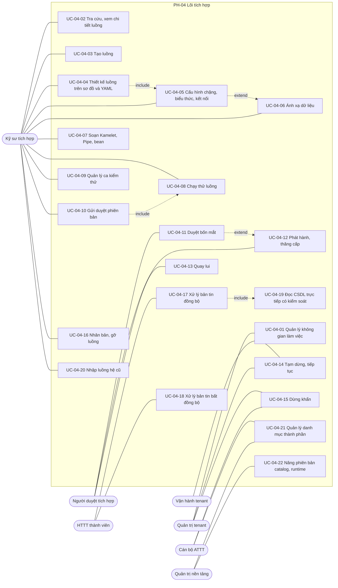
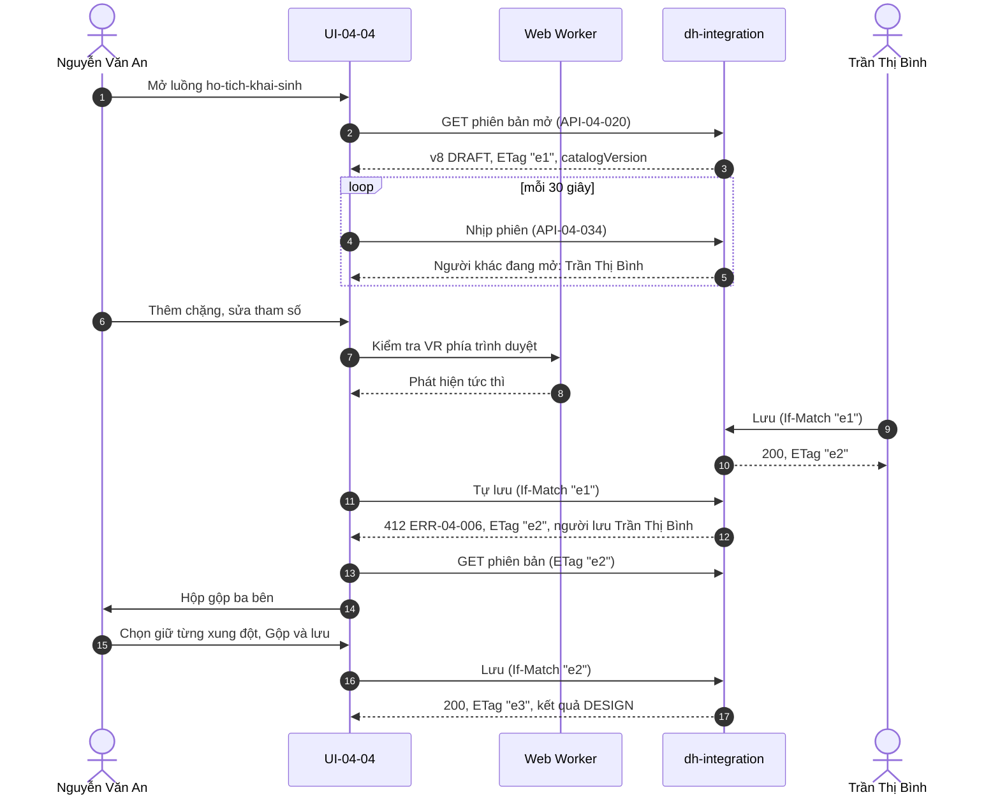
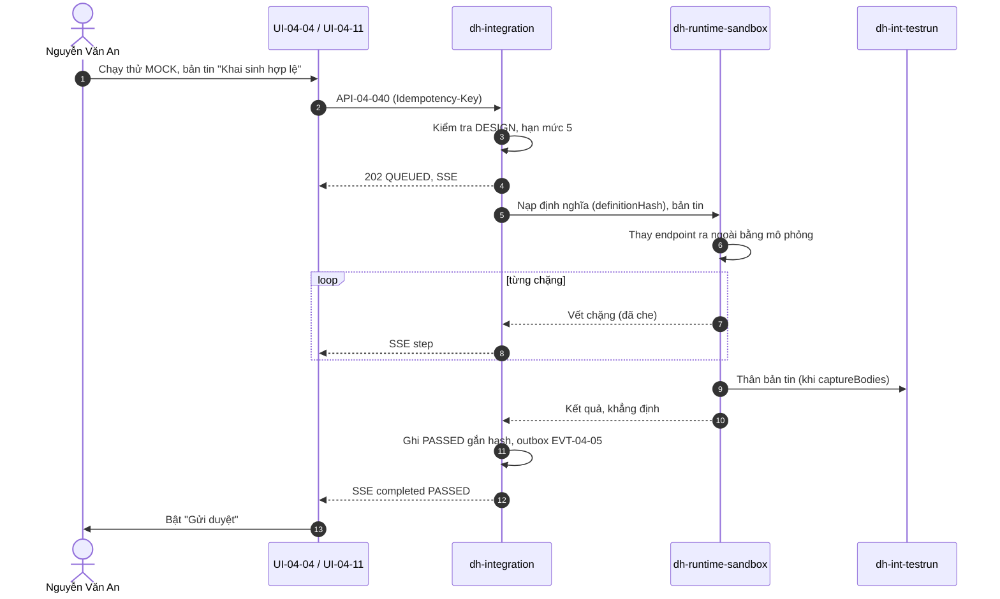
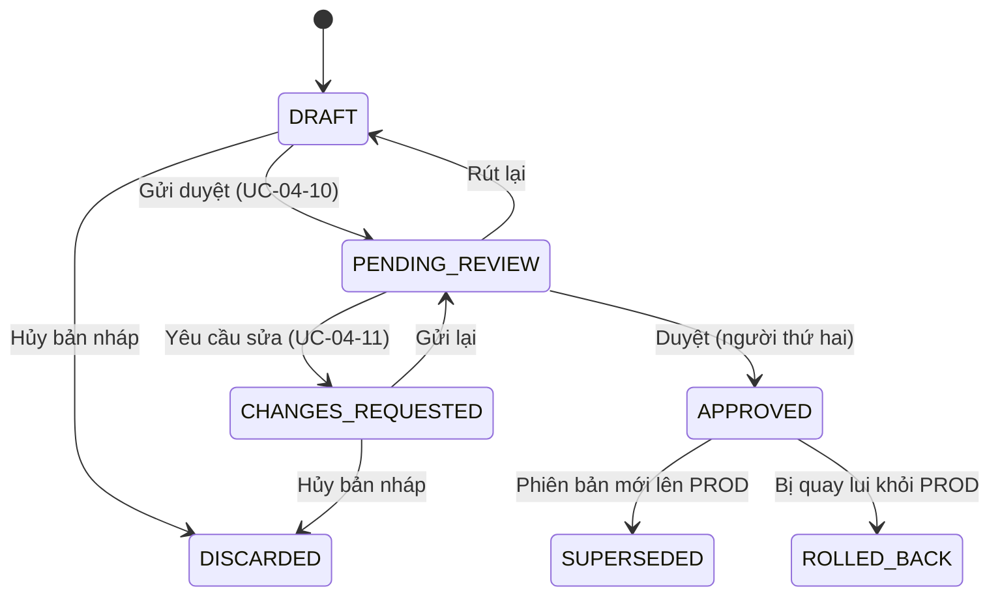
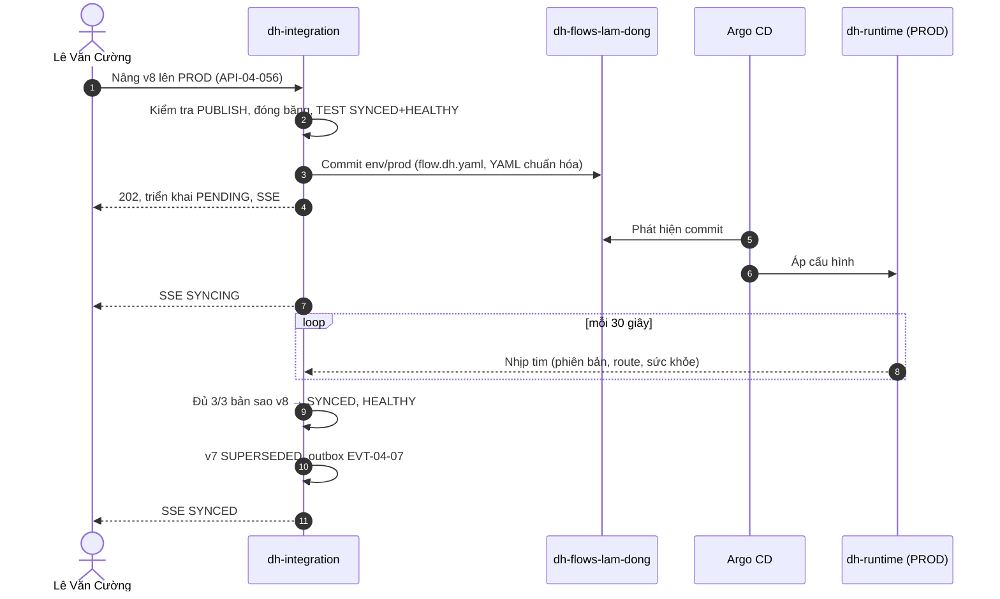
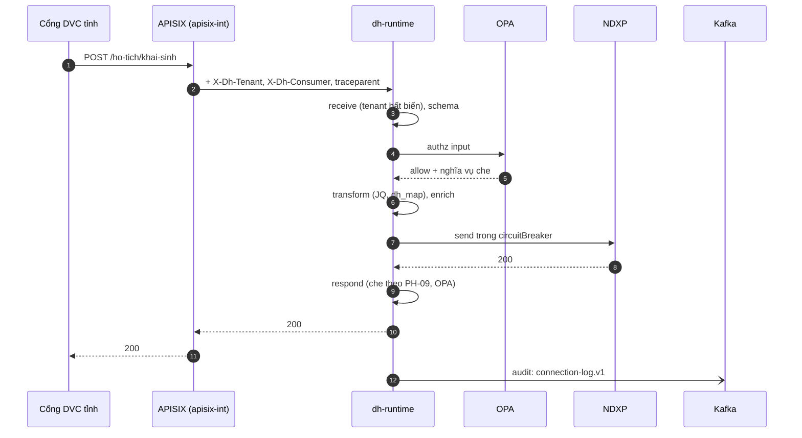

# D02-04-PH04 · Đặc tả use case phân hệ PH-04 Lõi tích hợp và trình thiết kế luồng

## 1. Mục đích và phạm vi

### 1.1. Mục đích

Tài liệu đặc tả 22 use case của PH-04. Mỗi use case mô tả trọn một mục tiêu nghiệp vụ của một tác nhân: thiết kế luồng, chạy thử, gửi duyệt, duyệt bốn mắt, phát hành qua GitOps, vận hành luồng, xử lý bản tin trên runtime, truy cập CSDL có kiểm soát, di trú luồng hệ cũ, quản lý danh mục thành phần. Mỗi use case có trình tự bước giữa tác nhân và hệ thống, luồng thay thế, luồng ngoại lệ kèm mã lỗi, và các đảm bảo hệ thống phải giữ.

Tài liệu nối [D02-03-PH04 FRS](../frs/D02-03-PH04-frs-tich-hop.md) (hệ thống phải làm gì) với [D03-06-PH04 Màn hình](../../03-thiet-ke/uiux/D03-06-PH04-man-hinh-tich-hop.md), D03-02-PH04 SDD, D03-04-PH04 API (hệ thống làm thế nào). Đội phát triển dùng luồng chính, luồng ngoại lệ để biết thứ tự gọi màn, gọi API, mã lỗi phải trả; đội kiểm thử dùng từng luồng làm khung ca kiểm thử TS-04-xx ở D05-02-PH04.

### 1.2. Phạm vi

Toàn bộ FR-04-001…084 của FRS. Chức năng dùng chung FR-00 (đăng nhập, phân quyền, kiểm toán, hộp "Việc của tôi", thông báo) không đặc tả lại; bước dựa vào chúng ghi "Tuân thủ FR-00-nnn". Hành vi của kết nối (PH-05), lược đồ (PH-06), bảng mã (PH-07), topic (PH-10), giám sát (PH-13), DLQ (PH-18) chỉ mô tả ở mức tương tác.

### 1.3. Tài liệu liên quan

| Tài liệu | Lý do tham chiếu |
|---|---|
| [D00-01 Thuật ngữ và quy ước](../../00-chung/D00-01-thuat-ngu-quy-uoc.md) | Hệ mã truy vết, kiểu T-* |
| [D02-02 SRS](../D02-02-srs.md) | FR-00, NFR-00 |
| [D02-03-PH04 FRS](../frs/D02-03-PH04-frs-tich-hop.md) | FR-04, BR-04, NFR-04, VR, tham số `04.*`, trạng thái |
| [D02-08 Ma trận phân quyền](../D02-08-ma-tran-phan-quyen.md) | Vai trò, `PERM-04-*` |
| [D03-06-PH04 Màn hình](../../03-thiet-ke/uiux/D03-06-PH04-man-hinh-tich-hop.md) | UI-04-01…21, thông điệp lỗi |
| ADR-060…069 | Quyết định kiến trúc PH-04 |
| [D03-10 Thiết kế đa tenant](../../03-thiet-ke/D03-10-thiet-ke-da-tenant.md) | RLS, tiêu đề tenant |

## 2. Quy ước đọc đặc tả

### 2.1. Mẫu đặc tả một use case

| Mục | Ý nghĩa |
|---|---|
| Mã, tên | `UC-04-nn`, tên bắt đầu bằng động từ |
| Mục tiêu | Kết quả nghiệp vụ tác nhân chính muốn đạt |
| Tác nhân chính, phụ | Người hoặc hệ thống khởi xướng; người hoặc hệ thống tham gia, nhận kết quả |
| Mức ưu tiên | M, S, C, lấy mức cao nhất của các FR hiện thực |
| FR hiện thực | FR mà use case hiện thực |
| Tiền điều kiện | Điều phải đúng trước khi bắt đầu |
| Điều kiện kích hoạt | Sự kiện làm use case bắt đầu |
| Đảm bảo tối thiểu | Điều hệ thống luôn giữ kể cả khi thất bại giữa chừng |
| Đảm bảo thành công | Trạng thái hệ thống sau khi kết thúc thành công |
| Luồng chính | Kịch bản thành công điển hình, đánh số bước, ghi màn `UI-04-nn` và API `API-04-nnn` |
| Luồng thay thế | Nhánh hợp lệ khác, đánh số theo bước rẽ (`3a`) |
| Luồng ngoại lệ | `E1`, `E2`…, mã lỗi `ERR-04-nnn`, thông điệp, cách khắc phục |
| Quy tắc, phi chức năng | `BR-04-nnn`, `NFR-04-nnn` |
| Tần suất, khối lượng | Ước lượng để thiết kế hiệu năng (giả định, chưa có số liệu thật, ghi rõ GĐ) |
| Sơ đồ | Sơ đồ tuần tự hoặc hoạt động Mermaid cho use case phức tạp |

### 2.2. Quy ước trong luồng

"Hệ thống" là dịch vụ điều khiển `dh-integration` cùng giao diện `dh-console`; "Runtime" là `dh-runtime` (Camel Quarkus 3.33.2, Camel 4.18 LTS) trong namespace `dh-runtime` hoặc `dh-rt-{tenant}`; "Sandbox" là `dh-runtime-sandbox` (ADR-064); "Kho cấu hình" là kho Git `dh-flows-{tenant}` (ADR-068). API có tiền tố `/api/integration/v1`. API tạo mới nhận `Idempotency-Key`; API sửa, chuyển trạng thái cần `If-Match`; lỗi theo RFC 9457 với `code` là `ERR-04-nnn`.

Mọi thao tác ghi sinh bản ghi kiểm toán theo FR-00-040 với mã sự kiện `INT_*` của FRS; mọi truy vấn CSDL điều khiển chạy dưới RLS theo tenant (D03-10). Các luồng không nhắc lại hai điều này ở từng bước.

Dữ liệu ví dụ là giả lập theo chỉ đạo ngày 25/11/2026 (không có dữ liệu thật): tenant `lam-dong` (tỉnh Lâm Đồng); không gian làm việc `so-tu-phap`; luồng `ho-tich-khai-sinh` "Đồng bộ khai sinh sang NDXP" (đối ngoại, HTTT Hộ tịch tỉnh → Nền tảng NDXP); kết nối `ndxp-ho-tich` (HTTP), `pg-ho-tich-ro` (CSDL chỉ đọc cho luồng). Người dùng giả lập: Nguyễn Văn An (IE, Sở Tư pháp), Trần Thị Bình (IE, người đóng góp), Lê Văn Cường (IA), Phạm Thu Dung (TO), Hoàng Minh Đức (SO), Vũ Thị Hà (TA), Đỗ Quang Khải (PA nền tảng).

## 3. Tác nhân

### 3.1. Danh sách tác nhân

| Tác nhân | Mã | Loại | Use case chính |
|---|---|---|---|
| Kỹ sư tích hợp | IE | Người | UC-04-03…10, 16, 20 |
| Người duyệt tích hợp | IA | Người | UC-04-11, 12, 13, 14 |
| Vận hành tenant | TO | Người | UC-04-02, 14 |
| Quản trị tenant | TA | Người | UC-04-01, 12, 14, 15, 16 |
| Cán bộ ATTT | SO | Người | UC-04-15, 21 |
| Quản trị nền tảng | PA | Người | UC-04-21, 22 |
| Người xem, kiểm toán | VW, AU | Người | UC-04-02 |
| HTTT thành viên (bên gọi) | — | Hệ thống | UC-04-17, 18 |
| HTTT đích, CSDL nguồn | — | Hệ thống | UC-04-17, 18, 19 |
| APISIX nội bộ | — | Hệ thống | UC-04-17 |
| Argo CD | — | Hệ thống | UC-04-12, 13 |
| `dh-runtime`, `dh-runtime-sandbox` | — | Hệ thống | UC-04-08, 12, 14, 15, 17…19 |
| OPA, PH-05, PH-06, PH-07, PH-09, PH-10, PH-13, PH-18 | — | Hệ thống | Tham gia nhiều use case |

### 3.2. Quan hệ vai trò và mức truy cập không gian làm việc

Khi `04.workspace.enforce` bật: sửa luồng cần `PERM-04-update` và mức `EDIT` trên không gian; duyệt cần `PERM-04-publish` và mức `MAINTAIN`; TA, PA không bị giới hạn (FRS §3.4, BR-04-021). Khi tham số tắt (mặc định MVP, mọi luồng trong không gian `DEFAULT`), chỉ quyền chức năng có hiệu lực.

## 4. Sơ đồ use case tổng



Sơ đồ chia ba vùng việc. Vùng thiết kế (UC-04-03…10) là việc hằng ngày của kỹ sư tích hợp, thay Productivity Tooling. Vùng phát hành, vận hành (UC-04-11…16) thay Start/Stop và lưu context của Bus, thêm bốn mắt và GitOps. Vùng data plane (UC-04-17…19) là hành vi của luồng khi chạy, tác nhân là hệ thống. UC-04-10 bao gồm UC-04-08 vì gửi duyệt cần một lần chạy thử đạt trên đúng băm (BR-04-004).

## 5. Bảng tổng hợp use case và truy vết

### 5.1. Use case và yêu cầu chức năng

| Mã | Tên | Mức | FR hiện thực | LGC |
|---|---|---|---|---|
| UC-04-01 | Quản lý không gian làm việc và thành viên | S | FR-04-007 | BUS-032 |
| UC-04-02 | Tra cứu, xem chi tiết và tình trạng luồng | M | FR-04-001, 002, 004, 051, 052, 053, 083 | BUS-001…008, 014…025, 027…030; TOOL-001 |
| UC-04-03 | Tạo luồng mới | M | FR-04-003, 025 | BUS-013; TOOL-002 |
| UC-04-04 | Thiết kế luồng trên sơ đồ và YAML | M | FR-04-010…013, 017, 023, 024, 026, 027 | TOOL-003…018, 021, 023…026, 029 |
| UC-04-05 | Cấu hình chặng, biểu thức, kết nối, bản tin mẫu | M | FR-04-014, 015, 016, 022 | BUS-011, 040, 041; TOOL-008, 019, 020 |
| UC-04-06 | Ánh xạ dữ liệu và chuyển mã | M | FR-04-020 | BUS-036; TOOL-007, 028 |
| UC-04-07 | Soạn Kamelet, Pipe, bean và cấu hình cấp tệp | S | FR-04-018, 019, 021 | TOOL-027 (thay thế) |
| UC-04-08 | Chạy thử luồng | M | FR-04-030, 032, 033 | BUS-013, 022 |
| UC-04-09 | Quản lý ca kiểm thử | S | FR-04-031 | — |
| UC-04-10 | Gửi duyệt phiên bản | M | FR-04-040, 023 | — |
| UC-04-11 | Duyệt phiên bản bốn mắt | M | FR-04-041, 043 | BUS-023 |
| UC-04-12 | Phát hành và thăng cấp qua GitOps | M | FR-04-042, 045, 075 | BUS-033, 034 |
| UC-04-13 | Quay lui về phiên bản trước | M | FR-04-044 | — |
| UC-04-14 | Tạm dừng, tiếp tục luồng hoặc route | M | FR-04-050 | BUS-009, 012, 026 |
| UC-04-15 | Dừng khẩn luồng | M | FR-04-050 | BUS-009 |
| UC-04-16 | Nhân bản, hủy nháp, gỡ luồng | M | FR-04-005, 006 | BUS-010; TOOL-016 |
| UC-04-17 | Xử lý bản tin đồng bộ qua khung chín chặng | M | FR-04-060, 061, 063…068, 070, 073, 074 | BUS-035…039, 041 |
| UC-04-18 | Xử lý bản tin bất đồng bộ từ Kafka | M | FR-04-062, 069, 070, 071, 073 | BUS-039 |
| UC-04-19 | Đọc CSDL trực tiếp có kiểm soát (Q359) | M | FR-04-072 | BUS-040; TOOL-008 |
| UC-04-20 | Nhập luồng Camel XML hệ cũ | M | FR-04-082 | BUS-033; TOOL-015 |
| UC-04-21 | Quản lý danh mục thành phần và chính sách | M | FR-04-080 | BUS-034, 040 |
| UC-04-22 | Nâng phiên bản catalog và runtime | M | FR-04-081 | — |

Luồng phụ dùng chung ở mục 7: tham số PH-04 và đóng băng thay đổi (FR-04-084), lịch sử và kiểm toán (FR-04-083). Mọi FR-04 có ít nhất một use case; FR-04-075 hiện thực trong UC-04-12 (gán hồ sơ runtime khi phát hành).

### 5.2. Use case và màn hình, API

| Mã | Màn hình | API chính |
|---|---|---|
| UC-04-01 | UI-04-21 | API-04-001…004 |
| UC-04-02 | UI-04-01, 02 | API-04-010, 012, 013, 016, 060, 062, 063, 091 |
| UC-04-03 | UI-04-03, 19 | API-04-011, 080, 081 |
| UC-04-04 | UI-04-04 | API-04-020…024, 026, 027, 030, 034, 070, 071 |
| UC-04-05 | UI-04-04, 05, 06 | API-04-022, 032, 071; PH-05 |
| UC-04-06 | UI-04-07 | API-04-033; PH-06, PH-07 |
| UC-04-07 | UI-04-08, 09, 10 | API-04-022, 030 |
| UC-04-08 | UI-04-11, 12 | API-04-040…043 |
| UC-04-09 | UI-04-13 | API-04-044 |
| UC-04-10 | UI-04-04 (hộp gửi duyệt) | API-04-030, 050, 051 |
| UC-04-11 | UI-04-14, 16 | API-04-025, 030, 052, 053 |
| UC-04-12 | UI-04-15 | API-04-054, 056 |
| UC-04-13 | UI-04-15 | API-04-055 |
| UC-04-14, 15 | UI-04-02, 15 | API-04-060, 061 |
| UC-04-16 | UI-04-01, 02 | API-04-014, 015, 016, 023 |
| UC-04-17…19 | — (runtime) | Điểm vào của luồng qua APISIX; topic Kafka |
| UC-04-20 | UI-04-18 | API-04-028 |
| UC-04-21 | UI-04-17 | API-04-070…074 |
| UC-04-22 | UI-04-17 | API-04-073 |

### 5.3. Use case và quy trình, yêu cầu nghiệp vụ

Mọi use case truy vết về REQ-04 của BRD. UC-04-05, 19, 21 truy vết thêm REQ-05 (kết nối, bộ điều hợp). UC-04-18 truy vết REQ-10 (bản tin). UC-04-17 truy vết REQ-03 (điểm vào qua APISIX) và yêu cầu ghi nhật ký kết nối của NĐ 278/2025. UC-04-20 truy vết REQ-22 (di trú). UC-04-11, 12 hiện thực nguyên tắc bốn mắt và quản lý thay đổi của TCVN 14423:2026 cấp độ 3 (nhóm quản lý vận hành, SEC-40…49 của D03-07).

## 6. Đặc tả chi tiết use case

### 6.1. UC-04-01 · Quản lý không gian làm việc và thành viên

Bus cũ phân quyền theo `Project`, `Group`, `Project_group.access_level` (LGC-BUS-032) để sở này không sửa nhầm chương trình của sở khác. Use case giữ ý tưởng đó dưới tên không gian làm việc.

| Mục | Nội dung |
|---|---|
| Mã | UC-04-01 |
| Mục tiêu | TA tổ chức luồng của tỉnh theo đơn vị chủ quản và cấp mức truy cập cho từng người, nhóm |
| Tác nhân chính | TA (`PERM-04-admin`) |
| Tác nhân phụ | Thành viên mức `MAINTAIN` (thêm, bớt thành viên); PH-12 (nhóm Keycloak) |
| Mức ưu tiên | S |
| FR hiện thực | FR-04-007 |
| Tiền điều kiện | Tenant hoạt động |
| Điều kiện kích hoạt | TA mở UI-04-21 |
| Đảm bảo tối thiểu | Không gian còn luồng không bị xóa; mọi thay đổi thành viên được kiểm toán với danh sách thêm, bớt |
| Đảm bảo thành công | Không gian và danh sách thành viên mới có hiệu lực ngay ở lượt gọi kế tiếp |

**Luồng chính**

1. TA (Vũ Thị Hà) mở UI-04-21; hệ thống liệt kê không gian (API-04-001).
2. TA chọn "Tạo không gian", nhập mã `so-tu-phap`, tên "Sở Tư pháp", đơn vị chủ quản, mô tả.
3. Hệ thống kiểm tra mã duy nhất trong tenant, ghi không gian (API-04-002).
4. TA mở tab Thành viên, thêm Nguyễn Văn An mức `EDIT`, Trần Thị Bình mức `EDIT`, Lê Văn Cường mức `MAINTAIN`, nhóm PH-12 "Phòng HCTP" mức `VIEW` (API-04-004).
5. Hệ thống lưu, mở rộng nhóm thành người dùng lúc kiểm tra quyền, trả danh sách hiệu lực.

**Luồng thay thế**

- **4a. Thành viên `MAINTAIN` tự quản lý thành viên.** Lê Văn Cường thêm một kỹ sư mới mức `EDIT`; hệ thống cho phép vì người thao tác có `MAINTAIN` trên chính không gian.
- **5a. Lưu trữ không gian.** TA chọn "Lưu trữ" (API-04-003); không gian ẩn khỏi ô chọn khi tạo luồng, luồng hiện có không đổi.

**Luồng ngoại lệ**

- **E1. Mã trùng (bước 3).** ERR-04-028 "Mã không gian làm việc đã được dùng."
- **E2. Xóa không gian còn luồng.** ERR-04-017 kèm số luồng; gợi ý "Lưu trữ" thay vì xóa.

**Quy tắc:** BR-04-021. **Tần suất:** vài lần mỗi tháng mỗi tenant (GĐ).

### 6.2. UC-04-02 · Tra cứu, xem chi tiết và tình trạng luồng

| Mục | Nội dung |
|---|---|
| Mã | UC-04-02 |
| Mục tiêu | Người dùng tìm được luồng và biết luồng đang chạy phiên bản nào, ở đâu, có khỏe không |
| Tác nhân chính | Mọi vai trò có `PERM-04-read` (thường TO, IE) |
| Tác nhân phụ | PH-13 (số liệu, log), `dh-runtime` (nhịp tim) |
| Mức ưu tiên | M |
| FR hiện thực | FR-04-001, 002, 004, 051, 052, 053, 083 |
| Tiền điều kiện | Đăng nhập, chọn tenant (FR-00-004) |
| Điều kiện kích hoạt | Mở UI-04-01 hoặc liên kết sâu tới UI-04-02 |
| Đảm bảo tối thiểu | Không lộ luồng ngoài phạm vi không gian làm việc; URI điểm kết nối luôn che tham số nhạy cảm |
| Đảm bảo thành công | Người dùng thấy danh sách, chi tiết và tình trạng theo môi trường |

**Luồng chính**

1. Phạm Thu Dung (TO) mở UI-04-01; hệ thống trả trang đầu kèm `facets` theo trạng thái (API-04-010).
2. TO gõ "khai sinh" vào ô tìm và chọn lọc môi trường `PROD`; hệ thống lọc trên mã, tên, mô tả, URI đã chỉ mục (EN-04-04).
3. TO thấy dòng `ho-tich-khai-sinh` có chấm PROD màu cảnh báo, bấm mã luồng.
4. Hệ thống mở UI-04-02 (API-04-012) với thẻ môi trường từ API-04-060: PROD "v7 · Đồng bộ, suy giảm · 2/3 bản sao".
5. TO mở tab Giám sát; hệ thống nhúng bảng điều khiển PH-13 lọc theo `tenant`, `flow`, `version`, `environment` (API-04-063).
6. TO mở tab Route; thấy route `goi-ndxp` có bản sao `Suspended` theo nhịp tim lúc 14:20.
7. TO mở tab Lịch sử (API-04-091); thấy lệnh tạm dừng route lúc 14:18 của Hoàng Minh Đức kèm lý do.

**Luồng thay thế**

- **2a. Lọc theo endpoint.** TO nhập `/ho-tich/khai-sinh` vào ô "Endpoint" của bộ lọc khác; hệ thống khớp chuỗi con trên URI đã chuẩn hóa (thay tìm theo endpoint của Bus).
- **3a. Sửa thông tin luồng.** IE có `PERM-04-update` chọn "Sửa thông tin" (FR-04-004), đổi mô tả, nhãn, HTTT đích (API-04-013, `If-Match`). Nếu đổi HTTT làm luồng thành đối ngoại, phiên bản mở được kiểm tra lại ở mức đối ngoại và bảng Vấn đề có thêm VR-05.
- **4a. Nhịp tim quá 90 giây không về.** Sức khỏe hiện "Không rõ"; thẻ môi trường có chữ "Không nhận được nhịp tim từ {giờ}".

**Luồng ngoại lệ**

- **E1. Luồng không tồn tại hoặc ngoài phạm vi.** ERR-04-001, không phân biệt hai trường hợp.
- **E2. Phiên bản không tồn tại (`?phien-ban=`).** ERR-04-004.
- **E3. Sửa thông tin khi luồng đã gỡ.** ERR-04-034. **E4.** ETag lệch ERR-04-006; thiếu `If-Match` ERR-04-007.
- **E5. PH-13 không phản hồi (bước 5).** Tab Giám sát hiện ST-05, các tab khác vẫn dùng được.

**Quy tắc:** BR-04-021. **Phi chức năng:** thời gian phản hồi danh sách theo NFR chung của SRS (D02-02). **Tần suất:** hàng trăm lượt xem mỗi ngày mỗi tenant (GĐ).

### 6.3. UC-04-03 · Tạo luồng mới

| Mục | Nội dung |
|---|---|
| Mã | UC-04-03 |
| Mục tiêu | IE có một luồng mới với phiên bản v1 sẵn sàng thiết kế, xuất phát từ khuôn mẫu có đủ chín chặng chuẩn |
| Tác nhân chính | IE (`PERM-04-create`, mức `EDIT`) |
| Tác nhân phụ | PH-01 (HTTT), PH-02 (API), PH-07 (văn bản căn cứ) |
| Mức ưu tiên | M |
| FR hiện thực | FR-04-003, 025 |
| Tiền điều kiện | Có ít nhất một không gian mức `EDIT` (hoặc `DEFAULT` khi không giới hạn) |
| Điều kiện kích hoạt | Bấm "Tạo luồng" trên UI-04-01 |
| Đảm bảo tối thiểu | Không có luồng nửa vời: luồng, phiên bản 1, chỉ mục route và endpoint, outbox EVT-04-01 ghi trong một giao dịch |
| Đảm bảo thành công | Luồng `DRAFT`, phiên bản 1 `DRAFT`, `origin` đúng nguồn; kết quả kiểm tra mức `DESIGN` lưu kèm |

**Luồng chính**

1. Nguyễn Văn An mở UI-04-03 bước 1, chọn "Từ khuôn mẫu"; hệ thống hiện tám khuôn nền và khuôn của tỉnh (API-04-080).
2. An chọn `tpl-sync-lookup`; hệ thống tải chi tiết khuôn và lược đồ tham số (API-04-081).
3. Bước 2: An nhập tên "Tra cứu hộ tịch cho cổng DVC"; hệ thống gợi ý mã `tra-cuu-ho-tich` và kiểm tra trực tuyến tính duy nhất.
4. An chọn không gian `so-tu-phap`, HTTT nguồn "Cổng DVC tỉnh", đích "HTTT Hộ tịch tỉnh", điền tham số khuôn "Đường dẫn nhận" `/ho-tich/tra-cuu` và "Kết nối đích" `ho-tich-api`.
5. Bước 3: hệ thống hiện sơ đồ xem trước và kết quả kiểm tra sơ bộ (API-04-030 `level=DESIGN`): 1 cảnh báo VR-07 vì kết nối chưa có giá trị PROD.
6. An bấm "Tạo và mở trình thiết kế"; hệ thống gọi API-04-011 với `Idempotency-Key`, sinh định nghĩa bằng cách điền tham số vào khuôn, chạy kiểm tra, ghi dữ liệu và outbox, trả `201`.
7. Hệ thống chuyển tới UI-04-04 với phiên bản 1 (tiếp UC-04-04).

**Luồng thay thế**

- **1a. Luồng trống.** Với `ROUTE` đối ngoại, định nghĩa có chặng đầu trống, chín khối chặng chuẩn rỗng và `routeConfiguration` nền; với luồng nội bộ chỉ có chặng đầu.
- **1b. Từ API trong danh mục PH-02.** Hệ thống đọc OpenAPI, sinh `rest` DSL, mỗi thao tác một route `direct:{operationId}` có khung chín chặng, lược đồ gắn vào chặng `schema`.
- **1c. Nhập YAML.** Tệp ≤ 512 KiB được phân tích ngay khi thả; loại tài nguyên lấy từ nội dung.
- **1d. Nhân bản luồng có sẵn.** Chuyển sang UC-04-16 luồng 1a.
- **1e. Kamelet, Pipe.** Chọn loại tài nguyên khác ở bước 1; tiếp UC-04-07.

**Luồng ngoại lệ**

- **E1. Mã trùng (bước 3, 6).** ERR-04-002 "Mã luồng "tra-cuu-ho-tich" đã được dùng trong tỉnh." kèm gợi ý mã khác.
- **E2. Không có mức `EDIT` (bước 6).** ERR-04-003.
- **E3. Không gian không tồn tại.** ERR-04-027. **E4. Khuôn không tồn tại hoặc không được phép.** ERR-04-039.
- **E5. YAML không phân tích được.** ERR-04-008 kèm dòng, cột. **E6. Loại tài nguyên không khớp nội dung.** ERR-04-009. **E7. Vượt kích thước.** ERR-04-033.
- **E8. Gửi lại cùng `Idempotency-Key` nhưng nội dung khác.** ERR-04-018. Cùng nội dung thì trả kết quả lần trước, không tạo trùng.

**Quy tắc:** BR-04-001, 002, 003. **Tần suất:** 5–30 luồng mới mỗi tháng mỗi tenant (GĐ).

### 6.4. UC-04-04 · Thiết kế luồng trên sơ đồ và YAML

Use case trung tâm của PH-04, thay Productivity Tooling. Đặc tả giao diện đầy đủ ở D03-06-PH04 §10.

| Mục | Nội dung |
|---|---|
| Mã | UC-04-04 |
| Mục tiêu | IE dựng logic của luồng bằng sơ đồ, Inspector hoặc YAML, luôn thấy lỗi ngay, không mất công khi mất mạng hay sửa trùng |
| Tác nhân chính | IE (`PERM-04-update`, mức `EDIT`) |
| Tác nhân phụ | IE khác cùng mở luồng; PH-05, PH-10 (tham chiếu được kiểm tra) |
| Mức ưu tiên | M |
| FR hiện thực | FR-04-010, 011, 012, 013, 017, 023, 024, 026, 027 |
| Tiền điều kiện | Luồng tồn tại, không `RETIRED` |
| Điều kiện kích hoạt | Mở UI-04-04 từ UI-04-01, 02 hoặc sau UC-04-03 |
| Đảm bảo tối thiểu | Không ghi đè âm thầm (ETag); phần chưa lưu được giữ trong IndexedDB cho tới khi máy chủ xác nhận; bố cục và bản tin mẫu không vào YAML (BR-04-007); không lưu được bí mật viết thẳng (VR-03) |
| Đảm bảo thành công | Phiên bản mở có định nghĩa, bố cục, bản tin mẫu mới; người dùng có tên trong danh sách người đóng góp; chỉ mục route, endpoint tính lại |

**Luồng chính**

1. An mở UI-04-04 cho `ho-tich-khai-sinh`. Hệ thống trả phiên bản mở v8 `DRAFT` với định nghĩa, bố cục, bản tin mẫu, `catalogVersion`, ETag (API-04-020) và tải chỉ mục catalog đã lọc theo chính sách tenant (API-04-070, cache theo `catalogVersion`).
2. Trình duyệt tạo phiên soạn, gửi nhịp mỗi 30 giây (API-04-034); phản hồi cho biết Trần Thị Bình cũng đang mở. Giao diện hiện "Đang có 1 người khác mở luồng này".
3. An chọn chặng "Rẽ nhánh", nhấn `A` để thêm chặng sau; bảng chọn nhanh mở, An gõ "ghi log", `Enter`. Hệ thống chèn chặng `log` vào nhánh `otherwise`, sinh lại YAML trong ≤ 100 ms (NFR-04-005).
4. Trình duyệt chạy VR-01…09, 15, 18, 20 sau 400 ms; bảng Vấn đề hiện gợi ý LINT-04-01 "Nhánh otherwise chỉ ghi nhật ký".
5. An kéo bảng thành phần mục "Gọi REST" thả lên cạnh sau "Ghi nhật ký"; vì thành phần có cờ cần kết nối PH-05, ô chọn kết nối mở ngay; An chọn `ndxp-ho-tich` (tiếp UC-04-05).
6. An chuyển chế độ Chia đôi (`Ctrl+3`), sửa `timeout` trong YAML; sau 500 ms không gõ, hệ thống phân tích YAML, cập nhật sơ đồ, giữ chặng chọn theo `id`.
7. 30 giây sau thay đổi cuối, trình duyệt tự lưu (API-04-022 với `If-Match`); máy chủ kiểm tra trạng thái `DRAFT`, so ETag, chạy kiểm tra mức `DESIGN`, lưu, thêm An vào danh sách người đóng góp, trả ETag mới; chỉ báo "Đã lưu 14:02".
8. An tiếp tục chạy thử (UC-04-08) hoặc gửi duyệt (UC-04-10).

**Luồng thay thế**

- **1a. Không có phiên bản mở.** Hệ thống mở phiên bản đang chạy ở PROD (hoặc mới nhất) chỉ đọc; An chọn "Tạo phiên bản mới từ v7" (API-04-021); hệ thống sao chép định nghĩa, bố cục, ca kiểm thử sang v8 `DRAFT` (FR-04-011).
- **1b. Catalog của tenant đã nâng.** `catalogVersion` khác bản định nghĩa đã kiểm tra: dải "Danh mục thành phần đã cập nhật lên {phiên bản}. Kiểm tra lại luồng trước khi gửi duyệt" và kiểm tra chạy lại (FR-04-010 mục 3, UC-04-22).
- **1c. Còn bản nháp cục bộ mới hơn máy chủ.** Hộp "Khôi phục thay đổi chưa lưu từ {giờ}?" với Khôi phục, So sánh, Bỏ.
- **3a. Chỉ dùng bàn phím.** An dùng `↑↓←→` di chuyển giữa chặng, `Alt+↑↓` đổi chỗ, `Ctrl+X`/`Ctrl+V` chuyển nhánh (NFR-04-015).
- **3b. Kéo chặng tới chỗ trống.** Chỉ đổi vị trí hiển thị và ghim, YAML không đổi.
- **3c. Nối lại bằng cổng.** Kéo dây từ cổng ra; thả ra chỗ trống mở bảng chọn nhanh (LGC-TOOL-024).
- **3d. Xóa nội dung route (Clear Page).** Giữ chặng đầu, xóa mọi chặng sau, có xác nhận, hoàn tác được.
- **3e. Ghi chú dán, luồng con.** Thêm ghi chú (`N`) lưu trong bố cục; chọn vùng chặng → "Tách thành route con" sinh route `direct:` mới (FR-04-026).
- **6a. YAML lỗi cú pháp.** Sơ đồ giữ bản hợp lệ cuối, dải "YAML đang có lỗi"; không chuyển sang chế độ Sơ đồ được cho tới khi sửa.
- **6b. Phần tử không biểu diễn được.** Hiện chặng "Không biểu diễn được", chỉ sửa trong YAML, không bị xóa khi sửa phần khác.
- **7a. Lưu tay.** `Ctrl+S` lưu ngay.
- **7b. Tải xuống, nhập YAML (FR-04-027).** Tải `yaml`, `yaml+layout`, `bundle` (API-04-026); nhập YAML thay toàn bộ định nghĩa sau xác nhận (API-04-027), hoàn tác được.

**Luồng ngoại lệ**

- **E1. Xung đột ETag (bước 7).** Bình đã lưu sau lần tải của An: ERR-04-006 (412) kèm ETag hiện tại và người lưu. Hộp gộp ba bên (gốc chung, của tôi, của Bình); An chọn từng xung đột hoặc tải bản của mình về máy. Không ghi đè âm thầm.
- **E2. Phiên bản không còn sửa được.** Người khác đã gửi duyệt: ERR-04-005; trình thiết kế chuyển chỉ đọc.
- **E3. Mất kết nối.** Chỉ báo "Chưa lưu lên máy chủ"; tiếp tục sửa, dữ liệu giữ trong IndexedDB; có mạng lại thì lưu, ETag lệch thì vào E1.
- **E4. Vượt kích thước định nghĩa.** ERR-04-033 "Định nghĩa luồng vượt 512 KB."
- **E5. Giá trị giống bí mật.** VR-03 lỗi ngay tại trường, ERR-04-010 khi lưu: "Phát hiện giá trị giống bí mật ở chặng "Gọi hộ tịch", trường "authorization"…".
- **E6. Đang đóng băng thay đổi.** Lưu nháp vẫn được; FR-04-024 cho phép máy chủ trả ERR-04-041 (423) khi tỉnh cấu hình đóng băng cả việc soạn (GĐ: mặc định chỉ đóng băng phát hành).
- **E7. Phiên bản đã có bản mở (bước 1a).** ERR-04-016 kèm "Mở phiên bản đang soạn".

**Quy tắc:** BR-04-002, 003, 006, 007, 011, 016, 020. **Phi chức năng:** NFR-04-001…005, 015, 016, 017. **Tần suất:** mỗi IE vài giờ mỗi ngày; luồng điển hình 20–80 chặng, lớn nhất 200 chặng (GĐ).



Sơ đồ cho thấy cảnh báo người khác đang mở chỉ là thông tin; chốt chống ghi đè là ETag ở máy chủ. Trình duyệt luôn lấy bản mới của người kia trước khi gộp, nên phần gộp dựa trên đúng ba bên.

### 6.5. UC-04-05 · Cấu hình chặng, biểu thức, kết nối và bản tin mẫu

| Mục | Nội dung |
|---|---|
| Mã | UC-04-05 |
| Mục tiêu | IE đặt đúng tham số của một chặng mà không phải nhớ tên tham số Camel, không phải nhập máy chủ, mật khẩu, và kiểm được biểu thức trên dữ liệu mẫu |
| Tác nhân chính | IE |
| Tác nhân phụ | PH-05 (kết nối), Sandbox (biểu thức) |
| Mức ưu tiên | M |
| FR hiện thực | FR-04-014, 015, 016, 022 |
| Tiền điều kiện | Đang ở UC-04-04, phiên bản mở |
| Điều kiện kích hoạt | Chọn chặng (Inspector) hoặc nhấp đúp chặng (UI-04-05) |
| Đảm bảo tối thiểu | Trường bí mật không có ô nhập tự do; giá trị bằng mặc định không ghi vào YAML trừ khi ghim "luôn ghi" |
| Đảm bảo thành công | Tham số của chặng được cập nhật trên cây tài nguyên, có thể hoàn tác |

**Luồng chính**

1. An nhấp đúp chặng "Gọi hộ tịch"; UI-04-05 mở ba cột VÀO · THAM SỐ · RA. Hệ thống tải lược đồ thuộc tính của thành phần `http` cho đúng `catalogVersion` (API-04-071).
2. Cột THAM SỐ mặc định hiện trường bắt buộc và trường đã đặt của nhóm có trường bắt buộc; nút "Hiện tất cả (64)".
3. An mở ô Kết nối; hệ thống liệt kê kết nối PH-05 loại `http-*` được cấp cho `so-tu-phap`, kèm môi trường có giá trị; An chọn `ndxp-ho-tich`. Hệ thống điền máy chủ, cổng dạng `{{conn:ndxp-ho-tich.host}}`, không chép giá trị.
4. An nhập "Đường dẫn" `/api/v1/khai-sinh/${header.soDinhDanh}` và bấm ƒx; UI-04-06 mở.
5. Sau 400 ms, hệ thống biên dịch biểu thức bằng engine Camel đúng phiên bản (API-04-032): hợp lệ.
6. An chọn "Bản tin mẫu của chặng"; hệ thống đánh giá trên sandbox, hiện kết quả chuỗi đường dẫn đã thay giá trị.
7. An bấm "Áp dụng"; giá trị ghi vào trường, tạo một bước hoàn tác; huy hiệu lỗi của chặng giảm từ 2 xuống 0.
8. An đóng UI-04-05 (`Esc`), focus trở lại chặng.

**Luồng thay thế**

- **1a. Ghim bản tin mẫu (FR-04-022).** Cột VÀO trống; An chọn "Ghim bản tin mẫu…", dán JSON ≤ 256 KiB, đặt tiêu đề `soDinhDanh`. Bản tin lưu cùng phiên bản ở cột riêng. Chặng sau chưa ghim thừa hưởng bản tin của chặng này.
- **1b. Bản tin có dấu hiệu dữ liệu thật.** Hệ thống phát hiện chuỗi 12 chữ số dạng số định danh: cảnh báo LINT-04-06, gợi ý "Thay bằng dữ liệu giả"; chỉ người có `PERM-04-sample-data` bỏ qua được.
- **3a. Chưa có kết nối phù hợp.** An bấm "Tạo kết nối mới" mở PH-05 ở tab mới; quay lại, danh sách làm mới.
- **3b. Thành phần CSDL.** Ô kết nối chỉ hiện kết nối loại "chỉ đọc cho luồng" (tiếp UC-04-19).
- **6a. Sandbox không sẵn sàng.** Đánh giá cục bộ cho `simple`, `jsonpath`, `jq` với nhãn "Xem trước mô phỏng trên trình duyệt, kết quả có thể khác runtime".
- **7a. Khôi phục.** Menu trường "Khôi phục giá trị khi mở", "Đặt về mặc định"; menu chặng "Khôi phục chặng về bản đã lưu" (LGC-TOOL-020).

**Luồng ngoại lệ**

- **E1. Biểu thức không biên dịch được (bước 5).** ERR-04-037 kèm dòng, cột; gạch sóng tại vị trí.
- **E2. Bản tin mẫu vượt kích thước.** ERR-04-021.
- **E3. Kết nối không tồn tại, sai loại, chưa cấp.** VR-07 khi thiết kế, ERR-04-013 ở mức gửi duyệt.
- **E4. Ngôn ngữ kịch bản chưa được phép.** `groovy`, `js`, `python` không có trong danh sách ngôn ngữ (ADR-062); dán YAML chứa chúng thì VR-04.

**Quy tắc:** BR-04-003, 007, 013, 014. **Phi chức năng:** NFR-04-006 (mở cửa sổ 154 thuộc tính < 400 ms). **Tần suất:** hàng chục lần mỗi luồng.

### 6.6. UC-04-06 · Ánh xạ dữ liệu và chuyển mã

| Mục | Nội dung |
|---|---|
| Mã | UC-04-06 |
| Mục tiêu | IE chuyển cấu trúc bản tin nguồn sang cấu trúc đích (thường là CDM hoặc lược đồ NDXP) bằng kéo nối, kèm chuyển mã theo bảng của PH-07, không phải viết JQ |
| Tác nhân chính | IE |
| Tác nhân phụ | PH-06 (lược đồ), PH-07 (bảng ánh xạ mã), Sandbox |
| Mức ưu tiên | M |
| FR hiện thực | FR-04-020 |
| Tiền điều kiện | Chặng `transform` (hoặc `setBody`) trong phiên bản mở |
| Điều kiện kích hoạt | `Ctrl+M` hoặc "Mở trình ánh xạ" |
| Đảm bảo tối thiểu | `*.dhmap.json` là nguồn chuẩn; JQ luôn sinh lại được từ nó; không lưu ánh xạ có JQ không biên dịch được |
| Đảm bảo thành công | Chặng có biểu thức `jq` sinh ra; tệp `*.dhmap.json` lưu cùng phiên bản |

**Luồng chính**

1. An mở UI-04-07 trên chặng "Chuẩn hóa hồ sơ". Nguồn: JSON Schema `ho-tich-ks` v4; đích: CDM `ndxp-khai-sinh-req` v3.
2. An bấm "Gợi ý ánh xạ"; hệ thống đề xuất 7 cặp theo tên, không dấu, đồng nghĩa; An chọn 6, bỏ 1.
3. An kéo `hoSo.gioiTinh` vào `request.sex`, thêm hàm "Chuyển mã PH-07", chọn bảng `gioi-tinh-ht-ndxp`; hệ thống sinh `dh_map("gioi-tinh-ht-ndxp"; .hoSo.gioiTinh)`.
4. An kéo `hoSo.ngaySinh` vào `request.birthDate`, chọn hàm ngày "dd/MM/yyyy → ISO".
5. An kéo mảng `giayTo` vào `documents`; hệ thống tạo khối lặp, An nối trường con.
6. An đặt `request.province` = biến `$tenant`, `requestedAt` = `now()`.
7. An chọn bản tin mẫu của chặng ở thanh Thử; hệ thống chạy JQ trên sandbox (API-04-033) có hàm `dh_map`, kiểm kết quả theo lược đồ đích: hợp lệ, 1 gợi ý LINT-04-05 (trường `father.name` rỗng).
8. An bấm "Lưu ánh xạ"; chặng nhận JQ mới, tệp `*.dhmap.json` cập nhật, tạo một bước hoàn tác.

**Luồng thay thế**

- **1a. Nguồn từ tài liệu mẫu.** Dán JSON hoặc XML ≤ 1 MiB; hệ thống suy cây trường. Nguồn XML: chặng tự thêm `unmarshal` trước và `marshal` sau nếu đích XML.
- **1b. Lược đồ có phiên bản mới.** Dải "Lược đồ có v5. Xem khác biệt, Nâng lên"; ánh xạ tới trường đã bỏ thành "mồ côi".
- **5a. Ánh xạ một–nhiều.** Chưa có ở MVP; An viết JQ tay trong UI-04-06.
- **8a. Soạn JQ tay.** Sau cảnh báo, phần không nhận dạng hiện là khối "JQ tùy biến".
- **8b. Xuất, đặt lại.** "Xuất ánh xạ" tải `*.dhmap.json` và `*.jq`; "Đặt lại ánh xạ" xóa hết, hoàn tác được.

**Luồng ngoại lệ**

- **E1. Trường đích không tồn tại hoặc vòng tham chiếu.** ERR-04-038.
- **E2. Tài liệu mẫu vượt 1 MiB.** ERR-04-021.
- **E3. Bảng ánh xạ PH-07 không đọc được (bước 7).** Nút hàm hiện ⚠; vẫn lưu được nhưng không xem trước.
- **E4. Sandbox không sẵn sàng.** Xem trước cục bộ có nhãn mô phỏng (theo FR-04-015 mục 3).

**Quy tắc:** BR-04-013 (dữ liệu xem trước được che). **Tần suất:** 1–5 ánh xạ mỗi luồng đối ngoại.

### 6.7. UC-04-07 · Soạn Kamelet, Pipe và bean khai báo

| Mục | Nội dung |
|---|---|
| Mã | UC-04-07 |
| Mục tiêu | IE đóng gói một đoạn tích hợp hay dùng thành Kamelet của tỉnh, nối nguồn và đích bằng Pipe, và khai báo bean cấu hình mà không viết Java |
| Tác nhân chính | IE |
| Tác nhân phụ | PA (danh mục Kamelet nền) |
| Mức ưu tiên | S |
| FR hiện thực | FR-04-018, 019, 021 |
| Tiền điều kiện | Quyền `PERM-04-create` (Kamelet, Pipe mới) hoặc `PERM-04-update` |
| Điều kiện kích hoạt | UI-04-03 chọn loại `KAMELET` hoặc `PIPE`; hoặc tab Bean của trình thiết kế |
| Đảm bảo tối thiểu | Kamelet tự viết đi cùng vòng đời duyệt như luồng; tên Kamelet duy nhất trong tenant và không trùng Kamelet nền |
| Đảm bảo thành công | Kamelet đã phát hành xuất hiện ở nhóm "Kamelet của tỉnh" trong bảng thành phần của mọi luồng trong tenant |

**Luồng chính**

1. An mở UI-04-03, chọn loại `KAMELET` kiểu `action`, tên `ho-tich-chuan-hoa-action`.
2. UI-04-10 mở với ba vùng: định nghĩa thuộc tính (tiêu đề, kiểu, bắt buộc, mặc định, `x-descriptors` bí mật), mẫu (template) dạng sơ đồ, xem trước cách Kamelet hiện trong bảng thành phần.
3. An khai báo thuộc tính `bangMa` (chuỗi, bắt buộc), `connection` (kết nối PH-05, bí mật).
4. An dựng mẫu: `transform` dùng `{{bangMa}}`, `log`; hệ thống kiểm tra mẫu như một route.
5. An chạy thử Kamelet trên bản tin mẫu (UC-04-08 với Pipe tạm), gửi duyệt (UC-04-10), Lê Văn Cường duyệt, phát hành (UC-04-12).
6. Hệ thống đưa Kamelet vào chỉ mục catalog của tenant (API-04-070 trả nhóm "Kamelet của tỉnh"), tính lại hồ sơ runtime tương thích.

**Luồng thay thế**

- **1a. Pipe.** An chọn `PIPE`, chọn nguồn `kafka-source`, các bước `ho-tich-chuan-hoa-action`, đích `http-sink`; UI-04-10 hiện dạng ba ô nối nhau, YAML `Pipe` sinh tương ứng.
- **1b. Bean khai báo (FR-04-021).** Trong luồng, An mở tab Bean, thêm bean `ndxpRetryPolicy` kiểu được phép trong danh sách lớp tenant cho phép (`org.apache.camel.processor.errorhandler.RedeliveryPolicy`), đặt thuộc tính; chặng khác tham chiếu `#bean:ndxpRetryPolicy`.
- **6a. Nâng phiên bản Kamelet.** Luồng dùng Kamelet giữ phiên bản Kamelet đã ghim; dải "Kamelet có phiên bản mới" trong trình thiết kế luồng dùng nó.

**Luồng ngoại lệ**

- **E1. Tên trùng (bước 1).** ERR-04-036.
- **E2. Lớp bean không nằm trong danh sách cho phép.** VR-04 lỗi "Lớp không được phép"; ERR-04-011 ở mức gửi duyệt.
- **E3. Không hồ sơ runtime nào có đủ thành phần của mẫu.** ERR-04-029, nút "Đề xuất thành phần" (UC-04-21).
- **E4. Gỡ Kamelet còn luồng dùng.** ERR-04-017 kèm danh sách luồng.

**Quy tắc:** BR-04-003, 020. **Tần suất:** vài Kamelet mỗi quý mỗi tenant (GĐ).

### 6.8. UC-04-08 · Chạy thử luồng

Thay "chạy thử" giả lập của Productivity Tooling. Ở mã hiện tại lần chạy thử là giả (D03-06-PH04 §30); use case này mô tả hành vi đích.

| Mục | Nội dung |
|---|---|
| Mã | UC-04-08 |
| Mục tiêu | IE biết luồng xử lý một bản tin cụ thể ra sao qua từng chặng, trước khi gửi duyệt, mà không chạm hệ thống thật |
| Tác nhân chính | IE (`PERM-04-update`) |
| Tác nhân phụ | `dh-runtime-sandbox`; hệ thống đích ở môi trường TEST (chỉ với `SANDBOX_LIVE`) |
| Mức ưu tiên | M |
| FR hiện thực | FR-04-030, 032, 033 |
| Tiền điều kiện | Phiên bản không còn lỗi `ERROR` ở mức `DESIGN` |
| Điều kiện kích hoạt | Nút "Chạy thử" (`F5`) trên UI-04-04, hoặc UI-04-11 |
| Đảm bảo tối thiểu | Chạy thử không gọi môi trường PROD; bản tin theo dõi được che theo BR-04-013; thân bản tin chỉ lưu khi bật `captureBodies` và xóa sau `04.test.body-retention-days` |
| Đảm bảo thành công | Lần chạy thử có kết quả `PASSED` hoặc `FAILED` gắn với băm định nghĩa, kèm vết từng chặng |

**Luồng chính**

1. An mở UI-04-11, chọn chế độ `MOCK`, chọn bản tin mẫu "Khai sinh hợp lệ", thời gian chờ 30 giây, bật `captureBodies`.
2. Hệ thống gửi API-04-040 (`Idempotency-Key`); máy chủ kiểm tra mức `DESIGN`, kiểm tra hạn mức đồng thời của tenant (`04.test.max-concurrent` = 5), ghi lần chạy `QUEUED`, trả `202` và đường dẫn SSE.
3. Sandbox nhận định nghĩa đúng băm, thay mọi điểm gọi ra ngoài bằng mô phỏng (theo trả lời mẫu của chặng hoặc mặc định 200 rỗng), chạy bản tin; trạng thái `RUNNING`.
4. Trình thiết kế nhận sự kiện SSE (API-04-042): chặng sáng lần lượt theo vết, mỗi chặng có thời gian, trạng thái, trước và sau (đã che).
5. Sandbox chạy các khẳng định của lần chạy (mặc định `STATUS` = 200), kết thúc `PASSED` trong 1,8 giây.
6. Hệ thống ghi kết quả gắn `definitionHash`, phát EVT-04-05; nút "Gửi duyệt" bật nếu đủ điều kiện BR-04-004 (tiếp UC-04-10).
7. An bấm một chặng trên sơ đồ để xem trước, sau ở bảng dưới; bấm "So sánh với lần chạy trước" để thấy khác biệt.

**Luồng thay thế**

- **1a. `SANDBOX_LIVE`.** Chặng gọi ra ngoài dùng giá trị kết nối môi trường TEST thật (ví dụ NDXP môi trường thử nghiệm). Hộp xác nhận nói rõ hệ thống đích nào sẽ được gọi.
- **1b. Chạy từ một chặng.** An chọn chặng, "Chạy từ đây" với bản tin ghim tại chặng đó; các chặng trước có trạng thái `SKIPPED`.
- **1c. Bản tin tùy biến.** Dán JSON ≤ 256 KiB, tối đa 50 tiêu đề.
- **3a. Sandbox không sẵn sàng, tenant cho mô phỏng (`04.test.allow-simulation`).** Trình duyệt mô phỏng luồng trên catalog, kết quả `SIMULATED` với dải "Kết quả mô phỏng, không dùng để gửi duyệt".
- **5a. Khẳng định không đạt.** `FAILED`, chặng sai hiện viền lỗi, bảng dưới chỉ khẳng định hỏng kèm giá trị mong đợi và thực tế.
- **7a. Hủy.** An bấm "Dừng" (API-04-043); trạng thái `CANCELLED`.

**Luồng ngoại lệ**

- **E1. Định nghĩa còn lỗi (bước 2).** ERR-04-009, không chạy, mở bảng Vấn đề.
- **E2. Vượt hạn mức đồng thời.** ERR-04-019 (429) kèm số lần đang chạy.
- **E3. Sandbox không sẵn sàng, không cho mô phỏng.** ERR-04-019 (503).
- **E4. Bản tin vượt kích thước.** ERR-04-021.
- **E5. `SANDBOX_LIVE` dùng kết nối thiếu giá trị TEST.** ERR-04-013.
- **E6. Quá thời gian.** `TIMED_OUT`, ERR-04-020 kèm chặng treo.
- **E7. Mất SSE.** Trình duyệt chuyển sang hỏi API-04-042 mỗi 2 giây cho tới khi kết thúc.

**Quy tắc:** BR-04-004, 013. **Phi chức năng:** NFR-04-008 (chạy thử `MOCK` luồng chín chặng p95 < 5 giây). **Tần suất:** 5–40 lần mỗi phiên bản (GĐ).



### 6.9. UC-04-09 · Quản lý ca kiểm thử của luồng

| Mục | Nội dung |
|---|---|
| Mã | UC-04-09 |
| Mục tiêu | IE lưu các tình huống kiểm thử lặp lại được, đi cùng luồng qua các phiên bản, làm điều kiện gửi duyệt |
| Tác nhân chính | IE |
| Tác nhân phụ | IA (xem kết quả ca khi duyệt) |
| Mức ưu tiên | S |
| FR hiện thực | FR-04-031 |
| Tiền điều kiện | Phiên bản mở |
| Điều kiện kích hoạt | "Lưu thành ca kiểm thử" từ một lần chạy, hoặc tab Ca kiểm thử của UI-04-11 |
| Đảm bảo tối thiểu | Ca kiểm thử không chứa bí mật; bản tin của ca qua VR-03 và LINT-04-06 |
| Đảm bảo thành công | Ca lưu với tên, bản tin, chế độ, danh sách khẳng định; phiên bản mới sao chép ca |

**Luồng chính**

1. Sau lần chạy `PASSED` ở UC-04-08, An bấm "Lưu thành ca kiểm thử", đặt tên "KS-01 hồ sơ hợp lệ".
2. Hệ thống đề xuất khẳng định từ kết quả: `STATUS` = 200, `STEP_VISITED` "Gọi hộ tịch", `BODY_JQ` `.ketQua.maHoSo != null`, `DURATION_LT` 3000.
3. An thêm ca "KS-02 thiếu số định danh" với bản tin thiếu trường, khẳng định `STATUS` = 400, `ERROR_CODE` = ERR-04-101, `STEP_NOT_VISITED` "Gọi hộ tịch".
4. An thêm ca "KS-03 NDXP lỗi" với trả lời mô phỏng 503 tại chặng "Gọi hộ tịch", khẳng định `DLQ_SENT` và `ENDPOINT_CALLED` lần thứ 3 (thử lại).
5. An bấm "Chạy tất cả"; hệ thống tạo ba lần chạy (API-04-040 theo ca), bảng tổng hợp 3/3 đạt.
6. Hệ thống lưu ca (API-04-044); điều kiện BR-04-004 giờ yêu cầu cả ba ca đạt trên băm hiện tại.

**Luồng thay thế**

- **2a. Viết khẳng định tay.** Chọn kiểu trong chín loại, biểu thức `BODY_JQ` kiểm tra bằng API-04-033.
- **6a. Sửa định nghĩa sau khi ca đạt.** Băm đổi; mọi ca chuyển "Chưa chạy trên nội dung hiện tại".

**Luồng ngoại lệ**

- **E1. Biểu thức khẳng định không biên dịch được.** ERR-04-037.
- **E2. Bản tin vượt kích thước.** ERR-04-021.

**Quy tắc:** BR-04-004, 013. **Tần suất:** 2–10 ca mỗi luồng đối ngoại.

### 6.10. UC-04-10 · Gửi duyệt phiên bản

| Mục | Nội dung |
|---|---|
| Mã | UC-04-10 |
| Mục tiêu | IE khóa nội dung phiên bản và đưa vào hàng đợi duyệt kèm bằng chứng kiểm thử |
| Tác nhân chính | IE (`PERM-04-submit`) |
| Tác nhân phụ | IA (nhận thông báo), PH-15 (thông báo) |
| Mức ưu tiên | M |
| FR hiện thực | FR-04-040, 023 |
| Tiền điều kiện | Phiên bản `DRAFT` hoặc `CHANGES_REQUESTED` |
| Điều kiện kích hoạt | Nút "Gửi duyệt" |
| Đảm bảo tối thiểu | Nội dung gửi duyệt là bất biến; mọi sửa sau đó cần rút lại (API-04-051) |
| Đảm bảo thành công | Phiên bản `PENDING_REVIEW`, luồng `IN_REVIEW`, IA đủ điều kiện nhận thông báo |

**Luồng chính**

1. An bấm "Gửi duyệt"; trình duyệt lưu nốt thay đổi (UC-04-04 bước 7) rồi mở hộp gửi duyệt.
2. Hộp hiện: kết quả kiểm tra mức `SUBMIT` (API-04-030), lần chạy thử đạt gần nhất trên băm hiện tại, kết quả ca kiểm thử, khác biệt so với phiên bản đang chạy ở PROD (tóm tắt: 3 chặng thêm, 1 sửa).
3. An nhập ghi chú thay đổi "Thêm ghi nhật ký nhánh otherwise, tăng timeout gọi NDXP lên 15 giây", gợi ý người duyệt Lê Văn Cường.
4. Hệ thống gọi API-04-050 với `If-Match`; máy chủ kiểm tra mức `SUBMIT` (đủ VR-01…20), BR-04-004, ghi chú; chuyển `PENDING_REVIEW`, ghi băm gửi duyệt, phát EVT-04-03.
5. PH-15 thông báo người có `PERM-04-publish` trong không gian (trừ người đóng góp); trình thiết kế chuyển chỉ đọc với dải "Đang chờ duyệt".

**Luồng thay thế**

- **2a. Tỉnh bắt buộc căn cứ pháp lý (`04.flow.require-legal-basis`).** Luồng đối ngoại phải gắn văn bản căn cứ từ PH-07; thiếu thì VR mức `SUBMIT` lỗi.
- **5a. Rút lại.** Trước khi có quyết định, An bấm "Rút lại" (API-04-051) kèm lý do; phiên bản về `DRAFT`.

**Luồng ngoại lệ**

- **E1. Còn lỗi kiểm tra.** ERR-04-009 kèm phát hiện.
- **E2. Thiếu chạy thử đạt trên đúng băm, hoặc ca chưa đạt.** ERR-04-014, nút "Chạy thử ngay".
- **E3. Thiếu ghi chú thay đổi.** ERR-04-025.
- **E4. Trạng thái không cho gửi.** ERR-04-005. **E5.** ETag lệch ERR-04-006.

**Quy tắc:** BR-04-002, 004, 016. **Phi chức năng:** NFR-04-007. **Tần suất:** 10–60 lượt mỗi tháng mỗi tenant (GĐ).

### 6.11. UC-04-11 · Duyệt phiên bản

| Mục | Nội dung |
|---|---|
| Mã | UC-04-11 |
| Mục tiêu | Một người thứ hai, không tham gia soạn, xác nhận thay đổi an toàn và đúng nghiệp vụ trước khi lên môi trường |
| Tác nhân chính | IA (`PERM-04-publish`) |
| Tác nhân phụ | IE (nhận kết quả) |
| Mức ưu tiên | M |
| FR hiện thực | FR-04-041, 043 |
| Tiền điều kiện | Phiên bản `PENDING_REVIEW`; IA không phải người tạo, người đóng góp, người gửi |
| Điều kiện kích hoạt | Mở UI-04-14 hàng đợi duyệt, hoặc liên kết trong thông báo |
| Đảm bảo tối thiểu | Không ai tự duyệt được (kiểm ở máy chủ); quyết định ghi kiểm toán cùng checklist và ý kiến |
| Đảm bảo thành công | Phiên bản `APPROVED`, hoặc `CHANGES_REQUESTED` kèm ý kiến gắn chặng |

**Luồng chính**

1. Lê Văn Cường mở UI-04-14 (API-04-053); hàng đợi sắp theo thời gian chờ, dòng quá hạn `04.review.sla-hours` (24 giờ) có nhãn đỏ.
2. Cường mở `ho-tich-khai-sinh` v8; UI-04-15 hiện khác biệt sơ đồ cạnh nhau, khác biệt YAML, kết quả kiểm tra, chạy thử, ca kiểm thử, ghi chú của An.
3. Cường xem hết các thay đổi; hệ thống ghi đã xem khác biệt (API-04-025).
4. Cường đánh dấu checklist của tỉnh (`04.review.checklist`): "Không có dữ liệu thật trong bản tin mẫu", "Kết nối đúng môi trường", "Có xử lý lỗi và DLQ", "Chín chặng chuẩn đủ".
5. Cường chọn "Duyệt", nhập ý kiến; nếu `04.review.require-reauth` bật, hệ thống yêu cầu xác thực lại (PH-12, OTP).
6. Hệ thống gọi API-04-052 `APPROVE`; máy chủ kiểm tra BR-04-005, băm không đổi kể từ gửi; chuyển `APPROVED`, phát EVT-04-04, thông báo An.
7. Cường chọn tiếp "Phát hành lên TEST" (UC-04-12), hoặc "Duyệt, phát hành sau".

**Luồng thay thế**

- **5a. Yêu cầu sửa.** Cường gắn ý kiến lên chặng "Gọi hộ tịch" ("Cần circuit breaker"), chọn `REQUEST_CHANGES`; phiên bản `CHANGES_REQUESTED`, An nhận thông báo, ý kiến hiện như ghi chú trên sơ đồ khi An mở lại.
- **1a. Quá hạn duyệt.** PH-15 nhắc người duyệt và TA khi vượt SLA.

**Luồng ngoại lệ**

- **E1. Tự duyệt.** ERR-04-015 (403); giao diện ẩn nút nhưng máy chủ vẫn chặn.
- **E2. Thiếu ý kiến hoặc checklist.** ERR-04-025.
- **E3. Phiên bản đã rút lại hoặc đã có quyết định.** ERR-04-005.
- **E4. Xác thực lại thất bại.** Không ghi quyết định; thông điệp của PH-12.

**Quy tắc:** BR-04-005, 017, 020. **Tần suất:** như UC-04-10.



### 6.12. UC-04-12 · Phát hành và nâng môi trường

| Mục | Nội dung |
|---|---|
| Mã | UC-04-12 |
| Mục tiêu | Phiên bản đã duyệt chạy được ở TEST rồi PROD qua GitOps, có xác nhận đồng bộ và sức khỏe từ runtime |
| Tác nhân chính | IA (phát hành TEST), IA hoặc TA (`PERM-04-promote`) nâng PROD |
| Tác nhân phụ | Kho `dh-flows-{tenant}`, Argo CD, `dh-runtime`, PH-02 (đăng ký API khi luồng có `rest`) |
| Mức ưu tiên | M |
| FR hiện thực | FR-04-042, 045, 075 |
| Tiền điều kiện | Phiên bản `APPROVED`; không trong khoảng đóng băng |
| Điều kiện kích hoạt | "Phát hành" trên UI-04-15 hoặc tab Triển khai của UI-04-02 |
| Đảm bảo tối thiểu | Không ghi kho cấu hình khi kiểm tra mức `PUBLISH` lỗi; ảnh runtime chọn đúng hồ sơ có đủ thành phần; thứ tự môi trường theo `04.env.stages` |
| Đảm bảo thành công | Triển khai `SYNCED`, sức khỏe `HEALTHY` ở môi trường đích; phiên bản trước ở PROD thành `SUPERSEDED` |

**Luồng chính**

1. Cường chọn "Phát hành lên TEST"; hộp xác nhận hiện hồ sơ runtime suy ra (`core-native`), số bản sao, thay đổi so với bản đang chạy ở TEST.
2. Hệ thống gọi API-04-054 (`Idempotency-Key`); máy chủ kiểm tra mức `PUBLISH`, kiểm tra đóng băng, sinh `flow.dh.yaml` và YAML chuẩn hóa, commit vào nhánh `env/test` của `dh-flows-lam-dong` kèm chữ ký người phát hành; tạo triển khai `PENDING`.
3. Argo CD đồng bộ; triển khai `SYNCING` rồi `SYNCED` khi runtime báo phiên bản v8 qua nhịp tim của đủ bản sao.
4. Trình duyệt nhận SSE tiến trình (API-04-054); thẻ TEST "v8 · Đồng bộ · Khỏe".
5. Nếu luồng có `rest`, hệ thống phát EVT-04-06 để PH-02 cập nhật đặc tả API ở môi trường tương ứng.
6. Sau khi kiểm thử ở TEST xong, Cường chọn "Nâng lên PROD" (API-04-056); máy chủ kiểm tra v8 đã `SYNCED`, `HEALTHY` ở TEST (và đủ `04.env.soak-minutes.STAGING` nếu tỉnh dùng STAGING), commit nhánh `env/prod`.
7. PROD đồng bộ xong; v7 thành `SUPERSEDED`, luồng `ACTIVE`; EVT-04-07 phát cho PH-13, PH-15.

**Luồng thay thế**

- **1a. Duyệt, phát hành sau.** Phiên bản giữ `APPROVED`; ai có quyền phát hành bấm sau.
- **6a. PROD yêu cầu bước nâng riêng (`04.env.prod-requires-promote` tắt).** Phát hành chọn thẳng PROD sau TEST trong cùng hộp, vẫn theo thứ tự.
- **3a. Đồng bộ một phần.** 2/3 bản sao báo v8 sau `04.runtime.sync-timeout-seconds`: `OUT_OF_SYNC`, sức khỏe `DEGRADED`, nút "Xem bản sao", "Quay lui".
- **7a. Tỷ lệ lỗi tăng sau phát hành.** Tỷ lệ lỗi vượt `04.deploy.rollback-suggest-error-ratio` trong 10 phút đầu: dải gợi ý "Quay lui về v7" (UC-04-13); không tự quay lui.

**Luồng ngoại lệ**

- **E1. Kiểm tra mức `PUBLISH` lỗi.** ERR-04-009.
- **E2. Chưa qua môi trường trước.** ERR-04-023.
- **E3. Đóng băng.** ERR-04-041 (423).
- **E4. Ghi kho cấu hình lỗi.** ERR-04-022 (502); triển khai không được tạo, thử lại được.
- **E5. Không hồ sơ runtime đủ thành phần.** ERR-04-029.
- **E6. Quá `04.deploy.timeout-minutes`.** Triển khai `FAILED`, sức khỏe giữ theo nhịp tim; thông báo TO.

**Quy tắc:** BR-04-012, 014, 018, 019, 022. **Phi chức năng:** NFR-04-009. **Tần suất:** 10–60 lần mỗi tháng mỗi tenant (GĐ).



### 6.13. UC-04-13 · Quay lui phiên bản

| Mục | Nội dung |
|---|---|
| Mã | UC-04-13 |
| Mục tiêu | Đưa môi trường về phiên bản đã duyệt trước đó trong vài phút khi phiên bản mới có sự cố |
| Tác nhân chính | IA hoặc TO có `PERM-04-publish` |
| Tác nhân phụ | Kho cấu hình, Argo CD, `dh-runtime` |
| Mức ưu tiên | M |
| FR hiện thực | FR-04-044 |
| Tiền điều kiện | Môi trường có phiên bản trước đã `APPROVED` từng chạy |
| Điều kiện kích hoạt | "Quay lui" ở tab Triển khai hoặc dải gợi ý của UC-04-12 luồng 7a |
| Đảm bảo tối thiểu | Quay lui không cần duyệt lại nhưng vẫn qua kiểm tra mức `PUBLISH`; được phép cả khi đóng băng |
| Đảm bảo thành công | Môi trường chạy phiên bản đích `SYNCED`; phiên bản bị thay thành `ROLLED_BACK` |

**Luồng chính**

1. Phạm Thu Dung thấy tỷ lệ lỗi PROD của v8 là 12%; mở tab Triển khai, chọn "Quay lui", chọn v7.
2. Hộp hiện khác biệt v8 → v7, yêu cầu lý do ≥ 10 ký tự; Dung nhập "Lỗi 502 từ NDXP sau khi đổi timeout".
3. Hệ thống gọi API-04-055; máy chủ kiểm tra mức `PUBLISH` cho v7 trên catalog hiện tại, commit `env/prod` trỏ v7.
4. Runtime đồng bộ; v7 `SYNCED`, v8 `ROLLED_BACK`; phát EVT-04-08, thông báo An và Cường.
5. An tạo phiên bản v9 từ v8 để sửa (UC-04-04 luồng 1a).

**Luồng ngoại lệ**

- **E1. Thiếu lý do.** ERR-04-025.
- **E2. v7 dùng thành phần nay bị cấm.** ERR-04-040; gợi ý tạm dừng khẩn (UC-04-15) thay vì quay lui.
- **E3. Ghi kho lỗi.** ERR-04-022.

**Quy tắc:** BR-04-017, 018, 022. **Phi chức năng:** NFR-04-009 (tới `SYNCED` p95 < 3 phút, áp cho cả quay lui). **Tần suất:** hiếm, vài lần mỗi quý.

### 6.14. UC-04-14 · Tạm dừng, tiếp tục luồng hoặc route

Thay Start/Stop agent và route qua JMX-Jolokia của Bus cũ (LGC-BUS-009, 012, 026).

| Mục | Nội dung |
|---|---|
| Mã | UC-04-14 |
| Mục tiêu | TO tạm ngưng một luồng hoặc một route có lý do (bảo trì hệ đích, sự cố) và bật lại, có hiệu lực trong vài giây trên mọi bản sao |
| Tác nhân chính | TO, TA, IA (`PERM-04-operate`) |
| Tác nhân phụ | `dh-runtime`, kho cấu hình |
| Mức ưu tiên | M |
| FR hiện thực | FR-04-050 |
| Tiền điều kiện | Luồng có triển khai `SYNCED` ở môi trường chọn |
| Điều kiện kích hoạt | Nút "Tạm dừng" trên tab Route hoặc đầu trang UI-04-02 |
| Đảm bảo tối thiểu | Lệnh có ký, hết hạn 60 giây; trạng thái mong muốn ghi vào Git để Argo CD không bật lại; mọi lệnh có lý do và kiểm toán |
| Đảm bảo thành công | Mọi bản sao xác nhận; luồng `PAUSED` (hoặc route `Suspended`); EVT-04-08 phát |

**Luồng chính**

1. Phạm Thu Dung nhận thông báo NDXP bảo trì 22:00–23:00. Dung mở tab Route của `ho-tich-khai-sinh` ở PROD, chọn route `goi-ndxp`, bấm "Tạm dừng".
2. Hộp hiện: phạm vi (route `goi-ndxp`), luồng khác gọi tới qua `direct:` bị ảnh hưởng (1 luồng `tra-cuu-ho-tich`), tùy chọn "Chờ bản tin đang xử lý xong" (bật, tối đa 60 giây), ô lý do.
3. Dung nhập "NDXP bảo trì theo thông báo 22:00–23:00" và xác nhận.
4. Hệ thống gọi API-04-061 `PAUSE`; máy chủ ghi `flow.dh.yaml` trạng thái mong muốn, ký lệnh Ed25519, gửi topic `dh.integration.runtime.command.v1`, trả `202` với `commandId`; lệnh `ISSUED`.
5. Ba bản sao nhận, kiểm chữ ký, hạn, tenant; xả bản tin đang xử lý; dừng route; phát xác nhận EVT-04-13. Lệnh `DELIVERED` rồi `ACKNOWLEDGED` khi đủ 3/3.
6. Argo CD đồng bộ commit trạng thái mong muốn; đối soát thấy khớp, lệnh `RECONCILED`.
7. Bảng route hiện "Tạm dừng bởi Phạm Thu Dung 22:00, lý do…"; bên gọi nhận `503` với ERR-04-105 hoặc nhánh dự phòng của luồng.
8. 23:05 Dung chọn "Tiếp tục" có lý do; hệ thống thực hiện như bước 4–6 với `RESUME`.

**Luồng thay thế**

- **1a. Tạm dừng cả luồng.** Phạm vi `FLOW`; luồng `PAUSED`, thẻ môi trường đổi màu.
- **5a. Chưa đủ xác nhận sau 30 giây.** Lệnh `PARTIAL`; giao diện liệt kê bản sao chưa xác nhận, nút "Gửi lại lệnh" (ERR-04-024).

**Luồng ngoại lệ**

- **E1. Thiếu lý do.** ERR-04-025.
- **E2. Luồng chưa triển khai ở môi trường.** ERR-04-023.
- **E3. Runtime từ chối (sai chữ ký, hết hạn, lệch tenant).** Lệnh `REJECTED`, ERR-04-024; cảnh báo ATTT khi lý do là chữ ký.
- **E4. Ghi Git lỗi sau khi lệnh đã có hiệu lực.** Lệnh vẫn hiệu lực; tác vụ đối soát thử lại; quá 5 phút chưa đối soát thì cảnh báo TA (BR-04-018).

**Quy tắc:** BR-04-017, 018. **Phi chức năng:** NFR-04-010. **Tần suất:** vài lần mỗi tuần mỗi tenant (GĐ).

### 6.15. UC-04-15 · Dừng khẩn luồng

| Mục | Nội dung |
|---|---|
| Mã | UC-04-15 |
| Mục tiêu | SO chặn ngay một luồng đang gây sự cố ATTT hoặc làm quá tải hệ đích, không chờ xả bản tin, không chờ Git |
| Tác nhân chính | SO, TA (`PERM-04-emergency-stop`) |
| Tác nhân phụ | `dh-runtime`, PH-18 (DLQ), PH-14 (sự cố ATTT) |
| Mức ưu tiên | M |
| FR hiện thực | FR-04-050 |
| Tiền điều kiện | Luồng có triển khai ở môi trường chọn |
| Điều kiện kích hoạt | "Dừng khẩn" trên UI-04-02 hoặc từ sự cố trên PH-14 |
| Đảm bảo tối thiểu | Lệnh khẩn có hiệu lực kể cả khi đóng băng và khi Git không ghi được; được đối soát vào Git trong 5 phút |
| Đảm bảo thành công | Mọi bản sao dừng route ngay; bản tin đang xử lý vào DLQ với lý do "dừng khẩn"; luồng `PAUSED` có cờ khẩn |

**Luồng chính**

1. Hoàng Minh Đức nhận cảnh báo lưu lượng bất thường ra `pg-ho-tich-ro` từ luồng `ho-tich-khai-sinh`. Đức mở UI-04-02, bấm "Dừng khẩn".
2. Hộp đỏ yêu cầu lý do, liên kết sự cố PH-14 (không bắt buộc), xác thực lại.
3. Hệ thống gọi API-04-061 `EMERGENCY_STOP`; máy chủ ký lệnh, gửi topic điều khiển **trước**, rồi ghi Git.
4. Bản sao dừng route không xả; bản tin đang xử lý vào `{tenant}.ops.dlq.v1` lý do "dừng khẩn"; xác nhận về trong < 5 giây.
5. Tác vụ đối soát xác nhận commit Git; lệnh `RECONCILED`. PH-15 thông báo TA, IE chủ luồng.
6. Sau điều tra, TA tiếp tục luồng (UC-04-14 bước 8) hoặc yêu cầu IE sửa, phát hành phiên bản mới.

**Luồng ngoại lệ**

- **E1. Người không có quyền khẩn.** Ẩn nút; API trả 403 chung của nền tảng.
- **E2. Thiếu lý do.** ERR-04-025.
- **E3. Không đủ xác nhận.** `PARTIAL`, ERR-04-024; SO dùng biện pháp mạng (chặn ở APISIX hoặc chính sách mạng) theo kịch bản sự cố D03-07.

**Quy tắc:** BR-04-017, 018, 022. **Phi chức năng:** NFR-04-010 (khẩn < 5 giây). **Tần suất:** hiếm.

```mermaid
sequenceDiagram
    autonumber
    actor SO as Hoàng Minh Đức
    participant INT as dh-integration
    participant BAO as OpenBao
    participant K as Kafka (command.v1)
    participant RT as dh-runtime ×3
    participant GIT as dh-flows-lam-dong
    SO->>INT: EMERGENCY_STOP + lý do (API-04-061)
    INT->>BAO: Ký Ed25519
    INT->>K: Lệnh (hết hạn 60 s)
    INT-->>SO: 202 commandId (ISSUED)
    K->>RT: Lệnh
    RT->>RT: Kiểm chữ ký, hạn, tenant; dừng route; bản tin đang xử lý → DLQ
    RT-->>INT: Xác nhận EVT-04-13 (3/3 < 5 s)
    INT->>GIT: Commit trạng thái mong muốn
    INT->>INT: Đối soát khớp → RECONCILED (≤ 5 phút)
```

### 6.16. UC-04-16 · Nhân bản, hủy bản nháp và gỡ bỏ luồng

| Mục | Nội dung |
|---|---|
| Mã | UC-04-16 |
| Mục tiêu | IE dùng lại luồng có sẵn làm điểm xuất phát; TA dọn luồng không còn dùng mà không làm gãy luồng, API khác |
| Tác nhân chính | IE (nhân bản, hủy nháp), TA (`PERM-04-delete`, gỡ) |
| Tác nhân phụ | PH-02 (API công bố dùng luồng) |
| Mức ưu tiên | M |
| FR hiện thực | FR-04-005, 006 |
| Tiền điều kiện | Luồng tồn tại |
| Điều kiện kích hoạt | Menu "…" của dòng luồng hoặc trang chi tiết |
| Đảm bảo tối thiểu | Luồng còn phụ thuộc cứng không bị gỡ; luồng gỡ giữ lịch sử, phiên bản cho kiểm toán |
| Đảm bảo thành công | Luồng mới `DRAFT` (nhân bản); bản nháp `DISCARDED`; hoặc luồng `RETIRED` và đã rút khỏi mọi môi trường |

**Luồng chính (nhân bản)**

1. Trần Thị Bình chọn "Nhân bản" trên `ho-tich-khai-sinh`; hộp hỏi mã mới `ho-tich-khai-tu`, tên, không gian, nguồn phiên bản (v7 đang chạy PROD hoặc bản nháp v8).
2. Hệ thống gọi API-04-014; sao chép định nghĩa, bố cục, bản tin mẫu, ca kiểm thử; đổi mã route, đường dẫn HTTP có tiền tố mã cũ thành mã mới để tránh trùng (BR-04-011); `origin = CLONE`.
3. Bình mở luồng mới ở trình thiết kế.

**Luồng thay thế**

- **1a. Hủy bản nháp.** IE chọn "Hủy bản nháp v8" (API-04-023) có xác nhận; phiên bản `DISCARDED`, không xóa vật lý.
- **1b. Gỡ luồng.** Vũ Thị Hà chọn "Gỡ luồng" trên `tra-cuu-ho-tich-cu`; hệ thống liệt kê phụ thuộc (API-04-016): cứng (API công bố ở PH-02, luồng đang chạy gọi tới), mềm (ca kiểm thử, luồng nháp). Không có phụ thuộc cứng; Hà nhập lý do, xác nhận. Hệ thống gọi API-04-015: rút luồng khỏi các môi trường theo thứ tự PROD → TEST qua Git, chờ `SYNCED` không còn luồng, chuyển `RETIRED`. Mã được giải phóng sau 30 ngày (BR-04-001).
- **1c. Gỡ bắt buộc với phụ thuộc mềm.** TA chọn `force = true`.

**Luồng ngoại lệ**

- **E1. Mã trùng khi nhân bản.** ERR-04-002.
- **E2. Còn phụ thuộc cứng.** ERR-04-017 kèm danh sách.
- **E3. Thiếu lý do gỡ.** ERR-04-025.
- **E4. Luồng đã gỡ.** ERR-04-034.

**Quy tắc:** BR-04-001, 011, 017. **Tần suất:** nhân bản hằng tuần; gỡ vài lần mỗi quý.

### 6.17. UC-04-17 · Xử lý bản tin đồng bộ qua chín chặng

Use case hệ thống: mô tả hành vi của `dh-runtime` với một lượt gọi đồng bộ của HTTT thành viên. Tác nhân con người không thao tác; giá trị là đặc tả kiểm thử tích hợp và kiểm thử tải.

| Mục | Nội dung |
|---|---|
| Mã | UC-04-17 |
| Mục tiêu | HTTT thành viên gọi một dịch vụ qua Datahub và nhận kết quả đã kiểm tra, ủy quyền, chuẩn hóa, che dữ liệu, có nhật ký kết nối |
| Tác nhân chính | HTTT thành viên (Cổng DVC tỉnh) |
| Tác nhân phụ | APISIX (`apisix-int`), OPA, PH-07 (`dh_map`), PH-09 (chính sách che), hệ đích (NDXP), PH-13, PH-18 |
| Mức ưu tiên | M |
| FR hiện thực | FR-04-060, 061, 063, 064, 065, 066, 067, 068, 070, 073, 074 |
| Tiền điều kiện | Luồng `ACTIVE` ở PROD; bên gọi có đăng ký hợp lệ ở PH-02 |
| Điều kiện kích hoạt | `POST /ho-tich/khai-sinh` tới APISIX ngoài, định tuyến vào `apisix-int` |
| Đảm bảo tối thiểu | Tenant đặt một lần, bất biến (BR-04-010); log, vết không chứa dữ liệu Cá nhân, Nhạy cảm; lỗi phân loại đúng và không lộ chi tiết nội bộ |
| Đảm bảo thành công | Bên gọi nhận `200` với thân đã che theo nghĩa vụ; nhật ký kết nối lên `{tenant}.audit.connection-log.v1` |

**Luồng chính**

1. Cổng DVC gửi yêu cầu; APISIX xác thực, áp hạn mức, đặt `X-Dh-Consumer`, `X-Dh-Tenant` = `lam-dong`, `X-Dh-Subscription`, `traceparent`, chuyển tới `dh-runtime`.
2. **receive**: đặt `dh-tenant`, `dh-caller`, `dh-flow`, `dh-flow-version`; đo kích thước ≤ `04.runtime.max-body-kb`; `TenantGuard` khóa tiêu đề tenant.
3. **schema**: kiểm tra JSON Schema `ho-tich-ks` v4; hợp lệ.
4. **authz**: gọi OPA với `{tenant, caller, subscription, flow, operation, purpose, dataClasses}`; `allow` kèm nghĩa vụ che `cha.soDinhDanh`.
5. **transform**: JQ từ trình ánh xạ; `dh_map("gioi-tinh-ht-ndxp")` tra ảnh chụp PH-07 trong bộ nhớ.
6. **enrich**: gọi luồng con `direct:lay-ma-dvhc` (thời gian chờ 5 giây).
7. **route/send**: gọi NDXP qua kết nối `ndxp-ho-tich` trong `circuitBreaker`; nhận `200`.
8. **respond**: áp nghĩa vụ che của OPA và chính sách PH-09; trả `200`.
9. **audit** (`onCompletion`): ghi nhật ký kết nối NĐ 278/2025 (bên gọi, bên cung cấp, dịch vụ, thời điểm, kết quả, mã vết, loại dữ liệu); chỉ số `dh_flow_*` theo `stage`; span OTel theo chặng.

**Luồng thay thế**

- **6a. Làm giàu lỗi với `CONTINUE`.** Đánh dấu `dh-enrich-partial`, đi tiếp.
- **7a. Lỗi tạm thời từ hệ đích (502/503/504).** Thử lại 1 s, 4 s, 16 s có nhiễu ±20%; thành công ở lần 2, ghi số lần thử vào vết.
- **7b. Mạch mở (≥ 50% lỗi trên 20 lượt).** Đi nhánh `onFallback` nếu luồng khai báo; nếu không, `503` ERR-04-105.
- **7c. Khóa chống trùng.** Có `Idempotency-Key` đã thấy: trả kết quả đã lưu (≤ 64 KiB) hoặc `409` ERR-04-106 (FR-04-071).

**Luồng ngoại lệ**

- **E1. Thân vượt kích thước (bước 2).** `413` ERR-04-107.
- **E2. Sai lược đồ (bước 3).** `400` ERR-04-101 kèm ≤ 20 lỗi theo đường dẫn trường, không lặp giá trị.
- **E3. OPA từ chối hoặc không phản hồi trong 200 ms (bước 4).** `403` ERR-04-102; không đưa DLQ.
- **E4. Lỗi chuyển đổi, mã không có trong bảng với cấu hình `FAIL` (bước 5).** ERR-04-108.
- **E5. Vẫn lỗi sau thử lại (bước 7).** `502` cho bên gọi; bản tin (đã mã hóa trường nhạy cảm) vào DLQ PH-18 với lý do, số lần thử, chặng lỗi.
- **E6. Tiêu đề tenant bị thay đổi sau receive.** `TenantGuard` chặn, `500` nội bộ, cảnh báo ATTT.

**Quy tắc:** BR-04-008, 010, 013. **Phi chức năng:** NFR-04-011, 012, 014. **Tần suất:** theo GĐ-03 (quy mô QM-VUA: 50–200 lượt/giây giờ cao điểm mỗi tỉnh).



### 6.18. UC-04-18 · Xử lý sự kiện bất đồng bộ qua Kafka

| Mục | Nội dung |
|---|---|
| Mã | UC-04-18 |
| Mục tiêu | Sự kiện từ một HTTT được chuẩn hóa và phát tới các bên đăng ký đúng một lần về mặt nghiệp vụ |
| Tác nhân chính | HTTT nguồn (phát lên topic PH-10) |
| Tác nhân phụ | PH-10 (topic, quyền), Apicurio, Valkey (chống trùng), PH-18 (DLQ) |
| Mức ưu tiên | M |
| FR hiện thực | FR-04-062, 069, 070, 071, 073 |
| Tiền điều kiện | Luồng `ACTIVE`, được cấp subscribe topic nguồn và publish topic đích ở PH-10 (BR-04-009) |
| Điều kiện kích hoạt | Bản tin mới trên `lam-dong.ho-tich.khai-sinh.v1` |
| Đảm bảo tối thiểu | Offset chỉ ghi nhận sau xử lý xong (at-least-once); tenant lấy từ tiền tố topic, không từ nội dung |
| Đảm bảo thành công | Bản tin chuẩn hóa lên `lam-dong.cdm.su-kien-ho-tich.v1` với `acks=all`, tiêu đề `dh-tenant`, `traceparent`, `dh-flow`, `dh-source-system` |

**Luồng chính**

1. `dh-runtime` tiêu thụ với nhóm `dh-flow-lam-dong-dong-bo-khai-sinh`; giải tuần tự theo lược đồ Apicurio.
2. Đặt `dh-tenant` = `lam-dong` từ tiền tố topic.
3. `idempotentConsumer` kiểm khóa `dh:int:idem:lam-dong:dong-bo-khai-sinh:{maHoSo}` (TTL `04.runtime.idempotency-ttl-hours`, mặc định 24 giờ); chưa thấy.
4. Chuẩn hóa về CDM (như UC-04-17 bước 5).
5. Phát lên topic đích, khóa phân vùng `maHoSo`, nhà sản xuất lũy đẳng.
6. Ghi nhận offset; chỉ số, vết, nhật ký kết nối.

**Luồng thay thế**

- **3a. Bản tin trùng.** Bỏ qua, ghi nhận offset, tăng chỉ số trùng.
- **5a. Topic đích tạm lỗi.** Thử lại theo `dh-default-config`; không ghi nhận offset cho tới khi xong hoặc vào DLQ.

**Luồng ngoại lệ**

- **E1. Không giải tuần tự được.** DLQ ngay với ERR-04-101.
- **E2. Lỗi nghiệp vụ, dữ liệu.** DLQ, không thử lại.
- **E3. Luồng bị tạm dừng.** Ngừng tiêu thụ; độ trễ nhóm tăng, PH-13 cảnh báo theo ngưỡng.

**Quy tắc:** BR-04-008, 009, 010. **Phi chức năng:** NFR-04-012. **Tần suất:** GĐ-03.

### 6.19. UC-04-19 · Đọc trực tiếp CSDL có kiểm soát (Q359)

| Mục | Nội dung |
|---|---|
| Mã | UC-04-19 |
| Mục tiêu | Luồng lấy dữ liệu từ CSDL của HTTT chưa có API, trong giới hạn chỉ đọc, có kiểm toán hai phía, không thể đọc lệch tenant |
| Tác nhân chính | IE (thiết kế), `dh-runtime` (thực thi) |
| Tác nhân phụ | PH-05 (kết nối "CSDL cho luồng"), OpenBao (tài khoản động), SO (duyệt khi ghi) |
| Mức ưu tiên | M |
| FR hiện thực | FR-04-072 |
| Tiền điều kiện | Kết nối `pg-ho-tich-ro` loại "CSDL cho luồng", tài khoản chỉ đọc riêng cho luồng, schema được phép `ho_tich` |
| Điều kiện kích hoạt | IE thêm chặng `sql` hoặc Kamelet `dh-sql-ro-source` |
| Đảm bảo tối thiểu | Không câu lệnh ghi, DDL, nhiều câu lệnh; không chạm schema control plane hay `pg-payment` (chặn ở mức quyền CSDL); tham số ràng buộc; không ghi giá trị tham số vào log |
| Đảm bảo thành công | Truy vấn chạy với `statement_timeout`, giới hạn dòng; có bản ghi pgaudit và bản ghi runtime |

**Luồng chính**

1. An thêm chặng "Đọc CSDL" vào luồng `dong-bo-ho-tich-dinh-ky`, chọn kết nối `pg-ho-tich-ro` (chỉ kết nối loại "CSDL cho luồng" hiện trong ô chọn).
2. An nhập `SELECT ma_ho_so, ngay_dang_ky FROM ho_tich.khai_sinh WHERE cap_nhat_luc > :#tuLuc ORDER BY cap_nhat_luc LIMIT 500`.
3. Trình kiểm tra (VR-13) phân tích câu lệnh: một câu `SELECT`, tham số ràng buộc, schema được phép; hợp lệ.
4. Sau phát hành, runtime lấy tài khoản động từ OpenBao (TTL 1 giờ), mở giao dịch; nếu CSDL có RLS theo tenant thì `SET LOCAL app.tenant_id = 'lam-dong'` từ tiêu đề `dh-tenant`.
5. Chạy với `statement_timeout` (`04.sql.statement-timeout-seconds`, mặc định 10) và giới hạn `04.sql.max-rows` (10.000); trả 312 dòng.
6. Runtime ghi kiểm toán (mã luồng, phiên bản, tenant, băm câu lệnh, số dòng, thời lượng, `traceId`); phía CSDL pgaudit ghi lớp `READ`.

**Luồng thay thế**

- **1a. Ghi vào CSDL nghiệp vụ của HTTT thành viên.** Chỉ khi kết nối PH-05 được duyệt riêng cho mục đích ghi, có SO đồng ý và luồng nằm trong phạm vi kết nối; ngoài ra cấm.

**Luồng ngoại lệ**

- **E1. Câu lệnh vi phạm (ghép chuỗi, `UPDATE`, hai câu lệnh, schema `ph04`).** VR-13 lỗi; ERR-04-031 khi gửi duyệt.
- **E2. Kết nối không phải loại chỉ đọc cho luồng.** ERR-04-013.
- **E3. Quá thời gian hoặc vượt số dòng (runtime).** ERR-04-108; bất đồng bộ vào DLQ.
- **E4. Không cấp được tài khoản động.** Lỗi tạm thời, thử lại theo `dh-default-config`; cảnh báo TO.

**Quy tắc:** BR-04-015, 010. **Tần suất:** ước 10–30% luồng của tỉnh trong giai đoạn đầu (GĐ), giảm khi HTTT có API.

### 6.20. UC-04-20 · Chuyển luồng Camel XML của Bus cũ

| Mục | Nội dung |
|---|---|
| Mã | UC-04-20 |
| Mục tiêu | Đội di trú đưa chương trình tích hợp của Bus cũ sang luồng nháp YAML, biết rõ phần nào cần làm tay, không mang mật khẩu cũ sang |
| Tác nhân chính | IE, đội di trú |
| Tác nhân phụ | PH-05 (khai báo kết nối thay thế), D06-01 kế hoạch di trú |
| Mức ưu tiên | M |
| FR hiện thực | FR-04-082 |
| Tiền điều kiện | Có tệp Camel XML hoặc gói xuất `Context`, `Context_file` của hệ cũ |
| Điều kiện kích hoạt | UI-04-20 hoặc UI-04-03 điểm xuất phát "Nhập từ Bus cũ" |
| Đảm bảo tối thiểu | Máy chủ, tài khoản, mật khẩu cũ bị gỡ khỏi định nghĩa và không lưu ở đâu trong Datahub |
| Đảm bảo thành công | Luồng nháp `origin = LEGACY_XML` và báo cáo chuyển đổi |

**Luồng chính**

1. Đội di trú tải gói `context-dongbo-hotich.zip` (≤ 2 MiB) lên UI-04-20.
2. Hệ thống (API-04-028) đọc bằng `camel-xml-io` cùng phiên bản runtime; tách bean Spring, route, `routeContext`, `restContext`.
3. Thay tham số kết nối bằng `{{conn:CHUA_GAN.<khóa>}}`; phần không chuyển được giữ dạng chú thích, chặng "Cần xử lý tay".
4. Báo cáo: 4 route, 37/41 chặng chuyển được, 4 chặng cần xử lý tay (2 bean tùy biến, 1 lớp Java hệ cũ, 1 `exec` bị cấm), 3 kết nối cần khai báo, khuyến nghị thêm chín chặng chuẩn.
5. Đội di trú gán kết nối thay thế (`CHUA_GAN` → `ndxp-ho-tich`), xử lý chặng tay trên trình thiết kế, chạy thử, rồi đưa vào kiểm thử đối chiếu chạy song song (D06-01).

**Luồng ngoại lệ**

- **E1. Không phải Camel XML hoặc vượt kích thước.** ERR-04-032.
- **E2. Còn chỗ trống `CHUA_GAN` khi gửi duyệt.** VR-07, ERR-04-013.

**Quy tắc:** BR-04-003, 014. **Tần suất:** theo đợt di trú; ước 30–120 chương trình mỗi tỉnh (GĐ).

### 6.21. UC-04-21 · Duyệt danh mục và chính sách thành phần

| Mục | Nội dung |
|---|---|
| Mã | UC-04-21 |
| Mục tiêu | Mọi người tra được thành phần Camel nào dùng được; PA và TA kiểm soát thành phần được phép |
| Tác nhân chính | IE (xem, đề xuất), PA (`PERM-04-catalog-admin`), TA (thu hẹp cho tenant) |
| Tác nhân phụ | SO (duyệt đề xuất rủi ro) |
| Mức ưu tiên | M |
| FR hiện thực | FR-04-080 |
| Tiền điều kiện | Catalog của phiên bản runtime đã nạp |
| Điều kiện kích hoạt | UI-04-17 |
| Đảm bảo tối thiểu | TA chỉ thu hẹp, không mở rộng chính sách nền; thay đổi chính sách ghi kiểm toán |
| Đảm bảo thành công | Chính sách mới có hiệu lực ở bảng thành phần và trình kiểm tra; luồng dùng thành phần vừa cấm được đánh dấu |

**Luồng chính**

1. An mở UI-04-17, lọc nhóm "Tệp", xem chi tiết `sftp`: mô tả, cú pháp URI, thuộc tính theo nhóm, mức native `SUPPORTED`, hồ sơ `files-native`, trạng thái "Được phép".
2. An tìm `smb`, thấy "Cấm, lý do: chưa có trong chính sách nền"; bấm "Đề xuất cho phép" kèm lý do nghiệp vụ (API-04-074).
3. Đỗ Quang Khải (PA) xem đề xuất, tham khảo SO, chọn "Cần duyệt từng luồng" (API-04-072), phát hành phiên bản chính sách (API-04-073).
4. Hệ thống ghi kiểm toán, cập nhật chỉ mục catalog theo tenant.

**Luồng thay thế**

- **3a. TA thu hẹp.** Vũ Thị Hà cấm `mail` cho tenant `lam-dong`; luồng đang dùng hiện huy hiệu "Không còn được phép", không gửi duyệt được, phiên bản đang chạy không bị dừng.
- **1a. Kamelet không có lược đồ.** Chi tiết hiện "Không có tham số cấu hình" thay vì lỗi.

**Luồng ngoại lệ**

- **E1. TA cố mở rộng chính sách nền.** Bị chặn (403 chung).
- **E2. Thành phần chỉ chạy JVM mà tenant không được phép hồ sơ JVM.** Trạng thái "Cấm" với lý do; ERR-04-029 khi phát hành.

**Quy tắc:** BR-04-014, 017. **Tần suất:** vài thay đổi mỗi quý.

### 6.22. UC-04-22 · Nâng phiên bản catalog và runtime

| Mục | Nội dung |
|---|---|
| Mã | UC-04-22 |
| Mục tiêu | Nền tảng nâng Camel Quarkus mà trình thiết kế và runtime luôn khớp phiên bản, các luồng bị ảnh hưởng được phát hiện trước |
| Tác nhân chính | PA; CI |
| Tác nhân phụ | IE chủ luồng, TA |
| Mức ưu tiên | M |
| FR hiện thực | FR-04-081 |
| Tiền điều kiện | Phiên bản runtime mới có `runtime-manifest.json` |
| Điều kiện kích hoạt | PA phát hành hồ sơ runtime mới |
| Đảm bảo tối thiểu | CI chặn lệch bản phụ trở lên giữa catalog và runtime; một tenant chỉ dùng một phiên bản catalog tại một thời điểm |
| Đảm bảo thành công | Catalog mới phát hành cùng runtime; danh sách luồng cần kiểm tra lại được lập và thông báo |

**Luồng chính**

1. Khải chuẩn bị nâng từ Camel Quarkus 3.33.2 lên bản phụ kế tiếp; CI sinh catalog từ `@kaoto/camel-catalog` (hoặc `camel-catalog`) đúng phiên bản trong tệp kê khai.
2. Cổng CI so `runtimeVersion` của catalog với tệp kê khai; khớp.
3. Công cụ so khớp lập danh sách thành phần, thuộc tính bị bỏ hoặc đổi tên giữa hai phiên bản.
4. Khải phát hành catalog cùng runtime cho tenant thử nghiệm; `dh-integration` đánh dấu mọi luồng cần kiểm tra lại (VR-17), thông báo IE chủ luồng có thuộc tính bị ảnh hưởng.
5. IE mở luồng: dải "Danh mục thành phần đã cập nhật" (UC-04-04 luồng 1b); kiểm tra chạy lại, sửa, tạo phiên bản mới nếu cần.

**Luồng ngoại lệ**

- **E1. Lệch bản phụ.** CI chặn; không phát hành.
- **E2. Lệch bản vá có thay đổi lược đồ.** Công cụ so khớp phát hiện; xử lý như lệch bản phụ.

**Quy tắc:** BR-04-020. **Tần suất:** 1–2 lần mỗi năm theo nhịp LTS của Camel Quarkus.
