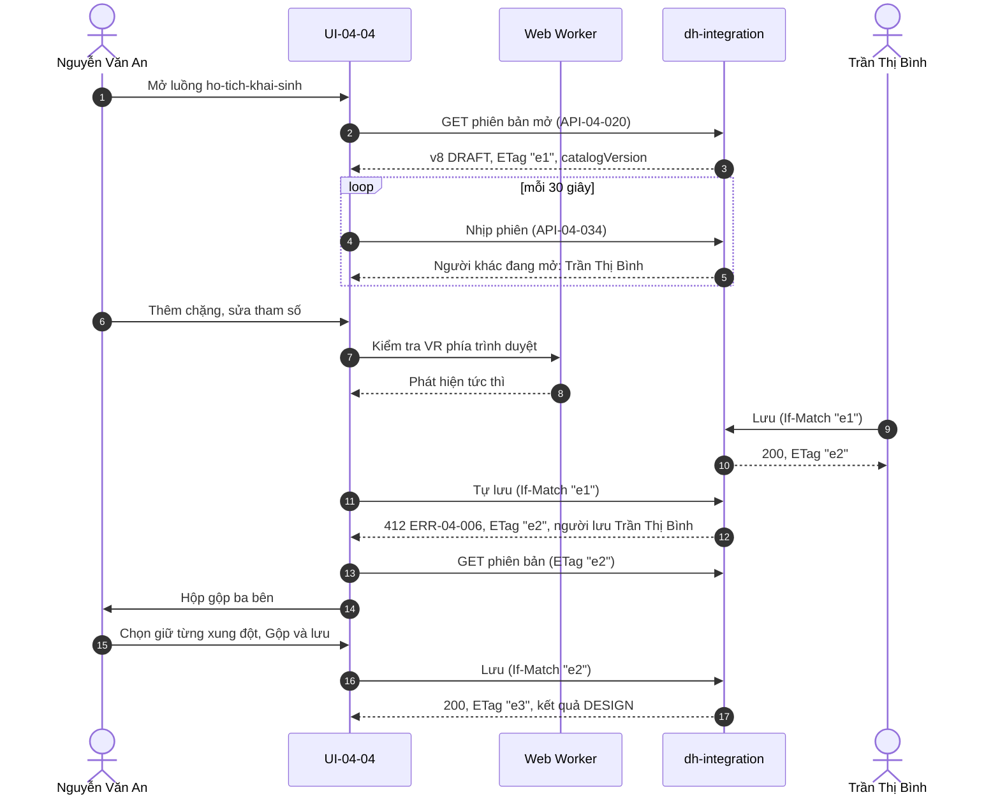

# D02-04-PH04 · Đặc tả use case phân hệ PH-04 Lõi tích hợp và trình thiết kế luồng

## 1. Mục đích và phạm vi

### 1.1. Mục đích

Tài liệu đặc tả 22 use case của PH-04. Mỗi use case mô tả trọn một mục tiêu nghiệp vụ của một tác nhân: thiết kế luồng, chạy thử, gửi duyệt, duyệt bốn mắt, phát hành qua GitOps, vận hành luồng, xử lý bản tin trên runtime, truy cập CSDL có kiểm soát, di trú luồng hệ cũ, quản lý danh mục thành phần. Mỗi use case có trình tự bước giữa tác nhân và hệ thống, luồng thay thế, luồng ngoại lệ kèm mã lỗi, và các đảm bảo hệ thống phải giữ.

Tài liệu nối [D02-03-PH04 FRS](../frs/D02-03-PH04-frs-tich-hop.md) (hệ thống phải làm gì) với [D03-06-PH04 Màn hình](../../03-thiet-ke/uiux/D03-06-PH04-man-hinh-tich-hop.md), D03-02-PH04 SDD, D03-04-PH04 API (hệ thống làm thế nào). Đội phát triển dùng luồng chính, luồng ngoại lệ để biết thứ tự gọi màn, gọi API, mã lỗi phải trả; đội kiểm thử dùng từng luồng làm khung ca kiểm thử TS-04-xx ở D05-02-PH04.

### 1.2. Phạm vi

Toàn bộ FR-04-001…084 của FRS. Chức năng dùng chung FR-00 (đăng nhập, phân quyền, kiểm toán, hộp "Việc của tôi", thông báo) không đặc tả lại; bước dựa vào chúng ghi "Tuân thủ FR-00-nnn". Hành vi của kết nối (PH-05), lược đồ (PH-06), bảng mã (PH-07), topic (PH-10), giám sát (PH-13), DLQ (PH-18) chỉ mô tả ở mức tương tác.

### 1.3. Tài liệu liên quan

| Tài liệu | Lý do tham chiếu |
|---|---|
| [D00-01 Thuật ngữ và quy ước](../../00-chung/D00-01-thuat-ngu-quy-uoc.md) | Hệ mã truy vết, kiểu T-* |
| [D02-02 SRS](../D02-02-srs.md) | FR-00, NFR-00 |
| [D02-03-PH04 FRS](../frs/D02-03-PH04-frs-tich-hop.md) | FR-04, BR-04, NFR-04, VR, tham số `04.*`, trạng thái |
| [D02-08 Ma trận phân quyền](../D02-08-ma-tran-phan-quyen.md) | Vai trò, `PERM-04-*` |
| [D03-06-PH04 Màn hình](../../03-thiet-ke/uiux/D03-06-PH04-man-hinh-tich-hop.md) | UI-04-01…21, thông điệp lỗi |
| ADR-060…069 | Quyết định kiến trúc PH-04 |
| [D03-10 Thiết kế đa tenant](../../03-thiet-ke/D03-10-thiet-ke-da-tenant.md) | RLS, tiêu đề tenant |

## 2. Quy ước đọc đặc tả

### 2.1. Mẫu đặc tả một use case

| Mục | Ý nghĩa |
|---|---|
| Mã, tên | `UC-04-nn`, tên bắt đầu bằng động từ |
| Mục tiêu | Kết quả nghiệp vụ tác nhân chính muốn đạt |
| Tác nhân chính, phụ | Người hoặc hệ thống khởi xướng; người hoặc hệ thống tham gia, nhận kết quả |
| Mức ưu tiên | M, S, C, lấy mức cao nhất của các FR hiện thực |
| FR hiện thực | FR mà use case hiện thực |
| Tiền điều kiện | Điều phải đúng trước khi bắt đầu |
| Điều kiện kích hoạt | Sự kiện làm use case bắt đầu |
| Đảm bảo tối thiểu | Điều hệ thống luôn giữ kể cả khi thất bại giữa chừng |
| Đảm bảo thành công | Trạng thái hệ thống sau khi kết thúc thành công |
| Luồng chính | Kịch bản thành công điển hình, đánh số bước, ghi màn `UI-04-nn` và API `API-04-nnn` |
| Luồng thay thế | Nhánh hợp lệ khác, đánh số theo bước rẽ (`3a`) |
| Luồng ngoại lệ | `E1`, `E2`…, mã lỗi `ERR-04-nnn`, thông điệp, cách khắc phục |
| Quy tắc, phi chức năng | `BR-04-nnn`, `NFR-04-nnn` |
| Tần suất, khối lượng | Ước lượng để thiết kế hiệu năng (giả định, chưa có số liệu thật, ghi rõ GĐ) |
| Sơ đồ | Sơ đồ tuần tự hoặc hoạt động Mermaid cho use case phức tạp |

### 2.2. Quy ước trong luồng

"Hệ thống" là dịch vụ điều khiển `dh-integration` cùng giao diện `dh-console`; "Runtime" là `dh-runtime` (Camel Quarkus 3.33.2, Camel 4.18 LTS) trong namespace `dh-runtime` hoặc `dh-rt-{tenant}`; "Sandbox" là `dh-runtime-sandbox` (ADR-064); "Kho cấu hình" là kho Git `dh-flows-{tenant}` (ADR-068). API có tiền tố `/api/integration/v1`. API tạo mới nhận `Idempotency-Key`; API sửa, chuyển trạng thái cần `If-Match`; lỗi theo RFC 9457 với `code` là `ERR-04-nnn`.

Mọi thao tác ghi sinh bản ghi kiểm toán theo FR-00-040 với mã sự kiện `INT_*` của FRS; mọi truy vấn CSDL điều khiển chạy dưới RLS theo tenant (D03-10). Các luồng không nhắc lại hai điều này ở từng bước.

Dữ liệu ví dụ là giả lập theo chỉ đạo ngày 25/11/2026 (không có dữ liệu thật): tenant `lam-dong` (tỉnh Lâm Đồng); không gian làm việc `so-tu-phap`; luồng `ho-tich-khai-sinh` "Đồng bộ khai sinh sang NDXP" (đối ngoại, HTTT Hộ tịch tỉnh → Nền tảng NDXP); kết nối `ndxp-ho-tich` (HTTP), `pg-ho-tich-ro` (CSDL chỉ đọc cho luồng). Người dùng giả lập: Nguyễn Văn An (IE, Sở Tư pháp), Trần Thị Bình (IE, người đóng góp), Lê Văn Cường (IA), Phạm Thu Dung (TO), Hoàng Minh Đức (SO), Vũ Thị Hà (TA), Đỗ Quang Khải (PA nền tảng).

## 3. Tác nhân

### 3.1. Danh sách tác nhân

| Tác nhân | Mã | Loại | Use case chính |
|---|---|---|---|
| Kỹ sư tích hợp | IE | Người | UC-04-03…10, 16, 20 |
| Người duyệt tích hợp | IA | Người | UC-04-11, 12, 13, 14 |
| Vận hành tenant | TO | Người | UC-04-02, 14 |
| Quản trị tenant | TA | Người | UC-04-01, 12, 14, 15, 16 |
| Cán bộ ATTT | SO | Người | UC-04-15, 21 |
| Quản trị nền tảng | PA | Người | UC-04-21, 22 |
| Người xem, kiểm toán | VW, AU | Người | UC-04-02 |
| HTTT thành viên (bên gọi) | — | Hệ thống | UC-04-17, 18 |
| HTTT đích, CSDL nguồn | — | Hệ thống | UC-04-17, 18, 19 |
| APISIX nội bộ | — | Hệ thống | UC-04-17 |
| Argo CD | — | Hệ thống | UC-04-12, 13 |
| `dh-runtime`, `dh-runtime-sandbox` | — | Hệ thống | UC-04-08, 12, 14, 15, 17…19 |
| OPA, PH-05, PH-06, PH-07, PH-09, PH-10, PH-13, PH-18 | — | Hệ thống | Tham gia nhiều use case |

### 3.2. Quan hệ vai trò và mức truy cập không gian làm việc

Khi `04.workspace.enforce` bật: sửa luồng cần `PERM-04-update` và mức `EDIT` trên không gian; duyệt cần `PERM-04-publish` và mức `MAINTAIN`; TA, PA không bị giới hạn (FRS §3.4, BR-04-021). Khi tham số tắt (mặc định MVP, mọi luồng trong không gian `DEFAULT`), chỉ quyền chức năng có hiệu lực.

## 4. Sơ đồ use case tổng

Sơ đồ chia ba vùng việc. Vùng thiết kế (UC-04-03…10) là việc hằng ngày của kỹ sư tích hợp, thay Productivity Tooling. Vùng phát hành, vận hành (UC-04-11…16) thay Start/Stop và lưu context của Bus, thêm bốn mắt và GitOps. Vùng data plane (UC-04-17…19) là hành vi của luồng khi chạy, tác nhân là hệ thống. UC-04-10 bao gồm UC-04-08 vì gửi duyệt cần một lần chạy thử đạt trên đúng băm (BR-04-004).

## 5. Bảng tổng hợp use case và truy vết

### 5.1. Use case và yêu cầu chức năng

| Mã | Tên | Mức | FR hiện thực | LGC |
|---|---|---|---|---|
| UC-04-01 | Quản lý không gian làm việc và thành viên | S | FR-04-007 | BUS-032 |
| UC-04-02 | Tra cứu, xem chi tiết và tình trạng luồng | M | FR-04-001, 002, 004, 051, 052, 053, 083 | BUS-001…008, 014…025, 027…030; TOOL-001 |
| UC-04-03 | Tạo luồng mới | M | FR-04-003, 025 | BUS-013; TOOL-002 |
| UC-04-04 | Thiết kế luồng trên sơ đồ và YAML | M | FR-04-010…013, 017, 023, 024, 026, 027 | TOOL-003…018, 021, 023…026, 029 |
| UC-04-05 | Cấu hình chặng, biểu thức, kết nối, bản tin mẫu | M | FR-04-014, 015, 016, 022 | BUS-011, 040, 041; TOOL-008, 019, 020 |
| UC-04-06 | Ánh xạ dữ liệu và chuyển mã | M | FR-04-020 | BUS-036; TOOL-007, 028 |
| UC-04-07 | Soạn Kamelet, Pipe, bean và cấu hình cấp tệp | S | FR-04-018, 019, 021 | TOOL-027 (thay thế) |
| UC-04-08 | Chạy thử luồng | M | FR-04-030, 032, 033 | BUS-013, 022 |
| UC-04-09 | Quản lý ca kiểm thử | S | FR-04-031 | — |
| UC-04-10 | Gửi duyệt phiên bản | M | FR-04-040, 023 | — |
| UC-04-11 | Duyệt phiên bản bốn mắt | M | FR-04-041, 043 | BUS-023 |
| UC-04-12 | Phát hành và thăng cấp qua GitOps | M | FR-04-042, 045, 075 | BUS-033, 034 |
| UC-04-13 | Quay lui về phiên bản trước | M | FR-04-044 | — |
| UC-04-14 | Tạm dừng, tiếp tục luồng hoặc route | M | FR-04-050 | BUS-009, 012, 026 |
| UC-04-15 | Dừng khẩn luồng | M | FR-04-050 | BUS-009 |
| UC-04-16 | Nhân bản, hủy nháp, gỡ luồng | M | FR-04-005, 006 | BUS-010; TOOL-016 |
| UC-04-17 | Xử lý bản tin đồng bộ qua khung chín chặng | M | FR-04-060, 061, 063…068, 070, 073, 074 | BUS-035…039, 041 |
| UC-04-18 | Xử lý bản tin bất đồng bộ từ Kafka | M | FR-04-062, 069, 070, 071, 073 | BUS-039 |
| UC-04-19 | Đọc CSDL trực tiếp có kiểm soát (Q359) | M | FR-04-072 | BUS-040; TOOL-008 |
| UC-04-20 | Nhập luồng Camel XML hệ cũ | M | FR-04-082 | BUS-033; TOOL-015 |
| UC-04-21 | Quản lý danh mục thành phần và chính sách | M | FR-04-080 | BUS-034, 040 |
| UC-04-22 | Nâng phiên bản catalog và runtime | M | FR-04-081 | — |

Luồng phụ dùng chung ở mục 7: tham số PH-04 và đóng băng thay đổi (FR-04-084), lịch sử và kiểm toán (FR-04-083). Mọi FR-04 có ít nhất một use case; FR-04-075 hiện thực trong UC-04-12 (gán hồ sơ runtime khi phát hành).

### 5.2. Use case và màn hình, API

| Mã | Màn hình | API chính |
|---|---|---|
| UC-04-01 | UI-04-21 | API-04-001…004 |
| UC-04-02 | UI-04-01, 02 | API-04-010, 012, 013, 016, 060, 062, 063, 091 |
| UC-04-03 | UI-04-03, 19 | API-04-011, 080, 081 |
| UC-04-04 | UI-04-04 | API-04-020…024, 026, 027, 030, 034, 070, 071 |
| UC-04-05 | UI-04-04, 05, 06 | API-04-022, 032, 071; PH-05 |
| UC-04-06 | UI-04-07 | API-04-033; PH-06, PH-07 |
| UC-04-07 | UI-04-08, 09, 10 | API-04-022, 030 |
| UC-04-08 | UI-04-11, 12 | API-04-040…043 |
| UC-04-09 | UI-04-13 | API-04-044 |
| UC-04-10 | UI-04-04 (hộp gửi duyệt) | API-04-030, 050, 051 |
| UC-04-11 | UI-04-14, 16 | API-04-025, 030, 052, 053 |
| UC-04-12 | UI-04-15 | API-04-054, 056 |
| UC-04-13 | UI-04-15 | API-04-055 |
| UC-04-14, 15 | UI-04-02, 15 | API-04-060, 061 |
| UC-04-16 | UI-04-01, 02 | API-04-014, 015, 016, 023 |
| UC-04-17…19 | — (runtime) | Điểm vào của luồng qua APISIX; topic Kafka |
| UC-04-20 | UI-04-18 | API-04-028 |
| UC-04-21 | UI-04-17 | API-04-070…074 |
| UC-04-22 | UI-04-17 | API-04-073 |

### 5.3. Use case và quy trình, yêu cầu nghiệp vụ

Mọi use case truy vết về REQ-04 của BRD. UC-04-05, 19, 21 truy vết thêm REQ-05 (kết nối, bộ điều hợp). UC-04-18 truy vết REQ-10 (bản tin). UC-04-17 truy vết REQ-03 (điểm vào qua APISIX) và yêu cầu ghi nhật ký kết nối của NĐ 278/2025. UC-04-20 truy vết REQ-22 (di trú). UC-04-11, 12 hiện thực nguyên tắc bốn mắt và quản lý thay đổi của TCVN 14423:2026 cấp độ 3 (nhóm quản lý vận hành, SEC-40…49 của D03-07).

## 6. Đặc tả chi tiết use case

### 6.1. UC-04-01 · Quản lý không gian làm việc và thành viên

Bus cũ phân quyền theo `Project`, `Group`, `Project_group.access_level` (LGC-BUS-032) để sở này không sửa nhầm chương trình của sở khác. Use case giữ ý tưởng đó dưới tên không gian làm việc.

| Mục | Nội dung |
|---|---|
| Mã | UC-04-01 |
| Mục tiêu | TA tổ chức luồng của tỉnh theo đơn vị chủ quản và cấp mức truy cập cho từng người, nhóm |
| Tác nhân chính | TA (`PERM-04-admin`) |
| Tác nhân phụ | Thành viên mức `MAINTAIN` (thêm, bớt thành viên); PH-12 (nhóm Keycloak) |
| Mức ưu tiên | S |
| FR hiện thực | FR-04-007 |
| Tiền điều kiện | Tenant hoạt động |
| Điều kiện kích hoạt | TA mở UI-04-21 |
| Đảm bảo tối thiểu | Không gian còn luồng không bị xóa; mọi thay đổi thành viên được kiểm toán với danh sách thêm, bớt |
| Đảm bảo thành công | Không gian và danh sách thành viên mới có hiệu lực ngay ở lượt gọi kế tiếp |

**Luồng chính**

1. TA (Vũ Thị Hà) mở UI-04-21; hệ thống liệt kê không gian (API-04-001).
2. TA chọn "Tạo không gian", nhập mã `so-tu-phap`, tên "Sở Tư pháp", đơn vị chủ quản, mô tả.
3. Hệ thống kiểm tra mã duy nhất trong tenant, ghi không gian (API-04-002).
4. TA mở tab Thành viên, thêm Nguyễn Văn An mức `EDIT`, Trần Thị Bình mức `EDIT`, Lê Văn Cường mức `MAINTAIN`, nhóm PH-12 "Phòng HCTP" mức `VIEW` (API-04-004).
5. Hệ thống lưu, mở rộng nhóm thành người dùng lúc kiểm tra quyền, trả danh sách hiệu lực.

**Luồng thay thế**

- **4a. Thành viên `MAINTAIN` tự quản lý thành viên.** Lê Văn Cường thêm một kỹ sư mới mức `EDIT`; hệ thống cho phép vì người thao tác có `MAINTAIN` trên chính không gian.
- **5a. Lưu trữ không gian.** TA chọn "Lưu trữ" (API-04-003); không gian ẩn khỏi ô chọn khi tạo luồng, luồng hiện có không đổi.

**Luồng ngoại lệ**

- **E1. Mã trùng (bước 3).** ERR-04-028 "Mã không gian làm việc đã được dùng."
- **E2. Xóa không gian còn luồng.** ERR-04-017 kèm số luồng; gợi ý "Lưu trữ" thay vì xóa.

**Quy tắc:** BR-04-021. **Tần suất:** vài lần mỗi tháng mỗi tenant (GĐ).

### 6.2. UC-04-02 · Tra cứu, xem chi tiết và tình trạng luồng

| Mục | Nội dung |
|---|---|
| Mã | UC-04-02 |
| Mục tiêu | Người dùng tìm được luồng và biết luồng đang chạy phiên bản nào, ở đâu, có khỏe không |
| Tác nhân chính | Mọi vai trò có `PERM-04-read` (thường TO, IE) |
| Tác nhân phụ | PH-13 (số liệu, log), `dh-runtime` (nhịp tim) |
| Mức ưu tiên | M |
| FR hiện thực | FR-04-001, 002, 004, 051, 052, 053, 083 |
| Tiền điều kiện | Đăng nhập, chọn tenant (FR-00-004) |
| Điều kiện kích hoạt | Mở UI-04-01 hoặc liên kết sâu tới UI-04-02 |
| Đảm bảo tối thiểu | Không lộ luồng ngoài phạm vi không gian làm việc; URI điểm kết nối luôn che tham số nhạy cảm |
| Đảm bảo thành công | Người dùng thấy danh sách, chi tiết và tình trạng theo môi trường |

**Luồng chính**

1. Phạm Thu Dung (TO) mở UI-04-01; hệ thống trả trang đầu kèm `facets` theo trạng thái (API-04-010).
2. TO gõ "khai sinh" vào ô tìm và chọn lọc môi trường `PROD`; hệ thống lọc trên mã, tên, mô tả, URI đã chỉ mục (EN-04-04).
3. TO thấy dòng `ho-tich-khai-sinh` có chấm PROD màu cảnh báo, bấm mã luồng.
4. Hệ thống mở UI-04-02 (API-04-012) với thẻ môi trường từ API-04-060: PROD "v7 · Đồng bộ, suy giảm · 2/3 bản sao".
5. TO mở tab Giám sát; hệ thống nhúng bảng điều khiển PH-13 lọc theo `tenant`, `flow`, `version`, `environment` (API-04-063).
6. TO mở tab Route; thấy route `goi-ndxp` có bản sao `Suspended` theo nhịp tim lúc 14:20.
7. TO mở tab Lịch sử (API-04-091); thấy lệnh tạm dừng route lúc 14:18 của Hoàng Minh Đức kèm lý do.

**Luồng thay thế**

- **2a. Lọc theo endpoint.** TO nhập `/ho-tich/khai-sinh` vào ô "Endpoint" của bộ lọc khác; hệ thống khớp chuỗi con trên URI đã chuẩn hóa (thay tìm theo endpoint của Bus).
- **3a. Sửa thông tin luồng.** IE có `PERM-04-update` chọn "Sửa thông tin" (FR-04-004), đổi mô tả, nhãn, HTTT đích (API-04-013, `If-Match`). Nếu đổi HTTT làm luồng thành đối ngoại, phiên bản mở được kiểm tra lại ở mức đối ngoại và bảng Vấn đề có thêm VR-05.
- **4a. Nhịp tim quá 90 giây không về.** Sức khỏe hiện "Không rõ"; thẻ môi trường có chữ "Không nhận được nhịp tim từ {giờ}".

**Luồng ngoại lệ**

- **E1. Luồng không tồn tại hoặc ngoài phạm vi.** ERR-04-001, không phân biệt hai trường hợp.
- **E2. Phiên bản không tồn tại (`?phien-ban=`).** ERR-04-004.
- **E3. Sửa thông tin khi luồng đã gỡ.** ERR-04-034. **E4.** ETag lệch ERR-04-006; thiếu `If-Match` ERR-04-007.
- **E5. PH-13 không phản hồi (bước 5).** Tab Giám sát hiện ST-05, các tab khác vẫn dùng được.

**Quy tắc:** BR-04-021. **Phi chức năng:** NFR-00 về thời gian phản hồi danh sách. **Tần suất:** hàng trăm lượt xem mỗi ngày mỗi tenant (GĐ).

### 6.3. UC-04-03 · Tạo luồng mới

| Mục | Nội dung |
|---|---|
| Mã | UC-04-03 |
| Mục tiêu | IE có một luồng mới với phiên bản v1 sẵn sàng thiết kế, xuất phát từ khuôn mẫu có đủ chín chặng chuẩn |
| Tác nhân chính | IE (`PERM-04-create`, mức `EDIT`) |
| Tác nhân phụ | PH-01 (HTTT), PH-02 (API), PH-07 (văn bản căn cứ) |
| Mức ưu tiên | M |
| FR hiện thực | FR-04-003, 025 |
| Tiền điều kiện | Có ít nhất một không gian mức `EDIT` (hoặc `DEFAULT` khi không giới hạn) |
| Điều kiện kích hoạt | Bấm "Tạo luồng" trên UI-04-01 |
| Đảm bảo tối thiểu | Không có luồng nửa vời: luồng, phiên bản 1, chỉ mục route và endpoint, outbox EVT-04-01 ghi trong một giao dịch |
| Đảm bảo thành công | Luồng `DRAFT`, phiên bản 1 `DRAFT`, `origin` đúng nguồn; kết quả kiểm tra mức `DESIGN` lưu kèm |

**Luồng chính**

1. Nguyễn Văn An mở UI-04-03 bước 1, chọn "Từ khuôn mẫu"; hệ thống hiện tám khuôn nền và khuôn của tỉnh (API-04-080).
2. An chọn `tpl-sync-lookup`; hệ thống tải chi tiết khuôn và lược đồ tham số (API-04-081).
3. Bước 2: An nhập tên "Tra cứu hộ tịch cho cổng DVC"; hệ thống gợi ý mã `tra-cuu-ho-tich` và kiểm tra trực tuyến tính duy nhất.
4. An chọn không gian `so-tu-phap`, HTTT nguồn "Cổng DVC tỉnh", đích "HTTT Hộ tịch tỉnh", điền tham số khuôn "Đường dẫn nhận" `/ho-tich/tra-cuu` và "Kết nối đích" `ho-tich-api`.
5. Bước 3: hệ thống hiện sơ đồ xem trước và kết quả kiểm tra sơ bộ (API-04-030 `level=DESIGN`): 1 cảnh báo VR-07 vì kết nối chưa có giá trị PROD.
6. An bấm "Tạo và mở trình thiết kế"; hệ thống gọi API-04-011 với `Idempotency-Key`, sinh định nghĩa bằng cách điền tham số vào khuôn, chạy kiểm tra, ghi dữ liệu và outbox, trả `201`.
7. Hệ thống chuyển tới UI-04-04 với phiên bản 1 (tiếp UC-04-04).

**Luồng thay thế**

- **1a. Luồng trống.** Với `ROUTE` đối ngoại, định nghĩa có chặng đầu trống, chín khối chặng chuẩn rỗng và `routeConfiguration` nền; với luồng nội bộ chỉ có chặng đầu.
- **1b. Từ API trong danh mục PH-02.** Hệ thống đọc OpenAPI, sinh `rest` DSL, mỗi thao tác một route `direct:{operationId}` có khung chín chặng, lược đồ gắn vào chặng `schema`.
- **1c. Nhập YAML.** Tệp ≤ 512 KiB được phân tích ngay khi thả; loại tài nguyên lấy từ nội dung.
- **1d. Nhân bản luồng có sẵn.** Chuyển sang UC-04-16 luồng 1a.
- **1e. Kamelet, Pipe.** Chọn loại tài nguyên khác ở bước 1; tiếp UC-04-07.

**Luồng ngoại lệ**

- **E1. Mã trùng (bước 3, 6).** ERR-04-002 "Mã luồng "tra-cuu-ho-tich" đã được dùng trong tỉnh." kèm gợi ý mã khác.
- **E2. Không có mức `EDIT` (bước 6).** ERR-04-003.
- **E3. Không gian không tồn tại.** ERR-04-027. **E4. Khuôn không tồn tại hoặc không được phép.** ERR-04-039.
- **E5. YAML không phân tích được.** ERR-04-008 kèm dòng, cột. **E6. Loại tài nguyên không khớp nội dung.** ERR-04-009. **E7. Vượt kích thước.** ERR-04-033.
- **E8. Gửi lại cùng `Idempotency-Key` nhưng nội dung khác.** ERR-04-018. Cùng nội dung thì trả kết quả lần trước, không tạo trùng.

**Quy tắc:** BR-04-001, 002, 003. **Tần suất:** 5–30 luồng mới mỗi tháng mỗi tenant (GĐ).

### 6.4. UC-04-04 · Thiết kế luồng trên sơ đồ và YAML

Use case trung tâm của PH-04, thay Productivity Tooling. Đặc tả giao diện đầy đủ ở D03-06-PH04 §10.

| Mục | Nội dung |
|---|---|
| Mã | UC-04-04 |
| Mục tiêu | IE dựng logic của luồng bằng sơ đồ, Inspector hoặc YAML, luôn thấy lỗi ngay, không mất công khi mất mạng hay sửa trùng |
| Tác nhân chính | IE (`PERM-04-update`, mức `EDIT`) |
| Tác nhân phụ | IE khác cùng mở luồng; PH-05, PH-10 (tham chiếu được kiểm tra) |
| Mức ưu tiên | M |
| FR hiện thực | FR-04-010, 011, 012, 013, 017, 023, 024, 026, 027 |
| Tiền điều kiện | Luồng tồn tại, không `RETIRED` |
| Điều kiện kích hoạt | Mở UI-04-04 từ UI-04-01, 02 hoặc sau UC-04-03 |
| Đảm bảo tối thiểu | Không ghi đè âm thầm (ETag); phần chưa lưu được giữ trong IndexedDB cho tới khi máy chủ xác nhận; bố cục và bản tin mẫu không vào YAML (BR-04-007); không lưu được bí mật viết thẳng (VR-03) |
| Đảm bảo thành công | Phiên bản mở có định nghĩa, bố cục, bản tin mẫu mới; người dùng có tên trong danh sách người đóng góp; chỉ mục route, endpoint tính lại |

**Luồng chính**

1. An mở UI-04-04 cho `ho-tich-khai-sinh`. Hệ thống trả phiên bản mở v8 `DRAFT` với định nghĩa, bố cục, bản tin mẫu, `catalogVersion`, ETag (API-04-020) và tải chỉ mục catalog đã lọc theo chính sách tenant (API-04-070, cache theo `catalogVersion`).
2. Trình duyệt tạo phiên soạn, gửi nhịp mỗi 30 giây (API-04-034); phản hồi cho biết Trần Thị Bình cũng đang mở. Giao diện hiện "Đang có 1 người khác mở luồng này".
3. An chọn chặng "Rẽ nhánh", nhấn `A` để thêm chặng sau; bảng chọn nhanh mở, An gõ "ghi log", `Enter`. Hệ thống chèn chặng `log` vào nhánh `otherwise`, sinh lại YAML trong ≤ 100 ms (NFR-04-005).
4. Trình duyệt chạy VR-01…09, 15, 18, 20 sau 400 ms; bảng Vấn đề hiện gợi ý LINT-04-01 "Nhánh otherwise chỉ ghi nhật ký".
5. An kéo bảng thành phần mục "Gọi REST" thả lên cạnh sau "Ghi nhật ký"; vì thành phần có cờ cần kết nối PH-05, ô chọn kết nối mở ngay; An chọn `ndxp-ho-tich` (tiếp UC-04-05).
6. An chuyển chế độ Chia đôi (`Ctrl+3`), sửa `timeout` trong YAML; sau 500 ms không gõ, hệ thống phân tích YAML, cập nhật sơ đồ, giữ chặng chọn theo `id`.
7. 30 giây sau thay đổi cuối, trình duyệt tự lưu (API-04-022 với `If-Match`); máy chủ kiểm tra trạng thái `DRAFT`, so ETag, chạy kiểm tra mức `DESIGN`, lưu, thêm An vào danh sách người đóng góp, trả ETag mới; chỉ báo "Đã lưu 14:02".
8. An tiếp tục chạy thử (UC-04-08) hoặc gửi duyệt (UC-04-10).

**Luồng thay thế**

- **1a. Không có phiên bản mở.** Hệ thống mở phiên bản đang chạy ở PROD (hoặc mới nhất) chỉ đọc; An chọn "Tạo phiên bản mới từ v7" (API-04-021); hệ thống sao chép định nghĩa, bố cục, ca kiểm thử sang v8 `DRAFT` (FR-04-011).
- **1b. Catalog của tenant đã nâng.** `catalogVersion` khác bản định nghĩa đã kiểm tra: dải "Danh mục thành phần đã cập nhật lên {phiên bản}. Kiểm tra lại luồng trước khi gửi duyệt" và kiểm tra chạy lại (FR-04-010 mục 3, UC-04-22).
- **1c. Còn bản nháp cục bộ mới hơn máy chủ.** Hộp "Khôi phục thay đổi chưa lưu từ {giờ}?" với Khôi phục, So sánh, Bỏ.
- **3a. Chỉ dùng bàn phím.** An dùng `↑↓←→` di chuyển giữa chặng, `Alt+↑↓` đổi chỗ, `Ctrl+X`/`Ctrl+V` chuyển nhánh (NFR-04-015).
- **3b. Kéo chặng tới chỗ trống.** Chỉ đổi vị trí hiển thị và ghim, YAML không đổi.
- **3c. Nối lại bằng cổng.** Kéo dây từ cổng ra; thả ra chỗ trống mở bảng chọn nhanh (LGC-TOOL-024).
- **3d. Xóa nội dung route (Clear Page).** Giữ chặng đầu, xóa mọi chặng sau, có xác nhận, hoàn tác được.
- **3e. Ghi chú dán, luồng con.** Thêm ghi chú (`N`) lưu trong bố cục; chọn vùng chặng → "Tách thành route con" sinh route `direct:` mới (FR-04-026).
- **6a. YAML lỗi cú pháp.** Sơ đồ giữ bản hợp lệ cuối, dải "YAML đang có lỗi"; không chuyển sang chế độ Sơ đồ được cho tới khi sửa.
- **6b. Phần tử không biểu diễn được.** Hiện chặng "Không biểu diễn được", chỉ sửa trong YAML, không bị xóa khi sửa phần khác.
- **7a. Lưu tay.** `Ctrl+S` lưu ngay.
- **7b. Tải xuống, nhập YAML (FR-04-027).** Tải `yaml`, `yaml+layout`, `bundle` (API-04-026); nhập YAML thay toàn bộ định nghĩa sau xác nhận (API-04-027), hoàn tác được.

**Luồng ngoại lệ**

- **E1. Xung đột ETag (bước 7).** Bình đã lưu sau lần tải của An: ERR-04-006 (412) kèm ETag hiện tại và người lưu. Hộp gộp ba bên (gốc chung, của tôi, của Bình); An chọn từng xung đột hoặc tải bản của mình về máy. Không ghi đè âm thầm.
- **E2. Phiên bản không còn sửa được.** Người khác đã gửi duyệt: ERR-04-005; trình thiết kế chuyển chỉ đọc.
- **E3. Mất kết nối.** Chỉ báo "Chưa lưu lên máy chủ"; tiếp tục sửa, dữ liệu giữ trong IndexedDB; có mạng lại thì lưu, ETag lệch thì vào E1.
- **E4. Vượt kích thước định nghĩa.** ERR-04-033 "Định nghĩa luồng vượt 512 KB."
- **E5. Giá trị giống bí mật.** VR-03 lỗi ngay tại trường, ERR-04-010 khi lưu: "Phát hiện giá trị giống bí mật ở chặng "Gọi hộ tịch", trường "authorization"…".
- **E6. Đang đóng băng thay đổi.** Lưu nháp vẫn được; FR-04-024 cho phép máy chủ trả ERR-04-041 (423) khi tỉnh cấu hình đóng băng cả việc soạn (GĐ: mặc định chỉ đóng băng phát hành).
- **E7. Phiên bản đã có bản mở (bước 1a).** ERR-04-016 kèm "Mở phiên bản đang soạn".

**Quy tắc:** BR-04-002, 003, 006, 007, 011, 016, 020. **Phi chức năng:** NFR-04-001…005, 015, 016, 017. **Tần suất:** mỗi IE vài giờ mỗi ngày; luồng điển hình 20–80 chặng, lớn nhất 200 chặng (GĐ).

Sơ đồ cho thấy cảnh báo người khác đang mở chỉ là thông tin; chốt chống ghi đè là ETag ở máy chủ. Trình duyệt luôn lấy bản mới của người kia trước khi gộp, nên phần gộp dựa trên đúng ba bên.

### 6.5. UC-04-05 · Cấu hình chặng, biểu thức, kết nối và bản tin mẫu

| Mục | Nội dung |
|---|---|
| Mã | UC-04-05 |
| Mục tiêu | IE đặt đúng tham số của một chặng mà không phải nhớ tên tham số Camel, không phải nhập máy chủ, mật khẩu, và kiểm được biểu thức trên dữ liệu mẫu |
| Tác nhân chính | IE |
| Tác nhân phụ | PH-05 (kết nối), Sandbox (biểu thức) |
| Mức ưu tiên | M |
| FR hiện thực | FR-04-014, 015, 016, 022 |
| Tiền điều kiện | Đang ở UC-04-04, phiên bản mở |
| Điều kiện kích hoạt | Chọn chặng (Inspector) hoặc nhấp đúp chặng (UI-04-05) |
| Đảm bảo tối thiểu | Trường bí mật không có ô nhập tự do; giá trị bằng mặc định không ghi vào YAML trừ khi ghim "luôn ghi" |
| Đảm bảo thành công | Tham số của chặng được cập nhật trên cây tài nguyên, có thể hoàn tác |

**Luồng chính**

1. An nhấp đúp chặng "Gọi hộ tịch"; UI-04-05 mở ba cột VÀO · THAM SỐ · RA. Hệ thống tải lược đồ thuộc tính của thành phần `http` cho đúng `catalogVersion` (API-04-071).
2. Cột THAM SỐ mặc định hiện trường bắt buộc và trường đã đặt của nhóm có trường bắt buộc; nút "Hiện tất cả (64)".
3. An mở ô Kết nối; hệ thống liệt kê kết nối PH-05 loại `http-*` được cấp cho `so-tu-phap`, kèm môi trường có giá trị; An chọn `ndxp-ho-tich`. Hệ thống điền máy chủ, cổng dạng `{{conn:ndxp-ho-tich.host}}`, không chép giá trị.
4. An nhập "Đường dẫn" `/api/v1/khai-sinh/${header.soDinhDanh}` và bấm ƒx; UI-04-06 mở.
5. Sau 400 ms, hệ thống biên dịch biểu thức bằng engine Camel đúng phiên bản (API-04-032): hợp lệ.
6. An chọn "Bản tin mẫu của chặng"; hệ thống đánh giá trên sandbox, hiện kết quả chuỗi đường dẫn đã thay giá trị.
7. An bấm "Áp dụng"; giá trị ghi vào trường, tạo một bước hoàn tác; huy hiệu lỗi của chặng giảm từ 2 xuống 0.
8. An đóng UI-04-05 (`Esc`), focus trở lại chặng.

**Luồng thay thế**

- **1a. Ghim bản tin mẫu (FR-04-022).** Cột VÀO trống; An chọn "Ghim bản tin mẫu…", dán JSON ≤ 256 KiB, đặt tiêu đề `soDinhDanh`. Bản tin lưu cùng phiên bản ở cột riêng. Chặng sau chưa ghim thừa hưởng bản tin của chặng này.
- **1b. Bản tin có dấu hiệu dữ liệu thật.** Hệ thống phát hiện chuỗi 12 chữ số dạng số định danh: cảnh báo LINT-04-06, gợi ý "Thay bằng dữ liệu giả"; chỉ người có `PERM-04-sample-data` bỏ qua được.
- **3a. Chưa có kết nối phù hợp.** An bấm "Tạo kết nối mới" mở PH-05 ở tab mới; quay lại, danh sách làm mới.
- **3b. Thành phần CSDL.** Ô kết nối chỉ hiện kết nối loại "chỉ đọc cho luồng" (tiếp UC-04-19).
- **6a. Sandbox không sẵn sàng.** Đánh giá cục bộ cho `simple`, `jsonpath`, `jq` với nhãn "Xem trước mô phỏng trên trình duyệt, kết quả có thể khác runtime".
- **7a. Khôi phục.** Menu trường "Khôi phục giá trị khi mở", "Đặt về mặc định"; menu chặng "Khôi phục chặng về bản đã lưu" (LGC-TOOL-020).

**Luồng ngoại lệ**

- **E1. Biểu thức không biên dịch được (bước 5).** ERR-04-037 kèm dòng, cột; gạch sóng tại vị trí.
- **E2. Bản tin mẫu vượt kích thước.** ERR-04-021.
- **E3. Kết nối không tồn tại, sai loại, chưa cấp.** VR-07 khi thiết kế, ERR-04-013 ở mức gửi duyệt.
- **E4. Ngôn ngữ kịch bản chưa được phép.** `groovy`, `js`, `python` không có trong danh sách ngôn ngữ (ADR-062); dán YAML chứa chúng thì VR-04.

**Quy tắc:** BR-04-003, 007, 013, 014. **Phi chức năng:** NFR-04-006 (mở cửa sổ 154 thuộc tính < 400 ms). **Tần suất:** hàng chục lần mỗi luồng.

### 6.6. UC-04-06 · Ánh xạ dữ liệu và chuyển mã

| Mục | Nội dung |
|---|---|
| Mã | UC-04-06 |
| Mục tiêu | IE chuyển cấu trúc bản tin nguồn sang cấu trúc đích (thường là CDM hoặc lược đồ NDXP) bằng kéo nối, kèm chuyển mã theo bảng của PH-07, không phải viết JQ |
| Tác nhân chính | IE |
| Tác nhân phụ | PH-06 (lược đồ), PH-07 (bảng ánh xạ mã), Sandbox |
| Mức ưu tiên | M |
| FR hiện thực | FR-04-020 |
| Tiền điều kiện | Chặng `transform` (hoặc `setBody`) trong phiên bản mở |
| Điều kiện kích hoạt | `Ctrl+M` hoặc "Mở trình ánh xạ" |
| Đảm bảo tối thiểu | `*.dhmap.json` là nguồn chuẩn; JQ luôn sinh lại được từ nó; không lưu ánh xạ có JQ không biên dịch được |
| Đảm bảo thành công | Chặng có biểu thức `jq` sinh ra; tệp `*.dhmap.json` lưu cùng phiên bản |

**Luồng chính**

1. An mở UI-04-07 trên chặng "Chuẩn hóa hồ sơ". Nguồn: JSON Schema `ho-tich-ks` v4; đích: CDM `ndxp-khai-sinh-req` v3.
2. An bấm "Gợi ý ánh xạ"; hệ thống đề xuất 7 cặp theo tên, không dấu, đồng nghĩa; An chọn 6, bỏ 1.
3. An kéo `hoSo.gioiTinh` vào `request.sex`, thêm hàm "Chuyển mã PH-07", chọn bảng `gioi-tinh-ht-ndxp`; hệ thống sinh `dh_map("gioi-tinh-ht-ndxp"; .hoSo.gioiTinh)`.
4. An kéo `hoSo.ngaySinh` vào `request.birthDate`, chọn hàm ngày "dd/MM/yyyy → ISO".
5. An kéo mảng `giayTo` vào `documents`; hệ thống tạo khối lặp, An nối trường con.
6. An đặt `request.province` = biến `$tenant`, `requestedAt` = `now()`.
7. An chọn bản tin mẫu của chặng ở thanh Thử; hệ thống chạy JQ trên sandbox (API-04-033) có hàm `dh_map`, kiểm kết quả theo lược đồ đích: hợp lệ, 1 gợi ý LINT-04-05 (trường `father.name` rỗng).
8. An bấm "Lưu ánh xạ"; chặng nhận JQ mới, tệp `*.dhmap.json` cập nhật, tạo một bước hoàn tác.

**Luồng thay thế**

- **1a. Nguồn từ tài liệu mẫu.** Dán JSON hoặc XML ≤ 1 MiB; hệ thống suy cây trường. Nguồn XML: chặng tự thêm `unmarshal` trước và `marshal` sau nếu đích XML.
- **1b. Lược đồ có phiên bản mới.** Dải "Lược đồ có v5. Xem khác biệt, Nâng lên"; ánh xạ tới trường đã bỏ thành "mồ côi".
- **5a. Ánh xạ một–nhiều.** Chưa có ở MVP; An viết JQ tay trong UI-04-06.
- **8a. Soạn JQ tay.** Sau cảnh báo, phần không nhận dạng hiện là khối "JQ tùy biến".
- **8b. Xuất, đặt lại.** "Xuất ánh xạ" tải `*.dhmap.json` và `*.jq`; "Đặt lại ánh xạ" xóa hết, hoàn tác được.

**Luồng ngoại lệ**

- **E1. Trường đích không tồn tại hoặc vòng tham chiếu.** ERR-04-038.
- **E2. Tài liệu mẫu vượt 1 MiB.** ERR-04-021.
- **E3. Bảng ánh xạ PH-07 không đọc được (bước 7).** Nút hàm hiện ⚠; vẫn lưu được nhưng không xem trước.
- **E4. Sandbox không sẵn sàng.** Xem trước cục bộ có nhãn mô phỏng (theo FR-04-015 mục 3).

**Quy tắc:** BR-04-013 (dữ liệu xem trước được che). **Tần suất:** 1–5 ánh xạ mỗi luồng đối ngoại.
