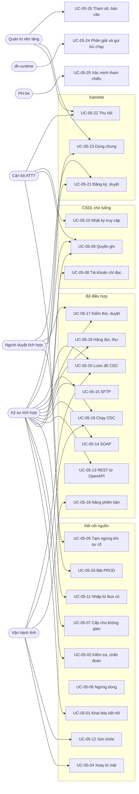

# D02-04-PH05 · Đặc tả use case Bộ điều hợp và kết nối

## Tóm tắt cho hội đồng thẩm định

Tài liệu đặc tả 26 use case của PH-05, phủ toàn bộ 54 FR mức M và 7 FR mức S của [D02-03-PH05](../frs/D02-03-PH05-frs-bo-dieu-hop.md); FR-05-039 (LDAP, mức C) chỉ có ca kiểm thử. Use case đi theo vòng đời thật của một kết nối tích hợp ở tỉnh: kỹ sư tích hợp khai báo kết nối tới HTTT của sở, kiểm tra, xin bật môi trường vận hành, dựng bộ điều hợp theo giao thức, đưa vào trình thiết kế luồng; vận hành theo dõi sức khỏe, xoay bí mật; cán bộ ATTT kiểm soát truy cập CSDL. Căn cứ pháp lý như FRS (CMP-LAW-09, CMP-LAW-03, CMP-LAW-06, CMP-LAW-08).

## 1. Mục đích và phạm vi

Toàn bộ FR-05-001…062. Chức năng dùng chung FR-00 (đăng nhập, phân quyền, kiểm toán, hộp "Việc của tôi", thông báo) không đặc tả lại; bước dựa vào chúng ghi "Tuân thủ FR-00-nnn". Hành vi chi tiết của từng bước (kiểm tra, mã lỗi) ở FR tương ứng; use case mô tả trình tự và vai trò.

## 2. Quy ước đọc đặc tả

Luồng chính đánh số 1, 2, 3. Luồng thay thế ghi `số bước + chữ` (ví dụ `3a`) và quay lại luồng chính. Luồng ngoại lệ ghi `E1`, `E2` kèm bước phát sinh và kết thúc use case hoặc quay lại bước nêu rõ. Dữ liệu ví dụ đều giả lập: tenant `T68`; người dùng **An** (IE, Sở KH&CN), **Bình** (IA), **Chi** (TO), **Dũng** (SO), **Hà** (PA); HTTT `HT-TUPHAP`, `HT-QLVB`, `HT-DATDAI`, `HT-DVC`, `HT-BAOCAO`.

## 3. Tác nhân

| Tác nhân | Loại | Use case chính |
|---|---|---|
| ROLE-INTEGRATION_ENGINEER (An) | Chính | 01, 02, 07, 08, 09, 11, 13…21, 23 |
| ROLE-INTEGRATION_APPROVER (Bình) | Chính | 03, 09, 17, 21 |
| ROLE-TENANT_OPERATOR (Chi) | Chính | 04, 12, 18, 19, 20 |
| ROLE-SECURITY_OFFICER (Dũng) | Chính | 05, 09, 10, 22 |
| ROLE-PLATFORM_ADMIN (Hà) | Chính | 22, 23 |
| ROLE-TENANT_ADMIN | Chính | 26 (và mọi UC của IE) |
| `dh-runtime` | Chính (máy) | 24 |
| PH-04 `dh-integration` | Chính (máy) | 25 |
| OpenBao | Phụ | 01, 03, 04, 08, 09, 24 |
| HTTT thành viên | Phụ | 02, 13…20, 24 |
| PH-01, PH-10, PH-13, PH-18, Kafka Connect, dịch vụ quét mã độc | Phụ | Nhiều use case |

## 4. Sơ đồ use case tổng

Sơ đồ gom use case theo bốn nhóm nghiệp vụ. Kỹ sư tích hợp là tác nhân của phần lớn use case vì họ dựng kết nối và bộ điều hợp; người duyệt tích hợp chỉ xuất hiện ở bốn điểm có bốn mắt (bật PROD, quyền ghi CSDL, phiên bản bộ điều hợp, Kamelet). Hai use case máy (24, 25) là điểm nối với data plane và PH-04: chúng không có giao diện nhưng quyết định hành vi lúc chạy, nên được đặc tả cùng mức chi tiết.

## 5. Bảng tổng hợp use case và truy vết

### 5.1. Use case và FR

| UC | Tên | Tác nhân chính | Mức | FR |
|---|---|---|---|---|
| UC-05-01 | Khai báo kết nối nguồn tới HTTT | IE | M | 001, 002, 003, 004, 005, 011 |
| UC-05-02 | Kiểm tra và chẩn đoán kết nối | IE | M | 010 |
| UC-05-03 | Xin bật và duyệt giá trị PROD | IE, IA | M | 007 |
| UC-05-04 | Xoay vòng bí mật | TO | M | 012 |
| UC-05-05 | Tạm ngừng kết nối khi có sự cố ATTT | SO | M | 008, 028 |
| UC-05-06 | Sửa, ngừng dùng kết nối và xem lịch sử | IE | M | 006, 008, 013, 016, 017 |
| UC-05-07 | Cấp kết nối cho không gian làm việc | IE | M | 009 |
| UC-05-08 | Cấp tài khoản CSDL chỉ đọc cho luồng | IE | M | 023, 024, 025, 038 |
| UC-05-09 | Đề nghị và duyệt quyền ghi CSDL | IE, SO, IA | M | 026, 028 |
| UC-05-10 | Tra nhật ký truy cập CSDL | SO | M | 027 |
| UC-05-11 | Nhập kết nối từ gói Bus cũ | IE | M | 018 |
| UC-05-12 | Theo dõi sức khỏe và xử lý suy giảm | TO | M | 019, 020, 021, 022 |
| UC-05-13 | Tạo bộ điều hợp REST từ OpenAPI | IE | M | 029, 030, 031, 032, 033, 046 |
| UC-05-14 | Cấu hình bộ điều hợp SOAP, xử lý lệch WSDL | IE | M | 034, 040 |
| UC-05-15 | Cấu hình bộ điều hợp tệp SFTP | IE | M | 036, 041, 042 |
| UC-05-16 | Cấu hình bộ điều hợp hàng đợi và thư điện tử | IE | M | 035, 037 |
| UC-05-17 | Kiểm thử, gửi duyệt và duyệt phiên bản bộ điều hợp | IE, IA | M | 043, 044, 047 |
| UC-05-18 | Nâng phiên bản bộ điều hợp có chạy so sánh | IE, TO | S | 045 |
| UC-05-19 | Thiết lập và chạy CDC cho HTTT di sản | IE, TO | M | 048, 049, 050, 052 |
| UC-05-20 | Xử lý thay đổi lược đồ và chụp ảnh lại | IE, TO | M | 051, 053 |
| UC-05-21 | Đăng ký và duyệt Kamelet của tỉnh | IE, IA | M | 054, 055, 056, 057, 059 |
| UC-05-22 | Thu hồi Kamelet có lỗi bảo mật | PA, SO | M | 058 |
| UC-05-23 | Đề xuất Kamelet của tỉnh thành dùng chung | IE, PA | S | 060 |
| UC-05-24 | Runtime phân giải kết nối và gọi HTTT | `dh-runtime` | M | 015, 033, 042 |
| UC-05-25 | PH-04 xác minh tham chiếu khi phát hành luồng | PH-04 | M | 014, 047 |
| UC-05-26 | Cấu hình tham số phân hệ và xem báo cáo sử dụng | TA | M | 061, 062 |

### 5.2. Use case, màn hình và API

| UC | UI | API |
|---|---|---|
| UC-05-01 | UI-05-01, 03 | API-05-001, 002, 004, 005, 011, 012 |
| UC-05-02 | UI-05-04 | API-05-017, 018, 019 |
| UC-05-03 | UI-05-02, 17 | API-05-013, 015, 016 |
| UC-05-04 | UI-05-02 | API-05-012, 020, 021 |
| UC-05-05 | UI-05-02, 07 | API-05-007, 039 |
| UC-05-06 | UI-05-02, 01 | API-05-006, 009, 025, 026, 027 |
| UC-05-07 | UI-05-02 | API-05-022, 023, 024 |
| UC-05-08 | UI-05-05 | API-05-035, 036, 040 |
| UC-05-09 | UI-05-05, 17 | API-05-036, 037, 038, 039 |
| UC-05-10 | UI-05-05 | API-05-041 |
| UC-05-11 | UI-05-06 | API-05-028, 029, 030 |
| UC-05-12 | UI-05-07, 02 | API-05-033, 034, 061 |
| UC-05-13 | UI-05-08, 11, 10 | API-05-043, 044, 050, 065 |
| UC-05-14 | UI-05-10 | API-05-050, 054 |
| UC-05-15 | UI-05-10 | API-05-050, 054 |
| UC-05-16 | UI-05-10 | API-05-050 |
| UC-05-17 | UI-05-09, 10, 17 | API-05-052, 053, 055, 056, 057 |
| UC-05-18 | UI-05-09 | API-05-047, 048, 063, 064 |
| UC-05-19 | UI-05-12 | API-05-067, 068, 069, 070, 071, 072 |
| UC-05-20 | UI-05-13, 12 | API-05-072, 073, 074, 075 |
| UC-05-21 | UI-05-14, 15, 16, 17 | API-05-076…084 |
| UC-05-22 | UI-05-15 | API-05-086, 087 |
| UC-05-23 | UI-05-15 | API-05-088, 083 |
| UC-05-24 | — | API-05-032; OpenBao; EVT-05-01…04 |
| UC-05-25 | — | API-05-031, 089 |
| UC-05-26 | — (màn tham số chung PH-18) | API-05-090, 091, 092 |

### 5.3. Use case, REQ, quy trình và hệ cũ

| UC | REQ | Quy trình | LGC |
|---|---|---|---|
| UC-05-01 | REQ-05 | Kết nạp → tích hợp | LGC-BUS-040, LGC-BUS-011, LGC-TOOL-008, 009 |
| UC-05-02 | REQ-05 | Kết nạp → tích hợp | LGC-BUS-013 |
| UC-05-03 | REQ-05 | Phát hành | LGC-BUS-012 |
| UC-05-04 | REQ-05 | Vận hành | LGC-BUS-041 |
| UC-05-05 | REQ-05 | Sự cố ATTT | LGC-BUS-009 |
| UC-05-06 | REQ-05 | Vận hành | LGC-BUS-010, LGC-BUS-011 |
| UC-05-07 | REQ-05 | Thiết kế luồng | LGC-BUS-032 |
| UC-05-08, 09, 10 | REQ-05, REQ-04 | Thiết kế luồng, sự cố ATTT | LGC-TOOL-008 |
| UC-05-11 | REQ-05 | Di trú strangler | LGC-BUS-033, LGC-BUS-040 |
| UC-05-12 | REQ-05, REQ-13 | Vận hành | LGC-BUS-014, LGC-BUS-015 |
| UC-05-13…16 | REQ-05 | Kết nạp → tích hợp | LGC-BUS-040, LGC-TOOL-009, 010, 011, 012 |
| UC-05-17, 18 | REQ-05 | Phát hành | LGC-BUS-013 |
| UC-05-19, 20 | REQ-05 | Kết nạp HTTT nhóm 3 | LGC-BUS-040 |
| UC-05-21, 22, 23 | REQ-05, REQ-04 | Thiết kế luồng | LGC-TOOL-027 (thay thế) |
| UC-05-24, 25 | REQ-05, REQ-04 | Chạy luồng, phát hành | LGC-BUS-040, LGC-BUS-041 |
| UC-05-26 | REQ-05 | Quản trị | LGC-BUS-031 |

## 6. Đặc tả chi tiết use case

### 6.1. UC-05-01 · Khai báo kết nối nguồn tới HTTT

| Mục | Nội dung |
|---|---|
| Mục tiêu | Kỹ sư tích hợp có một kết nối tới HTTT của sở, đủ giá trị cho ba môi trường, bí mật không nằm ở đâu ngoài OpenBao |
| Tác nhân chính | ROLE-INTEGRATION_ENGINEER (An) |
| Tác nhân phụ | PH-01 (bản sao HTTT), OpenBao |
| Mức ưu tiên | M |
| FR hiện thực | FR-05-001, 002, 003, 004, 005, 011 |
| Tiền điều kiện | An có `PERM-05-connection`; `HT-TUPHAP` `ACTIVE` ở PH-01; loại `oauth2-client` được bật ở T68 |
| Điều kiện kích hoạt | An bấm "Tạo kết nối" ở UI-05-01 |
| Đảm bảo tối thiểu | Không có bí mật nào được ghi ra ngoài OpenBao kể cả khi thất bại giữa chừng |
| Đảm bảo thành công | Kết nối `ndxp-ho-tich` ở `DRAFT`, có giá trị `CONFIGURED` cho TEST và PROD, bí mật phiên bản 1 |

**Luồng chính**

1. Hệ thống mở UI-05-03 bước "Chọn loại", gọi API-05-001 và hiện các loại kết nối được bật, nhóm theo giao thức.
2. An chọn `oauth2-client`. Hệ thống gọi API-05-002 và dựng biểu mẫu từ lược đồ tham số.
3. An nhập mã `ndxp-ho-tich`, tên "Hộ tịch điện tử Sở Tư pháp", HTTT `HT-TUPHAP`, mục đích `READ`. Hệ thống kiểm tra mã ngay khi rời ô (gọi API-05-003 với `q`).
4. An bấm "Tiếp". Hệ thống gọi API-05-004 với `Idempotency-Key`; nhận `201`, kết nối `DRAFT`.
5. Ở bước "Giá trị môi trường", An điền cho TEST: `baseUrl` `https://test-hotich.t68.gov.vn`, `tokenUrl`, `clientId` `datahub-t68`, `scope` `hotich.read`, `authMethod` `client_secret_post`. Hệ thống gọi API-05-011 (tuân thủ FR-05-005 bước 1…3).
6. An nhập `clientSecret` vào ô bí mật (ô kiểu mật khẩu, không có nút hiện). Hệ thống gọi API-05-012; nhận `204`; ô chuyển thành nhãn "Đã đặt · phiên bản 1 · 26/11/2026 09:52".
7. An lặp bước 5, 6 cho PROD với `baseUrl` `https://hotich.t68.gov.vn`.
8. Hệ thống chuyển sang bước "Kiểm tra" (tiếp UC-05-02) và bước "Cấp sử dụng" (tiếp UC-05-07). An có thể bỏ qua và làm sau.

**Luồng thay thế**

- **2a. Loại cần không có trong danh sách.** An xem mục "Loại bị tắt ở tỉnh" (TA có thể bật, UC-05-26) hoặc gửi yêu cầu bổ sung loại tới đơn vị vận hành nền tảng; use case kết thúc.
- **5a. Máy chủ chưa có trong danh sách egress.** Hệ thống lưu giá trị và hiện cảnh báo "Đã tạo đề nghị bổ sung đích ra ngoài `test-hotich.t68.gov.vn:443` cho Quản trị tỉnh" (BR-05-013); An tiếp tục.
- **7a. Chỉ cần TEST.** An bỏ qua PROD; kết nối vẫn dùng được trong thiết kế và kiểm thử.

**Luồng ngoại lệ**

- **E1. Mã trùng (bước 4).** ERR-05-002; ô mã báo "Mã `ndxp-ho-tich` đã được dùng, kể cả kết nối đã ngừng dùng"; quay lại bước 3.
- **E2. HTTT không `ACTIVE` (bước 4).** ERR-05-005; hệ thống gợi ý liên kết tới hồ sơ kết nạp ở PH-01; use case kết thúc.
- **E3. An dán bí mật vào ô tham số thường (bước 5),** ví dụ trường tự thêm `password`. ERR-05-006; không lưu gì; quay lại bước 5.
- **E4. OpenBao không khả dụng (bước 6).** ERR-05-028; ô bí mật giữ trống, thông điệp "Chưa lưu bí mật, thử lại sau"; giá trị không bí mật đã lưu vẫn giữ.

**Quy tắc áp dụng:** BR-05-001, 003, 004, 013.

### 6.2. UC-05-02 · Kiểm tra và chẩn đoán kết nối

| Mục | Nội dung |
|---|---|
| Mục tiêu | Biết chắc kết nối dùng được, hoặc biết chính xác cần đề nghị đơn vị chủ quản sửa gì |
| Tác nhân chính | IE (An) |
| Tác nhân phụ | Bộ chạy `probe` của `dh-runtime`, HTTT `HT-TUPHAP` |
| Mức ưu tiên | M |
| FR hiện thực | FR-05-010 |
| Tiền điều kiện | `PERM-05-test`; giá trị TEST có tham số và bí mật |
| Điều kiện kích hoạt | Bấm "Chạy kiểm tra" ở UI-05-04 hoặc bước "Kiểm tra" của UI-05-03 |
| Đảm bảo tối thiểu | Không tác dụng phụ trên HTTT; không lộ bí mật trong kết quả |
| Đảm bảo thành công | Lần kiểm tra `PASSED`, có hiệu lực 24 giờ |

**Luồng chính**

1. An chọn môi trường TEST và bấm "Chạy kiểm tra". Hệ thống gọi API-05-017, nhận `202` kèm `testId`.
2. Giao diện hiện năm bước DNS, TCP, TLS, Xác thực, Thao tác thử; mỗi bước chuyển "Đang chạy" rồi "Đạt" kèm thời gian qua SSE.
3. Bước Xác thực lấy token tại `tokenUrl` thành công trong 180 ms.
4. Bước Thao tác thử gọi `HEAD /api/health` trả `200`.
5. Hệ thống hiện kết quả "Đạt · độ trễ 212 ms · hiệu lực tới 27/11/2026 09:55" và mở khóa nút "Bật TEST".

**Luồng thay thế**

- **1a. An khai báo đường dẫn thăm dò khác.** An nhập `probe` `/api/v1/ping`; chỉ chấp nhận `GET`, `HEAD`, `OPTIONS`.

**Luồng ngoại lệ**

- **E1. TCP bị từ chối (bước 2).** Bước TCP "Không đạt" với `TCP_REFUSED`; khung hướng dẫn: "Máy đích từ chối kết nối ở cổng 443. Đề nghị đơn vị chủ quản mở cổng cho dải địa chỉ ra của Datahub 10.68.40.0/27". Nút "Sao chép để gửi đơn vị chủ quản" chép đoạn văn bản kèm mã kết nối, thời gian, `testId`, không kèm bí mật. Các bước sau "Bỏ qua".
- **E2. Xác thực thất bại (bước 3).** `AUTH_FAILED` với mã hệ đích `invalid_client`; hệ thống không thử lại (BR-05-008); hướng dẫn kiểm tra bí mật TEST.
- **E3. TLS 1.0 (bước 2).** `TLS_VERSION`; hướng dẫn nâng cấu hình hoặc xin ngoại lệ có SO duyệt (BR-05-011).
- **E4. An bấm lại khi lần trước chưa xong.** ERR-05-018; nút bị khóa tới khi lần trước kết thúc.
- **E5. Vượt 20 lần trong giờ.** ERR-05-019; thông điệp nêu thời điểm được chạy lại.

**Quy tắc áp dụng:** BR-05-001, 006, 008, 011.

### 6.3. UC-05-03 · Xin bật và duyệt giá trị PROD

| Mục | Nội dung |
|---|---|
| Mục tiêu | Giá trị PROD chỉ có hiệu lực khi có người thứ hai duyệt |
| Tác nhân chính | IE (An) xin; IA (Bình) duyệt |
| Tác nhân phụ | Hộp "Việc của tôi" (FR-00-070), `dh-runtime` |
| Mức ưu tiên | M |
| FR hiện thực | FR-05-007 |
| Tiền điều kiện | Giá trị PROD `CONFIGURED`; có lần kiểm tra PROD đạt trong 24 giờ; An và Bình là hai người khác nhau |
| Điều kiện kích hoạt | An bấm "Xin bật PROD" ở tab Môi trường của UI-05-02 |
| Đảm bảo tối thiểu | Không giá trị PROD nào có hiệu lực mà thiếu duyệt |
| Đảm bảo thành công | Giá trị PROD `ENABLED`, kết nối `ACTIVE`, EVT-05-01 đã phát |

**Luồng chính**

1. An bấm "Xin bật PROD", nhập ghi chú "Phục vụ luồng `ho-tich-khai-sinh` phát hành tuần này". Hệ thống gọi API-05-013; giá trị chuyển `PENDING_APPROVAL`; tạo việc cho các IA của T68 (tuân thủ FR-00-070).
2. Bình mở việc ở UI-05-17. Hệ thống hiện: kết nối, HTTT, tham số PROD, khác biệt với giá trị đang chạy (lần đầu: toàn bộ là mới), kết quả kiểm tra PROD, người ghi bí mật gần nhất, các luồng dự kiến dùng.
3. Bình bấm "Duyệt", nhập ý kiến. Hệ thống gọi API-05-015; kiểm tra bốn mắt; giá trị `ENABLED`, kết nối `DRAFT` → `ACTIVE`; phát EVT-05-01.
4. `dh-runtime` PROD của T68 nhận sự kiện, làm mới tệp kê khai (tiếp UC-05-24 bước 1).
5. An nhận thông báo "Giá trị PROD của `ndxp-ho-tich` đã được bật".

**Luồng thay thế**

- **3a. Bình từ chối.** Bình nhập lý do "Thiếu xác nhận của Sở Tư pháp về hạn mức gọi"; API-05-016; giá trị về `CONFIGURED`; An nhận thông báo kèm lý do.
- **1a. Sửa giá trị PROD đang bật.** An đổi `baseUrl` PROD rồi chạy kiểm tra đạt và xin bật; giá trị cũ vẫn phục vụ tới khi Bình duyệt (BR-05-010).

**Luồng ngoại lệ**

- **E1. Lần kiểm tra quá 24 giờ khi Bình duyệt (bước 3).** ERR-05-009; giao diện yêu cầu chạy lại kiểm tra; Bình có `PERM-05-test` nên chạy lại ngay ở UI-05-17.
- **E2. Bình cũng là người ghi bí mật PROD (bước 3).** ERR-05-011; nút "Duyệt" bị khóa kèm giải thích.
- **E3. Đang đóng băng thay đổi PROD.** ERR-05-031; việc giữ nguyên, duyệt sau khi hết đóng băng.

**Quy tắc áp dụng:** BR-05-006, 009, 010.

### 6.4. UC-05-04 · Xoay vòng bí mật

| Mục | Nội dung |
|---|---|
| Mục tiêu | Đổi bí mật định kỳ hoặc khi nghi lộ mà không làm rơi lượt gọi nào |
| Tác nhân chính | TO (Chi) |
| Tác nhân phụ | OpenBao, `dh-runtime`, HTTT |
| Mức ưu tiên | M |
| FR hiện thực | FR-05-012 |
| Tiền điều kiện | `PERM-05-operate`; giá trị PROD `ENABLED`; Sở Tư pháp đã cấp `clientSecret` mới và giữ khóa cũ hiệu lực thêm 2 giờ |
| Điều kiện kích hoạt | Việc "Bí mật sắp quá hạn 90 ngày" trong hộp việc, hoặc Chi chủ động |
| Đảm bảo tối thiểu | Nếu bí mật mới sai, bí mật cũ vẫn dùng nguyên |
| Đảm bảo thành công | Phiên bản 2 có hiệu lực, phiên bản 1 bị hủy sau chuyển tiếp |

**Luồng chính**

1. Chi mở tab Môi trường của `ndxp-ho-tich`, chọn PROD, bấm "Xoay bí mật".
2. Hộp thoại xoay yêu cầu: bí mật mới, thời gian chuyển tiếp (mặc định 60 phút), lý do. Chi nhập và bấm "Bắt đầu".
3. Hệ thống ghi phiên bản 2 (API-05-012), gọi API-05-020; chạy kiểm tra với phiên bản 2; đạt.
4. Lần xoay chuyển `TRANSITION`; phát EVT-05-03; runtime nạp phiên bản 2 và giữ phiên bản 1 để dự phòng (BR-05-007).
5. Sau 60 phút, hệ thống hủy phiên bản 1; lần xoay `COMPLETED`; Chi nhận thông báo.

**Luồng thay thế**

- **2a. Loại hỗ trợ sinh bí mật (`GENERATED`).** Với `db-flow`, Chi chọn "Để OpenBao sinh mật khẩu mới"; không nhập bí mật.

**Luồng ngoại lệ**

- **E1. Kiểm tra với phiên bản 2 thất bại (bước 3).** Lần xoay `FAILED`, phiên bản 2 bị hủy, phiên bản 1 giữ nguyên; thông điệp kèm nguyên nhân.
- **E2. Đang có lần xoay chuyển tiếp.** ERR-05-036.
- **E3. Runtime thấy phiên bản 2 bị từ chối ở lượt thật (bước 4).** Runtime dùng phiên bản 1, tăng `dh_adapter_secret_fallback_total`; hệ thống cảnh báo Chi trước khi hết chuyển tiếp.

**Quy tắc áp dụng:** BR-05-001, 007.

### 6.5. UC-05-05 · Tạm ngừng kết nối khi có sự cố ATTT

| Mục | Nội dung |
|---|---|
| Mục tiêu | Cán bộ ATTT cắt ngay đường tới một HTTT nghi bị xâm nhập |
| Tác nhân chính | SO (Dũng) |
| Tác nhân phụ | `dh-runtime`, OpenBao, PH-04, PH-13 |
| Mức ưu tiên | M |
| FR hiện thực | FR-05-008, 028 |
| Tiền điều kiện | `PERM-05-operate`; kết nối `ACTIVE` |
| Điều kiện kích hoạt | Cảnh báo an ninh về `HT-DATDAI` |
| Đảm bảo thành công | Không lượt gọi mới nào tới `HT-DATDAI` sau 30 giây; tài khoản CSDL động bị thu hồi |

**Luồng chính**

1. Dũng lọc UI-05-01 theo HTTT `HT-DATDAI`, chọn hai kết nối `datdai-csdl`, `datdai-sftp`, bấm "Tạm ngừng".
2. Hộp thoại yêu cầu lý do và tùy chọn "Thu hồi tài khoản CSDL đang cấp". Dũng nhập "Sự cố SC-2026-031, nghi lộ tài khoản" và chọn thu hồi.
3. Hệ thống gọi API-05-007 cho từng kết nối và API-05-039 cho từng tài khoản; phát EVT-05-04, EVT-05-15.
4. Runtime từ chối lượt mới bằng ERR-05-118 trong 30 giây; OpenBao thu hồi lease, tài khoản động bị xóa ở CSDL nguồn trong 60 giây.
5. Bảng UI-05-07 hiện hai kết nối với nhãn "Tạm ngừng" và người, lý do.

**Luồng thay thế**

- **5a. Khôi phục.** Sau khi xử lý sự cố, Dũng bấm "Tiếp tục" (API-05-008); tài khoản CSDL phải cấp lại theo UC-05-08.

**Luồng ngoại lệ**

- **E1. Kết nối đã `SUSPENDED`.** ERR-05-008; giao diện bỏ qua kết nối đó, tiếp tục với kết nối còn lại.

**Quy tắc áp dụng:** BR-05-009 (không áp dụng: tạm ngừng không cần duyệt).

### 6.6. UC-05-06 · Sửa, ngừng dùng kết nối và xem lịch sử

| Mục | Nội dung |
|---|---|
| Mục tiêu | Giữ danh mục kết nối sạch, không để kết nối mồ côi còn bí mật |
| Tác nhân chính | IE (An) |
| Mức ưu tiên | M |
| FR hiện thực | FR-05-006, 008, 013, 016, 017 |
| Tiền điều kiện | `PERM-05-connection` |
| Điều kiện kích hoạt | HTTT `HT-BAOCAO` được thay bằng hệ mới |
| Đảm bảo thành công | Kết nối `bao-cao-ftp` `RETIRED`, bí mật lên lịch hủy sau 30 ngày |

**Luồng chính**

1. An mở UI-05-02 của `bao-cao-ftp`, tab Nơi dùng (API-05-025): một luồng `nop-bao-cao-thang` phiên bản 3 đang chạy PROD.
2. An chuyển luồng sang kết nối mới ở PH-04 và phát hành; quay lại, tab Nơi dùng trống.
3. An bấm "Ngừng dùng", nhập lý do. Hệ thống gọi API-05-009; kết nối `RETIRED`, cấp bị thu hồi, lên lịch hủy bí mật.
4. An mở tab Lịch sử (API-05-026) xem đủ chuỗi thay đổi từ lúc tạo.

**Luồng thay thế**

- **1a. Chỉ sửa tên, chủ sở hữu.** An bấm "Sửa", đổi chủ sở hữu (API-05-006); phản hồi kèm danh sách nơi dùng để An biết thay đổi không ảnh hưởng runtime.
- **4a. Xuất danh sách.** Ở UI-05-01 An bấm "Xuất CSV" (API-05-027); tệp không có cột bí mật.

**Luồng ngoại lệ**

- **E1. Còn nơi dùng (bước 3).** ERR-05-010 kèm danh sách luồng; nút "Ngừng dùng" hiện hộp liệt kê và liên kết.
- **E2. PH-04 không trả lời (bước 1).** Tab Nơi dùng hiện cảnh báo "Danh sách có thể chưa đủ"; nút "Ngừng dùng" vẫn kiểm tra lại ở máy chủ.

**Quy tắc áp dụng:** BR-05-004, 012.

### 6.7. UC-05-07 · Cấp kết nối cho không gian làm việc

| Mục | Nội dung |
|---|---|
| Mục tiêu | Chỉ những người thiết kế trong không gian được phép mới chọn được kết nối |
| Tác nhân chính | IE (An) |
| Tác nhân phụ | PH-04 |
| Mức ưu tiên | M |
| FR hiện thực | FR-05-009 |
| Tiền điều kiện | `PERM-05-connection`; không gian `so-tu-phap` tồn tại ở PH-04 |
| Đảm bảo thành công | Trình thiết kế của `so-tu-phap` thấy `ndxp-ho-tich` trong ô chọn kết nối (FR-04-016) |

**Luồng chính**

1. Ở tab Cấp sử dụng, An bấm "Cấp", chọn không gian `so-tu-phap` từ danh sách PH-04, giữ ba môi trường.
2. Hệ thống gọi API-05-023; trả `201`; phát EVT-05-05.
3. An mở trình thiết kế ở PH-04 trong tab mới, ô chọn kết nối có `ndxp-ho-tich` kèm huy hiệu môi trường có giá trị.

**Luồng thay thế**

- **1a. Thu hồi.** An bấm "Thu hồi" (API-05-024); hệ thống liệt kê luồng sẽ bị chặn ở lần lưu kế tiếp.
- **1b. Cấp có thời hạn.** An đặt `validUntil` 31/12/2026 cho không gian của nhà thầu.

**Luồng ngoại lệ**

- **E1. Kết nối `db-flow` cấp cho không gian.** ERR-05-003 với gợi ý cấp theo luồng (BR-05-018).
- **E2. PH-04 không khả dụng.** ERR-05-029.

**Quy tắc áp dụng:** BR-05-018.

### 6.8. UC-05-08 · Cấp tài khoản CSDL chỉ đọc cho luồng

| Mục | Nội dung |
|---|---|
| Mục tiêu | Luồng `dkkd-dong-bo` đọc CSDL đăng ký kinh doanh bằng tài khoản riêng, chỉ đọc, cấp động |
| Tác nhân chính | IE (An) |
| Tác nhân phụ | OpenBao database engine, CSDL `dkkd` (PostgreSQL 16) |
| Mức ưu tiên | M |
| FR hiện thực | FR-05-023, 024, 025, 038 |
| Tiền điều kiện | Kết nối `dkkd-csdl` loại `db-flow`, `allowedSchemas` `["dkkd"]`, `provisioning = DYNAMIC`, giá trị TEST, PROD `ENABLED`; đã cấp cho luồng `dkkd-dong-bo` |
| Đảm bảo thành công | Tài khoản `ISSUED` cho TEST, PROD; luồng chạy với role `dh-t68-dkkd-dong-bo-prod-*` |

**Luồng chính**

1. An mở UI-05-05 của `dkkd-csdl`, bấm "Yêu cầu tài khoản cho luồng".
2. An chọn luồng `dkkd-dong-bo`, môi trường TEST, PROD, schema `dkkd`, bảng `doanh_nghiep`, `nganh_nghe`; quyền "Chỉ đọc".
3. Hệ thống gọi API-05-036; tạo role OpenBao với mẫu chỉ `SELECT`; tài khoản `ISSUED`; phát EVT-05-15.
4. An bấm "Kiểm tra quyền" (API-05-040). Bộ chạy cấp một tài khoản tạm 5 phút, truy vấn `role_table_grants`: chỉ `SELECT` trên hai bảng. Kết quả "Đạt".
5. An quay lại bộ điều hợp CSDL (nếu dùng bộ điều hợp) hoặc trình thiết kế luồng, khai báo câu lệnh `SELECT ma_so_thue, ten, ngay_cap FROM dkkd.doanh_nghiep WHERE cap_nhat_luc > :#tu` (FR-05-038).

**Luồng thay thế**

- **2a. CSDL Oracle chỉ cấp tài khoản tĩnh.** Tài khoản ở `REQUESTED`; hệ thống tạo kịch bản `CREATE USER … GRANT SELECT ON …` để An gửi đơn vị chủ quản; khi An ghi bí mật tài khoản và kiểm tra quyền đạt thì `ISSUED`.

**Luồng ngoại lệ**

- **E1. Bảng ngoài phạm vi (bước 2).** Chọn `ke_toan.so_cai`; ERR-05-027.
- **E2. Tài khoản quản trị của OpenBao thiếu quyền tạo role (bước 3).** ERR-05-025 kèm kịch bản cấp quyền cho đơn vị chủ quản.
- **E3. Kiểm tra quyền phát hiện `INSERT` (bước 4).** Với tài khoản tĩnh do đơn vị cấp nhầm: kết quả "Không đạt" `DB_PRIVILEGE_WRITE`; tài khoản không chuyển `ISSUED`.

**Quy tắc áp dụng:** BR-05-017, 018, 019.

### 6.9. UC-05-09 · Đề nghị và duyệt quyền ghi CSDL

| Mục | Nội dung |
|---|---|
| Mục tiêu | Luồng `ket-qua-ho-so` ghi trạng thái hồ sơ vào CSDL của HTTT Một cửa có kiểm soát ba lớp |
| Tác nhân chính | IE (An) đề nghị; SO (Dũng) đồng ý; IA (Bình) duyệt |
| Mức ưu tiên | M |
| FR hiện thực | FR-05-026, 028 |
| Tiền điều kiện | Kết nối `motcua-csdl` `purpose = READ_WRITE`; văn bản 125/VP-CNTT ngày 20/11/2026 của đơn vị chủ quản đồng ý |
| Đảm bảo thành công | Tài khoản ghi `ISSUED` tới 24/02/2027, chỉ `UPDATE` trên `motcua.ho_so_trang_thai` |

**Luồng chính**

1. An chọn "Đề nghị quyền ghi", điền luồng, bảng `motcua.ho_so_trang_thai`, thao tác `UPDATE`, thời hạn 90 ngày, lý do, số văn bản. Hệ thống gọi API-05-036 với `accessMode = WRITE`; tài khoản `REQUESTED`; việc giao cho SO.
2. Dũng mở việc ở UI-05-17, xem phạm vi, văn bản; bấm "Đồng ý" (API-05-037); tài khoản `CONSENTED`; việc giao cho IA.
3. Bình duyệt (API-05-038); tài khoản `ISSUED`; phát EVT-05-15.
4. 14 ngày trước hạn, An nhận việc "Gia hạn hoặc để hết hạn".

**Luồng thay thế**

- **2a. Dũng từ chối** với lý do "Đề nghị dùng API ghi của HTTT thay vì ghi CSDL"; tài khoản `REJECTED`.
- **4a. Để hết hạn.** Tài khoản `EXPIRED`, role bị xóa; luồng ghi lỗi ERR-05-101 từ lần gọi kế tiếp và PH-04 chặn phát hành mới (FR-05-014 bước 6).

**Luồng ngoại lệ**

- **E1. Kết nối chỉ `READ`.** ERR-05-017 ở bước 1.
- **E2. Thời hạn 120 ngày.** ERR-05-037.
- **E3. Bình duyệt khi chưa có SO đồng ý.** ERR-05-017.
- **E4. CSDL đích là CSDL của Datahub.** ERR-05-016.

**Quy tắc áp dụng:** BR-05-009, 017, 020.

### 6.10. UC-05-10 · Tra nhật ký truy cập CSDL

| Mục | Nội dung |
|---|---|
| Mục tiêu | Cán bộ ATTT trả lời "luồng nào đã đọc gì từ CSDL đất đai trong tuần sự cố" |
| Tác nhân chính | SO (Dũng) |
| Mức ưu tiên | M |
| FR hiện thực | FR-05-027 |
| Tiền điều kiện | `PERM-05-audit-read` |
| Đảm bảo thành công | Danh sách câu lệnh theo luồng, có `traceId` để tra vết ở PH-13 |

**Luồng chính**

1. Dũng mở tab Nhật ký truy cập ở UI-05-05, lọc kết nối `datdai-csdl`, khoảng 18–25/11/2026.
2. Hệ thống gọi API-05-041; trả nhóm theo luồng: số câu lệnh, tổng số dòng, băm câu lệnh khác nhau.
3. Dũng mở một băm; hệ thống hiện câu lệnh mẫu đã khai báo (từ phiên bản luồng hoặc bộ điều hợp), không có giá trị tham số.
4. Dũng bấm `traceId` mở vết ở PH-13.
5. Dũng xuất kết quả làm bằng chứng (tuân thủ FR-00-052).

**Luồng ngoại lệ**

- **E1. Khoảng thời gian quá 12 tháng.** Hệ thống báo dữ liệu đã chuyển WORM, hướng dẫn yêu cầu trích xuất ở PH-13.

**Quy tắc áp dụng:** BR-05-001.

### 6.11. UC-05-11 · Nhập kết nối từ gói Bus cũ

| Mục | Nội dung |
|---|---|
| Mục tiêu | Chuyển 40 kết nối đang nằm trong XML của Bus sang kết nối nháp mà không mang theo mật khẩu |
| Tác nhân chính | IE (An) |
| Tác nhân phụ | Dịch vụ quét mã độc, SO (nhận báo cáo bí mật dạng rõ), PH-04 (FR-04-082) |
| Mức ưu tiên | M |
| FR hiện thực | FR-05-018 |
| Tiền điều kiện | `PERM-05-connection`; tệp `bus-t68-context.zip` xuất từ bảng `Context`, `Context_file` |
| Đảm bảo thành công | Kết nối nháp tạo xong; `connectionMap.json` tải được cho FR-04-082 |

**Luồng chính**

1. An mở UI-05-06, tải tệp, chọn HTTT mặc định. Hệ thống gọi API-05-028; trả `202`.
2. Hệ thống quét mã độc, phân tích 112 tệp XML, gom 38 đề xuất kết nối, phát hiện 27 mật khẩu dạng rõ ở 19 tệp.
3. An xem bảng đề xuất (API-05-029): loại đề xuất, mã gợi ý, máy chủ, các route dùng; sửa mã `jdbc-oracle-1` thành `datdai-csdl` và chọn HTTT `HT-DATDAI`.
4. An đánh dấu 35 đề xuất và bấm "Tạo kết nối nháp" (API-05-030); hệ thống tạo 35 kết nối `DRAFT`, không bí mật.
5. An tải `connectionMap.json` để dùng khi chuyển luồng ở PH-04.
6. Hệ thống gửi báo cáo vị trí 27 bí mật dạng rõ cho SO (BR-05-025).

**Luồng thay thế**

- **3a. Hai đề xuất trỏ cùng máy chủ khác tài khoản.** Hệ thống giữ hai đề xuất; An chọn gộp hoặc giữ riêng.

**Luồng ngoại lệ**

- **E1. Mã độc (bước 2).** Tác vụ `FAILED`, ERR-05-034.
- **E2. Mã gợi ý trùng kết nối có sẵn (bước 4).** Đề xuất ở `CONFLICT`; An đổi mã.

**Quy tắc áp dụng:** BR-05-001, 025.

### 6.12. UC-05-12 · Theo dõi sức khỏe và xử lý suy giảm

| Mục | Nội dung |
|---|---|
| Mục tiêu | Vận hành biết trước người dân khi một HTTT có vấn đề |
| Tác nhân chính | TO (Chi) |
| Tác nhân phụ | Bộ chạy `probe`, Prometheus, PH-13, PH-04 |
| Mức ưu tiên | M |
| FR hiện thực | FR-05-019, 020, 021, 022 |
| Tiền điều kiện | `PERM-05-read` |
| Đảm bảo thành công | Mức sức khỏe phản ánh đúng trong ≤ 3 phút; PH-04 mở ngắt mạch sớm |

**Luồng chính**

1. Lúc 14:02 `HT-QLVB` ngừng phản hồi. Thăm dò 14:02, 14:03 thất bại; tỷ lệ lỗi lưu lượng thật 80%.
2. Bộ đánh giá 14:04 chuyển `qlvb-soap` sang `UNHEALTHY` (đủ hai chu kỳ), phát EVT-05-06.
3. PH-04 mở ngắt mạch cho chặng `deliver` dùng `qlvb-soap`; PH-13 gửi cảnh báo mức cao cho Chi và chủ sở hữu.
4. Chi mở UI-05-07: `qlvb-soap` đứng đầu danh sách, lý do "Thăm dò thất bại 3 lần, TCP_TIMEOUT"; Chi mở UI-05-04 chạy kiểm tra để xác nhận.
5. Chi gọi đầu mối kỹ thuật Sở Nội vụ (hiển thị từ PH-01). 14:40 HTTT hoạt động lại; sau ba chu kỳ đạt, mức về `HEALTHY`.

**Luồng thay thế**

- **1a. Chỉ chậm.** p95 độ trễ gấp 3 lần đường nền; mức `DEGRADED`, chỉ hiện ở bảng, không cảnh báo mức cao.
- **1b. HTTT không cho thăm dò.** Kết nối khai báo `probe: NONE`; chỉ đánh giá thụ động; giao diện ghi "Chỉ theo dõi thụ động".

**Luồng ngoại lệ**

- **E1. Prometheus không khả dụng.** Chỉ dùng thăm dò chủ động; bảng ghi "Thiếu dữ liệu lưu lượng".

**Quy tắc áp dụng:** BR-05-008, 014.

### 6.13. UC-05-13 · Tạo bộ điều hợp REST từ OpenAPI

| Mục | Nội dung |
|---|---|
| Mục tiêu | Dựng nhanh bộ điều hợp cho Cổng DVC của tỉnh (nhóm 1) từ đặc tả có sẵn |
| Tác nhân chính | IE (An) |
| Tác nhân phụ | HTTT `HT-DVC`, Apicurio |
| Mức ưu tiên | M |
| FR hiện thực | FR-05-029, 030, 031, 032, 033, 046 |
| Tiền điều kiện | `PERM-05-adapter`; kết nối `dvc-rest` (`oauth2-client`) `ACTIVE` |
| Đảm bảo thành công | Bộ điều hợp `dvc-rest` phiên bản 1 `DRAFT` có hai thao tác đã xác nhận phân trang |

**Luồng chính**

1. Ở UI-05-08 An chọn "Tạo từ đặc tả". UI-05-11 mở; An chọn kết nối `dvc-rest` và nhập URL đặc tả `/openapi.json`.
2. Hệ thống tải qua kết nối, phân tích OpenAPI 3.0 (API-05-065), liệt kê 46 thao tác theo thẻ.
3. An chọn `GET /api/v2/ho-so` và `GET /api/v2/ho-so/{maHoSo}`; mã bộ điều hợp `dvc-rest`, nhóm 1.
4. Hệ thống sinh bộ điều hợp `DRAFT`: thao tác `tra-cuu-ho-so` với phân trang đề xuất `PAGE_NUMBER` (từ tham số `trang`), `chi-tiet-ho-so`; lược đồ phản hồi đăng ký nháp.
5. UI-05-10 mở thao tác `tra-cuu-ho-so`; An xác nhận phân trang: `itemsPath` `$.duLieu`, `hasMorePath` `$.conTrang`, `maxPages` 50.
6. An bấm "Xem trước" với phản hồi mẫu; khung JSON chuẩn hiện đúng 100 bản ghi trang đầu.

**Luồng thay thế**

- **1a. Tải tệp thay vì URL.** An kéo thả `dvc-openapi.yaml` (≤ 5 MiB).
- **4a. Không đoán được phân trang.** Thao tác có cờ "Cần xác nhận phân trang"; gửi duyệt bị chặn tới khi An chọn chế độ hoặc `NONE`.

**Luồng ngoại lệ**

- **E1. Đặc tả lỗi cú pháp (bước 2).** ERR-05-023 kèm dòng 812, cột 7.
- **E2. Kết nối không cùng HTTT (bước 3).** ERR-05-003 (BR-05-015).

**Quy tắc áp dụng:** BR-05-005, 015, 021.

### 6.14. UC-05-14 · Cấu hình bộ điều hợp SOAP và xử lý lệch WSDL

| Mục | Nội dung |
|---|---|
| Mục tiêu | Gửi văn bản điện tử sang HTTT QLVB (nhóm 2) qua SOAP có WS-Security, biết ngay khi WSDL đổi |
| Tác nhân chính | IE (An) |
| Tác nhân phụ | HTTT `HT-QLVB` |
| Mức ưu tiên | M |
| FR hiện thực | FR-05-034, 040 |
| Tiền điều kiện | Kết nối `qlvb-soap` loại `soap-wss`, `wssMode = USERNAME_TOKEN` |
| Đảm bảo thành công | Thao tác `gui-van-ban` và `nhan-bien-nhan` khai báo xong, xem trước chuyển đổi đạt |

**Luồng chính**

1. An tạo bộ điều hợp `qlvb-soap` (nhóm 2, giao thức SOAP); UI-05-10 tải WSDL qua kết nối, đệm bản WSDL và hai XSD, hiện cây dịch vụ `VanBanService` với 12 thao tác.
2. An chọn `SendDocument`, đặt mã thao tác `gui-van-ban`, chiều `OUTBOUND`, bật `jsonToXml`.
3. An khai báo `faultMapping`: `soap:Client` → `BUSINESS`; `soap:Server` → `TRANSIENT`; phần tử chi tiết `MaLoi=VB_TRUNG` → `BUSINESS`.
4. An dán phản hồi mẫu, bấm "Xem trước": khung trái XML, khung phải JSON chuẩn; phần tử lặp `TepDinhKem` hiện thành mảng theo XSD dù mẫu chỉ có một phần tử.
5. An lưu (API-05-050).

**Luồng thay thế**

- **1a. WSDL không tải được.** An tải tệp WSDL và XSD thủ công (ZIP).

**Luồng ngoại lệ**

- **E1. Lệch WSDL phát hiện khi kiểm thử 24 giờ sau.** Thao tác `SendDocument` thêm phần tử bắt buộc `MaDonViNhan`; hệ thống ghi cảnh báo theo thao tác, sức khỏe `DEGRADED` lý do `WSDL_DRIFT` (BR-05-023); An tạo phiên bản 2 cập nhật mẫu (UC-05-18).
- **E2. Phản hồi là SOAP Fault không có trong bảng ánh xạ.** Phân loại `BUSINESS`, ERR-05-107; luồng PH-04 không thử lại.
- **E3. WSDL chứa khai báo DTD bên ngoài.** Bộ phân tích an toàn từ chối, ERR-05-023 "WSDL chứa DTD bên ngoài, không được phép".

**Quy tắc áp dụng:** BR-05-005, 023.

### 6.15. UC-05-15 · Cấu hình bộ điều hợp tệp SFTP

| Mục | Nội dung |
|---|---|
| Mục tiêu | Nhận báo cáo tháng dạng CSV từ HTTT báo cáo của Sở Tài chính an toàn khi chạy nhiều bản sao |
| Tác nhân chính | IE (An) |
| Tác nhân phụ | Máy chủ SFTP của sở |
| Mức ưu tiên | M |
| FR hiện thực | FR-05-036, 041, 042 |
| Tiền điều kiện | Kết nối `tc-sftp` `ACTIVE` |
| Đảm bảo thành công | Thao tác `nhan-bao-cao` quét 5 phút một lần, mỗi tệp xử lý đúng một lần |

**Luồng chính**

1. An tạo bộ điều hợp `tc-sftp`, thao tác `nhan-bao-cao` chiều `INBOUND`.
2. An khai báo thư mục `/xuat/bao-cao`, mẫu `BC_*.csv`, lịch `*/5 * * * *`, sẵn sàng theo `DONE_MARKER`, thư mục lưu `/xuat/da-xu-ly`, thư mục lỗi `/xuat/loi`.
3. An khai báo định dạng CSV: `;`, mã hóa `windows-1258`, có tiêu đề; chế độ `BATCH` 500 bản ghi; tỷ lệ lỗi tối đa 5%.
4. An khai báo chuẩn hóa: cột `ngay_lap` định dạng `dd/MM/yyyy` về ISO 8601; giá trị `"N/A"`, `"0"` ở cột `so_tien` coi là thiếu, cột bắt buộc → `REJECT`.
5. An bấm "Xem trước" với tệp mẫu 50 dòng: 48 bản ghi hợp lệ, 2 bản ghi bị từ chối có số dòng và lý do.
6. An lưu; bộ điều hợp chỉ bắt đầu quét khi một luồng PH-04 dùng thao tác này được phát hành (BR-05-024).

**Luồng ngoại lệ**

- **E1. Tệp `.csv` chưa có `.done` (khi chạy).** Bỏ qua lượt này, ERR-05-112 mức thông tin.
- **E2. Mất kết nối giữa tệp.** Tệp nguồn giữ nguyên, lượt sau xử lý lại; luồng chống trùng theo tên tệp, số dòng.
- **E3. Mã hóa `VNI`.** ERR-05-032 "Mã hóa không được hỗ trợ".

**Quy tắc áp dụng:** BR-05-024, 026, 029.

### 6.16. UC-05-16 · Cấu hình bộ điều hợp hàng đợi và thư điện tử

| Mục | Nội dung |
|---|---|
| Mục tiêu | Nhận cảnh báo thiên tai từ hệ thống MQTT của tỉnh; gửi thư thông báo kết quả cho đơn vị |
| Tác nhân chính | IE (An) |
| Mức ưu tiên | M (hàng đợi), S (thư) |
| FR hiện thực | FR-05-035, 037 |
| Tiền điều kiện | Kết nối `canh-bao-mqtt` (`mqtt-5`), `thu-cong-vu` (`smtp`) |
| Đảm bảo thành công | Thao tác `nhan-canh-bao` QoS 1, `gui-thong-bao` chỉ gửi miền `t68.gov.vn` |

**Luồng chính**

1. An tạo thao tác `nhan-canh-bao` (`INBOUND`, `CONSUMER`) trên chủ đề `canhbao/thientai/#`, QoS 1, `concurrentConsumers` 2; ánh xạ thuộc tính `correlationId`.
2. An tạo bộ điều hợp thư `thu-cong-vu`, thao tác `gui-thong-bao` với mẫu tiêu đề "Kết quả hồ sơ ${maHoSo}", danh sách miền cho phép `t68.gov.vn`.
3. An lưu và kiểm thử (UC-05-17): thao tác MQTT mở phiên, không gửi bản tin; thao tác thư kiểm thử ở TEST gửi tới hộp thư kiểm thử sau khi An xác nhận ghi thử.

**Luồng ngoại lệ**

- **E1. Mất kết nối môi giới quá 5 phút (khi chạy).** ERR-05-114, cảnh báo; tự kết nối lại.
- **E2. Địa chỉ nhận ngoài miền (khi chạy).** Lượt gửi bị từ chối, lỗi nghiệp vụ, không gửi (BR-05-028).

**Quy tắc áp dụng:** BR-05-024, 028, 030.

### 6.17. UC-05-17 · Kiểm thử, gửi duyệt và duyệt phiên bản bộ điều hợp

| Mục | Nội dung |
|---|---|
| Mục tiêu | Phiên bản bộ điều hợp đã kiểm thử thật mới được dùng ở luồng, có người thứ hai duyệt |
| Tác nhân chính | IE (An), IA (Bình) |
| Tác nhân phụ | HTTT (môi trường TEST), PH-04 (catalog) |
| Mức ưu tiên | M |
| FR hiện thực | FR-05-043, 044, 047 |
| Tiền điều kiện | Phiên bản 1 của `qlvb-soap` `DRAFT` có hai thao tác |
| Đảm bảo thành công | Phiên bản 1 `APPROVED`; hai Kamelet sinh xuất hiện trong trình thiết kế nhóm "Bộ điều hợp của tỉnh" |

**Luồng chính**

1. An mở tab Kiểm thử ở UI-05-09, chọn TEST, cả hai thao tác; thao tác `gui-van-ban` là `WRITE` nên An tích xác nhận ghi thử. Hệ thống gọi API-05-052.
2. Kết quả theo thao tác: kết nối, xác thực, gọi, chuyển đổi, lược đồ đều đạt; độ trễ 340 ms, 120 ms.
3. An bấm "Gửi duyệt" (API-05-055); phiên bản `SUBMITTED`; việc giao cho IA.
4. Bình xem ở UI-05-17: thao tác, khác biệt (lần đầu), kết quả kiểm thử, kết nối PROD `ENABLED`. Bình duyệt (API-05-056).
5. Hệ thống: phiên bản `APPROVED`, bộ điều hợp `ACTIVE`, sinh Kamelet `qlvb-soap-gui-van-ban-v1-action` và `qlvb-soap-nhan-bien-nhan-v1-source`; phát EVT-05-07.
6. PH-04 làm mới catalog (API-05-089); An thấy hai Kamelet trong bảng thành phần.

**Luồng thay thế**

- **4a. Bình từ chối.** Lý do "Chưa ánh xạ lỗi VB_HET_HAN"; phiên bản về `DRAFT`.
- **1a. Tạm dừng bộ điều hợp đang chạy.** Chi (TO) bấm "Tạm dừng" ở UI-05-09 với lý do bảo trì (API-05-058); thao tác `INBOUND` dừng tiêu thụ; tiếp tục bằng API-05-059.

**Luồng ngoại lệ**

- **E1. Kiểm thử quá 24 giờ khi gửi.** ERR-05-009.
- **E2. Bình là người sửa thao tác gần nhất.** ERR-05-011.
- **E3. Kiểm thử thao tác `WRITE` trên STAGING mà không tích xác nhận.** Nút chạy bị khóa; chọn PROD không có trong danh sách (BR-05-030).

**Quy tắc áp dụng:** BR-05-006, 009, 016, 027, 030.

### 6.18. UC-05-18 · Nâng phiên bản bộ điều hợp có chạy so sánh

| Mục | Nội dung |
|---|---|
| Mục tiêu | Đổi cách chuyển đổi phản hồi của `dvc-rest` mà không làm đổi ngầm dữ liệu luồng đang nhận |
| Tác nhân chính | IE (An) soạn, TO (Chi) chạy so sánh |
| Mức ưu tiên | S |
| FR hiện thực | FR-05-045 |
| Tiền điều kiện | Phiên bản 1 `APPROVED`; HTTT đồng ý gọi thêm (Q05-06) |
| Đảm bảo thành công | Phiên bản 2 được duyệt với tỷ lệ khớp ghi trong hồ sơ duyệt |

**Luồng chính**

1. An bấm "Tạo phiên bản mới" (API-05-048), sửa chuẩn hóa ngày của thao tác `tra-cuu-ho-so`, kiểm thử đạt ở TEST.
2. Chi chạy so sánh 60 phút, 5% lưu lượng PROD (API-05-063), bỏ qua `$.thoiGianPhanHoi`.
3. Kết quả (API-05-064): 99,6% khớp; 0,4% khác ở trường `ngayNop` (có giờ thay vì chỉ ngày) đúng ý đồ.
4. An gửi duyệt kèm báo cáo; Bình duyệt; phiên bản 2 hiệu lực, phiên bản 1 `SUPERSEDED`; vì thay đổi tương thích nên Kamelet giữ hậu tố `v1`.

**Luồng thay thế**

- **1a. Thay đổi phá vỡ** (xóa thao tác): phiên bản 2.0; Kamelet sinh mới `…-v2-…`; luồng cũ vẫn dùng `v1` tới khi tác giả luồng chuyển.

**Luồng ngoại lệ**

- **E1. Tỷ lệ khác 3% (vượt 1%).** Cảnh báo; Bình phải tích "Đã xem xét khác biệt" trước khi duyệt.
- **E2. Đã có bản nháp.** ERR-05-008 ở bước 1.

**Quy tắc áp dụng:** BR-05-016, 030.

### 6.19. UC-05-19 · Thiết lập và chạy CDC cho HTTT di sản

| Mục | Nội dung |
|---|---|
| Mục tiêu | Đưa thay đổi thửa đất từ CSDL Oracle của HTTT đất đai (nhóm 3, không API) lên Kafka mà không sửa hệ nguồn |
| Tác nhân chính | IE (An) khai báo; TO (Chi) chạy |
| Tác nhân phụ | CSDL Oracle 19c của `HT-DATDAI`, PH-10, Kafka Connect |
| Mức ưu tiên | M |
| FR hiện thực | FR-05-048, 049, 050, 052 |
| Tiền điều kiện | Kết nối `datdai-cdc` loại `cdc-debezium` `ACTIVE`; bộ điều hợp `datdai-cdc` giao thức `CDC`, nhóm 3 |
| Đảm bảo thành công | CDC `STREAMING`, độ trễ < 5 giây; topic `t68.cdc.datdai-cdc.qldd.thua_dat.v1` có dữ liệu |

**Luồng chính**

1. An mở UI-05-12, khai báo engine `oracle`, bảng `QLDD.THUA_DAT`, `QLDD.CHU_SU_DUNG` (bỏ cột `SO_CMND` vì nhạy cảm, băm cột `DIEN_THOAI`), chụp ảnh `INITIAL`. Hệ thống gọi API-05-068; xin PH-10 đăng ký hai topic.
2. An bấm "Kiểm tra điều kiện" (API-05-069): `ARCHIVELOG` đạt; supplemental logging mức bảng `CHU_SU_DUNG` chưa bật; quyền LogMiner đạt.
3. An sao chép hướng dẫn gửi đơn vị chủ quản; sau khi họ bật, chạy lại kiểm tra: đạt.
4. An tạo phiên bản bộ điều hợp, gửi duyệt; Bình duyệt (UC-05-17).
5. Chi bấm "Chạy" (API-05-070); CDC `SNAPSHOTTING`: 1,2 triệu dòng `THUA_DAT` trong 38 phút, rồi `STREAMING`.
6. Chi theo dõi UI-05-12: vị trí SCN, độ trễ 2 giây, số sự kiện 24 giờ theo bảng.

**Luồng thay thế**

- **1a. Chỉ cần thay đổi từ nay.** Chọn `NO_DATA`; CDC vào thẳng `STREAMING`.
- **6a. Tạm dừng bảo trì.** Chi bấm "Tạm dừng" (API-05-071) lý do "Sở nâng cấp máy chủ CSDL"; tiếp tục sau (API-05-072).

**Luồng ngoại lệ**

- **E1. Bảng ngoài phạm vi kết nối.** ERR-05-027.
- **E2. Kafka không khả dụng khi chạy.** CDC tự `PAUSED`, giữ vị trí, tiếp tục khi Kafka trở lại.
- **E3. Mất kết nối CSDL quá 5 phút.** Cảnh báo; Debezium thử lại.

**Quy tắc áp dụng:** BR-05-006, 022.

### 6.20. UC-05-20 · Xử lý thay đổi lược đồ và chụp ảnh lại

| Mục | Nội dung |
|---|---|
| Mục tiêu | Không để dữ liệu sai lan vào trục khi nhà cung cấp đổi cấu trúc bảng |
| Tác nhân chính | IE (An), TO (Chi) |
| Mức ưu tiên | M |
| FR hiện thực | FR-05-051, 053 |
| Tiền điều kiện | CDC `STREAMING` |
| Đảm bảo thành công | CDC tiếp tục đúng vị trí sau khi thay đổi được xử lý; không bản ghi nào phát theo ánh xạ sai |

**Luồng chính**

1. Nhà cung cấp đổi tên cột `DIEN_TICH` thành `DIEN_TICH_M2` trong `THUA_DAT`. Hệ thống phát hiện thay đổi `BREAKING`, tạm dừng connector trước bản ghi theo lược đồ mới; CDC `PAUSED_SCHEMA`; phát EVT-05-11, EVT-05-12; cảnh báo mức cao.
2. An mở UI-05-13: khác biệt cột trước, sau; các luồng tiêu thụ topic.
3. An chọn `MAP_COLUMN` `DIEN_TICH_M2` → `DIEN_TICH`, ghi chú "Theo công văn nâng cấp của nhà cung cấp" (API-05-075).
4. Không còn thay đổi chờ; Chi bấm "Tiếp tục" (API-05-072); CDC `STREAMING` từ đúng SCN đã dừng.

**Luồng thay thế**

- **3a. Chấp nhận lược đồ mới.** An chọn `ACCEPT_NEW_SCHEMA`; PH-10 đăng ký topic `.v2`; các luồng tiêu thụ `.v1` được thông báo.
- **1a. Thay đổi tương thích** (thêm cột có thể null): ghi `INFO`, không dừng.

**Luồng ngoại lệ**

- **E1. Chi tiếp tục khi còn thay đổi chờ.** ERR-05-026.
- **E2. Nhật ký đã xoay vòng mất phần chưa đọc (CDC dừng qua cuối tuần).** CDC `FAILED`, ERR-05-117; Chi chọn "Chụp ảnh lại" bảng `THUA_DAT` (API-05-073), xác nhận chạy ngoài giờ hành chính vì bảng > 10 triệu dòng; sau chụp ảnh, CDC `STREAMING`.

**Quy tắc áp dụng:** BR-05-022.

### 6.21. UC-05-21 · Đăng ký và duyệt Kamelet của tỉnh

| Mục | Nội dung |
|---|---|
| Mục tiêu | Tỉnh có Kamelet riêng (ví dụ ký số văn bản qua dịch vụ ký số của tỉnh) mà không nạp mã tùy ý vào runtime |
| Tác nhân chính | IE (An), IA (Bình) |
| Tác nhân phụ | PH-04 (trình thiết kế, catalog) |
| Mức ưu tiên | M |
| FR hiện thực | FR-05-054, 055, 056, 057, 059 |
| Tiền điều kiện | `PERM-05-kamelet-submit` |
| Đảm bảo thành công | `t68-ky-so-action` 1.0.0 `APPROVED`, có trong bảng thành phần |

**Luồng chính**

1. An mở UI-05-14, lọc phạm vi "Của tỉnh": chưa có Kamelet ký số. An bấm "Đăng ký Kamelet".
2. Ở UI-05-16 An dán YAML `t68-ky-so-action`: gọi `kamelet:dh-http-sink` với tham số kết nối `{{conn:ky-so-t68.baseUrl}}`, tham số `maVanBan`, `chungThu` (đánh dấu credentials).
3. An bấm "Kiểm tra" (API-05-081): đạt 14 quy tắc, 0 vi phạm.
4. An gửi (API-05-082); phiên bản `SUBMITTED`; việc giao cho IA.
5. Bình xem YAML, báo cáo kiểm tra, thành phần dùng; duyệt (API-05-083). Phát EVT-05-09.
6. PH-04 làm mới catalog; Kamelet hiện đầu tab Kamelet với huy hiệu "Của tỉnh".

**Luồng thay thế**

- **2a. Soạn bằng trình thiết kế PH-04.** An soạn luồng loại `KAMELET` (FR-04-018), Bình duyệt phát hành ở PH-04; PH-04 gửi sang PH-05 kèm mã quyết định duyệt; PH-05 kiểm tra tĩnh và chuyển thẳng `APPROVED` (BR-05-027).

**Luồng ngoại lệ**

- **E1. YAML có `to: exec:…` (bước 3).** ERR-05-020 vi phạm "Thành phần `exec` bị cấm" ở dòng 22.
- **E2. YAML gọi `https://…` trực tiếp.** ERR-05-020 "Kết nối ra ngoài phải qua Kamelet giao thức hoặc tham chiếu kết nối" (CC-CAMEL-07).
- **E3. Thành phần không có ở runtime 3.33.** ERR-05-021.
- **E4. Phiên bản 1.1.0 thêm tham số bắt buộc.** ERR-05-022 "Thay đổi phá vỡ phải tăng số chính".

**Quy tắc áp dụng:** BR-05-004, 009, 016, 027.

### 6.22. UC-05-22 · Thu hồi Kamelet có lỗi bảo mật

| Mục | Nội dung |
|---|---|
| Mục tiêu | Chặn nhanh một Kamelet dùng chung có lỗ hổng mà không làm sập luồng đang chạy ngoài ý muốn |
| Tác nhân chính | PA (Hà), có ý kiến SO nền tảng |
| Tác nhân phụ | PH-04 mọi tenant, PH-13 |
| Mức ưu tiên | M |
| FR hiện thực | FR-05-058 |
| Tiền điều kiện | `common-sms-sink` 1.2.0 `APPROVED`, dùng bởi 14 luồng ở 5 tenant |
| Đảm bảo thành công | Phiên bản `WITHDRAWN`; mọi chủ sở hữu luồng được báo; phát hành mới bị chặn |

**Luồng chính**

1. Hà mở UI-05-15 của `common-sms-sink`, tab Nơi dùng (API-05-087): 14 luồng.
2. Hà bấm "Thu hồi", nhập lý do "Lộ khóa API trong tiêu đề khi lỗi, CVE nội bộ DH-2026-07", để trống "Dừng luồng đang chạy".
3. Hệ thống gọi API-05-086; phát EVT-05-10 tới mọi tenant; gửi cảnh báo mức cao tới chủ sở hữu 14 luồng và TO của 5 tenant.
4. PH-04 chặn phát hành mới của các luồng dùng phiên bản này (ERR-05-120 qua xác minh).

**Luồng thay thế**

- **2a. Dừng luồng đang chạy.** Hà chọn tùy chọn; hệ thống gửi yêu cầu tạm dừng sang PH-04 cho từng tenant; TO mỗi tenant xác nhận.
- **2b. Chỉ ngừng khuyến nghị.** Hà chọn "Ngừng khuyến nghị" (API-05-085) khi không có lỗi bảo mật, gợi ý Kamelet thay thế.

**Quy tắc áp dụng:** BR-05-027.

### 6.23. UC-05-23 · Đề xuất Kamelet của tỉnh thành dùng chung

| Mục | Nội dung |
|---|---|
| Mục tiêu | Kamelet tốt của một tỉnh được các tỉnh khác dùng |
| Tác nhân chính | IE (An) đề xuất; PA (Hà) duyệt |
| Mức ưu tiên | S |
| FR hiện thực | FR-05-060 |
| Tiền điều kiện | `t68-ky-so-action` 1.0.0 `APPROVED`, chạy ổn định 60 ngày |
| Đảm bảo thành công | `common-ky-so-action` 1.0.0 `APPROVED` ở `COMMON` |

**Luồng chính**

1. An bấm "Đề xuất dùng chung" ở UI-05-15 (API-05-088), nhập mô tả giá trị.
2. Hệ thống tạo bản sao ở `COMMON` trạng thái `SUBMITTED` kèm số luồng dùng, thời gian chạy ổn định.
3. Hà đổi tên thành `common-ky-so-action` (bí danh `t68-ky-so-action`), duyệt (API-05-083) sau khi có ý kiến SO.
4. An nhận gợi ý chuyển luồng của T68 sang bản dùng chung.

**Luồng ngoại lệ**

- **E1. Tenant tỉnh khác cố sửa bản `COMMON`.** ERR-05-040.

### 6.24. UC-05-24 · Runtime phân giải kết nối và gọi HTTT

| Mục | Nội dung |
|---|---|
| Mục tiêu | Luồng gọi HTTT với đúng bí mật, đúng giới hạn, không lộ bí mật, kể cả khi control plane không khả dụng |
| Tác nhân chính | `dh-runtime` PROD của T68 |
| Tác nhân phụ | OpenBao, `dh-integration`, HTTT `HT-TUPHAP` |
| Mức ưu tiên | M |
| FR hiện thực | FR-05-015, 033, 042 |
| Tiền điều kiện | Luồng `ho-tich-khai-sinh` phát hành PROD, chặng `deliver` dùng kết nối `ndxp-ho-tich` |
| Đảm bảo thành công | Lượt gọi tới HTTT thành công, chỉ số và vết ghi đúng kết nối |

**Luồng chính**

1. Khi khởi động, runtime gọi API-05-032 lấy tệp kê khai kết nối T68 PROD (kèm `ETag`), đăng ký nhận EVT-05-01…04.
2. Khi nạp luồng, `ConnPropertiesFunction` phân giải `{{conn:ndxp-ho-tich.baseUrl}}` từ tệp kê khai và `{{conn:ndxp-ho-tich.clientSecret}}` từ OpenBao `kv/dh/T68/conn/ndxp-ho-tich/PROD` bằng xác thực Kubernetes; đệm 5 phút.
3. Một bản tin tới chặng `deliver`. Kamelet `dh-http-sink` lấy token OAuth2 (đệm tới khi còn 60 giây), lấy chỗ trong vách ngăn hạn mức `ceil(20/3) = 7` của bản sao, gửi yêu cầu.
4. HTTT trả `200`. Kamelet tăng `dh_adapter_calls_total{connection="ndxp-ho-tich",result="ok"}`, ghi span có thuộc tính `dh.connection`.

**Luồng thay thế**

- **1a. `dh-integration` không khả dụng khi khởi động.** Runtime dùng tệp kê khai đã lưu ở lần chạy trước (đĩa tạm của pod, mã hóa) nếu còn trong 24 giờ (NFR-05-012).
- **3a. Nhận EVT-05-03 giữa chừng.** Runtime nạp bí mật phiên bản mới; lượt đang chạy dùng phiên bản cũ.

**Luồng ngoại lệ**

- **E1. Vách ngăn đầy quá 3 giây.** ERR-05-105, lỗi tạm thời; PH-04 thử lại theo chính sách.
- **E2. Kết nối bị tạm ngừng.** Tệp kê khai có `blocked`; ERR-05-118 ngay, không gọi HTTT.
- **E3. HTTT trả `429` kèm `Retry-After: 10`.** Kamelet chờ 10 giây rồi gửi lại một lần; vẫn `429` thì ERR-05-106.

**Quy tắc áp dụng:** BR-05-001, 003, 007, 029.

### 6.25. UC-05-25 · PH-04 xác minh tham chiếu khi phát hành luồng

| Mục | Nội dung |
|---|---|
| Mục tiêu | Không luồng nào lên PROD với tham chiếu kết nối, bộ điều hợp, Kamelet không hợp lệ |
| Tác nhân chính | PH-04 `dh-integration` |
| Mức ưu tiên | M |
| FR hiện thực | FR-05-014, 047 |
| Tiền điều kiện | Luồng `ho-tich-khai-sinh` phiên bản 4 được duyệt, chuẩn bị phát hành PROD |
| Đảm bảo thành công | Mọi tham chiếu `OK`; chỉ mục nơi dùng ở PH-05 cập nhật |

**Luồng chính**

1. PH-04 gọi API-05-031 với `stage = PUBLISH`, `targetEnv = PROD`, ba tham chiếu: kết nối `ndxp-ho-tich` (khóa `baseUrl`, `clientSecret`), Kamelet `dh-http-sink`, bộ điều hợp `qlvb-soap` thao tác `gui-van-ban`.
2. PH-05 kiểm tra tám bước cho từng tham chiếu; cả ba `OK`; lưu chỉ mục nơi dùng.
3. PH-04 tiếp tục phát hành.

**Luồng ngoại lệ**

- **E1. Kết nối chưa có PROD `ENABLED`.** `results[0]` `ERROR` ERR-05-014; PH-04 chặn với ERR-04-013.
- **E2. Kamelet bị thu hồi.** `ERROR` ERR-05-120.
- **E3. PH-05 không trả lời trong 2 giây.** PH-04 chặn ở `SUBMIT`, `PUBLISH` với ERR-04-047; ở `DESIGN` chỉ cảnh báo "chưa xác minh".

**Quy tắc áp dụng:** BR-05-027.

### 6.26. UC-05-26 · Cấu hình tham số phân hệ và xem báo cáo sử dụng

| Mục | Nội dung |
|---|---|
| Mục tiêu | Tỉnh điều chỉnh ngưỡng, trần theo năng lực của HTTT địa phương |
| Tác nhân chính | TA |
| Mức ưu tiên | M (tham số), S (báo cáo) |
| FR hiện thực | FR-05-061, 062 |
| Tiền điều kiện | `PERM-05-admin` |
| Đảm bảo thành công | Tham số mới có hiệu lực trong 60 giây |

**Luồng chính**

1. TA mở màn tham số chung (PH-18), nhóm `05.*`, đặt `05.adapter.max-concurrency` = 50, `05.secret.max-age-days` = 60.
2. TA tắt loại `ftps` cho tỉnh với tùy chọn chỉ chặn tạo mới (API-05-091).
3. TA mở báo cáo tháng 11 (API-05-092): 82 HTTT có kết nối (nhóm 1: 37, nhóm 2: 25, nhóm 3: 12, nhóm 4: 8), 7 bí mật quá hạn; xuất XLSX.

**Luồng ngoại lệ**

- **E1. Tắt loại đang có kết nối `ACTIVE` mà không chọn chỉ chặn tạo mới.** ERR-05-010.
- **E2. Giá trị ngoài miền.** ERR-05-003.

## 7. Luồng phụ dùng chung

| Mã | Luồng phụ | Dùng ở |
|---|---|---|
| LP-05-01 | Bốn mắt: hệ thống so người duyệt với người đề nghị và người sửa gần nhất; trùng thì khóa nút "Duyệt" và trả ERR-05-011 nếu gọi thẳng API | UC-05-03, 09, 17, 21 |
| LP-05-02 | Lý do bắt buộc: hộp thoại có ô lý do 10…500 ký tự; thiếu trả ERR-05-038 | UC-05-04, 05, 06, 19, 20, 22 |
| LP-05-03 | Sao chép hướng dẫn gửi đơn vị chủ quản: văn bản gồm mã kết nối, HTTT, bước lỗi, nguyên nhân, hướng dẫn, thời gian, mã tham chiếu; không bí mật | UC-05-02, 08, 19 |
| LP-05-04 | Kết quả bất đồng bộ: lệnh trả `202` kèm mã tác vụ; giao diện nghe SSE của BFF; mất kết nối SSE thì hỏi lại mỗi 3 giây | UC-05-02, 11, 17, 18, 19 |

## 8. Tổng hợp mã mới và đối chiếu

Tập này không tạo mã FR, API, ERR mới. Mã mới: UC-05-01…26, LP-05-01…04. Đối chiếu: mọi FR mức M của FRS có ít nhất một UC (§5.1); FR-05-039 (C) không có UC; FR-05-011 (yêu cầu xuyên suốt) hiện thực ở UC-05-01, 02, 24.

## 9. Câu hỏi mở

> **Câu hỏi mở Q05-45:** UC-05-12 bước 5 dùng đầu mối kỹ thuật của HTTT lấy từ PH-01; cần thống nhất PH-01 có trường "đầu mối kỹ thuật 24/7" hay chỉ "đầu mối liên hệ".

> **Câu hỏi mở Q05-46:** UC-05-22 nhánh 2a gửi yêu cầu tạm dừng luồng sang tenant khác; cần xác nhận PA được phép tạo việc trong hộp việc của TO các tenant không.

## Lịch sử phiên bản

| Phiên bản | Ngày | Người | Nội dung |
|---|---|---|---|
| 0.1 | 26/11/2026 | Nhóm viết tài liệu (Claude) | Bản đầu theo khuôn K-UC, chỉ đọc bảng tổng hợp của FRS |
