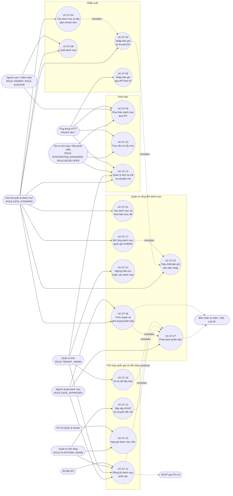
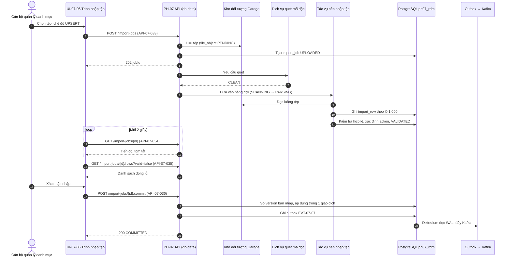
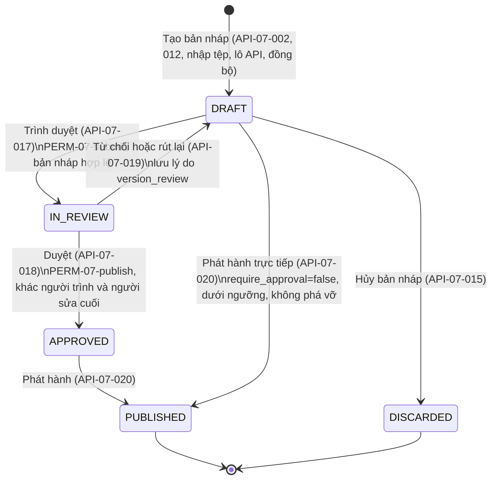
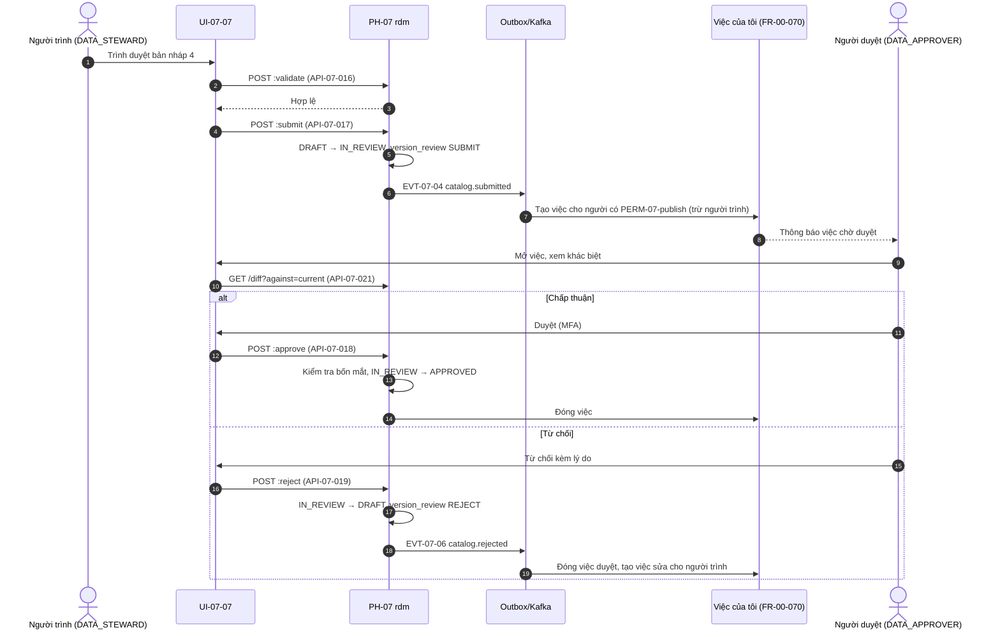
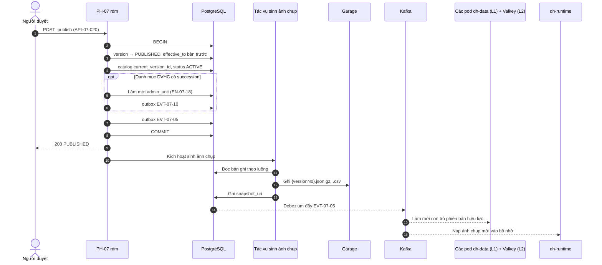
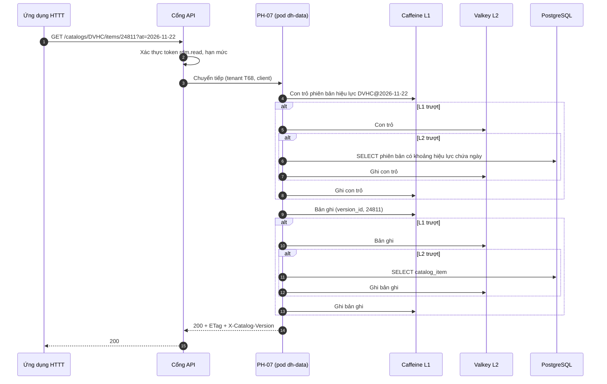
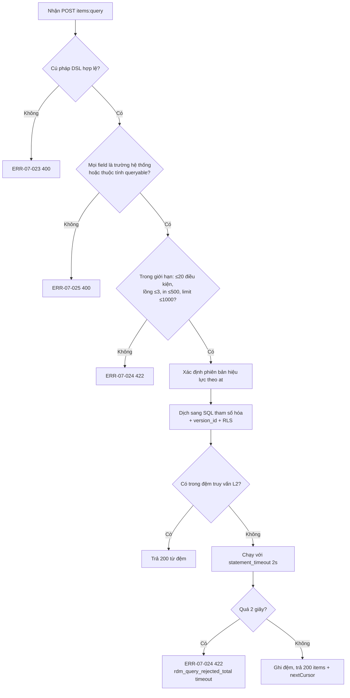

# D02-04-PH07 · Đặc tả use case phân hệ PH-07 Danh mục dùng chung

## 1. Mục đích và phạm vi

### 1.1. Mục đích

Tài liệu này đặc tả mười bảy use case (ca sử dụng) của phân hệ PH-07 Danh mục dùng chung (Reference Data Management, viết tắt RDM) trong sản phẩm Datahub. Mỗi use case mô tả trọn vẹn một mục tiêu nghiệp vụ mà một tác nhân muốn đạt được khi làm việc với hệ thống, theo trình tự tương tác từng bước giữa tác nhân và hệ thống, kèm các nhánh thay thế, các tình huống ngoại lệ và các đảm bảo mà hệ thống phải giữ dù kết quả thành công hay thất bại.

Tài liệu đóng vai trò cầu nối giữa đặc tả yêu cầu chức năng [D02-03-PH07 FRS](../frs/D02-03-PH07-frs-danh-muc.md) (nói hệ thống phải làm gì) và thiết kế chi tiết [D03-02-PH07 SDD](../../03-thiet-ke/sdd/D03-02-PH07-sdd-danh-muc.md), [D03-04-PH07 API](../../03-thiet-ke/api/D03-04-PH07-api-danh-muc.md), [D03-06-PH07 Màn hình](../../03-thiet-ke/uiux/D03-06-PH07-man-hinh-danh-muc.md) (nói hệ thống làm như thế nào). Đội phát triển dùng luồng chính và luồng ngoại lệ để biết thứ tự gọi màn hình, gọi API và mã lỗi phải trả; đội kiểm thử dùng từng luồng làm khung sinh ca kiểm thử trong [D05-02-PH07](../../05-kiem-thu/test-case/D05-02-PH07-test-case.md); hội đồng thẩm định dùng các sơ đồ và bảng tổng hợp để đánh giá mức độ bao phủ nghiệp vụ so với hệ cũ.

### 1.2. Phạm vi

Phạm vi tài liệu gồm toàn bộ chức năng PH-07 trong danh sách FR-07-001 đến FR-07-053 của FRS: quản trị danh mục và lược đồ thuộc tính động, vòng đời phiên bản (bản nháp, trình duyệt, duyệt, phát hành), nhập xuất Excel/CSV/JSON và nhập lô qua API, khai thác danh mục qua API (tra cứu, truy vấn có cấu trúc, cây, delta, ảnh chụp), đồng bộ danh mục quốc gia qua NDXP, ánh xạ mã với hệ thống ngoài, danh mục đơn vị hành chính (ĐVHC) và sự kiện sắp xếp, mô hình đa tenant với danh mục `COMMON` và danh mục mở rộng `HYBRID`, nạp gói danh mục nền khi khởi tạo tenant và di trú dữ liệu từ hệ cũ Aita.

Tài liệu không đặc tả lại các chức năng dùng chung FR-00 (đăng nhập, phân quyền, kiểm toán, hộp "Việc của tôi", thông báo, tìm kiếm không dấu chung). Khi một bước dựa vào chức năng dùng chung, tài liệu ghi "Tuân thủ FR-00-nnn" theo [D02-02 SRS](../D02-02-srs.md) §4. Các tác vụ hạ tầng như quét mã độc tệp tải lên (DD-12), gửi sự kiện qua outbox và Debezium (DD-11) và lưu tham số (DD-14) được mô tả ở mức tương tác, chi tiết nằm trong SDD.

### 1.3. Tài liệu liên quan

Bảng dưới liệt kê các tài liệu mà người đọc cần mở song song khi đọc đặc tả use case, kèm lý do tham chiếu.

| Tài liệu | Lý do tham chiếu |
|---|---|
| [D00-01 Thuật ngữ và quy ước](../../00-chung/D00-01-thuat-ngu-quy-uoc.md) | Hệ mã truy vết (UC, FR, BR, UI, API, ERR), kiểu dữ liệu T-*, quy ước trình bày |
| [D02-01 BRD](../D02-01-brd.md) | Yêu cầu nghiệp vụ REQ-07, REQ-20, REQ-22; quy trình BP-03; mục tiêu BO-05; chỉ số KPI-10, KPI-11 |
| [D02-02 SRS](../D02-02-srs.md) | Yêu cầu dùng chung FR-00 và NFR-00 |
| [D02-03-PH07 FRS](../frs/D02-03-PH07-frs-danh-muc.md) | Đặc tả chi tiết FR-07-001…053, BR-07-001…027, NFR-07-001…015 |
| [D02-05-PH07 User story](../user-story/D02-05-PH07-user-story-danh-muc.md) | Backlog US-07-nnn và tiêu chí chấp nhận Gherkin tương ứng với từng use case |
| [D02-06-PH07 DFD](../dfd/D02-06-PH07-dfd-danh-muc.md) | Luồng dữ liệu giữa các tiến trình PH-07 và các kho |
| [D02-07 Từ điển dữ liệu](../D02-07-tu-dien-du-lieu.md) | DD-07 `admin_unit`, DD-11 outbox, DD-12 tệp, DD-14 tham số |
| [D02-08 Ma trận phân quyền](../D02-08-ma-tran-phan-quyen.md) | Vai trò `ROLE-*` và quyền `PERM-07-*` |
| [D03-10 Thiết kế đa tenant](../../03-thiet-ke/D03-10-thiet-ke-da-tenant.md) | RLS, tenant `COMMON` và `PLATFORM` |

## 2. Quy ước đọc đặc tả

### 2.1. Mẫu đặc tả một use case

Mỗi use case trong mục 6 được viết theo cùng một mẫu để người đọc dễ so sánh và để công cụ sinh ca kiểm thử có thể bóc tách. Bảng dưới giải thích ý nghĩa từng mục của mẫu.

| Mục | Ý nghĩa |
|---|---|
| Mã, tên | Mã `UC-07-nn` theo khung chung và tên bắt đầu bằng động từ |
| Mục tiêu | Kết quả nghiệp vụ mà tác nhân chính muốn đạt, viết theo góc nhìn tác nhân |
| Tác nhân chính, tác nhân phụ | Tác nhân chính khởi xướng use case; tác nhân phụ là người hoặc hệ thống tham gia hay nhận kết quả |
| Mức ưu tiên | M, S, C theo D00-01 §4.1, lấy mức cao nhất của các FR hiện thực |
| FR hiện thực | Các yêu cầu chức năng mà use case hiện thực một phần hoặc toàn bộ |
| Tiền điều kiện | Điều phải đúng trước khi use case bắt đầu; hệ thống không kiểm tra lại trong luồng |
| Điều kiện kích hoạt | Sự kiện làm use case bắt đầu |
| Đảm bảo tối thiểu | Điều hệ thống luôn giữ kể cả khi use case thất bại giữa chừng |
| Đảm bảo thành công | Trạng thái hệ thống sau khi luồng chính hoặc một luồng thay thế kết thúc thành công (hậu điều kiện) |
| Luồng chính | Kịch bản thành công điển hình, đánh số bước; mỗi bước ghi rõ ai làm, màn hình `UI-07-nn` và API `API-07-nnn` liên quan |
| Luồng thay thế | Nhánh hợp lệ khác của luồng chính, đánh số theo bước rẽ nhánh (ví dụ `3a` rẽ tại bước 3) và ghi điểm quay về |
| Luồng ngoại lệ | Tình huống lỗi, đánh số `E1`, `E2`…, ghi mã lỗi `ERR-07-nnn`, thông điệp tiếng Việt hiển thị cho người dùng và cách khắc phục |
| Quy tắc nghiệp vụ | Các `BR-07-nnn` mà use case phải tuân thủ |
| Yêu cầu phi chức năng | Các `NFR-07-nnn` hoặc `NFR-00-nnn` ràng buộc trực tiếp use case |
| Tần suất, khối lượng | Ước lượng số lần thực hiện và khối lượng dữ liệu để thiết kế hiệu năng |
| Sơ đồ | Sơ đồ hoạt động (activity) hoặc tuần tự (sequence) Mermaid cho use case phức tạp, kèm thuyết minh |

### 2.2. Quy ước trong luồng

Trong các luồng, "Hệ thống" là PH-07 chạy trong DU `dh-data` cùng giao diện quản trị; "Cổng API" là API Gateway của Datahub đứng trước các API khai thác. Khi một bước gọi API, tài liệu ghi mã API trong ngoặc, ví dụ "(API-07-012)"; đường dẫn đầy đủ có tiền tố `/api/rdm/v1` như quy định ở [D03-04-PH07](../../03-thiet-ke/api/D03-04-PH07-api-danh-muc.md). Mọi API tạo mới nhận tiêu đề `Idempotency-Key`; mọi API sửa yêu cầu `If-Match` mang ETag của tài nguyên; lỗi trả theo RFC 9457 (Problem Details) với trường `code` là mã `ERR-07-nnn` và trường `detail` là thông điệp tiếng Việt.

Mọi thao tác ghi trong mọi use case đều sinh bản ghi kiểm toán theo FR-00-040 (NFR-07-015) và mọi truy vấn cơ sở dữ liệu đều chạy dưới chính sách RLS theo tenant hiện hành như [D03-10](../../03-thiet-ke/D03-10-thiet-ke-da-tenant.md) quy định. Để tránh lặp, các luồng không nhắc lại hai điều này ở từng bước, trừ khi bước đó có xử lý kiểm toán hoặc tenant đặc thù.

Thông điệp lỗi trong luồng ngoại lệ là văn bản hiển thị đề xuất cho giao diện; văn bản cuối cùng do tài liệu màn hình D03-06-PH07 chốt nhưng phải giữ nguyên ý. Dữ liệu ví dụ đều là giả lập: tenant `T68` (Lâm Đồng), cán bộ giả lập "Nguyễn Văn An" (cán bộ quản lý danh mục Sở Nội vụ), "Trần Thị Bình" (lãnh đạo phòng duyệt danh mục), "Lê Văn Cường" (quản trị Datahub tỉnh), HTTT giả lập "Hệ thống một cửa điện tử tỉnh" với mã client `t68-motcua`.

## 3. Tác nhân

### 3.1. Danh sách tác nhân

Bảng dưới liệt kê các tác nhân của PH-07. Các tác nhân con người dùng đúng mã vai trò của [D02-08](../D02-08-ma-tran-phan-quyen.md); quyền ghi theo D02-08 §3.1, các quyền đánh dấu "(đề xuất bổ sung D02-08)" là quyền PH-07 đề nghị luồng lõi thêm vào ma trận. Ký hiệu ○ nghĩa là quyền chỉ áp dụng cho danh mục do tổ chức của người dùng làm chủ, căn cứ `catalog.owner_org_id`.

| Tác nhân | Mã vai trò hoặc định danh | Mô tả | Quyền PH-07 chính |
|---|---|---|---|
| Cán bộ quản lý danh mục | `ROLE-DATA_STEWARD` | Cán bộ của sở, ngành hoặc văn phòng UBND tỉnh được giao quản lý danh mục; phạm vi tổ chức hoặc tenant | `PERM-07-read`, `PERM-07-create`/`update` (○), `PERM-07-submit` (○), `PERM-07-export`, `PERM-07-mapping` (đề xuất bổ sung D02-08) |
| Người duyệt danh mục | `ROLE-DATA_APPROVER` | Lãnh đạo phòng hoặc đơn vị được giao duyệt phát hành danh mục; bắt buộc MFA | `PERM-07-read`, `PERM-07-publish` (duyệt và phát hành), `PERM-07-export`, `PERM-07-sync` |
| Quản trị tỉnh | `ROLE-TENANT_ADMIN` | Quản trị Datahub của tỉnh; không có quyền duyệt phát hành | `PERM-07-read`, `PERM-07-create`/`update`, `PERM-07-submit`, `PERM-07-export`, `PERM-07-sync`, `PERM-07-retire`, `PERM-07-mapping`, `PERM-07-grant`, `PERM-07-configure` (bốn quyền cuối đề xuất bổ sung D02-08) |
| Quản trị nền tảng | `ROLE-PLATFORM_ADMIN` | Quản trị viên thuộc tenant `PLATFORM`; người duy nhất ghi danh mục `COMMON` | Toàn bộ quyền PH-07 trên danh mục `COMMON`, gồm `PERM-07-publish` và `PERM-07-retire` với `COMMON`; gọi API nạp gói nền |
| Kỹ sư tích hợp | `ROLE-INTEGRATION_ENGINEER` | Kỹ sư thiết kế luồng tích hợp, cần tra cứu và chuyển mã khi ghép nối | `PERM-07-read`, `PERM-07-export`, `PERM-07-mapping` (đề xuất bổ sung D02-08); dùng trình thử API |
| Nhà phát triển | `ROLE-DEVELOPER` | Lập trình viên của ứng dụng được giao, dùng cổng nhà phát triển và sandbox | `PERM-07-read` trên cổng nhà phát triển, trình thử API |
| Người xem | `ROLE-VIEWER` | Cán bộ cơ quan nhà nước cần tra cứu danh mục | `PERM-07-read`, `PERM-07-export` |
| Kiểm toán | `ROLE-AUDITOR` | Thanh tra, kiểm toán tỉnh | `PERM-07-read`, đọc lịch sử kiểm toán danh mục |
| Ứng dụng HTTT | Client OAuth2 của HTTT thành viên | Hệ thống thông tin khai thác hoặc đẩy danh mục bằng máy | Scope `rdm.read`, `rdm.query`, `rdm.write` |
| NDXP (qua PH-14) | Adapter `NDXP_DMDC` của PH-14 | Nền tảng tích hợp quốc gia cung cấp danh mục dùng chung quốc gia | Tác nhân phụ, được PH-07 gọi |
| PH-20 Quản lý tenant | Dịch vụ nội bộ | Khởi tạo tenant, gọi nạp gói danh mục nền | Gọi API-07-073 bằng định danh dịch vụ |
| Bộ lập lịch | Tác vụ định kỳ trong `dh-data` (ShedLock) | Kích hoạt đồng bộ định kỳ, dọn bảng tạm, hết hạn tác vụ | Tác nhân thời gian |
| Bên nhận sự kiện | HTTT và phân hệ đăng ký topic Kafka | Nhận EVT-07-nn để làm mới bộ đệm, đồng bộ cục bộ | Tác nhân phụ |
| Hộp "Việc của tôi" | Chức năng dùng chung FR-00-070 | Tạo, đóng việc chờ duyệt từ sự kiện EVT-07-04, EVT-07-05, EVT-07-06 | Tác nhân phụ |
| Công cụ di trú | Tác vụ di trú FR-00-090 do quản trị tỉnh chạy | Đọc dữ liệu Aita, ghi vào PH-07 | Tác nhân phụ trong UC-07-16 |

### 3.2. Quan hệ giữa vai trò và mức truy cập danh mục

Mức truy cập thực tế của một người dùng vào một danh mục là giao của ba điều kiện: quyền theo vai trò, phạm vi tổ chức và nguồn của danh mục. Một cán bộ quản lý danh mục chỉ sửa được danh mục `LOCAL` hoặc `HYBRID` thuộc tổ chức mình (○), không sửa được danh mục `NATIONAL` (chỉ cập nhật qua đồng bộ, BR-07-009) và không sửa được danh mục `COMMON` (chỉ tenant `PLATFORM` ghi). Người duyệt danh mục duyệt được mọi danh mục trong tenant nhưng không được duyệt phiên bản do chính mình trình hoặc sửa lần cuối (BR-07-011 mở rộng theo D02-08). Quản trị tỉnh có quyền soạn và trình nhưng không có `PERM-07-publish`, nên không thể một mình đưa thay đổi ra khai thác ở danh mục cần duyệt; đây là chủ ý để giữ nguyên tắc bốn mắt.

Với danh mục phân loại `RESTRICTED`, ứng dụng HTTT chỉ khai thác được khi có bản ghi cấp quyền trong `catalog_access_grant` (BR-07-019); người dùng giao diện có `PERM-07-read` vẫn xem được trên màn hình quản trị vì danh mục không chứa dữ liệu cá nhân (BR-07-025), nhưng mọi lần xem được ghi kiểm toán.

## 4. Sơ đồ use case tổng

Sơ đồ dưới thể hiện các tác nhân và mười bảy use case của PH-07, nhóm theo bốn cụm: quản trị vòng đời danh mục, nhập xuất, khai thác, tích hợp quốc gia và nền tảng. Mermaid không có ký pháp UML use case nên sơ đồ dùng `flowchart`: hình chữ nhật bo tròn là tác nhân, hình bầu dục là use case, mũi tên liền nối tác nhân chính với use case, mũi tên chấm nối use case với tác nhân phụ hoặc thể hiện quan hệ «include»/«extend».

Sơ đồ cho thấy cán bộ quản lý danh mục là tác nhân trung tâm của cụm quản trị và nhập xuất: họ tạo danh mục (UC-07-01), soạn bản ghi trên bản nháp (UC-07-02), nhập tệp (UC-07-03, UC-07-04), mở rộng danh mục quốc gia (UC-07-17) và khởi động trình duyệt (UC-07-06). Người duyệt danh mục khép vòng bốn mắt bằng cách duyệt và phát hành (UC-07-06, UC-07-07). Các quan hệ «include» thể hiện rằng mọi con đường đưa dữ liệu vào danh mục, dù nhập tay, nhập tệp, đồng bộ quốc gia hay di trú, đều hội tụ vào cùng một bản nháp và cùng một thao tác phát hành; nhờ vậy quy tắc kiểm tra hợp lệ, ngưỡng thay đổi lớn và phát sự kiện chỉ cần cài đặt một lần. Quan hệ «extend» giữa UC-07-12 và UC-07-07 cho biết phát hành phiên bản ĐVHC có thêm bước làm mới bảng chiếu `admin_unit` và phát EVT-07-10.

Phía khai thác, ứng dụng HTTT là tác nhân máy chính với ba use case UC-07-09, UC-07-10 và UC-07-13 (chuyển mã). Kỹ sư tích hợp và nhà phát triển dùng cùng các use case này qua trình thử API UI-07-12. Phía nền tảng, quản trị nền tảng giữ danh mục `COMMON` gồm ĐVHC (UC-07-12) và gói nền (UC-07-15); bộ lập lịch kích hoạt đồng bộ quốc gia định kỳ (UC-07-11) và PH-20 gọi nạp gói nền khi khởi tạo tenant.

## 5. Bảng tổng hợp use case và truy vết

### 5.1. Use case và yêu cầu chức năng

Bảng dưới là danh sách chính thức mười bảy use case, tác nhân chính, mức ưu tiên và các FR được hiện thực. Mỗi FR-07 xuất hiện ở ít nhất một use case, trừ các FR thuần cấu hình hoặc thuần đọc được gộp như ghi chú cuối bảng.

| Mã | Tên use case | Tác nhân chính | Mức | FR hiện thực |
|---|---|---|---|---|
| UC-07-01 | Tạo danh mục và khai báo lược đồ | ROLE-DATA_STEWARD | M | FR-07-001, 002, 003, 004, 005, 006, 007, 008, 010 |
| UC-07-02 | Cập nhật bản ghi trên bản nháp | ROLE-DATA_STEWARD | M | FR-07-011, 012, 013, 017, 018, 019 |
| UC-07-03 | Nhập bản ghi từ tệp Excel/CSV | ROLE-DATA_STEWARD | M | FR-07-020, 021, 025 |
| UC-07-04 | Tạo danh mục từ tệp (gồm khuôn Aita) | ROLE-DATA_STEWARD | M | FR-07-022, 003, 005 |
| UC-07-05 | Nhập bản ghi qua API theo lô | Ứng dụng HTTT | M | FR-07-023 |
| UC-07-06 | Trình duyệt và phê duyệt phiên bản | ROLE-DATA_STEWARD, ROLE-DATA_APPROVER | M | FR-07-013, 014, 015 |
| UC-07-07 | Phát hành phiên bản | ROLE-DATA_APPROVER | M | FR-07-016, 034, 050 |
| UC-07-08 | Xuất danh mục | ROLE-DATA_STEWARD, ROLE-VIEWER | M | FR-07-024, 025 |
| UC-07-09 | Khai thác danh mục qua API (một mã, lô, toàn bộ, cây, delta) | Ứng dụng HTTT | M | FR-07-026, 027, 028, 029, 030, 031, 033, 047, 052 |
| UC-07-10 | Truy vấn có cấu trúc qua API | Ứng dụng HTTT | M | FR-07-032, 033 |
| UC-07-11 | Đồng bộ danh mục quốc gia | Bộ lập lịch, ROLE-DATA_APPROVER | M | FR-07-035, 036, 037, 038, 039 |
| UC-07-12 | Ghi nhận sắp xếp ĐVHC và chuyển đổi mã | ROLE-PLATFORM_ADMIN, Ứng dụng HTTT | M | FR-07-044, 045, 046, 047 |
| UC-07-13 | Quản lý ánh xạ mã và chuyển mã | ROLE-DATA_STEWARD, Ứng dụng HTTT | M | FR-07-040, 041, 042, 043 |
| UC-07-14 | Ngừng hiệu lực hoặc xóa danh mục | ROLE-TENANT_ADMIN | M | FR-07-009 |
| UC-07-15 | Nạp gói danh mục nền khi khởi tạo tenant | PH-20, ROLE-PLATFORM_ADMIN | M | FR-07-048, 049 |
| UC-07-16 | Di trú dữ liệu Aita | ROLE-TENANT_ADMIN | M | FR-07-051 |
| UC-07-17 | Mở rộng danh mục quốc gia cho địa phương (HYBRID) | ROLE-DATA_STEWARD | S | FR-07-008, 048 |

FR-07-050 (lịch sử và kiểm toán) được hiện thực xuyên suốt mọi use case ghi và có màn đọc riêng ở tab Lịch sử UI-07-02 (API-07-072); FR-07-053 (tham số PH-07 theo tenant) là chức năng cấu hình do quản trị tỉnh thực hiện trên màn tham số chung của PH-18 lọc namespace `07.rdm` (UI-07-13), được mô tả như một luồng phụ trong mục 7.1 thay vì một use case riêng, vì nó không tạo giá trị nghiệp vụ trực tiếp mà chỉ điều chỉnh ngưỡng của các use case khác.

### 5.2. Use case và màn hình, API

Bảng dưới giúp đội phát triển biết mỗi use case chạm tới những màn hình và API nào, phục vụ chia việc theo lát dọc (vertical slice).

| Mã | Màn hình | API chính |
|---|---|---|
| UC-07-01 | UI-07-01, UI-07-02, UI-07-03, UI-07-04 | API-07-001…010, 022…025 |
| UC-07-02 | UI-07-02, UI-07-05 | API-07-012…016, 026…030 |
| UC-07-03 | UI-07-06, UI-07-08 | API-07-032…037, 040 |
| UC-07-04 | UI-07-01, UI-07-06 | API-07-033…036, 002 |
| UC-07-05 | Không có (máy) | API-07-031, 012 |
| UC-07-06 | UI-07-07 | API-07-016…019, 021 |
| UC-07-07 | UI-07-07 | API-07-014, 020, 049 |
| UC-07-08 | UI-07-02, UI-07-08 | API-07-038…040 |
| UC-07-09 | UI-07-12 (thử) | API-07-033 (danh sách), 041…046, 048…050 |
| UC-07-10 | UI-07-12 | API-07-047, 048 |
| UC-07-11 | UI-07-09 | API-07-055…063, 074 |
| UC-07-12 | UI-07-11, UI-07-05 | API-07-051…054, 050 |
| UC-07-13 | UI-07-10 | API-07-064…071 |
| UC-07-14 | UI-07-02 | API-07-005, 006 |
| UC-07-15 | Không có (máy), UI-07-01 kiểm tra | API-07-073 |
| UC-07-16 | UI-07-08 (theo dõi), công cụ di trú | API-07-002, 031, 020 |
| UC-07-17 | UI-07-03, UI-07-05 | API-07-002, 027, 041 |

### 5.3. Use case và quy trình nghiệp vụ, yêu cầu nghiệp vụ

Bảng dưới gắn use case với yêu cầu nghiệp vụ trong BRD và với các chức năng hệ cũ (mã LGC) để chứng minh không mất chức năng khi chuyển đổi.

| Mã | REQ | BP | LGC hệ cũ được phủ |
|---|---|---|---|
| UC-07-01 | REQ-07 | BP-03 | LGC-DMDC-001, 002, 003, 004, 009, 010, 017, 018 |
| UC-07-02 | REQ-07 | BP-03 | LGC-DMDC-011 |
| UC-07-03 | REQ-07 | BP-03 | LGC-DMDC-006, 007 |
| UC-07-04 | REQ-07 | BP-03 | LGC-DMDC-005 |
| UC-07-05 | REQ-07 | BP-03 | LGC-DMDC-008 |
| UC-07-06 | REQ-07 | BP-03 | Mới |
| UC-07-07 | REQ-07 | BP-03 | Mới |
| UC-07-08 | REQ-07 | — | LGC-DMDC-013, 014 |
| UC-07-09 | REQ-07 | — | LGC-DMDC-015 |
| UC-07-10 | REQ-07 | — | LGC-DMDC-016 |
| UC-07-11 | REQ-07 | BP-03 | LGC-DMDC-019, LGC-NGSP-006 |
| UC-07-12 | REQ-07 | — | Mới (sắp xếp ĐVHC 2025) |
| UC-07-13 | REQ-07 | — | LGC-BUS-036 |
| UC-07-14 | REQ-07 | — | LGC-DMDC-012 |
| UC-07-15 | REQ-20 | BP-08 | Mới |
| UC-07-16 | REQ-22 | — | Toàn bộ dữ liệu LGC-DMDC |
| UC-07-17 | REQ-07, REQ-20 | — | LGC-DMDC-017 |

## 6. Đặc tả chi tiết use case

### 6.1. UC-07-01 · Tạo danh mục và khai báo lược đồ

Use case này thay thế chức năng "Tạo danh mục mới, nhập dữ liệu" của hệ cũ Aita. Ở hệ cũ, người dùng chỉ nhập tên danh mục và danh sách tên thuộc tính dạng văn bản tự do, không có mã danh mục do người dùng kiểm soát, không có kiểu dữ liệu, không có phân cấp và không có phiên bản. Datahub bổ sung bốn điểm: mã danh mục chuẩn T-CODE để HTTT tham chiếu ổn định, lược đồ thuộc tính có kiểu và ràng buộc để kiểm tra hợp lệ tự động, cấu hình phân cấp và chính sách duyệt ngay từ lúc tạo, và luôn sinh phiên bản nháp số 1 thay vì ghi thẳng vào dữ liệu đang khai thác.

| Mục | Nội dung |
|---|---|
| Mã | UC-07-01 |
| Tên | Tạo danh mục và khai báo lược đồ |
| Mục tiêu | Cán bộ quản lý danh mục tạo một danh mục mới thuộc tổ chức mình, khai báo đầy đủ thông tin, phân cấp và lược đồ thuộc tính, để sau đó soạn bản ghi và phát hành |
| Tác nhân chính | ROLE-DATA_STEWARD (hoặc ROLE-TENANT_ADMIN; ROLE-PLATFORM_ADMIN với danh mục `COMMON`) |
| Tác nhân phụ | PH-20 (tra cứu tổ chức chủ quản `owner_org_id`), PH-13 (ghi kiểm toán), Bên nhận sự kiện (EVT-07-01) |
| Mức ưu tiên | M |
| FR hiện thực | FR-07-001, FR-07-002, FR-07-003, FR-07-004, FR-07-005, FR-07-006, FR-07-007, FR-07-008, FR-07-010 |
| Tiền điều kiện | Người dùng đã đăng nhập (tuân thủ FR-00-001) và có `PERM-07-create`; tổ chức của người dùng đã được khai báo ở PH-20; tenant hiện hành ở trạng thái hoạt động |
| Điều kiện kích hoạt | Người dùng chọn nút "Tạo danh mục" trên UI-07-01 và chọn phương thức "Nhập thủ công" |
| Đảm bảo tối thiểu | Không có danh mục dở dang nào được lưu nếu người dùng hủy trước bước lưu; nếu lưu thất bại, không có bản ghi `catalog`, `catalog_version` hay `attribute_def` mồ côi (một giao dịch); mọi lần thử ghi đều có bản ghi kiểm toán kể cả thất bại do phân quyền |
| Đảm bảo thành công | Tồn tại bản ghi `catalog` trạng thái `DRAFT`, `source_type` đã chọn, `owner_org_id` là tổ chức của người dùng; tồn tại `catalog_version` số 1 trạng thái `DRAFT`, `origin = MANUAL`; các `attribute_def` của phiên bản 1 đúng như khai báo; sự kiện EVT-07-01 đã được ghi vào outbox; người dùng được chuyển sang UI-07-02 của danh mục mới |

**Luồng chính**

1. Người dùng mở UI-07-01. Hệ thống gọi API-07-007 để tải cây nhóm danh mục bên trái và API-07-001 để tải bảng danh mục, hiển thị tổng số danh mục theo bộ lọc hiện hành (mặc định: mọi nguồn, trạng thái khác `RETIRED`).
2. Người dùng chọn "Tạo danh mục", chọn "Nhập thủ công". Hệ thống mở UI-07-03 ở bước 1 "Thông tin chung".
3. Người dùng nhập mã danh mục (ví dụ `LINH_VUC_TTHC`), tên ("Lĩnh vực thủ tục hành chính"), mô tả, chọn nhóm danh mục (ví dụ "Hành chính công"), phân loại (`PUBLIC`, `INTERNAL` hoặc `RESTRICTED`), nguồn (`LOCAL` mặc định) và chính sách duyệt (`require_approval`, mặc định bật). Trường tổ chức chủ quản được điền sẵn tổ chức của người dùng; quản trị tỉnh được chọn tổ chức khác trong tenant.
4. Hệ thống kiểm tra tại chỗ mã danh mục theo mẫu T-CODE (chữ hoa, số, gạch dưới, 2–64 ký tự) và gọi API-07-003 với mã đó để báo trùng ngay khi người dùng rời ô (trả 404 nghĩa là còn trống).
5. Người dùng chọn "Tiếp". Hệ thống chuyển sang bước 2 "Phân cấp".
6. Người dùng chọn danh mục có phân cấp hay không. Nếu có, người dùng nhập số cấp tối đa (`max_depth`, 1–10) và tên từng cấp (`level_names`, ví dụ "Lĩnh vực", "Lĩnh vực con").
7. Người dùng chọn "Tiếp". Hệ thống chuyển sang bước 3 "Thuộc tính", hiển thị sẵn các cột cố định không xóa được (`MA`, `TEN`, `MA_CHA` nếu phân cấp, `THU_TU`) và bảng thuộc tính động rỗng.
8. Người dùng chọn "Thêm thuộc tính". Hệ thống mở biểu mẫu thuộc tính gồm mã, nhãn, kiểu dữ liệu (một trong `STRING`, `TEXT`, `INTEGER`, `DECIMAL`, `BOOLEAN`, `DATE`, `DATETIME`, `ENUM`, `CATALOG_REF`, `URI`, `EMAIL`), bắt buộc, duy nhất trong phiên bản, độ dài tối đa, biểu thức chính quy, giá trị nhỏ nhất, lớn nhất, danh sách giá trị (với `ENUM`), danh mục tham chiếu (với `CATALOG_REF`), giá trị mặc định, cờ `queryable`, cờ `searchable` và mô tả.
9. Người dùng điền và chọn "Lưu thuộc tính". Hệ thống kiểm tra tại chỗ: mã thuộc tính không trùng, ràng buộc phù hợp kiểu (ví dụ `max_length` chỉ cho kiểu chuỗi), danh mục tham chiếu tồn tại và ở trạng thái `ACTIVE` (gọi API-07-003), mã và nhãn không thuộc danh sách từ gợi ý dữ liệu cá nhân (BR-07-025). Thuộc tính được thêm vào bảng ở trạng thái chưa lưu.
10. Người dùng lặp lại bước 8–9 cho các thuộc tính khác và kéo thả để sắp thứ tự (`sort_order`).
11. Người dùng chọn "Tạo danh mục". Hệ thống gửi API-07-002 với thân gồm thông tin chung, cấu hình phân cấp và mảng thuộc tính, kèm `Idempotency-Key` do giao diện sinh.
12. Hệ thống kiểm tra quyền `PERM-07-create`, phạm vi tổ chức, BR-07-001 (mã duy nhất trong tenant, không trùng danh mục `COMMON` đang `ACTIVE`), BR-07-025 và tính hợp lệ của từng thuộc tính; trong một giao dịch, tạo `catalog` (`status = DRAFT`), `catalog_version` số 1 (`status = DRAFT`, `origin = MANUAL`, `item_count = 0`), các `attribute_def`, tính `schema_hash`, ghi sự kiện EVT-07-01 vào `ph07_rdm.outbox` và trả 201 kèm ETag.
13. Hệ thống hiển thị thông báo "Đã tạo danh mục LINH_VUC_TTHC, phiên bản nháp số 1" và chuyển sang UI-07-02 tab "Bản ghi" của danh mục mới, sẵn sàng cho UC-07-02 hoặc UC-07-03.

**Luồng thay thế**

- **3a. Người dùng chọn nguồn `HYBRID`.** Hệ thống hiển thị thêm ô chọn danh mục gốc (danh mục `COMMON` hoặc `NATIONAL` đang `ACTIVE`) và ô biểu thức dải mã địa phương. Use case chuyển sang UC-07-17 từ bước 4 của UC đó.
- **3b. Người dùng chọn nguồn `NATIONAL`.** Hệ thống thông báo danh mục quốc gia không tạo thủ công mà đăng ký qua đồng bộ và đưa người dùng tới UI-07-09 (UC-07-11 luồng thay thế "Khám phá và đăng ký"). Use case kết thúc.
- **3c. Người dùng chưa có nhóm phù hợp.** Người dùng chọn "Thêm nhóm" ngay trong ô chọn nhóm; hệ thống mở hộp thoại nhập mã, tên, nhóm cha, gọi API-07-008, thêm nhóm vào cây và chọn sẵn. Quay về bước 3.
- **6a. Danh mục không phân cấp.** Hệ thống ẩn cột `MA_CHA`, đặt `is_hierarchical = false`, `max_depth = 1`. Quay về bước 7.
- **8a. Thuộc tính kiểu `ENUM`.** Hệ thống hiển thị bảng nhập cặp giá trị và nhãn; ít nhất một giá trị, tối đa 500 giá trị. Quay về bước 9.
- **8b. Thuộc tính kiểu `CATALOG_REF`.** Hệ thống hiển thị ô chọn danh mục tham chiếu có tìm kiếm (API-07-001 với `status=ACTIVE`), gồm cả danh mục `COMMON` như `DVHC`, `DAN_TOC`. Giá trị bản ghi sau này phải là mã hiệu lực của danh mục được tham chiếu. Quay về bước 9.
- **10a. Người dùng muốn sửa hoặc xóa thuộc tính chưa lưu.** Người dùng chọn biểu tượng sửa hoặc xóa trên dòng thuộc tính; vì danh mục chưa tạo, thao tác chỉ thay đổi trạng thái biểu mẫu, không gọi API. Quay về bước 10.
- **11a. Người dùng tạo danh mục chưa có thuộc tính động.** Hệ thống cho phép (danh mục chỉ có mã và tên là hợp lệ, ví dụ danh mục giới tính). Tiếp tục bước 12.
- **13a. Sửa thông tin hoặc lược đồ sau khi tạo (FR-07-004, FR-07-006).** Người dùng mở UI-07-02 tab "Tổng quan", chọn "Sửa thông tin"; hệ thống mở UI-07-03 với dữ liệu hiện có, người dùng sửa và lưu qua API-07-004 kèm `If-Match`; hệ thống ghi EVT-07-02. Với lược đồ, người dùng mở UI-07-04 trên bản nháp đang mở: thêm (API-07-023), sửa (API-07-024), xóa (API-07-025), ẩn (đặt `status = HIDDEN` qua API-07-024) hoặc sắp lại thứ tự. Khi sửa kiểu hoặc thu hẹp ràng buộc, hệ thống chạy kiểm tra tương thích trên toàn bộ bản ghi của bản nháp (BR-07-013) và hiển thị số bản ghi vi phạm trước khi cho lưu; thay đổi được gắn nhãn "phá vỡ" trong thống kê của phiên bản.

**Luồng ngoại lệ**

- **E1. Mã danh mục đã tồn tại (bước 4 hoặc 12).** Hệ thống trả ERR-07-002 và hiển thị "Mã danh mục LINH_VUC_TTHC đã được dùng trong tỉnh hoặc trùng với danh mục dùng chung toàn quốc. Vui lòng chọn mã khác." Người dùng đổi mã và gửi lại; luồng quay về bước 3.
- **E2. Thuộc tính khai báo mức Nhạy cảm hoặc tên gợi ý dữ liệu cá nhân (bước 9 hoặc 12).** Hệ thống trả ERR-07-036, hiển thị "Thuộc tính 'so_cccd' gợi ý dữ liệu cá nhân. Danh mục dùng chung không được chứa dữ liệu cá nhân hoặc dữ liệu mức Nhạy cảm." Người dùng xóa hoặc đổi thuộc tính; nếu đây là nhận diện nhầm, người dùng liên hệ quản trị tỉnh để xem xét danh sách từ khóa (tham số `07.rdm.pii-keywords`).
- **E3. Không đủ quyền hoặc ngoài phạm vi tổ chức (bước 12).** Hệ thống trả lỗi 403 theo FR-00-012, hiển thị "Bạn không có quyền tạo danh mục cho tổ chức đã chọn." Người dùng chọn lại tổ chức của mình hoặc đề nghị quản trị tỉnh cấp quyền.
- **E4. Ràng buộc thuộc tính không hợp lệ (bước 12).** Hệ thống trả ERR-07-009 với mảng `errors` chỉ rõ thuộc tính và lý do (ví dụ `min_value` lớn hơn `max_value`, danh mục tham chiếu không tồn tại). Giao diện tô đỏ dòng thuộc tính tương ứng trên bước 3; người dùng sửa và gửi lại.
- **E5. Người dùng gửi lặp do mạng chập chờn (bước 11).** Hệ thống nhận cùng `Idempotency-Key` và cùng nội dung, trả lại đúng kết quả 201 lần đầu mà không tạo trùng. Nếu cùng khóa nhưng nội dung khác, hệ thống trả ERR-07-022 "Yêu cầu đã được gửi với nội dung khác. Vui lòng tải lại trang và thử lại."
- **E6. Sửa đồng thời (luồng 13a).** Khi `If-Match` không khớp, hệ thống trả ERR-07-018 "Danh mục vừa được người khác cập nhật. Vui lòng tải lại để xem thay đổi mới nhất." Giao diện giữ dữ liệu người dùng đã nhập để so sánh.
- **E7. Sửa lược đồ không tương thích (luồng 13a).** Hệ thống trả ERR-07-014 "Không thể đổi kiểu thuộc tính 'so_thu_tu' sang INTEGER: 12 bản ghi có giá trị không chuyển đổi được." kèm liên kết lọc các bản ghi vi phạm trên UI-07-05. Người dùng sửa dữ liệu trước rồi đổi kiểu.
- **E8. Sửa lược đồ khi không có bản nháp mở hoặc bản nháp đang `IN_REVIEW` (luồng 13a).** Hệ thống trả ERR-07-004 "Phiên bản đang chờ duyệt, không sửa được lược đồ. Hãy rút lại hoặc chờ người duyệt từ chối." Nếu chưa có bản nháp, giao diện đề nghị tạo bản nháp (UC-07-02 bước 2).

**Quy tắc nghiệp vụ áp dụng:** BR-07-001, BR-07-005, BR-07-009, BR-07-013, BR-07-014 (giới hạn `max_depth` ≤ 10), BR-07-025.

**Yêu cầu phi chức năng liên quan:** NFR-07-011 (≥ 100 thuộc tính mỗi danh mục, ≥ 1.000 danh mục mỗi tenant; danh sách UI-07-01 phải phân trang máy chủ), NFR-07-015 (kiểm toán), NFR-00 về thời gian phản hồi giao diện (thao tác lưu ≤ 2 giây p95).

**Tần suất, khối lượng:** Mỗi tenant tạo khoảng 5–20 danh mục mới mỗi tháng trong năm đầu, sau đó 1–5 danh mục mỗi tháng. Một danh mục trung bình có 3–15 thuộc tính, tối đa 100.

### 6.2. UC-07-02 · Cập nhật bản ghi trên bản nháp

Use case này thay thế ba chức năng "Thêm bản ghi", "Chỉnh sửa bản ghi" và "Xóa bản ghi" của hệ cũ. Khác biệt căn bản là ở hệ cũ mọi thao tác ghi thẳng vào dữ liệu đang được HTTT khai thác và xóa là xóa vật lý; ở Datahub mọi thay đổi diễn ra trên một bản nháp tách biệt, chỉ có hiệu lực sau khi phát hành, và bản ghi đã từng phát hành không bao giờ bị xóa mà chỉ ngừng dùng kèm mã thay thế (BR-07-003). Nhờ vậy HTTT không bao giờ thấy trạng thái nửa vời và có thể tra cứu lại mã cũ.

| Mục | Nội dung |
|---|---|
| Mã | UC-07-02 |
| Tên | Cập nhật bản ghi trên bản nháp |
| Mục tiêu | Cán bộ quản lý danh mục thêm, sửa, ngừng dùng bản ghi trên một bản nháp và đảm bảo bản nháp hợp lệ trước khi trình duyệt |
| Tác nhân chính | ROLE-DATA_STEWARD (hoặc ROLE-TENANT_ADMIN; ROLE-PLATFORM_ADMIN với `COMMON`) |
| Tác nhân phụ | PH-13 (kiểm toán) |
| Mức ưu tiên | M |
| FR hiện thực | FR-07-011, FR-07-012, FR-07-013, FR-07-017, FR-07-018, FR-07-019 |
| Tiền điều kiện | Người dùng có `PERM-07-update` trên danh mục (○ theo tổ chức chủ quản); danh mục có `source_type` là `LOCAL` hoặc `HYBRID`; danh mục không ở trạng thái `RETIRED` |
| Điều kiện kích hoạt | Người dùng chọn "Sửa bản ghi" trên UI-07-02 hoặc chọn "Tạo bản nháp mới" khi danh mục chưa có phiên bản mở |
| Đảm bảo tối thiểu | Phiên bản đã phát hành không bị thay đổi (BR-07-006); mỗi thao tác lưu là nguyên tử với một bản ghi; dữ liệu khai thác qua API không đổi cho tới khi phát hành |
| Đảm bảo thành công | Bản nháp chứa đúng các thay đổi người dùng đã lưu; `catalog_version.stats` cập nhật số bản ghi thêm, sửa, ngừng dùng, số thay đổi phá vỡ; `version` của bản nháp tăng; kết quả kiểm tra hợp lệ gần nhất được lưu kèm thời điểm |

**Luồng chính**

1. Người dùng mở UI-07-02 của danh mục `LINH_VUC_TTHC`. Hệ thống gọi API-07-003 và API-07-011, hiển thị phiên bản hiện hành (ví dụ số 3, đang hiệu lực từ 01/10/2026) và cho biết chưa có bản nháp.
2. Người dùng chọn "Tạo bản nháp mới". Hệ thống gọi API-07-012; trong một giao dịch, hệ thống sao chép (copy-on-write) toàn bộ `attribute_def` và `catalog_item` của phiên bản hiện hành sang `catalog_version` số 4 trạng thái `DRAFT`, `origin = MANUAL`, rồi trả 201.
3. Hệ thống mở UI-07-05 ở chế độ bảng, gọi API-07-026 với `v=draft`, phân trang 50 dòng, hiển thị các cột cố định và các thuộc tính `ACTIVE` theo `sort_order`; cột trạng thái tô màu theo `ACTIVE`/`DEPRECATED`; dòng thay đổi so với phiên bản hiện hành được đánh dấu (thêm, sửa, ngừng dùng).
4. Người dùng chọn "Thêm bản ghi". Hệ thống mở biểu mẫu bản ghi sinh từ lược đồ: ô nhập theo kiểu, ô chọn cho `ENUM` và `CATALOG_REF` (có tìm kiếm không dấu), ô chọn mã cha dạng cây nếu danh mục phân cấp.
5. Người dùng nhập mã `LV_DAT_DAI_02`, tên "Đất đai (cấp xã)", mã cha `LV_DAT_DAI`, các thuộc tính, rồi chọn "Lưu".
6. Hệ thống gọi API-07-027; kiểm tra BR-07-002 (mã duy nhất, không phân biệt hoa thường, lưu dạng chuẩn hóa), giá trị theo JSON Schema sinh từ lược đồ (kiểu, bắt buộc, độ dài, mẫu, miền), BR-07-014 (mã cha tồn tại trong bản nháp, không vòng, độ sâu, cha không `DEPRECATED`); tính `depth`, `path`, `level_name`; lưu bản ghi; cập nhật `stats`; trả 201.
7. Hệ thống thêm dòng mới vào bảng với nhãn "Thêm mới".
8. Người dùng sửa trực tiếp tên của bản ghi `LV_XAY_DUNG` trên bảng và nhấn Enter. Hệ thống gọi API-07-028 kèm `If-Match`, kiểm tra như bước 6 và lưu; dòng được gắn nhãn "Đã sửa".
9. Người dùng chọn bản ghi `LV_GTVT_CU`, chọn "Ngừng dùng". Hệ thống mở hộp thoại yêu cầu chọn một hoặc nhiều mã thay thế (tùy chọn) và lý do.
10. Người dùng chọn mã thay thế `LV_GIAO_THONG`, nhập lý do "Hợp nhất lĩnh vực theo Quyết định của UBND tỉnh", chọn "Xác nhận". Hệ thống gọi API-07-029; đặt `status = DEPRECATED`, `replaced_by = ["LV_GIAO_THONG"]`; kiểm tra mã thay thế tồn tại và `ACTIVE`; kiểm tra không còn bản ghi con `ACTIVE` trỏ tới bản ghi này (BR-07-014); đánh dấu thay đổi là phá vỡ trong `stats`.
11. Người dùng chọn "Kiểm tra hợp lệ". Hệ thống gọi API-07-016, chạy kiểm tra toàn bản nháp (mọi quy tắc của bước 6 trên toàn tập, cộng duy nhất theo thuộc tính `unique_in_version` và tham chiếu `CATALOG_REF` còn hiệu lực), trả danh sách lỗi theo bản ghi và bảng tóm tắt thay đổi.
12. Hệ thống hiển thị "Bản nháp hợp lệ. 1 bản ghi thêm, 1 bản ghi sửa, 1 bản ghi ngừng dùng (thay đổi phá vỡ)." cùng nút "Trình duyệt" (chuyển sang UC-07-06) hoặc "Phát hành" (UC-07-07, chỉ hiển thị khi danh mục cho phát hành trực tiếp và người dùng có `PERM-07-publish`).

**Luồng thay thế**

- **1a. Danh mục đã có bản nháp mở.** Hệ thống hiển thị "Tiếp tục bản nháp số 4 (do Nguyễn Văn An tạo lúc …)". Người dùng chọn tiếp tục; luồng chuyển tới bước 3.
- **1b. Danh mục `DRAFT` chưa từng phát hành.** Phiên bản nháp số 1 đã có từ UC-07-01; luồng chuyển tới bước 3.
- **3a. Xem dạng cây (FR-07-018).** Người dùng chuyển sang chế độ cây; hệ thống tải các nút gốc rồi tải lười (lazy) từng nhánh qua API-07-026 với `parentCode`; người dùng kéo thả một nút sang cha khác, hệ thống gọi API-07-028 đổi `parent_code` và đánh dấu thay đổi phá vỡ (đổi mã cha). Quay về bước 4 hoặc 11.
- **3b. Lọc, tìm trong bản nháp.** Người dùng lọc theo trạng thái, theo loại thay đổi so với phiên bản hiện hành, hoặc tìm không dấu theo mã, tên; hệ thống gọi API-07-026 với tham số lọc. Quay về bước 4.
- **5a. Bản ghi có hiệu lực riêng.** Người dùng nhập `valid_from`, `valid_to` của bản ghi (khác khoảng hiệu lực của phiên bản), dùng khi một mã chỉ có hiệu lực một giai đoạn. Hệ thống kiểm tra `valid_from < valid_to`. Quay về bước 6.
- **9a. Xóa bản ghi mới thêm trong bản nháp.** Với bản ghi chưa từng phát hành (không có trong phiên bản trước), người dùng chọn "Xóa"; hệ thống gọi API-07-030 và xóa vật lý khỏi bản nháp. Quay về bước 11.
- **9b. Khôi phục bản ghi đã ngừng dùng.** Người dùng chọn bản ghi `DEPRECATED` và chọn "Dùng lại"; hệ thống gọi API-07-028 đặt `status = ACTIVE`, xóa `replaced_by`. Quay về bước 11.
- **12a. Hủy bản nháp (FR-07-017).** Người dùng chọn "Hủy bản nháp" và xác nhận; hệ thống gọi API-07-015, chuyển `catalog_version.status` sang `DISCARDED`, ghi `version_review` với `action = DISCARD`; dữ liệu bản nháp được giữ 30 ngày cho kiểm toán rồi dọn. Use case kết thúc.
- **12b. Sửa ngày hiệu lực, căn cứ, ghi chú.** Người dùng mở tab "Phiên bản", sửa `effective_from` dự kiến, `legal_basis`, `change_note` của bản nháp qua API-07-014. Quay về bước 12.

**Luồng ngoại lệ**

- **E1. Đã có phiên bản mở (bước 2).** Hệ thống trả ERR-07-005 "Danh mục đã có bản nháp số 4 đang mở. Mỗi danh mục chỉ có một bản nháp tại một thời điểm." Giao diện hiển thị liên kết tới bản nháp đó.
- **E2. Danh mục chỉ đọc (bước 2, 6, 8, 10).** Với danh mục `NATIONAL` hoặc `COMMON` khi tenant không phải `PLATFORM`, hệ thống trả ERR-07-003 "Danh mục này do quốc gia hoặc nền tảng quản lý, chỉ được cập nhật qua đồng bộ. Để bổ sung mã địa phương, hãy tạo danh mục mở rộng." kèm liên kết UC-07-17.
- **E3. Mã bản ghi trùng (bước 6).** Hệ thống trả ERR-07-008 "Mã LV_DAT_DAI_02 đã tồn tại trong phiên bản này (so sánh không phân biệt hoa thường)." Người dùng đổi mã.
- **E4. Giá trị không hợp lệ (bước 6, 8).** Hệ thống trả ERR-07-009 với mảng `errors`, giao diện tô đỏ từng ô và hiển thị lý do, ví dụ "Trường 'Ngày ban hành' phải theo định dạng ngày (yyyy-MM-dd)", "Trường 'Mã cơ quan' là bắt buộc".
- **E5. Mã cha sai (bước 6, 3a).** Hệ thống trả ERR-07-010 "Mã cha LV_DAT_DAI không tồn tại trong bản nháp hoặc tạo vòng lặp phân cấp." Người dùng chọn mã cha khác.
- **E6. Vượt số cấp (bước 6, 3a).** Hệ thống trả ERR-07-011 "Danh mục chỉ cho phép tối đa 2 cấp; bản ghi này sẽ ở cấp 3." Người dùng chọn cha ở cấp cao hơn hoặc nhờ người có quyền tăng `max_depth`.
- **E7. Xóa bản ghi đã từng phát hành (luồng 9a).** Hệ thống trả ERR-07-013 "Bản ghi đã từng được phát hành nên không xóa được. Hãy dùng chức năng Ngừng dùng và chỉ định mã thay thế nếu có."
- **E8. Bản nháp không còn ở trạng thái `DRAFT` (bước 6, 8, 10).** Nếu bản nháp vừa được trình duyệt từ phiên làm việc khác, hệ thống trả ERR-07-004 "Phiên bản đang chờ duyệt, không sửa được." Giao diện chuyển sang chế độ chỉ xem.
- **E9. Xung đột sửa đồng thời (bước 8).** Hệ thống trả ERR-07-018; giao diện hiển thị giá trị mới của người khác và giá trị của người dùng để chọn giữ bên nào.
- **E10. Mã cha bị ngừng dùng còn con hoạt động (bước 10).** Hệ thống trả ERR-07-010 với chi tiết "Còn 3 bản ghi con đang hoạt động thuộc LV_GTVT_CU. Hãy chuyển cha hoặc ngừng dùng các bản ghi con trước." Giao diện đề nghị thao tác "Chuyển các bản ghi con sang mã thay thế" (gọi API-07-028 cho từng con trong một lô).

**Quy tắc nghiệp vụ áp dụng:** BR-07-002, BR-07-003, BR-07-004, BR-07-005, BR-07-006, BR-07-009, BR-07-013, BR-07-014.

**Yêu cầu phi chức năng liên quan:** NFR-07-011 (bản nháp tới 200.000 bản ghi; bảng sửa phải phân trang máy chủ và cuộn ảo), thao tác lưu một bản ghi ≤ 500 ms p95, kiểm tra toàn bản nháp 200.000 bản ghi ≤ 30 giây (chạy nền khi > 20.000 bản ghi, thông báo khi xong).

**Tần suất, khối lượng:** Danh mục địa phương cập nhật trung bình 1–2 lần mỗi quý, mỗi lần 5–200 bản ghi; danh mục lớn (ví dụ danh mục thủ tục hành chính khoảng 2.000 bản ghi) cập nhật hằng tháng.

### 6.3. UC-07-03 · Nhập bản ghi từ tệp Excel/CSV

Use case này thay thế chức năng "Nhập dữ liệu từ file" của hệ cũ cho danh mục đã tồn tại, đồng thời khắc phục ba hạn chế của hệ cũ: hệ cũ chỉ nhận CSV mã hóa UTF-16 và báo lỗi chung chung khi tệp sai; hệ cũ ghi thẳng vào danh mục không có bước xem trước; và hệ cũ không có chế độ cập nhật, chỉ thêm. Datahub chạy nhập tệp như một tác vụ nền hai pha: pha phân tích và kiểm tra cho ra bản xem trước và báo cáo lỗi theo từng dòng, pha ghi chỉ chạy khi người dùng xác nhận.

| Mục | Nội dung |
|---|---|
| Mã | UC-07-03 |
| Tên | Nhập bản ghi từ tệp Excel/CSV |
| Mục tiêu | Cán bộ quản lý danh mục đưa một lượng lớn bản ghi từ tệp vào bản nháp một cách an toàn, biết trước kết quả và sửa được lỗi theo dòng |
| Tác nhân chính | ROLE-DATA_STEWARD (hoặc ROLE-TENANT_ADMIN) |
| Tác nhân phụ | Kho đối tượng Garage, dịch vụ quét mã độc (DD-12), Bên nhận sự kiện (EVT-07-07), dịch vụ thông báo (FR-00-060) |
| Mức ưu tiên | M |
| FR hiện thực | FR-07-020, FR-07-021, FR-07-025 |
| Tiền điều kiện | Người dùng có `PERM-07-update` trên danh mục; danh mục `LOCAL` hoặc `HYBRID`, không `RETIRED`; danh mục có hoặc sẽ có bản nháp `DRAFT` |
| Điều kiện kích hoạt | Người dùng chọn "Nhập từ tệp" trên UI-07-02 hoặc UI-07-05 |
| Đảm bảo tối thiểu | Bản nháp không bị thay đổi nếu tác vụ thất bại, bị hủy hoặc hết hạn (BR-07-015); tệp gốc và báo cáo lỗi được lưu kèm tác vụ để tra lại; tệp chưa quét sạch không bao giờ được phân tích |
| Đảm bảo thành công | Bản nháp chứa các bản ghi được thêm, cập nhật hoặc ngừng dùng đúng chế độ đã chọn; `import_job.status = COMMITTED`; `catalog_version.origin` giữ nguyên nếu đã có hoặc là `IMPORT` nếu bản nháp được tạo bởi tác vụ; EVT-07-07 được phát; người dùng nhận thông báo |

Trạng thái của `import_job` trong use case này đi theo trình tự `UPLOADED` → `SCANNING` → `PARSING` → `VALIDATED` (có xem trước) → `COMMITTING` → `COMMITTED`, với các nhánh kết thúc `FAILED`, `CANCELLED`, `EXPIRED`. Tên chính xác của từng trạng thái do CSDL [D03-03-PH07](../../03-thiet-ke/csdl/D03-03-PH07-csdl-danh-muc.md) chốt; tài liệu này dùng các tên trên để mô tả.

**Luồng chính**

1. Người dùng chọn "Tải tệp mẫu". Hệ thống gọi API-07-032 với `format=xlsx`, sinh tệp mẫu theo lược đồ của bản nháp (hoặc phiên bản hiện hành nếu chưa có nháp): sheet `HuongDan` mô tả từng cột, kiểu, bắt buộc; sheet `DuLieu` có dòng 1 là nhãn tiếng Việt, dòng 2 là mã cột (ẩn, khóa), dữ liệu từ dòng 3, các cột cố định `MA`, `TEN`, `MA_CHA`, `THU_TU`, `TRANG_THAI`, `MA_THAY_THE`, `HIEU_LUC_TU`, `HIEU_LUC_DEN` rồi các thuộc tính động; sheet `GiaTriHopLe` liệt kê miền giá trị `ENUM` và gắn kiểm tra dữ liệu (data validation) cho ô tương ứng.
2. Người dùng điền dữ liệu vào tệp ngoài hệ thống, rồi chọn "Nhập từ tệp". Hệ thống mở UI-07-06 bước 1 "Chọn tệp và chế độ".
3. Người dùng chọn tệp `linh-vuc-tthc-2026.xlsx` (2,1 MB, 1.850 dòng), chọn chế độ `UPSERT` (mặc định), chọn khuôn `STANDARD` (hệ thống tự nhận diện, người dùng có thể đổi) và chọn "Tải lên".
4. Giao diện kiểm tra sơ bộ phía trình duyệt phần mở rộng `.xlsx`/`.csv` và kích thước ≤ 50 MB, rồi gửi API-07-033 (multipart) kèm `catalogCode`, `mode`, `template`, `Idempotency-Key`.
5. Hệ thống lưu tệp vào kho đối tượng qua `file_object` (DD-12) với `scan_status = PENDING`, tính `sha256`, tạo `import_job` (`job_type = IMPORT`, `status = UPLOADED`) và trả 202 kèm `jobId`.
6. Hệ thống chuyển tác vụ sang `SCANNING`; dịch vụ quét mã độc trả `CLEAN`; hệ thống kiểm tra kiểu nội dung thật (magic bytes) khớp phần mở rộng.
7. Hệ thống chuyển sang `PARSING`: đọc luồng tệp (FastExcel/POI SAX cho xlsx, Commons CSV cho CSV, tự nhận mã hóa UTF-8, UTF-8 BOM, UTF-16 LE/BE), nhận dạng dòng mã cột, ghép cột theo mã và đề xuất ghép cột cho cột không khớp (theo nhãn, không dấu, không phân biệt hoa thường), ghi từng dòng vào `import_row` theo lô 1.000.
8. Giao diện thăm dò API-07-034 mỗi 2 giây (hoặc nhận đẩy qua SSE nếu bật), hiển thị thanh tiến độ "Đang phân tích 1.200/1.850 dòng".
9. Khi có cột không ghép được tự động, hệ thống dừng ở bước "Ghép cột" của UI-07-06: hiển thị từng cột tệp với ô chọn thuộc tính đích hoặc "Bỏ qua cột". Người dùng xác nhận ghép cột; hệ thống lưu `column_mapping` và tiếp tục.
10. Hệ thống kiểm tra hợp lệ từng dòng với lược đồ bản nháp (như UC-07-02 bước 6) và kiểm tra tập (trùng mã trong tệp, mã cha có trong tệp hoặc trong bản nháp, vòng, độ sâu); xác định `action` cho từng dòng so với bản nháp (`INSERT`, `UPDATE`, `UNCHANGED`, với `REPLACE` thêm `DEPRECATE`); ghi `errors` cho dòng lỗi; đặt `expires_at = now + 24 giờ`; chuyển tác vụ sang `VALIDATED` và ghi lại `version` hiện tại của bản nháp.
11. Hệ thống hiển thị UI-07-06 bước "Xem trước và lỗi": thẻ tóm tắt (tổng 1.850 dòng; 1.832 hợp lệ gồm 120 thêm, 310 sửa, 1.402 không đổi; 18 dòng lỗi), bảng dòng lỗi (API-07-035 với `valid=false`) có số dòng, cột, mã lỗi, thông điệp, và nút "Tải báo cáo lỗi" (API-07-035 với `format=xlsx`, trả tệp gốc kèm cột "Lỗi" tô đỏ).
12. Người dùng tải báo cáo lỗi, sửa 18 dòng trong tệp và quay lại bước 3 để tải tệp đã sửa; lần này hệ thống báo 0 dòng lỗi.
13. Người dùng chọn "Xác nhận nhập". Hệ thống gọi API-07-036 kèm `skipInvalid = false`.
14. Hệ thống kiểm tra tác vụ ở `VALIDATED`, chưa hết hạn, `version` bản nháp không đổi so với lúc phân tích (BR-07-016); chuyển sang `COMMITTING`; trong một giao dịch, áp dụng các dòng hợp lệ vào bản nháp (thêm, cập nhật, ngừng dùng), cập nhật `stats`, tăng `version` bản nháp; chuyển tác vụ sang `COMMITTED`, ghi EVT-07-07 vào outbox.
15. Hệ thống gửi thông báo trong ứng dụng "Đã nhập 1.850 dòng vào bản nháp số 4 của LINH_VUC_TTHC" (tuân thủ FR-00-060) và chuyển người dùng tới UI-07-05 lọc theo "Thay đổi từ tác vụ nhập". Tiếp tục với UC-07-02 bước 11 hoặc UC-07-06.

**Luồng thay thế**

- **3a. Chưa có bản nháp.** Hệ thống tự tạo bản nháp từ phiên bản hiện hành khi commit (như API-07-012) với `origin = IMPORT`; bước 14 kiểm tra `version` của phiên bản hiện hành thay vì bản nháp. Tiếp tục bước 4.
- **3b. Chế độ `REPLACE`.** Hệ thống cảnh báo "Các bản ghi không có trong tệp sẽ bị ngừng dùng (nếu đã từng phát hành) hoặc bị xóa (nếu mới thêm trong bản nháp)". Ở bước 10 các bản ghi đó có `action = DEPRECATE`; số lượng hiển thị ở thẻ tóm tắt và được tính là thay đổi phá vỡ. Tiếp tục bước 4.
- **3c. Chế độ `APPEND`.** Mọi dòng có mã đã tồn tại bị đánh lỗi trùng mã ở bước 10. Tiếp tục bước 4.
- **3d. Tệp CSV.** Hệ thống đọc theo RFC 4180, dòng tiêu đề là mã cột, mặc định UTF-8 có BOM và dấu phân cách `,`; nếu nhận ra UTF-16 hoặc dấu `;`, hệ thống tự điều chỉnh và ghi `encoding` vào tác vụ. Tiếp tục bước 4.
- **3e. Tệp theo khuôn Aita trên danh mục đã tồn tại.** Hệ thống đọc tên danh mục ở ô A2 để đối chiếu với tên danh mục hiện hành (chỉ cảnh báo nếu khác), dòng 4 là tên thuộc tính, dữ liệu từ dòng 5; vì khuôn Aita không có cột mã, bước 9 bắt buộc người dùng chỉ định cột làm mã bản ghi. Tiếp tục bước 4.
- **9a. Mọi cột đều khớp mã thuộc tính.** Hệ thống bỏ qua bước ghép cột. Tiếp tục bước 10.
- **12a. Bỏ qua dòng lỗi.** Thay vì sửa tệp, người dùng tích "Bỏ qua 18 dòng lỗi và nhập các dòng hợp lệ"; bước 13 gửi `skipInvalid = true`; hệ thống ghi nhận số dòng bỏ qua vào tác vụ và vào kiểm toán. Tiếp tục bước 14.
- **13a. Người dùng rời trang trước khi xác nhận.** Tác vụ giữ trạng thái `VALIDATED`; người dùng có thể mở lại từ UI-07-08 (API-07-040) trong vòng 24 giờ. Quay về bước 11.
- **13b. Người dùng hủy tác vụ.** Người dùng chọn "Hủy"; hệ thống gọi API-07-037, chuyển tác vụ sang `CANCELLED`, đánh dấu `import_row` để dọn. Use case kết thúc.

**Luồng ngoại lệ**

- **E1. Tệp không hợp lệ (bước 4, 6, 7).** Hệ thống trả ERR-07-019 với lý do cụ thể. Thông điệp ví dụ: "Tệp vượt quá 50 MB", "Tệp có 230.000 dòng, vượt giới hạn 200.000 dòng", "Không nhận ra mã hóa ký tự của tệp CSV. Hãy lưu lại dưới dạng CSV UTF-8", "Thiếu cột bắt buộc MA", "Nội dung tệp không phải Excel dù có phần mở rộng .xlsx". Tác vụ chuyển `FAILED`; người dùng sửa tệp và tải lại.
- **E2. Tệp nhiễm mã độc (bước 6).** Dịch vụ quét trả `INFECTED`; hệ thống chuyển tác vụ sang `FAILED`, xóa tệp khỏi vùng xử lý, ghi sự kiện an ninh (FR-00-045) và hiển thị "Tệp không vượt qua kiểm tra an toàn và đã bị loại bỏ. Vui lòng liên hệ cán bộ an toàn thông tin." mã lỗi ERR-07-040 (mã mới đề xuất, xem mục 8.2).
- **E3. Có dòng lỗi nhưng chưa chọn bỏ qua (bước 13).** Hệ thống trả ERR-07-021 "Tệp còn 18 dòng lỗi. Hãy sửa tệp hoặc chọn bỏ qua dòng lỗi." Quay về bước 11.
- **E4. Tác vụ hết hạn hoặc bản nháp đã thay đổi (bước 14).** Hệ thống trả ERR-07-020 "Kết quả xem trước đã hết hạn (quá 24 giờ) hoặc bản nháp đã được sửa sau khi phân tích. Vui lòng phân tích lại." Giao diện cung cấp nút "Phân tích lại" tạo tác vụ mới từ cùng tệp (không cần tải lên lại).
- **E5. Bản nháp đã được trình duyệt (bước 14).** Hệ thống trả ERR-07-004; tác vụ giữ `VALIDATED`; người dùng phải chờ phiên bản bị từ chối hoặc được phát hành rồi tạo bản nháp mới.
- **E6. Lỗi hệ thống khi commit (bước 14).** Giao dịch bị hoàn tác toàn bộ; tác vụ chuyển `FAILED` với `error_message`; bản nháp không đổi; người dùng thử lại bằng "Phân tích lại".
- **E7. Danh mục chỉ đọc (bước 4).** Hệ thống trả ERR-07-003 như UC-07-02 E2.

**Quy tắc nghiệp vụ áp dụng:** BR-07-002, BR-07-003, BR-07-013, BR-07-014, BR-07-015, BR-07-016, BR-07-010 (với danh mục `HYBRID`).

**Yêu cầu phi chức năng liên quan:** NFR-07-005 (100.000 dòng có xem trước ≤ 2 phút, commit ≤ 60 giây), NFR-00-008, giới hạn tham số `07.rdm.import-max-rows` (mặc định 200.000) và `07.rdm.import-max-mb` (mặc định 50), dọn `import_row` sau 7 ngày, chỉ số `rdm_import_rows_total{result}`.

**Tần suất, khối lượng:** 20–100 tác vụ nhập mỗi tenant mỗi tháng; tệp điển hình 100–5.000 dòng; tệp lớn nhất dự kiến khoảng 120.000 dòng (danh mục mã hàng hóa, ngành nghề chi tiết).

**Sơ đồ tuần tự**

Sơ đồ cho thấy hai pha tách bạch. Pha 1 (bước 1 đến 13 của sơ đồ) chạy hoàn toàn ngoài bản nháp: tệp đi vào kho đối tượng, được quét, được tác vụ nền đọc theo luồng và ghi vào bảng tạm `import_row`; giao diện chỉ thăm dò trạng thái nên yêu cầu HTTP không bị giữ lâu. Pha 2 (từ bước "Xác nhận nhập") là một giao dịch duy nhất trên bản nháp, được bảo vệ bằng phép so `version` để không ghi đè thay đổi của người khác xảy ra giữa hai pha. Sự kiện EVT-07-07 không được gửi trực tiếp lên Kafka mà ghi vào outbox cùng giao dịch, nên sự kiện chỉ xuất hiện khi dữ liệu đã thật sự được ghi.

### 6.4. UC-07-04 · Tạo danh mục từ tệp (gồm khuôn Aita)

Ở hệ cũ, "Nhập dữ liệu từ file" là cách nhanh nhất để tạo danh mục: người dùng chuẩn bị tệp CSV UTF-16 có tên danh mục ở ô A2, tên thuộc tính ở dòng 4 từ ô B4 và bản ghi từ dòng 5, rồi tải lên; hệ thống tạo danh mục và chuyển thẳng sang màn chỉnh sửa. Nhiều sở, ngành còn lưu tệp theo khuôn này nên Datahub phải nhận nguyên trạng. Use case này giữ thao tác quen thuộc nhưng chèn thêm bước suy luận lược đồ có người dùng xác nhận, vì khuôn Aita không mang mã danh mục, mã bản ghi và kiểu dữ liệu.

| Mục | Nội dung |
|---|---|
| Mã | UC-07-04 |
| Tên | Tạo danh mục từ tệp (gồm khuôn Aita) |
| Mục tiêu | Cán bộ quản lý danh mục tạo một danh mục mới cùng toàn bộ bản ghi chỉ từ một tệp Excel/CSV, theo khuôn mới hoặc khuôn hệ cũ Aita |
| Tác nhân chính | ROLE-DATA_STEWARD (hoặc ROLE-TENANT_ADMIN) |
| Tác nhân phụ | Kho đối tượng, dịch vụ quét mã độc, Bên nhận sự kiện (EVT-07-01, EVT-07-07) |
| Mức ưu tiên | M |
| FR hiện thực | FR-07-022, FR-07-003, FR-07-005 |
| Tiền điều kiện | Người dùng có `PERM-07-create`; tổ chức của người dùng đã khai báo |
| Điều kiện kích hoạt | Người dùng chọn "Tạo danh mục" trên UI-07-01 và chọn "Tạo từ tệp (xlsx, csv)" |
| Đảm bảo tối thiểu | Không có danh mục nào được tạo cho tới khi người dùng xác nhận ở bước cuối; nếu commit thất bại, không có danh mục, phiên bản, thuộc tính hay bản ghi nào được lưu |
| Đảm bảo thành công | Tồn tại danh mục `DRAFT` với phiên bản nháp số 1 `origin = IMPORT`, lược đồ đúng như người dùng xác nhận, bản ghi đúng như tệp; `catalog.legacy_ref` rỗng (khác với di trú); `import_job.mode = CREATE_CATALOG`, `status = COMMITTED`; EVT-07-01 và EVT-07-07 đã ghi outbox |

**Luồng chính**

1. Người dùng chọn "Tạo danh mục", chọn "Tạo từ tệp". Hệ thống mở UI-07-06 ở chế độ tạo mới, bước 1.
2. Người dùng chọn tệp `don-vi-do-luong.csv` (UTF-16 LE, 320 dòng). Hệ thống nhận diện sơ bộ khuôn qua tên cột và gợi ý `LEGACY_AITA`.
3. Người dùng giữ khuôn `LEGACY_AITA` và chọn "Tải lên". Giao diện gửi API-07-033 với `mode = CREATE_CATALOG`, `template = LEGACY_AITA`, không có `catalogCode`.
4. Hệ thống lưu tệp, quét mã độc và phân tích như UC-07-03 bước 5–7, với quy tắc đọc khuôn Aita: ô A2 là tên danh mục ("Đơn vị đo lường"), dòng 4 từ ô B4 là tên thuộc tính, từ dòng 5 là bản ghi; ô trống ở dòng 4 làm tác vụ lỗi.
5. Hệ thống suy luận lược đồ: với mỗi cột, đề xuất mã thuộc tính (bỏ dấu, chữ thường, gạch dưới, ví dụ "Tên viết tắt" thành `ten_viet_tat`), kiểu dữ liệu (thử lần lượt `INTEGER`, `DECIMAL`, `DATE` theo định dạng dd/MM/yyyy và yyyy-MM-dd, `BOOLEAN`, `EMAIL`, `URI`, mặc định `STRING`; chuỗi dài hơn 500 ký tự thành `TEXT`), đề xuất `required` nếu cột không có ô trống, đề xuất `ENUM` nếu cột có ≤ 20 giá trị phân biệt trên ≥ 100 dòng; đề xuất cột làm mã bản ghi là cột đầu tiên có giá trị duy nhất, không trống, khớp T-CODE sau chuẩn hóa; đề xuất mã danh mục từ tên (ví dụ `DON_VI_DO_LUONG`).
6. Hệ thống hiển thị bước "Xác nhận lược đồ" của UI-07-06: ô mã danh mục, tên, nhóm, phân loại; bảng cột tệp với cột đích (`MA`, `TEN`, `MA_CHA`, thuộc tính động hoặc bỏ qua), mã thuộc tính, kiểu, bắt buộc; mỗi đề xuất có biểu tượng cho biết mức tin cậy.
7. Người dùng chỉnh mã danh mục thành `DVDL`, chọn cột "Ký hiệu" làm `MA`, cột "Tên đơn vị" làm `TEN`, đổi kiểu cột "Hệ số quy đổi" sang `DECIMAL`, chọn nhóm "Kinh tế" và chọn "Kiểm tra".
8. Hệ thống kiểm tra BR-07-001 cho mã `DVDL`, BR-07-025 cho các thuộc tính, rồi kiểm tra hợp lệ toàn bộ dòng theo lược đồ đã xác nhận và chuyển tác vụ sang `VALIDATED`.
9. Hệ thống hiển thị bước "Xem trước và lỗi" như UC-07-03 bước 11 (320 dòng, 0 lỗi).
10. Người dùng chọn "Tạo danh mục". Hệ thống gọi API-07-036; trong một giao dịch tạo `catalog`, `catalog_version` số 1 (`origin = IMPORT`), `attribute_def`, `catalog_item`, ghi EVT-07-01 và EVT-07-07 vào outbox; tác vụ chuyển `COMMITTED`.
11. Hệ thống chuyển người dùng tới UI-07-02 của danh mục `DVDL`, thông báo "Đã tạo danh mục DVDL với 320 bản ghi ở phiên bản nháp số 1". Người dùng tiếp tục UC-07-02 hoặc UC-07-06.

**Luồng thay thế**

- **2a. Tệp theo khuôn mới `STANDARD`.** Hệ thống đọc sheet `DuLieu` với dòng 2 là mã cột; nếu tệp có sheet `HuongDan` do Datahub sinh từ một danh mục khác (có khối siêu dữ liệu ẩn), hệ thống dùng lược đồ trong khối đó thay vì suy luận. Tiếp tục bước 3.
- **2b. Tệp xlsx theo khuôn Aita.** Hệ thống đọc sheet đầu tiên với cùng quy tắc ô A2, dòng 4, dòng 5. Tiếp tục bước 3.
- **5a. Không cột nào đủ điều kiện làm mã.** Hệ thống đề xuất "Sinh mã tự động" theo mẫu `{MA_DANH_MUC}_{số thứ tự 4 chữ số}` (ví dụ `DVDL_0001`) và cảnh báo rằng mã sinh tự động khó dùng để tích hợp. Người dùng chấp nhận hoặc chọn cột khác và sửa dữ liệu. Tiếp tục bước 6.
- **5b. Tệp có cột mã cha.** Nếu một cột có tên "Mã cha", "Ma_cha", "Parent" hoặc giá trị là tập con của cột mã, hệ thống đề xuất cột đó làm `MA_CHA` và bật phân cấp với `max_depth` tính từ dữ liệu. Tiếp tục bước 6.
- **7a. Người dùng đổi kiểu làm phát sinh lỗi.** Hệ thống hiển thị ngay số dòng không chuyển đổi được kèm ví dụ ba giá trị đầu; người dùng đổi lại kiểu hoặc chấp nhận để sửa sau bằng cách bỏ qua dòng lỗi. Quay về bước 7.

**Luồng ngoại lệ**

- **E1. Tệp sai khuôn Aita (bước 4).** Ô A2 trống, dòng 4 có ô tên thuộc tính trống hoặc không có dòng dữ liệu nào: hệ thống trả ERR-07-019 với thông điệp "Tệp không đúng khuôn hệ cũ: ô A2 phải chứa tên danh mục, dòng 4 từ ô B4 phải chứa tên thuộc tính, dữ liệu bắt đầu từ dòng 5." Người dùng sửa tệp hoặc chọn khuôn khác.
- **E2. Mã danh mục trùng (bước 8).** Hệ thống trả ERR-07-002, giữ nguyên lược đồ đã chỉnh để người dùng đổi mã.
- **E3. Tên cột gợi ý dữ liệu cá nhân (bước 8).** Hệ thống trả ERR-07-036 và đánh dấu cột vi phạm; người dùng chọn "Bỏ qua cột" cho cột đó.
- **E4. Mã bản ghi trùng sau chuẩn hóa (bước 8).** Các dòng trùng được ghi lỗi ERR-07-008 trong báo cáo dòng; xử lý như UC-07-03 luồng 12a hoặc E3.
- **E5. Các ngoại lệ tệp, mã độc, hết hạn.** Như UC-07-03 E1, E2, E4.

**Quy tắc nghiệp vụ áp dụng:** BR-07-001, BR-07-002, BR-07-014, BR-07-015, BR-07-016, BR-07-025.

**Yêu cầu phi chức năng liên quan:** NFR-07-005; suy luận lược đồ dựa trên tối đa 10.000 dòng đầu để giữ thời gian ≤ 10 giây, kiểm tra hợp lệ vẫn chạy trên toàn tệp.

**Tần suất, khối lượng:** Tập trung trong giai đoạn chuyển đổi (3–6 tháng đầu), 10–50 danh mục mỗi tenant; sau đó thưa.

### 6.5. UC-07-05 · Nhập bản ghi qua API theo lô

Hệ cũ có chức năng "Cập nhật danh mục qua API" cho phép HTTT đẩy dữ liệu vào danh mục. Datahub giữ khả năng này nhưng bắt buộc dữ liệu đẩy vào chỉ rơi vào bản nháp, không bao giờ phát hành tự động, để mọi thay đổi do máy tạo ra vẫn qua cùng cửa kiểm soát với thay đổi do người tạo ra. Lô có giới hạn kích thước và có tính lũy đẳng (idempotent) để HTTT gửi lại an toàn khi mất kết nối.

| Mục | Nội dung |
|---|---|
| Mã | UC-07-05 |
| Tên | Nhập bản ghi qua API theo lô |
| Mục tiêu | Ứng dụng HTTT của cơ quan chủ quản cập nhật hàng loạt bản ghi của danh mục mình quản lý vào bản nháp mà không cần thao tác giao diện |
| Tác nhân chính | Ứng dụng HTTT (client OAuth2 có scope `rdm.write`) |
| Tác nhân phụ | Cổng API (xác thực, giới hạn tần suất), ROLE-DATA_STEWARD (rà soát và trình duyệt sau đó) |
| Mức ưu tiên | M |
| FR hiện thực | FR-07-023 |
| Tiền điều kiện | HTTT là thành viên (PH-01), client có scope `rdm.write`; client được gắn với tổ chức chủ quản của danh mục; danh mục `LOCAL` hoặc `HYBRID`, không `RETIRED` |
| Điều kiện kích hoạt | HTTT gửi yêu cầu POST tới API-07-031 |
| Đảm bảo tối thiểu | Lô được áp dụng toàn bộ hoặc không áp dụng gì (trừ khi `continueOnError = true`); gửi lại cùng `Idempotency-Key` không tạo thay đổi thứ hai; không phiên bản nào được phát hành |
| Đảm bảo thành công | Bản nháp chứa các thao tác của lô; phản hồi liệt kê kết quả từng thao tác; `catalog_version.origin = API` nếu bản nháp được tạo bởi lô; người dùng chủ quản nhận thông báo có thay đổi chờ rà soát |

**Luồng chính**

1. HTTT lấy token OAuth2 (client credentials) với scope `rdm.write` từ dịch vụ định danh (tuân thủ FR-00-010).
2. HTTT gửi `POST /api/rdm/v1/catalogs/LINH_VUC_TTHC/versions/draft/items:batch` (API-07-031) với tiêu đề `Idempotency-Key: 7f1c…` và thân gồm mảng `operations` tối đa 5.000 phần tử; mỗi phần tử có `op` (`upsert`, `deprecate`, `delete`), `code`, và với `upsert` là `name`, `parentCode`, `sortOrder`, `attrs`; với `deprecate` là `replacedBy`; thân có thêm `continueOnError` (mặc định `false`).
3. Cổng API xác thực token, kiểm tra giới hạn tần suất của client, chuyển tiếp kèm định danh client và tenant.
4. Hệ thống kiểm tra scope, kiểm tra client thuộc tổ chức chủ quản của danh mục, kiểm tra `Idempotency-Key` chưa dùng.
5. Hệ thống tìm bản nháp đang mở; nếu chưa có, tạo bản nháp mới từ phiên bản hiện hành với `origin = API`.
6. Hệ thống kiểm tra từng thao tác như UC-07-02 bước 6 và kiểm tra tập trên toàn lô (trùng mã trong lô, mã cha trong lô hoặc bản nháp).
7. Không có lỗi: trong một giao dịch, hệ thống áp dụng mọi thao tác, cập nhật `stats`, tăng `version` bản nháp, lưu phản hồi kèm `Idempotency-Key` trong 24 giờ.
8. Hệ thống trả 200 với `versionNo`, `applied` (số thao tác áp dụng), `results` (mảng `{index, code, status: APPLIED|UNCHANGED}`) và ETag mới của bản nháp.
9. Hệ thống gửi thông báo tới các cán bộ quản lý danh mục của tổ chức chủ quản "HTTT t68-motcua vừa cập nhật 1.240 bản ghi vào bản nháp số 5 của LINH_VUC_TTHC. Vui lòng rà soát và trình duyệt." Cán bộ tiếp tục UC-07-02 bước 11 hoặc UC-07-06.

**Luồng thay thế**

- **2a. Lô lớn hơn 5.000 thao tác.** HTTT tự chia thành nhiều lô, mỗi lô một `Idempotency-Key`, gửi tuần tự. Mỗi lô là một giao dịch riêng. Quay về bước 2.
- **6a. `continueOnError = true` và có thao tác lỗi.** Hệ thống áp dụng các thao tác hợp lệ, bỏ qua thao tác lỗi, trả 207 (Multi-Status) với `results` mang `status = FAILED` và `errors` cho từng thao tác lỗi. Tiếp tục bước 9.
- **4a. Gửi lại cùng `Idempotency-Key` và cùng thân.** Hệ thống trả lại phản hồi đã lưu mà không xử lý lại. Use case kết thúc.
- **2b. Ghi với `If-Match`.** HTTT muốn đảm bảo không ghi đè thay đổi của người khác gửi `If-Match` mang ETag bản nháp đọc trước đó; hệ thống so `version`. Tiếp tục bước 3.

**Luồng ngoại lệ**

- **E1. Lô vượt kích thước (bước 4).** Hệ thống trả ERR-07-026 "Lô có 6.200 thao tác, vượt giới hạn 5.000." HTTT chia nhỏ lô.
- **E2. `Idempotency-Key` đã dùng với nội dung khác (bước 4).** Hệ thống trả ERR-07-022. HTTT sinh khóa mới cho nội dung mới.
- **E3. Thao tác lỗi khi `continueOnError = false` (bước 6).** Hệ thống trả ERR-07-009 (hoặc ERR-07-008, ERR-07-010, ERR-07-011 tùy lỗi đầu tiên theo mức ưu tiên) kèm mảng `errors` gồm `index`, `code`, `field`, `message` cho mọi thao tác lỗi; không thao tác nào được áp dụng.
- **E4. Bản nháp đang chờ duyệt (bước 5).** Hệ thống trả ERR-07-004 "Danh mục có phiên bản đang chờ duyệt; không nhận cập nhật cho tới khi phiên bản được phát hành hoặc bị từ chối." HTTT thử lại sau.
- **E5. Danh mục chỉ đọc hoặc client ngoài tổ chức chủ quản (bước 4).** Hệ thống trả ERR-07-003 hoặc 403 theo FR-00-012.
- **E6. Xóa bản ghi đã từng phát hành (bước 6).** Thao tác `delete` với mã đã phát hành bị lỗi ERR-07-013; HTTT dùng `deprecate`.
- **E7. ETag không khớp (luồng 2b).** Hệ thống trả ERR-07-018.

**Quy tắc nghiệp vụ áp dụng:** BR-07-002, BR-07-003, BR-07-005, BR-07-009, BR-07-010, BR-07-014.

**Yêu cầu phi chức năng liên quan:** lô 5.000 thao tác xử lý ≤ 10 giây p95; giới hạn tần suất mặc định 10 lô/phút/client (tham số `07.rdm.batch-rate-per-minute`); `07.rdm.batch-max-ops` mặc định 5.000.

**Tần suất, khối lượng:** Ít HTTT dùng (dự kiến 2–5 HTTT mỗi tỉnh), mỗi HTTT 1–10 lô mỗi ngày khi có thay đổi.

> **Câu hỏi mở Q07-20:** Ứng dụng HTTT có scope `rdm.write` có được phép tự gọi trình duyệt (API-07-017) sau khi nhập lô hay bắt buộc cán bộ quản lý danh mục trình trên giao diện? Đề xuất MVP: không cho máy trình duyệt, để trách nhiệm trình thuộc về một người cụ thể.

### 6.6. UC-07-06 · Trình duyệt và phê duyệt phiên bản

Hệ cũ không có quy trình duyệt: mọi thay đổi có hiệu lực ngay khi người dùng nhấn Lưu. Đây là rủi ro lớn khi danh mục được hàng chục HTTT dùng chung. Use case này hiện thực nguyên tắc bốn mắt trong quy trình BP-03: một người soạn và trình, một người khác có thẩm quyền xem khác biệt và quyết định. PH-07 tự quản máy trạng thái duyệt và đăng việc vào hộp "Việc của tôi" qua sự kiện, không dùng Flowable ở MVP.

| Mục | Nội dung |
|---|---|
| Mã | UC-07-06 |
| Tên | Trình duyệt và phê duyệt phiên bản |
| Mục tiêu | Cán bộ quản lý danh mục đưa bản nháp đã hoàn chỉnh tới người duyệt; người duyệt xem khác biệt và chấp thuận hoặc từ chối có lý do |
| Tác nhân chính | ROLE-DATA_STEWARD (trình); ROLE-DATA_APPROVER (duyệt, từ chối) |
| Tác nhân phụ | Hộp "Việc của tôi" (FR-00-070), dịch vụ thông báo (FR-00-060), Bên nhận sự kiện (EVT-07-04, EVT-07-06) |
| Mức ưu tiên | M |
| FR hiện thực | FR-07-013, FR-07-014, FR-07-015 |
| Tiền điều kiện | Có bản nháp `DRAFT`; người trình có `PERM-07-submit` trên danh mục; người duyệt có `PERM-07-publish` và đã xác thực MFA trong phiên |
| Điều kiện kích hoạt | Người trình chọn "Trình duyệt" trên UI-07-05 hoặc UI-07-07 |
| Đảm bảo tối thiểu | Mọi chuyển trạng thái đều có bản ghi `version_review` (ai, lúc nào, hành động, ý kiến, thống kê khác biệt tại thời điểm đó); phiên bản ở `IN_REVIEW` không sửa được; người trình hoặc người sửa lần cuối không thể duyệt |
| Đảm bảo thành công | Nhánh duyệt: phiên bản ở `APPROVED`, `approved_by/at` được ghi, việc chờ duyệt được đóng, người trình được thông báo, sẵn sàng UC-07-07. Nhánh từ chối: phiên bản trở lại `DRAFT`, lý do lưu ở `version_review`, EVT-07-06 được phát, người trình được thông báo |

**Luồng chính**

1. Người trình (Nguyễn Văn An) mở UI-07-07 cho bản nháp số 4 của `LINH_VUC_TTHC`. Hệ thống gọi API-07-021 với `against=current`, hiển thị thống kê khác biệt (thêm 120, sửa 310, ngừng dùng 1, thuộc tính thêm 1) và danh sách thay đổi theo bản ghi, thay đổi phá vỡ được tô đỏ có nhãn lý do (ví dụ "Ngừng dùng mã", "Đổi mã cha").
2. Người trình kiểm tra ngày hiệu lực dự kiến (`effective_from` = 01/12/2026), căn cứ pháp lý ("Quyết định số …/QĐ-UBND ngày … của UBND tỉnh"), ghi chú thay đổi, sửa nếu cần (API-07-014).
3. Người trình chọn "Trình duyệt", nhập ý kiến gửi người duyệt, chọn "Gửi".
4. Hệ thống gọi API-07-016 kiểm tra hợp lệ toàn bản nháp; bản nháp hợp lệ.
5. Hệ thống gọi API-07-017: kiểm tra `PERM-07-submit`, trạng thái `DRAFT`, ngày hiệu lực hợp lệ (BR-07-027); chuyển trạng thái sang `IN_REVIEW`, ghi `submitted_by/at`, ghi `version_review` (`action = SUBMIT`, `diff_stats`), ghi EVT-07-04 vào outbox.
6. Hộp "Việc của tôi" nhận EVT-07-04 và tạo việc "Duyệt phiên bản 4 danh mục Lĩnh vực thủ tục hành chính" cho mọi người có `PERM-07-publish` trong tenant, trừ người trình; dịch vụ thông báo gửi thông báo trong ứng dụng và thư điện tử.
7. Người duyệt (Trần Thị Bình) mở việc từ hộp "Việc của tôi"; hệ thống mở UI-07-07 ở chế độ duyệt, hiển thị cùng nội dung bước 1, thêm thông tin người trình, ý kiến và kết quả kiểm tra hợp lệ.
8. Người duyệt xem chi tiết thay đổi phá vỡ, mở so sánh từng bản ghi (giá trị trước và sau), có thể tải bảng khác biệt ra Excel.
9. Người duyệt chọn "Duyệt", nhập ý kiến (tùy chọn), xác nhận lại bằng MFA nếu phiên đã quá thời hạn xác thực mạnh (tuân thủ FR-00-011).
10. Hệ thống gọi API-07-018: kiểm tra `PERM-07-publish`, người duyệt khác người trình và khác người sửa lần cuối (`updated_by` của bản nháp và của mọi bản ghi trong bản nháp), trạng thái `IN_REVIEW`; chuyển sang `APPROVED`, ghi `approved_by/at`, ghi `version_review` (`action = APPROVE`).
11. Hệ thống đóng việc chờ duyệt cho mọi người nhận và thông báo người trình "Phiên bản 4 đã được duyệt bởi Trần Thị Bình".
12. Hệ thống hiển thị nút "Phát hành ngay" cho người duyệt; người duyệt tiếp tục UC-07-07, hoặc để phát hành sau.

**Luồng thay thế**

- **3a. Phát hành trực tiếp không qua duyệt.** Danh mục có `require_approval = false`, người dùng có `PERM-07-publish` và không phải người sửa lần cuối; tổng số bản ghi thêm, sửa, ngừng dùng nhỏ hơn ngưỡng `07.rdm.large-change-threshold-percent` (mặc định 10%) của số bản ghi phiên bản hiện hành và không có thay đổi phá vỡ (BR-07-012, BR-07-026). Hệ thống hiển thị nút "Phát hành" thay cho "Trình duyệt"; use case chuyển sang UC-07-07 từ trạng thái `DRAFT`.
- **4a. Bản nháp có lỗi hợp lệ.** Hệ thống hiển thị danh sách lỗi và chặn trình; người trình quay về UC-07-02 để sửa. Use case kết thúc.
- **8a. Người duyệt từ chối.** Người duyệt chọn "Từ chối" và bắt buộc nhập lý do (≥ 10 ký tự, ví dụ "Chưa có căn cứ pháp lý cho việc ngừng dùng mã LV_GTVT_CU"). Hệ thống gọi API-07-019: chuyển trạng thái về `DRAFT`, ghi `version_review` (`action = REJECT`, `comment`), ghi EVT-07-06; hộp "Việc của tôi" đóng việc duyệt và tạo việc "Sửa phiên bản bị từ chối" cho người trình. Người trình nhận thông báo kèm lý do, sửa theo UC-07-02 rồi trình lại từ bước 1.
- **8b. Người trình rút lại trước khi được duyệt.** Người trình chọn "Rút lại"; hệ thống ghi nhận như một lần từ chối do chính người trình với lý do "Rút lại để chỉnh sửa" (gọi API-07-019 với `withdraw = true`, chỉ người trình hoặc quản trị tỉnh được dùng). Phiên bản về `DRAFT`. Use case kết thúc.
- **12a. Phát hành tự động tại ngày hiệu lực.** Người duyệt chọn "Phát hành theo lịch" thay vì phát hành ngay; hệ thống lưu ý định phát hành và bộ lập lịch gọi phát hành lúc 00:00 giờ Việt Nam của ngày hiệu lực, dưới danh nghĩa người duyệt (xem Q07-21).

**Luồng ngoại lệ**

- **E1. Người duyệt là người trình hoặc người sửa lần cuối (bước 10).** Hệ thống trả ERR-07-015 "Bạn đã trình hoặc trực tiếp sửa phiên bản này nên không được tự duyệt. Việc duyệt cần một người khác có thẩm quyền." Giao diện ẩn nút Duyệt cho người này từ bước 7, lỗi máy chủ là lớp bảo vệ thứ hai.
- **E2. Phiên bản không ở `IN_REVIEW` (bước 10, 8a).** Nếu một người duyệt khác đã xử lý trước, hệ thống trả ERR-07-004 "Phiên bản đã được Trần Thị Bình duyệt lúc 10:42." Giao diện tải lại trạng thái.
- **E3. Vượt ngưỡng hoặc phá vỡ khi cố phát hành trực tiếp (luồng 3a).** Hệ thống trả ERR-07-016 "Thay đổi chiếm 14% số bản ghi (vượt ngưỡng 10%) hoặc có thay đổi phá vỡ nên bắt buộc qua duyệt." Giao diện chuyển nút về "Trình duyệt".
- **E4. Ngày hiệu lực không hợp lệ (bước 5).** Hệ thống trả ERR-07-017 "Ngày hiệu lực 15/11/2026 sớm hơn ngày hiện tại hoặc không sau ngày hiệu lực của phiên bản 3 (01/10/2026)." Người trình sửa ngày.
- **E5. Từ chối thiếu lý do (luồng 8a).** Hệ thống trả lỗi kiểm tra đầu vào 400 "Vui lòng nhập lý do từ chối (ít nhất 10 ký tự)".
- **E6. Không có người duyệt nào khác người trình (bước 6).** Nếu trong tenant chỉ có người trình mang `PERM-07-publish`, hệ thống vẫn chuyển `IN_REVIEW` nhưng hiển thị cảnh báo "Không có người duyệt hợp lệ khác bạn trong tỉnh. Vui lòng đề nghị quản trị tỉnh gán vai trò Người duyệt danh mục." và gửi cảnh báo cho quản trị tỉnh.

**Quy tắc nghiệp vụ áp dụng:** BR-07-005, BR-07-006, BR-07-011 (mở rộng: cả người sửa lần cuối), BR-07-012, BR-07-026, BR-07-027.

**Yêu cầu phi chức năng liên quan:** so sánh khác biệt hai phiên bản 200.000 bản ghi ≤ 10 giây (API-07-021 phân trang danh sách thay đổi, thống kê tính sẵn trong `stats`); việc xuất hiện trong hộp "Việc của tôi" ≤ 10 giây sau khi trình (phụ thuộc NFR-07-007 về độ trễ sự kiện).

**Tần suất, khối lượng:** Bằng số lần phát hành có duyệt, khoảng 10–60 lần mỗi tenant mỗi tháng.

**Sơ đồ trạng thái phiên bản và hoạt động duyệt**

Sơ đồ trạng thái thể hiện máy trạng thái của `catalog_version.status` mà UC-07-06 và UC-07-07 điều khiển. Ba trạng thái `DRAFT`, `IN_REVIEW`, `APPROVED` được gọi chung là "phiên bản mở", mỗi danh mục có tối đa một phiên bản mở (BR-07-005). Mũi tên `DRAFT → PUBLISHED` chỉ tồn tại khi đồng thời thỏa ba điều kiện của BR-07-026; nếu một điều kiện không thỏa, máy chủ trả ERR-07-016 và người dùng phải đi đường `IN_REVIEW`. Không có mũi tên ra khỏi `PUBLISHED` vì phiên bản đã phát hành bất biến; muốn sửa phải tạo bản nháp mới. Nhãn "Đang hiệu lực", "Sắp hiệu lực", "Hết hiệu lực" không phải trạng thái lưu mà được tính từ `effective_from`, `effective_to` của phiên bản `PUBLISHED`.

Sơ đồ tuần tự cho thấy PH-07 không gọi trực tiếp hộp "Việc của tôi" mà giao tiếp qua sự kiện. Cách này giữ PH-07 độc lập: nếu dịch vụ việc tạm ngừng, thao tác trình vẫn thành công và việc sẽ được tạo khi sự kiện được tiêu thụ lại. Kiểm tra bốn mắt nằm ở máy chủ trong API-07-018, không chỉ ở giao diện, nên không thể vượt qua bằng cách gọi API trực tiếp.

> **Câu hỏi mở Q07-21:** "Phát hành theo lịch" (luồng 12a) có cần ở MVP không? Nếu có, phát hành tự động chạy dưới danh nghĩa người duyệt đã chọn lịch hay dưới danh nghĩa hệ thống, và có cần kiểm tra lại quyền của người duyệt tại thời điểm chạy?

### 6.7. UC-07-07 · Phát hành phiên bản

Phát hành là thời điểm một phiên bản trở thành bất biến và được đưa ra khai thác. Đây là thao tác có ảnh hưởng rộng nhất của PH-07: sau khi phát hành, mọi HTTT tra cứu theo ngày hiệu lực sẽ nhận dữ liệu mới, bộ đệm trong các pod được làm mới qua sự kiện, ảnh chụp được sinh cho data plane `dh-runtime`, và với ĐVHC, bảng chiếu `admin_unit` được làm mới cho các phân hệ khác. Vì vậy thao tác phải nguyên tử ở phần dữ liệu và có đảm bảo "ít nhất một lần" ở phần sự kiện.

| Mục | Nội dung |
|---|---|
| Mã | UC-07-07 |
| Tên | Phát hành phiên bản |
| Mục tiêu | Người duyệt đưa phiên bản đã duyệt (hoặc bản nháp đủ điều kiện phát hành trực tiếp) ra khai thác với ngày hiệu lực và căn cứ pháp lý xác định |
| Tác nhân chính | ROLE-DATA_APPROVER (ROLE-PLATFORM_ADMIN với `COMMON`); hệ thống trong UC-07-11 và UC-07-16 |
| Tác nhân phụ | Kho đối tượng Garage (ảnh chụp), Bên nhận sự kiện (EVT-07-05, EVT-07-10), hộp "Việc của tôi", bộ đệm Valkey |
| Mức ưu tiên | M |
| FR hiện thực | FR-07-016, FR-07-034, FR-07-050 |
| Tiền điều kiện | Phiên bản ở `APPROVED`, hoặc ở `DRAFT` và thỏa BR-07-026; người dùng có `PERM-07-publish`, khác người trình và người sửa lần cuối; MFA còn hiệu lực |
| Điều kiện kích hoạt | Người duyệt chọn "Phát hành" trên UI-07-07 |
| Đảm bảo tối thiểu | Hoặc phiên bản được phát hành trọn vẹn (trạng thái, khoảng hiệu lực phiên bản trước, con trỏ phiên bản hiện hành, outbox) hoặc không thay đổi gì; nếu sinh ảnh chụp thất bại sau commit, phiên bản vẫn phát hành và ảnh chụp được sinh lại bằng tác vụ bù |
| Đảm bảo thành công | Phiên bản ở `PUBLISHED`, `published_by/at` ghi nhận, `effective_from` như đã định; `effective_to` của phiên bản đã phát hành liền trước bằng `effective_from` mới (BR-07-007); `catalog.status = ACTIVE`; `current_version_id` trỏ đúng phiên bản hiệu lực hôm nay; ảnh chụp JSON.gz và CSV có tại `s3://dh-t68-rdm/snapshots/{catalogCode}/{versionNo}.json.gz`, `snapshot_uri` được ghi; EVT-07-05 đã phát; bộ đệm L1/L2 cập nhật con trỏ |

**Luồng chính**

1. Người duyệt mở UI-07-07 của phiên bản 4 đã `APPROVED`. Hệ thống hiển thị tóm tắt khác biệt, ngày hiệu lực 01/12/2026, căn cứ pháp lý và cảnh báo nếu có thay đổi phá vỡ: "Phiên bản có 1 mã ngừng dùng. 7 HTTT đã tra cứu danh mục này trong 30 ngày qua sẽ chịu ảnh hưởng." (số HTTT lấy từ chỉ số `rdm_lookup_total` theo client).
2. Người duyệt chọn "Phát hành", xác nhận trong hộp thoại có nhắc lại ngày hiệu lực.
3. Giao diện gọi API-07-020 kèm `If-Match` của phiên bản.
4. Hệ thống kiểm tra quyền, bốn mắt, trạng thái, BR-07-007 (ngày hiệu lực lớn hơn ngày hiệu lực của phiên bản đã phát hành liền trước), BR-07-027 (không sớm hơn hôm nay, trừ `origin` `SYNC` hoặc `MIGRATION`).
5. Trong một giao dịch, hệ thống: đặt `status = PUBLISHED`, `published_by/at`; đặt `effective_to` của phiên bản liền trước; tính lại `item_count`, `stats`, `schema_hash`; cập nhật `catalog.status = ACTIVE` nếu đang `DRAFT`; cập nhật `current_version_id` nếu `effective_from` ≤ hôm nay; ghi `version_review` (`action = PUBLISH`); ghi EVT-07-05 vào outbox với `catalogCode`, `versionNo`, `effectiveFrom`, `stats`, `breaking`, `snapshotUri` dự kiến.
6. Hệ thống trả 200 kèm thông tin phiên bản.
7. Sau commit, tác vụ nền sinh ảnh chụp: đọc bản ghi theo thứ tự `sort_order, code`, ghi luồng ra JSON.gz và CSV, tải lên kho đối tượng, ghi `snapshot_uri` (cập nhật cột kỹ thuật, không làm thay đổi nội dung bất biến).
8. Debezium đọc outbox và đẩy EVT-07-05 lên topic `t68.rdm.catalog.published.v1`. Các pod `dh-data` nhận sự kiện, làm mới con trỏ "phiên bản hiệu lực" trong L1 và L2; các phiên bản cũ vẫn ở bộ đệm theo khóa `version_id` cho đến khi bị đẩy ra theo LRU. `dh-runtime` nhận sự kiện và nạp ảnh chụp mới.
9. Hộp "Việc của tôi" đóng mọi việc còn mở liên quan phiên bản; người trình nhận thông báo "Phiên bản 4 đã phát hành, hiệu lực từ 01/12/2026".
10. Giao diện hiển thị phiên bản với nhãn "Sắp hiệu lực" (vì ngày hiệu lực ở tương lai) và liên kết tải ảnh chụp (API-07-049).

**Luồng thay thế**

- **1a. Phát hành trực tiếp từ `DRAFT`.** Từ UC-07-06 luồng 3a; bước 4 kiểm tra thêm BR-07-012 và BR-07-026 tại máy chủ, ghi `version_review` một dòng `PUBLISH` với ghi chú "phát hành trực tiếp". Tiếp tục bước 5.
- **5a. Ngày hiệu lực là hôm nay.** `current_version_id` được chuyển ngay; nhãn hiển thị "Đang hiệu lực". Tiếp tục bước 6.
- **5b. Ngày hiệu lực ở tương lai.** `current_version_id` giữ phiên bản cũ; bộ lập lịch chạy lúc 00:00 giờ Việt Nam mỗi ngày chuyển con trỏ cho các phiên bản tới ngày hiệu lực và phát sự kiện làm mới bộ đệm nội bộ (không phát lại EVT-07-05). Tra cứu với tham số `at` trong tương lai trả dữ liệu phiên bản mới ngay sau khi phát hành. Tiếp tục bước 6.
- **5c. Phiên bản ĐVHC có sự kiện sắp xếp (mở rộng bởi UC-07-12).** Trong cùng giao dịch, hệ thống làm mới bảng chiếu `admin_unit` (DD-07, EN-07-18): cập nhật `effective_to` các đơn vị bị giải thể, sáp nhập; thêm đơn vị mới; cập nhật `successor_ids`; ghi thêm EVT-07-10 `common.rdm.adminunit.reorganized.v1` kèm danh sách sự kiện sắp xếp. Tiếp tục bước 6.
- **5d. Phiên bản có `origin = SYNC` hoặc `MIGRATION` với ngày hiệu lực hồi tố.** Hệ thống cho phép `effective_from` sớm hơn hôm nay nếu có `change_note` ghi lý do, vẫn bảo đảm lớn hơn ngày hiệu lực phiên bản liền trước. Tiếp tục bước 6.

**Luồng ngoại lệ**

- **E1. Phiên bản không ở trạng thái phát hành được (bước 4).** Hệ thống trả ERR-07-004 "Phiên bản chưa được duyệt hoặc đã phát hành." Giao diện tải lại.
- **E2. Người phát hành là người trình hoặc người sửa lần cuối (bước 4).** Hệ thống trả ERR-07-015.
- **E3. Vượt ngưỡng khi phát hành trực tiếp (bước 4, luồng 1a).** Hệ thống trả ERR-07-016.
- **E4. Ngày hiệu lực không hợp lệ (bước 4).** Hệ thống trả ERR-07-017 "Ngày hiệu lực phải sau 01/10/2026 (ngày hiệu lực của phiên bản 3) và không sớm hơn hôm nay." Người duyệt không sửa được ngày ở trạng thái `APPROVED`; người duyệt từ chối để người trình sửa, hoặc quản trị cho phép sửa ngày qua API-07-014 khi phiên bản `APPROVED` (xem Q07-22).
- **E5. ETag không khớp (bước 3).** Hệ thống trả ERR-07-018.
- **E6. Sinh ảnh chụp thất bại (bước 7).** Tác vụ nền thử lại theo lũy thừa (1, 2, 4, 8 phút, tối đa 6 lần); nếu vẫn lỗi, ghi cảnh báo vận hành và chỉ số; tra cứu qua API vẫn chạy từ PostgreSQL và bộ đệm; `dh-runtime` tiếp tục dùng ảnh chụp cũ và báo trạng thái "trễ" trên bảng giám sát.
- **E7. Danh mục đã `RETIRED` (bước 4).** Hệ thống trả ERR-07-031.

**Quy tắc nghiệp vụ áp dụng:** BR-07-005, BR-07-006, BR-07-007, BR-07-008, BR-07-011, BR-07-012, BR-07-021 (với ĐVHC), BR-07-026, BR-07-027.

**Yêu cầu phi chức năng liên quan:** NFR-07-007 (phát hành 50.000 bản ghi kể cả ảnh chụp ≤ 30 giây; sự kiện lên Kafka ≤ 5 giây), NFR-07-009 (tỷ lệ trúng đệm phục hồi ≥ 95% sau 10 phút), NFR-07-010 (data plane không phụ thuộc control plane).

**Tần suất, khối lượng:** 10–60 lần mỗi tenant mỗi tháng; danh mục `COMMON` 5–20 lần mỗi tháng (gồm đồng bộ quốc gia tự áp dụng).

**Sơ đồ tuần tự**

Sơ đồ cho thấy ranh giới giao dịch bao trọn mọi thay đổi trạng thái và bản ghi outbox, còn sinh ảnh chụp nằm ngoài giao dịch để không kéo dài khóa. Vì phiên bản đã phát hành là bất biến, ảnh chụp sinh muộn vài giây vẫn đúng nội dung; `dh-runtime` dùng `snapshotUri` trong sự kiện và thử lại nếu tệp chưa có. Bộ đệm không cần xóa dữ liệu cũ vì khóa đệm theo `version_id`; chỉ con trỏ "phiên bản hiệu lực" của danh mục cần làm mới.

> **Câu hỏi mở Q07-22:** Khi phiên bản đã `APPROVED` nhưng ngày hiệu lực đã trôi qua trước khi kịp phát hành, có cho người duyệt sửa ngày hiệu lực ngay ở `APPROVED` (không phải trả về `DRAFT`) không? Đề xuất: cho sửa ngày hiệu lực và ghi `version_review`, vì đây không phải thay đổi nội dung.

### 6.8. UC-07-08 · Xuất danh mục

Hệ cũ cho phép xuất danh mục ra Excel và CSV từ màn chi tiết. Datahub giữ thao tác đó, bổ sung định dạng JSON, cho phép chọn phiên bản bất kỳ (kể cả phiên bản lịch sử và bản nháp), chọn cột, và chạy nền cho danh mục lớn để không làm treo giao diện.

| Mục | Nội dung |
|---|---|
| Mã | UC-07-08 |
| Tên | Xuất danh mục |
| Mục tiêu | Người dùng lấy dữ liệu một phiên bản danh mục ra tệp để lưu trữ, báo cáo, gửi đơn vị khác hoặc chỉnh sửa rồi nhập lại |
| Tác nhân chính | Người có `PERM-07-export`: ROLE-DATA_STEWARD, ROLE-DATA_APPROVER, ROLE-VIEWER, ROLE-TENANT_ADMIN, ROLE-INTEGRATION_ENGINEER |
| Tác nhân phụ | Kho đối tượng, dịch vụ thông báo, Bên nhận sự kiện (EVT-07-08) |
| Mức ưu tiên | M |
| FR hiện thực | FR-07-024, FR-07-025 |
| Tiền điều kiện | Người dùng có `PERM-07-export`; danh mục tồn tại (kể cả `RETIRED`, cho mục đích lưu trữ) |
| Điều kiện kích hoạt | Người dùng chọn "Xuất" trên UI-07-02 |
| Đảm bảo tối thiểu | Không thay đổi dữ liệu danh mục; URL tải có hạn 24 giờ, ký sẵn, chỉ người tạo tác vụ dùng được qua giao diện |
| Đảm bảo thành công | Người dùng nhận tệp đúng phiên bản, đúng cột, đúng định dạng; tệp xuất xlsx dùng được làm tệp nhập (cùng khuôn `STANDARD`); tác vụ xuất xuất hiện trong lịch sử UI-07-08 |

**Luồng chính**

1. Người dùng mở UI-07-02, chọn "Xuất". Hệ thống mở hộp thoại: chọn phiên bản (mặc định "Đang hiệu lực"; danh sách gồm phiên bản đã phát hành và bản nháp nếu người dùng có quyền xem bản nháp), định dạng (`XLSX` mặc định, `CSV`, `JSON`), phạm vi cột (mọi thuộc tính hoặc chọn), có gồm bản ghi ngừng dùng không (mặc định có).
2. Người dùng chọn phiên bản 3, định dạng `XLSX`, chọn "Xuất".
3. Giao diện gọi API-07-038 với `catalogCode`, `versionNo`, `format`, `fields`, `includeDeprecated`.
4. Hệ thống kiểm tra quyền và số bản ghi; danh mục có 1.850 bản ghi (≤ 10.000) nên hệ thống sinh tệp đồng bộ theo khuôn mới (sheet `HuongDan`, `DuLieu`, `GiaTriHopLe`; sheet `HuongDan` ghi mã danh mục, số phiên bản, ngày hiệu lực, thời điểm xuất, người xuất), ghi `import_job` với `job_type = EXPORT`, `status = COMPLETED` để lưu lịch sử.
5. Hệ thống trả 200 với tệp `LINH_VUC_TTHC_v3_20261122.xlsx`; trình duyệt tải về.

**Luồng thay thế**

- **4a. Danh mục lớn hơn 10.000 bản ghi hoặc người dùng chọn "Xuất nền".** Hệ thống tạo tác vụ xuất (API-07-038 trả 202 kèm `jobId`), tác vụ nền ghi tệp lên kho đối tượng, đặt `expires_at = now + 24 giờ`, ghi EVT-07-08 và gửi thông báo "Tệp xuất danh mục … đã sẵn sàng". Người dùng mở UI-07-08 (API-07-039) và tải qua URL ký sẵn. Use case kết thúc.
- **2a. Định dạng CSV.** Tệp theo RFC 4180, UTF-8 có BOM, dấu phân cách `,`, dòng đầu là mã cột; giá trị `attrs` kiểu mảng hoặc đối tượng được tuần tự hóa JSON trong ô. Tiếp tục bước 3.
- **2b. Định dạng JSON.** Tệp là đối tượng có `catalog`, `version`, `attributes` (định nghĩa) và `items` (mảng); với danh mục lớn, xuất dạng JSON Lines nén gzip. Tiếp tục bước 3.
- **2c. Phiên bản đã phát hành có sẵn ảnh chụp và người dùng chọn JSON hoặc CSV toàn bộ cột.** Hệ thống trả chuyển hướng tới URL ký sẵn của ảnh chụp (API-07-049) thay vì sinh lại. Use case kết thúc.
- **1a. Xuất từ lịch sử tác vụ.** Người dùng mở UI-07-08, lọc tác vụ xuất, tải lại tệp còn hạn. Use case kết thúc.

**Luồng ngoại lệ**

- **E1. Không có quyền (bước 4).** Lỗi 403 theo FR-00-012.
- **E2. Phiên bản không tồn tại (bước 4).** ERR-07-006 "Không tìm thấy phiên bản 9 của danh mục LINH_VUC_TTHC."
- **E3. URL tải đã hết hạn (luồng 4a, 1a).** Hệ thống hiển thị "Tệp đã hết hạn tải (24 giờ). Vui lòng xuất lại." và nút "Xuất lại" tạo tác vụ mới cùng tham số.
- **E4. Tác vụ xuất thất bại (luồng 4a).** Tác vụ chuyển `FAILED` với `error_message`; thông báo cho người dùng; người dùng thử lại.

**Quy tắc nghiệp vụ áp dụng:** BR-07-004 (bản ghi ngừng dùng xuất kèm trạng thái và mã thay thế), BR-07-019 không áp dụng cho người dùng giao diện nhưng mọi lần xuất danh mục `RESTRICTED` được ghi kiểm toán có trường phân loại.

**Yêu cầu phi chức năng liên quan:** NFR-07-006 (100.000 dòng xlsx ≤ 60 giây); xuất đồng bộ ≤ 10.000 dòng phải trả ≤ 5 giây.

**Tần suất, khối lượng:** 100–500 lần xuất mỗi tenant mỗi tháng, phần lớn nhỏ hơn 5.000 dòng.

### 6.9. UC-07-09 · Khai thác danh mục qua API (một mã, lô, toàn bộ, cây, delta)

Đây là use case có lưu lượng lớn nhất của PH-07 và là lý do tồn tại của danh mục dùng chung: các HTTT (một cửa, dịch vụ công, quản lý văn bản, hệ thống chuyên ngành) tra mã để hiển thị tên, kiểm tra mã hợp lệ khi nhận hồ sơ và đồng bộ danh mục về CSDL cục bộ. Hệ cũ chỉ có API lấy toàn bộ danh mục và lấy theo mã; Datahub bổ sung tra theo thời điểm, tra lô, lấy cây, lấy thay đổi kể từ một phiên bản (delta), tìm không dấu và tải ảnh chụp, đồng thời đặt chỉ tiêu hiệu năng rất chặt vì các HTTT gọi trong đường găng xử lý hồ sơ.

| Mục | Nội dung |
|---|---|
| Mã | UC-07-09 |
| Tên | Khai thác danh mục qua API (một mã, lô, toàn bộ, cây, delta) |
| Mục tiêu | Ứng dụng HTTT lấy đúng dữ liệu danh mục có hiệu lực tại một thời điểm, nhanh và ổn định, kể cả khi cơ sở dữ liệu tạm ngừng |
| Tác nhân chính | Ứng dụng HTTT (scope `rdm.read`) |
| Tác nhân phụ | Cổng API; ROLE-INTEGRATION_ENGINEER và ROLE-DEVELOPER (thử qua UI-07-12); `dh-runtime` (đọc ảnh chụp) |
| Mức ưu tiên | M |
| FR hiện thực | FR-07-026, FR-07-027, FR-07-028, FR-07-029, FR-07-030, FR-07-031, FR-07-033, FR-07-047, FR-07-052 |
| Tiền điều kiện | HTTT là thành viên, có đăng ký sử dụng API danh mục (PH-02) và token có scope `rdm.read`; danh mục có ít nhất một phiên bản `PUBLISHED` |
| Điều kiện kích hoạt | HTTT gửi yêu cầu tới một trong các API-07-033 (danh sách qua API-07-001 dạng khai thác), 041, 042, 043, 044, 045, 046, 048, 049, 050 |
| Đảm bảo tối thiểu | Không trả dữ liệu của bản nháp hay phiên bản chưa phát hành; không trả dữ liệu của tenant khác (chỉ tenant hiện hành và `COMMON`); không trả danh mục `RESTRICTED` cho HTTT chưa được cấp quyền |
| Đảm bảo thành công | HTTT nhận dữ liệu của phiên bản có khoảng hiệu lực chứa thời điểm tra (BR-07-008), kèm `versionNo`, `effectiveFrom`, ETag; bản ghi ngừng dùng trả kèm trạng thái và mã thay thế (BR-07-004); chỉ số `rdm_lookup_total` và `rdm_lookup_duration_seconds` được ghi |

**Luồng chính (tra một mã)**

1. HTTT "Một cửa điện tử tỉnh" cần hiển thị tên xã từ mã `24811` trong hồ sơ. HTTT gửi `GET /api/rdm/v1/catalogs/DVHC/items/24811?at=2026-11-22` (API-07-042) với token scope `rdm.read`.
2. Cổng API xác thực token, kiểm tra đăng ký sử dụng và hạn mức, chuyển tiếp kèm tenant `T68` và định danh client.
3. Hệ thống xác định danh mục `DVHC` thuộc `COMMON` (đọc được bởi mọi tenant), phân loại `PUBLIC`.
4. Hệ thống xác định phiên bản hiệu lực tại ngày 22/11/2026: tra con trỏ trong L1 Caffeine; nếu không có, tra L2 Valkey; nếu không có, truy vấn `catalog_version` và nạp lại.
5. Hệ thống tra bản ghi theo khóa đệm `(version_id, code chuẩn hóa)` lần lượt L1, L2, PostgreSQL.
6. Hệ thống trả 200 với thân gồm `code`, `name`, `parentCode`, `levelName`, `status`, `replacedBy`, `validFrom`, `validTo`, `attrs` (chỉ thuộc tính `ACTIVE`, không trả `HIDDEN`), kèm tiêu đề `ETag` (theo `version_id` và mã), `X-Catalog-Version: 7`, `Cache-Control: max-age=300`.
7. Hệ thống ghi chỉ số `rdm_lookup_total{catalog="DVHC",result="hit"}` và thời gian xử lý.

**Luồng thay thế**

- **1a. Tra lô (FR-07-027).** HTTT gửi `POST /catalogs/DVHC/items:lookup` (API-07-043) với `{"at": "...", "codes": [ ... tối đa 500 mã ... ]}`. Hệ thống tra song song trong bộ đệm, trả mảng `found` và mảng `notFound`; mã không tồn tại không làm hỏng cả lô. Tiếp tục bước 7.
- **1b. Lấy toàn bộ bản ghi (FR-07-028).** HTTT gửi `GET /catalogs/LINH_VUC_TTHC/items?at=...&limit=1000` (API-07-041). Hệ thống trả trang theo con trỏ ổn định (sắp theo `sort_order, code`), kèm `nextCursor`; con trỏ mã hóa `version_id` nên mọi trang thuộc cùng một phiên bản dù có phát hành mới giữa chừng. HTTT gửi `If-None-Match` với ETag phiên bản đã có; nếu không đổi, hệ thống trả 304. Tiếp tục bước 7.
- **1c. Tải ảnh chụp (FR-07-028).** HTTT cần toàn bộ danh mục lớn: gửi `GET /catalogs/DVHC/snapshots/current?format=json` (API-07-049); hệ thống trả 302 tới URL ký sẵn trên kho đối tượng, hạn 15 phút. Use case kết thúc.
- **1d. Lấy cây hoặc nhánh (FR-07-029).** HTTT gửi `GET /catalogs/DVHC/tree?root=68&depth=1` (API-07-044) để lấy các xã thuộc tỉnh mã 68; hệ thống trả cấu trúc lồng `children`, giới hạn 10.000 nút mỗi phản hồi. Tiếp tục bước 7.
- **1e. Tìm không dấu (FR-07-030).** HTTT gửi `GET /catalogs/DVHC/items:search?q=da lat&limit=20` (API-07-045); hệ thống tìm trên `name_search` và thuộc tính `searchable` bằng chỉ mục trigram, xếp hạng theo độ khớp, trả tối đa 50 kết quả. Tiếp tục bước 7.
- **1f. Lấy thay đổi kể từ phiên bản (FR-07-031).** HTTT đã đồng bộ tới phiên bản 5, gửi `GET /catalogs/LINH_VUC_TTHC/changes?sinceVersion=5` (API-07-046). Hệ thống trả `fromVersion`, `toVersion` (phiên bản hiệu lực hiện tại), danh sách `added`, `changed` (trạng thái sau), `deprecated` (kèm `replacedBy`) và `schemaChanged` (cờ, kèm `schemaHash`); nếu `sinceVersion` đã bằng phiên bản hiện tại, trả 304. Tiếp tục bước 7.
- **1g. Liệt kê danh mục và lấy lược đồ (FR-07-033).** HTTT gửi `GET /catalogs?status=ACTIVE` (API-07-001, kết quả lọc theo quyền khai thác) và `GET /catalogs/LINH_VUC_TTHC/schema?version=current` (API-07-048) để nhận định nghĩa thuộc tính và JSON Schema sinh tự động, dùng để sinh mã kiểm tra ở phía HTTT. Tiếp tục bước 7.
- **1h. Xem dòng lịch sử (FR-07-047).** HTTT gửi `GET /catalogs/DVHC/items/24811/lineage` (API-07-050); hệ thống trả chuỗi phiên bản mà mã xuất hiện, các lần đổi tên, ngừng dùng và các sự kiện kế thừa liên quan (từ `item_succession` và `replaced_by`). Tiếp tục bước 7.
- **1i. Không truyền `at`.** Hệ thống dùng ngày hiện tại theo giờ Việt Nam (BR-07-008). Tiếp tục bước 2.
- **5a. Mã thuộc danh mục `HYBRID`.** Hệ thống tra trong hợp của phiên bản `COMMON` hiệu lực và phần bổ sung địa phương hiệu lực (xem UC-07-17), trả thêm trường `isLocalExtension`. Tiếp tục bước 6.
- **6a. Bản ghi đã ngừng dùng.** Hệ thống vẫn trả 200 với `status = DEPRECATED` và `replacedBy`, kèm tiêu đề `Deprecation` (RFC 9745) để HTTT có thể ghi cảnh báo. Tiếp tục bước 7.
- **4a. PostgreSQL tạm ngừng.** Hệ thống phục vụ từ L1, L2 và, nếu cần, từ ảnh chụp nạp vào bộ nhớ (chế độ suy giảm); thêm tiêu đề `Warning: 110 - "Dữ liệu phục vụ từ bộ đệm"`; mọi API ghi trả 503. Tiếp tục bước 5.

**Luồng ngoại lệ**

- **E1. Danh mục không tồn tại (bước 3).** ERR-07-001 "Không tìm thấy danh mục DVHX."
- **E2. Mã không tồn tại tại thời điểm tra (bước 5).** ERR-07-007 "Không tìm thấy mã 99999 trong danh mục DVHC tại ngày 22/11/2026." HTTT có thể thử tra lịch sử bằng `at` cũ hơn hoặc dùng UC-07-12 chuyển mã.
- **E3. Không có phiên bản hiệu lực tại thời điểm tra (bước 4).** ERR-07-006 "Danh mục không có phiên bản hiệu lực tại ngày 01/01/2020." (ví dụ thời điểm trước phiên bản đầu tiên).
- **E4. Danh mục đã ngừng hiệu lực (bước 3).** ERR-07-031 "Danh mục LINH_VUC_CU đã ngừng hiệu lực từ 01/07/2026." Tra với `at` trước ngày ngừng vẫn trả dữ liệu.
- **E5. Danh mục `RESTRICTED`, HTTT chưa được cấp quyền (bước 3).** ERR-07-030 "Hệ thống thông tin chưa được cấp quyền khai thác danh mục hạn chế này." Kỹ sư của HTTT liên hệ quản trị tỉnh để được cấp quyền (API-07-075).
- **E6. Lô vượt kích thước (luồng 1a).** ERR-07-026.
- **E7. Con trỏ không hợp lệ hoặc hết hạn (luồng 1b).** Lỗi 400 "Con trỏ phân trang không hợp lệ, vui lòng bắt đầu lại từ trang đầu."
- **E8. Vượt hạn mức gọi (bước 2).** Cổng API trả 429 kèm `Retry-After` theo chính sách gói sử dụng (PH-03).

**Quy tắc nghiệp vụ áp dụng:** BR-07-004, BR-07-006, BR-07-008, BR-07-010, BR-07-019.

**Yêu cầu phi chức năng liên quan:** NFR-07-001 (một mã p95 ≤ 20 ms), NFR-07-002 (lô 500 mã p95 ≤ 150 ms), NFR-07-003 (trang 1.000 bản ghi p95 ≤ 300 ms), NFR-07-008 (≥ 5.000 lượt/giây mỗi tenant), NFR-07-009 (trúng đệm ≥ 95%), NFR-07-010 (sẵn sàng ≥ 99,9%, chịu được PostgreSQL ngừng 24 giờ), NFR-07-012 (L1 ≤ 256 MB mỗi pod), NFR-07-014 (chỉ số).

**Tần suất, khối lượng:** Hàng triệu lượt mỗi ngày mỗi tenant vào giờ cao điểm hành chính; phân bố tập trung vào khoảng 20 danh mục nóng (ĐVHC, dân tộc, quốc tịch, lĩnh vực TTHC, cơ quan); 80% là tra một mã hoặc lô.

**Sơ đồ tuần tự (tra một mã có bộ đệm hai tầng)**

Sơ đồ thể hiện hai lần tra đệm tách biệt: lần thứ nhất tìm "phiên bản nào hiệu lực tại ngày tra", lần thứ hai tìm bản ghi trong phiên bản đó. Tách như vậy là cốt lõi của thiết kế ADR-053: bản ghi của một phiên bản đã phát hành không bao giờ đổi nên có thể đệm vô thời hạn theo `version_id`, còn con trỏ là thứ duy nhất thay đổi khi phát hành và được làm mới chủ động bằng sự kiện EVT-07-05. Khi PostgreSQL ngừng, nhánh "L2 trượt" chuyển sang đọc ảnh chụp đã nạp sẵn thay vì truy vấn cơ sở dữ liệu.

> **Câu hỏi mở Q07-23:** API delta (API-07-046) có giới hạn khoảng cách phiên bản không? Đề xuất: nếu `sinceVersion` cũ hơn 20 phiên bản hoặc phiên bản đó có thay đổi lược đồ phá vỡ, trả 410 kèm gợi ý tải ảnh chụp toàn bộ, để tránh tính delta quá lớn.

### 6.10. UC-07-10 · Truy vấn có cấu trúc qua API

Hệ cũ có "API truy vấn danh mục" cho phép lọc theo giá trị thuộc tính, nhưng cài đặt bằng ghép chuỗi truy vấn nên có rủi ro bảo mật và không kiểm soát được hiệu năng. Datahub thay bằng một ngôn ngữ lọc dạng JSON (DSL) có ngữ pháp đóng: chỉ một tập toán tử cố định, chỉ trên thuộc tính được người quản lý danh mục đánh dấu `queryable` (và có chỉ mục), với giới hạn số điều kiện, độ lồng và thời gian chạy. DSL được dịch sang SQL tham số hóa trên cột `attrs jsonb`, không bao giờ nối chuỗi.

| Mục | Nội dung |
|---|---|
| Mã | UC-07-10 |
| Tên | Truy vấn có cấu trúc qua API |
| Mục tiêu | Ứng dụng HTTT lấy tập con bản ghi thỏa điều kiện trên trường hệ thống và thuộc tính động, chọn trường, sắp xếp, phân trang, mà không phải tải toàn bộ danh mục |
| Tác nhân chính | Ứng dụng HTTT (scope `rdm.query`) |
| Tác nhân phụ | ROLE-INTEGRATION_ENGINEER, ROLE-DEVELOPER (dựng và thử truy vấn trên UI-07-12) |
| Mức ưu tiên | M |
| FR hiện thực | FR-07-032, FR-07-033 |
| Tiền điều kiện | Token có scope `rdm.query`; danh mục có phiên bản `PUBLISHED`; thuộc tính cần lọc đã đánh dấu `queryable` |
| Điều kiện kích hoạt | HTTT gửi `POST /catalogs/{c}/items:query` (API-07-047) |
| Đảm bảo tối thiểu | Không có câu lệnh SQL nào được sinh từ chuỗi người dùng; truy vấn bị ngắt cứng sau 2 giây; truy vấn bị từ chối được đếm bởi `rdm_query_rejected_total{reason}` |
| Đảm bảo thành công | HTTT nhận các bản ghi thỏa điều kiện, chỉ gồm trường được chọn, theo thứ tự yêu cầu, kèm `nextCursor` nếu còn |

**Luồng chính**

1. Kỹ sư tích hợp mở UI-07-12, chọn danh mục `DVHC`. Hệ thống gọi API-07-048 để lấy lược đồ và hiển thị danh sách trường lọc được (trường hệ thống và thuộc tính `queryable`, ví dụ `attrs.loai_hinh`).
2. Kỹ sư dựng điều kiện bằng giao diện: `attrs.loai_hinh` thuộc {`PHUONG`, `XA`} và `parentCode` bằng `68` và tên chứa "lâm"; chọn trường trả về `code`, `name`, `attrs.loai_hinh`; sắp xếp theo `sortOrder` tăng dần; `limit` 200. Giao diện hiển thị thân JSON tương ứng như mẫu ở [D03-04-PH07](../../03-thiet-ke/api/D03-04-PH07-api-danh-muc.md).
3. Kỹ sư chọn "Chạy thử". Giao diện gọi API-07-047 bằng token phiên của người dùng (quyền `PERM-07-read`).
4. Hệ thống phân tích cú pháp DSL theo JSON Schema của ngôn ngữ, kiểm tra từng `field` là trường hệ thống hoặc thuộc tính `queryable` của phiên bản hiệu lực, kiểm tra toán tử phù hợp kiểu (ví dụ `between` cho số, ngày), kiểm tra giới hạn (≤ 20 điều kiện, lồng ≤ 3 cấp, `in` ≤ 500 giá trị, `limit` ≤ 1.000).
5. Hệ thống dịch sang SQL tham số hóa: điều kiện thuộc tính dùng toán tử jsonb có chỉ mục (ví dụ `attrs @> $1` cho `eq`, biểu thức `(attrs->>'loai_hinh') = ANY($2)` cho `in` với chỉ mục biểu thức đã tạo khi đánh dấu `queryable`), `contains` dùng `name_search` hoặc giá trị bỏ dấu với trigram; thêm điều kiện `version_id` của phiên bản hiệu lực và RLS tenant; đặt `statement_timeout = 2s`.
6. Hệ thống chạy truy vấn trên bản sao đọc (read replica) nếu có, trả 200 với `items`, `nextCursor`, `versionNo`, `took` (ms).
7. Giao diện hiển thị kết quả dạng bảng, thời gian chạy và nút "Sinh lệnh curl" (thay token bằng biến `$TOKEN`, không hiển thị token thật).
8. Kỹ sư sao chép lệnh vào mã nguồn HTTT; HTTT gọi API-07-047 với token scope `rdm.query` theo cùng luồng bước 4–6.

**Luồng thay thế**

- **2a. Viết trực tiếp JSON.** Kỹ sư chuyển sang chế độ soạn JSON có tô màu cú pháp và gợi ý trường; giao diện kiểm tra cú pháp tại chỗ. Tiếp tục bước 3.
- **4a. Truy vấn có `at` trong quá khứ.** Hệ thống dùng lược đồ của phiên bản hiệu lực tại thời điểm đó để kiểm tra `queryable`. Tiếp tục bước 5.
- **6a. Có trang tiếp theo.** HTTT gửi lại cùng thân với `cursor = nextCursor`; con trỏ mã hóa `version_id`, giá trị sắp xếp cuối và băm điều kiện; nếu thân khác điều kiện ban đầu, con trỏ bị từ chối. Quay về bước 4.
- **6b. Kết quả nằm trọn trong bộ đệm truy vấn.** Truy vấn giống hệt (cùng băm) trên cùng `version_id` được đệm L2 trong 10 phút. Tiếp tục bước 7.

**Luồng ngoại lệ**

- **E1. Sai cú pháp (bước 4).** ERR-07-023 "Biểu thức truy vấn không hợp lệ: toán tử 'like' không được hỗ trợ tại filter.and[1]." kèm vị trí lỗi theo JSON Pointer.
- **E2. Thuộc tính không cho phép truy vấn (bước 4).** ERR-07-025 "Thuộc tính 'ghi_chu' chưa được bật cho phép truy vấn. Liên hệ cán bộ quản lý danh mục để bật cờ queryable."
- **E3. Vượt giới hạn (bước 4 hoặc 6).** ERR-07-024 "Truy vấn có 27 điều kiện, vượt giới hạn 20." hoặc "Truy vấn chạy quá 2 giây và đã bị dừng. Hãy thu hẹp điều kiện hoặc dùng thuộc tính có chỉ mục." Chỉ số `rdm_query_rejected_total{reason="timeout"}` tăng.
- **E4. Không có quyền scope `rdm.query` (bước 3 của HTTT).** 403 theo FR-00-012.
- **E5. Danh mục `RESTRICTED` chưa cấp quyền.** ERR-07-030.

**Quy tắc nghiệp vụ áp dụng:** BR-07-008, BR-07-018, BR-07-019.

**Yêu cầu phi chức năng liên quan:** NFR-07-004 (100.000 bản ghi p95 ≤ 500 ms, ngắt 2 giây), NFR-07-014 (`rdm_query_rejected_total`).

**Tần suất, khối lượng:** Ít hơn tra cứu một mã khoảng hai bậc; ước 10.000–100.000 lượt mỗi ngày mỗi tenant, chủ yếu trên ĐVHC, danh mục cơ quan và danh mục ngành nghề.

**Sơ đồ hoạt động**

Sơ đồ hoạt động cho thấy ba lớp chặn trước khi chạm cơ sở dữ liệu: cú pháp, quyền truy vấn trên trường và giới hạn kích thước. Chỉ sau khi qua cả ba lớp, truy vấn mới được dịch sang SQL tham số hóa; lớp cuối là `statement_timeout` ở cơ sở dữ liệu bảo vệ khỏi truy vấn hợp lệ nhưng tốn kém. Thiết kế này đáp ứng BR-07-018 (không SQL tự do) và giúp đội vận hành nhận biết qua chỉ số khi nào cần bật thêm chỉ mục cho một thuộc tính.

