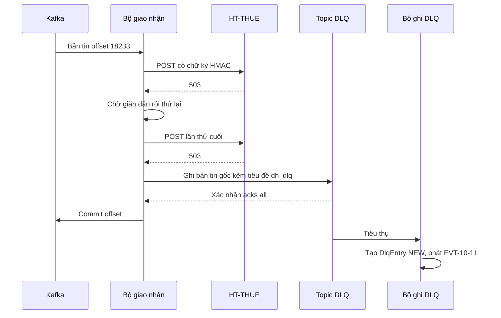

# D02-04-PH10 · Đặc tả use case Sự kiện

## Tóm tắt cho hội đồng thẩm định

Tài liệu đặc tả 28 use case của PH-10, phủ toàn bộ 66 FR mức M và 8 FR mức S của [D02-03-PH10](../frs/D02-03-PH10-frs-su-kien.md); FR-10-048 (lọc và gộp lô, mức C, Đợt sau) chỉ có ca kiểm thử, FR-10-071 (nhập khai báo, mức C) có ở UC-10-28 dạng luồng thay thế. Use case đi theo vòng đời thật của một sự kiện nghiệp vụ ở tỉnh: kỹ sư tích hợp lập dự án, khai báo topic kèm lược đồ, người duyệt duyệt và nền tảng cấp phát trên cụm Kafka; HTTT phát được sau khi publication được duyệt; HTTT khác đăng ký nhận theo chế độ đẩy (webhook ký HMAC) hoặc kéo; vận hành tỉnh theo dõi độ trễ tiêu thụ, xử lý DLQ và phát lại có duyệt; PH-04, PH-05 và các DU nội bộ đăng ký, kiểm tra quyền theo kênh máy với máy; quản trị tỉnh di trú dần từ Hub Pulsar cũ. Căn cứ pháp lý như FRS: CMP-LAW-09 (trao đổi bất đồng bộ tin cậy), CMP-LAW-03 (NĐ 278/2025), CMP-LAW-06 và CMP-LAW-08 (NĐ 331/2026, TCVN 14423:2026 cấp độ 3), CMP-LAW-05 (Luật BVDLCN 91/2025).

## 1. Mục đích và phạm vi

Phạm vi là toàn bộ FR-10-001…076. Tài liệu mô tả trình tự tương tác giữa tác nhân và hệ thống, ai làm bước nào, dữ liệu ví dụ và cách xử lý khi có sai lệch; hành vi chi tiết của từng bước (ràng buộc tham số, thứ tự kiểm tra, mã lỗi) nằm ở FR tương ứng và không chép lại. Chức năng dùng chung FR-00 (đăng nhập, chọn tenant, danh sách, kiểm toán, hộp "Việc của tôi", thông báo, xác nhận thao tác) không đặc tả lại; bước dựa vào chúng ghi "Tuân thủ FR-00-nnn".

Mọi enum, trạng thái, tên trường, mã quyền, tham số `10.*`, mã màn hình và mã sự kiện dùng đúng Phụ lục A của FRS. Chỗ use case cần một khái niệm mà Phụ lục A chưa có được ghi ở §8.2 "Đề nghị bổ sung cho FRS", không tự đặt mã.

Ngoài phạm vi: biểu đồ CPU, bộ nhớ của cụm Kafka (PH-13, thay LGC-HUB-005, 006); màn xử lý lỗi vận hành chung (PH-18, PH-10 chỉ cung cấp DLQ tầng sự kiện và API phát lại); thiết kế luồng tiêu thụ sự kiện (PH-04); khai báo CDC (PH-05).

## 2. Quy ước đọc đặc tả

Luồng chính đánh số 1, 2, 3. Luồng thay thế ghi `số bước + chữ` (ví dụ `3a`) và quay lại luồng chính ở bước nêu rõ. Luồng ngoại lệ ghi `E1`, `E2` kèm bước phát sinh, mã lỗi `ERR-10-nnn` của FRS §8.1, và kết thúc use case hoặc quay lại bước nêu rõ. Luồng phụ dùng chung (bốn mắt, lý do bắt buộc, cấp phát bất đồng bộ…) ghi `LP-10-nn` và đặc tả một lần ở §7.

Quy ước chung không nhắc lại trong từng use case (FRS §5): lệnh ghi qua `/api/event/v1` mang `Idempotency-Key` và `If-Match` khi sửa; đối tượng của tenant khác trả như không tồn tại (ERR-10-001); tenant đang tạm ngừng hoặc đóng băng thay đổi trả ERR-10-039 cho mọi lệnh ghi; phụ thuộc không khả dụng trả ERR-10-029 theo LP-10-04.

Dữ liệu ví dụ đều giả lập, tenant `T68` (topic tiền tố `t68.`):

| Vai | Người hoặc hệ thống | Ghi chú |
|---|---|---|
| IE | **An**, Sở KH&CN | Kỹ sư tích hợp |
| IA | **Bình**, Sở KH&CN | Người duyệt tích hợp |
| TA | **Mai**, Sở KH&CN | Quản trị tỉnh |
| TO | **Chi**, Trung tâm dữ liệu tỉnh | Vận hành tỉnh |
| SO | **Dũng**, Sở KH&CN | Cán bộ ATTT |
| OR | **Thảo**, Sở Tài chính | Người đề nghị của tổ chức |
| PA | **Hà**, đơn vị vận hành nền tảng | Quản trị nền tảng |
| HTTT | `HT-DKKD` (đăng ký kinh doanh), `HT-THUE` (hệ thống thuế tỉnh), `HT-BHXH`, `HT-DVC` (cổng dịch vụ công) | Bản sao PH-01 |
| Dự án | `dang-ky-kinh-doanh` | Tổ chức chủ quản `SO-KHDT` |
| Topic | `t68.dkkd.doanh-nghiep.da-cap-phep.v1` | `KEY_HASH`, khóa `maDoanhNghiep`, 6 phân vùng, `INTERNAL` |
| Bên phát, bên nhận | `ht-dkkd` (`HTTP_PUBLISH`), `ht-thue` (`WEBHOOK_PUSH`), `ht-bhxh` (`HTTP_PULL`) | |
| Subscription | `ht-thue-dn-cap-phep` (`PUSH`), `ht-bhxh-dn-cap-phep` (`PULL_API`) | Nhóm `dh-sub-t68-ht-thue-dn-cap-phep` |

## 3. Tác nhân

| Tác nhân | Loại | Use case chính |
|---|---|---|
| ROLE-INTEGRATION_ENGINEER (An) | Chính | 01, 02, 04, 05, 06, 07, 09, 12, 16, 17, 28 |
| ROLE-INTEGRATION_APPROVER (Bình) | Chính | 03, 04, 06, 09, 13, 19, 27 |
| ROLE-TENANT_ADMIN (Mai) | Chính | 22, 26, 27, 28 (và mọi UC của IE, IA trong giới hạn bốn mắt) |
| ROLE-TENANT_OPERATOR (Chi) | Chính | 16, 17, 18, 19, 20 |
| ROLE-SECURITY_OFFICER (Dũng) | Chính | 08, 11, 17 |
| ROLE-ORG_REQUESTER (Thảo) | Chính | 12, 16 (trong phạm vi tổ chức) |
| ROLE-SERVICE_OWNER | Chính | 01, 02, 07, 09 (trong phạm vi tổ chức) |
| ROLE-PLATFORM_ADMIN (Hà) | Chính | 22, 24, 27 |
| ROLE-VIEWER, ROLE-AUDITOR, ROLE-PLATFORM_OPERATOR | Chính (chỉ xem) | 21 |
| HTTT thành viên | Chính (máy) | 10, 11, 15; phụ ở 12, 14 |
| `dh-runtime` (cổng sự kiện, bộ giao nhận, bộ phát lại, bộ giám sát tuân thủ) | Chính (máy) | 14; phụ ở 10, 11, 15, 18, 19 |
| `dh-integration` mô-đun PH-05 | Chính (máy) | 23 |
| `dh-integration` mô-đun PH-04 | Chính (máy) | 25 |
| DU nội bộ (`dh-connect`, `dh-data`, `dh-platform`, `dh-payment`) | Chính (máy) | 24 |
| PH-18 (scope `event:dlq-read`, `event:replay`) | Chính (máy) | 18, 19 |
| PH-01, PH-12 (Keycloak, OPA), PH-13, PH-20, Apicurio, Strimzi qua kho `dh-config-{tenant}`, OpenBao | Phụ | Nhiều use case |

## 4. Sơ đồ use case tổng

```mermaid
flowchart LR
  IE([Kỹ sư tích hợp])
  IA([Người duyệt tích hợp])
  TA([Quản trị tỉnh])
  TO([Vận hành tỉnh])
  SO([Cán bộ ATTT])
  PA([Quản trị nền tảng])
  HT([HTTT thành viên])
  RT([dh-runtime])
  P5([PH-05])
  P4([PH-04])
  DU([DU nội bộ])
  subgraph KB["Khai báo trục sự kiện"]
    U01[UC-10-01 Dự án tích hợp]
    U02[UC-10-02 Tạo topic]
    U03[UC-10-03 Duyệt, cấp phát topic]
    U04[UC-10-04 Đổi cấu hình topic]
    U05[UC-10-05 Ngừng topic, phiên bản mới]
    U06[UC-10-06 Phiên bản lược đồ]
  end
  subgraph BT["Bên tham gia và quan hệ"]
    U07[UC-10-07 Đăng ký bên phát, bên nhận]
    U08[UC-10-08 Tạm ngừng bên tham gia]
    U09[UC-10-09 Publication]
    U12[UC-10-12 Đăng ký nhận]
    U13[UC-10-13 Duyệt subscription]
  end
  subgraph GN["Phát và giao nhận"]
    U10[UC-10-10 Phát qua API]
    U11[UC-10-11 Phát Kafka trực tiếp]
    U14[UC-10-14 Giao ĐẨY, thử lại, DLQ]
    U15[UC-10-15 Nhận KÉO]
  end
  subgraph VH["Vận hành"]
    U16[UC-10-16 Vận hành subscription]
    U17[UC-10-17 Xoay khóa ký]
    U18[UC-10-18 Xử lý DLQ]
    U19[UC-10-19 Phát lại theo khoảng]
    U20[UC-10-20 Theo dõi lag]
    U21[UC-10-21 Dashboard, sơ đồ]
    U22[UC-10-22 Cấu hình, hạn mức]
  end
  subgraph MM["Máy với máy và di trú"]
    U23[UC-10-23 Topic CDC]
    U24[UC-10-24 Topic SYSTEM]
    U25[UC-10-25 Kiểm tra quyền PH-04]
    U26[UC-10-26 Kiểm kê Pulsar]
    U27[UC-10-27 Cầu nối, chuyển hẳn]
    U28[UC-10-28 Xuất, nhập khai báo]
  end
  IE --> U01 & U02 & U04 & U05 & U06 & U07 & U09 & U12 & U28
  IA --> U03 & U13 & U19
  TA --> U22 & U26 & U27
  TO --> U16 & U17 & U18 & U20
  SO --> U08 & U11
  PA --> U22 & U27
  HT --> U10 & U11 & U15
  RT --> U14
  P5 --> U23
  DU --> U24
  P4 --> U25
  TO --> U21
```

Sơ đồ gom 28 use case thành năm nhóm theo vòng đời. Nhóm "Khai báo" và "Bên tham gia" là việc của người trên control plane (`/api/event/v1`), luôn qua duyệt bốn mắt trước khi có hiệu lực trên cụm. Nhóm "Phát và giao nhận" là data plane (`/event/v1` và Kafka), tác nhân chính là HTTT và `dh-runtime`. Nhóm "Vận hành" do TO, TA làm hằng ngày. Nhóm "Máy với máy và di trú" gồm ba kênh đăng ký của PH-04, PH-05, DU nội bộ và chuỗi di trú từ Pulsar. Mọi vai trò có `PERM-10-read` (VW, AU, PO) dùng UC-10-21; mũi tên chỉ vẽ tác nhân chính tiêu biểu để sơ đồ dễ đọc, bảng §3 là danh sách đủ.

## 5. Bảng tổng hợp use case và truy vết

### 5.1. Use case và FR

| UC | Tên | Tác nhân chính | Mức | FR |
|---|---|---|---|---|
| UC-10-01 | Lập và quản lý dự án tích hợp | IE | M | 001, 002, 003, 004, 005, 065 |
| UC-10-02 | Tạo topic kèm lược đồ và gửi duyệt | IE | M | 006, 007, 008, 013, 017 |
| UC-10-03 | Duyệt tạo topic và theo dõi cấp phát | IA | M | 009, 010 |
| UC-10-04 | Thay đổi cấu hình topic đang hoạt động | IE, IA | M | 011, 012, 013, 021 |
| UC-10-05 | Ngừng topic và tạo phiên bản chính mới | IE | M | 014, 015, 016 |
| UC-10-06 | Soạn, kiểm tra và duyệt phiên bản lược đồ | IE, IA | M | 017, 018, 019, 020, 022 |
| UC-10-07 | Đăng ký bên phát và bên nhận | IE | M | 025, 026, 027 |
| UC-10-08 | Tạm ngừng, tiếp tục và ngừng dùng bên tham gia | SO, hệ thống | M | 028, 029 |
| UC-10-09 | Đề nghị và duyệt publication | IE, IA | M | 030, 031 |
| UC-10-10 | HTTT phát sự kiện qua API phát | HTTT | M | 033, 024, 064 |
| UC-10-11 | Phát trực tiếp qua Kafka và xử lý vi phạm lược đồ | HTTT, SO | M | 034, 023, 032 |
| UC-10-12 | Đăng ký nhận sự kiện và xác minh endpoint | IE, OR | M | 035, 036, 040 |
| UC-10-13 | Duyệt subscription và cấp phát nhóm tiêu thụ | IA | M | 037 |
| UC-10-14 | Giao nhận ĐẨY, thử lại và chuyển DLQ | `dh-runtime` | M | 038, 039, 049 |
| UC-10-15 | HTTT nhận sự kiện theo chế độ KÉO | HTTT | M | 043, 044 |
| UC-10-16 | Vận hành subscription: tạm dừng, sửa, thu hồi | TO, IE | M | 041, 046, 047, 056 |
| UC-10-17 | Xoay và thu hồi khẩn khóa ký webhook | TO, SO | M | 042 |
| UC-10-18 | Xử lý mục DLQ và phát lại mục DLQ | TO | M | 050, 053 |
| UC-10-19 | Đề nghị, duyệt và chạy phát lại theo khoảng | TO, IA | M | 051, 052 |
| UC-10-20 | Theo dõi độ trễ tiêu thụ và xác nhận cảnh báo | TO | M | 054, 055, 059 |
| UC-10-21 | Xem dashboard và sơ đồ kết nối | Mọi vai trò xem | M | 057, 058 |
| UC-10-22 | Cấu hình danh mục, hạn mức và tham số | TA, PA | M | 060, 061, 062, 063 |
| UC-10-23 | PH-05 đăng ký topic CDC và báo thay đổi lược đồ | PH-05 | M | 066, 068 |
| UC-10-24 | DU nội bộ đăng ký topic SYSTEM và topic nền tảng | DU nội bộ | M | 067, 064 |
| UC-10-25 | PH-04 kiểm tra quyền phát, nhận và tiêu thụ nội bộ | PH-04 | M | 069, 045 |
| UC-10-26 | Nhập kiểm kê Hub Pulsar và lập ánh xạ | TA | M | 072 |
| UC-10-27 | Chạy cầu nối, đối chiếu, chuyển hẳn và quay lui | TA, IA | M | 073, 074, 075, 076 |
| UC-10-28 | Xuất và nhập khai báo sự kiện | IE | S | 070, 071 |

FR-10-048 (C, Đợt sau) không có use case; khi được đưa vào phạm vi sẽ bổ sung luồng thay thế cho UC-10-12 và UC-10-14.

### 5.2. Use case, màn hình và API

| UC | UI | API |
|---|---|---|
| UC-10-01 | UI-10-02, 03, 04 | API-10-001, 002, 003, 004, 005, 006 |
| UC-10-02 | UI-10-03, 05, 06, 07 | API-10-008, 009, 010, 011, 012, 026 |
| UC-10-03 | UI-10-13, 06 | API-10-057, 058, 059, 013, 014 |
| UC-10-04 | UI-10-06, 13 | API-10-015, 059 |
| UC-10-05 | UI-10-06, 01 | API-10-016, 017, 018, 019 |
| UC-10-06 | UI-10-08, 13 | API-10-021, 022, 023, 024, 025, 026, 027, 028, 029, 030 |
| UC-10-07 | UI-10-09, 10 | API-10-032, 033, 034, 037, 038, 039 |
| UC-10-08 | UI-10-09, 10 | API-10-035, 036, 040, 041 |
| UC-10-09 | UI-10-09, 06, 13 | API-10-042, 043, 044, 059 |
| UC-10-10 | UI-10-06 (tab Cách kết nối) | API-10-020, 079, 084 |
| UC-10-11 | UI-10-06 | API-10-020, 031, 045 |
| UC-10-12 | UI-10-11 | API-10-046, 047, 051 |
| UC-10-13 | UI-10-13, 12 | API-10-057, 058, 059, 048 |
| UC-10-14 | UI-10-12 | API-10-073 |
| UC-10-15 | UI-10-12 | API-10-080, 081, 082, 083, 084 |
| UC-10-16 | UI-10-12 | API-10-048, 049, 050, 052, 053 |
| UC-10-17 | UI-10-12 | API-10-054 |
| UC-10-18 | UI-10-15 | API-10-060, 061, 062, 064 |
| UC-10-19 | UI-10-16, 13 | API-10-063, 064, 065, 059 |
| UC-10-20 | UI-10-17, 12 | API-10-055, 056 |
| UC-10-21 | UI-10-01, 14 | API-10-066, 007 |
| UC-10-22 | UI-10-18 | API-10-067, 068, 069, 070 |
| UC-10-23 | Không (máy); kết quả xem ở UI-10-06 | API-10-009, 023, 018 |
| UC-10-24 | Không (máy) | API-10-009 |
| UC-10-25 | Không (máy); kết quả hiện ở trình thiết kế PH-04 | API-10-071, 072, 008 |
| UC-10-26 | UI-10-20 | API-10-075, 076 |
| UC-10-27 | UI-10-20, 13 | API-10-077, 078, 059 |
| UC-10-28 | UI-10-02, 19 | API-10-074, 075 |

### 5.3. Use case, REQ, quy trình và hệ cũ

| UC | REQ | Quy trình | LGC |
|---|---|---|---|
| UC-10-01 | REQ-10, REQ-13 | Khai báo trục sự kiện | LGC-HUB-008 |
| UC-10-02 | REQ-10 | Khai báo trục sự kiện | LGC-HUB-009, LGC-HUB-014 |
| UC-10-03 | REQ-10 | Khai báo trục sự kiện | LGC-HUB-009 |
| UC-10-04 | REQ-10 | Thay đổi cấu hình | LGC-HUB-009, LGC-HUB-014 |
| UC-10-05 | REQ-10 | Thay đổi cấu hình | LGC-HUB-009 |
| UC-10-06 | REQ-10 | Khai báo trục sự kiện | LGC-HUB-009 |
| UC-10-07 | REQ-10, REQ-01 | Kết nạp, tích hợp | LGC-HUB-010, LGC-HUB-011 |
| UC-10-08 | REQ-10, REQ-01, REQ-04 | Ứng phó sự cố | LGC-HUB-010, LGC-HUB-011 |
| UC-10-09 | REQ-10, REQ-12 | Cấp quyền phát | LGC-HUB-012 |
| UC-10-10 | REQ-10, REQ-20 | Trao đổi bất đồng bộ | LGC-HUB-012, LGC-BUS-039 |
| UC-10-11 | REQ-10 | Trao đổi bất đồng bộ | LGC-TOOL-010, LGC-HUB-012 |
| UC-10-12 | REQ-10 | Cấp quyền nhận | LGC-HUB-013 |
| UC-10-13 | REQ-10, REQ-12 | Cấp quyền nhận | LGC-HUB-013 |
| UC-10-14 | REQ-10, REQ-18 | Trao đổi bất đồng bộ | LGC-HUB-013, LGC-BUS-039 |
| UC-10-15 | REQ-10 | Trao đổi bất đồng bộ | LGC-HUB-013, LGC-TOOL-010, LGC-BUS-039 |
| UC-10-16 | REQ-10 | Vận hành | LGC-HUB-013 |
| UC-10-17 | REQ-10 | Vận hành | LGC-HUB-013 (nâng cấp) |
| UC-10-18 | REQ-10, REQ-18 | Xử lý lỗi | Không có ở hệ cũ |
| UC-10-19 | REQ-10, REQ-18 | Xử lý lỗi | Không có ở hệ cũ |
| UC-10-20 | REQ-10, REQ-13 | Giám sát | LGC-HUB-007 (phủ lag) |
| UC-10-21 | REQ-10, REQ-13 | Giám sát | LGC-HUB-001, 002, 003, 004, 007; LGC-HUB-005, 006 chuyển PH-13 |
| UC-10-22 | REQ-10, REQ-18, REQ-20 | Quản trị tỉnh | LGC-HUB-014 |
| UC-10-23 | REQ-10, REQ-05 | Máy với máy | LGC-TOOL-010 |
| UC-10-24 | REQ-10, REQ-20 | Máy với máy, khởi tạo tenant | LGC-TOOL-010, LGC-BUS-039 |
| UC-10-25 | REQ-10, REQ-04 | Máy với máy | LGC-HUB-011, LGC-TOOL-010 |
| UC-10-26 | REQ-22 | Di trú song song | LGC-HUB-008 … LGC-HUB-014 |
| UC-10-27 | REQ-22 | Di trú song song | LGC-HUB-008 … LGC-HUB-014 |
| UC-10-28 | REQ-22 | Rà soát, chuyển môi trường | Không có ở hệ cũ |

Truy vết ngược từ chức năng hệ cũ: LGC-HUB-001…004 ở UC-10-21; LGC-HUB-005, 006 thay bằng PH-13, UC-10-21 chỉ có liên kết sang; LGC-HUB-007 ở UC-10-20, 21; LGC-HUB-008 ở UC-10-01; LGC-HUB-009 ở UC-10-02…06; LGC-HUB-010, 011 ở UC-10-07, 08, 25; LGC-HUB-012 ở UC-10-09…11; LGC-HUB-013 ở UC-10-12…17; LGC-HUB-014 ở UC-10-02, 04, 22; LGC-TOOL-010 ở UC-10-11, 15, 23…25; LGC-BUS-039 ở UC-10-10, 14, 15, 24. Mọi mục `LGC-HUB` đều có use case; UC-10-26, 27 phủ việc chuyển dữ liệu khai báo của cả mười bốn mục sang Datahub.

## 6. Đặc tả chi tiết use case

### 6.1. UC-10-01 · Lập và quản lý dự án tích hợp

| Mục | Nội dung |
|---|---|
| Mục tiêu | Kỹ sư tích hợp có một dự án gom các topic của một nghiệp vụ liên thông, có tổ chức chủ quản rõ, lưu trữ được khi hết dùng mà không mất truy vết |
| Tác nhân chính | ROLE-INTEGRATION_ENGINEER (An) |
| Tác nhân phụ | PH-12 (danh sách tổ chức), dịch vụ kiểm toán (FR-00-041) |
| Mức ưu tiên | M |
| FR hiện thực | FR-10-001, 002, 003, 004, 005, 065 |
| Tiền điều kiện | An có `PERM-10-create`, `PERM-10-update`; tenant T68 `ACTIVE`; số dự án dưới `10.quota.max-projects` (200) |
| Điều kiện kích hoạt | An bấm "Tạo dự án" ở UI-10-02 |
| Đảm bảo tối thiểu | Không có dự án nửa vời; mã đã nhập không bị giữ chỗ nếu tạo thất bại |
| Đảm bảo thành công | Dự án `dang-ky-kinh-doanh` ở `ACTIVE`, có bản ghi kiểm toán người tạo |

**Luồng chính**

1. An mở UI-10-02. Hệ thống gọi API-10-001 với `status=ACTIVE`, hiện bảng dự án kèm `topicCount`, `publisherCount`, `subscriberCount`, `maxLagSeconds` và khối lọc theo `ownerOrgCode`, nhãn (tuân thủ FR-00-020…023).
2. An bấm "Tạo dự án". Hệ thống mở UI-10-04 (Drawer PTN-04), nạp danh sách tổ chức của tenant từ PH-12.
3. An nhập `projectCode` `dang-ky-kinh-doanh`, tên "Liên thông đăng ký kinh doanh", tổ chức chủ quản `SO-KHDT`, nhãn `doanh-nghiep`. Hệ thống kiểm tra mẫu mã và từ dành riêng ngay khi rời ô.
4. An bấm "Lưu". Hệ thống gọi API-10-002 với `Idempotency-Key`; nhận `201`, `Location`, `ETag`; dự án `ACTIVE`.
5. Hệ thống chuyển sang UI-10-03 của dự án mới: tab Tổng quan trống, nút "Tạo topic" (tiếp UC-10-02), tab Lịch sử có một dòng "Tạo dự án · An · 26/11/2026 08:30" (FR-10-065, tuân thủ FR-00-043).
6. Về sau, An sửa mô tả ở UI-10-04 chế độ sửa. Hệ thống gọi API-10-004 với `If-Match`; tab Lịch sử ghi giá trị trước và sau.

**Luồng thay thế**

- **3a. SV tạo dự án cho tổ chức mình.** Ô tổ chức chủ quản chỉ có tổ chức của SV, chọn sẵn; tiếp bước 4.
- **6a. Lưu trữ dự án hết dùng.** An chọn "Lưu trữ", nhập lý do theo LP-10-02. Hệ thống gọi API-10-005; dự án sang `ARCHIVED`, topic `DRAFT` còn lại bị xóa mềm (tuân thủ FR-00-051). Danh sách mặc định không còn hiện dự án; lọc `status=ARCHIVED` vẫn thấy.
- **6b. Khôi phục.** Trên dự án `ARCHIVED`, An chọn "Khôi phục". Hệ thống gọi API-10-006; dự án về `ACTIVE`.
- **6c. Đổi tổ chức chủ quản.** Hệ thống chỉ cho lưu khi An có quyền ở cả tổ chức cũ và mới; ngược lại E5.

**Luồng ngoại lệ**

- **E1. Mã sai mẫu hoặc trùng từ dành riêng (bước 3, 4),** ví dụ `tong-quan`. ERR-10-003; ô mã báo "Mã không hợp lệ hoặc là từ dành riêng của đường dẫn"; quay lại bước 3.
- **E2. Mã đã dùng (bước 4), kể cả dự án `ARCHIVED`.** ERR-10-002; quay lại bước 3 (BR-10-003).
- **E3. Vượt hạn mức dự án (bước 4).** ERR-10-011; thông điệp nêu trần hiện hành và liên hệ TA (UC-10-22); use case kết thúc.
- **E4. Lưu trữ khi còn topic hoạt động (6a).** ERR-10-010 kèm danh sách topic `PENDING_APPROVAL`, `PROVISIONING`, `ACTIVE`, `DEPRECATED`; An phải ngừng dùng các topic trước (UC-10-05).
- **E5. Ngoài phạm vi tổ chức (3a, 6c).** ERR-10-044; không lưu.
- **E6. Sửa dự án `ARCHIVED` (bước 6).** ERR-10-006; nút "Sửa" bị ẩn trên giao diện, lỗi chỉ xảy ra khi gọi thẳng API.
- **E7. Người khác vừa sửa (bước 6).** ERR-10-007 theo LP-10-03.

**Quy tắc áp dụng:** BR-10-003.

### 6.2. UC-10-02 · Tạo topic kèm lược đồ và gửi duyệt

| Mục | Nội dung |
|---|---|
| Mục tiêu | Kỹ sư tích hợp khai báo một loại sự kiện nghiệp vụ có tên đúng quy ước, cấu hình hợp lệ và lược đồ bắt buộc, gửi duyệt trong một lượt |
| Tác nhân chính | ROLE-INTEGRATION_ENGINEER (An) |
| Tác nhân phụ | Apicurio (trình phân tích lược đồ), dịch vụ thông báo (FR-00-060) |
| Mức ưu tiên | M |
| FR hiện thực | FR-10-006, 007, 008, 013, 017 |
| Tiền điều kiện | An có `PERM-10-create`; dự án `dang-ky-kinh-doanh` `ACTIVE`; tenant chưa vượt `maxTopics`, `maxPartitionsTotal`; `KEY_HASH` được bật (FR-10-061) |
| Điều kiện kích hoạt | An bấm "Tạo topic" ở UI-10-05 hoặc ở tab Topic của UI-10-03 |
| Đảm bảo tối thiểu | Chưa có gì trên cụm Kafka hay Apicurio trước khi được duyệt |
| Đảm bảo thành công | Topic `t68.dkkd.doanh-nghiep.da-cap-phep.v1` và phiên bản lược đồ 1 ở `PENDING_APPROVAL`, có yêu cầu `TOPIC_CREATE` trong "Việc của tôi" của IA |

**Luồng chính**

1. Hệ thống mở UI-10-07 bước "Dự án và tên", điền sẵn dự án đang đứng.
2. An nhập miền `dkkd`, thực thể `doanh-nghiep`, sự kiện `da-cap-phep`, mô tả "Phát khi Sở KH&CN cấp giấy chứng nhận đăng ký doanh nghiệp; mang mã doanh nghiệp và ngày cấp". Hệ thống ghép và hiện tên xem trước `t68.dkkd.doanh-nghiep.da-cap-phep.v1`, kiểm tra trùng bằng API-10-008 với `q`.
3. Ở bước "Cấu hình", hệ thống điền mặc định: `partitions` 6, `retentionHours` 168, `cleanupPolicy` `DELETE`, `routingMode` `KEY_HASH`; hệ số nhân bản 3 và `min.insync.replicas` 2 hiện dạng chỉ đọc (BR-10-004). An chọn `dataClass` `INTERNAL`, `orderingRequired` bật.
4. Ở bước "Định tuyến", An nhập `partitionKeyField` `maDoanhNghiep`. Hệ thống giải thích: sự kiện cùng mã doanh nghiệp vào cùng phân vùng và giữ thứ tự (FR-10-013).
5. Ở bước "Lược đồ", An chọn `AVRO`, dán lược đồ `record DoanhNghiepDaCapPhep`, namespace `vn.datahub.t68.dkkd`, các trường `maDoanhNghiep`, `tenDoanhNghiep`, `ngayCap`, `coQuanCap`, mỗi trường có `doc`.
6. An bấm "Kiểm tra". Hệ thống kiểm tra cú pháp, quy ước, trường khóa và dữ liệu cá nhân theo FR-10-017 (dùng API-10-026 trên bản nháp); kết quả: đạt, một cảnh báo quy ước "trường `coQuanCap` nên là mã T-CODE".
7. Ở bước "Gửi duyệt", hệ thống tóm tắt cấu hình, lược đồ, kết quả kiểm tra. An giữ ô "Gửi duyệt ngay" và bấm "Tạo".
8. Hệ thống gọi API-10-009 với `submit=true`; nhận `201` kèm `approvalRequestCode` `apr-01jdx5…`. Topic và phiên bản lược đồ 1 sang `PENDING_APPROVAL`; yêu cầu vào "Việc của tôi" của Bình (tuân thủ FR-00-070).
9. Hệ thống mở UI-10-06 của topic: thẻ trạng thái "Chờ duyệt", tab Lược đồ hiện phiên bản 1, tab Cách kết nối ghi "Có sau khi topic hoạt động".

**Luồng thay thế**

- **1a. Tạo nhanh từ chi tiết dự án.** An bấm "Tạo topic nhanh" ở UI-10-03. Hệ thống mở Drawer PTN-04 chỉ hỏi miền, thực thể, sự kiện, mô tả, phân loại và lược đồ; mọi tham số còn lại dùng mặc định; tiếp bước 6.
- **3a. Topic trạng thái hiện hành, ví dụ danh mục.** An chọn `cleanupPolicy` `COMPACT`; hệ thống cảnh báo chỉ bản tin mới nhất theo khóa được giữ lâu dài; hợp lệ vì đã có khóa.
- **3b. Chọn `SINGLE_PARTITION`.** Hệ thống đặt `partitions` 1 và khóa ô; ẩn ô khóa phân vùng ở bước 4.
- **7a. Lưu nháp, gửi sau.** An bỏ ô "Gửi duyệt ngay". Topic ở `DRAFT`; về sau An bấm "Gửi duyệt" trên UI-10-06, hệ thống gọi API-10-012. Trong lúc nháp, An sửa mô tả, cấu hình qua API-10-011.
- **9a. Tìm lại topic.** An mở UI-10-05, lọc `projectCode=dang-ky-kinh-doanh`, `status=PENDING_APPROVAL` (FR-10-006); mỗi dòng có `latestSchemaVersion`, `publicationCount`, `subscriptionCount`.

**Luồng ngoại lệ**

- **E1. Tên sai quy ước hoặc dùng miền dành riêng (bước 2),** ví dụ miền `cdc` hay `rdm`. ERR-10-004; hệ thống nêu danh sách miền chỉ nhận đăng ký máy (BR-10-030); quay lại bước 2.
- **E2. Tên trùng, kể cả topic `RETIRED` (bước 8).** ERR-10-002; quay lại bước 2.
- **E3. Số phân vùng vượt `10.topic.max-partitions` hoặc lưu giữ vượt trần (bước 3).** ERR-10-012; quay lại bước 3.
- **E4. Vượt hạn mức tenant, tính cả topic đang chờ duyệt (bước 8).** ERR-10-011; use case kết thúc, An liên hệ TA.
- **E5. `KEY_HASH` thiếu khóa, hoặc `orderingRequired` với `ROUND_ROBIN` (bước 4).** ERR-10-046; quay lại bước 4.
- **E6. `COMPACT` với chế độ không có khóa (3a).** ERR-10-048; quay lại bước 3.
- **E7. Lược đồ sai cú pháp (bước 6).** ERR-10-015 kèm dòng, cột; quay lại bước 5.
- **E8. Lược đồ không có trường `maDoanhNghiep` hoặc trường cho phép null (bước 6).** ERR-10-017; quay lại bước 5.
- **E9. Trường nghi dữ liệu cá nhân, ví dụ `soDinhDanhChuDoanhNghiep`, khi `10.schema.pii-check-mode` là `BLOCK` (bước 6).** ERR-10-018; hệ thống gợi ý chỉ mang định danh doanh nghiệp (BR-10-014); quay lại bước 5. Ở chế độ `WARN`, phát hiện ghi vào `piiFindings` mức `WARNING` và người duyệt phải xác nhận (UC-10-03).
- **E10. Định dạng `JSON_SCHEMA` bị tắt ở tenant (bước 5).** ERR-10-020.
- **E11. Dự án đã `ARCHIVED` (bước 8).** ERR-10-006.

**Quy tắc áp dụng:** BR-10-002, 003, 004, 006, 011, 014, 030.

### 6.3. UC-10-03 · Duyệt tạo topic và theo dõi cấp phát

| Mục | Nội dung |
|---|---|
| Mục tiêu | Người duyệt kiểm soát topic trước khi lên cụm; sau duyệt, nền tảng đăng ký lược đồ, sinh tài nguyên vào Git và topic hoạt động trong ≤ 3 phút ở p95 |
| Tác nhân chính | ROLE-INTEGRATION_APPROVER (Bình) |
| Tác nhân phụ | Apicurio, kho `dh-config-{tenant}`, Argo CD và Strimzi, bộ đối soát của `dh-integration`, An (người gửi) |
| Mức ưu tiên | M |
| FR hiện thực | FR-10-009, 010 |
| Tiền điều kiện | Yêu cầu `TOPIC_CREATE` ở `PENDING`; Bình có `PERM-10-approve`, không phải người tạo topic hay người gửi duyệt |
| Điều kiện kích hoạt | Bình mở yêu cầu từ "Việc của tôi" (UI-10-13) |
| Đảm bảo tối thiểu | Không có artifact Apicurio hay tài nguyên Git dở dang khi duyệt thất bại; yêu cầu giữ `PENDING` |
| Đảm bảo thành công | Topic `ACTIVE`, topic DLQ `t68.dkkd.doanh-nghiep.da-cap-phep.v1.dlq` có trên cụm, phiên bản lược đồ 1 `ENABLED`; phát EVT-10-01 và EVT-10-05 |

**Luồng chính**

1. Bình mở UI-10-13 lọc `requestType=TOPIC_CREATE`. Hệ thống gọi API-10-057 rồi API-10-058, hiện cấu hình, lược đồ, kết quả kiểm tra (`checks`), cảnh báo quy ước của An và mức dùng hạn mức sau khi thêm topic.
2. Bình đọc lược đồ, thấy cảnh báo về `coQuanCap`, nhập ý kiến "Đồng ý; lần sau dùng mã cơ quan" và chọn "Duyệt".
3. Hệ thống kiểm tra bốn mắt theo LP-10-01, rồi gọi API-10-059 hành động `:approve`. Máy chủ chạy lại kiểm tra hạn mức và tên.
4. Hệ thống tạo artifact Apicurio `groupId = t68`, `artifactId = t68.dkkd.doanh-nghiep.da-cap-phep.v1`, quy tắc tương thích `BACKWARD`, phiên bản 1 `ENABLED`; lưu `apicurioGlobalId`.
5. Hệ thống sinh `KafkaTopic` cho topic và cho topic DLQ (BR-10-023), commit vào `dh-config-t68` thư mục `kafka/topics/`; topic sang `PROVISIONING`, lưu `provisioningCommit` (LP-10-05).
6. Bộ đối soát đọc trạng thái `Ready` mỗi 10 giây. Khi cả hai tài nguyên sẵn sàng, topic sang `ACTIVE`, ghi `activatedAt`; outbox phát EVT-10-01 và EVT-10-05.
7. Hệ thống thông báo An (FR-00-060). UI-10-06 hiện trạng thái "Đang hoạt động", tab Cách kết nối có đường dẫn API phát và URI lược đồ.

**Luồng thay thế**

- **2a. Từ chối.** Bình chọn "Từ chối" và nhập lý do ≥ 10 ký tự. Yêu cầu `REJECTED`, topic và phiên bản lược đồ về `DRAFT`; An được thông báo kèm lý do, sửa rồi gửi lại (UC-10-02 bước 7a).
- **2b. Có phát hiện dữ liệu cá nhân mức `WARNING`.** Nút "Duyệt" chỉ bật khi Bình đánh dấu ô xác nhận (`acknowledgePii`); thiếu thì E2.
- **2c. Mai (TA) duyệt thay.** Hợp lệ nếu Mai không tạo, không gửi topic này (BR-10-010).
- **6a. Cấp phát thất bại.** Quá `10.provisioning.timeout-minutes` (10) hoặc Strimzi báo lỗi, ví dụ Kyverno từ chối nhãn: topic sang `FAILED`, lưu `provisioningError`, cảnh báo An và Mai. An mở UI-10-06, đọc lỗi rồi bấm "Thử lại cấp phát" (API-10-013, commit mới, quay lại bước 6) hoặc "Hủy cấp phát" (API-10-014, topic về `DRAFT`, xóa artifact Apicurio khi chưa có bản tin).
- **6b. Lệch cấu hình về sau.** Đối chiếu 10 phút một lần phát hiện `retention.ms` trên cụm khác Git: hệ thống ghi cảnh báo mức cao kèm khác biệt, không tự sửa đè ngoài Git (BR-10-036); TO xử lý theo quy trình GitOps.
- **6c. Yêu cầu quá hạn.** Yêu cầu `PENDING` quá `10.approval.expire-days` (30) ngày sang `EXPIRED`, topic về `DRAFT`.

**Luồng ngoại lệ**

- **E1. Bình là người gửi duyệt (bước 3).** ERR-10-008 theo LP-10-01.
- **E2. Thiếu ý kiến hoặc thiếu xác nhận dữ liệu cá nhân (bước 3).** ERR-10-009; quay lại bước 2.
- **E3. Apicurio hoặc Git không khả dụng (bước 4, 5).** ERR-10-029 theo LP-10-04; artifact vừa tạo được xóa bù; yêu cầu giữ `PENDING`.
- **E4. Hạn mức đã kín trong lúc chờ (bước 3).** ERR-10-011; Bình từ chối hoặc chờ TA nâng trần.
- **E5. Lệnh phụ thuộc gửi khi topic `FAILED` (6a),** ví dụ đề nghị publication. ERR-10-038.

**Quy tắc áp dụng:** BR-10-004, 010, 011, 014, 023, 036.

### 6.4. UC-10-04 · Thay đổi cấu hình topic đang hoạt động

| Mục | Nội dung |
|---|---|
| Mục tiêu | Điều chỉnh số phân vùng, lưu giữ, chính sách dọn, chế độ định tuyến và mức tương thích mà không làm mất sự kiện hay phá thứ tự ngoài ý muốn |
| Tác nhân chính | ROLE-INTEGRATION_ENGINEER (An) đề nghị; ROLE-INTEGRATION_APPROVER (Bình) duyệt |
| Tác nhân phụ | Kho `dh-config-{tenant}`, Strimzi, Apicurio, `dh-runtime` (nhận EVT-10-02) |
| Mức ưu tiên | M |
| FR hiện thực | FR-10-011, 012, 013, 021 |
| Tiền điều kiện | Topic `ACTIVE` (hoặc `DEPRECATED` với lưu giữ); An có `PERM-10-update`; topic có `topicKind` `BUSINESS` |
| Điều kiện kích hoạt | An chọn "Thay đổi cấu hình" ở tab Cấu hình của UI-10-06 |
| Đảm bảo tối thiểu | Cấu hình trên cụm không đổi cho tới khi được duyệt và commit thành công |
| Đảm bảo thành công | Topic có `partitions` 12; EVT-10-02 phát; cổng và Kamelet áp dụng trong ≤ 60 giây |

**Luồng chính**

1. Lưu lượng cấp phép doanh nghiệp tăng sau đợt cải cách. An mở tab Cấu hình, chọn tăng `partitions` từ 6 lên 12, nhập lý do, chọn `plannedAt` 22:00.
2. Vì topic dùng `KEY_HASH` và `orderingRequired`, hệ thống hiện cảnh báo: khóa sẽ ánh xạ sang phân vùng khác, thứ tự giữa sự kiện trước và sau thời điểm đổi của cùng mã doanh nghiệp không còn bảo đảm, kèm gợi ý tạo phiên bản topic mới (UC-10-05). An đánh dấu `acknowledgeOrderingImpact`.
3. Hệ thống gọi API-10-015; nhận yêu cầu `TOPIC_CHANGE` kèm khác biệt `partitions: 6 → 12`.
4. Bình mở yêu cầu ở UI-10-13, xem danh sách subscription đang chạy và lag, nhập ý kiến, chọn "Duyệt" (API-10-059, LP-10-01).
5. Đến 22:00, hệ thống commit cập nhật `KafkaTopic` (LP-10-05). Khi Strimzi báo sẵn sàng, hệ thống cập nhật `partitions`, phát EVT-10-02 và gợi ý tăng `workerCount` của `ht-thue-dn-cap-phep` (không tự đổi).
6. An nhận thông báo, mở UI-10-12 của subscription để chỉnh worker (UC-10-16 bước 6a).

**Luồng thay thế**

- **1a. Tăng lưu giữ trong trần tenant hoặc tăng `maxMessageBytes`.** Áp dụng không cần duyệt: hệ thống commit ngay, phát EVT-10-02; bỏ bước 4.
- **1b. Giảm lưu giữ từ 168 xuống 72 giờ.** Hệ thống tính trước danh sách subscription có `lagSeconds` lớn hơn 72 giờ; nếu khác rỗng, ở bước 4 nút "Duyệt" chỉ bật khi Bình đánh dấu xác nhận mất dữ liệu (`acknowledgeDataLoss`).
- **1c. Đổi định tuyến `ROUND_ROBIN` sang `KEY_HASH`.** Chiều không phá bên nhận; yêu cầu `TOPIC_CHANGE` thông thường; sau khi áp dụng, cổng sự kiện bắt đầu đặt khóa theo `partitionKeyField` (FR-10-013).
- **1d. Đổi mức tương thích từ `BACKWARD` sang `FULL_TRANSITIVE`.** Hệ thống kiểm tra trước mọi phiên bản `ENABLED` thỏa mức mới; đạt thì tạo `TOPIC_CHANGE`; khi duyệt, ghi quy tắc vào artifact Apicurio (FR-10-021).
- **1e. Đổi sang `COMPACT_DELETE`.** Như 1b, kèm cảnh báo về compaction.

**Luồng ngoại lệ**

- **E1. Giảm số phân vùng (bước 1).** ERR-10-013 (BR-10-005).
- **E2. Thiếu xác nhận tác động thứ tự (bước 3).** ERR-10-014; quay lại bước 2.
- **E3. Vượt trần phân vùng hoặc hạn mức tổng phân vùng (bước 3).** ERR-10-012 hoặc ERR-10-011.
- **E4. Topic `SINGLE_PARTITION` (bước 1).** Nút tăng phân vùng bị ẩn; gọi thẳng API trả ERR-10-046.
- **E5. Đổi định tuyến theo chiều phá vỡ (1c), ví dụ `KEY_HASH` sang `ROUND_ROBIN`.** ERR-10-047; hệ thống hướng dẫn tạo phiên bản topic mới.
- **E6. Chế độ đích bị tắt ở danh mục (1c).** ERR-10-043.
- **E7. Mức tương thích không được phép, ví dụ `NONE` cho topic đã từng `ACTIVE` (1d).** ERR-10-019 (BR-10-012).
- **E8. Siết mức mà có phiên bản không thỏa (1d).** ERR-10-016 kèm cặp phiên bản vi phạm.
- **E9. Topic `CDC` hoặc `SYSTEM` (bước 1).** ERR-10-045; cấu hình chỉ do tài khoản dịch vụ chủ quản đổi (UC-10-23, 24).
- **E10. Compaction với topic không khóa (1e).** ERR-10-048.
- **E11. Bình là người đề nghị (bước 4).** ERR-10-008.

**Quy tắc áp dụng:** BR-10-005, 006, 010, 012, 030, 036.

### 6.5. UC-10-05 · Ngừng topic và tạo phiên bản chính mới

| Mục | Nội dung |
|---|---|
| Mục tiêu | Khi cần thay đổi phá vỡ, tạo topic `.v2` chạy song song, đưa topic cũ sang ngừng khuyến nghị, theo dõi bên nhận chuyển đổi rồi ngừng dùng có kiểm soát |
| Tác nhân chính | ROLE-INTEGRATION_ENGINEER (An) |
| Tác nhân phụ | Bình (duyệt), đầu mối các HTTT bên phát, bên nhận (thông báo FR-00-060), Strimzi |
| Mức ưu tiên | M |
| FR hiện thực | FR-10-014, 015, 016 |
| Tiền điều kiện | Topic `t68.dkkd.doanh-nghiep.da-cap-phep.v1` `ACTIVE`; chưa có kế nhiệm khác `RETIRED`; An có `PERM-10-create`, `PERM-10-update` |
| Điều kiện kích hoạt | An chọn "Tạo phiên bản chính mới" ở UI-10-06 sau khi UC-10-06 báo lược đồ mới không tương thích |
| Đảm bảo tối thiểu | Topic cũ vẫn phát, nhận bình thường tới `sunsetAt`; không quan hệ nào bị thu hồi khi chưa được phép |
| Đảm bảo thành công | Topic `.v2` `ACTIVE`; topic `.v1` `DEPRECATED` với `successorTopic`, `sunsetAt`; về sau `.v1` `RETIRED` |

**Luồng chính**

1. Nghiệp vụ đổi `ngayCap` từ chuỗi sang `date` logic, phá vỡ `BACKWARD`. An chọn "Tạo phiên bản chính mới". Hệ thống gọi API-10-018, sinh tên `t68.dkkd.doanh-nghiep.da-cap-phep.v2`, sao cấu hình `.v1` làm mặc định.
2. An dán lược đồ mới, nhập `migrationNote` "Trường ngayCap đổi kiểu date; bên nhận cập nhật bộ giải tuần tự", `sunsetDays` 90. Hệ thống kiểm tra như UC-10-02 bước 6, tạo topic `.v2` `DRAFT` với `predecessorTopic`, gửi duyệt `TOPIC_CREATE` kèm khác biệt lược đồ với `.v1`.
3. Bình duyệt theo UC-10-03. Khi `.v2` `ACTIVE`, hệ thống đưa `.v1` sang `DEPRECATED`, ghi `successorTopic`, `sunsetAt` = hôm nay + 90 ngày, chặn subscription mới trên `.v1`, phát EVT-10-01 (topic mới) và EVT-10-03 (topic cũ).
4. Hệ thống tạo sẵn bản nháp publication trên `.v2` cho `ht-dkkd` (chờ bên phát xác nhận và duyệt theo UC-10-09) và thông báo đầu mối `HT-THUE`, `HT-BHXH` kèm `migrationNote`.
5. An mở tab "Chuyển đổi phiên bản" của UI-10-06. Hệ thống gọi API-10-019, hiện bảng: `ht-thue` đã có subscription `.v2` `ACTIVE`, `ht-bhxh` chưa; lag ở hai bên; số ngày còn lại (FR-10-016). Trước `sunsetAt` 14 và 3 ngày, hệ thống nhắc đầu mối chưa chuyển.
6. Khi mọi bên nhận đã chuyển, An chọn "Ngừng dùng" trên `.v1`, nhập lý do (LP-10-02). Hệ thống gọi API-10-017; không còn subscription hiệu lực nên áp dụng ngay: thu hồi publication còn lại, gỡ ACL và scope, topic sang `RETIRED`, phát EVT-10-04, xếp lịch xóa `KafkaTopic` và DLQ sau `10.topic.delete-after-retire-days` (7) ngày.

**Luồng thay thế**

- **1a. Chỉ ngừng khuyến nghị, không có kế nhiệm.** An chọn "Ngừng khuyến nghị", nhập lý do, để trống `successorTopic`. Hệ thống gọi API-10-016; tiếp bước 5.
- **5a. Đến `sunsetAt` mà không còn subscription.** Hệ thống tự tạo đề nghị ngừng dùng trong "Việc của tôi" của An; tiếp bước 6.
- **6a. Còn subscription `ACTIVE`, `PAUSED` hoặc `SUSPENDED`.** Hệ thống tạo yêu cầu `TOPIC_RETIRE` liệt kê quan hệ sẽ bị thu hồi; Bình duyệt (LP-10-01); khi được phép, hệ thống thu hồi theo UC-10-16 nhánh 6c rồi tiếp bước 6.
- **6b. Còn mục DLQ `NEW`.** Topic vẫn `RETIRED` nhưng lịch xóa khỏi cụm hoãn tới khi mục DLQ được xử lý (BR-10-024).

**Luồng ngoại lệ**

- **E1. Đã có topic kế nhiệm (bước 1).** ERR-10-047.
- **E2. Topic kế nhiệm khai ở 1a không tồn tại hoặc khác dự án.** ERR-10-001.
- **E3. Ngừng dùng ngay khi còn phụ thuộc mà không qua duyệt (bước 6).** ERR-10-010; giao diện chuyển sang nhánh 6a.
- **E4. Trạng thái không hợp lệ (bước 6),** ví dụ ngừng khuyến nghị topic `DRAFT`. ERR-10-006.
- **E5. Lỗi lược đồ, tên, hạn mức (bước 2).** Như UC-10-02 E1…E10.

**Quy tắc áp dụng:** BR-10-003, 013, 016, 024.

### 6.6. UC-10-06 · Soạn, kiểm tra và duyệt phiên bản lược đồ

| Mục | Nội dung |
|---|---|
| Mục tiêu | Thêm trường cho sự kiện theo cách tương thích, người duyệt thấy rõ khác biệt và bên nhận bị ảnh hưởng, không ghi đè phiên bản đã dùng |
| Tác nhân chính | ROLE-INTEGRATION_ENGINEER (An) soạn; ROLE-INTEGRATION_APPROVER (Bình) duyệt |
| Tác nhân phụ | Apicurio, `dh-runtime` và PH-04 (nhận EVT-10-05) |
| Mức ưu tiên | M |
| FR hiện thực | FR-10-017, 018, 019, 020, 022 |
| Tiền điều kiện | Topic `ACTIVE` có phiên bản 1 `ENABLED`; không có phiên bản khác `PENDING_APPROVAL`; An có `PERM-10-create` |
| Điều kiện kích hoạt | An bấm "Phiên bản mới" ở UI-10-08 |
| Đảm bảo tối thiểu | Không gì được ghi vào Apicurio trước khi duyệt; bên phát hiện tại không bị ảnh hưởng |
| Đảm bảo thành công | Phiên bản 2 `ENABLED`, `latestVersionNo` = 2, EVT-10-05 phát |

**Luồng chính**

1. Hệ thống mở UI-10-08 với nội dung phiên bản 1 làm bản khởi đầu (API-10-021, API-10-022).
2. An thêm trường `diaChiTruSo` kiểu `["null","string"]`, `default: null`, có `doc`; nhập `changeNote` "Bổ sung địa chỉ trụ sở theo yêu cầu Sở Tài chính". Hệ thống gọi API-10-023, phiên bản 2 `DRAFT`.
3. An bấm "Kiểm tra". Hệ thống gọi API-10-026: cú pháp, quy ước, trường khóa, dữ liệu cá nhân (FR-10-017) và tương thích chạy thử với Apicurio (FR-10-018). Báo cáo `compatibilityReport`: đạt `BACKWARD`, một trường thêm có mặc định.
4. An xem khác biệt cấu trúc với phiên bản 1 (API-10-030) rồi bấm "Gửi duyệt". Hệ thống gọi API-10-027, chạy lại kiểm tra trên đúng băm nội dung, tạo yêu cầu `SCHEMA_VERSION` kèm danh sách bên nhận hiện có; phiên bản 2 `PENDING_APPROVAL`.
5. Bình mở yêu cầu ở UI-10-13, xem khác biệt, báo cáo tương thích và danh sách `ht-thue-dn-cap-phep`, `ht-bhxh-dn-cap-phep`; chọn "Duyệt" kèm ý kiến (LP-10-01).
6. Hệ thống tạo phiên bản ở Apicurio, phiên bản 2 `ENABLED`, cập nhật `latestVersionNo`, phát EVT-10-05. Cổng sự kiện chấp nhận bản tin theo phiên bản 1 và 2.
7. An mở tab Lịch sử phiên bản (API-10-022, API-10-024): hai phiên bản, người duyệt, ngày, `apicurioGlobalId`; tải `.avsc` và xem sự kiện ví dụ sinh từ lược đồ (giá trị giả lập).

**Luồng thay thế**

- **2a. Sửa nháp nhiều lần.** An sửa nội dung, hệ thống gọi API-10-025 trên phiên bản `DRAFT`; kết quả kiểm tra cũ hết hiệu lực khi băm đổi.
- **3a. Cảnh báo dữ liệu cá nhân ở chế độ `WARN`.** Báo cáo ghi `piiFindings` mức `WARNING`; ở bước 5 Bình phải xác nhận như UC-10-03 nhánh 2b.
- **5a. Từ chối.** Phiên bản 2 `REJECTED`, An được thông báo; An soạn phiên bản mới.
- **7a. Ngừng khuyến nghị phiên bản cũ (FR-10-022, S).** An đặt phiên bản 1 sang `DEPRECATED` (API-10-028); cổng vẫn nhận nhưng trả tiêu đề `Deprecation`; bên phát được thông báo; phát EVT-10-02.
- **7b. Vô hiệu phiên bản cũ.** An chọn "Vô hiệu" phiên bản 1 (API-10-029); hệ thống tạo yêu cầu cần IA duyệt; chỉ cho khi không còn bản tin theo phiên bản 1 trong lưu giữ (BR-10-015); khi duyệt, phiên bản 1 `DISABLED`.

**Luồng ngoại lệ**

- **E1. Đã có phiên bản khác `PENDING_APPROVAL` (bước 2).** ERR-10-006.
- **E2. Sai cú pháp (bước 3).** ERR-10-015; quay lại bước 2.
- **E3. Không tương thích, ví dụ xóa trường `tenDoanhNghiep` không mặc định (bước 4).** ERR-10-016 kèm báo cáo; hệ thống gợi ý sửa để tương thích hoặc tạo phiên bản topic mới (UC-10-05).
- **E4. Định dạng khác định dạng đã có của topic (bước 2).** ERR-10-020.
- **E5. Thiếu hoặc sai kiểu trường khóa (bước 3).** ERR-10-017.
- **E6. Dữ liệu cá nhân ở chế độ chặn (bước 3).** ERR-10-018.
- **E7. Apicurio từ chối vì có phiên bản khác vừa thêm (bước 6).** ERR-10-016, phiên bản về `DRAFT`.
- **E8. Apicurio không khả dụng (bước 3, 6).** ERR-10-029 theo LP-10-04.
- **E9. Vô hiệu khi còn bản tin dùng phiên bản, hoặc vô hiệu phiên bản mới nhất (7b).** ERR-10-006.

**Quy tắc áp dụng:** BR-10-010, 011, 012, 013, 014, 015.

### 6.7. UC-10-07 · Đăng ký bên phát và bên nhận

| Mục | Nội dung |
|---|---|
| Mục tiêu | Gắn HTTT thành viên (hoặc luồng, DU) vào trục sự kiện với kiểu giao tiếp phù hợp, chưa cấp quyền phát, nhận trên topic nào |
| Tác nhân chính | ROLE-INTEGRATION_ENGINEER (An) |
| Tác nhân phụ | PH-01 (bản sao HTTT, `clientId`), PH-04 (kiểm tra luồng), Thảo (OR) với bên nhận của tổ chức mình |
| Mức ưu tiên | M |
| FR hiện thực | FR-10-025, 026, 027 |
| Tiền điều kiện | `HT-DKKD`, `HT-THUE` `ACTIVE` ở PH-01; `HTTP_PUBLISH`, `WEBHOOK_PUSH` được bật (FR-10-060); An có `PERM-10-create` |
| Điều kiện kích hoạt | An bấm "Đăng ký bên phát" ở UI-10-09 |
| Đảm bảo tối thiểu | Bên tham gia mới không có quyền phát, nhận trên topic nào |
| Đảm bảo thành công | Bên phát `ht-dkkd` và bên nhận `ht-thue` ở `ACTIVE` |

**Luồng chính**

1. An mở UI-10-09. Hệ thống gọi API-10-032, hiện danh sách bên phát với `partyType`, đối tượng gắn kèm trạng thái ở phân hệ nguồn, `commType`, `referenceKey`, số publication theo trạng thái (FR-10-025).
2. An bấm "Đăng ký bên phát", nhập `publisherCode` `ht-dkkd`, tên "HTTT đăng ký kinh doanh", `partyType` `SYSTEM`, chọn HTTT `HT-DKKD` (ô tìm trên bản sao PH-01), `commType` `HTTP_PUBLISH`, `referenceKey` `PUB_DKKD_01`.
3. Hệ thống chỉ hiện các `commType` chiều phát hợp với `SYSTEM` theo Phụ lục A.2.8. An bấm "Lưu"; hệ thống gọi API-10-033.
4. Hệ thống tra PH-01, lấy `clientId` của `HT-DKKD`, tạo bên phát `ACTIVE`; trả `201`. UI-10-09 chi tiết (API-10-034) hiện khối "Chưa có publication" và nút "Đề nghị phát lên topic" (tiếp UC-10-09).
5. An mở UI-10-10, đăng ký bên nhận `ht-thue`, `SYSTEM`, `HT-THUE`, `commType` `WEBHOOK_PUSH` (API-10-038); hệ thống tạo bên nhận `ACTIVE` (API-10-039).

**Luồng thay thế**

- **2a. HTTT phát qua Kafka trực tiếp.** An chọn `KAFKA_NATIVE`; hệ thống kiểm tra tenant đã bật Kafka ngoài, xác định `kafkaPrincipal` `User:{clientId}` (OAUTHBEARER) hoặc `User:CN=HT-DKKD.t68` (mTLS).
- **2b. Bên phát `FLOW` hoặc `INTERNAL_SERVICE`.** An chọn luồng (`flowCode`, hệ thống tra PH-04) hoặc DU (`serviceCode` trong danh sách Phụ lục A.2.12); `kafkaPrincipal` là principal nội bộ theo tenant. Thông thường không cần tạo tay vì PH-04 tạo khi kỹ sư chọn topic (UC-10-25).
- **5a. Thảo (OR) đăng ký bên nhận cho HTTT của Sở Tài chính.** Thảo dùng `PERM-10-subscribe`; ô HTTT chỉ có HTTT của tổ chức mình.
- **5b. Bên nhận kéo.** `commType` `HTTP_PULL` cho `ht-bhxh`.

**Luồng ngoại lệ**

- **E1. Mã trùng hoặc sai mẫu (bước 3).** ERR-10-002 hoặc ERR-10-003; quay lại bước 2.
- **E2. HTTT không `ACTIVE` ở PH-01 (bước 4).** ERR-10-021; hệ thống liên kết tới hồ sơ kết nạp ở PH-01.
- **E3. Luồng không hợp lệ (2b).** ERR-10-022. **DU không có trong danh sách (2b).** ERR-10-023.
- **E4. Kafka ngoài chưa bật (2a).** ERR-10-028; hệ thống gợi ý TA đề nghị PA bật (UC-10-22).
- **E5. Tổ hợp `partyType` và `commType` không hợp lệ khi gọi thẳng API.** ERR-10-003 (BR-10-017).
- **E6. Đã có bên phát cho cặp (`HT-DKKD`, `HTTP_PUBLISH`).** ERR-10-024.
- **E7. Ngoài tổ chức (5a).** ERR-10-044.

**Quy tắc áp dụng:** BR-10-003, 017.

### 6.8. UC-10-08 · Tạm ngừng, tiếp tục và ngừng dùng bên tham gia

| Mục | Nội dung |
|---|---|
| Mục tiêu | Cắt ngay quyền phát, nhận của một HTTT có sự cố ATTT hoặc bị PH-01 tạm ngừng, khôi phục đúng trạng thái trước khi sự cố được khắc phục |
| Tác nhân chính | ROLE-SECURITY_OFFICER (Dũng); hệ thống (đồng bộ PH-01, PH-04) |
| Tác nhân phụ | OPA, Keycloak (PH-12), kho `dh-config-{tenant}`, bộ giao nhận, An (sửa, ngừng dùng) |
| Mức ưu tiên | M |
| FR hiện thực | FR-10-028, 029 |
| Tiền điều kiện | Bên phát `ht-dkkd` `ACTIVE` có publication `ACTIVE`; Dũng có `PERM-10-operate` |
| Điều kiện kích hoạt | Dũng nhận cảnh báo lộ `client_secret` của `HT-DKKD` và mở UI-10-09 chi tiết `ht-dkkd` |
| Đảm bảo tối thiểu | Mọi quan hệ bị ảnh hưởng đều được ghi kiểm toán và sự kiện, kể cả khi một bước gỡ quyền phải thử lại |
| Đảm bảo thành công | Bên phát `SUSPENDED` với `suspendSource` `SECURITY`; APISIX từ chối lượt phát mới trong ≤ 60 giây |

**Luồng chính**

1. Dũng bấm "Tạm ngừng", nhập lý do "Nghi lộ client_secret, chờ cấp lại" (LP-10-02). Hệ thống gọi API-10-036 hành động `:suspend`.
2. Hệ thống đưa `ht-dkkd` sang `SUSPENDED` (`suspendSource` `SECURITY`), mọi publication `ACTIVE` của bên này sang `SUSPENDED` theo FR-10-032: gỡ dữ liệu quyền ở OPA, gỡ scope, xóa ACL `WRITE` nếu có; phát EVT-10-07 cho từng publication.
3. HTTT gọi API phát trong lúc này nhận ERR-10-102 (UC-10-10 E2).
4. Sau khi PH-01 cấp lại client, Dũng bấm "Tiếp tục" với lý do khắc phục. Hệ thống gọi API-10-036 hành động `:resume`; bên phát về `ACTIVE`, các publication trở lại trạng thái trước khi tạm ngừng, cấp lại quyền không cần duyệt lại; phát EVT-10-07.

**Luồng thay thế**

- **1a. PH-01 tạm ngừng HTTT.** PH-10 nhận sự kiện đổi trạng thái HTTT (giả định `t68.connect.system.state-changed.v1`, Q10-17), trong ≤ 60 giây đưa mọi bên phát, bên nhận gắn `HT-DKKD` sang `SUSPENDED` với `suspendSource` `PH01`, lý do "Theo PH-01"; tiếp bước 2. Khi HTTT `ACTIVE` lại, hệ thống chỉ tiếp tục các bên do PH-01 tạm ngừng, không tiếp tục bên do SO tạm ngừng.
- **1b. PH-01 thu hồi kết nạp.** Hệ thống ngừng dùng các bên gắn HTTT như nhánh 4b.
- **1c. Luồng ngừng ở PH-04.** Nhận EVT-04-09 `t68.integration.flow.retired.v1`: thu hồi publication, subscription của bên `FLOW` tương ứng, xóa nhóm tiêu thụ sau khi luồng dừng hẳn.
- **1d. Bên nhận.** Tạm ngừng `ht-thue` (API-10-041) đưa subscription sang `SUSPENDED`, bộ giao nhận dừng, phát EVT-10-09.
- **2a. Đối chiếu bù.** Mỗi giờ hệ thống đối chiếu với bản sao PH-01 và danh sách luồng; trạng thái lệch do lỡ sự kiện được sửa theo nhánh 1a…1c.
- **4a. Sửa thông tin.** An (IE, `PERM-10-update`) sửa `name`, `description`, `referenceKey` qua API-10-035 hoặc API-10-040; mã, `partyType`, đối tượng gắn bất biến.
- **4b. Ngừng dùng.** An chọn "Ngừng dùng" với lý do; hệ thống thu hồi mọi quan hệ (FR-10-032, 047), bên sang `RETIRED`, mã không dùng lại.

**Luồng ngoại lệ**

- **E1. Thiếu lý do (bước 1, 4).** ERR-10-009.
- **E2. Dũng tiếp tục một bên do PH-01 tạm ngừng (bước 4).** ERR-10-006; SO chỉ tiếp tục bên do chính SO tạm ngừng.
- **E3. Keycloak hoặc Git không khả dụng khi gỡ quyền (bước 2).** Dữ liệu OPA vẫn được gỡ trước (đủ chặn ở APISIX); phần gỡ scope, ACL vào hàng thử lại theo LP-10-04; cảnh báo TO.
- **E4. Đổi `commType` khi sửa (4a).** ERR-10-003; hệ thống hướng dẫn đăng ký bên mới.

**Quy tắc áp dụng:** BR-10-003, 020, 036.

### 6.9. UC-10-09 · Đề nghị và duyệt publication

| Mục | Nội dung |
|---|---|
| Mục tiêu | Cho `HT-DKKD` quyền phát lên topic sau khi người duyệt kiểm tra mục đích, phân loại và hạn mức |
| Tác nhân chính | ROLE-INTEGRATION_ENGINEER (An) đề nghị; ROLE-INTEGRATION_APPROVER (Bình) duyệt |
| Tác nhân phụ | Keycloak (PH-12), OPA, kho `dh-config-{tenant}`, PH-01 (cấp độ ATTT của HTTT) |
| Mức ưu tiên | M |
| FR hiện thực | FR-10-030, 031 |
| Tiền điều kiện | Bên phát `ht-dkkd` `ACTIVE`; topic `ACTIVE`; An có `PERM-10-create`; Bình có `PERM-10-approve` |
| Điều kiện kích hoạt | An bấm "Đề nghị phát lên topic" ở UI-10-09 chi tiết `ht-dkkd` hoặc tab Publication của UI-10-06 |
| Đảm bảo tối thiểu | Không có scope, ACL nào được cấp trước khi duyệt |
| Đảm bảo thành công | Publication `pub-01jdx7…` `ACTIVE`, `grantedScope` `topic:t68.dkkd.doanh-nghiep.da-cap-phep.v1:publish`; EVT-10-06 phát; HTTT phát được trong ≤ 2 phút |

**Luồng chính**

1. An chọn topic, nhập `purpose` "Phát sự kiện cấp phép doanh nghiệp cho cơ quan thuế, BHXH", `expectedRatePerMinute` 20. Hệ thống gọi API-10-043; publication `PENDING_APPROVAL`, yêu cầu `PUBLICATION` vào "Việc của tôi" của Bình.
2. Bình mở yêu cầu ở UI-10-13 (API-10-058): bên phát, HTTT, `commType`, topic, `dataClass`, mức dùng hạn mức tenant.
3. Bình nhập ý kiến, giữ `quotaBytesPerSecond` mặc định, chọn "Duyệt" (LP-10-01). Hệ thống gọi API-10-059.
4. Theo `commType` `HTTP_PUBLISH`, hệ thống gắn scope vào client của `HT-DKKD` ở Keycloak qua API quản trị PH-12 và đẩy dữ liệu quyền (bên phát, topic) vào gói dữ liệu OPA; publication `ACTIVE`, lưu `grantedScope`, `approvedBy`, `approvedAt`; phát EVT-10-06.
5. Hệ thống thông báo An và đầu mối `HT-DKKD`, nhắc lấy token mới để có scope. UI-10-09 hiện publication `ACTIVE` (API-10-042, API-10-044).

**Luồng thay thế**

- **1a. SV đề nghị cho HTTT của tổ chức mình.** Hợp lệ trong phạm vi tổ chức; ngoài phạm vi E5.
- **1b. Publication cho bên `INTERNAL_SERVICE` trên topic của chính DU.** Tự duyệt khi `10.approval.auto-approve-internal` bật: yêu cầu `APPROVED` với người duyệt `system:auto` (BR-10-031); bỏ bước 2, 3.
- **3a. Bình giảm hạn mức.** Bình hạ `quotaBytesPerSecond`; giá trị mới được ghi khi duyệt.
- **3b. Từ chối.** Publication `REJECTED`; An được thông báo; cặp này đề nghị lại được.
- **4a. `KAFKA_NATIVE`.** Hệ thống thêm ACL `WRITE`, `DESCRIBE` literal trên topic, `IDEMPOTENT_WRITE` trên cụm, hạn mức `producerByteRate` vào `KafkaUser`, commit `kafka/users/` (LP-10-05); publication `ACTIVE` khi Strimzi báo sẵn sàng.
- **4b. `INTERNAL_KAFKA` (luồng, DU).** Chỉ ghi nhận quyền cho VR-10; không cấp scope OAuth (BR-10-018).

**Luồng ngoại lệ**

- **E1. Topic `DEPRECATED` hoặc bên phát không `ACTIVE` (bước 1, 3).** ERR-10-025.
- **E2. Đã có publication chưa `REVOKED`, `REJECTED` cho cặp này (bước 1).** ERR-10-024.
- **E3. Topic `SENSITIVE`, `RESTRICTED` mà HTTT chưa đạt cấp độ ATTT yêu cầu (bước 1).** ERR-10-051 (BR-10-019).
- **E4. Bình là người đề nghị (bước 3).** ERR-10-008.
- **E5. Ngoài tổ chức (1a).** ERR-10-044.
- **E6. Vượt hạn mức (bước 3).** ERR-10-011.
- **E7. Keycloak hoặc Git không khả dụng (bước 4).** ERR-10-029; publication giữ `PENDING_APPROVAL`, yêu cầu giữ `PENDING`.

**Quy tắc áp dụng:** BR-10-010, 016, 018, 019, 020, 029, 031.

### 6.10. UC-10-10 · HTTT phát sự kiện qua API phát

| Mục | Nội dung |
|---|---|
| Mục tiêu | `HT-DKKD` phát sự kiện cấp phép doanh nghiệp một lần, được ghi bền ở ít nhất hai bản sao, đúng lược đồ và đúng tenant |
| Tác nhân chính | HTTT `HT-DKKD` |
| Tác nhân phụ | APISIX và OPA, cổng sự kiện của `dh-runtime`, Apicurio, Kafka |
| Mức ưu tiên | M |
| FR hiện thực | FR-10-033, 024, 064 |
| Tiền điều kiện | Publication `ACTIVE`; token máy của `HT-DKKD` có scope `topic:t68.dkkd.doanh-nghiep.da-cap-phep.v1:publish`; topic `ACTIVE` hoặc `DEPRECATED` |
| Điều kiện kích hoạt | Cán bộ một cửa cấp giấy chứng nhận cho doanh nghiệp mã `0312345678` trên `HT-DKKD` |
| Đảm bảo tối thiểu | Sự kiện hoặc được ghi bền, hoặc bị từ chối với mã lỗi rõ; không có trạng thái ghi một nửa |
| Đảm bảo thành công | `202` với `partition`, `offset`, `schemaVersion`; sự kiện có trên topic với khóa `0312345678` |

**Luồng chính**

1. Lập trình viên của `HT-DKKD` mở tab Cách kết nối ở UI-10-06 (API-10-020), lấy đường dẫn API phát, tải lược đồ và đoạn mã mẫu. Ứng dụng đọc lược đồ qua đường chỉ đọc API-10-084 bằng token có scope (FR-10-024).
2. `HT-DKKD` lấy token client credentials từ Keycloak, gọi API-10-079 `POST /event/v1/topics/t68.dkkd.doanh-nghiep.da-cap-phep.v1/events`, thân `application/cloudevents+json`: `specversion` 1.0, `id` `dkkd-20261126-000123`, `source` `/t68/ht-dkkd`, `type` `vn.t68.dkkd.doanh-nghiep.da-cap-phep`, `subject` `0312345678`, `data` theo lược đồ.
3. APISIX xác thực token, OPA kiểm tra scope và quan hệ bên phát với topic, áp hạn mức theo publication.
4. Cổng sự kiện xác định tenant từ tiền tố topic `t68.` (không từ nội dung), kiểm tra phong bì CloudEvents, `source` thuộc `HT-DKKD`, bổ sung `time`, `traceparent`, ghi đè `dhtenant` (BR-10-021, FR-10-064).
5. Cổng kiểm tra `data` theo phiên bản lược đồ `ENABLED` mới nhất, lấy `maDoanhNghiep` làm khóa (`KEY_HASH`), ghi Kafka với `acks=all`.
6. Cổng trả `202` với `results[]`: `id`, `partition` 4, `offset` 18233, `schemaVersion` 2. Chỉ số `dh_event_published_total` tăng.

**Luồng thay thế**

- **2a. Gửi lô.** Thân `application/cloudevents-batch+json` ≤ `10.publish.max-batch` (100) sự kiện, ≤ 1 MiB; kết quả trả theo từng sự kiện.
- **2b. Gửi lại sau mất mạng.** `HT-DKKD` gửi lại cùng `id` (hoặc cùng `Idempotency-Key`); cổng trả kết quả lần trước, không ghi trùng.
- **5a. Topic `DEPRECATED`.** Ghi bình thường, phản hồi kèm tiêu đề cảnh báo và tên topic kế nhiệm.
- **5b. Phát theo phiên bản lược đồ `DEPRECATED`.** Ghi bình thường, phản hồi có tiêu đề `Deprecation`.

**Luồng ngoại lệ**

- **E1. Token hỏng hoặc hết hạn (bước 3).** ERR-10-101.
- **E2. Thiếu scope, publication `SUSPENDED` hoặc `REVOKED` (bước 3).** ERR-10-102; có hiệu lực ngay khi OPA cập nhật, không đợi token hết hạn (BR-10-020).
- **E3. Topic không tồn tại, `RETIRED`, hoặc thuộc tenant khác, ví dụ HTTT của T68 gọi topic `t01.…` (bước 4).** ERR-10-103 (BR-10-001).
- **E4. Phong bì sai hoặc `source` không thuộc bên phát (bước 4).** ERR-10-104.
- **E5. `data` không khớp lược đồ hoặc thiếu `maDoanhNghiep` khi `orderingRequired` (bước 5).** ERR-10-105.
- **E6. Vượt kích thước (bước 2).** ERR-10-106.
- **E7. Vượt hạn mức phát (bước 3).** ERR-10-107 kèm `Retry-After`; HTTT giãn tốc độ.
- **E8. Không đủ bản sao đồng bộ (bước 5).** ERR-10-108; cổng không hạ mức xác nhận (BR-10-007); HTTT thử lại theo `Retry-After`.
- **E9. Đọc lược đồ không có scope (bước 1).** ERR-10-102.

**Quy tắc áp dụng:** BR-10-001, 006, 007, 011, 020, 021.

### 6.11. UC-10-11 · Phát trực tiếp qua Kafka và xử lý vi phạm lược đồ

| Mục | Nội dung |
|---|---|
| Mục tiêu | HTTT lưu lượng lớn phát thẳng vào Kafka qua listener ngoài; nền tảng phát hiện bản tin không theo lược đồ và cán bộ ATTT cắt quyền phát khi cần |
| Tác nhân chính | HTTT `HT-DVC` (bên phát `ht-dvc-kafka`, `KAFKA_NATIVE`); ROLE-SECURITY_OFFICER (Dũng) |
| Tác nhân phụ | Kafka (listener `external`, SASL OAUTHBEARER), bộ giám sát tuân thủ của `dh-runtime`, Apicurio, kho `dh-config-{tenant}` |
| Mức ưu tiên | M |
| FR hiện thực | FR-10-034, 023, 032 |
| Tiền điều kiện | `10.external-kafka.enabled` bật cho T68; publication `ACTIVE` của `ht-dvc-kafka` trên `t68.dvc.ho-so.da-tiep-nhan.v1` với ACL `WRITE` |
| Điều kiện kích hoạt | `HT-DVC` khởi động producer Kafka |
| Đảm bảo tối thiểu | Bản tin vi phạm không làm hỏng bên nhận: bộ giao nhận đưa vào DLQ với ERR-10-116 thay vì giao |
| Đảm bảo thành công | Bản tin ghi với `acks=all`, idempotent, có định danh lược đồ; vi phạm vượt ngưỡng được cảnh báo qua EVT-10-14 |

**Luồng chính**

1. Lập trình viên `HT-DVC` lấy địa chỉ listener ngoài, cấu hình serde Apicurio và mẫu mã ở tab Cách kết nối (API-10-020).
2. Producer cấu hình `acks=all`, `enable.idempotence=true`, `auto.register=false`, serde Apicurio, tiêu đề `ce_*` bắt buộc, khóa theo `partitionKeyField` (BR-10-008); xác thực SASL OAUTHBEARER, principal `User:{clientId}`.
3. Kafka kiểm tra ACL và hạn mức `producerByteRate` của `KafkaUser`, ghi bản tin.
4. Bộ giám sát tuân thủ đọc mẫu theo `10.compliance.sample-ratio` (0,01) bằng nhóm `dh-compliance-t68`, kiểm tra định danh lược đồ, giải tuần tự, tiêu đề CloudEvents, khóa. Mẫu đạt; chỉ số theo publication cập nhật.
5. Một phiên bản mới của `HT-DVC` lỡ tắt serde Apicurio. Bộ giám sát ghi nhận vi phạm ERR-10-119 theo publication; trong 15 phút vượt `10.compliance.violation-threshold` (10) nên hệ thống phát EVT-10-14, cảnh báo An, Mai, Dũng.
6. Dũng mở tab Tuân thủ của UI-10-06 (API-10-031): số vi phạm theo loại, mẫu offset. Dũng chọn "Tạm ngừng publication", nhập lý do (LP-10-02). Hệ thống gọi API-10-045 hành động `:suspend`: xóa ACL `WRITE`, publication `SUSPENDED`, phát EVT-10-07; Kafka từ chối ghi trong ≤ 2 phút.
7. Sau khi `HT-DVC` sửa cấu hình, Chi hoặc Dũng chọn "Tiếp tục" (`:resume`); ACL được cấp lại không cần duyệt lại.

**Luồng thay thế**

- **2a. Luồng PH-04 hoặc DU phát qua listener `internal`.** Kamelet `dh-kafka-sink` hoặc outbox ghi bằng mTLS với principal nội bộ theo tenant và ACL tiền tố; bước 4 vẫn áp dụng.
- **6a. Thu hồi hẳn.** An (`PERM-10-update`) chọn "Thu hồi" (`:revoke`); publication `REVOKED`, không tiếp tục được; cặp này phải đề nghị mới (UC-10-09).

**Luồng ngoại lệ**

- **E1. Principal ghi sai topic hoặc vượt hạn mức (bước 3).** Kafka từ chối; nền tảng ghi nhận ERR-10-120 theo principal và hiện ở chi tiết bên phát.
- **E2. Không đủ bản sao đồng bộ (bước 3).** Producer nhận lỗi `NOT_ENOUGH_REPLICAS`; không hạ `acks` (BR-10-007).
- **E3. Tenant chưa bật Kafka ngoài (bước 1).** Tab Cách kết nối không có địa chỉ listener ngoài; đăng ký bên phát `KAFKA_NATIVE` đã bị chặn ở UC-10-07 E4 (ERR-10-028).
- **E4. Bản tin vi phạm tới bộ giao nhận (sau bước 5).** Vào DLQ ngay với ERR-10-116, không thử lại (UC-10-14 E1).
- **E5. Thiếu lý do khi tạm ngừng (bước 6).** ERR-10-009.

**Quy tắc áp dụng:** BR-10-007, 008, 018, 020.

### 6.12. UC-10-12 · Đăng ký nhận sự kiện và xác minh endpoint

| Mục | Nội dung |
|---|---|
| Mục tiêu | Cơ quan thuế nhận sự kiện cấp phép doanh nghiệp qua webhook, endpoint đã được chứng minh là của mình, có căn cứ nhận dữ liệu |
| Tác nhân chính | ROLE-INTEGRATION_ENGINEER (An); ROLE-ORG_REQUESTER (Thảo) cho HTTT của Sở Tài chính |
| Tác nhân phụ | Bộ giao nhận (`dh-runtime`) thực hiện bắt tay, HTTT `HT-THUE` |
| Mức ưu tiên | M |
| FR hiện thực | FR-10-035, 036, 040 |
| Tiền điều kiện | Bên nhận `ht-thue` `ACTIVE` (`WEBHOOK_PUSH`); topic `ACTIVE`; tenant chưa vượt `maxSubscriptions`; An có `PERM-10-subscribe` |
| Điều kiện kích hoạt | An bấm "Đăng ký nhận" ở UI-10-06 hoặc UI-10-10 chi tiết `ht-thue` |
| Đảm bảo tối thiểu | Chưa có nhóm tiêu thụ, chưa giao sự kiện nào trước khi duyệt |
| Đảm bảo thành công | Subscription `ht-thue-dn-cap-phep` `PENDING_APPROVAL`, endpoint đã xác minh trong 24 giờ, có yêu cầu `SUBSCRIPTION` |

**Luồng chính**

1. Hệ thống mở UI-10-11 bước "Bên nhận và chế độ". An chọn `ht-thue`; hệ thống chỉ cho `deliveryMode` `PUSH` vì `commType` `WEBHOOK_PUSH` (BR-10-017). Mã đề xuất `ht-thue-dn-cap-phep`.
2. Ở bước "Endpoint", An nhập `https://thue.t68.gov.vn/hooks/dh` và bấm "Xác minh". Hệ thống gọi API-10-051.
3. Bộ giao nhận gửi `OPTIONS` với `WebHook-Request-Origin: event.t68.datahub`; `HT-THUE` trả `204` với `WebHook-Allowed-Origin` khớp. Hệ thống kiểm tra chứng thư TLS ≥ 1.2, phân giải DNS không ra địa chỉ riêng của nền tảng, FQDN trong danh sách egress (BR-10-026); kết quả `PASSED`, lưu `endpointVerifiedAt`.
4. Ở bước "Giao nhận", An đặt `workerCount` 3 (≤ 6 phân vùng), `maxRetries` 8, `retryBackoff` mặc định, `timeoutMs` 10000, `failurePolicy` `BLOCK` vì topic có thứ tự (Q10-15), `payloadFormat` `CLOUDEVENTS_STRUCTURED`.
5. Ở bước "Điểm bắt đầu", An chọn `TIMESTAMP`, `startAt` `2026-11-20T00:00:00+07:00`. Hệ thống ước lượng số bản tin cần giao và thời gian giao hết (FR-10-040).
6. Ở bước "Ngưỡng và căn cứ", An giữ `lagWarnSeconds` 300, `lagCriticalSeconds` 1800, nhập `purpose` "Cập nhật mã số thuế cho doanh nghiệp mới cấp phép".
7. An bấm "Gửi duyệt". Hệ thống gọi API-10-047; nhận `201` kèm `approvalRequestCode`; subscription `PENDING_APPROVAL`; tiếp UC-10-13. Danh sách subscription của topic (API-10-046) có thêm dòng mới.

**Luồng thay thế**

- **1a. Thảo (OR) đăng ký cho HTTT của Sở Tài chính.** Danh sách bên nhận chỉ có HTTT của tổ chức Thảo.
- **1b. Chế độ kéo.** Với `ht-bhxh` (`HTTP_PULL`), An chọn `PULL_API`, đặt `pull.maxBatch` 100, `pull.leaseSeconds` 60; bỏ bước 2, 3.
- **1c. Kafka ngoài.** Bên nhận `KAFKA_NATIVE` chọn `PULL_KAFKA`; hệ thống hiển thị nhóm bắt buộc `dh-ext-t68-{subscriptionCode}`.
- **3a. HTTT cũ không trả lời được bắt tay.** Mai (TA) bật ngoại lệ có thời hạn ≤ 180 ngày với lý do qua API-10-091; hệ thống thay bắt tay bằng một `POST` sự kiện kiểm tra `vn.datahub.event.subscription.verification`; endpoint trả `2xx` thì kết quả `WAIVED`, lưu `verificationWaiverUntil`, `verificationWaiverReason` (Q10-14).
- **5a. `LATEST`.** Giao từ cuối topic tại thời điểm `ACTIVE`; mặc định.
- **5b. `EARLIEST`.** Giao từ đầu dữ liệu còn trong lưu giữ; hệ thống cảnh báo số bản tin ước lượng.
- **6a. Topic `RESTRICTED`, `SENSITIVE`.** Bắt buộc nhập `legalBasis` (căn cứ pháp lý hoặc văn bản đồng ý chia sẻ) và bên nhận `SYSTEM` đạt cấp độ ATTT (BR-10-019); không đạt thì ERR-10-051.

**Luồng ngoại lệ**

- **E1. Đã có subscription cho cặp (`ht-thue`, topic) (bước 7).** ERR-10-024.
- **E2. Topic `DEPRECATED`, `RETIRED` hoặc bên nhận không `ACTIVE` (bước 1).** ERR-10-025 (BR-10-016); hệ thống gợi ý topic kế nhiệm nếu có.
- **E3. URL không HTTPS, trỏ địa chỉ riêng hoặc ngoài egress (bước 2).** ERR-10-026; quay lại bước 2.
- **E4. Bắt tay thất bại (bước 3).** ERR-10-027 kèm hướng dẫn: bật xử lý `OPTIONS`, mở tường lửa từ địa chỉ egress, cập nhật chứng thư; quay lại bước 2.
- **E5. `workerCount` vượt số phân vùng hoặc `10.push.max-workers` (bước 4).** ERR-10-030.
- **E6. `startAt` ngoài lưu giữ (bước 5).** ERR-10-031 kèm mốc sớm nhất còn dữ liệu.
- **E7. `PULL_KAFKA` khi tenant chưa bật Kafka ngoài (1c).** ERR-10-028.
- **E8. Ngoài tổ chức (1a).** ERR-10-044.
- **E9. Vượt `maxSubscriptions` (bước 7).** ERR-10-011.

**Quy tắc áp dụng:** BR-10-016, 017, 019, 022, 025, 026.

### 6.13. UC-10-13 · Duyệt subscription và cấp phát nhóm tiêu thụ

| Mục | Nội dung |
|---|---|
| Mục tiêu | Người duyệt kiểm tra căn cứ nhận dữ liệu; sau duyệt, nền tảng tạo khóa ký, khởi tạo vị trí đọc và bắt đầu giao trong ≤ 2 phút |
| Tác nhân chính | ROLE-INTEGRATION_APPROVER (Bình) |
| Tác nhân phụ | OpenBao, Kafka Admin API, bộ giao nhận, Keycloak và OPA (với `PULL_API`), kho `dh-config-{tenant}` (với `PULL_KAFKA`) |
| Mức ưu tiên | M |
| FR hiện thực | FR-10-037 |
| Tiền điều kiện | Subscription `PENDING_APPROVAL`; endpoint xác minh trong 24 giờ nếu `PUSH`; Bình khác người đề nghị |
| Điều kiện kích hoạt | Bình mở yêu cầu `SUBSCRIPTION` ở UI-10-13 |
| Đảm bảo tối thiểu | Bí mật ký chỉ nằm ở OpenBao; không có nhóm tiêu thụ nào tự đặt vị trí (`auto.offset.reset=none`) |
| Đảm bảo thành công | Subscription `ACTIVE`, nhóm `dh-sub-t68-ht-thue-dn-cap-phep` ở vị trí `startAt`, khóa ký đầu tiên `ACTIVE`; EVT-10-08 phát |

**Luồng chính**

1. Bình mở yêu cầu (API-10-057, API-10-058): bên nhận, HTTT, chế độ, endpoint và kết quả xác minh, tham số giao, điểm bắt đầu kèm ước lượng, `purpose`, `dataClass` của topic, mức dùng hạn mức worker.
2. Bình giảm `workerCount` từ 3 xuống 2, nhập ý kiến, chọn "Duyệt" (LP-10-01). Hệ thống gọi API-10-059; subscription sang `PROVISIONING`.
3. Hệ thống sinh khóa ký 256 bit tiền tố `whsec_`, ghi vào OpenBao `kv/dh/t68/event/subscriptions/ht-thue-dn-cap-phep/signing`; PostgreSQL chỉ lưu `keyId`, trạng thái.
4. Hệ thống khởi tạo vị trí nhóm theo `offsetsForTimes` tại `startAt` cho từng phân vùng bằng Admin API (BR-10-022), ghi cấu hình runtime (không chứa bí mật) cho bộ giao nhận.
5. Subscription sang `ACTIVE`, ghi `approvedBy`, `approvedAt`; outbox phát EVT-10-08; bộ giao nhận nhận sự kiện và khởi động worker (UC-10-14).
6. An mở UI-10-12 (API-10-048). Hệ thống hiện bí mật ký một lần cho người có `PERM-10-subscribe` của subscription, kèm hướng dẫn cấu hình xác minh chữ ký ở `HT-THUE` (BR-10-027).

**Luồng thay thế**

- **2a. Từ chối.** Subscription `REJECTED`; An được thông báo kèm lý do.
- **2b. Tự duyệt.** Subscription của bên `INTERNAL_SERVICE` trên topic của chính DU khi `10.approval.auto-approve-internal` bật: yêu cầu `APPROVED` với `system:auto` (BR-10-031); bỏ bước 1, 2.
- **3a. `PULL_API`.** Thay bước 3 bằng gắn scope `topic:{topicName}:subscribe` vào client của `HT-BHXH` và dữ liệu quyền vào OPA; nhóm `dh-sub-t68-ht-bhxh-dn-cap-phep`.
- **3b. `PULL_KAFKA`.** Thêm ACL `READ`, `DESCRIBE` literal trên topic và `READ` trên nhóm `dh-ext-t68-{subscriptionCode}`, hạn mức `consumerByteRate`, commit `kafka/users/` (LP-10-05).
- **3c. `INTERNAL`.** Ghi nhận quyền cho VR-10; nhóm `dh-flow-t68-{flow}` hoặc `dh-svc-{service}-t68` (UC-10-25).

**Luồng ngoại lệ**

- **E1. Bình là người đề nghị (bước 2).** ERR-10-008.
- **E2. Topic hoặc bên nhận đã đổi trạng thái trong lúc chờ (bước 2).** ERR-10-025.
- **E3. Endpoint quá 24 giờ chưa xác minh lại (bước 2).** ERR-10-027; An xác minh lại (UC-10-12 bước 2) rồi Bình duyệt.
- **E4. OpenBao, Kafka Admin, Keycloak hoặc Git không khả dụng (bước 3, 4).** ERR-10-029 theo LP-10-04; subscription về `PENDING_APPROVAL`, không để lại khóa hay nhóm dở dang.
- **E5. Cấp phát `PULL_KAFKA` thất bại (3b).** Subscription `FAILED`; lệnh phụ thuộc trả ERR-10-038; Mai thử lại.

**Quy tắc áp dụng:** BR-10-010, 018, 020, 022, 027, 029, 031.

### 6.14. UC-10-14 · Giao nhận ĐẨY, thử lại và chuyển DLQ

| Mục | Nội dung |
|---|---|
| Mục tiêu | Mỗi sự kiện được giao tới `HT-THUE` ít nhất một lần, có chữ ký HMAC, giữ thứ tự theo khóa; sự kiện không giao được nằm trong DLQ, không bị bỏ im lặng |
| Tác nhân chính | Bộ giao nhận webhook của `dh-runtime` |
| Tác nhân phụ | HTTT `HT-THUE`, OpenBao (khóa ký), Kafka, bộ ghi DLQ của `dh-integration`, Chi (TO) |
| Mức ưu tiên | M |
| FR hiện thực | FR-10-038, 039, 049 |
| Tiền điều kiện | Subscription `PUSH` ở `ACTIVE`; bộ giao nhận có cấu hình qua API-10-073 (scope `event:runtime-config`) |
| Điều kiện kích hoạt | Có bản tin mới trên phân vùng mà worker đang giữ |
| Đảm bảo tối thiểu | Không commit offset trước khi giao thành công hoặc đã ghi chắc chắn vào DLQ (BR-10-024) |
| Đảm bảo thành công | `HT-THUE` trả `2xx`; offset được commit; thống kê giao cập nhật |

**Luồng chính**

1. Worker đọc bản tin offset 18233 phân vùng 4, giải tuần tự theo lược đồ.
2. Worker dựng `POST https://thue.t68.gov.vn/hooks/dh`, thân `application/cloudevents+json`; kiểm lại IP đích trước lượt giao (BR-10-026).
3. Worker ký theo ADR-044: `Webhook-Id` bằng `ce_id`, `Webhook-Timestamp`, `X-Datahub-Signature` dạng `t={ts},v1={hex}`, kèm `X-Datahub-Subscription`, `X-Datahub-Attempt`, `X-Datahub-Key-Id`, `traceparent`.
4. `HT-THUE` xác minh chữ ký, kiểm độ lệch thời gian ≤ `10.push.signature-tolerance-seconds`, chống trùng theo `Webhook-Id` (BR-10-009), trả `200`.
5. Worker commit offset, ghi thống kê vào `DeliveryStat` theo phút, sang bản tin kế tiếp của phân vùng. Các phân vùng khác chạy song song (BR-10-025).

Sơ đồ minh họa nhánh 4b với `failurePolicy` `DEAD_LETTER`: bộ giao nhận chỉ commit sau khi topic DLQ xác nhận ghi, nên nếu tiến trình dừng giữa chừng thì bản tin được giao lại, không mất. Bộ ghi DLQ của `dh-integration` biến bản tin trên topic DLQ thành mục bền vững trong `ph10_event`.

**Luồng thay thế**

- **4a. Lỗi tạm thời, ví dụ `503` (ERR-10-112) hoặc quá thời gian (ERR-10-111).** Worker thử lại tại chỗ, lần thứ k chờ `min(maxMs, initialMs × multiplier^(k-1))` nhân nhiễu 0,8…1,2, tôn trọng `Retry-After`; phân vùng đó tạm dừng, phân vùng khác vẫn chạy. Thành công thì tiếp bước 5.
- **4b. Hết `maxRetries` với `DEAD_LETTER`.** Worker ghi bản tin gốc lên `t68.dkkd.doanh-nghiep.da-cap-phep.v1.dlq` với tiêu đề `dh_dlq_subscription`, `dh_dlq_source_partition`, `dh_dlq_source_offset`, `dh_dlq_error_code`, `dh_dlq_attempts`, `dh_dlq_first_failed_at`; commit; bộ ghi DLQ tạo `DlqEntry` `NEW` (`origin` `PUSH`), mã hóa nội dung theo `dataClass`; phát EVT-10-11 (gộp 1 phút).
- **4c. Hết `maxRetries` với `BLOCK` (cấu hình của `ht-thue-dn-cap-phep`).** Không bỏ qua: subscription sang `SUSPENDED` lý do "đầu nhận lỗi", phát EVT-10-09, cảnh báo Chi; Chi khắc phục cùng `HT-THUE` rồi tiếp tục (UC-10-16 nhánh 2a), bản tin giao lại từ vị trí cũ.
- **4d. Ngắt mạch.** Tỷ lệ lỗi ≥ 50% liên tục `10.push.suspend-after-failures-minutes` (30) phút: subscription `SUSPENDED` (`suspendSource` `CIRCUIT_BREAKER`); thăm dò mỗi 5 phút bằng một bản tin, thành công thì tự về `ACTIVE`.
- **4e. Đang trong thời gian chồng lấn xoay khóa.** Tiêu đề chữ ký mang hai giá trị `v1` (UC-10-17).

**Luồng ngoại lệ**

- **E1. Không giải tuần tự được (bước 1).** DLQ ngay với ERR-10-116, không thử lại.
- **E2. `4xx` vĩnh viễn, ví dụ `400` (bước 4).** ERR-10-113; không thử lại, xử lý như 4b hoặc 4c theo `failurePolicy`.
- **E3. Lỗi TLS hoặc chứng thư (bước 2).** ERR-10-114; xử lý như lỗi tạm thời, cảnh báo đầu mối HTTT.
- **E4. IP đích bị chặn do DNS rebinding hoặc ngoài egress (bước 2).** ERR-10-115; không gửi; xử lý như 4b hoặc 4c.
- **E5. Không đọc được khóa ký (bước 3).** ERR-10-117; tạm dừng phân vùng, cảnh báo, không bao giờ gửi không ký.
- **E6. Topic DLQ không ghi được (4b).** Không commit; ERR-10-029 ghi nhật ký, cảnh báo SEV-2; bản tin được thử lại sau.

**Quy tắc áp dụng:** BR-10-009, 022, 023, 024, 025, 026.

### 6.15. UC-10-15 · HTTT nhận sự kiện theo chế độ KÉO

| Mục | Nội dung |
|---|---|
| Mục tiêu | `HT-BHXH`, không mở được endpoint nhận vào, tự kéo sự kiện qua API có xác thực, xác nhận sau khi xử lý xong và báo lỗi cho sự kiện không xử lý được |
| Tác nhân chính | HTTT `HT-BHXH` |
| Tác nhân phụ | APISIX và OPA, cổng kéo của `dh-runtime`, bộ ghi DLQ |
| Mức ưu tiên | M |
| FR hiện thực | FR-10-043, 044 |
| Tiền điều kiện | Subscription `ht-bhxh-dn-cap-phep` (`PULL_API`) `ACTIVE`; token của `HT-BHXH` có scope `topic:t68.dkkd.doanh-nghiep.da-cap-phep.v1:subscribe` |
| Điều kiện kích hoạt | Bộ lập lịch của `HT-BHXH` chạy chu kỳ kéo |
| Đảm bảo tối thiểu | Vị trí đọc chỉ tiến khi có xác nhận; kéo lặp trong thời gian thuê trả đúng lô cũ |
| Đảm bảo thành công | Lô sự kiện đã xử lý, vị trí nhóm `dh-sub-t68-ht-bhxh-dn-cap-phep` tiến |

**Luồng chính**

1. `HT-BHXH` gọi API-10-080 `GET /event/v1/subscriptions/ht-bhxh-dn-cap-phep/events?max=100&waitSeconds=20`.
2. APISIX và OPA kiểm tra token, scope và quan hệ client với bên nhận. Cổng kéo kiểm tra subscription `ACTIVE`.
3. Cổng đọc tối đa 100 sự kiện từ vị trí đã commit, chờ dài tới 20 giây nếu chưa có; trả `200` với `events[]`, `cursor` (ký HMAC phía máy chủ), `leaseExpiresAt` sau `leaseSeconds` (60).
4. `HT-BHXH` xử lý từng sự kiện idempotent theo `id` (BR-10-009), gọi API-10-081 `:ack` với `cursor`.
5. Cổng commit vị trí theo cursor; lượt kéo kế tiếp nhận sự kiện mới.

**Luồng thay thế**

- **1a. Nhận qua Kafka listener ngoài (FR-10-044, S).** Với subscription `PULL_KAFKA`, HTTT dùng consumer Kafka chuẩn, SASL OAUTHBEARER hoặc mTLS, nhóm bắt buộc `dh-ext-t68-{subscriptionCode}`, serde Apicurio đọc lược đồ qua API-10-084; tự commit và tự chịu xử lý lỗi; có thể báo sự kiện lỗi vào DLQ tầng sự kiện qua API-10-083 (`origin` `EXTERNAL_REPORT`).
- **3a. Không có sự kiện trong `waitSeconds`.** Trả lô rỗng; `HT-BHXH` kéo lại.
- **3b. Kéo lại khi lô cũ chưa xác nhận và chưa hết lease.** Cổng trả lại đúng lô cũ (kéo lặp an toàn).
- **3c. Có lượt phát lại `REDELIVER_RANGE` đang chạy.** Bản tin phát lại trả trước bản tin mới (UC-10-19).
- **4a. Một sự kiện không xử lý được.** `HT-BHXH` gọi API-10-082 `:nack` với `cursor`, `eventIds[]`, `reason`; sự kiện đó vào DLQ (`origin` `PULL_NACK`, ERR-10-113), phát EVT-10-11; các sự kiện còn lại được xác nhận.

**Luồng ngoại lệ**

- **E1. Token hỏng (bước 2).** ERR-10-101.
- **E2. Thiếu scope hoặc client không phải của bên nhận (bước 2).** ERR-10-102.
- **E3. Subscription `PAUSED`, `SUSPENDED` hoặc `REVOKED` (bước 2).** ERR-10-110.
- **E4. Cursor giả, hết hạn lease hoặc không khớp (bước 4).** ERR-10-109; `HT-BHXH` kéo lại và nhận lô từ vị trí đã commit.
- **E5. Vượt hạn mức kéo (bước 1).** ERR-10-107 kèm `Retry-After`.
- **E6. Consumer Kafka ngoài dùng sai tên nhóm hoặc vượt hạn mức (1a).** Kafka từ chối; nền tảng ghi nhận ERR-10-120 (BR-10-035).

**Quy tắc áp dụng:** BR-10-009, 020, 022, 035.

### 6.16. UC-10-16 · Vận hành subscription: tạm dừng, sửa, thu hồi

| Mục | Nội dung |
|---|---|
| Mục tiêu | Vận hành tỉnh chủ động dừng giao khi HTTT bảo trì, theo dõi chất lượng giao, chỉnh tham số mà không mất bản tin, thu hồi khi hết căn cứ |
| Tác nhân chính | ROLE-TENANT_OPERATOR (Chi); ROLE-INTEGRATION_ENGINEER (An) với sửa, thu hồi |
| Tác nhân phụ | Bộ giao nhận, cổng kéo, OPA, OpenBao, Kafka Admin |
| Mức ưu tiên | M |
| FR hiện thực | FR-10-041, 046, 047, 056 |
| Tiền điều kiện | Subscription `ht-thue-dn-cap-phep` `ACTIVE`; Chi có `PERM-10-operate`; An có `PERM-10-subscribe` |
| Điều kiện kích hoạt | Sở Tài chính báo `HT-THUE` bảo trì từ 20:00 tới 23:00 |
| Đảm bảo tối thiểu | Không mất bản tin: vị trí đọc giữ nguyên khi tạm dừng; lượt đang gửi hoàn tất hoặc hết thời gian chờ rồi mới dừng |
| Đảm bảo thành công | Subscription `PAUSED` trong ≤ 10 giây, về `ACTIVE` và giao tiếp từ vị trí đã commit |

**Luồng chính**

1. Chi mở UI-10-12 (API-10-048): trạng thái, lag theo phân vùng, worker, khóa ký, thời gian còn lại trước khi bản tin chưa đọc hết lưu giữ.
2. Chi bấm "Tạm dừng", nhập lý do "HT-THUE bảo trì theo thông báo số 15" (LP-10-02). Hệ thống gọi API-10-050 `:pause`; subscription `PAUSED`, phát EVT-10-09; bộ giao nhận dừng lấy bản tin mới trong ≤ 10 giây.
3. Lúc 23:05, Chi bấm "Tiếp tục". Hệ thống gọi API-10-098 `:resume`; subscription `ACTIVE`, giao tiếp từ vị trí đã commit; phát EVT-10-09.
4. Chi mở tab Thống kê (API-10-052): biểu đồ 1 giờ, 24 giờ, 7 ngày số giao thành công, lỗi tạm thời, thử lại, vào DLQ, p50, p95; tab Lượt lỗi (API-10-053): thời điểm, phân vùng, offset, `ce_id`, mã HTTP, mã lỗi, số lần thử, đoạn đầu phản hồi đã cắt 512 byte và che; trạng thái từng worker.

**Luồng thay thế**

- **2a. Tiếp tục từ `SUSPENDED`.** Subscription bị tạm ngừng do `BLOCK`, ngắt mạch, SO hoặc PH-01: Chi bấm "Tiếp tục" với lý do khắc phục; cần `PERM-10-operate`.
- **2b. Subscription kéo.** Với `PULL_API`, khi `PAUSED` cổng kéo trả ERR-10-110; với `PULL_KAFKA`, hệ thống gỡ ACL `READ` nhóm.
- **4a. Sửa tham số không cần duyệt.** An đổi `workerCount` 2 lên 4 (sau khi topic tăng 12 phân vùng ở UC-10-04), `maxRetries`, `timeoutMs`, ngưỡng lag; hệ thống gọi API-10-049 với `If-Match`; bộ giao nhận áp dụng trong ≤ 60 giây bằng tái cân bằng hợp tác, không mất bản tin; phát EVT-10-09.
- **4b. Sửa tham số cần duyệt lại.** An đổi `endpointUrl` hoặc `failurePolicy`: hệ thống yêu cầu xác minh endpoint mới trước (UC-10-12 bước 2, 3), tạo yêu cầu `SUBSCRIPTION` với khác biệt; subscription vẫn chạy tham số cũ tới khi Bình duyệt. Đổi `deliveryMode` thì giao diện hướng dẫn tạo subscription mới và thu hồi cái cũ.
- **4c. Thu hồi.** An hoặc Thảo (OR, trong tổ chức) chọn "Thu hồi" với lý do. Hệ thống gọi API-10-099 `:revoke`: dừng bộ giao nhận, gỡ scope, dữ liệu OPA, ACL, thu hồi mọi khóa ký (xóa khỏi OpenBao), hủy lượt phát lại đang chạy, xếp lịch xóa nhóm sau `10.subscription.group-delete-delay-hours` (72); mục DLQ `NEW` giữ để xem, loại bỏ; subscription `REVOKED`, phát EVT-10-09.

**Luồng ngoại lệ**

- **E1. Thiếu lý do (bước 2, 2a, 4c).** ERR-10-009.
- **E2. Tạm dừng subscription `INTERNAL` (bước 2).** ERR-10-052; điều khiển luồng ở PH-04.
- **E3. `workerCount` vượt số phân vùng hoặc trần (4a).** ERR-10-030.
- **E4. Endpoint mới không hợp lệ hoặc xác minh thất bại (4b).** ERR-10-026 hoặc ERR-10-027.
- **E5. Người khác vừa sửa (4a).** ERR-10-007 theo LP-10-03.
- **E6. Thu hồi subscription đã `REVOKED` (4c).** ERR-10-006.

**Quy tắc áp dụng:** BR-10-020, 022, 024, 025.

### 6.17. UC-10-17 · Xoay và thu hồi khẩn khóa ký webhook

| Mục | Nội dung |
|---|---|
| Mục tiêu | Đổi khóa ký định kỳ không gián đoạn giao, và vô hiệu ngay khóa bị lộ |
| Tác nhân chính | ROLE-TENANT_OPERATOR (Chi); ROLE-SECURITY_OFFICER (Dũng) với thu hồi khẩn |
| Tác nhân phụ | OpenBao, bộ giao nhận (nhận EVT-10-13), HTTT `HT-THUE` |
| Mức ưu tiên | M |
| FR hiện thực | FR-10-042 |
| Tiền điều kiện | Subscription `PUSH` có khóa `ACTIVE`; Chi có `PERM-10-operate` |
| Điều kiện kích hoạt | Hệ thống nhắc khóa sắp quá `10.push.key-max-age-days` (365), hoặc Dũng nhận tin khóa bị lộ |
| Đảm bảo tối thiểu | Bí mật không bao giờ xuất hiện trong log, kiểm toán, thư hay tệp xuất (BR-10-027) |
| Đảm bảo thành công | Khóa mới `ACTIVE`, khóa cũ `PREVIOUS` rồi `REVOKED` sau thời gian chồng lấn; EVT-10-13 phát |

**Luồng chính**

1. Chi mở tab Khóa ký ở UI-10-12: `keyId`, trạng thái, `activatedAt`, tuổi khóa.
2. Chi bấm "Xoay khóa" (LP-10-02). Hệ thống gọi API-10-054 `:rotate`: sinh khóa mới ghi thẳng vào OpenBao, khóa mới `ACTIVE`, khóa cũ `PREVIOUS` với `previousUntil` bằng hôm nay cộng `10.push.key-rotation-overlap-days` (7); phát EVT-10-13.
3. Hệ thống hiện bí mật mới một lần cho người có `PERM-10-subscribe` của subscription (An), qua giao diện HTTPS; Chi không có quyền này thì thấy thông báo "Đã gửi việc hiển thị khóa cho đầu mối".
4. Trong 7 ngày, mỗi lượt giao mang hai chữ ký `v1`; `HT-THUE` cập nhật khóa mới bất kỳ lúc nào.
5. Hết hạn chồng lấn, khóa cũ `REVOKED` và bị xóa khỏi OpenBao; phát EVT-10-13.

**Luồng thay thế**

- **2a. IE xoay.** An (`PERM-10-subscribe`) xoay khóa của subscription mình quản lý; hệ thống hiện bí mật ngay cho An.
- **2b. Thu hồi khẩn.** Dũng hoặc Mai chọn "Thu hồi khẩn" (API-10-054 `:revoke`) với lý do: khóa hiện tại `REVOKED` ngay, sinh khóa mới, không chồng lấn; `HT-THUE` sẽ từ chối chữ ký tới khi cập nhật khóa mới, các lượt giao lỗi xử lý theo UC-10-14.

**Luồng ngoại lệ**

- **E1. OpenBao không khả dụng (bước 2).** ERR-10-029; khóa cũ giữ nguyên `ACTIVE`.
- **E2. Bộ giao nhận không đọc được khóa mới (sau bước 2).** ERR-10-117; phân vùng tạm dừng, cảnh báo, không gửi không ký.
- **E3. Xoay trên subscription `REVOKED` hoặc không phải `PUSH`.** ERR-10-006.
- **E4. Thiếu lý do (bước 2, 2b).** ERR-10-009.

**Quy tắc áp dụng:** BR-10-027.

### 6.18. UC-10-18 · Xử lý mục DLQ và phát lại mục DLQ

| Mục | Nội dung |
|---|---|
| Mục tiêu | Vận hành tỉnh tìm nguyên nhân sự kiện giao thất bại, loại bỏ mục không cần, giao lại mục đã khắc phục mà không cần bản tin còn trên topic gốc |
| Tác nhân chính | ROLE-TENANT_OPERATOR (Chi) |
| Tác nhân phụ | PH-18 (scope `event:dlq-read`, `event:replay`), bộ phát lại của `dh-runtime`, OpenBao transit, Bình (duyệt) |
| Mức ưu tiên | M |
| FR hiện thực | FR-10-050, 053 |
| Tiền điều kiện | Có mục DLQ `NEW` của `ht-thue-dn-cap-phep`; Chi có `PERM-10-operate` |
| Điều kiện kích hoạt | Chi nhận EVT-10-11 qua thông báo, mở UI-10-15 của topic |
| Đảm bảo tối thiểu | Mục DLQ chỉ đổi trạng thái theo máy trạng thái; nội dung nhạy cảm chỉ xem khi có lý do và được kiểm toán |
| Đảm bảo thành công | Mục đã khắc phục ở `REPLAYED`, mục không cần ở `DISCARDED`; EVT-10-12 phát |

**Luồng chính**

1. Hệ thống gọi API-10-060, hiện mục DLQ lọc theo subscription, `status` `NEW`, `errorCode`, khoảng `firstFailedAt`. Có 42 mục ERR-10-113 trong ngày 25/11.
2. Chi mở một mục (API-10-061): siêu dữ liệu `sourcePartition`, `sourceOffset`, `eventId`, `eventType`, `eventSubject`, `attempts`, `errorCode`, `errorDetail`. Chi chọn "Xem nội dung"; vì topic `INTERNAL`, hệ thống trả nội dung (API-10-061 phần `payload`) và ghi kiểm toán.
3. Chi phát hiện `HT-THUE` từ chối do thiếu mã cơ quan cấp trong bảng tra cứu; sau khi Sở Tài chính cập nhật, Chi chọn cả 42 mục và bấm "Phát lại". Hệ thống gọi API-10-064 với `replayMode` `DLQ_ENTRIES`, `rangeType` `ENTRIES`, `dlqEntryIds`, `reason`.
4. Vì 42 lớn hơn `10.replay.dlq-auto-approve-max` (0), hệ thống tạo yêu cầu `REPLAY`; Bình duyệt ở UI-10-13 (LP-10-01).
5. Bộ phát lại đưa 42 mục sang `REPLAY_PENDING`, giao từ nội dung lưu trong `DlqEntry` với `X-Datahub-Replay` và cùng `Webhook-Id` như lần đầu. 41 mục thành công sang `REPLAYED`; 1 mục lỗi về `NEW` với `attempts` tăng.
6. Lượt phát lại `COMPLETED`, phát EVT-10-12; Chi xem kết quả ở UI-10-16.

**Luồng thay thế**

- **2a. Topic `RESTRICTED`, `SENSITIVE`.** Xem nội dung cần lý do; hiển thị đã che theo chính sách PH-09 khi có (Q10-06).
- **3a. Loại bỏ.** Mục là sự kiện thử nghiệm phát nhầm: Chi chọn mục và "Loại bỏ" với lý do (≤ 1.000 mục mỗi lệnh; chọn tất cả theo bộ lọc gửi tối đa 1.000 mã, loại bỏ chạy nền theo bộ lọc để Đợt sau). Hệ thống gọi API-10-062; mục sang `DISCARDED`.
- **3b. Gửi tới endpoint dự phòng.** Chi chọn `targetEndpointUrl` là endpoint khác đã xác minh của cùng bên nhận.
- **3c. PH-18 khởi tạo.** Màn xử lý lỗi chung của PH-18 đọc DLQ bằng `event:dlq-read` và đề nghị phát lại bằng `event:replay`; tiếp bước 4.
- **6a. Dọn nội dung.** Sau `10.dlq.payload-retention-days-after-resolve` (30) ngày từ khi xử lý, nội dung mục `REPLAYED`, `DISCARDED` bị xóa, mục sang `PURGED`, siêu dữ liệu giữ.

**Luồng ngoại lệ**

- **E1. Mục đã được xử lý (bước 3, 3a).** ERR-10-036.
- **E2. Thiếu lý do (bước 2a, 3, 3a).** ERR-10-009.
- **E3. Subscription đã `REVOKED` (bước 3).** ERR-10-006; mục vẫn xem, loại bỏ được nhưng không phát lại.
- **E4. Đang có lượt phát lại khác cho subscription (bước 3).** ERR-10-035.
- **E5. Số mục vượt `10.replay.max-records` (bước 3).** ERR-10-034.
- **E6. Bình là người đề nghị (bước 4).** ERR-10-008.
- **E7. Endpoint dự phòng chưa xác minh (3b).** ERR-10-027.

**Quy tắc áp dụng:** BR-10-009, 024, 028.

### 6.19. UC-10-19 · Đề nghị, duyệt và chạy phát lại theo khoảng

| Mục | Nội dung |
|---|---|
| Mục tiêu | Giao lại cho bên nhận một khoảng sự kiện đã giao (bên nhận lỗi xử lý nội bộ), hoặc đặt lại vị trí đọc, luôn có duyệt và ước lượng tác động |
| Tác nhân chính | ROLE-TENANT_OPERATOR (Chi) đề nghị; ROLE-INTEGRATION_APPROVER (Bình) duyệt |
| Tác nhân phụ | Bộ phát lại của `dh-runtime`, Kafka Admin API, PH-18 (`event:replay`) |
| Mức ưu tiên | M |
| FR hiện thực | FR-10-051, 052 |
| Tiền điều kiện | Subscription `ACTIVE`, `PAUSED` hoặc `SUSPENDED`; không có lượt khác `APPROVED`, `RUNNING` |
| Điều kiện kích hoạt | Sở Tài chính báo `HT-THUE` lỗi ghi CSDL ngày 20 và 21/11, cần nhận lại sự kiện |
| Đảm bảo tối thiểu | Vị trí của subscription không đổi với `REDELIVER_RANGE`; vị trí cũ được lưu để hoàn tác với `RESET_OFFSET` |
| Đảm bảo thành công | Lượt `rpl-01jdy…` `COMPLETED`; EVT-10-12 phát |

**Luồng chính**

1. Chi mở UI-10-16, bấm "Đề nghị phát lại", chọn `ht-thue-dn-cap-phep`, `replayMode` `REDELIVER_RANGE`, `rangeType` `TIME`, `fromTime` `2026-11-20T00:00:00+07:00`, `toTime` `2026-11-22T00:00:00+07:00`, `ratePerSecond` 500, lý do "Hệ thống thuế lỗi xử lý 20 và 21/11", đánh dấu `acknowledgeDuplicates`.
2. Hệ thống quy đổi thời gian ra offset theo phân vùng, kiểm tra còn trong lưu giữ, ước lượng 18.400 bản tin và khoảng 37 giây chạy; gọi API-10-064 tạo `ReplayRequest` `PENDING_APPROVAL` và yêu cầu `REPLAY`.
3. Bình mở yêu cầu ở UI-10-13: phạm vi, ước lượng, tác động "bên nhận nhận lại sự kiện đã nhận"; chọn "Duyệt" (LP-10-01). Lượt sang `APPROVED`.
4. Bộ phát lại dùng consumer gán phân vùng thủ công, nhóm `dh-replay-t68-{replayCode}`, không tham gia nhóm của subscription; lượt sang `RUNNING`, ghi `startedAt`.
5. Bộ phát lại giao từng bản tin như UC-10-14, thêm `X-Datahub-Replay`, giữ `Webhook-Id` gốc để `HT-THUE` chống trùng, giới hạn 500 bản tin mỗi giây. Tiến độ (`deliveredRecords`, `failedRecords`, ước lượng còn lại) cập nhật mỗi 5 giây trên UI-10-16 (API-10-063).
6. Kết thúc: lượt `COMPLETED`, ghi `finishedAt`; phát EVT-10-12. Bản tin lỗi cuối cùng vào DLQ kèm `replayCode` (`origin` `REPLAY`).

**Luồng thay thế**

- **1a. Khoảng theo offset.** Chi chọn `rangeType` `OFFSET`, nhập `partitions[]` với `partition`, `fromOffset`, `toOffset`.
- **1b. `RESET_OFFSET`.** Chi tạm dừng subscription trước (UC-10-16 bước 2), chọn `RESET_OFFSET` với `fromTime`. Hệ thống nêu tác động: lùi vị trí thì nhận lại mọi sự kiện từ điểm đó; tiến vị trí thì bỏ qua sự kiện và cần xác nhận `acknowledgeSkip`. Khi chạy, bộ phát lại kiểm tra subscription vẫn `PAUSED`, đặt vị trí nhóm theo phân vùng, ghi `previousOffsets` để hoàn tác; Chi tiếp tục subscription.
- **1c. Bên nhận `PULL_API`.** Bản tin phát lại vào hàng chờ phát lại, trả ở các lượt kéo trước bản tin mới (UC-10-15 nhánh 3c).
- **1d. PH-18 đề nghị.** PH-18 gọi API-10-064 bằng scope `event:replay`; tiếp bước 2.
- **3a. Từ chối.** Lượt `REJECTED`.
- **4a. Lượt `APPROVED` quá 24 giờ chưa chạy** (ví dụ subscription vẫn `SUSPENDED`): tự `CANCELLED`.
- **5a. Hủy.** Chi bấm "Hủy" (API-10-065); bộ phát lại dừng sau bản tin đang giao, lượt `CANCELLED`, phát EVT-10-12.

**Luồng ngoại lệ**

- **E1. `RESET_OFFSET` khi subscription chưa `PAUSED` (1b).** ERR-10-032.
- **E2. Khoảng không hợp lệ hoặc ngoài lưu giữ (bước 2).** ERR-10-033 kèm khoảng còn dữ liệu.
- **E3. Vượt `10.replay.max-records` (bước 2).** ERR-10-034; Chi chia nhỏ khoảng.
- **E4. Đang có lượt khác (bước 2).** ERR-10-035.
- **E5. Thiếu xác nhận nhận trùng hoặc thiếu lý do (bước 1).** ERR-10-009.
- **E6. `ratePerSecond` vượt `10.replay.rate-limit-per-second` (bước 1).** ERR-10-012.
- **E7. Bình là người đề nghị (bước 3).** ERR-10-008.
- **E8. Lỗi hạ tầng khi chạy (bước 5).** Lượt `FAILED`, phát EVT-10-12; với `RESET_OFFSET` vị trí cũ vẫn còn trong `previousOffsets`.

**Quy tắc áp dụng:** BR-10-009, 010, 022, 028.

### 6.20. UC-10-20 · Theo dõi độ trễ tiêu thụ và xác nhận cảnh báo

| Mục | Nội dung |
|---|---|
| Mục tiêu | Phát hiện sớm bên nhận chậm hoặc ngừng tiến trước khi sự kiện chưa đọc bị hết lưu giữ, phủ cả luồng PH-04 và bên nhận Kafka ngoài |
| Tác nhân chính | ROLE-TENANT_OPERATOR (Chi) |
| Tác nhân phụ | Bộ thu lag của `dh-integration`, Kafka Admin API, PH-13 (LGTM), đầu mối HTTT bên nhận |
| Mức ưu tiên | M |
| FR hiện thực | FR-10-054, 055, 059 |
| Tiền điều kiện | Có subscription ở `ACTIVE`, `PAUSED`, `SUSPENDED`; Chi có `PERM-10-operate` |
| Điều kiện kích hoạt | EVT-10-10 báo `ht-thue-dn-cap-phep` chuyển `WARNING` |
| Đảm bảo tối thiểu | Việc đánh giá cảnh báo không bị tắt bởi xác nhận |
| Đảm bảo thành công | Chi xác nhận cảnh báo, nguyên nhân được xử lý, `alertState` về `OK` |

**Luồng chính**

1. Mỗi `10.lag.collect-interval-seconds` (30) giây, bộ thu lag gọi `listOffsets` và `listConsumerGroupOffsets` cho mọi nhóm của tenant (gồm `dh-flow-*`, `dh-ext-*`), tính `lagRecords`, `lagSeconds` theo phân vùng, lưu `LagSample` và xuất `dh_event_consumer_lag_seconds` sang PH-13 (FR-10-059, nhãn `tenant`, không mang dữ liệu nghiệp vụ).
2. `ht-thue-dn-cap-phep` có `lagSeconds` 420, không nhỏ hơn `lagWarnSeconds` 300, trong hai chu kỳ liên tiếp. Hệ thống đặt `alertState` `WARNING`, phát EVT-10-10, thông báo Chi và đầu mối `HT-THUE`.
3. Chi mở UI-10-17, lọc `alertState` `WARNING`, `CRITICAL`, `STALLED`; mở dòng `ht-thue-dn-cap-phep` (API-10-055): lag theo phân vùng, xu hướng 24 giờ, thời gian còn lại trước khi hết lưu giữ.
4. Chi thấy p95 đầu nhận tăng lên 8 giây; bấm "Xác nhận cảnh báo", ghi chú "Đã báo Sở Tài chính, đang tăng worker". Hệ thống gọi API-10-056; ghi người xác nhận, tắt thông báo lặp 4 giờ.
5. An tăng `workerCount` (UC-10-16 nhánh 4a). Lag giảm; hệ thống đặt `alertState` `OK`, phát EVT-10-10.

**Luồng thay thế**

- **2a. `CRITICAL`.** `lagSeconds` không nhỏ hơn `lagCriticalSeconds` hoặc thời gian còn lại trước khi hết lưu giữ dưới 24 giờ; PH-13 áp luật cảnh báo chung (độ trễ data plane trên 60 giây trong 5 phút là SEV-2).
- **2b. `STALLED`.** `lagRecords` lớn hơn 0 mà offset đã commit không đổi trong `10.lag.stalled-minutes` (5) phút ở subscription `ACTIVE`; thường do `BLOCK` đang chờ, khóa ký lỗi, hoặc consumer Kafka ngoài dừng. Subscription `PAUSED` không vào `STALLED`.
- **2c. Theo số bản tin.** `lagRecords` không nhỏ hơn `10.lag.warn-records` (10000) cũng đưa về `WARNING`.
- **3a. Xem trên sơ đồ.** Chi mở UI-10-14 với lớp phủ `LAG` (UC-10-21).

**Luồng ngoại lệ**

- **E1. Kafka Admin API không khả dụng (bước 1).** Chu kỳ bị bỏ, chỉ số ngừng cập nhật; PH-13 cảnh báo thiếu dữ liệu; trạng thái cảnh báo giữ mức gần nhất.
- **E2. Thiếu ghi chú khi xác nhận (bước 4).** ERR-10-009.
- **E3. Khoảng thời gian xu hướng vượt giới hạn truy vấn (bước 3).** ERR-10-049.

**Quy tắc áp dụng:** BR-10-022.

### 6.21. UC-10-21 · Xem dashboard và sơ đồ kết nối

| Mục | Nội dung |
|---|---|
| Mục tiêu | Lãnh đạo và vận hành nắm nhanh quy mô trục sự kiện (bốn thẻ đếm của hệ cũ), lưu lượng, lag, DLQ, và thấy ai phát cho ai trên một sơ đồ lọc theo dự án |
| Tác nhân chính | Mọi vai trò có `PERM-10-read` (ví dụ Chi, VW, AU) |
| Tác nhân phụ | PH-13 (Prometheus của LGTM cho lưu lượng; biểu đồ CPU, bộ nhớ cụm) |
| Mức ưu tiên | M |
| FR hiện thực | FR-10-057, 058 |
| Tiền điều kiện | Đã chọn tenant T68 (FR-00-004) |
| Điều kiện kích hoạt | Người dùng mở UI-10-01 hoặc UI-10-14 |
| Đảm bảo tối thiểu | Khối nào thiếu nguồn số liệu thì ẩn và báo, các khối khác vẫn hiện |
| Đảm bảo thành công | Dashboard và sơ đồ hiện đúng số liệu của tenant, không thay đổi dữ liệu |

**Luồng chính**

1. Chi mở UI-10-01. Hệ thống gọi API-10-066, hiện bốn thẻ đếm kế thừa hệ cũ: publisher, subscriber, project, topic, mỗi thẻ có phân rã theo trạng thái và liên kết tới danh sách đã lọc (LGC-HUB-001…004).
2. Hệ thống hiện khối lưu lượng (sự kiện vào, ra mỗi phút toàn tenant và mười topic nhiều nhất, lấy từ PH-13), khối lag (số subscription theo `alertState`, mười subscription lag lớn nhất), khối DLQ (mục `NEW` theo topic, xu hướng 7 ngày), việc chờ duyệt, topic sắp hết hạn (FR-10-016), mức dùng hạn mức.
3. Chi chọn lọc dự án `dang-ky-kinh-doanh`; mọi khối tính lại theo dự án.
4. Chi bấm "Sơ đồ kết nối". Hệ thống mở UI-10-14 với `du-an=dang-ky-kinh-doanh`, gọi API-10-007, dựng đồ thị ba lớp: `HT-DKKD` (bên phát), topic, `HT-THUE`, `HT-BHXH` (bên nhận); nhãn cạnh là `PUSH`, `PULL_API`.
5. Chi chọn lớp phủ `LAG`: cạnh `ht-thue-dn-cap-phep` đổi màu theo `alertState` (token ngữ nghĩa của design system); di chuột hiện `lagSeconds`, `ratePerMinute`.
6. Chi bấm vào cạnh để mở UI-10-12 của subscription, hoặc vào nút topic để mở UI-10-06.

**Luồng thay thế**

- **2a. PH-13 không khả dụng.** Khối lưu lượng ẩn, hiện thông báo "Chưa lấy được số liệu lưu lượng"; các khối khác vẫn hiện.
- **2b. Biểu đồ CPU, bộ nhớ của hệ cũ.** Dashboard có liên kết sang bảng giám sát cụm Kafka ở PH-13 (thay LGC-HUB-005, 006).
- **4a. Lấy lân cận một HTTT.** Chi nhập `HT-DKKD`; sơ đồ hiện các nút cách HTTT một bước.
- **5a. Lớp phủ `TRAFFIC` hoặc `DLQ`.** Độ dày cạnh theo lưu lượng, hoặc huy hiệu số mục DLQ `NEW` trên cạnh.
- **6a. Xuất ảnh.** Chi xuất sơ đồ dạng ảnh để đưa vào báo cáo.

**Luồng ngoại lệ**

- **E1. Chọn "tất cả" khi tenant vượt `10.graph.max-nodes` (300) nút (bước 4).** ERR-10-049; hệ thống đề nghị lọc theo dự án.
- **E2. OR chỉ thấy dự án có HTTT của tổ chức mình (bước 1).** Không phải lỗi; thẻ đếm tính trong phạm vi được xem.

**Quy tắc áp dụng:** BR-10-001.

### 6.22. UC-10-22 · Cấu hình danh mục, hạn mức và tham số

| Mục | Nội dung |
|---|---|
| Mục tiêu | Quản trị tỉnh điều chỉnh danh mục kiểu giao tiếp, chế độ định tuyến và tham số `10.*` trong khung nền tảng cho phép; quản trị nền tảng đặt trần hạn mức và bật Kafka ngoài |
| Tác nhân chính | ROLE-TENANT_ADMIN (Mai); ROLE-PLATFORM_ADMIN (Hà) |
| Tác nhân phụ | Kho tham số chung của PH-18, kho `dh-config-{tenant}` (hạn mức `KafkaUser`), APISIX |
| Mức ưu tiên | M |
| FR hiện thực | FR-10-060, 061, 062, 063 |
| Tiền điều kiện | Mai có `PERM-10-admin` ở T68; Hà có `PERM-10-admin` nền tảng |
| Điều kiện kích hoạt | Mai mở UI-10-18 |
| Đảm bảo tối thiểu | Không giá trị nào ra ngoài miền hay vượt trần; đối tượng đã có không đổi ngược trừ tham số "áp dụng ngay" |
| Đảm bảo thành công | Thay đổi có hiệu lực, có lý do, ghi kiểm toán |

**Luồng chính**

1. Mai mở tab Kiểu giao tiếp (API-10-067): tám mục Phụ lục A.2.8 với chiều, `partyType` hợp lệ, `deliveryMode`, `legacyCode`, trạng thái bật. T68 chưa mở Kafka ngoài nên Mai tắt `KAFKA_NATIVE` với lý do.
2. Mai mở tab Chế độ định tuyến (API-10-068): `KEY_HASH` (không tắt được), `ROUND_ROBIN`, `SINGLE_PARTITION`, kèm `legacyCode` Pulsar.
3. Mai mở tab Tham số (API-10-070), đổi `10.lag.warn-seconds` từ 300 lên 600 với lý do; hệ thống kiểm tra miền 30…86400, lưu ở kho tham số chung với tiền tố `10.`; tham số này áp dụng ngay cho đánh giá lag.
4. Mai mở tab Hạn mức (API-10-069): trần do Hà đặt (10 MB/s sản xuất, 20 MB/s tiêu thụ, 500 topic, 3000 phân vùng, 2000 subscription, 400 worker), mức dùng hiện tại và phân bổ theo principal; phần dự trữ cho principal nội bộ theo `10.quota.internal-reserve-ratio` (0,3).
5. Mai phân bổ thêm hạn mức tiêu thụ cho `ht-thue`; hệ thống kiểm tra tổng không vượt trần (BR-10-029), commit hạn mức `KafkaUser` (LP-10-05), cập nhật `limit-count` ở APISIX cho publication HTTP.

**Luồng thay thế**

- **4a. Hà nâng trần theo hợp đồng mới.** Hà (`PERM-10-admin` nền tảng) gọi API-10-069 `PUT` với `ceilingSetBy`; TA chỉ xem trần.
- **4b. Bật Kafka ngoài.** Mai đề nghị; Hà bật `10.external-kafka.enabled` cho T68 (chỉ PA, FR-10-063); sau đó Mai bật lại `KAFKA_NATIVE` ở bước 1.
- **4c. Mức dùng ≥ 80% trần.** Hệ thống cảnh báo Mai; dashboard hiện thẻ hạn mức màu cảnh báo.

**Luồng ngoại lệ**

- **E1. Tắt mục đang có bên phát, bên nhận `ACTIVE` dùng (bước 1, 2).** ERR-10-043 kèm danh sách bên đang dùng.
- **E2. Giá trị ngoài miền hoặc vượt trần (bước 3, 5).** ERR-10-012.
- **E3. Phân bổ vượt trần tenant (bước 5).** ERR-10-011.
- **E4. Mai sửa tham số phạm vi N hoặc trần T* (bước 3).** ERR-10-012 với chi tiết "chỉ PA đặt".
- **E5. Thiếu lý do (bước 1, 3).** ERR-10-009.

**Quy tắc áp dụng:** BR-10-029, 035, 036.

### 6.23. UC-10-23 · PH-05 đăng ký topic CDC và báo thay đổi lược đồ

| Mục | Nội dung |
|---|---|
| Mục tiêu | Khi kỹ sư khai báo CDC ở PH-05, topic cho mỗi bảng được đăng ký và cấp phát tự động; thay đổi cấu trúc bảng được phản ánh vào lược đồ theo đúng mức tương thích |
| Tác nhân chính | `dh-integration` mô-đun PH-05 (scope `event:topic-register`) |
| Tác nhân phụ | Apicurio, kho `dh-config-{tenant}`, An (người khai báo CDC, `onBehalfOf`) |
| Mức ưu tiên | M |
| FR hiện thực | FR-10-066, 068 |
| Tiền điều kiện | Cấu hình CDC của bộ điều hợp `qlvb` đã lưu ở PH-05; `10.approval.auto-approve-machine` bật |
| Điều kiện kích hoạt | PH-05 xử lý lệnh bật CDC cho bảng `public.van_ban_den` |
| Đảm bảo tối thiểu | Gọi lặp không tạo topic trùng; PH-10 không khả dụng thì PH-05 không bật CDC mới, CDC đang chạy không ảnh hưởng |
| Đảm bảo thành công | Topic `t68.cdc.qlvb.public.van-ban-den.v1` (`topicKind` `CDC`) `ACTIVE`, yêu cầu `TOPIC_CREATE` `APPROVED` với `system:auto` |

**Luồng chính**

1. PH-05 gọi API-10-009 với `topicKind` `CDC`, `topicName` `t68.cdc.qlvb.public.van-ban-den.v1`, `projectCode` `cdc-qlvb` (tự tạo nếu chưa có), `partitionKeyField` là khóa chính, `dataClass` theo PH-05, lược đồ Avro sinh từ cấu trúc bảng, `onBehalfOf` An, `sourceRef` (`adapterCode`, bảng).
2. PH-10 kiểm tra scope, tiền tố tenant, quy tắc tên topic `CDC` (BR-10-002), lược đồ và dữ liệu cá nhân (FR-10-017).
3. PH-10 tự duyệt: ghi yêu cầu `TOPIC_CREATE` `APPROVED`, người duyệt `system:auto`, người chịu trách nhiệm An (BR-10-031); trả `202`.
4. PH-10 cấp phát như UC-10-03 bước 4…6; khi `ACTIVE` phát EVT-10-01; PH-05 nhận và bắt đầu chạy connector.
5. Về sau, bảng thêm cột `ngay_ky` có mặc định. PH-05 phát EVT-05-11 `t68.adapter.cdc.schema-changed.v1` loại `COMPATIBLE` và gọi API-10-023 với phiên bản lược đồ mới.
6. PH-10 kiểm tra tương thích theo mức của topic (`BACKWARD`), đạt thì tự duyệt, phiên bản `ENABLED`, phát EVT-10-05; ghi vào lịch sử topic, thông báo đầu mối các subscription.

**Luồng thay thế**

- **1a. Gọi lặp cùng cấu hình.** PH-10 trả `200` với trạng thái hiện tại (idempotent theo `topicName`).
- **3a. Tham số tự duyệt tắt (Q10-05).** Yêu cầu `TOPIC_CREATE` vào hộp việc của IA như UC-10-03; PH-05 chờ EVT-10-01.
- **5a. Thay đổi phá vỡ được chấp nhận ở PH-05 (`BREAKING`, `ACCEPT`).** PH-05 gọi API-10-018 tạo `t68.cdc.qlvb.public.van-ban-den.v2` tự duyệt; PH-10 đặt `.v1` sang `DEPRECATED`, thông báo bên nhận (như UC-10-05 bước 3, 4).
- **6a. Phiên bản không đạt tương thích.** PH-10 trả ERR-10-016; PH-05 xử lý như thay đổi phá vỡ (nhánh 5a).

**Luồng ngoại lệ**

- **E1. Tiền tố tenant không khớp ngữ cảnh (bước 2).** ERR-10-005.
- **E2. Tên sai quy tắc topic `CDC` (bước 2).** ERR-10-004.
- **E3. Lược đồ sai, thiếu khóa, dữ liệu cá nhân bị chặn (bước 2).** ERR-10-015, 017, 018.
- **E4. Vượt hạn mức (bước 3).** ERR-10-011; PH-05 báo người khai báo.
- **E5. PH-10 hoặc Apicurio không khả dụng (bước 1…4).** ERR-10-029; PH-05 trả ERR-05-029 cho người dùng và không bật CDC.
- **E6. Người dùng sửa cấu hình topic `CDC` ở UI-10-06.** ERR-10-045.

**Quy tắc áp dụng:** BR-10-002, 012, 030, 031.

### 6.24. UC-10-24 · DU nội bộ đăng ký topic SYSTEM và topic nền tảng

| Mục | Nội dung |
|---|---|
| Mục tiêu | Mỗi DU tự đăng ký topic sự kiện miền của mình khi khởi tạo tenant hoặc triển khai phiên bản mới, idempotent, có cách ly tenant ngay từ đầu |
| Tác nhân chính | DU nội bộ, ví dụ `dh-data` (PH-07) với scope `event:topic-register` |
| Tác nhân phụ | PH-20 (sự kiện khởi tạo, tạm ngừng tenant), Hà (PA) với topic `dh.`, Apicurio, kho `dh-config-{tenant}` |
| Mức ưu tiên | M |
| FR hiện thực | FR-10-067, 064 |
| Tiền điều kiện | DU có bộ khai báo topic đi cùng gói triển khai; tenant T68 vừa được PH-20 khởi tạo |
| Điều kiện kích hoạt | PH-20 phát sự kiện khởi tạo tenant T68 |
| Đảm bảo tối thiểu | Không principal nào của T68 có ACL trên tiền tố tenant khác |
| Đảm bảo thành công | Topic `t68.rdm.catalog.published.v1` (`SYSTEM`) `ACTIVE`, publication của `dh-data` tự duyệt, ACL tiền tố `t68.` cho principal nội bộ |

**Luồng chính**

1. PH-10 nhận sự kiện khởi tạo tenant của PH-20, tạo dự án hệ thống và principal nội bộ theo tenant (`User:CN=dh-runtime-t68`, `User:CN=dh-cdc-t68`) với ACL tiền tố `t68.` (FR-10-064).
2. Bộ khai báo của `dh-data` gọi API-10-009 cho từng topic miền `rdm` với `topicKind` `SYSTEM`, `ownerServiceCode` `dh-data`.
3. PH-10 kiểm tra tên (miền dành riêng chỉ nhận đăng ký máy, BR-10-030), tự duyệt (BR-10-031), cấp phát như UC-10-03; tạo bên phát `INTERNAL_SERVICE` và publication tự duyệt khi `10.approval.auto-approve-internal` bật.
4. Topic `ACTIVE`, phát EVT-10-01. HTTT muốn nhận danh mục (ví dụ `HT-DVC`) đề nghị subscription theo UC-10-12 như topic thường, có duyệt.

**Luồng thay thế**

- **2a. Triển khai lại.** Bộ khai báo gọi lặp; PH-10 trả `200` cho topic đã có cùng cấu hình.
- **2b. PH-10 đăng ký topic của chính mình.** `t68.event.*` (EVT-10-01…16) theo cùng cách.
- **2c. Topic nền tảng.** Hà hoặc tài khoản dịch vụ nền tảng đăng ký `dh.integration.runtime.command.v1` thuộc tenant `COMMON`, artifact Apicurio `groupId = dh`.
- **4a. PH-20 tạm ngừng tenant.** PH-10 chặn mọi lệnh ghi của tenant (ERR-10-039) và tạm ngừng publication, subscription theo quy trình PH-20.

**Luồng ngoại lệ**

- **E1. DU không có trong danh sách Phụ lục A.2.12 (bước 2).** ERR-10-023.
- **E2. Tiền tố không khớp tenant (bước 2).** ERR-10-005.
- **E3. Người dùng sửa cấu hình topic `SYSTEM` ngoài mô tả.** ERR-10-045.
- **E4. Người dùng đăng ký topic có tiền tố `dh.` (bước 2c).** ERR-10-004.

**Quy tắc áp dụng:** BR-10-001, 002, 018, 030, 031.

### 6.25. UC-10-25 · PH-04 kiểm tra quyền phát, nhận và tiêu thụ nội bộ

| Mục | Nội dung |
|---|---|
| Mục tiêu | Trình thiết kế luồng chỉ cho chọn topic đã đăng ký, tự tạo bên `FLOW` và đề nghị quan hệ khi kỹ sư chọn topic, chặn phát hành luồng thiếu quyền |
| Tác nhân chính | `dh-integration` mô-đun PH-04 (scope `event:permission-check`) |
| Tác nhân phụ | An (kỹ sư dùng trình thiết kế), Bình (duyệt), Kamelet `dh-kafka-source`, `dh-kafka-sink` |
| Mức ưu tiên | M |
| FR hiện thực | FR-10-069, 045 |
| Tiền điều kiện | Luồng `dkkd-dong-bo-thue` ở PH-04 có điểm vào Kafka |
| Điều kiện kích hoạt | An chọn điểm vào "Nhận sự kiện" trong trình thiết kế PH-04 |
| Đảm bảo tối thiểu | Tra cứu, kiểm tra không thay đổi dữ liệu (trừ `ensure-party`) |
| Đảm bảo thành công | Kiểm tra trả `ALLOWED`; luồng tiêu thụ bằng nhóm `dh-flow-t68-dkkd-dong-bo-thue`, lag hiện ở UC-10-20 |

**Luồng chính**

1. PH-04 gọi API-10-008 với `usableBy=flow:dkkd-dong-bo-thue&action=SUBSCRIBE`; PH-10 trả topic dùng được kèm lược đồ hiện hành (để DataMapper đọc cấu trúc) và nhóm mặc định `dh-flow-t68-dkkd-dong-bo-thue`.
2. An chọn `t68.dkkd.doanh-nghiep.da-cap-phep.v1`. PH-04 gọi API-10-072 `:ensure-party`; PH-10 tạo bên nhận `FLOW` (`INTERNAL_KAFKA`) nếu chưa có và đề nghị subscription `INTERNAL`.
3. Bình duyệt subscription theo UC-10-13 nhánh 3c; PH-10 ghi nhận quyền cho VR-10, không cấp scope OAuth (BR-10-018).
4. Khi An gửi duyệt luồng, PH-04 gọi API-10-071 `permissions:check` với `{flowCode, topicName, action}`; PH-10 trả `ALLOWED`.
5. Luồng chạy trên `dh-runtime` tiêu thụ qua Kamelet `dh-kafka-source`, listener `internal`, principal `User:CN=dh-runtime-t68`; commit sau khi xử lý xong; lỗi vào DLQ của PH-04. PH-10 tính lag nhóm này, hiện trên sơ đồ, tính phụ thuộc khi ngừng topic (FR-10-045).

**Luồng thay thế**

- **2a. Luồng phát lên topic.** Như bước 2 với `action=PUBLISH`, tạo bên phát `FLOW` và đề nghị publication (UC-10-09 nhánh 4b); tự duyệt chỉ khi tham số cho phép (mặc định tắt cho `FLOW`).
- **4a. Đề nghị đang chờ duyệt.** Kết quả `PENDING`; PH-04 ánh xạ thành WARN ở TEST, ERROR ở PROD.
- **4b. Quyền bị tạm ngừng hoặc topic không còn hoạt động.** Kết quả `DENIED` với lý do `GRANT_SUSPENDED`, `TOPIC_NOT_ACTIVE`, `TOPIC_NOT_FOUND` hoặc `NO_GRANT`.
- **5a. PH-04 tính phụ thuộc luồng (API-04-016).** PH-10 trả subscription, publication của bên `FLOW` qua API-10-072 `dependencies`.
- **5b. DU tiêu thụ.** Consumer Spring Kafka với nhóm `dh-svc-dh-data-t68`; PH-10 ghi nhận như luồng.

**Luồng ngoại lệ**

- **E1. PH-10 không khả dụng (bước 4).** ERR-10-029; PH-04 chặn gửi duyệt luồng (theo D02-03-PH04 §10).
- **E2. Luồng không tồn tại ở PH-04 khi `ensure-party` (bước 2).** ERR-10-022.
- **E3. Topic `DEPRECATED` với `SUBSCRIBE` mà chưa có subscription (bước 1).** Topic không có trong danh sách; kiểm tra trả `DENIED`.

**Quy tắc áp dụng:** BR-10-001, 016, 018, 022.

### 6.26. UC-10-26 · Nhập kiểm kê Hub Pulsar và lập ánh xạ

| Mục | Nội dung |
|---|---|
| Mục tiêu | Đưa toàn bộ khai báo của Hub cũ (project, topic, publisher, subscriber, publication, subscription, danh mục) vào Datahub thành đề xuất ánh xạ có thể rà soát, rồi tạo đối tượng đích qua duyệt |
| Tác nhân chính | ROLE-TENANT_ADMIN (Mai) |
| Tác nhân phụ | An (bổ sung lược đồ, sửa ánh xạ), Bình (duyệt đối tượng đích) |
| Mức ưu tiên | M |
| FR hiện thực | FR-10-072 |
| Tiền điều kiện | Có bản xuất CSDL cấu hình Hub cũ và danh sách topic Pulsar theo mẫu tải về (FR-00-033); Mai có `PERM-10-admin` |
| Điều kiện kích hoạt | Mai chọn "Nhập kiểm kê Pulsar" ở UI-10-20 |
| Đảm bảo tối thiểu | Không đối tượng nào được tạo thẳng `ACTIVE` (BR-10-032); thông tin xác thực hệ cũ không di trú (BR-10-034) |
| Đảm bảo thành công | Tác vụ `imp-01jdz…` `APPLIED`; ánh xạ ở `PLANNED`; đối tượng đích ở `DRAFT` hoặc `PENDING_APPROVAL` |

**Luồng chính**

1. Mai tải tệp nén chứa bảng CSV theo mẫu, chọn `defaultProjectCode` và quy tắc đổi tên. Hệ thống gọi API-10-075 tạo `ManifestImportJob` `sourceKind` `PULSAR_HUB`, `status` `VALIDATING`.
2. Hệ thống kiểm tra cấu trúc tệp, lập đề xuất `LegacyMapping`: project cũ thành dự án (mã không dấu, chữ thường); `persistent://t68/dkkd/dn-cap-phep` thành `t68.dkkd.doanh-nghiep.da-cap-phep.v1`; `routing_mode` `CustomPartition` thành `KEY_HASH` (bắt buộc khai lại trường khóa); `type_of_comm` theo `legacyCode` (Q10-01); subscription `Shared` thành `workerCount` bằng số consumer cũ. Tác vụ sang `PREVIEW`.
3. Mai mở danh sách ánh xạ (API-10-076): mỗi dòng có `legacyType`, `legacyName`, đích đề xuất, `confidence`, `issues`. Lọc `confidence` `LOW` để rà trước.
4. An sửa ánh xạ topic (miền, thực thể, sự kiện), bổ sung lược đồ cho topic chỉ có "cấu trúc" mô tả, khai `partitionKeyField`; hệ thống gọi API-10-076 `PATCH`, ánh xạ sang `PLANNED`.
5. Mai bấm "Áp dụng" (API-10-075 `:apply`). Tác vụ `APPLYING`, tạo dự án, topic (`PENDING_APPROVAL`), bên phát, bên nhận (gắn HTTT ở PH-01), publication, subscription ở trạng thái đầu; tác vụ `APPLIED`.
6. Bình duyệt các yêu cầu sinh ra theo UC-10-03, 09, 13. HTTT nhận được khóa ký, client mới (không dùng lại bí mật cũ).

**Luồng thay thế**

- **3a. Đối tượng không cần di trú** (topic thử nghiệm cũ): Mai đặt ánh xạ `SKIPPED`.
- **4a. HTTT cũ chưa kết nạp ở PH-01.** Ánh xạ bên tham gia giữ `PROPOSED` với vấn đề "chờ kết nạp"; Mai liên hệ PH-01.
- **5a. Hủy tác vụ.** Mai hủy ở `PREVIEW`; tác vụ `CANCELLED`.

**Luồng ngoại lệ**

- **E1. Tệp sai cấu trúc hoặc phiên bản mẫu (bước 1).** ERR-10-040; tác vụ `FAILED` kèm `validationErrors`.
- **E2. Ánh xạ không hợp lệ (bước 4),** ví dụ hai topic cũ cùng một đích. ERR-10-041.
- **E3. Đối tượng tham chiếu không tồn tại ở tenant đích (bước 5),** ví dụ HTTT. ERR-10-050.
- **E4. Tên đích trùng (bước 5).** ERR-10-002; dòng ghi `changeKind` `CONFLICT`, các dòng khác vẫn áp dụng.

**Quy tắc áp dụng:** BR-10-032, 034.

### 6.27. UC-10-27 · Chạy cầu nối, đối chiếu, chuyển hẳn và quay lui

| Mục | Nội dung |
|---|---|
| Mục tiêu | Chạy song song Hub cũ và Datahub: sự kiện từ Pulsar sang Kafka (và chiều ngược cho bên nhận cũ), đối chiếu số lượng, chuyển hẳn từng ánh xạ khi đủ điều kiện, quay lui trong cửa sổ cho phép |
| Tác nhân chính | ROLE-TENANT_ADMIN (Mai) đề nghị; ROLE-INTEGRATION_APPROVER (Bình) duyệt |
| Tác nhân phụ | Hà (PA, mở kết nối mạng tới Pulsar), `dh-runtime` (luồng cầu nối Camel), PH-05 (kết nối nguồn Pulsar, bí mật ở OpenBao), PH-18 |
| Mức ưu tiên | M |
| FR hiện thực | FR-10-073, 074, 075, 076 |
| Tiền điều kiện | Ánh xạ topic `PLANNED`; topic Kafka đích `ACTIVE`; có kết nối Pulsar ở PH-05 |
| Điều kiện kích hoạt | Mai chọn "Tạo cầu nối" trên ánh xạ ở UI-10-20 |
| Đảm bảo tối thiểu | Subscriber cũ trên Pulsar không bị ảnh hưởng; không có hai cầu nối ngược chiều cùng cặp topic |
| Đảm bảo thành công | Ánh xạ `CUT_OVER`, cầu nối `STOPPED`; EVT-10-15 phát; về sau `CLOSED` |

**Luồng chính**

1. Mai nhập `pulsarTopic` `persistent://t68/dkkd/dn-cap-phep`, `kafkaTopic`, `startFrom` `LATEST`, `pulsarSubscriptionName` `dh-bridge`, `expiresAt` trong `10.migration.bridge-max-days` (180). Hệ thống gọi API-10-077 tạo `MigrationBridge` `PENDING_APPROVAL` và yêu cầu `BRIDGE`.
2. Bình duyệt (LP-10-01). Hệ thống tạo bên phát `LEGACY_BRIDGE` và publication tự duyệt, sinh luồng cầu nối trên `dh-runtime` (subscription `Failover` riêng ở Pulsar); cầu nối `RUNNING`, ánh xạ `BRIDGING`.
3. Mỗi bản tin: cầu nối dựng phong bì CloudEvents (`id` từ `messageId`, `source` `/legacy-hub/{pulsarTopic}`), chuyển nội dung theo lược đồ đích, đặt khóa, ghi Kafka; bản tin mới xuất hiện trên Kafka trong ≤ 60 giây ở p95.
4. `HT-THUE` đăng ký nhận từ Datahub (UC-10-12); bên nhận cũ vẫn nhận từ Pulsar.
5. Đối chiếu chạy mỗi giờ: so số bản tin theo khoảng giữa Pulsar và Kafka, so mẫu `id`; kết quả xem ở API-10-078 `reconciliations`.
6. `HT-DKKD` chuyển sang phát thẳng lên Datahub đủ `10.migration.min-parallel-days` (14) ngày, mọi subscriber cũ đã có subscription `ACTIVE` không cảnh báo, đối chiếu 72 giờ không chênh. Mai đề nghị "Chuyển hẳn" (API-10-078 `:cut-over`), yêu cầu `CUTOVER`; Bình duyệt.
7. Hệ thống dừng cầu nối, ánh xạ `CUT_OVER` với `cutOverAt`, `rollbackUntil`; phát EVT-10-15; thông báo PH-18 đóng theo dõi.
8. Mai xem bảng tiến độ (API-10-078 `progress`, FR-10-076): ánh xạ theo trạng thái, HTTT còn dùng Pulsar, cầu nối đang chạy và lag, ngày dự kiến tắt Hub cũ; xuất Excel (FR-00-030).

**Luồng thay thế**

- **4a. Cầu nối ngược (FR-10-074, S).** Bên phát đã chuyển nhưng `HT-BHXH` cũ chưa chuyển: Mai tạo cầu nối `KAFKA_TO_PULSAR` (một subscription `INTERNAL` nhóm `dh-bridge-t68-{bridgeCode}`, có duyệt), ghi lên topic Pulsar cũ theo định dạng cũ.
- **5a. Đối chiếu chênh.** Chênh lệch khác 0 sau khi trừ lag: cảnh báo Mai, lưu báo cáo; chặn điều kiện chuyển hẳn.
- **7a. Quay lui.** Trong `10.migration.rollback-window-days` (30), Mai chọn "Quay lui" (API-10-078 `:rollback`) với lý do; hệ thống bật lại cầu nối chiều cũ, ánh xạ `ROLLED_BACK`, phát EVT-10-15.
- **7b. Hết cửa sổ quay lui.** Ánh xạ `CUT_OVER` sang `CLOSED`.
- **3a. Tạm dừng, tiếp tục cầu nối.** Mai dùng API-10-077 `:stop`, `:resume`; cầu nối `STOPPED` rồi `RUNNING`.
- **3b. Cầu nối hết hạn.** Đến `expiresAt`, cầu nối `EXPIRED`; Mai gia hạn hoặc chuyển hẳn.

**Luồng ngoại lệ**

- **E1. Ánh xạ không hợp lệ hoặc chưa `PLANNED` (bước 1).** ERR-10-041.
- **E2. Đã có cầu nối cho topic, hoặc cầu nối ngược chiều cùng cặp (bước 1, 4a).** ERR-10-042 (BR-10-033).
- **E3. Bản tin không chuyển được theo lược đồ đích (bước 3).** ERR-10-118; vào DLQ của cầu nối (`origin` `BRIDGE`), cầu nối tiếp tục; quá ngưỡng `10.migration.bridge-max-lag-seconds` thì cảnh báo.
- **E4. Không kết nối được Pulsar (bước 2, 3).** ERR-10-029; cầu nối `ERROR`, PH-10 phát EVT-10-16 để PH-18 theo dõi, cảnh báo Mai và Hà.
- **E5. Chuyển hẳn khi chưa đủ điều kiện (bước 6).** ERR-10-006 kèm điều kiện chưa đạt.
- **E6. Bình là người đề nghị (bước 2, 6).** ERR-10-008.

**Quy tắc áp dụng:** BR-10-033, 034.

### 6.28. UC-10-28 · Xuất và nhập khai báo sự kiện

| Mục | Nội dung |
|---|---|
| Mục tiêu | Xuất khai báo của một dự án ra tệp để rà soát, lưu hồ sơ hoặc đưa sang môi trường khác; nhập lại có xem trước khác biệt (Đợt sau) |
| Tác nhân chính | ROLE-INTEGRATION_ENGINEER (An) |
| Tác nhân phụ | Dịch vụ tác vụ nền (FR-00-031), Mai |
| Mức ưu tiên | S |
| FR hiện thực | FR-10-070, 071 |
| Tiền điều kiện | An có `PERM-10-read` (xuất), `PERM-10-create` (nhập) |
| Điều kiện kích hoạt | An chọn "Xuất khai báo" ở UI-10-02 |
| Đảm bảo tối thiểu | Tệp xuất không chứa bí mật ký, `clientId` nội bộ (BR-10-027) |
| Đảm bảo thành công | Tệp `EventManifest` YAML tải về được; ghi kiểm toán |

**Luồng chính**

1. An chọn dự án `dang-ky-kinh-doanh`, bấm "Xuất khai báo". Hệ thống gọi API-10-074.
2. Hệ thống dựng tệp `kind: EventManifest`, `apiVersion: event.datahub.vn/v1` gồm dự án, topic với cấu hình, lược đồ (mọi phiên bản `ENABLED`, `DEPRECATED`), bên phát, bên nhận, publication, subscription; endpoint giữ nguyên.
3. An tải tệp; hệ thống ghi kiểm toán.

**Luồng thay thế**

- **1a. Xuất trên 10.000 đối tượng.** Chạy nền (FR-00-031); An nhận thông báo khi có tệp.
- **1b. Nhập khai báo (FR-10-071, C, Đợt sau).** Ở môi trường STAGING, An tải tệp lên UI-10-19 (API-10-075, `sourceKind` `EVENT_MANIFEST`); hệ thống kiểm tra phiên bản định dạng, tham chiếu, tiền tố tenant (viết lại khi chọn `rewriteTenantPrefix`), hiện xem trước với `changeKind` `CREATE`, `UPDATE`, `UNCHANGED`, `CONFLICT`, `SKIP`; An xác nhận (`:apply`), đối tượng tạo ở trạng thái đầu và qua duyệt như thường (BR-10-032).

**Luồng ngoại lệ**

- **E1. Tệp nhập sai cấu trúc hoặc phiên bản (1b).** ERR-10-040.
- **E2. HTTT, luồng tham chiếu không có ở tenant đích (1b).** ERR-10-050.

**Quy tắc áp dụng:** BR-10-027, 032.

## 7. Luồng phụ dùng chung

| Mã | Luồng phụ | Dùng ở |
|---|---|---|
| LP-10-01 | Bốn mắt: hệ thống so người duyệt với người tạo đối tượng, người soạn phiên bản, người đề nghị và người gửi duyệt; trùng thì khóa nút "Duyệt" và trả ERR-10-008 nếu gọi thẳng API (BR-10-010); áp dụng cả với TA. Ý kiến bắt buộc khi duyệt, lý do ≥ 10 ký tự khi từ chối (FR-00-072) | UC-10-03, 04, 05, 06, 09, 13, 18, 19, 27 |
| LP-10-02 | Lý do bắt buộc: hộp thoại có ô lý do 10…500 ký tự cho thao tác ảnh hưởng vận hành; thiếu trả ERR-10-009 (FR-00-050) | UC-10-01, 05, 08, 11, 16, 17, 18, 19, 22, 27 |
| LP-10-03 | Xung đột sửa: lệnh sửa mang `If-Match`; sai phiên bản trả ERR-10-007; giao diện hiện khác biệt với bản mới nhất và cho tải lại (FR-00-052) | UC-10-01, 02, 16 |
| LP-10-04 | Phụ thuộc không khả dụng (Apicurio, Kafka Admin, Git, Keycloak, OpenBao, PH-01, PH-04): trả ERR-10-029, hoàn tác phần đã làm (xóa bù artifact, không commit dở), đối tượng giữ trạng thái trước lệnh; giao diện cho thử lại | UC-10-03, 06, 08, 09, 13, 14, 17, 23, 25, 27 |
| LP-10-05 | Cấp phát qua GitOps: sinh tài nguyên `KafkaTopic`, `KafkaUser` vào `dh-config-{tenant}` (ADR-072), lưu mã commit; bộ đối soát đọc trạng thái `Ready` mỗi 10 giây; giao diện nghe SSE của BFF và hiện tiến độ; quá `10.provisioning.timeout-minutes` thì `FAILED` (UC-10-03 nhánh 6a) | UC-10-03, 04, 09, 13, 22, 23, 24 |

## 8. Tổng hợp mã mới và đối chiếu

### 8.1. Mã mới và độ phủ

Tập này không tạo mã FR, BR, API, ERR, EVT, UI mới. Mã mới: UC-10-01…28, LP-10-01…05, câu hỏi mở Q10-45…48.

Đối chiếu độ phủ (§5.1): cả 66 FR mức M đều thuộc ít nhất một use case; 8 FR mức S (016, 022, 023, 024, 044, 070, 074, 076) có trong use case dưới dạng luồng chính hoặc luồng thay thế; FR-10-071 (C) là nhánh 1b của UC-10-28; FR-10-048 (C, Đợt sau) không có use case. FR-10-064 (cách ly đa tenant) và FR-10-065 (kiểm toán) là yêu cầu xuyên suốt, hiện thực ở UC-10-10, 24 và UC-10-01, đồng thời áp dụng cho mọi thao tác ghi qua LP-10-01…05. Mỗi use case có ít nhất một UI hoặc ghi rõ là use case máy, và có API (§5.2). Mọi `LGC-HUB-001…014`, LGC-TOOL-010, LGC-BUS-039 có use case (§5.3).

Đối chiếu mã: mọi enum, trạng thái, tên trường, tham số `10.*`, PERM, ERR, UI, EVT trong tập được soát tự động với FRS và Phụ lục A bằng script trước khi commit; không có mã nào ngoài FRS.

### 8.2. Đề nghị bổ sung cho FRS

Trạng thái: chín đề nghị dưới đây đã xử lý ở FRS bản 0.2 (D02-03-PH10 §14); tập này đã đổi theo quyết định (ERR-10-051, ERR-10-052, EVT-10-16, API-10-091).

Các mục dưới đây use case cần dùng nhưng Phụ lục A chưa có tên chuẩn; tập này dùng đúng chữ trong thân FR và đề nghị đưa vào Phụ lục A để các tập sau (API, màn hình, ca kiểm thử) dùng thống nhất.

| Mã đề nghị | Nội dung | Nơi dùng |
|---|---|---|
| ĐN-UC-01 | Thêm vào A.2 enum kết quả kiểm tra quyền của FR-10-069: `ALLOWED`, `PENDING`, `DENIED`; lý do `TOPIC_NOT_FOUND`, `TOPIC_NOT_ACTIVE`, `NO_GRANT`, `GRANT_SUSPENDED`; và `action` `PUBLISH`, `SUBSCRIBE` | UC-10-25 |
| ĐN-UC-02 | Thêm vào A.2 enum `overlay` của sơ đồ (FR-10-058): `NONE`, `LAG`, `TRAFFIC`, `DLQ` | UC-10-21 |
| ĐN-UC-03 | Thêm vào A.3 các cờ xác nhận đầu vào đang nằm rải trong FR: `acknowledgePii` (FR-10-009), `acknowledgeOrderingImpact` (011), `acknowledgeDataLoss` (012), `acknowledgeDuplicates`, `acknowledgeSkip` (051), cùng `plannedAt` (011), `migrationNote`, `sunsetDays` (015), `onBehalfOf` (066), `rewriteTenantPrefix` (071) | UC-10-03, 04, 05, 19, 23, 28 |
| ĐN-UC-04 | FR-10-030 và FR-10-035 chưa nêu mã lỗi khi HTTT chưa đạt cấp độ ATTT cho topic `RESTRICTED`, `SENSITIVE` (BR-10-019); tập này tạm dùng ERR-10-025. Đề nghị FRS chốt (dùng ERR-10-025 hoặc thêm mã mới trong dải 051…099) | UC-10-09 E3, UC-10-12 nhánh 6a |
| ĐN-UC-05 | FR-10-036 cho TA bật ngoại lệ xác minh (`WAIVED`) nhưng §8.3 chưa có API riêng; đề nghị ghi rõ ngoại lệ là tham số của API-10-051 hay một hành động mới từ API-10-085 | UC-10-12 nhánh 3a |
| ĐN-UC-06 | FR-10-055 có thao tác xác nhận cảnh báo (người xác nhận, ghi chú, tắt lặp 4 giờ) nhưng A.3 chưa có trường; đề nghị thêm `alertAcknowledgedBy`, `alertAcknowledgedAt`, `alertAckNote` vào `Subscription` | UC-10-20 |
| ĐN-UC-07 | FR-10-075 dùng yêu cầu `CUTOVER` cho chuyển hẳn nhưng chưa nói quay lui có cần duyệt không; tập này giả định quay lui do TA làm không cần duyệt (khẩn cấp). Đề nghị FRS xác nhận | UC-10-27 nhánh 7a |
| ĐN-UC-08 | Cầu nối sang `ERROR` (A.2.14) chưa có sự kiện; đề nghị PH-10 phát EVT-10-09 tương đương hoặc thêm sự kiện mới cho cầu nối để PH-18 theo dõi | UC-10-27 E4 |
| ĐN-UC-09 | Thao tác tạm dừng subscription `INTERNAL` (FR-10-041 ghi "không áp dụng") chưa có mã lỗi; tập này dùng ERR-10-006 | UC-10-16 E2 |

## 9. Câu hỏi mở

> **Câu hỏi mở Q10-45:** UC-10-17 bước 3: khi người xoay khóa (TO) không có `PERM-10-subscribe`, bí mật mới hiển thị cho ai và bằng cách nào. Tập này giả định tạo việc trong "Việc của tôi" của IE quản lý subscription để xem một lần; cần FRS hoặc tập màn hình chốt.

> **Câu hỏi mở Q10-46:** UC-10-21 nhánh 6a: ảnh xuất từ sơ đồ có cần đóng dấu thời điểm và tenant (để làm hồ sơ) không, và có cho xuất khi sơ đồ chứa tên HTTT của tổ chức khác mà người xem chỉ có quyền ○ không.

> **Câu hỏi mở Q10-47:** UC-10-26 nhánh 4a: ánh xạ bên tham gia của HTTT cũ chưa kết nạp ở PH-01 có được tạo trước dưới dạng nháp chờ kết nạp không, hay bắt buộc kết nạp xong mới áp dụng tác vụ nhập.

> **Câu hỏi mở Q10-48:** UC-10-24 nhánh 4a: khi PH-20 tạm ngừng tenant, subscription đẩy tới HTTT có tạm dừng ngay (mất cập nhật cho HTTT) hay vẫn giao sự kiện đã có trên topic tới hết. Cần thống nhất với tập PH-20.

## Lịch sử phiên bản

| Phiên bản | Ngày | Người | Nội dung |
|---|---|---|---|
| 0.1 | 26/11/2026 | Nhóm viết tài liệu (Claude) | Bản đầu theo khuôn K-UC, căn cứ FRS D02-03-PH10 0.1 và Phụ lục A |
| 0.2 | 26/11/2026 | Nhóm viết tài liệu (Claude) | Theo FRS 0.2: ERR-10-051 (cấp độ ATTT), ERR-10-052 (tạm dừng `INTERNAL`), EVT-10-16, API-10-091; §8.2 đã xử lý |
